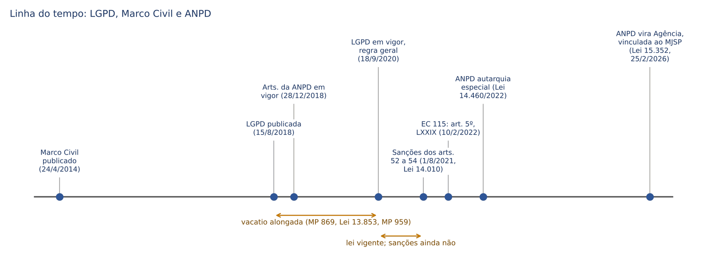
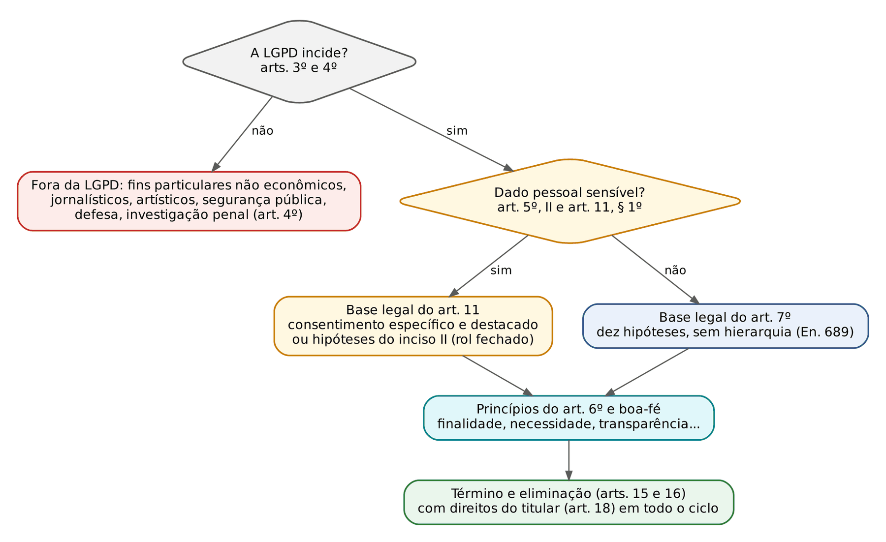
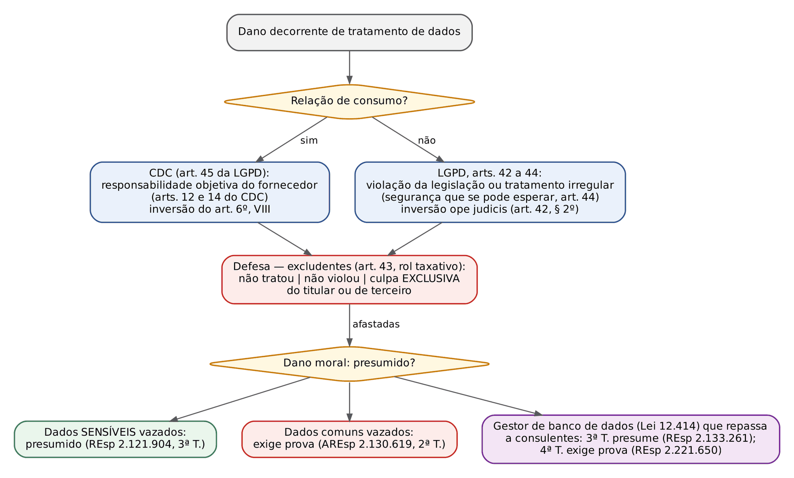
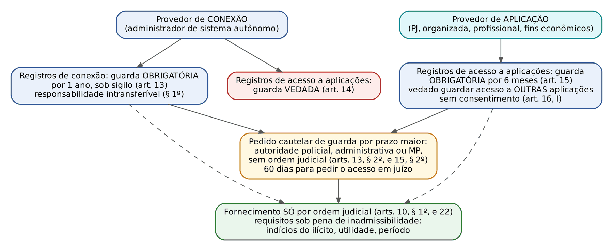

# CAPÍTULO 47 — PROTEÇÃO DE DADOS PESSOAIS (LGPD) E MARCO CIVIL DA INTERNET NOS ASPECTOS CIVIS

:::INCIDENCIA
TRF5 p. 2; TJRS p. 22; TJSC p. 23. Nível A. Lote do banco local: nenhuma questão (FGV 0, FCC 0); boxes só com questões FGV de magistratura (2025 e 2026) do material "LGPD anotada" do Drive, sem número QConcursos; FGV e FCC anteriores e outras bancas (VUNESP, CESPE, comissão do TRF4) apenas mencionadas em uma linha.
O que mais cai: âmbito e exceções do art. 4º (investigação penal, segurança pública), rol de dados sensíveis, bases legais (consentimento é UMA das dez), controlador x operador x encarregado, responsabilidade (solidariedade, excludentes, dano moral presumido ou não), ANPD e sanções; no Marco Civil, prazos de guarda (1 ano e 6 meses) e requisitos do art. 22.
:::

## 47.1 Mapa normativo: Constituição, LGPD, Marco Civil e leis vizinhas

### 47.1.1 Direito fundamental autônomo e competência da União

A proteção de dados pessoais deixou de ser mero desdobramento da intimidade (art. 5º, X, da CF) e da privacidade informacional dos arts. 20 e 21 do CC (ver Cap. 4, 04.9) para tornar-se direito fundamental AUTÔNOMO. O marco jurisprudencial foi o referendo, pelo Plenário do STF, da cautelar da Min. Rosa Weber nas ADIs 6.387, 6.388, 6.389, 6.390 e 6.393, que suspendeu a MP 954/2020 (compartilhamento, com o IBGE, de nome, telefone e endereço de todos os usuários de telefonia durante a pandemia): por 10 votos a 1 (vencido o Min. Marco Aurélio), em 7/5/2020, o Tribunal entendeu que a medida não delimitava finalidade nem trazia salvaguardas de segurança, e reconheceu a autodeterminação informativa como conteúdo protegido pela Constituição, mesmo com a LGPD ainda em *vacatio*. A lição de prova: não existe dado "insignificante"; qualquer dado pessoal, ainda que cadastral e público, pode, pelo cruzamento, revelar a personalidade, e seu tratamento exige finalidade, necessidade e segurança.

A EC 115, de 10/2/2022, positivou o que o STF havia afirmado:

:::LEI Constituição Federal (redação da EC 115/2022)
"Art. 5º [...] LXXIX - é assegurado, nos termos da lei, o direito à proteção dos dados pessoais, inclusive nos meios digitais."
"Art. 21. Compete à União: [...] XXVI - organizar e fiscalizar a proteção e o tratamento de dados pessoais, nos termos da lei."
"Art. 22. Compete privativamente à União legislar sobre: [...] XXX - proteção e tratamento de dados pessoais."
:::

:::PEGADINHA Três trocas frequentes
(1) A competência LEGISLATIVA sobre proteção e tratamento de dados é PRIVATIVA da União (art. 22, XXX), e não concorrente; a competência MATERIAL de organizar e fiscalizar é da União (art. 21, XXVI), exercida pela ANPD. (2) O direito do art. 5º, LXXIX, é assegurado "nos termos da lei": a LGPD o concretiza, mas a eficácia do direito fundamental não depende dela (o STF o aplicou antes da vigência da lei). (3) A LGPD (art. 1º, parágrafo único, incluído pela Lei 13.853/2019) traz normas gerais "de interesse nacional" que vinculam União, Estados, DF e Municípios; não é lei apenas federal em sentido estrito.
:::

### 47.1.2 Linha do tempo e direito intertemporal

A LGPD foi publicada em 15/8/2018 com *vacatio* original de 18 meses, alongada por medidas provisórias e pela Lei 13.853/2019. O art. 65, na redação vigente, fixa três marcos: 28/12/2018 para os dispositivos da ANPD e do Conselho Nacional (arts. 55-A a 55-L, 58-A e 58-B); 1/8/2021 para as sanções administrativas (arts. 52 a 54), por força da Lei 14.010/2020 (o Regime Jurídico Emergencial e Transitório, ver Cap. 46); e "24 meses após a publicação" para os demais artigos. Na prática, a lei entrou em vigor em 18/9/2020 (a tentativa de adiamento da MP 959/2020 caiu na conversão). Consequência forense: o dever de indenizar por violação da LGPD só alcança tratamentos posteriores a 18/9/2020; fatos anteriores resolvem-se pelo CC (arts. 21, 186 e 927), pelo CDC, pela Lei 12.414/2011 (cadastro positivo) e pelo Marco Civil, que já protegia dados pessoais desde 2014. A multa da ANPD só pode punir infração posterior a 1/8/2021.

### 47.1.3 Diálogo das fontes

| Diploma | Papel no tema | Relação com a LGPD |
|---|---|---|
| CC, arts. 11, 12, 20 e 21 | Tutela geral da personalidade, inibitória e reparatória | Fonte subsidiária; a LGPD é lei especial do tratamento de dados (ver Cap. 4) |
| CDC (arts. 6º, 14, 43 e 45) | Bancos de dados de consumo, responsabilidade objetiva | Art. 45 da LGPD remete as relações de consumo ao CDC; art. 52, § 2º, preserva sanções do CDC; art. 18, § 8º, permite petição aos Procons |
| Lei 12.965/2014 (Marco Civil) | Uso da internet, registros, provedores | Alterada pelo art. 60 da LGPD (arts. 7º, X, e 16, II, do MCI); 47.11 |
| Lei 15.211/2025 (Estatuto Digital da Criança e do Adolescente) | Deveres de provedores quanto a crianças e adolescentes | Em vigor desde 17/3/2026 (art. 41-A, incluído pela Lei 15.352/2026); ANPD designada autoridade autônoma pelo Decreto 12.622/2025 (47.5.3; deveres dos provedores no Cap. 26) |

O art. 64 da LGPD repete a cláusula de abertura do art. 3º, parágrafo único, do MCI: os direitos e princípios da lei não excluem outros previstos no ordenamento ou em tratados.

## 47.2 Âmbito de aplicação da LGPD (arts. 1º, 3º e 4º)

### 47.2.1 Quem e onde

A lei incide sobre o tratamento de dados pessoais "inclusive nos meios digitais" (dado em papel também é protegido), realizado por pessoa natural ou jurídica, de direito público ou privado (art. 1º), "independentemente do meio, do país de sua sede ou do país onde estejam localizados os dados", desde que (art. 3º): (I) a operação seja realizada no território nacional; (II) o tratamento tenha por objetivo a oferta de bens ou serviços ou o tratamento de dados de indivíduos localizados no território nacional; ou (III) os dados tenham sido coletados no território nacional, considerando-se coletados aqui os dados cujo titular aqui se encontre no momento da coleta (§ 1º). Os critérios são alternativos: basta um. O critério é a LOCALIZAÇÃO do titular, não a nacionalidade nem a residência: o turista estrangeiro que compra em loja virtual estando no Brasil está protegido; o brasileiro que se cadastra num aplicativo enquanto mora no exterior, em regra, não pelo inciso III.

O TITULAR é sempre pessoa natural (art. 5º, V). A pessoa jurídica não é titular de dados para a LGPD (Enunciado 693 da IX Jornada), embora possa ser controladora ou operadora e continue protegida pelo segredo empresarial e pelos arts. 52 do CC e Súmula 227 do STJ (ver Cap. 25).

### 47.2.2 Exclusões do art. 4º

:::LEI Lei 13.709/2018, art. 4º, caput e § 1º
"Art. 4º Esta Lei não se aplica ao tratamento de dados pessoais:
I - realizado por pessoa natural para fins exclusivamente particulares e não econômicos;
II - realizado para fins exclusivamente: a) jornalístico e artísticos; ou b) acadêmicos, aplicando-se a esta hipótese os arts. 7º e 11 desta Lei;
III - realizado para fins exclusivos de: a) segurança pública; b) defesa nacional; c) segurança do Estado; ou d) atividades de investigação e repressão de infrações penais; ou
IV - provenientes de fora do território nacional e que não sejam objeto de comunicação, uso compartilhado de dados com agentes de tratamento brasileiros ou objeto de transferência internacional de dados com outro país que não o de proveniência, desde que o país de proveniência proporcione grau de proteção de dados pessoais adequado ao previsto nesta Lei.
§ 1º O tratamento de dados pessoais previsto no inciso III será regido por legislação específica, que deverá prever medidas proporcionais e estritamente necessárias ao atendimento do interesse público, observados o devido processo legal, os princípios gerais de proteção e os direitos do titular previstos nesta Lei."
:::

Leituras finas que a FGV explora:

- As palavras "exclusivamente" e "exclusivos" fazem o trabalho: a agenda de contatos do particular está fora; o mesmo particular que usa a lista para vender produtos está dentro (fim econômico). O jornal que trata dados para a reportagem está fora; o mesmo jornal ao gerir assinantes e publicidade está dentro.
- Fins ACADÊMICOS não são exclusão integral: o inciso II, "b", manda aplicar os arts. 7º e 11 (bases legais). É a pegadinha mais comum do dispositivo (a FGV considerou errada a afirmação de que a LGPD "não tem disciplina" sobre tratamento acadêmico).
- Segurança pública, defesa, segurança do Estado e persecução penal ficam fora, mas a legislação específica, ainda não editada, deve observar devido processo legal, princípios e direitos do titular (§ 1º). O Enunciado 678 da IX Jornada antecipa essa eficácia: enquanto não vier a lei específica, aplicam-se o devido processo legal, os princípios gerais e os direitos do titular.
- Pessoa de direito privado só trata dados para os fins do inciso III em procedimentos sob tutela de pessoa jurídica de direito público, com informe específico à autoridade nacional (§ 2º), e nunca a TOTALIDADE do banco de dados, salvo se tiver capital integralmente público (§ 4º, redação da Lei 13.853/2019). A ANPD emite opiniões técnicas e solicita relatórios de impacto (§ 3º).

:::QUESTAO FGV 2025 — TJ-SC — Juiz Substituto (sem número QConcursos; material "LGPD anotada" do Drive)
Caso: dados genômicos de João, colhidos por laboratório com sua autorização, foram juntados a procedimento investigatório do MP sobre crime contra a liberdade sexual. Gabarito oficial: B — por serem dados utilizados em investigação criminal, o tratamento não é disciplinado pela LGPD (art. 4º, III, "d").
Armadilha: o candidato vê "dado genético" (sensível, art. 5º, II) e marca a alternativa que proíbe o uso ou a que exige autorização judicial "nos termos da LGPD". A primeira pergunta é sempre se a lei incide; só depois se discute o tipo de dado. A alternativa que nega a natureza de dado pessoal ao dado genético também está errada.
No mesmo sentido: FGV 2025 — TRF1 — Juiz Federal (ação coletiva de entidade contra o uso de dados em responsabilização penal: correta a afirmação de que dados podem ser usados na investigação penal à margem dos balizamentos da LGPD; errada a que nega legitimidade coletiva, pois o art. 22 a admite).
:::

:::QUESTAO FGV 2026 — TJ-GO — Juiz Substituto (sem número QConcursos; material "LGPD anotada" do Drive)
Caso: empresa privada contratada por consórcio de comerciantes opera câmeras com reconhecimento facial "para apoiar a segurança pública", define sozinha os critérios de coleta e armazenamento da biometria e não tem convênio nem atua sob tutela do poder público. Gabarito oficial: A — tratamento sujeito à LGPD, por pessoa de direito privado fora das hipóteses de exceção.
Raciocínio: a exceção do art. 4º, III, é FINALÍSTICA mas também SUBJETIVAMENTE condicionada: particular só trata dados para segurança pública sob tutela de pessoa jurídica de direito público (§ 2º). A finalidade declarada não basta. A biometria facial, além disso, é dado sensível (art. 5º, II), o que leva o caso ao art. 11.
:::

## 47.3 Conceitos operacionais (art. 5º)

### 47.3.1 Dado pessoal, dado sensível, dado anonimizado

Dado pessoal é "informação relacionada a pessoa natural identificada ou identificável" (art. 5º, I): o conceito é EXPANSIONISTA, porque abrange o dado que permite identificar indiretamente, por cruzamento (IP, geolocalização, placa de veículo, número de matrícula). O art. 12, § 2º, reforça: podem ser considerados dados pessoais os utilizados para formação do perfil comportamental de pessoa natural, se identificada (gabarito da FGV no TJES 2023).

:::LEI Lei 13.709/2018, art. 5º, II
"II - dado pessoal sensível: dado pessoal sobre origem racial ou étnica, convicção religiosa, opinião política, filiação a sindicato ou a organização de caráter religioso, filosófico ou político, dado referente à saúde ou à vida sexual, dado genético ou biométrico, quando vinculado a uma pessoa natural;"
:::

O rol é taxativo quanto à definição, mas a proteção reforçada do art. 11 alcança "qualquer tratamento de dados pessoais que revele dados pessoais sensíveis e que possa causar dano ao titular" (art. 11, § 1º): é o TRATAMENTO sensível de dado comum (inferir religião a partir de compras de alimentos, ou orientação sexual a partir de navegação). O Enunciado 690 da IX Jornada consolida a leitura. Não são sensíveis, por si: nome, CPF, RG, endereço, telefone, dados bancários e financeiros, renda, antecedentes criminais. Dados financeiros e de crédito têm proteção própria (sigilo bancário, Lei 12.414/2011), mas não estão no rol do inciso II; a banca troca muito "dado financeiro" por "sensível".

Dado ANONIMIZADO é o relativo a titular que não pode ser identificado, considerando os meios técnicos razoáveis e disponíveis na ocasião (art. 5º, III); ele NÃO é dado pessoal (art. 12), salvo quando a anonimização puder ser revertida com esforços razoáveis ou por meios próprios. A razoabilidade mede-se por fatores objetivos: custo e tempo para reverter, tecnologia disponível (art. 12, § 1º). Dado PSEUDONIMIZADO, ao contrário, continua sendo dado pessoal: perdeu a associação direta ao indivíduo "senão pelo uso de informação adicional mantida separadamente pelo controlador em ambiente controlado e seguro" (art. 13, § 4º). A diferença foi cobrada pela comissão do TRF4 (2022): equiparar anonimizado e pseudonimizado é erro.

### 47.3.2 Os agentes e o encarregado

| Figura | Definição (art. 5º) | Pontos de prova |
|---|---|---|
| Controlador | Pessoa natural ou jurídica, de direito público ou privado, "a quem competem as decisões referentes ao tratamento" (VI) | Indica o encarregado (art. 41); ônus da prova do consentimento (art. 8º, § 2º); elabora o RIPD (art. 38); comunica incidentes (art. 48); responde por pedidos do titular (art. 18) |
| Operador | Pessoa natural ou jurídica, de direito público ou privado, que "realiza o tratamento [...] em nome do controlador" (VII) | Segue instruções do controlador (art. 39); responde solidariamente se descumprir a lei ou as instruções lícitas, equiparando-se ao controlador (art. 42, § 1º, I) |
| Encarregado | "pessoa indicada pelo controlador e operador para atuar como canal de comunicação entre o controlador, os titulares dos dados e a Agência Nacional de Proteção de Dados (ANPD)" (VIII, redação da Lei 15.352/2026) | NÃO é agente de tratamento (inciso IX: agentes são só controlador e operador); identidade e contato públicos (art. 41, § 1º); atribuições no art. 41, § 2º; ANPD pode prever dispensa conforme porte e volume (art. 41, § 3º) |

A redação original exigia que o encarregado fosse "pessoa natural"; a Lei 13.853/2019 suprimiu a exigência. Daí o Enunciado 680 da IX Jornada: a lei não exclui a nomeação de pessoa jurídica, ente despersonalizado ou mais de uma pessoa natural (o "DPO como serviço"). O art. 41, *caput*, porém, continua a atribuir ao CONTROLADOR o dever de indicar o encarregado; o art. 5º, VIII, fala em indicação "pelo controlador e operador". A FGV (TJES 2023) considerou errada a assertiva de que "o operador é o responsável por indicar o encarregado".

:::QUESTAO FGV 2025 — TJ-SC — Juiz Substituto (sem número QConcursos; material "LGPD anotada" do Drive)
Caso: *startup* oferece escaneamento da íris; o usuário pode vender seus dados para aperfeiçoar o programa ou usá-los só para autenticação biométrica de transações. Gabarito oficial: D — dados biométricos são sensíveis, mas a hipótese (venda pelo próprio titular) não recebe tratamento específico na LGPD nem no regime dos direitos da personalidade; os serviços não são, por ora, vedados, desde que observados os princípios do art. 6º (notadamente a autodeterminação informativa) e as cautelas do tratamento.
Armadilhas: (1) dizer que biometria não é sensível (alternativas C e E): o art. 5º, II, a menciona expressamente; (2) afirmar vedação "expressa" de venda (A) ou intransmissibilidade absoluta por ser bem da personalidade (B): a LGPD não proíbe a monetização pelo titular, e o art. 11 do CC admite limitação voluntária do exercício de direitos da personalidade dentro de limites (Enunciado 4; ver Cap. 4, 04.2).
Observação crítica: o gabarito é discutível no plano da validade do consentimento remunerado (liberdade da manifestação, art. 5º, XII; vedação de vício, art. 8º, § 3º). A FGV preferiu a leitura de "ausência de vedação legal expressa". Em prova da FGV, siga o gabarito.
:::

## 47.4 Princípios (art. 6º)

O art. 6º manda observar "a boa-fé e os seguintes princípios". A boa-fé objetiva aparece como cláusula geral autônoma, e o Enunciado 683 da IX Jornada liga a ela a "legítima expectativa do titular", parâmetro de juridicidade do legítimo interesse (47.5.2).

| Princípio | Núcleo literal (art. 6º) | Distinção que a banca explora |
|---|---|---|
| I - Finalidade | Propósitos "legítimos, específicos, explícitos e informados ao titular", sem tratamento posterior INCOMPATÍVEL | É o "para quê"; veda o desvio de finalidade |
| II - Adequação | "compatibilidade do tratamento com as finalidades informadas [...] de acordo com o contexto" | É a relação entre o que se faz e o que se informou; CESPE (TJDFT 2023) trocou por finalidade |
| III - Necessidade | "limitação do tratamento ao mínimo necessário", dados "pertinentes, proporcionais e não excessivos" | Minimização; base do art. 10, § 1º, e do art. 14, § 4º |
| IV - Livre acesso | Consulta "facilitada e gratuita" sobre forma, duração e integralidade dos dados | Concretizado nos arts. 9º, 18 e 19 |
| V - Qualidade dos dados | "exatidão, clareza, relevância e atualização" | Base do direito de correção (art. 18, III) |
| VI - Transparência | Informações "claras, precisas e facilmente acessíveis" sobre o tratamento e os agentes, "observados os segredos comercial e industrial" | Livre acesso olha para os DADOS; transparência, para o TRATAMENTO e seus agentes |
| VII - Segurança | Medidas técnicas e administrativas contra acessos não autorizados e situações acidentais ou ilícitas | Base do art. 46 e da responsabilidade do art. 44, parágrafo único |
| VIII - Prevenção | Medidas para PREVENIR danos | Segurança protege o dado; prevenção mira o dano ao titular |
| IX - Não discriminação | Vedação de fins "discriminatórios ilícitos ou abusivos" | Não proíbe toda diferenciação (precificação de seguro por risco é lícita) |
| X - Responsabilização e prestação de contas | Demonstração de medidas eficazes "e, inclusive, da eficácia dessas medidas" | É a *accountability*: não basta cumprir, é preciso PROVAR que cumpre |

:::PEGADINHA Pares que a banca troca
Finalidade x adequação (o propósito x a compatibilidade com o propósito informado, "de acordo com o contexto"); livre acesso x transparência (dados do titular x informações sobre o tratamento); segurança x prevenção (proteção do dado x prevenção do dano); qualidade x necessidade (exatidão x minimização). São dez incisos mais a boa-fé no *caput*; "proporcionalidade" e "minimização" não são nomes de incisos (a ideia está na necessidade).
:::

## 47.5 Bases legais do tratamento (arts. 7º a 14)

### 47.5.1 As dez hipóteses do art. 7º

:::LEI Lei 13.709/2018, art. 7º, caput e incisos
"Art. 7º O tratamento de dados pessoais somente poderá ser realizado nas seguintes hipóteses:
I - mediante o fornecimento de consentimento pelo titular;
II - para o cumprimento de obrigação legal ou regulatória pelo controlador;
III - pela administração pública, para o tratamento e uso compartilhado de dados necessários à execução de políticas públicas previstas em leis e regulamentos ou respaldadas em contratos, convênios ou instrumentos congêneres, observadas as disposições do Capítulo IV desta Lei;
IV - para a realização de estudos por órgão de pesquisa, garantida, sempre que possível, a anonimização dos dados pessoais;
V - quando necessário para a execução de contrato ou de procedimentos preliminares relacionados a contrato do qual seja parte o titular, a pedido do titular dos dados;
VI - para o exercício regular de direitos em processo judicial, administrativo ou arbitral, esse último nos termos da Lei nº 9.307, de 23 de setembro de 1996 (Lei de Arbitragem);
VII - para a proteção da vida ou da incolumidade física do titular ou de terceiro;
VIII - para a tutela da saúde, exclusivamente, em procedimento realizado por profissionais de saúde, serviços de saúde ou autoridade sanitária;
IX - quando necessário para atender aos interesses legítimos do controlador ou de terceiro, exceto no caso de prevalecerem direitos e liberdades fundamentais do titular que exijam a proteção dos dados pessoais; ou
X - para a proteção do crédito, inclusive quanto ao disposto na legislação pertinente."
:::

Três regras estruturais:

- "Somente": o rol é TAXATIVO. Todo tratamento precisa de ao menos uma base; sem ela, é ilícito, ainda que o dado seja verdadeiro e o fim, nobre.
- Não há hierarquia entre as bases (Enunciado 689 da IX Jornada). O consentimento NÃO é a regra geral nem a base "preferencial"; é uma entre dez. A afirmação "todo tratamento exige consentimento" é falsa em qualquer banca.
- A dispensa do consentimento não dispensa o resto: princípios e direitos do titular continuam (art. 7º, § 6º); e o titular pode OPOR-SE ao tratamento feito com dispensa de consentimento se houver descumprimento da lei (art. 18, § 2º).

Dados de acesso público e dados tornados manifestamente públicos: o tratamento de dado de acesso público deve considerar "a finalidade, a boa-fé e o interesse público que justificaram sua disponibilização" (§ 3º); para dados tornados manifestamente públicos PELO TITULAR, dispensa-se o consentimento, resguardados direitos e princípios (§ 4º); o tratamento posterior para novas finalidades é possível, com propósitos legítimos e específicos (§ 7º, incluído pela Lei 13.853/2019). Lição: "público" não é "livre". Raspar perfis abertos de redes sociais para montar cadastro de cobrança não se legitima apenas por serem públicos os dados.

### 47.5.2 Consentimento e legítimo interesse

Consentimento é "manifestação livre, informada e inequívoca pela qual o titular concorda com o tratamento de seus dados pessoais para uma finalidade determinada" (art. 5º, XII). Requisitos e consequências:

| Regra | Dispositivo |
|---|---|
| Por escrito ou outro meio que demonstre a vontade; se escrito, em cláusula DESTACADA | Art. 8º, *caput* e § 1º |
| Ônus da prova da regularidade do consentimento: CONTROLADOR | Art. 8º, § 2º |
| Vedado tratamento mediante vício de consentimento | Art. 8º, § 3º |
| Finalidades determinadas; autorizações GENÉRICAS são NULAS | Art. 8º, § 4º |
| Revogável a qualquer momento, por manifestação expressa, procedimento gratuito e facilitado; os tratamentos anteriores ficam ratificados enquanto não houver pedido de eliminação | Art. 8º, § 5º |
| Mudança de finalidade incompatível: informar previamente; titular pode revogar | Art. 9º, § 2º, e art. 8º, § 6º |
| Informações enganosas, abusivas ou não apresentadas previamente com transparência tornam o consentimento NULO | Art. 9º, § 1º |
| Novo compartilhamento com outros controladores exige consentimento ESPECÍFICO | Art. 7º, § 5º |
| Tratamento como condição para produto, serviço ou direito: informar com destaque | Art. 9º, § 3º |

O LEGÍTIMO INTERESSE (art. 7º, IX) é a base mais aberta e, por isso, a mais controlada: só para finalidades legítimas, "consideradas a partir de situações concretas", entre elas o apoio e a promoção de atividades do controlador e a proteção do exercício regular de direitos do titular ou prestação de serviços que o beneficiem, "respeitadas as legítimas expectativas dele e os direitos e liberdades fundamentais" (art. 10); somente dados ESTRITAMENTE necessários (§ 1º); transparência (§ 2º); a ANPD pode pedir relatório de impacto (§ 3º); registro de operações "especialmente quando baseado no legítimo interesse" (art. 37). A doutrina e a ANPD trabalham com um teste de ponderação em etapas (finalidade legítima, necessidade, balanceamento com as expectativas do titular, salvaguardas). Enunciados da IX Jornada: a legítima expectativa do titular liga-se à boa-fé objetiva e é parâmetro do legítimo interesse (683); o interesse legítimo "de terceiro" pode ser de grupos ou da coletividade (685).

:::PEGADINHA Legítimo interesse NÃO serve para dado sensível
O art. 11 não reproduz o legítimo interesse nem a proteção do crédito. Dado de saúde, biometria ou religião nunca se trata "com base em legítimo interesse do controlador". Também não há, no art. 11, a execução de contrato como base autônoma: o que existe é o "exercício regular de direitos, inclusive em contrato" (art. 11, II, "d").
:::

### 47.5.3 Dados sensíveis (art. 11) e dados de saúde

| Base | Dado comum (art. 7º) | Dado sensível (art. 11) |
|---|---|---|
| Consentimento | Livre, informado, inequívoco, finalidade determinada | ESPECÍFICO e DESTACADO, para finalidades específicas, do titular ou responsável legal (I) |
| Obrigação legal ou regulatória | Sim (II) | Sim, se "indispensável" (II, "a") |
| Políticas públicas | Sim (III) | Só tratamento compartilhado previsto em leis ou regulamentos (II, "b"); com publicidade da dispensa (§ 2º) |
| Órgão de pesquisa | Sim (IV) | Sim (II, "c"), anonimização sempre que possível |
| Execução de contrato a pedido do titular | Sim (V) | NÃO como base autônoma; só exercício regular de direitos "inclusive em contrato" (II, "d") |
| Exercício regular de direitos em processo | Sim (VI) | Sim (II, "d") |
| Proteção da vida | Sim (VII) | Sim (II, "e") |
| Tutela da saúde | Sim (VIII) | Sim (II, "f") |
| Legítimo interesse | Sim (IX) | NÃO |
| Proteção do crédito | Sim (X) | NÃO |
| Prevenção à fraude em identificação e autenticação | — (cabe no legítimo interesse) | Sim (II, "g"), salvo prevalência de direitos do titular |

Regras próprias dos dados de saúde: é vedado o compartilhamento entre controladores com objetivo de vantagem econômica, salvo na prestação de serviços de saúde, assistência farmacêutica e à saúde em benefício dos titulares, para a portabilidade solicitada pelo titular ou para as transações financeiras e administrativas desses serviços (art. 11, § 4º, redação da Lei 13.853/2019); e é vedado às operadoras de planos de saúde tratar dados de saúde para SELEÇÃO DE RISCOS na contratação ou na exclusão de beneficiários (§ 5º; planos de saúde no Cap. 20). Estudos em saúde pública: órgãos de pesquisa podem acessar bases de dados pessoais, tratá-los exclusivamente dentro do órgão, em ambiente controlado e seguro, com anonimização ou pseudonimização sempre que possível; a divulgação dos resultados não pode revelar dados pessoais e é vedada, "em circunstância alguma", a transferência a terceiro (art. 13).

:::SENTENCA Documentos com dados sensíveis nos autos
A juntada de prontuário, laudo psiquiátrico ou exame genético não impõe, por si, segredo de justiça a todo o processo: o Enunciado 681 da IX Jornada orienta o sigilo restrito ao documento, se cabível. Redação-modelo: "Os documentos de ids. [...] contêm dados pessoais sensíveis (art. 5º, II, da Lei 13.709/2018). Sem necessidade de segredo de justiça em todo o feito (art. 189 do CPC), determino o sigilo restrito a esses documentos, com acesso às partes e aos procuradores, nos termos do art. 11, II, 'd', da LGPD e do Enunciado 681 da IX Jornada de Direito Civil."
:::

:::QUESTAO FGV 2025 — TJ-CE — Juiz Substituto (sem número QConcursos; material "LGPD anotada" do Drive)
Caso: rede hospitalar contrata empresa (brasileira, controlada por grupo estrangeiro) para treinar inteligência artificial com exames dos pacientes, inclusive dados de saúde, armazenados em servidores na Europa, sem comunicar a nova finalidade nem obter consentimento específico, sem anonimização adequada e sem medidas de segurança proporcionais. Gabarito oficial: B — tratamento irregular, com infração à LGPD.
Passos: (1) dado de saúde é sensível (art. 5º, II); (2) treinar algoritmo é nova finalidade, incompatível com a original (art. 6º, I, e art. 9º, § 2º); (3) sem consentimento específico e destacado e fora do rol do art. 11, II, não há base; (4) faltaram segurança e prevenção (arts. 6º, VII e VIII, e 46); (5) a transferência internacional depende do art. 33 e não sana a ilicitude; (6) o operador responde solidariamente se descumpre a lei (art. 42, § 1º, I). Erros sedutores: "o operador não responde" e "a transferência para país europeu dispensa o restante".
No mesmo sentido: FGV 2025 — TRF6 — Juiz Federal (órgão de pesquisa trata dados sensíveis sem consentimento se indispensável, art. 11, II, "c").
:::

### 47.5.4 Crianças e adolescentes (art. 14)

O tratamento de dados de crianças e de adolescentes "deverá ser realizado em seu melhor interesse" (art. 14, *caput*). O § 1º, porém, só fala em CRIANÇA: o tratamento de seus dados exige "consentimento específico e em destaque dado por pelo menos um dos pais ou pelo responsável legal". Os conceitos são os do art. 2º do ECA, criança até 12 anos incompletos (Enunciado 692 da IX Jornada).

| Regra | Dispositivo |
|---|---|
| Consentimento de ao menos UM dos pais ou do responsável (não de ambos) | § 1º |
| Controlador mantém públicas as informações sobre tipos de dados, uso e exercício de direitos | § 2º |
| Coleta sem consentimento: para contatar pais ou responsável (uso único, sem armazenamento) ou para proteção da criança; nunca repassar a terceiro sem consentimento | § 3º |
| Vedado condicionar participação em jogos e aplicações ao fornecimento de dados além do estritamente necessário | § 4º |
| Esforços razoáveis para verificar que o consentimento veio do responsável | § 5º |
| Informação simples, clara, acessível, com recursos audiovisuais quando adequado | § 6º |

A leitura de que crianças só poderiam ter dados tratados mediante consentimento parental foi superada: o Enunciado 684 da IX Jornada afirma que o art. 14 não exclui as demais bases legais, observado o melhor interesse, e o Enunciado CD/ANPD nº 1/2023 (24/5/2023) dispõe que o tratamento de dados de crianças e adolescentes "poderá ser realizado com base nas hipóteses legais previstas no art. 7º ou no art. 11", desde que observado e prevalecente o melhor interesse, avaliado no caso concreto. A escola trata dados do aluno para cumprir obrigação legal (frequência escolar) sem depender de consentimento.

Interface com a responsabilidade civil: o consentimento do ADOLESCENTE para o tratamento de dados não afasta a responsabilidade civil dos pais pelos atos dele, inclusive no meio digital (Enunciado 682; arts. 932, I, e 928 do CC, ver Cap. 24). O Estatuto Digital da Criança e do Adolescente (Lei 15.211/2025, em vigor desde 17/3/2026 por força do art. 41-A, incluído pela Lei 15.352/2026; a ANPD foi designada autoridade administrativa autônoma de proteção de crianças e adolescentes em ambientes digitais pelo Decreto 12.622/2025) acrescenta deveres aos fornecedores de produtos e serviços digitais; o regime dos provedores e o Enunciado 691 (superexposição de imagens de crianças) estão no Cap. 26.

:::PEGADINHA "Consentimento de ambos os pais" e "adolescente"
(1) Basta UM dos pais (§ 1º: "pelo menos um"). (2) O § 1º não se aplica ao adolescente: para ele, valem as bases gerais, sempre sob o melhor interesse. (3) O § 3º não autoriza armazenar o dado coletado para contatar os pais. (4) Em jogos e aplicativos, é vedado CONDICIONAR a participação a dados excessivos, não coletar dados.
:::

## 47.6 Término do tratamento e eliminação (arts. 15 e 16)

O tratamento termina (art. 15) quando: (I) a finalidade é alcançada ou os dados deixam de ser necessários; (II) acaba o período de tratamento; (III) o titular comunica, inclusive revogando o consentimento, "resguardado o interesse público"; (IV) a autoridade nacional determina, por violação da lei. Encerrado o tratamento, os dados são ELIMINADOS, autorizada a conservação para (art. 16): (I) cumprimento de obrigação legal ou regulatória; (II) estudo por órgão de pesquisa, com anonimização sempre que possível; (III) transferência a terceiro, respeitados os requisitos da lei; (IV) uso exclusivo do controlador, vedado o acesso por terceiro, e desde que ANONIMIZADOS. A comissão do TRF4 (2022) tomou como correta a reprodução literal do inciso III (transferência a terceiro).

Distinções de vocabulário: BLOQUEIO é "suspensão temporária de qualquer operação de tratamento, mediante guarda do dado" (art. 5º, XIII); ELIMINAÇÃO é exclusão do dado "independentemente do procedimento empregado" (XIV). A eliminação não se confunde com o "direito ao esquecimento" rejeitado pelo STF no Tema 786, que tratava de divulgação de fatos verídicos pela imprensa; a eliminação da LGPD é uma das previsões legais específicas que a própria tese ressalva (ver Cap. 4, 04.11).

## 47.7 Direitos do titular (arts. 17 a 22)

### 47.7.1 Catálogo do art. 18

Toda pessoa natural tem assegurada a titularidade de seus dados pessoais (art. 17). O titular pode obter do CONTROLADOR, "a qualquer momento e mediante requisição" (art. 18):

| Inciso | Direito | Detalhe cobrável |
|---|---|---|
| I | Confirmação da existência de tratamento | Formato simplificado imediato ou declaração completa em até 15 dias (art. 19) |
| II | Acesso aos dados | Idem; cópia eletrônica integral quando a base for consentimento ou contrato (art. 19, § 3º) |
| III | Correção de dados incompletos, inexatos ou desatualizados | Princípio da qualidade |
| IV | Anonimização, bloqueio ou eliminação de dados desnecessários, excessivos ou tratados em desconformidade | Qualquer base legal |
| V | Portabilidade a outro fornecedor, mediante requisição expressa, segundo regulamento da ANPD | Não inclui dados já anonimizados (§ 7º) |
| VI | Eliminação dos dados tratados com CONSENTIMENTO | Salvo as hipóteses de conservação do art. 16 |
| VII | Informação sobre entidades públicas e privadas com as quais houve uso compartilhado | |
| VIII | Informação sobre a possibilidade de não consentir e as consequências da negativa | |
| IX | Revogação do consentimento | Art. 8º, § 5º |

Procedimento: requerimento expresso do titular ou representante ao agente de tratamento (§ 3º); atendimento sem custos, nos prazos do regulamento (§ 5º); impossibilidade de adoção imediata exige resposta dizendo que não é agente (indicando-o, sempre que possível) ou as razões que impedem a providência (§ 4º); quem corrige, elimina, anonimiza ou bloqueia avisa imediatamente os agentes com quem compartilhou, para que repitam o procedimento, salvo impossibilidade comprovada ou esforço desproporcional (§ 6º). O titular pode peticionar contra o controlador perante a ANPD (§ 1º) e perante os organismos de defesa do consumidor (§ 8º); a ANPD só aprecia a petição depois de comprovada reclamação ao controlador não solucionada no prazo regulamentar (art. 55-J, V).

:::PEGADINHA Os dois "direitos de eliminar"
O inciso IV atinge dados desnecessários, excessivos ou ilícitos, sob QUALQUER base; o inciso VI atinge dados tratados com CONSENTIMENTO, ainda que lícitos, ressalvado o art. 16. Quem trata com base em obrigação legal (por exemplo, guarda de documentos fiscais) não precisa eliminar a pedido. Prazo de 15 dias: só para a declaração completa do art. 19, II; a confirmação simplificada é imediata. Os prazos podem ser diferenciados pela ANPD para setores específicos (art. 19, § 4º).
:::

### 47.7.2 Revisão de decisões automatizadas (art. 20)

O titular tem direito a solicitar a revisão de decisões tomadas UNICAMENTE com base em tratamento automatizado que afetem seus interesses, incluídas as de perfilamento pessoal, profissional, de consumo e de crédito ou de aspectos da personalidade; o controlador fornece, quando solicitado, informações claras sobre critérios e procedimentos, observados os segredos comercial e industrial (§ 1º); se recusar por segredo, a ANPD pode auditar aspectos discriminatórios (§ 2º).

A redação ORIGINAL garantia revisão "por pessoa natural"; a MP 869/2018 e a Lei 13.853/2019 suprimiram a expressão, e o § 3º, que a reintroduzia, foi vetado. Afirmar que a lei assegura revisão humana é ERRADO pela letra vigente (a doutrina discute se a revisão humana decorre do devido processo e da boa-fé).

Aspecto LGPD do REsp 2.135.783-DF (Info 817; suspensão imediata com defesa posterior: v. Cap. 15): com base no art. 20, o motorista de aplicativo deve ser informado da razão da suspensão do perfil e pode pedir sua revisão.

### 47.7.3 Proibição de uso em prejuízo e tutela coletiva

Os dados referentes ao exercício regular de direitos pelo titular "não podem ser utilizados em seu prejuízo" (art. 21): o consumidor que reclamou no Procon ou ajuizou ação não pode ser negativado em listas internas de "clientes litigantes"; o empregado que pediu acesso a seus dados não pode ser discriminado por isso. A defesa dos titulares pode ser individual ou coletiva (art. 22; também art. 42, § 3º, para danos coletivos), com os legitimados do microssistema (ACP e CDC). Perante o Poder Público, prazos e procedimentos seguem a legislação específica: habeas data, Lei 9.784/1999 e LAI (art. 23, § 3º).

:::PROCESSO Ação do titular contra o controlador: o que pedir
- Obrigação de fazer: confirmar, dar acesso com declaração completa (origem, critérios, finalidade, art. 19, II), corrigir, eliminar, informar compartilhamentos (art. 18, VII). O STJ admite condenar o agente vítima de ataque hacker a prestar essas informações (REsp 2.147.374, 47.9).
- Tutela inibitória: cessação do tratamento sem base legal (art. 12 do CC e art. 497 do CPC).
- Indenização (arts. 42 a 45), com pedido de inversão do ônus da prova (art. 42, § 2º, ou art. 6º, VIII, do CDC).
- Interesse de agir: não se exige prévio requerimento administrativo à ANPD; a petição à ANPD é faculdade (art. 18, § 1º). A reclamação prévia ao controlador é condição para a ANPD apreciar a petição (art. 55-J, V), não para a ação judicial.
- Polo passivo: o controlador; o operador, nas hipóteses do art. 42, § 1º, I; controladores diretamente envolvidos, solidariamente (art. 42, § 1º, II).
:::

## 47.8 Poder Público, transferência internacional e segurança

### 47.8.1 Tratamento pelo Poder Público (arts. 23 a 32)

O Poder Público trata dados para atender à sua finalidade pública, na persecução do interesse público, para executar competências ou cumprir atribuições legais, informando as hipóteses de tratamento (previsão legal, finalidade, procedimentos) em veículos de fácil acesso e indicando encarregado (art. 23). Equiparações que caem:

- Serviços notariais e de registro exercidos em caráter privado por delegação recebem o MESMO tratamento das pessoas jurídicas de direito público (art. 23, § 4º) e devem fornecer acesso eletrônico aos dados à administração pública (§ 5º). FCC (TJGO 2021) tomou como correta a reprodução do § 4º. Registros públicos e LGPD no Código Nacional de Normas: ver Cap. 33.
- Empresas públicas e sociedades de economia mista em regime de concorrência (art. 173 da CF) são tratadas como particulares (art. 24); quando operacionalizam políticas públicas, como Poder Público (parágrafo único).
- É VEDADO ao Poder Público transferir a entidades privadas dados de suas bases, EXCETO (art. 26, § 1º): execução descentralizada de atividade pública, exclusivamente para esse fim; dados acessíveis publicamente; previsão legal ou respaldo em contratos, convênios ou instrumentos congêneres (comunicados à ANPD, § 2º); e prevenção de fraudes ou proteção do titular, vedadas outras finalidades. A FGV (TJES 2023) considerou errado "é sempre vedado".
- A comunicação ou o uso compartilhado de dados de pessoa jurídica de direito público a pessoa de direito privado será informado à ANPD e dependerá de consentimento do titular, EXCETO nas hipóteses de dispensa de consentimento, no uso compartilhado com publicidade (art. 23, I) e nas exceções do art. 26, § 1º (art. 27). Gabarito da FGV (TJTO 2025): o compartilhamento não é vedado nem discricionário; segue o art. 27, com suas exceções.

:::JURIS STF, ADI 6.649 e ADPF 695, Plenário, Rel. Min. Gilmar Mendes, j. 15/9/2022 (Info 1068)
É constitucional o compartilhamento de dados entre órgãos e entidades da administração federal (Decreto 10.046/2019, Cadastro Base do Cidadão), desde que observados parâmetros e a irrestrita observância dos princípios e mecanismos da LGPD e dos direitos à privacidade e à proteção de dados. O voto afasta a "visão dicotômica" que opõe interesse público e privacidade (trecho transcrito na FGV, TJMT 2024, cujo gabarito se apoiou nos arts. 26 e 27).
:::

Na esfera administrativa, a ANPD pode enviar informe com medidas para cessar violação por órgãos públicos (art. 31) e solicitar relatórios de impacto (art. 32); as sanções administrativas que alcançam entidades públicas são só as do art. 52, I, IV, V, VI, X, XI e XII, NUNCA as multas (art. 52, § 3º).

### 47.8.2 Transferência internacional (arts. 33 a 36)

A transferência para país estrangeiro ou organismo internacional (art. 5º, XV) "somente é permitida" nos casos do art. 33: país ou organismo com grau de proteção ADEQUADO, avaliado pela ANPD (I e art. 34); garantias oferecidas e comprovadas pelo controlador (cláusulas contratuais específicas, cláusulas-padrão, normas corporativas globais, selos, certificados e códigos de conduta, II, cujo conteúdo ou verificação cabe à ANPD, art. 35); cooperação jurídica internacional entre órgãos de inteligência, investigação e persecução (III); proteção da vida (IV); autorização da ANPD (V); compromisso em acordo de cooperação internacional (VI); execução de política pública com publicidade (VII); consentimento ESPECÍFICO e EM DESTAQUE, com informação prévia do caráter internacional (VIII); ou para atender às bases do art. 7º, II, V e VI (IX).

### 47.8.3 Segurança, incidentes e governança

Os agentes devem adotar medidas técnicas e administrativas de segurança (art. 46), observadas "desde a fase de concepção do produto ou do serviço até a sua execução" (§ 2º: *privacy by design*). O dever de segurança vincula qualquer pessoa que intervenha no tratamento, MESMO APÓS O SEU TÉRMINO (art. 47).

:::LEI Lei 13.709/2018, art. 48, caput e § 1º (trecho)
"Art. 48. O controlador deverá comunicar à autoridade nacional e ao titular a ocorrência de incidente de segurança que possa acarretar risco ou dano relevante aos titulares.
§ 1º A comunicação será feita em prazo razoável, conforme definido pela autoridade nacional, e deverá mencionar, no mínimo: [...] V - os motivos da demora, no caso de a comunicação não ter sido imediata; [...]"
:::

Três pegadinhas do art. 48: (1) comunica o CONTROLADOR, à ANPD E ao titular; (2) só incidentes que POSSAM ACARRETAR RISCO OU DANO RELEVANTE, não todo incidente (comissão do TRF4 2022); (3) a lei fala em "prazo razoável, conforme definido pela autoridade nacional", não em 48 horas ou 72 horas (FGV, TJES 2023, considerou errado "no prazo de 48 horas"). A ANPD pode determinar ampla divulgação e medidas de mitigação (§ 2º), e no juízo de gravidade pesa a prova de que os dados ficaram ininteligíveis, por exemplo por criptografia (§ 3º).

Governança: registro das operações (art. 37), relatório de impacto quando determinado pela ANPD ao CONTROLADOR (art. 38; o Enunciado 679 vê o RIPD como medida de prevenção e *accountability* para tratamentos de alto risco), regras de boas práticas e programa de governança em privacidade (art. 50), cuja adoção é critério de dosimetria da sanção (art. 52, § 1º, VIII e IX).

## 47.9 Responsabilidade civil dos agentes de tratamento (arts. 42 a 45)

### 47.9.1 Texto

:::LEI Lei 13.709/2018, arts. 42, caput, § 1º e § 2º, 43 e 44
"Art. 42. O controlador ou o operador que, em razão do exercício de atividade de tratamento de dados pessoais, causar a outrem dano patrimonial, moral, individual ou coletivo, em violação à legislação de proteção de dados pessoais, é obrigado a repará-lo.
§ 1º A fim de assegurar a efetiva indenização ao titular dos dados:
I - o operador responde solidariamente pelos danos causados pelo tratamento quando descumprir as obrigações da legislação de proteção de dados ou quando não tiver seguido as instruções lícitas do controlador, hipótese em que o operador equipara-se ao controlador, salvo nos casos de exclusão previstos no art. 43 desta Lei;
II - os controladores que estiverem diretamente envolvidos no tratamento do qual decorreram danos ao titular dos dados respondem solidariamente, salvo nos casos de exclusão previstos no art. 43 desta Lei.
§ 2º O juiz, no processo civil, poderá inverter o ônus da prova a favor do titular dos dados quando, a seu juízo, for verossímil a alegação, houver hipossuficiência para fins de produção de prova ou quando a produção de prova pelo titular resultar-lhe excessivamente onerosa.
Art. 43. Os agentes de tratamento só não serão responsabilizados quando provarem:
I - que não realizaram o tratamento de dados pessoais que lhes é atribuído;
II - que, embora tenham realizado o tratamento de dados pessoais que lhes é atribuído, não houve violação à legislação de proteção de dados; ou
III - que o dano é decorrente de culpa exclusiva do titular dos dados ou de terceiro.
Art. 44. O tratamento de dados pessoais será irregular quando deixar de observar a legislação ou quando não fornecer a segurança que o titular dele pode esperar, consideradas as circunstâncias relevantes, entre as quais: I - o modo pelo qual é realizado; II - o resultado e os riscos que razoavelmente dele se esperam; III - as técnicas de tratamento de dados pessoais disponíveis à época em que foi realizado.
Parágrafo único. Responde pelos danos decorrentes da violação da segurança dos dados o controlador ou o operador que, ao deixar de adotar as medidas de segurança previstas no art. 46 desta Lei, der causa ao dano."
:::

O art. 42, § 3º, admite ações coletivas por danos coletivos; o § 4º dá regresso a quem reparou contra os demais, "na medida de sua participação no evento danoso". O art. 45 manda as violações no âmbito das relações de consumo para as regras de responsabilidade "previstas na legislação pertinente", isto é, o CDC.

### 47.9.2 Natureza: subjetiva, objetiva ou "proativa"

A lei não diz "independentemente de culpa" (contraste com os arts. 12 e 14 do CDC e o art. 927, parágrafo único, do CC). Daí três leituras, que a prova cobra como controvérsia:

| Corrente | Argumentos |
|---|---|
| Objetiva (risco da atividade) | Tratamento de dados como atividade de risco (art. 927, parágrafo único, do CC); o art. 44 copia o padrão do defeito do serviço (art. 14, § 1º, do CDC) e o art. 43 lembra o art. 14, § 3º, do CDC |
| Subjetiva (culpa normativa) | O dever exige "violação à legislação" (art. 42); o agente se exonera provando conformidade (art. 43, II); culpa aferida por padrões objetivos de diligência; o legislador suprimiu, na tramitação, a menção à responsabilidade objetiva |
| Especial ou "proativa" | Regime próprio da *accountability* (art. 6º, X): o agente demonstra a adoção de medidas eficazes |

Para a prova: (a) nas RELAÇÕES DE CONSUMO não há dúvida, a responsabilidade é OBJETIVA pelo CDC (art. 45), e o STJ assim decidiu em vazamento de dados sensíveis por seguradora (REsp 2.121.904, abaixo) e em gestor de banco de dados (REsp 2.133.261); (b) fora do consumo, a jurisprudência do STJ trabalha com o padrão do art. 44: falhou a segurança que se podia esperar, há tratamento irregular e dever de indenizar, cabendo ao agente provar uma das excludentes; (c) nenhuma das correntes dispensa DANO e NEXO.

:::PEGADINHA Excludentes: rol fechado e sem "caso fortuito"
O art. 43 diz "SÓ não serão responsabilizados quando provarem": rol taxativo, com ônus do AGENTE. Não aparece caso fortuito ou força maior. A culpa do titular ou de terceiro precisa ser EXCLUSIVA; culpa concorrente não exclui (pode reduzir a indenização, art. 945 do CC). Ataque hacker é fato de terceiro, mas só exclui se o agente provar que o vazamento decorreu EXCLUSIVAMENTE do ataque, sem falha própria de segurança (REsp 2.147.374): sob o art. 44, o ataque previsível é risco interno da atividade (paralelo com o fortuito interno da Súmula 479 do STJ, ver Cap. 26).
:::

:::PEGADINHA Duas inversões do ônus da prova
O art. 42, § 2º, é inversão *ope judicis* ("poderá", "a seu juízo"), com três hipóteses ALTERNATIVAS: verossimilhança, hipossuficiência probatória OU prova excessivamente onerosa. O art. 6º, VIII, do CDC exige verossimilhança OU hipossuficiência. Não confundir com o ônus LEGAL do controlador de provar o consentimento (art. 8º, § 2º) e com o ônus do agente quanto às excludentes (art. 43), que independem de decisão judicial.
:::

:::QUESTAO FGV 2026 — TJ-PA — Juiz Substituto (sem número QConcursos; material "LGPD anotada" do Drive)
Caso: controladora (Alfa) contrata operadora (Beta); a ANPD requisita esclarecimentos e determina relatório específico; apura-se que o operador não seguiu integralmente as instruções. Gabarito oficial: E — o controlador mantém registro das operações e elabora o relatório de impacto determinado pela autoridade (arts. 37 e 38), e o operador que descumpriu instruções lícitas responde solidariamente, equiparando-se ao controlador (art. 42, § 1º, I).
Erros sedutores: atribuir o RIPD ao operador (o art. 38 fala em controlador); exigir dolo ou culpa grave do operador ou negar a solidariedade.
:::

### 47.9.3 Dano moral: presumido ou não? O mapa do STJ

| Situação | Orientação | Precedente |
|---|---|---|
| Vazamento de dados comuns (nome, RG, endereço, telefone) de consumidora de concessionária de energia | Não gera dano moral presumido; o titular deve provar o dano concreto decorrente da exposição | STJ, AREsp 2.130.619-SP, Segunda Turma, Rel. Min. Francisco Falcão, j. 7/3/2023 (Info 766) |
| Vazamento de dados SENSÍVEIS fornecidos para contratar seguro de vida | Responsabilidade objetiva da seguradora (CDC e LGPD); dano moral PRESUMIDO, pois a exposição de dados sensíveis, por si, gera riscos relevantes à honra, intimidade, patrimônio e segurança; o fornecedor deve provar que cumpriu o dever de proteção | STJ, REsp 2.121.904-SP, Terceira Turma, Rel. Min. Nancy Andrighi, j. 11/2/2025 (Info 842) |
| Gestor de banco de dados (Lei 12.414/2011) que dá a terceiros consulentes acesso a dados cadastrais e de adimplemento que só poderiam circular entre bancos de dados | Responde objetivamente; dano moral PRESUMIDO, pela forte sensação de insegurança; a abertura do cadastro dispensa consentimento, mas exige comunicação ao titular | STJ, REsp 2.133.261-SP, Terceira Turma, Rel. Min. Nancy Andrighi, j. 8/10/2024 (Info 833); no mesmo sentido, REsp 2.201.694-SP, Terceira Turma (2025, por maioria) |
| Disponibilização de dados pessoais não sensíveis por gestor de banco de dados | Não configura, por si só, dano moral presumido; é imprescindível provar abalo significativo aos direitos da personalidade | STJ, REsp 2.221.650-SP, Quarta Turma, Rel. Min. Maria Isabel Gallotti, j. 4/11/2025 (Info 871) |
| Vazamento de dados não sensíveis por ataque hacker | O agente continua obrigado a informar o titular sobre uso, origem, finalidade e compartilhamento (art. 19, II); a excludente do art. 43, III, não se aplica sem prova de que o incidente decorreu exclusivamente do terceiro | STJ, REsp 2.147.374-SP, Terceira Turma, Rel. Min. Ricardo Villas Bôas Cueva, j. 3/12/2024 (Info 838) |

Leitura de prova: (1) o divisor mais seguro é dado SENSÍVEL (dano presumido) x dado COMUM (dano a provar); (2) no compartilhamento indevido por gestores de bancos de dados de crédito há DIVERGÊNCIA entre a Terceira Turma (presume) e a Quarta Turma (exige prova), sem uniformização pela Segunda Seção até a última consulta; em prova objetiva, a assertiva só estará correta se indicar a Turma ou o fundamento; (3) mesmo sem dano moral, subsistem as obrigações de fazer (informar, eliminar, cessar) e a responsabilidade administrativa perante a ANPD. Quantificação do dano moral (critério bifásico), juros e correção: Cap. 25; prazos prescricionais da pretensão indenizatória (art. 206, § 3º, V, do CC, ou art. 27 do CDC no fato do serviço): Cap. 11.

:::SENTENCA Fundamentação-modelo (vazamento, dado comum, fora do consumo)
"O tratamento foi irregular, pois não forneceu a segurança que o titular dele podia esperar (art. 44 da Lei 13.709/2018): a ré não comprovou medidas técnicas compatíveis com o estado da técnica (art. 46), ônus que lhe tocava (art. 43). A alegação de ataque externo não exclui a responsabilidade, porque não demonstrado que o incidente decorreu exclusivamente de fato de terceiro (art. 43, III). Quanto ao dano moral, os dados expostos não são sensíveis (art. 5º, II), e o autor não comprovou repercussão concreta em sua esfera de personalidade, razão pela qual não há dano indenizável (STJ, AREsp 2.130.619). Condeno a ré a fornecer, em 15 dias, declaração completa sobre a origem, os critérios, a finalidade e os compartilhamentos dos dados (art. 19, II), sob pena de multa."
:::

## 47.10 ANPD, Conselho Nacional e sanções administrativas

### 47.10.1 Natureza da ANPD: três fases

| Fase | Natureza | Fonte |
|---|---|---|
| 2018/2019 | Órgão da administração pública federal, integrante da Presidência da República, "sem aumento de despesa"; natureza "transitória" | MP 869/2018 e Lei 13.853/2019 (art. 55-A original) |
| 2022 | Autoridade Nacional de Proteção de Dados, AUTARQUIA DE NATUREZA ESPECIAL, com autonomia técnica e decisória, patrimônio próprio, sede e foro no DF | MP 1.124/2022, convertida na Lei 14.460/2022 |
| 2026 | AGÊNCIA Nacional de Proteção de Dados (mesma sigla), autarquia de natureza especial VINCULADA AO MINISTÉRIO DA JUSTIÇA E SEGURANÇA PÚBLICA, com autonomia funcional, técnica, decisória, administrativa e financeira, nos termos da Lei 13.848/2019 (Lei das Agências Reguladoras); ganha Auditoria (art. 55-C, V-B); no ECA Digital, é a autoridade autônoma por designação do Decreto 12.622/2025 | MP 1.317/2025, convertida na Lei 15.352, de 25/2/2026 |

:::PEGADINHA "A Lei 13.853/2019 transformou a ANPD em autarquia"
ERRADO: a Lei 13.853/2019 criou a ANPD como ÓRGÃO da Presidência, apenas prevendo a possível transformação (§§ 1º e 2º do art. 55-A, depois revogados). A autarquia especial veio com a Lei 14.460/2022; a agência reguladora vinculada ao MJSP, com a Lei 15.352/2026. Até materiais de estudo recentes erram esse ponto. Questões anteriores a 2026 falam em "Autoridade" Nacional; a sigla não mudou.
:::

Estrutura e garantias (arts. 55-C a 55-F): Conselho Diretor (órgão máximo, 5 diretores, incluído o Diretor-Presidente), Conselho Nacional de Proteção de Dados Pessoais e da Privacidade, Corregedoria, Ouvidoria, Procuradoria, Auditoria e unidades administrativas e especializadas. Os diretores são escolhidos e nomeados pelo Presidente da República APÓS APROVAÇÃO DO SENADO (art. 52, III, "f", da CF), entre brasileiros de reputação ilibada, nível superior e elevado conceito na especialidade; mandato de 4 anos (os primeiros, escalonados de 2 a 6 anos); vacância completada pelo sucessor; só perdem o cargo por renúncia, condenação judicial transitada em julgado ou demissão em processo administrativo disciplinar (art. 55-E); quarentena da Lei 12.813/2013, cuja infração é improbidade (art. 55-F). A VUNESP (TJRJ 2023) cobrou exatamente a aprovação pelo Senado (art. 55-D, § 1º) contra alternativas com mandato de 2 anos e escolha pelo Ministro da Casa Civil.

Competências centrais (art. 55-J): zelar pela proteção de dados; fiscalizar e aplicar sanções mediante processo com contraditório, ampla defesa e recurso; apreciar petições de titulares (após reclamação não resolvida); editar regulamentos precedidos de consulta e audiência públicas e análise de impacto regulatório (§ 2º); art. 26 da LINDB, ver Cap. 1); normas simplificadas para micro e pequenas empresas e *startups* (XVIII); garantir tratamento de dados de idosos de forma simples, clara e acessível (XIX; interface com o Cap. 46); deliberar, na esfera administrativa, em caráter TERMINATIVO, sobre a interpretação da lei (XX). A aplicação das sanções da LGPD compete EXCLUSIVAMENTE à ANPD, cujas competências prevalecem, em proteção de dados, sobre as de outros órgãos (art. 55-K), sem prejuízo das sanções do CDC (art. 52, § 2º). O Conselho Nacional tem 23 representantes, com função consultiva (arts. 58-A e 58-B).

### 47.10.2 Sanções (arts. 52 a 54)

| Sanção | Regra |
|---|---|
| I - Advertência | Com prazo para medidas corretivas |
| II - Multa simples | Até 2% do faturamento da pessoa jurídica de direito privado, grupo ou conglomerado NO BRASIL no último exercício, excluídos os tributos, LIMITADA, no total, a 50.000.000 (cinquenta milhões de) reais POR INFRAÇÃO |
| III - Multa diária | Observado o mesmo limite total |
| IV - Publicização da infração | Após apurada e confirmada |
| V - Bloqueio dos dados | Até a regularização |
| VI - Eliminação dos dados | Dados a que se refere a infração |
| X - Suspensão parcial do funcionamento do banco de dados | Até 6 meses, prorrogável por igual período |
| XI - Suspensão do exercício da atividade de tratamento | Até 6 meses, prorrogável por igual período |
| XII - Proibição parcial ou total de atividades de tratamento | |

Regras de aplicação: procedimento administrativo com ampla defesa, aplicação gradativa, isolada ou cumulativa, com 11 critérios de dosimetria (gravidade, boa-fé, vantagem, condição econômica, reincidência, grau do dano, cooperação, mecanismos internos, boas práticas, pronta correção e proporcionalidade, § 1º); as sanções X, XI e XII só depois de imposta ao menos uma das sanções II a VI no mesmo caso concreto (§ 6º, I); vazamentos individuais ou acessos não autorizados podem ser objeto de CONCILIAÇÃO DIRETA entre controlador e titular, e, sem acordo, o controlador fica sujeito às penalidades (§ 7º); o produto das multas vai ao Fundo de Defesa de Direitos Difusos da Lei 7.347/1985 (§ 5º); as entidades e órgãos públicos não sofrem multa (§ 3º); metodologia do cálculo do valor-base por regulamento submetido a consulta pública (art. 53).

## 47.11 Marco Civil da Internet (Lei 12.965/2014): aspectos civis

Responsabilidade dos provedores por conteúdo de terceiros (arts. 18 a 21), Temas 987 e 533 do STF e jurisprudência sobre remoção, URL e desindexação: Cap. 26 (26.5). Aqui, o resto da lei que a prova cobra.

### 47.11.1 Fundamentos, princípios, objetivos e conceitos

O art. 2º põe como fundamento "o respeito à liberdade de expressão", além do reconhecimento da escala mundial da rede, dos direitos humanos, do desenvolvimento da personalidade e da cidadania em meios digitais, da pluralidade, da abertura e colaboração, da livre iniciativa, livre concorrência e defesa do consumidor e da finalidade social da rede. Os PRINCÍPIOS (art. 3º) são: liberdade de expressão; proteção da privacidade; proteção dos dados pessoais, "na forma da lei"; preservação e garantia da neutralidade de rede; estabilidade, segurança e funcionalidade da rede; responsabilização dos agentes de acordo com suas atividades; natureza participativa da rede; liberdade dos modelos de negócios, desde que não conflitem com os demais princípios. Os OBJETIVOS (art. 4º) são acesso à internet a todos, acesso à informação e à cultura, inovação e padrões tecnológicos abertos. Na interpretação, consideram-se a natureza da internet, seus usos e costumes particulares e sua importância para o desenvolvimento humano, econômico, social e cultural (art. 6º).

:::PEGADINHA Fundamento, princípio ou objetivo?
Liberdade de expressão aparece como FUNDAMENTO (art. 2º, *caput*) e como PRINCÍPIO (art. 3º, I). Neutralidade de rede é PRINCÍPIO (art. 3º, IV), não fundamento. Finalidade social da rede é FUNDAMENTO (art. 2º, VI). Acesso à internet a todos é OBJETIVO (art. 4º, I); a essencialidade do acesso ao exercício da cidadania está no art. 7º, *caput*. Os arts. 8º-A a 8º-D, 28-A e o parágrafo único do art. 1º, incluídos pela MP 1.068/2021 (moderação de redes sociais), NÃO estão em vigor: a MP perdeu a eficácia (devolvida pelo Presidente do Congresso Nacional em 2021).
:::

Conceitos do art. 5º: registro de CONEXÃO é o conjunto de informações sobre data e hora de início e término de uma conexão, duração e endereço IP (VI); registro de ACESSO A APLICAÇÕES é o conjunto de informações sobre data e hora de uso de determinada aplicação a partir de determinado IP (VIII); aplicações de internet são as funcionalidades acessíveis por terminal conectado (VII). Nem um nem outro registro inclui o CONTEÚDO das comunicações.

### 47.11.2 Direitos dos usuários e cláusulas nulas (arts. 7º e 8º)

O acesso à internet é essencial ao exercício da cidadania, e ao usuário se asseguram (art. 7º), entre outros: inviolabilidade da intimidade e da vida privada, com indenização por dano material ou moral (I); inviolabilidade e sigilo do FLUXO das comunicações, salvo ordem judicial "na forma da lei" (II), e das comunicações privadas ARMAZENADAS, salvo ordem judicial (III); não suspensão da conexão, SALVO por débito diretamente decorrente de sua utilização (IV); manutenção da qualidade contratada (V); não fornecimento a terceiros de dados pessoais e registros, salvo consentimento livre, expresso e informado ou hipóteses legais (VII); consentimento expresso e destacado para coleta e tratamento de dados (IX); exclusão definitiva dos dados fornecidos a determinada aplicação, a requerimento, ao término da relação, ressalvadas as guardas obrigatórias desta lei "e na que dispõe sobre a proteção de dados pessoais" (X, redação dada pelo art. 60 da LGPD); acessibilidade (XII); aplicação do CDC às relações de consumo na internet (XIII).

São nulas de pleno direito as cláusulas que violem a privacidade e a liberdade de expressão nas comunicações, tais como as que ofendam a inviolabilidade e o sigilo das comunicações privadas ou, EM CONTRATO DE ADESÃO, não ofereçam ao contratante a alternativa do FORO BRASILEIRO para controvérsias de serviços prestados no Brasil (art. 8º, parágrafo único). Note-se a construção: não se proíbe o foro estrangeiro; anula-se a cláusula que não ofereça a OPÇÃO pelo foro brasileiro.

O art. 11 impõe a lei brasileira a qualquer operação de coleta, armazenamento, guarda e tratamento de registros, dados pessoais ou comunicações em que pelo menos um desses atos ocorra no território nacional, ou em que um dos terminais esteja no Brasil (§ 1º), ainda que a pessoa jurídica seja sediada no exterior, desde que oferte serviço ao público brasileiro ou integrante do mesmo grupo econômico tenha estabelecimento no Brasil (§ 2º). As infrações aos arts. 10 e 11 sujeitam a advertência, multa de até 10% do faturamento do grupo econômico no Brasil, suspensão temporária ou proibição das atividades do art. 11, com responsabilidade SOLIDÁRIA da filial ou estabelecimento no país pela multa da empresa estrangeira (art. 12).

### 47.11.3 Neutralidade de rede (art. 9º)

O responsável pela transmissão, comutação ou roteamento deve tratar de forma ISONÔMICA quaisquer pacotes de dados, sem distinção por conteúdo, origem e destino, serviço, terminal ou aplicação. A discriminação ou degradação do tráfego só pode decorrer de requisitos técnicos indispensáveis ou de priorização de serviços de emergência, regulamentada por decreto presidencial ouvidos o Comitê Gestor da Internet e a Anatel (§ 1º); mesmo então, o responsável deve abster-se de causar dano aos usuários "na forma do art. 927" do CC, agir com proporcionalidade, transparência e isonomia, informar previamente as práticas de gerenciamento e não praticar condutas anticoncorrenciais (§ 2º). Na provisão de conexão, onerosa ou gratuita, é VEDADO bloquear, monitorar, filtrar ou analisar o CONTEÚDO dos pacotes (§ 3º). A remissão expressa ao art. 927 do CC é o gancho civil do dispositivo: o dano por degradação abusiva do tráfego gera dever de indenizar.

### 47.11.4 Guarda e fornecimento de registros (arts. 10 a 17, 22 e 23)

:::LEI Lei 12.965/2014, arts. 13, caput, 14 e 15, caput
"Art. 13. Na provisão de conexão à internet, cabe ao administrador de sistema autônomo respectivo o dever de manter os registros de conexão, sob sigilo, em ambiente controlado e de segurança, pelo prazo de 1 (um) ano, nos termos do regulamento.
Art. 14. Na provisão de conexão, onerosa ou gratuita, é vedado guardar os registros de acesso a aplicações de internet.
Art. 15. O provedor de aplicações de internet constituído na forma de pessoa jurídica e que exerça essa atividade de forma organizada, profissionalmente e com fins econômicos deverá manter os respectivos registros de acesso a aplicações de internet, sob sigilo, em ambiente controlado e de segurança, pelo prazo de 6 (seis) meses, nos termos do regulamento."
:::

| Ponto | Provedor de conexão | Provedor de aplicação |
|---|---|---|
| O que guarda | Registros de CONEXÃO | Registros de ACESSO À PRÓPRIA aplicação |
| Prazo mínimo | 1 ano (art. 13) | 6 meses (art. 15), se PJ organizada, profissional, com fins econômicos |
| O que é vedado | Guardar registros de acesso a aplicações (art. 14) | Guardar registros de acesso a OUTRAS aplicações sem consentimento prévio; guardar dados excessivos em relação à finalidade consentida, salvo hipóteses da LGPD (art. 16) |
| Transferência do dever | Vedada (art. 13, § 1º) | Ordem judicial pode obrigar provedor não sujeito ao *caput* a guardar registros de fatos específicos em período determinado (art. 15, § 1º) |
| Pedido de guarda por prazo maior | Autoridade policial ou administrativa ou MP, cautelarmente, SEM ordem judicial; 60 dias para pedir autorização judicial de acesso; sigilo do pedido; ineficácia se indeferido ou não protocolado (art. 13, §§ 2º a 4º) | Idem, a qualquer provedor de aplicações (art. 15, § 2º) |
| Acesso aos registros | Sempre precedido de autorização judicial (art. 13, § 5º; art. 15, § 3º; art. 10, § 1º) | Idem |

Dados CADASTRAIS (qualificação pessoal, filiação e endereço) podem ser acessados pelas autoridades administrativas com competência legal para requisitá-los, sem ordem judicial (art. 10, § 3º); o CONTEÚDO das comunicações privadas só por ordem judicial, nas hipóteses e forma da lei (art. 10, § 2º). Quem opta por não guardar registros de acesso a aplicações, fora das hipóteses legais, não responde por danos decorrentes do uso por terceiros (art. 17).

:::LEI Lei 12.965/2014, art. 22
"Art. 22. A parte interessada poderá, com o propósito de formar conjunto probatório em processo judicial cível ou penal, em caráter incidental ou autônomo, requerer ao juiz que ordene ao responsável pela guarda o fornecimento de registros de conexão ou de registros de acesso a aplicações de internet.
Parágrafo único. Sem prejuízo dos demais requisitos legais, o requerimento deverá conter, sob pena de inadmissibilidade: I - fundados indícios da ocorrência do ilícito; II - justificativa motivada da utilidade dos registros solicitados para fins de investigação ou instrução probatória; e III - período ao qual se referem os registros."
:::

Cabe ao juiz garantir o sigilo e a preservação da intimidade, podendo decretar segredo de justiça, inclusive quanto aos pedidos de guarda (art. 23).

:::JURIS STJ, Jurisprudência em Teses, ed. 223 (Marco Civil da Internet II)
Tese 1: o MCI diferencia o conteúdo das comunicações (proteção rígida) das informações de conexão e de acesso a aplicações (regras menos rígidas, que admitem dispensa de ordem judicial em hipóteses específicas). Tese 2: os provedores de aplicações não são obrigados a guardar e fornecer dados pessoais dos usuários, pois os registros de IP bastam para identificá-los. Tese 3: provedores de acesso e de aplicação devem guardar os dados de IP e da porta lógica de origem. Tese 4: o requerimento cautelar de guarda por prazo superior ao legal, feito por autoridade policial, administrativa ou MP, dispensa prévia autorização judicial. Tese 5: os três pressupostos do art. 22. Tese 6: provedores de conexão fornecem, por ordem judicial, a porta lógica associada ao IP. Tese 7: dados cadastrais têm caráter objetivo; acesso direto por órgãos de investigação, sem autorização judicial, não viola a intimidade.
:::

:::PROCESSO Ação de exibição de registros contra provedores (pedido típico no cível)
1. Contra o provedor de APLICAÇÃO (rede social, e-mail): registros de acesso (IP, data, hora, fuso, porta lógica) relativos ao perfil e ao período do ilícito, preservados por 6 meses; pedir também a preservação imediata, pois o prazo corre. 2. Contra o provedor de CONEXÃO identificado pelo IP: dados cadastrais do assinante que usava aquele IP e porta naquele momento (registros guardados por 1 ano). 3. Requisitos do art. 22 sob pena de inadmissibilidade, com indicação do período. 4. Segredo de justiça quando necessário (art. 23). 5. A porta lógica: ver Cap. 26 (REsp 2.170.872). Pode ser ação autônoma de produção antecipada de prova (art. 381 do CPC) ou pedido incidental.
:::

### 47.11.5 Conteúdo íntimo (art. 21) e responsabilidade dos provedores

O art. 21 (responsabilidade subsidiária do provedor de aplicação que, notificado pelo participante, não indisponibiliza com diligência conteúdo íntimo divulgado sem autorização; notificação com identificação específica do material, sob pena de nulidade) e os arts. 18 a 20 são desenvolvidos no Cap. 26, com a releitura dos Temas 987 e 533 do STF.

## 47.12 Resumo para revisão pré-prova

| Instituto | Regra | Exceções/detalhes | Fundamento |
|---|---|---|---|
| Direito fundamental | Proteção de dados, inclusive digitais | Autônomo desde as ADIs 6.387 e conexas (2020); competência legislativa PRIVATIVA da União | CF, art. 5º, LXXIX; 21, XXVI; 22, XXX (EC 115/2022) |
| Âmbito | Tratamento no Brasil, oferta a quem está no Brasil ou coleta no Brasil | Titular é só pessoa natural (En. 693) | Arts. 1º e 3º |
| Exclusões | Particular não econômico; jornalístico e artístico; segurança pública, defesa, segurança do Estado, investigação penal; dados em trânsito | Acadêmico: aplicam-se arts. 7º e 11; privado só sob tutela pública; En. 678 | Art. 4º |
| Dado sensível | Raça/etnia, religião, opinião política, filiação sindical ou a organização religiosa, filosófica ou política, saúde, vida sexual, genético, biométrico | Tratamento que REVELE dado sensível também (§ 1º, En. 690); financeiro não é sensível | Arts. 5º, II, e 11 |
| Agentes | Controlador decide; operador trata em nome dele | Encarregado não é agente; pode ser PJ (En. 680); indicado pelo controlador | Arts. 5º, VI a IX, 39 e 41 |
| Princípios | Boa-fé + 10 incisos | Adequação x finalidade; livre acesso x transparência; *accountability* | Art. 6º |
| Bases legais | 10, taxativas, sem hierarquia | Consentimento é uma delas; dado público não é livre | Art. 7º; En. 689 |
| Consentimento | Livre, informado, inequívoco, finalidade determinada | Destacado se escrito; genérico é nulo; ônus do controlador; revogável | Arts. 5º, XII, 8º e 9º |
| Legítimo interesse | Finalidades legítimas, situação concreta, estritamente necessário | Não serve a dado sensível; legítima expectativa (En. 683) | Arts. 7º, IX, e 10 |
| Sensíveis | Consentimento específico e destacado ou rol do art. 11, II | Sem legítimo interesse e proteção do crédito; vedada seleção de riscos por planos | Art. 11 |
| Crianças | Melhor interesse; consentimento de ao menos um dos pais | Demais bases admitidas (En. 684; Enunciado CD/ANPD 1/2023); § 1º não abrange adolescente | Art. 14 |
| Direitos do titular | Confirmação, acesso, correção, eliminação, portabilidade etc. | 15 dias para declaração completa; petição à ANPD e a Procons | Arts. 18 e 19 |
| Decisão automatizada | Direito à revisão | Revisão HUMANA não está na letra vigente | Art. 20; REsp 2.135.783 |
| Poder Público | Finalidade pública, transparência, encarregado | Cartórios = PJ de direito público; estatais em concorrência = particulares; transferência a privados vedada salvo exceções | Arts. 23 a 27 |
| Incidente | Controlador comunica ANPD e titular | Só risco ou dano relevante; prazo razoável definido pela ANPD | Art. 48 |
| Responsabilidade | Controlador ou operador que, violando a legislação, causa dano | Operador solidário se descumpre lei/instruções; controladores envolvidos solidários; consumo: CDC | Arts. 42 e 45 |
| Excludentes | Não tratou; não violou; culpa exclusiva do titular ou terceiro | Rol taxativo; hacker só se exclusivo | Art. 43; REsp 2.147.374 |
| Dano moral | Sensível vazado: presumido; comum: provar | Gestor de banco de dados: 3ª T. presume x 4ª T. exige prova | AREsp 2.130.619; REsp 2.121.904; 2.133.261; 2.221.650 |
| ANPD | Agência, autarquia especial vinculada ao MJSP | Órgão (2019) → autarquia (Lei 14.460/2022) → agência (Lei 15.352/2026); diretores aprovados pelo Senado, mandato 4 anos | Arts. 55-A a 55-K |
| Sanções | Advertência a proibição; multa até 2%, teto 50 milhões de reais por infração | Sem multa a órgãos públicos; X a XII só após II a VI; conciliação em vazamentos individuais | Art. 52 |
| MCI: princípios | Liberdade de expressão, privacidade, dados, neutralidade... | MP 1.068/2021 sem eficácia (devolvida) | Arts. 2º a 6º |
| MCI: usuários | Rol do art. 7º; nulidade da cláusula sem opção de foro brasileiro em adesão | Suspensão só por débito do próprio serviço | Arts. 7º e 8º |
| Neutralidade | Tratamento isonômico dos pacotes | Requisitos técnicos e emergências; dever de não causar dano (art. 927 do CC) | Art. 9º |
| Guarda de registros | Conexão: 1 ano; aplicação: 6 meses | Conexão não guarda acesso a aplicações; pedido cautelar sem juiz, 60 dias | Arts. 13 a 16 |
| Requisição judicial | Indícios, utilidade, período | Sob pena de inadmissibilidade; segredo de justiça | Arts. 22 e 23; JT 223 |

## 47.13 Artigos de lei incidentes

- Constituição Federal: art. 5º, X, XII e LXXIX; art. 21, XXVI; art. 22, XXX (EC 115/2022).
- Lei 13.709/2018 (LGPD): arts. 1º a 22 (âmbito, conceitos, princípios, bases legais, sensíveis, crianças, término, direitos); 23 a 27, 31 e 32 (Poder Público); 33 a 36 (transferência internacional); 37 a 41 (agentes e encarregado); 42 a 45 (responsabilidade); 46 a 50 (segurança, incidentes, governança); 52 a 55-M (sanções e ANPD); 58-A e 58-B; 60 (alterações no MCI); 64 e 65 (vigência).
- Lei 12.965/2014 (Marco Civil): arts. 1º a 17, 20 a 23 (arts. 18, 19 e 21: Cap. 26).
- Leis 13.853/2019, 14.010/2020 (art. 65, I-A, da LGPD), 14.460/2022 e 15.352/2026 (ANPD); Lei 15.211/2025 (Estatuto Digital da Criança e do Adolescente).
- Código Civil: arts. 11, 12, 21, 186, 927, 928, 932, I, e 945 (interface).
- CDC: arts. 6º, VIII, 14 e 43 (interface, art. 45 da LGPD); Lei 12.414/2011.
- CPC: arts. 189, 381 e 497 (interface processual).

## 47.14 Julgados, temas e súmulas do capítulo

- STF, ADIs 6.387, 6.388, 6.389, 6.390 e 6.393 (referendo da cautelar, 7/5/2020): proteção de dados como direito fundamental autônomo; MP 954/2020 suspensa.
- STF, ADI 6.649 e ADPF 695 (j. 15/9/2022, Info 1068): compartilhamento de dados na administração federal condicionado à LGPD.
- STJ, AREsp 2.130.619-SP (Segunda Turma, j. 7/3/2023, Info 766): vazamento de dados comuns não gera dano moral presumido.
- STJ, REsp 2.121.904-SP (Terceira Turma, j. 11/2/2025, Info 842): vazamento de dados sensíveis por seguradora, responsabilidade objetiva e dano presumido.
- STJ, REsp 2.133.261-SP (Terceira Turma, j. 8/10/2024, Info 833) e REsp 2.201.694-SP (Terceira Turma, 2025): gestor de banco de dados que repassa dados a consulentes, dano presumido.
- STJ, REsp 2.221.650-SP (Quarta Turma, j. 4/11/2025, Info 871): disponibilização de dados não sensíveis, dano não presumido.
- STJ, REsp 2.147.374-SP (Terceira Turma, j. 3/12/2024, Info 838): ataque hacker, dever de informar (art. 19, II) e limites da excludente do art. 43, III.
- STJ, Jurisprudência em Teses, ed. 223, teses 1 a 7: guarda e fornecimento de registros no Marco Civil.
- CJF, IX Jornada: Enunciados 678, 679, 680, 681, 682, 683, 684, 685, 688, 689, 690, 692 e 693.
- ANPD: Enunciado CD/ANPD nº 1/2023 (bases legais para dados de crianças e adolescentes).

Remissões a outros capítulos: REsp 2.135.783-DF (Cap. 15); privacidade, Enunciados 404 e 405, Tema 786 do STF e desindexação (Cap. 4); arts. 18 a 21 do MCI, Temas 987 e 533 do STF, REsp 2.170.872 (porta lógica), REsp 2.172.296, Enunciado 691 e Súmula 479 do STJ (Cap. 26); Súmula 227 do STJ, critério bifásico e consectários (Cap. 25); prescrição da pretensão indenizatória (Cap. 11); Lei 14.010/2020 (Cap. 46); art. 26 da LINDB (Cap. 1); registros públicos e LGPD (Cap. 33); planos de saúde (Cap. 20); responsabilidade dos pais (Cap. 24).

:::NOTA Notas de verificação
- Texto legal: boxes LEI da LGPD (arts. 4º, 5º, II, 7º, 42 a 44 e 48) e do Marco Civil (arts. 13 a 15 e 22), art. 5º, VIII, e art. 65 da LGPD: conferido no Planalto em 30/10/2026, sem divergência. Art. 55-A: a redação vigente é da Lei 15.352, de 25/2/2026 (conversão da MP 1.317/2025), conferido no Planalto em 30/10/2026 (o erro "15.452" estava só no PDF antigo). Lei 15.211/2025: vigência em 17/3/2026 pelo art. 41-A, incluído pela Lei 15.352/2026; designação da ANPD como autoridade autônoma pelo Decreto 12.622/2025 (corrigida a afirmação anterior de que a Lei 15.352 lhe atribuíra a regulamentação), conferido no Planalto em 30/10/2026. Marco Civil sem alterações vigentes após a LGPD (a MP 1.068/2021 não produz efeitos; a qualificação "devolvida" segue notícias de 2021, não o Planalto).
- Vigência da LGPD em 18/9/2020 conferida em notícia do Serpro; a explicação sobre a MP 959/2020 e a Lei 14.058/2020 segue o próprio texto compilado (art. 65, II) e conhecimento geral, sem leitura da lei de conversão.
- Lei 14.460/2022: número e conteúdo vistos no texto compilado; a data exata da lei (outubro de 2022) não foi conferida e por isso não foi indicada.
- ADIs 6.387 e conexas: data, placar e relatoria conferidos em notícia (Teletime, 7/5/2020); expressões como "direito fundamental autônomo" refletem a leitura doutrinária corrente do julgamento, não transcrição de ementa.
- REsp 2.201.694-SP: visto apenas em notícias (Migalhas e Jurídico.ai, setembro de 2025), "por maioria"; data de julgamento não confirmada. A divergência 3ª x 4ª Turma é inferência da comparação das teses; não se localizou afetação ou embargos de divergência até a última consulta.
- Questões de banca usadas: extraídas do material "LGPD anotada" (Drive, atualizado em 28/7/2026), sem conferência no QConcursos (nenhuma no banco local); fonte e prova indicadas no título de cada box; gabaritos conforme o material. Gabarito da FGV no TJSC 2025 (íris) é discutível (ver o box).
- Afirmação de que o "Registro de Julgados" atribuía à LGPD um "Tema 1.248": não se localizou tema com esse número sobre LGPD; nenhum tema repetitivo ou de repercussão geral foi citado.
- Correntes sobre a natureza da responsabilidade: atribuídas a "parte da doutrina", sem nomear autores, por não ter sido possível conferir as obras nesta tarefa (Tartuce 2026 não foi aberto).
- Enunciado CD/ANPD nº 1/2023: texto parcial visto em fonte secundária (Felsberg Advogados). Regulamentos da ANPD sobre prazos de comunicação de incidentes, agentes de pequeno porte e dosimetria não foram conferidos e não foram citados por número.
:::
