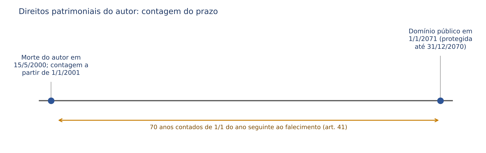
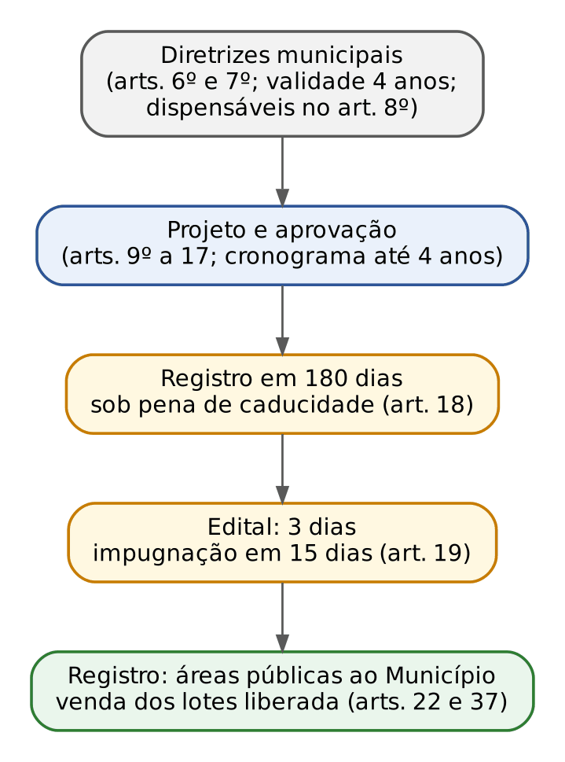
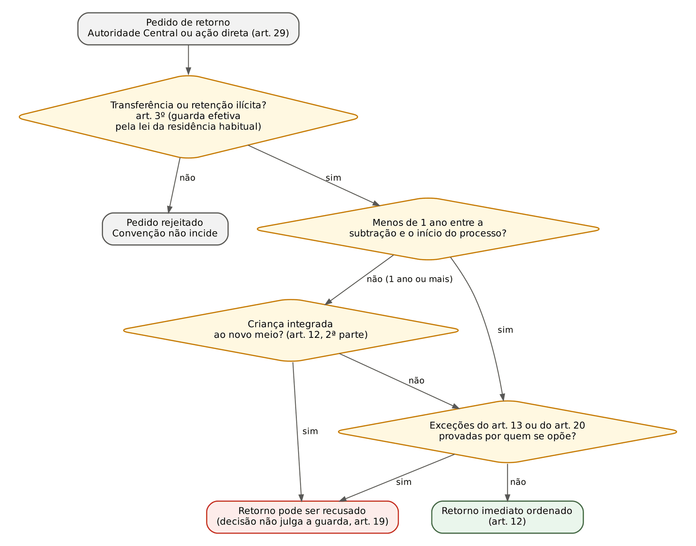

# CAPÍTULO 48 — DIREITO AUTORAL, PARCELAMENTO DO SOLO URBANO, RESOLUÇÃO CNJ 452/2022, LEI ESTADUAL SC 17.492/2018 E CONVENÇÕES INTERNACIONAIS DE FAMÍLIA

:::INCIDENCIA
TJRS p. 22; TJSC p. 23. Nível B. Nenhuma questão FGV ou FCC do lote atribuída ao capítulo; correlatas de outros capítulos citadas pelo número; três itens de fixação próprios.
O que mais cai: letra da Lei 9.610 (art. 8º, prazos dos arts. 41 a 44, limitações do art. 46, art. 49) e jurisprudência do ECAD; Lei 6.766 (loteamento x desmembramento, arts. 18, 26, 37 a 40); Convenção da Haia de 1980 (arts. 3º, 4º, 12, 13) e a tese das ADIs 4.245 e 7.686.
:::

## 48.1 Direito autoral (Lei 9.610/1998)

### 48.1.1 Natureza, princípios e objeto protegido

O direito autoral é ramo da propriedade intelectual: a criação exteriorizada com finalidade estética é da Lei 9.610/1998 (LDA); marcas, patentes e desenho industrial, da Lei 9.279/1996 (JT 265, tese 1). Há núcleo personalíssimo (JT 265, tese 3; CF, art. 5º, XXVII e XXVIII) e núcleo patrimonial, qualificado como bem MÓVEL (art. 3º; Cap. 7): os direitos morais são inalienáveis e irrenunciáveis (art. 27); os patrimoniais circulam por cessão e licença, interpretadas restritivamente (art. 4º).

Princípios (JT 265, tese 4): tratamento nacional, proteção automática (independe de registro, art. 18; o registro do art. 19 é FACULTATIVO e só probatório) e proteção independente.

Objeto (art. 7º): "criações do espírito, expressas por qualquer meio ou fixadas em qualquer suporte, tangível ou intangível", em rol exemplificativo (obras literárias, conferências e sermões, composições musicais, audiovisuais, fotografias, artes plásticas, projetos de arquitetura, adaptações e traduções, programas de computador, bases de dados originais pela seleção ou organização). Exige-se originalidade, não novidade absoluta nem mérito artístico.

:::LEI Lei 9.610/1998, art. 8º
Art. 8º Não são objeto de proteção como direitos autorais de que trata esta Lei:
I - as idéias, procedimentos normativos, sistemas, métodos, projetos ou conceitos matemáticos como tais;
II - os esquemas, planos ou regras para realizar atos mentais, jogos ou negócios;
III - os formulários em branco para serem preenchidos por qualquer tipo de informação, científica ou não, e suas instruções;
IV - os textos de tratados ou convenções, leis, decretos, regulamentos, decisões judiciais e demais atos oficiais;
V - as informações de uso comum tais como calendários, agendas, cadastros ou legendas;
VI - os nomes e títulos isolados;
VII - o aproveitamento industrial ou comercial das idéias contidas nas obras.
:::

:::PEGADINHA Ideia x expressão
Protege-se a EXPRESSÃO, não a ideia, o método ou o sistema (art. 8º, I e II); nas ciências, a forma literária, NÃO o conteúdo técnico (art. 7º, § 3º); nas bases de dados, a seleção e a organização, NÃO os dados (art. 7º, § 2º). Lei e decisão judicial não são protegidas (art. 8º, IV), mas a compilação comentada de leis é obra protegida.
:::

Jurisprudência (JT 266): fotografia divulgada sem consentimento, remuneração e crédito lesa direitos patrimoniais e morais (tese 6; arts. 79, § 1º, e 108); grafite é obra protegida e sua exposição sem consentimento e crédito é contrafação indenizável (tese 7); a proteção do arquiteto abrange projeto, esboço e obra edificada (tese 9), mas adquirir a obra arquitetônica não transfere os direitos autorais, salvo disposição expressa e usos intrínsecos à finalidade da aquisição (tese 10; art. 37).

### 48.1.2 Autoria e titularidade

Autor é a pessoa FÍSICA criadora (art. 11), com proteção extensível à pessoa jurídica nos casos legais (parágrafo único): AUTORIA (e direitos morais) é sempre de pessoa física; TITULARIDADE patrimonial pode ser originária de PJ (organizador da obra coletiva) ou derivada (cessão). Presume-se autor quem tiver essa qualidade indicada na utilização (arts. 12 e 13, presunção relativa).

| Figura | Regra | Fundamento |
|---|---|---|
| Coautoria | atribuída àqueles em cujo nome a obra é utilizada; NÃO é coautor quem apenas auxiliou, revendo, atualizando, fiscalizando ou dirigindo a edição; contribuição separável pode ser explorada como obra individual, sem prejuízo da obra comum | art. 15 |
| Obra audiovisual | coautores: o autor do argumento (literário, musical ou literomusical) e o DIRETOR; nos desenhos animados, quem cria os desenhos | art. 16 |
| Obra coletiva | organizada por pessoa física ou jurídica que a publica sob seu nome; ao ORGANIZADOR cabe a titularidade patrimonial do conjunto; participantes conservam proteção individual e podem vetar a indicação do nome, sem perder a remuneração | arts. 5º, VIII, h, e 17 |
| Obra derivada sobre obra em domínio público | quem adapta, traduz, arranja ou orquestra é titular, mas NÃO pode impedir outra adaptação, salvo cópia da sua | art. 14 |
| Escritos na imprensa | utilização econômica dos não assinados pertence ao editor; a autorização para artigos assinados vale pelo prazo da periodicidade mais 20 dias | art. 36 |
| Programa de computador criado por empregado | pertence EXCLUSIVAMENTE ao empregador, contratante de serviços ou órgão público, salvo estipulação em contrário, se desenvolvido na vigência do vínculo destinado à pesquisa e desenvolvimento, ou se a atividade estava prevista ou decorre da natureza dos encargos; sem relação com o vínculo e sem recursos do empregador, é do empregado (§ 2º) | Lei 9.609/1998, art. 4º |

Obra sob encomenda ou criada por empregado: a LDA, diferentemente da Lei 5.988/1973, NÃO atribui em regra os direitos patrimoniais ao encomendante ou empregador; decide o contrato, interpretado restritivamente (arts. 4º e 49, VI). Exceções: software (Lei 9.609, art. 4º), obra coletiva (art. 17, § 2º) e retrato encomendado (art. 46, I, c).

:::DICA Programa de computador
Lei 9.609/1998, com aplicação subsidiária da LDA (art. 7º, § 1º): proteção por 50 anos contados de 1º de janeiro do ano subsequente ao da publicação ou, na ausência desta, da criação (art. 2º, § 2º); proteção que INDEPENDE de registro (§ 3º); direitos morais reduzidos: só a paternidade, a qualquer tempo, e a oposição a alterações não autorizadas que impliquem deformação, mutilação ou outra modificação que prejudique a honra ou a reputação do autor (§ 1º).
:::

### 48.1.3 Direitos morais e direitos patrimoniais

Pertencem ao autor os direitos morais e patrimoniais sobre a obra que criou (art. 22).

:::LEI Lei 9.610/1998, arts. 24 e 27 (síntese literal dos incisos)
Art. 24. São direitos morais do autor: I - o de reivindicar, a qualquer tempo, a autoria da obra; II - o de ter seu nome, pseudônimo ou sinal convencional indicado ou anunciado [...]; III - o de conservar a obra inédita; IV - o de assegurar a integridade da obra [...]; V - o de modificar a obra, antes ou depois de utilizada; VI - o de retirar de circulação a obra ou de suspender qualquer forma de utilização já autorizada, quando a circulação ou utilização implicarem afronta à sua reputação e imagem; VII - o de ter acesso a exemplar único e raro da obra [...].
§ 1º Por morte do autor, transmitem-se a seus sucessores os direitos a que se referem os incisos I a IV.
§ 2º Compete ao Estado a defesa da integridade e autoria da obra caída em domínio público.
Art. 27. Os direitos morais do autor são inalienáveis e irrenunciáveis.
:::

:::PEGADINHA Quais direitos morais passam aos sucessores
SOMENTE os incisos I a IV (paternidade, nome, ineditismo e integridade) passam aos sucessores (art. 24, § 1º), e para DEFESA, não para disposição; modificar, retirar de circulação e acessar exemplar raro extinguem-se com o autor. O direito moral não prescreve; prescreve a pretensão indenizatória (48.1.7).
:::

Direitos patrimoniais: direito exclusivo de utilizar, fruir e dispor (art. 28); DEPENDE de autorização prévia e expressa qualquer modalidade de utilização (art. 29: reprodução, edição, adaptação, tradução, distribuição, inclusive sob demanda, execução musical, radiodifusão, sonorização ambiental, inclusão em base de dados e "quaisquer outras modalidades [...] que venham a ser inventadas"). As modalidades são independentes: autorizar uma não autoriza as demais (art. 31, paráfrase).

Adquirir o original ou exemplar NÃO confere direito patrimonial (art. 37). Contrapartida: direito de sequência, irrenunciável e inalienável, de no mínimo 5% sobre o AUMENTO do preço em cada revenda de original de obra de arte ou manuscrito; não pago, o vendedor (ou o leiloeiro) é depositário (art. 38).

Prazos de proteção dos direitos patrimoniais:

| Hipótese | Prazo | Termo inicial | Fundamento |
|---|---|---|---|
| Regra (obra de autor identificado), inclusive póstuma | 70 anos | 1º de janeiro do ano seguinte ao FALECIMENTO, observada a ordem sucessória da lei civil | art. 41 |
| Coautoria indivisível | 70 anos | morte do ÚLTIMO coautor sobrevivente; a parte do coautor que morrer sem sucessores acresce aos sobreviventes | art. 42 |
| Obra anônima ou pseudônima | 70 anos | 1º de janeiro do ano seguinte ao da PRIMEIRA PUBLICAÇÃO; se o autor se der a conhecer antes, volta-se à regra do art. 41 | art. 43 |
| Obra audiovisual e fotográfica | 70 anos | 1º de janeiro do ano seguinte ao da DIVULGAÇÃO | art. 44 |
| Direitos conexos | 70 anos | 1º de janeiro do ano seguinte à fixação (fonograma), à transmissão (radiodifusão) ou à execução e representação (demais casos) | art. 96 |
| Programa de computador | 50 anos | 1º de janeiro do ano seguinte à publicação ou criação | Lei 9.609, art. 2º, § 2º |

Domínio público (art. 45): além das obras com prazo esgotado, as de autores falecidos SEM sucessores e as de autor desconhecido (ressalvada a proteção aos conhecimentos étnicos e tradicionais). Na obra caída em domínio público, a defesa da integridade e da autoria compete ao Estado (art. 24, § 2º).

:::PEGADINHA Herança sem herdeiros
Na sucessão comum, a herança sem herdeiros vai ao Município, ao DF ou à União como herança vacante (CC, art. 1.822; ver Cap. 42). Na LDA, a obra de autor falecido sem sucessores NÃO vai ao Poder Público: cai em DOMÍNIO PÚBLICO (art. 45, I), de uso livre por todos.
:::

### 48.1.4 Direitos conexos

Direitos conexos (arts. 89 a 96): intérpretes, produtores fonográficos e radiodifusores. O intérprete autoriza ou proíbe fixação, reprodução, execução pública e radiodifusão, e a proteção alcança voz e imagem associadas à atuação (art. 90, § 2º). Os direitos do intérprete e do produtor conservam AUTONOMIA entre si (JT 265, tese 5). Voz sem caráter artístico: Cap. 4.

### 48.1.5 Limitações (arts. 46 a 48) e a regra dos três passos

:::LEI Lei 9.610/1998, art. 46 (incisos mais cobrados), 47 e 48
Art. 46. Não constitui ofensa aos direitos autorais:
II - a reprodução, em um só exemplar de pequenos trechos, para uso privado do copista, desde que feita por este, sem intuito de lucro;
III - a citação em livros, jornais, revistas ou qualquer outro meio de comunicação, de passagens de qualquer obra, para fins de estudo, crítica ou polêmica, na medida justificada para o fim a atingir, indicando-se o nome do autor e a origem da obra;
VI - a representação teatral e a execução musical, quando realizadas no recesso familiar ou, para fins exclusivamente didáticos, nos estabelecimentos de ensino, não havendo em qualquer caso intuito de lucro;
VIII - a reprodução, em quaisquer obras, de pequenos trechos de obras preexistentes, de qualquer natureza, ou de obra integral, quando de artes plásticas, sempre que a reprodução em si não seja o objetivo principal da obra nova e que não prejudique a exploração normal da obra reproduzida nem cause um prejuízo injustificado aos legítimos interesses dos autores.
Art. 47. São livres as paráfrases e paródias que não forem verdadeiras reproduções da obra originária nem lhe implicarem descrédito.
Art. 48. As obras situadas permanentemente em logradouros públicos podem ser representadas livremente, por meio de pinturas, desenhos, fotografias e procedimentos audiovisuais.
:::

Demais incisos (paráfrase): notícia ou artigo informativo na imprensa, com autor e fonte (I, a); discursos públicos (I, b); retrato encomendado, pelo dono do objeto, sem oposição do retratado (I, c); Braille para pessoas com deficiência visual, sem fins comerciais (I, d); apanhado de lições pelos alunos, VEDADA a publicação sem autorização (IV); demonstração à clientela em loja que vende os equipamentos (V); prova judiciária ou administrativa (VII).

O STJ admite usos não listados quando presentes TODOS os requisitos da regra dos três passos (Berna, art. 9.2; TRIPS, art. 13): casos especiais, sem conflito com a exploração normal e sem prejuízo injustificado ao autor (JT 265, tese 6); o Enunciado 115 da III Jornada de Direito Comercial propõe interpretação EXTENSIVA dos arts. 46 a 48. Afirmar que o rol é absolutamente taxativo, segundo o STJ, tende a ser errado.

:::PEGADINHA Recesso familiar, ensino e "sem lucro"
Livre só no recesso familiar ou, para fins EXCLUSIVAMENTE didáticos, na escola, sem lucro (art. 46, VI). Formatura, casamento em salão ou evento corporativo NÃO são recesso familiar: devidos os direitos em eventos privados em espaços locados, ainda que sem fins lucrativos (JT 265, tese 8); a ausência de lucro não afasta a cobrança (tese 7).
:::

Paródia, paráfrase e plágio (JT 267, teses 1 a 5): a intertextualidade é lícita (paródia, paráfrase) ou ilícita (plágio). A paródia é criação autônoma, dispensa autorização e indicação do autor originário, e sua finalidade (comercial, eleitoral, educativa) é indiferente (tese 4); requisitos fixados no EREsp 1.810.440 (Segunda Seção): criatividade, ausência de efeito desabonador, respeito a honra e privacidade de terceiros, ineditismo, três passos e ausência de intuito comercial (tese 3), tensão que se concilia entendendo que o lucro não torna ilícita a paródia se não há exploração da obra originária (ver nota). O *jingle* eleitoral exige autorização; a paródia dele, não (tese 5). Logradouros públicos (art. 48): livre a exibição INDIRETA e ACESSÓRIA, sem exploração comercial da obra (JT 266, tese 8).

### 48.1.6 Transferência dos direitos patrimoniais: cessão, licença e edição

Os negócios jurídicos sobre direitos autorais interpretam-se RESTRITIVAMENTE (art. 4º).

| Ponto | Cessão | Licença | Edição |
|---|---|---|---|
| Natureza | transferência (total ou parcial) da titularidade patrimonial | autorização de uso, sem transferência da titularidade | contrato típico: o editor se obriga a reproduzir e divulgar a obra, com exclusividade, por prazo ou número de edições |
| Forma | sempre escrita (art. 50); total e definitiva só por escrito (art. 49, II) | livre, mas sem contrato escrito o prazo máximo é de 5 anos (art. 49, III) | arts. 53 a 67 |
| Onerosidade | presumida (art. 50) | depende do ajuste | remuneração do autor |
| Alcance | só modalidades existentes na data do contrato; só o país do contrato, salvo estipulação | idem, por interpretação restritiva | obrigação de publicar |

Cessão (transferência total e definitiva) x edição (obrigação de publicar por prazo ou número de edições) (JT 268, tese 8). Obras futuras: cessão de no máximo 5 anos, reduzindo-se o prazo indeterminado ou superior e o preço proporcionalmente (art. 51). A omissão do nome do autor não presume anonimato nem cessão (art. 52). A obrigação de criar obra é de fazer personalíssima, resolvida em perdas e danos (CC, art. 247; Q4223056, Cap. 12).

### 48.1.7 Execução pública e ECAD

Sem prévia e expressa autorização, não se usam obras teatrais, musicais e fonogramas em execuções PÚBLICAS (art. 68), isto é, com artistas "remunerados ou não" ou fonogramas e audiovisuais em locais de frequência coletiva, por qualquer processo (§ 2º), entre eles bares, lojas, restaurantes, HOTÉIS, MOTÉIS, clínicas, órgãos públicos e transportes, "ou onde quer que se representem, executem ou transmitam" obras (§ 3º).

:::ATENCAO Redação vigente do art. 68, § 3º
A MP 907/2019 retirou "hotéis" da lista e restringiu a cobrança nos meios de hospedagem aos "espaços públicos e comuns". A MP perdeu a vigência sem conversão, e o Planalto mantém a redação ORIGINAL (com hotéis e motéis). Questão que cite a redação da MP como vigente está errada.
:::

A arrecadação é unificada no ECAD, ente com personalidade própria e sem fins lucrativos, dirigido pelas associações (art. 99, Lei 12.853/2013); associações e ECAD atuam em nome próprio como SUBSTITUTOS PROCESSUAIS (art. 99, § 2º). Preços fixados pelas associações, com razoabilidade e proporcionalidade ao grau de utilização (art. 98, §§ 3º e 4º). O titular pode cobrar pessoalmente ou autorizar uso gratuito, se comunicar PREVIAMENTE a associação (art. 98, § 15; JT 268, tese 5).

Teses do STJ sobre execução pública (Radar, Jurisprudência em Teses 265 a 268):

| Situação | Orientação | Fonte |
|---|---|---|
| Retransmissão radiofônica em estabelecimento comercial | devidos direitos autorais | Súmula 63 do STJ |
| Retransmissão radiofônica em hotel | cobrança conforme a taxa média de utilização do equipamento, apurada em liquidação | Súmula 261 do STJ |
| Equipamentos em quartos de hotel, motel e afins; TV por assinatura contratada pelo hotel | cobrança devida; a contratação da TV por assinatura NÃO impede a cobrança e não há *bis in idem* | Tema 1.066 do STJ |
| Academia de ginástica; supermercado | devidos | JT 266, teses 2 e 3 |
| *Streaming* (*webcasting* e *simulcasting*) | exige autorização prévia e expressa; a exploração é fato gerador de cobrança pelo ECAD | JT 266, tese 4 (REsp 1.559.264, Segunda Seção) |
| Trilha sonora em filmes exibidos publicamente | devidos | JT 265, tese 9 |
| Evento público sem lucro; carnaval promovido pelo Poder Público | devidos; a cobrança não depende de lucro direto ou indireto | JT 265, tese 7; JT 268, tese 3 |
| Show ao vivo em que o intérprete é o próprio autor e recebeu cachê | devidos | JT 268, tese 2 |
| Prova de filiação ao ECAD e indicação das obras executadas | NÃO são requisitos da cobrança | JT 268, tese 6 |
| Critérios de arrecadação e distribuição | não cabe ao Judiciário interferir nas decisões do ECAD sobre o critério mais adequado | JT 268, tese 7 |
| Pagamento | em regra PRÉVIO, como condição da execução pública, ressalvado convênio que o permita depois | JT 268, tese 1 (art. 68, §§ 4º e 5º) |

:::PEGADINHA Súmula 386 do STF e o "amador"
A Súmula 386 do STF (1964) dispensava direitos autorais quando a orquestra fosse de amadores. A LDA define execução pública com participação de artistas "remunerados ou não" (art. 68, § 2º) e o STJ afirma que a cobrança não depende de lucro (JT 265, tese 7). A súmula deve ser lida como superada pela legislação posterior; na prova, a alternativa que invoca o amadorismo para afastar a cobrança é, em regra, a errada.
:::

### 48.1.8 Violação: sanções civis, tutela inibitória e prescrição

Contrafação é a reprodução não autorizada (art. 5º, VII). As sanções civis aplicam-se sem prejuízo das penais (art. 101; o crime do art. 184 do CP e a Súmula 502 do STJ ficam para a Apostila de Direito Penal).

| Dispositivo | Sanção | Ponto de prova |
|---|---|---|
| Art. 102 | apreensão dos exemplares ou suspensão da divulgação | sem prejuízo da indenização |
| Art. 103 | edição não autorizada: perda dos exemplares e preço dos vendidos; número desconhecido: valor de 3.000 exemplares | SANÇÃO CIVIL, não parâmetro do dano material (JT 267, tese 7) |
| Art. 104 | quem vende, expõe, tem em depósito ou utiliza obra contrafeita, com intuito de lucro | SOLIDÁRIO com o contrafator |
| Art. 105 | suspensão imediata da transmissão ou comunicação violadora, com multa diária | até o DOBRO para o reincidente; cabe por falta de pagamento prévio (JT 268, tese 4) |
| Arts. 106 e 107 | destruição de exemplares e matrizes; supressão de dispositivo anticópia | perdas e danos nunca inferiores ao art. 103 |
| Art. 108 | omissão do nome do autor ou intérprete | danos morais + divulgação da identidade |
| Art. 109 | execução pública irregular: multa de 20 vezes o valor devido | exige MÁ-FÉ (JT 267, tese 8) |
| Art. 110 | donos, gerentes e arrendatários do local | solidários com os organizadores |

Tutela inibitória é a regra diante de ameaça e cumula-se com condenação (JT 269, teses 1 e 2; CPC, art. 497); interdito proibitório é INADMISSÍVEL (Súmula 228 do STJ; v. Cap. 27). Os danos são PRESUMIDOS (JT 267, tese 6), mas o *quantum* se apura, sem confusão com o art. 103 ou o art. 109.

:::PROCESSO Prescrição
- A LDA não tem regra própria (art. 111 vetado). Violação extracontratual: 3 anos (CC, art. 206, § 3º, V; JT 269, tese 4). Violação assemelhada a descumprimento contratual (uso além da licença, falta de repasse): 10 anos (CC, art. 205; JT 269, tese 5). Teoria geral: Cap. 11.
:::

:::QUESTAO Questão de fixação elaborada para esta apostila (não é questão de banca)
Afirmações: (I) o autor que morreu em 3/3/2010 teve suas obras protegidas até 3/3/2080; (II) a cessão total e definitiva dos direitos patrimoniais exige contrato escrito; (III) os sucessores do autor podem retirar a obra de circulação por afronta à reputação do falecido; (IV) a obra de autor falecido sem sucessores pertence ao Município do último domicílio.
Gabarito: só II está correta.
Por quê: I erra o termo inicial (1º de janeiro do ano seguinte ao falecimento: proteção até 31/12/2080, art. 41); II reproduz o art. 49, II, e o art. 50; III erra porque o direito de retirar de circulação (art. 24, VI) NÃO se transmite aos sucessores (§ 1º alcança só I a IV); IV confunde com a herança vacante: a obra cai em domínio público (art. 45, I).
:::

Correlata (Cap. 4): Q3117503 (FGV 2024, TJ-PE) — documentário biográfico; os biografados alegaram violação a "direitos autorais e de imagem"; ambos os pedidos foram julgados improcedentes no gabarito, porque o biografado não é autor da obra audiovisual (art. 16) e a biografia não depende de autorização (ver Cap. 4).

## 48.2 Parcelamento do solo urbano (Lei 6.766/1979)

### 48.2.1 Modalidades, conceitos e competências

Norma geral urbanística e civil, com normas complementares estaduais e municipais (art. 1º, parágrafo único); aprovação municipal (art. 12), com disciplina estadual em áreas de interesse especial, limítrofes ou metropolitanas e loteamentos acima de 1.000.000 m² (art. 13). Só em zona urbana, de expansão urbana ou de urbanização específica (art. 3º); uso rural para fins urbanos exige audiência do INCRA (art. 53).

| Ponto | Loteamento | Desmembramento |
|---|---|---|
| Conceito | subdivisão de gleba em lotes para edificação COM abertura de novas vias ou logradouros, ou prolongamento, modificação ou ampliação das existentes | subdivisão com APROVEITAMENTO do sistema viário existente, SEM novas vias nem prolongamento, modificação ou ampliação |
| Fundamento | art. 2º, § 1º | art. 2º, § 2º |
| Requisitos urbanísticos | art. 4º (áreas públicas proporcionais à densidade, lote mínimo, faixas não edificáveis, articulação viária) | os vigentes para a região ou, na falta, os do loteamento, no que couber (art. 11) |
| Diretrizes prévias | sim (arts. 6º e 7º), salvo dispensa por lei em Município com menos de 50.000 habitantes ou com plano diretor que contenha as diretrizes (art. 8º) | não há fase de diretrizes; requerimento instruído conforme o art. 10 |
| Transferência de áreas ao Município | vias, praças, espaços livres e áreas institucionais passam ao domínio municipal com o REGISTRO (art. 22) | em regra não há novas áreas públicas |

Conceitos que a banca troca:
- Lote: terreno servido de infraestrutura básica, com dimensões conforme os índices urbanísticos do plano diretor ou lei municipal (art. 2º, § 4º); pode ser imóvel autônomo ou unidade de condomínio de lotes (§ 7º; condomínio de lotes: Cap. 30).
- Lote mínimo: 125 m² e frente mínima de 5 metros, salvo urbanização específica ou conjuntos habitacionais de interesse social previamente aprovados (art. 4º, II).
- Faixas não edificáveis: rodovias, 15 metros de cada lado, reduzível por lei municipal ou distrital até 5 metros (art. 4º, III); ferrovias, 15 metros (III-A); cursos d'água em área urbana consolidada, conforme lei municipal ou distrital (III-B, Lei 14.285/2021).
- Áreas públicas: o antigo mínimo federal de 35% da gleba foi substituído (Lei 9.785/1999) pela proporcionalidade à densidade definida pela lei municipal (art. 4º, I e § 1º).
- Loteamento de acesso controlado: loteamento comum (vias e áreas PÚBLICAS) cujo controle de acesso é regulamentado por ato do poder público municipal, VEDADO impedir o acesso de pedestres ou condutores não residentes identificados ou cadastrados (art. 2º, § 8º, Lei 13.465/2017). Não confundir com condomínio de lotes, em que as áreas são privadas e comuns (Cap. 30).
- Empreendedor (art. 2º-A, Lei 14.118/2021): além do proprietário, compromissário ou foreiro com anuência do dono, ente público imitido na posse, parceiro contratado (obrigação solidária, contrato averbado) e cooperativa ou associação autorizada.

Vedações (art. 3º, parágrafo único): terreno alagadiço antes do escoamento; aterrado com material nocivo sem saneamento; declividade de 30% ou mais, salvo exigências atendidas; condições geológicas desaconselháveis; áreas de preservação ecológica ou poluídas, até a correção; e áreas de risco não edificáveis (art. 12, § 3º).

### 48.2.2 Aprovação e registro

| Etapa | Regra | Fundamento |
|---|---|---|
| Diretrizes | validade máxima de 4 anos | art. 7º, parágrafo único |
| Projeto | cronograma de obras de até 4 anos e instrumento de garantia | art. 9º |
| Prazo para aprovar | definido em lei municipal; omissa a lei, 90 dias para aprovar ou rejeitar o projeto e 60 dias para aceitar ou recusar as obras; o silêncio vale REJEIÇÃO (não aprovação tácita), assegurada indenização pela omissão | art. 16 |
| Destinação das áreas públicas | não pode ser alterada pelo loteador desde a aprovação, salvo caducidade ou desistência | art. 17 |
| Execução | o projeto deve ser executado no prazo do cronograma, sob pena de caducidade da aprovação | art. 12, § 1º |
| Registro | em até 180 dias da aprovação, sob pena de caducidade; histórico dominial de 20 anos, certidões, termo de verificação das obras ou cronograma de até 4 anos, prorrogáveis por mais 4, com garantia, e contrato-padrão | art. 18 (inciso V na redação da Lei 14.118/2021) |
| Edital | 3 dias consecutivos; impugnação em 15 dias corridos da última publicação; impugnado, requerente e Prefeitura em 5 dias, juiz decide ouvido o MP em 5 dias | art. 19 (Lei 14.382/2022) |
| Efeito do registro | vias, praças, espaços livres e áreas institucionais integram o domínio do Município; implantado e não registrado o parcelamento, o Município pode requerer o registro dessas áreas | art. 22 e § 1º |
| Cancelamento do registro | por decisão judicial; a requerimento do loteador com anuência da Prefeitura enquanto NENHUM lote tiver sido contratado; ou a requerimento conjunto do loteador e de TODOS os adquirentes, com anuência da Prefeitura e do Estado | art. 23 |
| Alteração do loteamento registrado | acordo entre loteador e adquirentes atingidos e aprovação municipal | art. 28 |

Patrimônio de afetação (art. 18-A, Lei 14.620/2023): FACULTATIVO, a critério do loteador; terreno e infraestrutura ficam apartados e só respondem pelas dívidas do loteamento e pela entrega dos lotes (paralelo da incorporação: Cap. 30). Lei 14.711/2023 (art. 18, § 8º): o mesmo imóvel pode garantir ao Município a execução das obras e créditos de financiamento à produção do lote urbanizado.

### 48.2.3 Contratos de compromisso de compra e venda de lotes

O núcleo dos compromissos (irretratabilidade, adjudicação compulsória e direito real do promitente comprador registrado, art. 25; resolução por inadimplemento com intimação pelo oficial e prazo de 30 dias, art. 32; restituição e deduções do art. 32-A da Lei 13.786/2018) está no Cap. 17, onde também se resolve a Q3914287 (FGV 2026, TJ-MS). Aqui, só o que é próprio da Lei 6.766:

- Forma: escritura pública OU instrumento particular conforme o contrato-padrão (art. 26); o compromisso quitado é título para registrar a propriedade (art. 26, § 6º; Enunciado 87 da I Jornada de Direito Civil).
- Cláusula penal: até 10% do débito, exigível só com intervenção judicial ou mora superior a 3 meses (art. 26, V).
- Quadro-resumo obrigatório (art. 26-A): faltando informação, 30 dias para aditamento, sob pena de justa causa para rescisão pelo adquirente.
- Pré-contrato: proposta ou reserva com lote, preço e modo de pagamento; não outorgado o contrato, notificação para outorga ou impugnação em 15 dias, sob pena de registro do pré-contrato (art. 27).
- Adquirente da área loteada (*inter vivos* ou *causa mortis*) respeita os compromissos, NULA disposição em contrário, ressalvada a renúncia à herança ou ao legado (art. 29); falência ou insolvência não rescinde os compromissos (art. 30).
- Cessão do contrato: INDEPENDE de anuência do loteador, mas só o vincula após ciência escrita ou registro (art. 31).
- Rescisão por inadimplemento do adquirente: benfeitorias necessárias e úteis indenizadas, nula cláusula em contrário (art. 34); com mais de 1/3 do preço pago, novo registro do lote só com prova do início da restituição ou depósito (art. 35).

:::PEGADINHA Cláusula penal: 10% de quê?
Na Lei 6.766 há DUAS referências a 10%: (a) a cláusula penal "nunca excedente a 10% do DÉBITO", exigível só com intervenção judicial ou mora superior a 3 meses (art. 26, V, redação original); (b) o desconto, na restituição, de cláusula penal e despesas administrativas limitado a 10% do VALOR ATUALIZADO DO CONTRATO (art. 32-A, II, Lei 13.786/2018), aplicável aos contratos posteriores à lei. A banca troca as bases de cálculo.
:::

### 48.2.4 Loteamento irregular e clandestino: consequências civis

Distinção usual (doutrina e jurisprudência): loteamento CLANDESTINO é o executado sem aprovação municipal; IRREGULAR é o aprovado mas não registrado ou executado em desacordo com o projeto e a licença. A lei trata ambos sob o mesmo regime de proteção do adquirente.

É vedado vender ou prometer vender lote não registrado (art. 37), e é NULA de pleno direito a cláusula de rescisão por inadimplemento do adquirente se o loteamento não está regularmente inscrito (art. 39). Constatada a irregularidade, o adquirente suspende os pagamentos, notifica o loteador (o que também podem fazer Prefeitura e MP) e DEPOSITA as prestações no Registro de Imóveis (art. 38, §§ 1º e 2º). Regularizado pelo loteador, este levanta os depósitos em juízo (§ 3º); se não atende à notificação ou se a Prefeitura regulariza (art. 40, poder de regularizar o parcelamento não autorizado ou executado em desacordo com a licença), perde as prestações (§ 5º), que ressarcem o Município, exigindo-se do loteador o restante (art. 40, §§ 1º e 2º). Regularizado, o adquirente que depositou tudo registra a propriedade com o próprio compromisso (art. 41).

Também: o loteador não funda ação ou defesa na lei sem os registros e contratos (art. 46); empresas do grupo econômico beneficiárias respondem SOLIDARIAMENTE (art. 47); no loteamento não aprovado, ressarcimento ao Município do DOBRO da diferença de áreas públicas (art. 43, parágrafo único); crimes (arts. 50 a 52): Apostila de Direito Penal.

:::JURIS STJ, REsp 2.166.273-SP, 3ª Turma, Info 829
A venda de lote em loteamento não registrado é NULA, ainda que o comprador conhecesse a irregularidade (art. 37 da Lei 6.766; CC, art. 166, II e VII), com retorno ao estado anterior (conferido no Dizer o Direito; tese desenvolvida no Cap. 8). Na Q3117508 (FGV 2024, TJ-PE, Cap. 2), o alienante de imóvel em loteamento irregular em área pública pôde arguir a nulidade: a nulidade absoluta excepciona o *nemo auditur*.
:::

Município: o STJ trata a regularização do art. 40 como PODER-DEVER diante de parcelamento irregular implantado, com responsabilidade em regra subsidiária à do loteador e direito de regresso (orientação descrita sem número; ver nota). A assertiva de que o art. 40 confere faculdade discricionária insindicável tende a ser errada.

Associações de moradores sem fins lucrativos equiparam-se à administração de imóveis e cotizam-se conforme seus atos constitutivos (art. 36-A); a obrigação do NÃO associado: Temas 882 do STJ e 492 do STF (Cap. 5). O controle de acesso pela associação não pode barrar terceiros identificados (REsp 2.191.745-SP; v. Cap. 30).

:::PROCESSO Foro, legitimação e MP
- Foro: o da comarca da situação do lote para todos os procedimentos judiciais da lei (art. 48).
- Legitimidade para impedir construção em desacordo com restrições legais ou contratuais: o loteador, AINDA QUE já tenha vendido todos os lotes, e os vizinhos (art. 45).
- MP: ouvido na impugnação ao registro (art. 19, § 2º), no cancelamento (art. 23, § 2º) e no levantamento das prestações (art. 38, § 3º). Núcleos informais consolidados: Reurb (Lei 13.465/2017; Cap. 33).
:::

:::QUESTAO Questão de fixação elaborada para esta apostila (não é questão de banca)
Caso: Paulo comprou, por contrato particular, lote de loteamento aprovado pela Prefeitura mas não registrado; após 20 prestações, descobriu a falta de registro e parou de pagar. O loteador ajuizou ação de rescisão com base em cláusula resolutiva expressa e pediu a retenção de 25% do pago.
Gabarito: improcedência da rescisão.
Passos: (1) regra: cláusula resolutiva nula se o loteamento não está registrado (art. 39); o adquirente deve suspender e depositar (art. 38); o loteador não funda ação na lei sem registro (art. 46); (2) aplicação: não há mora, e a retenção não tem base. Armadilha: tratar como inadimplemento comum (art. 32). Pelo REsp 2.166.273, o próprio negócio seria nulo, com restituição integral; por qualquer via, a pretensão do loteador não prospera.
:::

## 48.3 Lei Estadual SC 17.492/2018 (parcelamento do solo em Santa Catarina)

Objeto: "responsabilidade territorial urbana, o parcelamento do solo, e as novas modalidades urbanísticas, para fins urbanos e rurais" em SC (ementa); revogou a Lei estadual 6.063/1982 e é norma COMPLEMENTAR à Lei 6.766 (art. 1º, parágrafo único, de ambas). Alterada pelas Leis estaduais 17.987/2020, 18.639/2023 e 19.061/2024.

:::ATENCAO Situação atual da lei (essencial para o TJSC)
- Revogação parcial pela Lei estadual 18.653/2023 (entre outros, conceitos do art. 2º, I, II e VII, a a g e i, e XVII; arts. 7º, 14, 15, 34, 42 e 43; § 3º a § 6º do art. 16).
- ADI estadual no TJSC (autos 5005054-13.2023.8.24.0000, j. 19/11/2025): perda de objeto quanto aos dispositivos já revogados e declaração de INCONSTITUCIONALIDADE FORMAL dos remanescentes do art. 2º (III a VI, VII, h, j, k e l, VIII a XIII, XVIII a XXII, XXIV a XXIX), do art. 8º (I, II, IV e V) e do art. 16 (*caput* e §§ 1º, 2º, 7º, 8º e 9º), por invasão de competência da União (CF, arts. 21, XX, 22, I e XXV, e 24, I) e dos Municípios (art. 30, I e VIII), com reflexos na Constituição do Estado.
- Fonte: compilação da ALESC (ver nota). Na prova: o Estado pode suplementar normas gerais de urbanismo, mas NÃO pode legislar sobre direito civil e registros públicos (competência privativa da União) nem definir o uso e a ocupação do solo urbano, que é interesse local.
:::

Dispositivos remanescentes de interesse civil e registral, segundo a compilação:

| Tema | Regra | Artigo |
|---|---|---|
| Vedações | áreas alagadiças, contaminadas, de risco geológico, unidades de conservação incompatíveis, proibição ambiental, cultural ou aeroportuária, declividade de 30% ou mais | art. 4º |
| Parcelamento parcial | admitido em parcela inferior à matrícula, identificado o todo | art. 3º, § 2º |
| Ligações de energia, água e gás | só com título e alvará; em loteamentos e condomínios, alvará e registro no RI; provisória em emergência | art. 17 |
| Registro | procedimento do art. 19 da Lei 6.766 (Lei 19.061/2024); exige Licença Ambiental de Instalação | arts. 19-A e 33 |
| Condomínio urbanístico de lotes | convenção pode ser MAIS restritiva que a lei municipal | arts. 35 a 37 |
| Licença final | omissa a lei municipal, 90 dias; o decurso NÃO gera licenciamento tácito; tolerância de 5% nas medidas lineares | arts. 44 e 45 |

:::PEGADINHA Silêncio da Administração
Na Lei 6.766, o decurso do prazo sem manifestação equivale à REJEIÇÃO do projeto ou à recusa das obras (art. 16, § 1º). Na lei catarinense, o decurso do prazo para a licença final NÃO implica licenciamento tácito (art. 44, § 5º). Em nenhuma das duas há aprovação tácita.
:::

## 48.4 Resolução CNJ 452/2022 (inventariante no inventário extrajudicial)

A Resolução 452, de 22/4/2022, alterou a Resolução CNJ 35/2007 (atos notariais de inventário, partilha, separação e divórcio) e acrescentou três parágrafos ao art. 11, cujo *caput* (redação da Resolução 326/2020) já tornava obrigatória, na escritura de inventário e partilha, a nomeação de interessado com poderes de inventariante, sem necessidade de seguir a ordem do art. 617 do CPC.

:::LEI Resolução CNJ 35/2007, art. 11, §§ 1º a 3º (incluídos pela Resolução CNJ 452/2022)
§ 1º O meeiro e os herdeiros poderão, em escritura pública anterior à partilha ou à adjudicação, nomear inventariante.
§ 2º O inventariante nomeado nos termos do §1º poderá representar o espólio na busca de informações bancárias e fiscais necessárias à conclusão de negócios essenciais para a realização do inventário e no levantamento de quantias para pagamento do imposto devido e dos emolumentos do inventário.
§ 3º A nomeação de inventariante será considerada o termo inicial do procedimento de inventário extrajudicial.
:::

Pontos de prova: (a) escritura de nomeação ANTERIOR à partilha; (b) poderes LIMITADOS (informações bancárias e fiscais e levantamento de valores para imposto e emolumentos); (c) a nomeação é o termo inicial do inventário extrajudicial (relevante para o prazo do art. 611 do CPC e multas de ITCMD: Apostila de Direito Tributário). A Resolução CNJ 571/2024 incluiu o art. 11-A (alienação de bens do espólio por escritura, sem alvará, vinculado o preço às despesas). Regime do inventário extrajudicial: Cap. 45; Código Nacional de Normas: Cap. 33.

## 48.5 Convenções internacionais de família

### 48.5.1 Convenção da Haia de 1980 sobre os aspectos civis do sequestro internacional de crianças (Decreto 3.413/2000)

Em vigor para o Brasil desde 1/1/2000 (Decreto 3.413/2000), com reserva ao art. 24 (tradução juramentada). É tratado de COOPERAÇÃO e tutela de urgência, NÃO de definição da guarda: o juiz natural da guarda é o da residência habitual, e a remoção ilícita não pode gerar vantagem processual. Objetivos: retorno imediato da criança ilicitamente transferida ou retida e respeito aos direitos de guarda e de visita (art. 1º).

:::LEI Decreto 3.413/2000 (Convenção da Haia), arts. 3º e 12
Artigo 3 — A transferência ou a retenção de uma criança é considerada ilícita quando: a) tenha havido violação a direito de guarda atribuído a pessoa ou a instituição ou a qualquer outro organismo, individual ou conjuntamente, pela lei do Estado onde a criança tivesse sua residência habitual imediatamente antes de sua transferência ou da sua retenção; e b) esse direito estivesse sendo exercido de maneira efetiva, individual ou em conjuntamente, no momento da transferência ou da retenção, ou devesse está-lo sendo se tais acontecimentos não tivessem ocorrido. O direito de guarda referido na alínea a) pode resultar de uma atribuição de pleno direito, de uma decisão judicial ou administrativa ou de um acordo vigente segundo o direito desse Estado.
Artigo 12 — Quando uma criança tiver sido ilicitamente transferida ou retida nos termos do Artigo 3 e tenha decorrido um período de menos de 1 ano entre a data da transferência ou da retenção indevidas e a data do início do processo perante a autoridade judicial ou administrativa do Estado Contratante onde a criança se encontrar, a autoridade respectiva deverá ordenar o retorno imediato da criança. A autoridade judicial ou administrativa respectiva, mesmo após expirado o período de 1 ano referido no parágrafo anterior, deverá ordenar o retorno da criança, salvo quando for provado que a criança já se encontra integrada no seu novo meio. [...]
:::

Conceitos: "direito de guarda" inclui o de DECIDIR SOBRE O LUGAR DE RESIDÊNCIA da criança (art. 5º): o genitor cujo consentimento a lei local exige para a mudança de país é titular de guarda para a Convenção. Residência habitual é conceito fático (centro da vida da criança), não se adquire pelo próprio ato ilícito. Só alcança subtrações posteriores à vigência entre os Estados (art. 35) e cessa aos 16 anos (art. 4º).

| Exceção ao retorno | Requisito | Ônus | Fundamento |
|---|---|---|---|
| Integração ao novo meio | processo iniciado com 1 ano ou mais da subtração E prova da integração | de quem se opõe | art. 12, 2ª parte |
| Guarda não exercida efetivamente | o requerente não exercia a guarda na época | de quem se opõe | art. 13, a |
| Consentimento ou aquiescência | anterior (consentiu) ou posterior (concordou) | de quem se opõe | art. 13, a |
| Grave risco ou situação intolerável | perigo físico ou psíquico; após as ADIs 4.245 e 7.686, inclui indícios objetivos e concretos de violência doméstica, ainda que a criança não seja vítima direta | de quem se opõe | art. 13, b |
| Oposição da criança | idade e maturidade que tornem apropriado considerar sua opinião (sem idade fixa) | apreciação judicial | art. 13, 2º parágrafo |
| Direitos humanos | retorno incompatível com princípios fundamentais do Estado requerido | excepcionalíssima | art. 20 |

:::JURIS STF, ADIs 4.245 e 7.686, j. 27/8/2025 (unânime)
Tese (conferida em notícia do STF e em transcrição doutrinária): (1) a Convenção da Haia de 1980 é compatível com a Constituição e tem status SUPRALEGAL, por ser tratado de proteção de direitos da criança; (2) sua aplicação, à luz do melhor interesse (CF, art. 227), exige medidas estruturais e procedimentais para tramitação célere e eficaz das ações de restituição; (3) a exceção de risco grave do art. 13 (1) (b) deve ser interpretada conforme o melhor interesse e com PERSPECTIVA DE GÊNERO, admitindo-se sua aplicação quando houver indícios objetivos e concretos de violência doméstica, ainda que a criança não seja vítima direta. Medidas: varas federais e turmas especializadas, prioridade, resolução do CNJ para decisão final em até 1 ano, núcleos de apoio nos TRFs e protocolo consular.
:::

Regras procedimentais: Autoridades Centrais localizam a criança e buscam a entrega voluntária (arts. 6º a 10; no Brasil, a ACAF, Decreto 3.951/2001); o interessado pode ir direto ao Judiciário (art. 29); decisão em 6 semanas, sob pena de pedido de explicações (art. 11); informada a subtração, o Estado requerido NÃO decide o mérito da guarda enquanto pendente o retorno (art. 16), e decisão de guarda local não basta para recusá-lo (art. 17); o retorno NÃO julga a guarda (art. 19); dispensadas homologação, legalização e caução (arts. 14, 22 e 23); o subtrator pode arcar com as despesas do requerente (art. 26).

:::PROCESSO Competência e procedimento no Brasil
- JUSTIÇA FEDERAL (CF, art. 109, I e III): causa fundada em tratado, com a União (AGU) como autora ou interessada; a ação de guarda estadual deve aguardar (art. 16 da Convenção).
- Resolução CNJ 449/2022 (conferida em fonte secundária): prioridade, tutela provisória de retorno no início (restrição de viagem, apreensão de passaporte), mediação, instrução célere, sem perícia de adaptação se a ação veio antes de 1 ano, juízes de enlace.
- Objeto: só o retorno (ou a organização da visita, art. 21). O ano do art. 12 conta da transferência ou retenção ATÉ o início do processo.
:::

:::QUESTAO Questão de fixação elaborada para esta apostila (não é questão de banca)
Caso: Ana, brasileira, residia com o filho de 10 anos e o pai em Lisboa, com guarda conjunta; em 2/1/2024 viajou com a criança ao Brasil para férias autorizadas até 31/1/2024 e não voltou. O pai ingressou com o pedido em 10/3/2025, por meio da Autoridade Central; a criança está matriculada e adaptada em Florianópolis. Ana ajuizou guarda unilateral na Justiça estadual.
Gabarito: o retorno pode ser recusado se provada a integração, e a Justiça estadual não deve decidir a guarda enquanto pendente o pedido.
Passos: (1) ilicitude: retenção a partir de 1/2/2024, violando guarda exercida conforme a lei portuguesa (art. 3º); (2) prazo: entre a retenção (1/2/2024) e o início do processo (10/3/2025) passou MAIS de 1 ano, logo o retorno deixa de ser automático e cede se Ana provar a integração (art. 12, 2ª parte); (3) competência: Justiça Federal; a ação de guarda estadual deve aguardar (art. 16). Armadilhas: contar o ano da viagem lícita (2/1/2024) e não da retenção; achar que a nacionalidade brasileira da criança afasta a Convenção (irrelevante: o critério é a residência habitual).
:::

### 48.5.2 Cobrança internacional de alimentos (Decreto 9.176/2017)

Remissão ao Cap. 39. A Convenção da Haia de 2007 (Decreto 9.176/2017) trata da cobrança internacional de alimentos; a de 1980, do retorno da criança. Tratados distintos: recusar o retorno não afeta a obrigação alimentar.

## 48.6 Resumo para revisão pré-prova

| Instituto | Regra | Exceções/detalhes | Fundamento |
|---|---|---|---|
| Objeto do direito autoral | criação do espírito exteriorizada, rol exemplificativo; proteção independe de registro | não protege ideias, métodos, atos oficiais, nomes isolados, dados em si, conteúdo científico | Lei 9.610, arts. 7º, 8º e 18 |
| Autor x titular | autor é pessoa física; titularidade patrimonial pode ser de PJ | obra coletiva: organizador; software de empregado: empregador | arts. 11, 17; Lei 9.609, art. 4º |
| Direitos morais | inalienáveis e irrenunciáveis | só os incisos I a IV do art. 24 passam aos sucessores; domínio público: defesa pelo Estado | arts. 24 e 27 |
| Prazos patrimoniais | 70 anos de 1/1 do ano seguinte à morte | coautoria indivisível: último coautor; anônima: publicação; audiovisual e foto: divulgação; conexos: fixação; software: 50 anos | arts. 41 a 44, 96 |
| Direito de sequência | mínimo 5% sobre o aumento do preço na revenda de original | vendedor ou leiloeiro é depositário | art. 38 |
| Limitações | arts. 46 a 48; regra dos três passos | eventos em espaço locado e sem lucro: devidos; paródia livre se não reproduz nem desacredita | JT 265, teses 6 a 8; JT 267 |
| Transferência | interpretação restritiva; cessão escrita e presumida onerosa | sem contrato escrito: até 5 anos; obras futuras: até 5 anos; só modalidades existentes e só o país do contrato | arts. 4º, 49 a 51 |
| Execução pública | autorização prévia; ECAD arrecada como substituto processual | hotel paga pelo quarto e pela TV por assinatura (Tema 1.066); *streaming* gera cobrança; lucro irrelevante | art. 68, 98, 99; Súmulas 63 e 261 do STJ |
| Sanções | apreensão, suspensão, 3.000 exemplares, solidariedade de quem vende ou expõe | multa de 20 vezes (art. 109) exige má-fé; dano presumido; interdito proibitório incabível | arts. 102 a 110; Súmula 228 do STJ |
| Prescrição autoral | 3 anos (extracontratual) | 10 anos (contratual) | CC, arts. 206, § 3º, V, e 205 |
| Loteamento x desmembramento | loteamento abre ou altera vias; desmembramento aproveita as existentes | áreas públicas passam ao Município com o registro | Lei 6.766, arts. 2º e 22 |
| Aprovação e registro | registro em 180 dias; edital 3 dias, impugnação 15 dias | silêncio = rejeição; cronograma 4 + 4 anos; afetação facultativa | arts. 16, 18, 18-A, 19 |
| Contratos de lotes | instrumento particular válido; quitação = título; cessão sem anuência do loteador | cláusula penal até 10% do débito, mora de 3 meses; benfeitorias necessárias e úteis indenizadas | arts. 26, 31, 34 |
| Loteamento irregular | venda vedada; adquirente suspende e deposita; cláusula de rescisão nula | Município regulariza e se ressarce; grupo econômico solidário; venda nula (STJ) | arts. 37 a 41, 47 |
| Lei SC 17.492/2018 | complementar à Lei 6.766 | parcialmente revogada (Lei 18.653/2023) e com dispositivos declarados formalmente inconstitucionais pelo TJSC (19/11/2025) | ALESC |
| Resolução CNJ 452/2022 | nomeação de inventariante por escritura anterior à partilha | poderes limitados; marco inicial do inventário extrajudicial | Res. CNJ 35/2007, art. 11, §§ 1º a 3º |
| Haia 1980 | retorno imediato se ilícita a remoção e menos de 1 ano até o processo | integração (1 ano ou mais), art. 13 (guarda não exercida, consentimento, grave risco, oposição da criança), art. 20; até 16 anos | Dec. 3.413/2000, arts. 3º, 4º, 12, 13, 20 |
| Haia no Brasil | Justiça Federal; decisão de retorno não julga guarda | grave risco inclui indícios concretos de violência doméstica | CF, art. 109; ADIs 4.245 e 7.686 |

## 48.7 Artigos de lei incidentes

- Lei 9.610/1998: arts. 3º, 4º, 5º, 7º, 8º, 11 a 19, 22, 24, 27 a 29, 31, 36 a 38, 41 a 52, 68, 79, 90, 96, 98, 99, 101 a 110.
- Lei 9.609/1998: arts. 2º e 4º (remissão).
- Código Civil: arts. 166, II e VII, 205, 206, § 3º, V, 247 e 1.245.
- Lei 6.766/1979: arts. 1º a 4º, 6º a 9º, 11 a 13, 16 a 19, 22, 23, 25 a 32-A, 34 a 43, 45 a 49 e 53.
- Lei Estadual SC 17.492/2018: arts. 1º, 3º, 4º, 17, 19-A, 33, 35 a 37, 44, 45, 47 e 52.
- Resolução CNJ 35/2007: art. 11, §§ 1º a 3º (Resolução CNJ 452/2022), e art. 11-A (Resolução CNJ 571/2024).
- Decreto 3.413/2000 (Convenção da Haia de 1980): arts. 1º, 3º a 5º, 6º a 14, 16, 17, 19 a 23, 26, 29 e 35.
- Constituição Federal: arts. 5º, XXVII e XXVIII, 109, I e III, e 227.
- CPC: art. 497 (tutela inibitória).

## 48.8 Julgados, temas e súmulas do capítulo

- Súmula 63 do STJ: rádio em estabelecimento comercial gera direitos autorais.
- Súmula 261 do STJ: hotel paga pela taxa média de utilização, em liquidação.
- Súmula 386 do STF: orquestra de amadores; superada pela Lei 9.610 e pela jurisprudência.
- Tema 1.066 do STJ: hotel, motel e TV por assinatura; cobrança devida, sem *bis in idem*.
- Jurisprudência em Teses do STJ, edições 265 a 269 (Direito Autoral I a V).
- REsp 1.559.264-RJ (Segunda Seção): *streaming* como execução pública.
- EREsp 1.810.440-SP (Segunda Seção): requisitos da paródia lícita.
- Enunciado 115 da III Jornada de Direito Comercial: limitações dos arts. 46 a 48 interpretadas extensivamente.
- Enunciado 87 da I Jornada de Direito Civil: promessa quitada como título translativo (art. 26, § 6º, da Lei 6.766).
- STF, ADIs 4.245 e 7.686 (j. 27/8/2025): Haia supralegal; grave risco com perspectiva de gênero.
- TJSC, ADI 5005054-13.2023.8.24.0000 (j. 19/11/2025): inconstitucionalidade formal de dispositivos da Lei SC 17.492/2018.

Remissões a outros capítulos: Súmula 228 do STJ (Cap. 27); REsp 2.191.745-SP (Cap. 30); REsp 2.166.273 (nulidade da venda de lote não registrado) e Q3117508 (Caps. 8 e 2); Temas 882 do STJ e 492 do STF (Cap. 5); art. 32-A e Q3914287 (Cap. 17); condomínio de lotes e loteamento de acesso controlado (Cap. 30); voz e biografias, Q3117503 (Cap. 4); obrigação personalíssima, Q4223056 (Cap. 12); prescrição em geral (Cap. 11); inventário extrajudicial e Resolução 571/2024 (Cap. 45); Decreto 9.176/2017 (Cap. 39); Súmula 502 do STJ e crimes da Lei 6.766 (Apostila de Direito Penal).

:::NOTA Notas de verificação
- Conferidos no Planalto (30/10/2026): Lei 9.610 sem alterações após a Lei 12.853/2013 (MPs 907/2019 e 1.068/2021 caducas; art. 68, § 3º, original); Lei 6.766 alterada até as Leis 14.382/2022, 14.620/2023 e 14.711/2023. Resolução CNJ 35/2007 conferida no portal do CNJ. Transcrições da Lei 9.610 e do Decreto 3.413 a partir dos PDFs do Drive (Planalto).
- Lei SC 17.492/2018: compilação da ALESC no Drive (revogação pela Lei 18.653/2023 e ADI no TJSC de 19/11/2025); acórdão e eventual recurso não verificados.
- ADIs 4.245 e 7.686: tese conferida em notícia do STF e transcrição doutrinária; acórdão não lido. Resolução CNJ 449/2022 só em fonte secundária; a resolução determinada nas ADIs não foi localizada.
- Lei 9.609, arts. 2º e 4º, art. 31 da Lei 9.610, boxes LEI da Lei 9.610 (arts. 8º, 24, 27, 46 a 48) e do Decreto 3.413/2000 (arts. 3º e 12): conferido no Planalto em 30/10/2026 (texto do art. 4º da Lei 9.609 ajustado à letra na tabela). Não conferidos: precedentes sobre o poder-dever do Município (art. 40), citados sem número; órgão atual da ACAF.
- JT 267, teses 3 e 4 (intuito comercial da paródia): conciliação proposta é interpretação desta apostila.
- Nenhuma questão atribuída; correlatas já usadas em outros capítulos (Q3914287, Q3117508, Q3117503, Q4223056). Três itens de fixação próprios.
:::
