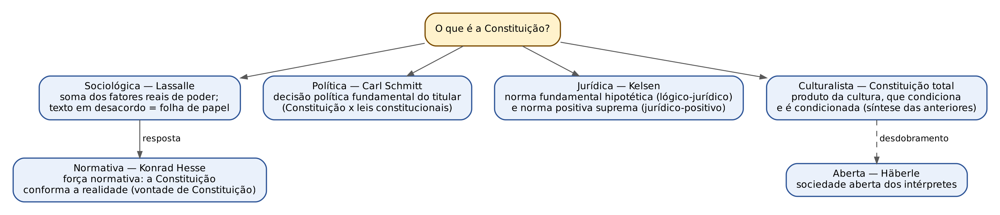
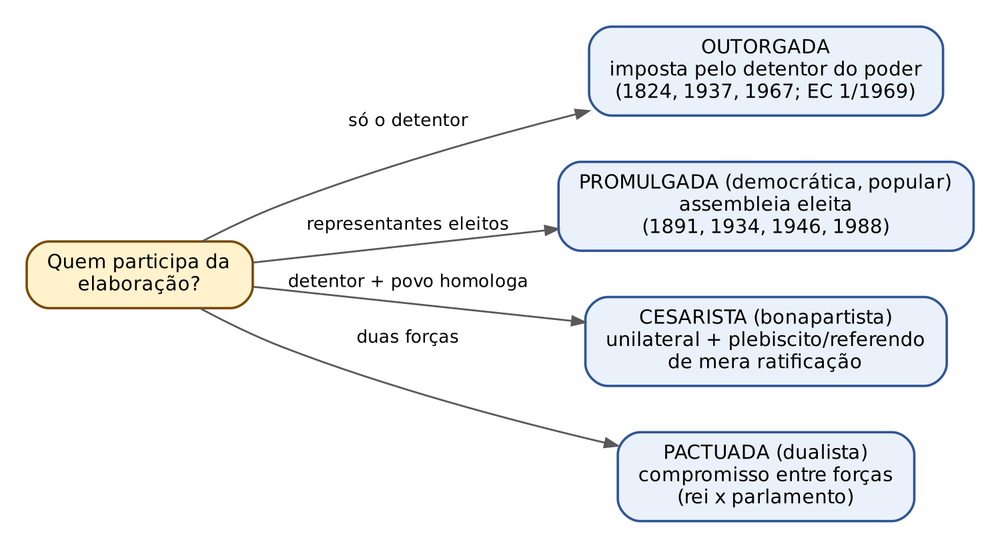
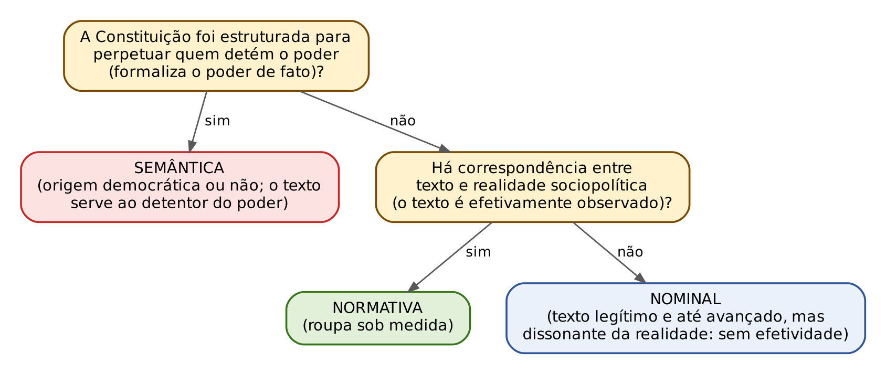
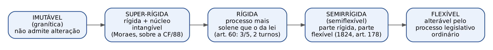
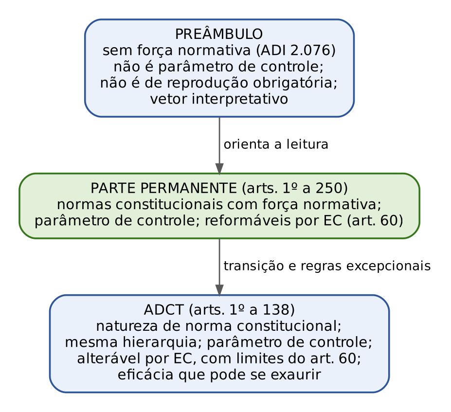

# CAPÍTULO 02 — TEORIA DA CONSTITUIÇÃO: CONCEITO, CLASSIFICAÇÕES, SUPREMACIA, PREÂMBULO E ADCT

:::INCIDENCIA
TRF5 p. 1; TJRS p. 1, 2, 4; TJSC p. 1. Nível A. Lote: 23 questões (FGV 22, FCC 1).
O que mais cai: classificação ontológica de Loewenstein (normativa, nominal, semântica) combinada com origem, modo de elaboração, ideologia e finalidade, sempre em caso narrativo de "país Alfa"; depois, concepções (Schmitt), normas materiais x formais, preâmbulo (ADI 2.076) e ADCT.
:::

Mapa de cobrança do lote:

| Subtema | FGV | FCC | Padrão |
|---|---|---|---|
| Classificação ontológica combinada com outras classificações | 18 | 0 | Narrativa de "país Alfa/Sigma" com três ou quatro pistas; a alternativa correta casa duas classificações; as erradas trocam semântica por nominal ou inserem rótulo não inferível do enunciado |
| Concepções de Constituição | 1 | 0 | Descrição da teoria sem nome do autor (Schmitt: decisão política x leis constitucionais) |
| Normas materialmente x formalmente constitucionais | 1 | 0 | V/F sobre critério material, inserção formal e estabilidade derivada da rigidez |
| Preâmbulo | 1 | 1 | Literalidade dos "valores supremos" e distratores inventados (meritocracia, justiça social, direitos coletivos) |
| ADCT | 1 | 0 | Caso prático (art. 8º do ADCT e anistia política) resolvido por súmulas do STJ |

## 02.1 Conceito e concepções de Constituição

A pergunta "o que é a Constituição?" recebe respostas distintas conforme o ângulo do observador. As provas cobram as concepções clássicas pela DESCRIÇÃO da teoria, sem citar o autor, e exigem que o candidato identifique o sentido (sociológico, político, jurídico, normativo, culturalista). O traço distintivo de cada uma está no quadro ao final da seção; a figura resume a relação entre elas.

### 02.1.1 Sentido sociológico (Ferdinand Lassalle)

Na conferência de 1862 ("A essência da Constituição"), Lassalle sustenta que a Constituição real de um país é a SOMA DOS FATORES REAIS DE PODER que nele atuam (a monarquia, a aristocracia, a grande burguesia, os banqueiros, a pequena burguesia e a classe operária, no exemplo prussiano). A Constituição escrita só é boa e duradoura quando corresponde à Constituição real; se dela diverge, sucumbe e vira mera FOLHA DE PAPEL. O dado decisivo é o "ser" (realidade do poder), e não o "dever-ser" normativo.

Consequências cobráveis: (i) a Constituição escrita não tem força própria para conformar a realidade; (ii) o conflito entre texto e fatores reais de poder resolve-se sempre a favor destes; (iii) a concepção é descritiva, não prescritiva. É o ponto de partida da crítica de Konrad Hesse (02.1.4) e o pano de fundo da classificação ontológica de Loewenstein (02.3.3), que mede justamente a distância entre texto e realidade.

### 02.1.2 Sentido político (Carl Schmitt)

Para Schmitt (Teoria da Constituição, 1928), a Constituição é a DECISÃO POLÍTICA FUNDAMENTAL do titular do poder constituinte sobre o modo e a forma da unidade política: forma de Estado, forma de governo, regime, organização dos poderes, direitos fundamentais. Daí a distinção central para provas:

- CONSTITUIÇÃO (em sentido próprio): o conteúdo que expressa a decisão política fundamental.
- LEIS CONSTITUCIONAIS: normas que estão no documento constitucional, mas não traduzem decisão política fundamental; foram inseridas para gozar da estabilidade do texto (por exemplo, regras sobre servidores ou sobre um colégio específico).

O fundamento de validade da Constituição, para Schmitt, é a vontade política existencial do titular, e não uma norma. A distinção entre Constituição e leis constitucionais antecipa a distinção entre normas materialmente e formalmente constitucionais (02.2).

:::QUESTAO FGV 2024 — PREFEITURA DE ABREU E LIMA — TÉCNICO EM CONTROLE INTERNO (Q3009003)
Cobrou-se a descrição, sem nome do autor, de corrente segundo a qual a Constituição é decisão concreta sobre o Estado e seus contornos essenciais, distinta das leis constitucionais inseridas no texto só para ganhar estabilidade.
Gabarito: D (sentido político).
Armadilha: "jurídico" (B) atrai porque o enunciado fala em normas; mas a dicotomia Constituição x leis constitucionais é a marca de Schmitt. "Objetivo" e "natural" são distratores sem correspondência nas concepções clássicas.
:::

### 02.1.3 Sentido jurídico (Hans Kelsen)

Kelsen (Teoria Pura do Direito) desloca a Constituição para o plano do dever-ser, isolando-a de considerações sociológicas, políticas ou filosóficas. Distinguem-se dois sentidos:

- LÓGICO-JURÍDICO: a norma fundamental hipotética (*Grundnorm*), pressuposta, que determina a obediência à Constituição positiva e confere validade a todo o sistema. Não é posta; é pensada.
- JURÍDICO-POSITIVO: a Constituição posta, norma positiva suprema, que regula a criação das demais normas e ocupa o vértice do escalonamento normativo.

Da concepção kelseniana derivam a ideia de ESCALONAMENTO (cada norma retira validade da superior) e, por consequência, a supremacia formal e o controle de constitucionalidade concentrado (modelo austríaco de 1920 — ver Cap. 17). A FCC já transcreveu trecho de Kelsen sobre a Constituição que regula não só o procedimento, mas o conteúdo das leis, cobrando a ligação com a supremacia e com as inconstitucionalidades formal e material (ver 02.5).

:::PEGADINHA
Norma fundamental hipotética NÃO é a Constituição escrita, nem norma posta pelo constituinte: é pressuposto lógico-transcendental de validade. Alternativa que diga "a norma hipotética fundamental é a Constituição positiva no vértice da pirâmide" está errada: o vértice da pirâmide positiva é a Constituição em sentido jurídico-positivo.
:::

### 02.1.4 Força normativa da Constituição (Konrad Hesse)

Em resposta a Lassalle, Hesse (aula inaugural de 1959) sustenta que a Constituição jurídica não é mero reflexo dos fatores reais de poder: ela possui FORÇA NORMATIVA própria, capaz de ordenar e conformar a realidade, desde que haja "vontade de Constituição" (*Wille zur Verfassung*) e não apenas "vontade de poder". Texto e realidade condicionam-se reciprocamente; a Constituição não pode ignorar a realidade, mas também não se reduz a ela.

Desdobramentos cobráveis: o princípio interpretativo da força normativa (preferir as soluções que deem maior eficácia e permanência às normas constitucionais — ver Cap. 5), a rejeição da tese de que as normas programáticas seriam meros conselhos e a base teórica do neoconstitucionalismo (Cap. 1). A FGV cobrou, em item falso, a ideia de que, "devido à sua feição meramente política", não se deveria atribuir à Constituição o sentido de maior eficácia: é a negação da força normativa (Q2457687, ver 02.5).

### 02.1.5 Concepção culturalista, Constituição total e concepções contemporâneas

A concepção culturalista (no Brasil, difundida por J. H. Meirelles Teixeira) entende a Constituição como produto da CULTURA de um povo, que ao mesmo tempo a condiciona e é por ela condicionada. Reúne os aspectos sociológico, político e jurídico numa CONSTITUIÇÃO TOTAL: a Constituição é fato social, decisão política e norma jurídica, simultaneamente. É a resposta adequada quando o enunciado fala em "síntese" ou "unidade" das concepções anteriores, ou na Constituição como "objeto cultural".

Concepções contemporâneas que aparecem em alternativas:

- Constituição ABERTA (Peter Häberle): a interpretação constitucional não é monopólio dos órgãos estatais, mas tarefa da "sociedade aberta dos intérpretes da Constituição"; reflete-se em mecanismos de participação no processo constitucional (*amicus curiae* e audiências públicas — ver Cap. 18). A FCC já cobrou quais institutos da prática do STF concretizam essa teoria (Q3954667, do Cap. 5).
- Constituição DÚCTIL (Gustavo Zagrebelsky): em sociedades pluralistas, a Constituição não impõe um projeto único, mas assegura as condições de convivência de valores e princípios diversos, que devem ser compostos por ponderação; aproxima-se da Constituição compromissória (02.3.4).
- Constituição DIRIGENTE (J. J. Gomes Canotilho, na obra de 1982): define fins e programas de ação a serem cumpridos pelo Estado, vinculando o legislador (02.3.4). Canotilho, posteriormente, relativizou a tese ("a Constituição dirigente morreu?"), o que às vezes é cobrado como dado histórico.
- Concepção ESTRUTURALISTA (José Afonso da Silva): a Constituição como estrutura que conecta norma, fato e valor, rejeitando concepções unilaterais.

| Concepção | Autor-chave | O que é a Constituição | Palavra-chave do enunciado |
|---|---|---|---|
| Sociológica | Lassalle | Soma dos fatores reais de poder | "folha de papel", "fatores reais de poder", "ser" |
| Política | Schmitt | Decisão política fundamental do titular | "decisão", "leis constitucionais", "unidade política" |
| Jurídica | Kelsen | Norma pura; fundamento na norma hipotética | "dever-ser", "pirâmide", "norma fundamental hipotética" |
| Normativa | Hesse | Norma com força própria para conformar a realidade | "força normativa", "vontade de Constituição" |
| Culturalista | Meirelles Teixeira | Produto da cultura; Constituição total | "objeto cultural", "síntese", "condiciona e é condicionada" |
| Aberta | Häberle | Processo público de interpretação plural | "sociedade aberta dos intérpretes" |
| Dúctil | Zagrebelsky | Moldura de convivência pluralista | "ductilidade", "pluralismo de valores" |

## 02.2 Conteúdo da Constituição: normas materialmente e formalmente constitucionais

### 02.2.1 Constituição material e Constituição formal

Constituição em sentido MATERIAL é o conjunto de normas, escritas ou não, codificadas ou não, que regulam as matérias tipicamente constitucionais: estrutura do Estado, forma de governo, organização, competência e limites dos poderes, aquisição e exercício do poder e direitos fundamentais. O critério é o CONTEÚDO, onde quer que a norma esteja.

Constituição em sentido FORMAL é o conjunto de normas inseridas no documento solene elaborado pelo poder constituinte e alterável apenas por processo mais dificultoso que o da lei. O critério é a FORMA (o veículo e o processo), qualquer que seja o conteúdo.

Combinações possíveis:

- Norma material e formalmente constitucional: art. 2º da CF (separação de Poderes); art. 5º.
- Norma só formalmente constitucional: está no texto, mas trata de matéria sem natureza constitucional típica. Exemplo clássico: art. 242, § 2º ("O Colégio Pedro II, localizado na cidade do Rio de Janeiro, será mantido na órbita federal"). Tem a mesma hierarquia e a mesma rigidez das demais.
- Norma só materialmente constitucional: trata de matéria constitucional, mas está fora do texto, em lei. Exemplos usuais: normas do Código Eleitoral sobre o sistema eleitoral, Lei 1.079/1950 sobre crimes de responsabilidade, Regimentos Internos que estruturam o funcionamento de Poderes. Na CF/88 (rígida e formal), essas normas têm hierarquia de lei e NÃO servem de parâmetro de controle.

:::ATENCAO
Num sistema de Constituição FORMAL e RÍGIDA como o brasileiro, o critério que define hierarquia e parametricidade é o formal. A "constitucionalidade material" de uma lei não lhe dá status constitucional. A exceção normativa são os tratados e convenções sobre direitos humanos aprovados pelo rito do art. 5º, § 3º (cada Casa, dois turnos, três quintos), que são equivalentes às emendas constitucionais e integram o bloco de constitucionalidade sem estar no corpo do texto (ver Cap. 11 e, sobre parametricidade, Cap. 17).
:::

### 02.2.2 Por que matérias "não constitucionais" vão para o texto

O constituinte insere no texto matérias não tipicamente constitucionais por diversas razões: desconfiança do legislador ordinário, conquista de grupos de pressão na constituinte, desejo de proteger a matéria contra maiorias eventuais. O efeito buscado é a ESTABILIDADE, e ela só existe se a Constituição for RÍGIDA: em Constituição flexível, a inclusão no texto não acrescenta proteção, porque o texto se altera como a lei. É exatamente o ponto cobrado pela FGV.

:::QUESTAO FGV 2024 — AL-TO — ANALISTA LEGISLATIVO — DIREITO (Q2457686)
Três assertivas V/F: (1) a noção de temas típicos de Constituição permite falar em normas materialmente constitucionais, ideia criticada por refletir a ideologia dominante em certo momento do constitucionalismo; (2) normas formalmente constitucionais só podem ser inseridas no texto quando também materialmente constitucionais; (3) a inserção no texto confere maior estabilidade, independentemente de a Constituição ser rígida.
Gabarito: A (V – F – F).
Fundamento: (1) é verdadeira: o "conteúdo típico" é histórico (o liberalismo do art. 16 da Declaração de 1789 — garantia de direitos e separação de poderes); (2) é falsa: a marca da norma SÓ formalmente constitucional é precisamente estar no texto sem ter conteúdo constitucional (art. 242, § 2º); (3) é falsa: o ganho de estabilidade decorre da RIGIDEZ; numa Constituição flexível, não há ganho.
Armadilha: a palavra "independentemente" na terceira assertiva.
:::

### 02.2.3 Normas constitucionais formais e hierarquia interna

Como todas as normas do texto originário foram postas pelo mesmo poder constituinte, no mesmo documento e com a mesma rigidez, NÃO há hierarquia formal entre elas, pouco importando se são material ou apenas formalmente constitucionais. A distinção axiológica (princípios fundamentais "pesam" mais na interpretação) não se converte em invalidade de uma norma originária por contrariedade a outra. O tema é desenvolvido em 02.5.4 (ADI 815 e rejeição da tese das "normas constitucionais inconstitucionais").

## 02.3 Classificações das Constituições

As classificações são o tema mais cobrado do capítulo, sobretudo pela FGV, que constrói narrativas de "país Alfa" com pistas para dois ou três critérios ao mesmo tempo. O segredo é identificar, frase por frase, a qual critério cada pista pertence e descartar rótulos que o enunciado não permite inferir.

### 02.3.1 Quadro geral

| Critério | Espécies | Traço distintivo |
|---|---|---|
| Origem | Outorgada; promulgada (democrática, popular, votada); cesarista (bonapartista); pactuada (dualista) | Quem participa da elaboração e com que legitimidade |
| Forma | Escrita (instrumental); não escrita (costumeira, consuetudinária) | Existência de documento solene e sistemático |
| Modo de elaboração | Dogmática; histórica | Elaborada de uma vez, por órgão constituinte, a partir dos dogmas do momento x formada lentamente pela tradição |
| Extensão | Sintética (concisa, sumária, básica); analítica (prolixa, extensa, regulamentar) | Só princípios e estrutura x desce a detalhes |
| Conteúdo | Material; formal | Matéria constitucional x documento solene (02.2) |
| Estabilidade (alterabilidade) | Imutável; super-rígida; rígida; semirrígida (semiflexível); flexível | Processo de alteração comparado ao da lei |
| Correspondência com a realidade (ontológica, Loewenstein) | Normativa; nominal (nominalista); semântica | Distância entre texto e prática do poder |
| Ideologia | Ortodoxa; eclética (compromissória, pluralista) | Uma só ideologia x várias ideologias conciliadas |
| Finalidade (função) | Garantia (liberal, negativa); balanço; dirigente (programática) | Limitar o poder x registrar um estágio x impor programas |
| Sistemática | Codificada (reduzida, unitária); legal (variada, esparsa) | Documento único x vários documentos |
| Origem da decretação | Autônoma (autoconstituição); heterônoma (heteroconstituição) | Elaborada pelo próprio Estado x por outro Estado ou organismo |
| Conteúdo ideológico-econômico | Liberal; social | Abstenção estatal x prestações e intervenção |

### 02.3.2 Quanto à origem

- OUTORGADA: imposta unilateralmente pelo detentor do poder, sem participação popular. No Brasil: 1824, 1937 e 1967 (esta formalmente votada por um Congresso convocado e limitado pelo AI-4, razão pela qual a doutrina majoritária a reputa outorgada), além da EC 1/1969, que muitos tratam como nova Constituição outorgada pela Junta Militar.
- PROMULGADA (democrática, popular ou votada): elaborada por assembleia constituinte composta de representantes eleitos. No Brasil: 1891, 1934, 1946 e 1988.
- CESARISTA (bonapartista, plebiscitária): elaborada unilateralmente pelo detentor do poder e submetida a plebiscito ou referendo de mera RATIFICAÇÃO. A participação popular é homologatória, sem poder real de alterar o conteúdo. Exemplos clássicos: os plebiscitos napoleônicos; Pinochet (1980).
- PACTUADA (dualista): resulta de compromisso instável entre duas forças políticas (por exemplo, monarca e parlamento), como a Magna Carta (1215) em leitura clássica.

:::PEGADINHA
Assembleia eleita + aprovação popular posterior NÃO torna a Constituição cesarista: se quem elabora é assembleia de representantes eleitos, ela é PROMULGADA; o referendo final é reforço de legitimidade. Cesarista pressupõe texto unilateral do detentor do poder + ratificação. E a origem democrática não impede que a Constituição seja SEMÂNTICA (origem e correspondência com a realidade são critérios independentes).
:::

### 02.3.3 Quanto à correspondência com a realidade: a classificação ontológica de Karl Loewenstein

Karl Loewenstein (Teoria da Constituição, 1957) propõe classificar as Constituições não pelo texto, mas pela sua relação com a realidade do processo de poder ("análise ontológica"). Três espécies:

- NORMATIVA: há efetiva correspondência entre texto e realidade; as normas dominam o processo político e são lealmente observadas por governantes e governados. Imagem de Loewenstein: roupa que assenta bem e é efetivamente usada.
- NOMINAL (nominalista): o texto é juridicamente válido e, em regra, de origem legítima, muitas vezes até avançado, mas a dinâmica do processo político não se adapta a ele; falta-lhe realidade existencial. É roupa guardada no armário, à espera de que o corpo nacional cresça. Tem, porém, função EDUCATIVA e prospectiva: aspira a tornar-se normativa.
- SEMÂNTICA: o texto é aplicado, mas apenas como formalização da situação existente do poder em benefício exclusivo dos seus detentores de fato; em vez de limitar o poder, serve para estabilizá-lo e perpetuá-lo. Roupa que não é roupa, é disfarce.

:::PASSO RESOLVENDO AS NARRATIVAS DA FGV (CLASSIFICAÇÃO ONTOLÓGICA)
1. Procure a pista de FINALIDADE DO PODER: o texto foi "moldado", "estruturado" ou "funcionalmente delineado" para assegurar a permanência ou a continuidade de grupo, família, aristocracia ou governante, esvaziando controles e pluralismo? Se sim: SEMÂNTICA, ainda que a origem seja democrática, que haja plebiscito ou que o texto se diga democrático.
2. Sem essa pista, procure a pista de EFETIVIDADE: o texto é "avançado", "cosmopolita", "elogiável", mas "dissonante", "destoante", "distanciado" do ambiente sociopolítico, "ignorado", sem "projeção na realidade"? Então: NOMINAL.
3. Se há correspondência e observância ("grande aceitação", "elevados níveis de efetividade", "observado em todos os seus termos"): NORMATIVA.
4. Depois, identifique as demais pistas: quem elaborou (origem), se o texto incorporou valores do momento (dogmática), se conciliou ideologias divergentes (compromissória), se traçou programas e objetivos (dirigente), se é alterável pelo processo ordinário (flexível), se tem poucos artigos (sintética).
5. Elimine alternativas com rótulo que a narrativa não autoriza (por exemplo, "rígida" sem nenhuma informação sobre o processo de reforma; "analítica" sem informação sobre extensão).
:::

:::DICA
Semântica x nominal: as duas não têm efetividade como limite ao poder, mas por razões opostas. Na nominal, há boa-fé normativa e déficit de realidade (o texto é melhor que a prática); na semântica, há má-fé estrutural (o texto é feito para servir ao poder). A FGV usa o adjetivo "avançada" quase sempre como pista de nominal; e "assegurar a continuidade/perpetuação no poder" como pista de semântica.
:::

:::QUESTAO FGV 2026 — TJ-PR — JUIZ SUBSTITUTO (Q3898938)
Caso: Constituição aprovada em plebiscito, alterável pelo processo legislativo ordinário, que retratou e petrificou os valores existentes no momento de sua edição, conferindo-lhes força normativa, e que, embora intitulada democrática, foi moldada para perpetuar a aristocracia dominante.
Passos: (1) "moldada para perpetuar" → semântica; (2) "petrificou os valores do momento" (elaborada de uma vez, a partir dos dogmas vigentes) → dogmática; (3) "alterável pelo processo ordinário" → flexível; (4) "aprovada em plebiscito" sugere participação popular, mas a narrativa não diz quem redigiu.
Gabarito: E (dogmática e semântica).
Armadilha: A ("flexível e nominal") tem metade certa — o texto É flexível —, mas "nominal" contradiz a pista de perpetuação. D ("plebiscitária e analítica") usa a pista do plebiscito e inventa a extensão.
:::

:::QUESTAO FGV 2024 — TJ-PE — JUIZ SUBSTITUTO (Q3117564)
Caso: após revolução, o comitê revolucionário publica a nova Constituição incorporando os valores que nortearam a revolução, com caráter normativo; texto avançado e democrático, mas com dissonâncias insuperáveis em relação ao ambiente sociopolítico, que impediram sua projeção na realidade.
Gabarito: B (dogmática e nominal).
Fundamento: valores do momento convertidos em normas por elaboração única → dogmática; avançada mas sem projeção na realidade → nominal.
Armadilha: D ("outorgada e normativa") — a elaboração pelo comitê sugere outorga, mas "normativa" contradiz a falta de efetividade; e o adjetivo "normativo" do enunciado refere-se ao caráter jurídico dos valores, não à classificação de Loewenstein. "Autoconstituição e cesarista" e "ortodoxa e semântica" não encontram pistas.
:::

:::QUESTAO FGV 2026 — TJ-MS — OUTORGA DE DELEGAÇÕES DE NOTAS E DE REGISTRO (Q3914541)
Caso: aristocracia que controla o país convoca eleições diretas para Assembleia Constituinte, que trabalha sobre texto-base da aristocracia, estruturado para assegurar sua continuidade no poder; o texto é aprovado em consulta popular antes da publicação e entra em vigor por ato da Assembleia.
Gabarito: D (promulgada e semântica).
Fundamento: elaboração por assembleia eleita → promulgada (o referendo final não a converte em cesarista, porque o texto não é ato unilateral do detentor do poder); finalidade de continuidade → semântica.
Armadilha: C ("plebiscitária e nominal") explora a aprovação popular; E ("outorgada e compromissória") explora a autoria do texto-base.
No mesmo sentido (origem democrática não afasta a semântica): Q3592878 (FGV 2025, TJ-SC, Juiz Leigo — aristocracia chega ao poder por meios democráticos, assembleia democrática aprova seu projeto, ditadura travestida de democracia; gabarito C, semântica; "rígida" e "plebiscitária" não têm base no enunciado) e Q3883088 (FGV 2026, AL-RO — assembleia de simpatizantes de aristocracia ideológica que nega proteção às demais ideologias; gabarito C, semântica; "nominal" e "compromissória" são os distratores).
:::

:::QUESTAO FGV 2026 — TJ-BA — JUIZ LEIGO (Q4102127)
Caso: aristocracia que domina o país há décadas pelo uso da força aprova nova ordem constitucional para sufocar interpretações democráticas e perpetuar-se; submete o texto a consulta popular, ignora as colaborações e edita a Constituição.
Gabarito: B (semântica).
Armadilha: A ("cesarista") é o distrator mais forte, porque há texto unilateral e consulta popular. Mas a consulta não foi ratificação (as contribuições foram simplesmente ignoradas e o texto editado em seguida), e a pista dominante da narrativa é a perpetuação no poder. Em questões de resposta única, a FGV privilegia o critério ontológico quando a narrativa enfatiza a finalidade do texto.
No mesmo sentido: Q2482358 (FGV 2024, Câmara de Fortaleza — Constituição longeva, autointitulada democrática, funcionalmente delineada para manter a mesma família no poder há cinco décadas; gabarito C, semântica).
:::

:::QUESTAO FGV 2024 — PROVA NÃO IDENTIFICADA NO BANCO (Q3043792)
Caso: governante populista aprova EMENDA que introduz eleição indireta por colegiado de livre nomeação sua, restringe o pluralismo a dois partidos e esvazia os controles do Legislativo e do Judiciário.
Gabarito: C (semântica).
Ponto a reter: a classificação ontológica é DINÂMICA. Uma Constituição pode tornar-se semântica por reforma (fenômeno de erosão constitucional por emendas — *abusive constitutionalism*, na expressão de David Landau), sem ruptura formal. Os limites materiais ao poder reformador (art. 60, § 4º — Cap. 3) são a defesa institucional contra essa degeneração.
:::

:::QUESTAO FGV 2024 — TCE-PA — AUDITOR DE CONTROLE EXTERNO (Q2611644)
Caso: aristocracia golpista outorga Constituição para normatizar sua ideologia, apenas legitimar suas decisões e perpetuar-se no poder; o próprio texto manda interpretar com atenção ao texto e às vicissitudes do ambiente sociopolítico, evitando a "petrificação textual".
Gabarito: C (semântica + metódica concretista).
Fundamento: perpetuação e legitimação do poder → semântica (a alternativa "outorgada" está correta quanto à origem, mas vem acoplada ao originalismo, incompatível com a recusa da petrificação textual); a interpretação que parte do texto e incorpora a realidade é a da metódica concretista (Hesse e Müller — ver Cap. 5).
:::

:::QUESTAO FGV 2024 — EPE — ADVOGADO (Q2759009)
Caso: após golpe, nova Constituição aprovada por Assembleia Constituinte formada democraticamente, com práticas avançadas e elogiáveis, mas profundamente distante da base de valores, das instituições e do processo político, levando à permanente inobservância de seus contornos.
Gabarito: A (nominal).
Armadilha: o "golpe" induz a marcar semântica; mas o golpe é apenas o antecedente histórico — a Constituição não foi feita para perpetuar ninguém, e seu problema é a falta de aderência à realidade.
No mesmo sentido: Q3520312 (FGV 2025, TJ-ES, Cartórios — revolução pacífica, anteprojeto de notáveis aprovado sem as sugestões sociais, viés ideológico dissonante que compromete a efetividade; gabarito A, nominal). Nesta, "dogmática" (D) também descreve corretamente o modo de elaboração; a FGV considerou só a nominal, porque é a classificação que a narrativa constrói (ver nota de verificação).
:::

:::QUESTAO FGV 2024 — PREFEITURA DE MACAÉ — PROCURADOR (Q3049903)
Caso com três Constituições: Alfa (avançada e cosmopolita, totalmente destoante do ambiente sociopolítico), Beta (editada após aprovação do texto em plebiscito) e Gama (fruto de golpe, redigida para atender à aristocracia e ao seu projeto de continuidade).
Gabarito: B (nominal, cesarista e semântica).
Ponto a reter: para a FGV, texto + aprovação plebiscitária, sem menção a assembleia eleita, basta para "cesarista". Compare com Q3914541 (assembleia eleita + referendo = promulgada).
:::

:::QUESTAO FGV 2025 — DPE-RO — ANALISTA JURÍDICO (Q3395851)
Caso: transição pacífica; assembleia eleita trabalha sobre minuta do governo provisório; o texto busca a coexistência de valores e ideologias distintos, molda o processo político para assegurar a renovação do poder, obtém grande aceitação e elevados níveis de efetividade.
Gabarito: E (compromissória e normativa).
Armadilha: D ("promulgada e semântica") — promulgada está correto, mas a minuta do governo provisório não torna o texto semântico, porque ele assegura a RENOVAÇÃO, e não a perpetuação. C ("dogmática e nominal") erra a efetividade.
:::

#### Nominal combinada com compromissória e dirigente

:::QUESTAO FGV 2024 — PREFEITURA DE CARAGUATATUBA — ADVOGADO (Q3049071)
Caso: estudo dos fatores reais de poder revela Constituição com concepções ideológicas aparentemente inconciliáveis, que traça objetivos às estruturas estatais e é composta de preceitos incompatíveis com o ambiente sociopolítico, sem níveis mínimos de eficácia.
Gabarito: A (nominal, compromissória e dirigente).
No mesmo sentido: Q3605987 (FGV 2025, PGM-RJ — texto que ampara ideologias divergentes, como a liberal e a social, cujos aspectos sistêmicos são ignorados pelas estruturas estatais, que criam procedimentos paralelos; gabarito E, nominal e compromissória) e Q3099296 (FGV 2024, Prefeitura de Niterói — texto de notáveis aprovado em plebiscito, que contempla correntes ideológicas distintas e destoa dos valores prevalecentes; gabarito oficial C, "semântica e dogmática"; a narrativa, porém, conduz tecnicamente a E, "nominal e compromissória", pois não há pista de perpetuação no poder e há pistas expressas de dissonância com a realidade e de coexistência de ideologias; em prova, registre a divergência e siga o gabarito oficial; ver nota de verificação).
:::

### 02.3.4 Quanto à ideologia e quanto à finalidade

- ORTODOXA: formada por uma só ideologia (por exemplo, as Constituições soviéticas).
- ECLÉTICA (compromissória, pluralista): concilia ideologias diversas, até contraditórias (livre iniciativa e função social; liberdade econômica e intervenção; propriedade e reforma agrária). A CF/88 é o exemplo didático. Nas Constituições compromissórias, a solução dos conflitos internos depende de ponderação; a FGV já cobrou, em prova de juiz (Q3301277, TJ-SE 2025, do Cap. 5), que prestigiar certos valores ao resolver tensões intrínsecas não descaracteriza a interpretação constitucional.
- Constituição-GARANTIA (liberal, negativa, de abstenção): limita o poder e protege liberdades; olha para o presente.
- Constituição-BALANÇO: registra o estágio de desenvolvimento alcançado e é substituída quando a sociedade avança (concepção soviética: 1924, 1936, 1977).
- Constituição DIRIGENTE (programática): além de organizar e limitar o poder, define fins e PROGRAMAS de ação futura que vinculam o legislador e a administração (normas programáticas — Cap. 4). Associada a Canotilho; a CF/88 é dirigente (art. 3º).

:::QUESTAO FGV 2025 — TCE-PE — ANALISTA DE GESTÃO (Q3593063)
Caso: pacto político convoca assembleia eleita pelo sufrágio universal; anteprojeto de notáveis; texto com poucos artigos, compatível com a base de valores e observado em todos os termos; nítido direcionamento para implementar direitos de segunda dimensão.
Gabarito: C (dogmática e dirigente).
Observação: a narrativa permitiria também "sintética" e "normativa", mas nenhuma alternativa traz essa combinação; "normativa e garantista" erra porque o direcionamento a direitos sociais afasta a Constituição-garantia; "sintética e semântica" erra na segunda parte. Lição: em questão de combinação, basta UM rótulo incompatível para eliminar a alternativa.
No mesmo sentido: Q3350303 (FGV 2025, TRT-24 — assembleia democrática incorpora os valores do momento para assegurar sua permanência e individualiza as linhas gerais dos programas governamentais; gabarito D, dogmática e dirigente; "preceitual e programática" é distrator sem base classificatória usual).
:::

### 02.3.5 Demais critérios

- Forma: ESCRITA (normas sistematizadas em documento solene) x NÃO ESCRITA (costumeira, baseada em usos, costumes, jurisprudência e textos esparsos; exemplo, a inglesa). A Constituição inglesa é usualmente descrita como não escrita, histórica e flexível; mas há textos escritos que a integram (Magna Carta, *Bill of Rights* de 1689, *Parliament Acts*), daí a crítica de que o correto seria "não codificada".
- Modo de elaboração: DOGMÁTICA (sempre escrita, elaborada num dado momento por órgão constituinte, sistematizando os dogmas e ideias dominantes) x HISTÓRICA (sempre não escrita, produto da lenta formação histórica). Toda Constituição escrita é dogmática; essa equivalência explica por que a FGV usa "dogmática" sempre que o enunciado diz que o texto incorporou ou petrificou os valores do momento.
- Extensão: SINTÉTICA (só princípios e estrutura; exemplo, a norte-americana de 1787, com sete artigos e emendas) x ANALÍTICA (desce a pormenores; a CF/88). A analiticidade guarda relação com a desconfiança no legislador e explica o número de emendas.
- Sistemática: CODIFICADA ou REDUZIDA (um só documento) x LEGAL ou VARIADA (vários documentos de hierarquia constitucional). Parte da doutrina aponta que a CF/88, após o art. 5º, § 3º e as emendas avulsas com normas próprias, tem traço de Constituição variada no conteúdo do bloco, embora seja codificada no documento principal.
- Origem da decretação: AUTÔNOMA (autoconstituição: elaborada pelo próprio povo ou Estado) x HETERÔNOMA (heteroconstituição: decretada de fora, por outro Estado ou organização internacional; exemplos clássicos, as primeiras Constituições do Canadá, da Austrália e de Chipre).
- Liberal x social: abstenção estatal x atuação positiva para promover igualdade material (Constituições do México de 1917 e de Weimar de 1919 como marcos).

Classificações doutrinárias de menor frequência, mas que aparecem como distrator:

- Constituição PLÁSTICA: em Pinto Ferreira, sinônimo de flexível; em Raul Machado Horta, Constituição com normas abertas, que se adaptam à realidade por meio da legislação infraconstitucional e da interpretação (sem alteração do texto). Ao ver "plástica" numa alternativa, verifique qual sentido o examinador adota.
- Constituição EXPANSIVA (Raul Machado Horta): a que amplia temas e conteúdos em relação às anteriores (a CF/88, com títulos novos e ampliação dos direitos fundamentais).
- Constituição-LEI, Constituição-FUNDAMENTO e Constituição-MOLDURA: a primeira tem o mesmo nível das leis (diretiva ao legislador); a segunda é fundamento de toda a vida social e do ordenamento; a terceira fixa limites dentro dos quais o legislador atua livremente, cabendo à jurisdição constitucional controlar apenas o respeito à moldura.
- Constituição em BRANCO: não estabelece limitações explícitas ao poder de reforma (processo de alteração fica em aberto).

:::PEGADINHA
Os distratores "eclética" (ideologia), "plástica" (estabilidade ou abertura), "balanceada" (sem correspondência usual), "preceitual", "orgânica" e "axiológica" aparecem misturados com as classificações reais. Na dúvida, verifique se o rótulo é critério conhecido e se a narrativa traz pista para ele. "Bonapartista" é sinônimo de cesarista; "nominalista" é sinônimo de nominal.
:::

### 02.3.6 Estabilidade (alterabilidade)

- IMUTÁVEL (granítica, permanente): não admite alteração; hoje, figura de interesse histórico.
- RÍGIDA: só se altera por processo legislativo mais solene e dificultoso que o das leis. A CF/88 é rígida (art. 60: iniciativa restrita, dois turnos em cada Casa, três quintos, promulgação pelas Mesas, limites circunstanciais e materiais).
- SUPER-RÍGIDA: denominação de Alexandre de Moraes para a CF/88, porque, além de rígida, tem núcleo intangível (cláusulas pétreas do art. 60, § 4º). A maioria da doutrina critica a categoria, já que as cláusulas pétreas não são imutabilidade absoluta (admitem emendas que não TENDAM A ABOLIR o núcleo), mas a expressão é cobrada.
- SEMIRRÍGIDA (semiflexível): parte rígida e parte flexível. Exemplo: a Constituição de 1824, cujo art. 178 dispunha que só era constitucional o que dizia respeito aos limites e atribuições dos poderes políticos e aos direitos políticos e individuais dos cidadãos; o restante podia ser alterado pelas legislaturas ordinárias.
- FLEXÍVEL: alterável pelo mesmo processo das leis ordinárias.

:::ATENCAO
Rigidez é critério de ESTABILIDADE (processo de alteração), não de permanência no tempo nem de mutabilidade real. Constituição flexível pode ser longeva (a inglesa); Constituição rígida pode sofrer emendas em grande número (a CF/88). Também não se confunde rigidez com mutação constitucional: esta altera o sentido sem alterar o texto e é compatível com a rigidez (Cap. 3 e Cap. 5).
:::

### 02.3.7 Classificação da CF/88

| Critério | Classificação da CF/88 | Observação |
|---|---|---|
| Origem | Promulgada (democrática) | Assembleia Nacional Constituinte convocada pela EC 26/1985 (Congresso com poderes constituintes) |
| Forma | Escrita | Documento solene |
| Modo de elaboração | Dogmática | Sistematizou os dogmas do momento da redemocratização |
| Extensão | Analítica | Arts. 1º a 250 e ADCT com 138 artigos |
| Conteúdo | Formal | Normas só formalmente constitucionais (art. 242, § 2º) têm a mesma hierarquia |
| Estabilidade | Rígida (para Moraes, super-rígida) | Art. 60 |
| Ideologia | Eclética (compromissória) | Concilia valores liberais e sociais |
| Finalidade | Dirigente | Objetivos do art. 3º e normas programáticas |
| Ontológica | Normativa, para a maioria da doutrina (há quem a veja como aspirante a normativa, com traços nominais em direitos sociais) | Questão de grau: em provas, "normativa" |
| Sistemática | Codificada (reduzida), com bloco ampliado pelo art. 5º, § 3º |  |
| Origem da decretação | Autônoma |  |
| Conteúdo ideológico-econômico | Social | Estado Social e Democrático de Direito |

## 02.4 Elementos da Constituição

Classificação de José Afonso da Silva, que agrupa as normas constitucionais segundo sua função (as Constituições contemporâneas têm "estrutura poliédrica"). A cobrança é de correspondência entre elemento e dispositivo.

| Elemento | Função | Exemplos na CF/88 |
|---|---|---|
| Orgânicos | Regulam a estrutura do Estado e do poder | Título III (organização do Estado), Título IV (organização dos Poderes), Capítulos II e III do Título V (Forças Armadas e segurança pública) e Título VI (tributação e orçamento) |
| Limitativos | Limitam a ação dos poderes estatais; direitos e garantias fundamentais de defesa | Título II, EXCETO os direitos sociais (Capítulo II): direitos individuais e suas garantias, nacionalidade e direitos políticos |
| Socioideológicos | Revelam o compromisso entre Estado liberal e Estado social | Direitos sociais (Capítulo II do Título II), Título VII (ordem econômica e financeira) e Título VIII (ordem social) |
| De estabilização constitucional | Asseguram a solução de conflitos constitucionais e a defesa da Constituição, do Estado e das instituições democráticas | Arts. 34 a 36 (intervenção); arts. 59, I, e 60 (emendas); arts. 102 e 103 (jurisdição constitucional); Título V, Capítulo I (estado de defesa e de sítio) |
| Formais de aplicabilidade | Estabelecem regras de aplicação da própria Constituição | Preâmbulo, disposições constitucionais transitórias (ADCT), art. 5º, § 1º (aplicação imediata) |

:::PEGADINHA
Os direitos SOCIAIS, embora estejam no Título II (direitos e garantias fundamentais), são elementos SOCIOIDEOLÓGICOS, e não limitativos. E o preâmbulo e o ADCT são elementos FORMAIS DE APLICABILIDADE. Intervenção federal, controle de constitucionalidade, processo de emenda e estados de exceção são de ESTABILIZAÇÃO.
:::

## 02.5 Supremacia da Constituição e rigidez

### 02.5.1 Supremacia material e supremacia formal

A supremacia exprime a posição da Constituição no vértice do ordenamento: ela é o fundamento de validade de todas as demais normas, que lhe devem compatibilidade vertical, sob pena de invalidade.

- SUPREMACIA MATERIAL: decorre do conteúdo (a Constituição organiza o poder e consagra direitos fundamentais); existe em qualquer Constituição, inclusive na flexível e na costumeira. Tem relevo sociológico e político, mas, sozinha, não gera consequência jurídica de invalidade.
- SUPREMACIA FORMAL: decorre da RIGIDEZ. Como a Constituição só se altera por processo mais solene, a lei que com ela conflita não a revoga: é inválida. Só há supremacia formal em Constituição rígida.

Daí o encadeamento que as bancas cobram: RIGIDEZ → SUPREMACIA FORMAL → CONTROLE DE CONSTITUCIONALIDADE. Em Constituição flexível, lei posterior incompatível simplesmente altera a Constituição (critério cronológico), e não há controle. O fundamento teórico da supremacia formal está na distinção entre poder constituinte e poderes constituídos (Sieyès — Cap. 3) e no escalonamento kelseniano (02.1.3).

:::QUESTAO FCC 2026 — PGM MANAUS — PROCURADOR DO MUNICÍPIO (Q4338754, DO CAP. 17)
Cobrou-se a identificação, a partir de trecho de Kelsen (a Constituição regula não apenas o procedimento legislativo, mas também o conteúdo das leis futuras), do princípio e das espécies de inconstitucionalidade a que o autor se refere.
Gabarito: E (supremacia da Constituição e inconstitucionalidades formais e materiais).
Armadilha: "unidade da Constituição" (princípio interpretativo) e "inconstitucionalidade orgânica" (espécie de vício formal, não o par completo). A espécie de vício é desenvolvida no Cap. 17.
:::

:::QUESTAO FGV 2024 — AL-TO — ANALISTA LEGISLATIVO — DIREITO (Q2457687, DO CAP. 5)
Três itens: (I) a supremacia significa posição hierárquica superior das normas constitucionais, em razão da diferença entre poder constituinte e poderes constituídos; (II) por sua feição meramente política, não se deve atribuir à Constituição o sentido que lhe assegure maior eficácia; (III) a interpretação conforme é interpretação constitucionalmente guiada da lei, que também atribui sentido à norma constitucional.
Gabarito: C (I e III).
Fundamento do item II (falso): nega a força normativa (02.1.4) e o princípio da máxima efetividade (Cap. 5).
:::

### 02.5.2 Consequências da supremacia

- Invalidade (nulidade, no modelo brasileiro tradicional) da norma infraconstitucional incompatível, declarada por controle difuso ou concentrado (Caps. 17 a 20), com possibilidade de modulação.
- Parametricidade: só normas formalmente constitucionais (e equivalentes, art. 5º, § 3º) servem de parâmetro.
- Interpretação conforme: entre sentidos possíveis da lei, prefere-se o compatível com a Constituição (Cap. 5 e Cap. 18).
- Filtragem constitucional: releitura de todo o direito infraconstitucional à luz da Constituição (constitucionalização do direito — Cap. 1).
- Direito pré-constitucional: a incompatibilidade com a Constituição superveniente resolve-se por recepção ou não recepção, e não por inconstitucionalidade superveniente (Cap. 3).

### 02.5.3 A rigidez da CF/88

:::LEI CF, ART. 60, § 2º E § 3º
"§ 2º A proposta será discutida e votada em cada Casa do Congresso Nacional, em dois turnos, considerando-se aprovada se obtiver, em ambos, três quintos dos votos dos respectivos membros."
"§ 3º A emenda à Constituição será promulgada pelas Mesas da Câmara dos Deputados e do Senado Federal, com o respectivo número de ordem."
:::

A rigidez da CF/88 resulta da soma de: (i) iniciativa restrita (um terço, no mínimo, dos membros da Câmara ou do Senado; Presidente da República; mais da metade das Assembleias Legislativas, cada uma pela maioria relativa de seus membros — art. 60, I a III); (ii) quórum de três quintos dos membros, em dois turnos, em cada Casa (§ 2º); (iii) promulgação pelas Mesas, sem sanção ou veto (§ 3º); (iv) limites circunstanciais (§ 1º: intervenção federal, estado de defesa, estado de sítio); (v) limites materiais (§ 4º); (vi) irrepetibilidade na mesma sessão legislativa da matéria de proposta rejeitada ou havida por prejudicada (§ 5º). O regime completo da reforma, dos limites e do controle de emendas é do Cap. 3.

| Ponto | Lei ordinária | Emenda constitucional |
|---|---|---|
| Iniciativa | Ampla (art. 61) | Restrita (art. 60, I a III); não há iniciativa popular expressa nem do STF |
| Quórum | Maioria simples (art. 47) | Três quintos dos membros, em cada Casa |
| Turnos | Um | Dois, em cada Casa |
| Sanção/veto | Sim | Não; promulgação pelas Mesas da Câmara e do Senado |
| Limites | Constitucionalidade | Circunstanciais, materiais e formais do art. 60 |

:::PEGADINHA
A revisão constitucional do art. 3º do ADCT (após cinco anos da promulgação, "pelo voto da maioria absoluta dos membros do Congresso Nacional, em sessão unicameral") foi procedimento simplificado e único, já exaurido com as seis Emendas Constitucionais de Revisão de 1994 (ECR 1, de 1/3/1994, e ECR 2 a 6, de 7/6/1994). Não há nova revisão possível por esse rito, e a sua existência não descaracteriza a rigidez da CF/88. Proposta de nova "revisão" por quórum simplificado violaria o art. 60 (Cap. 3).
:::

### 02.5.4 Inexistência de hierarquia entre normas constitucionais originárias

:::JURIS STF, ADI 815, J. 28/3/1996
O STF (Relator Ministro Moreira Alves) não conheceu de ação que pretendia declarar a inconstitucionalidade de normas constitucionais ORIGINÁRIAS sob o argumento de que violariam princípios superiores da própria Constituição. Fundamentos: a Constituição de 1988 não estabelece hierarquia entre as normas do texto originário; as cláusulas pétreas limitam o poder constituinte DERIVADO, não o originário; eventuais tensões entre normas originárias resolvem-se por interpretação sistemática, e o STF é guardião da Constituição, não fiscal do poder constituinte originário. O pedido é juridicamente impossível.
:::

Consequências:

- Fica rejeitada, no Brasil, a tese das "normas constitucionais inconstitucionais" de Otto Bachof (inconstitucionalidade de norma originária por violação de direito suprapositivo ou de norma constitucional de grau superior).
- Normas originárias NÃO se submetem a controle de constitucionalidade; normas introduzidas por EMENDA, sim (limites do art. 60 — Cap. 3).
- "Hierarquia axiológica" (princípios fundamentais com maior peso interpretativo) não se confunde com hierarquia formal: aquela orienta a interpretação; esta geraria invalidade, e não existe entre normas originárias.

:::SENTENCA ARGUIÇÃO INCIDENTAL DE INCONSTITUCIONALIDADE DE NORMA CONSTITUCIONAL ORIGINÁRIA
"A parte sustenta, em caráter incidental, a invalidade do dispositivo constitucional invocado pela parte adversa, por contrariedade a princípio da própria Constituição. A pretensão não comporta exame de mérito. Normas editadas pelo poder constituinte originário não se sujeitam a controle de constitucionalidade, inexistindo hierarquia formal entre elas; eventuais tensões resolvem-se pela interpretação sistemática e pela concordância prática (STF, ADI 815, Relator Ministro Moreira Alves, Plenário, j. 28/3/1996). Rejeito a arguição e passo a interpretar o dispositivo em harmonia com os demais preceitos constitucionais."
:::

## 02.6 Preâmbulo

:::LEI CF, PREÂMBULO
"Nós, representantes do povo brasileiro, reunidos em Assembléia Nacional Constituinte para instituir um Estado Democrático, destinado a assegurar o exercício dos direitos sociais e individuais, a liberdade, a segurança, o bem-estar, o desenvolvimento, a igualdade e a justiça como valores supremos de uma sociedade fraterna, pluralista e sem preconceitos, fundada na harmonia social e comprometida, na ordem interna e internacional, com a solução pacífica das controvérsias, promulgamos, sob a proteção de Deus, a seguinte CONSTITUIÇÃO DA REPÚBLICA FEDERATIVA DO BRASIL."
:::

Pontos de literalidade que a banca explora: (i) "Estado Democrático" no preâmbulo, "Estado Democrático de Direito" no art. 1º; (ii) "direitos sociais e individuais" (não "coletivos"); (iii) os VALORES SUPREMOS são: exercício dos direitos sociais e individuais, liberdade, segurança, bem-estar, desenvolvimento, igualdade e justiça (não "justiça social", não "meritocracia", não "dignidade", não "solidariedade"); (iv) sociedade "fraterna, pluralista e sem preconceitos"; (v) "solução pacífica das controvérsias" (repetida no art. 4º, VII); (vi) "sob a proteção de Deus".

### 02.6.1 Natureza jurídica: as três teses

| Tese | Conteúdo | Consequência |
|---|---|---|
| Irrelevância jurídica | O preâmbulo está no domínio da política, não do direito | Não é norma; não é parâmetro de controle; não cria direitos nem deveres |
| Eficácia idêntica (plena eficácia) | O preâmbulo é norma como qualquer outra do texto | Seria parâmetro de controle e vincularia como as demais |
| Relevância jurídica indireta (específica) | Não é norma autônoma, mas participa das características jurídicas da Constituição como diretriz hermenêutica | Serve à interpretação e à integração; não é parâmetro isolado |

O STF adotou a tese da IRRELEVÂNCIA JURÍDICA, mantendo, contudo, o reconhecimento do preâmbulo como síntese ideológica do constituinte, útil na interpretação; a doutrina majoritária (Moraes, Lenza, Novelino) prefere descrever a posição brasileira como de relevância jurídica indireta, sem força normativa autônoma.

:::JURIS STF, ADI 2.076, J. 15/8/2002
Ação contra Constituição estadual que não reproduziu a invocação da "proteção de Deus" constante do preâmbulo da CF/88. Pedido improcedente (Relator Ministro Carlos Velloso, Plenário). O preâmbulo não se situa no âmbito do direito, mas no da política, refletindo a posição ideológica do constituinte; não tem relevância jurídica; não constitui norma central da Constituição e, por isso, NÃO é de reprodução obrigatória nas Constituições estaduais. A invocação a Deus reflete sentimento religioso e não afasta a laicidade do Estado; sua ausência na Constituição estadual não gera inconstitucionalidade.
:::

Consequências práticas:

- O preâmbulo não é PARÂMETRO de controle: não se declara lei inconstitucional por ofensa isolada ao preâmbulo.
- Não é norma de REPRODUÇÃO OBRIGATÓRIA (simetria) nas Constituições estaduais e Leis Orgânicas (Cap. 3 e Cap. 20).
- Não prevalece contra o texto nem cria direitos subjetivos autônomos.
- Funciona como VETOR INTERPRETATIVO e integrativo: o STF invoca o preâmbulo como reforço argumentativo (pluralismo, fraternidade, sociedade sem preconceitos) ao lado de dispositivos normativos.
- A expressão "sob a proteção de Deus" não compromete a LAICIDADE (art. 19, I).

:::QUESTAO FCC 2026 — AL-RR — ANALISTA LEGISLATIVO (Q4156333)
Cobrou-se quais, entre igualdade, justiça social, segurança, direitos sociais e coletivos e desenvolvimento, o Estado Democrático deve assegurar segundo a Constituição.
Gabarito: C (igualdade, segurança e desenvolvimento).
Armadilha: "justiça social" (o preâmbulo fala em "justiça"; "justiça social" aparece no art. 170, caput, e no art. 193) e "direitos sociais e coletivos" (o preâmbulo diz "sociais e individuais"). Questão de pura literalidade.
No mesmo sentido: Q2375661 (FGV 2024 — entre os valores do preâmbulo, apontar o NÃO previsto; gabarito D, "meritocracia").
:::

:::QUESTAO FGV 2024 — PREFEITURA DE SÃO JOSÉ DOS CAMPOS — PROCURADOR (Q3888018, DO CAP. 9)
Lei estadual obriga escolas e bibliotecas públicas a manter exemplar da Bíblia à disposição dos usuários.
Gabarito: B (inconstitucional por ofensa à laicidade, à liberdade religiosa e à isonomia).
Ponto do capítulo: a alternativa E combina premissa correta (o preâmbulo não tem força normativa nem é parâmetro de controle) com conclusão absurda (a lei seria inconstitucional "pois observa o preâmbulo"). O fundamento correto da invalidade está no art. 19, I, e no art. 5º, VI, e não no preâmbulo. Tema da laicidade: Cap. 9.
:::

## 02.7 Ato das Disposições Constitucionais Transitórias (ADCT)

### 02.7.1 Natureza, hierarquia e funções

O ADCT integra a Constituição: foi promulgado pelo mesmo poder constituinte, no mesmo ato, e suas normas têm NATUREZA CONSTITUCIONAL e a MESMA HIERARQUIA das normas da parte permanente. Consequências:

- Servem de PARÂMETRO de controle de constitucionalidade (lei que contrarie o ADCT é inconstitucional).
- Só se alteram por EMENDA CONSTITUCIONAL, observado o art. 60 (inclusive as cláusulas pétreas). O ADCT tem sido a via preferencial de regimes de transição e regras fiscais: chega hoje ao art. 138, incluído pela EC 135/2024 (conferido no texto compilado).
- Por serem normas de transição ou excepcionais, podem ter EFICÁCIA EXAURIDA (esgotada, aplicada) depois de cumprida sua finalidade: o art. 2º (plebiscito sobre forma e sistema de governo, que o texto originário marcou para 7/9/1993 e a EC 2, de 25/8/1992, antecipou para 21/4/1993) e o art. 3º (revisão constitucional) são os exemplos clássicos. Norma exaurida não pode mais ser invocada nem ressuscitada.
- Normas do ADCT, como regras de exceção, prevalecem sobre a regra geral da parte permanente no seu âmbito (critério da especialidade), sem que isso traduza hierarquia.

Funções típicas (classificação usual): (i) regular a TRANSIÇÃO entre a ordem anterior e a nova (art. 1º, compromisso de posse; arts. 2º e 3º); (ii) estabelecer regras EXCEPCIONAIS e temporárias, que derrogam regras da parte permanente (regimes especiais de precatórios, regras fiscais transitórias); (iii) disciplinar situações individuais e específicas (anistia do art. 8º; estabilidade extraordinária do art. 19; terras quilombolas do art. 68 — Cap. 38).

:::PEGADINHA
Afirmações erradas recorrentes: "as normas do ADCT têm hierarquia inferior à das normas permanentes"; "o ADCT não pode ser alterado por emenda"; "o ADCT não serve de parâmetro de controle"; "por serem transitórias, as normas do ADCT não têm natureza constitucional". Todas falsas. E norma do ADCT inserida por EMENDA está sujeita a controle de constitucionalidade, como qualquer emenda.
:::

### 02.7.2 ADCT e omissão inconstitucional

Normas do ADCT que dependem de regulamentação podem gerar omissão inconstitucional sindicável. Exemplo: a mora na lei complementar do art. 91 do ADCT (compensação do ICMS nas exportações) foi reconhecida em ADO, com prazo ao Congresso e solução supletiva pelo TCU (ADO 25, v. Cap. 19); o art. 91 do ADCT foi depois revogado pela EC 109/2021.

A força normativa do ADCT aparece também no art. 98 (incluído pela EC 80, de 4/6/2014, sobre a proporcionalidade do número de defensores e a prioridade de lotação), que o STF usou como PARÂMETRO ao limitar a lotação de defensores por ordem judicial (Tema 847, v. Cap. 31).

Na ordem anterior, a Súmula 496 do STF ilustra a função convalidatória das disposições transitórias (decretos-leis de 24/1 a 15/3/1967) (v. Cap. 1).

### 02.7.3 Art. 8º do ADCT e anistia política

:::LEI ADCT, ART. 8º, CAPUT E § 1º
"Art. 8º. É concedida anistia aos que, no período de 18 de setembro de 1946 até a data da promulgação da Constituição, foram atingidos, em decorrência de motivação exclusivamente política, por atos de exceção, institucionais ou complementares, [...] asseguradas as promoções, na inatividade, ao cargo, emprego, posto ou graduação a que teriam direito se estivessem em serviço ativo [...]."
"§ 1º O disposto neste artigo somente gerará efeitos financeiros a partir da promulgação da Constituição, vedada a remuneração de qualquer espécie em caráter retroativo."
:::

A Lei 10.559/2002 regulamentou o art. 8º do ADCT, instituindo a reparação econômica ao anistiado político. Sobre a responsabilidade civil por danos morais decorrentes de perseguição política no regime militar, o STJ consolidou:

- Súmula 624 do STJ: "É possível cumular a indenização do dano moral com a reparação econômica da Lei n. 10.559/2002 (Lei da Anistia Política)."
- Súmula 647 do STJ: são imprescritíveis as ações indenizatórias por danos morais e materiais decorrentes de atos de perseguição política com violação de direitos fundamentais ocorridos durante o regime militar.
- Tema 1.251 dos recursos repetitivos do STJ: reconhecido o direito à indenização por danos morais decorrentes de perseguição política na ditadura militar, os juros de mora incidem a partir do EVENTO DANOSO (Súmula 54 do STJ).

:::QUESTAO FGV 2026 — TJ-PA — JUIZ SUBSTITUTO (Q3951805)
Caso: perseguido político que obteve administrativamente a reparação econômica do art. 8º do ADCT (Lei 10.559/2002) ajuíza ação de danos morais pelos mesmos fatos.
Gabarito: D (pretensão imprescritível, cumulável com a reparação administrativa, juros de mora desde o evento danoso).
Passos: (1) cumulação — Súmula 624 do STJ (a reparação administrativa não é indenização integral do dano moral, o que afasta A e E); (2) prescrição — Súmula 647 do STJ (afasta C e o Decreto 20.910/1932); (3) juros — responsabilidade extracontratual, Súmula 54 e Tema 1.251 do STJ (afasta B, que fixa os juros a partir da citação, e E, a partir do trânsito em julgado).
:::

:::SENTENCA DANOS MORAIS A ANISTIADO POLÍTICO JÁ CONTEMPLADO COM REPARAÇÃO ADMINISTRATIVA
"A percepção da reparação econômica prevista no art. 8º do ADCT e na Lei 10.559/2002 não obsta a indenização por dano moral decorrente dos mesmos fatos, porque se trata de verbas de natureza e fundamento distintos (Súmula 624 do STJ). A pretensão é imprescritível, por se tratar de perseguição política com violação de direitos fundamentais durante o regime militar (Súmula 647 do STJ), afastando-se o prazo do Decreto 20.910/1932. Fixada a indenização, incidem juros de mora desde o evento danoso (Súmula 54 do STJ), na linha do Tema 1.251 do STJ, e correção monetária desde o arbitramento."
:::

## 02.8 Resumo para revisão pré-prova

| Instituto | Regra | Exceções e detalhes | Fundamento |
|---|---|---|---|
| Sentido sociológico | Constituição = soma dos fatores reais de poder | Texto divergente = folha de papel | Lassalle (1862) |
| Sentido político | Decisão política fundamental do titular | Distinção Constituição x leis constitucionais | Schmitt (1928) |
| Sentido jurídico | Norma pura: lógico-jurídico (norma hipotética) e jurídico-positivo (norma posta suprema) | Base do escalonamento e do controle concentrado | Kelsen |
| Força normativa | A Constituição conforma a realidade se houver vontade de Constituição | Resposta a Lassalle; princípio interpretativo | Hesse (1959) |
| Culturalista | Constituição total, produto e condicionante da cultura | Síntese das concepções | Meirelles Teixeira |
| Aberta / dúctil / dirigente | Sociedade aberta dos intérpretes / convivência pluralista / programas vinculantes | *Amicus curiae* e audiências públicas concretizam Häberle | Häberle; Zagrebelsky; Canotilho |
| Normas material x formalmente constitucionais | Conteúdo típico x veículo solene | Só formalmente: art. 242, § 2º; só materialmente: leis eleitorais, Lei 1.079/1950 | Doutrina; art. 5º, § 3º (equivalência a EC) |
| Estabilidade da matéria inserida no texto | Depende da rigidez | Em Constituição flexível, não há ganho | Q2457686 |
| Origem | Outorgada, promulgada, cesarista, pactuada | Assembleia eleita + referendo = promulgada; texto unilateral + plebiscito = cesarista | 02.3.2 |
| Ontológica (Loewenstein) | Normativa (texto = realidade), nominal (texto legítimo sem efetividade), semântica (texto a serviço do poder) | Semântica pode ter origem democrática e pode surgir por emenda | 02.3.3 |
| Ideologia e finalidade | Ortodoxa x eclética (compromissória); garantia, balanço, dirigente | CF/88: eclética e dirigente | 02.3.4 |
| Modo de elaboração | Dogmática (escrita, de uma vez) x histórica (costumeira, lenta) | Toda escrita é dogmática | 02.3.5 |
| Estabilidade | Imutável, super-rígida, rígida, semirrígida, flexível | 1824 semirrígida (art. 178); CF/88 rígida (super-rígida para Moraes) | Art. 60 |
| CF/88 | Promulgada, escrita, dogmática, analítica, formal, rígida, eclética, dirigente, normativa, codificada, autônoma, social | Quanto à ontológica, há debate doutrinário | 02.3.7 |
| Elementos (José Afonso da Silva) | Orgânicos, limitativos, socioideológicos, de estabilização, formais de aplicabilidade | Direitos sociais = socioideológicos; preâmbulo e ADCT = formais de aplicabilidade | 02.4 |
| Supremacia | Material (conteúdo) x formal (rigidez) | Rigidez → supremacia formal → controle | 02.5 |
| Rigidez da CF/88 | Iniciativa restrita; 3/5 dos membros; 2 turnos em cada Casa; promulgação pelas Mesas | Revisão do art. 3º do ADCT: maioria absoluta, unicameral, exaurida (1994) | Art. 60; ADCT, art. 3º |
| Normas originárias | Sem hierarquia formal; não controláveis | Rejeição da tese de Bachof; emendas são controláveis | ADI 815 |
| Preâmbulo | Sem força normativa; não é parâmetro; não é de reprodução obrigatória | Vetor interpretativo; "proteção de Deus" não afeta a laicidade | ADI 2.076 |
| Valores supremos do preâmbulo | Direitos sociais e individuais, liberdade, segurança, bem-estar, desenvolvimento, igualdade, justiça | Não constam: justiça social, meritocracia, direitos coletivos | Preâmbulo |
| ADCT | Natureza constitucional, mesma hierarquia, parâmetro de controle, alterável por EC | Eficácia pode exaurir-se (arts. 2º e 3º); vai ao art. 138 (EC 135/2024) | ADCT; Tema 847 |
| Anistia política (art. 8º do ADCT) | Reparação administrativa cumulável com dano moral; ação imprescritível; juros desde o evento | Efeitos financeiros só a partir da promulgação (art. 8º, § 1º) | Súmulas 624 e 647 do STJ; Tema 1.251 do STJ |

## 02.9 Artigos de lei incidentes

- Constituição Federal: Preâmbulo; arts. 1º (Estado Democrático de Direito, fundamentos e parágrafo único), 3º (objetivos — Constituição dirigente), 4º, VII, 5º, §§ 1º a 3º, 19, I (laicidade), 34 a 36, 59, I, 60 (rigidez e limites), 102 e 103, 170, caput, 193, 242, § 2º (norma só formalmente constitucional).
- Ato das Disposições Constitucionais Transitórias: arts. 1º, 2º, 3º, 8º (anistia), 19, 68, 91 (revogado pela EC 109/2021), 98 e 138.
- Constituição de 1824: art. 178 (semirrigidez).
- Lei 10.559/2002 (regulamenta o art. 8º do ADCT).
- Decreto 20.910/1932 (prescrição quinquenal contra a Fazenda — afastada para perseguição política).

## 02.10 Julgados, temas e súmulas do capítulo

- STF, ADI 2.076 (j. 15/8/2002): preâmbulo sem relevância jurídica; não é de reprodução obrigatória; "proteção de Deus" não afeta a laicidade.
- STF, ADI 815 (j. 28/3/1996): não há hierarquia entre normas constitucionais originárias, que não se sujeitam a controle.
- Súmula 624 do STJ: cumulação do dano moral com a reparação econômica da Lei 10.559/2002.
- Súmula 647 do STJ: imprescritibilidade das indenizações por perseguição política no regime militar.
- STJ, Tema 1.251: juros de mora desde o evento danoso na indenização por perseguição política.

Remissões a outros capítulos: constitucionalismo e neoconstitucionalismo (Cap. 1); poder constituinte, reforma, cláusulas pétreas, controle de emendas (ADIs 4.887, 4.888 e 4.889), recepção e quórum para recepção (RE 658.312; ADPF 129) (Cap. 3); eficácia das normas e Tema 548 (Cap. 4); métodos e princípios de interpretação, mutação (Cap. 5); laicidade (Cap. 9); bloco de constitucionalidade e tratados (Cap. 11); parametricidade e espécies de inconstitucionalidade (Cap. 17); interpretação conforme (ADI 3.970) e técnicas de decisão (Cap. 18); ADO e ADO 25 (Cap. 19); Súmula 496 do STF (Cap. 1); simetria e controle estadual (Cap. 20); Defensoria e Tema 847 (Cap. 31); quilombolas, art. 68 do ADCT (Cap. 38).

:::NOTA NOTAS DE VERIFICAÇÃO
Conferidos no texto compilado do Planalto (7/11/2026): preâmbulo; art. 1º; art. 5º, §§ 1º a 4º; art. 60; ADCT, arts. 2º, 3º e 8º; último artigo do ADCT (art. 138, incluído pela EC 135/2024). ADI 2.076 conferida no Buscador Dizer o Direito e na ficha cf-0256 do Drive; ADO 25 e revogação do art. 91 do ADCT pela EC 109/2021, no Buscador Dizer o Direito; Tema 847 e Súmula 496, no Radar; ADI 815 (data, relator e tese), no documento de casos relevantes do portal do STF; Súmulas 624 e 647 e Tema 1.251 do STJ, na Enciclopédia de Precedentes do TJMG (a Súmula 647 aparece ali parafraseada, por isso não vai entre aspas).
Conferido em 7/11/2026 no Planalto (Chrome), na limpeza: EC 26, de 27/11/1985 (convoca a Assembleia Nacional Constituinte, art. 1º); EC 2, de 25/8/1992 (plebiscito em 21/4/1993); art. 98 do ADCT, incluído pela EC 80, de 4/6/2014 (caput e §§ 1º e 2º); seis Emendas Constitucionais de Revisão (ECR 1, de 1/3/1994; ECR 2 a 6, de 7/6/1994); art. 242, § 2º, da CF (transcrição exata); art. 178 da Constituição de 1824 (conferido no Cap. 1); art. 138 como último artigo do ADCT (EC 135/2024). Em 11/11/2026, no Planalto (Chrome): EC 141, de 16/10/2026, segue como a última emenda, e o art. 138 ("Incluído pela Emenda Constitucional nº 135, de 2024") segue como o último artigo do ADCT. Deduplicação (11/11/2026): Tema 847 reduzido a remissão ao Cap. 31 (titular); Súmula 496 e ADO 25 já remetidas aos Caps. 1 e 19. Seguem não conferidas as atribuições doutrinárias (Moraes — super-rígida; Raul Machado Horta — plástica e expansiva; Pinto Ferreira — plástica como flexível; Meirelles Teixeira — culturalista; Landau — *abusive constitutionalism*). As obras do Drive indicadas no briefing (Barroso, Mendes e Branco, Lenza, Sinopse TJSC, Graal TRF6) não foram lidas, pelo tamanho; as classificações seguem a doutrina corrente.
Gabaritos discutíveis: Q3099296 — gabarito oficial C ("semântica e dogmática"); a crítica procede, pois a narrativa (texto de notáveis aprovado em plebiscito, ideologias distintas, dissonância da realidade, nenhuma pista de perpetuação) conduz a E ("nominal e compromissória"); hipótese não verificada: divergência de ordem das alternativas entre tipos de prova. Q3520312 — "dogmática" também descreve corretamente a Constituição narrada; a FGV considerou só "nominal". Q4102127 — "cesarista" é defensável quanto à origem; a FGV priorizou "semântica". Q3049903 — a FGV tratou como cesarista Constituição apenas aprovada em plebiscito, sem indicar a autoria do texto.
:::
