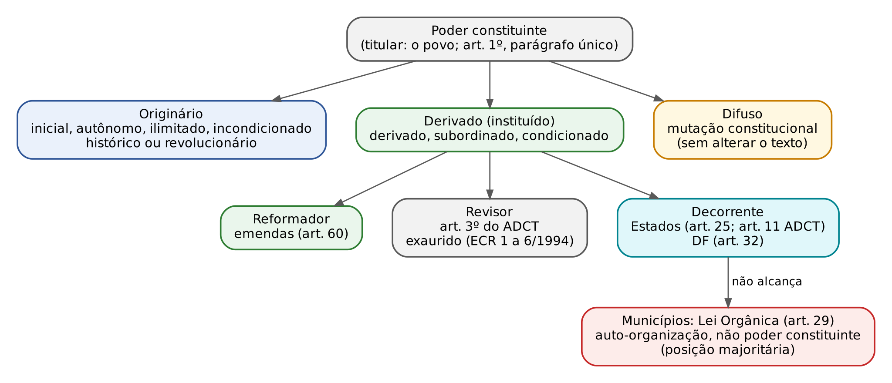
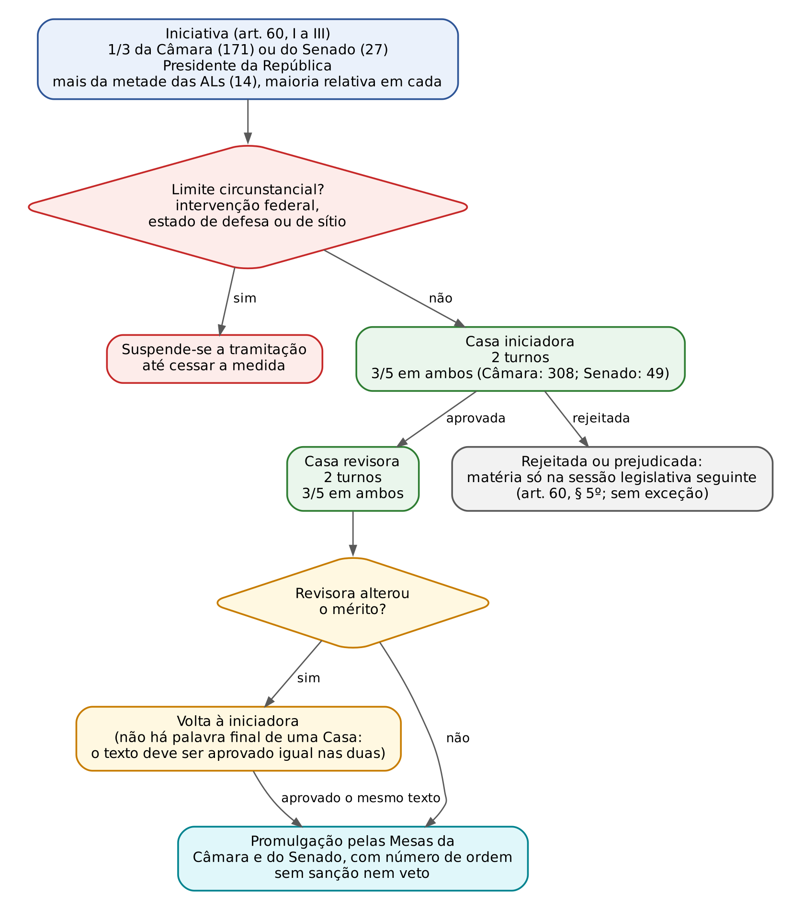
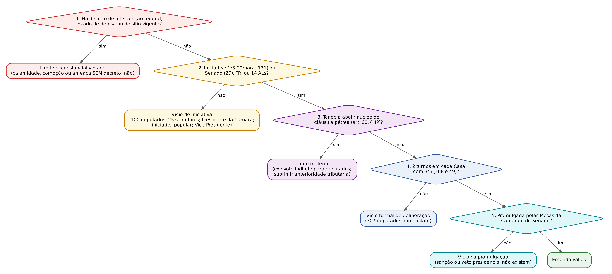
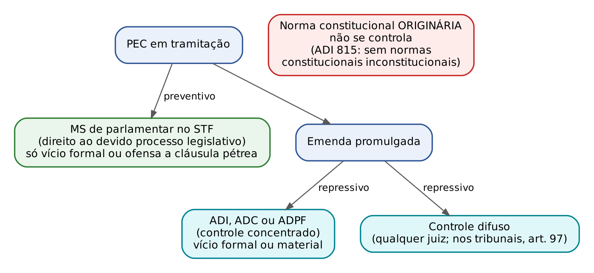
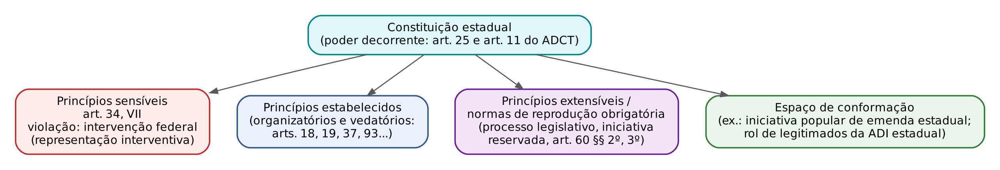
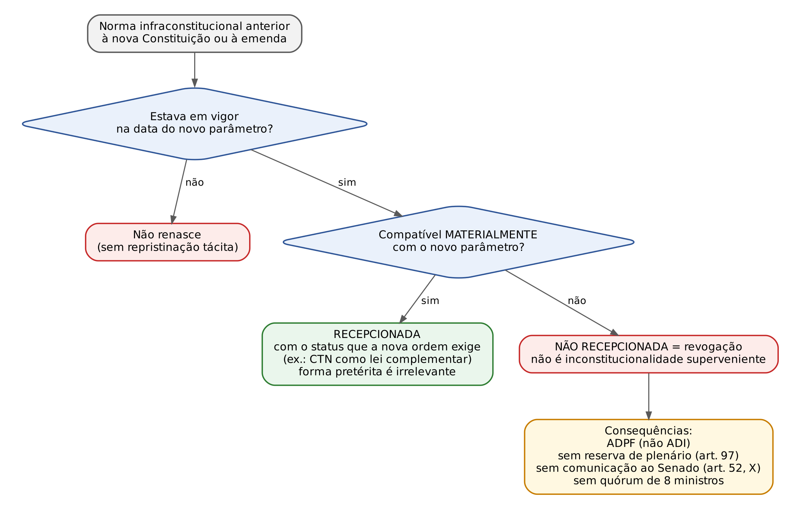
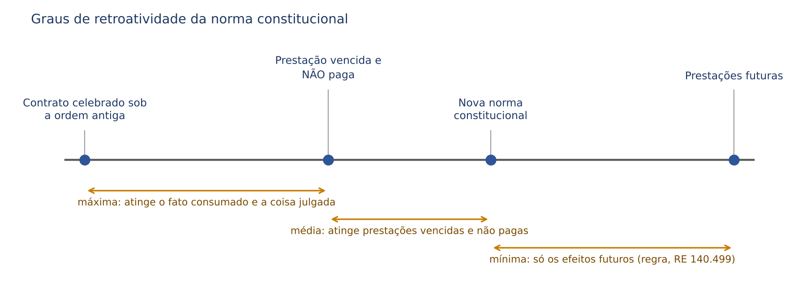

# CAPÍTULO 03 — PODER CONSTITUINTE, REFORMA DA CONSTITUIÇÃO E DIREITO CONSTITUCIONAL INTERTEMPORAL

:::INCIDENCIA
TRF5 p. 1; TJRS p. 2; TJSC p. 6. Nível A+. Lote: 38 questões (FGV 29, FCC 9), além de correlatas de outros capítulos.
O que mais cai: casos de PEC para conferir iniciativa, quórum, limite circunstancial, limite material e promulgação (art. 60); natureza do poder originário (fato x direito); poder decorrente e simetria (quórum de emenda estadual, reserva de iniciativa, normas originárias da Constituição estadual); recepção e não recepção diante de emenda superveniente.
:::

| Subtema | FGV | FCC | Padrão de cobrança |
|---|---|---|---|
| Rito da PEC (iniciativa, turnos, quórum, promulgação, art. 60, § 5º) | 11 | 6 | Caso com números (100, 171, 175, 25, 29 parlamentares; 307 votos) e "Mesa do Congresso" x "Mesas da Câmara e do Senado" |
| Limites circunstanciais | 9 | 1 | Calamidade, comoção, ameaça de invasão SEM decreto não impedem a emenda; intervenção federal decretada impede |
| Cláusulas pétreas | 7 | 3 | Rol literal do art. 60, § 4º; "voto distrital" e "voto obrigatório" não estão lá; direitos fora do art. 5º; ampliar direito durante estado de sítio continua vedado |
| Natureza e limites do poder originário | 3 | 0 | Fato (positivismo) x direito (jusnaturalismo); limites metajurídicos |
| Poder decorrente e simetria | 7 | 0 | Quórum de 3/5 na emenda estadual; reserva de iniciativa; normas originárias da Constituição estadual; sucessão municipal |
| Controle de emenda | 2 | 1 | MS só de parlamentar; vício formal por compra de votos (ADI 4.887) |
| Mutação constitucional | 0 | 1 | Limites semânticos e identitários |
| Recepção e emenda superveniente | 3 | 0 | Lei anterior incompatível com emenda: não recepção, ADPF, sem reserva de plenário |

## 03.1 Teoria do poder constituinte

### 03.1.1 Conceito, titularidade e exercício

Poder constituinte é o poder de criar (originário) ou de modificar e complementar (derivado) a Constituição. A distinção entre poder constituinte e poderes constituídos, formulada por Emmanuel Joseph Sieyès no panfleto de 1788 sobre o Terceiro Estado, é o fundamento lógico da supremacia e da rigidez constitucionais (ver Cap. 2): a obra do poder constituinte vincula os poderes que ela cria, e só por isso uma lei pode ser inválida perante a Constituição. Canotilho registra que os pressupostos da ideia já estavam em Locke (*supreme power*), embora a formulação técnica seja de Sieyès.

Titular e exercente não se confundem. Para Sieyès, o titular era a Nação; no constitucionalismo contemporâneo, prevalece a titularidade do POVO, que a CF/1988 assume no art. 1º, parágrafo único ("Todo o poder emana do povo, que o exerce por meio de representantes eleitos ou diretamente, nos termos desta Constituição"). O exercente é quem efetivamente elabora o texto: assembleia constituinte eleita (Constituições promulgadas, como a de 1988), governante ou grupo que outorga (Constituições outorgadas, como 1824, 1937 e, para parte da doutrina, 1967/1969) ou comissão de notáveis. A forma do exercício não muda a titularidade, mas afeta a LEGITIMIDADE.

:::PEGADINHA POVO NÃO É ETNIA
A FGV (AL-TO 2024, Q2457688) deu como FALSA a afirmação de que a titularidade do poder constituinte é do povo "compreendido como pessoas de origem étnica ou cultural comum", e que não se admitiria que fração dele atuasse como sua representação. O povo, como titular, é conceito político-jurídico (conjunto dos cidadãos), não étnico; e o exercício por representantes (assembleia) é justamente o modo ordinário de manifestação.
:::

### 03.1.2 Natureza: poder de fato ou poder de direito

A controvérsia sobre a natureza do poder constituinte originário é cobrada com rótulos:

| Corrente | Natureza | Fundamento | Consequência |
|---|---|---|---|
| Juspositivista (Kelsen, Carl Schmitt; prevalente no Brasil e no STF) | Poder de FATO, político, metajurídico, pré-jurídico | Força histórica que se impõe; o Direito começa com a Constituição | Não há limites jurídicos anteriores; normas originárias não são controladas |
| Jusnaturalista (Sieyès, tradição católica) | Poder de DIREITO | Direito natural, anterior e superior ao Estado | Há limites jurídicos suprapositivos (justiça, dignidade) |
| Mista ou dúplice | Fato e direito | Fato quanto à origem, mas vinculado a valores | Limites de legitimidade |

:::QUESTAO FGV 2026 — ALERJ — ESPECIALISTA LEGISLATIVO (Q3883335)
Caso: João sustenta que o poder constituinte é "poder de direito"; Maria, que tem contornos fáticos. Gabarito oficial: A (a concepção de João está lastreada no direito natural). Armadilhas: atribuir à tese de Maria (fato) a ideia de "essência humana e justiça" (D, que é jusnaturalista) ou dizer que, para ela, o poder constituinte existe no Estado que lhe preexiste (C; para o positivismo, é o poder constituinte que funda o Estado ou a nova ordem). B troca as teses: dizer que o poder "funda-se em si mesmo", metajurídico, é a visão positivista, não a de João.
:::

:::QUESTAO FGV 2024 — TCE-PA — AUDITOR (Q2566099)
País Beta, recém-independente, convoca assembleia para sua primeira Constituição. Gabarito: A (o poder constituinte é poder de fato). Note os rótulos: trata-se de poder originário HISTÓRICO (primeira Constituição do Estado), não "derivado", "decorrente" ou "pós-fundacional". A FGV adota a premissa positivista, que é a dominante.
:::

### 03.1.3 Espécies

- Originário (de primeiro grau, genuíno, inicial): cria a ordem jurídica. Subdivide-se em histórico ou fundacional (primeira Constituição do Estado) e revolucionário ou pós-fundacional (Constituições posteriores, que rompem a anterior); e em material (a decisão política sobre o conteúdo da nova ordem) e formal (a formalização jurídica do texto), aquele precedendo logicamente este.
- Derivado, instituído, constituído ou de segundo grau: criado pelo originário, com três manifestações: reformador (emendas, art. 60), revisor (art. 3º do ADCT, exaurido) e decorrente (Constituições estaduais e Lei Orgânica do DF).
- Difuso: atua informalmente pela mutação constitucional (ver 03.7).
- Supranacional: elabora Constituição de ordem supranacional (exemplo acadêmico: a tentativa de tratado constitucional da União Europeia); não se confunde com o transconstitucionalismo (ver Cap. 1), que trata do entrelaçamento de ordens jurídicas diversas diante dos mesmos problemas constitucionais, sem primazia de uma sobre outra.

:::DICA TERMINOLOGIA "PODER CONSTITUÍDO"
Parte da doutrina (e a FGV, em vários enunciados) prefere chamar o derivado de "poder constituído derivado reformador" ou "decorrente", justamente para frisar que não é poder constituinte em sentido próprio, mas competência criada pela Constituição. Se o enunciado falar em "poder constituído decorrente de caráter reformador" (Q3171380), trata-se da emenda à Constituição estadual.
:::

## 03.2 Poder constituinte originário

### 03.2.1 Características

| Característica | Conteúdo |
|---|---|
| Inicial | Inaugura nova ordem; não se funda em nenhuma norma anterior |
| Autônomo | Define livremente a estrutura e o conteúdo da nova ordem |
| Ilimitado (juridicamente) | Não se sujeita a limites do direito positivo anterior |
| Incondicionado | Não segue forma ou procedimento prefixado |
| Permanente (latente) | Não se esgota com a obra; pode ressurgir para nova ruptura |
| Soberano | Decorre do titular da soberania popular |

O caráter ilimitado é JURÍDICO. Admitem-se limites metajurídicos, que Jorge Miranda agrupa em ideológicos, institucionais e substanciais, estes divididos em transcendentes (direitos fundamentais ligados à dignidade, valores éticos superiores), imanentes (ligados à configuração do Estado, como soberania e forma de Estado consolidada) e heterônomos (decorrentes do direito internacional). Na mesma linha, fala-se em vedação do retrocesso em matéria de direitos humanos como limite de legitimidade do originário. A FGV considerou VERDADEIRA a afirmação de que o caráter ilimitado sofre objeções: limitações políticas próprias (valores éticos, religiosos e culturais da nação) e a vedação de decisões totalitárias, já que o poder se exerce para instituir um Estado de poderes limitados (Q2457688, gabarito B: V, F, V).

:::QUESTAO FGV 2024 — PREFEITURA DE NITERÓI — AUDITOR (Q3099305)
Grupos afirmam: Alfa, que o originário não tem limites "por ser poder de direito"; Beta, que o derivado tem limites circunstanciais, mas não materiais; Gama, que o decorrente é "limitado e incondicionado". Gabarito: B (Alfa totalmente errado; Beta parcialmente certo). Passos: Alfa erra o fundamento (a ausência de limites decorre de ser poder de FATO); Beta acerta os circunstanciais e erra ao negar os materiais (art. 60, § 4º); Gama acerta "limitado" e erra "incondicionado" (o decorrente é CONDICIONADO). As alternativas que dizem Gama "totalmente errado" ou "totalmente certo" caem pela mesma razão.
:::

### 03.2.2 Consequências jurídicas cobradas

1) Não há normas constitucionais originárias inconstitucionais: o STF rejeitou a tese de Bachof e não admite controle de norma originária, por inexistir hierarquia entre elas (ADI 815, v. Cap. 2); tensões resolvem-se por interpretação (Cap. 5).

2) Não há direito adquirido contra norma constitucional originária. As normas da nova Constituição têm incidência imediata e alcançam situações constituídas sob a ordem anterior; a preservação só ocorre se a própria Constituição ressalvar (STF, RE 140.894/SP, Relator Ministro Ilmar Galvão, Primeira Turma, j. 10/5/1996). O exemplo textual é o art. 17 do ADCT, que mandou reduzir imediatamente vencimentos e proventos percebidos em desacordo com a Constituição, "não se admitindo, neste caso, invocação de direito adquirido". A situação muda quando a norma nova é EMENDA (ver 03.3.5 e 03.8.5).

3) A eficácia das normas originárias "não está sujeita a nenhuma limitação normativa", por provirem de poder de fato e soberano, orientação reiterada pelo STF ao examinar, em contraste, a validade de emendas que alteraram o ADCT (STF, ADI 2.356 MC, Relator para o acórdão Ministro Ayres Britto, Plenário, j. 25/11/2010, citada na Sinopse TJSC 2026).

## 03.3 Poder constituinte derivado reformador

### 03.3.1 Natureza e características

O reformador é competência jurídica criada pelo originário para alterar formalmente o texto por emendas. É derivado (provém do originário), subordinado (submete-se aos limites materiais) e condicionado (segue o procedimento do art. 60). Daí a consequência central: a emenda é norma constitucional que pode ser declarada inconstitucional (ver 03.4), e a doutrina a chama, por isso, de norma constitucional derivada, sujeita a dupla verificação: formal (rito) e material (cláusulas pétreas).

As limitações ao poder de reforma (classificação corrente na doutrina e nas bancas):

| Espécie | Conteúdo na CF/1988 | Observação de prova |
|---|---|---|
| Temporais | NÃO existem | A Constituição de 1824 vedou reforma nos 4 anos iniciais (art. 174). "Limite temporal" na alternativa de prova da CF/1988 é sempre falso |
| Circunstanciais | Art. 60, § 1º: intervenção federal, estado de defesa, estado de sítio | Exigem a medida DECRETADA e vigente |
| Formais (procedimentais) | Iniciativa (art. 60, I a III); 2 turnos em cada Casa, 3/5 (§ 2º); promulgação pelas Mesas (§ 3º); irrepetibilidade na mesma sessão (§ 5º) | Subjetivos (iniciativa) e objetivos (rito) |
| Materiais explícitos | Art. 60, § 4º: forma federativa; voto direto, secreto, universal e periódico; separação dos Poderes; direitos e garantias individuais | "Tendente a abolir" protege o núcleo essencial |
| Materiais implícitos | Titularidade do poder constituinte; o próprio procedimento de reforma (vedação da dupla revisão); supressão das cláusulas pétreas | Construção doutrinária acolhida pela jurisprudência |

:::LEI CF, ART. 60
Art. 60. A Constituição poderá ser emendada mediante proposta:
I - de um terço, no mínimo, dos membros da Câmara dos Deputados ou do Senado Federal;
II - do Presidente da República;
III - de mais da metade das Assembléias Legislativas das unidades da Federação, manifestando-se, cada uma delas, pela maioria relativa de seus membros.
§ 1º A Constituição não poderá ser emendada na vigência de intervenção federal, de estado de defesa ou de estado de sítio.
§ 2º A proposta será discutida e votada em cada Casa do Congresso Nacional, em dois turnos, considerando-se aprovada se obtiver, em ambos, três quintos dos votos dos respectivos membros.
§ 3º A emenda à Constituição será promulgada pelas Mesas da Câmara dos Deputados e do Senado Federal, com o respectivo número de ordem.
§ 4º Não será objeto de deliberação a proposta de emenda tendente a abolir:
I - a forma federativa de Estado;
II - o voto direto, secreto, universal e periódico;
III - a separação dos Poderes;
IV - os direitos e garantias individuais.
§ 5º A matéria constante de proposta de emenda rejeitada ou havida por prejudicada não pode ser objeto de nova proposta na mesma sessão legislativa.
:::

### 03.3.2 Limites formais: iniciativa

O rol do art. 60 é TAXATIVO e mais estreito que o do art. 61:

| Legitimado | Exigência | Número (composição atual) |
|---|---|---|
| Deputados federais | 1/3, NO MÍNIMO, da Câmara | 171 dos 513 |
| Senadores | 1/3, no mínimo, do Senado | 27 dos 81 |
| Presidente da República | Iniciativa individual | (o Vice-Presidente NÃO; só se no exercício da Presidência) |
| Assembleias Legislativas | MAIS DA METADE das unidades da Federação, cada uma pela MAIORIA RELATIVA de seus membros | 14 das 27 (a Câmara Legislativa do DF conta) |

Não têm iniciativa de PEC: cidadãos (não há iniciativa popular de emenda federal; parte da doutrina, como José Afonso da Silva, a defende por interpretação sistemática do art. 1º, parágrafo único, e do art. 14, mas a posição não é acolhida em prova), STF, tribunais superiores, Procurador-Geral da República, Ministério Público, Advogado-Geral da União, comissões do Congresso, Presidente da Câmara ou do Senado isoladamente, parlamentar individual ou Câmaras Municipais.

Não incide na PEC a reserva de iniciativa do art. 61, § 1º: emenda à Constituição Federal de origem parlamentar pode tratar de servidores, organização administrativa, Defensoria etc. O poder reformador federal só se submete aos limites do art. 60; a reserva de iniciativa é limite dos poderes legislativos complementar e ordinário (STF, ADI 5.296, Relatora Ministra Rosa Weber, Plenário, j. 4/11/2020, mérito; a cautelar, de 18/5/2016, está no Info 826). Atenção ao contraste com as emendas às Constituições ESTADUAIS (ver 03.6.4).

:::PEGADINHA OS NÚMEROS
- 1/3 da Câmara: 171 (513 ÷ 3 = 171). Logo, 171, 172, 175 deputados BASTAM; 100 ou 170 NÃO.
- 1/3 do Senado: 27. Logo, 29 senadores bastam; 25 não.
- 3/5 da Câmara: 307,8, arredondado para 308 votos. 307 votos NÃO aprovam. No Senado, 3/5 de 81 = 48,6, isto é, 49 votos.
- Assembleias: mais da metade de 27 = 14; "pelo menos metade", "um terço" ou "três quintos de seus membros" são distratores. Cada Assembleia decide por maioria RELATIVA (não absoluta, não 3/5, não dois turnos).
- 3/5 é a regra de aprovação; "dois terços" no enunciado SUPERA 3/5 e, portanto, não é vício (cuidado com o candidato que marca "quórum inobservado" porque a CF fala em 3/5).
:::

### 03.3.3 Limites formais: deliberação, promulgação e reapresentação

Discussão e votação em cada Casa, em DOIS turnos, com 3/5 dos votos dos respectivos MEMBROS (não dos presentes) em ambos. Não há sessão conjunta (ressalvada a revisão de 1993/1994, ver 03.5), não há sanção nem veto, e a promulgação cabe às Mesas da Câmara dos Deputados e do Senado Federal, com o respectivo número de ordem.

Pontos de prova:

- Promulgação pelas "Mesas da Câmara dos Deputados e do Senado Federal" (§ 3º), em sessão solene conjunta, NÃO pela "Mesa do Congresso Nacional" (que é presidida pelo Presidente do Senado e composta na forma do art. 57, § 5º). A FCC cobra a literalidade (Q3386967: a alternativa "promulgação pela Mesa do Congresso Nacional" foi considerada errada; Q3215149, gabarito C, reproduz o texto do § 3º). Na FGV, o detalhe nem sempre é tratado como vício (ver Q3605990 abaixo).
- Não há sanção, logo não há veto; o Presidente da República participa apenas como possível proponente (Q3848958, alternativa E, errada).
- Bicameralismo perfeito na PEC: se a Casa revisora altera o MÉRITO, o texto volta à iniciadora; a emenda só é promulgada quando o mesmo texto obtém 3/5 em dois turnos nas duas Casas. Diversamente do projeto de lei (art. 65, parágrafo único), NÃO há Casa com palavra final: se a iniciadora rejeitar as alterações da revisora, não prevalece a sua versão original (FCC, Q3386967, gabarito E). Alterações meramente redacionais não exigem retorno. A prática da "PEC paralela" (desmembrar o texto, promulgando a parte consensual e iniciando nova PEC com a parte modificada) é admitida, desde que a parte promulgada tenha sido aprovada nas duas Casas.
- Irrepetibilidade (§ 5º): matéria de PEC rejeitada ou havida por prejudicada não pode ser objeto de nova proposta na mesma sessão legislativa, sem exceção. Para projetos de lei, o art. 67 admite a reapresentação na mesma sessão mediante proposta da maioria absoluta dos membros de qualquer das Casas. A sessão legislativa ordinária vai de 2 de fevereiro a 17 de julho e de 1º de agosto a 22 de dezembro (art. 57); por isso, PEC rejeitada em março só pode ser reapresentada no ANO seguinte, e não "a partir de 1º de agosto" (FCC, Q3386967, alternativa A, errada: o recesso de julho não inaugura nova sessão legislativa).
- Emenda que dependa de regulamentação entra em vigor na data nela prevista ou na promulgação; a eficácia limitada de alguma norma não condiciona a vigência da emenda (Q3386967, alternativa C, errada; ver Cap. 4).
- O controle sobre interpretação do regimento na tramitação da PEC esbarra na doutrina dos atos *interna corporis* (ver Cap. 26). Exemplo: na ADI 2.135 (mérito em 6/11/2024), o STF afastou o alegado vício na tramitação da EC 19/1998 quanto ao regime jurídico único, sem revisar a aplicação de normas regimentais (v. Cap. 24).

:::QUESTAO FCC 2025 — DPE-RS — DEFENSOR PÚBLICO (Q3386967)
Afirmações sobre o rito da PEC. Gabarito: E (se a iniciadora não aprova as emendas da revisora, a proposta inicial NÃO prevalece). Armadilhas: A (rejeitada em 18/3/2025, reapresentação "na nova sessão legislativa a partir de 1º/8/2025": falso, a sessão legislativa é anual); B ("Mesa do Congresso Nacional": falso pela letra do § 3º); C (vigência condicionada à regulamentação: falso); D (a iniciadora "transformaria" as emendas da revisora em PEC paralela: criação de figura inexistente no texto).
:::

:::QUESTAO FCC 2024 — TRT-7 — ANALISTA JUDICIÁRIO (Q3089703)
Rito completo. Gabarito: D (aprovada se obtiver, em ambos os turnos, 3/5 dos votos dos membros, e promulgada pelas Mesas da Câmara e do Senado, com número de ordem). Distratores: 2/5; 2/3; promulgação pelo Presidente; reapresentação na mesma sessão. No mesmo sentido, com variações literais: FCC 2025 — SEFAZ-PI (Q3506146, gabarito B); FCC 2026 (Q3976711, gabarito A: mais da metade das ALs, maioria relativa, vedação na mesma sessão); FCC 2025 — TRT-6 (Q3215149, gabarito C: promulgação pelas Mesas, com número de ordem; erradas "metade da Câmara e do Senado", "reapresentação como regra" e "voto periódico abolível"); FGV 2025 — SEPLAN-SE (Q3406144, gabarito B: 1/3 da Câmara ou do Senado; erradas "1/3 das ALs", "Presidente ou Vice", "Presidente da Câmara", "Presidente do Senado").
:::

### 03.3.4 Limites circunstanciais

"A Constituição não poderá ser emendada na vigência de intervenção federal, de estado de defesa ou de estado de sítio" (art. 60, § 1º). O rol é fechado e pressupõe a medida JURIDICAMENTE INSTAURADA, isto é, o decreto em vigor. Situações de fato graves (calamidade de grandes proporções, comoção grave de repercussão nacional, ameaça de invasão estrangeira, tensão na fronteira, grave instabilidade institucional, risco de secessão) NÃO impedem a reforma enquanto não houver decreto de estado de defesa (art. 136), de sítio (art. 137) ou de intervenção federal (art. 36). É o padrão mais repetido nas questões FGV do lote.

Alcance: a vedação recai sobre a tramitação deliberativa e a promulgação; a doutrina majoritária entende que a PEC pode ser apresentada, mas sua discussão e votação ficam sobrestadas enquanto vigorar a medida. Na prática, a intervenção federal na segurança pública do Rio de Janeiro em 2018 levou à suspensão da tramitação da reforma da Previdência então em curso. A vedação abrange QUALQUER emenda, inclusive a que amplie direitos (Q3872163): o fundamento não é o conteúdo, mas a falta de normalidade institucional para a deliberação.

Não são limites circunstanciais do art. 60, § 1º: a intervenção ESTADUAL em Município, a calamidade pública reconhecida pelo Congresso (que, ao contrário, ensejou emendas como a EC 106/2020), o período eleitoral ou a vacatio de lei.

:::QUESTAO FGV 2025 — AGSUS — ADVOGADO (Q3659043)
Durante intervenção federal no Estado Alfa, o Presidente apresenta PEC para cumprir promessas de campanha. Gabarito: E (a Constituição não poderá ser emendada enquanto vigorar a intervenção federal). Armadilha: A (o Presidente tem iniciativa própria, art. 60, II; o óbice é circunstancial, não de legitimidade); C (o limite não depende de a matéria ser federativa).
:::

:::QUESTAO FCC 2026 — CPU-PE — ANALISTA JURÍDICO (Q3872163)
Duas situações: 1/3 da Câmara propõe PEC tendente a abolir a separação dos Poderes; o Presidente, durante estado de sítio, quer propor PEC que AMPLIA direitos individuais. Gabarito: D (nenhuma pode prosperar). A primeira esbarra no limite material (o legitimado é válido, o objeto não); a segunda, no limite circunstancial, que não distingue conteúdo favorável ou desfavorável. Distratores B e E exploram a ideia sedutora de que "ampliar não é abolir": vale para o § 4º, não para o § 1º.
:::

:::PASSO ROTEIRO FGV PARA O CASO DE PEC (APLIQUE NA ORDEM)
1. Há DECRETO de intervenção federal, estado de defesa ou de sítio? Fatos graves sem decreto não contam.
2. Iniciativa: contar (171 deputados, 27 senadores, Presidente da República, 14 Assembleias por maioria relativa).
3. Objeto: tende a abolir o núcleo de cláusula pétrea? (forma federativa; voto direto, secreto, universal e periódico; separação dos Poderes; direitos e garantias individuais, inclusive fora do art. 5º).
4. Quórum: dois turnos em cada Casa, 3/5 dos membros (308 e 49); 2/3 também serve.
5. Promulgação: Mesas da Câmara e do Senado; sem sanção.
6. Se rejeitada: só na sessão legislativa seguinte.
:::

:::QUESTAO FGV 2025 — PGM-RJ — ANALISTA DE PROCURADORIA (Q3605990)
25 senadores propõem voto indireto para Deputados Distritais; havia tensão na fronteira; aprovação por 2/3 em dois turnos; promulgação "pela Mesa do Congresso Nacional". Gabarito: B (só vício de iniciativa e afronta a limite material). Passos: (1) tensão sem decreto: sem limite circunstancial; (2) 25 < 27: vício de iniciativa; (3) voto indireto para deputados: abole o voto DIRETO (art. 60, § 4º, II); (4) 2/3 supera 3/5; (5) a FGV não tratou a referência à "Mesa do Congresso Nacional" como vício autônomo. Registre a divergência com a FCC, que exige a letra do § 3º; em prova FGV, só marque vício de promulgação quando houver sanção, veto ou promulgação pelo Presidente.
:::

:::QUESTAO FGV 2025 — SEFAZ-RS — AUDITOR DO ESTADO (Q3154663)
175 deputados, durante "grave comoção de repercussão nacional" (sem decreto), propõem PEC para afastar a anterioridade (art. 150, III, b) em relação a determinado imposto. Gabarito: C (apenas afronta limite material). A anterioridade tributária é garantia individual do contribuinte fora do art. 5º, protegida pelo art. 60, § 4º, IV, como decidiu o STF ao examinar a EC 3/1993 (IPMF) na ADI 939. 175 ≥ 171: iniciativa válida. Comoção sem estado de defesa ou de sítio decretado: sem limite circunstancial.
:::

:::QUESTAO BLOCO FGV DE CASOS COM RESPOSTA "SEM VÍCIO" OU "VÍCIO ÚNICO"
- FGV 2026 — TJSC — Analista Jurídico (Q4150689): 175 deputados, ameaça de invasão (sem decreto), PEC sobre emprego das Forças Armadas, 2/3 em dois turnos, promulgação pelas Mesas. Gabarito B: nenhum vício.
- FGV 2024 (Q3157894): 29 senadores, risco iminente de agressão armada (sem decreto), PEC sobre bens da União na faixa de fronteira. Gabarito B: nenhum vício.
- FGV 2024 — Prefeitura de Macaé — Procurador (Q3049901): 172 deputados, comoção grave e temor de secessão (sem decreto), PEC que altera "contornos semânticos" de direito fundamental sem afetar a substância. Gabarito A: tudo compatível (alterar sem esvaziar o núcleo não é "tendente a abolir").
- FGV 2024 — TJRJ — Residência (Q2375279): 172 deputados, ameaça institucional em duas regiões (sem decreto), PEC fixando pena mínima para corrupção. Gabarito D: nenhuma incompatibilidade. "Limite temporal" (alternativa C) não existe na CF/1988.
- FGV 2025 — Prefeitura de Niterói — Advogado (Q3656896): 100 deputados, calamidade natural, PEC que ACRESCE direito ao art. 5º, aprovada e promulgada sem o Presidente. Gabarito C: só vício de iniciativa (100 < 171). Acrescentar direito não ofende cláusula pétrea; a não participação do Presidente é a regra.
- FGV 2024 — Câmara de Fortaleza — Consultor Legislativo (Q2482348): 171 deputados, instabilidade em duas regiões (sem decreto), PEC sobre precatórios, aprovada com 49 votos no Senado e 307 na Câmara. Gabarito D: afronta ao quórum (307 < 308).
- FGV 2026 — PGE-AC — Procurador (Q4079342): Assembleias elaboram PEC sobre direitos previstos em normas programáticas; duas regiões sofrem calamidade (sem decreto). Gabarito E: nenhum limite violado, e a proposta deve ser aprovada em cada Assembleia, do total necessário (mais da metade delas), pela maioria relativa de seus membros. Erradas: C ("um terço das Assembleias") e D (negar legitimidade às Assembleias).
:::

### 03.3.5 Limites materiais explícitos: as cláusulas pétreas

#### O que significa "tendente a abolir"

O § 4º veda a DELIBERAÇÃO da proposta (o que fundamenta o mandado de segurança do parlamentar: ver 03.4.1) e protege o NÚCLEO ESSENCIAL dos princípios e institutos, não a sua redação literal. As cláusulas pétreas não significam intangibilidade literal: emenda que altera, reorganiza ou restringe aspectos acidentais é válida se não suprime nem esvazia o conteúdo essencial, orientação firmada pelo STF ao examinar a sujeição dos servidores ocupantes de cargo em comissão ao regime geral de previdência (ADI 2.024). Por outro lado, a vedação alcança propostas que, sem abolir formalmente, tendam a esse resultado por erosão progressiva.

Também não se exige que a emenda trate do tema "de frente": emenda sobre tributos pode violar o federalismo (imunidade recíproca) ou garantias individuais (anterioridade), como no caso do IPMF (ADI 939).

:::QUESTAO FCC 2026 — PGM-MANAUS — PROCURADOR (Q4338755)
Quais são cláusulas pétreas? Gabarito: A (direitos e garantias individuais; forma federativa; voto direto, secreto, universal e periódico). Distratores: "vedação à dupla revisão" e "iniciativa popular para emendar" como cláusulas expressas (não são); "voto distrital" (não existe na lista); "processo de emenda estabelecido pelo originário" (é limite IMPLÍCITO, não expresso). No mesmo sentido: FGV 2026 (Q3878419, gabarito E: candidato que defende abolir a forma federativa e o voto secreto não pode prosperar; a alternativa C inventa ressalva de "referendo"); FGV 2026 — ENAM (Q4102394, gabarito E: I, II e III corretas, sendo III o rol literal do § 4º).
:::

#### Forma federativa de Estado (inciso I)

Protege a autonomia dos entes (auto-organização, autogoverno, autoadministração e repartição de competências com rendas próprias) e a indissolubilidade do vínculo (art. 1º; não há direito de secessão). Não petrifica a atual repartição de competências nem o número de entes; protege o equilíbrio federativo contra esvaziamento. Exemplo cobrado: a imunidade recíproca (art. 150, VI, a) como garantia da federação, oponível a emenda (ADI 939). Desenvolvimento do federalismo no Cap. 21.

#### Voto direto, secreto, universal e periódico (inciso II)

Os quatro atributos são petrificados; a OBRIGATORIEDADE do voto (art. 14, § 1º, I) NÃO está na lista, de modo que emenda pode instituir o voto facultativo. O sistema eleitoral (proporcional, majoritário, distrital, misto) também não está petrificado. Petrificar o voto PERIÓDICO veda a prorrogação indefinida de mandatos, mas a jurisprudência e a doutrina admitem ajustes pontuais e transitórios de duração de mandatos para coincidência de eleições, desde que não haja perpetuação; a vedação de perpetuação de mandatos é apontada como limite implícito ligado ao princípio republicano. A Constituição contempla eleição indireta excepcional (art. 81, § 1º, dupla vacância nos dois últimos anos), obra do originário.

#### Separação dos Poderes (inciso III)

Protege o núcleo das funções típicas e a independência e harmonia (art. 2º). Emenda que suprima o controle jurisdicional sobre certa matéria agride a separação dos Poderes e, cumulativamente, a garantia individual da inafastabilidade (art. 5º, XXXV). Emenda pode reagir à jurisprudência do STF e só cai se ofender o art. 60; lei ordinária frontalmente contrária nasce com presunção relativa de inconstitucionalidade (ADI 5.105, v. Cap. 5). Exemplo: após a ADI 4.983 (vaquejada), veio a EC 96/2017 (art. 225, § 7º), validada pelo STF, que na ADI 5.772 (Relator Ministro Dias Toffoli, j. 5/3/2026) admitiu as leis federais sobre a vaquejada condicionadas ao bem-estar animal (desenvolvimento no Cap. 5 e na Apostila de Direito Ambiental).

:::QUESTAO FCC 2026 — DPE-BA — DEFENSOR PÚBLICO (Q4037424)
PEC que afasta o controle judicial sobre decisões de execução orçamentária, a pretexto de reforçar a separação de Poderes. Gabarito: E (pode ser incompatível com a inafastabilidade da jurisdição caso afaste completamente o controle judicial). A banca usou "pode" porque a incompatibilidade depende de supressão integral do núcleo; distratores tratam o orçamento como imune ao controle (C, D) ou validam a substituição judicial como argumento (B).
:::

#### Direitos e garantias individuais (inciso IV)

Três questões recorrentes:

a) Não estão só no art. 5º. O STF reconheceu garantias individuais fora do art. 5º: a anterioridade tributária (art. 150, III, b; ADI 939) e a anterioridade eleitoral (art. 16; ADI 3.685 e EC 52/2006, v. Cap. 14). A FGV (AL-PR 2024, Q2450179, gabarito B) considera cláusulas pétreas os direitos fundamentais previstos expressamente na Constituição, ainda que fora do capítulo específico.

b) Direitos sociais, políticos e de nacionalidade. A letra fala em direitos "individuais"; a doutrina majoritária (Ingo Sarlet, entre outros) sustenta interpretação ampliativa, incluindo os direitos fundamentais em geral, ao menos em seu núcleo ligado à dignidade, e há posição restritiva que se apega à literalidade. Em prova objetiva, a alternativa que diz que direitos sociais "não gozam do status de cláusula pétrea" costuma ser tratada como incorreta ou, no mínimo, controvertida; a que diz que direitos fundamentais fora do art. 5º são cláusulas pétreas costuma ser correta. Os remédios constitucionais (garantias) integram o núcleo protegido (Q2450176, alternativa E, falsa).

c) Ampliação de direitos é permitida: o § 4º veda abolir, não acrescentar (Q3656896). Porém, a emenda que crie direito NÃO o converte necessariamente em cláusula pétrea na visão de parte da doutrina, e a FGV considerou FALSA a afirmação de que "é possível que uma reforma constitucional crie novas cláusulas pétreas além daquelas previstas originariamente" (Q2450179, alternativa E). A matéria é controvertida: há quem sustente que direitos individuais introduzidos por emenda, por se integrarem ao inciso IV, ficam protegidos, sobretudo quando o novo direito é mero desdobramento de direito já existente. Guarde: criar NOVA HIPÓTESE no rol do § 4º é inviável, porque o poder derivado não pode limitar o próprio poder derivado futuro além do que o originário fixou.

:::QUESTAO FGV 2024 — AL-PR — ANALISTA LEGISLATIVO (Q2450179)
Gabarito: B (são cláusulas pétreas os direitos fundamentais expressos na CF, mesmo fora do capítulo dos direitos individuais). Análise das demais: A (tratados do art. 5º, § 3º, não seriam cláusulas pétreas): a banca a deu como falsa, à luz da equivalência às emendas e da abertura do art. 5º, § 2º, embora o tema seja controvertido (ver Cap. 11); C (todas as cláusulas são expressas e taxativas): falso, há limites implícitos; D (normas do procedimento de emenda podem ser alteradas livremente): falso, são limite implícito; E: falso, como visto.
:::

#### Direito adquirido e emenda constitucional

A proteção do art. 5º, XXXVI ("a lei não prejudicará o direito adquirido, o ato jurídico perfeito e a coisa julgada") é garantia individual. Debate-se se a palavra "lei" alcança a emenda. A posição dominante no STF é de que a emenda deve respeitar o direito adquirido, mas com duas ressalvas decisivas: não há direito adquirido a REGIME JURÍDICO (estatutário, previdenciário, remuneratório), e não há direito adquirido a permanecer imune a tributo que venha a incidir sobre fatos geradores futuros. Foi assim que o STF validou a contribuição previdenciária dos servidores inativos instituída pela EC 41/2003 (ADI 3.128, conforme a Sinopse TJSC 2026). As emendas previdenciárias são, ainda, controladas por outros parâmetros petrificados, como a igualdade material de gênero (ADI 7.727 MC-Ref, aposentadoria de policiais na EC 103/2019, v. Cap. 8). Detalhes previdenciários na Apostila de Direito Previdenciário; regime geral do direito adquirido no Cap. 10.

### 03.3.6 Limites materiais implícitos

A doutrina (com origem em Nelson de Sousa Sampaio, difundida no Brasil por José Afonso da Silva) aponta limites que, embora não escritos, decorrem da lógica do sistema:

- a titularidade do poder constituinte (o povo) e a do poder reformador (o derivado não pode transferir a si próprio a condição de originário);
- o próprio procedimento de reforma: as regras do art. 60 não podem ser flexibilizadas por emenda (por exemplo, reduzir o quórum para maioria simples ou dispensar os dois turnos), sob pena de fraude à rigidez;
- a supressão do § 4º: emenda não pode revogar as cláusulas pétreas.

Daí a rejeição da tese da DUPLA REVISÃO (ou dupla reforma), segundo a qual uma primeira emenda revogaria a cláusula pétrea e uma segunda, já sem óbice, aboliria o conteúdo antes protegido. Admiti-la tornaria o § 4º inútil (FCC, Q4338755, alternativa B, menciona a vedação à dupla revisão como se fosse cláusula expressa: não é, é decorrência implícita).

Também se aponta como implícita a forma republicana (que não está no § 4º): o art. 2º do ADCT submeteu forma e sistema de governo a plebiscito, realizado em 21/4/1993, e a escolha popular pela república e pelo presidencialismo é invocada como limite à sua alteração por simples emenda. O tema é controvertido; em prova, "república é cláusula pétrea expressa" é falso, e "república é limite implícito, para parte da doutrina" é a formulação segura.

:::QUESTAO FGV 2026 — PC-PI — DELEGADO DE POLÍCIA (Q3848958)
Associações querem saber os limites do controle de emendas. Gabarito: D (emendas são manifestações do poder derivado, sujeito aos limites postos pelo originário, como o art. 60, § 4º). Erradas: A (a supremacia não impede o controle de emendas: ao contrário, o funda); B (qualquer cidadão impetrar MS contra PEC: só o parlamentar); C (emendas como manifestação do originário); E (sanção e veto presidencial).
:::

## 03.4 Controle de constitucionalidade das emendas

### 03.4.1 Controle preventivo: mandado de segurança do parlamentar

O STF admite que o PARLAMENTAR da Casa em que tramita a proposição impetre mandado de segurança para resguardar o direito líquido e certo de não participar de deliberação inconstitucional (devido processo legislativo). Em regra, o STF não faz controle preventivo de conteúdo de projeto de lei; há duas exceções: (a) proposta de emenda que viole cláusula pétrea, porque o § 4º veda a própria DELIBERAÇÃO; (b) proposta de emenda ou projeto de lei cuja tramitação viole as regras constitucionais do processo legislativo (MS 32.033, v. Cap. 17).

Pontos de prova:

- Legitimidade EXCLUSIVA do parlamentar (não de partido, cidadão, associação ou de parlamentar de outra Casa sobre a qual a proposição não tramita). Perda superveniente do mandato acarreta a extinção do MS por ilegitimidade superveniente.
- Promulgada a emenda, o MS perde o objeto; o controle passa a ser repressivo.
- Discussões estritamente regimentais são *interna corporis* (ver Cap. 26); o MS deve apontar ofensa a norma CONSTITUCIONAL do processo legislativo.
- Desenvolvimento do controle preventivo no Cap. 17.

### 03.4.2 Controle repressivo

A emenda promulgada é ato normativo primário e se sujeita a ADI, ADC e ADPF (subsidiária) no STF, além do controle difuso por qualquer juiz (nos tribunais, com reserva de plenário, art. 97). O parâmetro é o art. 60 (limites formais, circunstanciais e materiais, explícitos e implícitos). Normas constitucionais ORIGINÁRIAS não são objeto (03.2.2).

A inconstitucionalidade formal de emenda pode decorrer de vício na manifestação de vontade dos parlamentares. O STF afirmou que, em tese, é possível reconhecer inconstitucionalidade formal no processo constituinte reformador quando viciada a vontade do parlamentar por ilícitos que infirmam a moralidade e a probidade, mas exigiu demonstração inequívoca de que, sem os votos viciados, o resultado seria outro. No caso, os votos de parlamentares condenados na AP 470 ("mensalão") eram insuficientes para alterar a aprovação das ECs 41/2003 e 47/2005, e as ações foram julgadas improcedentes (STF, ADIs 4.887, 4.888 e 4.889, Relatora Ministra Cármen Lúcia, Plenário, j. 10/11/2020, Info 998).

:::JURIS STF, ADIS 4.887, 4.888 E 4.889, J. 10/11/2020
Tese do voto: "em tese, é possível o reconhecimento de inconstitucionalidade formal no processo constituinte reformador quando eivada de vício a manifestação de vontade do parlamentar no curso do devido processo constituinte derivado, pela prática de ilícitos que infirmam a moralidade, a probidade administrativa e fragilizam a democracia representativa". Requisito: nexo causal entre os votos viciados e o resultado (contagem: retiram-se os votos comprovadamente comprados e verifica-se se subsistem os 3/5). A FGV transcreveu a tese no ENAM 2026 (Q4102394, item II, correto).
:::

Outras observações:

- A emenda pode ser parâmetro de controle a partir de sua vigência; lei anterior incompatível com ela não é inconstitucional, mas não recepcionada (03.8.3).
- O STF julga a ADI mesmo que o parâmetro invocado tenha sido alterado por emenda superveniente: não se admite constitucionalidade superveniente, e a lei se avalia pelo parâmetro de sua época (princípio da contemporaneidade; ADI 2.158; v. Cap. 18).
- Emendas são frequentemente objeto de modulação de efeitos em razão do tempo decorrido (exemplo: EC 19/1998 e o regime jurídico único, ADI 2.135, efeitos *ex nunc*; v. Cap. 24).

:::SENTENCA ARGUIÇÃO INCIDENTAL DE INCONSTITUCIONALIDADE DE EMENDA (ÓRGÃO FRACIONÁRIO)
"A parte autora suscita, incidentalmente, a inconstitucionalidade do art. X da Emenda Constitucional n. Y, sob o fundamento de que suprime o núcleo essencial de garantia individual (CF, art. 60, § 4º, IV). Tratando-se de norma constitucional derivada, produto de poder subordinado e condicionado, é admissível o seu controle. Contudo, a declaração de inconstitucionalidade por órgão fracionário esbarra na cláusula de reserva de plenário (CF, art. 97; Súmula Vinculante 10), inexistindo pronunciamento anterior do Plenário deste Tribunal ou do Supremo Tribunal Federal sobre a questão (CPC, art. 949, parágrafo único). Acolho a arguição e determino a remessa dos autos ao Órgão Especial."
Se a tese fosse de não recepção de lei anterior à emenda, não haveria remessa: o órgão fracionário decide diretamente (ver 03.8.3).
:::

## 03.5 Poder constituinte derivado revisor

O art. 3º do ADCT previu: "A revisão constitucional será realizada após cinco anos, contados da promulgação da Constituição, pelo voto da maioria absoluta dos membros do Congresso Nacional, em sessão unicameral". Diferenças em relação ao reformador:

| Critério | Revisor (art. 3º do ADCT) | Reformador (art. 60) |
|---|---|---|
| Momento | Uma única vez, após 5 anos (realizada em 1993 e 1994) | A qualquer tempo, salvo limites circunstanciais |
| Sessão | Unicameral (Congresso reunido) | Bicameral (cada Casa separadamente) |
| Turnos | Não previstos no ADCT (votação única) | Dois turnos em cada Casa |
| Quórum | Maioria absoluta dos membros do Congresso | 3/5 dos membros de cada Casa |
| Produto | Emendas Constitucionais de Revisão (ECR 1 a 6, de 1994) | Emendas numeradas (EC 1/1992 a EC 141/2026) |
| Limites materiais | Os do art. 60, § 4º (STF; doutrina majoritária) | Art. 60, § 4º |

Pontos de prova:

- A revisão se EXAURIU com a ECR 6/1994; não pode ser repetida. Emenda que instituísse nova revisão por quórum facilitado seria inconstitucional (fraude aos limites formais e violação do limite implícito ao procedimento de reforma).
- A ligação com o plebiscito do art. 2º do ADCT (antecipado para 21/4/1993 pela EC 2/1992) levou parte da doutrina a sustentar que a revisão só caberia se o povo escolhesse monarquia ou parlamentarismo; o STF não acolheu a restrição: o resultado do plebiscito não tornou sem objeto a revisão, sujeita, como a emenda, aos limites do art. 60, § 4º, e ao controle judicial (STF, ADI 981 MC, Relator Ministro Néri da Silveira, Plenário, j. 17/12/1993).
- A ECR 5/1994 reduziu o mandato presidencial de 5 para 4 anos; a ECR 4/1994 alterou o art. 14, § 9º (inelegibilidades), e a ECR 6/1994 acrescentou o § 4º ao art. 55 (efeitos da renúncia de parlamentar submetido a processo de perda do mandato); a ECR 1/1994 criou o Fundo Social de Emergência no ADCT. Úteis para questões de "emendas avulsas" (as ECRs, a EC 106/2020 e outras não incorporadas ao texto permanente têm a mesma hierarquia das demais normas constitucionais).
- O último número de EC conferido no quadro do Planalto em 11/11/2026 é a EC 141, de 16/10/2026 (redução da jornada semanal e dois dias de repouso, art. 7º).

## 03.6 Poder constituinte derivado decorrente

### 03.6.1 Conceito, fundamento e espécies

Decorrente é o poder atribuído aos Estados-membros (e, para a posição majoritária, ao Distrito Federal) de se auto-organizarem por Constituições próprias, expressão da autonomia federativa. Fundamento: art. 25, caput ("Os Estados organizam-se e regem-se pelas Constituições e leis que adotarem, observados os princípios desta Constituição") e art. 11 do ADCT ("Cada Assembléia Legislativa, com poderes constituintes, elaborará a Constituição do Estado, no prazo de um ano, contado da promulgação da Constituição Federal, obedecidos os princípios desta").

Espécies:

- Decorrente inicial ou instituidor: a elaboração da Constituição estadual (1989, nos termos do art. 11 do ADCT; a Constituição de Santa Catarina e a do Rio Grande do Sul são de 1989).
- Decorrente de revisão estadual (ou reformador estadual): as emendas à Constituição estadual, que observam, por simetria, o modelo do art. 60 (03.6.3).

Características: derivado, subordinado (aos princípios da CF) e condicionado (aos procedimentos que a CF impõe). É, portanto, poder de segundo grau; o originário é o único de primeiro grau. Parte da doutrina e do próprio STF descreve o poder constituinte estadual como "poder constituído", sujeito aos limites da ordem federal.

### 03.6.2 Limites: princípios sensíveis, estabelecidos e extensíveis

A doutrina classifica os princípios que a Constituição estadual deve observar ("observados os princípios desta Constituição", art. 25):

| Classe | Conteúdo | Consequência da violação |
|---|---|---|
| Sensíveis | Art. 34, VII: forma republicana, sistema representativo e regime democrático; direitos da pessoa humana; autonomia municipal; prestação de contas da administração direta e indireta; aplicação do mínimo da receita de impostos estaduais em ensino e saúde | Representação interventiva do PGR ao STF e intervenção federal (art. 36, III; ver Caps. 19 e 23); rol taxativo |
| Estabelecidos (organizatórios) | Dispersos no texto: limitações expressas (vedatórias, como o art. 19; mandatórias, como os arts. 37 a 41, 93, 95) e implícitas ou decorrentes do sistema (federalismo, Estado de Direito) | Inconstitucionalidade da norma estadual |
| Extensíveis | Normas de organização da União que se estendem aos Estados (processo legislativo, iniciativa reservada, regras do Executivo, modelo do TCU, art. 75) | Inconstitucionalidade; são normas de reprodução obrigatória |

A distinção entre "normas de reprodução obrigatória" e "normas de imitação" importa sobretudo para o controle estadual (ver Cap. 20): as primeiras incidem sobre o Estado ainda que a Constituição estadual seja omissa e, se reproduzidas, servem de parâmetro no TJ com possibilidade de recurso extraordinário; as segundas são opção do constituinte estadual. Os Tribunais de Justiça podem exercer controle abstrato de leis municipais tendo como parâmetro normas da CF de reprodução obrigatória (Tema 484, v. Cap. 20).

:::QUESTAO FGV 2025 — PC-MG — DELEGADO DE POLÍCIA (Q3171380)
Debate sobre os limites do "poder constituído decorrente de caráter reformador" (emenda à Constituição estadual). Gabarito: D (os limites podem estar em normas do poder constituinte originário, mesmo que não incorporadas ao texto estadual). É a lógica das normas de reprodução obrigatória e dos princípios extensíveis: vinculam o Estado ainda que a Constituição estadual silencie. Erradas: A e C ("total sobreposição" com os limites do reformador federal ou com os sensíveis: os limites do decorrente são mais amplos que os sensíveis e não coincidem com os do § 4º); B e E (limites só nas normas estaduais ou só nos princípios estabelecidos incorporados).
:::

### 03.6.3 Simetria e processo de emenda à Constituição estadual

Princípio da simetria é a exigência, construída pelo STF, de que os Estados observem o modelo federal nas normas de organização dos Poderes e do processo legislativo. Não é regra de reprodução integral do texto federal: incide onde a Constituição Federal fez escolha estrutural e cede onde deixou espaço de conformação.

Processo de emenda estadual: as regras do art. 60 sobre deliberação são de reprodução obrigatória. É inconstitucional Constituição estadual que exija 2/3 (ou qualquer quórum diverso de 3/5) para aprovar emenda: o constituinte estadual não pode tornar sua Constituição mais rígida (nem mais flexível) que o modelo federal, sob pena de ofensa à simetria e ao princípio democrático, porque quórum excessivo transfere à minoria o poder de bloquear a reforma.

:::QUESTAO FGV 2024 — ENAM — 1º EXAME NACIONAL DA MAGISTRATURA (Q2459854)
Constituição do Estado Alfa exige 2/3, em dois turnos, para aprovar emenda. Gabarito: C (inconstitucional, por ofensa à simetria, a que a autonomia estadual se submete, nos termos do art. 25 da CF e do art. 11 do ADCT). Armadilha mais perigosa: B, que afirma que as regras do processo de reforma "não são de reprodução obrigatória", mas que a emenda estadual "só pode ser igual ou mais rígida": a premissa é falsa (são de reprodução obrigatória) e a conclusão também (mais rígida não pode). No mesmo sentido: FGV 2024 — AL-TO — Procurador (Q2457274, gabarito E: as regras e parâmetros do processo legislativo federal são de reprodução obrigatória, sendo inconstitucional quórum diverso de 3/5 para emenda estadual); FGV 2024 — PC-SC (Q2365406, gabarito B: o princípio violado é o da simetria).
:::

Já a INICIATIVA de emenda estadual admite variação ampliativa compatível com o princípio democrático: o STF considerou constitucional norma da Constituição do Amapá que admite PEC estadual por iniciativa popular, porque a CF não instituiu modelo de reprodução obrigatória nem vedação à participação popular nessa matéria (STF, ADI 825/AP, Relator Ministro Alexandre de Moraes, Plenário, j. 25/10/2018, Info 921). Note o contraste: no plano FEDERAL não há iniciativa popular de PEC; no ESTADUAL, ela pode ser prevista.

:::PEGADINHA QUÓRUM X INICIATIVA NA EMENDA ESTADUAL
- Quórum de aprovação diverso de 3/5: inconstitucional (simetria).
- Iniciativa popular de emenda estadual: constitucional (ADI 825).
- Limites circunstanciais: a doutrina entende que o § 1º do art. 60 se impõe também à reforma estadual, mas, como na esfera federal, exige decreto vigente de intervenção (federal no Estado), estado de defesa ou de sítio.
:::

:::QUESTAO FGV 2026 — MPE-MT — PROMOTOR DE JUSTIÇA SUBSTITUTO (Q4116933)
Emenda à Constituição do Estado aprovada enquanto forças armadas de país vizinho se mobilizavam (sem decreto), prevendo participação popular, por entidades representativas, na análise de proposições sobre desenvolvimento urbano; ADI no TJ. Gabarito: B (a emenda se harmoniza com a sistemática constitucional e legal do planejamento urbano: gestão democrática da cidade, art. 182 e Estatuto da Cidade). Erradas: A (não há limite circunstancial sem decreto, nem "por simetria"); C (o TJ não pode usar a CF como parâmetro, afirmação absoluta e falsa diante das normas de reprodução obrigatória e remissivas, ver Cap. 20); D (não se trata de competência legislativa comum); E (participação popular após a eleição é expressão da democracia participativa).
:::

### 03.6.4 Reserva de iniciativa e emendas às Constituições estaduais

Três regras, cobradas em conjunto:

1) Emenda à Constituição FEDERAL: não incide a reserva do art. 61, § 1º (ADI 5.296; 03.3.2).

2) Emenda à Constituição ESTADUAL de iniciativa parlamentar não pode versar matéria reservada à iniciativa do Governador (art. 61, § 1º, por simetria) ou do Judiciário: "matéria restrita à iniciativa do Poder Executivo não pode ser regulada por emenda constitucional de origem parlamentar" (STF, ADI 2.966, Relator Ministro Joaquim Barbosa, Plenário, j. 6/4/2005). O fundamento é evitar a burla: bastaria constitucionalizar o tema para fugir da reserva. Aplicação recente: emenda parlamentar à Constituição de Rondônia que tornava obrigatória lista tríplice para nomear o chefe da Polícia Civil foi declarada inconstitucional, por tratar de matéria de iniciativa privativa do Governador e restringir a escolha do Chefe do Executivo, a quem as polícias civis se subordinam (art. 144, § 6º) (STF, ADI 6.923/RO, Relator Ministro Edson Fachin, Plenário, j. 28/10/2022).

3) Normas ORIGINÁRIAS da Constituição estadual (obra do decorrente inicial, em 1989): a cláusula de reserva de iniciativa é, em regra, inaplicável, porque não havia processo legislativo a ser deflagrado pelo Governador, mas sim uma Assembleia com poderes constituintes; ressalva-se a hipótese de burla ou fraude evidente às prerrogativas institucionais do Chefe do Executivo. Isso NÃO significa que a norma originária estadual esteja imune ao controle material (ela continua subordinada à CF: sensíveis, estabelecidos, extensíveis).

:::QUESTAO FGV 2025 — TJ-SC — JUIZ SUBSTITUTO (Q3324284)
ADI contra norma do texto ORIGINÁRIO da Constituição do Estado Alfa que fixava requisito para a escolha do diretor da Polícia Civil (integrante da última classe da carreira), sob alegação de usurpação da iniciativa do Governador. Gabarito: C (a cláusula de reserva de iniciativa é inaplicável às normas originárias das Constituições estaduais, ressalvada hipótese flagrante de burla ou fraude às prerrogativas do Governador). Armadilhas: E (aplica a reserva ao poder decorrente inicial, confundindo com as emendas parlamentares da regra 2); B (exige que só o Governador deflagre o processo); D (afirma óbice MATERIAL a critérios razoáveis e objetivos de escolha, quando a jurisprudência admite requisitos objetivos como a exigência de delegado de carreira); A (limites do decorrente impediriam qualquer requisito). Precedente: STF, ADI 3.922/ES, Relatora Ministra Rosa Weber, Plenário, j. 25/10/2021 (requisitos para a escolha do Diretor da Polícia Civil no texto originário da Constituição do Espírito Santo; inaplicabilidade das cláusulas de reserva de iniciativa às normas originárias das Constituições estaduais, ressalvada hipótese flagrante de burla ou fraude).
:::

### 03.6.5 Jurisprudência do STF sobre a margem do constituinte estadual

| Tema | Orientação | Precedente |
|---|---|---|
| Sucessão do chefe do Executivo municipal | A Constituição estadual pode disciplinar a sucessão do Governador, mas não a do Prefeito, matéria da autonomia municipal (Lei Orgânica) | Orientação cobrada no TJSC 2024 (Q3049390) |
| Intervenção estadual | Constituição estadual não pode criar hipótese de intervenção em Município fora do rol taxativo do art. 35 | ADI 6.619 (v. Cap. 23) |
| Ausência do Governador | Art. 83 da CF (perda do cargo por ausência sem licença por mais de 15 dias) é de repetição obrigatória, inclusive contra reprodução incompleta | ADI 7.463 (j. 19/5/2025; v. Cap. 28) |
| Convocação extraordinária | Vedação de parcela indenizatória (art. 57, § 7º) alcança deputados estaduais (art. 27, § 2º) | ADI 6.857 (j. 3/6/2025; v. Cap. 25) |
| Reserva de lei complementar | Constituição estadual não pode criar hipóteses de lei complementar sem correspondência na CF; as hipóteses federais de lei complementar são de reprodução obrigatória | ADI 5.003/SC (CE/SC; v. Cap. 26); ADI 7.436/SP (Relator Ministro André Mendonça, j. 15/10/2025: invalidadas 12 das 18 hipóteses de lei complementar da Constituição paulista, preservadas as leis complementares já editadas) |
| Advogado-Geral do Estado | Constituição estadual pode exigir que seja membro da carreira, estável e maior de 35 anos (não viola simetria nem separação de Poderes) | ADI 5.342/MG (v. Cap. 31) |
| Privatização e plebiscito | É constitucional a revogação, por emenda estadual, da exigência de plebiscito para privatizar estatais e da vedação de monopólio privado de serviços essenciais: plebiscito facultativo insere-se na discricionariedade do legislador estadual; não há retrocesso social | ADIs 6.291/RS e 6.325/RS, Relator Ministro Cristiano Zanin, j. 28/10/2024 (Info 1156) |
| Despesa e programação financeira | Abuso do poder constituinte estadual impor data e forma de pagamento do 13º salário dos servidores | ADI 1.448, redator para o acórdão Ministro Joaquim Barbosa, j. 16/8/2007 |
| Controle do Judiciário | É inconstitucional órgão de controle administrativo do Judiciário com representantes de outros Poderes ou entidades | Súmula 649 do STF (v. Cap. 6) |
| ADI estadual | O rol de legitimados não segue simetria, respeitada a pluralidade; incluída a OAB, sua legitimidade é universal (leis estaduais e municipais) | ADI 7.821/CE, Relator Ministro Gilmar Mendes, j. 10/6/2026 (Info 1220); ver Cap. 20 |

:::QUESTAO FGV 2024 — TJ-SC — JUIZ SUBSTITUTO (Q3049390)
PEC estadual pretende suprir "omissão" da Constituição estadual sobre a sucessão do chefe do Executivo estadual E municipal em caso de vacância. Gabarito: A (a disciplina, em emenda à Constituição estadual, deve ficar adstrita à sucessão do Governador). A sucessão do Prefeito é matéria de auto-organização do Município (Lei Orgânica), que o Estado não pode invadir sem ferir a autonomia municipal (princípio sensível). Erradas: B, C e E misturam a questão com o controle concentrado no TJ (tema do Cap. 20) e com reprodução obrigatória; D inventa "unicameralismo" como razão de tratamento igual.
:::

:::QUESTAO FGV 2025 — ENAC — 1º EXAME NACIONAL DOS CARTÓRIOS (Q3328186)
Emenda à Constituição do Estado Alfa revogou (X) a exigência de plebiscito para alienar ou reestruturar estatais e (Y) a vedação de monopólio privado de serviços essenciais, mantida a exigência de lei específica e o regime de concessão e permissão. Gabarito: E (ambas constitucionais: exercício legítimo do poder constituinte derivado, em consonância com o princípio democrático; sem retrocesso social, pois o modelo federal admite delegação, inclusive em regime de privilégio). É o caso das ADIs 6.291 e 6.325 (Constituição do Rio Grande do Sul), relevante para o TJRS.
:::

:::QUESTAO CORRELATA: FGV 2024 — CÂMARA MUNICIPAL DE SÃO PAULO — PROCURADOR LEGISLATIVO (Q2351240)
Emenda estadual exige autorização legislativa para concessão ou alienação de terras públicas estaduais de qualquer dimensão. Gabarito: D (compatível, ao adotar tutela compartilhada do patrimônio público, observada a competência do Congresso Nacional para as alienações e concessões de terras públicas acima do limite constitucional, art. 49, XVII, e art. 188, § 1º). Erradas: os limites materiais do art. 60, § 4º, não se transpõem automaticamente "por simetria" para invalidar o desenho estadual (C), e a separação de Poderes não proíbe controle legislativo previsto na Constituição estadual (A, B).
:::

### 03.6.6 Distrito Federal, Municípios e Territórios

Distrito Federal: rege-se por Lei Orgânica "votada em dois turnos com interstício mínimo de dez dias, e aprovada por dois terços da Câmara Legislativa, que a promulgará, atendidos os princípios estabelecidos nesta Constituição" (art. 32, caput). É vedada sua divisão em Municípios, e ao DF cabem as competências legislativas reservadas aos Estados e Municípios (art. 32, § 1º). Para a posição majoritária, a Lei Orgânica do DF é fruto de poder decorrente, tem natureza de Constituição distrital e serve de parâmetro para ADI no TJDFT. Observe: o DF se submete apenas à CF (uma só ordem superior), o que reforça sua equiparação aos Estados para esse fim. A Sinopse TJSC registra julgado sobre participação popular prevista na Lei Orgânica do DF condicionada à lei (ADI 2.558).

Municípios: a Lei Orgânica (art. 29; art. 11, parágrafo único, do ADCT: votação pela Câmara Municipal, em dois turnos, no prazo de seis meses após a Constituição estadual, "respeitado o disposto na Constituição Federal e na Constituição Estadual") é produto de auto-organização, mas NÃO de poder constituinte decorrente, segundo a posição majoritária, porque o Município se subordina a DUAS ordens superiores (federal e estadual) e seria, no máximo, poder de terceiro grau. Consequência prática: a Lei Orgânica municipal não é parâmetro de controle concentrado; lei municipal que a contrarie gera crise de legalidade, e é inconstitucional dispositivo de Constituição estadual que preveja ADI no TJ contra lei municipal em face da Lei Orgânica (ADI 5.548, v. Cap. 20).

Territórios Federais: não têm autonomia política nem poder constituinte; são descentralizações administrativas da União (art. 18, § 2º), organizados por lei federal (art. 33).

| Ente | Diploma | Rito | Natureza |
|---|---|---|---|
| Estados | Constituição estadual (art. 25; art. 11 ADCT) | Emendas: 3/5, dois turnos (simetria) | Poder decorrente |
| DF | Lei Orgânica (art. 32) | Dois turnos, interstício de 10 dias, 2/3 da Câmara Legislativa, que promulga | Poder decorrente (majoritário) |
| Municípios | Lei Orgânica (art. 29) | Dois turnos, interstício de 10 dias, 2/3 da Câmara Municipal, que promulga | Auto-organização; não é poder constituinte (majoritário) |
| Territórios | Lei federal (art. 33) | Processo legislativo federal | Sem autonomia |

## 03.7 Poder constituinte difuso: mutação constitucional

Mutação constitucional é a alteração informal do sentido e do alcance da norma constitucional sem modificação do texto, produzida pela interpretação dos órgãos de aplicação (sobretudo do STF), pela atuação do legislador, pelos costumes constitucionais ou por práticas institucionais consolidadas. Contrapõe-se à reforma (alteração formal pelo art. 60). O poder que a opera chama-se difuso porque não tem órgão nem procedimento próprios. Pressupõe e convive com Constituições RÍGIDAS; não é instituto de Constituições flexíveis, e não equivale ao exercício do poder originário.

Limites (quase literais na FCC): a mutação há de estancar diante de dois limites: (a) as possibilidades semânticas do texto (os sentidos possíveis do relato da norma); e (b) a preservação dos princípios fundamentais que dão identidade à Constituição. Se o novo sentido não cabe no texto, é preciso reforma; se não cabe nos princípios fundamentais, só um novo originário (lição de Luís Roberto Barroso, transcrita em voto no STF e cobrada na Q3745742). Mudança informal que ultrapassa esses limites é "mutação inconstitucional".

:::QUESTAO FCC 2025 — PGE-MT — PROCURADOR DO ESTADO (Q3745742)
Trecho de voto em ADI sobre os dois limites (possibilidades semânticas do texto; princípios fundamentais de identidade). Gabarito: B (mutação constitucional, admitida pela ordem brasileira sob certas condições, podendo concretizar-se por interpretação judicial). Erradas: A (mutação "vedada" em Constituição rígida); C (emenda); D (simetria); E (poder decorrente). No mesmo sentido, correlata: FGV 2026 — ALERJ — Procurador Legislativo (Q3880784, Cap. 5, gabarito C).
:::

Exemplos de mutação reconhecidos ou discutidos no STF: o novo papel do Senado no art. 52, X, quanto às decisões do STF em controle difuso com repercussão geral e nas ADIs 3.406 e 3.470 (ver Cap. 17); o reconhecimento da união estável homoafetiva no art. 226, § 3º (ver Cap. 37); o alcance do foro por prerrogativa de função (ver Cap. 25). Métodos de interpretação, mutação e diálogos institucionais são desenvolvidos no Cap. 5; aqui interessa a classificação como poder de fato, sem previsão formal, limitado pelo texto e pela identidade constitucional.

## 03.8 Direito constitucional intertemporal

O direito constitucional intertemporal resolve as relações entre a nova Constituição (ou a nova emenda) e (a) a Constituição anterior, (b) o direito infraconstitucional anterior e (c) os fatos e relações jurídicas em curso.

### 03.8.1 Nova Constituição e Constituição anterior: revogação global, desconstitucionalização e recepção material

Regra: a nova Constituição revoga INTEGRALMENTE a anterior (ab-rogação ou revogação global), sem cotejo dispositivo por dispositivo, ainda que algumas normas antigas fossem compatíveis com a nova ordem. A obra do originário é um todo; não convive com outra Constituição.

Desconstitucionalização: tese (de origem francesa, difundida entre nós por parte da doutrina) segundo a qual as normas da Constituição anterior compatíveis com a nova seriam recebidas como LEIS ordinárias, perdendo o status constitucional. NÃO foi adotada como regra no Brasil; só ocorreria se a nova Constituição a determinasse expressamente, o que a CF/1988 não fez.

Recepção material de normas constitucionais: a nova Constituição pode manter em vigor, por prazo certo e com status CONSTITUCIONAL, normas da Constituição anterior. Exemplo da CF/1988: o art. 34 do ADCT manteve o sistema tributário da Constituição de 1967/1969 até o primeiro dia do quinto mês seguinte à promulgação ("mantido, até então, o da Constituição de 1967, com a redação dada pela Emenda nº 1, de 1969, e pelas posteriores"). A recepção material é sempre expressa, excepcional e temporária.

| Fenômeno | Objeto | Status resultante | Adotado na CF/1988? |
|---|---|---|---|
| Revogação global (ab-rogação) | Constituição anterior | Perde vigência por inteiro | Sim (regra) |
| Desconstitucionalização | Normas da Constituição anterior compatíveis | Lei infraconstitucional | Não (só se expressa) |
| Recepção material | Normas da Constituição anterior | Norma constitucional, com prazo | Sim, pontualmente (art. 34 do ADCT) |
| Recepção | Direito infraconstitucional anterior compatível | Status exigido pela nova ordem | Sim (regra) |
| Repristinação | Norma revogada antes da nova Constituição | Restauração da vigência | Não (só se expressa) |

### 03.8.2 Recepção do direito infraconstitucional

Por razões de continuidade e segurança jurídica, o direito infraconstitucional anterior compatível com a nova Constituição é RECEPCIONADO; o incompatível é revogado (não recepcionado). Requisitos cumulativos da recepção:

1) estar em vigor na data da nova Constituição (ou emenda);

2) compatibilidade MATERIAL com a nova ordem;

3) validade perante a Constituição de sua época (formal e material), porque não existe "constitucionalidade superveniente": a nova Constituição não convalida lei nascida inconstitucional.

Consequências:

- A forma é irrelevante; o diploma é recebido com o STATUS que a nova ordem exige para a matéria. O CTN (Lei 5.172/1966, lei ordinária) foi recepcionado como lei complementar nas matérias do art. 146; o Decreto-Lei 201/1967 (crimes de responsabilidade de prefeitos) foi recepcionado como lei ordinária (sua validade de origem decorre da Súmula 496 do STF, v. Cap. 1). Decretos-leis, por sua vez, não podem mais ser editados, mas os recepcionados só se alteram por lei.
- A lei recebida como complementar só se altera por lei complementar; a lei complementar que trata de matéria não reservada é materialmente ordinária e pode ser alterada por lei ordinária (Tema 1.352, v. Cap. 26).
- Recepção pode ser PARCIAL (dispositivo por dispositivo) e pode envolver mudança de ente competente. Se a matéria passa da competência federal para a estadual ou municipal, a lei federal anterior continua aplicável até que o ente agora competente legisle; o inverso (leis estaduais recebidas como federais) é inviável, pois geraria pluralidade de "leis federais" divergentes.
- Exemplos recentes do STF: o art. 47 da Lei 6.880/1980 (Estatuto dos Militares), que remete aos regulamentos disciplinares, foi recepcionado, com validade das detenções e prisões disciplinares do Regulamento Disciplinar do Exército (Tema 703, v. Cap. 32); o art. 86 do Decreto-Lei 200/1967 (sigilo de despesas) não foi recepcionado (ADPF 129, v. Cap. 1); a restrição à aquisição de imóvel rural por pessoa jurídica brasileira controlada por estrangeiros (Lei 5.709/1971, art. 1º, § 1º) foi recepcionada (ADPF 342 e ACO 2.463, j. 23/4/2026, v. Cap. 13).

### 03.8.3 Não recepção: revogação, não inconstitucionalidade

O STF firmou, desde o início da vigência da CF/1988, que o conflito entre lei anterior e Constituição superveniente se resolve no plano da REVOGAÇÃO (não recepção), e não da inconstitucionalidade superveniente. Uma lei só é inconstitucional em face da Constituição de sua época (contemporaneidade). Consequências cobradas:

| Aspecto | Lei posterior ao parâmetro (inconstitucionalidade) | Lei anterior ao parâmetro (não recepção) |
|---|---|---|
| Natureza | Nulidade | Revogação |
| Controle concentrado no STF | ADI, ADC (lei federal ou estadual) | ADPF (art. 1º, parágrafo único, I, da Lei 9.882/1999); não cabe ADI |
| Reserva de plenário (art. 97; SV 10) | Exige | NÃO exige: o órgão fracionário decide (AO 2.870, j. 26/5/2026) |
| Quórum de sessão no STF (8 ministros) | Exige | NÃO exige (RE 658.312/SC, j. 27/11/2014, Info 769) |
| Comunicação ao Senado (art. 52, X) | Cabível (controle difuso) | Não cabível |
| Juiz singular | Pode afastar incidentalmente | Pode reconhecer a revogação |

:::JURIS STF, AO 2.870 AGR, PRIMEIRA TURMA, J. 26/5/2026 (INFO 1219)
"A compatibilidade de legislação pretérita com a nova Constituição ou sua reforma resolve-se estritamente no plano do juízo de recepção ou de revogação"; por isso, sem declaração de inconstitucionalidade, é desnecessária a reserva de plenário, legitimando a atuação do órgão fracionário. No mérito, a Primeira Turma, por maioria, negou provimento aos agravos e manteve o entendimento de que a aposentadoria compulsória como sanção disciplinar a magistrado não foi recepcionada após a EC 103/2019, cabendo a perda do cargo por sentença transitada em julgado (art. 95, I). No plano normativo, a Resolução CNJ 693, de 5/8/2026, alterou a Resolução CNJ 135/2011 e retirou a aposentadoria compulsória do rol de penas disciplinares (regime da magistratura: Cap. 29).
:::

A mesma lógica vale para a EMENDA superveniente: lei anterior incompatível com norma introduzida por emenda é não recepcionada a partir da vigência da emenda, ainda que a nova norma seja de eficácia limitada e programática, porque mesmo estas têm eficácia negativa (revogam o direito anterior incompatível e impedem legislação contrária). Os detalhes sobre a eficácia das normas programáticas estão no Cap. 4.

:::QUESTAO FGV 2025 — TJ-RS — ANALISTA JUDICIÁRIO (Q3742941)
Norma de eficácia contida introduzida pela EC X é incompatível com lei federal anterior, de eficácia plena, sobre o mesmo direito fundamental. Gabarito: E (a lei pode ser objeto de controle concentrado no STF, com a EC X como paradigma). O instrumento é a ADPF, que alcança o direito anterior ao parâmetro. Erradas: A (a contida produz efeitos imediatos); B (não "coexistem"; a lei foi revogada); C (lei não prevalece sobre emenda); D (não recepção "com reserva de plenário": é justamente a dispensa da reserva que se cobra).
:::

:::QUESTAO FGV 2024 — CÂMARA MUNICIPAL DE SÃO PAULO — PROCURADOR LEGISLATIVO (Q2351242)
EC X insere norma de eficácia limitada e programática incompatível com a Lei federal Y, que estava em *vacatio legis*. Gabarito: E (a Lei Y não foi recepcionada). Pontos: a lei em *vacatio* já existe e é válida perante a Constituição anterior; a superveniência do parâmetro incompatível a revoga. A programaticidade não impede o efeito revogatório (A e B, erradas); a dimensão objetiva da norma programática não transforma a lei anterior em objeto de ADI com a emenda como parâmetro (C, errada: o controle é de recepção, via ADPF); a ausência de eficácia da lei em *vacatio* não impede o exame (D, errada).
:::

:::QUESTAO CORRELATAS (OUTROS CAPÍTULOS)
- FGV 2026 — ALERJ (Q3881538, Cap. 17): lei de 2000 incompatível com norma programática introduzida pela EC Y/2020; gabarito C: a Câmara do TJ deve deixar de aplicar a lei antes de regulamentada a norma e sem *full bench*.
- FGV 2024 — DATAPREV (Q3085855, Cap. 17): conflito com preceito constitucional superveniente resolve-se pela não recepção, sem comunicação ao Senado (gabarito A).
- FGV 2025 — ENAC (Q3328179, Cap. 19): é falso que a ADPF não sirva para impugnar atos anteriores a emenda usada como parâmetro (alternativas D e E, erradas).
- FGV 2024 — Prefeitura de Nova Iguaçu (Q3038837, Cap. 17): a banca deu como correta a afirmação de que a "inconstitucionalidade superveniente" decorre de mutação ou reforma posterior (gabarito C). É afirmação doutrinária-descritiva; para o STF, o fenômeno é tratado como não recepção. Se a alternativa disser que o STF "admite a inconstitucionalidade superveniente de lei pré-constitucional", ela é falsa.
:::

:::SENTENCA NÃO RECEPÇÃO RECONHECIDA PELO ÓRGÃO FRACIONÁRIO
"O art. X da Lei n. Y, editado sob a ordem anterior, é materialmente incompatível com o art. Z da Constituição, na redação dada pela Emenda Constitucional n. W. O conflito entre norma infraconstitucional e parâmetro constitucional superveniente não se resolve no plano da inconstitucionalidade, mas no da revogação (não recepção), de modo que não incide a cláusula de reserva de plenário (CF, art. 97; Súmula Vinculante 10). Reconheço, pois, que o dispositivo não foi recepcionado e deixo de aplicá-lo, com efeitos a partir da vigência da emenda."
:::

### 03.8.4 Repristinação

Repristinação é a restauração da vigência de norma revogada quando a norma revogadora perde vigência. Não ocorre tacitamente: "Salvo disposição em contrário, a lei revogada não se restaura por ter a lei revogadora perdido a vigência" (LINDB, art. 2º, § 3º). No plano constitucional: lei revogada antes de 5/10/1988 não volta a vigorar só porque é compatível com a nova Constituição, ou porque a lei que a revogara não foi recepcionada; seria necessária previsão expressa, inexistente na CF/1988.

Distinga três figuras que a FGV mistura:

| Figura | O que acontece | Fundamento | Onde se aprofunda |
|---|---|---|---|
| Repristinação | Lei revogada volta a vigorar por ato expresso | LINDB, art. 2º, § 3º | Aqui |
| Efeito repristinatório da declaração de inconstitucionalidade | A lei nula nunca revogou validamente a anterior, que volta a produzir efeitos (salvo modulação ou exclusão pelo STF, inclusive de ofício e por arrastamento) | Teoria da nulidade; Lei 9.868/1999, art. 11, § 2º, e art. 27 | Cap. 18 (ADI 3.148; ADI 4.711; ADI 7.783/PE, Relator Ministro Dias Toffoli, j. 9/4/2026, Info 1211) |
| Suspensão de eficácia por lei federal de normas gerais | A lei estadual não é revogada; tem a eficácia suspensa no que contrariar a superveniente lei federal geral; revogada a federal, a estadual volta a ter eficácia | CF, art. 24, §§ 3º e 4º | Cap. 22 |

:::QUESTAO CORRELATAS: FGV 2025 — TRF1 — JUIZ FEDERAL (Q3425269) E FGV 2026 — TJ-MS (Q3914346)
Lei estadual de 1989 em competência concorrente (sem lei federal à época); lei federal de normas gerais de 2020, em sentido oposto; revogação da federal em 2023. Gabarito no TRF1: A (o STF deve conhecer da ADI contra a lei estadual, por haver interesse de agir). No TJ-MS, caso análogo, gabarito A (a lei estadual pode ser aplicada). Razão: não se trata de repristinação (D, errada nas duas) nem de inconstitucionalidade da lei estadual (ela era válida no exercício da competência plena do art. 24, § 3º); a superveniência da lei federal apenas SUSPENDEU sua eficácia (art. 24, § 4º), que se restabelece com a revogação. Mantida a eficácia, persiste o interesse na ADI.
:::

### 03.8.5 Retroatividade da norma constitucional e direito adquirido

Classificação acolhida pelo STF quanto aos graus de retroatividade:

- Máxima (restitutória): atinge fatos consumados, inclusive a coisa julgada e as prestações já pagas.
- Média: atinge os efeitos pendentes de fatos passados (prestações vencidas e não pagas).
- Mínima (temperada ou mitigada): atinge apenas os efeitos futuros de fatos passados (prestações que vencerem após a vigência da norma).

As normas constitucionais ORIGINÁRIAS têm, em regra, retroatividade mínima, de aplicação imediata; podem ter retroatividade média ou máxima se o constituinte o disser expressamente. Exemplo clássico: a vedação de vinculação ao salário mínimo (art. 7º, IV) alcança as prestações futuras de contratos anteriores (STF, RE 140.499, Relator Ministro Moreira Alves, Primeira Turma, j. 12/4/1994). As normas das Constituições ESTADUAIS e as leis não têm essa aptidão: submetem-se ao art. 5º, XXXVI.

Quanto às EMENDAS: devem respeitar o direito adquirido, o ato jurídico perfeito e a coisa julgada, na medida em que estes integram o núcleo do art. 5º, XXXVI, protegido pelo art. 60, § 4º, IV (posição majoritária). Mas a proteção não alcança expectativas de direito, regimes jurídicos nem a imunidade perpétua a tributos sobre fatos geradores futuros (03.3.5). O regime do direito adquirido como garantia individual está no Cap. 10.

:::ESQUEMA NORMAS ORIGINÁRIAS X EMENDAS NO TEMPO
| Questão | Norma constitucional originária | Emenda constitucional |
|---|---|---|
| Direito adquirido oponível? | Não (RE 140.894; ADCT, art. 17) | Sim, como regra (art. 60, § 4º, IV), salvo regime jurídico e tributação futura |
| Controle de constitucionalidade | Não (ADI 815) | Sim (formal e material) |
| Efeito sobre lei anterior incompatível | Não recepção | Não recepção a partir da vigência da emenda |
| Retroatividade | Mínima, como regra; média ou máxima se expressa | Mínima, respeitado o art. 5º, XXXVI |
:::

:::PRATIQUE EXERCÍCIO ELABORADO PARA ESTA APOSTILA (NÃO É QUESTÃO DE BANCA)
Lei estadual de 1985, válida perante a Constituição de 1967/1969, dispõe sobre matéria que a CF/1988 atribuiu privativamente à União (art. 22). Em 2026, juiz de primeiro grau é provocado a aplicá-la. Pergunta-se: (a) a lei foi recepcionada? (b) é inconstitucional? (c) se a CF/1988 não tivesse alterado a competência, mas a lei fosse materialmente incompatível com norma introduzida pela EC 141/2026, qual seria o tratamento?
Resolução: (a) não; a mudança de competência para a União impede que lei estadual sobreviva como se fosse federal (o inverso seria admissível), havendo revogação; (b) não se fala em inconstitucionalidade, mas em não recepção; o juiz singular simplesmente deixa de aplicá-la, e no tribunal não há reserva de plenário; em controle concentrado, ADPF; (c) não recepção a partir da vigência da emenda, com o mesmo regime (ADPF, sem reserva de plenário).
:::

## 03.9 Resumo para revisão pré-prova

| Instituto | Regra | Exceções e detalhes | Fundamento |
|---|---|---|---|
| Titularidade | Povo (titular) x exercente (assembleia, outorgante) | Povo é conceito político, não étnico | CF, art. 1º, parágrafo único |
| Natureza do originário | Poder de fato, político, metajurídico (positivismo; STF) | Jusnaturalismo: poder de direito; corrente mista | Doutrina |
| Características do originário | Inicial, autônomo, ilimitado, incondicionado, permanente | Limites metajurídicos (Jorge Miranda: transcendentes, imanentes, heterônomos) | Doutrina |
| Normas originárias | Não há normas constitucionais inconstitucionais | Tensões resolvidas por interpretação | ADI 815 (Cap. 2) |
| Direito adquirido x originário | Inoponível | Salvo ressalva expressa | RE 140.894; ADCT, art. 17 |
| Derivado | Derivado, subordinado, condicionado | Reformador, revisor (exaurido), decorrente | CF, art. 60; ADCT, arts. 3º e 11 |
| Iniciativa de PEC | 1/3 da Câmara (171) ou do Senado (27); Presidente; mais da metade das ALs (14), cada uma por maioria relativa | Sem iniciativa popular federal; sem reserva do art. 61, § 1º | CF, art. 60, I a III; ADI 5.296 |
| Deliberação | 2 turnos em cada Casa, 3/5 dos membros (308 e 49) | 2/3 também atende; revisora que altera o mérito devolve à iniciadora | CF, art. 60, § 2º |
| Promulgação | Mesas da Câmara e do Senado, com número de ordem | Sem sanção nem veto; FCC cobra a letra contra "Mesa do Congresso" | CF, art. 60, § 3º |
| Reapresentação | Proibida na mesma sessão legislativa | Sem exceção (diferente do art. 67) | CF, art. 60, § 5º |
| Limites circunstanciais | Intervenção federal, estado de defesa, estado de sítio | Exigem decreto vigente; vedação alcança até emenda ampliativa | CF, art. 60, § 1º |
| Limites temporais | Inexistentes na CF/1988 | Constituição de 1824 (4 anos) | Histórico |
| Cláusulas pétreas | Forma federativa; voto direto, secreto, universal e periódico; separação dos Poderes; direitos e garantias individuais | Voto obrigatório e sistema eleitoral não; protege o núcleo essencial; direitos fora do art. 5º (anterioridade tributária e eleitoral) | CF, art. 60, § 4º; ADI 939; ADI 3.685 (Cap. 14); ADI 2.024 |
| Limites implícitos | Titularidade; procedimento de reforma; o próprio § 4º | Vedação da dupla revisão; república (controvertido) | Doutrina |
| Reação legislativa | Emenda pode superar jurisprudência do STF se respeitar o art. 60 | Lei ordinária contrária nasce com presunção relativa de inconstitucionalidade | ADI 5.105 (Cap. 5) |
| Controle preventivo de PEC | MS de parlamentar no STF | Só cláusula pétrea ou vício do processo legislativo constitucional | MS 32.033 (Cap. 17) |
| Controle repressivo de emenda | ADI, ADPF, difuso | Vício formal por compra de votos se decisivo para o resultado | ADIs 4.887, 4.888 e 4.889 |
| Revisor | Uma vez, após 5 anos, maioria absoluta, sessão unicameral | Exaurido com a ECR 6/1994; não pode ser repetido | ADCT, art. 3º |
| Decorrente | Constituições estaduais e Lei Orgânica do DF | Derivado, subordinado, condicionado | CF, arts. 25 e 32; ADCT, art. 11 |
| Limites do decorrente | Sensíveis, estabelecidos, extensíveis; simetria | Podem estar em normas federais não reproduzidas | CF, art. 34, VII; Q3171380 |
| Emenda estadual | Quórum de 3/5 obrigatório | Iniciativa popular estadual admitida | Simetria; ADI 825 |
| Reserva de iniciativa estadual | Emenda parlamentar não pode tratar de matéria reservada ao Governador | Inaplicável às normas originárias da Constituição estadual, salvo burla | ADI 2.966; ADI 6.923; ADI 3.922 |
| Municípios | Lei Orgânica não é poder constituinte (majoritário) | Não é parâmetro de ADI estadual | CF, art. 29; ADI 5.548 (Cap. 20) |
| Mutação | Alteração informal de sentido, sem mudar o texto | Limites: possibilidades semânticas e identidade constitucional | Doutrina (Barroso); Cap. 5 |
| Constituição anterior | Revogação global | Desconstitucionalização só se expressa; recepção material pontual | ADCT, art. 34 |
| Recepção | Em vigor + compatível materialmente + válida na origem | Status que a nova ordem exige (CTN como LC; DL 201 como lei ordinária) | Tema 703 (Cap. 32); Súmula 496 (Cap. 1) |
| Não recepção | Revogação, não inconstitucionalidade | ADPF; sem reserva de plenário; sem quórum de 8; sem art. 52, X | RE 658.312; AO 2.870 |
| Constitucionalidade superveniente | Inexistente | Lei se avalia pelo parâmetro de sua época | ADI 2.158 |
| Repristinação | Só expressa | Distinguir efeito repristinatório e art. 24, § 4º | LINDB, art. 2º, § 3º |
| Retroatividade | Originária: mínima como regra | Média e máxima se expressas; Constituições estaduais e emendas respeitam o art. 5º, XXXVI | RE 140.499 |

## 03.10 Artigos de lei incidentes

- Constituição Federal: art. 1º, parágrafo único; art. 2º; art. 5º, XXXV e XXXVI; art. 7º, IV; art. 14; art. 16; art. 18, § 2º; art. 22; art. 24, §§ 3º e 4º; art. 25; art. 27, § 2º; art. 29; art. 32; art. 33; art. 34, VII; art. 35; art. 36, III; art. 49, XVII; art. 52, X; art. 57; art. 60 (integral); art. 61, § 1º; art. 65, parágrafo único; art. 67; art. 83; art. 97; art. 125, § 2º; art. 136; art. 137; art. 144, § 6º; art. 150, III, b, e VI, a; art. 182; art. 188, § 1º; art. 226, § 3º.
- ADCT: art. 2º; art. 3º; art. 11 e parágrafo único; art. 17; art. 34.
- Emendas: EC 2/1992; ECR 1 a 6/1994; EC 3/1993; EC 19/1998; EC 41/2003; EC 47/2005; EC 52/2006; EC 96/2017; EC 103/2019; EC 106/2020; EC 141/2026.
- LINDB (Decreto-Lei 4.657/1942): art. 2º, § 3º.
- Lei 9.868/1999: art. 11, § 2º; art. 27.
- Lei 9.882/1999: art. 1º, parágrafo único, I.
- CPC: art. 949, parágrafo único.
- Súmula Vinculante 10.

## 03.11 Julgados, temas e súmulas do capítulo

- RE 140.894/SP: não há direito adquirido contra norma constitucional originária.
- ADI 2.356 MC: eficácia das normas do originário não se sujeita a limitação normativa.
- ADI 5.296: reserva de iniciativa do art. 61, § 1º, não se aplica à PEC federal.
- ADI 939: anterioridade tributária e imunidade recíproca como cláusulas pétreas (EC 3/1993, IPMF).
- ADI 2.024: cláusula pétrea protege o núcleo essencial, não a literalidade.
- ADI 3.128: não há direito adquirido a não sofrer contribuição de inativos (EC 41/2003).
- ADIs 4.887, 4.888 e 4.889: inconstitucionalidade formal de emenda por compra de votos, se decisiva.
- ADI 825/AP: iniciativa popular de emenda à Constituição estadual é válida.
- ADI 3.922/ES (j. 25/10/2021): reserva de iniciativa inaplicável às normas originárias da Constituição estadual, salvo burla.
- ADI 2.966: emenda estadual parlamentar não pode tratar de matéria de iniciativa reservada.
- ADI 6.923/RO: lista tríplice para chefe da Polícia Civil por emenda parlamentar é inconstitucional.
- ADIs 6.291 e 6.325/RS: revogação do plebiscito para privatizações na CE/RS é válida.
- ADI 7.436/SP: Constituição estadual não pode ampliar as hipóteses de lei complementar.
- ADI 1.448: abuso do poder constituinte estadual em despesa de pessoal.
- RE 658.312/SC: juízo de recepção dispensa o quórum de sessão de 8 ministros.
- AO 2.870 AgR (j. 26/5/2026, Info 1219): não recepção dispensa reserva de plenário.
- RE 140.499 (j. 12/4/1994): retroatividade mínima das normas constitucionais.
- ADI 981 MC (j. 17/12/1993): revisão do art. 3º do ADCT sujeita ao art. 60, § 4º; não prejudicada pelo resultado do plebiscito.

Remissões a outros capítulos: Cap. 1 (Súmula 496; ADPF 129); Cap. 2 (supremacia e rigidez; ADI 815); Cap. 5 (ADI 5.105); Cap. 6 (Súmula 649); Cap. 31 (ADI 5.342); Cap. 8 (ADI 7.727 MC-Ref); Cap. 13 (ADPF 342 e ACO 2.463); Cap. 14 (ADI 3.685); Cap. 17 (MS 32.033); Cap. 18 (ADI 2.158); Cap. 20 (ADI 5.548); Cap. 23 (ADI 6.619); Cap. 24 (ADI 2.135); Cap. 25 (ADI 6.857); Cap. 26 (ADI 5.003; Tema 1.352); Cap. 28 (ADI 7.463); Cap. 32 (Tema 703); Cap. 4 (eficácia das normas programáticas e efeito revogatório); Cap. 5 (mutação, interpretação, vaquejada e diálogos institucionais); Cap. 10 (direito adquirido); Cap. 17 (controle preventivo; art. 52, X; ADIs 3.406 e 3.470); Cap. 18 (efeito repristinatório: ADI 3.148, ADI 4.711, ADI 7.783); Cap. 19 (ADPF e direito pré-constitucional); Cap. 20 (controle estadual: RE 650.898, ADI 5.647, ADI 7.821); Cap. 22 (art. 24, § 4º); Cap. 23 (intervenção); Cap. 24 (regime jurídico único); Cap. 26 (processo legislativo e *interna corporis*).

:::NOTA NOTAS DE VERIFICAÇÃO
- Conferidos no Planalto em 7/11/2026 (Chrome): CF, arts. 2º, 25, 32, 34 e 60; ADCT, arts. 2º, 3º, 11, 25 e 34; quadro de emendas (última: EC 141, de 16/10/2026).
- Conferidos em 7/11/2026 no Planalto (Chrome), na limpeza: art. 1º, parágrafo único; art. 29, caput; ADCT, art. 17 (caput); LINDB, art. 2º, § 3º; EC 2/1992 e ECR 1 a 6 (datas).
- Fontes do Drive lidas (trechos do tema): Sinopse de Jurisprudência TJSC 2026; Graal TRF6; Caderno Constitucional do Buscador Dizer o Direito. Lenza 2025 retornou apenas sumário (sem uso). Na limpeza: ADI 7.436 conferida no portal do STF (j. 15/10/2025); AO 2.870 AgR em resumo de julgado (Info 1219, j. 26/5/2026); ADI 2.135, ADI 5.772, ADI 7.463, ADI 6.857, ADPF 342 e ACO 2.463 conforme os capítulos titulares (Caps. 24, 5, 28, 25 e 13). Em 11/11/2026, na pesquisa de jurisprudência do portal do STF: RE 140.499 (Moreira Alves, Primeira Turma, j. 12/4/1994, ementa sobre retroatividade mínima); ADI 3.922/ES (Rosa Weber, Plenário, j. 25/10/2021), precedente da Q3324284; ADI 981 MC (Néri da Silveira, Plenário, j. 17/12/1993), sobre a revisão e o plebiscito; ADI 5.296 (Rosa Weber, j. 4/11/2020 — o Cap. 31 registra 3/11/2020, fim da sessão virtual). No Planalto (Chrome): EC 141 segue como a última emenda. Resolução CNJ 693, de 5/8/2026 (altera a Resolução 135/2011), conferida pelo título no DJe do CNJ e em notícias de agosto de 2026, sem leitura do texto integral. Deduplicação (11/11/2026): Tema 703 reduzido a remissão ao Cap. 32 (titular); Tema 484 encurtado com remissão ao Cap. 20.
- ADI 939, ADI 3.685 e ADI 2.024: número e tema confirmados em busca na internet; datas não conferidas e por isso omitidas. ADI 6.923: dados conforme resumo de julgado consultado na internet.
- Q3605990: a FGV não tratou como vício a promulgação "pela Mesa do Congresso Nacional"; a FCC (Q3386967) trata a mesma expressão como errada. Divergência registrada no box.
- Q2450179, alternativa A (tratados do art. 5º, § 3º, como cláusulas pétreas): tema controvertido; gabarito B não depende dela.
- Q3038837 (Cap. 17): gabarito admite "inconstitucionalidade superveniente" em sentido descritivo; o STF trata o fenômeno como não recepção.
- Afirmações doutrinárias atribuídas com segurança relativa: limites implícitos (origem em Nelson de Sousa Sampaio); classificação de Jorge Miranda; lição de Barroso sobre limites da mutação (transcrita no enunciado da Q3745742).
- Passada final de deduplicação e uniformização (12/11/2026): ADI 5.342: remissão corrigida para o Cap. 31 (titular); ADI 2.158 reduzida a remissão e retirada da lista (titular Cap. 18).
:::
