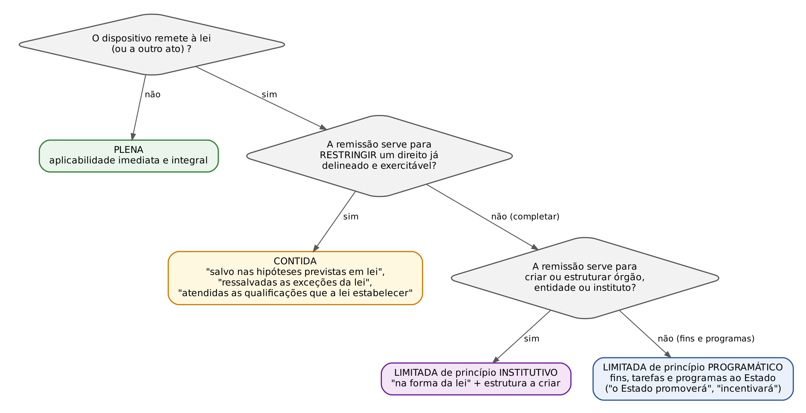
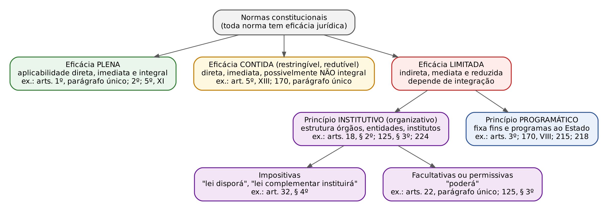
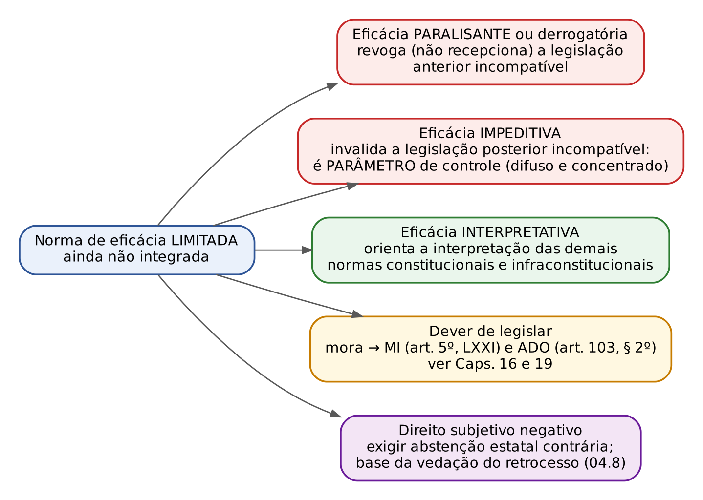
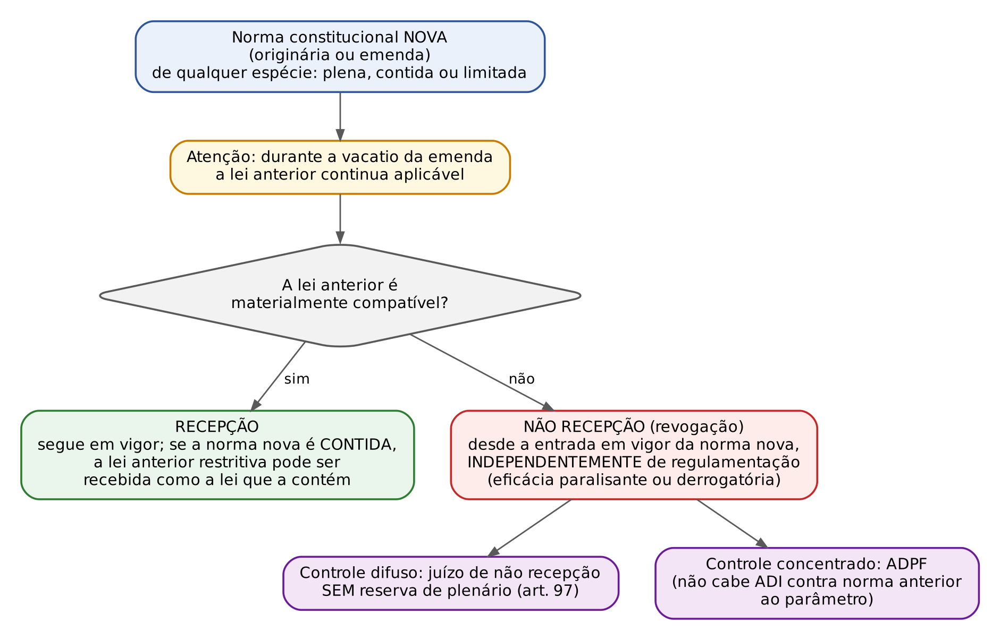
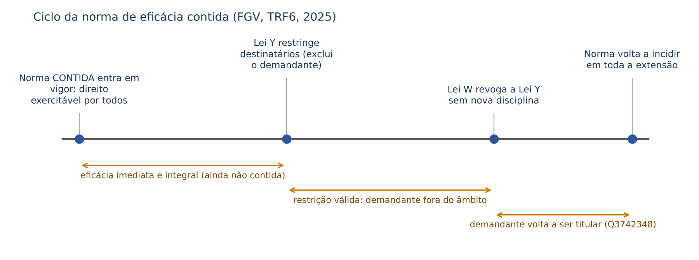

# CAPÍTULO 04 — APLICABILIDADE E EFICÁCIA DAS NORMAS CONSTITUCIONAIS

:::INCIDENCIA
TRF5 p. 1; TJRS p. 2; TJSC p. 4. Nível A. Lote: 30 questões (FGV 30, FCC 0), mais 15 correlatas de outros capítulos.
O que mais cai: classificar o dispositivo (contida x limitada institutiva x programática) e resolver o conflito entre norma constitucional nova, ainda não regulamentada, e lei anterior (revogação imediata, recepção da lei restritiva, retorno à plenitude).
:::

| Subtema | FGV | FCC | Padrão de cobrança |
|---|---|---|---|
| Identificar a espécie a partir do texto (dispositivo real ou fictício) | 13 | 0 | "salvo/ressalvadas as exceções da lei" = contida; "lei instituirá/disporá sobre órgão" = limitada institutiva; fins e programas = programática |
| Eficácia negativa da norma limitada ou contida em face de lei anterior | 8 | 0 | revoga (não recepciona) a lei incompatível independentemente de regulamentação; *vacatio* da emenda; controle cabível |
| Norma contida e lei restritiva (validade, alcance, revogação da lei restritiva) | 8 | 0 | a lei pode excluir destinatários; revogada a lei restritiva, a norma volta a incidir por inteiro |
| Vedação do retrocesso como garantia da eficácia já integrada | 1 | 0 | o princípio protege a norma integradora contra a supressão que esvazia a norma integrada |
| Correlatas (art. 5º, § 1º; programáticas e controle judicial; paradigma de controle) | 11 | 4 | aplicação imediata não significa irrestringibilidade; norma programática serve de parâmetro em ADI |

## 04.1 Premissas que as bancas pressupõem

### 04.1.1 Planos da norma: existência, validade, vigência, eficácia, aplicabilidade e efetividade

A classificação quanto à eficácia trabalha num plano específico, e a FGV costuma misturar os planos nas alternativas. Vigência é a existência jurídica da norma, que a torna obrigatória e pressupõe a eficácia; validade é a compatibilidade com a norma superior (controle de constitucionalidade é controle de validade); eficácia jurídica é a aptidão para produzir os efeitos que lhe são próprios; aplicabilidade é a qualidade de poder incidir sobre o caso concreto (José Afonso da Silva trata eficácia e aplicabilidade como faces do mesmo fenômeno: a eficácia é a potencialidade, a aplicabilidade é a realizabilidade); efetividade, ou eficácia social, é a realização concreta do programa normativo no mundo dos fatos. Barroso define a efetividade como a realização do Direito, a aproximação tão íntima quanto possível entre o dever-ser normativo e o ser da realidade social, e foi o principal artífice da chamada doutrina brasileira da efetividade.

Dois desdobramentos práticos. Primeiro, eficácia e vigência podem descolar-se: a norma vigente pode ter eficácia diferida (lei tributária sujeita à anterioridade, emenda com cláusula de vigência futura, período de *vacatio legis* ou *vacatio constitutionis*). Segundo, revogação e declaração de inconstitucionalidade operam em planos distintos: revogar suprime a vigência e só pode ser feito por norma de igual ou superior hierarquia; declarar a inconstitucionalidade fulmina a validade. É a razão pela qual o STF trata o conflito entre Constituição nova e lei anterior como revogação (não recepção), e não como inconstitucionalidade superveniente (ver 04.5 e Cap. 3).

### 04.1.2 A eficácia é da NORMA, não do dispositivo

As questões da FGV adotam deliberadamente a linguagem pós-positivista: "a partir da interpretação do Art. X, obtém-se norma de eficácia...". O texto (dispositivo) é o ponto de partida; a norma é o produto da interpretação. Dessa premissa decorrem duas consequências cobradas:

- um mesmo dispositivo pode conter normas de eficácia diferente. O exemplo clássico é o art. 37, I: o acesso de brasileiros aos cargos públicos ("que preencham os requisitos estabelecidos em lei") gera norma de eficácia contida, ao passo que o acesso de estrangeiros ("na forma da lei") gera norma de eficácia limitada, porque sem a lei não há como o estrangeiro ingressar. A assertiva foi dada como correta em prova de Promotor de Justiça de SC (Consulplan, 2024), conforme registro do material de apoio consultado;
- a classificação é decisão do intérprete, que leva em conta as pistas e os limites textuais, mas pode evoluir. Sarlet lembra que o direito à saúde foi por muito tempo tratado como norma de eficácia limitada e passou a ter reconhecida sua aplicabilidade direta, a ponto de se extraírem dele direitos subjetivos a prestações; o STF fez o mesmo com o acesso à educação infantil (Tema 548, ver 04.7.3).

:::DICA COMO A FGV ESCREVE O ENUNCIADO DE CLASSIFICAÇÃO
O enunciado descreve um dispositivo (real ou fictício, quase sempre introduzido por "Emenda Constitucional nº X") e pede a espécie. Leia três coisas, nesta ordem: (1) há remissão à lei ou a outro ato?; (2) a remissão é para RESTRINGIR algo já exercitável ("salvo", "ressalvadas", "exceções", "poderão ser excluídas", "atendidas as qualificações") ou para COMPLETAR algo que ainda não existe ("lei disporá", "lei instituirá", "na forma da lei" quando o objeto é órgão ou programa)?; (3) se é para completar, o objeto é uma estrutura (órgão, conselho, fundo, Justiça especializada = institutiva) ou um fim a perseguir (desenvolvimento, pleno emprego, valorização da cultura = programática)? Rótulos inventados nas alternativas ("eficácia reduzida de aplicabilidade direta", "operativa condicionada", "relativa restringível de aplicabilidade mediata", "prospectiva", "carente de integração") são, em regra, distratores: a FGV usa a terminologia de José Afonso da Silva.
:::

### 04.1.3 Das normas autoaplicáveis às classificações gradualistas

A matriz histórica é a dicotomia norte-americana entre normas *self-executing* e *not self-executing*, difundida no Brasil por Ruy Barbosa (normas autoexecutáveis e não autoexecutáveis) e retomada por Pontes de Miranda (normas bastantes em si e não bastantes em si, além das programáticas). A crítica consolidada é que a dicotomia sugeria a existência de normas constitucionais destituídas de qualquer eficácia até a regulamentação. As classificações posteriores (Meirelles Teixeira, com normas de eficácia plena e de eficácia limitada ou reduzida; José Afonso da Silva, com a tricotomia) partem do postulado oposto, hoje hegemônico: NÃO HÁ norma constitucional sem eficácia jurídica; o que varia é o grau. Sarlet registra que, quando a jurisprudência ainda fala em norma "não autoaplicável", o uso costuma ser apenas nominal, como sinônimo de norma de eficácia limitada (é o que se vê na Súmula Vinculante 7, ver 04.7.4).

## 04.2 A classificação de José Afonso da Silva

A obra Aplicabilidade das normas constitucionais (1ª edição em 1968) fixou a tricotomia que as bancas adotam como padrão: normas de eficácia plena, contida e limitada, estas subdivididas em normas de princípio institutivo (ou organizativo) e de princípio programático.

| Espécie | Aplicabilidade | Papel da lei | Exemplos no texto vigente |
|---|---|---|---|
| Plena | direta, imediata e integral | nenhum para produzir efeitos; a lei pode regulamentar, mas não restringir | arts. 1º, parágrafo único; 2º; 5º, XI (casa asilo inviolável); 14, § 2º; 60, § 4º; regras de competência e de procedimento |
| Contida (restringível, redutível) | direta, imediata, mas possivelmente não integral | facultativa e RESTRITIVA: reduz o alcance de um direito que já se exerce | arts. 5º, VIII, XII (parte final), XIII, LVIII; 19, I (colaboração de interesse público); 37, I (brasileiros); 93, IX (parte final); 170, parágrafo único |
| Limitada de princípio institutivo | indireta, mediata e reduzida | necessária para estruturar órgão, entidade ou instituto; pode ser impositiva ou facultativa | arts. 18, §§ 2º e 4º; 22, parágrafo único; 32, § 4º; 125, § 3º; 224; ADCT, art. 92-B, § 2º |
| Limitada de princípio programático | indireta, mediata e reduzida | concretiza fins e programas; dirigida aos órgãos estatais | arts. 3º; 170, VIII; 215; 217; 218; 226, caput |

### 04.2.1 Normas de eficácia plena

São as que receberam do constituinte normatividade suficiente para incidir desde a entrada em vigor, sem intermediação legislativa. Três atributos: aplicabilidade direta (incide sobre o caso sem norma intermediária), imediata (desde a vigência) e integral (não admite contenção legislativa do seu alcance). Identificam-se, em regra, pela ausência de remissão à lei e pela estrutura completa (hipótese e consequência definidas): normas proibitivas (vedação à censura, vedação da pena de morte salvo guerra declarada), normas de competência, normas procedimentais (rito de emenda, art. 60), normas que conferem isenções e imunidades, normas que criam órgãos já estruturados pela própria Constituição.

Dois cuidados. A eficácia plena não impede regulamentação: a lei pode disciplinar o modo de exercício, desde que não restrinja; o que a lei não pode é reduzir o âmbito da norma. E a eficácia plena não equivale a direito absoluto: a norma de eficácia plena pode ser limitada por OUTRA norma constitucional em colisão concreta (ponderação, ver Cap. 5) ou por emenda que respeite o art. 60, § 4º.

:::PEGADINHA EFICÁCIA PLENA X INSUSCETÍVEL DE RESTRIÇÃO
A FGV aposta na confusão entre plenitude da eficácia e intangibilidade do direito. A norma de eficácia plena não pode ser restringida por LEI, mas o direito que ela consagra pode ceder diante de outro direito fundamental no caso concreto e pode ser alterado por emenda constitucional que respeite as cláusulas pétreas. O ponto foi cobrado no TJ-PA (FGV 2026, Juiz Substituto, Q3951775, gabarito D), em que a teoria externa explica que direitos fundamentais colidentes podem conter o potencial expansivo do direito invocado (teorias interna e externa: Cap. 7).
:::

### 04.2.2 Normas de eficácia contida

São normas aptas a produzir todos os seus efeitos desde a entrada em vigor, mas que admitem que o legislador (ou outra fonte autorizada) reduza seu alcance. Enquanto não editada a lei restritiva, o direito é exercitável na extensão máxima. José Afonso da Silva preferia "contida" porque a lei CONTÉM a expansão da norma; Michel Temer fala em eficácia redutível ou restringível, e Maria Helena Diniz em eficácia relativa restringível (ver 04.3).

Fontes de contenção:

- lei infraconstitucional autorizada pelo próprio dispositivo: art. 5º, XIII ("atendidas as qualificações profissionais que a lei estabelecer"); art. 5º, LVIII ("salvo nas hipóteses previstas em lei"); art. 170, parágrafo único ("salvo nos casos previstos em lei");
- outras normas constitucionais: as medidas dos estados de defesa e de sítio restringem direitos dos arts. 5º e 139 (Cap. 32);
- conceitos jurídicos indeterminados contidos na própria norma ("iminente perigo público" do art. 5º, XXV; "necessidade ou utilidade pública, ou interesse social" do art. 5º, XXIV), que a Administração e o juiz densificam.

A lei restritiva NÃO é livre. Restringe dentro da moldura do dispositivo e sujeita-se aos limites dos limites: reserva legal (simples ou qualificada), proporcionalidade, preservação do núcleo essencial, generalidade e não retroatividade (desenvolvimento no Cap. 7). No art. 5º, XIII, por exemplo, só se justificam qualificações ligadas a risco social ou a conhecimento técnico indispensável: o STF afastou a exigência de diploma para jornalistas (RE 511.961) e de registro dos músicos na Ordem dos Músicos (ADPF 183), mas validou o Exame de Ordem (RE 603.583) e, mais recentemente, lei gaúcha que exige profissional de educação física registrado em academias e estabelecimentos cujas atividades envolvam riscos à saúde e à integridade física (ADI 4.399/RS, Relator Ministro Nunes Marques, redator do acórdão Ministro Flávio Dino, Plenário, j. 4/4/2025, Informativo 1.172), ressalvando os estabelecimentos de atividade meramente lúdica ou recreativa. O exame da liberdade profissional em si fica no Cap. 9.

:::ATENCAO A LEI RESTRITIVA NÃO É CONDIÇÃO DE EFICÁCIA
Na norma contida, a lei é facultativa e restritiva; na norma limitada, a lei é necessária e ampliativa (integradora). Por isso: (a) a ausência de lei NÃO autoriza mandado de injunção (não há direito inviabilizado pela falta de norma, art. 5º, LXXI); (b) a ausência de lei NÃO configura omissão inconstitucional; (c) enquanto a lei não vem, o direito se exerce em toda a extensão. No TJ-SC (FGV 2025, Juiz Leigo, Q3592885, gabarito C), a norma contida "tem aplicabilidade imediata, ainda que possa ter o seu alcance restringido" e, por isso, embasa a pretensão; a alternativa que dizia que a regulamentação só pode ampliar efeitos estava errada justamente porque a vocação da lei, aqui, é restringir.
:::

### 04.2.3 Normas de eficácia limitada

Não produzem, com a simples entrada em vigor, todos os seus efeitos essenciais, porque o constituinte deixou ao legislador (ou a outro órgão) a tarefa de completá-las. Aplicabilidade indireta (depende de norma intermediária), mediata (os efeitos essenciais vêm depois) e reduzida (até a integração, só produzem a eficácia mínima de 04.4). José Afonso da Silva as divide em dois grupos.

#### Normas de princípio institutivo (ou organizativo)

O constituinte traça o esquema geral de estruturação de um órgão, entidade ou instituto e confia ao legislador a sua estruturação definitiva. São impositivas quando determinam a edição da lei (art. 32, § 4º, "Lei federal disporá sobre a utilização, pelo Governo do Distrito Federal, da polícia civil, da polícia penal, da polícia militar e do corpo de bombeiros militar"; art. 224; art. 18, § 2º, sobre Territórios, "serão reguladas em lei complementar"; ADCT, art. 92-B, § 2º, "Lei complementar instituirá Fundo de Sustentabilidade e Diversificação Econômica do Estado do Amazonas") e facultativas ou permissivas quando apenas autorizam (art. 22, parágrafo único, "Lei complementar poderá autorizar os Estados a legislar sobre questões específicas"; art. 125, § 3º, "A lei estadual poderá criar, mediante proposta do Tribunal de Justiça, a Justiça Militar estadual"). Parte da doutrina chama as institutivas de normas de eficácia diferida.

#### Normas de princípio programático

O constituinte, em vez de regular diretamente interesses, traça princípios a serem cumpridos pelos órgãos estatais (legislativos, executivos, jurisdicionais e administrativos) como programas das respectivas atividades, visando aos fins sociais do Estado. Disciplinam sobretudo interesses econômico-sociais: objetivos fundamentais (art. 3º), busca do pleno emprego (art. 170, VIII), incentivo à cultura, ao desporto, à ciência e à tecnologia (arts. 215, 217 e 218), especial proteção à família (art. 226, caput), amparo às pessoas idosas (art. 230). São as normas que caracterizam a Constituição como dirigente (Canotilho), e foi por isso que a FGV classificou como "dogmática e dirigente" a Constituição que individualiza as linhas gerais dos programas governamentais (TRT-24, FGV 2025, Q3350303, gabarito D; tema do Cap. 2). O regime de eficácia das programáticas e a sua sindicabilidade judicial estão em 04.7.

:::QUESTAO FGV 2024 A 2026 — DIVERSOS ÓRGÃOS — IDENTIFICAÇÃO DA ESPÉCIE A PARTIR DO TEXTO (13 QUESTÕES)
Treze questões do lote pedem apenas a espécie. Gabaritos oficiais, com o gatilho textual de cada uma:
- Contida: Q3520619 (TJ-ES, Cartórios, 2025: requisitos ampliáveis pela lei reduzem beneficiários), Q3363386 (SEFAZ-PR, 2025: diferimento de ICMS do qual podem ser excluídas empresas definidas em lei), Q3345904 (TJ-GO, Residente, 2025: livre acesso a dados cadastrais "ressalvadas apenas as exceções previstas em lei"), Q3049916 (Macaé, Procurador, 2024: impenhorabilidade de equipamentos "ressalvadas as exceções estabelecidas em lei"), Q3028696 (TRF1, Analista, 2024: benefício estatutário que a lei pode afastar para certos servidores), Q2346669 (Caraguatatuba, Procurador, 2024: art. 19, I, "ressalvada, na forma da lei, a colaboração de interesse público").
- Limitada institutiva: Q3780421 (2025: comissão permanente a ser criada na Assembleia), Q3154549 (2025: ADCT, art. 92-B, § 2º), Q3049076 (Caraguatatuba, Advogado, 2024: art. 125, § 3º), Q3029096 (2024: conselho nacional interfederativo a ser criado por lei complementar), Q2482353 (Câmara de Fortaleza, 2024: Conselho de Moradores com composição e competências "detalhadas em lei"), Q2348934 (São José dos Campos, 2024: art. 224, Conselho de Comunicação Social "na forma da lei").
- Limitada (sem qualificar): Q3029927 (TRF1, Agente de Polícia Judicial, 2024): a proteção às participações individuais em obras coletivas e à reprodução da imagem e voz humanas, "inclusive nas atividades desportivas", consta do art. 5º, XXVIII, a, cujo caput diz "são assegurados, nos termos da lei"; gabarito C (limitada). A armadilha era a alternativa que negava proteção às participações coletivas ou ao desporto, quando o texto as menciona expressamente.
Armadilhas recorrentes: (1) "na forma da lei" NÃO é sinônimo automático de limitada (no art. 19, I, a ressalva restringe uma vedação que já incide; contida); (2) "poderá" (art. 125, § 3º) NÃO transforma a norma em contida: a faculdade é de CRIAR a estrutura, portanto institutiva facultativa; (3) órgão ou fundo a ser criado é institutiva, NÃO programática, ainda que o órgão sirva a direitos prestacionais (Q3029096).
:::

## 04.3 Outras classificações

### 04.3.1 Maria Helena Diniz

Critério: produção de efeitos concretos e intangibilidade. Quatro categorias:

- normas supereficazes ou de eficácia absoluta: intangíveis, nem por emenda podem ser suprimidas (as protegidas pelo art. 60, § 4º); têm força paralisante total da legislação que as contrarie;
- normas de eficácia plena: plenamente eficazes desde a promulgação, mas emendáveis;
- normas de eficácia relativa restringível: correspondem às contidas;
- normas de eficácia relativa complementável ou dependente de complementação legislativa: correspondem às limitadas (de princípio institutivo e programáticas).

O traço distintivo, e o que se cobra, é a categoria das supereficazes: o critério deixa de ser só a aplicabilidade e passa a incluir a imunidade à reforma.

### 04.3.2 Celso Ribeiro Bastos e Carlos Ayres Britto

Critério: modo de incidência e relação com a vontade legislativa ordinária.

- normas de aplicação: aptas a incidir sem outro querer legislativo. Subdividem-se em irregulamentáveis (a matéria só admite tratamento constitucional) e regulamentáveis (incidem desde logo, mas admitem regulamentação que melhor conforme seu preceito, sem restringir);
- normas de integração: compõem-se com a vontade legislativa ordinária. Subdividem-se em restringíveis (a lei pode reduzir o alcance, mediante previsão expressa; equivalem às contidas) e completáveis ou complementáveis (exigem aditamento de conteúdo pela lei; equivalem às limitadas).

### 04.3.3 Luís Roberto Barroso

Barroso classifica as normas constitucionais pela função e pela posição jurídica que geram, com foco na efetividade:

- normas constitucionais de organização: estruturam o Estado e o exercício do poder (competências, órgãos, procedimentos);
- normas constitucionais definidoras de direitos: geram situações jurídicas subjetivas imediatamente desfrutáveis, exigíveis por ação ou omissão do Estado (direitos individuais, políticos, sociais e difusos);
- normas constitucionais programáticas: traçam fins públicos sem especificar condutas; geram, desde logo, direito subjetivo em sentido negativo (exigir que o Poder Público se abstenha de atos que as contravenham) e servem de vetor interpretativo.

A contribuição cobrada é a premissa da doutrina da efetividade: a norma constitucional é norma jurídica, imperativa, e sua violação deve ser sancionada; direito subjetivo constitucional é posição jurídica exigível judicialmente. Por isso a classificação de Barroso não fala em norma "sem eficácia": até a programática gera posição subjetiva (negativa) e controle de validade das leis contrárias.

### 04.3.4 Quadro de correspondência e outras terminologias

| José Afonso da Silva | Maria Helena Diniz | Celso Bastos e Ayres Britto | Outras designações |
|---|---|---|---|
| — | eficácia absoluta (supereficazes) | — | cláusulas pétreas |
| plena | plena | de aplicação (irregulamentáveis ou regulamentáveis) | autoaplicáveis; bastantes em si; *self-executing* |
| contida | relativa restringível | de integração restringíveis | redutível (Michel Temer); restringível |
| limitada (institutiva e programática) | relativa complementável ou dependente de complementação | de integração completáveis | não autoaplicáveis; não bastantes em si; *not self-executing*; de eficácia reduzida (Meirelles Teixeira) |

Outras categorias que aparecem em alternativas:

- normas de eficácia exaurida ou esvaída (e aplicabilidade esgotada): as que já cumpriram sua função e não produzem novos efeitos, típicas do ADCT (por exemplo, as que fixaram prazos já consumados, como a revisão constitucional do art. 3º do ADCT). Atribui-se a nomenclatura a Uadi Lammêgo Bulos; o regime do ADCT está no Cap. 2;
- Celso Antônio Bandeira de Mello, em estudo sobre a eficácia das normas de justiça social, agrupa as normas segundo a posição jurídica que conferem: normas concessivas de poderes jurídicos, normas concessivas de direitos e normas meramente indicadoras de uma finalidade a ser atingida (ver nota de verificação);
- Sarlet propõe superar a tricotomia e trabalhar com a ideia de que toda norma constitucional tem eficácia e, na medida dela, aplicabilidade direta, distinguindo normas de alta e de baixa densidade normativa; critica especialmente a categoria da eficácia contida, porque praticamente todo direito fundamental admite restrições, haja ou não reserva expressa de lei (o direito à intimidade do art. 5º, X, não tem reserva expressa e nem por isso é absoluto);
- Virgílio Afonso da Silva vai além e nega a utilidade da distinção entre normas que admitem e que não admitem restrição: na teoria externa, todo direito fundamental é restringível, e a diferença está apenas no ônus de fundamentação (debate de teoria dos direitos fundamentais, Cap. 7).

:::DOUTRINA O QUE FICA PARA A PROVA ORAL
Toda norma constitucional tem eficácia jurídica (consenso); a tricotomia de José Afonso da Silva é a referência das bancas, mas é criticada (Sarlet, Virgílio Afonso da Silva) por sugerir que existam normas imunes a restrição (plenas) e por ser artificial a separação entre plenas e contidas no campo dos direitos fundamentais; o art. 5º, § 1º, impõe uma presunção de aplicabilidade imediata das normas de direitos fundamentais (04.9). Na resposta oral, apresente a tricotomia, os efeitos mínimos da norma limitada e a crítica, e conclua com a orientação do STF, que tem convertido normas tidas por programáticas em fonte de direitos subjetivos exigíveis (educação infantil, saúde).
:::

## 04.4 A eficácia mínima das normas de eficácia limitada

A norma limitada não regulamentada não é letra morta. Desde a entrada em vigor produz um conjunto de efeitos que a doutrina chama de eficácia negativa (ou eficácia mínima), e que a FGV explora sistematicamente:

- eficácia paralisante ou derrogatória: revoga (não recepciona) a legislação anterior com ela incompatível, independentemente de qualquer regulamentação. É o efeito mais cobrado do capítulo;
- eficácia impeditiva: impede a validade de normas posteriores que a contrariem; por isso a norma limitada, mesmo não integrada, é PARÂMETRO de controle de constitucionalidade, difuso e concentrado;
- eficácia interpretativa: condiciona a interpretação das demais normas constitucionais e de toda a legislação infraconstitucional, inclusive na verificação da recepção do direito anterior;
- vinculação do legislador: impõe o dever de editar a norma integradora; a mora configura omissão inconstitucional, sindicável por mandado de injunção (direitos subjetivos inviabilizados, art. 5º, LXXI, Lei 13.300/2016, Cap. 16) e por ADO (art. 103, § 2º, Cap. 19). Só há omissão inconstitucional em face de norma de eficácia limitada, porque só nela existe dever de legislar; e só depois de transcorrido prazo razoável;
- direito subjetivo negativo: o particular pode exigir que o Estado se abstenha de agir contra a norma; é a base dogmática da vedação do retrocesso (04.8);
- condicionamento da discricionariedade administrativa e dos atos dos demais Poderes, que não podem contrariar os fins nela fixados.

:::QUESTAO FGV 2026 — TJ-SC — ANALISTA JURÍDICO (Q4150686)
Caso: do art. X da Constituição se obtêm uma norma de eficácia limitada e um princípio institutivo; a dúvida era sobre sua incidência imediata. Gabarito: E (a norma influi na interpretação de preceitos constitucionais e infraconstitucionais preexistentes, mas carece de integração legislativa para a plena eficácia). Armadilhas: A ("não produz efeitos enquanto não regulamentada": nega a eficácia mínima); C (descreve a contida); D (vincula a limitada a direitos prestacionais, característica da programática, não da institutiva). No mesmo sentido, para a programática: Q4389163 (FGV 2026, DATAPREV, Advogado, gabarito D: a norma programática introduzida por emenda influi na interpretação das demais normas e na recepção da legislação preexistente, independentemente de regulamentação; erradas as alternativas que exigiam regulamentação "para que produza algum efeito" ou que lhe davam eficácia plena por veicular direito fundamental de segunda dimensão).
:::

:::QUESTAO FGV 2024 — CÂMARA DE FORTALEZA — ADVOGADO (Q2450526) E CORRELATAS: NORMA LIMITADA COMO PARADIGMA DE CONTROLE
Caso: associação de classe nacional quer ajuizar ADI contra lei estadual dissonante de norma programática da CF ainda não regulamentada, havendo mora do Congresso. Gabarito: A (a ausência da lei federal integradora não impede o uso da norma constitucional como paradigma de confronto). Armadilhas: C (condicionar o uso como paradigma ao prévio reconhecimento da mora em ADO); E (a normatividade constitucional não depende do grau de eficácia). No mesmo sentido: Q2449060 (FGV 2024, TJ-AP, gabarito E: norma programática não integrada serve de paradigma em ADI; a lei federal futura não é "norma interposta" indispensável) e Q2759005 (FGV 2024, EPE, gabarito B: nem o paradigma de eficácia limitada nem a ineficácia da lei estadual impugnada obstam o conhecimento da ADI). Legitimidade, objeto e interesse de agir na ADI: Cap. 18.
:::

:::PEGADINHA NORMA LIMITADA X NORMA INTERPOSTA
A lei que vier a integrar a norma limitada NÃO é parâmetro de controle (não é norma interposta indispensável): o confronto é feito diretamente com a norma constitucional. Quem controla a lei estadual contrária a uma programática não precisa esperar a lei federal (Q2449060). Ao contrário, depois de editada a lei integradora, o vício de outra lei que contrarie apenas a integradora é, em regra, de legalidade ou de ofensa reflexa, salvo nos casos de competência concorrente: a lei estadual que afronta norma geral federal ofende DIRETAMENTE o art. 24, e o STF conhece da ADI (Q3592131; Caps. 18 e 22).
:::

## 04.5 Norma constitucional nova e direito anterior: revogação imediata, *vacatio* e controle cabível

### 04.5.1 A regra: qualquer norma constitucional nova revoga o direito anterior incompatível

Ao entrar em vigor, a norma constitucional nova (originária ou introduzida por emenda), seja plena, contida ou limitada, retira do ordenamento a legislação anterior materialmente incompatível. A orientação do STF é a da revogação (não recepção), e não a da inconstitucionalidade superveniente (Sarlet registra que o STF consagrou a tese da revogação; o regime do direito intertemporal está no Cap. 3). A FGV repete o raciocínio com todas as espécies de norma:

| Situação | Solução | Questões |
|---|---|---|
| Emenda introduz norma LIMITADA (institutiva ou programática) incompatível com lei anterior de eficácia plena | lei anterior revogada desde a vigência da emenda, ainda que a norma não esteja regulamentada | Q3171383, Q3301286, Q2351242 |
| Emenda introduz norma CONTIDA incompatível com lei anterior, sem lei nova | revogação (não recepção) imediata; a norma produz todos os seus efeitos | Q4088558, Q4130142, Q4378302 |
| Emenda à Constituição estadual cria norma limitada incompatível com lei estadual, ainda em *vacatio* | a lei continua aplicável durante a *vacatio*; findo o prazo, não pode mais ser aplicada, ainda que a norma não seja regulamentada | Q4283059 |
| Lei anterior era RESTRIÇÃO válida de norma contida; emenda posterior insere norma limitada incompatível com a restrição | a lei restritiva não é recepcionada; a norma contida volta a incidir por inteiro | Q3593747 |
| Lei anterior compatível com a nova norma CONTIDA, que autoriza restrição | lei recepcionada como a lei que contém a norma | Q3592132 |

:::QUESTAO FGV 2025 — TJ-SE — JUIZ SUBSTITUTO (Q3301286)
Caso: em controle incidental, discute-se se lei municipal anterior pode ser aplicada apesar de colidir com norma superveniente (emenda) de eficácia limitada e princípio programático. Gabarito: B (apesar de carecer de regulamentação, a norma programática revogou a lei municipal). Passos: (1) norma constitucional nova + lei anterior incompatível = juízo de recepção, não de constitucionalidade; (2) a eficácia paralisante opera desde a vigência, sem depender da lei integradora; (3) logo, a lei municipal está revogada. Armadilhas: A (a limitação da eficácia não salva a lei); C (a revogação não depende da futura lei integradora); D (não é matéria exclusiva de ADPF: o juiz resolve incidentalmente); E (a programática não se limita a "direcionamento político" nem se coteja só com normas da mesma natureza). No mesmo sentido: Q3171383 (FGV 2025, PC-MG, Delegado, gabarito B) e Q2351242 (FGV 2024, Câmara Municipal de SP, Procurador Legislativo, gabarito E: a lei federal ainda em *vacatio legis* quando sobreveio a emenda com norma programática incompatível não foi recepcionada).
:::

:::QUESTAO FGV 2026 — TCE-SC — AUDITOR FISCAL DE CONTROLE EXTERNO (Q4088558)
Caso: emenda altera dispositivo de direito financeiro sobre o ciclo orçamentário, criando norma de aplicabilidade imediata e eficácia contida; lei estadual anterior dispõe em sentido contrário; não sobreveio lei federal ou estadual. Gabarito: B (a emenda revogou a lei estadual, produzindo efeitos independentemente de regulamentação). Armadilhas: A ("suspensão" da eficácia da lei até a regulamentação: a lei incompatível não fica suspensa, é revogada); C e D (condicionar efeitos à lei: confunde contida com limitada); E (diz que a norma "somente terá a sua eficácia integrada após a regulamentação", o que descreve a limitada). No mesmo sentido: Q4130142 (FGV 2026, ENAC, Exame Nacional dos Cartórios, gabarito B: a norma contida produz todos os seus efeitos e acarreta a não recepção da norma infraconstitucional colidente, sem depender de outra norma; erradas a alternativa que remetia a solução a manifestação do órgão correcional e a que mandava continuar aplicando a lei até se identificar o alcance de futura restrição).
:::

:::QUESTAO FGV 2026 — PC-PR — DELEGADO DE POLÍCIA (Q4378302)
Caso: direito fundamental consagrado em norma de eficácia contida colide com lei federal anterior, relevante para a investigação. Gabarito: A (ainda que não regulamentada, a entrada em vigor da norma contida obsta a aplicação da lei). Armadilhas: B (não é preciso aguardar controle concentrado: a lei anterior incompatível está revogada); C (a contida não carece de regulamentação para produzir efeitos); D (mistura a contida com integração pela dignidade humana); E (não há ponderação entre a norma constitucional e a lei incompatível: há hierarquia e revogação).
:::

:::PEGADINHA "COLIDÊNCIA" X "RESTRIÇÃO AUTORIZADA"
As questões Q4378302 e Q3592132 parecem contraditórias: na primeira, a lei anterior cai diante da norma contida; na segunda, a lei anterior que exclui beneficiários é recepcionada pela norma contida. Não há contradição. A norma contida AUTORIZA a lei restritiva; se a lei anterior apenas restringe o alcance, dentro da moldura que a Constituição permite, ela é compatível e recepcionada como a lei que contém a norma. Se a lei anterior COLIDE com a norma (contraria o que ela assegura além do espaço de restrição), é incompatível e revogada. Leia o verbo do enunciado: "colidência", "incompatível", "dissonante" levam à revogação; "detalhou", "restringiu", "excluiu certos destinatários" (quando a norma admite a exclusão) levam à recepção.
:::

:::QUESTAO FGV 2026 — TCE-PE — ANALISTA DE CONTROLE EXTERNO (Q4283059)
Caso: emenda à Constituição de Sigma dá nova redação ao art. Y, originando norma de eficácia limitada; a redação original fora regulamentada pelo art. Z da Lei Orgânica do Tribunal de Contas; ainda durante a *vacatio* da emenda, constatou-se a colidência com o art. Z. Gabarito: A (o art. Z não pode continuar a ser aplicado depois da *vacatio* da emenda, ainda que a nova redação do art. Y não seja regulamentada). Armadilhas: B (não cabe submissão IMEDIATA a controle, porque durante a *vacatio* a norma nova ainda não produz efeitos e o art. Z segue válido e aplicável); C (a redação original não sobrevive à vigência da nova); D (a revogação não depende da integração, nem mesmo para programáticas); E (a norma nova não é paradigma de ADI contra norma anterior: o caso é de revogação, e o controle concentrado cabível seria a ADPF, ou a via própria prevista na Constituição estadual).
:::

### 04.5.2 Como o juiz reconhece a não recepção

Duas consequências processuais decorrem da tese da revogação, ambas cobradas em casos práticos:

- no controle difuso, o juízo de não recepção NÃO se submete à cláusula de reserva de plenário (art. 97 e Súmula Vinculante 10), porque não se declara a inconstitucionalidade, mas a revogação de norma anterior (STF, AI 669.872 AgR, Relator Ministro Luiz Fux, Primeira Turma, j. 11/12/2012: o juízo de recepção "pode ser realizado por órgão fracionário"; no mesmo sentido, recentemente, a AO 2.870 AgR, v. Cap. 3); o órgão fracionário (Câmara, Turma) deixa de aplicar a lei diretamente. Foi o gabarito do caso da ALERJ (FGV 2026, Especialista Legislativo, Q3881538, gabarito C: a Câmara do TJ deve deixar de aplicar a lei de 2000 incompatível com emenda de 2020 que introduziu norma programática ainda não regulamentada, antes da regulamentação e sem observância da cláusula *full bench*). A alternativa E, segundo a qual a não recepção só se aferiria em face do texto originário, está errada: emenda também revoga direito anterior incompatível (detalhes sobre a reserva de plenário: Cap. 17);
- no controle concentrado, a lei anterior ao parâmetro não pode ser objeto de ADI (o STF não admite ADI para aferir recepção: ADI 2, Relator Ministro Paulo Brossard, Plenário, j. 6/2/1992 — "Lei anterior não pode ser inconstitucional em relação à Constituição superveniente"); a via é a ADPF (art. 1º, parágrafo único, I, da Lei 9.882/1999: controvérsia sobre lei ou ato normativo anterior à Constituição). A FGV deu como correta, no TJRS (FGV 2025, Analista Judiciário, Q3742941, gabarito E), a afirmação de que a lei federal anterior incompatível com norma contida introduzida por emenda "pode ser objeto de controle concentrado de constitucionalidade perante o STF", tendo a emenda como paradigma: correta porque a ADPF é instrumento de controle concentrado; errada seria a afirmação de cabimento de ADI. Na mesma questão, erradas as alternativas que exigiam regulamentação (A), mantinham a coexistência das normas até revogação expressa (B), davam preeminência à lei "de eficácia plena" (C) ou exigiam reserva de plenário para o juízo de não recepção (D). Subsidiariedade e objeto da ADPF: Cap. 19.

:::SENTENCA NÃO RECEPÇÃO DE LEI ANTERIOR POR NORMA CONSTITUCIONAL AINDA NÃO REGULAMENTADA
"A Lei n. W/2000, em que se funda o ato impugnado, disciplina a matéria em sentido diametralmente oposto ao art. X da Constituição da República, na redação dada pela Emenda Constitucional n. Y/2020. Embora o dispositivo constitucional veicule norma de eficácia limitada, de princípio programático, ainda pendente de integração legislativa, tal circunstância não lhe retira a eficácia negativa: desde a entrada em vigor da emenda, a norma constitucional produz efeito paralisante sobre a legislação anterior que lhe seja materialmente incompatível, a qual deixa de integrar o ordenamento. Cuida-se de juízo de revogação, e não de declaração de inconstitucionalidade, razão pela qual não incide a cláusula de reserva de plenário do art. 97 da Constituição. Reconheço, assim, que a Lei n. W/2000 não foi recepcionada pela ordem constitucional modificada e afasto sua aplicação ao caso."
:::

## 04.6 Norma de eficácia contida e lei restritiva: o que a lei pode e o que não pode

### 04.6.1 A lei pode excluir destinatários potenciais

A norma contida assegura o direito e admite que a lei reduza seu âmbito, inclusive retirando destinatários potenciais do rol de beneficiários, desde que dentro da moldura constitucional e com respeito aos limites dos limites. A FGV transformou esse ponto num roteiro de casos:

- o titular do direito previsto em norma contida pode ser excluído pela lei (Q3605988, FGV 2025, PGM-RJ, gabarito A); errada a alternativa que condicionava a fruição à edição da lei (B, descreve a limitada) e as que condicionavam a fruição a fonte de custeio ou à criação de estruturas (D e E, também próprias de normas limitadas); a alternativa C (a lei não pode afetar o conteúdo essencial "ou o rol de beneficiários") estava errada na segunda parte;
- a procedência do pedido fundado em norma contida depende não só da Constituição, mas também da lei que eventualmente tenha restringido seu alcance (Q3883339, FGV 2026, ALERJ, gabarito A); errada a alternativa D, que só admitia lei ampliativa;
- a restrição legal de direito de primeira dimensão do art. 5º pode ser hígida a depender da natureza da norma constitucional que o consagra (Q3883090, FGV 2026, AL-RO, gabarito A): se a norma for contida, sim; erradas as alternativas que afirmavam que todos os direitos de primeira dimensão são restringíveis por lei (B), que todos estão em normas plenas insuscetíveis de restrição (C), que toda restrição *in abstracto* é inconstitucional (D) e que só normas constitucionais podem restringir direitos fundamentais (E);
- norma originalmente plena que passa a ser contida por emenda: a lei futura pode restringir o alcance e afetar a situação de quem estava abrangido (Q4153589, FGV 2026, TJ-SC, Oficial de Justiça, gabarito A). Não há direito adquirido a regime jurídico (B errada), a substituição não é, em si, retrocesso social (C errada), e a contida não depende de regulamentação (D e E erradas).

:::QUESTAO FGV 2025 — TRF-6 — JUIZ FEDERAL SUBSTITUTO (Q3742348)
Caso: o autor invoca o art. X da CF, norma consagradora de direito de segunda dimensão, de aplicabilidade imediata e eficácia contida quanto aos destinatários. O ente demandado alega que a Lei Federal Y, ao detalhar a matéria, excluiu certos destinatários, entre eles o autor (o que era verdade). O juiz constata que a Lei Y foi expressamente revogada pela Lei W, que nada dispôs sobre o tema. Gabarito: E (apenas em razão do advento da Lei W é possível reconhecer ao demandante o direito previsto no art. X).
Passos: (1) norma contida = direito exercitável desde logo, restringível por lei; (2) a Lei Y restringiu validamente (não era inconstitucional, B errada) e retirou o autor do âmbito de proteção; (3) revogada a Lei Y sem nova disciplina, a contenção desaparece e a norma volta a incidir em toda a extensão; (4) logo, é a revogação operada pela Lei W que devolve ao autor a titularidade.
Armadilhas: A (a contida não precisa ser integrada); C (a Lei W não "possibilitou efeitos plenos": a norma continua contida, apenas sem restrição em vigor, e sempre teve eficácia subjetiva); D (a norma contida embasa pretensões concretas).
:::

:::QUESTAO FGV 2025 — TCE-PE — PROCURADOR DO TRIBUNAL DE CONTAS (Q3592132)
Caso: a redação original do art. Z veiculava direito de segunda dimensão em norma limitada programática e excluía expressamente pessoas na condição de Maria; a Lei W/2020 regulamentou o artigo, reproduzindo a exclusão. A EC X/2025 passou a reconhecer o direito em norma contida e generalizou os beneficiários; quanto ao delineamento do direito, a Lei W tem conteúdo idêntico ao da emenda. Gabarito: B (a Lei W foi integralmente recepcionada pela emenda).
Passos: (1) a nova norma é contida: admite que a lei reduza o rol de beneficiários; (2) a exclusão prevista na Lei W passa a operar como restrição autorizada, e não como contrariedade; (3) logo, a lei é compatível e recepcionada por inteiro, e Maria, por ora, não é beneficiária (A errada). Erradas também C e D (a contida não depende de regulamentação) e E (não cabe mandado de injunção quando não há norma limitada pendente de integração).
Observação: a conclusão pressupõe que a exclusão de Maria seja restrição proporcional e preserve o núcleo do direito; a banca não problematizou esse ponto, que, em prova discursiva, deve ser mencionado.
:::

:::QUESTAO FGV 2025 — PROVA NÃO IDENTIFICADA NO BANCO (Q3593747)
Caso: direito de segunda dimensão em norma contida, restringido pela Lei Estadual Y, que impediu Joana de fruí-lo; depois, emenda inseriu norma limitada programática incompatível com a Lei Y. Gabarito: A (a Lei Y não foi recepcionada, logo Joana pode fruir o direito). Passos: (1) a norma programática nova tem eficácia paralisante sobre a Lei Y; (2) revogada a restrição, a norma contida originária volta a incidir por inteiro; (3) não há vácuo (C errada), porque a contida não precisava de regulamentação para produzir efeitos.
:::

### 04.6.2 O que a lei restritiva não pode

- ir além da autorização constitucional (reserva legal qualificada: no art. 5º, XII, a quebra do sigilo telefônico exige ordem judicial e finalidade de investigação criminal ou instrução processual penal; lei que a autorizasse para fins civis seria inconstitucional);
- esvaziar o núcleo essencial do direito ou impor restrição desproporcional (Cap. 7);
- inverter a lógica da norma: a contida não se converte em limitada pela via legislativa. A lei não pode condicionar o exercício do direito à sua própria edição, nem à criação de estruturas administrativas, nem à indicação de fonte de custeio (Q3605988);
- ter sua ausência invocada como omissão inconstitucional ou como fundamento de mandado de injunção (04.2.2).

:::EXEMPLO LEITURA DE TRÊS DISPOSITIVOS REAIS
Art. 5º, XIII: "é livre o exercício de qualquer trabalho, ofício ou profissão, atendidas as qualificações profissionais que a lei estabelecer" (contida: livre desde logo; a lei pode exigir qualificações, nos limites do risco social).
Art. 37, VII: "o direito de greve será exercido nos termos e nos limites definidos em lei específica" (norma de eficácia limitada cuja mora o STF supriu mandando aplicar a Lei 7.783/1989 no que couber: MIs 670, 708 e 712, v. Cap. 16).
Art. 7º, XXI: "aviso prévio proporcional ao tempo de serviço, sendo no mínimo de trinta dias, nos termos da lei" (estrutura mista: o mínimo de trinta dias tem aplicação imediata; a proporcionalidade dependia de lei, editada após mandados de injunção; Cap. 12).
:::

## 04.7 Normas programáticas: força normativa e controle judicial

### 04.7.1 Natureza

A concepção antiga, de matriz liberal, via nas normas programáticas meras exortações morais ou recomendações políticas ao legislador, sem juridicidade. A doutrina constitucional brasileira contemporânea (José Afonso da Silva, Barroso, Sarlet) e a jurisprudência do STF rejeitam essa leitura: a programática é norma jurídica, vincula todos os Poderes e produz, desde logo, a eficácia mínima de 04.4. Canotilho, ao tratar da Constituição dirigente, sustentou que as normas programáticas têm o mesmo valor jurídico das demais e vinculam o legislador de forma permanente (a "morte" das normas programáticas como categoria sem força normativa); a força normativa da Constituição (Konrad Hesse) é o fundamento teórico comum (Cap. 2 e Cap. 5).

Destinatários: primariamente os órgãos estatais, aos quais impõem fins e tarefas. Isso não impede que o particular as invoque: geram direito subjetivo negativo (abstenção de atos contrários), servem de fundamento para impugnar leis incompatíveis e orientam a interpretação.

:::PEGADINHA "NORMA DE ENDEREÇAMENTO POLÍTICO" E "EFICÁCIA PETRIFICADORA"
Na ENAM (FGV 2026, Q4102393), a alternativa D dizia que a vedação do retrocesso é "norma de endereçamento político" sem "eficácia petrificadora". A primeira parte está errada (o princípio tem natureza jurídica); a segunda, isoladamente, até é sustentável (a vedação do retrocesso não petrifica a legislação), o que torna a alternativa sedutora. O gabarito foi C (04.8). Na TJ-SE (Q3301286), a alternativa E reduzia a programática a "função de direcionamento político" que só poderia ser cotejada com normas da mesma natureza: errada.
:::

### 04.7.2 Direitos sociais: normas programáticas ou definidoras de direitos?

O enquadramento dos direitos sociais prestacionais varia conforme o direito e a densidade da norma. O art. 6º ("São direitos sociais a educação, a saúde, a alimentação, o trabalho, a moradia, o transporte, o lazer, a segurança, a previdência social, a proteção à maternidade e à infância, a assistência aos desamparados, na forma desta Constituição") remete à disciplina constitucional de cada direito; alguns têm alta densidade e aplicabilidade direta, outros dependem de conformação legislativa e de políticas públicas. A FCC cobrou a literalidade: em prova da Prefeitura de São Paulo (FCC 2025, Auditor Municipal, Q3290898, gabarito A), a charge publicada na promulgação aludia a direitos hoje consagrados como sociais, ao lado de transporte, lazer e assistência aos desamparados, cuja efetivação depende de medidas do Poder Público; errada a alternativa B, que dizia que, diferentemente dos direitos individuais, aos direitos coletivos não se aplicaria a regra da aplicação imediata (o art. 5º, § 1º, alcança as normas definidoras dos direitos e garantias fundamentais, sem distinção, ver 04.9).

### 04.7.3 A virada jurisprudencial: de programáticas a direitos exigíveis

:::JURIS STF, TEMA 548 (RE 1.008.166, J. 22/9/2022)
Tese: 1. A educação básica em todas as suas fases (educação infantil, ensino fundamental e ensino médio) constitui direito fundamental de todas as crianças e jovens, assegurado por normas constitucionais de eficácia plena e aplicabilidade direta e imediata. 2. A educação infantil compreende creche (de zero a 3 anos) e pré-escola (de 4 a 5 anos), e sua oferta pelo Poder Público pode ser exigida individualmente. 3. O Poder Público tem o dever jurídico de dar efetividade integral às normas constitucionais sobre acesso à educação básica.
Leitura para o capítulo: o STF qualificou expressamente como de eficácia PLENA normas tradicionalmente apontadas como programáticas (art. 208, IV, educação infantil "em creche e pré-escola, às crianças até 5 (cinco) anos de idade"; art. 208, § 1º, "O acesso ao ensino obrigatório e gratuito é direito público subjetivo"). Cobrado pela FCC (2025, DPE-SP, Analista, Q3304085, gabarito A, reprodução da tese); errada a alternativa que excluía a educação infantil da eficácia plena por "não ser obrigatória" (B).
:::

Quanto à saúde (art. 196: "A saúde é direito de todos e dever do Estado, garantido mediante políticas sociais e econômicas..."), a orientação do STF evoluiu da leitura programática para o reconhecimento de direito subjetivo a prestações, hoje condicionado pelos parâmetros fixados para o fornecimento de medicamentos e pelas regras de competência no SUS (Temas 6, 500, 793 e 1.234: Cap. 35).

A sindicabilidade judicial das políticas públicas que concretizam essas normas segue o Tema 698 (RE 684.612, j. 3/7/2023): em caso de ausência ou deficiência grave do serviço, o juiz aponta as finalidades e exige da Administração um plano, em vez de determinar medidas pontuais (v. Cap. 6). O ângulo deste capítulo é o eficacial, e é nele que mora a armadilha: nas questões Q3692356 (FGV 2025, ENAM 2025.2, gabarito B; box no Cap. 7) e Q3786391 (FGV 2025, TJ-MS, Juiz Substituto, gabarito E; box no Cap. 12), estavam erradas as alternativas que invocavam a "eficácia limitada" ou o caráter programático dos direitos sociais para afastar o controle judicial.

:::SENTENCA PEDIDO FUNDADO EM NORMA PROGRAMÁTICA DE DIREITO SOCIAL
"A norma do art. 208, IV, da Constituição, que assegura educação infantil em creche e pré-escola às crianças até 5 (cinco) anos de idade, não se reduz a programa de ação dirigido ao legislador. Conforme assentado pelo Supremo Tribunal Federal no Tema 548 da repercussão geral, as normas constitucionais sobre acesso à educação básica têm eficácia plena e aplicabilidade direta e imediata, e a oferta pode ser exigida individualmente. Demonstrada a negativa de vaga, impõe-se a procedência do pedido. Tratando-se, ao revés, de pretensão de reestruturação do serviço, observar-se-á a diretriz do Tema 698: fixam-se as finalidades a alcançar e determina-se ao ente que apresente, em prazo razoável, plano com os meios adequados, sem que o juízo se substitua ao administrador na escolha das medidas."
:::

### 04.7.4 Normas tidas por "não autoaplicáveis" na jurisprudência sumulada

A Súmula Vinculante 7 é o exemplo sumulado de norma de eficácia limitada: o antigo art. 192, § 3º (juros reais de 12% ao ano), revogado pela EC 40/2003, "tinha sua aplicação condicionada à edição de lei complementar" (pegadinha: a súmula não diz que a norma era programática; v. Cap. 34).

A Súmula Vinculante 33 ("Aplicam-se ao servidor público, no que couber, as regras do regime geral da previdência social sobre aposentadoria especial de que trata o artigo 40, § 4º, inciso III da Constituição Federal, até a edição de lei complementar específica") é o exemplo de norma limitada cuja mora foi suprida por mandados de injunção e, depois, por enunciado vinculante. Após a EC 103/2019, o art. 40, § 4º-C, remete a lei complementar DO RESPECTIVO ENTE a fixação de requisitos diferenciados para servidores expostos a agentes nocivos, e o STF julgou prejudicada, em 8/4/2022, a proposta de revisão da súmula para estendê-la aos servidores com deficiência (PSV 118), por perda de objeto, já que as lacunas normativas que a motivavam deixaram de subsistir com a reforma; o enunciado não foi cancelado formalmente, mas sua aplicação depende hoje da disciplina de cada ente (Cap. 24 e Apostila de Direito Previdenciário).

## 04.8 Vedação do retrocesso (efeito *cliquet*) como garantia da eficácia

### 04.8.1 Conceito e fundamento

A vedação do retrocesso (proibição de retrocesso social, efeito *cliquet*, na imagem do mecanismo que impede o alpinista de descer) impede que o legislador, depois de concretizar uma norma constitucional (sobretudo de direito social), suprima pura e simplesmente essa concretização, deixando um vazio, sem política substitutiva ou compensatória. Para este capítulo, o ângulo relevante é o eficacial: na formulação difundida por Barroso, trata-se de uma eficácia VEDATIVA DO RETROCESSO, desdobramento da eficácia negativa. A norma constitucional, uma vez integrada, incorpora o patamar alcançado; revogar a lei integradora sem substituto esvazia a norma integrada e equivale a descumpri-la. Fundamentos invocados: Estado Democrático de Direito, máxima efetividade dos direitos fundamentais, dignidade, segurança jurídica e proteção da confiança, e, no plano internacional, a progressividade dos direitos econômicos, sociais e culturais.

:::QUESTAO FGV 2026 — ENAM — EXAME NACIONAL DA MAGISTRATURA 2026.1 (Q4102393)
Caso: Maria era beneficiária de programa assistencial previsto em norma constitucional de eficácia limitada e princípio programático, regulamentada pela Lei XYZ; o programa foi extinto, com observância do procedimento formal, sem mudança em sua situação; ela invoca a proibição do retrocesso social. Gabarito: C (o princípio busca evitar que a eficácia da norma constitucional, já integrada, seja afastada por alterações na norma integradora, ainda que a norma integrada permaneça formalmente hígida).
Armadilhas: A (o princípio opera justamente na relação entre os planos constitucional e infraconstitucional); B (não "constitucionaliza" a lei integradora: a lei continua revogável por lei, desde que preservado o núcleo da concretização); D (ver 04.7.1); E (o princípio pode ser analisado na perspectiva de um direito em particular).
:::

### 04.8.2 Limites: não há petrificação da legislação

O princípio não é absoluto nem congela o direito infraconstitucional. A liberdade de conformação do legislador permite reduzir níveis de proteção, reestruturar programas e substituir políticas; o que se veda é a supressão que atinja o núcleo essencial do direito já concretizado, esvaziando a norma constitucional, sem medidas compensatórias. A jurisprudência do STF sobre o princípio (ADI 6.955, ACO 3.473 MC-Ref e outras) é desenvolvida no Cap. 7, titular do tema.

:::ATENCAO A CONSTITUIÇÃO PODE AUTORIZAR O "RECUO"
A vedação do retrocesso não se opõe a escolhas do próprio constituinte derivado. No MPE-ES (FGV 2025, Promotor de Justiça, Q3752713), a extinção do regime próprio de previdência municipal era juridicamente possível porque o art. 40, § 22 (EC 103/2019), veda a instituição de novos regimes próprios e determina que lei complementar federal disponha sobre os "requisitos para sua extinção e consequente migração para o Regime Geral de Previdência Social" (gabarito C, que qualificou a norma como de eficácia limitada e princípio programático; a alternativa A, que invocava a vedação ao retrocesso, estava errada). O tema da vedação do retrocesso como limite material e suas aplicações em matéria socioambiental: Cap. 7 e Apostila de Direito Ambiental, Cap. 1.
:::

## 04.9 Aplicabilidade imediata das normas de direitos fundamentais (art. 5º, § 1º)

:::LEI CF, ART. 5º, §§ 1º E 2º
§ 1º As normas definidoras dos direitos e garantias fundamentais têm aplicação imediata.
§ 2º Os direitos e garantias expressos nesta Constituição não excluem outros decorrentes do regime e dos princípios por ela adotados, ou dos tratados internacionais em que a República Federativa do Brasil seja parte.
:::

Alcance subjetivo e objetivo. Apesar de localizado no art. 5º, o § 1º refere-se às normas definidoras dos "direitos e garantias fundamentais", expressão que corresponde à epígrafe do Título II. Prevalece que alcança todos os direitos fundamentais, inclusive os sociais, os de nacionalidade e os políticos, e os direitos fundamentais fora do catálogo (art. 5º, § 2º). O argumento topográfico, que restringiria o dispositivo aos direitos individuais e coletivos do art. 5º, é minoritário.

Natureza. Para Sarlet, o § 1º tem natureza de princípio (mandado de otimização): impõe aos órgãos estatais a tarefa de maximizar a eficácia dos direitos fundamentais e estabelece uma PRESUNÇÃO em favor da aplicabilidade imediata, que só cede diante de impossibilidade objetiva (quando a própria norma remete inequivocamente à lei para a sua concretização, por exemplo). Daí três consequências:

- aplicação imediata NÃO significa que toda norma de direito fundamental seja de eficácia plena: há normas de direitos fundamentais contidas (art. 5º, XIII) e limitadas (art. 5º, XXVIII, a; art. 7º, XI, "participação nos lucros, ou resultados, desvinculada da remuneração, e, excepcionalmente, participação na gestão da empresa, conforme definido em lei"; art. 37, VII);
- aplicação imediata NÃO significa irrestringibilidade: o direito fundamental pode ser restringido nos termos da reserva legal e em colisão com outros direitos (Q4130142, alternativa D errada; Q3883090, alternativa C errada);
- aplicação imediata NÃO depende de regulamentação pelo Poder Executivo, e a falta de norma regulamentadora que inviabilize o exercício do direito é suprida pelo mandado de injunção (art. 5º, LXXI), instrumento que dá consequência processual ao § 1º no campo das normas limitadas.

:::QUESTAO FCC 2026 — CPU-PE — ANALISTA JURÍDICO (Q3872165)
Cobrou a literalidade dos §§ 1º e 2º do art. 5º (afirmações II e III corretas) e do art. 5º, LXXIV (IV correta). A afirmação I estava errada duplamente: o art. 5º, XIII, não restringe a liberdade profissional a brasileiros residentes e expressamente admite que a lei estabeleça qualificações profissionais (norma contida). Gabarito: B (II, III e IV). No mesmo sentido: Q2511988 (FGV 2024, Câmara dos Deputados, Consultor Legislativo, gabarito C), em que estava errada a afirmação de que as normas definidoras de direitos fundamentais "precisam ser regulamentadas pelo Poder Executivo" para ter aplicabilidade.
:::

:::DICA DIMENSÃO OBJETIVA E EFICÁCIA HORIZONTAL
A FGV às vezes mistura nas alternativas a dimensão objetiva dos direitos fundamentais (deveres de proteção, eficácia irradiante, ver Cap. 7) com a eficácia da norma. Na Q4130142 (ENAC), a alternativa A dizia que a falta de regulamentação impedia a norma contida de produzir todos os efeitos, "mas" a dimensão objetiva afastaria a lei colidente: o raciocínio está trocado (a norma contida produz todos os efeitos por si mesma, e a lei colidente cai por revogação). Na Q3742348 (TRF6), a alternativa D afirmava que a norma produziria efeitos só pela dimensão objetiva, sem embasar pretensões: errada. Eficácia horizontal (relações privadas) e vertical são temas do Cap. 7.
:::

## 04.10 Normas do ADCT e eficácia

As normas transitórias têm a mesma hierarquia das permanentes (Cap. 2), e a classificação quanto à eficácia se aplica a elas. Duas particularidades:

- muitas normas do ADCT têm eficácia exaurida (esgotada), porque já produziram os efeitos para os quais foram editadas; continuam formalmente no texto, mas não servem mais de parâmetro para situações novas;
- há normas do ADCT de eficácia limitada, cuja mora pode ser reconhecida em ADO. Foi o caso da lei complementar do art. 91 do ADCT (compensação do ICMS nas exportações), cuja mora o STF reconheceu na ADO 25 (v. Cap. 19). Emendas recentes continuam inserindo normas institutivas no ADCT, como o art. 92-B, § 2º, incluído pela EC 132/2023 (fundo para o Estado do Amazonas), classificado como de eficácia limitada e princípio institutivo pela FGV (Q3154549, gabarito D).

## 04.11 Resumo para revisão pré-prova

| Instituto | Regra | Exceções e detalhes | Fundamento |
|---|---|---|---|
| Planos da norma | vigência (existência), validade (compatibilidade), eficácia jurídica (aptidão), aplicabilidade (incidência no caso), efetividade (eficácia social) | revogação atinge a vigência; declaração de inconstitucionalidade, a validade | doutrina (José Afonso da Silva, Barroso, Sarlet) |
| Premissa geral | toda norma constitucional tem eficácia jurídica | eficácia é da norma (produto da interpretação), não do dispositivo; um dispositivo pode conter normas de espécies diferentes | art. 37, I (brasileiros: contida; estrangeiros: limitada) |
| Eficácia plena | aplicabilidade direta, imediata e integral; lei pode regulamentar, não restringir | cede a outra norma constitucional em colisão e pode ser alterada por emenda | arts. 1º, parágrafo único; 2º; 5º, XI; 60 |
| Eficácia contida | direta, imediata, possivelmente não integral; enquanto não há lei, o direito se exerce por inteiro | lei restritiva facultativa, dentro da moldura e dos limites dos limites; contenção também por norma constitucional ou conceito indeterminado; não cabe MI nem ADO | arts. 5º, XIII, LVIII; 19, I; 170, parágrafo único |
| Lei restritiva da norma contida | pode excluir destinatários potenciais; revogada a lei, a norma volta à extensão máxima | lei anterior que só restringe é recepcionada; lei que colide é revogada | Q3742348, Q3592132, Q4378302 |
| Eficácia limitada institutiva | estrutura órgão, entidade ou instituto; depende de lei | impositiva ("disporá", "instituirá") ou facultativa ("poderá") | arts. 18, § 2º; 22, parágrafo único; 32, § 4º; 125, § 3º; 224; ADCT, art. 92-B, § 2º |
| Eficácia limitada programática | fins e programas aos órgãos estatais; vinculam todos os Poderes | geram direito subjetivo negativo; o STF tem reconhecido aplicabilidade direta a direitos sociais (educação infantil, saúde) | arts. 3º; 170, VIII; 215; 218; Tema 548 |
| Eficácia mínima (negativa) da limitada | paralisante (revoga lei anterior incompatível), impeditiva (parâmetro de controle), interpretativa, dever de legislar | omissão só em face de norma limitada e após prazo razoável: MI e ADO | arts. 5º, LXXI; 103, § 2º |
| Norma nova x lei anterior | qualquer espécie de norma nova revoga a lei anterior incompatível, sem depender de regulamentação | durante a *vacatio* da emenda a lei anterior segue aplicável; difuso sem reserva de plenário; concentrado via ADPF, não ADI | Q3301286, Q4283059, Q3881538, Q3742941 |
| Outras classificações | Maria Helena Diniz: absoluta, plena, relativa restringível, relativa complementável; Bastos e Britto: aplicação (irregulamentáveis e regulamentáveis) e integração (restringíveis e completáveis) | Barroso: organização, definidoras de direitos, programáticas; Temer: redutível; ADCT: eficácia exaurida | doutrina |
| Controle judicial de políticas públicas | possível em ausência ou deficiência grave do serviço; o juiz fixa finalidades e exige plano | em regra, não determina medidas pontuais | Tema 698 |
| Vedação do retrocesso | protege a concretização já alcançada contra supressão que esvazia a norma integrada | não é absoluta; só viola quando atinge o núcleo essencial; a Constituição pode autorizar o recuo | Q4102393; jurisprudência no Cap. 7 |
| Art. 5º, § 1º | aplicação imediata das normas definidoras de direitos e garantias fundamentais (todos, não só os do art. 5º) | não converte toda norma em plena, não impede restrições, não exige regulamento do Executivo; MI supre a falta de norma | art. 5º, §§ 1º e 2º, LXXI |
| Juros de 12% | antigo art. 192, § 3º, dependia de lei complementar | revogado pela EC 40/2003 | SV 7 |

## 04.12 Artigos de lei incidentes

- Constituição Federal: arts. 1º, parágrafo único; 2º; 3º; 5º, VIII, X, XI, XII, XIII, XXIV, XXV, XXVIII, LVIII, LXXI, §§ 1º e 2º; 6º; 7º, XI e XXI; 18, §§ 2º e 4º; 19, I; 22, parágrafo único; 24; 32, § 4º; 37, I e VII; 40, §§ 4º-C e 22; 60, § 4º; 93, IX; 97; 103, § 2º; 125, § 3º; 170, VIII e parágrafo único; 192; 196; 205; 208, I, IV e § 1º; 215; 217; 218; 224; 226; 230.
- ADCT: arts. 3º; 91; 92-B, § 2º.
- Lei 9.882/1999: art. 1º, parágrafo único, I (ADPF e direito anterior à Constituição).
- Lei 13.300/2016 (mandado de injunção): remissão ao Cap. 16.

## 04.13 Julgados, temas e súmulas do capítulo

- Tema 548 (RE 1.008.166): educação básica, inclusive infantil, assegurada por normas de eficácia plena e aplicabilidade direta e imediata.
- Súmula Vinculante 33: aposentadoria especial do servidor e regras do RGPS até a lei complementar; PSV 118 prejudicada em 8/4/2022.
- ADI 4.399/RS (Informativo 1.172): lei estadual pode exigir profissional de educação física em academias; restrição válida ao art. 5º, XIII.
- ADPF 183: registro de músicos inexigível, como exemplo dos limites da lei que contém o art. 5º, XIII.
- ADI 2 (j. 6/2/1992): não cabe ADI contra lei anterior à Constituição; o conflito resolve-se por revogação.
- AI 669.872 AgR (j. 11/12/2012): o juízo de recepção dispensa a reserva de plenário.

Remissões a outros capítulos: direito intertemporal, recepção, repristinação e AO 2.870 AgR (Cap. 3); Tema 698 (Cap. 6); vedação do retrocesso, ADI 6.955 e ACO 3.473 MC-Ref (Cap. 7); RE 511.961 e RE 603.583 (Cap. 9); MIs 670, 708 e 712 (Cap. 16); ADO 25 (Cap. 19); SV 7 (Cap. 34); força normativa, ADCT e classificações da Constituição (Cap. 2); interpretação e ponderação (Cap. 5); restrições, limites dos limites, teorias interna e externa, dimensão objetiva, eficácia horizontal, reserva do possível e vedação do retrocesso como teoria geral (Cap. 7); liberdade profissional (Cap. 9); direitos sociais e greve (Cap. 12); mandado de injunção (Cap. 16); reserva de plenário (Cap. 17); ADI e técnicas de decisão (Cap. 18); ADPF e ADO (Cap. 19); saúde e medicamentos (Cap. 35).

:::NOTA NOTAS DE VERIFICAÇÃO
Conferido no Planalto (CF compilada, 7/11/2026): arts. 5º, §§ 1º e 2º, XII, XIII, XXIV, XXV, XXVIII, LVIII, LXXI; 6º; 7º, XI e XXI; 19, I; 22, parágrafo único; 32, § 4º; 37, I, VII e IX; 40, §§ 4º-C e 22; 93, IX; 125, § 3º; 170, VIII e parágrafo único; 192; 196; 205; 208, I, IV e § 1º; 224; ADCT, art. 92-B, § 2º. A CF compilada registra EC 140/2026 (art. 40, § 4º) e EC 141/2026 (art. 7º, XIII), sem reflexo neste capítulo.
Conferidos na limpeza (11/11/2026), na pesquisa de jurisprudência do portal do STF: SV 7 (enunciado aprovado em 11/6/2008) e SV 33 (aprovada em 9/4/2014, situação "aprovada", sem cancelamento); Tema 698 = RE 684.612, Relator Ministro Ricardo Lewandowski, redator do acórdão Ministro Roberto Barroso, julgamento em 3/7/2023 (data oficial; na passada final de 12/11/2026, conferido que os Caps. 6, 7 e 12 já usam 3/7/2023); ADI 2 (Paulo Brossard, j. 6/2/1992) e AI 669.872 AgR (Luiz Fux, Primeira Turma, j. 11/12/2012), precedentes da inadmissibilidade de ADI para recepção e da dispensa da reserva de plenário (a ADI 888 e o AI 831.166 AgR, antes citados sem conferência, foram retirados). PSV 118: prejudicada em 8/4/2022 por perda de objeto após a EC 103/2019 (Conjur, 9/4/2022). Deduplicação: vedação do retrocesso (ADI 6.955 e ACO 3.473, titular Cap. 7 — no momento da limpeza o Cap. 7 ainda não as trazia, conforme grep), Tema 698 (Cap. 6), MIs 670/708/712 (Cap. 16), ADO 25 (Cap. 19), SV 7 (Cap. 34), RE 511.961 e RE 603.583 (Cap. 9) passaram às remissões. Outros conferidos em fonte: Tema 548 (radar); ADI 6.955 (Informativo 1.174 no portal do STF); ADI 4.399, ACO 3.473 e a classificação de Maria Helena Diniz, Bastos e Britto e a síntese de Sarlet (material de apoio "Normas constitucionais", atualizado até 28/1/2026, no Drive); RE 511.961, ADPF 183 e RE 603.583 (material de apoio da internet, sem data dos julgamentos); ADO 25 (radar).
Não conferido em fonte nesta tarefa: atribuição da categoria "eficácia exaurida" a Uadi Lammêgo Bulos; classificação de Celso Antônio Bandeira de Mello (atribuição de memória, mencionada por Sarlet entre as tipologias alternativas); afirmação sobre Canotilho e a "morte" das normas programáticas.
Livros do Drive indicados no briefing (Barroso, Gilmar Mendes, Lenza, Sinopse TJSC, Caderno Dizer o Direito, Graal) não foram lidos integralmente por seu tamanho; a classificação de Barroso foi exposta com base em conhecimento consolidado da obra, sem conferência de página.
Gabaritos Q3742348, Q3592132, Q3742941 e Q3752713: o enunciado e as alternativas da Q3742348 foram conferidos no Qconcursos (11/11/2026) e correspondem ao box; os gabaritos oficiais das quatro não foram exibidos sem responder à questão e seguem conforme o banco do lote, sem nova conferência. Gabaritos que merecem ressalva: Q3742348 (TRF6): a alternativa C é próxima do correto, mas a banca a recusou porque a Lei W não altera a natureza (contida) da norma. Q3592132 (TCE-PE): a recepção integral da lei que exclui beneficiários pressupõe restrição proporcional, ponto não problematizado. Q3742941 (TJRS): o gabarito E só é correto entendendo-se "controle concentrado" como ADPF. Q3752713 (MPE-ES): a qualificação do art. 40, § 22, como "princípio programático" é discutível (a norma é antes institutiva ou de remissão a lei complementar), mas não altera a conclusão.
- Passada final de deduplicação e uniformização (12/11/2026): SV 7: já reduzida a remissão (titular Cap. 34); uniformizada a fórmula (v. Cap. 34); Tema 698: conferida a data 3/7/2023 em toda a obra (Caps. 4, 6, 7 e 12).
:::
