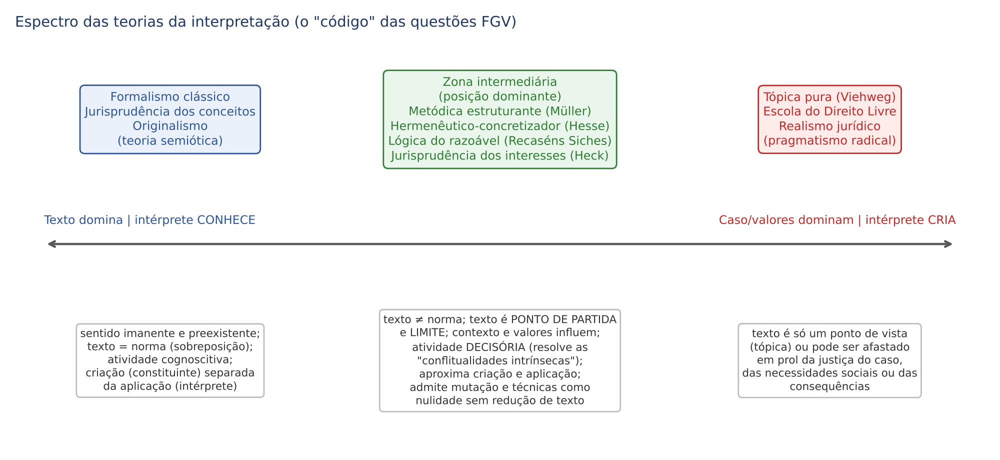
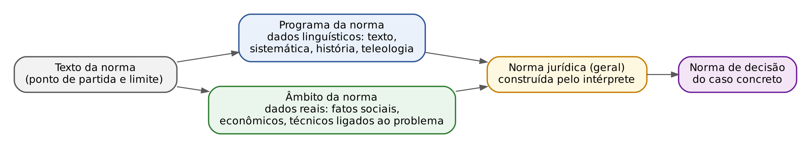
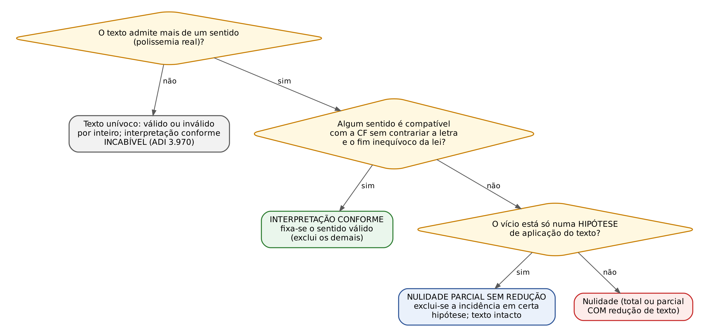
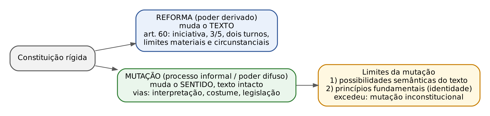
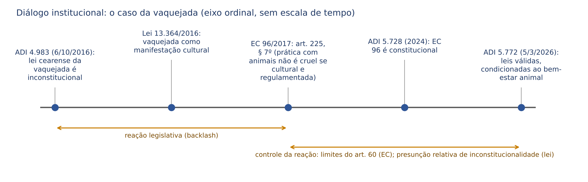

# CAPÍTULO 05 — HERMENÊUTICA CONSTITUCIONAL: TEORIAS, MÉTODOS, PRINCÍPIOS, PONDERAÇÃO E MUTAÇÃO

:::INCIDENCIA
TRF5 p. 2; TJRS p. 2; TJSC p. 3. Nível A+. Lote: 56 questões (FGV 54, FCC 2).
O que mais cai, de longe: o "código" FGV das teorias da interpretação (originalismo e formalismo x metódica estruturante, lógica do razoável e pensamento problemático x tópica pura, realismo jurídico e Escola do Direito Livre), seguido de interpretação conforme, nulidade parcial sem redução de texto, mutação e ponderação.
:::

| Subtema | FGV | FCC | Padrão de cobrança |
|---|---|---|---|
| Teorias da interpretação (atividade cognoscitiva x decisória; texto x norma; qual teoria é compatível com a fala da personagem) | 47 | 0 | Caso narrado com vocabulário próprio ("significante", "conflitualidades intrínsecas", "referenciais semióticos"); pede-se a teoria compatível ou refratária |
| Interpretação conforme e nulidade sem redução | 3 | 0 | Natureza, limites, uso em matéria penal (ADPF 779), decisões aditivas |
| Princípios de interpretação | 2 | 1 | Presunção de constitucionalidade e reserva de plenário; força normativa; harmonização |
| Mutação constitucional | 1 | 0 | Conceito (sentido muda, texto fica) |
| Colisão e ponderação | 1 | 0 | Solução pelas circunstâncias do caso, sem hierarquia abstrata |
| Judicialização, ativismo e sociedade aberta | 1 | 1 | Conceito de judicialização; Häberle e *amicus curiae* |

## 05.1 Premissas: texto, norma e a "atividade decisória" do intérprete

### 05.1.1 Texto não é norma

A premissa de que depende quase toda a matéria: o enunciado linguístico (dispositivo, "significante") não se confunde com a norma (o sentido atribuído, "significado"). A norma é o RESULTADO da interpretação, e não o seu objeto. Daí três consequências cobradas: (a) de um mesmo texto podem extrair-se várias normas (polissemia), o que torna possível a interpretação conforme e a declaração parcial de inconstitucionalidade sem redução de texto; (b) pode haver norma sem dispositivo específico (princípios implícitos, como a proporcionalidade) e dispositivo sem norma autônoma (o preâmbulo, segundo o STF — ver Cap. 2); (c) o sentido pode mudar sem que o texto mude (mutação constitucional, 05.9).

O texto, porém, não é irrelevante: é o PONTO DE PARTIDA e o LIMITE da interpretação. Essa dupla função separa as teorias hoje dominantes (que admitem participação criativa do intérprete dentro da moldura textual) das teorias extremas que permitem abandonar o texto (tópica pura, realismo jurídico radical, Escola do Direito Livre).

### 05.1.2 Peculiaridades da interpretação constitucional

A doutrina (Barroso, Gilmar Mendes e Paulo Gonet Branco) aponta as razões pelas quais a interpretação da Constituição exige categorias próprias, além das regras gerais da hermenêutica jurídica:

- superioridade hierárquica: a Constituição é parâmetro de validade de todo o ordenamento, o que gera a interpretação conforme e a presunção de constitucionalidade das leis;
- natureza da linguagem: predominam princípios e conceitos jurídicos indeterminados ("dignidade", "função social", "interesse local", "relevância e urgência"), com textura aberta;
- conteúdo específico: normas de organização, normas definidoras de direitos e normas programáticas convivem no mesmo documento (classificações no Cap. 4);
- caráter político: a Constituição é o estatuto jurídico do político, e suas decisões têm repercussão sobre a separação de poderes, o que impõe a autocontenção funcional (05.4 e 05.10);
- compromisso: a CF/1988 é compromissória (abriga valores potencialmente antagônicos — livre iniciativa e valor social do trabalho, propriedade e função social, liberdade de expressão e honra), o que torna a ponderação inevitável.

### 05.1.3 O vocabulário da banca

As questões FGV de 2024 a 2026 sobre o tema seguem um padrão de redação muito estável (influência evidente da obra de Emerson Garcia sobre interpretação constitucional). Dominar o vocabulário resolve a maior parte delas:

| Expressão do enunciado | Significado | Aponta para |
|---|---|---|
| "significante" / "significado" | texto / norma | premissa da distinção texto x norma |
| "correspondência biunívoca" ou "relação de sobreposição" entre texto e norma; "sentido imanente"; "significado preexistente" | o texto carrega um único sentido já pronto | formalismo, jurisprudência dos conceitos, originalismo |
| "atividade puramente (ou essencialmente) cognoscitiva" | o intérprete apenas CONHECE a norma | formalismo e originalismo |
| "atividade decisória"; "o intérprete participa da criação da norma"; "aproximação entre os momentos de criação e de aplicação" | o intérprete ESCOLHE entre sentidos possíveis | teorias contemporâneas (metódica estruturante, concretização, lógica do razoável, pensamento problemático) |
| "conflitualidades intrínsecas" (nos planos linguístico, axiológico, teleológico e operativo) | tensões entre os vários sentidos possíveis, que o intérprete precisa resolver | atividade decisória; INCOMPATÍVEL com o originalismo |
| "referenciais semióticos" / "balizamentos textuais" / "alicerce semiótico" | o texto como limite | se respeitados: metódica estruturante, concretização, lógica do razoável; se afastados: realismo, tópica pura, direito livre |
| "referenciais axiológicos" / "padrões axiológicos colhidos no ambiente sociopolítico" | valores | jurisprudência dos valores, lógica do razoável |
| "vicissitudes da realidade", "ambiente sociopolítico", "contexto", "âmbito da norma" | dados da realidade influem no sentido | metódica estruturante; mutação constitucional |
| "texto é apenas um dos pontos de vista" | o texto não vincula | tópica pura |
| "justiça do caso concreto, ainda que se distancie do texto" | o texto pode ceder | realismo jurídico, tópica pura, Escola do Direito Livre |
| "consequências", "maior número", "níveis ótimos" | resultados práticos | pragmatismo, consequencialismo, utilitarismo |

:::DICA
Método de resolução das questões de "teoria compatível": (1) a personagem admite que o intérprete DECIDE entre vários sentidos? Se não (sentido imanente, atividade cognoscitiva), a resposta é formalismo, jurisprudência dos conceitos, originalismo ou "teoria semiótica"; (2) se decide, ela mantém o texto como limite? Se sim, a resposta está na zona intermediária (metódica estruturante, concretizadora, lógica do razoável, pensamento problemático), e a fala será refratária ao originalismo e compatível com mutação e com a nulidade sem redução de texto; (3) se a personagem admite afastar o texto em nome da justiça, das necessidades sociais ou das consequências, a resposta é realismo jurídico, tópica pura ou Escola do Direito Livre.
:::

## 05.2 Teorias da interpretação (o eixo que a FGV mais cobra)

### 05.2.1 Formalismo clássico, jurisprudência dos conceitos e originalismo

O formalismo clássico (Escola da Exegese francesa, pandectística alemã) vê o direito como sistema fechado e completo; a interpretação é operação lógico-dedutiva (subsunção) e o juiz é a "boca da lei". A jurisprudência dos conceitos (*Begriffsjurisprudenz*, Puchta, primeiro Jhering) constrói uma pirâmide de conceitos da qual se deduzem soluções, independentemente de valores e interesses. Ambos separam rigidamente o momento da criação (do legislador ou do constituinte) e o da aplicação (do intérprete), que se limita a conhecer o sentido preexistente: a atividade é cognoscitiva, não decisória, e a relação entre sujeito cognoscente e objeto cognoscido é rígida.

O originalismo é a versão norte-americana dessa postura para a Constituição: o sentido é o fixado no momento da adoção do texto, seja pela intenção dos constituintes (*original intent*), seja pelo significado público original das palavras (*original public meaning*). Seus argumentos: legitimidade democrática (quem decide é o constituinte, não o juiz), segurança jurídica, previsibilidade e contenção do "arbítrio do caso concreto". É "fundacionalista": supõe um fundamento estável, anterior ao intérprete. O oposto é o não originalismo ou "Constituição viva" (*living constitution*), que admite a evolução do sentido.

:::QUESTAO FGV 2024 — PREFEITURA DE MACAÉ — PROCURADOR (Q3049902)
Voto em controle concentrado: a legitimidade do constituinte não se compartilha com os intérpretes, que exercem atividade cognoscitiva e não criativa, em nome da segurança jurídica. Gabarito: A (originalismo). Armadilhas: mutação, pensamento problemático e "evolutividade" pressupõem atividade criativa; realismo jurídico é o polo oposto.
No mesmo sentido: Q3044149 (magistrado guiado pela jurisprudência dos conceitos é compatível com o originalismo — gabarito A; as demais alternativas, ativismo, realismo, mutação e diálogo entre os planos axiológico e deontológico, pressupõem participação criativa); Q3043791 (a polissemia não autoriza obter significados estranhos aos cogitados na Assembleia Constituinte: aproximação do formalismo, gabarito B); Q3593197 (o intérprete deve identificar e prestigiar as opções do constituinte, em atividade cognoscitiva: "teoria semiótica de interpretação", gabarito B); Q3881536 (padrões deontológicos que se exaurem no plano semiótico, sentidos preexistentes: atividade essencialmente cognoscitiva, gabarito E); Q3154661 (perspectiva unívoca, conhecimento da norma preexistente: refratária ao pensamento problemático, gabarito E).
:::

:::QUESTAO FGV 2024 — PROVA NÃO IDENTIFICADA NO BANCO (Q3028414)
Três juízes: João vê sentido imanente a ser descoberto; Pedro admite variação do sentido conforme o ambiente; Maria sustenta sobreposição entre norma e dispositivo. Gabarito: D (os entendimentos de João e Maria harmonizam-se com o originalismo). Passos: sentido imanente e sobreposição texto-norma = negação da atividade decisória = originalismo; Pedro descreve a lógica da mutação e é compatível com a metódica estruturante (por isso a alternativa C, que o diz "refratário" a ela, está errada); tópica pura não exige sobreposição (A errada).
:::

:::QUESTAO FGV 2026 — DPE-RJ — DEFENSOR PÚBLICO (Q4289385)
Juiz afirma que interpretações prospectivas não podem desconsiderar o "sentido imanente" das normas de direitos fundamentais, sob pena de manipulação a cada mudança do ambiente sociopolítico. Gabarito: A (harmoniza-se com o originalismo e é refratária ao consequencialismo). A armadilha é a alternativa E: "resolver conflitualidades intrínsecas" é próprio da atividade decisória, que a fala nega.
No mesmo sentido, pelo contraste: Q3171386 (sentido variável conforme os "circunstancialismos" da aplicação, contra lógica estática: distancia-se da lógica puramente cognitivista das premissas originalistas, gabarito E; a alternativa D erra ao dizer que não encampa a dicotomia programa e âmbito da norma).
:::

:::QUESTAO FGV 2025 — AL-AM — PROCURADOR (Q3777895)
Parecer: a jurisprudência dos conceitos é refratária à influência dos valores colhidos no ambiente sociopolítico e privilegia o momento da criação sobre o da aplicação. Gabarito: A (a teoria exposta é incompatível com a lógica do razoável). A descrição feita pelo procurador está CORRETA (B errada); a influência de valores não é típica do originalismo (C errada); jurisprudência dos conceitos não é complementar à jurisprudência dos interesses nem à Escola do Direito Livre, que nasceram como reação a ela (E errada).
:::

:::ATENCAO GABARITO DISCUTÍVEL — Q3099303 (FGV 2024 — PREFEITURA DE NITERÓI — AUDITOR)
O Secretário concluiu que o significado, "apesar da intransponibilidade dos limites textuais", não pode desconsiderar a influência da realidade. O gabarito oficial é B (compatível com o originalismo). A conclusão descrita, porém, é a da metódica estruturante (texto como limite + âmbito da norma), e a própria FGV, em Q3362516 e Q3605989, trata a sensibilidade ao contexto como INCOMPATÍVEL com o originalismo. A alternativa C ("não é compatível com o realismo jurídico") parece a mais correta, porque o realismo admite afastar o texto. Leitura possível para salvar o gabarito: o originalismo do "significado público original" também respeita o texto e admite aplicação a fatos novos. Em prova, prefira a lógica dominante da banca (contexto + texto como limite = metódica estruturante, não originalismo), mas saiba que este gabarito existe.
:::

### 05.2.2 Reações ao formalismo: jurisprudência dos interesses, Escola do Direito Livre, jurisprudência dos valores

A jurisprudência dos interesses (*Interessenjurisprudenz*, Philipp Heck) rompe com o conceitualismo: a lei resolve conflitos de interesses, e o juiz deve investigar os interesses (sociais, econômicos, morais) que o legislador ponderou, servindo-se da finalidade da norma. Continua vinculada à lei, mas sensível à realidade e aos fins: é "refratária ao formalismo clássico".

A Escola do Direito Livre (*Freirechtsbewegung*, Hermann Kantorowicz, Eugen Ehrlich) vai além: diante de lacunas e da insuficiência da lei, o juiz pode buscar o "direito livre", nascido da sociedade, e decidir segundo o sentimento de justiça e as necessidades sociais, inclusive à margem do texto. É o discurso "sociológico", em que preponderam as necessidades do ambiente sociopolítico sobre a linguagem.

A jurisprudência dos valores (*Wertungsjurisprudenz*), dominante na Alemanha do pós-guerra e no Tribunal Constitucional Federal (caso Lüth, 1958), vê a Constituição como ordem objetiva de valores que irradia para todo o ordenamento. É a matriz da ponderação e da eficácia irradiante dos direitos fundamentais (Cap. 7).

:::QUESTAO FGV 2024 — TJ-PE — JUIZ SUBSTITUTO (Q3117563)
Três magistradas: Maria (discurso sociológico, preponderam as necessidades do ambiente sociopolítico), Joana (discurso sociossemiótico: linguagem e contexto) e Aline (discurso semiótico: a linguagem direciona). Gabarito: D (apenas a de Maria harmoniza-se com a Escola do Direito Livre). Passos: Aline = formalismo/originalismo; Joana = posição intermediária (metódica estruturante); Maria = abandono da linguagem em favor das necessidades sociais = Direito Livre (e realismo). A alternativa A erra porque Aline é formalista; C erra porque Joana não é realista; E erra porque Joana não é originalista.
:::

:::QUESTAO FGV 2025 — TRF6 — JUIZ FEDERAL SUBSTITUTO (Q3742355)
Demandante: aproximação entre criação e aplicação, sentido mutável com texto imutável, forte influência do problema concreto. Demandado: a interpretação não pode descurar de aspectos sociais, morais e econômicos, influenciados pela realidade e pelos fins da norma. Gabarito: C (a interpretação do demandado é refratária ao formalismo clássico e harmônica com a jurisprudência dos interesses). Armadilhas: a fala do demandante não é "tópica pura" (não abandona o texto) e não se harmoniza com Savigny nem com a jurisprudência dos conceitos; a fala do demandado não é refratária à sociedade aberta dos intérpretes.
:::

### 05.2.3 Realismo jurídico

O realismo jurídico (norte-americano: Holmes, Llewellyn, Jerome Frank; escandinavo: Alf Ross, Olivecrona) é cético quanto à força vinculante do texto: o direito é o que os tribunais efetivamente decidem, e a decisão é explicada por fatores psicológicos, sociais e econômicos. Na redação da FGV, o realismo aparece sempre que a personagem admite que a norma NÃO está necessariamente conectada aos referenciais semióticos, podendo o intérprete afastá-los em nome da justiça social, da realidade ou das peculiaridades do caso.

:::QUESTAO FGV 2025 — DPE-PE — DEFENSOR PÚBLICO (Q3390824)
O Defensor sustenta que as normas constitucionais não estão necessariamente conectadas a referenciais semióticos, cabendo ao juiz, à luz das circunstâncias do problema, delinear o padrão deôntico que realize a justiça social. Gabarito: B (realismo jurídico). Lógica subsuntiva, teorias procedimentais, originalismo e Savigny pressupõem vínculo ao texto.
No mesmo sentido: Q3248764 (erosão da força normativa do artigo pelo decurso do tempo, estruturando-se norma adequada ao caso: realismo jurídico, gabarito A — NÃO é mutação, que respeita o texto); Q3453277 (Cap. 7; demandado admite que a situação concreta e os valores afastem o alicerce semiótico: realismo, gabarito C).
:::

:::QUESTAO FGV 2025 — PROVA NÃO IDENTIFICADA NO BANCO (Q3593748)
Conselheiro: o sentido é influenciado pelas vicissitudes do ambiente sociopolítico, sem correspondência biunívoca entre significante e significado; preterir um significado compatível com o texto e escolher outro igualmente compatível é legítimo e compatível com a sociedade aberta dos intérpretes. Gabarito oficial: B (compatível com o realismo jurídico). Fundamento da banca: o realismo valoriza a escolha do intérprete e nega sentido único. Observação: a fala respeita o texto (escolhe entre sentidos "harmônicos com o significante"), o que também a aproxima da metódica estruturante; a alternativa A (incompatível com a tópica pura) seria defensável. Registre o gabarito e o ponto de tensão.
:::

### 05.2.4 Tópica pura e pensamento problemático

A tópica (Theodor Viehweg, Tópica e jurisprudência, 1953) parte do problema, e não do sistema: a solução é construída pela discussão de *topoi* (lugares comuns, pontos de vista aceitos), em ambiente argumentativo. Na tópica pura, o texto normativo é apenas mais um *topos*, de valor relativo, e o objetivo é a solução justa do caso, sem limites textuais. Críticas clássicas: casuísmo, insegurança, risco de esvaziar a normatividade.

O "pensamento problemático" é gênero mais amplo: qualquer teoria que dê relevo ao problema concreto na construção da norma. Por isso a FGV distingue: a metódica estruturante e o método hermenêutico-concretizador NÃO se harmonizam com a tópica pura (mantêm o primado do texto), mas NÃO são refratários ao pensamento problemático.

:::QUESTAO FGV 2024 — PROVA NÃO IDENTIFICADA NO BANCO (Q3157893)
O contribuinte afirma que o texto é apenas um dos pontos de vista, relativo, e que o intérprete busca a justiça do caso sem limites textuais. Gabarito: B (tópica pura). O método concretizador (D) mantém o texto como limite; mutação (E) também.
No mesmo sentido: Q2565229 (primeiro magistrado: conexão estreita entre interpretação e aplicação, relevância do problema = metódica concretista; segundo: o problema direciona a solução ainda que se distancie do texto = tópica pura; gabarito E).
:::

:::QUESTAO FGV 2024 — TJ-MT — JUIZ SUBSTITUTO (Q3086978)
Desembargador afirma que as peculiaridades do caso concreto NÃO devem ser consideradas no processo de delineamento do significado, para preservar coerência e isonomia. Gabarito: E (é refratária à influência da tópica). A fala não é necessariamente originalista (C): ela reconhece processo "argumentativo e decisório"; só exclui o caso concreto. Também não é refratária à mutação (A), que decorre da realidade, e não do caso.
:::

:::QUESTAO FGV 2025 — TJ-CE — JUIZ SUBSTITUTO (Q3505812)
Juiz: a higidez textual não deve desnaturar a evolutividade; polissemia e vicissitudes da realidade tornam a atividade essencialmente decisória, com resolução das conflitualidades intrínsecas. Gabarito: E (apesar de não se harmonizar com as bases da tópica pura, não é refratária ao pensamento problemático). A alternativa A (separação entre criação e aplicação) descreve o formalismo; D nega a influência de valores, que a fala admite.
:::

### 05.2.5 A zona intermediária: lógica do razoável, metódica estruturante e concretização

A lógica do razoável (Luis Recaséns Siches) contrapõe à lógica formal (do racional, matemática, dedutiva) uma lógica dos problemas humanos, orientada por valores, sensível ao contexto e às consequências, buscando a solução razoável. A interpretação é influenciada por referenciais axiológicos mutáveis, colhidos na realidade social. É compatível com a influência de valores e com a mutação; é incompatível com a jurisprudência dos conceitos e com o formalismo ("lógica das proposições matemáticas").

A metódica estruturante e o método hermenêutico-concretizador, desenvolvidos em 05.3, completam essa zona: o intérprete decide, mas a partir do texto e dentro dele, considerando a realidade.

:::QUESTAO FGV 2025 — TJ-RS — ANALISTA JUDICIÁRIO (Q3742947)
Juízo diante de vários significados escolhe um deles e afirma que a mutabilidade dos vetores axiológicos do ambiente sociopolítico legitima novos significados sem usurpação de competências. Gabarito: C (compatível com a lógica do razoável). Tópica pura (A) não está descrita (não há abandono do texto); originalismo (B) nega novos significados; a fala não é refratária à nulidade sem redução (D) nem aos vetores semióticos (E).
No mesmo sentido: Q3752705 (MPE-ES 2025, Promotor: referenciais axiológicos mutáveis e divergentes exigem resolver as conflitualidades valorativas — lógica do razoável, gabarito E).
:::

:::QUESTAO FGV 2026 — TJ-PE — JUIZ SUBSTITUTO (Q4349524)
João invoca direito de primeira dimensão previsto em norma de eficácia limitada e programática, a ser interpretado conforme os padrões axiológicos do ambiente sociopolítico, com efeitos antes da regulamentação; o Município responde que também contam fatores linguísticos (balizas textuais) e teleológicos, não só os axiológicos. Gabarito: D (a linha de João é compatível com a lógica do razoável e a do Município é incompatível com o confinamento do intérprete ao plano puramente cognoscitivo). Passos: (1) ambos admitem que o intérprete decide entre sentidos (nenhum é originalista); (2) João privilegia valores = lógica do razoável; (3) o Município acrescenta texto e fins, o que também é atividade decisória. A alternativa B é falsa: normas de eficácia limitada produzem efeitos desde logo (ao menos o efeito negativo, paralisante das normas contrárias — Cap. 4). Tópica pura e Direito Livre (A e C) exigem abandono do texto, que ninguém propôs; E admite desconsiderar o texto pelo pragmatismo.
:::

### 05.2.6 Pragmatismo, consequencialismo e utilitarismo

O pragmatismo jurídico (Richard Posner, na vertente judicial) tem três traços clássicos: antifundacionalismo (rejeição de fundamentos últimos e estáveis, como a intenção originária), contextualismo (o sentido depende do contexto) e consequencialismo (a decisão é avaliada por suas consequências práticas). O utilitarismo (Bentham, Mill) orienta-se pela maximização do bem-estar do maior número. No direito positivo brasileiro, o consequencialismo ganhou cláusula expressa no art. 20 da LINDB, incluído pela Lei 13.655/2018: "Nas esferas administrativa, controladora e judicial, não se decidirá com base em valores jurídicos abstratos sem que sejam consideradas as consequências práticas da decisão"; o parágrafo único exige que a motivação demonstre a necessidade e a adequação da medida, "inclusive em face das possíveis alternativas" (exigência que reproduz, em linguagem administrativa, os testes da proporcionalidade — 05.7).

:::QUESTAO FGV 2025 — TCE-PE — PROCURADOR DO TRIBUNAL DE CONTAS (Q3592123)
O gestor prefere o significado compatível com os valores do ambiente sociopolítico que satisfaça os interesses do maior número, ainda que desconsiderados interesses de outra parcela, após resolver as conflitualidades nos planos linguístico, axiológico e teleológico. Gabarito: B (compatível com o utilitarismo e refratária ao originalismo). Não há abandono do texto (E errada) nem tópica pura (A).
No mesmo sentido: Q3673842 (ENAC 2025: influxos axiológicos e circunstanciais para alcançar "níveis ótimos de justiça", superando deficiências dos referenciais semióticos — compatível com referenciais que levam em conta influxos consequencialistas, gabarito B).
:::

### 05.2.7 Casos de atividade decisória com texto como limite (o núcleo das questões)

:::QUESTAO FGV 2025 — TJ-SE — JUIZ SUBSTITUTO (Q3301277)
Ao sentenciar, o juiz percebe que as peculiaridades do caso dão maior peso a certos valores, todos abrigados pela Constituição compromissória, e atribui ao texto significado distinto do defendido pelas partes. Gabarito: B (o magistrado aproximou os momentos de criação e aplicação, distanciou-se do originalismo e mostrou-se sensível ao pensamento problemático). Armadilhas: A confunde ponderação de valores com realismo; D erra porque Constituição compromissória não impõe equidistância (o caso define pesos); E inverte a premissa (não há sobreposição entre texto e norma).
:::

:::QUESTAO FGV 2024 — TJ-SC — JUIZ SUBSTITUTO (Q3049395)
Norma de eficácia limitada e programática ainda não regulamentada; o juiz identifica as grandezas relevantes (potencial expansivo da linguagem e valores do caso), resolve as conflitualidades e atribui o sentido. Gabarito: E (a norma não tem sentido imanente, e a atividade tangencia o pensamento problemático). Passos: (1) norma limitada pode embasar pretensão (efeitos negativos e interpretativos — Cap. 4), por isso A e D estão erradas; (2) a atividade descrita mantém o texto como limite, logo não é Escola do Direito Livre (B); (3) é justamente essa atividade que permite a nulidade sem redução de texto (C errada).
:::

:::QUESTAO FGV 2026 — TJ-BA — JUIZ SUBSTITUTO (Q4083773)
Diante da pluralidade de valores e do potencial expansivo da linguagem, o juiz resolve as conflitualidades nos planos linguístico e axiológico e delineia a norma adequada ao problema concreto. Gabarito: C (o processo não se ajusta à tópica pura, mas é compatível com a declaração parcial de inconstitucionalidade sem redução de texto). A resposta A é a armadilha: o processo intelectivo não determina que a norma resultante seja princípio (pode ser regra). Savigny (B) e a "atividade puramente cognoscitiva" (D) são formalistas; E nega a convivência entre plano linguístico e axiológico.
:::

:::QUESTAO FGV 2026 — MPE-RJ — PROMOTOR DE JUSTIÇA SUBSTITUTO (Q4088291)
Demandante: o ambiente sociopolítico não pode ser petrificado, nem o significado normativo. Demandado: o significado não pode variar ao sabor do intérprete, que deve subsumir o fato a um significado preexistente. Gabarito: D (a do demandante ajusta-se à concepção de declaração de nulidade sem redução de texto e a do demandado é refratária ao realismo jurídico). A técnica de nulidade sem redução depende de pluralidade de sentidos ou de hipóteses de aplicação, que o demandante admite; o demandado, subsuntivo, é o oposto do realismo. Atenção: a alternativa E inverte as posições.
:::

:::QUESTAO FGV 2024 — TJ-MT — ANALISTA JUDICIÁRIO (Q3114251)
O autor sustenta que o intérprete participa da criação da norma, influenciada pela realidade, e decide entre os sentidos possíveis após resolver as conflitualidades intrínsecas (inclusive linguísticas). Gabarito: B (compatível com o pensamento problemático e com a declaração de nulidade sem redução de texto).
No mesmo sentido: Q2442290 (juíza escolhe entre três significados ligados à linguagem, aos valores e aos fins — a atividade pode ser empregada na declaração parcial sem redução de texto, gabarito B; não é "integralmente" metódica concretista, E); Q2564231 (significado influenciado pelas vicissitudes da realidade — compatível com a declaração de inconstitucionalidade sem redução de texto, gabarito C).
:::

:::QUESTAO FGV 2025 — MPU — ANALISTA (Q3339790)
Fatores semióticos e axiológicos geram vários significados; o intérprete escolhe após resolver as conflitualidades. Gabarito: C (ajusta-se à influência da realidade, distancia-se do originalismo, sem aderir ao realismo). É a "fórmula" da posição intermediária.
No mesmo sentido: Q3362516 (interpretação incompatível com a lógica das proposições matemáticas, sensível à evolutividade, sem desconsiderar limites semióticos — incompatível com construções originalistas, gabarito C); Q3777460 (pluralidade de significados enquadráveis no significante potencializa a atividade do intérprete: a resolução das conflitualidades é refratária à atividade puramente cognoscitiva, gabarito C); Q4283060 (o ordenador quer prestigiar valores ainda que se distancie dos balizamentos semânticos: reconhece papel ativo do intérprete na resolução das conflitualidades, gabarito E); Q3883334 (atribuir preeminência a certos valores no caso não significou desconsiderar os referenciais semióticos, gabarito E); Q3520620 (significado contemporâneo ao problema, sem descurar do alicerce semiótico: refratária à rígida separação sujeito-objeto, gabarito C); Q2524455 (influência do pensamento problemático, sem desconsiderar que a norma resulta da interação texto-contexto, gabarito D).
:::

:::QUESTAO FGV 2025 — AL-AM — ANALISTA DE CONTROLE (Q3777248)
Emendas posteriores, sem alterar a forma do art. X, mudaram o seu significado por influência sistemática. Gabarito: D (a mobilidade normativa decorre da aproximação entre os momentos de criação e aplicação, o que potencializa o papel do intérprete na apreensão de aspectos contextuais). Atribuir significado não é atividade constituinte (A); a atividade não é exclusiva do "intérprete último" (B); o realismo não se caracteriza pela previsibilidade e pelo respeito ao texto (E).
No mesmo sentido: Q3882047 (vicissitudes da realidade levam a conteúdo distinto do anterior: foram considerados aspectos contextuais que expandem ou retraem os referenciais semióticos, gabarito C); Q3593064 (sem correspondência biunívoca entre texto e norma, alterações do âmbito da norma podem gerar alterações informais de sentido, gabarito D — liga-se à mutação, 05.9).
:::

## 05.3 Métodos de interpretação constitucional

### 05.3.1 Visão geral

A sistematização difundida no Brasil (Canotilho, a partir de Böckenförde) aponta seis métodos. Nenhum é exclusivo: a doutrina fala em pluralismo metodológico, com uso combinado.

| Método | Autor de referência | Ideia central | Crítica / ponto de prova |
|---|---|---|---|
| Jurídico (clássico, hermenêutico clássico) | Ernst Forsthoff; base em Savigny | a Constituição é lei e interpreta-se com os elementos tradicionais: gramatical, lógico, histórico, sistemático (e teleológico) | tese da identidade Constituição-lei; insuficiente para princípios abertos; valoriza o texto |
| Tópico-problemático | Theodor Viehweg | primado do problema; argumentação a partir de *topoi*; norma como um dos pontos de vista | casuísmo; risco de inverter a relação norma-problema |
| Hermenêutico-concretizador | Konrad Hesse | pré-compreensão do intérprete + problema concreto; círculo hermenêutico; PRIMADO DO TEXTO sobre o problema | difere da tópica justamente porque parte do texto |
| Científico-espiritual (valorativo, sociológico) | Rudolf Smend | Constituição como ordem de integração da comunidade; interpretação pelo sistema de valores e pela realidade da vida estatal | indeterminação; relativiza o texto |
| Normativo-estruturante (metódica estruturante) | Friedrich Müller | norma = programa da norma (dados linguísticos) + âmbito da norma (dados da realidade); distingue texto e norma; norma de decisão | é a teoria mais cobrada pela FGV como posição intermediária |
| Comparativo | Peter Häberle (o "quinto método") | comparação constitucional como método interpretativo | utilizado no diálogo entre cortes (Cap. 11) |

:::PEGADINHA
Hermenêutico-concretizador x tópico-problemático: ambos valorizam o problema, mas o concretizador parte do TEXTO (primado da norma sobre o problema) e da pré-compreensão do intérprete; o tópico parte do PROBLEMA. "Primazia do texto" e "pré-compreensão" = Hesse; "texto como um dos *topoi*" = Viehweg.
:::

### 05.3.2 Método jurídico (clássico)

Para Forsthoff, a Constituição deve ser interpretada como qualquer lei, com os cânones de Savigny: gramatical (literal), lógico, histórico e sistemático, acrescido do teleológico. O mérito é a segurança e a valorização do texto; o defeito, a insuficiência diante de cláusulas abertas e da necessidade de ponderar. Na FGV, "métodos de interpretação preconizados por Savigny" aparecem como alternativa ERRADA sempre que a fala descreve atividade decisória ou influência de valores e da realidade (Q3390824, Q4083773, Q3742355).

### 05.3.3 Método hermenêutico-concretizador

Konrad Hesse parte da ideia de que interpretar é concretizar: o conteúdo da norma só se completa na solução do problema. Elementos: (a) pré-compreensão (*Vorverständnis*) do intérprete, que não é neutro; (b) o problema concreto; (c) o texto, como limite e ponto de partida. O movimento é circular (círculo hermenêutico, de Gadamer): o intérprete vai do texto ao problema e volta, até uma compreensão estável. Diferença em relação à tópica: o primado é do texto.

### 05.3.4 Método científico-espiritual

Rudolf Smend vê a Constituição como fator de integração da comunidade política, devendo ser interpretada segundo o "espírito" (sistema de valores subjacente) e a realidade dinâmica da vida estatal. Daí seu caráter valorativo e sociológico e a crítica da indeterminação. Relaciona-se ao princípio do efeito integrador (05.4).

### 05.3.5 Metódica estruturante (normativo-estruturante)

Friedrich Müller distingue texto (o enunciado) e norma (construída pelo intérprete). A norma compõe-se do programa da norma (resultado da interpretação dos dados linguísticos: gramatical, sistemático, histórico, teleológico) e do âmbito da norma (recorte da realidade social, econômica e técnica abrangido pelo programa). Dessa estrutura sai a norma jurídica geral e, aplicada ao caso, a norma de decisão. O texto é limite; a realidade integra a própria norma. Consequências cobradas: o intérprete exerce atividade decisória; o sentido pode mudar quando o âmbito da norma muda (mutação); a metódica é refratária às concepções originalistas e fundacionalistas, mas não é tópica pura nem realismo.

:::QUESTAO FGV 2024 — CGM-BH — AUDITOR (Q2387551)
Juiz anuncia que seguirá a metódica concretista de Friedrich Müller. Gabarito: C (o ambiente sociopolítico deve ser considerado no processo intelectivo que parte do texto e culmina na norma). Erradas: A (valores que elastecem ou comprimem o texto sem baliza), B (certeza do texto e separação entre criação e aplicação — formalismo) e D (tópica pura).
No mesmo sentido: Q2351225 (Câmara de SP 2024: a dicotomia texto-norma afasta o formalismo e exige compreender programa e âmbito da norma, gabarito C); Q3914546 (o intérprete avança ao plano decisório; fatores semióticos delimitam o espaço, mas não se sobrepõem à norma — compatível com a metódica estruturante, gabarito B); Q3605989 (o "justo contemporâneo" obtido pela metódica estruturante: as concepções originalistas, fundacionalistas, não devem direcionar a interpretação, gabarito C); Q3656895 (TJ, em controle concentrado, reconhece que mudanças da realidade alteraram o sentido do parâmetro constitucional e dá interpretação conforme à lei municipal — atividade compatível com a metódica estruturante, gabarito C); Q2611644 (Cap. 2: Constituição semântica que manda interpretar com sensibilidade ao ambiente sociopolítico, sem "petrificação textual" — metódica concretista, gabarito C).
:::

### 05.3.6 Sociedade aberta dos intérpretes (Häberle)

Peter Häberle sustenta que, numa sociedade pluralista, não há *numerus clausus* de intérpretes: todos os que vivem a Constituição (cidadãos, grupos, órgãos públicos, opinião pública) são seus intérpretes, ainda que a última palavra jurídica caiba à jurisdição constitucional. A interpretação deve ser democratizada. No processo constitucional brasileiro, a tese inspirou a intervenção do *amicus curiae* (Lei 9.868/1999, art. 7º, § 2º; CPC, art. 138) e as audiências públicas (Lei 9.868/1999, art. 9º, § 1º; Lei 9.882/1999, art. 6º, § 1º) — regime processual no Cap. 18.

:::QUESTAO FCC 2026 — DPE-MT — DEFENSOR PÚBLICO (Q3954667)
Mecanismos que concretizam, no STF, a sociedade aberta dos intérpretes. Gabarito: C (audiências públicas e intervenção do *amicus curiae* no controle de constitucionalidade). Repercussão geral, recursos repetitivos, efeito vinculante, reserva de plenário e remédios constitucionais não ampliam o círculo de intérpretes.
:::

## 05.4 Princípios (postulados) de interpretação constitucional

### 05.4.1 O catálogo

Os "princípios de interpretação" não são normas de conduta, mas pautas metodológicas (Humberto Ávila prefere "postulados normativos": normas sobre a aplicação de outras normas). O catálogo de Canotilho é o que as bancas reproduzem; Barroso acrescenta princípios "instrumentais" (supremacia, presunção de constitucionalidade, interpretação conforme, razoabilidade e efetividade).

| Princípio | Conteúdo | Gancho de prova |
|---|---|---|
| Unidade da Constituição | a Constituição é um todo; as normas devem ser interpretadas de modo a evitar contradições; não há hierarquia entre normas constitucionais originárias | rejeição das "normas constitucionais inconstitucionais" (Bachof) quanto às normas ORIGINÁRIAS; emendas podem ser controladas (Cap. 3) |
| Efeito integrador (eficácia integradora) | na solução dos problemas, dar primazia aos critérios que favoreçam a integração política e social e o reforço da unidade política | ligado ao método científico-espiritual (Smend) |
| Máxima efetividade (eficiência, interpretação efetiva) | a norma deve ter o sentido que lhe dê maior eficácia; invocado sobretudo para direitos fundamentais | art. 5º, § 1º; efetividade de normas programáticas (Cap. 4) |
| Justeza (conformidade ou correção funcional) | o intérprete não pode subverter o esquema organizatório-funcional da Constituição (separação de poderes, repartição de competências) | limite ao ativismo; o STF não pode atuar como legislador positivo |
| Concordância prática (harmonização) | bens constitucionais em conflito devem ser coordenados de modo a evitar o sacrifício total de um deles; cedências recíprocas | base da ponderação (05.6); "harmonização que evita a exclusão de normas" |
| Força normativa da Constituição | dar prevalência às soluções que densifiquem e atualizem as normas, conferindo-lhes eficácia ótima (Konrad Hesse, "A força normativa da Constituição", contra Lassalle) | a Constituição não é "folha de papel"; vontade de Constituição |
| Interpretação conforme | entre sentidos possíveis da lei, prefere-se o compatível com a Constituição | princípio e técnica de decisão (05.5) |
| Supremacia | a Constituição prevalece sobre qualquer norma; fundamento do controle | Kelsen: inconstitucionalidade formal e material |
| Presunção de constitucionalidade | leis e atos do Poder Público presumem-se válidos até decisão em contrário; ônus argumentativo de quem alega o vício | fundamento da reserva de plenário (art. 97) e da interpretação conforme |

:::PEGADINHA
Máxima efetividade x força normativa: são muito próximos. Pela formulação de Canotilho, a máxima efetividade fala em atribuir à norma o sentido que lhe dê maior eficácia (sobretudo direitos fundamentais); a força normativa fala em privilegiar soluções que, considerando a realidade histórica, garantam eficácia ótima e permanência à Constituição. Justeza (conformidade funcional) NÃO trata de eficácia: protege a repartição de funções.
:::

:::QUESTAO FGV 2024 — AL-TO — ANALISTA LEGISLATIVO (Q2457687)
Três itens: I (supremacia como posição hierárquica superior das normas constitucionais, pela distinção entre poder constituinte e poderes constituídos), II (pela "feição meramente política", não se deve atribuir à Constituição o sentido de maior eficácia e força normativa) e III (na interpretação conforme, a lei é interpretada à luz da Constituição e, ao mesmo tempo, atribui-se sentido à norma constitucional). Gabarito: C (I e III). O item II nega exatamente o princípio da força normativa (Hesse) e da máxima efetividade.
:::

:::QUESTAO FGV 2024 — PREFEITURA DE NOVA IGUAÇU — ANALISTA TRIBUTÁRIO (Q3038838)
A cláusula de reserva de plenário (art. 97) decorre de qual princípio, considerada a pretensão de validade das normas? Gabarito: C (presunção de constitucionalidade). Raciocínio: só a maioria absoluta do tribunal (ou do órgão especial) pode afastar a presunção de validade da lei. Unidade, máxima efetividade, efeito integrador e correção funcional não explicam a exigência de quórum qualificado.
:::

:::LEI CF, ART. 97
"Somente pelo voto da maioria absoluta de seus membros ou dos membros do respectivo órgão especial poderão os tribunais declarar a inconstitucionalidade de lei ou ato normativo do Poder Público." Regime da reserva de plenário, exceções (CPC, art. 949, parágrafo único) e SV 10: Cap. 17.
:::

### 05.4.2 Unidade, hierarquia e "normas constitucionais inconstitucionais"

Do princípio da unidade decorrem três afirmações que caem: (a) não há hierarquia jurídica entre normas constitucionais originárias (pode haver, no máximo, hierarquia axiológica, relevante para a ponderação); (b) o STF não admite controle de constitucionalidade de normas originárias, rejeitando a tese de Otto Bachof (normas constitucionais inconstitucionais por violação de direito suprapositivo ou de normas constitucionais "superiores") — precedente clássico: ADI 815 (v. Cap. 2); (c) as tensões entre normas originárias resolvem-se por interpretação harmonizadora (concordância prática), e não por invalidação. Já as normas introduzidas por EMENDA submetem-se ao controle, pelos limites do art. 60, inclusive quanto a vício formal no processo de votação (ADIs 4.887, 4.888 e 4.889, v. Cap. 3).

:::QUESTAO FCC 2026 — DPE-BA — DEFENSOR PÚBLICO (Q4037419)
A Corte constitucional, diante de tensão entre norma constitucional interna e obrigação de tratado de direitos humanos, ajusta o sentido da norma interna para compatibilizá-la com o parâmetro internacional, sem afastar nenhuma delas. Gabarito: E (a harmonização pode ocorrer por interpretação que evite a exclusão de normas). Não há renúncia à norma interna, emenda prévia, ofensa à supremacia nem declaração de invalidade: é concordância prática aplicada ao diálogo de fontes (hierarquia dos tratados e controle de convencionalidade no Cap. 11).
:::

## 05.5 Interpretação conforme a Constituição e declaração parcial de inconstitucionalidade sem redução de texto

### 05.5.1 Dupla natureza da interpretação conforme

A interpretação conforme é, ao mesmo tempo: (a) princípio de interpretação (dever de todo juiz, em qualquer processo, de preferir, entre os sentidos possíveis da lei, o compatível com a Constituição) e (b) técnica de decisão no controle de constitucionalidade, pela qual o tribunal declara a lei constitucional DESDE QUE interpretada em determinado sentido, excluindo os demais. Fundamentos: supremacia, presunção de constitucionalidade, unidade do ordenamento e conservação das normas (respeito ao legislador democrático: entre anular e salvar, salva-se).

:::LEI LEI 9.868/1999, ART. 28, PARÁGRAFO ÚNICO
"A declaração de constitucionalidade ou de inconstitucionalidade, inclusive a interpretação conforme a Constituição e a declaração parcial de inconstitucionalidade sem redução de texto, têm eficácia contra todos e efeito vinculante em relação aos órgãos do Poder Judiciário e à Administração Pública federal, estadual e municipal." Atenção: a lei menciona as duas técnicas SEPARADAMENTE, o que reforça que não são sinônimas.
:::

### 05.5.2 Pressupostos e limites

- Polissemia real: só cabe quando o texto comporta mais de um sentido. Texto unívoco não admite interpretação conforme; ou é válido, ou inválido (ADI 3.970, abaixo).
- Respeito à literalidade: não se pode atribuir à lei sentido que contrarie a letra inequívoca do texto.
- Respeito ao fim inequívoco do legislador: não se pode chegar a resultado que contradiga a finalidade evidente da lei, sob pena de criar norma nova.
- Vedação de atuar como legislador positivo: a técnica não autoriza o tribunal a reescrever a lei ou a criar regime jurídico não previsto (limite que decorre da justeza ou conformidade funcional). Essa vedação, porém, foi relativizada pela prática das decisões aditivas (05.5.5).
- Ambiguidade basta: o STF, em 2026, entendeu que a simples ambiguidade de expressão legal (que dá margem a leitura inconstitucional) "por si só" exige a interpretação conforme, ainda que não haja prova de aplicação desconforme (ADI 7.886, abaixo).

:::JURIS STF, ADI 3.970/DF, RELATORA MINISTRA ROSA WEBER, PLENÁRIO, J. 16/5/2022
Leis sobre a destinação da CIDE-Combustíveis que reproduzem as finalidades do art. 177 da CF. Tese: texto legal com sentido unívoco, sem abertura semântica que permita extrair exegese desconforme, NÃO comporta interpretação conforme; ausente polissemia, é inviável a "interpretação adequadora".
:::

:::JURIS STF, ADI 7.886/GO, RELATOR MINISTRO DIAS TOFFOLI, PLENÁRIO, J. 5/8/2026 (INFO 1224)
Lei goiana destinava honorários de sucumbência das causas do Detran aos "advogados" que o representassem. O STF deu interpretação conforme para que a expressão alcance exclusivamente os procuradores do Estado de carreira (unicidade orgânica da advocacia pública estadual, art. 132). Ponto metodológico: a ambiguidade, por si só, justifica a técnica, sem necessidade de prova de aplicação desconforme.
:::

### 05.5.3 Interpretação conforme x declaração parcial de inconstitucionalidade sem redução de texto

As duas técnicas preservam o texto e resultam de controle; por isso o STF frequentemente as trata como equivalentes, e parte da doutrina (Gilmar Mendes) registra a dificuldade de distingui-las na prática. A distinção cobrada, porém, é esta:

| Critério | Interpretação conforme | Nulidade (inconstitucionalidade) parcial sem redução de texto |
|---|---|---|
| O que o tribunal faz | fixa o sentido VÁLIDO (diz como a lei deve ser lida) | declara INVÁLIDA uma hipótese de aplicação ou um sentido determinado |
| Natureza da decisão | declaração de constitucionalidade condicionada (técnica de interpretação) | declaração de inconstitucionalidade (técnica de decisão de controle) |
| Dispositivo típico | "julgo parcialmente procedente para conferir interpretação conforme ao art. X, no sentido de que..." | "declaro a inconstitucionalidade, sem redução de texto, do art. X, na parte em que se aplica a..." / "quando interpretado no sentido de..." |
| Texto | intacto | intacto |
| Efeitos (controle concentrado) | eficácia contra todos e efeito vinculante (Lei 9.868, art. 28, parágrafo único) | idem |
| Reserva de plenário (art. 97) | a interpretação conforme genuína (escolha entre sentidos) não exige, segundo a orientação dominante; mas se, a pretexto de interpretar, o órgão fracionário afasta a incidência da lei, incide a SV 10 (Cap. 17) | exige, porque é declaração de inconstitucionalidade |
| Exemplo clássico | ADI 4.277 (art. 1.723 do Código Civil e união homoafetiva); ADPF 779 (legítima defesa da honra) | lei tributária válida, mas inaplicável no mesmo exercício financeiro (anterioridade): declara-se inválida apenas a cobrança naquele exercício |

:::QUESTAO FGV 2024 — DATAPREV — ADVOGADO (Q3085856)
Sobre a declaração parcial de inconstitucionalidade sem redução de texto. Gabarito: D (é técnica de decisão que difere da interpretação conforme). Erradas: não é técnica de interpretação conforme (A, C), não é modulação temporal (B) nem declaração de inconstitucionalidade sem pronúncia de nulidade (E — técnica diversa, Cap. 18). Questão atribuída ao Cap. 18; aqui pela distinção.
:::

:::QUESTAO FGV 2024 — PC-SC — DELEGADO (Q2360661)
STF (agosto de 2023) afastou a "legítima defesa da honra" e determinou que os arts. 23, II, e 25 do CP e 65 do CPP sejam interpretados de modo a excluí-la do instituto da legítima defesa. Qual princípio de hermenêutica? Gabarito: C (interpretação conforme à Constituição). Armadilha: concordância prática (D) é técnica de solução de colisão entre bens constitucionais; aqui se fixou o sentido válido de LEIS à luz da dignidade, da vida e da igualdade de gênero.
:::

:::JURIS STF, ADPF 779/DF, PLENÁRIO, J. 1/8/2023
A tese da legítima defesa da honra é inconstitucional (dignidade da pessoa humana, proteção à vida e igualdade de gênero). Interpretação conforme aos arts. 23, II, e 25, *caput* e parágrafo único, do CP e ao art. 65 do CPP, para excluir a legítima defesa da honra do âmbito da legítima defesa; vedação de sustentar a tese, direta ou indiretamente, nas fases pré-processual, processual e no plenário do júri, sob pena de nulidade (repercussões no júri: Apostila de Processo Penal). Mostra que a técnica é usada em matéria PENAL e PROCESSUAL PENAL.
:::

Outro exemplo clássico é o julgamento conjunto da ADI 4.277 e da ADPF 132 (j. 5/5/2011), em que se deu interpretação conforme ao art. 1.723 do Código Civil para reconhecer a união homoafetiva como entidade familiar; como o dispositivo legal repete o texto do art. 226, § 3º, da CF, o caso é citado também como exemplo de interpretação evolutiva e de mutação (05.9) e no debate sobre ativismo (05.10) (v. Cap. 37).

### 05.5.4 Interpretação conforme em matéria penal

A estrita legalidade penal NÃO impede a interpretação conforme; impede apenas que, por ela, se crie tipo penal ou se agrave a situação do réu sem lei. Além da ADPF 779, são exemplos a ADI 4.424 (j. 9/2/2012), em que o STF deu interpretação conforme aos arts. 12, I, 16 e 41 da Lei 11.340/2006 para assentar a natureza incondicionada da ação penal nos crimes de lesão corporal praticados contra a mulher no ambiente doméstico, qualquer que seja a extensão da lesão; e a ADO 26 e o MI 4.733, em que o STF enquadrou a homofobia e a transfobia nos tipos da Lei 7.716/1989 até a edição de lei específica (caso sempre lembrado no debate sobre os limites da técnica e o ativismo — Cap. 8).

:::QUESTAO FGV 2024 — ENAM — 1º EXAME NACIONAL DA MAGISTRATURA (REAPLICAÇÃO) (Q2506997)
V ou F: (1) a interpretação conforme não admite alterar a literalidade porque o Tribunal atua SEMPRE como legislador negativo; (2) decisões manipulativas aditivas alteram o texto e são usadas pelo STF EXCLUSIVAMENTE no controle da omissão; (3) a interpretação conforme não é usada em matéria penal ou processual penal. Gabarito: D (F, F, F). Item 1: o advérbio "sempre" é falso, porque o STF admite decisões com efeitos aditivos (05.5.5), embora a interpretação conforme, em si, não altere o texto. Item 2: decisões aditivas não alteram o texto (agregam sentido normativo) e não se restringem à omissão. Item 3: ADPF 779 e ADI 4.424 desmentem.
:::

### 05.5.5 Sentenças intermediárias: aditivas, substitutivas e o "legislador positivo"

A doutrina italiana classifica as decisões "manipulativas" (ou "normativas"), que alteram o sentido normativo sem tocar o texto:

- aditivas: declaram inconstitucional a norma "na parte em que não prevê" algo, estendendo o regime a hipótese omitida (típicas das omissões parciais violadoras da igualdade);
- substitutivas: declaram inconstitucional a norma "na parte em que prevê X em vez de Y", substituindo um conteúdo por outro;
- redutivas: equivalem, grosso modo, à nulidade parcial sem redução.

O STF já usou soluções de efeitos aditivos, inclusive fora da ADO: o MI que mandou aplicar a Lei de Greve aos servidores públicos (Cap. 12 e Cap. 16), a ADO 26 (Cap. 8) e a ADI 4.277. A crítica (justeza e separação de poderes) e a defesa (omissão inconstitucional e igualdade) compõem o debate sobre ativismo (05.10). Demais técnicas de decisão (apelo ao legislador, inconstitucionalidade progressiva, declaração sem pronúncia de nulidade, modulação): Cap. 18.

:::SENTENCA INTERPRETAÇÃO CONFORME EM CONTROLE INCIDENTAL (JUIZ DE PRIMEIRO GRAU)
"O art. X da Lei n. Y comporta duas leituras. Na primeira, [descrever], a norma restringiria o direito previsto no art. Z da Constituição de modo desproporcional, porque [razão]. Na segunda, [descrever], a restrição se limita a [hipótese] e preserva o núcleo do direito. Havendo polissemia real e sendo a segunda leitura compatível com a letra e com o fim do dispositivo, adoto-a, por força do princípio da interpretação conforme a Constituição, que decorre da supremacia constitucional e da presunção de constitucionalidade das leis. Não se trata de declarar a inconstitucionalidade do preceito, mas de fixar o sentido em que ele é válido, razão por que é dispensável a observância do art. 97 da Constituição. Aplicada essa interpretação ao caso, [conclusão]."
Em tribunal: se o órgão fracionário, sob o rótulo de interpretação conforme, AFASTAR a incidência da lei em hipótese por ela claramente abrangida, deverá suscitar o incidente de arguição de inconstitucionalidade (CPC, arts. 948 e 949), salvo pronunciamento anterior do plenário ou do STF, sob pena de violar a SV 10.
:::

:::QUESTAO FCC 2026 — DPE-BA — DEFENSOR PÚBLICO (Q4037427, CAP. 17)
Órgão fracionário reconhece direito com base em interpretação conforme, em diálogo com normas internacionais, afastando restrição promovida por lei interna. Gabarito oficial: D (é admissível, pois tal interpretação permite adequar a norma infraconstitucional sem declaração de invalidade). Cuidado: a banca considerou a hipótese como interpretação conforme genuína; se o órgão fracionário, na verdade, afasta a incidência da lei, a SV 10 exige o plenário. O gabarito pressupõe a primeira situação.
:::

## 05.6 Colisão de normas e de direitos fundamentais; ponderação

### 05.6.1 Regras e princípios

A distinção estrutural entre regras e princípios (Dworkin; Alexy) é o pressuposto da ponderação:

| Critério | Regras | Princípios |
|---|---|---|
| Estrutura | mandamentos definitivos: descrevem condutas e consequências | mandamentos de otimização (Alexy): ordenam que algo se realize na maior medida possível, dentro das possibilidades fáticas e jurídicas |
| Aplicação | subsunção; "tudo ou nada" (Dworkin) | ponderação; aplicação em graus |
| Conflito | antinomia, resolvida no plano da VALIDADE (hierarquia, especialidade, cronologia) ou por cláusula de exceção | colisão, resolvida no plano do PESO (dimensão de peso), à luz do caso; o princípio que cede continua válido |
| Resultado | uma regra é inválida ou excepcionada | relação de precedência CONDICIONADA às circunstâncias do caso |
| Posição jurídica gerada | definitiva | *prima facie* |

Desdobramentos: (a) os direitos fundamentais, em regra com estrutura de princípio, geram posições *prima facie*, e a colisão se resolve no momento da aplicação (teoria externa, restrições, núcleo essencial: Cap. 7); (b) Humberto Ávila critica a distinção forte e lembra que regras também podem ser superadas em casos excepcionais e que princípios têm conteúdo mínimo inafastável; (c) Barroso registra que a subsunção continua sendo a forma ordinária de aplicação, reservando-se a ponderação aos casos difíceis.

:::PEGADINHA
Colisão de princípios resolve-se no plano do PESO, não da VALIDADE (Q3882050, Cap. 7, considerou errada a alternativa que mandava resolver a colisão "no plano da validade"). E não existe preferência abstrata e definitiva de um direito fundamental sobre outro: mesmo a "posição preferencial" da liberdade de expressão (Cap. 9) é prevalência *prima facie*, que pode ceder no caso.
:::

### 05.6.2 A técnica da ponderação

Alexy formula a "lei da ponderação": quanto maior o grau de não satisfação ou de afetação de um princípio, tanto maior deve ser a importância da satisfação do outro. A "fórmula do peso" atribui valores (leve, médio, grave) à intensidade da intervenção, à importância abstrata dos princípios e à confiabilidade das premissas empíricas. O resultado é uma regra de precedência condicionada: nas circunstâncias C, P1 prevalece sobre P2.

Na versão de Barroso (difundida nos concursos), a ponderação tem três etapas: (1) identificar as normas relevantes e os conflitos entre elas; (2) examinar os fatos e as circunstâncias do caso e sua interação com as normas; (3) atribuir pesos e decidir quanto cada grupo de normas deve ceder, buscando preservar ao máximo cada interesse (concordância prática) e controlando a intensidade da medida pela proporcionalidade.

Críticas recorrentes: subjetividade, déficit de racionalidade e de legitimidade ("decisionismo"), risco de "panprincipiologismo" (Lenio Streck). A resposta do direito positivo foi o dever qualificado de fundamentação:

:::LEI CPC, ART. 489, § 2º
"No caso de colisão entre normas, o juiz deve justificar o objeto e os critérios gerais da ponderação efetuada, enunciando as razões que autorizam a interferência na norma afastada e as premissas fáticas que fundamentam a conclusão." Conjugue com o art. 489, § 1º (decisão não fundamentada) e com o art. 8º do CPC, que manda o juiz observar "a proporcionalidade, a razoabilidade, a legalidade, a publicidade e a eficiência".
:::

:::QUESTAO FGV 2026 — TJ-RJ — ANALISTA JUDICIÁRIO (Q4181560)
João, no exercício da liberdade de expressão, fez comentários que Maria entende ofensivos à sua honra; ação de danos morais. Gabarito: E (a preponderância de um ou outro direito será definida à luz das circunstâncias do caso concreto). Erradas: a CF protege ambos (A; art. 5º, IV, V, IX e X); a liberdade de expressão não prevalece "sempre" (B); direitos fundamentais não são absolutos (C, D).
Correlata: Q2459853 (ENAM 2024, Cap. 7): colisão de direitos fundamentais não se resolve por subsunção, mas por ponderação (item III correto, gabarito E).
:::

:::PASSO ROTEIRO DE PONDERAÇÃO NA SENTENÇA
1. Delimite o âmbito de proteção de cada direito e verifique se há colisão real (e não falsa colisão, como a que se resolve por interpretação ou pela regra legal que já ponderou os bens).
2. Verifique se o legislador já fez a ponderação (regra legal válida): se fez, aplique-a, salvo inconstitucionalidade.
3. Fixe os fatos relevantes (veracidade, interesse público, meio empregado, intensidade do dano, condição de pessoa pública).
4. Aplique a proporcionalidade (adequação, necessidade, proporcionalidade em sentido estrito) à medida pleiteada.
5. Formule a regra de precedência condicionada (nas circunstâncias C, prevalece P1) e verifique se o direito que cede conserva seu núcleo essencial.
6. Exponha tudo na fundamentação (CPC, art. 489, § 2º).
:::

:::SENTENCA PONDERAÇÃO ENTRE LIBERDADE DE EXPRESSÃO E HONRA
"Os direitos em tensão, liberdade de expressão (art. 5º, IV e IX) e inviolabilidade da honra e da imagem (art. 5º, X), não mantêm entre si hierarquia abstrata; a colisão resolve-se pela atribuição de pesos à luz das circunstâncias. No caso, a manifestação versou sobre [fato de interesse público], baseou-se em [fonte] e empregou linguagem [crítica, ainda que ácida / ofensiva e desvinculada do fato]. A restrição pretendida (indenização de [valor]) é adequada e necessária para [fim], mas a intensidade da interferência na liberdade de expressão [supera / não supera] o ganho de proteção à honra, porque [razão]. Assim, nas circunstâncias examinadas, prevalece [direito], preservado o núcleo do direito que cede, uma vez que [razão]. Esses são o objeto, os critérios e as premissas fáticas da ponderação (CPC, art. 489, § 2º)."
:::

## 05.7 Proporcionalidade e razoabilidade

### 05.7.1 Origem, fundamento e natureza

A proporcionalidade (*Verhältnismäßigkeit*) desenvolveu-se no direito administrativo de polícia prussiano e foi constitucionalizada pela jurisprudência do Tribunal Constitucional alemão como "proibição de excesso" (*Übermaßverbot*). A razoabilidade (*reasonableness*) provém da tradição anglo-americana, ligada ao devido processo legal substantivo (*substantive due process*), como teste de racionalidade e não arbitrariedade das leis.

Na CF/1988 não há previsão expressa. O STF extrai a proporcionalidade do devido processo legal em sentido substantivo (art. 5º, LIV) e do Estado de Direito; parte da doutrina a extrai da própria estrutura dos direitos fundamentais (Alexy: a máxima da proporcionalidade decorre logicamente da natureza dos princípios). Expressamente, aparece em leis: CPC, art. 8º; Lei 9.784/1999, art. 2º (princípios da razoabilidade e da proporcionalidade no processo administrativo); LINDB, art. 20, parágrafo único (necessidade e adequação, "em face das possíveis alternativas").

Natureza: Virgílio Afonso da Silva e Ávila sustentam que não é propriamente "princípio" (não se pondera a proporcionalidade com outros bens), mas regra ou postulado aplicativo, de estrutura escalonada. Nas provas, aceita-se "princípio da proporcionalidade" como denominação corrente.

### 05.7.2 Estrutura: remissão

A estrutura escalonada (fim legítimo, adequação, necessidade e proporcionalidade em sentido estrito, em ordem subsidiária), com fluxo e quadro, está no Cap. 7 (07.10.4), que também comenta a Q2362706 (lei municipal restritiva compatível se adequada, necessária e com benefícios superiores às restrições). Para a hermenêutica, retenha duas ideias: (a) a proporcionalidade em sentido estrito É a ponderação (05.6.2), de modo que a ponderação aparece como último degrau do exame; (b) por ser subsidiária, uma medida inadequada nem chega a ser ponderada, e uma medida desnecessária cai antes do sopesamento.

### 05.7.3 Duas faces: proibição de excesso e proibição de proteção insuficiente

A proporcionalidade controla a intervenção ESTATAL que restringe direitos (proibição do excesso) e também a omissão ou a proteção deficiente de direitos em face de agressões de terceiros (proibição de proteção insuficiente, *Untermaßverbot*), decorrente dos deveres de proteção do Estado (dimensão objetiva). Desenvolvimento da segunda face, com exemplos penais: Cap. 7.

### 05.7.4 Razoabilidade: fungível ou distinta?

Há duas correntes:

- Fungibilidade (Barroso; prática do STF): razoabilidade e proporcionalidade exprimem a mesma ideia de racionalidade, justiça e moderação, e são usadas como sinônimos. O STF, em diversos julgados, usa as expressões indistintamente.
- Distinção (Humberto Ávila; Virgílio Afonso da Silva): a proporcionalidade tem estrutura trifásica e pressupõe relação meio-fim entre bens jurídicos; a razoabilidade é postulado autônomo, com três acepções — equidade (consideração das peculiaridades do caso individual que a norma geral não previu), congruência (exigência de suporte empírico e de relação entre o critério de diferenciação e a medida) e equivalência (correspondência entre a medida e o critério que a dimensiona, como entre a pena e a culpa, ou entre a taxa e o custo do serviço). Para Virgílio, a razoabilidade do direito anglo-saxão corresponde, no máximo, ao teste de adequação.

:::DICA
Em prova objetiva, a regra é a fungibilidade, salvo se o enunciado mencionar Ávila ou pedir a "distinção". Em discursiva e oral, mostre as duas correntes e diga que o STF usa os termos como equivalentes, mas que a estrutura trifásica é a da proporcionalidade.
:::

### 05.7.5 Aplicações jurisprudenciais típicas

- Exigências legais desarrazoadas em atividades econômicas e de consumo: é célebre o precedente sobre a Lei 10.248/1993 do Paraná, que obrigava a pesagem de botijões de GLP à vista do consumidor (ADI 855, j. 6/3/2008, Info 497): o STF julgou o pedido procedente, por maioria, com dois fundamentos, a invasão da competência privativa da União para legislar sobre energia (art. 22, IV) e a ofensa à proporcionalidade (medida tecnicamente inviável e inadequada ao fim), vencidos os Ministros Marco Aurélio, Celso de Mello e Menezes Direito. O tema voltou com a lei distrital de mesmo teor, invalidada pelo fundamento federativo (ADI 4.676/DF, Info 1152, v. Cap. 22).
- Sanções e restrições penais e administrativas desproporcionais (individualização, vedações abstratas): Caps. 10 e 24.
- Controle de atos administrativos discricionários (razoabilidade como limite do mérito): Apostila de Direito Administrativo.
- Exigências de concursos públicos (limite de idade, altura) justificadas pela natureza das atribuições: Cap. 24.

:::EXEMPLO CASO RESOLVIDO
Lei estadual obriga supermercados a manter empacotador em todos os caixas, sob multa. Exame: fim legítimo (comodidade e proteção do consumidor, art. 170, V) — sim. Adequação — o meio fomenta o fim, sim. Necessidade — há meios igualmente eficazes e menos gravosos (oferecer o serviço mediante solicitação, sinalização)? Se a resposta for positiva, a lei é desproporcional por excesso em face da livre iniciativa (art. 170, *caput*), antes mesmo de chegar à proporcionalidade em sentido estrito. Atenção: a questão federativa (competência do Estado para legislar sobre direito do consumidor, art. 24, V) é examinada antes, no Cap. 22.
:::

## 05.8 Lacunas e integração

### 05.8.1 Lacunas, silêncio eloquente e omissão inconstitucional

A integração é a atividade de preencher lacunas, isto é, ausências de norma para um caso que o ordenamento deveria regular. A classificação de Maria Helena Diniz distingue lacunas normativas (falta de norma), ontológicas (há norma, mas ela não corresponde mais aos fatos sociais, por envelhecimento) e axiológicas (há norma, mas sua aplicação levaria a solução injusta). Na Constituição, a doutrina diferencia:

| Figura | Conceito | Consequência |
|---|---|---|
| Lacuna constitucional | falta de regulação constitucional de questão que deveria estar disciplinada no plano constitucional | integração por analogia, princípios e sistema |
| Silêncio eloquente | ausência INTENCIONAL de regulação: o constituinte não quis abranger a hipótese | NÃO cabe analogia; a omissão é a própria decisão |
| Omissão inconstitucional | falta de norma INFRACONSTITUCIONAL exigida pela Constituição (normas de eficácia limitada) | ADO e mandado de injunção (Caps. 16 e 19) |
| Lacuna da lei | omissão legislativa comum | LINDB, art. 4º; CPC, art. 140 |

:::PEGADINHA
"Silêncio eloquente" é argumento CONTRA a integração por analogia: se o constituinte regulou hipóteses semelhantes e deixou uma de fora deliberadamente, estender o regime seria contrariar a escolha constituinte. A expressão aparece em votos do STF para recusar a extensão de prerrogativas e regimes especiais não previstos.
:::

:::LEI LINDB, ART. 4º; CPC, ART. 140
LINDB, art. 4º: "Quando a lei for omissa, o juiz decidirá o caso de acordo com a analogia, os costumes e os princípios gerais de direito." CPC, art. 140: "O juiz não se exime de decidir sob a alegação de lacuna ou obscuridade do ordenamento jurídico." Parágrafo único: "O juiz só decidirá por equidade nos casos previstos em lei." Note que o CPC não reproduz a ordem hierárquica da LINDB, e que princípios, no paradigma pós-positivista, não são fonte subsidiária, mas normas de aplicação direta.
:::

### 05.8.2 Técnicas de integração no plano constitucional

- Analogia: aplicação a caso não regulado de norma prevista para caso semelhante, pela identidade de razão (*ubi eadem ratio, ibi eadem legis dispositio*). Exemplo de raciocínio analógico no controle da omissão: a aplicação, aos servidores públicos, da lei de greve do setor privado, até a edição da lei específica (Cap. 12).
- Princípios e sistema: a integração por princípios (dignidade, igualdade) e pela unidade da Constituição é a forma mais comum; a extração de direitos implícitos encontra base no art. 5º, § 2º ("Os direitos e garantias expressos nesta Constituição não excluem outros decorrentes do regime e dos princípios por ela adotados, ou dos tratados internacionais em que a República Federativa do Brasil seja parte").
- Costume constitucional: admitido como fonte complementar (*praeter constitutionem*), nunca contra a Constituição (*contra constitutionem*), que seria mutação inconstitucional (05.9).
- Supressão judicial provisória da omissão: na ADO e no MI, o STF tem fixado prazos e regras supletivas. Exemplo: na ADO 25, o STF fixou prazo ao Congresso para a lei complementar do art. 91 do ADCT e previu solução supletiva pelo TCU (v. Cap. 19). Regime da ADO e do MI: Caps. 16 e 19.

:::NOTA
Normas de eficácia limitada não são "lacunas": produzem efeitos desde a promulgação (revogação das normas anteriores incompatíveis, vinculação do legislador, parâmetro de controle, vetor interpretativo — Cap. 4). A FGV explora isso ao afirmar que a norma programática "não pode embasar pretensão em juízo" (Q3049395, alternativa A, errada) ou "somente produzirá algum efeito após a integração" (Q3883334, alternativa C, errada).
:::

## 05.9 Mutação constitucional

### 05.9.1 Conceito e terminologia

Mutação constitucional é a alteração do SENTIDO e do ALCANCE de norma constitucional sem alteração do TEXTO. A noção nasce na doutrina alemã (*Verfassungswandlung*: Laband, Jellinek; sistematizada por Hsü Dau-Lin) e, no Brasil, foi desenvolvida por Anna Cândida da Cunha Ferraz como "processos informais de mudança da Constituição". É associada ao chamado poder constituinte difuso (expressão de Burdeau), tema cujo enquadramento teórico pertence ao Cap. 3; aqui interessa o fenômeno hermenêutico.

Pressupostos: (a) Constituição rígida (em Constituição flexível, qualquer lei altera o texto e a distinção perde relevância); (b) distinção entre texto e norma (05.1); (c) mudança da realidade fática ou da percepção social e jurídica sobre ela (alteração do "âmbito da norma", na linguagem de Müller). Por isso, a mutação é compatível com a metódica estruturante, com a lógica do razoável e com o pensamento problemático, e incompatível com o originalismo.

:::QUESTAO FGV 2026 — ALERJ — PROCURADOR LEGISLATIVO (Q3880784)
Conceito de mutação. Gabarito: C (modifica-se o sentido e o alcance sem alteração do texto, em geral por nova interpretação consolidada pelos órgãos de aplicação, notadamente o STF). Erradas: não é espécie de poder reformador formalizada por emenda (A); não altera o texto por lei (B); não é incompatível com Constituições rígidas — ao contrário, é nelas que tem relevância (D); não é poder originário (E).
:::

### 05.9.2 Vias de mutação

- Interpretação judicial: a mais importante; o STF passa a ler o mesmo texto de outro modo, diante de nova realidade ou de nova compreensão sistemática.
- Interpretação legislativa e administrativa: o legislador, ao regulamentar, e a Administração, ao aplicar, também atualizam o sentido. O STF reconhece que o legislador pode promover "verdadeira hipótese de mutação constitucional pela via legislativa" ao superar precedente por lei, desde que demonstre que as premissas fáticas e jurídicas do precedente não mais subsistem (ADI 5.105, 05.10.4).
- Costume constitucional: prática reiterada com convicção de obrigatoriedade, *praeter constitutionem* (05.8.2).

### 05.9.3 Limites e mutação inconstitucional

A mutação tem dois limites (formulação de Barroso, reproduzida em voto no STF; classificação como poder difuso no Cap. 3, 03.7): (1) as possibilidades semânticas do relato da norma — se o sentido novo não cabe no texto, é preciso emenda (poder reformador); (2) a preservação dos princípios fundamentais que dão identidade à Constituição — se não cabe neles, só o poder originário poderia fazê-lo. A mudança informal que ultrapassa esses limites é "mutação inconstitucional" e deve ser rejeitada; a prática reiterada contrária à Constituição não se convalida pelo tempo.

A Q3745742 (FCC 2025 — PGE-MT, Cap. 3, 03.7) reproduz esse trecho e considera correta a mutação "admitida sob certas condições, podendo ser concretizada por interpretação judicial"; errada a ideia de que seria vedada em Constituição rígida.

### 05.9.4 Exemplos cobrados

| Caso | Texto | Novo sentido | Onde se aprofunda |
|---|---|---|---|
| Art. 52, X (suspensão pelo Senado) | "suspender a execução... de lei declarada inconstitucional por decisão definitiva do STF" | nas ADIs 3.406 e 3.470 (j. 29/11/2017, Info 886), o STF afirmou que a declaração incidental pelo Plenário já tem eficácia contra todos e efeito vinculante, cabendo ao Senado dar publicidade; o tema não é pacífico (na Rcl 4.335 a tese da mutação não prevaleceu como fundamento) | Cap. 17 |
| Art. 226, § 3º (união estável "entre o homem e a mulher") | entidade familiar | inclusão das uniões homoafetivas (ADI 4.277 e ADPF 132) | 05.5 e Cap. 37 |
| Inconstitucionalidade superveniente por mutação | lei antes compatível | torna-se incompatível com o novo sentido do parâmetro (processo de inconstitucionalização) | Caps. 3 e 18 |

:::QUESTAO FGV 2024 — PREFEITURA DE NOVA IGUAÇU — ANALISTA TRIBUTÁRIO (Q3038837, CAP. 17)
Afirmação correta: a inconstitucionalidade superveniente ocorre em momento posterior à produção da norma, em decorrência de mutação ou de reforma constitucional. Gabarito: C. Mostra que a mutação pode alterar o juízo de validade da legislação infraconstitucional (ver também Q3656895, em 05.3.5). Sobre a recepção e a não recepção (que a jurisprudência do STF distingue da inconstitucionalidade superveniente por reforma): Cap. 3.
:::

:::DICA
Mutação x interpretação evolutiva x reforma: a interpretação evolutiva é o MECANISMO (o intérprete atualiza o sentido); a mutação é o RESULTADO (o sentido mudou de forma estável); a reforma muda o TEXTO pelo procedimento do art. 60 (iniciativa restrita, dois turnos, três quintos, limites circunstanciais e materiais — Cap. 3).
:::

## 05.10 Judicialização da política, ativismo, autocontenção e diálogos institucionais

### 05.10.1 Judicialização x ativismo

A distinção de Barroso é a mais cobrada:

|  | Judicialização | Ativismo judicial |
|---|---|---|
| Natureza | FATO, circunstância do desenho institucional | ATITUDE, escolha de um modo específico e proativo de interpretar |
| Causas | redemocratização; constitucionalização abrangente (Constituição analítica, de pauta extensa); sistema de controle amplo e de fácil acesso (legitimados do art. 103, ações diretas, controle difuso) | retração do Legislativo, demandas sociais não atendidas, visão expansiva do papel da Corte |
| Manifestações | questões políticas, sociais e morais levadas ao Judiciário porque cabem em ações judiciais | (i) aplicação direta da Constituição a situações não expressamente previstas, independentemente do legislador; (ii) declaração de inconstitucionalidade com critérios menos rígidos que os da "violação patente"; (iii) imposição de condutas ou abstenções ao Poder Público, sobretudo em políticas públicas |
| Oposto | — | autocontenção judicial (*judicial self-restraint*) |

:::QUESTAO FGV 2024 — TJ-SC — JUIZ SUBSTITUTO (Q2387044)
Definição de judicialização da política, fenômeno ligado a Constituições de pauta extensa. Gabarito: E (expansão do protagonismo institucional e político dos tribunais em processos decisórios). Erradas: mero ingresso de processos (A), uniformização da jurisprudência (B), simples atuação em controle de constitucionalidade (C) e o comportamento dos partidos derrotados no Parlamento (D, que é um dos vetores, não o conceito).
:::

### 05.10.2 Autocontenção e seus fundamentos

A autocontenção é a postura de deferência às escolhas dos Poderes eleitos: o juiz evita aplicar diretamente a Constituição a situações não previstas, aguardando o legislador; adota critérios rígidos para declarar inconstitucionalidades (a "regra do erro claro" de James Bradley Thayer: só se invalida a lei quando o erro do legislador é manifesto); e abstém-se de interferir em políticas públicas. Fundamentos: a "dificuldade contramajoritária" (Alexander Bickel — juízes não eleitos invalidando decisões de maiorias democráticas), as "virtudes passivas" (não decidir o que não precisa ser decidido), a falta de capacidades institucionais do Judiciário para temas técnicos e os efeitos sistêmicos imprevisíveis de decisões tomadas em processos individuais (Sunstein e Vermeule).

Em favor de uma postura mais ativa, a doutrina invoca a proteção de minorias e das próprias condições da democracia (John Hart Ely: a jurisdição constitucional como guardiã do procedimento democrático — teoria procedimental — e não de escolhas substantivas), a força normativa da Constituição e o dever de proteção suficiente dos direitos fundamentais.

:::PEGADINHA
Teorias procedimentais (Ely, Habermas) x substancialistas (Dworkin, a jurisprudência dos valores): para as primeiras, a Corte protege as regras do jogo democrático e o acesso à participação; para as segundas, a Corte também concretiza valores substantivos da Constituição. Na Q3390824, "teorias procedimentais" é alternativa errada para a fala do Defensor que defende a justiça social do caso contra o texto.
:::

### 05.10.3 Diálogos institucionais e "última palavra provisória"

A teoria dos diálogos institucionais rejeita a ideia de que a Corte constitucional tenha a última palavra definitiva sobre o sentido da Constituição. A interpretação é construída em interação entre Judiciário, Legislativo, Executivo e sociedade: a decisão judicial é a "última palavra provisória", que pode ser respondida por emenda, por nova lei ou pela mobilização social, e depois novamente controlada. Referências: a cláusula *notwithstanding* da Carta canadense (seção 33, que permite ao Parlamento manter lei por prazo determinado apesar de certos direitos), o constitucionalismo popular e democrático norte-americano e, no Brasil, os trabalhos de Conrado Hübner Mendes e de Rodrigo Brandão.

Base constitucional brasileira: o efeito vinculante das decisões do STF em ADI, ADC (art. 102, § 2º) e ADPF alcança "os demais órgãos do Poder Judiciário" e "a administração pública direta e indireta, nas esferas federal, estadual e municipal", mas NÃO o Poder Legislativo na sua função típica de legislar. Daí a possibilidade de superação legislativa da jurisprudência (reação legislativa).

:::JURIS STF, ADI 5.105/DF, RELATOR MINISTRO LUIZ FUX, PLENÁRIO, J. 1/10/2015 (INFO 801)
O Legislativo não fica vinculado às decisões do STF e pode editar lei ou emenda em sentido contrário (reação legislativa). Regime diferenciado: (a) reversão por EMENDA constitucional só será invalidada se violar os limites do art. 60 (cláusulas pétreas e processo legislativo da emenda); (b) reversão por LEI ordinária que colida frontalmente com a jurisprudência nasce com PRESUNÇÃO RELATIVA DE INCONSTITUCIONALIDADE, cabendo ao legislador o ônus de demonstrar, argumentativamente, que as premissas fáticas e jurídicas do precedente não mais subsistem — hipótese em que haverá mutação constitucional pela via legislativa.
:::

:::ESQUEMA REAÇÃO LEGISLATIVA À JURISPRUDÊNCIA DO STF
| Veículo | Parâmetro de controle | Presunção | Ônus |
|---|---|---|---|
| Emenda constitucional | só o art. 60 (limites formais, circunstanciais e materiais) | constitucionalidade (como qualquer emenda) | de quem impugna |
| Lei ordinária ou complementar contrária a precedente | a Constituição, com o sentido fixado pelo STF | RELATIVA DE INCONSTITUCIONALIDADE | do legislador: demonstrar mudança das premissas fáticas ou jurídicas |
:::

### 05.10.4 Efeito *backlash* e o caso da vaquejada

Efeito *backlash* é a reação social e política, muitas vezes conservadora, a decisão judicial em tema moral ou culturalmente controvertido, que pode resultar em mobilização contra a Corte e em mudança normativa para superar a decisão. O exemplo brasileiro clássico é o da vaquejada: o STF declarou inconstitucional lei cearense que regulamentava a prática, por maioria apertada (6 a 5), com fundamento na crueldade com animais (art. 225, § 1º, VII); o Congresso reagiu com a Lei 13.364/2016 e com a EC 96/2017, que acrescentou o § 7º ao art. 225; o STF, depois, reconheceu a constitucionalidade da emenda e validou as leis, condicionando a prática ao bem-estar animal.

:::LEI CF, ART. 225, § 7º (EC 96/2017)
"Para fins do disposto na parte final do inciso VII do § 1º deste artigo, não se consideram cruéis as práticas desportivas que utilizem animais, desde que sejam manifestações culturais, conforme o § 1º do art. 215 desta Constituição Federal, registradas como bem de natureza imaterial integrante do patrimônio cultural brasileiro, devendo ser regulamentadas por lei específica que assegure o bem-estar dos animais envolvidos."
:::

:::JURIS STF, ADI 4.983/CE (J. 6/10/2016), ADI 5.728/DF (J. 14/3/2025) E ADI 5.772 (J. 5/3/2026)
ADI 4.983 (Relator Ministro Marco Aurélio): lei cearense da vaquejada inconstitucional, por 6 votos a 5. ADI 5.728 (Relator Ministro Dias Toffoli, Plenário, sessão virtual encerrada em 14/3/2025, unânime, Info 1169): pedido improcedente, declarada constitucional a EC 96/2017, que não viola cláusula pétrea e responde à ADI 4.983. ADI 5.772 (Relator Ministro Dias Toffoli, maioria, j. 5/3/2026): constitucional a expressão "a vaquejada" da Lei 13.364/2016, na redação da Lei 13.873/2019, condicionada à observância, no mínimo, dos critérios legais de bem-estar animal e de outras medidas necessárias no caso, sujeitando-se organizadores e participantes às sanções por maus-tratos. Leitura hermenêutica: a reação por emenda foi controlada apenas pelos limites do art. 60, como antecipado na ADI 5.105.
:::

### 05.10.5 Limites da interpretação constitucional (síntese para a prova oral)

- Limite textual: o texto é ponto de partida e moldura; o sentido que não cabe nele exige emenda (05.9.3).
- Limite funcional (justeza): o intérprete não pode subverter a separação de poderes e a repartição de competências; o STF não pode atuar como legislador positivo sem base constitucional (omissão inconstitucional, igualdade), e as soluções aditivas devem ser provisórias e mínimas.
- Limite da estrita legalidade penal: interpretação conforme é admitida em matéria penal, mas não para criar tipo ou agravar pena sem lei (com o debate em torno da ADO 26).
- Limite de racionalidade e fundamentação: ponderação explicitada (CPC, art. 489, § 2º), coerência e integridade da jurisprudência (CPC, art. 926), consideração das consequências práticas e das alternativas (LINDB, art. 20).
- Limite institucional: deferência a escolhas técnicas e políticas razoáveis do legislador e da Administração, intensificada ou atenuada conforme a importância do direito afetado (intensidade variável do controle).
- Limite da identidade constitucional: nem a mutação nem a reforma podem atingir os princípios fundamentais (cláusulas pétreas e núcleo de identidade — Cap. 3).

:::DICA PROVA ORAL
Pergunta clássica: "o STF pode atuar como legislador positivo?". Resposta em três tempos: (1) a regra é a autocontenção funcional — a jurisdição constitucional atua, tradicionalmente, como legislador negativo, e a interpretação conforme tem como limites a letra e o fim inequívoco da lei; (2) a jurisprudência admite decisões com efeitos aditivos quando há omissão inconstitucional ou violação da igualdade, sobretudo em mandado de injunção e ADO, com caráter provisório (até a atuação do legislador); (3) a legitimidade dessas decisões depende de fundamentação reforçada e se submete ao diálogo institucional (o legislador pode responder, nos limites da ADI 5.105).
:::

## 05.11 Resumo para revisão pré-prova

| Instituto | Regra | Exceções / detalhes | Fundamento |
|---|---|---|---|
| Texto x norma | norma é o resultado da interpretação; o texto é ponto de partida e limite | polissemia permite várias normas; sentido pode mudar sem mudança do texto | doutrina (Müller, Ávila) |
| Formalismo, jurisprudência dos conceitos, originalismo | sentido imanente e preexistente; atividade cognoscitiva; separação entre criação e aplicação | originalismo: intenção originária ou significado público original; fundacionalismo | FGV: "sobreposição", "biunívoca", "cognoscitiva" |
| Zona intermediária | intérprete decide entre sentidos (conflitualidades intrínsecas), com o texto como limite | metódica estruturante, concretização, lógica do razoável, jurisprudência dos interesses, pensamento problemático | compatível com mutação e nulidade sem redução; refratária ao originalismo |
| Tópica pura, realismo, Direito Livre | texto é um *topos* ou pode ser afastado em nome da justiça, das necessidades sociais ou das consequências | pensamento problemático ≠ tópica pura | Viehweg, Holmes, Kantorowicz |
| Pragmatismo e utilitarismo | antifundacionalismo, contextualismo, consequencialismo; maior bem do maior número | LINDB, art. 20 | Posner; Bentham |
| Métodos | jurídico (Forsthoff/Savigny), tópico (Viehweg), concretizador (Hesse, primado do texto, pré-compreensão), científico-espiritual (Smend, integração), estruturante (Müller, programa e âmbito), comparativo (Häberle) | pluralismo metodológico | Canotilho, Böckenförde |
| Sociedade aberta dos intérpretes | todos que vivem a Constituição a interpretam | *amicus curiae* e audiências públicas | Häberle; Lei 9.868, arts. 7º, § 2º, e 9º, § 1º |
| Princípios de interpretação | unidade, efeito integrador, máxima efetividade, justeza, concordância prática, força normativa, interpretação conforme | presunção de constitucionalidade fundamenta o art. 97 | Canotilho, Hesse, Barroso |
| Unidade | não há hierarquia nem controle de normas originárias | emendas podem ser controladas (art. 60); vício formal na votação (ADIs 4.887 a 4.889) | Cap. 3 |
| Interpretação conforme | entre sentidos possíveis, adota-se o compatível com a CF | exige polissemia (ADI 3.970); não contraria letra nem fim inequívoco; ambiguidade basta (ADI 7.886) | Lei 9.868, art. 28, parágrafo único |
| Nulidade parcial sem redução | invalida-se hipótese de aplicação ou sentido, texto intacto | é declaração de inconstitucionalidade (art. 97); técnica distinta da interpretação conforme | Lei 9.868, art. 28, parágrafo único |
| Matéria penal | cabe interpretação conforme | não cria tipo; ADPF 779, ADI 4.424 | art. 5º, XXXIX |
| Decisões aditivas | STF já as adotou (MI de greve, ADO 26, ADI 4.277) | não se restringem à omissão; tensão com a justeza | doutrina italiana |
| Regras x princípios | regras: tudo ou nada, validade; princípios: otimização, peso | posições *prima facie*; precedência condicionada | Dworkin, Alexy |
| Ponderação | lei da ponderação; três etapas (Barroso) | fundamentação explícita | CPC, art. 489, § 2º |
| Proporcionalidade | fim legítimo, adequação, necessidade, proporcionalidade estrita (ordem subsidiária) | proibição de excesso e de proteção insuficiente (Cap. 7) | art. 5º, LIV; CPC, art. 8º |
| Razoabilidade | fungível com a proporcionalidade (Barroso, STF) | Ávila: equidade, congruência, equivalência | devido processo substantivo |
| Lacunas | integração por analogia, costumes, princípios | silêncio eloquente afasta analogia; omissão inconstitucional: ADO e MI | LINDB, art. 4º; CPC, art. 140; ADO 25 |
| Mutação | muda o sentido, texto intacto; exige Constituição rígida | limites: semântica do texto e princípios fundamentais; mutação inconstitucional | art. 52, X (ADIs 3.406 e 3.470); ADI 5.105 |
| Judicialização x ativismo | fato x atitude | autocontenção: Thayer, Bickel, capacidades institucionais | Barroso |
| Diálogos institucionais | última palavra provisória; Legislativo não vinculado | EC: só art. 60; lei: presunção relativa de inconstitucionalidade | art. 102, § 2º; ADI 5.105; vaquejada |

## 05.12 Artigos de lei incidentes

- Constituição Federal: art. 5º, LIV (devido processo legal substantivo), §§ 1º e 2º; art. 52, X; art. 60 (limites à reforma); art. 97; art. 102, § 2º; art. 103 (legitimados, Cap. 18); art. 225, § 1º, VII, e § 7º (EC 96/2017); art. 226, § 3º.
- Lei 9.868/1999: art. 7º, § 2º (*amicus curiae*); art. 9º, § 1º (audiência pública); art. 27 (modulação); art. 28, parágrafo único (interpretação conforme e nulidade parcial sem redução).
- Lei 9.882/1999: art. 6º, § 1º (audiência pública na ADPF).
- LINDB (Decreto-Lei 4.657/1942): arts. 4º e 5º; arts. 20 e 21 (Lei 13.655/2018).
- CPC: arts. 8º, 138, 140, 489, §§ 1º e 2º, 926, 948 e 949.
- Lei 9.784/1999: art. 2º (razoabilidade e proporcionalidade).
- Lei 13.364/2016 (com a redação da Lei 13.873/2019).

## 05.13 Julgados, temas e súmulas do capítulo

- ADI 3.970 (j. 16/5/2022): sem polissemia não cabe interpretação conforme.
- ADI 7.886 (j. 5/8/2026, Info 1224): ambiguidade, por si só, exige interpretação conforme.
- ADPF 779 (j. 1/8/2023): legítima defesa da honra; interpretação conforme em matéria penal e processual penal.
- ADI 4.424 (j. 9/2/2012): interpretação conforme na Lei Maria da Penha (ação penal pública incondicionada na lesão corporal doméstica).
- ADI 5.105 (j. 1/10/2015, Info 801): reação legislativa; presunção relativa de inconstitucionalidade da lei que supera precedente.
- ADI 4.983 (j. 6/10/2016), ADI 5.728 (j. 14/3/2025, Info 1169) e ADI 5.772 (j. 5/3/2026): vaquejada, *backlash* e diálogo institucional.
- ADI 855 (j. 6/3/2008, Info 497): pesagem de botijões; competência sobre energia e proporcionalidade.

Remissões a outros capítulos: ADI 815 (normas constitucionais originárias) — Cap. 2; ADIs 4.887, 4.888 e 4.889 (vício formal de emenda) — Cap. 3; ADI 4.277 e ADPF 132 (união homoafetiva) — Cap. 37; ADO 25 — Cap. 19; ADI 4.676/DF (botijões no DF) — Cap. 22; ADIs 3.406 e 3.470 e Rcl 4.335 (art. 52, X) — Cap. 17; ADO 26 e MI 4.733 — Cap. 8; mandados de injunção da greve dos servidores — Cap. 12; preâmbulo — Cap. 2; teoria interna e externa, núcleo essencial, estrutura da proporcionalidade (07.10.4) e proibição de proteção insuficiente — Cap. 7; poder constituinte difuso — Cap. 3 (03.7); liberdade de expressão — Cap. 9; técnicas de decisão e modulação — Cap. 18; reserva de plenário e SV 10 — Cap. 17.

:::NOTA NOTAS DE VERIFICAÇÃO
Conferido no Planalto (7/11/2026): CF, arts. 5º, §§ 1º e 2º, 52, X, 97, 102, § 2º, e 225, § 7º; Lei 9.868/1999, arts. 27 e 28; LINDB, arts. 4º, 5º e 20; CPC, arts. 8º, 140 e 489, § 2º. Transcrição não conferida nesta tarefa (alta segurança): Lei 9.868, arts. 7º, § 2º, e 9º, § 1º; Lei 9.882, art. 6º, § 1º; Lei 9.784, art. 2º; CPC, arts. 138, 926, 948 e 949.
Julgados conferidos em fonte: ADI 3.970, ADI 5.105, ADO 25, ADIs 3.406 e 3.470 e ADIs 4.887 a 4.889 (Buscador Dizer o Direito e radar); ADI 7.886 (ficha cf-0152 do Drive e Buscador); ADPF 779 (registro do Senado, acórdão de 1/8/2023); ADI 4.277 (notícia do Senado de 5/5/2011); ADI 4.983 e EC 96 (Dizer o Direito); ADI 5.772 (notícia do STF de 5/3/2026). Conferidos na limpeza (11/11/2026): ADI 4.424 julgada em 9/2/2012, por 10 votos a 1 (notícia do STF); ADI 5.728, Relator Ministro Dias Toffoli, sessão virtual encerrada em 14/3/2025, unânime, Info 1169 (repositório de informativos e Migalhas de 14/3/2025) — a notícia do STF de 5/3/2026 sobre a ADI 5.772 fala em "março de 2024", o que parece erro material da notícia; ADI 855: Lei paranaense 10.248/1993, j. 6/3/2008, Info 497, procedência por maioria (competência sobre energia e proporcionalidade; vencidos Marco Aurélio, Celso de Mello e Menezes Direito), relator originário Octavio Gallotti (o redator do acórdão e a data da medida cautelar de 1993 não foram vistos); ADI 4.676/DF: Info 1152, fundamento federativo (desenvolvida no Cap. 22). Precedente da rejeição das normas constitucionais inconstitucionais: ADI 815, desenvolvida no Cap. 2. CPC: a Lei 15.484, de 4/8/2026, não alterou os arts. 8º, 138, 140, 489, 926, 948 e 949 citados (alterou, entre outros, o art. 927, acrescentando o inciso III-A, e criou o art. 1.035-A — Cap. 17).
Deduplicação (limpeza): ADI 4.277/ADPF 132 reduzida a frase (titular Cap. 37); ADIs 4.887 a 4.889 (titular Cap. 3); ADO 25 (titular Cap. 19); ADI 4.676 (titular Cap. 22). Titular aqui: ADPF 779, ADI 4.424, ADI 5.105, vaquejada (ADIs 4.983, 5.728 e 5.772), ADI 3.970 e ADI 7.886 (esta também aparece, pelo ângulo da advocacia pública, no Cap. 31). Atualização: entre as novidades indicadas para a limpeza (ECs 135 a 141, Lei 15.484/2026, LC 219/2025, LC 230/2026, Lei 15.352/2026, Res. CNJ 693/2026), só a Lei 15.484/2026 toca dispositivos próximos (CPC), sem alterar os citados; o conteúdo de cada uma das ECs 135 a 141 não foi relido nesta tarefa.
Gabaritos discutíveis (reexaminados na limpeza; as críticas procedem no plano doutrinário, mas não se localizou em fonte aberta gabarito definitivo ou eventual anulação, de modo que o gabarito registrado é o informado pelo banco de questões): Q3099303 (oficial B, originalismo; a alternativa C parece mais correta e a própria banca trata a sensibilidade ao contexto como incompatível com o originalismo em Q3362516 e Q3605989); Q3593748 (oficial B, realismo; a alternativa A é defensável, porque a fala respeita o texto). Q4037427 (Cap. 17): gabarito D pressupõe interpretação conforme genuína, não afastamento disfarçado da lei (SV 10).
Fontes do Drive: os livros indicados no briefing (Barroso, Gilmar Mendes e Gonet, Lenza, Sinopse TJSC, Caderno DoD, Graal TRF6) não foram lidos integralmente por limitação de tamanho; usaram-se fichas cf- do Drive (ADI 7.886, ADI 3.970, ADI 5.105) e a doutrina consolidada nas atribuições de autoria (Canotilho, Hesse, Müller, Viehweg, Smend, Häberle, Alexy, Ávila, Barroso). Conferir paginação antes de citação em trabalho acadêmico.
:::
