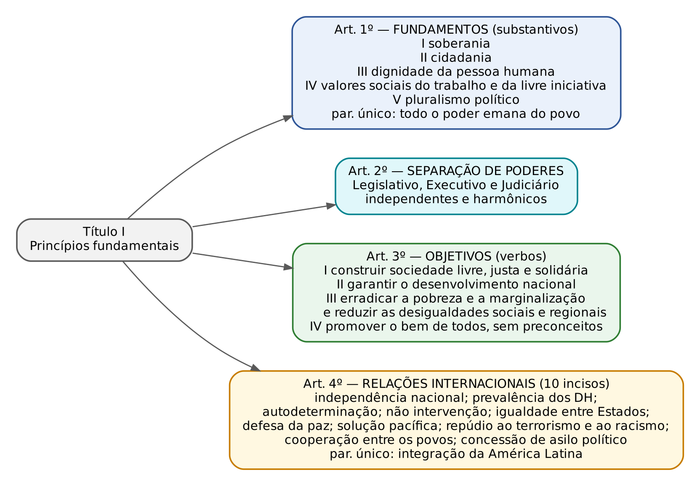
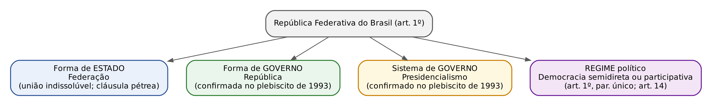
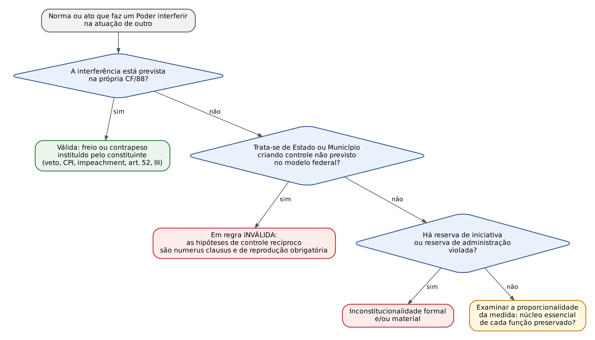
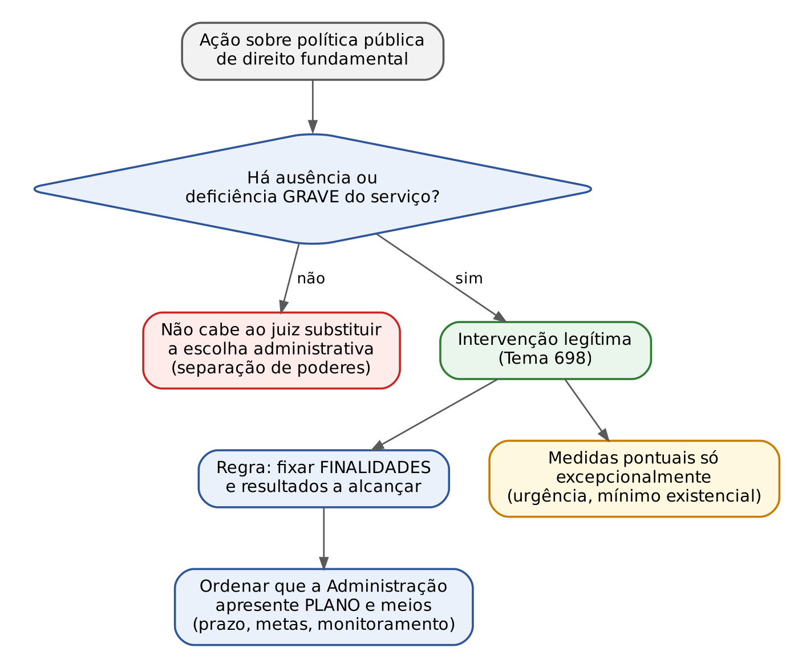
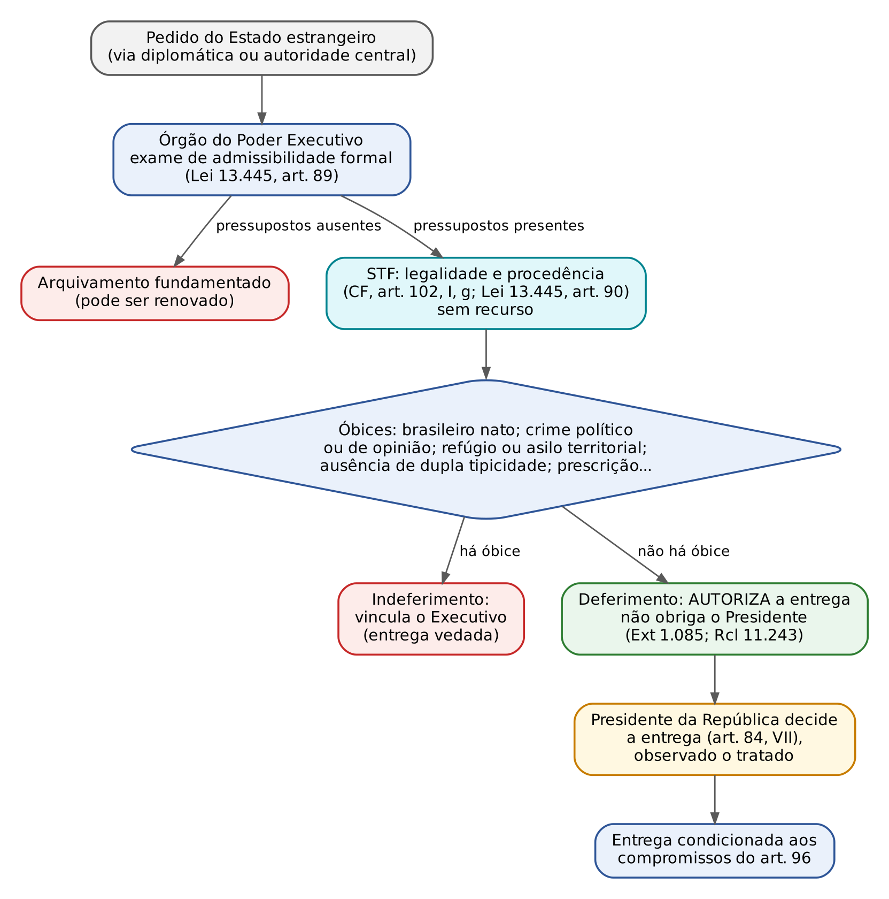

# CAPÍTULO 06 — PRINCÍPIOS FUNDAMENTAIS DA REPÚBLICA, SEPARAÇÃO DE PODERES, ASILO E EXTRADIÇÃO

:::INCIDENCIA
TJRS p. 4; TJSC p. 2. Nível A. Lote: 34 questões (FGV 24, FCC 10).
O que mais cai: distinguir fundamento (art. 1º) x objetivo (art. 3º) x princípio das relações internacionais (art. 4º) pela letra exata; separação de poderes na jurisprudência do STF (aprovação prévia de dirigentes, Súmula 649, SV 37, controle judicial de políticas públicas); democracia participativa; asilo político.
:::

| Subtema | FGV | FCC | Padrão de cobrança |
|---|---|---|---|
| Fundamentos (inclusive cidadania) x objetivos x princípios do art. 4º | 12 | 3 | Alternativa que desloca um inciso para outro artigo; troca de verbo por substantivo |
| Separação de poderes (teoria, funções típicas e atípicas, freios e contrapesos) | 6 | 0 | Conceito de *checks and balances*; função atípica (MP, precatórios); *accountability* horizontal |
| Separação de poderes na jurisprudência do STF | 3 | 2 | Aprovação prévia de dirigentes pela Assembleia; Súmula 649; SV 37; políticas públicas |
| Democracia, soberania popular e participação | 1 | 2 | Democracia semidireta; conselhos e participação social; controle judicial de esvaziamento de conselhos |
| Estrutura do Estado (forma, sistema, regime) | 1 | 1 | Inversão entre forma e sistema de governo |
| Objetivos e políticas públicas (desigualdades, discriminação) | 1 | 2 | Caso prático: alocação regional de recursos; política educacional antidiscriminatória |

## 06.1 O Título I: natureza normativa e estrutura

O Título I (arts. 1º a 4º) contém as decisões políticas fundamentais do constituinte: a forma de Estado (federação), a forma de governo (república), o regime (Estado Democrático de Direito, com soberania popular exercida direta e indiretamente), o princípio organizatório da divisão funcional do poder (art. 2º), os fins do Estado (art. 3º) e as diretrizes da atuação externa (art. 4º). José Afonso da Silva os denomina princípios político-constitucionais, distinguindo-os dos princípios jurídico-constitucionais espalhados pelo texto (legalidade, isonomia, devido processo); Canotilho os trata como princípios estruturantes, que conferem identidade à ordem constitucional e se densificam em princípios e regras subsequentes.

Para o magistrado, três consequências práticas importam:

- São NORMAS, com eficácia jurídica plena enquanto parâmetro de controle: servem de fundamento direto para declarar inconstitucionalidade (pensão vitalícia de ex-governador por ofensa ao princípio republicano, 06.2.2; aprovação prévia de dirigentes por ofensa ao art. 2º, 06.4.3) e para interpretar todo o ordenamento. A eficácia dos objetivos do art. 3º, normas programáticas dirigentes, é examinada no Cap. 4.
- Funcionam como normas de reprodução obrigatória para Estados e Municípios: o Tribunal de Justiça pode utilizá-las como parâmetro na representação de inconstitucionalidade estadual mesmo que a Constituição estadual não as transcreva (STF, RE 650.898, Tema 484 da repercussão geral, j. 1/2/2017; ver Cap. 20).
- Não coincidem com as cláusulas pétreas. O art. 60, § 4º, protege a forma federativa, o voto direto, secreto, universal e periódico, a SEPARAÇÃO DOS PODERES e os direitos e garantias individuais. A forma REPUBLICANA não está no rol expresso (ver 06.2.2), e os demais incisos do art. 1º só são intangíveis na medida em que se confundem com o núcleo daquelas cláusulas ou com limites materiais implícitos (Cap. 3).

:::LEI CF/88, ARTS. 1º A 4º (REDAÇÃO VIGENTE, CONFERIDA NO PLANALTO)
Art. 1º A República Federativa do Brasil, formada pela união indissolúvel dos Estados e Municípios e do Distrito Federal, constitui-se em Estado Democrático de Direito e tem como fundamentos: I - a soberania; II - a cidadania; III - a dignidade da pessoa humana; IV - os valores sociais do trabalho e da livre iniciativa; V - o pluralismo político. Parágrafo único. Todo o poder emana do povo, que o exerce por meio de representantes eleitos ou diretamente, nos termos desta Constituição.
Art. 2º São Poderes da União, independentes e harmônicos entre si, o Legislativo, o Executivo e o Judiciário.
Art. 3º Constituem objetivos fundamentais da República Federativa do Brasil: I - construir uma sociedade livre, justa e solidária; II - garantir o desenvolvimento nacional; III - erradicar a pobreza e a marginalização e reduzir as desigualdades sociais e regionais; IV - promover o bem de todos, sem preconceitos de origem, raça, sexo, cor, idade e quaisquer outras formas de discriminação.
Art. 4º A República Federativa do Brasil rege-se nas suas relações internacionais pelos seguintes princípios: I - independência nacional; II - prevalência dos direitos humanos; III - autodeterminação dos povos; IV - não-intervenção; V - igualdade entre os Estados; VI - defesa da paz; VII - solução pacífica dos conflitos; VIII - repúdio ao terrorismo e ao racismo; IX - cooperação entre os povos para o progresso da humanidade; X - concessão de asilo político. Parágrafo único. A República Federativa do Brasil buscará a integração econômica, política, social e cultural dos povos da América Latina, visando à formação de uma comunidade latino-americana de nações.
:::

### 06.1.1 A técnica de prova: substantivo, verbo, princípio externo

A banca quase nunca pergunta o conceito; pergunta em qual artigo está a expressão. Três chaves resolvem praticamente todas as questões do lote:

| Pista textual | Onde está | Exemplos que a banca desloca |
|---|---|---|
| Substantivo que descreve um valor-base do Estado | Art. 1º (fundamentos) | soberania, cidadania, dignidade, valores sociais do trabalho e da livre iniciativa, pluralismo político |
| Verbo no infinitivo (construir, garantir, erradicar, reduzir, promover) | Art. 3º (objetivos) | garantir o desenvolvimento nacional; erradicar a pobreza; promover o bem de todos |
| Postura do Estado perante outros Estados ou povos | Art. 4º (relações internacionais) | não intervenção, defesa da paz, solução pacífica, repúdio ao terrorismo e ao racismo, asilo político |

:::DICA MEMORIZAÇÃO DE ALTO RENDIMENTO
Fundamentos: SO-CI-DI-VA-PLU (soberania, cidadania, dignidade, valores sociais do trabalho e da livre iniciativa, pluralismo político). Objetivos: começam SEMPRE por verbo — CONstruir, GARantir, ERRAdicar/reduzir, PROmover. O art. 4º tem 10 incisos; o último é o asilo político, e o parágrafo único trata da integração da América Latina (econômica, política, social e cultural — os quatro adjetivos).
:::

:::PEGADINHA DESLOCAMENTOS CLÁSSICOS
- "Redução das desigualdades sociais e regionais" é OBJETIVO (art. 3º, III), não princípio das relações internacionais nem fundamento.
- "Pluralismo político" é FUNDAMENTO (art. 1º, V); "pluralismo de ideias e de concepções pedagógicas" é princípio do ensino (art. 206, III).
- "Dignidade da pessoa humana" é fundamento; "prevalência dos direitos humanos" é princípio das relações internacionais.
- "Soberania" é fundamento; "independência nacional" é princípio do art. 4º.
- "Erradicar a pobreza e a marginalização" + "reduzir as desigualdades": a banca inverte os verbos ("erradicar as desigualdades e reduzir a pobreza") — alternativa errada.
- Art. 3º, IV, menciona IDADE; não menciona expressamente orientação sexual ou deficiência, abrangidas pela cláusula aberta "quaisquer outras formas de discriminação".
- "Valores sociais do trabalho e da livre iniciativa" é um único inciso; a livre iniciativa é valorizada em sua dimensão social, não como liberdade econômica absoluta.
:::

:::QUESTAO FGV 2026 — CONCURSO NÃO IDENTIFICADO (Q4216377)
Discurso com três temas: valores sociais do trabalho e da livre iniciativa; desenvolvimento nacional; solução pacífica dos conflitos. Gabarito: A — respectivamente fundamento (art. 1º, IV), objetivo (art. 3º, II) e princípio das relações internacionais (art. 4º, VII). Armadilha: alternativas que reúnem os três num só artigo. Aplica-se a chave do quadro 06.1.1.
:::

:::QUESTAO FGV 2024 — QUESTÕES DE FUNDAMENTOS (Q2375662 E Q2458424)
Q2375662: entre cinco opções, só os valores sociais do trabalho e da livre iniciativa são fundamento (gabarito A); as demais (sociedade livre, justa e solidária; desenvolvimento nacional; erradicação da pobreza; promoção do bem de todos) são objetivos. Q2458424 (Câmara de Fortaleza, Analista de Redação): caso de investidor estrangeiro que estuda a Constituição; fundamento é o pluralismo político (gabarito D). Distratores: promoção do bem de todos e sociedade livre (objetivos), repúdio ao terrorismo e defesa da paz (art. 4º).
:::

:::QUESTAO FGV 2024 A 2026 — QUESTÕES DE OBJETIVOS (Q3846051, Q3406143, Q2480477, Q2375663)
Q3846051 (AMAZUL 2026, Advogado) e Q3406143 (SEPLAN-SE 2025), com alternativas idênticas: objetivo fundamental é a erradicação da pobreza e da marginalização e a redução das desigualdades sociais e regionais (gabarito A); cooperação entre os povos, repúdio ao terrorismo e prevalência dos direitos humanos são do art. 4º; pluralismo político é do art. 1º. Q2480477 (SES-MT 2024): gabarito B (garantir o desenvolvimento nacional); a alternativa D inverte os verbos ("erradicar as desigualdades e reduzir a pobreza") e está errada pela literalidade. Q2375663 (2024): gabarito B (garantir o desenvolvimento nacional); as demais trocam fundamentos (soberania, pluralismo, dignidade, cidadania) por verbos de objetivo ("promover a soberania", "fomentar a cidadania") — o verbo artificial não transforma fundamento em objetivo.
:::

:::QUESTAO FCC 2025 — PREFEITURA DE SÃO PAULO — AUDITOR MUNICIPAL DE CONTROLE INTERNO (Q3290879)
Trecho de cautelar do STF em ADI sobre a reserva de 20% de vagas para candidatos negros em concursos federais, que vincula a ação afirmativa às "promessas" de construir sociedade justa e solidária, erradicar desigualdades e combater o preconceito. Gabarito: A (objetivos fundamentais da República). Armadilha: alternativa "fundamentos da República". O texto parafraseia o art. 3º, I, III e IV. As cotas são estudadas no Cap. 8.
:::

### 06.1.2 Forma de Estado, forma de governo, sistema de governo e regime político

| Categoria | Opção da CF/88 | Fundamento | Observação de prova |
|---|---|---|---|
| Forma de Estado | Federação | Arts. 1º, 18, 60, § 4º, I | Cláusula pétrea; "união indissolúvel" veda secessão (art. 34, I) |
| Forma de governo | República | Art. 1º, caput; art. 2º do ADCT | Plebiscito de 1993 manteve a república; não é cláusula pétrea expressa |
| Sistema de governo | Presidencialismo | Arts. 76 e 84; art. 2º do ADCT | Plebiscito de 1993 manteve o presidencialismo |
| Regime político | Democracia semidireta ou participativa | Art. 1º, parágrafo único; art. 14 | Representação + institutos de participação direta |

:::QUESTAO FGV 2026 — AMAZUL — ANALISTA DE ADMINISTRAÇÃO (Q3851088)
V ou F: sistema de governo república; forma de governo presidencialista; forma de Estado federativa; regime político democracia participativa. Gabarito: A (F, F, V, V). A banca inverteu forma (república) e sistema (presidencialismo). No mesmo sentido: FCC 2026, ARTESP (Q3910565) — forma de governo é a república (gabarito C); "Confederação" é forma de Estado (e rejeitada), "parlamentarista" é sistema de governo.
:::

## 06.2 República Federativa, Estado Democrático de Direito e soberania popular

### 06.2.1 União indissolúvel e entes federativos

O caput do art. 1º afirma que a República é formada pela união indissolúvel dos Estados, Municípios e Distrito Federal; o art. 18 inclui a União como ente e reconhece a autonomia de todos. Duas consequências cobráveis: não há direito de secessão (qualquer tentativa autoriza intervenção federal para "manter a integridade nacional", art. 34, I) e o Município é ente federativo de terceiro grau, peculiaridade brasileira (Cap. 21). A Federação, como cláusula pétrea, não admite emenda tendente a aboli-la, inclusive por esvaziamento substancial da autonomia dos entes.

### 06.2.2 Princípio republicano

A república, como forma de governo, opõe-se à monarquia e caracteriza-se por eletividade, temporariedade dos mandatos, responsabilidade dos governantes (política, civil, penal e administrativa) e igualdade, com vedação de privilégios de casta ou nascimento. O conteúdo jurídico relevante para o juiz é este último: o princípio republicano é parâmetro de controle de normas que criam vantagens pessoais para agentes políticos desvinculadas do exercício da função. A teoria geral do Estado de Direito e do Estado Democrático de Direito está no Cap. 1; aqui, as consequências normativas.

- Não é cláusula pétrea expressa. A Constituição de 1891 a 1946 protegia a república contra emendas; a de 1988 submeteu-a a plebiscito (art. 2º do ADCT), realizado em 1993. A doutrina majoritária sustenta que, mantida pela soberania popular, a república tornou-se limite material implícito, e que eletividade e periodicidade dos mandatos estão protegidas pelo voto periódico do art. 60, § 4º, II (Cap. 3).
- É princípio sensível: a "forma republicana, sistema representativo e regime democrático" (art. 34, VII, a) autoriza intervenção federal, mediante representação do PGR ao STF (art. 36, III; Cap. 23).

:::QUESTAO FCC 2026 — DPE-MT — DEFENSOR PÚBLICO (Q3954668; QUESTÃO CORRELATA, CLASSIFICADA NO CAP. 23)
Pede os princípios sensíveis. Gabarito: A (direitos da pessoa humana e autonomia municipal, art. 34, VII, b e c). Armadilha: alternativas que combinam um princípio sensível verdadeiro (forma republicana, alínea a) com outro que NÃO é sensível (legalidade, isonomia, soberania, livre iniciativa, separação dos Poderes, propriedade). A separação dos Poderes é cláusula pétrea, mas não princípio sensível.
:::

:::JURIS STF, ADI 4.545/PR, J. 5/12/2019 (INFO 962)
Subsídio mensal e vitalício a ex-governador, sem exercício de função pública, viola o princípio republicano e a igualdade. Por maioria, dispensou-se a devolução dos valores recebidos, considerando boa-fé, segurança jurídica, idade das beneficiárias e o longo período de pagamento.
:::

Na ADPF 745 (sessão virtual de novembro de 2023), o STF manteve, por segurança jurídica e proteção da confiança, pensões já concedidas há décadas e recebidas de boa-fé, sem rever a inconstitucionalidade da concessão em si (v. Cap. 1). O STF também tem invocado o princípio republicano para exigir pertinência funcional em verbas indenizatórias (auxílio-aperfeiçoamento de Procuradores do Amapá, válido apenas mediante comprovação de matrícula em curso pertinente: ADI 7.271, j. 1/9/2023, Info 1108) e periodicidade na vida interna dos partidos (órgãos partidários provisórios devem ter prazo máximo e ser substituídos por órgãos eleitos: ADI 5.875, j. 28/5/2025, Info 1180; ver Cap. 14).

A Q2457267 (FGV 2024, AL-TO, Procurador Jurídico: pensão vitalícia a viúvas de ex-governadores prevista em lei pré-constitucional; não cabe ADI, mas ADPF; possível dispensar a devolução; ofensa ao princípio republicano — gabarito D, F, V, V) está comentada no Cap. 1.

### 06.2.3 Soberania popular e democracia semidireta

O parágrafo único do art. 1º combina representação ("por meio de representantes eleitos") e participação direta ("ou diretamente"), sempre "nos termos desta Constituição" — logo, os instrumentos de exercício direto são os previstos constitucionalmente ou por ela autorizados. O núcleo da democracia direta está no art. 14 (plebiscito, referendo e iniciativa popular; Cap. 14). A Constituição de 1988, porém, vai além e institucionaliza a democracia PARTICIPATIVA em diversas políticas setoriais:

- gestão democrática e participação da comunidade na seguridade social (art. 194, parágrafo único, VII), no SUS (art. 198, III) e na assistência social, com participação da população por meio de organizações representativas (art. 204, II);
- gestão democrática do ensino público (art. 206, VI);
- cooperação das associações representativas no planejamento municipal (art. 29, XII) e iniciativa popular de leis municipais (art. 29, XIII);
- participação do usuário na administração pública direta e indireta (art. 37, § 3º).

A participação não substitui nem concorre com a decisão dos órgãos competentes; qualifica-a. Esse é o núcleo das questões recentes da FCC sobre conselhos.

:::JURIS STF, ADI 6.121 MC, RELATOR MINISTRO MARCO AURÉLIO, J. 13/6/2019
O Presidente da República não pode extinguir, por decreto, colegiados da administração federal cuja existência esteja prevista em lei (Decreto 9.759/2019, suspenso em parte). Por maioria, a suspensão alcançou apenas os colegiados criados ou mencionados em lei; vencida a corrente que estendia a vedação a todos os conselhos. Fundamentos: legalidade, separação de poderes (decreto não revoga lei) e o princípio da participação social.
:::

:::QUESTAO FCC 2026 — DPE-BA E DPE-MA — DEFENSOR PÚBLICO (Q4037421 E Q4012567)
Q4037421: partido ajuíza ADI contra decreto federal que institui instâncias permanentes de diálogo com a sociedade civil, alegando transferência de poder decisório a atores não eleitos. Gabarito: C — a participação social institucionalizada é compatível com o modelo constitucional e não conflita com o papel decisório dos órgãos estatais. Erradas: exigência de lei complementar ("forma do regime democrático" não está reservada a LC), comprometimento da democracia representativa, exigência de previsão constitucional expressa ou de delegação legislativa. Q4012567: gabarito D — alterações administrativas que esvaziem espaços de participação podem ser submetidas a controle constitucional quando comprometerem a efetividade do direito à participação (lógica da ADI 6.121). Erradas: natureza "exclusivamente política" da democracia participativa, imunidade dos atos de extinção ao controle, restrição da participação a plebiscito, referendo e iniciativa popular, substituição integral por consultas digitais sem debate de inclusão.
:::

:::QUESTAO FGV 2024 — CÂMARA DOS DEPUTADOS — CONSULTOR LEGISLATIVO (Q2512001)
Itens: (I) a Constituição dispõe de instrumentos de democracia participativa (conselhos, ouvidorias, orçamento participativo); (II) a democracia é exercida exclusivamente por representantes; (III) é objetivo promover o bem de todos sem preconceitos; (IV) "há democracia direta" porque o poder emana do povo. Gabarito: C (I e III). O item IV erra porque o Brasil adota democracia SEMIDIRETA, e não direta; o item II contraria o "ou diretamente" do parágrafo único. No mesmo sentido: FCC 2024, SEPLAN-PI (Q3549599) — gabarito A, transcrição do art. 1º, caput e parágrafo único; as alternativas erradas trocam "integração econômica, política, social e cultural" por "apenas econômica", incluem "intervenção" e "desigualdade entre os Estados" no art. 4º ou negam a participação direta.
:::

:::PEGADINHA CONSELHO POPULAR CRIADO POR LEI DE INICIATIVA PARLAMENTAR
Na questão FGV 2024 Q2387721 (correlata, classificada no Cap. 26), lei municipal de iniciativa parlamentar criou conselho popular para participar do planejamento, fiscalizar a execução e opinar; o gabarito oficial considerou a lei constitucional, por concretizar os princípios democrático e da separação de poderes (art. 29, XII). Cuidado com a jurisprudência posterior: o STF declarou inconstitucional emenda à Constituição de Alagoas que impunha, em todos os conselhos do Executivo, dois representantes indicados pela Assembleia, com voz e voto, por vício de iniciativa (criação e estruturação de órgãos da Administração é de iniciativa do Executivo) e violação da separação de poderes (ADI 6.856, Relator Ministro Edson Fachin, j. 21/10/2024, Info 1155). A distinção está na interferência na estrutura e na composição de órgão do Executivo; um conselho de participação popular sem atribuição executiva não traz o mesmo problema. Em prova, siga o enunciado: se o caso descrever criação ou estruturação de órgão administrativo por iniciativa parlamentar, o vício é formal (Cap. 26).
:::

## 06.3 Os fundamentos da República (art. 1º, I a V)

### 06.3.1 Soberania

Soberania é o poder político supremo na ordem interna e independente na ordem externa. Internamente, nenhum poder se sobrepõe ao do Estado; externamente, o Estado relaciona-se com os demais em pé de igualdade (art. 4º, I e V). Três distinções são cobradas:

- Soberania x autonomia: só a República Federativa do Brasil é soberana; União, Estados, DF e Municípios são autônomos (art. 18). A União, ao celebrar tratados, age como representante do Estado federal, pessoa jurídica de direito internacional, e não em nome próprio (por isso tratado pode conceder isenção de tributo estadual ou municipal sem ofender o art. 151, III; Cap. 33).
- Soberania estatal x soberania popular: o fundamento do inciso I é a soberania do Estado; a soberania popular está no parágrafo único ("todo o poder emana do povo") e no art. 14 ("a soberania popular será exercida pelo sufrágio universal...").
- Soberania x direitos humanos: a abertura constitucional à ordem internacional (art. 4º, II; art. 5º, §§ 2º a 4º; adesão ao Tribunal Penal Internacional, art. 5º, § 4º) relativiza a concepção absoluta de soberania. Hierarquia dos tratados e controle de convencionalidade: Cap. 11.

Na ADC 39 (j. 19/6/2023, Info 1099), o STF assentou que a denúncia, pelo Presidente da República, de tratado aprovado pelo Congresso exige a anuência deste para produzir efeitos internos, com efeitos prospectivos e preservada a denúncia da Convenção 158 da OIT (v. Cap. 11). O caso conecta três temas do capítulo: soberania (o ato de vinculação e desvinculação internacional), separação de poderes (paralelismo entre a celebração, que exige referendo do Congresso — arts. 49, I, e 84, VIII —, e a denúncia) e princípio democrático.

:::PEGADINHA ART. 49, I X ART. 84, VIII
Compete PRIVATIVAMENTE ao Presidente celebrar tratados, convenções e atos internacionais, "sujeitos a referendo do Congresso Nacional" (art. 84, VIII). É da competência EXCLUSIVA do Congresso "resolver definitivamente sobre tratados, acordos ou atos internacionais que acarretem encargos ou compromissos gravosos ao patrimônio nacional" (art. 49, I), por decreto legislativo. A literalidade do art. 49, I, é restrita a atos gravosos; a prática e o STF exigem a aprovação congressual dos tratados em geral, ressalvados os acordos executivos.
:::

### 06.3.2 Cidadania

A cidadania do art. 1º, II, tem sentido AMPLO: não se reduz à titularidade de direitos políticos (cidadania em sentido estrito, adquirida com o alistamento eleitoral, art. 14), mas abrange a condição de membro pleno da comunidade política, titular de direitos fundamentais oponíveis ao Estado (liberdades negativas) e exigíveis dele (prestações), e participante da formação da vontade estatal. Esse sentido amplo explica dispositivos dispersos: gratuidade das ações de *habeas corpus* e *habeas data* e, na forma da lei, dos "atos necessários ao exercício da cidadania" (art. 5º, LXXVII); competência privativa da União para legislar sobre "nacionalidade, cidadania e naturalização" (art. 22, XIII); vedação de delegação legislativa sobre "nacionalidade, cidadania, direitos individuais, políticos e eleitorais" (art. 68, § 1º, II); educação visando ao "preparo para o exercício da cidadania" (art. 205).

:::QUESTAO FGV 2024 — CGM DE BELO HORIZONTE — AUDITOR INTERNO (Q2387547)
Sobre os elementos estruturais da cidadania plena. Gabarito: C — abrange o reconhecimento de esfera jurídica individual imune à intervenção estatal e a fruição de direitos prestacionais. Erradas: reduzir a cidadania à participação política (A); condicioná-la ao alistamento eleitoral (B), o que confunde cidadania ampla com cidadania ativa; restringi-la a brasileiros natos ou estrangeiros residentes há dez anos (D), invenção que mistura requisitos de naturalização (art. 12, II, b, que fala em quinze anos ininterruptos).
:::

### 06.3.3 Dignidade da pessoa humana

A dignidade é o valor-fonte da ordem constitucional e, para parte da doutrina (Ingo Sarlet), o fundamento comum dos direitos fundamentais, que dela retiram seu conteúdo nuclear. Sua dupla dimensão: (a) negativa ou defensiva — a pessoa não pode ser tratada como objeto, mero meio para fins alheios (fórmula do objeto, de matriz kantiana, desenvolvida por Günter Dürig na doutrina alemã); (b) positiva ou prestacional — dever estatal de assegurar condições materiais mínimas de existência (mínimo existencial; Cap. 7).

Pontos de prova e de sentença:

- Natureza: é princípio (mandamento de otimização sujeito a ponderação) e, em seu núcleo, opera como regra (vedação da tortura e de tratamento desumano ou degradante, art. 5º, III, que não admite ponderação). Robert Alexy observa que a impressão de absolutez decorre de a norma da dignidade ter, simultaneamente, uma dimensão de regra e uma de princípio.
- Titularidade: toda pessoa humana, independentemente de nacionalidade, condição ou capacidade; projeções controvertidas (nascituro, embriões, pessoa jurídica) estão nos Caps. 7 e 8.
- Risco de banalização: a invocação retórica da dignidade para resolver qualquer conflito ("panprincipiologismo") é criticada pela doutrina; o STF exige que a dignidade seja concretizada por meio de direitos específicos e de juízo de proporcionalidade.

| Caso | Orientação do STF | Remissão |
|---|---|---|
| Obras emergenciais em presídios | Judiciário pode impor à Administração a execução de obras emergenciais para dar efetividade à dignidade e à integridade física e moral dos presos (art. 5º, XLIX); não oponíveis a reserva do possível nem a separação dos poderes (RE 592.581, Tema 220, j. 13/8/2015) | 06.4.4; Cap. 7 |
| Revista íntima em presídios | Revista vexatória, com desnudamento ou exames invasivos, viola a dignidade (art. 1º, III) e é prova ilícita; admitida excepcionalmente, de forma respeitosa e com indícios concretos, se ineficazes os meios tecnológicos (Tema 998) | Cap. 8 |
| Separação obrigatória de bens aos maiores de 70 anos | Interpretação conforme: o regime do art. 1.641, II, do Código Civil é afastável por manifestação expressa das partes, em homenagem à autonomia, à dignidade e à vedação de discriminação por idade (ARE 1.309.642, Tema 1.236, j. 1/2/2024) | Apostila de Direito Civil |
| Sistema prisional | Estado de coisas inconstitucional (ADPF 347) | Cap. 19 |

:::DICA USO DA DIGNIDADE NA FUNDAMENTAÇÃO
Em sentença, a dignidade raramente decide sozinha: identifique o direito fundamental específico que a concretiza (integridade, intimidade, mínimo existencial, igualdade), demonstre a restrição e aplique a proporcionalidade (Cap. 5). Invocar o art. 1º, III, como fundamento único expõe o julgado à crítica de decisionismo e dificulta o controle recursal.
:::

### 06.3.4 Valores sociais do trabalho e da livre iniciativa

O inciso IV é único: a Constituição não protege a livre iniciativa como liberdade econômica absoluta, mas em sua dimensão social, ao lado do trabalho. A fórmula reaparece no art. 170, caput (ordem econômica "fundada na valorização do trabalho humano e na livre iniciativa, tem por fim assegurar a todos existência digna, conforme os ditames da justiça social") e no art. 193 (a ordem social tem como base o primado do trabalho). O Planalto anota, ao lado do inciso, a Lei 13.874/2019 (Declaração de Direitos de Liberdade Econômica), que o regulamenta em parte.

A livre iniciativa é, na jurisprudência do STF, parâmetro autônomo de controle de leis que restringem atividades econômicas sem justificativa proporcional, em geral em conjunto com a repartição de competências:

- são inconstitucionais leis municipais que proíbem o transporte individual de passageiros por aplicativo (ADPF 449 e RE 1.054.110), devendo os Municípios observar a Lei federal 13.640/2018 ao regulamentar o serviço;
- Estados e DF não podem proibir portaria virtual em condomínios nem exigir seguro obrigatório dos que a adotam (ADI 7.836, Info 1216);
- em sentido inverso, a livre iniciativa não impede imposições proporcionais de acessibilidade em favor de pessoas com deficiência (RE 1.198.269, Tema 1.286, j. 9/6/2025, Info 1181), nem a cota de tela para filmes nacionais.

O desenvolvimento desses casos pertence aos Caps. 22 (competências) e 34 (ordem econômica). Aqui basta fixar: livre iniciativa é FUNDAMENTO (art. 1º, IV) e também fundamento da ordem econômica (art. 170, caput); livre CONCORRÊNCIA é princípio da ordem econômica (art. 170, IV), não fundamento da República.

### 06.3.5 Pluralismo político

Pluralismo político não se confunde com pluripartidarismo. É a garantia de convivência de concepções políticas, ideológicas, religiosas, culturais e sociais divergentes no espaço público, com proteção das minorias contra a maioria eventual. Seu desdobramento partidário está no art. 17 (liberdade de criação de partidos, resguardados a soberania nacional, o regime democrático, o pluripartidarismo e os direitos fundamentais da pessoa humana); o educacional, no art. 206, III (pluralismo de ideias e de concepções pedagógicas); o comunicacional, na vedação de monopólio ou oligopólio dos meios de comunicação (art. 220, § 5º).

:::QUESTAO FGV 2025 — TRF 5ª REGIÃO — JUIZ FEDERAL SUBSTITUTO (Q3373845; CORRELATA, CLASSIFICADA NO CAP. 14)
Mecanismos contra a "partidocracia" sem violar o pluralismo político. Gabarito: C — a cláusula de barreira foi introduzida por emenda constitucional e validada pelo STF, sem ofensa ao pluralismo. Armadilha: a alternativa A lembra a decisão antiga do STF que derrubou a cláusula de barreira LEGAL (Lei 9.096/1995); a cláusula atual é CONSTITUCIONAL, introduzida pela EC 97/2017 no art. 17, § 3º, com regras de transição. Bipartidarismo e partidos de natureza pública contrariam o pluralismo. Desenvolvimento: Cap. 14.
:::

:::NOTA PLURALISMO E EDUCAÇÃO: LINHA JURISPRUDENCIAL
O STF tem invalidado leis estaduais e municipais do tipo "Escola sem Partido" ou que proíbem abordagem de gênero e orientação sexual nas escolas, por dois fundamentos combinados: vício formal (competência privativa da União para diretrizes e bases da educação, art. 22, XXIV) e vício material (liberdade de ensinar e pluralismo de ideias, art. 206, II e III). Questões correlatas: FCC 2025 (Q3289692), gabarito A; FGV 2024 (Q2512124), gabarito C. Desenvolvimento no Cap. 36.
:::

## 06.4 Separação de Poderes (art. 2º)

### 06.4.1 Matriz teórica e leitura constitucional

O poder político é uno; o que se separa são as FUNÇÕES estatais (legislativa, executiva e jurisdicional), atribuídas a órgãos distintos e independentes. A formulação clássica de Montesquieu (O Espírito das Leis, 1748), precedida por Locke, buscava impedir a concentração de poder como garantia da liberdade ("o poder freia o poder"). O constitucionalismo norte-americano acrescentou o sistema de freios e contrapesos (*checks and balances*): cada Poder dispõe de instrumentos para limitar os demais, o que torna a separação não rígida, mas coordenada.

A redação do art. 2º traz dois atributos que a banca explora:

- independência: cada Poder organiza-se e exerce suas funções sem subordinação hierárquica aos demais (autonomia administrativa e financeira do Judiciário, art. 99; competências privativas das Casas legislativas, arts. 51 e 52; direção superior da administração pelo Executivo, art. 84, II);
- harmonia: cooperação e controle recíproco, por mecanismos previstos na própria Constituição.

A separação de Poderes é cláusula pétrea (art. 60, § 4º, III) e norma de observância obrigatória pelos Estados e Municípios, que não podem criar mecanismos de controle recíproco não previstos no modelo federal, nem suprimir os previstos (princípio da simetria; Cap. 3).

:::PEGADINHA "PODERES DA UNIÃO" E A TRIPARTIÇÃO NOS ENTES FEDERADOS
O art. 2º fala em "Poderes da União". Os Estados reproduzem a tripartição (o Judiciário estadual é órgão do Estado, art. 125). O Município NÃO tem Poder Judiciário: possui apenas Executivo (Prefeito) e Legislativo (Câmara). Cuidado também com o Ministério Público e os Tribunais de Contas: são órgãos constitucionais autônomos, não "quarto Poder".
:::

| Poder | Função típica | Funções atípicas (exemplos constitucionais) |
|---|---|---|
| Legislativo | Legislar e fiscalizar (controle externo, art. 70; CPI, art. 58, § 3º) | Administrar (organização de seus serviços, arts. 51, IV, e 52, XIII); julgar (Senado julga o Presidente por crime de responsabilidade, art. 52, I e II) |
| Executivo | Administrar (chefia de Estado, de governo e da administração, art. 84) | Legislar (medida provisória, art. 62; lei delegada, art. 68; decreto autônomo, art. 84, VI); julgar no contencioso administrativo, sem coisa julgada material |
| Judiciário | Julgar com definitividade | Administrar (organizar secretarias, conceder férias e licenças, art. 96, I, b e f; processar precatórios); legislar (regimentos internos, art. 96, I, a) |

:::QUESTAO FGV 2025 — AL-AM — ANALISTA LEGISLATIVO (Q3778261 E Q3778242)
Q3778261: definição correta dos três Poderes. Gabarito: C — fiscalizam-se mutuamente para impedir a concentração de poder (equilíbrio). Erradas: dependência e subordinação recíproca, competências "exclusivas" sem controle recíproco, hierarquia com o Executivo no topo, centro decisório único. Q3778242: o sistema de freios e contrapesos destina-se a estabelecer instrumentos pelos quais cada Poder pode limitar os demais (gabarito B). A alternativa A descreve o poder moderador, figura do Império (Constituição de 1824), estranha à CF/88; a tese de que as Forças Armadas exerceriam papel moderador foi rejeitada pelo STF (ADI 6.457; Cap. 32).
:::

:::QUESTAO FGV 2025 — SEPLAN-SE E PREFEITURA DE SÃO JOSÉ DOS CAMPOS (Q3406152 E Q3578705)
Q3406152: três afirmativas verdadeiras (gabarito E): o veto presidencial é freio sobre a função legislativa; a declaração judicial de inconstitucionalidade influi em ambos os Poderes políticos; o Legislativo fiscaliza o Executivo, inclusive pela aprovação do orçamento e da LDO. Q3578705: o Judiciário declara inconstitucional lei do Congresso; o fenômeno é exemplo de *accountability* horizontal (gabarito E) — controle exercido por agências estatais dotadas de autonomia sobre outras agências do mesmo Estado (expressão de Guillermo O'Donnell), em oposição à *accountability* vertical (eleitor sobre eleito). "Judicialização de políticas públicas" é distrator: o caso é controle de constitucionalidade de lei.
:::

:::QUESTAO FGV 2024 — AL-PR E TJ-AP (Q2450172 E Q2442918)
Q2450172: função atípica do Executivo é a legislativa, ao editar medida provisória (gabarito A). Erradas: o Executivo não julga parlamentar (competência do STF), não integra CPI, a indicação de Ministros do STF é função típica de chefia de Estado e o aumento de vencimentos por isonomia é vedado a qualquer Poder sem lei (SV 37). Q2442918: função administrativa atípica do Judiciário é o processamento de precatórios (gabarito A). A atividade do presidente do tribunal no processamento e pagamento de precatórios é administrativa, não jurisdicional: Súmula 311 do STJ ("Os atos do presidente do tribunal que disponham sobre processamento e pagamento de precatório não têm caráter jurisdicional"), na mesma linha da orientação do STF que não admite recurso extraordinário contra decisões tomadas nesse processamento. Julgar ação civil pública, conceder mandado de segurança e invalidar ato do Executivo por sentença são funções típicas; registrar aposentadorias é atribuição do Tribunal de Contas (art. 71, III).
:::

### 06.4.2 Mecanismos constitucionais de freios e contrapesos

Os controles recíprocos válidos são os previstos na Constituição. Inventário mínimo:

| Quem controla | Sobre quem | Mecanismo (fundamento) |
|---|---|---|
| Executivo | Legislativo | Iniciativa reservada (art. 61, § 1º); sanção e veto (art. 66); MP (art. 62) |
| Executivo | Judiciário | Nomeação de Ministros do STF e de tribunais superiores (arts. 101 e 104); escolha no quinto constitucional (art. 94); indulto e comutação (art. 84, XII) |
| Legislativo | Executivo | Controle externo com o TCU (arts. 70 e 71); CPI (art. 58, § 3º); sustação de atos normativos que exorbitem do poder regulamentar ou da delegação (art. 49, V); julgamento das contas do Presidente (art. 49, IX); impeachment (arts. 51, I, e 52, I); aprovação de autoridades (art. 52, III) |
| Legislativo | Judiciário | Aprovação de Ministros do STF e de tribunais superiores (art. 52, III, a); processo e julgamento de Ministros do STF por crime de responsabilidade (art. 52, II); fixação de subsídios por lei |
| Judiciário | Legislativo e Executivo | Controle de constitucionalidade; controle de legalidade dos atos administrativos; mandado de injunção e ADO |

Limite do controle judicial do Legislativo: pelo Tema 1.120 (RE 1.297.884), a interpretação de normas meramente regimentais das Casas Legislativas é matéria *interna corporis*, insuscetível de controle jurisdicional quando não caracterizado desrespeito a normas constitucionais (v. Cap. 26).

### 06.4.3 Catálogo jurisprudencial: o que viola e o que não viola a separação de Poderes

Este é o núcleo das questões de nível superior. Organizado por padrão de caso:

| Situação | Orientação do STF | Fundamento |
|---|---|---|
| Constituição estadual ou lei exige aprovação prévia da Assembleia para nomear dirigentes de autarquias, fundações, empresas públicas e sociedades de economia mista | VIOLA. A ADI 2.167/RR (j. 3/6/2020) estendeu a vedação a autarquias e fundações, ressalvadas as agências reguladoras; para empresas estatais, a vedação já era pacífica | Direção superior da administração (art. 84, II, por simetria); reserva de administração |
| Órgão de controle administrativo do Judiciário criado por Constituição estadual com representantes de outros Poderes ou entidades | VIOLA (Súmula 649 do STF) | Autogoverno do Judiciário (arts. 96 e 99) |
| CNJ, com membros externos (advogados, MP, cidadãos indicados pelo Legislativo) | NÃO VIOLA: órgão interno do Judiciário criado por emenda à Constituição Federal, sem competência jurisdicional e submetido ao STF (ADI 3.367 e ADC 12; v. Cap. 29) | Art. 92, I-A; art. 103-B |
| Emenda à Constituição estadual impõe membros indicados pela Assembleia em todos os conselhos e fundos do Executivo | VIOLA (ADI 6.856, j. 21/10/2024, Info 1155) | Art. 2º; art. 61, § 1º, II, e |
| Lei de iniciativa parlamentar fixa prazo para o Executivo regulamentá-la | VIOLA o dispositivo do prazo; o restante da lei pode subsistir (ADIs 3.816 e 7.215; v. Cap. 26) | Poder regulamentar (art. 84, IV) |
| Decreto do Governador suspende os efeitos de lei estadual reputada inconstitucional | VIOLA: o Executivo não pode suspender unilateralmente a eficácia de lei (ADI 5.297, j. 14/8/2025, Info 1186) | Legalidade; separação de Poderes |
| Judiciário aumenta vencimentos de servidores por isonomia | VIOLA (Súmula Vinculante 37) | Reserva legal (art. 37, X) |
| Comissão mista emite parecer sobre MP antes da deliberação das Casas | NÃO VIOLA; é obrigatória (art. 62, § 9º); sua supressão gera inconstitucionalidade formal (ADI 4.029, j. 8/3/2012, com efeitos prospectivos) | Controle do Legislativo sobre a função atípica do Executivo |
| Sanção do chefe do Executivo a projeto com vício de sua iniciativa privativa | NÃO convalida o vício; superada a Súmula 5 do STF, de 13/12/1963 ("A sanção do projeto supre a falta de iniciativa do Poder Executivo") | Cap. 26 |
| Constituição estadual exige que o Advogado-Geral do Estado seja membro estável da carreira, maior de 35 anos | NÃO VIOLA (ADI 5.342; v. Cap. 31) | Autonomia do poder constituinte decorrente |
| Constituição estadual exige licença da Assembleia para ausência do Governador do Estado ou do País | Válida se reproduz o modelo do art. 83 (ausência superior a quinze dias): na ADI 7.463/AM (j. 16/5/2025, Info 1178), o STF, por unanimidade e com efeitos *ex nunc*, deu interpretação conforme à Constituição amazonense no sentido de que o Governador ou o Vice que se ausentar do Estado ou do País por mais de quinze dias sem autorização da Assembleia perde o cargo, nos termos do art. 83 (v. Cap. 28) | Simetria |
| Expulsão de estrangeiro por decisão discricionária do Executivo federal | NÃO VIOLA: ato de soberania, sujeito a controle apenas de legalidade | Art. 22, XV; Lei 13.445/2017 |

:::QUESTAO FGV 2026 — MPE-MT — PROMOTOR DE JUSTIÇA SUBSTITUTO (Q4116937)
Deputados estaduais apresentam PEC para submeter à aprovação prévia da Assembleia a nomeação dos dirigentes máximos dos entes da administração indireta; a CCJ conclui corretamente que a PEC é materialmente inconstitucional, por afrontar a separação dos Poderes (gabarito A). Passos: (1) o vício não é formal, pois a matéria pode, em tese, constar de emenda à Constituição estadual (afasta D e E); (2) a ADI 2.167/RR estendeu a vedação às autarquias e fundações, ressalvadas as agências reguladoras; (3) a "simetria" invocada na alternativa B opera contra a PEC: no modelo federal, o Senado aprova os titulares de cargos que "a lei determinar" (art. 52, III, f), e não toda a cúpula da administração indireta. No mesmo sentido: FGV 2026, AL-RO (Q3883091), gabarito A — o conteúdo da proposta não se ajusta à separação dos Poderes.
:::

:::QUESTAO FCC 2025 — DPE-AM — DEFENSOR PÚBLICO (Q3531572)
Pede o que configura violação à separação de Poderes. Gabarito oficial: B — Constituição estadual que cria órgão de controle administrativo do Judiciário com representantes de outros Poderes ou entidades (Súmula 649). A alternativa A (aprovação, pelo Legislativo, dos presidentes de autarquias e fundações) foi tratada pela banca como válida, conforme a orientação antiga da ADI 1.642/MG (2008), que admitia a aprovação prévia para autarquias e fundações e a vedava para empresas estatais. Depois da ADI 2.167/RR (2020), a alternativa A também descreve violação, salvo para dirigentes de agências reguladoras: o gabarito é DISCUTÍVEL (ver nota). As alternativas C e D foram tratadas como válidas: quanto à anistia de infrações disciplinares de servidores, o STF já validou a concedida pela Constituição estadual (ADCT da Constituição de Rondônia, julgamento de 4/6/2007, Info 470: a competência da União limita-se à anistia penal), mas invalidou a concedida por lei estadual de iniciativa parlamentar, por vício de iniciativa (ADI 1.594/RN, Relator Ministro Eros Grau, notícia do STF de 4/6/2008) — a resposta depende do veículo; quanto à licença do Governador por mais de quinze dias, a simetria com o art. 83 foi confirmada na ADI 7.463/AM (2025). E descreve a discricionariedade da expulsão, que não viola a separação de Poderes.
:::

:::QUESTAO FCC 2025 — MPE-PI — ANALISTA MINISTERIAL (Q3530352)
Mecanismo de controle admitido: parecer de comissão mista sobre medidas provisórias antes da apreciação, em sessão separada, pelo plenário de cada Casa (gabarito A; art. 62, § 9º; ADI 4.029). Erradas: sanção que convalida vício de iniciativa (B); lei que estabelece normas de competência e funcionamento de órgãos jurisdicionais e administrativos dos tribunais (C), matéria do regimento interno de cada tribunal (art. 96, I, a); órgão estadual de controle do Judiciário com representantes externos (D; Súmula 649); aumento de vencimentos por isonomia pelo Judiciário (E; SV 37).
:::

:::DICA RESERVA DE ADMINISTRAÇÃO X RESERVA DE INICIATIVA
São dois fundamentos distintos e frequentemente cumulados. Reserva de INICIATIVA (art. 61, § 1º) é vício FORMAL do processo legislativo: a matéria pode ser tratada por lei, desde que o projeto venha do chefe do Executivo. Reserva de ADMINISTRAÇÃO é vício MATERIAL: certas decisões concretas de gestão não podem ser tomadas pelo legislador, nem mesmo com iniciativa do Executivo (escolha de dirigentes, prazo para regulamentar, atos concretos de gestão). Em controle de PEC estadual, só cabe o segundo fundamento ou o vício de iniciativa de emenda, quando houver (ADI 6.856).
:::

### 06.4.4 Controle judicial de políticas públicas

A separação de Poderes não impede que o Judiciário ordene prestações estatais para a efetivação de direitos fundamentais; condiciona o MODO da intervenção. O marco é o Tema 698.

:::JURIS STF, RE 684.612/RJ, TEMA 698 DA REPERCUSSÃO GERAL, RELATOR MINISTRO RICARDO LEWANDOWSKI, REDATOR DO ACÓRDÃO MINISTRO ROBERTO BARROSO, PLENÁRIO, J. 3/7/2023 (INFO 1101)
1. A intervenção do Poder Judiciário em políticas públicas voltadas à realização de direitos fundamentais, em caso de ausência ou deficiência grave do serviço, não viola o princípio da separação dos Poderes. 2. A decisão judicial, como regra, em lugar de determinar medidas pontuais, deve apontar as finalidades a serem alcançadas e determinar à Administração Pública que apresente um plano e/ou os meios adequados para alcançar o resultado. 3. No caso de serviços de saúde, o déficit de profissionais pode ser suprido por concurso público ou, por exemplo, pelo remanejamento de recursos humanos e pela contratação de organizações sociais e OSCIPs.
:::

:::JURIS STF, RE 592.581/RS, TEMA 220 DA REPERCUSSÃO GERAL, RELATOR MINISTRO RICARDO LEWANDOWSKI, PLENÁRIO, J. 13/8/2015 (INFO 794)
"É lícito ao Judiciário impor à Administração Pública obrigação de fazer, consistente na promoção de medidas ou na execução de obras emergenciais em estabelecimentos prisionais para dar efetividade ao postulado da dignidade da pessoa humana e assegurar aos detentos o respeito à sua integridade física e moral, nos termos do que preceitua o art. 5º, XLIX, da Constituição Federal, não sendo oponível à decisão o argumento da reserva do possível nem o princípio da separação dos poderes." A teoria do mínimo existencial e da reserva do possível que embasa a tese está no Cap. 7 (07.12).
:::

O Tema 220 (obras emergenciais em presídios, 06.3.3) e o Tema 698 formam o par cobrado: o primeiro afasta reserva do possível e separação de Poderes quando em jogo o núcleo da dignidade; o segundo fixa a técnica decisória (finalidades + plano). A teoria do mínimo existencial, da reserva do possível e dos processos estruturais está no Cap. 7.

:::QUESTAO FGV 2024 — AL-TO — PROCURADOR JURÍDICO (Q2457272)
Juiz, em processo contra a Fazenda estadual, determina a constrição de verbas do Fundo Estadual de Saúde para atender a outras finalidades. Gabarito: C (I e III corretas). I: viola a separação de Poderes, pois nem o Executivo poderia remanejar livremente verba vinculada à saúde, além de afetar a eficiência e a continuidade do serviço. III: a decisão ignora a falta de capacidade institucional do Judiciário para avaliar os impactos sobre a programação financeira e não respeita as hipóteses excepcionais de constrição do regime de precatórios (art. 100, § 6º: sequestro por preterição de precedência ou não alocação orçamentária). II erra ao afirmar que a "independência do Judiciário" legitimaria a medida mediante ponderação: a proporcionalidade não autoriza o juiz a desviar recursos vinculados nem a contornar o art. 100. O STF tem precedentes contrários a bloqueios e sequestros judiciais de verbas públicas fora do regime de precatórios, por ofensa à separação de Poderes e à legalidade orçamentária (art. 167, VI).
:::

Questões correlatas (classificadas no Cap. 7) que aplicam o Tema 698: FGV 2024, TJ-RR (Q3087106) — é INCORRETO exigir que o juiz indique as receitas orçamentárias como condição de legitimidade da intervenção (gabarito B); FGV 2025, ENAM (Q3692356) — o juiz indica finalidades e a Administração detalha os meios (gabarito B); FGV 2026, MPE-GO (Q3865797) — ordem estrutural dialogada, com prova qualificada da impossibilidade orçamentária e sem microgestão de rubricas (gabarito B).

:::SENTENCA DISPOSITIVO EM AÇÃO SOBRE POLÍTICA PÚBLICA (MODELO DO TEMA 698)
"Diante do exposto, JULGO PROCEDENTE o pedido para, reconhecida a deficiência grave do serviço de [atendimento], DETERMINAR ao réu que, no prazo de [90] dias, apresente nos autos plano de ação destinado a [finalidade: reduzir o tempo de espera a no máximo X dias / assegurar Y vagas], com cronograma, metas verificáveis, indicação das fontes de custeio e responsáveis, cuja execução será acompanhada por relatórios [trimestrais], facultada a manifestação do autor e realização de audiência de monitoramento. A escolha dos meios fica a cargo da Administração, observados os parâmetros do Tema 698 da repercussão geral (RE 684.612). Para a hipótese de descumprimento injustificado, fixo multa de [valor] por [período], limitada a [teto], sem prejuízo de outras medidas do art. 536, § 1º, do CPC."
:::

## 06.5 Objetivos fundamentais (art. 3º)

O art. 3º é a cláusula dirigente da Constituição: fixa fins do Estado, vinculando legislador, administrador e juiz. A eficácia (normas programáticas com efeito negativo imediato, invalidando atos contrários, e efeito interpretativo) está no Cap. 4. Para prova, importa o uso dos incisos como parâmetro em casos concretos:

- Inciso III (erradicar a pobreza e a marginalização e reduzir as desigualdades sociais e regionais) é densificado em normas operativas: redução das desigualdades regionais e sociais como princípio da ordem econômica (art. 170, VII); regiões de desenvolvimento e incentivos regionais (art. 43); função de reduzir desigualdades inter-regionais atribuída aos orçamentos fiscal e de investimento, segundo critério populacional (art. 165, § 7º); exceção à uniformidade tributária para incentivos regionais (art. 151, I); Fundo de Combate e Erradicação da Pobreza (arts. 79 a 83 do ADCT).
- Inciso IV (promover o bem de todos, sem preconceitos) é o fundamento constitucional das ações afirmativas e da proteção antidiscriminatória: cotas raciais em universidades (ADPF 186, j. 26/4/2012) e em concursos, criminalização da homotransfobia por equiparação ao racismo (ADO 26 e MI 4.733). Desenvolvimento: Cap. 8.
- O inciso I (sociedade livre, justa e solidária) dá base constitucional ao princípio da solidariedade, invocado, por exemplo, no custeio da seguridade social (Cap. 35).

:::QUESTAO FGV 2025 — TCE-PE — PROCURADOR DO TRIBUNAL DE CONTAS (Q3592172)
Ministério concentra recursos de fundo de infraestrutura urbana em Estados do Centro-Sul, alegando boa execução orçamentária; Estado do Nordeste impugna. Gabarito: D — a alocação deve conciliar eficiência e equidade, sendo obrigatória a consideração de indicadores regionais de desenvolvimento. Fundamento: art. 3º, III, combinado com os arts. 43, 165, § 7º, e 170, VII. Armadilhas: capacidade técnica "por si só" (A), desempenho fiscal "independentemente de impactos regionais" (B) e eficiência "em detrimento da equidade" (C) colocam a eficiência acima de um objetivo fundamental; compensação futura na LOA seguinte (E) não sana a distribuição atual.
:::

:::QUESTAO FCC 2025 — PREFEITURA DE SÃO PAULO — AUDITOR MUNICIPAL DE CONTROLE INTERNO (Q3289697)
Em audiência pública sobre plano municipal de educação, propõe-se incluir a obrigação de as escolas coibirem discriminação por gênero, identidade de gênero e orientação sexual. Gabarito: B — a proposta deve ser contemplada, pois a realidade exige reforço normativo que vá além das formulações genéricas e proteja especificamente a população LGBTI. Fundamento: art. 3º, IV ("quaisquer outras formas de discriminação"), igualdade material e dever de proteção. Armadilhas: (C) a cláusula geral bastaria, dispensando norma específica — confunde suficiência textual com efetividade; (D) a construção social do gênero não estaria no art. 3º por não existir em 1988 — interpretação originalista incompatível com a cláusula aberta; (E) fundamento religioso, vedado ao Estado laico (art. 19, I). Distinga: o plano municipal pode PROMOVER a não discriminação; o que o STF invalida é lei local que PROÍBE a abordagem do tema ou legisla sobre diretrizes e bases da educação (ver 06.3.5).
:::

:::QUESTAO FCC 2025 — PREFEITURA DE SÃO PAULO — AUDITOR MUNICIPAL DE CONTROLE INTERNO (Q3289686)
Quatro propostas de decisão política; pede as compatíveis com análise consistente do problema público "à luz dos princípios constitucionais que orientam a República". Gabarito: A (II e IV). II: atender parcialmente aos professores, vinculando o reajuste a avaliação de desempenho, conjuga valorização do trabalho, eficiência e direito à educação. IV: redução de alíquota do IPI com estimativa de compensação e geração de empregos atende ao objetivo de desenvolvimento nacional e à responsabilidade fiscal. I erra por transplante acrítico de modelo estrangeiro sem análise de viabilidade; III é desvio de finalidade e afronta à impessoalidade e à moralidade (valorizar terras de chefe político para obter apoio parlamentar), contrária ao princípio republicano. Questão de políticas públicas mais do que de Direito Constitucional; o fio constitucional é a vedação do uso privado da coisa pública.
:::

## 06.6 Princípios das relações internacionais (art. 4º)

O art. 4º é rol de princípios que vinculam a política externa (conduzida pelo Presidente, art. 84, VII e VIII, com controle do Congresso, art. 49, I e II) e orientam a interpretação de tratados e da legislação interna. Cada inciso tem densificação constitucional própria:

| Inciso | Conteúdo e desdobramentos |
|---|---|
| I independência nacional | Face externa da soberania; competência da União para manter relações com Estados estrangeiros e participar de organizações internacionais (art. 21, I) |
| II prevalência dos direitos humanos | Hierarquia diferenciada dos tratados de direitos humanos (art. 5º, §§ 2º e 3º), adesão ao TPI (art. 5º, § 4º), federalização de graves violações (art. 109, V-A e § 5º); Cap. 11 |
| III autodeterminação dos povos | Direito de cada povo escolher seu regime político e econômico |
| IV não-intervenção | Vedação de ingerência em assuntos internos de outro Estado; corolário do inciso III |
| V igualdade entre os Estados | Igualdade jurídica soberana, independentemente do poderio |
| VI defesa da paz | Declaração de guerra só no caso de agressão estrangeira, autorizada ou referendada pelo Congresso (art. 84, XIX; art. 49, II); atividade nuclear somente para fins pacíficos e mediante aprovação do Congresso (art. 21, XXIII, a) |
| VII solução pacífica dos conflitos | Preferência por negociação, mediação, arbitragem e jurisdição internacional |
| VIII repúdio ao terrorismo e ao racismo | Racismo inafiançável e imprescritível (art. 5º, XLII); terrorismo inafiançável e insuscetível de graça ou anistia (art. 5º, XLIII) |
| IX cooperação entre os povos para o progresso da humanidade | Cooperação jurídica internacional, inclusive extradição (06.7.3) |
| X concessão de asilo político | 06.7.1 |
| Parágrafo único | Integração econômica, política, social e cultural da América Latina, visando à comunidade latino-americana de nações (fundamento do Mercosul) |

:::PEGADINHA O QUE NÃO ESTÁ NO ART. 4º
Bancas inserem princípios plausíveis que não existem no texto: intervenção (inclusive "intervenção consentida" ou "humanitária"), multilateralismo, livre comércio, preservação das fronteiras, combate ao crime organizado e ao tráfico de drogas, repúdio à misoginia, "não concessão de asilo", "desigualdade entre os Estados", "não integração" da América Latina, redução das desigualdades regionais (objetivo do art. 3º). E a integração latino-americana é verbo de intenção ("buscará"), com quatro dimensões — "apenas econômica" está errado.
:::

:::QUESTAO FGV 2025 — TRF 5ª REGIÃO — JUIZ FEDERAL SUBSTITUTO (Q3373929)
Pede o princípio das relações internacionais que consta da Constituição. Gabarito: A (concessão de asilo político, art. 4º, X). Distratores com aparência de princípio: repúdio à misoginia (o inciso VIII fala em terrorismo e racismo), combate ao crime organizado e ao tráfico de drogas, preservação das fronteiras, defesa do livre comércio — nenhum está no art. 4º. Em prova de juiz federal, a FGV cobrou a letra pura: a memorização dos dez incisos é obrigatória.
:::

:::QUESTAO FGV 2024 E FCC 2024 — ROL DO ART. 4º (Q3088127, Q3089785, Q2375664)
FGV, TJ-RR (Q3088127): pede o que NÃO é princípio; gabarito A (intervenção consentida). FCC, TRT-7 (Q3089785): gabarito E (repúdio ao racismo, solução pacífica dos conflitos e autodeterminação dos povos); as demais incluem "não concessão de asilo", "intervenção" ou "não integração cultural". FGV 2024 (Q2375664): corretos os itens I (integração da América Latina) e III (asilo político); o item II (redução das desigualdades regionais) é objetivo do art. 3º, III — gabarito C.
:::

:::QUESTAO FGV 2024 — CONCURSO NÃO IDENTIFICADO (Q3047292)
Analogia escolar: uma turma não escolhe o representante de outra turma. Gabarito: C (não-intervenção, art. 4º, IV). A autodeterminação (inciso III) também seria pertinente em tese, mas não estava entre as alternativas; "multilateralismo" não é princípio constitucional.
:::

## 06.7 Asilo político e extradição na perspectiva constitucional

### 06.7.1 Asilo político

O asilo é princípio das relações internacionais (art. 4º, X), não direito subjetivo do estrangeiro: a Lei 13.445/2017 (Lei de Migração) o define como ato DISCRICIONÁRIO do Estado, outorgado como instrumento de proteção à pessoa, nas modalidades diplomática (concedido em embaixada, legação, navio ou aeronave militar, no território do Estado de origem do perseguido) e territorial (concedido a quem já está no território nacional).

:::LEI LEI 13.445/2017, ARTS. 27 A 29
Art. 27. O asilo político, que constitui ato discricionário do Estado, poderá ser diplomático ou territorial e será outorgado como instrumento de proteção à pessoa. Parágrafo único. Regulamento disporá sobre as condições para a concessão e a manutenção de asilo.
Art. 28. Não se concederá asilo a quem tenha cometido crime de genocídio, crime contra a humanidade, crime de guerra ou crime de agressão, nos termos do Estatuto de Roma do Tribunal Penal Internacional, de 1998, promulgado pelo Decreto nº 4.388, de 25 de setembro de 2002.
Art. 29. A saída do asilado do País sem prévia comunicação implica renúncia ao asilo.
:::

| Critério | Asilo político | Refúgio |
|---|---|---|
| Fonte | CF, art. 4º, X; Lei 13.445/2017, arts. 27 a 29; Convenções interamericanas | Convenção de Genebra de 1951 e Protocolo de 1967; Lei 9.474/1997 |
| Pressuposto | Perseguição política atual e individualizada | Fundado temor de perseguição por raça, religião, nacionalidade, grupo social ou opiniões políticas; ou grave e generalizada violação de direitos humanos (Lei 9.474, art. 1º, I a III) |
| Natureza do ato | Discricionário (art. 27) | Reconhecimento da condição, com hipóteses legais de inclusão e exclusão; decidido pelo CONARE, com recurso ao Ministro da Justiça |
| Âmbito | Instituto regional latino-americano | Instituto universal |
| Modalidades | Diplomático ou territorial | Apenas no território (ou na fronteira) |
| Efeito sobre extradição | Asilo territorial impede a extradição (Lei 13.445, art. 82, IX) | Reconhecimento obsta pedido baseado nos mesmos fatos; a mera solicitação suspende o processo pendente (Lei 9.474, arts. 33 e 34) |
| Vedação | Genocídio, crimes contra a humanidade, de guerra e de agressão (art. 28) | Cláusulas de exclusão da Lei 9.474 |

:::ATENCAO ASILO COMO DIREITO FUNDAMENTAL X ASILO COMO PRINCÍPIO
A expressão "a casa é asilo inviolável do indivíduo" (art. 5º, XI) nada tem a ver com o asilo político; várias questões correlatas sobre inviolabilidade do domicílio aparecem no banco na busca pela palavra "asilo" (Cap. 9). Já o asilo político não figura no rol do art. 5º: está no art. 4º, como princípio que rege a atuação externa. A FGV e a FCC alternam essas localizações.
:::

### 06.7.2 Extradição: os princípios constitucionais (regime no Cap. 13)

A extradição é medida de cooperação internacional (art. 4º, IX) pela qual um Estado entrega a outro pessoa condenada ou processada criminalmente. No plano dos princípios, a Constituição fixa três vetores, todos desenvolvidos no Cap. 13, titular do tema (nacionalidade do extraditando, procedimento, compromissos do art. 96 da Lei 13.445 e medidas compulsórias): (a) brasileiro nato nunca é extraditado, ainda que tenha outra nacionalidade originária (HC 83.113-QO, j. 26/6/2003), e o naturalizado só o é por crime comum anterior à naturalização ou por comprovado envolvimento em tráfico ilícito de entorpecentes (art. 5º, LI); (b) não se concede extradição de estrangeiro por crime político ou de opinião (art. 5º, LII), o que, com mais razão, protege o naturalizado; (c) o processo é da competência originária do STF (art. 102, I, g), e a União legisla privativamente sobre a matéria (art. 22, XV).

### 06.7.3 Sistema de controle e a decisão final do Presidente da República

O ponto de separação de Poderes é este: o STF, em contenciosidade limitada, examina a legalidade e a procedência do pedido, sem recurso (Lei 13.445, art. 90); o indeferimento VINCULA o Executivo, mas o deferimento apenas AUTORIZA a entrega, cuja decisão final cabe ao Presidente da República na condução das relações internacionais (art. 84, VII), nos limites do tratado — orientação do caso Battisti (Ext 1.085 e Rcl 11.243, v. Cap. 13).

:::NOTA LIMITE DE 30 OU 40 ANOS
O art. 96, III, da Lei 13.445/2017 menciona comutação com limite de 30 anos, e o art. 75 do Código Penal, alterado pela Lei 13.964/2019, elevou o limite de cumprimento para 40 anos. O STF resolveu a tensão pela irretroatividade da lei penal mais gravosa: o Estado requerente deve comprometer-se com o limite de 30 anos para fatos anteriores à Lei 13.964/2019, e o de 40 anos só se aplica a crimes praticados após sua entrada em vigor (Ext 1.652, Relatora Ministra Rosa Weber, Primeira Turma, j. 19/10/2021, Informativo 1035, por maioria nesse ponto, vencidos os Ministros Alexandre de Moraes e Dias Toffoli, que admitiam o compromisso de 40 anos).
:::

Medidas compulsórias (extradição, entrega ao TPI, expulsão e deportação), compromissos do art. 96 e procedimento: Cap. 13.

## 06.8 Resumo para revisão pré-prova

| Instituto | Regra | Exceções e detalhes | Fundamento |
|---|---|---|---|
| Natureza do Título I | Princípios estruturantes com força normativa; parâmetro de controle | De reprodução obrigatória: o TJ pode usá-los mesmo sem transcrição na Constituição estadual (Tema 484) | Arts. 1º a 4º |
| Fundamentos | Soberania, cidadania, dignidade, valores sociais do trabalho e da livre iniciativa, pluralismo político | São substantivos; "independência nacional" e "prevalência dos direitos humanos" são do art. 4º | Art. 1º, I a V |
| Objetivos | Construir, garantir, erradicar/reduzir, promover | Verbos; "idade" consta do inciso IV; cláusula aberta para outras discriminações | Art. 3º |
| Relações internacionais | Dez incisos, terminando com asilo político; integração latino-americana no parágrafo único | Não há "intervenção", "multilateralismo", "livre comércio" | Art. 4º |
| Estrutura do Estado | Federação (forma de Estado), república (forma de governo), presidencialismo (sistema), democracia semidireta (regime) | República e presidencialismo confirmados no plebiscito de 1993 | Arts. 1º, 18, 76; art. 2º do ADCT |
| União indissolúvel | Vedada a secessão | Tentativa autoriza intervenção federal | Arts. 1º e 34, I |
| Princípio republicano | Eletividade, temporariedade, responsabilidade, vedação de privilégios | Não é cláusula pétrea expressa; é princípio sensível | Art. 34, VII, a; art. 60, § 4º |
| Pensão a ex-governador | Inconstitucional (princípio republicano e igualdade) | Dispensa de devolução (boa-fé); atos singulares antigos preservados (ADPF 745); lei pré-1988 desafia ADPF | ADI 4.545 |
| Soberania popular | Representação + participação direta, "nos termos desta Constituição" | Democracia participativa setorial (arts. 29, XII; 194, VII; 198, III; 204, II; 206, VI) | Art. 1º, parágrafo único; art. 14 |
| Conselhos de participação | Compatíveis com a democracia representativa; esvaziamento é controlável judicialmente | Decreto não extingue colegiado previsto em lei (ADI 6.121 MC); Assembleia não impõe membros em conselhos do Executivo (ADI 6.856) | Arts. 1º, parágrafo único, e 2º |
| Soberania e tratados | Celebração pelo Presidente, referendo do Congresso | Denúncia exige anuência do Congresso, com efeitos prospectivos (ADC 39) | Arts. 49, I, e 84, VIII |
| Cidadania | Sentido amplo: titularidade de direitos e participação | Cidadania ativa (alistamento) é sentido estrito | Arts. 1º, II; 5º, LXXVII; 22, XIII; 68, § 1º, II |
| Dignidade | Valor-fonte; vedação de instrumentalização; mínimo existencial | Núcleo com estrutura de regra (tortura); concretizar por direito específico | Art. 1º, III; Temas 220 e 998 |
| Livre iniciativa | Fundamento em dimensão social, com o trabalho | Livre concorrência é princípio da ordem econômica, não fundamento | Arts. 1º, IV, e 170 |
| Pluralismo político | Convivência de concepções divergentes, não só pluripartidarismo | Cláusula de barreira da EC 97/2017 compatível com o pluralismo | Arts. 1º, V; 17; 206, III |
| Separação de Poderes | Independência e harmonia; funções típicas e atípicas; freios e contrapesos | Cláusula pétrea, não princípio sensível; Município sem Judiciário | Arts. 2º e 60, § 4º, III |
| Funções atípicas | Executivo legisla (MP, lei delegada); Judiciário administra (precatórios, secretarias) e normatiza (regimentos); Legislativo julga (crime de responsabilidade) | Registro de aposentadoria é do Tribunal de Contas | Arts. 52, I e II; 62; 68; 96, I |
| Aprovação prévia de dirigentes da indireta pela Assembleia | Inconstitucional para autarquias, fundações e estatais | Ressalvadas agências reguladoras; superada a ADI 1.642 quanto a autarquias e fundações | ADI 2.167 |
| Controle externo do Judiciário estadual | Inconstitucional órgão com membros de outros Poderes criado por Constituição estadual | CNJ é válido (órgão interno, criado por EC federal) | Súmula 649; ADI 3.367 |
| Prazo para regulamentar fixado pelo Legislativo | Inconstitucional | Preserva-se o restante da lei | ADIs 3.816 e 7.215 |
| Decreto que suspende lei | Inconstitucional | Executivo deve provocar o controle judicial | ADI 5.297 |
| Aumento de vencimentos por isonomia | Vedado ao Judiciário | Exige lei específica | SV 37 |
| *Interna corporis* | Interpretação de norma regimental não é sindicável | Salvo desrespeito a norma constitucional | Tema 1.120 |
| Políticas públicas | Intervenção legítima em ausência ou deficiência grave | Regra: finalidades + plano da Administração; medidas pontuais excepcionais | Temas 698 e 220 |
| Bloqueio de verbas vinculadas | Viola a separação de Poderes e o regime de precatórios | Sequestro só nas hipóteses do art. 100, § 6º | Arts. 100 e 167, VI |
| Asilo político | Ato discricionário, diplomático ou territorial | Vedado a autores de genocídio e crimes do Estatuto de Roma; saída sem comunicação = renúncia | Art. 4º, X; Lei 13.445, arts. 27 a 29 |
| Refúgio | Reconhecimento por perseguição ou grave violação de direitos humanos | Reconhecimento obsta extradição pelos mesmos fatos; solicitação suspende o processo | Lei 9.474, arts. 1º, 33 e 34 |
| Extradição de brasileiro | Nato: nunca; naturalizado: crime comum anterior ou tráfico | Nunca por crime político ou de opinião | Art. 5º, LI e LII; Cap. 13 |
| Procedimento extradicional | STF julga legalidade e procedência, sem recurso | Deferimento autoriza, não obriga a entrega; indeferimento vincula; limite de 30 anos para fatos anteriores à Lei 13.964/2019 (Ext 1.652) | Art. 102, I, g; Lei 13.445, arts. 90 e 96; Cap. 13 |

## 06.9 Artigos de lei incidentes

- Constituição Federal: arts. 1º a 4º; art. 5º, XLII, XLIII, XLVII, LI, LII, LXXVII, §§ 2º a 4º; art. 14; art. 17, § 3º; art. 18; art. 19, I; art. 21, I e XXIII, a; art. 22, XIII, XV e XXIV; art. 29, XII e XIII; art. 34, I e VII; art. 36, III; art. 37, X e § 3º; art. 43; art. 49, I, II, V e IX; art. 51, I; art. 52, I, II e III; art. 58, § 3º; art. 60, § 4º; art. 61, § 1º; art. 62, § 9º; art. 66; art. 68, § 1º, II; arts. 70 e 71; art. 83; art. 84, II, IV, VI, VII, VIII, XII e XIX; arts. 92, I-A, 96, 99 e 103-B; art. 100, § 6º; art. 102, I, g; art. 109, V-A; art. 151, I; art. 165, § 7º; art. 167, VI; art. 170, caput, IV e VII; art. 193; arts. 194, 198, 204 e 206; art. 220, § 5º.
- ADCT: art. 2º (plebiscito de 1993); arts. 79 a 83 (Fundo de Combate e Erradicação da Pobreza).
- Lei 13.445/2017 (Lei de Migração): arts. 27 a 29 (asilo); arts. 50 e 54 (deportação e expulsão); arts. 81, 82, 84, 89 a 92 e 96 (extradição).
- Lei 9.474/1997 (Estatuto dos Refugiados): arts. 1º, 33, 34 e 35.
- Lei 13.874/2019 (Declaração de Direitos de Liberdade Econômica), referida ao art. 1º, IV.
- Código Penal: art. 75 (limite de cumprimento de penas, para cotejo com o art. 96, III, da Lei 13.445).

## 06.10 Julgados, temas e súmulas do capítulo

- ADI 4.545/PR — pensão vitalícia de ex-governador viola o princípio republicano; dispensa de devolução.
- ADI 7.271/AP — princípio republicano exige pertinência funcional em verba indenizatória.
- ADI 6.121 MC — decreto não extingue colegiado previsto em lei.
- ADI 6.856/AL — Assembleia não pode impor representantes nos conselhos do Executivo.
- ADI 2.167/RR — inconstitucional a aprovação prévia, pela Assembleia, de dirigentes de autarquias, fundações e estatais.
- Súmula 649 do STF — órgão estadual de controle do Judiciário com membros de outros Poderes.
- ADI 5.297/TO — Executivo não suspende lei por decreto.
- Súmula Vinculante 37 — Judiciário não aumenta vencimentos por isonomia.
- Tema 698 (RE 684.612, j. 3/7/2023) — políticas públicas: finalidades e plano.
- Tema 220 (RE 592.581, j. 13/8/2015) — obras emergenciais em presídios; reserva do possível e separação de Poderes inoponíveis.
- ADI 1.594/RN — anistia de faltas funcionais por lei de iniciativa parlamentar: vício de iniciativa.
- Súmula 311 do STJ — atos do presidente do tribunal no processamento de precatórios não têm caráter jurisdicional.
- HC 83.113-QO — brasileiro nato nunca é extraditado.
- Ext 1.652 (j. 19/10/2021) — compromisso de 30 anos para fatos anteriores à Lei 13.964/2019.

Remissões a outros capítulos: ADI 5.342 (Cap. 31); ADI 3.367 e ADC 12 (Cap. 29); ADIs 3.816 e 7.215 (Cap. 26); ADPF 745 e Q2457267 (Cap. 1); ADC 39 (Cap. 11); Tema 1.120 e ADI 4.029 (Cap. 26); ADI 7.463/AM (Cap. 28); Ext 1.085, Rcl 11.243, regime da extradição e das medidas compulsórias (Cap. 13); Tema 484 (Cap. 20); Tema 998 (Cap. 8); ADPF 449 e RE 1.054.110, ADI 7.836, Tema 1.286 (Caps. 22 e 34); ARE 1.309.642, Tema 1.236 (Apostila de Direito Civil); ADPF 186, ADO 26, MI 4.733 (Cap. 8); ADPF 347 (Cap. 19); ADI 5.875 e cláusula de barreira (Cap. 14); ADI 6.457 (Cap. 32); Súmula 5 do STF (Cap. 26).

:::NOTA NOTAS DE VERIFICAÇÃO
- Conferidos no Planalto (7/11/2026, aba própria do Chrome): CF, arts. 1º a 4º, 5º, LI e LII, 49, I, 84, VII e VIII, 102, I, g; Lei 13.445/2017, arts. 27 a 29, 81, 82, 84, 89 a 92 e 96; Lei 9.474/1997, arts. 1º e 33 a 35. Demais dispositivos constitucionais citados de memória, com alta segurança, não conferidos nesta tarefa.
- Julgados conferidos em fontes desta tarefa: Temas 698, 220 e 1.120 e ADI 5.342 (dados do Buscador Dizer o Direito); ADC 39, ADI 5.297, ADI 3.816, ADI 7.215, ADI 7.271, ADI 5.875, ADPF 186, Tema 484, Tema 1.236, Tema 1.286 e HC 83.113-QO (Sinopse de Jurisprudência TJSC 2026, no Drive); ADI 6.856 (ficha cf-0577, no Drive); ADI 2.167/RR, ADI 4.545, ADPF 745, Ext 1.085, Rcl 11.243, ADI 6.121 MC, Súmula 649, SV 37, ADI 3.367 e ADI 4.029 (pesquisa na internet: portal de notícias do STF, Damásio, Trilhante, Migalhas, Congresso em Foco). O número da ADI 6.121 e a data de 13/6/2019 foram cruzados por fontes jornalísticas; não vi o acórdão nem a situação atual do mérito.
- ADI 2.167/RR: na limpeza (11/11/2026), o resumo do julgado (Trilhante: Relator Ministro Ricardo Lewandowski, j. 3/6/2020, publicação em 7/12/2020) confirma a ressalva expressa dos dirigentes de agências reguladoras, "autarquias especiais". A ADI 1.642/MG e sua "superação parcial" não foram conferidas (o resumo não a menciona). O gabarito da FCC 2025 (Q3531572) considera válida a aprovação prévia de presidentes de autarquias e fundações, em linha com a orientação anterior; DISCUTÍVEL após a ADI 2.167.
- Q3531572, alternativas C e D (limpeza): anistia disciplinar concedida pela Constituição estadual validada pelo STF (ADCT de Rondônia, j. 4/6/2007, Info 470; o número da ação não constava da fonte e por isso não foi indicado) e anistia por lei de iniciativa parlamentar invalidada por vício de iniciativa (ADI 1.594/RN, Relator Ministro Eros Grau, notícia do STF de 4/6/2008; a data do julgamento não foi vista); licença do Governador por mais de quinze dias: ADI 7.463/AM, Relator Ministro André Mendonça, j. 16/5/2025, Info 1178 (repositório de informativos). O enunciado exato das alternativas C e D não foi relido; a conclusão sobre a C depende do veículo nela descrito.
- Súmula 5 do STF: texto e data (13/12/1963) conferidos em repositório de súmulas; a superação é orientação consolidada (Cap. 26), sem acórdão conferido. Súmula 311 do STJ: texto conferido (publicação em 23/5/2005). A súmula do STF sobre o descabimento de recurso extraordinário no processamento de precatórios foi referida sem número, por não ter sido vista.
- Ext 1.085: não conferi o que o STF decidiu sobre o refúgio concedido pelo Ministro da Justiça; por isso o tema não foi afirmado. Seção 06.7 reduzida na limpeza a princípios e remissão ao Cap. 13 (titular); mantidos aqui o quadro asilo x refúgio (a que o Cap. 13 remete), o HC 83.113-QO (não desenvolvido no Cap. 13) e a nota sobre o limite de 30 ou 40 anos.
- Lei 13.445, art. 96, III x art. 75 do CP: resolvido na limpeza com a Ext 1.652 (Primeira Turma, j. 19/10/2021, Informativo 1035, via repositório de informativos); não se localizou pronunciamento do Plenário posterior.
- Tema 698: data corrigida para 3/7/2023 (data oficial conferida no portal do STF na limpeza do Cap. 4). Tema 220: tese literal conferida em repositório de teses; o box JURIS foi trazido para cá (titular), e o Cap. 7 remete. ADI 6.121: só a medida cautelar foi vista (j. 13/6/2019, Info 944, maioria; vencidos Fachin, Barroso, Rosa Weber, Cármen Lúcia e Celso de Mello, que concediam a cautelar integralmente); o MÉRITO não foi localizado nas fontes abertas consultadas — PENDENTE.
- Atualização (limpeza, 11/11/2026): os arts. 1º a 4º da CF foram conferidos no texto compilado do Planalto em 7/11/2026, data posterior à EC 141 (16/10/2026), de modo que a transcrição reflete a redação vigente; EC 97/2017 (4/10/2017: vedação de coligações e cláusula de desempenho) confirmada em fonte da Câmara.
- Remissões novas da limpeza: ADPF 745 e Q2457267 reduzidas a frase (titular Cap. 1); ADC 39 reduzida (titular Cap. 11, que tem box próprio); Tema 1.120 reduzido (titular Cap. 26, que tem box próprio).
- Q2387721 (gabarito D, conselho popular de iniciativa parlamentar constitucional): gabarito aceitável à luz do art. 29, XII, mas sensível a enunciado que descreva criação ou estruturação de órgão do Executivo (ADI 6.856).
- Obras de Lenza, Barroso e Gilmar Mendes no Drive: o conector devolveu apenas o sumário (Lenza) ou não foram lidas; as posições doutrinárias atribuídas (José Afonso da Silva, Canotilho, Sarlet, Alexy, Dürig, O'Donnell) são as consagradas e não foram conferidas em página.
- Passada final de deduplicação e uniformização (12/11/2026): ADIs 3.816 e 7.215 mantidas só em tabela, com remissão, e retiradas da lista (titular Cap. 26); ADI 3.367 e ADC 12 mantidas só em tabela, com remissão, e retiradas da lista (titular Cap. 29); ADI 5.342 mantida só em tabela, com remissão, e retirada da lista (titular Cap. 31).
:::
