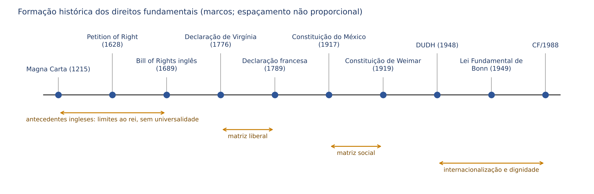
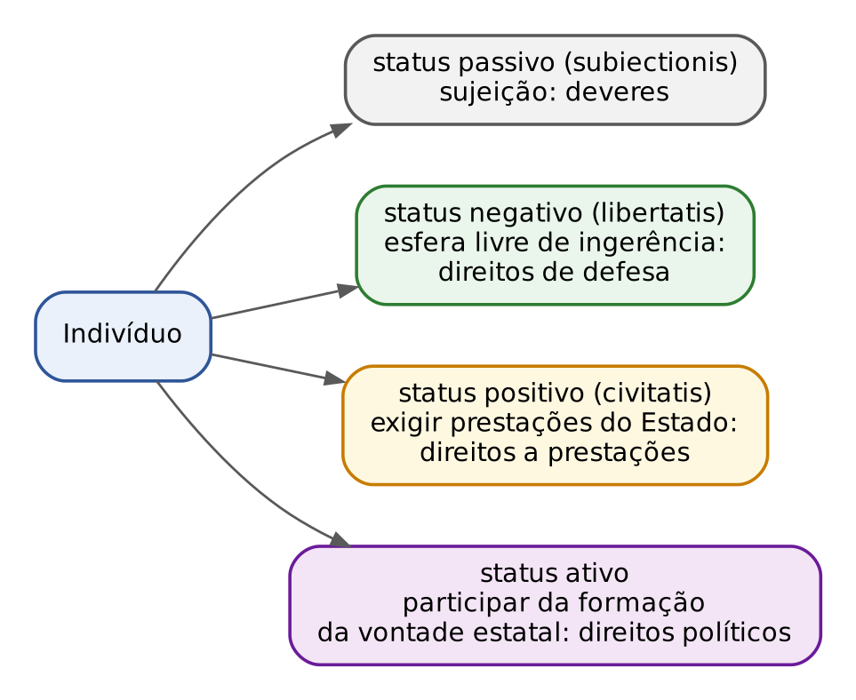
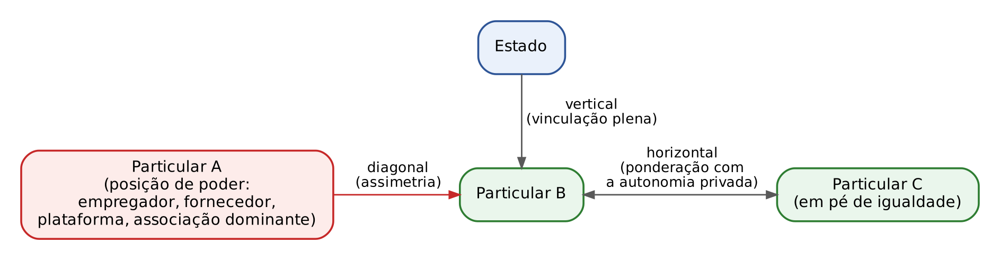
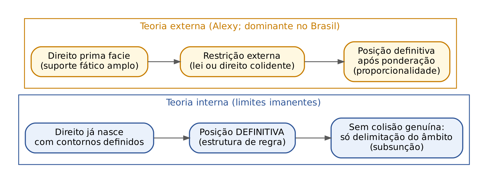
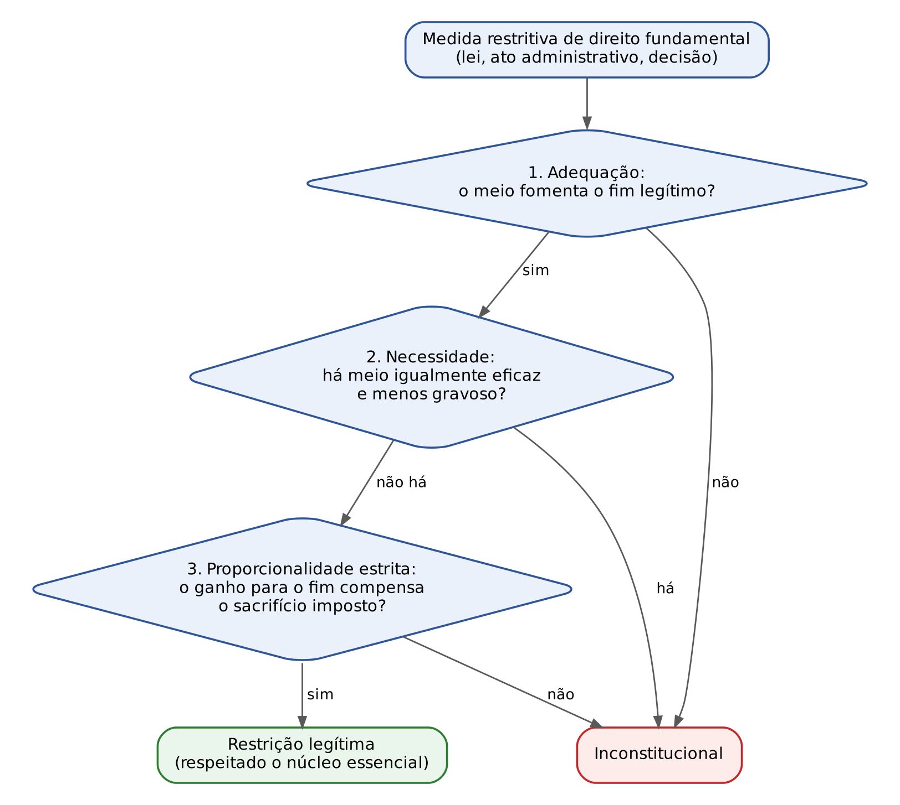
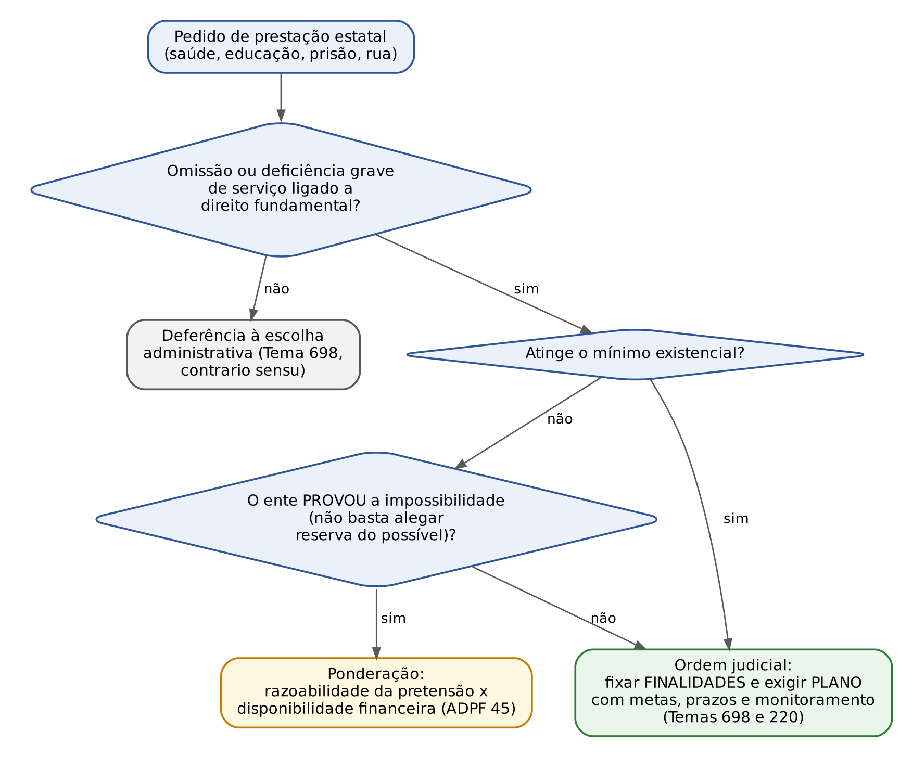

# CAPÍTULO 07 — TEORIA GERAL DOS DIREITOS FUNDAMENTAIS

:::INCIDENCIA
TRF5 p. 3; TJRS p. 4; TJSC p. 12. Nível A+. Lote: 37 questões (FGV 31, FCC 6).
O que mais cai: teoria interna x externa e posições *prima facie* x definitivas (a FGV repete o padrão em quase toda prova, inclusive TRF5, TJ-PA, TJ-TO e ENAM), eficácia horizontal (exclusão de associado), núcleo essencial, proporcionalidade e controle judicial de políticas públicas (Tema 698, reserva do possível, mínimo existencial, processo estrutural).
:::

Mapa de cobrança (lote do capítulo):

| Subtema | FGV | FCC | Padrão de cobrança |
|---|---|---|---|
| Teoria interna x externa; *prima facie* x definitivo; regras x princípios; colisões | 12 | 0 | Caso com "Maria x ente federativo" e pergunta sobre qual teoria cada parte adotou |
| Núcleo essencial e proporcionalidade (limites dos limites) | 2 | 0 | Teorias absoluta, relativa e mista; três subprincípios |
| Eficácia horizontal | 3 | 2 | Exclusão de associado sem defesa (RE 201.819); plataformas digitais; bem de família do fiador |
| Políticas públicas, reserva do possível, mínimo existencial, processo estrutural | 6 | 2 | Tema 698: finalidades + plano; ônus da prova da impossibilidade; ordens dialogadas |
| Dimensões, *status* de Jellinek, história, características, classificação | 6 | 1 | TRF5 2025 (terceira dimensão e *status libertatis*); Constant; direitos coletivos; heterotópicos |
| Titularidade e letra do art. 5º | 2 | 1 | Estrangeiro não residente; § 1º e § 2º do art. 5º; anonimato |

## 07.1 Conceito, fundamentalidade e abertura do catálogo

### 07.1.1 Direitos humanos, direitos fundamentais e direitos do homem

A distinção terminológica é cobrada e tem conteúdo: direitos do homem (expressão jusnaturalista) designam posições inerentes à pessoa, anteriores ao Estado; direitos humanos são os positivados na ordem internacional (tratados, declarações), com pretensão de validade universal; direitos fundamentais são os direitos humanos positivados na Constituição de um Estado, com a força normativa e a supremacia dela. Sarlet sintetiza: a diferença não está no conteúdo, mas na esfera de positivação (internacional x constitucional interna). A CF usa ambas as expressões com precisão: "direitos e garantias fundamentais" (Título II; art. 5º, § 1º; art. 60, § 4º, IV fala em "direitos e garantias individuais") e "direitos humanos" quando se volta ao plano internacional (art. 4º, II; art. 5º, § 3º; art. 109, V-A e § 5º; art. 7º do ADCT).

:::PEGADINHA
O art. 60, § 4º, IV protege como cláusula pétrea "os direitos e garantias individuais", e não "direitos fundamentais". A extensão a direitos fora do art. 5º (anterioridade tributária, no caso do IPMF; direitos sociais, segundo parte da doutrina) é construção do STF e da doutrina, e o tema é do Cap. 3 (limites materiais). Aqui basta saber que a literalidade é "individuais".
:::

### 07.1.2 Fundamentalidade formal e material

Fundamentalidade formal: decorre da posição na Constituição rígida, com três consequências (Alexy, retomado por Sarlet e Canotilho): supremacia hierárquica; submissão a limites formais e materiais de reforma (art. 60, § 4º, IV); aplicabilidade imediata e vinculação direta dos Poderes (art. 5º, § 1º). Fundamentalidade material: decorre do conteúdo, da relação com a dignidade da pessoa humana e com as decisões fundamentais sobre a estrutura do Estado e da sociedade. É a fundamentalidade material que permite reconhecer direitos fundamentais fora do catálogo.

A dignidade da pessoa humana (art. 1º, III) é o fundamento e o critério unificador do sistema, mas não é a única fonte: há direitos fundamentais cuja ligação com a dignidade é remota (por exemplo, regras de organização como a gratuidade do registro civil para os reconhecidamente pobres). O regime jurídico da dignidade como princípio fundamental está no Cap. 6.

### 07.1.3 Cláusula de abertura (art. 5º, § 2º) e direitos fora do catálogo

:::LEI CF, ART. 5º, §§ 1º E 2º
§ 1º As normas definidoras dos direitos e garantias fundamentais têm aplicação imediata.
§ 2º Os direitos e garantias expressos nesta Constituição não excluem outros decorrentes do regime e dos princípios por ela adotados, ou dos tratados internacionais em que a República Federativa do Brasil seja parte.
:::

O § 2º consagra o conceito materialmente aberto de direitos fundamentais (Sarlet). Daí a classificação, muito cobrada, quanto à localização:

| Categoria | Conteúdo | Exemplos |
|---|---|---|
| Direitos do catálogo | Expressos no Título II (arts. 5º a 17) | Art. 5º, art. 6º, art. 14 |
| Direitos fora do catálogo, com status formal (dispersos ou heterotópicos) | Expressos na CF, mas fora do Título II | Anterioridade tributária (art. 150, III, b); meio ambiente (art. 225); acesso à educação (art. 205 e seguintes); publicidade dos atos processuais (art. 93, IX) |
| Direitos implícitos ou decorrentes | Deduzidos do regime e dos princípios | Direito à identidade genética; direito ao esquecimento (rejeitado pelo STF como direito autônomo, Tema 786, ver Cap. 9); princípio da proporcionalidade como garantia |
| Direitos de fonte internacional | Tratados de que o Brasil é parte (§ 2º, parte final; § 3º) | Duplo grau na Convenção Americana; hierarquia supralegal ou de emenda (ver Cap. 11) |

:::QUESTAO FCC 2025 — DPE-AM — DEFENSOR PÚBLICO (Q3531647)
Cobrou-se por que o direito ao meio ambiente é chamado de direito fundamental "heterotópico". Gabarito C: porque não está no rol dos arts. 5º a 17, mas é materialmente vinculado à dignidade humana. Armadilha (A): associar heterotopia à "quarta dimensão" ou à natureza prestacional; heterotopia diz respeito à LOCALIZAÇÃO no texto, não ao conteúdo nem à dimensão.
:::

:::QUESTAO FCC 2026 — CPU-PE — ANALISTA JURÍDICO (Q3872165)
Quatro afirmações sobre o art. 5º. Gabarito B (II, III e IV corretas): aplicação imediata (§ 1º), cláusula de abertura (§ 2º) e assistência jurídica integral e gratuita aos que comprovarem insuficiência de recursos (inciso LXXIV). Erro do item I: a liberdade profissional não é restrita a brasileiros residentes e a lei PODE estabelecer qualificações profissionais (inciso XIII, "atendidas as qualificações profissionais que a lei estabelecer", norma de eficácia contida).
:::

## 07.2 Formação histórica

Só interessa o que é cobrável:

- Antecedentes ingleses: Magna Carta (1215), Petition of Right (1628), Habeas Corpus Act (1679) e Bill of Rights (1689). Limitavam o poder do rei em favor de estamentos (barões, Parlamento); faltava-lhes a universalidade e a vinculação do legislador, por isso não são ainda "direitos fundamentais" em sentido moderno.
- Declaração de Direitos do Bom Povo da Virgínia (1776): primeira declaração com pretensão universal e vinculante, de base jusnaturalista; seguida pela Constituição norte-americana (1787) e pelas dez primeiras emendas (Bill of Rights, 1791).
- Declaração dos Direitos do Homem e do Cidadão (1789): universalismo abstrato; art. 16 ("toda sociedade em que a garantia dos direitos não está assegurada, nem a separação dos poderes determinada, não tem Constituição") é a síntese do constitucionalismo liberal.
- Constitucionalismo social: Constituição mexicana (1917) e Constituição de Weimar (1919) inserem direitos sociais e trabalhistas; no Brasil, a Constituição de 1934.
- Pós-Segunda Guerra: Declaração Universal (1948) e Lei Fundamental de Bonn (1949), com a dignidade no art. 1º e a vinculação direta dos três Poderes aos direitos fundamentais (art. 1º, 3); origem da dogmática alemã (Tribunal Constitucional Federal) que o STF importa: dimensão objetiva, eficácia irradiante, proporcionalidade, núcleo essencial, proibição de proteção insuficiente.
- No Brasil: a Constituição de 1824 já tinha declaração de direitos civis e políticos (art. 179); a CF/1988 inverte a topografia tradicional, colocando os direitos fundamentais ANTES da organização do Estado, o que é lido como opção pela centralidade da pessoa.

:::QUESTAO FGV 2025 — BENJAMIN CONSTANT E A LIBERDADE DOS ANTIGOS E DOS MODERNOS (Q3641457)
O enunciado transcreve Constant e pergunta a relação entre democracia e direitos individuais. Gabarito A: para os antigos, a democracia representativa não era instrumento adequado ao exercício do poder (a liberdade antiga era participação direta e coletiva na soberania, compatível com a sujeição completa do indivíduo). Armadilhas: atribuir aos modernos a primazia do coletivo (B) ou da liberdade política sobre os direitos individuais (C) inverte a tese; para os modernos, a liberdade é sobretudo esfera individual protegida, e a participação se dá por representação. A dicotomia reaparece em Isaiah Berlin (liberdade negativa x positiva).
:::

## 07.3 Gerações ou dimensões

### 07.3.1 O esquema e suas críticas

A divisão em gerações é atribuída a Karel Vasak (1979), associando-as ao lema revolucionário francês; no Brasil foi difundida por Paulo Bonavides. A doutrina majoritária (Sarlet, Bonavides em obras posteriores, Cançado Trindade) prefere "dimensões": "geração" sugere substituição de uma pela outra, quando na verdade há acumulação, complementaridade e interdependência; além disso, a sequência histórica não é universal (no Brasil, direitos trabalhistas foram reconhecidos antes de direitos políticos efetivos, e a Declaração Universal já reunia direitos civis e sociais). Cobra-se exatamente essa crítica.

| Dimensão | Valor | Conteúdo típico | Posição do Estado | Titular |
|---|---|---|---|---|
| Primeira | Liberdade | Direitos civis e políticos: vida, liberdade, propriedade, participação | Abstenção (direitos de defesa) e garantia de participação | Indivíduo |
| Segunda | Igualdade (material) | Direitos sociais, econômicos e culturais; liberdades sociais (sindicalização, greve) | Prestação (fática ou normativa) | Indivíduo e grupos |
| Terceira | Fraternidade ou solidariedade | Paz, desenvolvimento, meio ambiente, patrimônio comum, autodeterminação dos povos, consumidor | Proteção e cooperação, inclusive internacional | Coletividades, titularidade difusa |
| Quarta | Divergência doutrinária | Bonavides: democracia (direta), informação e pluralismo, decorrentes da globalização política. Bobbio: direitos ligados à manipulação do patrimônio genético (bioética) | Variável | Gênero humano |
| Quinta | Divergência doutrinária | Bonavides: direito à paz (deslocado da terceira dimensão). Outros: direitos ligados à realidade virtual e cibernética | Variável | Gênero humano |

:::ATENCAO
Os direitos de primeira dimensão não são só "negativos": os direitos políticos são de primeira dimensão (liberdade-participação) e exigem organização estatal (eleições). E os de segunda dimensão não são só prestacionais: as "liberdades sociais" (sindicalização, greve) são direitos de defesa. A banca explora a equação automática "primeira = abstenção; segunda = prestação".
:::

:::QUESTAO FGV 2024 — PREFEITURA DE NOVA IGUAÇU — ANALISTA TRIBUTÁRIO (Q3038839)
Pediu-se o par de direitos fundamentais coletivos (titularizados por pessoas coletivamente consideradas). Gabarito E: meio ambiente e defesa do consumidor. Vida, nacionalidade, honra, imagem, propriedade, intimidade, liberdade e igualdade são, em regra, de titularidade individual. Note-se que o Título II, Capítulo I, chama-se "Dos direitos e deveres individuais e coletivos", e o art. 5º mistura ambos (associação, XVII a XXI; mandado de segurança coletivo, LXX).
:::

### 07.3.2 A teoria dos status de Jellinek

Georg Jellinek (fim do século XIX) descreve as posições do indivíduo diante do Estado. É a base da classificação funcional dos direitos fundamentais (defesa, prestação, participação) e foi cobrada na prova de Juiz Federal do TRF5 de 2025.

| Status | Posição do indivíduo | Correspondência atual |
|---|---|---|
| Passivo (*status subiectionis*) | Sujeição ao Estado, deveres | Deveres fundamentais (serviço militar, voto obrigatório, dever de pagar tributos) |
| Negativo (*status libertatis*) | Esfera de liberdade imune à ingerência estatal | Direitos de defesa (liberdades, propriedade) |
| Positivo (*status civitatis*) | Pretensão de exigir do Estado ações em seu favor | Direitos a prestações e à tutela jurisdicional |
| Ativo (*status activae civitatis*) | Participação na formação da vontade estatal | Direitos políticos |

Peter Häberle acrescenta um *status activus processualis* (direito à participação no procedimento, base da dimensão procedimental dos direitos fundamentais). Críticas cobráveis: a teoria é estritamente Estado-indivíduo (não alcança a eficácia entre particulares) e não capta a dimensão objetiva nem os deveres de proteção.

:::QUESTAO FGV 2025 — TRF 5ª REGIÃO — JUIZ FEDERAL SUBSTITUTO (Q3373842)
O juiz relaciona os direitos de terceira dimensão (solidariedade e fraternidade) com a teoria dos *status* de Jellinek. Gabarito B: os direitos de terceira dimensão NÃO afastam a preservação da perspectiva individual dos direitos e dialogam com o *status libertatis*. Raciocínio: as dimensões se acumulam; o direito ao meio ambiente, por exemplo, também é posição individual de defesa contra ingerências lesivas. Armadilhas: (C) atribui ao *status civitatis* um "dever de proteção" de direitos individuais como indicativo da terceira dimensão, misturando categorias (deveres de proteção são criação posterior, da dimensão objetiva); (D) afirma que os *status*, fundados na dicotomia ação x omissão, não se harmonizam com o dever de proteção, conclusão excessiva; (E) liga solidariedade ao *status activus*, que é participação política, e não primazia do coletivo.
:::

## 07.4 Características

Lista tradicional (José Afonso da Silva, Alexandre de Moraes, Lenza), com o que é efetivamente cobrado em cada item:

- Historicidade: os direitos fundamentais nascem, se modificam e desaparecem conforme o contexto histórico; afasta a fundamentação puramente jusnaturalista (Bobbio).
- Universalidade: titularidade de todas as pessoas, ressalvadas restrições ligadas à natureza do direito (direitos políticos, direitos dos trabalhadores) e diferenciações constitucionais (brasileiro nato x naturalizado). Universalidade não significa uniformidade de conteúdo.
- Inalienabilidade: indisponíveis, sem conteúdo econômico-patrimonial que permita transferência; não se confunde com a disponibilidade do exercício.
- Imprescritibilidade: o direito não se perde pelo não uso; o que prescreve é a pretensão patrimonial decorrente da violação (ressalvadas as pretensões que a jurisprudência declara imprescritíveis, como a reparação por perseguição política e tortura no regime militar, tema de outros capítulos).
- Irrenunciabilidade: não se renuncia à titularidade; admite-se a autolimitação ou não exercício, temporário, voluntário, informado e sem afetar a dignidade (reality shows, cessão de imagem). O STF aplicou essa lógica à recusa de transfusão de sangue por Testemunhas de Jeová (ver quadro abaixo).
- Relatividade ou limitabilidade: não há direitos absolutos (ver 07.9). Exceções doutrinárias: vedação da tortura e de tratamento desumano (art. 5º, III) e o direito de não ser escravizado costumam ser apontados como absolutos; Norberto Bobbio cita a proibição da tortura e da escravidão como direitos que valem em todas as situações.
- Concorrência ou cumulatividade: um mesmo titular exerce simultaneamente vários direitos (jornalista que informa, opina e critica).
- Complementaridade, indivisibilidade e interdependência: devem ser interpretados em conjunto (fórmula da Conferência de Viena de 1993).
- Proibição do retrocesso: ver 07.13.
- Aplicabilidade imediata e vinculação dos Poderes (art. 5º, § 1º): o regime de eficácia das normas de direitos fundamentais e o debate sobre normas programáticas estão no Cap. 4; aqui interessa a consequência: os três Poderes estão diretamente vinculados, inclusive o legislador (que não pode esvaziá-los) e o juiz (que deve dar-lhes máxima efetividade).

Eficácia x efetividade (ponto do TRF5): eficácia jurídica é a aptidão da norma para produzir efeitos no plano do dever-ser (quanto à aplicabilidade, Cap. 4); efetividade, ou eficácia social, é a realização concreta do comando no mundo dos fatos, a aproximação entre o dever-ser normativo e o ser da realidade social (Barroso). A doutrina brasileira da efetividade, desenvolvida a partir dos anos 1980, sustenta que as normas de direitos fundamentais devem ser tratadas como normas jurídicas exigíveis, e não como meras proclamações políticas; é o fundamento teórico da judicialização tratada em 07.12. Para Sarlet, o § 1º do art. 5º é mandamento de otimização: impõe aos órgãos estatais a tarefa de reconhecer a maior eficácia possível aos direitos fundamentais, sem transformar, por si só, toda norma em norma de eficácia plena.

Para a teoria geral, os Temas 952 e 1.069 (recusa de transfusão de sangue por Testemunhas de Jeová maiores e capazes, com decisão inequívoca, livre, informada e esclarecida) são exemplo de não exercício (autolimitação) legítimo do direito à vida e à saúde por titular capaz, sem renúncia à titularidade; o limite é a capacidade plena, de modo que a recusa não se estende a crianças e adolescentes (teses literais e questões no Cap. 9).

:::QUESTAO FGV 2024 — ENAM — 1º EXAME NACIONAL DA MAGISTRATURA (Q2459853)
Três afirmações: (I) as matrizes dos direitos fundamentais na CF são vida, liberdade, igualdade, segurança e propriedade; (II) direitos fundamentais são uma reserva mínima de justiça que as democracias devem assegurar a todos; (III) a colisão de direitos fundamentais não se resolve por subsunção, exigindo ponderação. Gabarito E (todas corretas). O item I é a letra do caput do art. 5º (os cinco bens jurídicos dos quais os incisos são desdobramentos). O item II é formulação de Barroso. O item III é o núcleo da teoria externa (07.9). Atenção: em prova de magistratura a FGV considera correta a afirmação geral de que colisões se resolvem por ponderação, embora a doutrina reconheça regras de direito fundamental aplicáveis por subsunção.
:::

:::QUESTAO FGV 2024 — CÂMARA DOS DEPUTADOS — CONSULTOR LEGISLATIVO (Q2511988)
Gabarito C (I e III corretas). Erros: (II) as normas de direitos fundamentais não dependem de regulamentação do Poder EXECUTIVO para ter aplicabilidade (art. 5º, § 1º; e a integração, quando necessária, é tarefa do legislador); (IV) a tortura não é tolerada em hipótese alguma (art. 5º, III), nem para defesa de bem jurídico de terceiro. O item III é a presunção de inocência (art. 5º, LVII, ver Cap. 10).
:::

:::QUESTAO FGV 2025 — DIREITOS E GARANTIAS DO ART. 5º (Q3742903)
Pediu-se a alternativa que NÃO corresponde a direito assegurado. Gabarito E: a manifestação do pensamento é livre, "sendo vedado o anonimato" (art. 5º, IV), e não "inclusive mediante o anonimato". A vedação ao anonimato é exemplo de restrição diretamente constitucional (07.9.4) e de técnica de prevenção do abuso (07.11), pois viabiliza a responsabilização posterior.
:::

:::QUESTAO FGV 2024 — SITUAÇÕES ESCOLARES E VIOLAÇÃO DE DIREITOS (Q3047293)
Pediu-se a situação em que NÃO há violação de direito fundamental. Gabarito D: impedir o diretor de ingressar na escola armado, ainda que tenha porte, não viola direito fundamental (não há direito fundamental ao porte de arma; trata-se de autorização legal restringível por razões de segurança). As demais alternativas violam o direito à educação e ao transporte (A), a igualdade e a liberdade de crença (B), a privacidade (C) e a liberdade de cátedra (E).
:::

## 07.5 Classificações

### 07.5.1 Classificação constitucional (Título II)

O Título II divide-se em cinco capítulos: direitos e deveres individuais e coletivos (art. 5º); direitos sociais (arts. 6º a 11); nacionalidade (arts. 12 e 13); direitos políticos (arts. 14 a 16); partidos políticos (art. 17). Cada espécie tem capítulo próprio nesta apostila (Caps. 8 a 10, 12, 13 e 14).

### 07.5.2 Classificação funcional (Alexy, Canotilho, Sarlet)

| Função | Conteúdo | Exemplos na CF |
|---|---|---|
| Direitos de defesa (negativos) | Proíbem ingerências; impõem abstenção | Inviolabilidade do domicílio (XI), sigilo (XII), liberdade de expressão (IV e IX) |
| Direitos a prestações em sentido amplo: proteção | Exigem que o Estado proteja o titular contra terceiros | Mandados de criminalização (XLI a XLIV), defesa do consumidor (XXXII) |
| Direitos a prestações em sentido amplo: organização e procedimento | Exigem estruturas e procedimentos sem os quais o direito não se realiza | Devido processo, contraditório, Defensoria Pública, organização eleitoral |
| Direitos a prestações em sentido estrito (prestações fáticas, sociais) | Exigem bens e serviços materiais | Saúde, educação, assistência, renda básica (art. 6º, parágrafo único, incluído pela EC 114/2021) |
| Direitos de participação | Asseguram participação na formação da vontade política | Voto, elegibilidade, iniciativa popular |

### 07.5.3 Direitos x garantias x remédios

Rui Barbosa distinguiu disposições meramente declaratórias, que imprimem existência legal aos direitos reconhecidos, e disposições assecuratórias, que, em defesa dos direitos, limitam o poder. Direitos são bens e vantagens prescritos na norma constitucional; garantias são os instrumentos pelos quais se assegura o exercício dos direitos (preventiva ou repressivamente). Muitas vezes a mesma norma contém ambos (inciso VI: liberdade de crença, o direito, e proteção aos locais de culto, a garantia). Os remédios constitucionais (*habeas corpus*, mandado de segurança, mandado de injunção, *habeas data*, ação popular) são espécie de garantia: garantias de natureza processual, ações constitucionais. Toda ação constitucional é garantia, mas nem toda garantia é remédio (a vedação de juízo de exceção, o juiz natural, a irretroatividade da lei penal são garantias não processuais em sentido estrito). José Afonso da Silva distingue ainda as garantias gerais (a própria estrutura do Estado de Direito, separação de Poderes) e as garantias constitucionais especiais.

Distingue-se também a garantia institucional (Carl Schmitt): proteção constitucional de instituições jurídicas (família, imprensa livre, autonomia universitária, funcionalismo profissional) contra a supressão ou desfiguração pelo legislador; não confere necessariamente direito subjetivo, mas reforça a dimensão objetiva (07.7).

:::DICA
Na prova oral, a fórmula curta: "direito é o bem; garantia é o instrumento; remédio é a garantia que assume forma de ação". E a pegadinha: a própria CF intitula o Título II "Dos Direitos e Garantias Fundamentais", e o § 1º do art. 5º estende a aplicação imediata às normas definidoras de direitos E de garantias.
:::

## 07.6 Titularidade (sujeitos ativos) e destinatários (sujeitos passivos)

### 07.6.1 Pessoas naturais: brasileiros e estrangeiros

:::LEI CF, ART. 5º, CAPUT
Todos são iguais perante a lei, sem distinção de qualquer natureza, garantindo-se aos brasileiros e aos estrangeiros residentes no País a inviolabilidade do direito à vida, à liberdade, à igualdade, à segurança e à propriedade, nos termos seguintes:
:::

A literalidade ("estrangeiros residentes") é a pegadinha clássica. A interpretação consolidada é extensiva: o estrangeiro não residente (turista, em trânsito, até mesmo o que nunca esteve no país mas é processado aqui) titulariza os direitos fundamentais compatíveis com sua condição, sobretudo os ligados à dignidade e às garantias processuais. O argumento combina universalidade, dignidade (art. 1º, III), prevalência dos direitos humanos (art. 4º, II) e o próprio "todos" do caput.

:::JURIS STF, HC 94.016/SP, RELATOR MINISTRO CELSO DE MELLO, SEGUNDA TURMA, J. 16/9/2008 (INFORMATIVO 520)
O estrangeiro não domiciliado no Brasil, réu em processo penal, tem direito às garantias do devido processo legal (ampla defesa, contraditório, paridade de armas, juiz imparcial). No caso, concedeu-se a ordem de ofício para anular interrogatórios de corréus realizados sem intimação da defesa, assegurando o direito de formular reperguntas. É o precedente de referência para a titularidade do estrangeiro não residente.
:::

Restrições constitucionais aos estrangeiros (rol que a banca usa para montar distratores): direitos políticos (art. 14, § 2º: não podem alistar-se como eleitores), cargos privativos de brasileiro nato (art. 12, § 3º), propriedade de empresa jornalística e de radiodifusão (art. 222), restrições à aquisição de propriedade rural (art. 190), ação popular (legitimidade do cidadão, art. 5º, LXXIII). Já o *habeas corpus* e o mandado de segurança podem ser impetrados por estrangeiro. O regime detalhado (nacionalidade, Lei de Migração, portugueses equiparados) é do Cap. 13.

:::QUESTAO FGV 2025 — PC-MG — MÉDICO LEGISTA (Q3203632)
Maria, austríaca, está no Brasil há alguns meses. Gabarito D: possui os direitos fundamentais NÃO privativos de brasileiros, natos ou naturalizados. Armadilhas: (A) e (B) igualam a estrangeira a brasileiros; (C) nega a titularidade; (E) faz os direitos dependerem do ato que admitiu a residência (a titularidade decorre da Constituição, não de ato administrativo, e alcança também o não residente).
:::

Crianças e adolescentes são titulares plenos; o que varia é a capacidade de exercício autônomo (exercício por representante, com a cláusula do melhor interesse e da prioridade absoluta, art. 227; ver Apostila de Direito da Criança e do Adolescente). Pessoas com deficiência: titularidade plena, com o modelo social da Convenção de Nova York incorporado com equivalência de emenda (Cap. 11).

### 07.6.2 Nascituro e embrião

A CF protege a vida (art. 5º, caput) sem definir seu termo inicial. Há três posições quanto ao nascituro: natalista (personalidade só com o nascimento com vida, art. 2º do CC, primeira parte), da personalidade condicional e concepcionista (personalidade desde a concepção). Para a teoria geral, a posição que mais se aproxima da jurisprudência do STF é a de que a vida intrauterina é bem jurídico constitucionalmente protegido (dimensão objetiva e deveres de proteção), com proteção gradual e passível de ponderação, sem que o nascituro seja titular de direitos fundamentais nos mesmos termos da pessoa nascida. O embrião congelado não implantado não é tratado como pessoa (pesquisas com células-tronco embrionárias). O desenvolvimento do direito à vida, do aborto, da anencefalia e das células-tronco é do Cap. 8; o direito civil do nascituro, da Apostila de Direito Civil.

:::PEGADINHA
Afirmação "a Constituição impõe ao legislador regulamentar os direitos do nascituro, cabendo mandado de injunção" já apareceu como distrator (ENAM 2024.2, questão sobre mandado de injunção atribuída ao Cap. 16). Não há norma constitucional com esse comando específico; a tutela do nascituro decorre da proteção objetiva da vida e da legislação civil e penal.
:::

### 07.6.3 Mortos

O falecido não é titular de direitos (a personalidade termina com a morte), mas a dignidade projeta efeitos *post mortem*: proteção da memória, da honra e da imagem, exercida pelos legitimados do art. 12, parágrafo único, e do art. 20, parágrafo único, do CC (cônjuge, ascendentes, descendentes, colaterais até o quarto grau). A doutrina fala em eficácia objetiva da dignidade, e não em titularidade.

### 07.6.4 Pessoas jurídicas de direito privado

A CF de 1988 não tem norma expressa como o art. 19, 3, da Lei Fundamental alemã ("os direitos fundamentais valem também para as pessoas jurídicas nacionais, na medida em que, por sua natureza, lhes sejam aplicáveis"), mas a solução brasileira é a mesma: a pessoa jurídica titulariza os direitos compatíveis com sua natureza. Há direitos expressamente dirigidos a elas (associações e sindicatos: art. 5º, XVII a XXI; art. 8º; partidos: art. 17; tratamento favorecido a empresas de pequeno porte: art. 170, IX) e direitos extensíveis (propriedade, sigilo de dados e correspondência, inviolabilidade do domicílio do estabelecimento, devido processo, honra objetiva). Ficam excluídos os direitos que pressupõem a condição humana (vida, integridade física, liberdade de locomoção protegida por *habeas corpus*, direitos políticos, direitos sociais típicos do trabalhador). A pessoa jurídica pode sofrer dano moral por ofensa à honra objetiva, orientação sumulada no STJ.

### 07.6.5 Pessoas jurídicas de direito público

Regra: o Estado é DESTINATÁRIO (sujeito passivo), e não titular de direitos fundamentais, porque estes nasceram como limites ao poder estatal. Exceções aceitas pela doutrina e pela jurisprudência:

- Direitos de natureza procedimental e processual: contraditório, ampla defesa, juiz natural, devido processo, isonomia processual (com as prerrogativas legais), direito de acesso à justiça.
- Pessoas jurídicas de direito público que atuam em defesa de liberdades frente ao próprio Estado: universidades públicas (autonomia universitária e liberdade científica, art. 207) e emissoras públicas (liberdade de radiodifusão), na linha da jurisprudência alemã.
- Em relações com outros entes, há disputas de competência, e não direitos fundamentais.

:::JURIS STJ, RESP N. 1.258.389, RELATOR MINISTRO LUIS FELIPE SALOMÃO, QUARTA TURMA, J. 17/12/2013 X RESP N. 1.722.423, RELATOR MINISTRO HERMAN BENJAMIN, SEGUNDA TURMA, J. 24/11/2020
No primeiro, o STJ negou dano moral ao Município de João Pessoa por críticas veiculadas por emissora de rádio: admitir a pretensão seria o Poder Público valer-se de uma garantia do cidadão contra o próprio cidadão, invertendo a lógica dos direitos fundamentais. No segundo, admitiu dano moral em favor do INSS diante de esquema de fraude previdenciária, quando há grave ofensa à credibilidade institucional e evidente prejuízo aos administrados (Informativo 684 do STJ). Conciliação: a regra continua sendo a não titularidade do ente público contra a liberdade de crítica; a exceção alcança ilícitos graves (fraude, corrupção) que atinjam a credibilidade da instituição, sem envolver exercício de liberdade comunicativa.
:::

### 07.6.6 Destinatários

Destinatários são todos os órgãos e agentes estatais, de todos os Poderes e níveis federativos, inclusive quando atuam sob regime de direito privado (empresas estatais, contratos administrativos: não há "fuga para o direito privado") e os particulares no exercício de funções públicas delegadas (concessionários, delegatários de serventias extrajudiciais). Os particulares em geral são destinatários na medida da eficácia horizontal (07.8). O legislador é destinatário reforçado: vinculação negativa (não editar leis violadoras) e positiva (deveres de legislar e de proteger, cuja omissão é atacada por mandado de injunção e ADO, Caps. 16 e 19).

## 07.7 Dimensões subjetiva e objetiva

### 07.7.1 Dimensão subjetiva

Os direitos fundamentais conferem ao titular posições jurídicas exigíveis (direitos subjetivos em sentido amplo): pretensão a abstenção, a prestação, a proteção ou a participação, com possibilidade de exigir judicialmente. A dimensão subjetiva tem presunção a seu favor: na dúvida, a norma de direito fundamental confere direito subjetivo, e não mera diretriz (Sarlet, apoiado em Alexy).

### 07.7.2 Dimensão objetiva

Os direitos fundamentais também são valores ou decisões jurídico-objetivas da comunidade, que impregnam todo o ordenamento independentemente de pretensões individuais. Marco: caso Lüth (Tribunal Constitucional Federal alemão, 1958), em que a liberdade de expressão foi tomada como "ordem objetiva de valores" que irradia para o direito civil. Desdobramentos (Sarlet, Gilmar Mendes, Canotilho), todos cobráveis:

| Desdobramento | Conteúdo | Exemplo |
|---|---|---|
| Eficácia irradiante | Critério de interpretação e aplicação de todo o direito infraconstitucional; base da interpretação conforme os direitos fundamentais | Leitura das cláusulas gerais do CC (boa-fé, função social, ordem pública) à luz dos direitos fundamentais |
| Deveres de proteção (*Schutzpflichten*) | O Estado deve proteger os direitos contra agressões de terceiros, inclusive particulares, por normas penais, civis, administrativas e por atuação material | Mandados constitucionais de criminalização; Lei Maria da Penha; regulação de atividades perigosas |
| Organização e procedimento | Os direitos exigem estruturas e procedimentos adequados à sua fruição | Procedimento eleitoral, Defensoria Pública, conselhos tutelares, procedimento de demarcação |
| Garantias institucionais | Proteção de instituições contra supressão (07.5.3) | Família, imprensa livre, autonomia universitária |
| Limitação de direitos subjetivos | A dimensão objetiva também justifica restrições em favor de interesses comunitários | Restrições à liberdade em nome da saúde pública (vacinação compulsória) |
| Eficácia horizontal | A irradiação para o direito privado é um dos fundamentos da vinculação dos particulares | 07.8 |

A dimensão objetiva não é residual nem subsidiária: ela reforça a subjetiva (mais-valia jurídica, na expressão de Vieira de Andrade) e é a base dogmática da proibição de proteção insuficiente (07.10.5).

Exemplo de dimensão objetiva e dever de proteção: no Tema 1.103 (ARE 1.267.879), o STF considerou ilegítima a recusa dos pais à vacinação compulsória do filho por convicção filosófica, porque o direito à saúde da criança e o interesse coletivo na imunização justificam a restrição da liberdade de consciência dos pais e do poder familiar (v. Cap. 37; vacinação compulsória no Cap. 9).

:::ATENCAO
Questões da FGV de 2025 e 2026 sobre eficácia contida e aplicabilidade imediata (atribuídas ao Cap. 4, por exemplo TRF6 2025, Q3742348, e ENAC 2026, Q4130142) usam o vocabulário "dimensão objetiva" e "dimensão subjetiva" do direito e "plano objetivo ou subjetivo" da restrição (restringir o conteúdo do direito ou o rol de beneficiários). Regra de ouro: a dimensão objetiva NÃO dispensa, por si só, a integração de norma que dela necessite, nem afasta automaticamente a lei restritiva válida; e norma de eficácia contida produz todos os efeitos até que lei a restrinja.
:::

## 07.8 Eficácia vertical, horizontal e diagonal

### 07.8.1 Conceitos

- Eficácia vertical: vinculação do Estado nas relações com o particular (relação de subordinação). É a eficácia clássica e plena.
- Eficácia horizontal (eficácia privada, eficácia em relação a terceiros, *Drittwirkung*): vinculação dos particulares entre si. O problema central é conciliar os direitos fundamentais com a autonomia privada, que também é protegida constitucionalmente (livre iniciativa, liberdade contratual, liberdade de associação).
- Eficácia diagonal: expressão difundida pelo chileno Sergio Gamonal para relações entre particulares marcadas por desigualdade estrutural (empregado x empregador; consumidor x fornecedor; usuário x plataforma dominante). Nessas relações, a eficácia dos direitos fundamentais é mais intensa, aproximando-se da vertical, porque a parte forte exerce poder análogo ao estatal.

### 07.8.2 Teorias

| Teoria | Formulação | Consequência | Onde se adota |
|---|---|---|---|
| Negação (doutrina da *state action*) | Direitos fundamentais vinculam só o Estado; para alcançar o particular, é preciso que sua conduta seja imputável ao Estado (função pública, envolvimento estatal) | Ineficácia direta entre particulares | EUA (com flexibilizações, *public function*, *entanglement*) |
| Eficácia indireta ou mediata (Günter Dürig) | Os direitos fundamentais alcançam as relações privadas por intermédio do legislador e, na falta dele, das cláusulas gerais e conceitos indeterminados do direito privado, interpretados à luz deles | Preserva a autonomia privada e o primado do legislador; o juiz atua pela interpretação | Alemanha (Lüth); doutrina majoritária alemã |
| Eficácia direta ou imediata (Hans Carl Nipperdey) | Os direitos fundamentais incidem diretamente nas relações privadas, independentemente de mediação legislativa, como direitos subjetivos oponíveis aos particulares | Ponderação com a autonomia privada no caso concreto | Brasil (doutrina majoritária: Sarlet, Daniel Sarmento, Gilmar Mendes; STF); Portugal (art. 18, 1, da Constituição portuguesa); Espanha em parte |
| Deveres de proteção (Claus-Wilhelm Canaris) | O destinatário dos direitos continua sendo o Estado, que tem o dever de proteger um particular contra o outro; o juiz, ao decidir litígio privado, cumpre esse dever | Equilíbrio entre proibição de excesso e de proteção insuficiente | Alemanha |
| Modelo integrador (Robert Alexy, três níveis) | Dever estatal de proteção, direitos em face do Estado e efeitos nas relações privadas são três níveis que se complementam | Não há escolha excludente entre as teorias | Doutrina |

No Brasil, a eficácia direta prevalece, mas não é ilimitada nem idêntica à vertical: a intensidade depende (i) da desigualdade fática entre as partes (quanto maior o poder social da parte, mais intensa a vinculação), (ii) da natureza do direito (alguns direitos são dirigidos só ao Estado, como as garantias penais e processuais típicas e grande parte dos direitos a prestações; outros são dirigidos expressamente a particulares, como os direitos dos trabalhadores do art. 7º), (iii) do grau de afetação da dignidade e (iv) do peso da autonomia privada no caso (relações existenciais x patrimoniais). Daniel Sarmento enfatiza o primeiro critério.

### 07.8.3 Jurisprudência do STF

:::JURIS STF, RE 201.819, SEGUNDA TURMA, J. 11/10/2005 (INFORMATIVO 405)
Associação integrante do ECAD (União Brasileira de Compositores) excluiu sócio sem lhe assegurar defesa. O STF manteve a decisão que o reintegrou: os direitos fundamentais incidem diretamente nas relações privadas; a associação ocupava posição privilegiada, com caráter público (a exclusão afetava o recebimento de direitos autorais), e por isso devia observar contraditório, ampla defesa e devido processo. Vencidos a relatora, Ministra Ellen Gracie, e o Ministro Carlos Velloso, que remetiam a questão ao estatuto e ao direito civil. É o precedente-símbolo da eficácia direta no Brasil. Desdobramento legislativo: art. 57 do CC (exclusão de associado só por justa causa, em procedimento que assegure defesa e recurso, nos termos do estatuto).
:::

Outros casos de referência (descritos sem número quando não conferidos): a vedação de discriminação salarial de empregado brasileiro em empresa estrangeira (caso Air France, aplicação direta da igualdade em relação de emprego); a exigência de devido processo para exclusão de cooperado e de condômino antissocial.

:::JURIS STF, TEMA 922 (RE 820.823/DF, RELATOR MINISTRO DIAS TOFFOLI, PLENÁRIO, J. 30/9/2022, INFORMATIVO 1070)
Tese: "É inconstitucional o condicionamento da desfiliação de associado à quitação de débito referente a benefício obtido por intermédio da associação ou ao pagamento de multa." Fundamento: a dimensão negativa da liberdade de associação (art. 5º, XX: ninguém poderá ser compelido a associar-se ou a permanecer associado) incide diretamente na relação entre associado e associação; a cobrança do débito continua possível pelas vias próprias, mas não pode ser usada como condição para o desligamento. É exemplo de eficácia horizontal direta fixado em repercussão geral.
:::

Exemplo de eficácia horizontal apontado pela FCC: no Tema 1.127 (penhora do bem de família do fiador de locação), o direito à moradia do fiador (art. 6º), incidente numa relação privada (fiador x locador), foi ponderado com a autonomia privada de quem livremente assume a fiança e com a livre iniciativa (v. Cap. 10).

:::QUESTAO FCC 2026 — DPE-MT — DEFENSOR PÚBLICO (Q3954666)
Pediu-se o tema do STF cuja fundamentação passa pela eficácia horizontal. Gabarito B: penhorabilidade do bem de família do fiador. Os demais são relações verticais: acesso do advogado ao inquérito (Estado x defesa), vaga em educação infantil (prestação estatal, Tema 548), letalidade em operações policiais (ADPF das favelas, Estado x cidadão) e paridade entre ativos e inativos (servidor x Estado). Método: identifique se o polo passivo é o Estado ou um particular.
:::

:::QUESTAO FGV 2024 — ENAM — 1º EXAME NACIONAL DA MAGISTRATURA, REAPLICAÇÃO (Q2506984)
Associada é excluída monocraticamente pelo presidente da associação, com base no estatuto, por ter criticado o artesanato local. Gabarito A: embora houvesse competência estatutária, o procedimento afrontou os direitos fundamentais da associada (devido processo, ampla defesa, liberdade de expressão). Armadilhas: (B) Judiciário só intervém em associações para dissolução, confundindo a garantia do art. 5º, XIX (dissolução e suspensão de atividades só por decisão judicial) com imunidade de controle; (C) questões *interna corporis* imunes; (D) a associação, em posição de "equidistância", define livremente seus quadros; (E) exclusão exigiria decisão judicial, transpondo indevidamente o regime da dissolução para a exclusão.
:::

:::QUESTAO FGV 2026 — ALERJ — ESPECIALISTA LEGISLATIVO (Q3881542)
Exclusão sumária de associado de ONG sem defesa e sem descrição da conduta. Gabarito B: a exclusão destoa dos direitos fundamentais na perspectiva que apregoa sua eficácia DIRETA, sempre que compatíveis, em relações como a descrita. No mesmo sentido: FGV 2024 — TCE-PA — Auditor (Q2565231), gabarito D: os direitos fundamentais incidem na relação entre associada e associação sempre que haja compatibilidade, considerada a natureza do direito e da relação. Distratores comuns às duas: eficácia "meramente indireta"; incidência condicionada a lei; incidência só se a entidade estiver em posição de superioridade análoga à do Estado (este último é critério de intensidade, não condição de incidência).
:::

:::QUESTAO FCC 2026 — DPE-BA — DEFENSOR PÚBLICO (Q4037416)
Plataforma digital privada usa moderação automatizada que afeta manifestações políticas. Gabarito B: deve-se considerar a eventual restrição da liberdade de expressão a partir da posição da plataforma, considerando os efeitos da restrição na esfera pública. Erros: (A) análise só contratual (termos de uso), negando a eficácia horizontal; (C) mesmo regime aplicável ao Estado (a eficácia horizontal não é idêntica à vertical); (D) autonomia privada que impede a incidência; (E) dependência de lei específica, que seria a LGPD. É um caso de eficácia diagonal: o poder comunicativo da plataforma intensifica a vinculação. A responsabilidade dos provedores e o art. 19 do Marco Civil (Tema 987) estão no Cap. 9.
:::

:::EXEMPLO CASO RESOLVIDO: EXCLUSÃO DE ASSOCIADO
Clube recreativo exclui sócio por "conduta incompatível", sem notificação, por decisão da diretoria. Passos: (1) a relação é privada, mas há direitos fundamentais compatíveis (devido processo, ampla defesa, liberdade de associação em sua dimensão de permanência); (2) adota-se a eficácia direta (RE 201.819); (3) pondera-se a autonomia associativa (art. 5º, XVIII: vedada a interferência estatal no funcionamento) com as garantias do associado: o clube pode definir no estatuto as hipóteses de exclusão (justa causa), mas não suprimir o procedimento mínimo de defesa (art. 57 do CC); (4) o Judiciário não reexamina o mérito da justa causa além do controle de legalidade e de procedimento, salvo violação manifesta de direito fundamental (por exemplo, exclusão discriminatória); (5) resultado: anulação do ato, com possibilidade de novo procedimento regular.
:::

## 07.9 Restrições a direitos fundamentais

### 07.9.1 Não há direitos absolutos

:::JURIS STF, MS 23.452, RELATOR MINISTRO CELSO DE MELLO, PLENÁRIO (1999)
Leading case sobre poderes de CPI, com a passagem mais citada na matéria: não há, no sistema constitucional brasileiro, direitos ou garantias que se revistam de caráter absoluto, mesmo porque razões de relevante interesse público ou exigências derivadas do princípio de convivência das liberdades legitimam, ainda que excepcionalmente, a adoção de medidas restritivas, respeitados os termos da Constituição. O estatuto das liberdades públicas não pode ser usado para proteger práticas ilícitas nem para lesar a ordem pública ou direitos de terceiros.
:::

A relatividade é o ponto de partida; a questão dogmática relevante é COMO se restringe e QUAIS os limites da restrição. É aí que entram as duas teorias.

### 07.9.2 Regras e princípios; posições *prima facie* e definitivas

Para Alexy (seguindo e reformulando Dworkin), princípios são mandamentos de otimização: normas que ordenam que algo seja realizado na maior medida possível dentro das possibilidades fáticas e jurídicas; podem ser cumpridos em graus, e a colisão entre eles se resolve na dimensão do PESO, por ponderação, sem que o princípio afastado perca validade. Regras são mandamentos definitivos: cumprem-se ou não (lógica do tudo ou nada, em Dworkin); o conflito entre regras se resolve no plano da VALIDADE (uma é inválida ou é exceção da outra), por critérios hierárquico, cronológico e da especialidade.

Daí a distinção:

- Posição *prima facie*: o que o princípio garante antes de considerar as razões contrárias; é provisória, expansiva e passível de restrição.
- Posição definitiva: o que resta depois da restrição, apurado no caso concreto pela ponderação. A posição definitiva tem estrutura de regra.

:::QUESTAO FGV 2025 — PREFEITURA DE ABREU E LIMA — PROCURADOR (Q3841656)
Arnaldo sustenta que algumas normas de direitos fundamentais oferecem posições definitivas, insuscetíveis de afastamento no caso; João, que todas têm conteúdo *prima facie*, ampliável ou restringível conforme o caso, com conflitos resolvidos no plano da aplicação. Gabarito D: Arnaldo atribui às normas natureza de REGRAS; João, de PRINCÍPIOS. Chave: posição definitiva = regra; *prima facie* = princípio.
:::

### 07.9.3 Teoria interna x teoria externa

| Critério | Teoria interna (limites imanentes) | Teoria externa (Alexy; prevalente no Brasil) |
|---|---|---|
| Objetos | Um só: o direito com seus limites. Não há direito e restrição, mas direito com conteúdo já determinado | Dois: o direito em si (*prima facie*) e a restrição, que lhe é externa |
| Delimitação | Os limites são imanentes, internos, decorrem do próprio conteúdo do direito; a tarefa do intérprete é DECLARAR o contorno | O âmbito de proteção é amplo; a lei ou o direito colidente RESTRINGEM de fora |
| Estrutura da norma | Regra: posição definitiva | Princípio: posição *prima facie* que, após a restrição, se torna definitiva |
| Colisões | Não há colisão genuína (se as fronteiras estão traçadas, um direito não invade o outro); aparente conflito se resolve por subsunção e delimitação | Há colisões reais, resolvidas por ponderação e proporcionalidade |
| Controle | Interpretação do conteúdo; o que está fora do limite não é protegido desde o início | Exame da justificação da restrição (proporcionalidade) e do núcleo essencial |
| Suporte fático | Restrito (exclui de antemão condutas, como "a liberdade de expressão não protege a mentira") | Amplo (toda conduta que tenha alguma característica do direito é protegida *prima facie*) |
| Autores | Friedrich Müller (âmbito normativo), parte da doutrina alemã e portuguesa; teoria dos limites imanentes | Alexy; no Brasil, Virgílio Afonso da Silva (suporte fático amplo), Gilmar Mendes |
| Núcleo essencial | Teoria absoluta (há conteúdo intocável definido de antemão) | Teoria relativa (o núcleo é o que resta após a proporcionalidade) |

A expressão "unidade existencial entre direito e restrição" e "cedências recíprocas" aparecem nas alternativas: a primeira descreve a teoria interna; "concordância prática por cedências recíprocas" é técnica de solução de colisões (Hesse), compatível com a teoria externa e desenvolvida em 05.6.

:::ESQUEMA CHAVES PARA AS QUESTÕES DA FGV
- Direito "absoluto", "posição definitiva", "limites imanentes", "sem colisão", "unidade entre direito e restrição", "não carece de restrição para surgir a posição definitiva": TEORIA INTERNA.
- Direito "relativo", "*prima facie*", "restrição exógena", "colisão", "ponderação", "circunstâncias fáticas e jurídicas do caso", "potencial expansivo comprimido por outros direitos": TEORIA EXTERNA.
- Colisão de princípios se resolve no plano da APLICAÇÃO (peso), não da validade. Conflito de regras: plano da validade.
- Não existe hierarquia *in abstracto* entre direitos fundamentais (salvo a posição preferencial reconhecida a algumas liberdades, que é prioridade *prima facie*, e não hierarquia).
:::

:::QUESTAO FGV 2026 — TJ-SC — ANALISTA JURÍDICO (Q4150688)
Maria sustenta que os direitos fundamentais têm contornos absolutos, decorrentes da fundamentalidade; o ente demandado vê neles efeitos relativos. Gabarito A: a linha de Maria se ajusta à teoria interna e à existência de limites imanentes. Armadilhas: (C) teoria externa com "dispensabilidade da ponderação" (é o contrário); (D) concordância prática por cedências recíprocas, que pressupõe relatividade; (E) "unidade existencial entre direito e restrição" atribuída ao demandado, quando é traço da teoria interna.
:::

:::QUESTAO FGV 2026 — TJ-PA — JUIZ SUBSTITUTO (Q3951775)
Maria pede direito de primeira dimensão (norma de eficácia plena) com base na teoria interna; o Município contesta com a teoria externa. Gabarito D: a teoria adotada pelo Município defende que outros direitos fundamentais podem conter o potencial expansivo do direito invocado por Maria ou afastar sua aplicação no caso concreto. Passos: (1) teoria externa = direito *prima facie* + restrição externa; (2) logo, colisão real e ponderação. Erros: (A) posição definitiva é compatível com a teoria INTERNA; (B) a teoria externa não é refratária à natureza principiológica, pressupõe-na; (C) a necessidade de ponderação decorre da teoria externa, não dos argumentos de Maria; (E) não se exige que a restrição venha de norma de eficácia plena.
:::

:::QUESTAO FGV 2025 — TCE-PE — ANALISTA DE GESTÃO (Q3593065)
João: direitos fundamentais geram posições definitivas; Maria: as restrições ao potencial expansivo são limites imanentes, de caráter interno; Antônio: colisões só são argumentativamente defensáveis na teoria externa. Gabarito D: só Antônio está certo "considerando o atual estágio de compreensão dos direitos fundamentais na realidade brasileira", isto é, a FGV toma a teoria externa como a dominante e considera incorretas, nesse contexto, as afirmações próprias da teoria interna. No mesmo sentido (teoria externa como entendimento predominante): Q3350304 (TRT-24 2025, gabarito D: as restrições opostas por outros direitos devem ser analisadas conforme a teoria externa; erradas a posição preferente *in abstracto* e a resolução no plano da validade); Q3157896 (FGV 2024, gabarito C: posições *prima facie*, conflito resolvido no momento da aplicação); Q3044150 (Prefeitura de Vitória 2024, gabarito C: posições *prima facie*, fruto da teoria externa, influenciadas pelas circunstâncias do caso); Q3174763 (FGV 2025, gabarito D: os direitos podem sofrer restrições de acordo com as circunstâncias fáticas e jurídicas do caso; errado dizer que só a lei restringe).
:::

:::QUESTAO FGV 2025 — AL-AM — PROCURADOR (Q3777911)
Direito de primeira dimensão em norma de eficácia contida, potencialmente colidente com outros direitos, o que "não raro" conduz a compressões recíprocas. Gabarito A: a narrativa descreve a teoria externa. Erros: (B) o direito se ajusta, sim, à concepção *prima facie*; (C) não se distancia da cedência recíproca; (D) a colisão não se resolve no plano da validade; (E) a estatura constitucional não impede restrições legais (a norma é de eficácia contida, restringível por lei).
:::

:::QUESTAO FGV 2026 — AL-RO — CONSULTOR LEGISLATIVO (Q3882050)
Maria exerce direito de segunda dimensão previsto em norma de eficácia contida, potencialmente colidente com direito de João, previsto em norma de eficácia plena. Gabarito D: o direito de Maria pode ter o alcance restringido pela legislação infraconstitucional, no plano objetivo (conteúdo) ou no plano subjetivo (beneficiários), conforme o caso. Armadilhas: (C) preferência *in abstracto* do direito de eficácia plena (eficácia não gera hierarquia); (E) solução no plano da validade; (A) a colisão concreta não é resolvida pela lei, mas pelo intérprete; (B) a teoria externa é justamente a que sustenta colisões.
:::

:::QUESTAO FGV 2025 — ENAM — EXAME NACIONAL DA MAGISTRATURA 2025.1 (Q3362310)
O magistrado identifica os significados possíveis do texto, escolhe o preponderante e, tratando-se de direito fundamental, procede à concordância prática com outras normas da mesma natureza. Gabarito E: entende que os direitos fundamentais apresentam conteúdos *prima facie* (se é preciso harmonizar com outros direitos, o conteúdo inicial é provisório). Erros: (A) não afasta o conteúdo essencial; (B) a posição definitiva carece da restrição para surgir; (C) limites imanentes seriam teoria interna; (D) não é tópica pura, pois parte do texto.
:::

:::QUESTAO FGV 2025 — TJ-TO — JUIZ SUBSTITUTO (Q3453277)
O autor sustenta que direitos de primeira dimensão têm preeminência e seus efeitos não podem ser afastados por outros bens constitucionais; o réu sustenta que nenhum preceito se interpreta dissociado do caso e da base de valores, que podem afastar o "alicerce semiótico" inicial, para que o intérprete delineie a norma que realize a justiça no caso. Gabarito C: os argumentos do demandado são compatíveis com o REALISMO JURÍDICO (a norma é o que o juiz decide no caso, com primazia dos fatos e valores sobre o texto). Erros: (A) não são refratários à tópica pura, ao contrário, aproximam-se dela; (B) originalismo prestigia o sentido original do texto; (D) e (E) os argumentos do autor (preeminência, efeitos intocáveis) não se ajustam à teoria externa nem a conteúdo *prima facie*, mas à interna. Teorias da interpretação: ver 05.2.3 e 05.2.4.
:::

### 07.9.4 Espécies de restrição

| Espécie | Conceito | Exemplos |
|---|---|---|
| Restrição diretamente constitucional | Limite traçado pela própria CF | Reunião "pacificamente, sem armas" (XVI); vedação do anonimato (IV); associação para fins lícitos, vedada a de caráter paramilitar (XVII); casa inviolável salvo flagrante, desastre, socorro ou, durante o dia, ordem judicial (XI) |
| Reserva legal simples | A CF autoriza a lei a restringir, sem fixar fins ou condições | "Nos termos da lei", "na forma da lei" (por exemplo, inciso XV, locomoção "nos termos da lei"; inciso VII, assistência religiosa "nos termos da lei") |
| Reserva legal qualificada | A CF autoriza a lei a restringir, mas fixa os fins, os meios ou as condições | Interceptação telefônica: só "por ordem judicial, nas hipóteses e na forma que a lei estabelecer para fins de investigação criminal ou instrução processual penal" (XII); liberdade profissional: "atendidas as qualificações profissionais que a lei estabelecer" (XIII) |
| Direitos sem reserva | A CF não prevê restrição legal | Liberdade de consciência e de crença (VI); liberdade artística e científica (IX). Só podem ser restringidos por colisão com outros direitos ou bens constitucionais (restrições implícitas), sob controle rigoroso de proporcionalidade |
| Restrições excepcionais | Estado de defesa (art. 136, § 1º) e de sítio (arts. 138 e 139) | Restrições a reunião, sigilo de correspondência e comunicações, liberdade de imprensa; tema do Cap. 32 |

:::DICA
Não confunda restrição com configuração (conformação) do direito. Normas que dão forma a direitos que dependem de organização (propriedade, casamento, direito de ação, sufrágio) não são, em regra, restrições: são condições de existência do próprio direito. A distinção importa porque a configuração não se submete com o mesmo rigor ao teste de proporcionalidade, embora não possa esvaziar o direito.
:::

## 07.10 Limites dos limites

### 07.10.1 Noção

Limites dos limites (*Schranken-Schranken*) são os requisitos que a restrição deve satisfazer para ser legítima. Na sistematização de Gilmar Mendes: (a) princípio da reserva legal (a restrição deve ter base em lei, ou na própria CF, quando há reserva); (b) generalidade e abstração da lei restritiva (vedação de leis casuísticas ou de efeitos concretos dirigidas a pessoas determinadas); (c) clareza e determinação (a lei restritiva deve ser precisa, sobretudo em matéria penal e sancionatória); (d) proporcionalidade; (e) proteção do núcleo essencial. Acrescentam-se a proibição de restrição retroativa que atinja direito adquirido, ato jurídico perfeito e coisa julgada (art. 5º, XXXVI; ver Cap. 10) e a vedação de que a restrição seja motivada por razões discriminatórias.

### 07.10.2 Reserva legal

A restrição precisa de base legal formal (ou constitucional direta). Ato administrativo não restringe direito fundamental sem lei que o autorize; decreto autônomo não serve para isso. Em matéria de reserva de jurisdição, a CF exige decisão judicial (interceptação telefônica, ingresso diurno em domicílio sem consentimento, prisão fora do flagrante), e nem a lei pode transferir a decisão a outra autoridade (por exemplo, CPI não decreta interceptação; ver Cap. 25).

### 07.10.3 Núcleo essencial (conteúdo essencial)

Previsto expressamente no art. 19, 2, da Lei Fundamental alemã ("em nenhum caso um direito fundamental pode ser atingido em seu conteúdo essencial") e no art. 18, 3, da Constituição portuguesa. A CF/1988 não o prevê expressamente, mas ele decorre do sistema (cláusula pétrea do art. 60, § 4º, IV, que veda emendas "tendentes a abolir"; aplicabilidade imediata; supremacia).

| Teoria | Formulação | Crítica |
|---|---|---|
| Absoluta | Há um núcleo fixo, determinável em abstrato, intangível em qualquer circunstância; a restrição só atua na periferia | Dificuldade de identificar o núcleo em abstrato; tende a ser compatível com a teoria interna |
| Relativa | O núcleo não é fixo; é o que resta depois da aplicação da proporcionalidade no caso. Restrição proporcional não atinge o núcleo; restrição desproporcional o atinge | Esvazia a garantia, que passa a coincidir com a proporcionalidade (crítica de Hesse e Pieroth/Schlink); é compatível com a teoria externa (Alexy) |
| Mista ou eclética | Combina as duas: o núcleo tem um mínimo absoluto, mas sua extensão é apurada também por ponderação | Posição de Gilmar Mendes, que aponta a tendência de conciliação |

Distinguem-se ainda as teorias objetiva (o núcleo protege o direito como instituto, para a generalidade dos titulares) e subjetiva (protege a posição de cada titular; na prisão perpétua, por exemplo, a liberdade do indivíduo seria totalmente suprimida).

:::QUESTAO FGV 2025 — MPE-RJ — PROMOTOR DE JUSTIÇA SUBSTITUTO (Q3532402)
Debate sobre o conteúdo essencial à luz das teorias interna e externa e dos contornos relativos, absolutos ou mistos. Gabarito E: o conteúdo essencial é compatível com restrições exógenas ao direito fundamental, de contorno *prima facie*, e apresenta caráter VOLÁTIL caso se reconheça seu contorno relativo. Raciocínio: na teoria externa com núcleo relativo, o núcleo é o resultado (variável) da ponderação. Erros: (A) e (B) negam limites exógenos; (C) atribui contornos absolutos aos direitos para viabilizar concordância prática (contradição: concordância prática pressupõe relatividade); (D) a teoria interna assegura posição definitiva, mas não "encampa" o núcleo nesse sentido.
:::

:::QUESTAO FGV 2025 — PGM-RJ — ANALISTA DE PROCURADORIA (Q3605988, CORRELATA, CAP. 4)
EC cria direito de primeira dimensão em norma de eficácia contida, mencionando os beneficiários. Gabarito oficial A: é "argumentativamente defensável" que a futura lei exclua Maria do rol de beneficiários. A norma de eficácia contida admite restrição legal também no plano subjetivo. O gabarito convive com o limite do núcleo essencial: a exclusão deve ser proporcional e não pode esvaziar o direito para a generalidade dos titulares; a alternativa C ("a lei não pode afetar o conteúdo essencial ou o rol de beneficiários") foi considerada errada por proibir qualquer redução do rol.
:::

### 07.10.4 Proporcionalidade

A proporcionalidade, no Brasil, é extraída do devido processo legal em sentido substantivo (art. 5º, LIV) pelo STF, ou do Estado de Direito e da própria estrutura dos direitos fundamentais (doutrina). Na versão alemã, tem três subprincípios, aplicados em ordem subsidiária (só se passa ao seguinte se o anterior for satisfeito):

| Subprincípio | Pergunta | Natureza |
|---|---|---|
| Adequação (idoneidade) | O meio é apto a fomentar o fim legítimo? (basta fomentar, não precisa atingir plenamente; Virgílio Afonso da Silva) | Exame empírico entre meio e fim |
| Necessidade (exigibilidade, menor ingerência) | Existe meio alternativo igualmente eficaz e menos gravoso ao direito? | Exame comparativo entre meios |
| Proporcionalidade em sentido estrito | A importância da realização do fim justifica a intensidade da restrição? (lei do sopesamento de Alexy: quanto maior o grau de não satisfação de um princípio, maior deve ser a importância da satisfação do outro) | Ponderação propriamente dita |

Há quem anteceda os três por uma etapa de legitimidade do fim (o fim perseguido deve ser constitucionalmente legítimo). A distinção entre proporcionalidade e razoabilidade (origem norte-americana, devido processo substantivo; Humberto Ávila: razoabilidade como equidade, congruência e equivalência) está em 05.7.4, e a ponderação como técnica, em 05.6. O STF frequentemente usa os termos como sinônimos.

:::QUESTAO FGV 2024 — PREFEITURA DE SÃO JOSÉ DOS CAMPOS — ANALISTA (Q2362706)
Lei municipal restringe direito individual para proteger o interesse coletivo. Gabarito C: as restrições podem ser compatíveis com a CF, desde que adequadas e necessárias, e desde que os benefícios auferidos tenham maior relevância que as restrições impostas (os três subprincípios). Erros: (A) concordância prática feita *in abstracto* pelo constituinte; (B) posições definitivas; (D) restrição só se a norma tiver admitido expressamente a restrição legal (direitos sem reserva também podem ser restringidos, por colisão); (E) eficácia sempre definida pelo legislador.
:::

Exemplo didático de necessidade é o Tema 953 (vestimenta religiosa em foto de documento oficial, admitida com rosto visível): a identificação, fim legítimo, é alcançável por meio menos gravoso do que a proibição total do véu ou do hábito, e a restrição só subsiste na medida em que o rosto precisa ficar visível (v. Cap. 9).

### 07.10.5 Proibição de excesso e proibição de proteção insuficiente

A proporcionalidade tem dupla face (Canaris, Sarlet, Lenio Streck):

|  | Proibição de excesso (*Übermaßverbot*) | Proibição de proteção insuficiente ou deficiente (*Untermaßverbot*) |
|---|---|---|
| Dimensão do direito | Subjetiva, de defesa | Objetiva, deveres de proteção |
| Pergunta | O Estado restringiu demais? | O Estado protegeu de menos? |
| Parâmetro | A restrição deve ser adequada, necessária e proporcional | A proteção deve atingir um mínimo eficaz (o Estado tem margem de escolha dos meios, mas não pode ficar aquém do mínimo) |
| Exemplos | Lei que proíbe totalmente atividade lícita; pena desproporcional | Descriminalização de condutas gravíssimas sem alternativa protetiva; extinção da punibilidade de estupro pelo casamento com a vítima; normas ambientais que esvaziam a proteção |
| Controle | Mais intenso | Mais deferente à margem de conformação do legislador (controle de evidência) |

:::JURIS STF, RE 418.376/MS, PLENÁRIO, J. 9/2/2006 (INFORMATIVO 415)
O STF, por maioria, negou extinção da punibilidade a condenado por estupro de vítima com menos de 14 anos com quem passara a viver em união estável (a então vigente causa de extinção pelo casamento da vítima com o agente); vencidos o relator, Ministro Marco Aurélio, e os Ministros Celso de Mello e Sepúlveda Pertence. No voto do Ministro Gilmar Mendes, a solução contrária representaria proteção deficiente por parte do Estado, inclusive do Judiciário. É o precedente usualmente indicado como introdução da proibição de proteção insuficiente na jurisprudência do STF.
:::

:::QUESTAO FGV 2025 — TRF 6ª REGIÃO — JUIZ FEDERAL SUBSTITUTO (Q3742422, CORRELATA, CAP. 22)
Lei estadual X suprime a exigência de autorização de agrotóxico importado no país de origem; lei Y veda a pulverização aérea. Gabarito E: a lei X é constitucional e não ofende a vedação do retrocesso socioambiental, desde que observe a legislação federal; a lei Y é constitucional, por maior proteção à saúde e ao meio ambiente. A alternativa D, que invocava proteção deficiente contra a lei X, foi considerada errada: a supressão de uma exigência não é, por si, proteção insuficiente se o patamar federal de proteção permanece. Mostra que a FGV não aplica as proibições de retrocesso e de proteção insuficiente de modo automático.
:::

## 07.11 Abuso de direito fundamental

Os direitos fundamentais não protegem o seu exercício abusivo, isto é, o uso de um direito com a finalidade de destruir a ordem democrática ou os direitos de outrem. Fontes:

- Declaração Universal de 1948, art. 30: nenhuma disposição pode ser interpretada como reconhecimento a Estado, grupo ou pessoa de direito de exercer atividade ou praticar ato destinado à destruição de quaisquer dos direitos e liberdades nela estabelecidos.
- Convenção Americana, art. 29, a: nenhuma disposição pode ser interpretada para permitir a supressão do gozo e exercício dos direitos ou sua limitação em maior medida que a prevista.
- Lei Fundamental alemã, art. 18: quem abusa de liberdades (expressão, imprensa, ensino, reunião, associação, sigilo, propriedade, asilo) para combater a ordem fundamental livre e democrática perde esses direitos (*Verwirkung*), declarada pelo Tribunal Constitucional Federal. É o modelo de democracia militante (*streitbare Demokratie*), cujo correlato é a proibição de partidos inconstitucionais (art. 21, 2).
- CF/1988: não tem cláusula geral de perda de direitos por abuso. O abuso é tratado (i) por limites constitucionais expressos (vedação do anonimato, reunião pacífica e sem armas, associação para fins lícitos e vedada a de caráter paramilitar, art. 5º, IV, XVI e XVII; partidos que respeitem o regime democrático, o pluripartidarismo e os direitos fundamentais e proibição de organização paramilitar, art. 17, caput e § 4º), (ii) pela ponderação no caso concreto (teoria externa), (iii) pela responsabilização posterior (direito de resposta e indenização, art. 5º, V e X), e (iv) pelo art. 187 do CC (abuso de direito como ato ilícito), aplicável às relações privadas.

Na jurisprudência do STF, o exemplo-padrão é o discurso de ódio: a liberdade de expressão não protege a incitação ao racismo (caso Ellwanger) nem o discurso que prega a ruptura institucional; o tema é desenvolvido no Cap. 9, e a defesa do Estado Democrático (Lei 14.197/2021), no Cap. 32.

:::PEGADINHA
Abuso de direito fundamental não gera, no Brasil, "perda" ou "suspensão" de direitos fundamentais por decisão judicial fora das hipóteses taxativas da CF. A perda e a suspensão dos direitos POLÍTICOS só ocorrem nos casos do art. 15 (rol taxativo, vedada a cassação), e a perda da nacionalidade, nos do art. 12, § 4º (Caps. 13 e 14).
:::

## 07.12 Judicialização dos direitos fundamentais e controle judicial de políticas públicas

### 07.12.1 O problema

Direitos a prestações custam e dependem de escolhas alocativas; a separação de Poderes (art. 2º) e o princípio democrático atribuem essas escolhas, primariamente, ao Legislativo (orçamento) e ao Executivo (políticas públicas). De outro lado, o art. 5º, § 1º, a inafastabilidade da jurisdição (art. 5º, XXXV) e a força normativa da Constituição impedem que a omissão estatal esvazie os direitos. A jurisprudência do STF construiu um caminho intermediário: o Judiciário pode intervir em caso de omissão ou deficiência grave, mas deve, como regra, fixar finalidades e exigir planos, e não substituir o administrador na escolha dos meios.

### 07.12.2 Reserva do possível

Origem: Tribunal Constitucional Federal alemão, caso *numerus clausus* (1972), sobre vagas em universidade: o indivíduo só pode exigir do Estado aquilo que razoavelmente se pode esperar da sociedade. Na origem, a reserva do possível dizia respeito à RAZOABILIDADE da pretensão, e não apenas à escassez de recursos; no Brasil, foi recebida sobretudo como limite financeiro. Sarlet decompõe a reserva do possível em três dimensões:

- Fática: disponibilidade efetiva de recursos.
- Jurídica: disponibilidade jurídica dos recursos (autorização orçamentária, repartição de competências e de receitas).
- Razoabilidade e proporcionalidade da prestação exigida pelo titular.

Regras extraídas da jurisprudência e da doutrina, todas cobradas:

- A reserva do possível não pode ser invocada para exonerar o Estado de suas obrigações constitucionais, salvo justo motivo objetivamente aferível (ADPF 45).
- O ônus de provar a impossibilidade é do ENTE PÚBLICO. Alegação genérica de crise, contingenciamento ou falta de dotação na LOA não basta; exige-se demonstração de esgotamento de fontes, de priorização e de impossibilidade de realocação.
- A reserva do possível não é oponível ao mínimo existencial.
- A falta de previsão orçamentária não impede a condenação: a ordem judicial pode determinar a inclusão em orçamento futuro ou a realocação, e o próprio cumprimento pode ser programado.

:::JURIS STF, ADPF 45 MC, RELATOR MINISTRO CELSO DE MELLO, DECISÃO MONOCRÁTICA DE 29/4/2004 (INFORMATIVO 345)
Embora julgada prejudicada (perda de objeto pela edição de lei que restaurou o dispositivo vetado da LDO sobre gastos em saúde), a decisão é a matriz brasileira do tema: (i) a formulação de políticas públicas cabe primariamente ao Legislativo e ao Executivo, mas pode ser atribuída excepcionalmente ao Judiciário quando a omissão comprometer direitos de estatura constitucional; (ii) a reserva do possível não pode ser invocada com a finalidade de exonerar o Estado de suas obrigações, ressalvado justo motivo objetivamente aferível; (iii) a realização dos direitos sociais depende do binômio razoabilidade da pretensão individual ou social + disponibilidade financeira do Estado, de forma cumulativa; (iv) deve ser preservado o núcleo de condições materiais mínimas de existência.
:::

### 07.12.3 Mínimo existencial

Conceito: conjunto de prestações materiais indispensáveis a uma existência digna; não se reduz ao mínimo vital (sobrevivência biológica, mínimo fisiológico) e inclui o mínimo sociocultural (Sarlet). Fundamento: dignidade da pessoa humana, Estado social, direito à vida. Origem dogmática: jurisprudência alemã do pós-guerra (Tribunal Administrativo Federal, 1954, assistência social; Tribunal Constitucional, isenção do mínimo existencial na tributação). Conteúdo, na proposta de Ana Paula de Barcellos: educação básica (fundamental), saúde básica, assistência aos desamparados e acesso à justiça. A jurisprudência do STF inclui, entre outros, educação infantil, saúde e condições mínimas de encarceramento.

Relação com a reserva do possível: o mínimo existencial funciona como limite à reserva do possível (o Estado não pode opor escassez para negar o mínimo) e como critério de prioridade orçamentária. Há quem sustente (Sarlet) que nem o mínimo existencial é absoluto diante de real impossibilidade fática, mas a orientação jurisprudencial dominante é a de que ele é oponível como prioridade, cabendo ao ente o ônus de demonstrar impossibilidade concreta.

:::JURIS STF, ARE 639.337 AGR, RELATOR MINISTRO CELSO DE MELLO, SEGUNDA TURMA, J. 23/8/2011
Município condenado a matricular crianças em creche e pré-escola próximas da residência. A educação infantil integra o mínimo existencial; a reserva do possível não pode ser usada para fraudar, frustrar e inviabilizar a implementação de políticas públicas definidas na própria Constituição; reconhecido o direito, não pode o Estado suprimi-lo (proibição do retrocesso social, 07.13).
:::

Na mesma linha, o Tema 548 (RE 1.008.166) afirmou que a educação básica, inclusive a educação infantil em creche e pré-escola, é assegurada por normas de eficácia plena e exigível individualmente (v. Cap. 4), e o Tema 220 (RE 592.581) declarou inoponíveis a reserva do possível e a separação dos Poderes à ordem de obras emergenciais em presídios para assegurar a integridade física e moral dos presos (v. Cap. 6).

### 07.12.4 Tema 698: o roteiro atual

O Tema 698 (RE 684.612, redator do acórdão Ministro Roberto Barroso, j. 3/7/2023) é o marco atual: a intervenção judicial em políticas públicas, diante de ausência ou deficiência grave do serviço, não viola a separação dos Poderes, mas a decisão deve, como regra, apontar finalidades e exigir da Administração um plano (tese literal no Cap. 6, 06.4.4).

Leitura do Tema 698 para a prática: (i) pressuposto: ausência ou deficiência GRAVE; (ii) técnica: ordem de resultado (finalidade) + plano elaborado pela Administração + controle judicial do cumprimento (diálogo institucional); (iii) a escolha dos meios fica com o administrador, que pode optar entre alternativas legítimas; (iv) a tese não exige que o juiz indique a fonte orçamentária. É o modelo do processo estrutural (decisões em cascata, metas, indicadores, monitoramento, audiências públicas, flexibilidade da execução), cuja disciplina processual está na Apostila de Processo Civil; o estado de coisas inconstitucional (ADPF 347, mérito julgado em 2023, com determinação de plano nacional para o sistema prisional) é desenvolvido no Cap. 19.

:::QUESTAO FGV 2024 — TJ-RR — ANALISTA JUDICIÁRIO (Q3087106)
Pediu-se a afirmativa INCORRETA sobre limites do Judiciário em obrigações de fazer na saúde. Gabarito B: é incorreto dizer que a intervenção, em caso de ausência ou deficiência grave, viola a separação de Poderes por não indicar as receitas orçamentárias. As alternativas A, C e D reproduzem os três itens da tese do Tema 698. A alternativa E, considerada correta pela banca, admite ordem para implementar políticas urgentes em substituição ao juízo de conveniência do Executivo sem indicar receitas; ver nota de verificação (a expressão "em substituição" deve ser lida com a ressalva do item 2 da tese).
:::

:::QUESTAO FGV 2025 — ENAM — EXAME NACIONAL DA MAGISTRATURA 2025.2 (Q3692356)
Ação civil pública aponta, com base em indicadores oficiais, prestações de saúde insuficientes, e pede que o ente mude estruturas, adquira equipamentos e aloque pessoal conforme descrito na inicial. Gabarito B: o Judiciário deve indicar as finalidades a serem alcançadas, cabendo à Administração detalhar os meios. Armadilhas: (A) o juiz indica o plano de atuação; (C) acolher providências pontuais da inicial por terem base técnica, para dar "liquidez" (é a medida pontual que o Tema 698 desaconselha); (D) só obrigações previstas em lei; (E) eficácia limitada dos direitos sociais impede a intervenção.
:::

:::QUESTAO FGV 2026 — MPE-GO — PROMOTOR DE JUSTIÇA SUBSTITUTO (Q3865797)
ACP estrutural sobre a população em situação de rua; os réus alegam separação de Poderes, reserva do possível, contingenciamento da LOA e ausência de previsão no PPA e na LDO, juntando planilhas genéricas sem demonstrar esgotamento de fontes nem priorização; o juiz defere centros emergenciais e plano estruturante em 60 dias, rejeitando microgestão de rubricas. Gabarito B: a intervenção é legítima para assegurar o mínimo existencial diante de omissão inconstitucional, exige PROVA QUALIFICADA da impossibilidade orçamentária e privilegia ordens estruturais dialogadas que fixam resultados e evitam microgestão dos meios. Erros: (A) e (D) reserva do possível como óbice absoluto ou automático diante de contingenciamento; (C) ACP inadequada; (E) exigência de que o juiz discrimine rubricas da LOA.
:::

:::QUESTAO FGV 2026 — MPE-MT — PROMOTOR DE JUSTIÇA SUBSTITUTO (Q4117015)
ACP do MP para compelir o Município a implantar esgotamento sanitário em bairro desatendido. Gabarito E: alegações de falta de recursos e reserva do possível não obstam a implementação de políticas públicas, que podem ser postuladas ao Judiciário por ACP do Ministério Público. Erros: juízo exclusivo de conveniência e oportunidade (A); vedação de ingerência (B e C); competência federal por "competência exclusiva da União" em meio ambiente (D: a competência material ambiental e de saneamento é comum, art. 23, VI e IX; Cap. 22).
:::

:::QUESTAO FCC 2026 — DPE-MA — DEFENSOR PÚBLICO (Q4012569)
ACP da Defensoria pede plano estrutural para superar irregularidades em unidades prisionais e socioeducativas. Gabarito E: o reconhecimento de violações estruturais pode justificar atuação judicial voltada à superação do quadro, inclusive com medidas estruturais, respeitada a margem administrativa e a necessidade de diálogo institucional. Erros: (A) só tutela individual; (B) discricionariedade absoluta e ADPF 347 como mera recomendação; (C) intervenção só em estado de defesa ou de sítio; (D) ação obrigatoriamente contra o Governador. Correlata no mesmo sentido: FCC 2026 — DPE-MA (Q4012621, Cap. 12), provimento estrutural com plano progressivo, metas e monitoramento em política educacional para comunidades tradicionais.
:::

:::QUESTAO FGV 2024 — ENAM 2024.2 (Q3058621, CORRELATA, CAP. 35)
Medicamento padronizado no SUS, de baixo custo, esgotado; o Município alega crise e falta de dotação na LOA. Gabarito D: o Judiciário pode determinar a despesa não prevista originalmente na lei orçamentária, diante da grave omissão na garantia do direito à saúde. Distratores: reserva do possível comprovada impede a ordem (A); vedação de despesa sem previsão orçamentária (B, art. 167, II, que se dirige ao administrador, não impede a condenação); separação de Poderes (C); União obrigatoriamente no polo passivo (E). O regime dos Temas 6, 793 e 1.234 está no Cap. 35.
:::

:::QUESTAO FGV 2026 — TJ-SC — OFICIAL DE JUSTIÇA E AVALIADOR (Q4153634)
Afirmações sobre mínimo existencial e instrumentos de participação e controle. Gabarito D: audiências e consultas públicas são instrumentos de controle e participação, para ouvir a população antes de medidas de grande impacto. Erros: (A) mínimo existencial limitado à sobrevivência biológica, excluindo educação básica e moradia (o mínimo existencial é sociocultural, não só fisiológico); (B) controle só por Tribunais de Contas e Judiciário (há controle social, MP, Legislativo, conselhos); (C) mínimo existencial "não pode entrar em conflito" com a reserva do possível (o conflito existe e é resolvido em favor do mínimo); (E) orçamento participativo sem nenhum poder de decisão (a afirmação absoluta foi tida como errada).
:::

:::QUESTAO FCC 2025 — PREFEITURA DE SÃO PAULO — AUDITOR MUNICIPAL DE CONTROLE INTERNO (Q3289685)
Fundamento das políticas públicas. Gabarito E: têm fundamento na CF e nas normas internacionais de que o Brasil é signatário e devem orientar-se para modificar a vida social rumo aos objetivos fundamentais (art. 3º: sociedade livre, justa e solidária; erradicação da pobreza). Erros: lógica meritocrática e não assistencial (A); abstenção em crise fiscal (B); normas programáticas "sem densidade eficacial" (C: toda norma constitucional tem eficácia, ao menos negativa; Cap. 4); Estado neoliberal como modelo constitucional (D).
:::

:::QUESTAO FGV 2026 — MPE-GO — PROMOTOR DE JUSTIÇA SUBSTITUTO (Q3865805)
População em situação de rua e jurisprudência dos tribunais. Gabarito E: em casos envolvendo pessoas em situação de rua, devem ser priorizadas medidas cautelares diversas da prisão, quando possível. Atenção à fonte: a alternativa E NÃO decorre da ADPF 976, que não trata de prisão, mas da Resolução CNJ 425/2021 (art. 18), aplicada pelo STJ no HC 772.380/SP (Sexta Turma, Relator Ministro Rogerio Schietti Cruz, j. 8/11/2022, Informativo 757 do STJ), segundo o qual a condição de rua deve ser considerada na análise da prisão preventiva e, impostas cautelares alternativas, deve-se escolher a que melhor se adapte à realidade da pessoa. Erros: prisão preventiva baseada só na condição de rua (A); remoção de ocupantes irregulares como violação automática da ADPF 976 (B); segurança dos bens nos abrigos "excluída a proteção dos animais" (C: o item II.2 da cautelar referendada na ADPF 976 determinou apoio das vigilâncias sanitárias para abrigo dos animais); zeladoria urbana sem prévia divulgação (D: o item II.5.1 determinou que os Poderes Executivos "divulguem previamente o dia, o horário e o local das ações de zeladoria urbana"). Desenvolvimento da ADPF 976 (referendo unânime da cautelar em sessão virtual de 11 a 21/8/2023): v. Cap. 19.
:::

:::SENTENCA FUNDAMENTAÇÃO-MODELO: AÇÃO CIVIL PÚBLICA POR OMISSÃO EM SERVIÇO ESSENCIAL
"A intervenção do Poder Judiciário em políticas públicas voltadas à realização de direitos fundamentais, em caso de ausência ou deficiência grave do serviço, não viola a separação dos Poderes (STF, Tema 698). No caso, a deficiência está demonstrada por [indicadores, inspeção, relatórios]. A alegação de reserva do possível veio desacompanhada de prova da impossibilidade concreta, do esgotamento das fontes ou da inviabilidade de realocação, ônus que incumbia ao réu; ademais, a prestação reclamada integra o mínimo existencial, ao qual a escassez não é oponível. Em atenção à separação dos Poderes, este Juízo não define os meios: fixa a finalidade (assegurar [resultado mínimo]) e determina que o réu apresente, em [prazo], plano com metas, cronograma, indicadores e fontes de custeio, sujeito a contraditório e homologação, com monitoramento periódico e possibilidade de ajustes, sem prejuízo das medidas emergenciais deferidas."
:::

:::PASSO ROTEIRO PARA DECIDIR PEDIDO DE PRESTAÇÃO ESTATAL
1. Identifique o direito fundamental e a natureza da prestação (originária ou derivada de política já existente: quando o serviço já existe e consta da lista oficial, a pretensão é derivada e a intervenção é menos intensa).
2. Verifique a omissão ou deficiência grave (Tema 698) e se a prestação integra o mínimo existencial.
3. Distribua o ônus: ao autor, demonstrar a necessidade e a omissão; ao ente, provar a impossibilidade (reserva do possível fática e jurídica).
4. Avalie a razoabilidade da pretensão (ADPF 45) e o impacto sistêmico (igualdade entre os que não litigam; preferência por tutela coletiva).
5. Prefira ordem de resultado com plano da Administração; reserve medidas pontuais para urgências (Temas 220 e 548).
6. Estruture o cumprimento: prazos, metas, monitoramento, astreintes proporcionais, audiências.
:::

## 07.13 Vedação do retrocesso

Conceito: uma vez concretizado, pela legislação, o conteúdo de um direito fundamental (sobretudo social), o legislador não pode simplesmente suprimir ou esvaziar esse grau de concretização sem medidas alternativas ou compensatórias, sob pena de inconstitucionalidade. A doutrina usa as expressões proibição de retrocesso social, efeito *cliquet* (do alpinismo: a trava que impede a descida; expressão da doutrina francesa) e proibição de evolução reacionária. Canotilho é a referência clássica (núcleo essencial dos direitos sociais já realizado e efetivado por medidas legislativas); no Brasil, Sarlet, Barroso e Lenio Streck. Fundamentos: Estado social e democrático de Direito, dignidade, máxima eficácia (art. 5º, § 1º), segurança jurídica e proteção da confiança, progressividade do Pacto Internacional de Direitos Econômicos, Sociais e Culturais (art. 2º, 1) e do Protocolo de San Salvador.

Limites (o que derruba alternativas "absolutas"):

- Não é absoluto nem petrifica a legislação: admite reformas, desde que não atinjam o núcleo essencial já concretizado e que haja justificativa e, conforme o caso, compensação.
- Não se sobrepõe ao princípio democrático (ADC 42, abaixo).
- Na seara ambiental, fala-se em retrocesso socioambiental e o STF o tem aplicado com mais frequência, frequentemente articulado com a proibição de proteção insuficiente (07.10.5); mas também aí só o núcleo essencial é protegido (ADI 6.955, abaixo).
- Não se opõe às escolhas do próprio constituinte derivado: o art. 40, § 22, incluído pela EC 103/2019, veda a instituição de novos regimes próprios de previdência e remete a lei complementar federal os requisitos para a extinção dos existentes e a migração para o Regime Geral, de modo que a extinção do regime próprio municipal nos termos dessa disciplina não é retrocesso vedado (Q3752713, v. Cap. 4).
- A face ligada às normas programáticas (efeito paralisante, impedimento de revogação da lei integradora) e a vedação do retrocesso como garantia da eficácia estão em 04.8, onde está comentada a Q4102393 (ENAM 2026.1: a proibição do retrocesso impede que a eficácia da norma constitucional já integrada seja afastada pela alteração da norma integradora, sem constitucionalizar a lei — gabarito C); aqui fica a perspectiva dos direitos fundamentais e a jurisprudência.

:::JURIS STF, ADC 42/DF, RELATOR MINISTRO LUIZ FUX, PLENÁRIO, J. 28/2/2018 (CÓDIGO FLORESTAL)
O STF validou a maior parte das alterações do Código Florestal (Lei 12.651/2012). Item 11 da ementa: as políticas públicas ambientais "devem conciliar-se com outros valores democraticamente eleitos pelos legisladores", não sendo adequado invalidar escolhas legislativas com base no "genérico e subjetivo rótulo de retrocesso ambiental". Item 19: "O Princípio da vedação do retrocesso não se sobrepõe ao princípio democrático [...] no afã de transferir ao Judiciário funções inerentes aos Poderes Legislativo e Executivo, [...] nem justifica afastar arranjos legais mais eficientes para o desenvolvimento sustentável do país como um todo."
:::

:::JURIS STF, ADI 6.955/RS, RELATOR MINISTRO DIAS TOFFOLI, PLENÁRIO, J. 24/4/2025 (INFORMATIVO 1174)
Por maioria, o STF julgou improcedente a ação e declarou constitucional a Lei gaúcha 15.671/2021, que deixou de exigir, para o cadastro estadual de agrotóxicos e biocidas importados, o registro no país de origem. Tese: a lei "não ofende o princípio da vedação ao retrocesso socioambiental"; o princípio "não é absoluto e somente é violado quando houver ofensa ao núcleo essencial" do direito já concretizado. O núcleo ficou preservado porque permanecem o cadastro estadual e o registro federal exigidos pela legislação nacional. É o fundamento da Q3742422 (07.10.5) e do Cap. 22.
:::

:::JURIS STF, ACO 3.473 MC-REF/DF, RELATORA MINISTRA ROSA WEBER, PLENÁRIO, J. 7/4/2021 (INFORMATIVO 1012)
Na pandemia de covid-19, o Plenário referendou tutelas de urgência concedidas em cinco ações cíveis originárias propostas por Estados para obrigar a União a analisar com presteza os pedidos de habilitação de novos leitos de UTI, a restabelecer os leitos desabilitados em janeiro e fevereiro de 2021, de forma proporcional às demais unidades federativas, e a prestar apoio técnico e financeiro à expansão dos leitos. Ementa: "não é constitucionalmente aceitável qualquer retrocesso nas políticas públicas de saúde" diante do recrudescimento da pandemia; "a programática constitucional não placita retrocessos injustificados no direito social à saúde". Contraste com a ADI 6.955: aqui houve supressão de prestação essencial em plena emergência sanitária, sem justificativa nem medida substitutiva.
:::

:::ATENCAO
A FGV também considera errada a invocação automática do retrocesso: em questão do ENAC 2025 (Q3328186, Cap. 3), foi tida como constitucional emenda à Constituição estadual que revogou exigência de plebiscito para alienar estatais e a vedação de monopólio privado de serviços essenciais; em questão do TJ-SC 2026 para Oficial de Justiça (Q4153589, Cap. 4), a transformação de norma de eficácia plena em contida por emenda não foi considerada retrocesso inconstitucional. O retrocesso proibido é o que atinge o núcleo essencial já concretizado, sem justificativa e sem compensação.
:::

## 07.14 Resumo para revisão pré-prova

| Instituto | Regra | Exceções e detalhes | Fundamento |
|---|---|---|---|
| Direitos humanos x fundamentais | Fundamentais = direitos humanos positivados na Constituição | Diferença de esfera de positivação, não de conteúdo | Art. 4º, II; art. 5º, §§ 2º e 3º |
| Fundamentalidade | Formal (supremacia, cláusula pétrea, aplicação imediata) e material (conteúdo ligado à dignidade) | A material permite direitos fora do catálogo | Art. 5º, §§ 1º e 2º; art. 60, § 4º, IV |
| Cláusula de abertura | Rol não exaustivo | Direitos heterotópicos (fora dos arts. 5º a 17), implícitos e de tratados | Art. 5º, § 2º |
| Gerações ou dimensões | 1ª liberdade; 2ª igualdade; 3ª fraternidade | "Dimensões" (acumulação); 4ª e 5ª divergentes (Bonavides x Bobbio) | Vasak; Bonavides; Sarlet |
| *Status* de Jellinek | Passivo, negativo, positivo e ativo | Terceira dimensão não afasta a perspectiva individual (*status libertatis*) | TRF5 2025 |
| Características | Historicidade, universalidade, inalienabilidade, imprescritibilidade, irrenunciabilidade, relatividade, concorrência, indivisibilidade | Admite-se não exercício informado (Temas 952 e 1.069); vedação da tortura apontada como absoluta | MS 23.452 |
| Eficácia x efetividade | Eficácia jurídica (aptidão) x social (realização) | § 1º como mandamento de otimização | Art. 5º, § 1º |
| Direitos x garantias | Direito = bem; garantia = instrumento | Remédio = garantia processual; garantia institucional (Schmitt) | Rui Barbosa |
| Estrangeiro | Titular dos direitos não privativos de brasileiros | Inclui o não residente (interpretação extensiva) | Art. 5º, caput; HC 94.016 |
| Pessoa jurídica privada | Titular dos direitos compatíveis | Honra objetiva, propriedade, sigilo | Doutrina; art. 5º, XVII a XXI |
| Pessoa jurídica pública | Regra: destinatária | Direitos procedimentais; dano moral só em ilícito grave contra a credibilidade (REsp 1.722.423), não contra crítica (REsp 1.258.389) | STJ |
| Nascituro e mortos | Vida intrauterina protegida objetivamente; proteção *post mortem* da personalidade | Desenvolvimento no Cap. 8 | Arts. 2º, 12 e 20 do CC |
| Dimensão objetiva | Eficácia irradiante, deveres de proteção, organização e procedimento, garantias institucionais | Não dispensa integração de norma que dela necessite | Caso Lüth |
| Eficácia vertical | Estado x particular | Plena | Art. 5º, § 1º |
| Eficácia horizontal | Direta no Brasil, ponderada com a autonomia privada | Intensidade maior com desigualdade fática | RE 201.819; Tema 922; Tema 1.127; art. 57 do CC |
| Eficácia diagonal | Relações privadas assimétricas (trabalho, consumo, plataformas) | Aproxima-se da vertical | Gamonal |
| Teoria interna | Um objeto; limites imanentes; posição definitiva; sem colisão | Associada à teoria absoluta do núcleo | Müller |
| Teoria externa | Direito *prima facie* + restrição externa; colisão real; ponderação | Dominante no Brasil para a FGV | Alexy; Virgílio Afonso da Silva |
| Regras x princípios | Regras: definitivas, validade, subsunção; princípios: otimização, peso, ponderação | Não há hierarquia *in abstracto* entre direitos | Alexy; Dworkin |
| Espécies de restrição | Diretamente constitucional; reserva legal simples; qualificada; direitos sem reserva | Estado de defesa e de sítio | Art. 5º, IV, XI, XII, XIII, XVI; arts. 136 a 139 |
| Limites dos limites | Reserva legal, generalidade, clareza, proporcionalidade, núcleo essencial | Vedação de retroatividade lesiva (art. 5º, XXXVI) | Gilmar Mendes |
| Núcleo essencial | Teorias absoluta, relativa e mista; objetiva e subjetiva | Implícito na CF; expresso na Alemanha (art. 19, 2) | Q3532402 |
| Proporcionalidade | Adequação, necessidade, proporcionalidade estrita (ordem subsidiária) | Razoabilidade e ponderação no Cap. 5 | Art. 5º, LIV (devido processo substantivo) |
| Proibição de proteção insuficiente | Face positiva da proporcionalidade; mínimo eficaz de proteção | Controle mais deferente | RE 418.376 |
| Abuso de direito fundamental | Não protegido; sem cláusula de perda de direitos na CF | Alemanha, art. 18; DUDH, art. 30; CADH, art. 29 | Art. 5º, IV, XVI, XVII; art. 17; art. 187 do CC |
| Reserva do possível | Fática, jurídica e razoabilidade; ônus da prova do ente | Inoponível ao mínimo existencial; alegação genérica não basta | ADPF 45; ARE 639.337; Tema 220 |
| Mínimo existencial | Prestações indispensáveis à existência digna, não só biológica | Educação básica, saúde básica, assistência, acesso à justiça (Barcellos) | Art. 1º, III; Tema 548 |
| Políticas públicas | Intervenção legítima em omissão ou deficiência grave | Ordem de finalidade + plano da Administração; sem microgestão | Tema 698 |
| Vedação do retrocesso | Não suprimir grau de concretização já atingido sem compensação | Não é absoluta; só o núcleo essencial; não se sobrepõe ao princípio democrático; não vincula o constituinte derivado (art. 40, § 22) | Canotilho; ARE 639.337; ADC 42; ADI 6.955; ACO 3.473 MC-Ref |

## 07.15 Artigos de lei incidentes

- Constituição Federal: art. 1º, III (dignidade); art. 2º (separação de Poderes); art. 3º (objetivos); art. 4º, II (prevalência dos direitos humanos); art. 5º, caput, IV, VI, IX, XI, XII, XIII, XV, XVI, XVII, XVIII, XIX, XXXV, XXXVI, XLI, XLIX, LIV, LXXIV, §§ 1º a 3º; art. 6º e parágrafo único (EC 90/2015 e EC 114/2021); arts. 12, § 3º e § 4º, 14, § 2º, 15 e 17 (remissões); art. 60, § 4º, IV; arts. 136 a 139; art. 167, II; art. 207; art. 222; art. 225; art. 227.
- Código Civil: arts. 2º, 12, parágrafo único, 20, parágrafo único, 57 e 187.
- Normas estrangeiras e internacionais de referência (não vinculantes como texto, mas cobradas): Lei Fundamental alemã, arts. 1º, 3, 18, 19, 2, e 19, 3; Constituição portuguesa, art. 18; Declaração Universal, art. 30; Convenção Americana, art. 29; Pacto Internacional de Direitos Econômicos, Sociais e Culturais, art. 2º, 1.

## 07.16 Julgados, temas e súmulas do capítulo

- STF, RE 201.819 (2005): eficácia direta dos direitos fundamentais; exclusão de associado da UBC sem defesa.
- STF, Tema 922 (RE 820.823, j. 30/9/2022, Info 1070): desfiliação não pode ser condicionada a quitação de débito ou multa (tese literal em 07.8.3).
- STF, MS 23.452 (1999): não há direitos absolutos.
- STF, HC 94.016 (2008): estrangeiro não residente titular das garantias processuais.
- STJ, REsp 1.258.389 (2013) e REsp 1.722.423 (2020): dano moral de pessoa jurídica de direito público.
- STF, RE 418.376 (2006): proibição de proteção deficiente.
- STF, ADPF 45 MC (2004): reserva do possível, mínimo existencial, binômio razoabilidade e disponibilidade.
- STF, ARE 639.337 AgR (2011): creche; mínimo existencial; retrocesso.
- STF, ADC 42 (j. 28/2/2018): vedação do retrocesso não se sobrepõe ao princípio democrático (itens 11 e 19 da ementa).
- STF, ADI 6.955/RS (j. 24/4/2025, Info 1174): vedação do retrocesso socioambiental não é absoluta; só o núcleo essencial é protegido.
- STF, ACO 3.473 MC-Ref (j. 7/4/2021, Info 1012): vedado retrocesso injustificado no custeio de leitos de UTI na pandemia.
- STJ, HC 772.380/SP (j. 8/11/2022, Info 757): pessoa em situação de rua; Resolução CNJ 425/2021; cautelares adequadas à sua realidade.

Remissões a outros capítulos: Tema 1.127 (Cap. 10); Temas 952, 1.069 e 953 (Cap. 9); Tema 1.103 (Cap. 37); Tema 548 e Q4102393 (Cap. 4); Temas 220 e 698 (Cap. 6); ADPF 976 (Cap. 19); aplicabilidade, art. 5º, § 1º, lei restritiva de norma de eficácia contida e efeito paralisante (04.6, 04.8 e 04.9); ponderação, razoabilidade e concordância prática (05.6 e 05.7); dignidade (Cap. 6); vida, nascituro, ADI 3.510 (Cap. 8); liberdade de expressão, discurso de ódio, Tema 987, Tema 786 (Cap. 9); segurança jurídica e garantias processuais (Cap. 10); tratados e art. 5º, § 3º (Cap. 11); direitos sociais (Cap. 12); ADPF 347 e estado de coisas inconstitucional (Cap. 19); saúde, Temas 6, 793 e 1.234 (Cap. 35); educação (Cap. 36).

:::NOTA NOTAS DE VERIFICAÇÃO
- Conferidos no Planalto (7/11/2026): art. 5º, caput, incisos XI a XV e §§ 1º a 3º; art. 6º e parágrafo único (EC 90/2015 e EC 114/2021); art. 60, § 4º.
- Julgados conferidos em fonte nesta tarefa: RE 201.819 (Informativo 405, data e votos vencidos); ADPF 45 (Informativo 345); ARE 639.337 AgR (Conjur, 12/9/2011); Tema 548 (Dizer o Direito); Tema 1.127 (Dizer o Direito); RE 418.376 (notícia do STF de 9/2/2006, voto de Gilmar Mendes; na limpeza, Informativo 415 via repositório: maioria, vencidos o relator Marco Aurélio, Celso de Mello e Sepúlveda Pertence; o redator do acórdão segue NÃO conferido e por isso omitido); REsp 1.258.389 e REsp 1.722.423; Temas 698, 220 e 922 (Buscador Dizer o Direito local); Temas 952, 1.069, 953 e 1.103 (Radar do edital). MS 23.452: número, relator e passagem confirmados em fontes secundárias; data exata (1999) PENDENTE, não localizada nesta limpeza.
- Conferidos na limpeza (11/11/2026): HC 94.016/SP, Relator Ministro Celso de Mello, Segunda Turma, j. 16/9/2008, Informativo 520 (repositório de informativos); Tema 922, tese literal, RE 820.823/DF, Relator Ministro Dias Toffoli, j. 30/9/2022, Informativo 1070, unânime (repositórios de teses e de informativos); ADC 42, Relator Ministro Luiz Fux, j. 28/2/2018, itens 11 e 19 da ementa (acórdão publicado no portal Legis do Senado); ADI 6.955/RS, Relator Ministro Dias Toffoli, j. 24/4/2025, Informativo 1174, por maioria; ACO 3.473 MC-Ref, Relatora Ministra Rosa Weber, j. 7/4/2021, Informativo 1012 (cinco ACOs julgadas em conjunto; os números das outras quatro não foram vistos); ADPF 976 MC-Ref, sessão virtual de 11 a 21/8/2023, unânime, itens II.2 (animais) e II.5.1 (divulgação prévia da zeladoria) (acórdão no portal Legis do Senado); STJ, HC 772.380/SP, Relator Ministro Rogerio Schietti Cruz, Sexta Turma, j. 8/11/2022, Informativo 757, aplicando a Resolução CNJ 425/2021 (o texto literal do art. 18 da resolução não foi lido; o resumo consultado diz que ele recomenda especial atenção às demandas das pessoas em situação de rua nos procedimentos criminais). Tema 698: data oficial 3/7/2023, conforme conferência do Cap. 4 no portal do STF.
- Não citados por número por falta de conferência: caso Air France (igualdade em relação de emprego); caso Ellwanger; ação sobre o IPMF; súmula do STJ sobre dano moral de pessoa jurídica (descrita como "orientação sumulada").
- Deduplicação (limpeza): Temas 952, 1.069 e 953 reduzidos a frase (titular Cap. 9); Tema 1.103 (titular Cap. 37); Tema 548 (titular Cap. 4); Temas 220 e 698 (titular Cap. 6, que recebeu o box do Tema 220); ADPF 976 (titular Cap. 19); Q4102393 reduzida a frase (comentada no Cap. 4). Titular aqui: vedação do retrocesso (ADC 42, ADI 6.955, ACO 3.473 MC-Ref, incorporadas do Cap. 4) e Tema 922 (box com a tese literal). O art. 40, § 22 (EC 103/2019) foi mencionado com base no Cap. 4, sem nova conferência no Planalto.
- Q3865805: corrigida na limpeza — a alternativa E (prioridade das cautelares diversas da prisão) decorre da Resolução CNJ 425/2021 e do HC 772.380 do STJ, e não da ADPF 976.
- Gabarito discutível: Q3087106 (TJ-RR 2024), alternativa E tida como correta ao falar em implementação "em substituição ao juízo de oportunidade e conveniência do Poder Executivo"; a tese do Tema 698 privilegia a fixação de finalidades e o plano da Administração. O gabarito (B) é inequívoco, mas a redação de E deve ser lida com essa ressalva.
- Q3593065 (TCE-PE 2025): o gabarito considera errada a afirmação de que as restrições configuram limites imanentes "no atual estágio de compreensão" brasileiro; doutrinariamente a teoria interna é defensável, e a questão deve ser lida como cobrança da posição majoritária.
- Drive: a busca de fichas "cf-" pelos temas do capítulo retornou apenas fichas de outros assuntos (controle de constitucionalidade) e a ficha do Tema 220, já coberta pelo Buscador; os livros (Sarlet, Gilmar Mendes, Lenza, Sinopse TJSC) não foram lidos por tamanho, e as atribuições doutrinárias foram limitadas às consolidadas (Alexy, Canotilho, Sarlet, Gilmar Mendes, Virgílio Afonso da Silva, Barcellos, Bonavides, Gamonal).
- Passada final de deduplicação e uniformização (12/11/2026): Tema 1.127: box JURIS reduzido a frase com remissão e retirado da lista (titular Cap. 10).
:::
