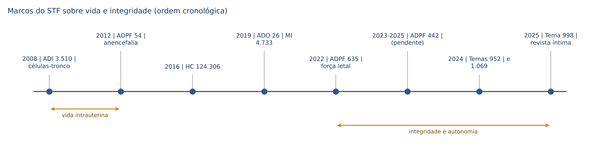
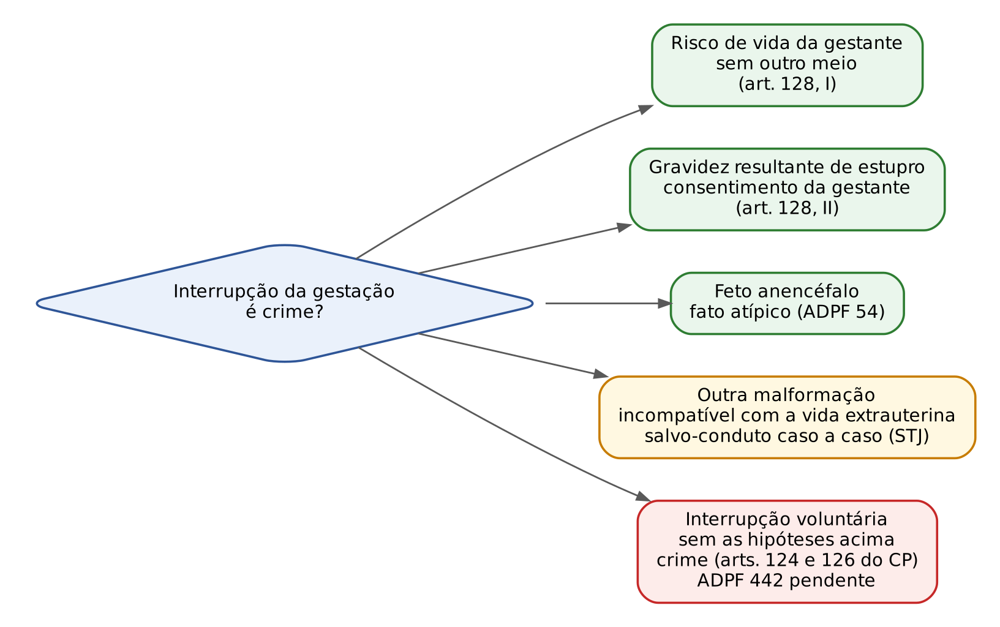
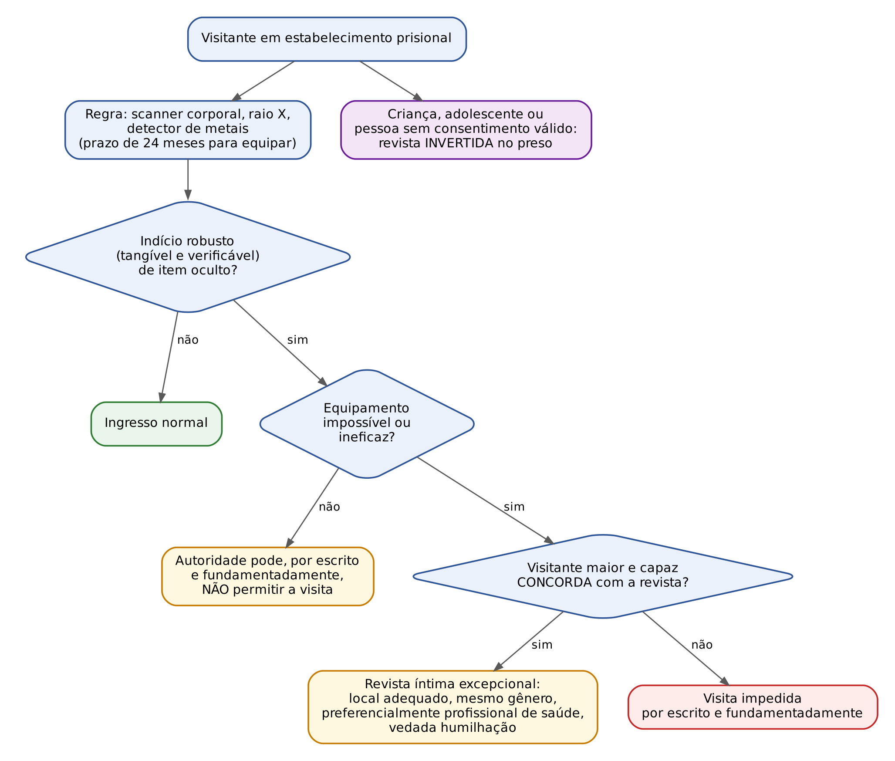
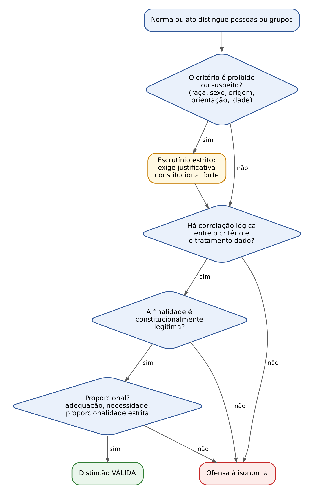
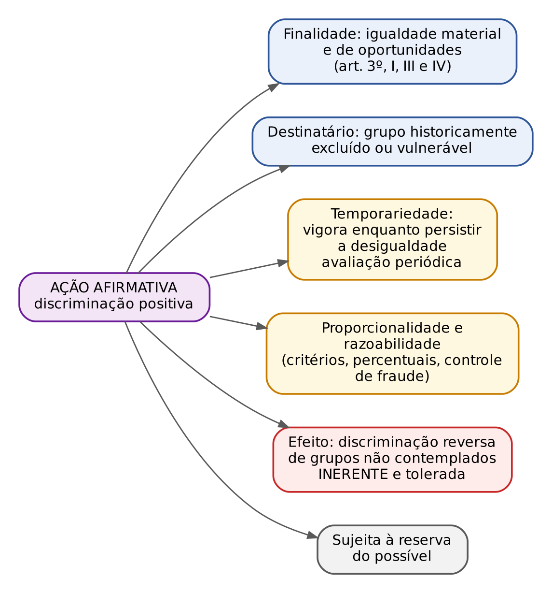
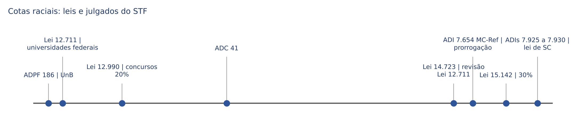
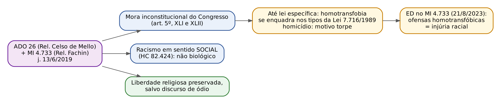
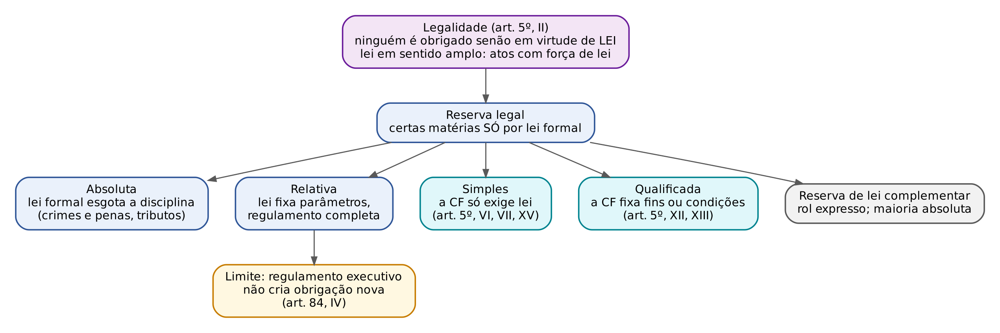

# CAPÍTULO 08 — DIREITOS INDIVIDUAIS I: VIDA, INTEGRIDADE, IGUALDADE, NÃO DISCRIMINAÇÃO E LEGALIDADE

:::INCIDENCIA
Pontos: TRF5 p. 4; TJSC p. 13. Nível A+. Lote: 26 questões (FGV 21, FCC 5), além de correlatas localizadas no banco.
O que mais cai: estrutura e limites das ações afirmativas (temporariedade, discriminação reversa, igualdade material), igualdade de gênero em concursos militares, direitos da população LGBTQIA+ (ADO 26, ADI 4.275, ADPF 787, MI 7.452), revista íntima (Tema 998) e a letra do art. 5º, I a III, XLI a XLIII.
:::

| Subtema | FGV | FCC | Padrão de cobrança |
|---|---|---|---|
| Ações afirmativas e igualdade material (teoria e casos) | 10 | 2 | Caso hipotético de política pública; perguntas sobre temporariedade, discriminação reversa, impacto desproporcional, reserva do possível |
| Igualdade de gênero (concursos militares, TAF de gestante, art. 7º, XXX) | 3 | 1 | Lei estadual que limita vagas femininas; remarcação de TAF |
| Isonomia e privilégios em concurso (isenção de taxa a servidores, bônus regional) | 2 | 0 | Lei estadual com critério de discrímen sem correlação lógica |
| Orientação sexual e identidade de gênero | 3 | 1 | V ou F sobre doação de sangue, registro civil, Lei Maria da Penha, presídios, SUS |
| Vida, integridade, tortura, uso da força | 2 | 1 | Revista íntima (Tema 998), força letal (ADPF 635), letra do art. 5º, III |
| Legalidade (art. 5º, II) | 1 | 0 | Letra da Constituição |

## 08.1 O caput do art. 5º: estrutura, destinatários e classificação

O caput do art. 5º anuncia cinco direitos-matriz (vida, liberdade, igualdade, segurança e propriedade), cuja inviolabilidade é garantida "nos termos seguintes", isto é, desdobrada nos 79 incisos. Esta apostila reparte o art. 5º assim: vida, integridade, igualdade e legalidade neste capítulo; liberdades, privacidade e sigilos no Cap. 9; propriedade, segurança jurídica e garantias penais e processuais no Cap. 10; remédios nos Caps. 15 e 16.

Destinatários. A letra fala em "brasileiros e estrangeiros residentes no País", mas a leitura do STF é extensiva: o estrangeiro não residente (turista, em trânsito, em situação migratória irregular) também é titular dos direitos ligados à dignidade, e pessoas jurídicas titularizam os direitos compatíveis com sua natureza. A teoria da titularidade (estrangeiros, pessoas jurídicas, nascituro) está no Cap. 7; aqui basta a pegadinha: a expressão restritiva do caput NÃO autoriza negar a estrangeiro não residente *habeas corpus*, devido processo ou vedação de tortura.

Classificação (TJSC p. 13). Para prova, três critérios bastam: (a) pelo conteúdo, direitos de defesa (abstenção estatal: vida, liberdade), direitos a prestações (proteção penal da vida, políticas de igualdade) e direitos de participação; (b) pela estrutura, direitos (bens da vida declarados) e garantias (instrumentos assecuratórios, como o *habeas corpus*), distinção de Rui Barbosa retomada no Cap. 7; (c) pela titularidade, individuais e coletivos (o Título II, Capítulo I, fala em "direitos e deveres individuais e coletivos"). Os direitos deste capítulo são, em regra, de primeira dimensão, mas cada um tem dupla face: a vida exige abstenção (não matar) e proteção (dever de tutela penal suficiente); a igualdade exige não discriminar e promover (art. 3º, III e IV).

:::DICA ONDE ESTÁ CADA COISA
Dignidade da pessoa humana (fundamento, art. 1º, III): Cap. 6. Eficácia horizontal, núcleo essencial, proporcionalidade e proibição de proteção insuficiente: Cap. 7. Aplicação imediata (art. 5º, § 1º): Cap. 4. Tratados de direitos humanos e controle de convencionalidade (art. 5º, §§ 2º a 4º): Cap. 11.
:::

## 08.2 Direito à vida

### 08.2.1 Conteúdo e dupla dimensão

O direito à vida é o pressuposto de todos os demais, mas não é absoluto: a própria Constituição admite a pena de morte em caso de guerra declarada (art. 5º, XLVII, "a", com remissão ao art. 84, XIX), e o Código Penal admite matar em legítima defesa e interromper a gestação nas hipóteses do art. 128. A doutrina (José Afonso da Silva; Gilmar Mendes e Paulo Gonet Branco) distingue duas vertentes: o direito de permanecer vivo (dimensão negativa, oponível ao Estado e aos particulares) e o direito a uma existência digna (ligado ao mínimo existencial, Cap. 7). Da dimensão objetiva decorre o dever estatal de proteção, que veda tanto o excesso (proibição de excesso) quanto a proteção deficiente (*Untermaßverbot*), argumento usado pelos votos vencidos na ADI 3.510 e pelos que defendem a criminalização do aborto.

Não há na Constituição regra expressa sobre o início da vida protegida. O Pacto de São José da Costa Rica (art. 4.1) protege a vida "em geral, desde o momento da concepção"; a cláusula "em geral" foi lida pela Corte Interamericana (caso Artavia Murillo e outros vs. Costa Rica, 2012) como proteção gradual e incremental, e não absoluta, do embrião. O STF segue a mesma lógica de proteção gradual: tutela jurídica crescente conforme o desenvolvimento, sem atribuir ao embrião *in vitro* a condição de pessoa (ADI 3.510). A personalidade civil do nascituro e as teorias natalista, concepcionista e da personalidade condicional estão na Apostila de Direito Civil, Cap. 3.

:::PEGADINHA PENA DE MORTE
A exceção é UMA só: guerra declarada nos termos do art. 84, XIX (agressão estrangeira, com autorização ou referendo do Congresso). Não cabe em estado de sítio, em grave comoção interna nem em guerra civil. A vedação é cláusula pétrea (art. 60, § 4º, IV), de modo que emenda constitucional não pode ampliá-la; a doutrina majoritária entende que nem mesmo a adesão a tratado poderia fazê-lo (o Brasil ratificou o Protocolo à Convenção Americana referente à abolição da pena de morte, com reserva para o tempo de guerra). A disciplina das penas vedadas está no Cap. 10.
:::

### 08.2.2 Pesquisas com células-tronco embrionárias: ADI 3.510

O art. 5º da Lei 11.105/2005 (Lei de Biossegurança) foi impugnado pelo Procurador-Geral da República sob o argumento de que a vida começa na fecundação e de que o uso de embriões violaria a vida e a dignidade. O STF, por maioria, julgou a ação improcedente (Rel. Min. Ayres Britto, j. 29/5/2008).

:::LEI LEI 11.105/2005, ART. 5º
É permitida, para fins de pesquisa e terapia, a utilização de células-tronco embrionárias obtidas de embriões humanos produzidos por fertilização *in vitro* e não utilizados no respectivo procedimento, atendidas as seguintes condições: I – sejam embriões inviáveis; ou II – sejam embriões congelados há 3 (três) anos ou mais, na data da publicação desta Lei, ou que, já congelados na data da publicação desta Lei, depois de completarem 3 (três) anos, contados a partir da data de congelamento. § 1º Em qualquer caso, é necessário o consentimento dos genitores. § 2º Instituições de pesquisa e serviços de saúde que realizem pesquisa ou terapia com células-tronco embrionárias humanas deverão submeter seus projetos à apreciação e aprovação dos respectivos comitês de ética em pesquisa. § 3º É vedada a comercialização do material biológico a que se refere este artigo e sua prática implica o crime tipificado no art. 15 da Lei nº 9.434, de 4 de fevereiro de 1997.
:::

Pontos da *ratio decidendi* que caem:

- A Constituição, quando fala em direitos da "pessoa humana", refere-se ao indivíduo-pessoa já nascido; o embrião *in vitro*, que nunca será implantado, não é pessoa nem nascituro (não há gestação), embora mereça tutela infraconstitucional, que a própria lei dá (requisitos, crime do art. 24).
- A pesquisa concretiza outros direitos fundamentais: saúde (art. 196), liberdade de expressão científica (art. 5º, IX) e o dever estatal de promover a ciência (art. 218). O planejamento familiar (art. 226, § 7º) não obriga o casal a implantar todos os embriões produzidos.
- Os requisitos legais são cumulativos e alternativos ao mesmo tempo: inviabilidade OU congelamento há três anos ou mais (incisos alternativos) E, em qualquer caso, consentimento dos genitores e aprovação do comitê de ética (requisitos cumulativos), vedada a comercialização.

:::PEGADINHA ADI 3.510
(a) O STF não declarou que a vida começa no nascimento, nem que o embrião é "coisa": afirmou que o embrião excedente não é pessoa constitucional e que a tutela da vida é gradual. (b) Não houve interpretação conforme com novos requisitos: votos (como o do Min. Gilmar Mendes) propunham condicionantes, mas prevaleceu a improcedência pura. (c) A clonagem humana e a engenharia genética em célula germinal, zigoto ou embrião continuam vedadas e são crimes (arts. 25 e 26 da Lei 11.105/2005).
:::

### 08.2.3 Interrupção da gestação: ADPF 54, HC 124.306 e ADPF 442

O aborto é crime (arts. 124 a 126 do CP), salvo nas hipóteses de aborto necessário (risco de vida da gestante sem outro meio) e de gravidez resultante de estupro, com consentimento (art. 128, I e II). A dogmática penal (tipos, concurso, salvo-conduto) está na Apostila de Direito Penal, Cap. 27; aqui interessa o controle de constitucionalidade e a ponderação.

ADPF 54 (Rel. Min. Marco Aurélio, j. 11 e 12/4/2012). Proposta pela Confederação Nacional dos Trabalhadores na Saúde, foi julgada procedente, por maioria, para declarar inconstitucional a interpretação segundo a qual a interrupção da gravidez de feto anencéfalo seria conduta tipificada nos arts. 124, 126 e 128, I e II, do CP. Vencidos, no mérito, os Ministros Ricardo Lewandowski e Cezar Peluso. Técnica: interpretação conforme a Constituição (exclusão de uma interpretação). Fundamentos: (a) o feto anencéfalo é incompatível com a vida extrauterina, de modo que não há vida potencial a ser protegida pelo tipo penal: a conduta é atípica, e não uma nova excludente de ilicitude; (b) impor a gestação seria tratamento desumano e degradante à gestante (art. 5º, III) e ofensa à sua dignidade, liberdade, autonomia e saúde; (c) o Estado é laico, e convicções religiosas não podem fundamentar a restrição. O Tribunal NÃO acolheu as condicionantes propostas pelos Ministros Gilmar Mendes e Celso de Mello (laudo de dois médicos, intervalo entre diagnóstico e cirurgia), de modo que basta o diagnóstico médico de anencefalia (o CFM regulamentou o diagnóstico em resolução própria).

:::PEGADINHA ADPF 54 NÃO É ECI NEM NOVA HIPÓTESE DO ART. 128
(a) A ADPF 54 não criou uma terceira hipótese no art. 128: declarou o fato atípico por interpretação conforme. (b) Não exige autorização judicial. (c) Não alcança outras malformações graves: para elas, a jurisprudência (STJ) admite, caso a caso, salvo-conduto quando comprovada a inviabilidade de vida extrauterina, não a mera gravidade do prognóstico (Apostila de Direito Penal, Cap. 27). (d) O estado de coisas inconstitucional foi reconhecido no sistema prisional (ADPF 347), não na anencefalia: a FGV usou essa troca como distrator (Q3087104, TJ-RR 2024, questão do Cap. 19).
:::

HC 124.306 (1ª Turma, j. 29/11/2016). Ao afastar a prisão preventiva de médicos de clínica clandestina, o voto condutor do Min. Roberto Barroso sustentou que a criminalização da interrupção voluntária no primeiro trimestre viola os direitos sexuais e reprodutivos, a autonomia, a integridade física e psíquica e a igualdade da mulher, e é desproporcional (pouca eficácia protetiva, alto custo social, impacto desproporcional sobre mulheres pobres). É decisão de Turma, em HC, sem eficácia vinculante: não descriminalizou o aborto.

ADPF 442 (proposta em 2017 pelo PSOL). Pede a exclusão do âmbito dos arts. 124 e 126 do CP da interrupção voluntária realizada até a 12ª semana. A relatora, Min. Rosa Weber, votou pela procedência em setembro de 2023 (sessão virtual), antes de se aposentar, entendendo desproporcional a pena de detenção imposta à gestante e a quem a auxilia; o julgamento foi suspenso por destaque do Min. Barroso. Em 17/10/2025, em sessão virtual extraordinária, o Min. Barroso cancelou o destaque e votou também pela descriminalização até a 12ª semana, tratando o tema como questão de saúde pública; em seguida, o Min. Gilmar Mendes pediu destaque, o que leva o caso ao Plenário físico e o suspende. Não se localizou conclusão até 11/11/2026.

:::ATENCAO COMO RESPONDER EM PROVA SOBRE ABORTO (SITUAÇÃO EM 11/11/2026)
A lei vigente CRIMINALIZA o aborto consentido em qualquer fase, ressalvadas as hipóteses do art. 128 e a anencefalia (ADPF 54). Votos isolados na ADPF 442 e o HC 124.306 não vinculam. Também pendente: a ADPF 1.141, em que o relator (Min. Alexandre de Moraes) suspendeu, em 17/5/2024, a Resolução CFM 2.378/2024, que vedava ao médico a assistolia fetal em gestações a partir de 22 semanas decorrentes de estupro, e, dias depois, os processos judiciais e administrativos nela baseados; no Plenário virtual (junho de 2024), o Min. André Mendonça divergiu, e um destaque interrompeu o julgamento. Em março de 2026 (notícia de 19/3/2026), depois de parecer da PGR favorável à restauração da resolução, o relator liberou o processo para julgamento no Plenário; em 21/8/2026 ainda não havia data de julgamento, e não se localizou decisão de mérito até 11/11/2026.
:::

:::DOUTRINA OS ARGUMENTOS EM COLISÃO
De um lado, a proteção gradual da vida do nascituro e o dever de proteção suficiente (proibição de *Untermaßverbot*), sustentados, por exemplo, nos votos vencidos da ADPF 54 (o Min. Lewandowski invocou a separação de poderes: o Judiciário não pode criar hipótese de exclusão não prevista pelo legislador). De outro, autonomia reprodutiva, igualdade de gênero (a criminalização recai só sobre a mulher), saúde pública e laicidade (Barroso; Sarmento). Em prova discursiva, apresente ambos e a técnica (ponderação e proporcionalidade, Cap. 5), registrando a deferência ao legislador como argumento institucional.
:::

### 08.2.4 Fim da vida: eutanásia, ortotanásia, distanásia e recusa de tratamento

| Figura | Conceito | Tratamento jurídico |
|---|---|---|
| Eutanásia (ativa) | Provocar a morte de paciente incurável, por compaixão | Homicídio (art. 121 do CP), com possível privilégio do relevante valor moral; consentimento não afasta o crime |
| Suicídio assistido | Terceiro fornece meios para o próprio paciente pôr fim à vida | Crime do art. 122 do CP (auxílio) |
| Ortotanásia | Não iniciar ou suspender tratamentos fúteis que apenas prolongam artificialmente a vida do paciente terminal, mantidos os cuidados paliativos, com consentimento | Lícita: regulada pelo CFM (Resolução 1.805/2006) e pelo Código de Ética Médica; a ação civil pública do MPF que pedia a anulação da resolução foi julgada improcedente pela 14ª Vara Federal do DF em 1/12/2010 |
| Distanásia | Prolongamento artificial e penoso do processo de morte (obstinação terapêutica) | Contrária à dignidade; vedada como prática médica |
| Mistanásia | Morte evitável por omissão estrutural do Estado (falta de atendimento) | Violação do direito à saúde e à vida digna |
| Diretivas antecipadas de vontade | Manifestação prévia do paciente sobre tratamentos que aceita ou recusa | Reconhecidas pelo CFM (Resolução 1.995, de 9/8/2012, publicada em 31/8/2012) e pelo STF no Tema 1.069 |

A ortotanásia não viola o direito à vida porque o ordenamento não impõe o dever de viver a qualquer custo, e sim protege a vida digna, incluindo o morrer com dignidade (art. 1º, III; art. 5º, III: vedação de tratamento desumano). A eutanásia ativa permanece crime; a FGV costuma trocar uma pela outra.

A recusa de tratamento por motivo religioso foi definida pelo STF em 25/9/2024 (Temas 952 e 1.069): o paciente maior e capaz pode recusar transfusão de sangue, inclusive por diretivas antecipadas, e faz jus aos procedimentos alternativos disponíveis no SUS; no plano da vida, o ponto é que o ordenamento não impõe tratamento a quem o recusa de modo livre e informado (teses literais, liberdade de crença e situação de crianças e adolescentes, inclusive Q3505820 e Q3248765: v. Cap. 9).

### 08.2.5 Vida e uso da força letal pelo Estado: ADPF 635

A dimensão negativa do direito à vida tem seu teste mais duro na atuação policial. Na ADPF 635 (a "ADPF das Favelas", Rel. Min. Edson Fachin), o STF, em embargos na medida cautelar (j. 3/2/2022, Informativo 1.042), assentou, com apoio nos Princípios Básicos da ONU sobre o Uso da Força e de Armas de Fogo, que o uso da força letal por agentes do Estado só se justifica em casos extremos: exauridos os demais meios, inclusive os não letais, e quando necessário para proteger a vida ou prevenir dano sério decorrente de ameaça concreta e iminente. Determinou ainda ao Estado do Rio de Janeiro a elaboração de plano de redução da letalidade policial. O mérito foi concluído em 3/4/2025, com determinações estruturais (preservação de cena e de provas em mortes decorrentes de intervenção policial, câmeras em fardas e viaturas, investigação pelo Ministério Público com prioridade para mortes de crianças e adolescentes), afastando-se a declaração de estado de coisas inconstitucional pedida na inicial.

:::QUESTAO FCC 2026 — DPE-BA — DEFENSOR PÚBLICO (Q4037508)
Cobrou o complemento da fórmula do STF sobre força letal "em casos extremos". Gabarito: C — quando necessário para proteger a vida ou prevenir um dano sério.
Armadilhas: (A) legítima defesa putativa não é o parâmetro do precedente; (B) "ameaça grave e generalizada à ordem pública" é justamente o critério abstrato que o STF rejeitou: a ameaça deve ser concreta e iminente; (D) resistência reiterada não autoriza, por si, força letal; (E) oportunidade de rendição não está na fórmula. Fundamento: ADPF 635 MC-ED (08.2.5).
:::

## 08.3 Integridade física e moral e vedação da tortura

### 08.3.1 Normas constitucionais

:::LEI CF, ART. 5º, III, XLIII, XLVIII, XLIX E L
III - ninguém será submetido a tortura nem a tratamento desumano ou degradante; XLIII - a lei considerará crimes inafiançáveis e insuscetíveis de graça ou anistia a prática da tortura, o tráfico ilícito de entorpecentes e drogas afins, o terrorismo e os definidos como crimes hediondos, por eles respondendo os mandantes, os executores e os que, podendo evitá-los, se omitirem; XLVIII - a pena será cumprida em estabelecimentos distintos, de acordo com a natureza do delito, a idade e o sexo do apenado; XLIX - é assegurado aos presos o respeito à integridade física e moral; L - às presidiárias serão asseguradas condições para que possam permanecer com seus filhos durante o período de amamentação.
:::

A vedação da tortura é tratada pela doutrina como um dos raros direitos de feição absoluta: não admite ponderação, nem exceção por estado de necessidade, defesa de terceiro ou "bomba-relógio", nem suspensão no estado de defesa ou de sítio (o art. 136, § 3º, IV, inclusive veda a incomunicabilidade do preso, e o § 3º, I, manda o executor comunicar a prisão ao juiz, que pode relaxá-la; Cap. 32). No plano internacional, a proibição é norma de *jus cogens*. A FGV explora exatamente a falsa exceção.

:::QUESTAO FGV 2025 — PC-MG — MÉDICO LEGISTA (Q3203639)
V ou F: (1) a lei punirá qualquer discriminação atentatória dos direitos e liberdades fundamentais; (2) a lei penal não retroagirá nas hipóteses previstas na Constituição; (3) ninguém será submetido a tortura, salvo nos casos de estado de necessidade previstos em lei. Gabarito: C (V, F, F).
Armadilhas: o item 2 inverte o art. 5º, XL (a lei penal não retroagirá, SALVO para beneficiar o réu); o item 3 inventa exceção inexistente ao inciso III. No mesmo sentido, item IV de Q2511988 (FGV 2024, Câmara dos Deputados, questão do Cap. 7: "tortura tolerada para defesa de bem jurídico de outrem" é falso).
:::

Pontos de letra no inciso XLIII que caem: (a) tortura, tráfico, terrorismo e hediondos (TTTH) são inafiançáveis e insuscetíveis de graça ou anistia, mas NÃO imprescritíveis (imprescritíveis são o racismo, XLII, e a ação de grupos armados contra a ordem constitucional, XLIV); (b) o indulto não está no texto, mas o STF admite que a lei o vede, por ser a graça espécie de clemência individual e o indulto, coletiva (tema penal, Apostila de Direito Penal, Cap. 40); (c) responde também quem, podendo evitar, se omite (base da forma omissiva do art. 1º, § 2º, da Lei 9.455/1997). Q2458425 (FGV 2024, Câmara de Fortaleza, questão do Cap. 10) cobrou a letra exata do XLIII.

### 08.3.2 Tortura: tipificação, sistema de prevenção e anistia

O mandado de criminalização do inciso XLIII foi cumprido pela Lei 9.455/1997, que tipifica a tortura como crime comum (diferentemente da Convenção da ONU, que exige agente público), com hipóteses de tortura-prova, tortura-crime, tortura discriminatória e tortura-castigo, a perda do cargo como efeito automático da condenação e a extraterritorialidade incondicionada quando a vítima for brasileira ou o agente estiver sob jurisdição brasileira. A análise dos tipos está na Apostila de Direito Penal, Cap. 40. No plano preventivo, a Lei 12.847/2013 instituiu o Sistema Nacional de Prevenção e Combate à Tortura, com o Mecanismo Nacional de Prevenção e Combate à Tortura (peritos com acesso a locais de privação de liberdade), em cumprimento ao Protocolo Facultativo à Convenção da ONU.

Lei de Anistia: o STF declarou recebida a Lei 6.683/1979 (ADPF 153), ao passo que a Corte Interamericana, no caso Gomes Lund, negou efeitos às disposições que impedem a punição de graves violações de direitos humanos; o conflito entre controle de constitucionalidade e de convencionalidade é desenvolvido no Cap. 11 (v. Cap. 11).

### 08.3.3 Integridade dos presos e revista íntima (Tema 998)

A integridade física e moral do preso (art. 5º, XLIX) fundamenta, entre outros, o dever estatal de indenizar o preso submetido a condições degradantes (responsabilidade civil do Estado: Apostila de Direito Administrativo), o estado de coisas inconstitucional do sistema prisional (ADPF 347, Cap. 19) e a disciplina da revista de visitantes. O art. 5º, XLVIII, determina separação por natureza do delito, idade e SEXO, base da discussão sobre a custódia de pessoas trans (08.5.4).

:::JURIS STF, TEMA 998 (RG) — ARE 959.620/RS, REL. MIN. EDSON FACHIN, J. 2/4/2025 (INFORMATIVO 1.172)
1. Em visitas sociais nos presídios ou estabelecimentos de segregação é inadmissível a revista íntima vexatória com o desnudamento de visitantes ou exames invasivos com finalidade de causar humilhação. A prova obtida por esse tipo de revista é ilícita, salvo decisões judiciais em cada caso concreto. A decisão tem efeitos prospectivos a partir da publicação da ata do julgamento. 2. A autoridade administrativa, de forma fundamentada e por escrito, tem o poder de não permitir a visita diante da presença de indício robusto de ser a pessoa visitante portadora de qualquer item corporal oculto ou sonegado; são robustos os indícios embasados em elementos tangíveis e verificáveis (informações prévias de inteligência, denúncias, comportamentos suspeitos). 3. Prazo de 24 meses, a contar do julgamento, para aquisição e instalação de scanners corporais, esteiras de raio X e portais detectores de metais. (...) 6. Excepcionalmente, na impossibilidade ou inefetividade desses equipamentos, a revista íntima, diante de indícios robustos, deverá ser motivada para cada caso e dependerá da plena concordância do visitante, vedada em qualquer circunstância a humilhação; em local adequado, apenas em pessoas maiores capazes de consentir, por pessoas do mesmo gênero e preferencialmente por profissionais de saúde nos desnudamentos e exames invasivos. Sem concordância, a autoridade pode impedir a visita, fundamentadamente e por escrito. Em criança, adolescente ou pessoa com deficiência intelectual sem consentimento válido, faz-se a revista invertida, no preso visitado.
:::

:::QUESTAO FGV 2025 — ENAM 2025.2 — EXAME NACIONAL DA MAGISTRATURA (Q3692361)
Caso: irmã de preso, absolvida por tráfico com trânsito em julgado e moradora de bairro dominado por facção, quer visitá-lo com a filha de 6 anos; o diretor teme ingresso de drogas. Gabarito: C — transcrição do item 1 da tese (revista vexatória inadmissível; prova ilícita, salvo decisão judicial no caso concreto).
Resolução em passos: (1) revista na criança: nunca; usa-se a revista invertida no preso (erra a A); (2) impedir a visita exige indício robusto, tangível e verificável (erra a B, que dispensa o indício); (3) a revista íntima não é vedada em qualquer hipótese, é excepcional e consentida (erra a D); (4) processo com absolvição definitiva e residência em área de facção NÃO são indícios robustos, mas presunções estigmatizantes (erra a E, a mais sedutora).
:::

## 08.4 Igualdade

### 08.4.1 Igualdade formal e material; na lei e perante a lei

O caput do art. 5º proclama que "todos são iguais perante a lei, sem distinção de qualquer natureza", e o inciso I acrescenta que homens e mulheres são iguais em direitos e obrigações, "nos termos desta Constituição". A igualdade aparece também como objetivo fundamental (art. 3º, III e IV), como vedação federativa (art. 19, III: é vedado criar distinções entre brasileiros ou preferências entre si), como princípio da Administração (impessoalidade, art. 37), como limite ao poder de tributar (art. 150, II) e em diversas proibições específicas de discriminação (art. 7º, XXX e XXXI; art. 227, § 6º).

| Par conceitual | Sentido | Para que serve na prova |
|---|---|---|
| Igualdade formal x material | Formal: tratamento idêntico pela norma, abstraídas as diferenças (Estado liberal). Material ou substancial: tratar desigualmente os desiguais na medida da desigualdade, para reduzir desigualdades fáticas (Estado social) | A ação afirmativa realiza a igualdade material e, por definição, se afasta da formal |
| Igualdade na lei x perante a lei | Na lei: dirigida ao LEGISLADOR, que não pode criar distinções arbitrárias. Perante a lei: dirigida ao APLICADOR (Administração e juiz), que deve aplicar a lei sem distinções | No Brasil, a cláusula "perante a lei" vincula também o legislador (leitura consolidada no STF e na doutrina) |
| Igualdade como proibição x como promoção | Proibição de discriminar (dimensão negativa) x dever de promover a igualdade (dimensão positiva, art. 3º, IV) | Fundamento das políticas afirmativas e do direito antidiscriminatório |
| Discriminação direta x indireta | Direta: critério proibido explícito. Indireta: norma neutra que produz impacto desproporcional sobre grupo protegido | Teoria do impacto desproporcional (08.4.3) |

:::QUESTAO FCC 2025 — DPE-RS — DEFENSOR PÚBLICO (Q3386969)
Pediu a INCORRETA sobre igualdade. Gabarito: C — afirma que a cautelar na ADPF 527 mandou presas trans cumprirem pena em estabelecimento próprio, separado de todos os demais presos; a cautelar (Min. Barroso, 2019, ampliada em 2021) assegurou a transferência para presídio feminino ou a OPÇÃO entre unidade feminina e masculina (nesta, em ala reservada), não o isolamento.
Corretas: cláusula de barreira objetiva em concurso é válida (Tema 376); a tese da legítima defesa da honra viola igualdade e dignidade (ADPF 779); a igualdade vincula o legislador (a banca afirmou que o STF o reconhece desde a Constituição de 1946); ADI 5.668 obriga escolas públicas e privadas a combater discriminação por gênero, identidade de gênero e orientação sexual.
:::

### 08.4.2 O teste da isonomia: quando a distinção é válida

Toda lei distingue; a questão é saber quais distinções são legítimas. O roteiro clássico, de Celso Antônio Bandeira de Mello (O conteúdo jurídico do princípio da igualdade), exige: (1) identificar o fator de discrímen; (2) verificar a correlação lógica entre esse fator e a diferença de tratamento; (3) verificar se essa correlação é compatível com os valores constitucionais. A jurisprudência do STF agrega o exame de proporcionalidade (adequação, necessidade e proporcionalidade estrita, Cap. 5) e, para critérios suspeitos (raça, sexo, origem, orientação sexual, identidade de gênero, idade, deficiência), um escrutínio mais rigoroso.

Aplicações recorrentes em concursos públicos (o regime administrativo do concurso está na Apostila de Direito Administrativo, Cap. 11):

| Distinção | Solução do STF | Por quê |
|---|---|---|
| Limite de idade para inscrição | Só se legitima quando justificado pela natureza das atribuições do cargo (Súmula 683, com remissão ao art. 7º, XXX) e previsto em lei | Correlação lógica com a função |
| Exame psicotécnico | Só por lei (Súmula Vinculante 44), com critérios objetivos e recorribilidade | Reserva legal (art. 37, I) |
| Isenção de taxa de inscrição a servidores do próprio ente | Inconstitucional (ADIs 3.918/SE e 5.818/CE, sessão encerrada em 13/5/2022) | Privilégio sem correlação com finalidade igualitária; amplia a desvantagem de quem não pode pagar |
| Bônus de 10% na nota a candidatos nascidos e residentes no Estado | Inconstitucional (lei paraibana 12.753/2023, j. 11/12/2023) | Discrímen irrazoável; viola também o art. 19, III |
| Tempo de serviço público em geral como desempate na promoção do MP estadual | Inconstitucional (ADI 7.280/PA; v. Cap. 31) | Critério alheio à carreira (arts. 5º, caput, e 19, III) e invasão de norma geral |
| Requisito de "aptidão plena" para afastar pessoas com deficiência | Inconstitucional (ADI 7.401/PI, Rel. Min. Nunes Marques, j. 18/5/2026, Informativo 1.217) | Discriminação indireta; viola o piso protetivo federal (art. 34, § 3º, da Lei 13.146/2015) e a adaptação razoável |
| Reserva remunerada com tempo menor para ex-Comandante-Geral da PM | Constitucional (ADI 5.531/SE, Rel. Min. Nunes Marques, j. 16/3/2026, Informativo 1.208) | Justificativa objetiva na hierarquia militar; benefício vinculado ao cargo, não à pessoa |
| Cláusula de barreira em concurso | Constitucional (Tema 376) | Critério objetivo e meritório |

:::QUESTAO FGV 2024 — ENAM 2024.2 — EXAME NACIONAL DA MAGISTRATURA (Q3058613)
Lei estadual isentou servidores do próprio Estado da taxa de inscrição em seus concursos, para motivá-los a se aperfeiçoar. Gabarito: C — inconstitucional, porque a medida não visa promover igualdade substancial, isto é, não mitiga desigualdade constatada.
Armadilhas: (A) eficiência não legitima privilégio; (B) não há compensação de grupo desfavorecido: servidores já estão em posição vantajosa; (D) e (E) deslocam o debate para a natureza tributária da taxa, que não é o fundamento. Base: ADIs 3.918 e 5.818 (quadro acima).
:::

:::QUESTAO FGV 2024 — MPE-GO — PROMOTOR DE JUSTIÇA SUBSTITUTO (Q2367551)
Lei estadual concedeu bônus de 10% na nota, nos concursos de segurança pública, a candidatos nascidos e residentes no Estado, para conter evasão populacional. Gabarito: E — inconstitucional, porque o fator de discrímen é irrazoável e não serve de critério idôneo para tratamento mais favorável.
Armadilha: (B) afirma que nenhuma distinção entre candidatos é admitida; é falso, porque a lei pode exigir requisitos diferenciados quando a natureza do cargo o exigir (art. 39, § 3º). Base: precedente paraibano de 11/12/2023 e art. 19, III.
:::

:::QUESTAO FGV 2025 — TRF3 — JUIZ FEDERAL SUBSTITUTO (Q3179503)
Pediu a correta entre cinco teses. Gabarito: E — é constitucional a remarcação do TAF de candidata grávida à época de sua realização, independentemente de previsão no edital (Tema 973, RE 1.058.333/PR, Rel. Min. Luiz Fux, j. 21/11/2018; fundamentos: arts. 5º, caput, 6º, 37 e 226, § 7º).
Armadilha principal: (D) estende a segunda chamada a qualquer circunstância pessoal ou fisiológica; o STF negou, em repercussão geral anterior, esse direito geral, salvo previsão no edital, e só abriu exceção para a gestante, por força da proteção à maternidade. O STJ estende a solução à lactante e ao curso de formação (Jurisprudência em Teses, ed. 210, tese 2). As demais alternativas tratam de temas de outros capítulos (Tema 529: NÃO se reconhece união estável paralela a casamento ou outra união para fins previdenciários; Tema 1.049; art. 109, § 2º).
:::

### 08.4.3 Ações afirmativas: conceito, traços estruturais e teoria do impacto desproporcional

Ações afirmativas são políticas públicas ou privadas, compulsórias ou voluntárias, de caráter temporário, que conferem tratamento favorecido a grupos historicamente excluídos ou vulneráveis, para neutralizar os efeitos de discriminações passadas e presentes e promover a igualdade material e de oportunidades (formulação difundida no Brasil por Joaquim Barbosa Gomes). O fundamento constitucional não é só o art. 5º: são os objetivos do art. 3º (I, III e IV), as normas de discriminação positiva já previstas no texto (art. 7º, XX; art. 37, VIII; art. 227, § 1º, II) e, desde 2022, a Convenção Interamericana contra o Racismo, a Discriminação Racial e Formas Correlatas de Intolerância, incorporada pelo rito do art. 5º, § 3º (Decreto 10.932/2022), cujo Artigo 5 impõe aos Estados a adoção de ações afirmativas e declara que elas não constituem discriminação.

A FGV formulou, entre 2024 e 2026, ao menos dez questões sobre a "estrutura" das ações afirmativas, quase sempre em caso hipotético de política pública. As respostas seguem um gabarito constante:

| Afirmação recorrente | Certo ou errado | Fundamento |
|---|---|---|
| A ação afirmativa deve ser contínua e permanente | ERRADO | É temporária (*pro tempore*): vigora enquanto persistir a desigualdade, com avaliação periódica (ADPF 186; ADI 7.654) |
| A ação afirmativa não pode gerar discriminação reversa | ERRADO | O ônus para grupos não contemplados é efeito INERENTE e tolerado, desde que proporcional |
| A política pode se distanciar da igualdade formal | CERTO | Ela realiza a igualdade material justamente rompendo a igualdade "na lei" |
| A política está sujeita à reserva do possível | CERTO | Depende de recursos e de opções orçamentárias (limites da prestação estatal, Cap. 7) |
| O tratamento diferenciado precisa estar previsto na Constituição, vedada a criação por lei | ERRADO | A lei (e até ato de universidade, no exercício da autonomia) pode instituí-lo, observada a proporcionalidade |
| O princípio democrático ("uma pessoa, um voto") veda segmentar beneficiários | ERRADO | Democracia não se reduz a maioria; inclui proteção de minorias |
| A igualdade material é consectário necessário da igualdade formal | ERRADO | São dimensões distintas; a material corrige os déficits da formal |
| Devem buscar equilíbrio, sem preponderância, entre igualdade formal e material | ERRADO | A ação afirmativa faz preponderar, temporariamente, a material |

:::QUESTAO FGV 2026 — TRF2 — JUIZ FEDERAL SUBSTITUTO (Q3996819)
Ministério estuda política *pro tempore* para grupo historicamente vulnerável, para construir igualdade material e romper com paradigmas baseados só na igualdade na lei. Gabarito: B — não destoam da *ratio essendi* das ações afirmativas os efeitos discriminatórios causados em grupos não contemplados.
Armadilhas: (A) nega a temporariedade; (C) diz que as ações não decorrem de previsões normativas de tratamento desigual, o que é falso; (D) exige equilíbrio sem preponderância; (E) afirma que a igualdade material se alcança com a igualdade na lei.
No mesmo sentido: Q4153587 (FGV 2026, TJ-SC, Oficial de Justiça: gabarito B, o aprimoramento da posição do grupo pode acarretar discriminação reversa do restante; erradas a permanência da medida e a exigência de previsão constitucional expressa) e Q3390822 (FGV 2025, DPE-PE: só o item II, "discriminações reversas são efeito inevitável", é correto; o item III, que chama a política temporária e avaliada periodicamente de "véu" da discriminação estrutural, é falso).
:::

:::QUESTAO FGV — BATERIA DE ITENS SOBRE TRAÇOS ESTRUTURAIS
Q3171389 (FGV 2025, PC-MG, Delegado): de "contínua", "não pode gerar discriminação reversa" e "pode se distanciar da igualdade formal", só o último está certo (gabarito C). Q3049917 (FGV 2024, Procurador de Macaé): de "caráter contínuo e permanente", "justiça material em detrimento da igualdade formal" e "caminha contra a discriminação reversa", só o segundo (gabarito B). Q2387546 (FGV 2024, CGM-BH): de "construção da igualdade formal", "necessária continuidade" e "sujeição à reserva do possível", só o terceiro (gabarito C). Q3641455 (FGV 2025): políticas não podem contemplar grupos arbitrariamente, mas é possível privilegiar grupos historicamente excluídos em prejuízo dos historicamente beneficiados (gabarito D); erradas as alternativas que invocam democracia ou representação política "não segmentada" contra a política.
Método: ao ver "contínua", "permanente" ou "sem discriminação reversa", marque errado; ao ver "temporária", "distanciar-se da igualdade formal", "reserva do possível", marque certo.
:::

Teoria do impacto desproporcional (*disparate impact*). Nascida na Suprema Corte dos Estados Unidos (Griggs v. Duke Power Co., 1971), sustenta que viola a igualdade a norma ou prática aparentemente neutra que, na aplicação, produz efeito desproporcionalmente gravoso sobre grupo protegido, independentemente de intenção discriminatória. É o fundamento da proibição da discriminação INDIRETA. No STF, o precedente clássico é a ADI 1.946 (j. 3/4/2003): o teto de benefícios do RGPS criado pela EC 20/1998 recebeu interpretação conforme para não alcançar o salário-maternidade, porque, se o empregador tivesse de pagar a diferença acima do teto, passaria a preferir contratar homens, gerando discriminação contra a mulher vedada pelo art. 7º, XXX. Aplicações recentes: a exigência de "aptidão plena" para pessoas com deficiência (ADI 7.401, 08.4.2) e a criminalização do aborto (argumento do HC 124.306 sobre mulheres pobres).

:::QUESTAO FGV 2025 — TJ-CE — JUIZ SUBSTITUTO (Q3505850)
Município discute a teoria do impacto desproporcional ao formular política para grupos historicamente inferiorizados. Gabarito: A — o ônus desproporcional gerado pela igualdade formal pode legitimar o tratamento diferenciado do grupo beneficiado.
Armadilhas: (B) cria limite inexistente (ônus ao grupo preterido não superior aos benefícios) e confunde impacto desproporcional com discriminação reversa; (C) inventa "correspondência biunívoca" entre igualdade formal e material; (D) e (E) tratam de ônus aos Poderes e de ciclo de políticas públicas, temas alheios à teoria.
:::

:::QUESTAO FGV 2026 — TJ-PA — JUIZ SUBSTITUTO (Q3951810)
Universidade estadual, constatando menos de 10% de alunos negros, institui cotas raciais próprias. Gabarito: C — a medida tem caráter antidiscriminatório, ao buscar igualdade de oportunidades e reparar injustiças históricas.
Armadilhas: (A) "elimina todas as desigualdades interseccionais" é exagero; (B) e (D) negam a constitucionalidade, contra a ADPF 186; (E) subordina a questão racial à econômica, tese rejeitada pelo STF, que admitiu o critério étnico-racial autônomo. A universidade pode instituir cotas no exercício da autonomia (art. 207), como a UnB na ADPF 186.
:::

:::QUESTAO FCC 2026 — DPE-MA — DEFENSOR PÚBLICO (Q4012572)
Lei estadual institui programa para mulheres negras em vulnerabilidade socioeconômica, com critérios diferenciados de seleção em cursos técnicos e bolsas. Gabarito: B — constitucional; a Constituição admite políticas para superação de desigualdades estruturais, inclusive com recortes interseccionais (raça, gênero e renda), desde que proporcionais.
Armadilhas: (A) nega a cumulação de critérios; (C) exige previsão legal que especifique "grupos previstos constitucionalmente"; (D) inventa vício formal (o Estado pode instituir políticas afirmativas em sua administração e rede de ensino, como reconheceu o STF ao julgar a lei catarinense, 08.4.4); (E) atribui ao STF limitação inexistente.
:::

:::QUESTAO FCC 2026 — DPE-BA — DEFENSOR PÚBLICO (Q4037422)
Município cria política de educação digital limitada a matriculados em instituições formais, excluindo estudantes de grupos populares de educação e crianças e adolescentes educados em casa por deficiência severa ou doença grave. Gabarito: B — a exclusão de grupos comparáveis deve ser questionada com base na igualdade material e na finalidade da política.
Armadilhas: (C) a delimitação de beneficiários não é discricionariedade imune ao controle de igualdade; (E) o STF não "proibiu" o ensino domiciliar em geral: entendeu que depende de lei (tema do Cap. 36), e o caso é de educação em casa por impossibilidade de saúde, situação comparável à dos matriculados.
:::

### 08.4.4 Cotas raciais e sociais no STF

| Julgado | Objeto | Decisão e *ratio* |
|---|---|---|
| ADPF 186 (Rel. Min. Ricardo Lewandowski, j. 26/4/2012, unânime) | Cotas étnico-raciais da UnB (ato da própria universidade) | Constitucionais: concretizam a igualdade material; admitem autodeclaração e heteroidentificação por comissões; devem ser TRANSITÓRIAS e proporcionais; a autonomia universitária (art. 207) permite instituí-las sem lei |
| RE 597.285 (Tema 203, Rel. Min. Ricardo Lewandowski, j. 9/5/2012) | Cotas sociais e raciais da UFRGS | Constitucional a reserva de vagas a egressos de escolas públicas |
| ADI 3.330 (Rel. Min. Ayres Britto, j. 3/5/2012) | ProUni (bolsas em instituições privadas para alunos de baixa renda, com subcotas raciais e para pessoas com deficiência) | Constitucional, por maioria, vencido o Min. Marco Aurélio |
| ADC 41 (Rel. Min. Roberto Barroso, j. 8/6/2017) | Lei 12.990/2014 (20% das vagas em concursos federais para pretos e pardos) | Constitucional; legítima a heteroidentificação subsidiária, com respeito à dignidade, contraditório e ampla defesa |
| ADI 7.654 MC-Ref (Rel. Min. Flávio Dino, j. 14/6/2024, Informativo 1.141) | Fim do prazo de 10 anos da Lei 12.990/2014 (10/6/2024) | Interpretação conforme do art. 6º: o prazo é marco de AVALIAÇÃO, não de extinção automática; cotas mantidas até a conclusão do processo legislativo; fundamentos: art. 3º e segurança jurídica dos concursos em andamento |
| ADIs 7.925 a 7.930/SC (j. 22/4/2026, Informativo 1.213) | Lei catarinense 19.722/2026, que vedou cotas raciais no ensino superior público ou financiado com verbas públicas | Inconstitucional: o Estado tem margem de conformação, mas não pode suprimir ação afirmativa já reconhecida como constitucional sem prévia avaliação de seus efeitos; a Convenção Interamericana contra o Racismo é parâmetro de controle (v. Cap. 11) |

Legislação: a Lei 12.711/2012 (universidades e institutos federais) reserva vagas a egressos de escola pública, com subcotas para pretos, pardos, indígenas, pessoas com deficiência e, após a revisão pela Lei 14.723, de 13/11/2023, quilombolas. A Lei 15.142, de 3/6/2025, revogou a Lei 12.990/2014 e passou a reservar 30% das vagas em concursos e processos seletivos federais a pessoas pretas e pardas, indígenas e quilombolas, quando houver duas ou mais vagas, com revisão em dez anos. Heteroidentificação, controle judicial (Tema 1.420) e consequência da não confirmação da autodeclaração (exclusão só das vagas reservadas): Apostila de Direito Administrativo, Cap. 11.

:::QUESTAO FGV 2024 — TRF1 — ANALISTA JUDICIÁRIO (Q3028688)
O STF prorrogou a Lei de Cotas em concursos federais até a aprovação de nova norma, diante dos certames em andamento e do risco de multiplicação de litígios. Qual princípio implícito fundamentou? Gabarito: D — segurança jurídica.
Correlata: Q3290879 (FCC 2025, Prefeitura de São Paulo, questão do Cap. 6) transcreveu o trecho da ADI 7.654 sobre "sociedade justa e solidária" e erradicação das desigualdades e perguntou sua natureza: objetivos fundamentais da República (art. 3º).
:::

Atenção ao julgamento catarinense: o STF não disse que Estados são proibidos de legislar sobre ações afirmativas; o vício foi suprimir política já validada sem avaliação concreta (desenvolvimento e bloco de constitucionalidade no Cap. 11).

:::SENTENCA FUNDAMENTAÇÃO-MODELO: CONTROLE DE ATO QUE EXCLUI CANDIDATO COTISTA OU EXTINGUE POLÍTICA AFIRMATIVA
"A reserva de vagas a pessoas pretas e pardas concretiza a igualdade material (arts. 3º, III e IV, e 5º, caput, da Constituição) e foi declarada constitucional pelo Supremo Tribunal Federal (ADPF 186 e ADC 41), que também assentou a natureza temporária da política, sujeita a avaliação periódica de resultados (ADI 7.654 MC-Ref). A interrupção ou o esvaziamento dessa política sem prévia avaliação de seus efeitos e das consequências da descontinuidade contraria o dever de proteção e o compromisso assumido na Convenção Interamericana contra o Racismo, incorporada com equivalência de emenda constitucional (Decreto 10.932/2022). No caso concreto, [descrever o ato e a ausência de motivação ou de avaliação]. Impõe-se, por isso, [afastar o ato / assegurar a participação do candidato nas vagas reservadas, observado o contraditório no procedimento de heteroidentificação]."
Atenção: tratando-se de lei ou ato normativo, o juiz de primeiro grau pode afastá-lo incidentalmente; o órgão fracionário do tribunal só o fará com observância da reserva de plenário (art. 97 e Súmula Vinculante 10), salvo se já houver pronunciamento do Plenário do STF ou do próprio tribunal (Cap. 17).
:::

### 08.4.5 Igualdade entre homens e mulheres

O art. 5º, I, contém a cláusula "nos termos desta Constituição": só a própria Constituição pode estabelecer diferenças de tratamento entre os sexos em caráter geral, e o legislador só pode fazê-lo para reduzir desigualdades fáticas (discriminação positiva) ou quando a diferença biológica for relevante para a finalidade da norma.

| Distinções feitas pela própria Constituição | Dispositivo |
|---|---|
| Licença à gestante de 120 dias x licença-paternidade nos termos da lei (5 dias pelo ADCT até a lei; a Lei 15.371, de 31/3/2026, em vigor a partir de 1/1/2027, fixa 10 dias em 2027, 15 em 2028 e 20 a partir de 2029, esta última etapa condicionada a meta fiscal, e cria o salário-paternidade — v. Cap. 12) | Art. 7º, XVIII e XIX; ADCT, art. 10, § 1º; Lei 15.371/2026, art. 11 |
| Proteção do mercado de trabalho da mulher, mediante incentivos específicos | Art. 7º, XX |
| Requisitos diferenciados de aposentadoria (idade) | Arts. 40, § 1º, III, e 201, § 7º |
| Isenção do serviço militar obrigatório em tempo de paz (mulheres e eclesiásticos), sujeitas a outros encargos | Art. 143, § 2º |
| Permanência das presidiárias com os filhos durante a amamentação; cumprimento de pena em estabelecimento distinto conforme o sexo | Art. 5º, L e XLVIII |
| Título de domínio e concessão de uso conferidos ao homem ou à mulher, ou a ambos (norma equalizadora) | Arts. 183, § 1º, e 189, parágrafo único |

:::LEI CF, ARTS. 7º, XXX, E 39, § 3º
Art. 7º (...) XXX - proibição de diferença de salários, de exercício de funções e de critério de admissão por motivo de sexo, idade, cor ou estado civil; Art. 39 (...) § 3º Aplica-se aos servidores ocupantes de cargo público o disposto no art. 7º, IV, VII, VIII, IX, XII, XIII, XV, XVI, XVII, XVIII, XIX, XX, XXII e XXX, podendo a lei estabelecer requisitos diferenciados de admissão quando a natureza do cargo o exigir.
:::

Jurisprudência do STF que mais cai:

- Concursos das Polícias Militares e Corpos de Bombeiros. Leis estaduais que limitam a participação feminina a percentual das vagas (por exemplo, 10%) são inconstitucionais; o percentual só é válido como reserva MÍNIMA (ação afirmativa), assegurada às candidatas a disputa da totalidade das vagas (ADI 7.492/AM, j. 14/2/2024; ADIs 7.480/SE, 7.482/RR e 7.491/CE). Também caiu a cláusula de barreira diferenciada por sexo em concursos militares de Goiás (ADI 7.490), com modulação. A distinção não se justifica pela natureza das atribuições de segurança pública (art. 39, § 3º, exige pertinência real com a função).
- Pensão por morte. É inconstitucional exigir requisitos diferentes para o viúvo e para a viúva de servidor (Tema 457, RE 659.424, Rel. Min. Celso de Mello, j. 9/10/2020).
- Aposentadoria especial de policiais. A EC 103/2019, ao exigir "para ambos os sexos" os mesmos requisitos temporais da aposentadoria de policiais civis e federais, foi suspensa cautelarmente por ofender a igualdade material: até norma do Congresso, aplica-se às policiais a redução geral de três anos (ADI 7.727 MC-Ref, Rel. Min. Flávio Dino, j. 25/4/2025, Informativo 1.174). Exemplo didático de que a igualdade material pode EXIGIR tratamento diferente.
- Salário-maternidade fora do teto (ADI 1.946, 08.4.3).
- Licença-maternidade: os prazos da licença-adotante não podem ser inferiores aos da licença-gestante; a mãe não gestante em união homoafetiva tem direito à licença-maternidade, ou, se a companheira já a usufruiu, a período equivalente ao da licença-paternidade (RE 1.211.446, Rel. Min. Luiz Fux); a gestante contratada temporariamente ou ocupante de cargo em comissão tem licença e estabilidade. Detalhes: Cap. 12.
- TAF de gestante (Tema 973, 08.4.2). O STJ admite critérios diferenciados de promoção de militares em razão das peculiaridades de gênero (Jurisprudência em Teses, ed. 210, tese 3).
- Legítima defesa da honra: tese inconstitucional por violar a dignidade, a vida e a igualdade de gênero (ADPF 779, j. 1/8/2023; técnica da interpretação conforme e Q2360661: v. Cap. 5; repercussões no Júri: Apostila de Direito Penal, Cap. 9).
- Lei Maria da Penha: o STF declarou constitucionais os arts. 1º, 33 e 41 da Lei 11.340/2006 (ADC 19, Rel. Min. Marco Aurélio, j. 9/2/2012, unânime), por se tratar de discriminação positiva justificada pela vulnerabilidade da mulher no ambiente doméstico, e, na mesma sessão, firmou a ação penal pública incondicionada na lesão corporal (ADI 4.424, v. Cap. 5). A extensão a casais homoafetivos masculinos e a mulheres trans está em 08.5.3.

:::QUESTAO FCC 2024 — PGE-GO — PROCURADOR DO ESTADO SUBSTITUTO (Q2654853)
Lei estadual exige mínimo de 10% de vagas para mulheres nos concursos da PM e do Corpo de Bombeiros. Gabarito: A — é vedado restringir a participação feminina, assegurada a disputa da totalidade das vagas; o mínimo de 10% vale como ação afirmativa no preenchimento.
Armadilhas: (B) a (E) admitem que o percentual funcione como teto (para a PM, para os Bombeiros ou para ambos) com base na natureza das atribuições de segurança pública; o STF rejeitou essa justificativa.
No mesmo sentido: Q3888019 (FGV 2024, Procurador de São José dos Campos: limite máximo de vagas para mulheres na PM é inconstitucional por ofensa à ISONOMIA, gabarito C, e não por impessoalidade ou moralidade).
:::

:::QUESTAO FGV 2025 (Q3335580)
Panorama sobre inserção de mulheres no trabalho (Decreto 11.430/2023, cotas para mulheres vítimas de violência em contratos federais; ADIs contra leis estaduais de percentuais em PM e Bombeiros). Gabarito: D — a Constituição proíbe diferença de critério de admissão por motivo de sexo nas relações de trabalho, preceito estendido ao serviço público por disposição expressa (art. 7º, XXX, c/c art. 39, § 3º).
Armadilhas: (A) confunde igualdade material com "todos iguais perante a lei"; (B) nega requisitos diferenciados mesmo quando a natureza do cargo exige, contra a parte final do art. 39, § 3º; (C) e (E) admitem percentual restritivo por lei ou discricionariedade.
:::

:::DICA PERSPECTIVA DE GÊNERO NO JULGAMENTO
O Protocolo para Julgamento com Perspectiva de Gênero do CNJ é de observância obrigatória pelo Poder Judiciário (Resolução CNJ 492/2023). Para o magistrado: identificar assimetrias de poder, evitar estereótipos na valoração da prova (por exemplo, o comportamento da vítima) e considerar o impacto desproporcional de decisões aparentemente neutras. O STJ tem edições específicas da Jurisprudência em Teses sobre julgamentos com perspectiva de gênero (ed. 210, entre outras).
:::

## 08.5 Não discriminação

### 08.5.1 Mandados constitucionais de criminalização e o racismo

:::LEI CF, ART. 3º, IV, E ART. 5º, XLI E XLII
Art. 3º Constituem objetivos fundamentais da República Federativa do Brasil: (...) IV - promover o bem de todos, sem preconceitos de origem, raça, sexo, cor, idade e quaisquer outras formas de discriminação. Art. 5º (...) XLI - a lei punirá qualquer discriminação atentatória dos direitos e liberdades fundamentais; XLII - a prática do racismo constitui crime inafiançável e imprescritível, sujeito à pena de reclusão, nos termos da lei;
:::

Pontos de letra: o racismo é inafiançável E imprescritível e sujeito a RECLUSÃO (a FGV troca por "detenção", Q2458425); o rol do art. 3º, IV, é exemplificativo ("quaisquer outras formas"), e foi nesse "quaisquer outras" e no XLI que o STF apoiou a proteção contra discriminação por orientação sexual e identidade de gênero. O conceito de racismo é SOCIAL, e não biológico: no HC 82.424 (caso Ellwanger, 2003, v. Cap. 9), o STF entendeu que o antissemitismo é racismo, porque raça é construção histórico-cultural de inferiorização de grupos. A equiparação da injúria racial ao racismo (imprescritibilidade, HC 154.248) e a Lei 14.532/2023, que deslocou a injúria racial para a Lei 7.716/1989, estão na Apostila de Direito Penal, Cap. 41.

### 08.5.2 Homotransfobia: ADO 26 e MI 4.733

Em 13/6/2019, o STF julgou conjuntamente a ADO 26 (Rel. Min. Celso de Mello) e o MI 4.733 (Rel. Min. Edson Fachin). Reconheceu, por maioria, a mora inconstitucional do Congresso em editar a lei exigida pelos incisos XLI e XLII do art. 5º para punir a discriminação por orientação sexual e identidade de gênero, e fixou tese em três partes: (1) até que sobrevenha lei específica, as condutas homofóbicas e transfóbicas, reais ou supostas, ajustam-se aos tipos da Lei 7.716/1989 e, no homicídio doloso, configuram motivo torpe (qualificadora); (2) a repressão penal não alcança nem restringe a liberdade religiosa: é assegurado pregar e divulgar convicções, desde que não configurem discurso de ódio, isto é, incitação à discriminação, à hostilidade ou à violência; (3) o conceito de racismo, como manifestação de poder, projeta-se além de aspectos biológicos ou fenotípicos, alcançando a negação da dignidade e da humanidade de grupos vulneráveis. Vencidos, quanto ao enquadramento penal, os Ministros Ricardo Lewandowski e Dias Toffoli; o Min. Marco Aurélio não reconhecia sequer a mora.

Em embargos de declaração no MI 4.733 (sessão virtual encerrada em 21/8/2023, Rel. Min. Edson Fachin), o Plenário esclareceu, por maioria, que as ofensas dirigidas a pessoas LGBTQIAPN+ também podem configurar injúria racial, vencido o Min. Cristiano Zanin, para quem os embargos não podiam ampliar o objeto.

:::PEGADINHA ADO 26 NÃO É ANALOGIA NEM CRIAÇÃO DE TIPO
O STF afirmou não ter criado crime nem usado analogia *in malam partem*: fez interpretação conforme do conceito de "raça" e de "racismo" da Lei 7.716/1989, à luz do conceito social de racismo. A crítica doutrinária (violação da reserva legal penal, art. 5º, XXXIX) existe e cai em discursiva. Outras armadilhas: (a) a decisão é provisória ("até que sobrevenha lei"); (b) a liberdade religiosa NÃO foi limitada pela criminalização, salvo discurso de ódio (Q3386970, FCC 2025, DPE-RS, questão do Cap. 9, alternativa E falsa); (c) a afirmação "o STF não equiparou a homofobia ao racismo" é falsa (Q3865804, alternativa E). O debate sobre a eficácia da decisão em MI e ADO (concretista geral) está nos Caps. 16 e 19.
:::

### 08.5.3 Orientação sexual e identidade de gênero: mapa da jurisprudência

A orientação sexual (por quem a pessoa sente atração) e a identidade de gênero (como a pessoa se percebe e se apresenta) são critérios suspeitos de discriminação, protegidos pelos arts. 1º, III, 3º, IV, e 5º, caput. O STF tem decidido com apoio também nos Princípios de Yogyakarta e na Opinião Consultiva 24/2017 da Corte Interamericana.

| Julgado | Decisão |
|---|---|
| ADPF 132 e ADI 4.277 (2011) | Reconhecimento da união estável homoafetiva como entidade familiar (desenvolvido no Cap. 37) |
| ADI 4.275 (j. 1/3/2018) e Tema 761 (RE 670.422) | Pessoa transgênero tem direito fundamental subjetivo à alteração do prenome e do gênero no registro civil, por autodeclaração, pela via administrativa ou judicial, independentemente de cirurgia, tratamento hormonal ou laudo; averbação à margem do assento, vedada a menção "transgênero" e sigilo na certidão. Técnica: interpretação conforme do art. 58 da Lei 6.015/1973 (Apostila de Direito Civil, Cap. 4) |
| ADI 5.543 (Rel. Min. Edson Fachin, sessão encerrada em 8/5/2020, 7 a 4) | Inconstitucional a inaptidão por 12 meses para doação de sangue de homens que fizeram sexo com outros homens (Portaria MS 158/2016 e RDC Anvisa 34/2014): critério baseado em grupo, e não em conduta de risco, é discriminatório |
| ADPF 527 | Cautelares do Min. Roberto Barroso (2019 e 2021): mulheres trans e travestis com identidade feminina podem optar por cumprir pena em unidade feminina ou masculina, nesta em ala reservada. Em 14/8/2023, o Plenário julgou a ação prejudicada, por perda superveniente de objeto, diante da regulamentação do CNJ, que manda o juiz perguntar à pessoa sua preferência de unidade e de convívio |
| ADI 5.668 (Rel. Min. Edson Fachin, sessão encerrada em 28/6/2024) | O Plano Nacional de Educação (Lei 13.005/2014) deve ser interpretado no sentido de que escolas públicas e privadas têm o dever de coibir discriminações por gênero, identidade de gênero e orientação sexual, inclusive o *bullying* machista e homotransfóbico |
| ADPF 466/SC e ADPF 522/PE (j. 16/10/2025, Informativo 1.195) e precedentes anteriores | Leis municipais que proíbem a abordagem de gênero e orientação sexual nas escolas são inconstitucionais: competência privativa da União sobre diretrizes e bases (art. 22, XXIV) e ofensa à igualdade, à vedação de censura e ao pluralismo pedagógico. O mesmo vale para lei estadual de "veto parental" a atividades sobre gênero (ADI 7.847/ES, Informativo 1.216) e para leis municipais que proíbem linguagem neutra (ADPFs 1.150 e 1.155 MC-Ref, j. 11/6/2024; ADPF 1.165/MG, j. 4/2/2025; ADPF 1.159/SC, Informativo 1.206). O aspecto de competência é do Cap. 22; o educacional, do Cap. 36 |
| ADPF 787 (Rel. Min. Gilmar Mendes, mérito julgado em 2024; complemento em 17/10/2024, Informativo 1.155) | O Ministério da Saúde deve garantir a pessoas trans e travestis atendimento nas especialidades correspondentes às suas necessidades biológicas, com sistemas do SUS que permitam agendar consultas e exames sem depender do sexo registrado; a Declaração de Nascido Vivo passa a usar "parturiente/mãe" e "responsável legal/pai" |
| MI 7.452 (Rel. Min. Alexandre de Moraes, sessão encerrada em 21/2/2025, unânime) | Diante de omissão do Congresso, a Lei Maria da Penha aplica-se a casais homoafetivos masculinos, quando o homem vítima estiver em posição de subordinação na relação, e a mulheres trans e travestis com identidade social feminina, em relação afetiva no âmbito familiar ("mulher" na lei abrange o gênero feminino). Ressalva de três Ministros: para homens, só as medidas protetivas de urgência, não os tipos penais que pressupõem vítima mulher |
| STJ, REsp 2.133.602-RJ (IAC 20, 1ª Seção, j. 12/11/2025, Informativo 871) | Militares transgêneros das Forças Armadas têm direito ao nome social e à atualização dos assentamentos; é vedada reforma ou desligamento fundados apenas na identidade de gênero ou no ingresso por vaga destinada a outro sexo |

:::QUESTAO FGV 2025 — ENAM 2025.2 — EXAME NACIONAL DA MAGISTRATURA (Q3692384)
V ou F: (I) normas do Ministério da Saúde e da Anvisa que tornam inaptos à doação de sangue homens que tiveram relações homoafetivas nos últimos 12 meses são constitucionais, por critério científico; (II) a pessoa transgênero pode alterar prenome e gênero no registro por mera manifestação de vontade, judicial ou administrativamente, averbando-se à margem, vedado o termo "transgênero"; (III) a Lei Maria da Penha estende-se a casais homoafetivos masculinos, prescindindo de fatores contextuais de subalternidade. Gabarito: E (F, V, F).
Armadilhas: I contraria a ADI 5.543 (critério de grupo, não de conduta); III erra no detalhe: o MI 7.452 EXIGE que o homem vítima esteja em posição de subordinação na relação.
Correlata: Q3954593 (FCC 2026, DPE-MT, questão do Cap. 16): extensão a casais homoafetivos masculinos e a mulheres trans e travestis NAS RELAÇÕES INTRAFAMILIARES (gabarito C).
:::

:::QUESTAO FGV 2026 — MPE-GO — PROMOTOR DE JUSTIÇA SUBSTITUTO (Q3865804)
Sobre a população LGBTQIAPN+ e a jurisprudência do STF. Gabarito: D — reconhece-se o direito ao uso do nome social e à retificação em documentos para pessoas trans independentemente de cirurgia de redesignação.
Armadilhas: (A) local de cumprimento de pena pelo sexo de nascimento e (C) distinção entre transexuais operadas e travestis contrariam a ADPF 527 e a regulamentação do CNJ (opção da pessoa); (B) agendamento no SUS vinculado ao gênero do documento é exatamente o que a ADPF 787 afastou; (E) nega a equiparação da ADO 26.
No mesmo sentido: Q3496140 (FGV 2024, EBSERH): a ADI 4.275 permite alterar o registro civil de transexuais e travestis sem cirurgia (gabarito C); Q3996913 (FGV 2026, TRF2, Juiz Federal, questão do Cap. 11): na ADI 4.275 o STF fez duplo controle, de constitucionalidade e de convencionalidade, com interpretação conforme do art. 58 da Lei 6.015/1973 à luz da OC 24/2017, e admitiu a via administrativa sem cirurgia, tratamento hormonal ou laudo (gabarito E).
:::

:::EXEMPLO CASO RESOLVIDO: LEI MUNICIPAL CATARINENSE CONTRA "IDEOLOGIA DE GÊNERO"
Lei de Município de SC proíbe, nas escolas da rede municipal e nas particulares, material didático ou atividade sobre "ideologia de gênero" e orientação sexual. Ajuizada ação direta no TJSC, com parâmetro na Constituição estadual, e ação civil pública por associação de pais.
Solução: (1) vício formal: a matéria é de diretrizes e bases da educação, competência privativa da União (art. 22, XXIV), o que o TJSC pode reconhecer se a Constituição estadual reproduzir a regra de competência ou contiver norma remissiva (representação de inconstitucionalidade, Cap. 20); (2) vício material: igualdade (art. 5º, caput), objetivo de promover o bem de todos sem discriminação (art. 3º, IV), vedação de censura (art. 5º, IX) e pluralismo pedagógico (art. 206, II e III); (3) precedentes: ADPF 466/SC e ADPF 522/PE (j. 16/10/2025), ADI 5.668 e ADI 7.847; (4) na ação civil pública, o juiz pode afastar a lei incidentalmente como questão prejudicial, desde que o pedido não se reduza à declaração abstrata de inconstitucionalidade (vedação de uso da ACP como sucedâneo de ADI, Cap. 16).
:::

## 08.6 Legalidade e reserva legal

### 08.6.1 O princípio da legalidade (art. 5º, II)

:::LEI CF, ART. 5º, II
ninguém será obrigado a fazer ou deixar de fazer alguma coisa senão em virtude de lei;
:::

O inciso consagra a legalidade como garantia do particular contra o arbítrio: só a lei, ato emanado do órgão de representação popular, pode criar obrigações ou restringir a liberdade. "Lei", aqui, é tomada em sentido amplo, abrangendo os atos normativos primários com força de lei (lei complementar, ordinária, delegada, medida provisória, decretos legislativos e resoluções nas matérias que a Constituição lhes reserva), e, segundo o STF, também atos normativos primários previstos na própria Constituição, como as resoluções do CNJ editadas com base no art. 103-B, § 4º (ADC 12, sobre a vedação do nepotismo no Judiciário).

| Espécie | Destinatário e sentido | Fundamento |
|---|---|---|
| Legalidade geral (do particular) | Particular pode fazer tudo o que a lei não proíbe (autonomia) | Art. 5º, II |
| Legalidade administrativa | Administração só pode fazer o que a lei autoriza (vinculação positiva), hoje lida como juridicidade (vinculação à lei e à Constituição) | Art. 37, caput |
| Legalidade penal (reserva legal e anterioridade) | Crime e pena só por lei formal anterior; vedada MP em matéria penal | Art. 5º, XXXIX; art. 62, § 1º, I, "b" (Cap. 10) |
| Legalidade tributária | Instituir ou aumentar tributo só por lei, com exceções constitucionais | Art. 150, I (Cap. 33) |

:::QUESTAO FGV 2024 (Q2375665)
Pediu a afirmação compatível com o art. 5º. Gabarito: B — ninguém será obrigado a fazer ou deixar de fazer alguma coisa senão em virtude de lei.
Armadilhas de letra: (A) o anonimato é VEDADO (inciso IV); (C) a casa é asilo inviolável, mas há exceções (flagrante, desastre, socorro e, de dia, ordem judicial, inciso XI); (D) os sigilos são INVIOLÁVEIS, com exceção só para as comunicações telefônicas, por ordem judicial, para investigação criminal ou instrução processual penal (inciso XII); (E) resguarda-se o sigilo da FONTE, quando necessário ao exercício profissional (inciso XIV). No mesmo padrão, Q3742903 (FGV 2025, questão do Cap. 7): "manifestação do pensamento inclusive mediante anonimato" é a exceção falsa.
:::

### 08.6.2 Legalidade x reserva legal: tipologia

Legalidade e reserva legal não se confundem. A legalidade (art. 5º, II) é princípio geral: qualquer obrigação deve ter base em lei, ainda que a lei deixe ao regulamento o detalhamento. A reserva legal é mais estrita: incide quando a Constituição exige que DETERMINADA matéria seja disciplinada por lei (formal), excluindo outras fontes. José Afonso da Silva sintetiza: a legalidade significa submissão e respeito à lei; a reserva legal, a necessidade de que certa matéria seja regulada por lei, e não por outra fonte normativa.

| Classificação | Conceito | Exemplos |
|---|---|---|
| Reserva absoluta | A lei formal deve conter toda a disciplina essencial, sem espaço para complementação normativa infralegal relevante | Tipos penais e penas; instituição de tributos |
| Reserva relativa | A lei fixa parâmetros e standards; o regulamento completa nos limites dela | Normas técnicas, regulação setorial |
| Reserva simples | A Constituição apenas exige lei para restringir, sem impor fins ou condições | Art. 5º, VI ("na forma da lei"), VII ("nos termos da lei"), XV ("nos termos da lei") |
| Reserva qualificada | A Constituição exige lei E já fixa as condições, os fins ou os meios da restrição | Art. 5º, XII (interceptação só "para fins de investigação criminal ou instrução processual penal"); art. 5º, XIII ("qualificações profissionais") |
| Reserva de lei complementar | Matérias expressamente indicadas na Constituição, aprovadas por maioria absoluta (art. 69) | Art. 146; art. 7º, I; art. 14, § 9º (Cap. 26) |
| Reserva de lei formal x material | Formal: exige ato do Parlamento. Material: admite ato com força de lei (MP, lei delegada), salvo vedações (art. 62, § 1º; art. 68, § 1º) | MP não pode tratar de direito penal, processual penal, nacionalidade, cidadania e direitos políticos |

A teoria das restrições a direitos fundamentais, os limites dos limites e o núcleo essencial estão no Cap. 7; a reserva de jurisdição (matérias que só o juiz pode decidir, como a interceptação telefônica e a busca domiciliar), no Cap. 25 (CPI) e no Cap. 9.

### 08.6.3 Regulamento, deslegalização e poder normativo

O regulamento executivo (art. 84, IV: decretos e regulamentos "para sua fiel execução") não pode inovar na ordem jurídica para criar obrigações ou restringir direitos não previstos em lei; o decreto autônomo só existe nas duas hipóteses do art. 84, VI (organização e funcionamento da administração federal sem aumento de despesa nem criação ou extinção de órgãos; extinção de funções ou cargos públicos vagos), desenvolvido no Cap. 28. Excesso do poder regulamentar sujeita o ato à sustação pelo Congresso (art. 49, V) e é, em regra, crise de LEGALIDADE, não de constitucionalidade: daí a Súmula 636 do STF ("Não cabe recurso extraordinário por contrariedade ao princípio constitucional da legalidade, quando a sua verificação pressuponha rever a interpretação dada a normas infraconstitucionais pela decisão recorrida") e a inadmissibilidade de ADI contra regulamento que apenas extrapola a lei (inconstitucionalidade reflexa, Cap. 17).

O STF admite, porém, que a lei atribua a órgãos técnicos poder normativo para definir restrições razoáveis, desde que dentro de parâmetros legais suficientes (as chamadas leis-quadro):

- São constitucionais as restrições da Instrução CVM 308/1999 à atividade de auditoria independente, por serem razoáveis e proporcionais, à luz dos arts. 5º, II e XIII, 84, II e VI, 87, 88, 170 e 174 (Tema 969, RE 902.261, j. 22/9/2020).
- O art. 47 da Lei 6.880/1980 (Estatuto dos Militares) foi recepcionado, e são válidas as punições disciplinares enumeradas no Regulamento Disciplinar do Exército (Decreto 4.346/2002), sem ofensa à reserva legal (Tema 703, v. Cap. 32).
- Em sentido inverso: só por lei se pode sujeitar a exame psicotécnico a habilitação de candidato a cargo público (Súmula Vinculante 44), e o limite de idade em concurso depende de lei e de justificativa na natureza das atribuições (Súmula 683; art. 37, I); o edital não supre a ausência de lei.

:::PEGADINHA LEGALIDADE X RESERVA DE LEI EM RESTRIÇÃO DE DIREITOS
"Toda restrição a direito fundamental exige lei formal" é a regra para os direitos com reserva expressa; contudo, direitos sem reserva (por exemplo, liberdade religiosa e de reunião, salvo os requisitos do próprio inciso) podem ser limitados por colisão com outros direitos, mediante ponderação, inclusive pelo juiz (restrições implícitas, Cap. 7). E "lei", para o art. 5º, II, inclui MP, salvo nas matérias vedadas pelo art. 62, § 1º.
:::

:::PRATIQUE EXERCÍCIOS ELABORADOS PARA ESTA APOSTILA (NÃO SÃO QUESTÕES DE BANCA)
1. Decreto estadual proíbe a entrada de visitantes em unidades prisionais com tatuagens visíveis, "por razões de segurança". Válido? Resolução: não. A restrição não tem base legal (art. 5º, II) e usa critério sem correlação lógica com a segurança (isonomia, 08.4.2); a autoridade só pode impedir a visita diante de indício robusto, tangível e verificável, fundamentado por escrito (Tema 998).
2. Lei municipal reserva 15% das vagas de estágio na prefeitura a pessoas trans, por cinco anos, com avaliação anual dos resultados. Válida? Resolução: sim, em tese: ação afirmativa temporária, com finalidade de igualdade material (art. 3º, IV), destinada a grupo vulnerável e sujeita a avaliação; a "discriminação reversa" dos demais candidatos é efeito tolerado, desde que o percentual seja proporcional.
3. Portaria de secretaria de saúde condiciona a marcação de consulta em ginecologia à indicação de "sexo feminino" no documento de identidade. Resolução: viola a igualdade e o direito à saúde de homens trans; contraria a ADPF 787, que determinou sistemas que permitam agendamento conforme as necessidades biológicas, sem dependência do sexo registrado.
:::

## 08.7 Resumo para revisão pré-prova

| Instituto | Regra | Exceções e detalhes | Fundamento |
|---|---|---|---|
| Destinatários do art. 5º | Brasileiros e estrangeiros residentes (letra) | Leitura extensiva: estrangeiro não residente e pessoa jurídica, no que couber | Art. 5º, caput; Cap. 7 |
| Pena de morte | Vedada | Só em guerra declarada (art. 84, XIX); cláusula pétrea | Art. 5º, XLVII, "a" |
| Início da vida | Sem regra constitucional expressa; proteção gradual | Embrião *in vitro* excedente não é pessoa constitucional | ADI 3.510; Pacto de São José, art. 4.1 |
| Células-tronco | Permitidas para pesquisa e terapia | Embriões inviáveis OU congelados há 3 anos ou mais; sempre consentimento dos genitores e comitê de ética; vedada comercialização | Lei 11.105/2005, art. 5º |
| Anencefalia | Interrupção é fato atípico | Interpretação conforme; sem autorização judicial; não alcança outras malformações | ADPF 54 (2012) |
| Aborto voluntário | Crime (arts. 124 e 126 do CP) | Art. 128 (risco de vida; estupro); ADPF 442 pendente (votos Rosa Weber e Barroso; destaque de Gilmar Mendes) | CP; HC 124.306 sem efeito vinculante |
| Fim da vida | Eutanásia e suicídio assistido são crimes | Ortotanásia lícita; diretivas antecipadas; recusa de transfusão por adulto capaz | Temas 952 e 1.069 |
| Força letal | Só em casos extremos, exauridos outros meios | Necessária para proteger a vida ou prevenir dano sério de ameaça concreta e iminente | ADPF 635 MC-ED |
| Tortura | Vedação absoluta | Inafiançável, insuscetível de graça ou anistia, NÃO imprescritível; responde quem se omite | Art. 5º, III e XLIII; Lei 9.455/1997 |
| Revista íntima | Vexatória é inadmissível; prova ilícita | Excepcional: equipamento ineficaz, indício robusto, consentimento, mesmo gênero; criança: revista invertida; prazo de 24 meses para scanners | Tema 998 |
| Igualdade formal x material | Formal: tratamento idêntico; material: tratar desigualmente os desiguais | "Perante a lei" vincula também o legislador | Arts. 3º e 5º |
| Teste da isonomia | Fator de discrímen, correlação lógica, compatibilidade constitucional, proporcionalidade | Escrutínio estrito para critérios suspeitos | Bandeira de Mello; STF |
| Privilégios em concurso | Isenção de taxa a servidores, bônus regional, tempo de serviço público geral como desempate: inconstitucionais | Requisitos diferenciados só se a natureza do cargo exigir | Arts. 19, III, 37, I, 39, § 3º |
| Ações afirmativas | Temporárias, proporcionais, para grupos historicamente excluídos | Discriminação reversa inerente; sujeitas à reserva do possível; podem afastar-se da igualdade formal | ADPF 186; ADI 7.654 |
| Impacto desproporcional | Norma neutra com efeito gravoso sobre grupo protegido viola a igualdade | Dispensa intenção; base da discriminação indireta | ADI 1.946; ADI 7.401 |
| Cotas raciais | Constitucionais (universidades e concursos) | Heteroidentificação com contraditório; prazo legal é marco de avaliação; Lei 15.142/2025 (30%) | ADPF 186; ADC 41; ADI 7.654 |
| Lei de SC contra cotas raciais (2026) | Inconstitucional | Supressão sem avaliação prévia; Convenção Interamericana contra o Racismo como parâmetro | ADIs 7.925 a 7.930 (Cap. 11) |
| Homens e mulheres | Iguais "nos termos desta Constituição" | Distinções constitucionais (licenças, aposentadoria, serviço militar); vedado critério de admissão por sexo | Arts. 5º, I, 7º, XXX, 39, § 3º |
| Mulheres em PM e Bombeiros | Percentual só como reserva MÍNIMA | Vedado teto de vagas femininas | ADI 7.492 e correlatas |
| Legítima defesa da honra | Tese inconstitucional | Nulidade do ato e do julgamento; anulação não fere soberania do Júri | ADPF 779 (Cap. 5) |
| Racismo | Crime inafiançável, imprescritível, com reclusão | Conceito social (HC 82.424) | Art. 5º, XLII |
| Homotransfobia | Enquadra-se na Lei 7.716/1989 até lei específica | Liberdade religiosa preservada, salvo discurso de ódio; ofensas = injúria racial (ED 2023) | ADO 26; MI 4.733 |
| Identidade de gênero | Alteração de prenome e gênero por autodeclaração, sem cirurgia | Via administrativa ou judicial | ADI 4.275; Tema 761 |
| LGBTQIA+: outros | Doação de sangue livre de critério de grupo; SUS conforme necessidades biológicas; Maria da Penha para casais masculinos (com subordinação) e mulheres trans | Presídios: opção da pessoa (CNJ); escolas devem combater discriminação; leis contra "gênero" nas escolas são inconstitucionais | ADI 5.543; ADPF 787; MI 7.452; ADI 5.668; ADPFs 466 e 522 |
| Legalidade | Ninguém é obrigado senão em virtude de lei (sentido amplo) | Administração: só o que a lei autoriza | Art. 5º, II; art. 37 |
| Reserva legal | Matéria só por lei formal | Absoluta x relativa; simples x qualificada; reserva de LC | Arts. 5º, 62, § 1º, 68, § 1º |
| Regulamento | Fiel execução, sem inovar | Decreto autônomo só no art. 84, VI; ofensa reflexa não enseja RE (Súmula 636) | Art. 84, IV e VI |

## 08.8 Artigos de lei incidentes

- Constituição Federal: art. 1º, III; art. 3º, I, III e IV; art. 5º, caput, I, II, III, XII, XIII, XXXIX, XL, XLI, XLII, XLIII, XLVII, "a", XLVIII, XLIX e L, §§ 1º a 3º; art. 7º, XVIII, XIX, XX, XXX e XXXI; art. 19, III; art. 22, XXIV; art. 37, I e VIII; art. 39, § 3º; art. 49, V; art. 60, § 4º, IV; art. 62, § 1º, I; art. 84, IV, VI e XIX; art. 97; art. 103-B, § 4º; art. 143, § 2º; art. 196; art. 207; art. 218; art. 226, § 7º.
- ADCT: art. 10, § 1º.
- Lei 11.105/2005 (Biossegurança): arts. 5º, 24, 25 e 26.
- Código Penal: arts. 23, II, 25, 121, 122, 124 a 128.
- Lei 7.716/1989 (crimes resultantes de preconceito de raça ou de cor), com a Lei 14.532/2023.
- Lei 9.455/1997 (tortura); Lei 12.847/2013 (Sistema Nacional de Prevenção e Combate à Tortura).
- Lei 12.711/2012 (cotas nas instituições federais de ensino), com a Lei 14.723/2023; Lei 12.990/2014 (revogada); Lei 15.142/2025 (cotas em concursos federais).
- Lei 15.371/2026 (licença-paternidade e salário-paternidade), art. 11.
- Lei 13.146/2015, art. 34, § 3º (vedação da exigência de aptidão plena).
- Lei 11.340/2006 (Maria da Penha); Lei 6.015/1973, art. 58; Lei 13.005/2014 (PNE).
- Decreto 10.932/2022 (Convenção Interamericana contra o Racismo, com equivalência de emenda constitucional).
- Resoluções CFM 1.805/2006 (ortotanásia), 1.995/2012 (diretivas antecipadas) e 2.378/2024 (assistolia fetal, suspensa); Resolução CNJ 492/2023 (julgamento com perspectiva de gênero).

## 08.9 Julgados, temas e súmulas do capítulo

- STF, ADI 3.510: células-tronco embrionárias; embrião excedente não é pessoa constitucional.
- STF, ADPF 54: interrupção da gestação de anencéfalo é fato atípico.
- STF, HC 124.306 (1ª Turma): descriminalização no primeiro trimestre em *obiter*, sem efeito vinculante.
- STF, ADPF 442: aborto até a 12ª semana; pendente após destaque de 2025.
- STF, ADPF 1.141: suspensão da Resolução CFM 2.378/2024 (assistolia fetal); liberada para julgamento em março de 2026; pendente.
- STF, ADPF 635 (MC-ED e mérito de 3/4/2025): força letal só em casos extremos; redução da letalidade policial.
- STF, Tema 998: revista íntima vexatória inadmissível; revista invertida para criança.
- STF, ADIs 3.918 e 5.818: isenção de taxa de concurso para servidores do ente é inconstitucional.
- STF, lei paraibana 12.753/2023 (j. 11/12/2023): bônus regional em concurso é inconstitucional.
- STF, ADI 7.401: exigência de aptidão plena contra pessoas com deficiência é discriminação indireta.
- STF, ADI 5.531: tempo diferenciado de reserva para ex-Comandante-Geral é compatível com a isonomia.
- STF, ADI 1.946: salário-maternidade fora do teto; impacto desproporcional.
- STF, ADPF 186: cotas raciais da UnB constitucionais e temporárias.
- STF, Tema 203: cotas para egressos de escolas públicas.
- STF, ADI 3.330 (j. 3/5/2012): ProUni constitucional.
- STF, ADC 41: cotas de 20% em concursos e heteroidentificação.
- STF, ADI 7.654 MC-Ref: prazo da Lei 12.990/2014 como marco de avaliação; segurança jurídica.
- STF, ADI 7.492 e correlatas: percentual feminino em PM só como reserva mínima.
- STF, Tema 457: requisitos iguais de pensão para viúvo e viúva.
- STF, ADI 7.727 MC-Ref: aposentadoria de policiais deve diferenciar mulheres.
- STF, Tema 973 (RE 1.058.333): remarcação do TAF de gestante sem previsão no edital.
- STF, ADC 19 (j. 9/2/2012): constitucionalidade dos arts. 1º, 33 e 41 da Lei Maria da Penha.
- STF, ADO 26 e MI 4.733 (e ED de 2023): homotransfobia como racismo e injúria racial.
- STF, ADI 4.275 e Tema 761: alteração de prenome e gênero por autodeclaração.
- STF, ADI 5.543: restrição à doação de sangue por homens homossexuais é inconstitucional.
- STF, ADPF 527: custódia de pessoas trans; prejudicada após regulamentação do CNJ.
- STF, ADI 5.668: escolas devem combater discriminação de gênero e orientação sexual.
- STF, ADPFs 466/SC e 522/PE: leis municipais contra "gênero" nas escolas são inconstitucionais.
- STF, ADPF 787: SUS para pessoas trans conforme necessidades biológicas; DNV inclusiva.
- STF, MI 7.452: Lei Maria da Penha para casais homoafetivos masculinos e mulheres trans.
- STJ, REsp 2.133.602 (IAC 20): militares trans; nome social; vedada reforma por identidade de gênero.
- STF, Tema 969: poder normativo da CVM e legalidade.
- Súmula Vinculante 44: exame psicotécnico só por lei.
- Súmula 683 do STF: limite de idade em concurso só se justificado pela natureza do cargo.
- Súmula 636 do STF: ofensa reflexa à legalidade não enseja RE.

Remissões a outros capítulos: ADI 7.280 (Cap. 31); titularidade e restrições a direitos (Cap. 7); ADPF 779 e ADI 4.424, interpretação conforme em matéria penal (Cap. 5); HC 82.424 (Cap. 9); Tema 703 (Cap. 32); Temas 952 e 1.069, liberdade religiosa e recusa de tratamento por crianças e adolescentes (Cap. 9); garantias penais e penas vedadas (Cap. 10); tratados e convencionalidade, ADPF 153, caso Gomes Lund e ADIs 7.925 a 7.930/SC (Cap. 11); licenças e direitos trabalhistas, Lei 15.371/2026 (Cap. 12); MI e ADO, efeitos (Caps. 16 e 19); reserva de plenário (Cap. 17); ADPF 347 (Cap. 19); competência sobre educação (Cap. 22); concursos e heteroidentificação, Tema 1.420 (Apostila de Direito Administrativo, Cap. 11); aborto e eutanásia no plano penal (Apostila de Direito Penal, Cap. 27); tortura (Apostila de Direito Penal, Cap. 40); racismo e injúria racial (Apostila de Direito Penal, Cap. 41); nascituro e ADI 3.510 no Direito Civil (Apostila de Direito Civil, Cap. 3); identidade de gênero no registro civil (Apostila de Direito Civil, Cap. 4); união homoafetiva (Cap. 37).

:::NOTA NOTAS DE VERIFICAÇÃO
Conferido no Planalto (7/11/2026): CF, arts. 3º, 5º (incisos I a III, XLI a XLIX, L, §§ 1º a 4º), 7º (XX, XXX, XXXI), 37 (I, VIII), 39, § 3º, 84 (IV, VI), 143, § 2º; Lei 11.105/2005, arts. 5º, 24 e 25. Conferidos em notícias oficiais do STF, Informativos ou fichas de julgados do Drive do usuário: ADPF 442 (voto de Barroso em 17/10/2025 e destaque de Gilmar Mendes; nenhuma conclusão localizada até 7/11/2026), ADPF 1.141 (sem julgamento definitivo localizado), ADPF 635 (MC-ED de 3/2/2022, Informativo 1.042; mérito de 3/4/2025), MI 7.452, ADI 5.668, ADI 5.543, ADPF 527, ADPF 787, ADO 26/MI 4.733 e ED de 2023, ADPF 54 (Informativo 661), ADPF 779, ADI 7.654 (Informativo 1.141), ADIs 7.925 a 7.930/SC, ADPFs 466 e 522, ADI 7.401, ADI 7.280, ADI 5.531, ADI 7.727, ADI 1.946, Temas 203, 457, 952, 969, 973, 998 e 1.069, ADIs 3.918 e 5.818, Súmulas 636 e 683 e SV 44. Precedentes de concursos femininos em PM (ADI 7.492 e correlatas), Lei 15.142/2025 e Tema 376 foram tomados da Apostila de Direito Administrativo, Cap. 11.
Conferidos na limpeza (11/11/2026): ADI 3.330 (notícia do STF: julgamento concluído em 3/5/2012, Relator Ministro Ayres Britto, maioria, vencido o Ministro Marco Aurélio); Lei 14.723, de 13/11/2023, publicada em 14/11/2023 (Legislação Informatizada da Câmara: ementa inclui quilombolas); Tema 973 = RE 1.058.333/PR, Relator Ministro Luiz Fux, tese de 21/11/2018 (repositório de teses); Resolução CFM 1.805/2006: ação civil pública do MPF julgada improcedente pela 14ª Vara Federal do DF em 1/12/2010 (notícia do CFM de 6/12/2010); Resolução CFM 1.995, de 9/8/2012, publicada no DOU de 31/8/2012 (Migalhas de 31/8/2012); ADC 19: Relator Ministro Marco Aurélio, j. 9/2/2012, unânime, arts. 1º, 33 e 41 da Lei 11.340/2006 (notícia do STF de 9/2/2012); ADI 4.424: j. 9/2/2012, 10 a 1 (notícia do STF); Lei 15.371, de 31/3/2026 (licença-paternidade de 10, 15 e 20 dias a partir de 2027, 2028 e 2029, art. 11; vigência em 1/1/2027, art. 14; texto do art. 11 lido em repositório de legislação, com remissão ao Cap. 12); ADPF 1.141: cautelar de 17/5/2024, divergência de André Mendonça e destaque no Plenário virtual de junho de 2024, liberação para julgamento noticiada pelo CFM em 19/3/2026, ausência de data de julgamento em notícia do CFM de 21/8/2026; nenhuma decisão de mérito localizada até 11/11/2026. ADPF 442: nenhuma conclusão localizada até 11/11/2026.
Não conferidos em fonte primária nesta tarefa (citados sem número de processo ou com dados de alta segurança): placar 6 x 5 da ADI 3.510 (NÃO afirmado no texto; data 29/5/2008 confirmada só por notícia); número da ação do bônus regional paraibano (só data e lei); ADPF 132/ADI 4.277 (Cap. 37); caso Artavia Murillo; ressalva brasileira ao Protocolo sobre a pena de morte; ADI 7.490 (modulação). Convém conferir antes de citar em peça.
Deduplicação (limpeza): Temas 952 e 1.069 reduzidos a frase (titular Cap. 9, que traz as teses literais); ADPF 779 e ADI 4.424 reduzidas (titular Cap. 5); ADPF 153 e caso Gomes Lund reduzidos (titular Cap. 11); ADIs 7.925 a 7.930/SC reduzidas a linha de quadro e frase (titular Cap. 11); mantidos como titulares aqui ADPF 635, ADO 26, Temas 969 e 998 e MI 7.452.
Gabaritos: Q3386969 (FCC) considera correta a alternativa D ("desde 1946 o STF afirma que a igualdade vincula o legislador"), afirmação histórica não conferida. Q3505850 (TJ-CE): o gabarito A é defensável, mas a redação ("tratamento diferenciado do grupo aquinhoado") é truncada; nenhuma alternativa formula a teoria com precisão. Q3335580 e Q3641455 não trazem a identificação da prova no banco. Escopo: a recusa de tratamento por motivo religioso foi apresentada aqui no viés da vida e da autonomia, com remissão ao Cap. 9 para a liberdade de crença.
- Passada final de deduplicação e uniformização (12/11/2026): ADI 7.280 mantida só em tabela, com remissão, e retirada da lista (titular Cap. 31).
:::
