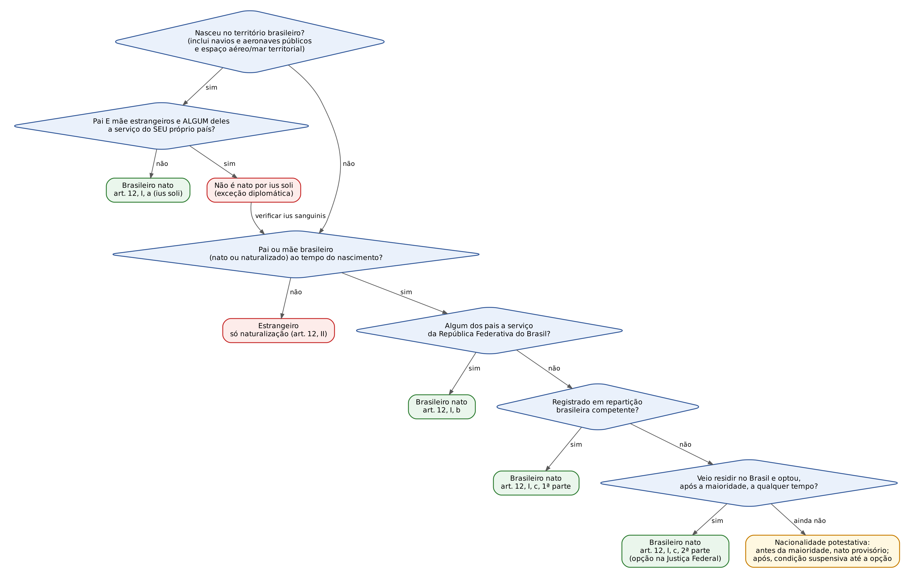
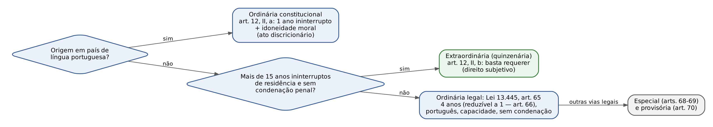
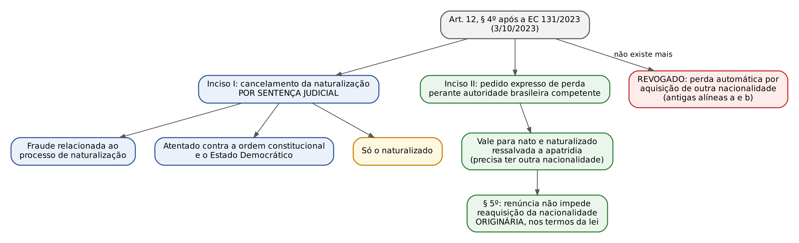
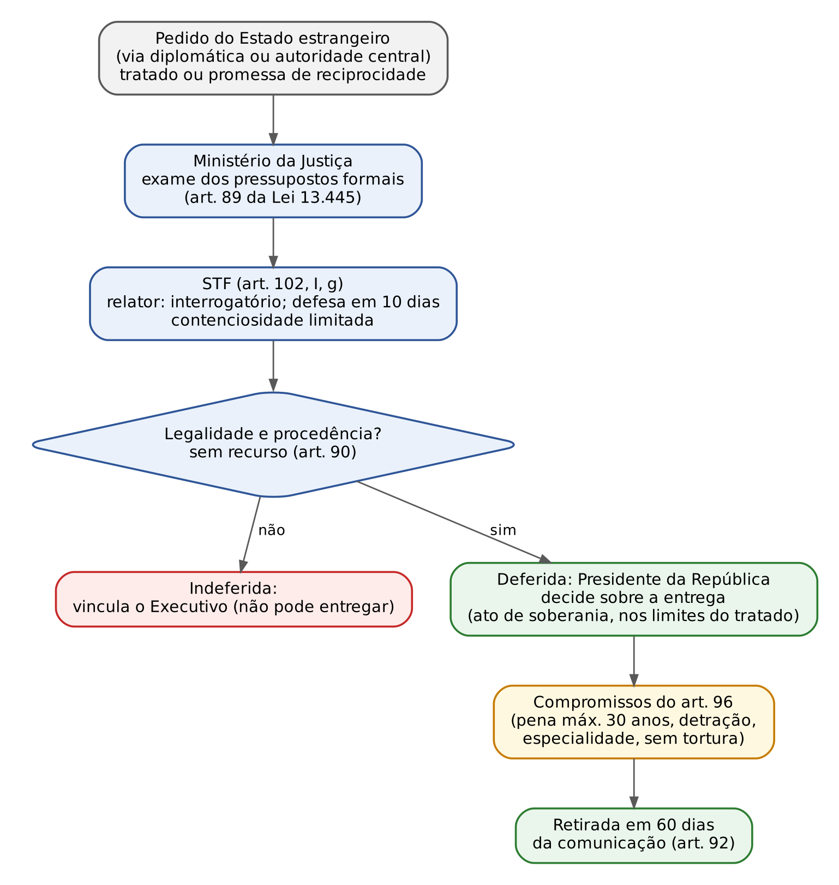

# CAPÍTULO 13 — NACIONALIDADE, CONDIÇÃO DO ESTRANGEIRO, EXTRADIÇÃO, IDIOMA E SÍMBOLOS

:::INCIDENCIA
Pontos: TJRS p. 4; TJSC p. 15 (no TRF5, o tema aparece nas provas FGV de juiz federal pelo caminho dos direitos fundamentais e da extradição).
Nível A. Lote: 90 questões (FGV 53, FCC 37), quase todas casos práticos de art. 12.
O que mais cai: identificar o nato pelo art. 12, I (com a armadilha da expressão "a serviço de seu país"), cargos privativos de nato, perda após a EC 131/2023 e extradição de nato x naturalizado x estrangeiro.
:::

| Subtema | FGV | FCC | Padrão de cobrança |
|---|---|---|---|
| Nato x estrangeiro (art. 12, I), opção e cargos privativos | 25 | 26 | Caso com família: onde nasceu, de quem, a serviço de quem; depois, "pode ser Presidente/diplomata/Ministro do STF?" |
| Perda e reaquisição (art. 12, §§ 4º e 5º) | 10 | 7 | Naturalização voluntária no exterior não gera mais perda; pedido expresso só com outra nacionalidade; reaquisição ORIGINÁRIA |
| Extradição (art. 5º, LI e LII) | 11 | 3 | Nato nunca; naturalizado só crime comum anterior ou tráfico a qualquer tempo; estrangeiro, salvo crime político ou de opinião |
| Naturalização (art. 12, II) e quase nacionalidade | 7 | 1 | 1 ano + idoneidade para lusófonos; 15 anos sem condenação para os demais; casamento não naturaliza |

## 13.1 Nacionalidade: conceito, natureza e critérios

Nacionalidade é o vínculo jurídico-político de Direito Público interno que liga a pessoa a um Estado, tornando-a componente do povo (dimensão pessoal do Estado). Três distinções que a FGV explora em alternativas "conceituais":

- Povo (conjunto de nacionais) x população (conceito demográfico: todos os que estão no território, nacionais ou não) x nação (comunidade sociocultural, que pode não coincidir com o Estado).
- Nacionalidade x cidadania: cidadania, no sentido técnico do Direito Constitucional brasileiro, é a titularidade de direitos políticos e pressupõe a nacionalidade (art. 14, § 2º, e § 3º, I). Todo cidadão é nacional; nem todo nacional é cidadão (a criança brasileira, o conscrito durante o serviço militar obrigatório, quem tem direitos políticos suspensos). O português equiparado é a exceção (ver 13.4). A disciplina da cidadania é do Cap. 14.
- Nacionalidade x naturalidade: naturalidade é só o lugar de nascimento.

A nacionalidade é DIREITO FUNDAMENTAL (Capítulo III do Título II; art. 15 da Declaração Universal), o que explica três escolhas da Constituição e da Lei 13.445/2017: vedação de que a perda gere apatridia (art. 12, § 4º, II), possibilidade de reaquisição (art. 12, § 5º) e o instituto protetivo do apátrida, com naturalização simplificada (art. 26 da Lei de Migração).

:::DOUTRINA
Classificação clássica: nacionalidade primária (originária, de origem ou atribuída), imposta unilateralmente pelo Estado a partir de um fato natural (o nascimento), independentemente da vontade, e nacionalidade secundária (adquirida, derivada), que decorre de ato de vontade do interessado e de aquiescência do Estado (naturalização). Na primária, o Estado escolhe o critério: ius soli (território do nascimento, típico de países de imigração) ou ius sanguinis (filiação, típico de países de emigração). O Brasil adota sistema MISTO: o ius soli é a regra (art. 12, I, a), temperado por hipóteses de ius sanguinis acompanhado de requisito adicional (serviço do Brasil, registro ou residência mais opção — art. 12, I, b e c). Não há no Brasil hipótese de ius sanguinis puro, isto é, sem o requisito adicional: essa é a armadilha das alternativas que afirmam ser nato "o filho de brasileiro nascido no exterior", sem mais. Na Q2375668 (FGV, 2024), o item II ("os nascidos no estrangeiro que, na forma da lei, adquiram a nacionalidade brasileira, são brasileiros natos") é falso porque descreve a naturalização; corretos os itens I (ius soli com a exceção) e III (alínea b) — gabarito C. No mesmo sentido, Q3038836 (FGV, 2024: gabarito A, alínea b; as alternativas C e E chamam de "naturalizados" os casos da alínea c, e a D chama de "natos" os naturalizados).
:::

Conflitos de nacionalidade: o positivo gera a polipatria (dupla ou múltipla nacionalidade), admitida pelo Brasil; o negativo gera a apatridia (*heimatlos*), que o constituinte de 2023 passou a combater textualmente. Exemplo clássico de polipatria: filho de italianos nascido no Brasil é brasileiro nato (ius soli) e pode ser italiano (ius sanguinis da lei italiana).

Repartição de poder normativo e jurisdicional (cada item é pegadinha autônoma):

| Aspecto | Regra | Fundamento |
|---|---|---|
| Hipóteses de nacionalidade PRIMÁRIA | Só a Constituição: rol taxativo; lei não cria brasileiro nato | Art. 12, I |
| Legislar sobre nacionalidade, cidadania e naturalização | Competência PRIVATIVA da União | Art. 22, XIII |
| Emigração, imigração, entrada, extradição e expulsão de estrangeiros | Competência PRIVATIVA da União | Art. 22, XV |
| Lei delegada | Vedada sobre nacionalidade e cidadania | Art. 68, § 1º, II |
| Medida provisória | Vedada sobre nacionalidade e cidadania | Art. 62, § 1º, I, a |
| Omissão normativa | Mandado de injunção para as "prerrogativas inerentes à nacionalidade" | Art. 5º, LXXI |
| Causas referentes à nacionalidade, INCLUSIVE a opção, e à naturalização | Juízes federais | Art. 109, X |
| Extradição solicitada por Estado estrangeiro | STF, originariamente | Art. 102, I, g |
| Distinção entre natos e naturalizados | Só a Constituição (lei não pode) | Art. 12, § 2º |

:::PEGADINHA
A FCC já perguntou se é competência COMUM legislar sobre nacionalidade, cidadania e naturalização (Q3891288, classificada no Cap. 22): é privativa da União (art. 22, XIII). E a alternativa sobre competência dos juízes federais que diz "EXCETO a respectiva opção" está errada: o art. 109, X, diz "INCLUSIVE a respectiva opção".
:::

## 13.2 Brasileiros natos (art. 12, I)

:::LEI CF, ART. 12, I
"São brasileiros: I - natos: a) os nascidos na República Federativa do Brasil, ainda que de pais estrangeiros, desde que estes não estejam a serviço de seu país; b) os nascidos no estrangeiro, de pai brasileiro ou mãe brasileira, desde que qualquer deles esteja a serviço da República Federativa do Brasil; c) os nascidos no estrangeiro de pai brasileiro ou de mãe brasileira, desde que sejam registrados em repartição brasileira competente ou venham a residir na República Federativa do Brasil e optem, em qualquer tempo, depois de atingida a maioridade, pela nacionalidade brasileira;" (alínea c com a redação da EC 54/2007).
:::

### 13.2.1 Alínea a: ius soli e a exceção diplomática

Regra: nasceu no território brasileiro, é nato, sejam os pais brasileiros, estrangeiros, residentes, turistas, em trânsito, em situação migratória irregular ou trabalhando para empresa privada. Território, aqui, é o território jurídico: solo, subsolo, mar territorial, espaço aéreo e navios e aeronaves públicos brasileiros onde quer que estejam; navios e aeronaves privados de bandeira brasileira em alto-mar ou no espaço aéreo correspondente costumam ser incluídos pela doutrina pela mesma lógica da extensão do território. O nascimento em navio de bandeira ESTRANGEIRA em alto-mar não é nascimento no Brasil (Q3505816, adiante).

Exceção: não é nato pelo ius soli quem nasce no Brasil de pais estrangeiros quando "estes" estejam "a serviço de SEU país". Três requisitos cumulativos, cada um deles explorado pela FGV:

1. Os pais devem ser ESTRANGEIROS. Se um deles é brasileiro, a exceção nem se cogita: o filho é nato.

2. O serviço deve ser prestado ao PRÓPRIO país do genitor (embaixada, consulado, missão oficial). Serviço a TERCEIRO Estado ("a serviço da embaixada da Índia", sendo os pais americanos e espanhóis) não afasta o ius soli: o filho é nato.

3. O serviço deve ser PÚBLICO, ao Estado estrangeiro. Trabalhar para empresa estrangeira, multinacional ou montadora sediada no exterior não é estar "a serviço de seu país": o filho é nato.

:::ATENCAO
A extensão do requisito 1 é discutida quando só um dos genitores está a serviço de seu país e o outro é estrangeiro de outra nacionalidade. A leitura predominante nos manuais é que basta um dos pais estrangeiros estar a serviço do próprio Estado para atrair a exceção (é o raciocínio das imunidades diplomáticas, que se estendem à família). A FGV, porém, considerou nato o filho de pai italiano e mãe espanhola que estavam no Brasil "a serviço da embaixada da Espanha" (Q3171382, PC-MG, Delegado, 2025: gabarito PRELIMINAR C, impugnado em recursos que sustentavam a letra B — estrangeiro, extraditável; o desfecho do recurso não foi conferido). Para a prova, reconheça os dois cenários: (i) pais da MESMA nacionalidade a serviço do próprio país: não é nato (gabarito pacífico); (ii) pais a serviço de TERCEIRO país: é nato (gabarito pacífico). O cenário misto é zona cinzenta; registre a divergência se for discursiva.
:::

:::QUESTAO FGV 2025 — TRF 5ª REGIÃO — JUIZ FEDERAL SUBSTITUTO (Q3373838)
Caso: Ana nasceu na França, filha de brasileiro e russa que lá trabalhavam para indústria privada, e se naturalizou francesa aos 18; Maria nasceu no Brasil, filha de indianos que trabalhavam na embaixada ESPANHOLA. Ambas, com 19 anos, passam a residir no Brasil. Pergunta: condição de nacionalidade para elegibilidade.
Passo 1 — Maria: nasceu no Brasil; pais estrangeiros a serviço de TERCEIRO Estado; exceção não incide: nata (alínea a).
Passo 2 — Ana: nasceu no exterior, filha de brasileiro, sem serviço ao Brasil e sem registro: só lhe resta a alínea c, segunda parte (residência + opção). A naturalização francesa é irrelevante: antes da opção ela não era brasileira e, depois da EC 131, aquisição de outra nacionalidade não gera perda.
Gabarito: B (Ana pode optar; Maria é nata).
Armadilha: a alternativa que trata Ana como "estrangeira que deve se naturalizar" ignora a via da opção, e a que trata ambas como natas ignora que a alínea c exige ato do interessado.
:::

:::QUESTAO FGV 2025 — TRF 6ª REGIÃO — JUIZ FEDERAL SUBSTITUTO (Q3742346)
Caso: pedido de extradição de Johan, processado no Estado Sigma por críticas às instituições; nasceu no Brasil, filho de norte-americano e espanhola que trabalhavam na embaixada INDIANA; depois obteve, a pedido, a nacionalidade de Sigma.
Passo 1: serviço a terceiro Estado não atrai a exceção: Johan é brasileiro nato.
Passo 2: a naturalização voluntária em Sigma não acarreta perda (art. 12, § 4º, após a EC 131/2023).
Passo 3: nato não é extraditado em hipótese alguma (art. 5º, LI).
Gabarito: B (não pode ser deferida, considerando a nacionalidade).
Armadilha: a alternativa C (natureza do crime: opinião) também descreveria um óbice verdadeiro, mas a banca pediu o fundamento DETERMINANTE; o óbice da nacionalidade é absoluto e prévio. No mesmo sentido do Passo 1: Q4378303 (FGV, PC-PR, 2026: pais canadense e argelina a serviço da embaixada espanhola, gabarito A, nato), Q3883087 (FGV, AL-RO, 2026: pais alemães a serviço da embaixada russa; naturalização argentina não afeta; gabarito C), Q3914342 (FGV, TJ-MS cartórios, 2026: pais turcos a serviço da embaixada alemã; nata, podendo renunciar; gabarito E), Q3345905 (FGV, TJ-GO, 2025: pais holandês e norte-americana em missão do governo indiano; gabarito A).
:::

:::QUESTAO FGV 2025 — DPE-PE — DEFENSOR PÚBLICO (Q3390817)
Caso: Maria, 19 anos, quer ajuizar ação popular sem título de eleitor; nasceu no Brasil quando os pais tibetanos aqui estavam IRREGULARMENTE; foi para a Suíça após a deportação dos pais, naturalizou-se suíça aos 18 e voltou ao Brasil.
Resolução: irregularidade migratória dos pais é irrelevante para o ius soli; a naturalização suíça não gerou perda. Maria é nata e pode alistar-se (e, alistada, propor ação popular — art. 5º, LXXIII, exige cidadão).
Gabarito: D. Armadilha: alternativas que condicionam o alistamento à opção (que é instituto da alínea c, não da alínea a) ou à naturalização.
:::

Cobranças repetidas da alínea a, todas com o mesmo raciocínio (nato; a permanência posterior no exterior, a ausência de registro e a aquisição voluntária de outra nacionalidade são irrelevantes):

- Pais em férias, turismo ou visita a parentes: Q4395373, Q4240000 (Giuseppe), Q4221389, Q4092714 (Otto), Q3868579, Q3742940, Q3660498, Q3538950, Q3469428, Q3445901, Q3303224, Q3216594, Q3170848, Q3089783, Q2489707.
- Pais trabalhando para empresa privada estrangeira ou residindo no Brasil: Q3841661 (FGV, sociedade empresária italiana; gabarito B), Q2512420 (indústria alemã; gabarito A — sem necessidade de registro), Q2456641 (montadora alemã; naturalização mexicana não fez perder; gabarito A), Q3888386 (FCC, pais vendedores; nato que pode pedir perda; gabarito E), Q3214712 (Estela, nata; o irmão nascido no Chile não), Q3872166 (filha de estudante estrangeira; nata e pode ser Senadora), Q2362703 (pais alemães a serviço da embaixada da ITÁLIA; gabarito B, nato).
- Pais estrangeiros no Brasil por acidente da viagem (pane do navio): Q3363381 (FGV, SEFAZ-PR, 2025; gabarito D: nata pelo ius soli, sem outro requisito, nacionalidade não afetada pela naturalização sudanesa).
- Pais a serviço de TERCEIRO Estado: Q3976708 (FCC, 2026: Matt, filho de canadenses a serviço da Venezuela, é nato e pode ser diplomata; Ana Paula, alínea b, pode ser Ministra da Defesa; Ralph, filho de turistas ingleses, pode presidir a Câmara; gabarito C).
- Pai brasileiro e mãe estrangeira em visita: Q3445901 (gabarito A: nato e pode ser Ministro da Defesa).
- Renúncia anterior do pai: Q2565230 (FGV, TCE-PA, 2024: o pai renunciara à nacionalidade brasileira antes do nascimento, mas a filha nasceu NO BRASIL de pais a serviço de multinacional; gabarito A, nata — o status dos pais só importa para a alínea a quando estão a serviço do próprio Estado).

Casos em que a exceção INCIDE (não é nato pelo ius soli): pais estrangeiros a serviço do PRÓPRIO país — Q4231755 (Pilar, filha de chilenos a serviço do Chile; não pode ser oficial das Forças Armadas; Cacilda, filha de brasileiros estudantes nos EUA, sem registro, só será nata se vier a residir e optar; gabarito C), Q3872033 (Alessandra, filha de espanhóis a serviço da Espanha: não é nata; gabarito D), Q3627582 (Luiz Eduardo, pais a serviço do "seu país de origem": não é nato), Q3469428 (Verônica, mãe a serviço da Alemanha: não é nata; gabarito E), Q3170848 (Rogério, pais a serviço da Colômbia: "não é brasileiro"; gabarito A), Q3028697 (FGV: pais espanhóis a serviço da embaixada espanhola; estrangeira, extraditável; gabarito A), Q2515290 (FGV, TJ-SC, 2024: pais espanhóis a serviço da embaixada da Espanha; Rebeca só se naturalizada poderá alistar-se e concorrer, inclusive a Senadora; gabarito B).

:::PEGADINHA
Q2515290 (TJ-SC) combina duas armadilhas: (i) Rebeca, filha de diplomatas espanhóis, não é nata nem pode "optar" (opção é só para filho de brasileiro); (ii) naturalizada, pode alistar-se e disputar quase todos os cargos, inclusive o de SENADORA (cargo privativo de nato é o de PRESIDENTE do Senado, não o de senador).
:::

### 13.2.2 Alínea b: ius sanguinis + serviço da República Federativa do Brasil

Nasceu no exterior, filho de pai OU mãe brasileiros (basta um), estando QUALQUER deles a serviço da República Federativa do Brasil: nato, sem registro, sem residência, sem opção. Detalhes cobrados:

- O genitor brasileiro pode ser nato ou NATURALIZADO (a Constituição diz "pai brasileiro ou mãe brasileira"; distinção não autorizada não se presume — art. 12, § 2º).
- "Qualquer deles": basta que um dos pais esteja a serviço do Brasil, e a leitura corrente exige que seja o genitor brasileiro (o estrangeiro, em regra, não está a serviço da República). A nacionalidade do outro genitor é irrelevante (Q3169933: mãe não brasileira; Q4092714: pai inglês vendedor).
- "Serviço da República Federativa do Brasil" abrange administração direta e indireta de qualquer ente federativo (doutrina majoritária: União, Estados, DF, Municípios, autarquias, empresas estatais), e não só a carreira diplomática. Serviço a empresa PRIVADA brasileira não basta (Q3099297).
- Serviço a OUTRO país, ainda que o genitor seja brasileiro, não basta (Q3898946, Q3029102, Q2486001, Q2759004).

:::QUESTAO FCC 2025 — TRT 15ª REGIÃO — ANALISTA JUDICIÁRIO (Q3295818)
Robson, brasileiro a serviço do Brasil no exterior, casado com estrangeira; lá nascem Francisco e Melissa; Robson adquire a nacionalidade local e quer deixar de ser brasileiro.
Gabarito: E — Robson pode ter declarada a perda mediante pedido expresso (tem outra nacionalidade, sem risco de apatridia); os filhos são natos pela alínea b e podem ser Ministro do STF (privativo de nato) e Ministra do STJ (não privativo).
No mesmo sentido (alínea b, nato, apto a cargos privativos): Q3169933 (Jarbas: mãe não brasileira é irrelevante; gabarito A), Q3089705 (Josué; Ministro da Defesa; gabarito E), Q2564484 (Níveo; carreira diplomática; gabarito E), Q3891283 (Josué nato, pode pedir perda; Igor, filho de brasileiro sem serviço ao Brasil, sem registro e sem residência, não é nato; gabarito D), Q3976708 (Ana Paula; Ministra da Defesa), Q4240000 (Fiorella; Governadora não é cargo privativo; gabarito B), Q4092714 (Fátima; mãe a serviço do Brasil, pai inglês vendedor; gabarito D), Q3216594, Q3303224, Q3089783, Q3660498, Q3469428, Q3872033, Q3170848, Q4395373 (Nicole, Alemanha).
:::

:::PEGADINHA
Na Q3169933 (FCC), a alternativa E diz que Jarbas, nato pela alínea b, "não poderá exercer o cargo de Presidente da República, pois não nasceu no Brasil". Errado: a Constituição não distingue natos entre si; todo nato, inclusive o da alínea c após a opção, pode ocupar qualquer cargo privativo.
:::

### 13.2.3 Alínea c: registro OU residência + opção (EC 54/2007)

Filho de pai ou mãe brasileiros (natos ou naturalizados), nascido no exterior, sem que nenhum deles esteja a serviço do Brasil. Duas vias ALTERNATIVAS:

| Via | Requisitos | Momento e natureza |
|---|---|---|
| Registro em repartição brasileira competente (consulado) | Só o registro | Nacionalidade nata desde o nascimento; não há opção, residência nem prazo |
| Residência + opção | Vir a residir no Brasil E optar, em qualquer tempo, depois de atingida a maioridade | Nacionalidade "potestativa"; a opção é ato personalíssimo, formalizado em processo judicial na Justiça Federal (art. 109, X), de jurisdição voluntária |

Histórico cobrável em uma linha: a ECR 3/1994 suprimira a via do registro, gerando "brasileirinhos apátridas"; a EC 54/2007 a restabeleceu, e o art. 95 do ADCT permitiu o registro dos nascidos entre 7/6/1994 e a promulgação da EC 54 "se vierem a residir" no Brasil.

:::JURIS STF, RE 415.957, TURMA, J. 23/8/2005 (INFO 398)
A opção do art. 12, I, c, é personalíssima e só pode ser exercida após a capacidade plena. Antes da maioridade, o filho de brasileiro registrado provisoriamente e residente no País é considerado brasileiro nato para todos os efeitos; atingida a maioridade, enquanto não manifestada a opção, esta passa a funcionar como CONDIÇÃO SUSPENSIVA da nacionalidade brasileira.
:::

Consequências práticas da natureza potestativa (todas em gabaritos FGV):

- Antes da opção (e após a maioridade), o interessado ainda não é tratado como brasileiro: daí o padrão de alternativa correta "é estrangeiro, mas será considerado brasileiro nato se optar a qualquer tempo" (Q3898946, TJ-PR, Juiz Substituto, 2026, gabarito C; Q3265469, gabarito C; Q2486001, AL-SC, gabarito C; Q3029102, gabarito D; Q2515927, gabarito E).
- Feita a opção, a nacionalidade é NATA, não naturalizada; e os efeitos retroagem ao nascimento (doutrina corrente). Por isso alternativas que dizem "brasileiro naturalizado, desde que venha a residir e opte" estão erradas (Q2564657, Q3038836).
- Não há prazo para optar ("em qualquer tempo"), nem tempo mínimo de residência. Alternativas com "quinze anos", "um ano" ou "dentro do prazo de um ano" estão erradas (Q4231755, alternativa A; Q2448937, alternativa E).
- A condição dos pais é aferida AO TEMPO DO NASCIMENTO: perda posterior da nacionalidade pelos pais (cancelamento da naturalização) não impede a opção do filho nascido quando eram brasileiros (Q2759004, Q2515927, Q3592119); se, ao contrário, a mãe só se naturalizou brasileira DEPOIS do nascimento, não há alínea c (raciocínio inverso, cobrado em Q4150685, onde a mãe se naturalizou brasileira ANTES da concepção, gabarito B: pode optar).
- Extradição pendente a opção: o STF suspendeu processo extradicional até a decisão definitiva da Justiça Federal sobre a opção, sem reconhecer de plano a condição de nato (STF, Ext 880, Plenário, j. 25/9/2003). É a lógica das alternativas "estrangeira, mas não pode ser extraditada caso opte" (Q2759004, gabarito C; Q3592119, gabarito B).

:::QUESTAO FGV 2026 — TJ-PR — JUIZ SUBSTITUTO (Q3898946)
Ana nasceu na Turquia, filha de brasileiros NATURALIZADOS que trabalhavam na embaixada ALEMÃ; registrada só no registro civil turco; aos 18 anos passa a residir no Brasil e quer exercer atividade privativa de brasileiros.
Passo 1: pais brasileiros (naturalizados contam); serviço a outro país: não há alínea b.
Passo 2: sem registro consular: não há alínea c, primeira parte.
Passo 3: residência + opção: via aberta.
Gabarito: C (estrangeira, mas será considerada brasileira nata caso opte a qualquer tempo).
Armadilha: a alternativa E (naturalização) descreve via possível, porém não a correta para quem tem direito à nacionalidade originária; a alternativa A ignora que a opção é requisito.
:::

:::QUESTAO FGV 2025 — TCE-RR — AUDITOR (Q3186464)
João, 30 anos, quer ser governador; nasceu no Líbano, filho de alemã naturalizada brasileira e de espanhol, a serviço da embaixada ESPANHOLA; obteve a nacionalidade albanesa e reside no Brasil há um ano.
Gabarito: A — pode concorrer, desde que opte (alínea c, segunda parte; 30 anos é a idade mínima para governador, art. 14, § 3º, VI, b). A nacionalidade albanesa é irrelevante. No mesmo sentido: Q4150685 (FGV, TJ-SC, Analista, 2026: Joana pode optar e, com 21 anos, concorrer a prefeita; gabarito B), Q3777896 (FGV, AL-AM: Joanne nata pela alínea a; Isabelle, filha de brasileiros a serviço de indústria e registrada só na repartição alemã, pode optar; gabarito E).
:::

:::QUESTAO FCC 2024 — PREFEITURA DE JABOATÃO DOS GUARARAPES — PROCURADOR (Q3542086)
Brasileira nata casada com estrangeiro naturaliza-se voluntariamente no país do marido. Pergunta-se se perde a nacionalidade e qual a situação dos filhos que nascerem no exterior.
Gabarito: D — só perde se fizer pedido expresso perante autoridade brasileira competente, ressalvada apatridia (EC 131/2023); os filhos nascidos no exterior serão natos se registrados em repartição brasileira competente.
Armadilha: a alternativa C troca o registro pela opção como se fosse via única; a A e a E repetem o regime revogado (perda pela naturalização voluntária).
:::

### 13.2.4 Filho adotivo nascido no exterior (Tema 1.253)

:::JURIS STF, RE 1.163.774/MG, RELATORA MINISTRA CÁRMEN LÚCIA, PLENÁRIO, J. 12/3/2026 (REPERCUSSÃO GERAL, TEMA 1.253; INFO 1208)
Tese: "É assegurado o direito à nacionalidade brasileira originária à pessoa nascida no exterior, adotada por pessoa brasileira e registrada em órgão consular competente, nos termos da alínea c do inciso I do art. 12 c/c o § 6º do art. 227 da Constituição da República."
Ratio: a igualdade entre filhos (art. 227, § 6º) não se limita ao Direito de Família; alcança todos os direitos fundamentais, inclusive a nacionalidade. As instâncias ordinárias haviam negado o pedido sob o argumento de que a alínea c pressupõe vínculo biológico.
:::

Leitura de prova: a "filiação" da alínea c inclui a adotiva; preenchido o registro consular (ou, por coerência, residência mais opção), o adotado é nato. O caso inverso, criança nascida no Brasil e adotada por estrangeiros, é resolvido pelo ius soli: continua nata, e a adoção não altera a nacionalidade (Q3304058, FCC, DPE-SP, 2025: Jaime, nascido em São Paulo e adotado por angolanos que não lhe deram nacionalidade, é "brasileiro nato, independentemente de qualquer condição", gabarito D).

### 13.2.5 Resolução em série: quem é nato?

:::PASSO ROTEIRO DE QUATRO PERGUNTAS (USE NESTA ORDEM)
1. Onde nasceu? No Brasil: vá à pergunta 2. No exterior: vá à pergunta 3.
2. Os DOIS pais são estrangeiros e algum deles está a serviço do PRÓPRIO Estado? Não: nato (a). Sim: não é nato por ius soli; se um dos pais for brasileiro, a exceção não incide.
3. Ao tempo do nascimento, pai ou mãe era brasileiro (nato ou naturalizado)? Não: estrangeiro; só naturalização. Sim: vá à pergunta 4.
4. Algum genitor brasileiro estava a serviço da República Federativa do Brasil? Sim: nato (b). Não: houve registro consular? Sim: nato (c, primeira parte). Não: só será nato se vier a residir e optar após a maioridade (c, segunda parte).
Depois disso, e só depois, verifique o cargo pretendido (13.5) e eventuais fatos posteriores (naturalização no exterior, pedido de perda, extradição).
:::

:::QUESTAO FGV 2025 — TJ-CE — JUIZ SUBSTITUTO (Q3505816)
Ana nasceu em alto-mar, em navio de bandeira estrangeira, filha de russa e angolano; ficou dois meses no Brasil para tratamento, foi para Angola, tem nacionalidades angolana e russa; aos 18 fixou residência no Brasil e, dois anos depois, cogita candidatar-se.
Passo 1: não nasceu em território brasileiro (navio estrangeiro em alto-mar) e não é filha de brasileiro: não é nata nem pode optar.
Passo 2: é originária de país de língua portuguesa (Angola): naturalização com um ano ininterrupto de residência e idoneidade moral (art. 12, II, a), requisitos já cumpridos.
Gabarito: C. Armadilhas: a alternativa D exige renúncia às demais nacionalidades (a Constituição não exige); a E aplica os 15 anos da naturalização extraordinária a quem tem via mais curta.
:::

## 13.3 Brasileiros naturalizados (art. 12, II)

:::LEI CF, ART. 12, II
"II - naturalizados: a) os que, na forma da lei, adquiram a nacionalidade brasileira, exigidas aos originários de países de língua portuguesa apenas residência por um ano ininterrupto e idoneidade moral; b) os estrangeiros de qualquer nacionalidade, residentes na República Federativa do Brasil há mais de quinze anos ininterruptos e sem condenação penal, desde que requeiram a nacionalidade brasileira." (alínea b com a redação da ECR 3/1994)
:::

Naturalização é a única forma de aquisição SECUNDÁRIA da nacionalidade brasileira. Depende sempre de requerimento: não há naturalização tácita, automática ou decorrente de casamento (as Constituições republicanas antigas conheceram a "grande naturalização" tácita; a de 1988 não). Quadro das modalidades:

| Modalidade | Fonte | Requisitos | Natureza do ato |
|---|---|---|---|
| Ordinária dos originários de países de língua portuguesa | Art. 12, II, a, parte final | Residência por UM ano ininterrupto + idoneidade moral (rol exauriente na própria CF: "apenas") | Concessão discricionária (doutrina e prática administrativa majoritárias) |
| Ordinária dos demais estrangeiros | Art. 12, II, a, primeira parte ("na forma da lei"); Lei 13.445, art. 65 | Capacidade civil; residência mínima de 4 anos; comunicar-se em português, consideradas as condições do naturalizando; não possuir condenação penal ou estar reabilitado | Discricionária |
| Ordinária com prazo reduzido | Lei 13.445, art. 66 | Residência mínima de 1 ano se tiver filho brasileiro, cônjuge ou companheiro brasileiro (sem separação legal ou de fato), serviço relevante ao Brasil ou capacidade profissional, científica ou artística | Discricionária |
| Extraordinária ou quinzenária | Art. 12, II, b; Lei 13.445, art. 67 | Residência há MAIS de 15 anos ININTERRUPTOS + SEM condenação penal + requerimento | Vinculada: direito público subjetivo do requerente |
| Especial | Lei 13.445, arts. 68 e 69 | Cônjuge ou companheiro, há mais de 5 anos, de integrante do Serviço Exterior Brasileiro em atividade ou de pessoa a serviço do Estado brasileiro no exterior; ou empregado em missão diplomática ou repartição consular do Brasil por mais de 10 anos ininterruptos | Discricionária |
| Provisória | Lei 13.445, art. 70 | Criança ou adolescente migrante que fixou residência antes dos 10 anos, por requerimento do representante legal; converte-se em definitiva se requerida no prazo de 2 anos após a maioridade | Discricionária |

:::DICA
"País de língua portuguesa" não é só Portugal: Angola, Moçambique, Cabo Verde, Guiné-Bissau, São Tomé e Príncipe, Timor-Leste e Guiné Equatorial (que adotou o português como uma de suas línguas oficiais) entram na regra do um ano. A FGV usa timorense, angolana e moçambicana nos casos. Nada de "países da América do Sul" (Q3425273, alternativa A) ou "africanos" em geral (alternativa E).
:::

:::QUESTAO FGV 2025 — TRF 1ª REGIÃO — JUIZ FEDERAL SUBSTITUTO (Q3425273)
Questão teórica sobre reciprocidade e isonomia na nacionalidade.
Gabarito: D — determinados cargos são privativos de brasileiros natos, em respeito à soberania e à identidade nacionais (art. 12, § 3º).
Armadilhas: A (benefício do um ano para sul-americanos: falso, é para lusófonos); B (idoneidade moral é conceito jurídico INDETERMINADO, e a regra é autoaplicável quanto aos lusófonos); C (a CF admite e até determina equiparação, com as ressalvas do § 2º); E (naturalização é aberta a estrangeiros de qualquer nacionalidade).
:::

:::QUESTAO FGV 2024 — AL-SC — ANALISTA LEGISLATIVO (Q2484690)
Maria, angolana, quer naturalizar-se.
Gabarito: A — somente deve preencher residência por um ano ininterrupto e idoneidade moral.
Armadilhas: B (a lei ordinária não pode acrescentar requisitos aos lusófonos: a CF diz "apenas"); D confunde naturalização com o estatuto de igualdade, que é só para portugueses; E (para a generalidade dos estrangeiros, os requisitos da via ordinária estão na LEI, não de modo exauriente na CF).
No mesmo sentido: Q2566539 (FGV, 2024: timorense com um ano de residência também precisa de idoneidade moral; gabarito B; a alternativa E chama de "quase-nacionalidade" o que é naturalização), Q3550569 (FCC, SEPLAN-PI, 2024: Gertrudes, lusófona com dois anos, pode; Kléber, com quase onze anos, não tem os quinze; gabarito D).
:::

:::QUESTAO FGV 2026 — ALERJ — ESPECIALISTA LEGISLATIVO (Q3883338)
Marie, belga, casada com brasileiro nato, reside no Brasil há mais de dezesseis anos, sem condenação.
Gabarito: C — preencheu os requisitos constitucionais da naturalização extraordinária; basta requerê-la.
Armadilhas: B (o casamento não naturaliza; na lei, apenas reduz o prazo da via ordinária — art. 66, III); D (o regime de um ano é só para lusófonos); E (os requisitos da via extraordinária estão exaustivamente na Constituição, e a lei não pode agravá-los).
:::

:::PEGADINHA
Os números que mais derrubam candidatos: um ano ININTERRUPTO (lusófonos); MAIS DE quinze anos ININTERRUPTOS (extraordinária); quatro anos (ordinária legal); dez anos (naturalizado para ser proprietário de empresa jornalística — art. 222); cinco anos (naturalização especial do cônjuge de servidor no exterior). FCC já ofereceu "mais de vinte anos" (Q3872166, alternativas A, D e E; gabarito C) e "mais de dez anos" (Q2564657) como requisito da extraordinária: ambos errados. "Sem condenação penal" é requisito da extraordinária; "idoneidade moral", da ordinária dos lusófonos — não se trocam.
:::

Efeitos da naturalização: são ex nunc e PESSOAIS. A naturalização não se estende automaticamente ao cônjuge nem aos filhos; os filhos que nascerem no exterior depois dela entram na alínea c (Q2486001, Q3265469); os nascidos ANTES, no exterior, não se tornam brasileiros (e os nascidos no Brasil já eram natos pelo ius soli — Q3233119: Evandro, filho do naturalizando Juan, nascido no Brasil, é nato). O naturalizado adquire cidadania potencial: pode alistar-se e ser votado para todos os cargos não privativos de nato (Q3009004, FGV, 2024: "poderá se tornar cidadão, podendo concorrer a cargos eletivos que não sejam privativos de brasileiro nato", gabarito E; Q3301281, FGV, TJ-SE, Juiz, 2025: naturalizada há um ano, com 18 anos, pode concorrer a vereadora, porque não há prazo de naturalização como condição de elegibilidade e 18 anos é a idade mínima para vereador; gabarito E — o capítulo da elegibilidade está no Cap. 14).

Competência e processo: o pedido é administrativo, perante o Ministério da Justiça (Lei 13.445, art. 71, com recurso em caso de denegação); o controle judicial é da Justiça Federal (art. 109, X). A tradução ou adaptação do nome à língua portuguesa pode ser requerida no curso do processo (art. 71, § 1º).

## 13.4 Quase nacionalidade: o português equiparado (art. 12, § 1º)

:::LEI CF, ART. 12, § 1º
"Aos portugueses com residência permanente no País, se houver reciprocidade em favor de brasileiros, serão atribuídos os direitos inerentes ao brasileiro, salvo os casos previstos nesta Constituição." (redação da ECR 3/1994)
:::

Elementos: (i) nacionalidade portuguesa (só portugueses: não os demais lusófonos, que têm apenas a naturalização facilitada); (ii) residência PERMANENTE no Brasil; (iii) RECIPROCIDADE em favor dos brasileiros em Portugal; (iv) requerimento — o estatuto não é automático. O português equiparado NÃO se torna brasileiro: continua estrangeiro, sem dupla nacionalidade e sem perda da portuguesa; recebe os direitos "inerentes ao brasileiro" — leia-se, ao brasileiro NATURALIZADO, porque os direitos exclusivos do nato ficam ressalvados ("salvo os casos previstos nesta Constituição").

A reciprocidade está regulada no tratado bilateral de amizade, cooperação e consulta promulgado pelo Decreto 3.927/2001. Segundo o serviço oficial do Ministério da Justiça, há dois níveis: igualdade de direitos e obrigações civis (residência por prazo indeterminado, capacidade civil, requerimento) e, além dela, gozo de direitos políticos, que exige três anos de residência e gozo de direitos políticos em Portugal. É por essa via que o português pode alistar-se e ser votado (exceção textual à vedação de alistamento de estrangeiros, art. 14, § 2º).

#### Português equiparado x lusófono naturalizado

| Aspecto | Português equiparado (art. 12, § 1º) | Lusófono naturalizado (art. 12, II, a) |
|---|---|---|
| Nacionalidade | Continua português (estrangeiro) | Torna-se brasileiro naturalizado |
| Requisitos | Residência permanente, reciprocidade, requerimento | Um ano ininterrupto, idoneidade moral, requerimento |
| Direitos | Os do brasileiro naturalizado; os políticos dependem de requisitos adicionais do tratado | Os do brasileiro naturalizado |
| Extradição | Como estrangeiro (salvo previsão do tratado) | Como naturalizado (art. 5º, LI) |
| Cargos privativos de nato | Vedados | Vedados |

## 13.5 Distinções entre natos e naturalizados (art. 12, § 2º)

Regra: "A lei não poderá estabelecer distinção entre brasileiros natos e naturalizados, salvo nos casos previstos nesta Constituição." As hipóteses constitucionais formam rol TAXATIVO, e são quatro (às vezes a banca fala em cinco, separando o art. 222 em propriedade e gestão):

| Distinção | Fundamento | Conteúdo |
|---|---|---|
| Cargos privativos de nato | Art. 12, § 3º | Sete cargos (abaixo) |
| Função no Conselho da República | Art. 89, VII | Seis cidadãos brasileiros NATOS, com mais de 35 anos, mandato de 3 anos, vedada a recondução (dois nomeados pelo Presidente, dois eleitos pelo Senado, dois pela Câmara) |
| Extradição | Art. 5º, LI | Nato nunca; naturalizado nas duas hipóteses do inciso |
| Propriedade e gestão de empresa jornalística e de radiodifusão | Art. 222, caput, §§ 1º e 2º | Privativa de natos ou naturalizados HÁ MAIS DE DEZ ANOS (ou PJ constituída sob leis brasileiras com sede no País); 70% do capital total e votante de natos ou naturalizados há mais de dez anos; responsabilidade editorial e seleção e direção da programação privativas dos mesmos |
| Perda da nacionalidade por cancelamento da naturalização | Art. 12, § 4º, I | Só alcança o naturalizado |

:::LEI CF, ART. 12, § 3º
"São privativos de brasileiro nato os cargos: I - de Presidente e Vice-Presidente da República; II - de Presidente da Câmara dos Deputados; III - de Presidente do Senado Federal; IV - de Ministro do Supremo Tribunal Federal; V - da carreira diplomática; VI - de oficial das Forças Armadas. VII - de Ministro de Estado da Defesa." (inciso VII incluído pela EC 23/1999)
:::

Lógica do rol (útil para a oral): linha sucessória da Presidência (Presidente, Vice, Presidentes da Câmara e do Senado e Ministros do STF, já que o Presidente do STF é o último da linha — art. 80) e segurança nacional e representação externa (diplomacia, oficialato, Ministério da Defesa).

:::PEGADINHA CARGOS QUE NÃO SÃO PRIVATIVOS DE NATO (OS MAIS USADOS COMO DISTRATOR)
Senador e Deputado (o privativo é PRESIDIR a Casa); Governador e Vice-Governador; Ministro do STJ, do TST, do TSE (salvo os que lá estão como Ministros do STF) e do TCU; Procurador-Geral da República; Advogado-Geral da União; demais Ministros de Estado (Fazenda, Justiça, Relações Exteriores); Presidente do Congresso Nacional como função autônoma (é exercida pelo Presidente do Senado, que já é nato); praça das Forças Armadas; Comandantes estaduais da Polícia Militar; magistrado e membro do Ministério Público em geral. Para Presidente da República, Senador, Deputado e Governador, o que a CF exige é NACIONALIDADE BRASILEIRA como condição de elegibilidade (art. 14, § 3º, I); a exigência de nato para Presidente e Vice vem do § 3º do art. 12.
:::

:::QUESTAO FGV 2025 — CPRM — ANALISTA (Q3757894)
José, naturalizado, considera os cargos de Ministro da Defesa, Ministro da Fazenda e Governador.
Gabarito: D (II e III). Ministro da Defesa é privativo de nato desde a EC 23/1999.
No mesmo sentido, quanto aos cargos: Q4221389 (FCC, SEFAZ-CE, 2026: só Adamastor, nascido no Brasil, pode ser Ministro do STF; a irmã nascida na Alemanha, filha de alemães, nem por naturalização; gabarito B), Q3538950 (FCC, TRF4, 2025: Marcel, nato pelo ius soli, pode ser Ministro do STF; gabarito A), Q3214712 (FCC, TRT6: só Estela; gabarito B), Q3660498 (FCC, TRT2: Santiago, Ariane e Mariela, todos natos, podem ser Presidente; gabarito E), Q3089783 (FCC, TRT7: Javier e Catarina; gabarito D), Q3627582 (FCC, TRT2: nenhum pode ser diplomata — Luiz Eduardo é filho de pais a serviço do país deles, Nancy não optou e Nicola é naturalizado; gabarito C), Q3216594 (FCC, TRT6: Juan e Carlos Eduardo, não a naturalizada Katrina; gabarito D), Q3303224 (FCC, TRT15: Douglas oficial das Forças Armadas e Maria Helena diplomata; gabarito C), Q3872033 (FCC, CPU-PE: só Matheus; Alessandra não é nata e Valentim é naturalizado; gabarito D), Q3872166 (FCC, CPU-PE: Senadora não é cargo privativo; gabarito C), Q2515290 (FGV, TJ-SC: senadora não é privativo; gabarito B).
:::

:::QUESTAO FGV 2026 — TJ-RJ — ANALISTA JUDICIÁRIO (Q3868579)
Peter, nato pelo ius soli (pais ingleses de férias), aos 30 anos volta a residir no Brasil, com dificuldade no idioma, e quer concorrer no ano seguinte.
Gabarito: D — pode concorrer a governador, mas não a senador. O obstáculo ao Senado é a IDADE (35 anos, art. 14, § 3º, VI, a), não a nacionalidade nem o idioma.
Armadilha: E (reciprocidade só importa para português equiparado); C (nato não se naturaliza).
:::

Correlatas de outros capítulos: Q2517208 (FGV, 2024, classificada no Cap. 14) — brasileira nata e naturalizada NÃO têm os mesmos direitos fundamentais (há as distinções do § 2º) e o estrangeiro residente não tem direitos políticos (gabarito E); Q3203632 (FGV, PC-MG, 2025, Cap. 7) — o estrangeiro titulariza os direitos fundamentais não privativos de brasileiros (gabarito D). As distinções do art. 222 aparecem em questões de comunicação social (Q2482702, Q3373871, Q3883300 — Cap. 36), sempre com a pegadinha do "mais de DEZ anos" trocado por quinze.

## 13.6 Perda e reaquisição da nacionalidade (art. 12, §§ 4º e 5º, após a EC 131/2023)

### 13.6.1 O que mudou

A EC 131, de 3/10/2023 (publicada no DOU de 4/10/2023, vigência na publicação), reescreveu o § 4º do art. 12 e acrescentou o § 5º. Sua ementa resume as três mudanças: suprimir a perda em razão da MERA aquisição de outra nacionalidade, incluir a ressalva da apatridia e prever o pedido de perda da própria nacionalidade.

:::LEI CF, ART. 12, §§ 4º E 5º (REDAÇÃO DA EC 131/2023)
"§ 4º - Será declarada a perda da nacionalidade do brasileiro que: I - tiver cancelada sua naturalização, por sentença judicial, em virtude de fraude relacionada ao processo de naturalização ou de atentado contra a ordem constitucional e o Estado Democrático; II - fizer pedido expresso de perda da nacionalidade brasileira perante autoridade brasileira competente, ressalvadas situações que acarretem apatridia. a) revogada; b) revogada. § 5º A renúncia da nacionalidade, nos termos do inciso II do § 4º deste artigo, não impede o interessado de readquirir sua nacionalidade brasileira originária, nos termos da lei."
:::

| Aspecto | Antes da EC 131/2023 | Depois da EC 131/2023 |
|---|---|---|
| Cancelamento da naturalização (inciso I) | Por sentença judicial, "em virtude de atividade nociva ao interesse nacional" | Por sentença judicial, em virtude de (a) FRAUDE relacionada ao processo de naturalização ou (b) ATENTADO contra a ordem constitucional e o Estado Democrático |
| Aquisição de outra nacionalidade | Causava perda, salvo reconhecimento de nacionalidade originária pela lei estrangeira (alínea a) ou naturalização imposta como condição de permanência ou de exercício de direitos civis (alínea b) | NÃO causa perda, em nenhuma hipótese; as alíneas foram revogadas |
| Pedido de perda (renúncia) | Não previsto no texto | Pedido expresso perante autoridade brasileira competente, ressalvada apatridia |
| Reaquisição | Só na lei (Lei 13.445, art. 76), discutindo-se se como nato ou naturalizado | § 5º: o renunciante pode readquirir a nacionalidade ORIGINÁRIA, nos termos da lei |

### 13.6.2 Cancelamento da naturalização (inciso I)

- Só atinge o NATURALIZADO. Nato não perde a nacionalidade por sanção, por mais grave que seja a conduta (Q3290897, alternativa A, errada: atentado à ordem constitucional por nato não gera perda).
- Exige SENTENÇA JUDICIAL (não basta decisão administrativa — Q3233119, alternativas C e E; Q2400454, alternativa E). A ação é de competência da Justiça Federal (art. 109, X), proposta pelo Ministério Público Federal (doutrina corrente). O art. 15, I, fala em "cancelamento da naturalização por sentença transitada em julgado" como causa de perda dos direitos políticos: a perda da nacionalidade pressupõe o trânsito.
- Causas TAXATIVAS: fraude no processo de naturalização ou atentado contra a ordem constitucional e o Estado Democrático. "Atividade nociva ao interesse nacional" é a fórmula REVOGADA, mas continua no art. 75 da Lei 13.445, ainda não atualizado (descompasso cobrável: o texto constitucional prevalece).
- Efeitos ex nunc e pessoais: os filhos não perdem a nacionalidade que já tinham; os nascidos no exterior enquanto o genitor era brasileiro conservam o direito de registro ou opção (Q2759004, Q2515927, Q3592119).
- Reflexo político: cancelada a naturalização, o ex-brasileiro volta a ser estrangeiro e perde os direitos políticos (art. 15, I) — Q2360663 (FGV, PC-SC, Delegado, 2024; Cap. 14): gabarito B, perda (não suspensão nem cassação). Para a doutrina majoritária, o naturalizado cuja naturalização foi cancelada não a readquire por novo pedido administrativo; só a desconstituição da sentença (ação rescisória) a restabelece. O § 5º (reaquisição) é exclusivo de quem RENUNCIOU (inciso II).

:::QUESTAO FCC 2024 — TRT 20ª REGIÃO — OFICIAL DE JUSTIÇA (Q3233119)
Juan, naturalizado mediante fraude no processo; Evandro, seu filho nascido no Brasil, quer renunciar para ter apenas a nacionalidade do pai.
Gabarito: A — Juan terá a naturalização cancelada por sentença judicial; Evandro, nato (ius soli), pode ter declarada a perda mediante pedido expresso, ressalvada apatridia.
Armadilhas: B e D mantêm a naturalização por inexistir "atentado" (a fraude é causa autônoma desde a EC 131); C e E admitem "decisão administrativa".
No mesmo sentido: Q3506141 (FCC, SEFAZ-PI, 2025: perda para Sandra, se cancelada a naturalização por sentença, e para Alexandre, que pediu a perda tendo nacionalidade italiana; não para Cláudia, que só se naturalizou alemã; gabarito C), Q2400454 (FCC, TRT11, 2024: gabarito C, literalidade dos §§ 4º, II, e 5º; a alternativa A troca "autoridade brasileira competente" por "autoridade judiciária" e nega a reaquisição).
:::

### 13.6.3 Pedido expresso de perda (inciso II): a "renúncia"

Requisitos: (i) brasileiro nato OU naturalizado; (ii) pedido EXPRESSO, isto é, ato de vontade formal, pessoal; (iii) perante AUTORIDADE BRASILEIRA COMPETENTE (administrativa — o Ministério da Justiça —, não judicial); (iv) que da perda não resulte APATRIDIA. O quarto requisito é o que decide a maior parte das questões: quem só tem a nacionalidade brasileira NÃO pode renunciar a ela; precisa primeiro adquirir outra.

:::QUESTAO FGV 2024 — TRF 1ª REGIÃO — TÉCNICO JUDICIÁRIO (Q3029928)
João, nato e sem outra nacionalidade, pede a perda por convicção filosófica.
Gabarito: B — não pode ser acolhido, pois João somente tem a nacionalidade brasileira.
Armadilhas: A e D tratam a nacionalidade como plenamente disponível ou dependente de juízo de conveniência; E diz que a ordem constitucional "não admite pedidos dessa natureza" (admite, desde a EC 131, com a ressalva da apatridia).
No mesmo sentido (só tem a nacionalidade brasileira: não pode renunciar AGORA; deve obter a outra primeiro): Q4079343 (FGV, PGE-AC, Procurador, 2026: "somente pode ser requerida caso adquira outra nacionalidade", gabarito D), Q3865749 (FGV, MPE-GO, Promotor, 2026: "não pode requerer a perda no presente momento", gabarito C), Q3846846 (FGV, PC-PI, 2026: gabarito C), Q3328178 (FGV, ENAC, 2025: pode requerer a nova nacionalidade, mas não renunciar antes; gabarito C), Q3114484 (FGV, TJ-MT, Oficial, 2024: não pode ser objeto de renúncia "na sua situação em particular"; gabarito D), Q3044157 (FGV, Prefeitura de Vitória, Procurador, 2024: "cidadão do mundo" sem outra nacionalidade; gabarito A), Q3099297 (FGV, Niterói, 2024: Maria, nascida no exterior de brasileiros a serviço de empresa privada, nunca registrada, nunca residente, ainda não é brasileira; se vier a adquirir a nacionalidade, poderá renunciá-la desde que tenha outra; gabarito D).
:::

:::PEGADINHA
Três fórmulas erradas recorrentes: "a nacionalidade é irrenunciável" (era a leitura de parte da doutrina antes da EC 131; hoje é falsa como regra absoluta); "a renúncia depende de sentença judicial" (é administrativa); "a renúncia é livre, conforme o juízo de valor do nacional" (há a ressalva da apatridia). E uma pegadinha de vocabulário: a Constituição não usa a palavra "renúncia" no § 4º, II ("pedido expresso de perda"), mas a usa no § 5º ("A renúncia da nacionalidade, nos termos do inciso II").
:::

### 13.6.4 Aquisição de outra nacionalidade: não gera mais perda

Depois da EC 131/2023, a naturalização voluntária no exterior, a obtenção de nacionalidade originária estrangeira (dupla cidadania por ascendência) e a naturalização imposta pela lei estrangeira têm o mesmo efeito: NENHUM sobre a nacionalidade brasileira. O brasileiro só a perde se, além disso, formular o pedido expresso do inciso II.

:::QUESTAO FCC 2025 — TRT 6ª REGIÃO — OFICIAL DE JUSTIÇA (Q3215719)
Paloma, nata, naturaliza-se italiana voluntariamente; Moisés, nato, naturaliza-se por imposição da lei estrangeira.
Gabarito: D — não será declarada a perda de nenhum dos dois.
Armadilha: as alternativas A, C e E aplicam o regime revogado (perda pela naturalização voluntária, ressalvada a imposição).
No mesmo sentido: Q2448937 (FGV, AL-PR, Procurador, 2024: José, nato, naturalizado no País X, não perde, salvo pedido expresso; gabarito B; a alternativa D é a velha alínea b), Q3089384 (FGV, Niterói, 2024: nata e NATURALIZADA que se naturalizam no país X conservam a nacionalidade brasileira; gabarito E — a regra vale também para o naturalizado), Q3542086 (já vista em 13.2.3), Q4395373 (FCC, 2026: Daniela, nata pelo ius soli, e Nicole, nata pela alínea b, podem pedir a perda SE tiverem outra nacionalidade; gabarito D).
:::

:::JURIS STF, MS 33.864, RELATOR MINISTRO ROBERTO BARROSO, PRIMEIRA TURMA, J. 19/4/2016, E EXT 1.462, RELATOR MINISTRO ROBERTO BARROSO, PRIMEIRA TURMA, J. 28/3/2017 (CASO DE DIREITO ANTERIOR À EC 131/2023)
Brasileira nata que, já titular de visto de residência permanente nos Estados Unidos, naturalizou-se norte-americana teve declarada a perda da nacionalidade por ato do Ministro da Justiça; o STF manteve o ato (MS 33.864, por maioria), entendendo não se tratar de naturalização imposta como condição de permanência (ela já tinha o *green card*) e, perdida a nacionalidade, deferiu a extradição requerida pelos EUA (Ext 1.462). O caso foi o principal motivo político da EC 131/2023. Hoje, a mesma conduta NÃO acarretaria perda; o precedente só tem valor histórico e para fatos consumados antes de 4/10/2023.
:::

:::ATENCAO DIREITO INTERTEMPORAL
A EC 131/2023 não diz se alcança perdas já declaradas. A leitura mais segura: perdas consumadas sob o regime anterior não se desfazem automaticamente; o interessado pode buscar a reaquisição (Lei 13.445, art. 76, e § 5º do art. 12, por analogia), ou a revogação do ato. Questões de 2024 a 2026 tratam a naturalização voluntária ocorrida antes da EC como irrelevante quando o enunciado não indica perda formalmente declarada (Q2456641, Q3883087, Q3363381). Na dúvida, verifique se o enunciado fala em perda "declarada".
:::

### 13.6.5 Reaquisição (art. 12, § 5º)

A renúncia do inciso II não impede a reaquisição da nacionalidade brasileira ORIGINÁRIA, nos termos da lei: o nato que renunciou volta como NATO, e não como naturalizado. A lei de regência ainda é a redação antiga do art. 76 da Lei 13.445 ("uma vez cessada a causa, poderá readquiri-la ou ter o ato que declarou a perda revogado, na forma definida pelo órgão competente do Poder Executivo"), escrita para a perda por aquisição de outra nacionalidade; é aplicada no que couber.

Questões: Q3888386 (FCC, MPE-AP, 2026: Murilo, nato com nacionalidade alemã, pode pedir a perda e a renúncia não impede que readquira a nacionalidade, nos termos da lei; gabarito E; a alternativa D afirma o impedimento), Q4092714 (FCC, MPE-AL, 2026: Fátima e Otto, natos com nacionalidade inglesa, podem ter declarada a perda e readquiri-la; gabarito D; a C fala em "expressa vedação legal"), Q4155300 (FCC, AL-RR, 2026: item I correto, literalidade dos §§ 4º, II, e 5º; item III errado, pois é vedada a CASSAÇÃO de direitos políticos — art. 15; item IV errado, pois é vedado aos partidos receber recursos de governo estrangeiro — art. 17, II; gabarito C), Q3290897 (FCC, Prefeitura de São Paulo, 2025: gabarito B; a C diz que a renúncia impede a reaquisição; a D chama o rol de cargos de "taxativo" incluindo Senador; a E aplica ao nato a ressalva do tráfico), Q3914342 (FGV, cartórios TJ-MS, 2026: Anne, nata, pode vir a renunciar, o que não ocorreu com a obtenção da nacionalidade guatemalteca; gabarito E).

:::QUESTAO FGV 2024 — TJ-AP — ANALISTA JUDICIÁRIO (Q2442295)
Maria, nata pelo ius soli (pais italianos a serviço de multinacional), foi para o exterior logo após o nascimento e "veio a renunciar à cidadania brasileira"; acusada de crime na Europa, fugiu para o Brasil.
Gabarito oficial: D — a reaquisição da nacionalidade brasileira é possível, nos termos da lei.
Comentário: a alternativa repete o § 5º e está correta em tese; o enunciado é impreciso ("cidadania" no lugar de nacionalidade, sem informar se a renúncia observou a ressalva da apatridia nem se foi feita após a capacidade civil). A armadilha está em C ("jamais foi brasileira"): era nata pelo ius soli. Se a renúncia foi válida, Maria hoje é estrangeira e pode ser extraditada, salvo crime político ou de opinião.
:::

## 13.7 Extradição e demais medidas de retirada compulsória

### 13.7.1 Conceito e espécies

Extradição (enfoque aqui: a nacionalidade do extraditando; visão de princípio em 06.7.2 e de garantia penal em 10.8.6) é a medida de cooperação internacional pela qual o Estado brasileiro entrega a outro Estado (passiva) ou dele solicita (ativa) pessoa sobre quem recaia condenação criminal definitiva (extradição executória) ou para fins de instrução de processo penal em curso (instrutória) — Lei 13.445, art. 81. A disciplina constitucional está nos incisos LI e LII do art. 5º e na competência originária do STF (art. 102, I, g).

:::LEI CF, ART. 5º, LI E LII
"LI - nenhum brasileiro será extraditado, salvo o naturalizado, em caso de crime comum, praticado antes da naturalização, ou de comprovado envolvimento em tráfico ilícito de entorpecentes e drogas afins, na forma da lei; LII - não será concedida extradição de estrangeiro por crime político ou de opinião;"
:::

| Pessoa | Regra | Exceção |
|---|---|---|
| Brasileiro nato | NUNCA é extraditado (inclusive o que tem dupla nacionalidade) | Nenhuma; a alternativa possível é a transferência da execução da pena ou o processo no Brasil (extraterritorialidade) |
| Brasileiro naturalizado | Não é extraditado | (a) crime comum praticado ANTES da naturalização; (b) comprovado envolvimento em tráfico ilícito de entorpecentes, ANTES OU DEPOIS da naturalização, na forma da lei |
| Estrangeiro (inclui o português equiparado e quem ainda não fez a opção) | Pode ser extraditado | Não por crime político ou de opinião; não se beneficiário de refúgio ou de asilo territorial (Lei 13.445, art. 82, IX) |

:::QUESTAO FCC 2025 — TRF 4ª REGIÃO — ANALISTA JUDICIÁRIO (Q3538763)
Bautista (naturalizado antes do envolvimento com tráfico), Juan (naturalizado depois) e Frederico (nato), todos com comprovado envolvimento em tráfico.
Gabarito: E — Bautista e Juan podem ser extraditados, independentemente de o envolvimento ser anterior ou posterior à naturalização; Frederico, nato, não.
Armadilha: D e A transplantam para o tráfico o marco temporal ("antes da naturalização"), que só existe para o crime comum.
No mesmo sentido: Q3530355 (FCC, MPE-PI, 2025: ambos extraditáveis por tráfico, ainda que naturalizados e independentemente do momento; gabarito B).
:::

:::QUESTAO FGV 2026 — EXTRADIÇÃO DE NATURALIZADO POR CRIME HEDIONDO POSTERIOR (Q3878420)
Mário, naturalizado, condenado definitivamente por extorsão mediante sequestro (hedionda) praticada DEPOIS da naturalização, foi extraditado.
Gabarito: A — agiram incorretamente: a CF só admite a extradição do naturalizado por crime comum anterior à naturalização ou por comprovado envolvimento em tráfico, na forma da lei. Hediondez não é exceção.
Armadilha: B ("crimes hediondos, na forma da lei complementar") e C e D (condenação definitiva por hediondo).
:::

:::QUESTAO FGV 2024 — TJ-MT — JUIZ SUBSTITUTO (Q3086979)
Johan, alemão naturalizado brasileiro, acusado de crime de OPINIÃO cometido na Alemanha antes da naturalização; dias antes do pedido, obteve a nacionalidade de país asiático.
Passo 1: a nacionalidade brasileira subsiste (a aquisição de outra não gera perda).
Passo 2: sendo naturalizado, só pode ser extraditado por crime COMUM anterior; crime de opinião não é comum — e, mesmo para estrangeiros, a extradição por crime político ou de opinião é vedada.
Gabarito: E (vedada pela natureza do crime, preservada a nacionalidade brasileira). Armadilhas: A e C (raciocínio do "crime anterior" sem verificar a natureza do crime); D (perda pelo regime revogado).
No mesmo sentido: Q3593198 (FGV, 2025: moçambicana acusada de crimes políticos, com pedido de naturalização pendente; o Brasil não extradita por crime político, ainda que anterior; gabarito B).
:::

Estrangeiros que não são, mas parecem natos, e natos que parecem estrangeiros — o eixo das questões FGV de extradição:

- Nato pelo ius soli, ainda que com outra nacionalidade e vivendo fora desde criança: não extraditável — Q3742940 (FGV, TJ-RS, Analista, 2025: Pedro, filho de belga e argentina em férias, com nacionalidade belga reconhecida; gabarito A), Q3395852 (FGV, DPE-RO, 2025: tráfico; nata; gabarito B — a alternativa E diz que a natureza do crime autorizaria), Q3171382 (FGV, PC-MG, 2025: tráfico; nato; gabarito preliminar C, impugnado — v. 13.2.1), Q2489707 (FGV, TJ-MS, 2024: naturalizada mexicana; nata; gabarito A).
- Filho de diplomatas estrangeiros nascido no Brasil: estrangeiro, extraditável — Q3028697 (FGV, TRF1, 2024; gabarito A — a C e a E sugerem que naturalização ou "opção" impediriam a extradição por tráfico, o que é falso: opção não cabe e o naturalizado é extraditável por tráfico).
- Filho de brasileiros naturalizados nascido no exterior, sem serviço ao Brasil e sem registro: estrangeiro até a opção; feita a opção, não extraditável — Q2759004 (FGV, EPE, 2024; gabarito C), Q3592119 (FGV, TCE-PE, Procurador, 2025; gabarito B; a alternativa E afirma que a naturalização não obstaria a extradição "qualquer que seja o crime" anterior, esquecendo o crime político; a D ignora que a via correta é a opção).
- Teoria: Q3089786 (FCC, TRT7, 2024: "em nenhuma hipótese um brasileiro nato será extraditado"; gabarito C; a B, naturalizado por crime comum "antes ou depois", é a pegadinha do marco temporal).

:::PEGADINHA
A Súmula 421 do STF dispõe que não impede a extradição a circunstância de ser o extraditando casado com brasileira ou ter filho brasileiro, e o STF a reafirmou sob a CF/1988 (Ext 1.201, Relator Ministro Celso de Mello, conforme o Dizer o Direito). O vínculo familiar com brasileiro impede a EXPULSÃO (13.8.3), não a extradição. Essa troca entre os dois institutos é clássica.
:::

### 13.7.2 Procedimento e controle (sistema de contenciosidade limitada)

:::PROCESSO EXTRADIÇÃO PASSIVA (LEI 13.445, ARTS. 81 A 99)
- Pedido por via diplomática ou por autoridades centrais, com base em tratado ou em promessa de reciprocidade (art. 81, § 1º; art. 84, § 2º).
- Prisão cautelar para extradição: pode ser requerida antes ou junto com o pedido, inclusive pela Interpol; o Estado tem 60 dias para formalizar o pedido, sob pena de soltura sem novo pedido de prisão pelo mesmo fato (art. 84, §§ 4º e 5º); a prisão pode durar até o julgamento final, admitidas prisão domiciliar, albergue ou liberdade com cautelares (art. 86).
- Juízo de admissibilidade formal pelo Ministério da Justiça (art. 89); não preenchidos os pressupostos, arquivamento fundamentado, sem prejuízo de renovação.
- STF: interrogatório, defesa em 10 dias, limitada à identidade da pessoa, defeito de forma dos documentos ou ilegalidade da extradição (art. 91, § 1º) — é a contenciosidade limitada: o STF não reexamina o mérito da acusação estrangeira, salvo para aferir prescrição, dupla tipicidade e natureza política do delito.
- Decisão sem recurso (art. 90). Indeferida, o Executivo não pode entregar. Deferida, cabe ao Presidente da República decidir sobre a entrega, nos limites do tratado (Ext 1.085, caso Battisti, Relator Ministro Cezar Peluso, Plenário, j. 16/12/2009: a decisão final sobre a entrega é ato político discricionário do Presidente, nos termos do tratado; e Rcl 11.243, Relator Ministro Gilmar Mendes, Plenário, j. 8/6/2011, Info 630, em que o STF reconheceu ser insindicável a recusa presidencial fundada no tratado).
- Entrega condicionada aos compromissos do art. 96: não processar nem prender por fato anterior ao pedido (especialidade), computar a prisão no Brasil (detração), comutar pena corporal, perpétua ou de morte em privativa de liberdade com limite de 30 anos (sobre o confronto com os 40 anos do art. 75 do Código Penal, na redação da Lei 13.964/2019, Ext 1.652, v. Cap. 6), não reextraditar sem consentimento, não agravar a pena por motivo político e não submeter a tortura ou tratamento cruel.
- Entrega voluntária possível, com advogado e advertência (art. 87). Retirada em 60 dias da comunicação (art. 92). Processado ou condenado no Brasil, a entrega aguarda o fim do processo ou da pena (art. 95).
:::

Condições negativas do art. 82 (as mais cobradas além da nacionalidade): fato não for crime no Brasil OU no Estado requerente (dupla tipicidade); competência brasileira para julgar o crime; pena de prisão inferior a 2 anos pela lei brasileira; litispendência ou coisa julgada no Brasil pelo mesmo fato; prescrição pela lei brasileira OU pela do Estado requerente; crime político ou de opinião (com as ressalvas do § 1º — preponderância do crime comum — e do § 4º — o STF pode não considerar político o atentado contra chefe de Estado, crimes contra a humanidade, de guerra, genocídio e terrorismo); tribunal de exceção; refúgio ou asilo territorial. A apreciação do caráter político cabe à autoridade judiciária (§ 2º).

:::JURIS STJ, HDE 7.986-EX, RELATOR MINISTRO FRANCISCO FALCÃO, CORTE ESPECIAL, J. 20/3/2024 (INFO 805)
Homologada a sentença penal italiana que condenou brasileiro nato, com transferência da execução da pena para o Brasil (Lei 13.445, art. 100). A transferência não viola o art. 5º, LI, pois não há entrega do nato a outro Estado; o art. 100 aplica-se a fatos anteriores à vigência da lei, por ser norma de cooperação internacional; a contenciosidade limitada impede a rediscussão do mérito da condenação.
:::

:::SENTENCA FUNDAMENTAÇÃO-MODELO (EXTRADIÇÃO DE QUEM ALEGA SER NATO PENDENTE A OPÇÃO)
"O extraditando nasceu no exterior, filho de mãe brasileira que não se encontrava a serviço da República, e não foi registrado em repartição consular. Sua nacionalidade, portanto, depende da opção do art. 12, I, c, segunda parte, da Constituição, ato personalíssimo cuja homologação compete à Justiça Federal (art. 109, X). Enquanto pendente o processo de opção, não é possível reconhecer desde logo a condição de brasileiro nato, mas tampouco é prudente prosseguir na entrega, sob pena de frustrar direito fundamental de natureza potestativa. Suspendo o processo extradicional até o trânsito em julgado da decisão sobre a opção, mantida a custódia em regime domiciliar."
:::

### 13.7.3 Extradição x outras medidas

| Medida | Natureza | Pressuposto | Quem decide | Alcança brasileiro? |
|---|---|---|---|---|
| Extradição | Cooperação penal internacional, a pedido de Estado | Crime (processo ou condenação) no exterior | STF (legalidade) e Presidente (entrega) | Naturalizado, nas hipóteses do art. 5º, LI; nato nunca |
| Entrega ao Tribunal Penal Internacional | Cooperação com jurisdição internacional (art. 5º, § 4º) | Crimes do Estatuto de Roma | Remissão ao Cap. 11 | Doutrina admite inclusive o nato ("entrega" não é "extradição") |
| Deportação | Medida administrativa | Situação migratória IRREGULAR; notificação com prazo mínimo de 60 dias para regularizar (art. 50) | Polícia Federal | Não |
| Expulsão | Medida administrativa, com impedimento de reingresso por prazo determinado | Condenação transitada em julgado por genocídio, crimes contra a humanidade, de guerra ou de agressão, ou crime comum doloso com pena privativa de liberdade (art. 54) | Ministério da Justiça | Não (seria banimento, vedado — art. 5º, XLVII, d) |
| Repatriação | Medida administrativa imediata | Pessoa em situação de impedimento na entrada (art. 49) | Polícia Federal | Não |

:::DICA
Expulsão ≠ extradição: não se expulsa se a medida configurar extradição inadmitida (art. 55, I), e não se expulsa quem tem filho brasileiro sob guarda ou dependência econômica ou socioafetiva, cônjuge ou companheiro residente no Brasil, quem ingressou até os 12 anos e reside desde então, ou quem tem mais de 70 anos e reside há mais de 10 (art. 55, II). Para a extradição, nada disso importa (Súmula 421).
:::

## 13.8 Condição jurídica do estrangeiro e Lei de Migração (aspecto constitucional)

### 13.8.1 Titularidade de direitos e restrições constitucionais

O caput do art. 5º garante os direitos fundamentais "aos brasileiros e aos estrangeiros residentes no País", mas a leitura literal está superada: o estrangeiro não residente, em trânsito ou em situação irregular titulariza os direitos inerentes à dignidade (vida, integridade, devido processo, *habeas corpus*) — a teoria da titularidade é do Cap. 7. Para este capítulo importa o inventário das DIFERENÇAS que a própria Constituição faz entre brasileiros e estrangeiros, porque só ela pode fazê-las de modo absoluto; a lei pode regular o acesso do estrangeiro onde a Constituição remete à lei.

| Matéria | Regra constitucional | Observação |
|---|---|---|
| Direitos políticos | Estrangeiros não podem alistar-se (art. 14, § 2º); nacionalidade brasileira é condição de elegibilidade (art. 14, § 3º, I) | Exceção: português equiparado com direitos políticos (13.4) |
| Ação popular | Só o cidadão (art. 5º, LXXIII) | Estrangeiro não pode propô-la — Q3215145 (FCC, TRT6, 2025; gabarito E) |
| Cargos, empregos e funções | Acessíveis aos estrangeiros "na forma da lei" (art. 37, I, EC 19/1998) | Norma de eficácia limitada quanto ao estrangeiro |
| Professores, técnicos e cientistas em universidades e instituições de pesquisa | "É facultado" admiti-los, na forma da lei (art. 207, §§ 1º e 2º, EC 11/1996) | Tema 1.032 (abaixo) |
| Assistência social (BPC) | Estrangeiros residentes são beneficiários (art. 203, V) | Tema 173 (abaixo) |
| Taxas de regularização migratória | Hipossuficiente é imune | Tema 988 (abaixo) |
| Propriedade rural | A lei regulará e limitará a aquisição ou arrendamento por pessoa física ou jurídica estrangeira e definirá os casos que dependem de autorização do Congresso (art. 190) | ADPF 342 e ACO 2.463 (abaixo) |
| Empresa jornalística e de radiodifusão | Privativa de natos, naturalizados há mais de dez anos ou PJ brasileira com sede no País (art. 222) | Lei disciplina o capital estrangeiro (§ 4º) |
| Sucessão de bens de estrangeiro situados no Brasil | Lei brasileira em benefício do cônjuge ou dos filhos brasileiros, sempre que não lhes seja mais favorável a lei pessoal do *de cujus* (art. 5º, XXXI) | Q3848789 (FCC, TRT2, 2025, Cap. 10; gabarito B) |
| Adoção por estrangeiros | Lei estabelece casos e condições (art. 227, § 5º) | Remissão à Apostila de Direito da Criança e do Adolescente |
| Navegação de cabotagem, capital estrangeiro, saúde, sistema financeiro | Arts. 178, parágrafo único, 172, 199, § 3º, 192 | Remissão aos Caps. 34 e 35 |

O estrangeiro aprovado em concurso para professor, técnico ou cientista de universidade ou instituição de pesquisa federal tem direito à nomeação, salvo restrição de nacionalidade expressa e justificada no edital (Tema 1.032, RE 1.177.699, v. Cap. 36; Q2367554, v. Cap. 24).

Os estrangeiros residentes no País são beneficiários do benefício de prestação continuada do art. 203, V (Tema 173, RE 587.970, v. Cap. 35).

:::JURIS STF, RE 1.018.911/RR, RELATOR MINISTRO LUIZ FUX, PLENÁRIO, J. 10/11/2021 (REPERCUSSÃO GERAL, TEMA 988; INFO 1037)
Tese: "É imune ao pagamento de taxas para registro da regularização migratória o estrangeiro que demonstre sua condição de hipossuficiente, nos termos da legislação de regência." Fundamento: art. 5º, LXXVI e LXXVII (gratuidade dos atos necessários ao exercício da cidadania para os reconhecidamente pobres).
:::

:::JURIS STF, ADPF 342/DF E ACO 2.463/DF, RELATOR MINISTRO MARCO AURÉLIO, REDATOR DO ACÓRDÃO MINISTRO GILMAR MENDES, PLENÁRIO, J. 23/4/2026 (INFO 1214)
Foi recepcionado o § 1º do art. 1º da Lei 5.709/1971, que estende à empresa BRASILEIRA controlada por capital estrangeiro (maioria do capital de pessoa física ou jurídica estrangeira residente ou sediada no exterior) as restrições à aquisição de imóvel rural impostas à empresa estrangeira. A revogação do art. 171 pela EC 6/1995 não eliminou o fundamento constitucional da distinção, que subsiste nos arts. 172 e 190: "estrangeira", no art. 190, abrange a pessoa jurídica nacional controlada de fora, sob pena de burla por mera constituição formal de empresa brasileira. Valores protegidos: soberania, território, segurança nacional e meio ambiente.
:::

Pendente: o STF reconheceu repercussão geral sobre a restrição de acesso de migrantes e refugiados ao ProUni em razão do critério de nacionalidade (Tema 1.476, RE 1.614.908), com mérito pendente e sem tese firmada em 12/11/2026.

### 13.8.2 Lei de Migração: o que interessa ao constitucionalista

A Lei 13.445/2017 substituiu o Estatuto do Estrangeiro (Lei 6.815/1980), abandonando o paradigma da segurança nacional pelo dos direitos humanos do migrante. Pontos de interface constitucional:

- Asilo político: "ato discricionário do Estado", diplomático ou territorial (art. 27). Sua concessão é princípio das relações internacionais (art. 4º, X, da CF; Cap. 6). O asilado territorial não é extraditado (art. 82, IX).
- Refúgio (Lei 9.474/1997; quadro asilo x refúgio em 06.7.1): situação de fundado temor de perseguição ou grave e generalizada violação de direitos humanos; o beneficiário de refúgio também não é extraditado (art. 82, IX, da Lei 13.445). Asilo é ato político discricionário; refúgio é instituto de proteção humanitária com requisitos definidos.
- Apátrida: proteção especial, processo simplificado de naturalização e, se não optar por ela, residência definitiva (art. 26); vedação de devolução a país onde corra risco (art. 26, § 10).
- Retirada compulsória com garantias (repatriação, deportação, expulsão — 13.7.3), vedada a devolução a lugar de risco à vida, integridade ou liberdade (art. 49, § 4º, *non-refoulement*).
- Naturalização: arts. 64 a 73 (13.3); perda e reaquisição: arts. 75 e 76, desatualizados em relação à EC 131 (13.6).

### 13.8.3 Expulsão e família brasileira

:::JURIS STF, RE 608.898, RELATOR MINISTRO MARCO AURÉLIO, J. 25/6/2020 (REPERCUSSÃO GERAL, TEMA 373)
O § 1º do art. 75 da Lei 6.815/1980 não foi recepcionado pela Constituição: não pode ser expulso o estrangeiro cujo filho brasileiro foi reconhecido ou adotado POSTERIORMENTE ao fato ensejador da expulsão, desde que comprovada a guarda e a dependência econômica. Fundamentos: proteção à família e à criança (arts. 226 e 227) e prioridade absoluta. A Lei 13.445 incorporou a orientação, sem exigir anterioridade do vínculo (art. 55, II, a, que fala ainda em dependência "socioafetiva").
:::

A competência para a expulsão é do Executivo federal, com juízo de conveniência e oportunidade, sujeito a controle de legalidade (a FCC, Q3531572, DPE-AM, 2025, Cap. 6, apresentou como distrator a ideia de que a expulsão discricionária violaria a separação de poderes; gabarito B, outro tema).

## 13.9 Idioma oficial e símbolos (art. 13)

:::LEI CF, ART. 13
"A língua portuguesa é o idioma oficial da República Federativa do Brasil. § 1º São símbolos da República Federativa do Brasil a bandeira, o hino, as armas e o selo nacionais. § 2º Os Estados, o Distrito Federal e os Municípios poderão ter símbolos próprios."
:::

- Quatro símbolos nacionais: bandeira, hino, armas e selo (não "brasão", não "escudo", não "moeda"). O § 2º é faculdade ("poderão"), não dever, e inclui os Municípios.
- O português como idioma oficial convive com o reconhecimento das línguas indígenas: o ensino fundamental regular é ministrado em língua portuguesa, assegurada às comunidades indígenas também a utilização de suas línguas maternas e processos próprios de aprendizagem (art. 210, § 2º; Cap. 36 e Cap. 38).
- O domínio do idioma não é requisito constitucional da naturalização dos lusófonos nem da extraordinária; é requisito legal da ordinária geral e da especial ("comunicar-se em língua portuguesa, consideradas as condições do naturalizando" — Lei 13.445, arts. 65, III, e 69, II). Nato com dificuldades no idioma conserva todos os direitos (Q3868579).

Lei ou decreto estadual que proíbe a "linguagem neutra" no ensino ou nos órgãos públicos é formalmente inconstitucional por invadir a competência privativa da União sobre diretrizes e bases da educação (art. 22, XXIV): o art. 13 fixa o português como língua oficial, mas não autoriza Estados ou Municípios a impor ou vedar formas de expressão linguística (ADI 7.019/RO e ADI 6.925/SC, com a Q3301285, v. Cap. 22).

## 13.10 Resumo para revisão pré-prova

| Instituto | Regra | Exceções e detalhes | Fundamento |
|---|---|---|---|
| Critério de atribuição | Misto: ius soli como regra; ius sanguinis com requisito adicional | Não há ius sanguinis puro | Art. 12, I |
| Nato, alínea a | Nascido no Brasil | Não é nato se pais estrangeiros a serviço do PRÓPRIO país; serviço a terceiro país ou a empresa não exclui | Art. 12, I, a |
| Nato, alínea b | Nascido no exterior de pai ou mãe brasileiro (nato ou naturalizado) a serviço da RFB | Serviço a empresa privada ou a outro país não basta | Art. 12, I, b |
| Nato, alínea c | Registro consular OU residência no Brasil + opção após a maioridade, a qualquer tempo | Opção na Justiça Federal; condição suspensiva após a maioridade; adotado incluído (Tema 1.253) | Art. 12, I, c; art. 109, X; ADCT, art. 95 |
| Naturalização ordinária (lusófonos) | 1 ano ininterrupto + idoneidade moral | Requisitos exaurientes; ato discricionário | Art. 12, II, a |
| Naturalização ordinária (demais) | Na forma da lei: 4 anos, português, capacidade, sem condenação | Prazo reduzido a 1 ano (filho ou cônjuge brasileiro, etc.) | Lei 13.445, arts. 65 e 66 |
| Naturalização extraordinária | Mais de 15 anos ininterruptos + sem condenação penal + requerimento | Direito subjetivo | Art. 12, II, b |
| Quase nacionalidade | Português com residência permanente + reciprocidade + requerimento: direitos de brasileiro (naturalizado) | Continua estrangeiro; direitos políticos com 3 anos de residência (tratado) | Art. 12, § 1º; Decreto 3.927/2001 |
| Distinções nato x naturalizado | Só as da CF | Cargos (§ 3º), Conselho da República (art. 89, VII), extradição (art. 5º, LI), art. 222, perda (§ 4º, I) | Art. 12, § 2º |
| Cargos privativos de nato | Presidente e Vice; Presidentes da Câmara e do Senado; Ministro do STF; carreira diplomática; oficial das Forças Armadas; Ministro da Defesa | Senador, Governador, Ministro do STJ, PGR, demais Ministros: não | Art. 12, § 3º |
| Perda: cancelamento | Só naturalizado; sentença judicial; fraude no processo de naturalização ou atentado contra a ordem constitucional e o Estado Democrático | Lei 13.445, art. 75, ainda fala em atividade nociva; perde também direitos políticos | Art. 12, § 4º, I; art. 15, I |
| Perda: pedido expresso | Nato ou naturalizado, perante autoridade brasileira competente | Vedado se gerar apatridia (precisa ter outra nacionalidade) | Art. 12, § 4º, II |
| Aquisição de outra nacionalidade | Não gera perda (EC 131/2023) | Caso Hoerig (MS 33.864; Ext 1.462): direito anterior | Alíneas a e b revogadas |
| Reaquisição | Renunciante readquire a nacionalidade ORIGINÁRIA, nos termos da lei | Lei 13.445, art. 76 | Art. 12, § 5º |
| Extradição de nato | Nunca | Transferência de execução da pena é possível (HDE 7.986) | Art. 5º, LI |
| Extradição de naturalizado | Crime comum ANTES da naturalização; tráfico ANTES OU DEPOIS, na forma da lei | Hediondo posterior não autoriza | Art. 5º, LI |
| Extradição de estrangeiro | Possível | Não por crime político ou de opinião; não se refugiado ou asilado territorial; família brasileira não impede (Súmula 421) | Art. 5º, LII; Lei 13.445, art. 82 |
| Procedimento da extradição | STF julga legalidade, sem recurso; Presidente decide a entrega | Contenciosidade limitada; compromissos do art. 96 (30 anos) | Art. 102, I, g; Lei 13.445, arts. 89 a 96 |
| Expulsão | Medida administrativa após condenação | Vedada com filho brasileiro sob guarda ou dependência, ainda que posterior ao fato (Tema 373) | Lei 13.445, arts. 54 e 55 |
| Estrangeiro: direitos | Titular dos direitos fundamentais não privativos | Sem alistamento nem ação popular; cargos na forma da lei; BPC (Tema 173); imunidade de taxa migratória (Tema 988); professor federal (Tema 1.032); terra rural (ADPF 342) | Arts. 5º, 14, § 2º, 37, I, 190, 203, V, 207, § 1º |
| Idioma e símbolos | Português oficial; bandeira, hino, armas e selo | Entes podem ter símbolos próprios; línguas indígenas no ensino | Art. 13; art. 210, § 2º |
| Competências | Legislar sobre nacionalidade, cidadania, naturalização, emigração, imigração, extradição e expulsão: privativa da União | Vedadas MP e lei delegada sobre nacionalidade | Art. 22, XIII e XV; arts. 62, § 1º, I, a, e 68, § 1º, II |

## 13.11 Artigos de lei incidentes

- Constituição Federal: arts. 5º, caput, XXXI, LI, LII, LXXI, LXXIII, LXXVI e LXXVII; 12 (com a redação da ECR 3/1994, da EC 23/1999, da EC 54/2007 e da EC 131/2023); 13; 14, §§ 2º e 3º, I; 15, I; 22, XIII e XV; 37, I; 62, § 1º, I, a; 68, § 1º, II; 89, VII; 102, I, g; 109, X; 190; 203, V; 207, §§ 1º e 2º; 210, § 2º; 222; 227, §§ 5º e 6º.
- ADCT: art. 95 (EC 54/2007).
- Lei 13.445/2017 (Lei de Migração): arts. 26, 27, 49, 50, 54, 55, 64 a 71, 75, 76, 81 a 84, 86, 87, 89 a 92, 95, 96 e 100.
- Lei 9.474/1997 (refúgio), por remissão do art. 82, IX, da Lei 13.445.
- Lei 5.709/1971, art. 1º, § 1º (aquisição de imóvel rural por estrangeiro).
- Decreto 3.927/2001 (tratado Brasil-Portugal; estatuto de igualdade).

## 13.12 Julgados, temas e súmulas do capítulo

- STF, RE 1.163.774/MG (Tema 1.253): adotado no exterior por brasileiro e registrado no consulado é nato.
- STF, RE 415.957 (Info 398): opção é personalíssima; após a maioridade, condição suspensiva.
- STF, Ext 880: processo extradicional suspenso até decisão definitiva sobre a opção.
- STF, MS 33.864 (j. 19/4/2016) e Ext 1.462 (j. 28/3/2017): perda de nacionalidade de nata naturalizada nos EUA e extradição (regime anterior à EC 131).
- STF, Ext 1.085 (j. 16/12/2009) e Rcl 11.243 (j. 8/6/2011) (caso Battisti): deferida a extradição, a entrega é decidida pelo Presidente nos limites do tratado.
- STF, Súmula 421 (reafirmada na Ext 1.201): casamento ou filho brasileiro não impedem a extradição.
- STJ, HDE 7.986-EX (Info 805): transferência da execução da pena de nato condenado no exterior não ofende o art. 5º, LI.
- STF, RE 608.898 (Tema 373): filho brasileiro posterior ao fato impede a expulsão.
- STF, RE 1.018.911/RR (Tema 988): hipossuficiente imune a taxas de regularização migratória.
- STF, ADPF 342 e ACO 2.463 (Info 1214): empresa brasileira de capital estrangeiro sujeita às restrições de terra rural.
- STF, Tema 1.476 (RE 1.614.908): ProUni e migrantes, pendente.

Remissões a outros capítulos: asilo, refúgio e extradição como princípio das relações internacionais, quadro asilo x refúgio, HC 83.113-QO e Ext 1.652 (limite de 30 ou 40 anos) (06.7); extradição como garantia penal e sucessão de bens de estrangeiros (10.5 e 10.8.6); titularidade de direitos fundamentais por estrangeiros (Cap. 7); entrega ao TPI (Cap. 11); cidadania, alistamento, elegibilidade e perda dos direitos políticos (Cap. 14); mandado de injunção (Cap. 16); competências legislativas, linguagem neutra, ADI 7.019/RO, ADI 6.925/SC e Q3301285 (Cap. 22); acesso de estrangeiros a cargos e Q2367554 (Cap. 24); Tema 173 e BPC do estrangeiro (Cap. 35); Tema 1.032 e professores estrangeiros (Cap. 36); competência do STF e da Justiça Federal (Cap. 30); comunicação social e art. 222 (Cap. 36).

:::NOTA NOTAS DE VERIFICAÇÃO
- Conferidos no Planalto (7/11/2026): arts. 5º (LI, LII, XXXI, LXXI, LXXVI, LXXVII), 12, 13, 14, § 2º, 15, I, 22, XIII e XV, 37, I, 62, § 1º, I, a, 68, § 1º, II, 89, VII, 102, I, g, 109, X, 190, 207, § 1º, 210, § 2º, 222 da CF; art. 95 do ADCT; texto da EC 131/2023 (data 3/10/2023, DOU 4/10/2023); arts. 26, 27, 49, 50, 54, 55, 64 a 71, 75, 76, 81 a 84, 86, 87, 89 a 92, 95, 96 e 100 da Lei 13.445/2017. Os arts. 75 e 76 da Lei 13.445 continuam com a redação anterior à EC 131 ("atividade nociva"; reaquisição "cessada a causa"), reconferido no Planalto em 12/11/2026: a página não registra nenhuma lei alteradora da Lei 13.445. Quadro de emendas conferido em 12/11/2026: as ECs 135 a 141 não alteraram os arts. 5º, LI e LII, 12 e 13.
- Julgados com dados vistos em fonte: Tema 1.253 e Tema 988 (Dizer o Direito, base local e Drive cf-0393 e cf-0462); HDE 7.986 e ADPF 342/ACO 2.463 (fichas cf-0480 e cf-0599 do Drive); ADI 7.019 e ADI 6.925/SC (base local); Tema 1.032, Tema 373 e Tema 1.476 (tesesesumulas.com.br); Tema 173 (notícia do STF); RE 415.957 (Info 398, via juris.damasio.com.br); Ext 880 (notícia do STF); Súmula 421 e Ext 1.201 (Dizer o Direito). Na limpeza (12/11/2026): MS 33.864 (Barroso, Primeira Turma, j. 19/4/2016, por maioria — notícia do STF; o Conjur indica 20/4/2016, prevaleceu a data da fonte oficial); Ext 1.462 (Barroso, Primeira Turma, 28/3/2017 — Migalhas, com data inferida do dia da semana, e Informativo 859); Ext 1.085 (Cezar Peluso, Plenário, j. 16/12/2009 — página "casos relevantes" do STF); Rcl 11.243 (Relator Gilmar Mendes, Plenário, j. 8/6/2011, Info 630 — juris.damasio; o redator do acórdão não foi conferido); Tema 1.476 (mérito pendente, sem tese — Trilhante).
- Estatuto de igualdade dos portugueses: requisitos conforme página oficial do serviço do Ministério da Justiça (gov.br), que cita o Decreto 3.927/2001; os artigos do tratado não foram conferidos.
- Gabarito discutível: Q3171382 (FGV, PC-MG, Delegado, 2025, questão 18): o gabarito PRELIMINAR (C) tratou como nato o filho de pai italiano e mãe espanhola "a serviço da embaixada da Espanha"; a prova comentada do Estratégia e a análise de recursos do CEISC sustentaram a letra B (estrangeiro, extraditável). Não se localizou o gabarito definitivo: confirmar se houve alteração ou anulação. Q2442295 (FGV, TJ-AP): enunciado impreciso sobre "renúncia" de quem foi para o exterior ainda criança; o gabarito (reaquisição possível) é correto em tese.
- Deduplicação (limpeza de 12/11/2026): Tema 1.032 reduzido a remissão (titular Cap. 36); Tema 173 reduzido (titular Cap. 35); ADI 7.019, ADI 6.925 e Q3301285 reduzidas (titular Cap. 22). Mantidos aqui, como titular, extradição e medidas compulsórias (Ext 1.085, Rcl 11.243, Ext 880, MS 33.864, Ext 1.462) e ADPF 342/ACO 2.463 (o Cap. 3 remete a este capítulo; o Cap. 34 também desenvolve o julgado e deve reduzi-lo na sua limpeza).
- Questões anteriores à EC 131/2023 não há no lote (todas de 2024 a 2026), mas algumas alternativas reproduzem o regime revogado como distrator.
- Não lidos (por tamanho, sem necessidade adicional): Sinopse TJSC, Caderno Dizer o Direito (já coberto pela base local), Graal TRF6 Constitucional e Pedro Lenza. Posições doutrinárias foram expostas sem atribuição nominal.
- Afirmações doutrinárias não conferidas em fonte primária: inclusão de navios e aeronaves privados de bandeira brasileira em alto-mar no conceito de território para o ius soli; natureza discricionária da naturalização ordinária e vinculada da extraordinária; legitimidade do MPF para o cancelamento da naturalização; admissão doutrinária da entrega de nato ao TPI; Guiné Equatorial entre os países de língua portuguesa.
:::
