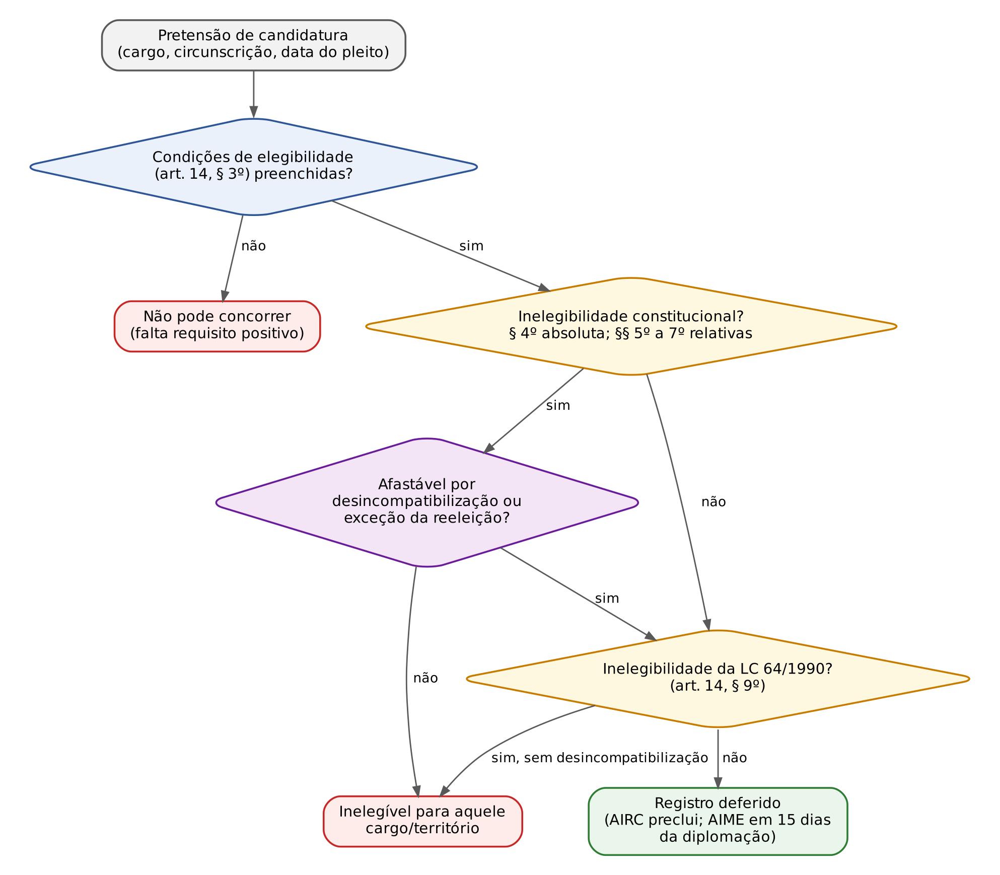
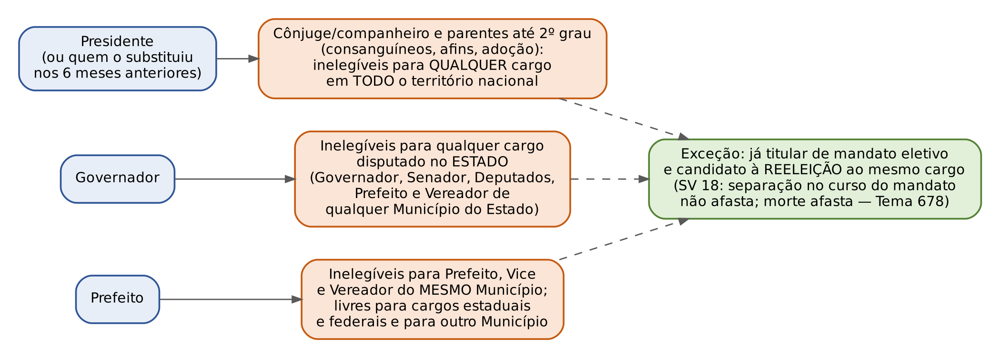
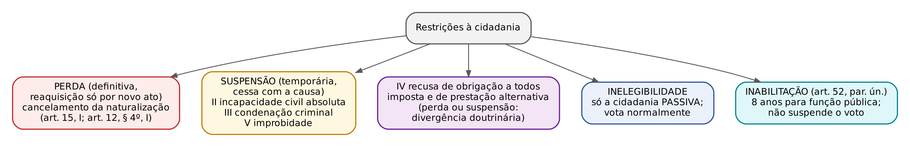
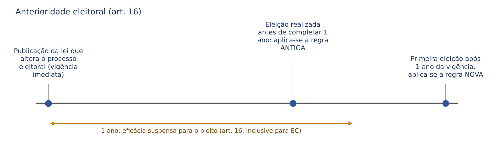
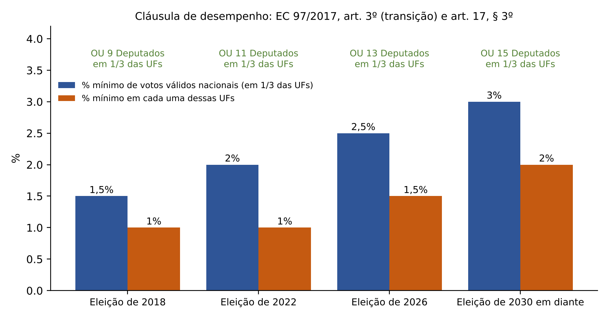
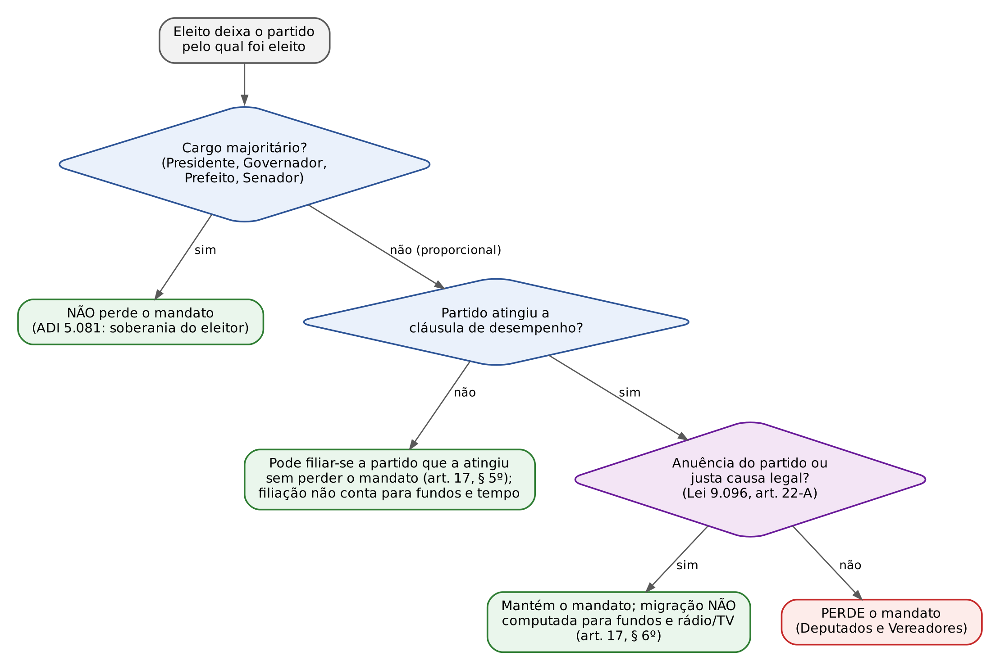

# CAPÍTULO 14 — DIREITOS POLÍTICOS, INELEGIBILIDADES E PARTIDOS POLÍTICOS

:::INCIDENCIA
TJRS p. 4; TJSC p. 15. Nível A+. Lote: 63 questões (FGV 37, FCC 26).
O que mais cai: casos com personagens para testar idade mínima, nato x naturalizado, analfabeto e voto facultativo (FCC); inelegibilidade reflexa e reeleição em narrativas familiares; suspensão dos direitos políticos por condenação com pena substituída (Tema 370); cláusula de desempenho, fidelidade partidária e cotas do art. 17 (FGV e FCC, literalidade dos §§ 1º a 9º).
:::

Mapa de cobrança do lote:

| Subtema | FGV | FCC | Padrão |
|---|---|---|---|
| Cidadania ativa x passiva; inelegível x inabilitado x suspenso | 3 | 0 | Três personagens com restrições distintas; pergunta quem vota e quem concorre |
| Alistamento e voto (obrigatório, facultativo, inalistáveis) | 1 | 4 | Idades (16, 18, 70), analfabeto, conscrito; troca de "facultativo" por "proibido" |
| Condições de elegibilidade (idade, nacionalidade, domicílio) | 3 | 6 | Lista de personagens com idade, nacionalidade e escolaridade; cargo pretendido |
| Inelegibilidades constitucionais (reeleição, desincompatibilização, reflexa) | 6 | 7 | Família do chefe do Executivo; território de jurisdição; exceção da reeleição; morte x divórcio |
| Perda e suspensão (art. 15) | 7 | 1 | Pena restritiva de direitos; cessação com o cumprimento; posse em cargo público; cancelamento da naturalização |
| AIME, anterioridade eleitoral, preclusão | 1 | 2 | Prazo de 15 dias da diplomação e segredo de justiça; art. 16 aplicado a EC |
| Plebiscito, referendo, iniciativa popular, consultas municipais | 5 | 0 | Anterioridade x posterioridade; quem convoca; § 12 e § 13 do art. 14 (EC 111/2021) |
| Partidos políticos (art. 17 e Lei 9.096/1995) | 11 | 6 | Literalidade dos §§ 1º a 9º; cláusula de desempenho em números; órgãos provisórios; coligações e federações |

## 14.1 Direitos políticos: conceito, cidadania e soberania popular

Direitos políticos são o conjunto de normas que disciplinam a participação do nacional na formação da vontade estatal: votar, ser votado, propor leis, participar de plebiscito e referendo, ajuizar ação popular, fiscalizar a coisa pública. Na teoria dos *status* de Jellinek, correspondem ao *status activae civitatis* (ver 07.3.2). A CF os disciplina nos arts. 14 a 16 (Capítulo IV do Título II) e os partidos no art. 17 (Capítulo V). Como direitos fundamentais, as regras que os RESTRINGEM interpretam-se restritivamente: é esse o fundamento invocado pelo STF para não estender a inelegibilidade reflexa a hipóteses não previstas (ADPF 1.089, ver 14.4.4) e para afastar a SV 18 quando o vínculo se extingue pela morte (Tema 678).

### 14.1.1 Cidadania em sentido estrito: ativa e passiva

No Direito Constitucional positivo, cidadão é o nacional no gozo dos direitos políticos, qualidade adquirida com o ALISTAMENTO eleitoral. O sentido amplo de cidadania (art. 1º, II) foi visto em 06.3.2; aqui importa o sentido técnico, que se desdobra em:

- cidadania ATIVA (capacidade eleitoral ativa): direito de votar, que pressupõe alistamento;
- cidadania PASSIVA (capacidade eleitoral passiva): direito de ser votado, que pressupõe as condições de elegibilidade do art. 14, § 3º, e a ausência de inelegibilidades.

Escalonamento clássico (José Afonso da Silva): aos 16 anos o brasileiro pode alistar-se e votar; aos 18 pode ser vereador; aos 21, deputado, prefeito e juiz de paz; aos 30, governador; aos 35, Presidente e Senador. A cidadania é, portanto, adquirida progressivamente.

Todo cidadão é nacional, mas nem todo nacional é cidadão (criança, conscrito, quem tem direitos suspensos); a exceção é o português equiparado, que, sem ser nacional, pode alistar-se e ser votado nas condições do Estatuto da Igualdade (ver 13.4).

:::QUESTAO FGV 2024 — TJ-MS — TÉCNICO DE NÍVEL SUPERIOR (Q2490881)
No registro de candidaturas, João não preenche condição de elegibilidade, Maria é alcançada por causa de inelegibilidade e Ana está com os direitos políticos suspensos.
Gabarito: D — em III (suspensão), a cidadania é afetada nas acepções ativa E passiva.
Armadilha: equiparar falta de condição de elegibilidade e inelegibilidade a restrições da cidadania ativa (C). Ambas atingem só a capacidade passiva; quem é inelegível ou não preenche condição de elegibilidade continua votando. Suspensão não se confunde com perda da nacionalidade (E).
:::

:::QUESTAO FGV 2024 — TCE-PA — AUDITOR DE CONTROLE EXTERNO (Q2566170)
Na data do pleito, João estará inelegível, Maria inabilitada para o exercício de função pública e Isabel com os direitos políticos suspensos.
Gabarito: A — apenas João e Maria poderão votar.
Armadilha: supor que a inabilitação (art. 52, parágrafo único) ou a inelegibilidade cancelam o alistamento (B) ou atingem o voto (D). Só a suspensão (e a perda) atinge a cidadania ativa. No mesmo sentido, cobrando a natureza da inabilitação imposta no *impeachment* (oito anos para função pública), Q3009009 (FGV, 2024, correlata do Cap. 28; gabarito: inabilitação).
:::

:::QUESTAO FGV 2024 — TCE-GO (Q2517208)
Brasileira nata, brasileira naturalizada e ugandense residente: há identidade de direitos fundamentais e de direitos políticos?
Gabarito: E — nata e naturalizada não têm exatamente os mesmos direitos fundamentais (distinções do art. 12, §§ 2º a 4º), e o estrangeiro não pode usufruir de direitos políticos (art. 14, § 2º).
Armadilha: a alternativa A ("os três possuem os mesmos direitos fundamentais") ignora as distinções constitucionais entre natos e naturalizados. Desenvolvimento das distinções: 13.5.
:::

### 14.1.2 Soberania popular, sufrágio, voto e escrutínio

O art. 14, *caput*, densifica o art. 1º, parágrafo único: a soberania popular é exercida "pelo sufrágio universal e pelo voto direto e secreto, com valor igual para todos, e, nos termos da lei, mediante" plebiscito, referendo e iniciativa popular. Distinções cobradas:

| Conceito | Conteúdo | Observação de prova |
|---|---|---|
| Sufrágio | O DIREITO público subjetivo de participar (votar e ser votado) | Universal: sem restrições de renda (censitário) ou de instrução (capacitário). Restrições de idade, nacionalidade e alistamento não o desnaturam |
| Voto | O EXERCÍCIO do sufrágio, o ato de votar | Direto, secreto, com valor igual (*one man, one vote*), periódico; obrigatório (art. 14, § 1º, I) |
| Escrutínio | O MODO de exercício (procedimento de votação e apuração) | Secreto, eletrônico |

Cláusula pétrea: "o voto direto, secreto, universal e periódico" (art. 60, § 4º, II). A OBRIGATORIEDADE do voto NÃO está no rol; pode ser suprimida por emenda (tema recorrente em V/F; ver 03.3.5).

Voto direto com exceção constitucional: na dupla vacância da Presidência nos dois últimos anos do mandato, a eleição é indireta, pelo Congresso (art. 81, § 1º; ver Cap. 28). Igualdade do voto não impede a sub-representação/sobrerrepresentação decorrente dos limites mínimo e máximo de deputados por Estado (art. 45, § 1º).

:::DICA
Sistemas eleitorais: MAJORITÁRIO para Presidente, Governador, Prefeito (com segundo turno nos Municípios com mais de 200 mil eleitores) e Senador; PROPORCIONAL para Deputados e Vereadores (art. 45). O sistema define as consequências da infidelidade partidária (14.9.6) e explica por que as coligações só são vedadas nas proporcionais (14.9.3).
:::

:::QUESTAO FGV 2024 — CÂMARA MUNICIPAL DE SÃO PAULO — PROCURADOR LEGISLATIVO (Q2351228)
Três afirmações sobre o sistema proporcional: (1) o método D'Hondt resolve melhor as sobras, mas não é historicamente adotado no Brasil; (2) a lista fechada privilegia a vontade do eleitor em detrimento do partido; (3) a reforma de 2015 amenizou o peso dos "puxadores de voto".
Gabarito: A — João parcialmente certo, Antônio totalmente errado, Pedro totalmente certo.
Fundamento: (1) a distribuição das sobras pelas "maiores médias" do Código Eleitoral é uma variante do método D'Hondt, de modo que a segunda parte da afirmação é falsa; (2) a lista fechada (pré-ordenada pelo partido) faz o contrário, privilegia a agremiação; o Brasil adota lista aberta; (3) a Lei 13.165/2015 passou a exigir votação nominal mínima (10% do quociente eleitoral) para a ocupação da vaga, limitando a transferência de votos do "puxador".
:::

## 14.2 Alistamento eleitoral e voto

:::LEI CF, ART. 14, §§ 1º E 2º
§ 1º O alistamento eleitoral e o voto são:
I - obrigatórios para os maiores de dezoito anos;
II - facultativos para:
a) os analfabetos;
b) os maiores de setenta anos;
c) os maiores de dezesseis e menores de dezoito anos.
§ 2º Não podem alistar-se como eleitores os estrangeiros e, durante o período do serviço militar obrigatório, os conscritos.
:::

| Situação | Alistamento e voto | Pode ser votado? |
|---|---|---|
| 18 a 70 anos, alfabetizado | OBRIGATÓRIOS | Sim, observadas idade mínima e demais condições |
| 16 e 17 anos | Facultativos | Não (idade mínima mais baixa é 18, para Vereador) |
| Maior de 70 anos | Facultativos | Sim (não há idade máxima) |
| Analfabeto | Facultativos | NÃO: inelegível (§ 4º) |
| Estrangeiro | VEDADOS | Não (salvo português equiparado com gozo de direitos políticos — 13.4) |
| Conscrito, durante o serviço militar obrigatório | VEDADOS | Não (inalistável = inelegível, § 4º) |
| Militar não conscrito | Obrigatórios | Sim, se alistável, com as condições do § 8º (14.3.4) |

Notas de precisão:

- "Maiores de setenta anos" significa quem JÁ completou 70; a pessoa de 65 ou de 69 anos vota obrigatoriamente. A FCC troca 70 por 60 ou 65.
- O analfabeto tem voto FACULTATIVO (não proibido) e é INELEGÍVEL. É a combinação mais cobrada da FCC.
- Conscrito é quem presta o serviço militar obrigatório inicial; a vedação é temporária ("durante o período"). Quem já era alistado e é convocado tem a inscrição mantida, mas não vota enquanto conscrito (orientação do TSE, conferir a resolução vigente).
- O alistamento é pressuposto do voto; quem não se alista quando obrigado sofre sanções legais (Código Eleitoral), mas isso NÃO é causa de perda ou suspensão de direitos políticos (o art. 15 é taxativo; Q3954665, 14.6).

:::QUESTAO FCC 2025 — TRT 6ª REGIÃO — TÉCNICO JUDICIÁRIO (Q3216595)
Thais, 19 anos, estudante; o pai, Arnaldo, 50 anos, analfabeto; a avó, Cacilda, 65 anos, professora aposentada.
Gabarito: B — para Thais, alistamento e voto obrigatórios e pode ser vereadora; para Arnaldo, facultativos e não pode ser eleito para nenhum cargo; para Cacilda, OBRIGATÓRIOS e pode ser eleita, entre outros cargos, Presidente da República.
Armadilha: tratar 65 anos como idade de voto facultativo (é acima de 70) e o analfabeto como impedido de votar ("proibidos").
No mesmo sentido: Q3169935 (FCC, TRT 20ª, 2024: analfabeto de 60 anos — facultativo e inelegível; a filha de 25 anos não pode ser governadora; gabarito E); Q3088360 (FCC, TRT 7ª, 2024: aposentada de 65 anos — obrigatórios, pode ser vereadora; gabarito B); Q3550568 (FCC, SEPLAN-PI, 2024: facultativos para os analfabetos; distratores com 60 anos, 18 anos para deputado estadual, estrangeiro alistável e analfabeto elegível para vereador; gabarito E).
:::

### 14.2.1 Dever estatal de viabilizar o voto: transporte gratuito (ADPF 1.013)

O voto obrigatório gera dever estatal correlato de remover obstáculos materiais ao seu exercício. Na ADPF 1.013 (Rel. Min. Luís Roberto Barroso, j. 18/10/2023, Informativo 1113), o STF reconheceu omissão inconstitucional do poder público na falta de oferta de transporte coletivo urbano gratuito nos dias de eleição, em frequência compatível com a dos dias úteis. A cautelar já havia vedado a interrupção da gratuidade pelos Municípios que a ofereciam e autorizado sua instituição.

:::QUESTAO FGV 2024 — AL-PR — PROCURADOR (Q2448938)
Prefeito candidato à reeleição institui transporte coletivo urbano gratuito nos dias de eleição, com frequência de dia útil, argumentando que o custo do deslocamento supera a multa por abstenção.
Gabarito: E — agiu corretamente: o poder público tem o dever de assegurar o exercício do voto, e a medida promove igualdade de participação e combate ilegalidades (ADPF 1.013).
Armadilha: a FGV aposta no reflexo de ver "abuso de poder" ou "uso da máquina" em qualquer benefício concedido por candidato à reeleição (D) e em supostos vícios de competência (B) ou de equilíbrio contratual (C).
:::

## 14.3 Condições de elegibilidade (art. 14, § 3º)

### 14.3.1 Natureza: requisitos positivos x inelegibilidades

Condições de elegibilidade são requisitos POSITIVOS que o candidato deve preencher; inelegibilidades são impedimentos NEGATIVOS que não podem incidir. A distinção é cobrada em três frentes: (i) as condições estão no art. 14, § 3º, "na forma da lei" (lei ORDINÁRIA pode disciplinar sua aferição: prazos de domicílio e filiação), ao passo que outras inelegibilidades só podem ser criadas por LEI COMPLEMENTAR (art. 14, § 9º); (ii) a falta de condição não é sanção; (iii) a inelegibilidade relativa pode ser afastada por desincompatibilização, a falta de condição, não.

:::LEI CF, ART. 14, § 3º
§ 3º São condições de elegibilidade, na forma da lei:
I - a nacionalidade brasileira;
II - o pleno exercício dos direitos políticos;
III - o alistamento eleitoral;
IV - o domicílio eleitoral na circunscrição;
V - a filiação partidária;
VI - a idade mínima de:
a) trinta e cinco anos para Presidente e Vice-Presidente da República e Senador;
b) trinta anos para Governador e Vice-Governador de Estado e do Distrito Federal;
c) vinte e um anos para Deputado Federal, Deputado Estadual ou Distrital, Prefeito, Vice-Prefeito e juiz de paz;
d) dezoito anos para Vereador.
:::

### 14.3.2 Cada condição

1) Nacionalidade brasileira: nata ou naturalizada, salvo para os cargos privativos de nato (art. 12, § 3º). Dos cargos ELETIVOS, só Presidente e Vice-Presidente da República exigem brasileiro nato; Presidente da Câmara e do Senado são cargos de nato, mas o naturalizado pode ser eleito Deputado ou Senador (não pode presidir a Casa). Não há prazo mínimo de naturalização para concorrer (Q3301281: naturalizada há um ano, com 18 anos, pode ser vereadora). O português equiparado pode ser votado para cargos não privativos de brasileiro nato (13.4).

2) Pleno exercício dos direitos políticos: quem os perdeu ou os tem suspensos (art. 15) não é elegível (nem vota).

3) Alistamento eleitoral: só o eleitor é elegível. Daí "são inelegíveis os inalistáveis" (§ 4º): estrangeiros e conscritos.

4) Domicílio eleitoral na circunscrição: circunscrição é o Município nas eleições municipais, o Estado nas gerais estaduais e federais (Deputado, Senador, Governador) e o País na presidencial. A Lei 9.504/1997, art. 9º, exige domicílio eleitoral na circunscrição pelo prazo de SEIS MESES antes do pleito (redação da Lei 13.488/2017; a redação anterior exigia um ano). O conceito de domicílio eleitoral é mais amplo que o civil (vínculos políticos, sociais, profissionais, familiares — jurisprudência do TSE).

5) Filiação partidária: exigida por seis meses antes da eleição (Lei 9.504/1997, art. 9º). Não há candidatura avulsa no Brasil: a lei veda o registro de candidatura avulsa "ainda que o requerente tenha filiação partidária" (Lei 9.504/1997, art. 11, § 14) e o STF fixou, em repercussão geral, que a filiação partidária é condição de elegibilidade inafastável (Tema 974, adiante).

6) Idade mínima: tabela abaixo. O momento de aferição está no art. 11, § 2º, da Lei 9.504/1997, com a redação da Lei 15.230, de 2/10/2025 (DOU de 3/10/2025, vigência na publicação): (I) data da POSSE, para os cargos do Poder Executivo; (II) data-limite para o pedido de REGISTRO, para os candidatos às Câmaras Municipais; (III) data da "posse presumida", para as demais Casas Legislativas, assim considerada a ocorrida dentro do prazo de até 90 dias contado da eleição da respectiva Mesa Diretora, independentemente da norma regimental de cada Casa. A redação anterior (Lei 13.165/2015) mandava aferir na posse, salvo quando a idade fosse de dezoito anos, hipótese em que valia a data-limite do registro: questões anteriores a outubro de 2025 refletem esse texto.

:::JURIS STF, TEMA 974 (RE 1.238.853/RJ, REL. MIN. LUÍS ROBERTO BARROSO, PLENÁRIO, J. 1/12/2025, INFORMATIVO 1200)
Não são admitidas candidaturas avulsas no sistema eleitoral brasileiro, prevalecendo a filiação partidária como condição de elegibilidade, nos termos do art. 14, § 3º, V, da Constituição.
:::

O argumento vencido (Pacto de São José, art. 23, que não prevê a filiação entre as restrições admissíveis aos direitos políticos) é o ponto de discussão em prova oral: o STF prestigiou o modelo de democracia partidária desenhado pelo constituinte (arts. 14, § 3º, V, e 17).

### 14.3.3 Tabela de idades e de nacionalidade por cargo

| Cargo | Idade mínima | Nato? | Observação |
|---|---|---|---|
| Presidente e Vice-Presidente | 35 | SIM | Únicos cargos eletivos privativos de nato |
| Senador | 35 | Não | O naturalizado pode ser Senador, mas não Presidente do Senado |
| Governador e Vice-Governador (Estado e DF) | 30 | Não |  |
| Deputado Federal, Estadual e Distrital | 21 | Não | Naturalizado não preside a Câmara dos Deputados |
| Prefeito e Vice-Prefeito | 21 | Não |  |
| Juiz de paz | 21 | Não | Eletivo (art. 98, II); lembrado em listas de cargos |
| Vereador | 18 | Não | Único cargo aberto aos 18 |

:::PASSO RESOLVENDO AS LISTAS DE PERSONAGENS DA FCC
1. Para cada personagem, anote: idade, nacionalidade (nata/naturalizada/estrangeira), escolaridade (analfabeto?), cargo pretendido.
2. Analfabeto: inelegível para qualquer cargo (voto facultativo).
3. Estrangeiro (não português equiparado): nem vota nem é votado; naturalizado: só não pode Presidente e Vice.
4. Confronte a idade com a tabela (35 / 30 / 21 / 18).
5. Só depois examine inelegibilidades (parentesco, reeleição, desincompatibilização).
:::

:::QUESTAO FCC 2026 — MPE-AL — ANALISTA DE MINISTÉRIO PÚBLICO (Q4092712)
Quem pode ser candidato a Vice-Presidente: Jorge (36, naturalizado), Joel (33, nato), Jaime (36, nato, contador) e Juno (45, nato, analfabeto)?
Gabarito: A — Jaime, apenas.
Armadilha: esquecer que Vice também exige nato e 35 anos (Jorge e Joel caem) e que o analfabeto é inelegível (Juno).
No mesmo sentido: Q3848787 (FCC, TRT 2ª, 2025: analfabeto para vereador — não; nata de 25 para Deputada Federal — sim; naturalizado para Presidente — não; gabarito E); Q3660499 (FCC, TRT 2ª, 2025: Governador exige 30 anos; o naturalizado de 30 pode, a nata de 25 e a analfabeta não; gabarito B); Q3303228 (FCC, TRT 15ª, 2025: 25 anos para Governadora, naturalizada para Presidente, 18 anos para Deputado Estadual — todos inelegíveis; gabarito A); Q3302480 (FCC, TRT 15ª, 2025: brasileira de 23 anos não pode ser Governadora; uruguaio não pode ser Presidente, nem se naturalizar-se; gabarito D); Q3089784 (FCC, TRT 7ª, 2024: Deputado Federal aos 25 pode; analfabeta de 20 anos vota facultativamente e não pode ser vereadora; gabarito B).
:::

:::QUESTAO FGV 2025 — CPRM — ANALISTA EM GEOCIÊNCIAS (Q3757889)
Luiz, 30 anos: a que cargos eletivos previstos na CF pode concorrer, na forma mais abrangente?
Gabarito: C — Governador e Vice (Estado e DF), Deputado Federal, Estadual ou Distrital, Prefeito, Vice-Prefeito, juiz de paz e Vereador.
Armadilha: incluir Senador (35 anos) na alternativa B, ou esquecer o juiz de paz e o Governador.
:::

:::QUESTAO FGV 2026 — AL-RO — ANALISTA LEGISLATIVO (Q3882273)
João, 21 anos, quer ser Deputado Estadual. Nasceu no exterior quando os pais brasileiros estavam a serviço da embaixada do Brasil; jamais teve domicílio eleitoral no Brasil e só o terá após o momento exigido.
Gabarito: C — apenas o domicílio (aspecto II) afeta a elegibilidade.
Passos: (I) nascido no exterior de pai ou mãe brasileiros a serviço da República é nato (art. 12, I, b — ver 13.2.2); (II) domicílio eleitoral na circunscrição é condição de elegibilidade, exigida por seis meses antes do pleito; (III) 21 anos é a idade mínima para Deputado Estadual, aferida na data da posse presumida (Lei 9.504, art. 11, § 2º, III, na redação da Lei 15.230/2025).
:::

:::QUESTAO FGV 2025 — TJ-SE — JUIZ SUBSTITUTO (Q3301281)
Registro de candidatura a Vereador do Município Alfa: Maria, filha do Prefeito de Alfa, candidata à reeleição para Vereadora; João, filho do Governador do Estado em que está Alfa, concorrendo pela primeira vez; Joana, alemã naturalizada há um ano, com 18 anos.
Gabarito: E — apenas Maria e Joana.
Passos: Maria está na exceção do § 7º ("salvo se já titular de mandato eletivo e candidato à reeleição"); João é inelegível, pois o território de jurisdição do Governador abrange todos os Municípios do Estado, inclusive para Vereador; Joana preenche as condições (naturalizada pode ser Vereadora; 18 anos; não há prazo mínimo de naturalização).
:::

### 14.3.4 Militar alistável (art. 14, § 8º)

O militar alistável é elegível, atendidas as condições do § 8º: (I) com MENOS de dez anos de serviço, deve afastar-se da atividade; (II) com MAIS de dez anos, será AGREGADO pela autoridade superior e, se eleito, passa automaticamente para a inatividade no ato da DIPLOMAÇÃO. Como o militar da ativa não pode filiar-se a partido (art. 142, § 3º, V), a jurisprudência eleitoral dispensa-lhe a filiação prévia, bastando o registro da candidatura após escolha em convenção (orientação do TSE; conferir).

:::PEGADINHA
"Dez anos" é o divisor: menos de dez, afasta-se; mais de dez, agregação e, se eleito, inatividade na DIPLOMAÇÃO (e não na posse ou na eleição). As bancas trocam os efeitos entre os incisos e o marco temporal.
:::

## 14.4 Inelegibilidades constitucionais

### 14.4.1 Classificação

| Espécie | Base | Alcance | Afastável? |
|---|---|---|---|
| ABSOLUTA | § 4º: inalistáveis (estrangeiros e conscritos) e analfabetos | Qualquer cargo, em qualquer circunscrição | Não por desincompatibilização (só cessando a causa: alfabetização, fim do serviço, naturalização) |
| RELATIVA funcional: reeleição | § 5º | O MESMO cargo, para um terceiro período consecutivo | Não |
| RELATIVA funcional: outros cargos | § 6º | Chefe do Executivo que concorre a OUTRO cargo | Sim, por renúncia até seis meses antes do pleito |
| RELATIVA reflexa (parentesco) | § 7º | Cônjuge e parentes até 2º grau, no território de jurisdição do titular | Sim, se o titular renunciar seis meses antes (e não for caso de terceiro mandato do grupo familiar) ou se o parente for titular candidato à reeleição |
| RELATIVA do militar | § 8º | Condições específicas | Afastamento ou agregação |
| LEGAIS (LC) | § 9º | Casos e prazos da LC 64/1990 | Conforme a hipótese (desincompatibilização ou decurso do prazo) |

As inelegibilidades constitucionais NÃO precluem: podem ser arguidas no recurso contra a expedição do diploma ainda que não impugnadas no registro; as infraconstitucionais preexistentes ao registro, se não arguidas na impugnação (AIRC), precluem (14.5.6).

:::QUESTAO FGV 2024 — PREFEITURA DE SÃO JOSÉ DOS CAMPOS — AUDITOR TRIBUTÁRIO (Q2348935)
Consequências de uma causa constitucional de inelegibilidade, pelas características do instituto.
Gabarito: E — preserva os direitos políticos, embora haja restrição à possibilidade de concorrer.
Armadilha: as alternativas A a D generalizam (nenhum cargo; só certos cargos; só certas esferas; sempre afastável por desincompatibilização). Como a questão não indica QUAL causa, só a afirmação comum a todas (cidadania ativa intacta) é segura.
No mesmo sentido: Q3099299 (FGV, Niterói, 2024: dentre as afirmações gerais sobre a inelegibilidade, a correta é que pode ser afastada pela desincompatibilização — as demais afirmam alcance necessário a todo cargo ou a todo território, ou que a inelegibilidade é mais ampla que a inabilitação; gabarito C). A questão é discutível: nem toda inelegibilidade é afastável por desincompatibilização (a absoluta e a do terceiro mandato não são), mas era a única alternativa compatível com alguma inelegibilidade constitucional.
:::

### 14.4.2 Reeleição dos chefes do Executivo (§ 5º)

:::LEI CF, ART. 14, §§ 5º E 6º
§ 5º O Presidente da República, os Governadores de Estado e do Distrito Federal, os Prefeitos e quem os houver sucedido, ou substituído no curso dos mandatos poderão ser reeleitos para um único período subseqüente.
§ 6º Para concorrerem a outros cargos, o Presidente da República, os Governadores de Estado e do Distrito Federal e os Prefeitos devem renunciar aos respectivos mandatos até seis meses antes do pleito.
:::

Pontos de prova:

- Introduzido pela EC 16/1997. Uma ÚNICA reeleição SUBSEQUENTE; nada impede o retorno após um intervalo (o ex-Presidente que ficou um mandato fora pode voltar).
- Para concorrer à REELEIÇÃO, o titular NÃO precisa renunciar nem se afastar; a exigência de renúncia é só para OUTROS cargos (§ 6º).
- Parlamentares podem ser reeleitos indefinidamente e não precisam renunciar para concorrer a qualquer cargo.
- "Quem os houver sucedido, ou substituído no curso dos mandatos": o vice que sucede o titular (assume definitivamente) exerce mandato; candidatando-se ao cargo de titular, estará disputando reeleição; o que substituiu temporariamente nos seis meses anteriores ao pleito também é tratado como titular para esse fim.
- Prefeito itinerante: a vedação ao terceiro mandato consecutivo é ABSOLUTA e alcança candidatura ao mesmo cargo em OUTRO Município (Tema 564).
- Vices: podem candidatar-se a outros cargos preservando o mandato, desde que, nos seis meses anteriores ao pleito, não tenham sucedido nem substituído o titular (LC 64/1990, art. 1º, § 2º).

:::JURIS STF, TEMA 564 (RE 637.485/RJ, REL. MIN. GILMAR MENDES, PLENÁRIO, J. 1/8/2012)
A vedação a uma segunda reeleição é absoluta: quem exerceu dois mandatos consecutivos de chefe do Executivo municipal é inelegível para o mesmo cargo ainda que em Município diverso. No mesmo julgamento, o STF assentou que mudanças da jurisprudência do TSE no curso do pleito ou logo após o seu encerramento não se aplicam imediatamente, por força da segurança jurídica e da anterioridade eleitoral (14.7).
:::

:::JURIS STF, TEMA 1.229 (RE 1.355.228/PB, REL. MIN. NUNES MARQUES, PLENÁRIO, J. 22/10/2025, INFORMATIVO 1201)
O exercício da chefia do Poder Executivo, nos seis meses anteriores ao pleito, em decorrência de decisão judicial não transitada em julgado, não conta como exercício de um mandato para efeito de reeleição.
:::

No caso, o vice-prefeito assumira a prefeitura por oito dias, por força de liminar em ação de improbidade depois revogada; eleito prefeito no pleito seguinte, pretendeu a reeleição. O STF afastou a tese de terceiro mandato: substituição involuntária, precária e efêmera não equivale a mandato. A tese é a exceção à leitura literal de "quem os houver ... substituído".

:::QUESTAO FGV 2024 — CÂMARA MUNICIPAL DE SÃO PAULO — PROCURADOR LEGISLATIVO (Q2351230)
Prefeito no segundo mandato consecutivo quer concorrer, na eleição seguinte, à chefia do Executivo de Beta ou de outro Município.
Gabarito: A — está inelegível na próxima eleição municipal, ainda que em Município diverso.
Armadilha: as alternativas C a E sugerem que a desincompatibilização resolveria o problema ou que a inelegibilidade é só territorial (D). É vedação absoluta ao terceiro mandato consecutivo (Tema 564); nada impede, porém, candidatura a Deputado, Governador ou Senador, renunciando seis meses antes (B está errada).
:::

:::QUESTAO FCC 2025 — TRT 6ª REGIÃO — ANALISTA JUDICIÁRIO (Q3215148)
Governadora no primeiro mandato quer a reeleição; Prefeito eleito em 2024 quer disputar o governo do Estado em 2026.
Gabarito: C — ela pode ser reeleita para um único período subsequente; ele deve renunciar ao mandato até seis meses antes do pleito.
No mesmo sentido: Q3185934 (FGV, TCE-RR, 2025: governador no primeiro mandato, para concorrer a outro cargo, deve desincompatibilizar-se; gabarito D); Q3233120 (FCC, TRT 20ª, 2024: Prefeito reeleito em 2024, com 37 anos, pode concorrer a Presidente em 2026 renunciando seis meses antes; idade mínima de 35; gabarito D — distratores com "quatro meses", "mesmo território de jurisdição" e "vedada a renúncia").
:::

### 14.4.3 Desincompatibilização

Desincompatibilizar-se é afastar-se, no prazo legal, do cargo, emprego ou função que gera inelegibilidade. Para os chefes do Executivo que disputam OUTRO cargo, a CF exige RENÚNCIA (definitiva) seis meses antes (§ 6º). Para os demais agentes, a LC 64/1990 exige afastamento (definitivo ou temporário, conforme o caso) em prazos que variam. Prazos mais cobrados (LC 64/1990, art. 1º, com a redação da LC 219/2025, conferida no Planalto):

| Quem | Prazo | Fonte |
|---|---|---|
| Presidente, Governador e Prefeito, para outros cargos | Renúncia até 6 meses antes | CF, art. 14, § 6º; LC 64, art. 1º, § 1º |
| Ministros, Secretários, magistrados, membros de Tribunais de Contas, dirigentes de autarquias, empresas públicas, sociedades de economia mista e fundações | 6 meses (afastamento definitivo) | LC 64, art. 1º, II, a |
| Membros do Ministério Público | 6 meses | LC 64, art. 1º, II, j |
| MP e Defensoria em exercício na comarca, para Prefeito | 6 meses, sem prejuízo dos vencimentos | LC 64, art. 1º, IV, b (LC 219/2025) |
| Autoridades policiais em exercício no Município, para Prefeito | 6 meses | LC 64, art. 1º, IV, c (LC 219/2025) |
| Dirigentes de entidades de classe mantidas por contribuições impostas pelo poder público | 6 meses | LC 64, art. 1º, II, g (LC 219/2025) |
| Servidores públicos em geral | 3 meses, com vencimentos integrais; afastamento pode continuar até 10 dias após o segundo turno, se dele participarem | LC 64, art. 1º, II, l (LC 219/2025) |
| Servidor licenciado cuja candidatura não for registrada ou for indeferida/cassada | Retorno imediato, a partir do trânsito em julgado, sob pena de responsabilidade | LC 64, art. 1º, § 7º (LC 219/2025) |

Magistrados e membros do MP, que não podem exercer atividade político-partidária (arts. 95, parágrafo único, III, e 128, § 5º, II, e), precisam afastar-se definitivamente (exoneração ou aposentadoria) a tempo de cumprir o prazo de filiação partidária de seis meses.

### 14.4.4 Inelegibilidade reflexa (§ 7º)

:::LEI CF, ART. 14, § 7º
§ 7º São inelegíveis, no território de jurisdição do titular, o cônjuge e os parentes consangüíneos ou afins, até o segundo grau ou por adoção, do Presidente da República, de Governador de Estado ou Território, do Distrito Federal, de Prefeito ou de quem os haja substituído dentro dos seis meses anteriores ao pleito, salvo se já titular de mandato eletivo e candidato à reeleição.
:::

Elementos a decompor em toda questão:

1. Quem gera: SÓ os chefes do Executivo (Presidente, Governador de Estado, Território e DF, Prefeito) e quem os substituiu nos seis meses anteriores. Parentes de parlamentares, de vices que não substituíram e de magistrados não são atingidos pelo § 7º.

2. Quem é atingido: cônjuge (e companheiro, inclusive em união homoafetiva — orientação do TSE) e parentes até o SEGUNDO grau, consanguíneos (pais, filhos, avós, netos, irmãos), afins (sogros, genro/nora, cunhados) ou por adoção. Primos (4º grau) e tios/sobrinhos (3º grau) NÃO.

3. Onde: no "território de jurisdição do titular". Presidente: todo o País, para qualquer cargo. Governador: todo o Estado, para qualquer cargo disputado no Estado (Governador, Senador, Deputados Federal e Estadual, Prefeito e Vereador de qualquer Município do Estado). Prefeito: só o Município (Prefeito, Vice e Vereador).

4. Exceção: o parente que JÁ É titular de mandato eletivo e concorre à REELEIÇÃO para o MESMO cargo (o filho vereador do prefeito pode disputar novo mandato de vereador; não pode disputar prefeito).

5. Como afastar: se o titular está no PRIMEIRO mandato e renuncia até seis meses antes do pleito, o parente pode concorrer a qualquer cargo, INCLUSIVE ao do titular (a jurisprudência admite, porque o titular também poderia candidatar-se à reeleição). Se o titular está no SEGUNDO mandato, o parente não pode suceder-lhe no mesmo cargo nem com renúncia, para evitar o terceiro mandato do mesmo grupo familiar (orientação do TSE e do STF; conferir).

6. Cargos de circunscrição MAIS AMPLA que a do titular: o cônjuge do Prefeito pode disputar Deputado, Senador ou Governador; o cônjuge do Governador pode disputar Presidente (Q4239997 e Q3170849, gabaritos oficiais da FCC). O fundamento é que a circunscrição da eleição ultrapassa o território de jurisdição do titular, de modo que a influência da máquina local não é determinante (TSE).

:::JURIS SÚMULA VINCULANTE 18 E TEMA 678 (RE 758.461)
SV 18: "A dissolução da sociedade ou do vínculo conjugal, no curso do mandato, não afasta a inelegibilidade prevista no § 7º do artigo 14 da Constituição Federal." (precedente-base: Tema 61, RE 568.596).
Tema 678: a SV 18 não se aplica aos casos de extinção do vínculo conjugal pela MORTE de um dos cônjuges.
:::

A lógica: o divórcio no curso do mandato é potencial fraude (por isso a LC 64/1990, art. 1º, I, n, torna inelegíveis por oito anos os condenados por desfazer ou simular desfazer vínculo para fugir da inelegibilidade); a morte não é manipulável. Rompido o vínculo pela morte, a viúva pode concorrer.

:::JURIS STF, TEMA 781 (RE 843.455/DF, REL. MIN. TEORI ZAVASCKI, PLENÁRIO, J. 7/10/2015, INFORMATIVO 802)
As hipóteses de inelegibilidade previstas no art. 14, § 7º, da CF, inclusive quanto ao prazo de seis meses, são aplicáveis às eleições suplementares.
:::

:::JURIS STF, ADPF 1.089/DF (REL. MIN. CÁRMEN LÚCIA, PLENÁRIO, J. 5/6/2024, INFORMATIVO 1140)
Cônjuges, companheiros ou parentes podem ocupar, ao mesmo tempo, os cargos de Governador e de Presidente da Assembleia Legislativa, ou de Prefeito e de Presidente da Câmara Municipal. O § 7º veicula regra de inelegibilidade reflexa, restritiva de direito político fundamental, e deve ser interpretado restritivamente; criar nova hipótese é tarefa do legislador (art. 14, § 9º), e não do Judiciário.
:::

:::QUESTAO FCC 2026 — TJ-CE — OFICIAL DE JUSTIÇA (Q4239997)
Prefeito no primeiro mandato quer a reeleição em 2028; a esposa, advogada de 35 anos, pretende disputar em 2030 o governo do Estado que abrange o Município, ainda que o marido seja reeleito.
Gabarito: A — ele pode concorrer à reeleição (sem renunciar) e ela pode candidatar-se a Governadora em 2030, ainda que ele seja reeleito.
Armadilha: exigir renúncia para a reeleição (B, C, E) e estender o território de jurisdição do Prefeito ao Estado (C, D). O § 7º limita a inelegibilidade ao território do titular (o Município).
:::

:::QUESTAO FCC 2024 — TRT 20ª REGIÃO — ANALISTA JUDICIÁRIO (Q3170849)
Governadora de Sergipe será reeleita em 2026; o marido quer disputar a Presidência em 2026; o filho quer ser Prefeito de cidade sergipana em 2028.
Gabarito: E — o marido é elegível para Presidente; o filho é inelegível para Prefeito de Município de Sergipe.
Fundamento: a circunscrição presidencial é mais ampla que o território do Governador; o Município está dentro do território de jurisdição da mãe, que estará no cargo em 2028. A substituição ocasional da titular (A) não altera nada.
:::

:::QUESTAO FCC 2025 — TRT 1ª REGIÃO — OFICIAL DE JUSTIÇA (Q3469429)
Governador do RJ quer ser candidato a Presidente em 2026; a esposa quer disputar a prefeitura da cidade em que residem em 2028.
Gabarito: C — ele deve renunciar até seis meses antes do pleito; ela será inelegível em 2028 se ele exercer a Presidência.
No mesmo sentido: Q2564662 (FCC, TRT 3ª, 2024: esposa do Governador de MS não pode disputar prefeitura em MS; o filho, com domicílio em SP, pode disputar prefeitura paulista; gabarito A); Q2564481 (FCC, TRT 3ª, 2024: marido da Governadora no segundo mandato, analfabeto, de 60 anos, quer ser Prefeito no mesmo Estado — inelegível, com voto facultativo; gabarito B).
:::

:::QUESTAO FGV 2025 — PREFEITURA DE ABREU E LIMA — PROCURADOR JURÍDICO MUNICIPAL (Q3841658)
Prefeito candidato à reeleição; o filho X, vereador, busca a reeleição; o filho Y estreia como candidato a vereador no mesmo Município.
Gabarito: B — Y está inelegível para vereador.
Fundamento: X está na exceção ("já titular de mandato eletivo e candidato à reeleição"); Y não. O Prefeito pode buscar a reeleição; a candidatura dos filhos não o atinge (E).
:::

:::QUESTAO FGV 2024 — PREFEITURA DE VITÓRIA — PROCURADOR (Q3044155)
Esposa de Prefeito pretende disputar vaga de vereadora; o Prefeito morre no início do ano da eleição; o registro é impugnado.
Gabarito: D — Maria pode concorrer, pois a dissolução do vínculo decorreu da morte, sem tentativa de burla (Tema 678).
Armadilha: aplicar a SV 18 literalmente (A) ou dizer que não há inelegibilidade para o Legislativo gerada por cargo do Executivo (C): há, no mesmo território.
:::

## 14.5 Inelegibilidades infraconstitucionais: LC 64/1990, Lei da Ficha Limpa e LC 219/2025

### 14.5.1 Reserva de lei complementar e finalidades (art. 14, § 9º)

:::LEI CF, ART. 14, § 9º
§ 9º Lei complementar estabelecerá outros casos de inelegibilidade e os prazos de sua cessação, a fim de proteger a probidade administrativa, a moralidade para exercício de mandato considerada vida pregressa do candidato, e a normalidade e legitimidade das eleições contra a influência do poder econômico ou o abuso do exercício de função, cargo ou emprego na administração direta ou indireta.
:::

Consequências: (i) lei ORDINÁRIA, Constituição estadual, lei orgânica ou resolução do TSE não podem criar inelegibilidades (formalmente inconstitucionais); (ii) o rol constitucional + LC é taxativo e de interpretação restritiva (ADPF 1.089); (iii) a expressão "considerada vida pregressa do candidato" foi incluída pela ECR 4/1994 e é a base constitucional da Lei da Ficha Limpa; (iv) a competência legislativa é da União (direito eleitoral, art. 22, I).

### 14.5.2 Estrutura da LC 64/1990

- Art. 1º, I: inelegibilidades para QUALQUER cargo (alíneas a a q), em geral de oito anos.
- Art. 1º, II a VII: inelegibilidades por cargo disputado (Presidente, Governador, Prefeito, Senado, Câmara e Assembleias, Câmara Municipal), em regra superáveis por desincompatibilização (14.4.3).
- Arts. 3º e seguintes: ação de impugnação de registro de candidatura (AIRC), proposta em CINCO dias da publicação do pedido de registro por candidato, partido, coligação ou MP (art. 3º).
- Art. 22: ação de investigação judicial eleitoral (AIJE) por abuso do poder econômico, de autoridade ou uso indevido dos meios de comunicação; a procedência gera inelegibilidade por oito anos subsequentes à eleição e cassação do registro ou diploma (inciso XIV); basta a GRAVIDADE das circunstâncias, não a potencialidade de alterar o resultado (inciso XVI).
- Art. 26-C: suspensão cautelar da inelegibilidade pelo tribunal do recurso, se houver plausibilidade e pedido expresso na interposição.

### 14.5.3 Lei da Ficha Limpa (LC 135/2010) no STF

A LC 135/2010 (iniciativa popular) ampliou as hipóteses, elevou os prazos para oito anos e admitiu a inelegibilidade a partir de decisão de ÓRGÃO COLEGIADO, sem trânsito em julgado. Pontos fixados pelo STF:

| Julgado | Orientação |
|---|---|
| Tema 387 (RE 633.703, março de 2011) | A LC 135/2010 NÃO se aplicou às eleições de 2010, por força do art. 16 (lei que altera o processo eleitoral) |
| ADCs 29 e 30 e ADI 4.578 (16/2/2012) | Constitucionalidade da lei: inelegibilidade não é pena, logo a decisão colegiada não ofende a presunção de inocência; a lei alcança fatos e condenações anteriores à sua vigência (não há retroatividade vedada: as condições são aferidas no registro) |
| Tema 860 (RE 929.670) | A condenação por abuso de poder em AIJE transitada em julgado, ainda que sob a redação original da LC 64/1990 (três anos), atrai a inelegibilidade de oito anos da alínea d com a redação da LC 135/2010 |
| Tema 1.304 (RE 1.459.224) | O § 4º-A do art. 1º (incluído pela LC 184/2021: não incide a alínea g sobre quem teve contas irregulares sem imputação de débito e sancionado só com multa) aplica-se apenas ao julgamento de gestores pelos Tribunais de Contas, e não às contas de chefe do Executivo julgadas pelo Legislativo |

Contas de Prefeito (alínea g): a competência para julgar as contas de governo E de gestão do Prefeito, para fins de inelegibilidade, é da Câmara Municipal, com parecer prévio do Tribunal de Contas, que só deixa de prevalecer por decisão de dois terços dos Vereadores; o desenvolvimento (Temas 157 e 835 e a distinção quanto à imputação de débito em convênios) está no Cap. 27. Correlata: Q3505818 (FGV, TJ-CE, Juiz, 2025: o TCE julga as contas de gestão e pode imputar débito e aplicar sanções, mas a configuração da inelegibilidade da LC 64/1990 depende da apreciação pela Câmara; gabarito D).

### 14.5.4 Alterações da LC 219/2025

A LC 219, de 29/9/2025 (DOU de 30/9/2025), alterou a LC 64/1990 para "modificar prazos de duração e de fixação dos termos iniciais e finais de contagem de inelegibilidades" e a Lei 9.504/1997 para criar o Requerimento de Declaração de Elegibilidade (RDE). Vigência: data da publicação (art. 5º). Principais mudanças (redação conferida no Planalto):

| Ponto | Antes (LC 135/2010) | Depois (LC 219/2025) |
|---|---|---|
| Alínea e (condenação criminal) | Da condenação colegiada até 8 anos APÓS o cumprimento da pena, para todos os crimes listados | Regra: da condenação (transitada ou colegiada) até 8 anos; exceção (itens 6 a 10 — lavagem; tráfico, racismo, tortura, terrorismo e hediondos; trabalho escravo; crimes contra a vida e a dignidade sexual; organização criminosa — e crimes contra a administração pública): da condenação colegiada até 8 anos após o cumprimento da pena |
| Alínea l (improbidade) | Da condenação até 8 anos após o cumprimento da pena | Da condenação colegiada até 8 anos; exige dolo, lesão ao patrimônio E enriquecimento ilícito, concomitantes, na parte dispositiva |
| Alíneas b, c, k, o | Prazos com termos variados (até o fim do mandato + 8 anos etc.) | 8 anos contados da decisão que decretar a perda do cargo, da renúncia ou da decisão de demissão |
| Dolo para alíneas g e l (§ 4º-B) | Construção jurisprudencial | Vontade livre e consciente de alcançar o resultado ilícito dos arts. 9º e 10 da Lei 8.429/1992, não bastando a voluntariedade |
| Mero exercício da função (§ 4º-C) | — | Sem comprovação de ato doloso com fim ilícito, afasta as alíneas g e l |
| Ações pelos mesmos fatos ou conexos (§§ 4º-D e 4º-E) | Novas condenações podiam reiniciar a contagem | Inelegibilidade a partir da PRIMEIRA condenação colegiada, vedada nova restrição |
| Teto (§ 8º) | — | Acúmulo de inelegibilidades decorrentes de improbidade unificado no limite máximo de 12 anos |
| RDE (Lei 9.504, art. 11, § 16) | — | Pré-candidato com "dúvida razoável" sobre sua capacidade eleitoral passiva, ou o partido, pode pedir declaração de elegibilidade a qualquer tempo; impugnável em 5 dias |

:::ATENCAO LC 219/2025 SOB CONTROLE CONCENTRADO (ADI 7.881)
A Rede Sustentabilidade ajuizou a ADI 7.881 (Rel. Min. Cármen Lúcia) contra a antecipação do termo inicial e o teto de 12 anos. Em setembro de 2026, havia dois votos pela inconstitucionalidade (relatora e Min. Luiz Fux) e voto parcialmente divergente do Min. Gilmar Mendes, quando pedido de destaque do Min. Flávio Dino levou o caso ao plenário presencial, com reinício do placar; o julgamento ficou para depois das eleições de 2026 e, nas fontes consultadas em 12/11/2026, não havia notícia de nova data nem de conclusão. Até a conclusão, a LC 219/2025 está em vigor. Questões elaboradas antes de 30/9/2025 trazem a regra antiga ("até oito anos após o cumprimento da pena"): confira a data da prova.
:::

:::PEGADINHA
Inelegibilidade da alínea e x suspensão do art. 15, III. Enquanto dura a pena, o condenado tem os direitos políticos SUSPENSOS (não vota nem é votado). Cumprida a pena, recupera o voto, mas pode continuar INELEGÍVEL pela LC 64/1990. A alínea e não se aplica a crimes culposos, de menor potencial ofensivo e de ação penal privada (art. 1º, § 4º).
:::

:::QUESTAO FGV 2024 — TJ-AP (Q2441210)
João, condenado por sentença transitada em julgado, cumpriu a pena há poucos meses e quer concorrer. Analisando EXCLUSIVAMENTE a Constituição, concluiu que:
Gabarito: C — pode ser considerado inelegível por lei complementar.
Armadilha: a CF não torna inelegível o ex-condenado (A), nem mantém a suspensão após o cumprimento (B), nem prevê "perda" com reaquisição pela reabilitação (E). O que a CF faz é autorizar a LC a criar a inelegibilidade (art. 14, § 9º).
:::

### 14.5.5 Ação de impugnação de mandato eletivo (art. 14, §§ 10 e 11)

:::LEI CF, ART. 14, §§ 10 E 11
§ 10. O mandato eletivo poderá ser impugnado ante a Justiça Eleitoral no prazo de quinze dias contados da diplomação, instruída a ação com provas de abuso do poder econômico, corrupção ou fraude.
§ 11. A ação de impugnação de mandato tramitará em segredo de justiça, respondendo o autor, na forma da lei, se temerária ou de manifesta má-fé.
:::

Três dados cobrados: Justiça ELEITORAL; 15 DIAS da DIPLOMAÇÃO (não da posse nem da eleição); SEGREDO de justiça (exceção expressa à publicidade). O objeto é abuso do poder ECONÔMICO, corrupção ou fraude (abuso de poder político isolado vai pela AIJE).

:::QUESTAO FCC 2025 — TRT 6ª REGIÃO — OFICIAL DE JUSTIÇA (Q3215722)
Candidata eleita Governadora: em que condições seu mandato pode ser impugnado?
Gabarito: E — perante a Justiça Eleitoral, em 15 dias da diplomação, com provas de abuso do poder econômico, corrupção ou fraude, em segredo de justiça.
Armadilha: Justiça Estadual, 30 dias, contagem da posse e "atos públicos pelo princípio da transparência".
:::

### 14.5.6 Preclusão das inelegibilidades

Inelegibilidade infraconstitucional preexistente ao registro deve ser arguida na AIRC; não arguida, preclui. A inelegibilidade constitucional (e a superveniente) pode ser suscitada no recurso contra a expedição do diploma (Código Eleitoral, art. 262).

:::QUESTAO FGV 2025 — AL-AM — ASSESSOR JURÍDICO (Q3777506)
Afirmações sobre princípio democrático, anterioridade e preclusão, à luz do STF.
Gabarito: D — o princípio da preclusão se aplica às arguições de inelegibilidade não atacadas tempestivamente pela AIRC, salvo matéria constitucional.
Distratores: (A) emenda que altera a composição das Câmaras Municipais após as eleições e retroage para dar posse a suplentes ofende a soberania popular e a anterioridade (o STF suspendeu a retroação da EC 58/2009 na ADI 4.307, Relatora Ministra Cármen Lúcia, cautelar referendada pelo Plenário em 11/11/2009); (B) a participação das minorias é indispensável à democracia; (C) a anterioridade alcança emendas constitucionais E as mudanças de jurisprudência do TSE (Tema 564), de modo que é falso dizer que não se aplica a decisões judiciais; (E) o STF considera a infidelidade partidária ofensiva ao princípio democrático e ao sistema proporcional (14.9.6).
:::

## 14.6 Privação dos direitos políticos: perda e suspensão (art. 15)

:::LEI CF, ART. 15
Art. 15. É vedada a cassação de direitos políticos, cuja perda ou suspensão só se dará nos casos de:
I - cancelamento da naturalização por sentença transitada em julgado;
II - incapacidade civil absoluta;
III - condenação criminal transitada em julgado, enquanto durarem seus efeitos;
IV - recusa de cumprir obrigação a todos imposta ou prestação alternativa, nos termos do art. 5º, VIII;
V - improbidade administrativa, nos termos do art. 37, § 4º.
:::

### 14.6.1 Regime geral

- VEDADA A CASSAÇÃO: não há privação por ato discricionário ou político (como nos atos institucionais). Toda privação decorre de hipótese constitucional taxativa, em regra por decisão judicial.
- Rol TAXATIVO: lei não pode criar novas causas de perda ou suspensão (pode criar inelegibilidades, por LC, que é outra coisa). Não são causas: deixar de alistar-se ou de votar, ilícito eleitoral, descumprimento de condenação ao ressarcimento (Q3954665).
- PERDA é privação definitiva (reaquisição depende de novo ato e de cessar a causa); SUSPENSÃO é temporária, cessa com a causa, automaticamente.
- Efeitos: atinge cidadania ativa e passiva, a filiação partidária, a legitimidade para ação popular e para iniciativa popular. Para o parlamentar, gera perda do mandato DECLARADA pela Mesa (art. 55, IV e § 3º), salvo a condenação criminal transitada em julgado, cuja perda é DECIDIDA pela Casa por maioria absoluta (art. 55, VI e § 2º — ver Cap. 25).

| Inciso | Natureza (doutrina majoritária) | Observações |
|---|---|---|
| I — cancelamento da naturalização | PERDA | Sentença transitada em julgado, por fraude relacionada ao processo de naturalização ou atentado contra a ordem constitucional e o Estado Democrático (art. 12, § 4º, I, redação da EC 131/2023). Perdida a nacionalidade, perde-se a cidadania. Reaquisição: só pela desconstituição da sentença (ação rescisória) |
| II — incapacidade civil absoluta | SUSPENSÃO | Após a Lei 13.146/2015 (Estatuto da Pessoa com Deficiência), só as pessoas com menos de 16 anos são absolutamente incapazes; a interdição de adultos com deficiência não suspende direitos políticos. O inciso perdeu aplicação prática para adultos |
| III — condenação criminal transitada em julgado | SUSPENSÃO | Automática; qualquer crime ou contravenção, doloso ou culposo, qualquer pena (inclusive restritiva de direitos e multa); dura enquanto durarem os efeitos (cumprimento ou extinção da pena) |
| IV — escusa de consciência sem prestação alternativa | Divergência: perda (posição tradicional, ligada ao art. 5º, VIII) ou suspensão (legislação: Lei 8.239/1991 e CPP, art. 438) | Cessa com o cumprimento da obrigação ou da prestação alternativa; a banca costuma aceitar "perda ou suspensão" sem exigir a classificação |
| V — improbidade administrativa | SUSPENSÃO | Exige condenação, com aplicação expressa da sanção, que só se efetiva com o trânsito em julgado (Lei 8.429/1992, art. 20); até 14 anos (art. 9º) ou 12 anos (art. 10); não há para atos do art. 11 após a Lei 14.230/2021 — ver Apostila de Direito Administrativo, Cap. 27 |

Perda da nacionalidade a PEDIDO (art. 12, § 4º, II, EC 131/2023) também acarreta, por via reflexa, a perda dos direitos políticos, embora não esteja no art. 15; reaquisição da nacionalidade originária na forma da lei (§ 5º; ver 13.6).

:::QUESTAO FCC 2026 — DPE-MT — DEFENSOR PÚBLICO (Q3954665)
Qual é caso expressamente previsto de perda ou suspensão de direitos políticos?
Gabarito: A — condenação criminal transitada em julgado, enquanto durarem seus efeitos.
Armadilha: hipóteses plausíveis mas inexistentes (ilícito eleitoral reconhecido por sentença, descumprimento da obrigação de alistamento, descumprimento de condenação ao ressarcimento) e a escusa de consciência COM o detalhe errado: a CF exige recusa à obrigação E à prestação alternativa; recusar o serviço militar invocando objeção de consciência, por si, não basta (D).
:::

:::QUESTAO FGV 2024 — PC-SC — DELEGADO DE POLÍCIA (Q2360663)
Italiano naturalizado tem a naturalização cancelada por sentença transitada em julgado, por fraude no processo de naturalização.
Gabarito: B — perda dos direitos políticos.
Armadilha: "suspensão" (A) e "cassação" (C, vedada). A alternativa E remete à antiga causa ("atividade nociva ao interesse nacional"), substituída pela EC 131/2023 por fraude relacionada ao processo de naturalização ou atentado contra a ordem constitucional e o Estado Democrático.
:::

### 14.6.2 Condenação criminal (inciso III)

Pontos assentados:

- Autoaplicabilidade: o inciso III independe de lei e de menção na sentença; a suspensão é efeito automático do trânsito em julgado da condenação.
- Abrange a pena restritiva de direitos e a substituição (Tema 370), o *sursis* e a multa.
- Termo final: cumprimento ou extinção da pena, sem necessidade de reabilitação ou de reparação do dano (Súmula 9 do TSE).
- Não impede a nomeação e posse em cargo público de aprovado em concurso, se compatível com a infração (Tema 1.190).

:::JURIS STF, TEMA 370 (RE 601.182/MG, REL. MIN. MARCO AURÉLIO, RED. P/ O ACÓRDÃO MIN. ALEXANDRE DE MORAES, PLENÁRIO, J. 8/5/2019, INFORMATIVO 939)
A suspensão de direitos políticos prevista no art. 15, III, da Constituição Federal aplica-se no caso de substituição da pena privativa de liberdade pela restritiva de direitos.
:::

:::JURIS STF, TEMA 1.190 (RE 1.282.553/RR, REL. MIN. ALEXANDRE DE MORAES, J. 4/10/2023)
A suspensão dos direitos políticos prevista no art. 15, III, da CF não impede a nomeação e posse de candidato aprovado em concurso público, desde que não seja incompatível com a infração penal praticada, em respeito à dignidade da pessoa humana, ao valor social do trabalho e ao objetivo de integração social do condenado (LEP, art. 1º). O início do efetivo exercício fica condicionado ao regime da pena ou à decisão do juízo da execução quanto à compatibilidade de horários.
:::

:::QUESTAO FGV 2025 — TRF 1ª REGIÃO — JUIZ FEDERAL SUBSTITUTO (Q3425272)
Condenado por crime contra a honra, com pena privativa substituída por prestação de serviços à comunidade: durante o cumprimento, ele...
Gabarito: D — pode ser nomeado e tomar posse em cargo público, se aprovado em concurso.
Passos: (1) pena substituída também suspende os direitos políticos (Tema 370); (2) logo, não pode ajuizar ação popular (A) nem praticar atos que exijam a condição de cidadão (C), e não é caso de mera inelegibilidade (E); (3) a suspensão não equivale a inabilitação para qualquer função pública (B); (4) o Tema 1.190 admite a posse.
No mesmo sentido: Q2351234 (FGV, Câmara Municipal de São Paulo, Procurador, 2024: cumprindo pena restritiva, com direitos suspensos, a suspensão não obsta a posse; gabarito C — erradas as que exigem pena privativa ou determinação expressa na sentença).
:::

:::QUESTAO FGV 2026 — ALERJ — ESPECIALISTA LEGISLATIVO (Q3883340)
Condenado a pena restritiva de direitos substitutiva, a cumprir por dois anos, quer concorrer na eleição do ano seguinte ao trânsito em julgado; análise exclusivamente constitucional.
Gabarito: D — está com os direitos políticos suspensos, embora não esteja preso; restabelecem-se após o cumprimento da pena.
Armadilha: "reabilitação" (C) — a Súmula 9 do TSE dispensa reabilitação; "oito anos após o cumprimento" (E) e "inelegível por oito anos" (A) misturam a LC 64/1990 com a CF.
No mesmo sentido: Q3162649 (FGV, SEEC-RN, 2025: suspenso, não pode exercer a cidadania nas acepções ativa e passiva; gabarito A); Q2362704 (FGV, São José dos Campos, 2024: pena restritiva em curso — restrições à cidadania ativa e passiva; gabarito C; erradas: perda, inabilitação, inelegibilidade com voto preservado).
:::

:::SENTENCA DISPOSITIVO DA SENTENÇA PENAL CONDENATÓRIA: DIREITOS POLÍTICOS
"Transitada em julgado esta sentença, comunique-se à Justiça Eleitoral, para os fins do art. 15, III, da Constituição Federal (suspensão dos direitos políticos enquanto durarem os efeitos da condenação), efeito que decorre diretamente da Constituição e independe de declaração neste ato, alcançando igualmente a pena substitutiva ora aplicada (STF, Tema 370)."
Observação: a menção na sentença é recomendável por segurança, mas a suspensão é automática; não fixe prazo próprio nem condicione o restabelecimento à reabilitação (Súmula 9 do TSE). A inelegibilidade da LC 64/1990 não é declarada pelo juízo criminal: é aferida pela Justiça Eleitoral no registro.
:::

## 14.7 Anterioridade (anualidade) eleitoral (art. 16)

:::LEI CF, ART. 16
Art. 16. A lei que alterar o processo eleitoral entrará em vigor na data de sua publicação, não se aplicando à eleição que ocorra até um ano da data de sua vigência.
:::

Estrutura (redação da EC 4/1993): VIGÊNCIA imediata, EFICÁCIA diferida para o pleito que ocorra até um ano. Não é *vacatio legis*: a lei vige e pode produzir efeitos em matérias que não afetem eleição dentro do ano.

Jurisprudência:

- Garantia individual do eleitor e cláusula pétrea, oponível a EMENDA constitucional: na ADI 3.685 (Relatora Ministra Ellen Gracie, Plenário, j. 22/3/2006, por nove votos a dois), o STF impediu a aplicação, às eleições de 2006, da EC 52/2006, que pôs fim à verticalização das coligações (ver 03.3.5).
- Alcança a lei que interfere no equilíbrio da disputa ou nas regras do jogo (rompimento da igualdade de participação, deformação que afete a normalidade, alteração motivada por propósito casuístico). Por isso a LC 135/2010 não se aplicou às eleições de 2010 (Tema 387, RE 633.703).
- Alcança a mudança de JURISPRUDÊNCIA do TSE no curso do pleito ou logo após (Tema 564): as decisões que alterem entendimento consolidado não têm aplicabilidade imediata ao pleito em curso.
- NÃO alcança normas de caráter procedimental sobre financiamento e prestação de contas que não inovam no processo eleitoral em sentido estrito: a cota racial de recursos (EC 133/2024) pôde ser aplicada às eleições de 2024 (ADI 7.707 MC, 6/9/2024, com apoio na ADPF 738 MC-Ref e na ADI 3.741; mérito nas ADIs 7.706 e 7.707, 14.9.8).

:::QUESTAO FCC 2025 — MPE-PI — ANALISTA MINISTERIAL (Q3530351)
Emenda constitucional que altera o processo eleitoral entra em vigor quando e com que restrição?
Gabarito: E — na data de sua publicação, observada a anterioridade eleitoral: não se aplica à eleição que ocorra até um ano da data de sua vigência.
Armadilha: (D) restringir o art. 16 à legislação infraconstitucional; (B) inventar regra noventena "no ano seguinte"; (A) confundir vigência com eficácia.
:::

Emendas eleitorais recentes e regras de transição de interesse (todas conferidas no Planalto):

| EC | Conteúdo cobrável |
|---|---|
| 97/2017 | Vedação de coligações nas proporcionais (a partir de 2020); cláusula de desempenho escalonada até 2030; § 5º (filiação sem perda do mandato) |
| 107/2020 | Adiamento das eleições municipais de 2020 (pandemia) |
| 111/2021 | Consultas populares municipais concomitantes (§§ 12 e 13 do art. 14); fidelidade partidária no texto (§ 6º do art. 17); posse do Presidente em 5 de janeiro e dos Governadores em 6 de janeiro, a partir das eleições de 2026 (arts. 28 e 82; mandatos dos eleitos em 2022 duram até a posse dos sucessores em 5 e 6/1/2027); votos em candidatas mulheres e candidatos negros para a Câmara contados em DOBRO, uma única vez, para distribuição do fundo partidário e do FEFC, nas eleições de 2022 a 2030 (art. 2º) |
| 117/2022 | § 7º (5% do fundo partidário para programas de participação política das mulheres) e § 8º (mínimo de 30% do FEFC, da parcela do fundo partidário para campanhas e do tempo de propaganda gratuita para candidatas, proporcional ao número de candidatas); anistia às sanções por descumprimento de cotas de sexo e raça em eleições anteriores (art. 3º) |
| 133/2024 | § 9º (30% dos recursos de campanha para candidaturas de pessoas pretas e pardas); regra de transição (art. 3º); reforço da imunidade tributária dos partidos (art. 4º) |

Não há, até a EC 141/2026, nova emenda que altere os arts. 14 a 17.

## 14.8 Democracia direta: plebiscito, referendo e iniciativa popular

### 14.8.1 Plebiscito x referendo

A Lei 9.709/1998 regulamenta os incisos do art. 14. Plebiscito e referendo são consultas ao povo sobre matéria de acentuada relevância, de natureza constitucional, legislativa ou administrativa (art. 2º).

| Aspecto | Plebiscito | Referendo |
|---|---|---|
| Momento | ANTERIOR ao ato legislativo ou administrativo (art. 2º, § 1º) | POSTERIOR ao ato, para ratificar ou rejeitar (art. 2º, § 2º) |
| Ato do Congresso (questões nacionais) | CONVOCAR (art. 49, XV) | AUTORIZAR (art. 49, XV) |
| Instrumento | Decreto legislativo, por proposta de no mínimo 1/3 dos membros de qualquer das Casas (Lei 9.709, art. 3º) | Idem |
| Prazo | — (convocado, susta-se a tramitação do projeto ou medida — art. 9º) | Convocação em até 30 dias da promulgação da lei ou da adoção da medida administrativa (art. 11) |
| Aprovação | Maioria simples, homologada pelo TSE (art. 10) | Idem |
| Execução | Justiça Eleitoral (fixa data, cédula, instruções, gratuidade nos meios de comunicação — art. 8º) | Idem |
| Casos constitucionais obrigatórios | Incorporação, subdivisão e desmembramento de Estados (art. 18, § 3º: plebiscito + lei complementar do Congresso); criação, incorporação, fusão e desmembramento de Municípios (art. 18, § 4º: plebiscito convocado pela Assembleia Legislativa, após Estudos de Viabilidade, e lei estadual); plebiscito de 1993 sobre forma e sistema de governo (ADCT, art. 2º) | Nenhum obrigatório na CF; exemplo histórico: referendo de 2005 sobre a proibição do comércio de armas (Estatuto do Desarmamento) |

Convocar plebiscito e autorizar referendo é competência EXCLUSIVA do Congresso Nacional (art. 49, XV), exercida por decreto legislativo, sem sanção. Não é competência do Presidente (Q2400721, FCC, 2024, distrator), nem comum (Q3878418, FGV, 2026: "exclusiva do Congresso Nacional", gabarito C). Nos Estados, DF e Municípios, a convocação segue a Constituição estadual e a Lei Orgânica (Lei 9.709, art. 6º).

:::QUESTAO FGV 2026 — ALERJ — PROCURADOR LEGISLATIVO (Q3880787)
(I) plebiscito é consulta prévia ao ato; (II) referendo é convocado diretamente pelo Presidente, sem autorização do Congresso; (III) ambos são formas de exercício direto da soberania (art. 14).
Gabarito: A — V, F, V.
No mesmo sentido, com a inversão dos conceitos: Q3645152 (FGV, CNU, 2025: a correta é a que reconhece os conselhos de políticas públicas como mecanismo de participação e controle social; a alternativa D descreve o REFERENDO chamando-o de plebiscito; gabarito C).
:::

:::QUESTAO FGV 2024 — AL-SC — ANALISTA LEGISLATIVO (Q2485989)
Assessor sugere submeter à apreciação popular ato administrativo de competência do Presidente da República, após sua edição.
Gabarito: A — é possível a consulta (referendo), convocada por decreto legislativo, no prazo de 30 dias contados da prática do ato.
Fundamento: Lei 9.709/1998, arts. 2º, § 2º, 3º e 11. Armadilhas: a maioria é sempre simples (B); cabe também em matéria de competência do Executivo (C); não se convoca por lei de iniciativa do Presidente (D) nem por decreto do Executivo (E).
:::

### 14.8.2 Consultas populares municipais concomitantes (EC 111/2021)

:::LEI CF, ART. 14, §§ 12 E 13
§ 12. Serão realizadas concomitantemente às eleições municipais as consultas populares sobre questões locais aprovadas pelas Câmaras Municipais e encaminhadas à Justiça Eleitoral até 90 (noventa) dias antes da data das eleições, observados os limites operacionais relativos ao número de quesitos.
§ 13. As manifestações favoráveis e contrárias às questões submetidas às consultas populares nos termos do § 12 ocorrerão durante as campanhas eleitorais, sem a utilização de propaganda gratuita no rádio e na televisão.
:::

:::QUESTAO FGV 2024 — PC-SC — DELEGADO DE POLÍCIA (Q2360662)
Câmaras Municipais pretendem realizar consultas populares concomitantes às eleições municipais de 2024.
Gabarito: D — durante a campanha é proibida a utilização de propaganda gratuita no rádio e na televisão para as manifestações sobre as questões.
Armadilha: 60 dias (é 90), dispensa de encaminhamento à Justiça Eleitoral, proibição de manifestações (são permitidas, sem horário gratuito) e anualidade (a EC 111 é de 2021).
:::

### 14.8.3 Iniciativa popular

| Esfera | Requisito | Fonte |
|---|---|---|
| Federal | Projeto de LEI apresentado à Câmara dos Deputados, subscrito por no mínimo 1% do eleitorado nacional, distribuído por pelo menos cinco Estados, com não menos de 0,3% dos eleitores de cada um | CF, art. 61, § 2º; Lei 9.709, art. 13 |
| Estadual | "A lei disporá" | CF, art. 27, § 4º |
| Municipal | Projetos de lei de interesse específico do Município, da cidade ou de bairros, por pelo menos 5% do eleitorado | CF, art. 29, XIII |
| Distrital | Lei Orgânica do DF | CF, art. 32 |

Regras da Lei 9.709/1998, art. 13: o projeto deve circunscrever-se a um só assunto e não pode ser rejeitado por vício de forma (a Câmara corrige impropriedades de técnica ou redação). A CF não prevê iniciativa popular de EMENDA constitucional federal (o rol do art. 60 é taxativo; José Afonso da Silva sustenta a admissibilidade por interpretação sistemática, posição minoritária); Constituições estaduais podem prevê-la para emendas estaduais. Projeto de iniciativa popular não pode versar matéria de iniciativa reservada (Q3047982, distrator E). Exemplos: Lei 9.840/1999 (captação ilícita de sufrágio) e LC 135/2010 (Ficha Limpa).

:::QUESTAO FGV 2024 — PREFEITURA DE MACAÉ — ANALISTA PREVIDENCIÁRIO (Q3047982)
Instrumentos de democracia participativa na Constituição.
Gabarito: B — iniciativa popular de projetos de lei de interesse do Município, mediante manifestação de pelo menos 5% do eleitorado (art. 29, XIII).
Armadilha: orçamento participativo obrigatório (não há previsão constitucional), referendo para criação de Município (é plebiscito) e iniciativa popular em matéria reservada ao Chefe do Executivo (vício de iniciativa).
Correlata: Q4012567 (FCC, DPE-MA, 2026, classificada no Cap. 6): alterações administrativas que esvaziem espaços de participação social podem ser submetidas a controle constitucional (gabarito D); o direito à participação não se restringe a plebiscito, referendo e iniciativa popular.
:::

## 14.9 Partidos políticos (art. 17 e Lei 9.096/1995)

### 14.9.1 Natureza, criação e registro

O partido político é pessoa jurídica de DIREITO PRIVADO, destinada a assegurar, no interesse do regime democrático, a autenticidade do sistema representativo e a defender os direitos fundamentais (Lei 9.096/1995, art. 1º); não se equipara às entidades paraestatais (parágrafo único, Lei 13.488/2017). O estímulo a partidos de natureza pública contraria o modelo constitucional (Q3373845, distrator B).

:::LEI CF, ART. 17, CAPUT, §§ 2º E 4º
Art. 17. É livre a criação, fusão, incorporação e extinção de partidos políticos, resguardados a soberania nacional, o regime democrático, o pluripartidarismo, os direitos fundamentais da pessoa humana e observados os seguintes preceitos:
I - caráter nacional;
II - proibição de recebimento de recursos financeiros de entidade ou governo estrangeiros ou de subordinação a estes;
III - prestação de contas à Justiça Eleitoral;
IV - funcionamento parlamentar de acordo com a lei.
§ 2º Os partidos políticos, após adquirirem personalidade jurídica, na forma da lei civil, registrarão seus estatutos no Tribunal Superior Eleitoral.
§ 4º É vedada a utilização pelos partidos políticos de organização paramilitar.
:::

Dupla etapa (pegadinha recorrente): (1) a PERSONALIDADE JURÍDICA é adquirida com o registro no Registro Civil das Pessoas Jurídicas da sede, requerido por no mínimo 101 fundadores com domicílio eleitoral em pelo menos 1/3 dos Estados (Lei 9.096, art. 8º); (2) o ESTATUTO é registrado no TSE, após comprovação do caráter nacional: apoiamento, no período de dois anos, de eleitores NÃO filiados correspondente a pelo menos 0,5% dos votos válidos da última eleição para a Câmara, distribuídos por 1/3 ou mais dos Estados, com mínimo de 0,1% do eleitorado que votou em cada um (art. 7º, § 1º). Só o registro no TSE habilita a participar das eleições, receber fundo partidário, ter acesso ao rádio e TV e garante exclusividade de nome, sigla e símbolos (art. 7º, §§ 2º e 3º). Alternativas que digam "adquirem personalidade jurídica com o registro no TSE" (Q3891294, D) ou "registram estatutos no STF" (Q3974527, A) estão erradas.

"Caráter nacional" é obrigatório: estatuto que pretenda partido REGIONAL é inconstitucional (Q3114250, proposta I). Liberdade de criação NÃO tem limites quantitativos ou territoriais (Q2474130, item 1); a vedação de organização paramilitar não comporta exceção (item 3).

:::QUESTAO FGV 2024 — CÂMARA DE FORTALEZA — CONSULTOR LEGISLATIVO (Q2474130)
V/F: criação restrita por limite quantitativo e territorial; autonomia sobre órgãos permanentes e provisórios; organização paramilitar admitida em razão da polarização.
Gabarito: D — F, V, F.
No mesmo sentido: Q3089708 (FCC, TRT 7ª, 2024: correta só a afirmação de que, após adquirir personalidade jurídica na forma da lei civil, o partido registra o estatuto no TSE; erradas a vedação de regras sobre órgãos permanentes e a autonomia para coligações proporcionais; gabarito E).
:::

### 14.9.2 Autonomia partidária e democracia interna

:::LEI CF, ART. 17, § 1º (REDAÇÃO DA EC 97/2017)
§ 1º É assegurada aos partidos políticos autonomia para definir sua estrutura interna e estabelecer regras sobre escolha, formação e duração de seus órgãos permanentes e provisórios e sobre sua organização e funcionamento e para adotar os critérios de escolha e o regime de suas coligações nas eleições majoritárias, vedada a sua celebração nas eleições proporcionais, sem obrigatoriedade de vinculação entre as candidaturas em âmbito nacional, estadual, distrital ou municipal, devendo seus estatutos estabelecer normas de disciplina e fidelidade partidária.
:::

A autonomia não é absoluta: sujeita-se ao princípio republicano (alternância e periodicidade) e ao democrático (democracia intrapartidária).

:::JURIS STF, ADI 6.230/DF (REL. MIN. RICARDO LEWANDOWSKI, PLENÁRIO, J. 8/8/2022, INFORMATIVO 1062)
1) Os partidos podem fixar a duração dos mandatos de seus dirigentes, desde que respeitado o princípio republicano da alternância do poder, mediante eleições periódicas em prazo razoável. 2) É inconstitucional a previsão do prazo de até oito anos para a vigência dos órgãos provisórios (Lei 9.096, art. 3º, § 3º, incluído pela Lei 13.831/2019), com modulação para produzir efeitos a partir de janeiro de 2023.
:::

:::JURIS STF, ADI 5.875 (REL. MIN. LUIZ FUX, PLENÁRIO, J. 28/5/2025, INFORMATIVO 1180)
Comissões provisórias têm prazo máximo de quatro anos, sem prorrogação nem substituição por nova comissão provisória; esgotado o prazo, devem ser eleitos órgãos permanentes, sob pena de suspensão imediata dos repasses do fundo partidário e do fundo eleitoral, sem ressarcimento retroativo; efeitos a partir da publicação da ata de julgamento (ver também 06.2.2).
:::

:::QUESTAO FGV 2025 — TJ-TO — JUIZ SUBSTITUTO (Q3453280)
Proposta de estatuto: órgãos provisórios com vigência de até oito anos e mandatos de dirigentes equivalentes a três legislaturas (12 anos).
Gabarito: C — incompatível, considerando a extensão dos lapsos temporais.
Fundamento: a autonomia do § 1º não protege prazos que frustram a alternância e a democracia interna (ADI 6.230; ADI 5.875). Armadilha: a alternativa E invoca a autonomia em termos absolutos; a D sugere que os prazos estão "detalhados em lei" (o § 3º do art. 3º da Lei 9.096 foi declarado inconstitucional).
No mesmo sentido: Q3114250 (FGV, TJ-MT, 2024: só é constitucional disciplinar a escolha e a duração dos órgãos provisórios; inconstitucionais o caráter regional e a coligação proporcional; gabarito C).
:::

### 14.9.3 Coligações e verticalização

- Coligações só nas eleições MAJORITÁRIAS; vedadas nas proporcionais desde as eleições de 2020 (EC 97/2017, art. 2º). A coligação funciona como um só partido perante a Justiça Eleitoral (Lei 9.504, art. 6º).
- Sem obrigatoriedade de vinculação entre candidaturas nacionais, estaduais, distritais ou municipais: a EC 52/2006 extinguiu a "verticalização" imposta por interpretação do TSE; o STF só impediu sua aplicação às eleições de 2006 (ADI 3.685; 14.7).

:::QUESTAO FGV 2024 — TJ-AP — ANALISTA JUDICIÁRIO (Q2449057)
Presidentes nacionais de dois partidos negociam coligação; para que disputa ela é possível, sem prejuízo de outras?
Gabarito: A — para o cargo de Senador, sem necessidade de vinculação com candidaturas estaduais ou distritais.
Armadilha: Deputado Federal (C) é proporcional; B e D reintroduzem a verticalização; E limita a coligação ao Executivo (Senador também é majoritário).
:::

### 14.9.4 Federações partidárias (Lei 14.208/2021)

Dois ou mais partidos podem reunir-se em federação que, registrada no TSE, atua "como se fosse uma única agremiação partidária" (Lei 9.096, art. 11-A). Características: abrangência NACIONAL; só partidos com registro definitivo; permanência mínima de QUATRO anos (o descumprimento veda ingresso em federação e coligação nas duas eleições seguintes e o uso do fundo partidário até completar o prazo); aplicação das normas de funcionamento parlamentar e de fidelidade (perde o mandato quem se desfiliar sem justa causa de partido federado — § 9º); preservação da identidade e autonomia dos partidos federados; lista comum nas proporcionais definida no estatuto da federação.

:::JURIS STF, ADI 7.021/DF (REL. MIN. LUÍS ROBERTO BARROSO, PLENÁRIO, INFORMATIVO 1185)
A Lei 14.208/2021 é constitucional: a federação não é a coligação proporcional vedada pela EC 97/2017 disfarçada, pois exige afinidade programática, estabilidade (mínimo de quatro anos) e atuação conjunta no Parlamento. É inconstitucional, porém, o prazo diferenciado de constituição: a federação deve estar registrada no TSE no mesmo prazo exigido dos partidos, seis meses antes da eleição (para 2022, admitiu-se a constituição até 31/5/2022).
:::

| Coligação (majoritária) | Federação |
|---|---|
| Aliança eleitoral episódica, desfeita após a eleição | Vínculo estável de no mínimo quatro anos |
| Só para eleições majoritárias | Majoritárias e proporcionais |
| Âmbito da circunscrição | Abrangência nacional |
| Não vincula a atuação parlamentar | Atuação como bancada única; normas de fidelidade e funcionamento parlamentar |
| Prevista na CF (art. 17, § 1º) | Prevista em lei (Lei 9.096, art. 11-A) |

:::QUESTAO FGV 2024 — PREFEITURA DE NITERÓI — ANALISTA DE POLÍTICAS PÚBLICAS (Q3089382)
Três partidos de linhas ideológicas similares querem um ajuste para unir as legendas e apresentar candidatos conjuntos às eleições majoritárias e proporcionais do ano seguinte, com estrutura de estímulo a candidaturas femininas.
Gabarito: D — o ajuste deve observar as restrições constitucionais e não pode ter a amplitude desejada, mas há previsão expressa de tratamento diferenciado para as mulheres.
Comentário: a FGV raciocinou "à luz da sistemática constitucional": como coligação, o ajuste não alcança as proporcionais (B errada). A resposta é discutível, porque a federação (legal) admitiria candidaturas conjuntas também nas proporcionais; marque D quando o enunciado restringir a análise à CF. A alternativa E contraria o § 8º (mínimo de 30%).
:::

### 14.9.5 Cláusula de desempenho (§§ 3º e 5º)

:::LEI CF, ART. 17, §§ 3º E 5º (EC 97/2017)
§ 3º Somente terão direito a recursos do fundo partidário e acesso gratuito ao rádio e à televisão, na forma da lei, os partidos políticos que alternativamente:
I - obtiverem, nas eleições para a Câmara dos Deputados, no mínimo, 3% (três por cento) dos votos válidos, distribuídos em pelo menos um terço das unidades da Federação, com um mínimo de 2% (dois por cento) dos votos válidos em cada uma delas; ou
II - tiverem elegido pelo menos quinze Deputados Federais distribuídos em pelo menos um terço das unidades da Federação.
§ 5º Ao eleito por partido que não preencher os requisitos previstos no § 3º deste artigo é assegurado o mandato e facultada a filiação, sem perda do mandato, a outro partido que os tenha atingido, não sendo essa filiação considerada para fins de distribuição dos recursos do fundo partidário e de acesso gratuito ao tempo de rádio e de televisão.
:::

Notas:

- Os critérios são ALTERNATIVOS (votos OU deputados). Um terço das 27 unidades da Federação = NOVE.
- A sanção não é a extinção do partido nem a perda de funcionamento parlamentar: é a falta de acesso ao fundo partidário e ao direito de antena.
- O STF, em 2006, declarou inconstitucional a cláusula de barreira então prevista em LEI (Lei 9.096/1995, art. 13), por ofensa ao pluripartidarismo e às minorias. A atual é CONSTITUCIONAL (EC 97/2017) e não foi invalidada; a FGV considera-a validada e compatível com o pluralismo (Q3373845, gabarito C).
- Regra plena a partir das eleições de 2030 (EC 97, art. 3º); transição: 2018 (1,5% / 1% / 9 deputados), 2022 (2% / 1% / 11), 2026 (2,5% / 1,5% / 13).
- Fusão e incorporação: somam-se exclusivamente os votos dos partidos fundidos ou incorporados obtidos na última eleição para a Câmara, para efeito de fundo partidário e acesso ao rádio e TV (Lei 9.096, art. 29, § 7º); só é admitida entre partidos com registro definitivo há pelo menos cinco anos (§ 9º).

:::QUESTAO FGV 2024 — PREFEITURA DE VITÓRIA — PROCURADOR (Q3044156)
Alfa elegeu deputados em oito UFs (votos só nelas); Beta elegeu 15 deputados com 2% dos votos válidos; Sigma elegeu 20 deputados em 20 Estados, com 1% dos votos em cada.
Gabarito: E — apenas Beta e Sigma podem preencher a cláusula.
Passos: (1) critério dos votos (3% nacionais, 2% em 9 UFs): ninguém o atinge com os dados; (2) critério dos deputados (15 em 9 UFs): Sigma atinge (20 em 20); Beta PODE atingir, se os 15 estiverem distribuídos em 9 UFs (o enunciado ressalva "outros requisitos"); Alfa não, pois só tem presença em 8 UFs (menos de 1/3).
:::

:::QUESTAO FGV 2026 — TJ-PR — JUIZ SUBSTITUTO (Q3898942)
Alfa elegeu 15 deputados em sete Estados, com 2% dos votos válidos; ao fim do primeiro ano da legislatura, foi incorporado por Beta.
Gabarito: C — Alfa não preencheu a cláusula, mas o quantitativo de deputados eleitos e os votos serão somados aos de Beta para esse fim.
Passos: (1) sete UFs < nove (1/3), e 2% < 3%: cláusula não atingida (também não atingiria as regras de transição); (2) na incorporação, votos e eleitos somam-se ao incorporador (Lei 9.096, art. 29, § 7º, e orientação do TSE); (3) a soma não depende do ato de incorporação (E). Ver nota de verificação.
:::

### 14.9.6 Fidelidade partidária (§ 6º)

:::LEI CF, ART. 17, § 6º (EC 111/2021)
§ 6º Os Deputados Federais, os Deputados Estaduais, os Deputados Distritais e os Vereadores que se desligarem do partido pelo qual tenham sido eleitos perderão o mandato, salvo nos casos de anuência do partido ou de outras hipóteses de justa causa estabelecidas em lei, não computada, em qualquer caso, a migração de partido para fins de distribuição de recursos do fundo partidário ou de outros fundos públicos e de acesso gratuito ao rádio e à televisão.
:::

Evolução: a perda do mandato por infidelidade foi construída pelo STF e pelo TSE em 2007 (o mandato, no sistema proporcional, pertence ao partido), passou à Lei 9.096 (art. 22-A, Lei 13.165/2015) e chegou à CF com a EC 111/2021, que acrescentou a ANUÊNCIA do partido como hipótese de saída sem perda.

Justa causa legal (Lei 9.096, art. 22-A, parágrafo único, rol taxativo — "somente"): I — mudança substancial ou desvio reiterado do programa partidário; II — grave discriminação política pessoal; III — "janela partidária": mudança efetuada nos 30 dias que antecedem o prazo de filiação exigido em lei para concorrer à eleição, ao término do mandato vigente. Somam-se: anuência do partido (CF) e desfiliação de eleito por partido que não atingiu a cláusula de desempenho (§ 5º).

:::JURIS STF, ADI 5.081/DF (REL. MIN. LUÍS ROBERTO BARROSO, PLENÁRIO, J. 27/5/2015)
A perda do mandato em razão de mudança de partido não se aplica aos candidatos eleitos pelo sistema MAJORITÁRIO, sob pena de violação da soberania popular e das escolhas feitas pelo eleitor. O sistema majoritário tem lógica centrada no candidato; a perda transferiria o cargo a vice ou suplente que não recebeu votos próprios.
:::

:::QUESTAO FCC 2025 — TRT 6ª REGIÃO — TÉCNICO JUDICIÁRIO (Q3216598)
Deputada Estadual pretende desligar-se do partido pelo qual foi eleita.
Gabarito: E — perderá o mandato, salvo anuência do partido ou outras hipóteses de justa causa legais, NÃO computada, em qualquer caso, a migração para fundos e tempo de rádio e TV.
Armadilha: a FCC alterna três variáveis — "perde/não perde", "salvo anuência" e "computada/não computada". Fixe: perde, salvo anuência ou justa causa; migração NUNCA computada.
No mesmo sentido: Q3974527 (FCC, AL-MS, 2026, gabarito B — transcrição do § 6º; erradas: registro no STF, 30% para programas das mulheres, 5% para pretos e pardos, "cinco" deputados na cláusula); Q3089790 (FCC, TRT 7ª, 2024, gabarito B — Deputados Federais; erradas: vereadores perdem "inclusive com anuência", coligações proporcionais com vinculação obrigatória, 10% para programas das mulheres, 50% do FEFC para candidatas).
:::

:::QUESTAO FGV 2024 — TCE-PA — AUDITOR DE CONTROLE EXTERNO (Q2564232)
Deputado Federal, logo após a posse, anuncia que deixará o partido (que elegeu 19 deputados) por desempenho "fraquíssimo"; o diretório avisa que a saída sem aquiescência levará à perda do mandato.
Gabarito: A — desfiliando-se, perderá o mandato.
Armadilha: o partido elegeu 19 deputados, logo não há indício de falta da cláusula (B, E); a janela partidária é de 30 dias antes do prazo de filiação, ao término do mandato (D inventa 60 dias no início e no fim); não há "transferência igualitária" (C). Insatisfação com o desempenho não é justa causa.
:::

### 14.9.7 Financiamento

- Vedação constitucional de recursos de entidade ou governo estrangeiros (art. 17, II).
- Doações de pessoas JURÍDICAS a campanhas e partidos são inconstitucionais (ADI 4.650, Rel. Min. Luiz Fux, j. 17/9/2015): o poder econômico capturaria o processo político; mantidas as regras sobre doações de pessoas físicas e recursos próprios. A Lei 9.096, art. 31, veda contribuições de entes públicos e pessoas jurídicas de qualquer natureza (ressalvados o fundo partidário e o FEFC), de entidade de classe ou sindical e de ocupantes de cargos demissíveis *ad nutum* não filiados.
- Fontes públicas: Fundo Partidário (manutenção dos partidos) e Fundo Especial de Financiamento de Campanha (FEFC, criado pela Lei 13.487/2017).
- Imunidade tributária dos partidos e de suas fundações (art. 150, VI, c), reforçada pela EC 133/2024, art. 4º, que a estende às sanções de natureza tributária, exceto previdenciárias (ver Cap. 33 e Apostila de Direito Tributário).

### 14.9.8 Ações afirmativas: mulheres e pessoas negras

| Medida | Fonte | Conteúdo |
|---|---|---|
| Cota de candidaturas por sexo | Lei 9.504, art. 10, § 3º | Mínimo de 30% e máximo de 70% para cada sexo nas candidaturas proporcionais |
| Recursos para candidatas | ADI 5.617 (Rel. Min. Edson Fachin, j. 15/3/2018); CF, art. 17, § 8º (EC 117/2022) | O STF declarou inconstitucional o piso de 5% e o teto de 15% do fundo partidário para candidatas e o limite de três eleições; a distribuição deve ser proporcional às candidaturas, respeitado o mínimo de 30%. A EC 117 constitucionalizou: mínimo de 30% do FEFC, da parcela do fundo partidário para campanhas e do tempo de propaganda gratuita, proporcional ao número de candidatas |
| Programas de participação política das mulheres | CF, art. 17, § 7º (EC 117/2022) | Mínimo de 5% do fundo partidário, de acordo com os interesses intrapartidários |
| Votos em dobro | EC 111/2021, art. 2º | Votos dados a candidatas mulheres ou a candidatos negros para a Câmara, de 2022 a 2030, contados em dobro (uma única vez) para distribuição do fundo partidário e do FEFC |
| Cota racial de recursos | CF, art. 17, § 9º (EC 133/2024); ADIs 7.706 e 7.707 | 30% do FEFC e do fundo partidário destinados às campanhas aplicados em candidaturas de pessoas pretas e pardas, "nas circunscrições que melhor atendam aos interesses e às estratégias partidárias" |
| Anistias e transições | EC 117/2022, arts. 2º e 3º; EC 133/2024, art. 3º | Vedadas sanções por descumprimento das cotas de sexo e raça em eleições anteriores à EC 117; a EC 133 considera cumprida a cota racial pretérita, condicionada à aplicação do montante não aplicado nas quatro eleições subsequentes, a partir de 2026 |

:::JURIS STF, ADIS 7.706 E 7.707 (REL. MIN. CRISTIANO ZANIN, PLENÁRIO, SESSÃO VIRTUAL ENCERRADA EM 26/6/2026, INFORMATIVO 1223)
É constitucional, como ação afirmativa de igualdade material e sem retrocesso social, a aplicação obrigatória de 30% dos recursos do FEFC e do Fundo Partidário destinados às campanhas em candidaturas de pessoas pretas e pardas. A aplicação imediata não ofende o art. 16, por se tratar de norma de caráter procedimental sobre financiamento. A regra de transição do art. 3º da EC 133/2024 não é anistia, mas refinanciamento, com aplicação obrigatória do montante devido nas quatro eleições seguintes a partir de 2026. Vencidos parcialmente quatro ministros quanto à regra de transição. Rejeitado o pedido de fixar piso de 55,5%, proporcional à população negra: cabe ao legislador fixá-lo; os partidos podem superar os 30%.
:::

:::PEGADINHA
Os percentuais do art. 17 são o terreno preferido da FCC: 5% (fundo partidário para PROGRAMAS de participação das mulheres, § 7º); 30% (recursos de campanha e tempo de propaganda para CANDIDATAS, § 8º); 30% (recursos de campanha para candidaturas de pessoas PRETAS E PARDAS, § 9º); 3% e 2% (cláusula de desempenho, § 3º, I); 15 deputados (§ 3º, II). Distratores habituais: 10%, 20%, 50%, "5% a 15%" (regra legal derrubada na ADI 5.617).
:::

:::QUESTAO FCC 2025 — UNICAMP — PROCURADOR DE UNIVERSIDADE (Q3891294)
Sobre partidos políticos, segundo a CF.
Gabarito: A — devem, obrigatoriamente, aplicar 30% dos recursos do FEFC e do fundo partidário destinados às campanhas em candidaturas de pessoas pretas e pardas, nas circunscrições que melhor atendam aos interesses e às estratégias partidárias (§ 9º).
Armadilha: recursos estrangeiros "desde que preservado o caráter nacional" (B), 10% para programas das mulheres (C), personalidade jurídica pelo registro no TSE (D), coligações proporcionais (E).
No mesmo sentido: Q2512050 (FGV, Câmara dos Deputados, 2024: a EC 117/2022 fixou mínimo de 30% do tempo de propaganda gratuita para as candidatas, proporcional ao número de candidatas; a alternativa E reproduz a regra legal de 5% a 15% derrubada pelo STF; gabarito D).
:::

### 14.9.9 Partidocracia, mandato coletivo e funcionamento parlamentar

A Constituição consagra uma democracia de partidos (filiação obrigatória, Tema 974; fidelidade; cláusula de desempenho), temperada pelo pluralismo político (art. 1º, V) e pelo pluripartidarismo (art. 17, caput). O funcionamento parlamentar segue a lei e os regimentos; a distribuição de estrutura (servidores de liderança) pela representatividade de cada partido a cada nova legislatura decorre do regime democrático e da representação proporcional (ADI 4.647, j. 6/6/2018, conforme o Radar).

Mandato coletivo: arranjos em que o parlamentar divide internamente funções com um grupo ("co-vereadores", "co-deputados") não têm previsão constitucional ou legal; o TSE admitiu apenas a menção ao coletivo no nome de urna. A titularidade do mandato, as prerrogativas e as responsabilidades permanecem INDIVIDUAIS; o arranjo é juridicamente irrelevante para o Estado e pode coexistir com o modelo representativo enquanto não alterar essa titularidade.

:::QUESTAO FCC 2026 — DPE-BA — DEFENSOR PÚBLICO (Q4037426)
Mandato coletivo com divisão interna de funções e deliberação participativa, sem alteração formal da titularidade do mandato.
Gabarito: A — pode coexistir com o modelo constitucional, desde que preservada a titularidade individual do mandato.
Armadilha: exigir reconhecimento prévio da Justiça Eleitoral (B) ou emenda constitucional (D), qualificar o arranjo como "mandato figurativo" (C) ou como democracia direta (E).
:::

:::QUESTAO FGV 2025 — TRF 5ª REGIÃO — JUIZ FEDERAL SUBSTITUTO (Q3373845)
Mecanismos para conter a "partidocracia" sem violar o pluralismo.
Gabarito: C — a cláusula de barreira foi admitida por emenda constitucional e validada pelo STF, sem ofensa ao pluralismo.
Armadilha: A lembra o julgamento de 2006 contra a cláusula LEGAL; partidos de natureza pública (B), legendas de aluguel (D) e bipartidarismo (E) contrariam o modelo. Já comentada no Cap. 6, como correlata.
:::

:::PRATIQUE EXERCÍCIO ELABORADO PARA ESTA APOSTILA (NÃO É QUESTÃO DE BANCA)
Vereadora eleita em 2024 por partido que integra federação deixa o partido em 2025, sem anuência, alegando apenas divergência com a direção local. Perde o mandato? E se fosse Prefeita?
Resolução: a Vereadora perde o mandato: cargo proporcional (art. 17, § 6º); a saída de partido federado sem justa causa gera perda (Lei 9.096, art. 11-A, § 9º); divergência com a direção não é justa causa (art. 22-A, rol taxativo), salvo prova de grave discriminação política pessoal; fora da janela. A Prefeita não perderia: a regra não se aplica ao sistema majoritário (ADI 5.081).
:::

## 14.10 Resumo para revisão pré-prova

| Instituto | Regra | Exceções e detalhes | Fundamento |
|---|---|---|---|
| Cidadania | Ativa (votar, com alistamento) e passiva (ser votado) | Inelegível e inabilitado votam; suspenso e quem perdeu os direitos não | Art. 14; art. 15; art. 52, par. ún. |
| Voto | Direto, secreto, universal, periódico (cláusula pétrea), com valor igual | Obrigatoriedade NÃO é cláusula pétrea; eleição indireta no art. 81, § 1º | Arts. 14 e 60, § 4º, II |
| Alistamento e voto | Obrigatórios dos 18 aos 70; facultativos para analfabetos, maiores de 70 e entre 16 e 18 | Inalistáveis: estrangeiros e conscritos | Art. 14, §§ 1º e 2º |
| Condições de elegibilidade | Nacionalidade, pleno exercício, alistamento, domicílio (6 meses), filiação (6 meses), idade | 35 (Presidente, Vice, Senador), 30 (Governador), 21 (Deputados, Prefeito, juiz de paz), 18 (Vereador); nato só Presidente e Vice; sem candidatura avulsa | Art. 14, § 3º; Lei 9.504, art. 9º; Tema 974 |
| Inelegibilidade absoluta | Inalistáveis e analfabetos | Não afastável por desincompatibilização | Art. 14, § 4º |
| Reeleição | Chefes do Executivo: um único período subsequente, sem renúncia | Terceiro mandato vedado inclusive em outro Município (Tema 564); substituição por liminar não conta (Tema 1.229) | Art. 14, § 5º |
| Outros cargos | Chefes do Executivo renunciam 6 meses antes | Vices não, se não substituíram nos 6 meses; parlamentares não | Art. 14, § 6º; LC 64, art. 1º, § 2º |
| Reflexa | Cônjuge/companheiro e parentes até 2º grau dos chefes do Executivo e de quem os substituiu nos 6 meses, no território do titular | Salvo titular de mandato candidato à reeleição; SV 18 (divórcio não afasta) x Tema 678 (morte afasta); vale em eleição suplementar (Tema 781); não impede parentes nas presidências das Casas (ADPF 1.089) | Art. 14, § 7º |
| Militar | Menos de 10 anos: afasta-se; mais de 10: agregado e, eleito, inativo na diplomação | — | Art. 14, § 8º |
| Inelegibilidades legais | Só por lei complementar; 8 anos em regra | Ficha Limpa constitucional (ADCs 29 e 30); LC 219/2025 mudou termos iniciais e criou teto de 12 anos (ADI 7.881 pendente) | Art. 14, § 9º; LC 64/1990 |
| AIME | Justiça Eleitoral, 15 dias da diplomação, abuso econômico, corrupção ou fraude | Segredo de justiça; autor responde por lide temerária | Art. 14, §§ 10 e 11 |
| Perda e suspensão | Rol taxativo; vedada cassação | Perda: cancelamento da naturalização; suspensão: incapacidade absoluta, condenação criminal, improbidade; escusa: divergência | Art. 15 |
| Condenação criminal | Suspensão automática enquanto durarem os efeitos, inclusive pena substituída | Cessa com cumprimento ou extinção, sem reabilitação; não impede posse em cargo público | Tema 370; Súmula 9 do TSE; Tema 1.190 |
| Anterioridade | Vigência imediata; não se aplica à eleição que ocorra até um ano | Alcança EC (ADI 3.685) e mudança de jurisprudência do TSE (Tema 564); não alcança regra procedimental de financiamento (ADIs 7.706 e 7.707) | Art. 16 |
| Plebiscito x referendo | Prévio x posterior; Congresso convoca/autoriza por decreto legislativo (1/3 de uma Casa propõe) | Referendo em 30 dias do ato; maioria simples; consultas municipais concomitantes encaminhadas até 90 dias antes, sem horário gratuito | Art. 49, XV; Lei 9.709; art. 14, §§ 12 e 13 |
| Iniciativa popular | Federal: 1% do eleitorado, 5 Estados, 0,3% em cada; municipal: 5% | Um só assunto; não se rejeita por vício de forma | Arts. 61, § 2º, e 29, XIII |
| Partidos: natureza e registro | PJ de direito privado; personalidade pela lei civil; estatuto no TSE | Caráter nacional; sem recursos estrangeiros; sem organização paramilitar | Art. 17; Lei 9.096, arts. 7º e 8º |
| Autonomia | Estrutura, órgãos, coligações majoritárias | Coligação proporcional vedada; alternância (ADI 6.230); provisórios até 4 anos (ADI 5.875) | Art. 17, § 1º |
| Federações | União estável (4 anos), nacional, majoritárias e proporcionais | Registro até 6 meses antes da eleição (ADI 7.021) | Lei 9.096, art. 11-A |
| Cláusula de desempenho | 3% em 1/3 das UFs com 2% em cada OU 15 deputados em 1/3 das UFs | Transição até 2030; eleito por partido que não a atingiu pode migrar sem perder o mandato | Art. 17, §§ 3º e 5º; EC 97, art. 3º |
| Fidelidade | Deputados e Vereadores perdem o mandato ao deixar o partido | Salvo anuência ou justa causa legal; migração não computada; não se aplica a majoritários (ADI 5.081) | Art. 17, § 6º; Lei 9.096, art. 22-A |
| Cotas | 30% candidaturas por sexo; 30% recursos e tempo para candidatas; 5% do fundo para programas; 30% recursos para pretos e pardos | Votos em dobro 2022 a 2030; transição da EC 133 válida | Art. 17, §§ 7º a 9º; ADI 5.617; ADIs 7.706 e 7.707 |

## 14.11 Artigos de lei incidentes

- Constituição Federal: arts. 1º, II e V, e parágrafo único; 5º, VIII e LXXIII; 12, § 3º, § 4º, I e II; 14; 15; 16; 17; 18, §§ 3º e 4º; 22, I; 27, § 4º; 28; 29, XIII; 37, § 4º; 45; 49, XV; 52, parágrafo único; 55, IV e VI, §§ 2º e 3º; 60, § 4º, II; 61, § 2º; 81, § 1º; 82; 95, parágrafo único, III; 128, § 5º, II, e; 142, § 3º, V; 150, VI, c.
- ADCT: art. 2º (plebiscito de 1993).
- Emendas Constitucionais 16/1997 (reeleição), 52/2006, 97/2017 (arts. 2º e 3º), 107/2020, 111/2021 (arts. 2º a 5º), 117/2022 (arts. 2º e 3º), 131/2023 e 133/2024 (arts. 3º e 4º).
- LC 64/1990: art. 1º, I (alíneas b, c, d, e, g, k, l, n, o), II a VII, §§ 1º a 8º; arts. 3º, 15, 22 e 26-C (redação das LCs 135/2010, 184/2021 e 219/2025).
- LC 219/2025: arts. 1º a 5º.
- Lei 9.096/1995: arts. 1º, 3º, 7º, 8º, 11-A, 22-A, 29 e 31.
- Lei 9.504/1997: arts. 6º, 9º, 10, § 3º, e 11, §§ 2º, 14 e 16.
- Lei 9.709/1998: arts. 2º a 13.
- Lei 14.208/2021 (federações); Lei 13.146/2015 (incapacidade civil absoluta); Lei 8.429/1992, arts. 12 e 20 (improbidade); CPP, art. 438.

## 14.12 Julgados, temas e súmulas do capítulo

- SV 18: dissolução do vínculo conjugal no curso do mandato não afasta a inelegibilidade reflexa.
- Súmula 9 do TSE: suspensão por condenação criminal cessa com o cumprimento ou a extinção da pena, sem reabilitação.
- Tema 61 (RE 568.596): precedente da SV 18.
- Tema 370 (RE 601.182): pena restritiva de direitos também suspende os direitos políticos.
- Tema 387 (RE 633.703): LC 135/2010 não se aplicou às eleições de 2010 (art. 16).
- Tema 564 (RE 637.485): prefeito itinerante; anterioridade das mudanças de jurisprudência do TSE.
- Tema 678 (RE 758.461): morte do cônjuge afasta a SV 18.
- Tema 781 (RE 843.455): § 7º aplica-se às eleições suplementares.
- Tema 860 (RE 929.670): oito anos da alínea d alcançam condenações por abuso sob a redação original.
- Tema 974 (RE 1.238.853): vedadas candidaturas avulsas.
- Tema 1.190 (RE 1.282.553): direitos suspensos não impedem posse em cargo público.
- Tema 1.229 (RE 1.355.228): chefia exercida por liminar nos seis meses anteriores não conta como mandato.
- Tema 1.304 (RE 1.459.224): § 4º-A da LC 64 só para gestores julgados pelos Tribunais de Contas.
- ADCs 29 e 30 e ADI 4.578: constitucionalidade da Lei da Ficha Limpa.
- ADI 7.881: LC 219/2025 (pendente).
- ADPF 1.089: parentes nas chefias do Executivo e do Legislativo simultaneamente.
- ADPF 1.013: transporte coletivo gratuito no dia da eleição.
- ADI 3.685: anterioridade aplicada à EC 52/2006.
- ADI 4.307: retroação da EC 58/2009 (vereadores suplentes) barrada.
- ADI 5.081: infidelidade não gera perda do mandato majoritário.
- ADI 4.650: doações de pessoas jurídicas inconstitucionais.
- ADI 5.617: recursos proporcionais para candidatas (mínimo de 30%).
- ADIs 7.706 e 7.707 (e ADI 7.707 MC): cota racial de 30% e transição da EC 133/2024 válidas.
- ADI 6.230: alternância nos mandatos de dirigentes; órgãos provisórios de oito anos inconstitucionais.
- ADI 5.875: órgãos provisórios por no máximo quatro anos.
- ADI 7.021: federações constitucionais; registro seis meses antes da eleição.
- ADI 4.647: estrutura de liderança conforme a representatividade partidária.

Remissões a outros capítulos: *status activae civitatis* e titularidade de direitos por estrangeiros (Cap. 7); cidadania como fundamento e democracia participativa, ADI 5.875 sob o princípio republicano (Cap. 6); voto e anterioridade eleitoral como cláusulas pétreas (Cap. 3); nacionalidade, português equiparado, cancelamento da naturalização (Cap. 13); ação popular (Cap. 16); criação de Estados e Municípios por plebiscito (Cap. 21); perda do mandato parlamentar (Cap. 25); contas de Prefeito e inelegibilidade, Temas 157 e 835 (Cap. 27); dupla vacância, eleição indireta e *impeachment* com inabilitação (Cap. 28); Justiça Eleitoral (Cap. 30); imunidade tributária dos partidos (Cap. 33); improbidade (Apostila de Direito Administrativo, Cap. 27); efeitos da condenação (Apostila de Direito Penal, Cap. 18).

:::NOTA NOTAS DE VERIFICAÇÃO
Conferidos no Planalto (7/11/2026): CF, arts. 12, 14 a 18, 27, § 4º, 28, 29, XIII, 37, § 4º, 49, XV, 52, parágrafo único, 55, 60, § 4º, II, 61, § 2º, e 82; quadro de emendas até a EC 141/2026 (nenhuma alteração dos arts. 14 a 17 após a EC 133/2024); EC 97 (arts. 2º e 3º), EC 111 (arts. 2º a 5º), EC 117 (arts. 2º e 3º), EC 133 (arts. 2º a 4º); LC 64/1990, art. 1º e arts. 3º, 15, 22 e 26-C, com a LC 219/2025 (data, ementa e vigência conferidas); Lei 9.096/1995, arts. 1º, 3º, 7º, 8º, 11-A, 22-A, 29 e 31; Lei 9.504/1997, arts. 6º, 9º (seis meses, Lei 13.488/2017), 10, § 3º, e 11, §§ 10 (revogado pela LC 219/2025), 14 e 16; Lei 9.709/1998 integral.
Julgados conferidos: Temas 370, 781, 974 e 1.229, SV 18 (Buscador Dizer o Direito e Radar); Temas 61, 387, 678, 860 e 1.304 (Enciclopédia de Precedentes do TJMG; dados de data de publicação, não de julgamento); Tema 564 e ADI 5.081 (fontes secundárias); ADPF 1.089 e ADIs 7.706/7.707 (fichas cf-0486 e cf-0387 do Drive e notícia do STF); ADI 7.707 MC (decisão do relator); ADI 6.230 (Informativo 1062, via Trilhante); ADI 5.875 (Migalhas e Cap. 6); ADI 7.021 (Trilhante: mérito com Informativo 1185; a data de 6/8/2025 indicada na fonte não foi lançada no texto); ADI 5.617 (documento "casos relevantes" do STF); ADI 4.650 (idem); ADPF 1.013 (Dizer o Direito); ADCs 29 e 30 e ADI 4.578 (notícia do STF: a notícia diz que a lei poderia aplicar-se às eleições de 2010, o que contradiz o Tema 387 — o texto adota a orientação do Tema 387); ADI 7.881 (Congresso em Foco e Correio da Manhã, setembro de 2026); Súmula 9 do TSE (Trilhante); Tema 1.190 (v. conferência da limpeza, abaixo).
Conferidos na limpeza (12/11/2026): Lei 9.504, art. 11, § 2º, no Planalto, com a redação da Lei 15.230, de 2/10/2025 (DOU de 3/10/2025; texto da lei aberto no Planalto) — o texto do capítulo, que reproduzia a redação da Lei 13.165/2015, foi atualizado em 14.3.2 e na Q3882273; ADI 3.685 (Ellen Gracie, Plenário, 22/3/2006, nove a dois — notícia do STF); ADI 4.307 (Cármen Lúcia; cautelar referendada pelo Plenário em 11/11/2009 — Migalhas; julgamento de mérito não conferido); Tema 1.190 (Alexandre de Moraes, j. 4/10/2023, Info 1111 — juris.damasio e Conjur); ADI 7.881 (Congresso em Foco de 11/9/2026 e Correio da Manhã de setembro de 2026: destaque do Ministro Flávio Dino, placar zerado, sem nova data; nenhuma notícia de conclusão localizada em 12/11/2026); quadro de emendas no Planalto: ECs 134 a 141 não alteram os arts. 14 a 17; LC 64/1990, Lei 9.096/1995 e Lei 9.709/1998 sem alteração por lei de 2024 a 2026 além da LC 219/2025 (varredura das notas de alteração no Planalto).
Não conferidos (afirmados com segurança razoável; confirmar antes de publicar): 10% do quociente eleitoral como votação nominal mínima (Lei 13.165/2015); método das maiores médias como variante de D'Hondt; orientações do TSE sobre conscrito, militar sem filiação prévia, companheiro homoafetivo, circunscrição mais ampla na inelegibilidade reflexa, terceiro mandato do grupo familiar e menção a coletivo no nome de urna; declaração de inconstitucionalidade da cláusula de barreira legal em 2006 (ADIs 1.351 e 1.354, números não lançados no texto); Lei 8.239/1991 (natureza da sanção na escusa); efeitos da Lei 13.146/2015 sobre o art. 15, II; Temas 157 e 835 (remissão ao Cap. 27). As obras indicadas no briefing (Sinopse TJSC, Graal TRF6, Caderno DoD, Lenza) não foram abertas na íntegra; foram usadas as fichas cf do Drive.
Gabaritos discutíveis (o banco de questões não pôde ser aberto na limpeza; mantidas as observações): Q3089382 (a federação admitiria candidaturas conjuntas nas proporcionais; a FGV restringiu a análise à CF); Q3099299 (nem toda inelegibilidade é afastável por desincompatibilização); Q3898942 (a soma de votos e eleitos na incorporação para fins da cláusula de desempenho decorre do art. 29, § 7º, da Lei 9.096, que fala em distribuição de fundos e acesso ao rádio e TV, e da orientação do TSE, não conferida); Q4239997 e Q3170849 (pressupõem que a inelegibilidade reflexa não alcança cargo de circunscrição mais ampla que a do titular, orientação do TSE não conferida nesta tarefa). Questões anteriores a 30/9/2025 sobre a alínea e ou l da LC 64/1990 refletem a redação da LC 135/2010.
:::
