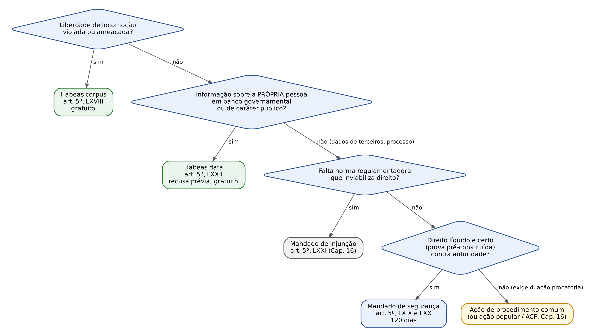
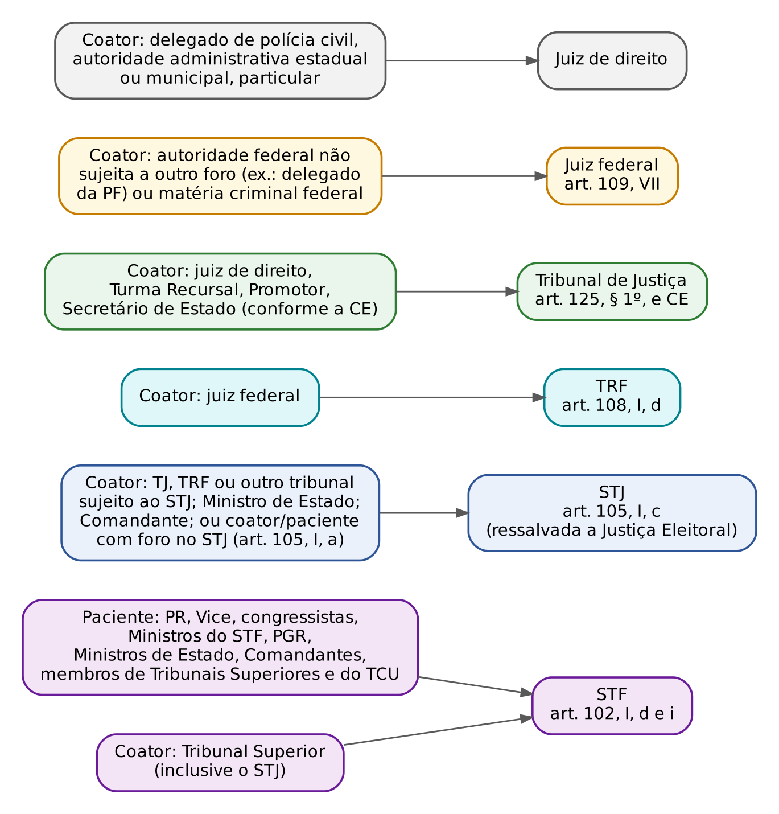
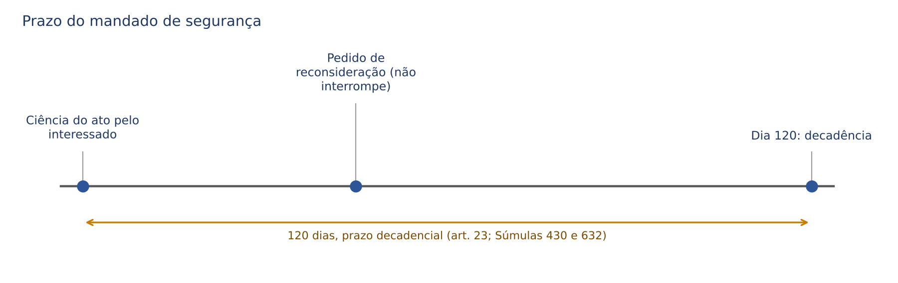
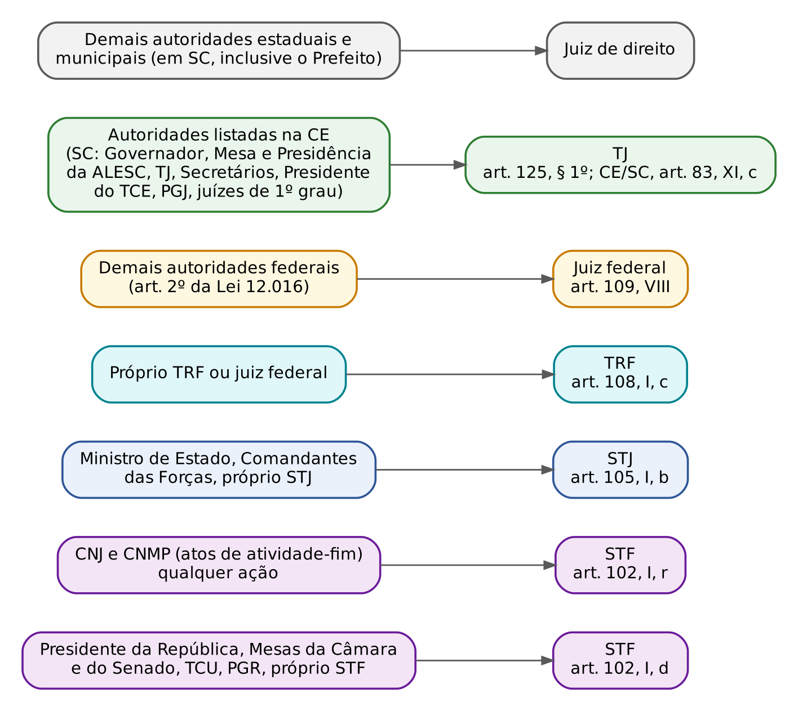
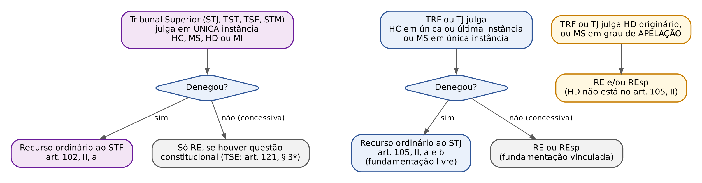

# CAPÍTULO 15 — REMÉDIOS CONSTITUCIONAIS I: HABEAS CORPUS, HABEAS DATA E MANDADO DE SEGURANÇA

:::INCIDENCIA
TRF5 p. 10; TJSC p. 16. Nível A. Lote: 48 questões (FGV 38, FCC 10).
O que mais cai: competência originária e RECURSO cabível (ordinário x RE/REsp) em MS, HC e HD; letra do art. 5º, LXIX, LXX, LXXII e LXXVII; direito líquido e certo e prova pré-constituída; HD x MS para acesso a informação.
:::

#### Mapa de cobrança

| Subtema | FGV | FCC | Padrão |
|---|---|---|---|
| MS individual: cabimento, autoridade, prazo, efeitos patrimoniais, prova | 15 | 3 | caso prático com a Lei 12.016/2009 e súmulas do STF; "prova pericial no MS" é o distrator clássico |
| Competência originária e recurso cabível (MS, HC, HD) | 9 | 1 | "o TJ denegou o MS: qual recurso e para quem?"; competência do TJ fixada na Constituição Estadual |
| MS coletivo | 5 | 3 | letra do art. 5º, LXX (partido "com representação no Congresso Nacional"; associação "há pelo menos um ano"); art. 21 e 22 da lei |
| Habeas data | 6 | 1 | dado sobre a PRÓPRIA pessoa x informação de terceiro (licitação: MS); anotação de explicação (art. 7º, III); gratuidade |
| Gratuidade (art. 5º, LXXVII) | 2 | 1 | só HC e HD são gratuitos por força da CF |
| Habeas corpus (inclusive coletivo) | 1 | 0 | HC coletivo contra ato normativo da administração penitenciária |

O procedimento do mandado de segurança e do *habeas data* está na Apostila de Processo Civil, Cap. 32; o do *habeas corpus*, na Apostila de Processo Penal, Cap. 30. Aqui se desenvolve o regime CONSTITUCIONAL: hipóteses de cabimento tal como recortadas pelo texto e pelo STF, legitimidade, competência originária e recursal em toda a estrutura judiciária, e as súmulas que a FGV transforma em caso prático. Mandado de injunção, ação popular, ação civil pública, petição e certidão: Cap. 16. Controle preventivo por MS de parlamentar: Cap. 3 (03.4.1) e Cap. 17.

## 15.1 Os remédios do art. 5º: visão de conjunto

Remédios constitucionais são garantias instrumentais: ações (não recursos) com assento no art. 5º, destinadas a tutelar direitos fundamentais contra ilegalidade ou abuso de poder. Como garantias individuais, integram o núcleo protegido pelo art. 60, § 4º, IV (é falso que "não são limites materiais ao poder de reforma", alternativa E da Q2450176; ver Cap. 3). O ponto de partida de toda questão de cabimento é a RESIDUALIDADE do mandado de segurança: o art. 5º, LXIX, só o concede para direito "não amparado por *habeas corpus* ou *habeas data*". Logo, a ordem de exame é sempre: liberdade de locomoção (HC) → informação sobre a própria pessoa em banco público (HD) → falta de norma regulamentadora (MI, Cap. 16) → direito líquido e certo contra autoridade (MS) → via ordinária.

| Aspecto | *Habeas corpus* | *Habeas data* | MS individual | MS coletivo |
|---|---|---|---|---|
| Fundamento | art. 5º, LXVIII; CPP, arts. 647 a 667 | art. 5º, LXXII; Lei 9.507/1997 | art. 5º, LXIX; Lei 12.016/2009 | art. 5º, LXX; Lei 12.016/2009, arts. 21 e 22 |
| Bem tutelado | liberdade de locomoção | conhecimento, retificação e anotação de dados da própria pessoa | direito líquido e certo residual | direitos coletivos e individuais homogêneos dos membros ou associados |
| Legitimidade ativa | qualquer pessoa, sem advogado; MP | o titular dos dados (ação personalíssima) | pessoa física ou jurídica, órgãos despersonalizados com prerrogativas, MP | partido com representação no CN; sindicato, entidade de classe ou associação (esta, há 1 ano) |
| Polo passivo | autoridade ou PARTICULAR | entidade governamental ou de caráter público | autoridade pública ou agente de PJ no exercício de atribuições do Poder Público | idem |
| Prazo | nenhum | nenhum (exige recusa prévia) | 120 dias, decadencial | 120 dias |
| Custas | gratuito (LXXVII) | gratuito (LXXVII) | custas na forma da lei; sem honorários | idem |
| Advogado | dispensável | indispensável | indispensável | indispensável |

:::DICA GRATUIDADE: SÓ DOIS
O art. 5º, LXXVII, torna gratuitas "as ações de *habeas corpus* e *habeas data*, e, na forma da lei, os atos necessários ao exercício da cidadania". MS e MI NÃO estão no rol; a ação popular tem regra própria (isenção de custas e sucumbência, salvo comprovada má-fé, LXXIII). A gratuidade é objetiva: independe da condição econômica do autor (ao contrário do registro civil de nascimento e da certidão de óbito, gratuitos pela CF só "para os reconhecidamente pobres", LXXVI). Ver Cap. 10 (10.9.9).
:::

:::QUESTAO FGV 2026 — PROVA NÃO IDENTIFICADA (Q3881041)
Caso: pessoa nada hipossuficiente vai ajuizar HC, MS, HD e MI e pergunta quais são gratuitos. Gabarito: C (apenas HC e HD). Armadilha: supor que a gratuidade dependa de hipossuficiência ou que alcance todas as "ações constitucionais". No mesmo sentido: Q3395826 (FGV 2025, gabarito C; distrator E condiciona a gratuidade à assistência da Defensoria) e Q3088357 (FCC 2024, TRT-7, gabarito E: HC e HD gratuitos, atos da cidadania na forma da lei, e registro de nascimento e certidão de óbito gratuitos "para os reconhecidamente pobres"; as alternativas A a D trocavam "apenas HC" ou "independentemente da condição social").
:::

:::QUESTAO FCC 2025 — TRT-15 — ANALISTA JUDICIÁRIO (Q3303227)
Afirmações sobre o MS à luz da CF. Gabarito: E, a reprodução do art. 5º, LXIX. Erradas: A descreve o mandado de injunção; B atribui gratuidade ao MS; C fixa "cinco anos" de funcionamento à associação (são UM ano); D admite partido "com ou sem representação". No mesmo sentido, cobrando a letra do LXIX: Q2450176 (FGV 2024, AL-PR, gabarito B; erradas: A troca ação popular por "ação civil pública" proposta por "todo cidadão", C atribui ao HD a tutela da locomoção, D chama de ação popular o remédio contra omissão legislativa, E nega que os remédios sejam cláusula pétrea) e Q3038832 (FGV 2024, gabarito B: direito líquido e certo, prova pré-constituída e 120 dias identificam o MS).
:::

## 15.2 Habeas corpus

### 15.2.1 Objeto e hipóteses de cabimento

:::LEI CF, ART. 5º, LXVIII
"conceder-se-á *habeas corpus* sempre que alguém sofrer ou se achar ameaçado de sofrer violência ou coação em sua liberdade de locomoção, por ilegalidade ou abuso de poder;"
:::

Três elementos do texto organizam o cabimento. Primeiro, o bem tutelado é exclusivamente a liberdade de locomoção (ir, vir, permanecer): a "doutrina brasileira do *habeas corpus*", que o estendia a outros direitos, foi encerrada pela reforma constitucional de 1926 e, desde 1934, os demais direitos líquidos e certos ficaram com o MS (Cap. 1). Segundo, a lesão pode ser atual (HC liberatório ou repressivo, com alvará de soltura) ou potencial (HC preventivo, com salvo-conduto): basta que o ato possa, direta ou indiretamente, resultar em constrição da liberdade. Por isso cabe HC para trancar inquérito ou ação penal por falta de justa causa (CPP, art. 648, I), para declarar extinta a punibilidade (VII) ou para anular processo manifestamente nulo (VI), mesmo com o paciente solto, desde que o crime seja punido com pena privativa de liberdade. Terceiro, a coação deve decorrer de "ilegalidade ou abuso de poder", o que inclui ato de particular (internação psiquiátrica compulsória irregular, retenção de paciente em hospital por dívida, cárcere privado): o texto, ao contrário do MS, não exige autoridade.

O controle é de legalidade, em cognição sumária e sobre prova pré-constituída: o HC não comporta dilação probatória nem reexame aprofundado de fatos e provas, embora admita a revaloração jurídica de fatos incontroversos.

### 15.2.2 Limites constitucionais e sumulares

:::LEI CF, ART. 142, § 2º
"Não caberá *habeas corpus* em relação a punições disciplinares militares."
:::

A vedação alcança o MÉRITO da punição disciplinar militar (conveniência e oportunidade, justiça da sanção), não a sua legalidade. O STF admite o HC para examinar os pressupostos de legalidade: hierarquia (o punidor tinha poder disciplinar sobre o punido?), existência do poder disciplinar, relação da punição com a função e pena prevista em lei e aplicada por quem tinha competência. A regra estende-se aos militares dos Estados (art. 42, § 1º, que manda aplicar o art. 142, §§ 2º e 3º). O CPP, art. 647, ressalva genericamente a "punição disciplinar", mas a leitura constitucional restringe a ressalva à militar: punição disciplinar de servidor civil não envolve, em regra, privação de liberdade, de modo que nem chega a haver objeto para o HC.

| Súmula do STF | Enunciado em síntese | Por que não cabe ou como cabe |
|---|---|---|
| 693 | não cabe HC contra condenação só a MULTA ou processo por infração a que a multa seja a ÚNICA pena cominada | a multa não se converte em prisão (CP, art. 51); se a pena for "detenção ou multa", cabe HC durante o processo |
| 694 | não cabe HC contra exclusão de militar, perda de patente ou de função pública | sanção sem reflexo na locomoção; via adequada: MS ou ação comum |
| 695 | não cabe HC quando já extinta a pena privativa de liberdade | desaparece o risco à locomoção; a revisão criminal é a via |
| 395 | não se conhece de recurso de HC sobre ônus das custas | não está mais em causa a liberdade |
| 606 | não cabe HC originário ao Pleno do STF contra decisão de Turma ou do Plenário em HC ou recurso de HC | órgãos do mesmo tribunal não são coatores uns dos outros |
| 691 | não compete ao STF conhecer de HC contra decisão de relator de tribunal superior que indefere liminar em HC | evita supressão de instância; superável em flagrante ilegalidade ou teratologia |
| 692 | não se conhece de HC contra omissão de relator de extradição não provocado, se fundado em fato ou direito estrangeiro sem prova nos autos | — |
| 208 | o assistente do MP não pode recorrer extraordinariamente de decisão concessiva de HC | — |
| 690 | competência do STF para HC contra Turma Recursal | SUPERADA: o Plenário (HC 86.834/SP, Relator Ministro Marco Aurélio, j. 23/8/2006, Info 437) passou a reconhecer a competência do TJ ou do TRF |

:::QUESTAO FGV 2024 — SES-MT — ADVOGADO (Q2482644)
Classificada no Cap. 16, mas o item I é deste capítulo: afirma que o HC é via idônea contra inabilitação para cargo ou função pública. Falso (Súmula 694 e, por extensão, ausência de risco à locomoção). Gabarito: D (II e III: requisitos do MI segundo o STF e competência originária do STF para MS contra o Presidente e as Mesas).
:::

Outros limites relevantes para prova:

- Pessoa jurídica pode IMPETRAR HC em favor de pessoa física, mas não pode ser PACIENTE: não tem liberdade de locomoção, nem mesmo quando ré em crime ambiental.
- HC preventivo é a via para a pessoa convocada por CPI resguardar o direito ao silêncio quanto a fatos que a incriminem e a assistência por advogado; a competência é do STF quando se trata de CPI do Congresso ou de suas Casas, porque o coator está sujeito diretamente à jurisdição do STF (art. 102, I, *i*). Detalhes das CPIs: Cap. 25.
- Prisão civil do devedor de alimentos: o HC controla a legalidade (fundamentação, prestações abrangidas, intimação pessoal), não a capacidade econômica do alimentante (Apostila de Processo Civil, Cap. 32.14); prisão do depositário: ilícita (SV 25; Cap. 10).
- HC substitutivo de recurso: o STF e o STJ, em regra, não conhecem do HC usado no lugar do recurso cabível, mas examinam a impetração para conceder a ordem de ofício diante de flagrante ilegalidade. Desde a Lei 14.836/2024, isso está positivado: CPP, art. 647-A, parágrafo único (ver 15.2.3).

### 15.2.3 Legitimidade e concessão de ofício

Legitimidade ativa universal: "qualquer pessoa, em seu favor ou de outrem, bem como pelo Ministério Público" (CPP, art. 654). Não exige capacidade postulatória (o Estatuto da OAB ressalva o HC da atividade privativa da advocacia), nem capacidade civil plena, nem nacionalidade brasileira; pessoa jurídica impetra em favor de pessoa física. O MP impetra em favor do investigado ou réu (não para prejudicá-lo). O paciente pode opor-se à impetração feita por terceiro, e essa vontade deve ser considerada (ver Apostila de Processo Penal, Cap. 30.2.5, sobre o "desafeto" que impetra).

Legitimidade passiva: o coator, autoridade ou particular. A competência se define pela qualidade do coator e, em alguns casos, do paciente (15.2.5).

:::LEI CPP, ART. 647-A (LEI 14.836/2024)
"No âmbito de sua competência jurisdicional, qualquer autoridade judicial poderá expedir de ofício ordem de *habeas corpus*, individual ou coletivo, quando, no curso de qualquer processo judicial, verificar que, por violação ao ordenamento jurídico, alguém sofre ou se acha ameaçado de sofrer violência ou coação em sua liberdade de locomoção."
Parágrafo único: a ordem pode ser concedida de ofício pelo juiz ou pelo tribunal, em competência originária ou recursal, "ainda que não conhecidos a ação ou o recurso em que veiculado o pedido de cessação de coação ilegal".
:::

Duas novidades da Lei 14.836/2024 importam para o constitucionalista: (a) a referência legal expressa ao HC COLETIVO, até então construção jurisprudencial; (b) a regra de julgamento do art. 41-A, parágrafo único, da Lei 8.038/1990: em todos os julgamentos em matéria penal ou processual penal em órgãos colegiados, havendo EMPATE, prevalece a decisão mais favorável ao imputado, proclamada de imediato, ainda que o colegiado esteja incompleto por vaga, impedimento, suspeição ou ausência.

### 15.2.4 Habeas corpus coletivo

O STF admitiu o HC coletivo ao julgar o HC 143.641 (Segunda Turma, Relator Ministro Ricardo Lewandowski, fevereiro de 2018), impetrado em favor de todas as mulheres presas preventivamente gestantes, puérperas ou mães de crianças e de pessoas com deficiência. Fundamentos: (a) a CF não restringe a impetração à forma individual; (b) a sociedade de massa produz lesões em série, e o processo coletivo (CDC, art. 83, aplicado ao microssistema) é a resposta adequada; (c) o acesso à justiça dos grupos vulneráveis (presos sem defesa técnica efetiva) recomenda a tutela coletiva. Legitimidade ativa: por analogia ao art. 12 da Lei 13.300/2016 (MI coletivo), Ministério Público, Defensoria Pública, partido político com representação no Congresso Nacional e organização sindical, entidade de classe ou associação. Conteúdo da ordem: substituição da preventiva por domiciliar, salvo crimes com violência ou grave ameaça, crimes contra os próprios descendentes ou situações excepcionalíssimas, fundamentadas pelo juiz; a Turma estendeu a ordem, de ofício, às adolescentes em cumprimento de medida socioeducativa na mesma situação.

Sequência relevante: o HC 165.704 (Segunda Turma, Relator Ministro Gilmar Mendes, j. 20/10/2020), coletivo impetrado pela DPU, estendeu a lógica aos pais e responsáveis por crianças com menos de 12 anos e por pessoas com deficiência, desde que únicos responsáveis, com análise caso a caso e as mesmas exclusões.

Requisitos que a doutrina e a jurisprudência extraem: grupo determinável de pacientes, situação jurídica homogênea (origem comum da coação) e risco atual ou iminente à locomoção. O ato normativo GERAL que cria obstáculo automático a direito ligado à liberdade (progressão, remição, saída) já configura ameaça concreta ao grupo, sem necessidade de aguardar cada decisão individual.

:::QUESTAO FGV 2026 — DPE-RJ — DEFENSOR PÚBLICO (Q4289364)
Caso: resolução da Secretaria de Administração Penitenciária torna automaticamente inelegíveis para trabalho e estudo (e, portanto, para remição) todos os presos com qualquer falta disciplinar nos últimos 12 meses. A Defensoria impetra HC coletivo no TJ contra o Secretário de Estado. Gabarito: B (cabível; o ato normativo que cria obstáculo geral à remição é ameaça real e iminente à liberdade do grupo).
Resolução em passos: (1) bem tutelado: a remição abrevia a pena, logo a regra afeta a locomoção; (2) ameaça: o impedimento é automático e imediato, não depende de decisão futura (afasta A); (3) legitimidade: Defensoria é legitimada (afasta D, que reserva o HC coletivo ao MP); (4) competência: Secretário de Estado tem foro no TJ segundo a Constituição Estadual (afasta E: o STJ só julga HC quando o coator for tribunal sujeito à sua jurisdição ou autoridade do art. 105, I, *a* e *c*); (5) ADI estadual seria controle abstrato em face da Constituição Estadual, não a via para tutelar a liberdade do grupo (afasta C).
:::

:::SENTENCA CONCESSÃO DE HC COLETIVO CONTRA ATO NORMATIVO
"O ato impugnado não se limita a disciplinar abstratamente a execução penal: por força dele, todos os apenados com anotação disciplinar nos últimos doze meses ficam, de imediato e sem exame individual, excluídos das atividades que viabilizam a remição. Trata-se de restrição automática que repercute diretamente no tempo de privação da liberdade de grupo determinado, com origem comum, o que autoriza a tutela coletiva (STF, HC 143.641; CPP, art. 647-A). Concedo a ordem para suspender os efeitos da resolução em relação aos pacientes, sem prejuízo da avaliação individual, pelo juízo da execução, da aptidão de cada apenado para o trabalho ou o estudo."
:::

### 15.2.5 Competência originária e recursal

A competência no HC é fixada pela hierarquia do COATOR (regra geral) e, em hipóteses específicas, do PACIENTE. A lógica é de simetria: julga o HC o órgão a que caberia julgar o coator por crime comum ou, no caso de juiz, o tribunal ao qual ele está vinculado.

| Órgão | Hipótese | Fundamento |
|---|---|---|
| STF | paciente: Presidente, Vice, congressistas, Ministros do STF, PGR, Ministros de Estado, Comandantes das Forças, membros dos Tribunais Superiores e do TCU, chefes de missão diplomática permanente | art. 102, I, *d* |
| STF | coator: Tribunal Superior; coator ou paciente sujeito diretamente à jurisdição do STF; crime sujeito à jurisdição do STF em única instância | art. 102, I, *i* |
| STJ | coator ou paciente: Governadores, desembargadores, membros de TCE e TCM, de TRF, TRE e TRT, membros do MPU que oficiem perante tribunais; coator: tribunal sujeito à sua jurisdição, Ministro de Estado ou Comandante, ressalvada a Justiça Eleitoral | art. 105, I, *c* |
| TRF | coator: juiz federal | art. 108, I, *d* |
| Juiz federal | matéria criminal de sua competência ou coator federal não sujeito diretamente a outra jurisdição (delegado da PF) | art. 109, VII |
| Justiça do Trabalho | ato questionado envolve matéria sujeita à sua jurisdição | art. 114, IV |
| TJ | coator ou paciente com foro no TJ conforme a Constituição Estadual (juiz de direito, promotor, Secretário de Estado), Turma Recursal | art. 125, § 1º; CE/SC, art. 83, XI, *d* |
| Juiz de direito | demais autoridades e particulares | competência residual |

Pontos finos:

- Ato de Ministro de Estado como coator: STJ (art. 105, I, *c*); Ministro de Estado como PACIENTE: STF (art. 102, I, *d*, c/c *c*). A FCC explora a inversão (Q3170845, Cap. 30: HC sendo paciente Ministro de Estado é do STF).
- Coator desembargador ou TJ: STJ; se o STJ denegar, recurso ordinário ao STF (art. 102, II, *a*), porque o STJ julgou em única instância (Q3872161, Cap. 30).
- Coator membro do MP estadual: TJ, por simetria com a competência para julgá-lo por crime comum (art. 96, III); procurador da República de primeiro grau: TRF (art. 108, I, *a*).
- Turma Recursal: TJ ou TRF, não o STF (Súmula 690 superada).
- A Constituição de SC atribui ao TJ os HC "quando o coator ou paciente for autoridade diretamente sujeita a sua jurisdição" (art. 83, XI, *d*).

Recursos. Contra a decisão de juiz de primeiro grau, recurso em sentido estrito (CPP, art. 581, X), além do reexame necessário da concessão (art. 574, I); contra acórdão de TJ ou TRF que DENEGA a ordem, em única OU ÚLTIMA instância, recurso ordinário constitucional ao STJ (art. 105, II, *a*; prazo de 5 dias, Lei 8.038/1990, art. 30); contra decisão denegatória de Tribunal Superior em única instância, recurso ordinário ao STF (art. 102, II, *a*; 5 dias, Súmula 319 do STF). Note a assimetria: para o HC, o ROC ao STJ cabe em "única ou última instância" (abrange o HC julgado pelo TJ em grau de recurso); para o MS, só em "única instância" (originário). Decisão concessiva: só RE ou REsp, se presentes os requisitos.

:::QUESTAO FGV 2025 — TJ-GO — RESIDENTE JURÍDICO (Q3345909)
Caso: TJ denega HC de sua competência originária; o impetrante alega afronta ao direito de defesa (norma constitucional). Gabarito: C (recurso ordinário). Armadilha: a menção à CF induz ao RE (D); mas o recurso ordinário é de fundamentação LIVRE e cabe sempre que a decisão for denegatória, qualquer que seja a norma violada; julga-o o STJ (art. 105, II, *a*). No mesmo sentido: Q3780426 (FGV 2025, Cap. 30: prisão em flagrante mantida, HC denegado pelo TJ, recurso ao STJ) e Q3174666 (FGV 2025, TCE-RR, Cap. 30: recurso de fundamentação livre ao STJ).
:::

:::PEGADINHA "ÚLTIMA INSTÂNCIA" SÓ PARA O HC
Art. 105, II: alínea *a* (HC) diz "decididos em única ou última instância"; alínea *b* (MS) diz "decididos em única instância". MS julgado pelo TJ em apelação não comporta ROC: cabem RE e REsp (Q3049392, FGV 2024, TJSC, Juiz, Cap. 30: MS denegado pelo TJ em apelação, em que se discutia validade de lei municipal contestada em face de lei federal; gabarito D, recurso de fundamentação vinculada ao STF, art. 102, III, *d*).
:::

## 15.3 Habeas data

### 15.3.1 Cabimento

:::LEI CF, ART. 5º, LXXII
"conceder-se-á *habeas data*:
a) para assegurar o conhecimento de informações relativas à pessoa do impetrante, constantes de registros ou bancos de dados de entidades governamentais ou de caráter público;
b) para a retificação de dados, quando não se prefira fazê-lo por processo sigiloso, judicial ou administrativo;"
:::

A Lei 9.507/1997 acrescentou uma terceira finalidade (art. 7º, III): "a anotação nos assentamentos do interessado, de contestação ou explicação sobre dado verdadeiro mas justificável e que esteja sob pendência judicial ou amigável". O STJ sintetiza o tríplice aspecto do remédio: acesso, retificação e complementação de registros (HD 147, Terceira Seção, Relator Ministro Arnaldo Esteves Lima, j. 28/2/2008).

Quatro filtros resolvem quase todas as questões:

1. Informação relativa à PESSOA DO IMPETRANTE. O HD não serve para obter dados de terceiros, de processos administrativos em geral, de licitações ou de gastos públicos: o acesso a informações de interesse particular, coletivo ou geral (art. 5º, XXXIII; Lei 12.527/2011) é tutelado por MS. Daí as questões em que empresa jornalística quer acesso a procedimentos licitatórios: MS individual, não HD.

2. Banco de dados de entidade governamental OU DE CARÁTER PÚBLICO. Caráter público é definido pela lei: "todo registro ou banco de dados contendo informações que sejam ou que possam ser transmitidas a terceiros ou que não sejam de uso privativo do órgão ou entidade produtora ou depositária das informações" (Lei 9.507/1997, art. 1º, parágrafo único). Bancos privados de proteção ao crédito são de caráter público (CDC, art. 43, § 4º); a ficha funcional interna de uma empresa privada, de uso exclusivo dela, não.

3. Recusa PRÉVIA (interesse de agir). "Não cabe o *habeas data* (CF, art. 5º, LXXII, letra 'a') se não houve recusa de informações por parte da autoridade administrativa" (Súmula 2 do STJ). A inicial deve provar a recusa ou o decurso de mais de 10 dias sem decisão (acesso) ou de mais de 15 dias (retificação ou anotação) (Lei 9.507/1997, art. 8º, parágrafo único). É exceção legítima à inafastabilidade sem prévio requerimento (Cap. 10, 10.9.1).

4. Desnecessidade de motivar o pedido. O titular não precisa justificar por que quer conhecer seus próprios dados; a negativa fundada em "motivo não declinado", em "dado sensível" ou em necessidade de "autorização judicial" é ilegítima quando se trata de informação sobre o próprio requerente.

:::JURIS STF, TEMA 582 (RG) — RE 673.707, RELATOR MINISTRO LUIZ FUX, PLENÁRIO, J. 17/6/2015
"O *habeas data* é a garantia constitucional adequada para a obtenção, pelo próprio contribuinte, dos dados concernentes ao pagamento de tributos constantes de sistemas informatizados de apoio à arrecadação dos órgãos da administração fazendária dos entes estatais." No caso, o sistema SINCOR da Receita Federal (conta corrente de pessoa jurídica). O argumento fazendário de que o sistema seria de uso interno, sem caráter público, foi rejeitado: as informações são do contribuinte e a ele não podem ser opostas.
:::

| Situação | Remédio | Por quê |
|---|---|---|
| Acesso a dados próprios em cadastro público negado | HD (art. 7º, I) | informação relativa à pessoa do impetrante |
| Correção de dado falso que causou prisão por homonímia | HD (art. 7º, II), gratuito | retificação; LXXVII |
| Inserção de explicação sobre dado verdadeiro em discussão judicial | HD (art. 7º, III) | anotação, criada pela lei |
| Acesso a autos de licitação, contratos, gastos | MS (direito de informação, art. 5º, XXXIII) | não é dado da própria pessoa |
| Vista de processo administrativo ou certidão para defesa de direitos | MS (art. 5º, XXXIV, *b*) | certidão não se confunde com HD (Cap. 16) |
| Identidade de denunciante em processo disciplinar | não é HD; o tema é sigilo de terceiro, discutido por MS ou ação própria | o dado se refere a outra pessoa |

:::QUESTAO FGV 2025 — PGM-RJ — ANALISTA DE PROCURADORIA (Q3606003)
Caso: cidadão pede à Secretaria informações sobre si em banco de dados do órgão; pedido indeferido sem motivo de sigilo. Gabarito: E (HD). No mesmo sentido: Q3152849 (FGV 2025, Prefeitura de Cuiabá: negativa de acesso aos próprios dados de cadastro de programa assistencial sob alegação de "informação sensível" e exigência de autorização judicial; gabarito C, HD, pelo caráter pessoal da informação; armadilha D, MS, que é residual); Q3028698 (FGV 2024, TRF1, Analista: servidora aposentada que informa motivo "pessoal" sem especificar; gabarito C: dados devidos e HD gratuito; afastadas a necessidade de motivação, o sigilo pela aposentadoria e a autorização judicial; E, MS, falha pela residualidade).
:::

:::QUESTAO FGV 2026 — PC-PI — OFICIAL INVESTIGADOR (Q3846853)
Caso: empresário preso por homonímia quer retificar seus dados em cadastros públicos por ação constitucional, sem processo sigiloso. Gabarito: D (HD, gratuito por expressa previsão constitucional). Armadilhas: B (HD com custas) e C (MS gratuito); o texto do LXXII, *b*, ressalva a retificação "quando não se prefira fazê-lo por processo sigiloso", exatamente o dado do enunciado.
:::

:::QUESTAO FGV 2024 — TJ-AP — ANALISTA JUDICIÁRIO (Q2442294)
Caso: dado verdadeiro, mas negativo, em banco público; o titular quer anotar sua versão porque a matéria está em discussão judicial; requerimento indeferido. Gabarito: A (HD é cabível). Fundamento: Lei 9.507/1997, art. 7º, III, c/c art. 4º, § 2º. Armadilhas: B (o acesso já assegurado não esgota o HD), E (exigir prova documental de inexatidão: a anotação pressupõe dado VERDADEIRO). No mesmo sentido: Q3745787 (FCC 2025, PGE-MT, gabarito C).
:::

:::QUESTAO FCC 2025 — PGE-MT — PROCURADOR DO ESTADO (Q3745787)
Afirmações sobre o HD. Gabarito: C (anotação de explicação sobre dado verdadeiro, justificável e pendente de discussão judicial). Erradas: A (do HD originário do STJ cabe recurso ordinário ao STF só se DENEGATÓRIA a decisão, art. 102, II, *a*, e não "se acolhido ou rejeitado"); B (a sentença concessiva desafia apelação com efeito meramente devolutivo, Lei 9.507/1997, art. 15, parágrafo único); D (lei estadual não pode instituir taxa judiciária sobre ação constitucionalmente gratuita); E (a intervenção do MP no HD não se restringe ao requerente incapaz: a lei prevê a oitiva do MP em todo HD).
:::

:::QUESTAO FGV 2024 — PC-SC — DELEGADO (Q2360675)
Caso: empresa jornalística quer acesso a processos licitatórios de merenda escolar, negado arbitrariamente pela Secretaria Municipal. Gabarito: A (MS individual). Armadilha: B (HD), porque a informação não é relativa à pessoa da impetrante; C (ação popular) exige cidadão e ato lesivo; D e E (MS coletivo e ACP) não são vias da empresa para direito próprio. No mesmo sentido: Q3846050 (FGV 2026, AMAZUL, Advogado; idêntica estrutura, licitação do São João, gabarito A).
:::

Legitimidade. Ativa: o titular dos dados, pessoa física ou jurídica, nacional ou estrangeira; ação personalíssima, mas o STJ admitiu o cônjuge sobrevivente na defesa de interesse do falecido (HD 147). Passiva: a entidade ou órgão depositário (ou seu dirigente), governamental ou de caráter público, inclusive pessoa jurídica de direito privado. O mesmo HD 147 aplicou ao HD a teoria da encampação: a autoridade que não se limita a alegar ilegitimidade e defende o mérito do ato assume a legitimidade passiva. Assim como no MS, cabe HD também contra a demora irrazoável (omissão) em responder.

Relação com a proteção de dados. A EC 115/2022 incluiu o direito fundamental à proteção dos dados pessoais, inclusive nos meios digitais (art. 5º, LXXIX; Cap. 9). O HD continua sendo o remédio específico para acesso, retificação e anotação; os demais direitos do titular previstos na LGPD (eliminação, portabilidade, revogação do consentimento) são exigidos administrativamente ou por ação comum ou MS, conforme o caso.

### 15.3.2 Competência e recursos

A CF reparte a competência do HD junto com a do MS, pela autoridade: STF contra atos do Presidente da República, das Mesas da Câmara e do Senado, do TCU, do PGR e do próprio STF (art. 102, I, *d*); STJ contra ato de Ministro de Estado, dos Comandantes das Forças ou do próprio STJ (art. 105, I, *b*); TRF contra ato do próprio tribunal ou de juiz federal (art. 108, I, *c*); juiz federal contra ato de autoridade federal (art. 109, VIII); Justiça do Trabalho quando a matéria estiver sujeita à sua jurisdição (art. 114, IV); TJ conforme a Constituição Estadual (em SC, as mesmas autoridades do MS: art. 83, XI, *c*); juiz estadual nos demais casos (Lei 9.507/1997, art. 20, I, *f*).

:::QUESTAO FCC 2024 — TRT-20 — TÉCNICO JUDICIÁRIO (Q3169931)
Pede-se o remédio para conhecer informações pessoais em bancos públicos e a competência. Gabarito: D (HD; STF quando contra atos da Mesa da Câmara dos Deputados). Armadilhas: atribuir ao STJ os atos da Mesa do Senado (A) ou do TCU (C), que são do STF; B e E trocam o remédio pelo MS.
:::

:::PEGADINHA RECURSO ORDINÁRIO NO HD: SÓ PARA O STF
O art. 102, II, *a*, inclui o HD no recurso ordinário ao STF (decisão denegatória de Tribunal Superior em única instância). O art. 105, II, NÃO inclui o HD: só HC (alínea *a*) e MS (alínea *b*). Contra acórdão de TRF ou TJ em HD originário cabem RE e REsp, e não ROC. A Lei 9.507/1997, art. 20, II, *b*, refere-se a recurso ao STJ "quando a decisão for proferida em única instância pelos Tribunais Regionais Federais", mas não pode criar hipótese de recurso ordinário não prevista na CF; em prova objetiva, prevalece a letra constitucional. É por isso que a FGV pergunta "qual causa o TJ julgou, se coube recurso de fundamentação livre?": só pode ter sido MS (Q3520308, 15.6.3).
:::

O procedimento (rito sumário, informações em 10 dias, prioridade sobre todos os atos judiciais salvo HC e MS, art. 19) está na Apostila de Processo Civil, Cap. 32.13.

## 15.4 Mandado de segurança individual

### 15.4.1 Natureza e direito líquido e certo

:::LEI CF, ART. 5º, LXIX
"conceder-se-á mandado de segurança para proteger direito líquido e certo, não amparado por *habeas corpus* ou *habeas data*, quando o responsável pela ilegalidade ou abuso de poder for autoridade pública ou agente de pessoa jurídica no exercício de atribuições do Poder Público;"
:::

O MS é ação constitucional de natureza civil, de rito sumário especial, mesmo quando impetrado em matéria criminal (Súmula 701 do STF: no MS do MP contra decisão em processo penal, é obrigatória a citação do réu como litisconsorte passivo). Pode ser repressivo ou preventivo ("justo receio", Lei 12.016/2009, art. 1º).

Direito líquido e certo é conceito PROCESSUAL, não material: designa o direito cujos fatos constitutivos estão comprovados de plano, por prova documental pré-constituída. A complexidade jurídica é irrelevante: "Controvérsia sobre matéria de direito não impede concessão de mandado de segurança" (Súmula 625 do STF). Consequências:

- Não há dilação probatória: perícia, prova oral e inspeção são incompatíveis com o rito. A necessidade delas não leva à improcedência, mas à extinção sem mérito por inadequação da via, ressalvada a ação própria (art. 19).
- A única "produção" de prova admitida é a requisição de documento em poder da autoridade ou de terceiro que se recuse a fornecê-lo (art. 6º, § 1º): não é dilação, é exibição de prova documental preexistente.
- Divergência técnica sobre fatos (equivalência de certificações, qualidade de um serviço, nexo causal médico) torna o direito ilíquido.

:::QUESTAO FGV 2026 — TRF-2 — JUIZ FEDERAL SUBSTITUTO (Q3996863)
Caso: licitante inabilitada impetra MS contra decisão da comissão de autarquia federal sobre equivalência de certificações técnicas; a autoridade afirma que a solução exige perícia, e o juiz constata divergência documental e dependência de exame técnico. Gabarito: C (o MS exige prova pré-constituída e é, em regra, incompatível com a necessidade de prova técnica ou dilação probatória).
Resolução em passos: (1) a questão jurídica (interpretação das normas regulatórias) não impede o MS (Súmula 625); (2) mas o enunciado acrescenta controvérsia FÁTICA que depende de perícia; (3) logo, falta liquidez e certeza; (4) A e B, que admitem perícia "limitada", contrariam a natureza do rito; (5) D erra pelo excesso: a matéria técnica não afasta o MS "automaticamente" se a documentação bastar; (6) E erra ao vedar MS em licitação (é via comum para impugnar inabilitação).
:::

:::QUESTAO FGV 2025 — AL-AM — ASSESSOR JURÍDICO (Q3777493)
Caso: candidato eliminado de concurso por suposta fraude na prova prática impetra MS pedindo perícia nos vídeos e oitiva de fiscais; o juiz indefere a inicial por inadequação da via e condena em custas e honorários. Gabarito: E (o indeferimento foi correto: o MS exige prova pré-constituída). Armadilhas: A (não há conversão do MS em procedimento comum), B e C (instrução no MS), D (honorários são incabíveis no MS, art. 25 da Lei 12.016/2009 e Súmula 512 do STF; a condenação, aliás, era o vício da sentença, mas a alternativa correta pergunta só sobre o indeferimento). No mesmo sentido: Q3345939 (FGV 2025, TJ-GO, Residente: gabarito B, 120 dias da ciência; erradas: MS sem direito líquido e certo, honorários, perícia e associação com "seis meses").
:::

:::SENTENCA EXTINÇÃO DO MS POR NECESSIDADE DE DILAÇÃO PROBATÓRIA
"A pretensão depende da demonstração de fato controvertido, a equivalência técnica entre os modelos de certificação, que a documentação acostada não comprova e que, segundo as próprias partes, exige exame pericial. O mandado de segurança pressupõe prova pré-constituída dos fatos em que se funda o direito (CF, art. 5º, LXIX), sendo inviável a dilação probatória. Ausente a liquidez e certeza, denego a segurança, sem resolução do mérito (Lei 12.016/2009, art. 6º, § 5º, c/c CPC, art. 485, IV), ressalvado o acesso às vias ordinárias (art. 19). Sem honorários (art. 25)."
:::

### 15.4.2 Autoridade coatora e atos equiparados

O texto constitucional define o polo passivo pelo EXERCÍCIO DE FUNÇÃO PÚBLICA, não pela natureza da pessoa: "autoridade pública ou agente de pessoa jurídica no exercício de atribuições do Poder Público". A lei explicita:

:::LEI LEI 12.016/2009, ART. 1º, §§ 1º E 2º
"§ 1º Equiparam-se às autoridades, para os efeitos desta Lei, os representantes ou órgãos de partidos políticos e os administradores de entidades autárquicas, bem como os dirigentes de pessoas jurídicas ou as pessoas naturais no exercício de atribuições do poder público, somente no que disser respeito a essas atribuições.
§ 2º Não cabe mandado de segurança contra os atos de gestão comercial praticados pelos administradores de empresas públicas, de sociedade de economia mista e de concessionárias de serviço público."
:::

- Delegatários (concessionárias, instituições privadas de ensino superior, serventias extrajudiciais) respondem quanto à atividade delegada; não quanto à gestão privada. Ato de licitação de estatal não é gestão comercial: cabe MS (Súmula 333 do STJ, que fala em licitação promovida por sociedade de economia mista ou empresa pública); a jurisprudência estende o raciocínio ao concurso público de estatal.
- Autoridade coatora é quem pratica o ato ou de quem emana a ordem para a sua prática (art. 6º, § 3º), não o mero executor. Ato por DELEGAÇÃO: "Praticado o ato por autoridade, no exercício de competência delegada, contra ela cabe o mandado de segurança ou a medida judicial" (Súmula 510 do STF). Inversamente, na nomeação de magistrado pelo Presidente da República, ele é o coator, ainda que o vício esteja em fase anterior do procedimento (Súmula 627 do STF).
- Encampação (Súmula 628 do STJ): a autoridade hierarquicamente superior indicada erroneamente torna-se legitimada se (a) houver vínculo hierárquico com a que praticou o ato, (b) manifestar-se sobre o mérito nas informações e (c) a encampação não alterar a competência constitucional (não se "puxa" para o STJ, por exemplo, um MS que seria de juiz federal indicando-se Ministro de Estado).
- Atos do Poder Legislativo e do Judiciário em função administrativa são atos de autoridade. Atos *interna corporis* (interpretação e aplicação do regimento sem reflexo em direito subjetivo ou em norma constitucional) são, em regra, imunes ao controle judicial; mas o indeferimento, por conveniência genérica, de prerrogativa assegurada ao parlamentar pelo regimento e pela lei orgânica viola direito subjetivo e comporta MS.

:::QUESTAO FGV 2026 — ALERJ — PROCURADOR LEGISLATIVO (Q3880777)
Caso: Presidente da Câmara Municipal indefere, por "conveniência administrativa" genérica, requerimento de vereadores amparado no Regimento e na Constituição local, sem procedimento nem contraditório. Gabarito: A (cabe MS contra ato de autoridade do Legislativo). Erradas: B (imunidade absoluta dos atos da Presidência), C (ação popular exige lesividade a bem público e é do cidadão), D (esgotamento da via administrativa não é requisito), E (discricionariedade não afasta o controle de juridicidade quando há prerrogativa definida).
:::

:::QUESTAO FCC 2025 — PGE-MT — PROCURADOR DO ESTADO (Q3745788)
Gabarito: A (cabe MS contra dirigente de pessoa jurídica de direito privado que exerce atribuições do Poder Público por delegação; CF, art. 5º, LXIX; art. 1º, § 1º). Erradas: B (renovação do pedido extinto sem mérito só "dentro do prazo decadencial" original, art. 6º, § 6º; o prazo não se reabre da sentença); C (do indeferimento da inicial pelo juiz cabe apelação, art. 10, § 1º); D (o litisconsorte ativo só ingressa até o despacho da inicial, art. 10, § 2º); E (a autoridade coatora tem direito de recorrer, art. 14, § 2º).
:::

:::QUESTAO FCC 2025 — UNICAMP — PROCURADOR DE UNIVERSIDADE (Q3891329)
Gabarito: E (I e IV corretas: equiparação de órgãos de partidos e administradores de autarquias, art. 1º, § 1º; reexame necessário da sentença concessiva, art. 14, § 1º). Erradas: II (com recurso administrativo com efeito suspensivo e sem caução, NÃO cabe MS, art. 5º, I); III (da decisão sobre liminar cabe agravo de instrumento, art. 7º, § 1º); V (a autoridade coatora pode recorrer, art. 14, § 2º).
:::

:::QUESTAO FGV 2026 — TJ-MS — ANALISTA JUDICIÁRIO (Q3856319)
Gabarito: C (contra ato praticado por autoridade no exercício de competência delegada, o MS é dirigido contra ela, Súmula 510 do STF). Erradas: A (prazo de 30 dias; são 120), B (fatos provados "no curso da instrução"), D (partido "independentemente de representação no Congresso"), E (associação com "seis meses").
:::

:::QUESTAO FCC 2025 — PGE-TO — PROCURADOR DO ESTADO (Q3745601)
Gabarito: B (I e III). I: no cumprimento de sentença de MS individual com efeitos patrimoniais saldados nos mesmos autos, não cabem honorários (orientação do STJ em repetitivo; ver Apostila de Processo Civil, Cap. 32.7.2). III: Súmula 625. Erradas: II (a decadência é matéria de ordem pública, cognoscível de ofício); IV (a autoridade que ORDENOU o ato é coatora, art. 6º, § 3º).
:::

Legitimidade ativa. Pessoa física ou jurídica, nacional ou estrangeira, inclusive estrangeiro não residente; órgãos públicos despersonalizados com capacidade judiciária para defender prerrogativas próprias (Mesas, Câmaras Municipais, Tribunais de Contas); universalidades (espólio, massa falida, condomínio); o Ministério Público. Quando o direito couber a várias pessoas, qualquer delas pode impetrar (art. 1º, § 3º). Parlamentar tem legitimidade exclusiva para o MS de controle preventivo do processo legislativo (MS 32.033, Info 711: só em PEC tendente a abolir cláusula pétrea ou em proposição cuja tramitação viole regras constitucionais do processo legislativo; desenvolvido no Cap. 3, 03.4.1, e no Cap. 17). Terceiros, inclusive cidadãos e associações, não têm legitimidade para esse MS (Q3848958, Cap. 3).

:::JURIS STF, RE 1.178.617 RG, RELATOR MINISTRO ALEXANDRE DE MORAES, PLENÁRIO VIRTUAL, J. 25/4/2019
"O Ministério Público de Contas não tem legitimidade para impetrar mandado de segurança em face de acórdão do Tribunal de Contas perante o qual atua." O MP de Contas integra a estrutura do Tribunal de Contas, sem autonomia administrativa e financeira nem capacidade processual para litigar contra a própria Corte; nem a defesa de prerrogativas institucionais muda a conclusão. Cobrada na Q2387720 (Cap. 27, gabarito B).
:::

### 15.4.3 Hipóteses de não cabimento

| Hipótese | Fonte | Observação de prova |
|---|---|---|
| Lei em tese | Súmula 266 do STF | lei e decreto de efeitos concretos (que já atingem o impetrante) admitem MS; a inconstitucionalidade pode ser FUNDAMENTO, nunca o PEDIDO |
| Ato administrativo sujeito a recurso com efeito suspensivo, independentemente de caução | Lei 12.016/2009, art. 5º, I | não se exige esgotamento da via administrativa; o MS só fica bloqueado enquanto pende recurso com efeito suspensivo que o interessado escolheu interpor. Contra OMISSÃO, o recurso suspensivo não impede o MS (Súmula 429 do STF) |
| Decisão judicial da qual caiba recurso com efeito suspensivo | art. 5º, II; Súmula 267 do STF | a jurisprudência admite o MS contra ato judicial teratológico ou irrecorrível com dano irreparável; terceiro prejudicado não precisa recorrer para impetrar (Súmula 202 do STJ) |
| Decisão transitada em julgado | art. 5º, III; Súmula 268 do STF | o meio é a rescisória |
| Atos de gestão comercial de estatais e concessionárias | art. 1º, § 2º (constitucional, ADI 4.296) | licitação de estatal não é gestão comercial (Súmula 333 do STJ); o mesmo raciocínio vale para o concurso |
| MS como ação de cobrança | Súmulas 269 e 271 do STF | ver 15.4.5 |
| MS como substitutivo de ação popular | Súmula 101 do STF | a tutela do patrimônio público por cidadão é da ação popular (Cap. 16) |
| Decisões interlocutórias dos Juizados Especiais Cíveis | STF, Tema 77 | sistema recursal próprio, informado pela celeridade; MS contra ato do Juizado, quando cabível, é julgado pela Turma Recursal (Súmula 376 do STJ) |
| Atos *interna corporis* do Legislativo | jurisprudência do STF | ressalvada violação a direito subjetivo ou a norma constitucional do processo legislativo |

:::QUESTAO FGV 2025 — SEFAZ-RS — AUDITOR DO ESTADO (Q3154046)
Gabarito: C (a existência de recurso administrativo com efeito suspensivo não impede o MS contra omissão da autoridade, Súmula 429 do STF). Erradas: A (ação popular contra ato do Presidente da República é de primeiro grau: não há foro por prerrogativa em ação popular; Cap. 16); B (não cabe MS contra ato judicial passível de recurso ou correição, Súmula 267); D (HD não se presta a revelar a autoria de denúncia em PAD, informação sobre terceiro); E (MI contra omissão do Governador é da competência do TJ, conforme a Constituição Estadual, e não do STJ; Cap. 16).
:::

:::QUESTAO FGV 2025 — CGE-SP — AUDITOR (Q3781266)
Gabarito: C (somente III: não cabe MS contra atos de gestão comercial de estatais e concessionárias). Erradas: I (o MS tem prioridade sobre todos os atos judiciais, SALVO o *habeas corpus*, Lei 12.016/2009, art. 20); II (o prazo conta da CIÊNCIA do ato pelo interessado, não da publicação, art. 23).
:::

### 15.4.4 Prazo decadencial

O direito de requerer MS extingue-se em 120 dias contados da ciência, pelo interessado, do ato impugnado (art. 23). Natureza decadencial, sem suspensão nem interrupção; pode ser reconhecida de ofício. A previsão de prazo por lei ordinária é constitucional (Súmula 632 do STF), porque não extingue o direito material, apenas a via mandamental: escoado o prazo, resta a ação ordinária. "Pedido de reconsideração na via administrativa não interrompe o prazo para o mandado de segurança" (Súmula 430 do STF). Já o recurso administrativo COM efeito suspensivo impede o MS enquanto pende (art. 5º, I), e o prazo conta da ciência da decisão final.

Não há prazo no MS preventivo (não houve ato) nem, segundo o STJ, quando se impugna norma que impõe obrigação tributária de trato sucessivo (renovação periódica da lesão; Apostila de Processo Civil, Cap. 32.4). No ato omissivo, o prazo não corre enquanto persiste a omissão, salvo se houver prazo legal para a prática do ato, caso em que corre do seu término.

:::QUESTAO FGV 2025 — AL-AM — PROCURADOR (Q3777915)
Caso: servidor que preenche requisitos de adicional tem o requerimento negado há seis meses e o pedido de reconsideração negado há um mês; quer impetrar MS. Gabarito: D (decadência; a reconsideração não suspende nem interrompe o prazo). Armadilhas: A (cobrança de parcelas anteriores à impetração, Súmula 271), B (exigência de esgotamento da via administrativa), C (não se trata de lei em tese: a lei é de efeitos concretos para quem preenche os requisitos), E (há outras restrições além da coisa julgada).
:::

:::QUESTAO FGV 2025 — TJ-SC — JUIZ LEIGO (Q3592874)
Caso: candidato aprovado dentro das vagas preterido por candidatos de classificação inferior. Gabarito: A (MS, prazo decadencial de 120 dias). Armadilhas: prazo "prescricional de cinco anos" (B, E) e ação civil pública ou ação popular para direito individual (C, D). No mesmo sentido: Q3659046 (FGV 2025, AgSUS: negativa imotivada de medicamento fornecido pelo SUS a quem tem direito líquido e certo; gabarito A, MS).
:::

### 15.4.5 Efeitos patrimoniais e regime de precatórios

O MS não é substitutivo de ação de cobrança (Súmula 269 do STF) e a concessão "não produz efeitos patrimoniais em relação a período pretérito, os quais devem ser reclamados administrativamente ou pela via judicial própria" (Súmula 271 do STF). Para servidores, a lei fixa o marco: pagamento de vencimentos e vantagens só "relativamente às prestações que se vencerem a contar da data do ajuizamento da inicial" (art. 14, § 4º). Três janelas, portanto:

| Período | Como se paga |
|---|---|
| Antes da impetração | ação própria de cobrança ou via administrativa (Súmulas 269 e 271) |
| Da impetração até a implementação da ordem | nos próprios autos do MS, por PRECATÓRIO ou RPV (STF, Tema 831) |
| Depois da implementação | folha de pagamento (obrigação de fazer, cumprimento imediato) |

:::JURIS STF, TEMA 831 (RG), J. 8/8/2015
"O pagamento dos valores devidos pela Fazenda Pública entre a data da impetração do mandado de segurança e a efetiva implementação da ordem concessiva deve observar o regime de precatórios previsto no artigo 100 da Constituição Federal." A natureza mandamental da sentença não afasta o art. 100 quanto às parcelas vencidas: a ordem de implementar é cumprida de imediato; o atrasado é dívida pecuniária da Fazenda.
:::

:::QUESTAO FGV 2025 — AL-AM — PROCURADOR (Q3777906)
Caso: servidora obtém, após três anos de tramitação, MS restabelecendo gratificação suprimida pelo Secretário de Saúde. Gabarito: C (valores entre a IMPETRAÇÃO e a implementação: precatório ou RPV). Armadilhas: pagamento "administrativo" (A, B, E) e marco na "notificação da autoridade" (B, D).
:::

:::QUESTAO FGV 2024 — PREFEITURA DE VITÓRIA — PROCURADOR (Q3044158)
Caso: MS de servidor comissionado contra o Secretário de Fazenda; sentença concessiva manda implementar a vantagem e pagar valores pretéritos; o Secretário apela. Gabarito: D (só é irregular a ordem de pagar vantagens ANTERIORES ao ajuizamento). A apelação da autoridade é legítima (art. 14, § 2º); a ciência ao órgão de representação judicial atende ao art. 7º, II. A alternativa E introduz condicionante prescricional que a lei não prevê para o MS.
:::

### 15.4.6 Pontos de procedimento com relevo constitucional

O rito está na Apostila de Processo Civil, Cap. 32. Para o regime constitucional, bastam os pontos em que o STF interveio ou que a FGV cobra junto com a CF:

- ADI 4.296: o STF declarou inconstitucionais a vedação de liminar do art. 7º, § 2º (compensação de créditos tributários, entrega de mercadorias do exterior, reclassificação ou equiparação de servidores, aumento ou extensão de vantagens), por esvaziar a tutela de urgência inerente à garantia do art. 5º, LXIX e XXXV, e a exigência de oitiva prévia do representante da pessoa jurídica em 72 horas no MS coletivo (art. 22, § 2º); manteve o prazo decadencial (art. 23), a vedação de honorários (art. 25), a exclusão dos atos de gestão comercial (art. 1º, § 2º) e a faculdade de exigir caução na liminar (art. 7º, III). Consequência de prova: alternativas que reproduzem o art. 7º, § 2º, como regra vigente estão ERRADAS (Q3425318, alternativa A).
- Sem honorários (art. 25; Súmula 512 do STF; Súmula 105 do STJ); sentença concessiva sujeita a reexame necessário (art. 14, § 1º) e executável provisoriamente, salvo onde vedada a liminar (art. 14, § 3º); a autoridade coatora tem legitimidade recursal (art. 14, § 2º).
- Suspensão de segurança (art. 15): requerida pela pessoa jurídica de direito público ou pelo MP ao presidente do tribunal competente para o recurso, para evitar grave lesão à ordem, à saúde, à segurança e à economia públicas; liminares idênticas podem ser suspensas numa só decisão, com extensão às supervenientes (§ 5º); o agravo de instrumento contra a liminar não prejudica nem condiciona o pedido de suspensão (§ 3º).

:::QUESTAO FGV 2024 — TJ-MT — OFICIAL DE JUSTIÇA (Q3114502)
Caso: relator concede liminar em MS coletivo de associação de servidores, obrigando o Governador a implementar auxílio-refeição em um mês, sob multa diária de 1.000.000 (um milhão de) reais; há MS individuais paralelos. Gabarito: E (o agravo interno contra a decisão monocrática não prejudica nem condiciona o pedido de suspensão; art. 15, § 3º, por identidade de razão). Erradas: A (a suspensão é pedida ao presidente do tribunal competente para o recurso, não ao relator); B (não há suspensão de ofício: exige requerimento da pessoa jurídica de direito público ou do MP); C (o agravo contra a decisão que suspende não tem efeito suspensivo; o indeferimento enseja novo pedido ao tribunal superior, § 1º); D (liminares de objeto idêntico podem ser suspensas na mesma decisão, § 5º).
:::

## 15.5 Mandado de segurança coletivo

### 15.5.1 Legitimados

:::LEI CF, ART. 5º, LXX
"o mandado de segurança coletivo pode ser impetrado por:
a) partido político com representação no Congresso Nacional;
b) organização sindical, entidade de classe ou associação legalmente constituída e em funcionamento há pelo menos um ano, em defesa dos interesses de seus membros ou associados;"
:::

:::LEI LEI 12.016/2009, ART. 21, CAPUT
"O mandado de segurança coletivo pode ser impetrado por partido político com representação no Congresso Nacional, na defesa de seus interesses legítimos relativos a seus integrantes ou à finalidade partidária, ou por organização sindical, entidade de classe ou associação legalmente constituída e em funcionamento há, pelo menos, 1 (um) ano, em defesa de direitos líquidos e certos da totalidade, ou de parte, dos seus membros ou associados, na forma dos seus estatutos e desde que pertinentes às suas finalidades, dispensada, para tanto, autorização especial."
:::

As palavras que a banca troca:

| Texto correto | Distratores encontrados no lote |
|---|---|
| partido "com representação no Congresso Nacional" (basta um parlamentar em qualquer das Casas) | "qualquer partido"; "com ou sem representação"; "representação legislativa"; "no Congresso Nacional ou nas Assembleias Legislativas" |
| associação "em funcionamento há pelo menos UM ano" | seis meses; três anos; cinco anos |
| "dispensada" autorização especial | "exigida, para tanto, autorização especial"; "autorização assemblear" |
| rol taxativo de entidades | "pessoas físicas", "qualquer pessoa jurídica", "sociedade empresária na defesa de seus acionistas" |

Leituras do STF e da doutrina:

- Natureza: legitimação extraordinária (substituição processual). Por isso "A impetração de mandado de segurança coletivo por entidade de classe em favor dos associados independe da autorização destes" (Súmula 629 do STF), e "A entidade de classe tem legitimação para o mandado de segurança ainda quando a pretensão veiculada interesse apenas a uma parte da respectiva categoria" (Súmula 630 do STF). Contraste: na ação coletiva de rito ordinário proposta por associação com base no art. 5º, XXI, há REPRESENTAÇÃO, exigindo-se autorização expressa e alcançando a coisa julgada os filiados até a propositura (Cap. 12, 12.5.2; Apostila de Processo Civil, Cap. 33).
- Requisito temporal de um ano: segundo a leitura literal e a do STF, refere-se só às ASSOCIAÇÕES; sindicatos e entidades de classe não precisam cumpri-lo, e o juiz pode dispensá-lo em casos excepcionais, por analogia ao microssistema coletivo, segundo parte da doutrina.
- Pertinência temática: os direitos defendidos devem guardar relação com as finalidades estatutárias.
- Partido político: a lei limita o objeto a "interesses legítimos relativos a seus integrantes ou à finalidade partidária". A orientação tradicional do STF nega ao partido a defesa de direitos individuais de toda a população (por exemplo, impugnar tributo em favor de todos os contribuintes), porque isso transformaria o MS coletivo em ação popular ou ACP; parte da doutrina sustenta que a finalidade partidária abrange qualquer direito ligado aos objetivos constitucionais do partido. Em prova objetiva, siga a letra do art. 21.
- Não estão no rol constitucional nem legal: Ministério Público e Defensoria Pública. A doutrina majoritária admite que impetrem MS coletivo com base nas funções institucionais (arts. 129, III, e 134), e a Lei Complementar 80/1994 confere à Defensoria a promoção de todas as ações capazes de tutelar direitos coletivos; mas questão que pedir "nos termos da Constituição" ou "nos termos da Lei 12.016/2009" exige o rol literal.

:::QUESTAO FGV 2026 — TJ-RJ — ANALISTA JUDICIÁRIO (Q4181564)
Caso: sociedade empresária impetra MS coletivo para proteger direito de seus acionistas. Gabarito: A (inadequado: o rol do art. 5º, LXX, é de partido com representação no CN e de sindicato, entidade de classe ou associação com um ano de funcionamento). Erradas: B (três anos), C e E (qualquer pessoa física ou jurídica), D (Assembleias Legislativas).
:::

:::QUESTAO FGV 2026 — TJ-SC — ANALISTA JURÍDICO (Q4150701)
Três afirmações sobre a Lei 12.016/2009. Gabarito: B (só II, que reproduz o art. 21, parágrafo único: direitos coletivos e individuais homogêneos). I erra três vezes ("ou nas Assembleias Legislativas", "seis meses" e "exigida autorização especial"). III erra uma palavra: a lei exige que o impetrante individual requeira a DESISTÊNCIA (não a "suspensão") do seu MS em 30 dias da ciência comprovada da impetração coletiva (art. 22, § 1º). A troca é proposital: "suspensão" é a palavra do CDC, art. 104, para as ações coletivas em geral.
:::

:::QUESTAO FCC 2026 — ARTESP — ANALISTA (Q3910531)
Gabarito: E (letra do art. 5º, LXX). Erradas: A (qualquer partido; cinco anos), B (MS mesmo quando cabível HC ou HD), C (só "exclusivamente" autoridade pública: o texto inclui agente de pessoa jurídica no exercício de atribuições do Poder Público), D (qualquer pessoa). No mesmo sentido: Q3362936 (FGV 2025, MPE-RJ, gabarito D, a enumeração completa; as demais omitem legitimados ou trocam um por três anos).
:::

:::QUESTAO FCC 2025 — UNICAMP — PROCURADOR DE UNIVERSIDADE (Q3891286)
Caso: duas pessoas físicas querem impetrar, em conjunto, MS coletivo para proteger direito próprio e de uma categoria. Gabarito: B (não têm legitimidade). Pessoas físicas podem impetrar MS INDIVIDUAL em litisconsórcio (art. 1º, § 3º), mas o coletivo é privativo dos entes do art. 5º, LXX. Armadilhas: C e E condicionam a legitimidade à residualidade (que é requisito de cabimento, não de legitimidade); A restringe o polo passivo a autoridade pública; D reserva o MS coletivo aos partidos.
:::

### 15.5.2 Objeto, coisa julgada e relação com o MS individual

Objeto (art. 21, parágrafo único): direitos coletivos em sentido estrito (transindividuais, indivisíveis, de grupo ligado por relação jurídica básica) e individuais homogêneos (origem comum e situação específica da totalidade ou de parte dos membros). A lei silenciou sobre os DIFUSOS; a doutrina majoritária sustenta o cabimento, pela vedação de interpretação restritiva de garantia constitucional, mas a lei não os prevê.

Coisa julgada: limitada aos membros do grupo ou categoria substituídos pelo impetrante (art. 22, caput). O MS coletivo não induz litispendência para os individuais, mas o impetrante individual só se beneficia da coisa julgada coletiva se requerer a desistência do seu MS em 30 dias contados da ciência comprovada da impetração coletiva (art. 22, § 1º). Associados posteriores também se beneficiam:

:::JURIS STF, TEMA 1.119 (RG) — ARE 1.293.130, RELATOR MINISTRO LUIZ FUX, NOTÍCIA DE 5/1/2021
"É desnecessária a autorização expressa dos associados, a relação nominal destes, bem como a comprovação de filiação prévia, para a cobrança de valores pretéritos de título judicial decorrente de mandado de segurança coletivo impetrado por entidade associativa de caráter civil." A diferença em relação à ação coletiva ordinária de associação (art. 5º, XXI) é a natureza da legitimação: no MS coletivo há substituição processual, e a sentença aproveita a todos os integrantes da categoria substituída, filiados antes ou depois da impetração.
:::

:::QUESTAO FGV 2025 — TRF-1 — JUIZ FEDERAL SUBSTITUTO (Q3425318)
Gabarito: E (a coisa julgada do MS coletivo de associação beneficia o associado, filiado antes ou depois da impetração; Tema 1.119). Erradas: A (vedação de liminar para compensação de tributos e reclassificação de servidores: art. 7º, § 2º, declarado inconstitucional na ADI 4.296); B (vencimentos só a partir do ajuizamento, art. 14, § 4º, e não "todas as prestações vencidas respeitada a prescrição"); C (não há representação, mas substituição; dispensa-se autorização assemblear, Súmula 629 e art. 21); D (a denegação SEM mérito não impede a ação própria, art. 19).
:::

## 15.6 Competência originária e recursal no MS e no HD

### 15.6.1 Critério: a qualificação da autoridade

A competência no MS (e no HD) é fixada pela categoria e sede funcional da autoridade coatora (*ratione auctoritatis*), não pela matéria nem pelo valor, com duas exceções de matéria previstas na CF: Justiça do Trabalho (art. 114, IV) e Justiça Eleitoral (art. 121). O MS não é "foro por prerrogativa de função" no sentido penal: é competência originária definida pela hierarquia do ato impugnado, e por isso a Constituição Estadual pode atribuí-la ao TJ sem afronta à CF.

| Órgão | Autoridades | Fundamento e súmulas |
|---|---|---|
| STF | Presidente da República, Mesas da Câmara e do Senado, TCU, PGR, o próprio STF | art. 102, I, *d*; Súmula 248 (TCU); Súmula 627 (nomeação de magistrado pelo Presidente) |
| STF | qualquer ação contra CNJ e CNMP no exercício das competências constitucionais (arts. 103-B, § 4º, e 130-A, § 2º) | art. 102, I, *r*; Pet 4.770 AgR, Rcl 33.459 AgR e ADI 4.412, Plenário, j. 18/11/2020 |
| STJ | Ministro de Estado, Comandantes da Marinha, do Exército e da Aeronáutica, o próprio STJ | art. 105, I, *b*; Súmula 177 do STJ (não julga MS contra órgão colegiado presidido por Ministro de Estado) |
| TRF | o próprio TRF ou juiz federal | art. 108, I, *c* |
| Juiz federal | demais autoridades federais (consequências patrimoniais suportadas pela União ou entidade por ela controlada, Lei 12.016/2009, art. 2º) | art. 109, VIII |
| Justiça do Trabalho | ato que envolva matéria sujeita à sua jurisdição | art. 114, IV |
| TJ | autoridades indicadas na Constituição Estadual | art. 125, § 1º; CE/SC, art. 83, XI, *c* |
| Juiz de direito | demais autoridades estaduais e municipais | residual |

Regras negativas: "Não compete ao Supremo Tribunal Federal conhecer originariamente de mandado de segurança contra atos de outros tribunais" (Súmula 624 do STF; no mesmo sentido, quanto aos TJs, Súmula 330 do STF, e quanto ao STJ, Súmula 41 do STJ). Cada tribunal julga o MS contra os próprios atos. A participação da maioria ou da totalidade dos membros do tribunal de origem na deliberação não gera, por si só, a competência do STF pelo art. 102, I, *n* (Súmula 623 do STF).

Contra o CNJ e o CNMP, o STF julga todas as ações, inclusive ordinárias, sobre decisões proferidas no exercício das competências constitucionais dos Conselhos (Pet 4.770 AgR, Rcl 33.459 AgR e ADI 4.412, j. 18/11/2020, v. Cap. 29).

### 15.6.2 A competência originária do Tribunal de Justiça

:::LEI CF, ART. 125, § 1º
"A competência dos tribunais será definida na Constituição do Estado, sendo a lei de organização judiciária de iniciativa do Tribunal de Justiça."
:::

Três consequências: (a) a fonte da competência originária do TJ para o MS contra autoridade estadual é a CONSTITUIÇÃO ESTADUAL, não a lei de organização judiciária nem o regimento interno; (b) o constituinte decorrente tem liberdade para fixá-la, sem necessidade de simetria com as autoridades de foro no STF ou no STJ (não há violação da CF em atribuir ao TJ o MS contra Secretário de Estado, Procurador-Geral do Estado ou Presidente do TCE); (c) o que a CE não lista é de primeiro grau.

:::LEI CONSTITUIÇÃO DO ESTADO DE SANTA CATARINA, ART. 83, XI, C E D
Compete privativamente ao TJ processar e julgar, originariamente: "c) os mandados de segurança e de injunção e os 'habeas-data' contra atos e omissões do Governador do Estado, da Mesa e da Presidência da Assembleia Legislativa, do próprio Tribunal ou de algum de seus órgãos, dos Secretários de Estado, do Presidente do Tribunal de Contas, do Procurador-Geral de Justiça e dos juizes de primeiro grau; d) os 'habeas-corpus' quando o coator ou paciente for autoridade diretamente sujeita a sua jurisdição;"
:::

:::ATENCAO SANTA CATARINA: O PREFEITO NÃO ESTÁ NO ROL
O art. 83, XI, *c*, da CE/SC não inclui o Prefeito nem a Câmara Municipal. O MS contra ato do Prefeito, em SC, é de competência do juiz de direito, com apelação ao TJ e, depois, RE ou REsp (nunca ROC, porque o TJ não terá julgado em única instância). As questões que partem da premissa de que o TJ julgou originariamente MS contra Prefeito (Q3301279) refletem Constituições de outros Estados; leia sempre o enunciado ("órgão competente conforme a Constituição Estadual").
:::

:::ATENCAO RIO GRANDE DO SUL: O ROL DO ART. 95, XII, DA CE/RS
Na Constituição gaúcha, compete ao TJRS processar e julgar (art. 95, XII): "a) os habeas corpus, quando o coator ou o paciente for membro do Poder Legislativo estadual, servidor ou autoridade cujos atos estejam diretamente submetidos à jurisdição do Tribunal de Justiça, quando se tratar de crime sujeito a esta mesma jurisdição em única instância, ou quando houver perigo de se consumar a violência antes que outro Juiz ou Tribunal possa conhecer do pedido; b) os mandados de segurança, os habeas data e os mandados de injunção contra atos ou omissões do Governador do Estado, da Assembléia Legislativa e seus órgãos, dos Secretários de Estado, do Tribunal de Contas do Estado e seus órgãos, dos Juízes de primeira instância, dos membros do Ministério Público e do Procurador-Geral do Estado". Diferenças em relação a SC: o rol gaúcho inclui o Procurador-Geral do ESTADO e os membros do Ministério Público em geral, e o TCE "e seus órgãos"; o Prefeito também não figura no rol do MS (a alínea e só atribui ao TJRS os mandados de injunção contra Prefeitos e Câmaras de Vereadores). Texto lido em compilação não oficial anotada até a EC estadual 22/1997: confirme a redação vigente no portal da Assembleia Legislativa antes de usá-la em decisão.
:::

:::SENTENCA DECLÍNIO DE COMPETÊNCIA: MS CONTRA PREFEITO IMPETRADO NO TJSC
"O mandado de segurança impugna ato do Prefeito Municipal. A competência originária deste Tribunal é definida pela Constituição do Estado (CF, art. 125, § 1º), cujo art. 83, XI, *c*, enumera taxativamente as autoridades cujos atos aqui se impugnam por mandado de segurança, entre as quais não figura o Chefe do Executivo municipal. Declaro a incompetência deste Tribunal e determino a remessa dos autos ao juízo de primeiro grau da comarca, preservados os efeitos da impetração para fins do art. 23 da Lei 12.016/2009."
:::

:::QUESTAO FGV 2026 — PC-PR — DELEGADO DE POLÍCIA (Q4378308)
Caso: servidor da Polícia Civil quer impetrar MS contra indeferimento de benefício estatutário; pergunta-se onde verificar a possível competência originária do TJ. Gabarito: A (na Constituição Estadual). Armadilhas: lei de organização judiciária (B), regimento interno (C), inexistência de "foro" em ação cível (D) e simetria com a CF (E). No mesmo sentido: Q2517213 (FGV 2024, Cap. 30, gabarito C) e Q3777894 (FGV 2025, AL-AM, Procurador, Cap. 30: MS contra o Presidente da Assembleia Legislativa; gabarito B).
:::

:::QUESTAO FGV 2026 — MPE-RJ — PROMOTOR DE JUSTIÇA SUBSTITUTO (Q4088295)
Caso: MP estadual impetra MS no órgão fracionário do TJ contra ato do Executivo estadual; ordem denegada em acórdão tido por contrário à CF. Gabarito: D (a competência independe de simetria com a CF, e o recurso é dirigido ao STJ). Resolução: (1) fonte da competência: CE (art. 125, § 1º), sem exigência de simetria (afasta A); (2) MS julgado em única instância pelo TJ e denegado: recurso ordinário ao STJ (art. 105, II, *b*), de fundamentação livre, ainda que o vício alegado seja constitucional (afasta B e C, que remetem ao STF); (3) acórdão denegatório é recorrível (afasta E).
:::

:::QUESTAO FGV 2025 — DPE-PE — DEFENSOR PÚBLICO (Q3390819)
Caso: servidora demitida por Secretário de Estado (a lei atribuía o ato ao Governador) impetra MS no Pleno do TJ, competente segundo a CE; ordem denegada. Gabarito: B (recurso de fundamentação livre ao STJ). Armadilhas: A (fundamentação livre ao STF), C e E (inconstitucionalidade da CE por criar "foro por prerrogativa" ou por exigir lei com participação do Governador), D (RE com repercussão geral). No mesmo sentido: Q3593070 (FGV 2025, TCE-PE: MS contra cautelar de relator do TCE no Pleno do TJ, competência harmônica com a CF e cabimento de recurso ordinário, gabarito B); Q4150691 (FGV 2026, TJ-SC, Analista Jurídico: MS contra autoridade do primeiro escalão estadual impetrado no TJ; gabarito E, a denegação, com ou sem afronta à CF, permite recurso ao STJ; a "lei de organização e divisão judiciária" da alternativa A é a armadilha); Q3099306 e Q3044166 (FGV 2024, Cap. 30: MS do Prefeito contra o Governador por retenção de transferências, recurso ao STJ); Q3049073 (FGV 2024, Cap. 30: Câmara Cível do TJ que denega MS, recurso ordinário, gabarito A); Q2515566 (FGV 2024, TJ-SC, Oficial de Justiça, Cap. 30: demissão pelo Governador, ROC ao STJ, gabarito C).
:::

:::QUESTAO FGV 2025 — TRF-6 — JUIZ FEDERAL SUBSTITUTO (Q3742345)
Classificada no Cap. 30, decide-se pelas regras deste capítulo. Caso: Estado retém imposto de renda na fonte sobre pagamento a empreiteira, valor que integra os cofres estaduais; a empresa impetra MS no TJ, competente segundo a CE. Gabarito: A (o TJ deve julgar). Fundamento: o IR retido na fonte sobre rendimentos pagos pelo Estado pertence ao próprio Estado (art. 157, I), de modo que as consequências patrimoniais do ato são suportadas pelo Estado, não pela União; a autoridade não é federal (Lei 12.016/2009, art. 2º) e não há interesse da União que atraia o art. 109, I (afasta C, D e E). A divergência sobre a interpretação de atos da Receita Federal não muda o polo.
:::

### 15.6.3 Recursos

:::LEI CF, ARTS. 102, II, A, E 105, II, A E B
Compete ao STF julgar, em recurso ordinário, "o *habeas corpus*, o mandado de segurança, o *habeas data* e o mandado de injunção decididos em única instância pelos Tribunais Superiores, se denegatória a decisão" (art. 102, II, *a*).
Compete ao STJ julgar, em recurso ordinário, "os *habeas corpus* decididos em única ou última instância pelos Tribunais Regionais Federais ou pelos tribunais dos Estados, do Distrito Federal e Territórios, quando a decisão for denegatória" (art. 105, II, *a*) e "os mandados de segurança decididos em única instância pelos Tribunais Regionais Federais ou pelos tribunais dos Estados, do Distrito Federal e Territórios, quando denegatória a decisão" (art. 105, II, *b*).
:::

:::PASSO QUAL RECURSO CONTRA O ACÓRDÃO NO MS?
1. Quem julgou? Tribunal Superior em única instância → STF; TRF ou TJ em única instância (originária) → STJ; TRF ou TJ em apelação → não há ROC.
2. A decisão foi denegatória? "Denegatória" abrange a extinção sem mérito. Se sim, ROC (fundamentação LIVRE: devolve fatos e direito, sem prequestionamento nem repercussão geral; prazo de 15 dias, CPC). Se concessiva, só RE (STF) ou REsp (STJ), de fundamentação VINCULADA.
3. Afronta à CF no acórdão denegatório NÃO desloca o recurso para o STF: o ROC ao STJ absorve toda a matéria. Interposição de RE no lugar do ROC é erro grosseiro: "Não se admite como ordinário recurso extraordinário de decisão denegatória de mandado de segurança" (Súmula 272 do STF).
4. Justiça Eleitoral: decisões do TSE são irrecorríveis, salvo as que contrariarem a CF e as denegatórias de HC ou MS (art. 121, § 3º); das decisões dos TREs cabe recurso quando denegarem HC, MS, HD ou MI (art. 121, § 4º, V).
5. Decisão monocrática do relator sobre liminar: agravo interno ao colegiado (Lei 12.016/2009, art. 16, parágrafo único), nunca ROC.
:::

:::QUESTAO FGV 2026 — DATAPREV — ANALISTA, ADVOCACIA (Q4389165)
Caso: MS originário da 2ª Turma de TRF denegado ao fundamento de que lei federal de 1981 foi recepcionada. Gabarito: C (recurso ordinário ao STJ). Armadilhas: a discussão sobre recepção (questão constitucional) atrai o candidato para o STF (A, reclamação; E, "recurso de fundamentação vinculada"); B oferece REsp, que pressupõe fundamentação vinculada e não é o recurso de decisão denegatória em única instância; D (MS contra acórdão recorrível). No mesmo sentido: Q3028702 e Q2759006 (FGV 2024, Cap. 30: TRF denega MS contra juiz federal, recurso ao STJ).
:::

:::QUESTAO FCC 2026 — TJ-CE — OFICIAL DE JUSTIÇA (Q4239998)
Caso: MS contra ato de Ministro de Estado, julgado pelo órgão competente e denegado. Gabarito: D (recurso ordinário ao STF). Resolução: competência originária do STJ (art. 105, I, *b*); STJ julgou em única instância e denegou: ROC ao STF (art. 102, II, *a*). Armadilhas: B (MS contra Ministro de Estado no STF: confusão com o HC em que Ministro é PACIENTE) e C (ROC ao STJ). No mesmo sentido: Q3530357 (FCC 2025, MPE-PI, Cap. 30: MS contra o Ministro da Justiça, STJ e ROC ao STF) e Q3362938 (FGV 2025, MPE-RJ: MS contra ato de Ministro do STJ, julgado pelo próprio STJ e denegado; gabarito B, recurso ordinário; D e E erram ao supor irrecorribilidade).
:::

:::QUESTAO FGV 2025 — TJ-ES — CARTÓRIOS, REMOÇÃO (Q3520308)
Caso: TJ, em competência originária NÃO CRIMINAL, profere acórdão desfavorável ao autor, que interpõe recurso de fundamentação livre. Pergunta-se o que o TJ julgou. Gabarito: D (mandado de segurança). Raciocínio por exclusão: o único recurso de fundamentação livre contra acórdão originário de TJ é o ROC do art. 105, II, que só abrange HC (criminal, excluído pelo enunciado) e MS; HD e MI não estão no art. 105, II, e o controle concentrado estadual só comporta RE (fundamentação vinculada).
:::

## 15.7 Resumo para revisão pré-prova

| Instituto | Regra | Exceções e detalhes | Fundamento |
|---|---|---|---|
| HC: objeto | liberdade de locomoção, lesão atual ou ameaça; ilegalidade ou abuso, inclusive de particular | não cabe: multa como única pena, perda de cargo, pena já extinta, custas | art. 5º, LXVIII; Súmulas 693, 694, 695, 395 |
| HC e militares | não cabe quanto a punições disciplinares militares | cabe para exame de legalidade (hierarquia, poder disciplinar, função, pena legal) | art. 142, § 2º; art. 42, § 1º |
| HC: legitimidade | qualquer pessoa, sem advogado; MP; de ofício pelo juiz | PJ impetra, mas não é paciente | CPP, arts. 654 e 647-A |
| HC coletivo | admitido; legitimados por analogia ao MI coletivo | grupo determinável, origem comum, risco à locomoção | HC 143.641; HC 165.704; CPP, art. 647-A |
| HC: competência | pela hierarquia do coator (e do paciente nos arts. 102, I, *d*, e 105, I, *c*) | Turma Recursal: TJ ou TRF; HC contra Turma do STF ou contra liminar de relator de tribunal superior: não cabe | arts. 102, 105, 108, 109, 114, 125; Súmulas 606, 691, 690 superada |
| HC: recurso | ROC ao STJ contra denegação por TRF ou TJ em única OU última instância; ROC ao STF contra denegação por Tribunal Superior | 5 dias; empate favorece o imputado | arts. 102, II, *a*, 105, II, *a*; Lei 8.038, arts. 30 e 41-A |
| HD: cabimento | conhecer, retificar e anotar dados da PRÓPRIA pessoa em banco governamental ou de caráter público | exige recusa ou decurso de 10 (acesso) ou 15 dias (retificação, anotação); não serve para dados de terceiros, licitações, processos | art. 5º, LXXII; Lei 9.507, arts. 1º, 7º e 8º; Súmula 2 do STJ; Tema 582 |
| HD: recursos | ROC ao STF contra denegação por Tribunal Superior | NÃO há ROC ao STJ; de TRF ou TJ, RE ou REsp | arts. 102, II, *a*, 105, II |
| Gratuidade | HC e HD | MS e MI não; ação popular: isenção salvo má-fé | art. 5º, LXXIII e LXXVII |
| MS: cabimento | direito líquido e certo (fatos provados de plano), residual, contra autoridade ou delegatário | matéria de direito complexa não impede; perícia e prova oral impedem | art. 5º, LXIX; Súmula 625 |
| MS: autoridade | quem pratica o ato ou ordena; delegado responde | encampação: hierarquia + mérito + sem mudar competência; gestão comercial de estatal: não; licitação de estatal: sim | Lei 12.016, arts. 1º e 6º, § 3º; Súmulas 510 e 627 do STF; 333 e 628 do STJ |
| MS: não cabe | lei em tese, ato com recurso suspensivo sem caução, decisão judicial recorrível com efeito suspensivo, trânsito em julgado | omissão: recurso suspensivo não impede | Súmulas 266, 267, 268, 429; art. 5º |
| MS: prazo | 120 dias da ciência, decadencial | reconsideração não interrompe; preventivo sem prazo | art. 23; Súmulas 430 e 632 |
| MS: efeitos patrimoniais | só a partir do ajuizamento; atrasados da impetração à implementação por precatório ou RPV | período anterior: ação própria | art. 14, § 4º; Súmulas 269 e 271; Tema 831 |
| MS: procedimento constitucionalmente relevante | sem honorários; reexame necessário; autoridade recorre | vedações de liminar do art. 7º, § 2º, e oitiva prévia do art. 22, § 2º: inconstitucionais | ADI 4.296; Súmula 512 |
| MS coletivo: legitimados | partido com representação no CN; sindicato, entidade de classe, associação com 1 ano | sem autorização dos associados; parte da categoria basta; pessoa física não | art. 5º, LXX; art. 21; Súmulas 629 e 630 |
| MS coletivo: efeitos | coisa julgada para os substituídos; sem litispendência | individual só se beneficia se DESISTIR em 30 dias; filiado posterior também se beneficia | art. 22; Tema 1.119 |
| Competência MS e HD | pela autoridade; TJ conforme a CE | STF não julga MS contra outros tribunais; ações contra CNJ e CNMP: STF | arts. 102, I, *d* e *r*, 105, I, *b*, 108, I, *c*, 109, VIII, 125, § 1º; Súmulas 624, 330, 41 do STJ |
| Recurso no MS | denegado em única instância por TRF ou TJ: ROC ao STJ; por Tribunal Superior: ROC ao STF | concessivo: RE ou REsp; MS julgado em apelação: RE ou REsp | arts. 102, II, *a*, 105, II, *b*; art. 18; Súmula 272 |

## 15.8 Artigos de lei incidentes

- Constituição Federal: art. 5º, LXVIII, LXIX, LXX, LXXII, LXXVII e LXXIX; art. 42, § 1º; art. 60, § 4º, IV; art. 96, III; art. 100; art. 102, I, *d*, *i*, *n* e *r*, II, *a*, e III; art. 105, I, *a*, *b* e *c*, e II, *a* e *b*; art. 108, I, *c* e *d*; art. 109, VII e VIII; art. 114, IV; art. 121, §§ 3º e 4º, V; art. 125, § 1º; art. 142, § 2º; art. 157, I.
- Lei 12.016/2009: arts. 1º, 2º, 5º, 6º, §§ 1º, 3º, 5º e 6º, 7º, 10, 14, 15, 16, 18, 19, 20, 21, 22, 23 e 25.
- Lei 9.507/1997: arts. 1º, parágrafo único, 2º, 4º, 7º, 8º, 15, 19, 20 e 21.
- Código de Processo Penal: arts. 574, I, 581, X, 647, 647-A, 648, 650 e 654.
- Lei 8.038/1990: arts. 30, 33 e 41-A.
- Lei 13.300/2016: art. 12 (aplicado por analogia ao HC coletivo).
- Constituição do Estado de Santa Catarina: art. 83, XI, *c* e *d*.

## 15.9 Julgados, temas e súmulas do capítulo

- STF, HC 143.641: HC coletivo admitido; prisão domiciliar de gestantes e mães.
- STF, HC 165.704: HC coletivo estendido a pais e responsáveis únicos por crianças e pessoas com deficiência.
- STF, HC 86.834/SP (j. 23/8/2006, Info 437): HC contra Turma Recursal é do TJ ou TRF (Súmula 690 superada).
- STF, Tema 582 (RE 673.707): HD para dados do contribuinte em sistemas fazendários.
- STJ, HD 147: encampação no HD; legitimidade do cônjuge sobrevivente; demora como recusa.
- STF, Tema 831: atrasados entre impetração e implementação pagos por precatório ou RPV.
- STF, Tema 1.119 (ARE 1.293.130): MS coletivo de associação dispensa autorização, lista e filiação prévia.
- STF, RE 1.178.617 RG: MP de Contas não impetra MS contra acórdão do próprio Tribunal de Contas.
- STF, ADI 4.296: inconstitucionais os arts. 7º, § 2º, e 22, § 2º, da Lei 12.016/2009.
- STF, Tema 77: não cabe MS contra interlocutória de Juizado Especial Cível.
- Súmulas do STF: 101, 208, 248, 266, 267, 268, 269, 271, 272, 319, 330, 395, 429, 430, 510, 512, 606, 623, 624, 625, 627, 629, 630, 632, 690 (superada), 691, 692, 693, 694, 695, 701.
- Súmulas do STJ: 2, 41, 105, 177, 202, 333, 376, 628.

Remissões a outros capítulos: MS 32.033 e MS de parlamentar no processo legislativo (Cap. 3, 03.4.1, e Cap. 17); SV 25 e prisão civil (Cap. 10); Tema 823 e substituição processual sindical (Cap. 12); gratuidades do art. 5º (Cap. 10, 10.9.9); proteção de dados, art. 5º, LXXIX (Cap. 9); mandado de injunção, ação popular, ACP, petição e certidão (Cap. 16); reserva de plenário no MS originário (Cap. 17); Pet 4.770 AgR, Rcl 33.459 AgR e ADI 4.412 e ações contra o CNJ e o CNMP (Cap. 29); competências gerais do STF e do STJ (Cap. 30); procedimento do MS e do HD (Apostila de Processo Civil, Cap. 32); procedimento e recursos do HC (Apostila de Processo Penal, Cap. 30).

:::NOTA NOTAS DE VERIFICAÇÃO
- Conferidos no Planalto nesta tarefa (texto vigente): CF, art. 5º, LXVII a LXXIX, e arts. 102, 105, 108, 109, 114, 121, 125 e 142, § 2º; Lei 12.016/2009 (arts. 1º, 2º, 5º, 6º, 7º, 10, 14, 15, 16, 18, 19, 21, 22, 23 e 25); Lei 9.507/1997 (arts. 1º, 2º, 4º, 7º, 8º, 15, 19, 20 e 21); CPP, arts. 647, 647-A, 648, 650 e 654; Lei 8.038/1990, arts. 30 a 33 e 41-A. Constituição de SC, art. 83, XI, conferida no portal da ALESC.
- Conferidos na limpeza (12/11/2026): no Planalto, CF, art. 42, § 1º (remete ao art. 142, §§ 2º e 3º), art. 96, III, e art. 157, I; Lei 9.507/1997, art. 12 (oitiva do MP em cinco dias); Lei 8.038/1990, art. 41-A com a redação da Lei 14.836/2024; Lei 12.016/2009 e Lei 9.507/1997 sem alteração por lei de 2024 a 2026 (varredura das notas de alteração). Textos das súmulas do STF (101, 208, 248, 266 a 269, 271, 272, 319, 330, 395, 429, 430, 510, 512, 606, 623 a 625, 627, 629, 630, 632, 690 a 695 e 701) e do STJ (2, 41, 105, 177, 202, 333, 376 e 628) conferidos no repositório de súmulas do juris.damasio; em consequência, a Súmula 333 do STJ deixou de ser citada como se abrangesse o concurso público (ela fala só em licitação). HC 86.834/SP: Marco Aurélio, Plenário, j. 23/8/2006, Info 437 (juris.damasio). Constituição do RS, art. 95, XII, a, b e e: lida em compilação não oficial (dhnet) anotada até a EC estadual 22/1997, sem conferência da redação vigente no portal da Assembleia Legislativa — confirmar antes de publicar.
- Não conferidos nesta tarefa (citados com alta segurança): CPP, arts. 574, I, e 581, X; prazo de 15 dias do ROC cível (CPC).
- Julgados conferidos na web: Tema 1.119 (notícia do STF de 5/1/2021; o paradigma consta como ARE 1.293.130); HC 143.641 (Segunda Turma, Lewandowski, fevereiro de 2018; legitimados por analogia ao art. 12 da Lei 13.300 e exclusões, conforme comentário doutrinário); HC 165.704 (data, turma e conteúdo por notícia; relator pelo título das fontes); Tema 831 (tese e data); Pet 4.770 AgR, Rcl 33.459 AgR e ADI 4.412 (Dizer o Direito, Info 1000); HC 86.834 (v. conferência da limpeza, acima). Tema 582 e HD 147 lidos no Drive (fichas cf-0407 e cf-0469); RE 1.178.617 e MS 32.033 no Buscador Dizer o Direito local; Súmulas 2 do STJ, 627 e 701 do STF no Radar e no caderno de súmulas local.
- As referências à ADI 4.296 e ao Tema 77 foram tomadas das Apostilas de Processo Civil (Cap. 32) e de Processo Penal (Cap. 30), que as conferiram em fontes do Drive; não foram reconferidas individualmente aqui.
- Deduplicação (limpeza de 12/11/2026): Pet 4.770 AgR, Rcl 33.459 AgR e ADI 4.412 reduzidas a remissão (titular Cap. 29; o Cap. 30 ainda remete a "15.6.1" e ao Cap. 29). RE 1.178.617 mantido aqui (o Cap. 27 remete a este capítulo). A orientação do STJ sobre honorários no cumprimento de MS individual (Q3745601) foi citada sem número.
- Descritos sem número por não terem sido vistos: HC para controle de legalidade de punição disciplinar militar; pessoa jurídica como paciente; não conhecimento do HC substitutivo; competência do TJ para HC contra promotor; limitação do objeto do MS coletivo de partido; dispensa do requisito de um ano para sindicatos.
- Gabaritos: Q3777493 (gabarito E correto quanto ao indeferimento; a condenação em honorários na sentença descrita é, porém, irregular, e a alternativa D é falsa). Q3301279 parte de Constituição Estadual que atribui ao TJ o MS contra Prefeito, o que não ocorre em SC nem, pelo texto consultado, no RS. Q3742345 resolvida pelo art. 157, I, e pelo art. 2º da Lei 12.016/2009 (tema de repartição de receitas com precedentes do STF e do STJ não conferidos nesta tarefa).
:::
