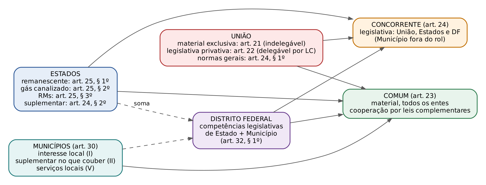
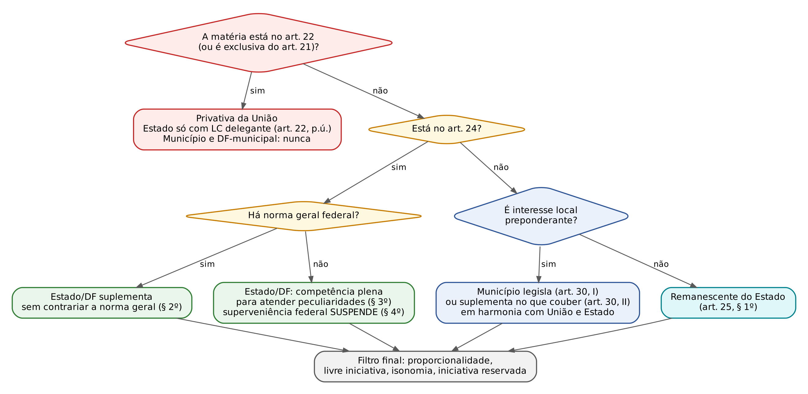
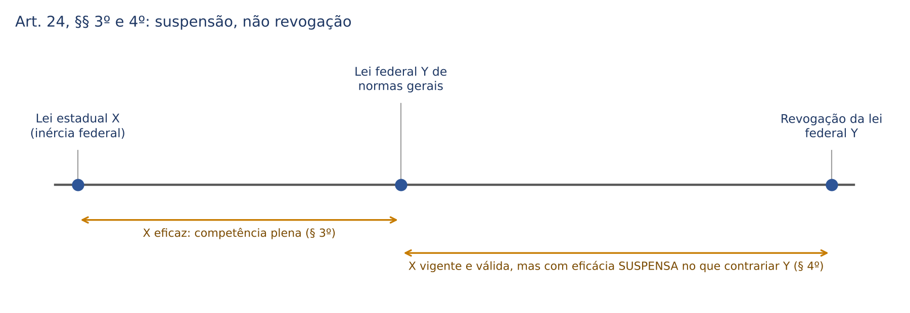
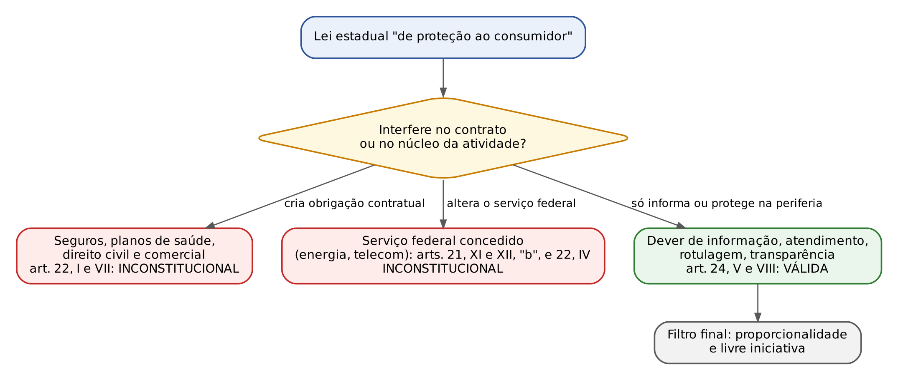
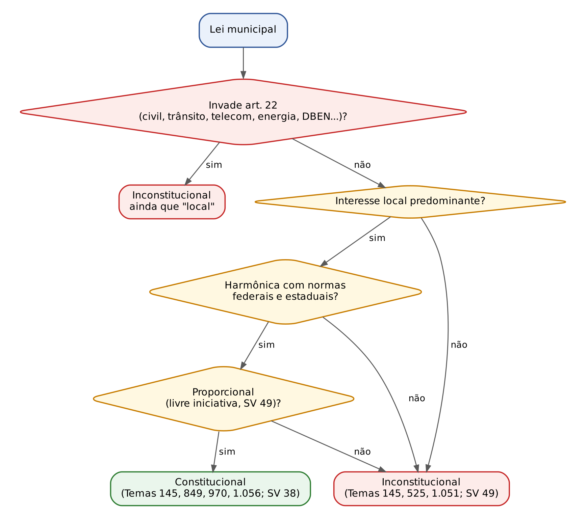

# CAPÍTULO 22 — REPARTIÇÃO DE COMPETÊNCIAS: UNIÃO, ESTADOS, DISTRITO FEDERAL E MUNICÍPIOS

:::INCIDENCIA
Pontos: TRF5 p. 6; TJRS p. 5; TJSC p. 11. Nível A+. Lote: 143 questões (FGV 122, FCC 21), o maior da apostila.
O que mais cai: caso prático "lei estadual ou municipal X é constitucional?" (art. 22 x art. 24 x art. 30), efeito da lei federal superveniente (suspensão, não revogação), delegação por lei complementar e a casuística recente do STF (consumidor, energia, telecomunicações, trânsito, planos de saúde, linguagem neutra, porte de arma).
:::

| Subtema | FGV | FCC | Padrão de cobrança |
|---|---|---|---|
| Caso "lei estadual sobre X" (privativa x concorrente) | 48 | 6 | Enunciado narra a lei e pede vício formal; a armadilha é o rótulo "consumidor", "saúde" ou "meio ambiente" |
| Art. 24, §§ 1º a 4º (normas gerais, plena, suspensão) | 18 | 1 | Lei estadual anterior x lei federal posterior: revoga, suspende ou invalida? Pode ser objeto de ADI? |
| Delegação (art. 22, parágrafo único) | 10 | 1 | "Privativa e indelegável" (falso) x "pode ser autorizado por lei complementar" (verdadeiro) |
| Competência municipal (art. 30; SV 38 e 49; temas) | 24 | 6 | Interesse local, suplementação, licitação, fogos, sacolas, shopping, aplicativos |
| Literalidade dos róis (arts. 21, 22, 23, 24, 30) | 9 | 5 | Troca de inciso entre artigos (custas, infância, desapropriação, dados pessoais) |
| Competência comum (art. 23), tombamento e cooperação | 9 | 1 | Tombamento por lei; convênio entre entes; art. 23 é material, não legislativo |
| Distrito Federal (art. 32, § 1º; Súmula 642; SV 39) | 2 | 1 | Lei distrital: competência de Estado ou de Município? |

## 22.1 A lógica da repartição

### 22.1.1 Predominância do interesse e técnicas de repartição

O critério reitor é a predominância do interesse (José Afonso da Silva): à União cabem as matérias de interesse geral ou nacional; aos Estados, as de interesse regional; aos Municípios, as de interesse local; ao DF, a soma dos interesses regional e local (art. 32, § 1º). O STF invoca o critério expressamente (por exemplo, na ADI 5.873/SC, j. 23/8/2019, ao afirmar que a CF, "presumindo de forma absoluta" a predominância em certas matérias, fixou a priori competências para cada ente), mas o critério é orientador, não decisório: o que decide o caso é o enquadramento da matéria num dos róis.

A Constituição combina três técnicas, e as bancas cobram a nomenclatura:

- Enumeração expressa para a União (arts. 21 e 22) e para os Municípios (art. 30).
- Reserva de competência remanescente aos Estados: "São reservadas aos Estados as competências que não lhes sejam vedadas por esta Constituição" (art. 25, § 1º). A doutrina também a chama de residual, mas, em rigor, residual é a competência TRIBUTÁRIA da União para criar impostos não previstos (art. 154, I). Em questão FGV, "competência legislativa residual do Estado" quase sempre é alternativa errada, porque o enunciado descreve matéria que está em algum rol (Q3881537, Q3880431, Q3868575, Q3865755, Q3373840, Q3186463, todas com a alternativa "residual" como distrator).
- Repartição vertical (condomínio legislativo): na mesma matéria, a União edita normas gerais e Estados e DF suplementam (art. 24). Repartição horizontal: cada ente tem campo próprio, que exclui o dos demais (arts. 21, 22, 25, § 1º, e 30, I).

A Constituição de 1988 é classificada como federalismo cooperativo (combinação de competências comuns e concorrentes com as privativas), mas com forte concentração normativa na União: os 30 incisos do art. 22 esvaziam boa parte do espaço estadual, o que explica a casuística do STF, quase toda em sentido centralizador (conceitos de federalismo, autonomia e espécies de federação: Cap. 21).

### 22.1.2 Classificações que as bancas exploram

| Critério | Espécies | Onde está | Ponto de prova |
|---|---|---|---|
| Natureza | Material (administrativa, de execução) x legislativa | Material: arts. 21, 23, 25, §§ 2º e 3º, 30, III a IX; legislativa: arts. 22, 24, 25, § 1º, 30, I e II | Art. 23 é MATERIAL: "competência legislativa comum" é distrator clássico |
| Extensão | Exclusiva x privativa | Exclusiva: art. 21 (material da União); privativa: art. 22 (legislativa) | Exclusiva é indelegável; privativa admite delegação por LC aos Estados (art. 22, parágrafo único) |
| Extensão | Comum (cumulativa, paralela) x concorrente | Comum: art. 23; concorrente: art. 24 | Na comum, todos agem sem hierarquia; na concorrente, há divisão vertical (norma geral x suplementar) |
| Forma | Enumerada x remanescente x implícita | Arts. 21, 22, 30; art. 25, § 1º | Remanescente do Estado; residual tributária da União |
| Origem | Originária x delegada | Art. 22, parágrafo único | Só a privativa é delegável, e só aos Estados |
| Competência suplementar | Complementar (há norma geral; o Estado detalha, § 2º) x supletiva (não há norma geral; o Estado exerce competência plena, § 3º) | Art. 24, §§ 2º e 3º; art. 30, II | O Município suplementa "no que couber", mas não tem competência plena |

Raul Machado Horta e Fernanda Dias Menezes de Almeida popularizaram a distinção entre suplementação complementar e supletiva; a FGV a usa sem citar autor (Q3881046 traz "competência supletiva do Estado" como distrator para matéria privativa da União).

:::QUESTAO FGV 2026 — ALERJ — PROCURADOR LEGISLATIVO (Q3880788)
Itens: (I) rol do art. 22, I; (II) competência comum como atuação administrativa conjunta, sem hierarquia; (III) competência plena dos Estados na falta de normas gerais. Gabarito: E (I, II e III).
Armadilha: o item II parece incompleto, mas está correto: na competência comum não há hierarquia entre os entes; a coordenação vem das leis complementares do parágrafo único do art. 23.
:::

:::QUESTAO FGV 2025 — ASSESSORIA LEGISLATIVA ESTADUAL (Q3185933)
Caso: deputado verifica que a União "pode legislar" sobre o tema e pergunta se o Estado também pode. Gabarito: E — pode, conforme o caso, se houver autorização da União por lei complementar (matéria privativa) ou se inexistir lei federal sobre normas gerais (matéria concorrente).
Armadilha: A (só competência plena na falta de lei federal) e C (só por delegação) acertam metade cada; a resposta completa cobre os dois regimes.
:::

### 22.1.3 Roteiro de solução do caso prático

A FGV formula quase todas as questões do lote como caso: "o Estado Alfa editou a Lei X dispondo sobre...; é correto afirmar que...". O roteiro abaixo resolve a imensa maioria delas e é o mesmo raciocínio da fundamentação de uma sentença que examina, incidentalmente, a validade da lei local.

:::PASSO ROTEIRO EM CINCO PERGUNTAS
- 1. Identifique o NÚCLEO da norma, não o rótulo que o legislador lhe deu. Lei "de proteção ao consumidor" que cria obrigação contratual para seguradora é direito civil e política de seguros (art. 22, I e VII); lei "ambiental" que proíbe hidrelétrica é energia e águas (art. 22, IV).
- 2. O núcleo está no art. 22 ou interfere em serviço do art. 21 (energia, telecomunicações, radiodifusão, serviço postal, transporte interestadual)? Se sim, a lei estadual é formalmente inconstitucional, salvo lei complementar delegante; a municipal, sempre.
- 3. Está no art. 24? Verifique se há norma geral federal e se a lei estadual a contraria (contrariedade = invasão da competência da União para normas gerais) ou apenas a suplementa.
- 4. É lei municipal? Exija interesse local predominante E harmonia com as normas federais e estaduais (Tema 145).
- 5. Superado o vício formal, passe ao exame material: livre iniciativa e livre concorrência (art. 170), proporcionalidade, isonomia, devido processo, equilíbrio econômico-financeiro de concessões (art. 37, XXI). E, se a lei for de iniciativa parlamentar, examine a iniciativa reservada (art. 61, § 1º; Tema 917; ver Cap. 26).
:::

:::DICA VÍCIO FORMAL X VÍCIO MATERIAL: A FGV COBRA OS DOIS SEPARADAMENTE
Muitas alternativas combinam "formalmente constitucional, mas materialmente inconstitucional" e o inverso. A invasão de competência é vício FORMAL (orgânico). Ofensa à livre iniciativa, à proporcionalidade ou à isonomia é vício MATERIAL. Os temas 1.051 (shopping centers) e 525 (empacotadores), e a ADI 7.852 (mototáxi), têm os dois vícios; o Tema 1.056 (fogos) e o Tema 970 (sacolas) não têm nenhum; a ADI 4.529 (dispensa de EIA para hidrelétricas) tem os dois.
:::

## 22.2 Competências materiais exclusivas da União (art. 21)

### 22.2.1 O rol e o que ele significa

O art. 21 enumera 26 incisos de competência material (administrativa) da União. "Exclusiva" significa que a titularidade não se transfere a outro ente. Isso não impede a execução indireta: os incisos XI e XII preveem exploração "diretamente ou mediante autorização, concessão ou permissão" (telecomunicações, radiodifusão, energia, navegação aérea, transporte ferroviário e aquaviário interestadual, transporte rodoviário interestadual e internacional de passageiros, portos). O titular continua a ser a União, e é por isso que o Estado não pode legislar sobre a relação entre o concessionário federal e o usuário: interferiria em contrato do qual não é parte (ver 22.9.3).

Os incisos mais cobrados, por grupos:

- Soberania e relações exteriores: I a V (relações internacionais, guerra e paz, defesa nacional, trânsito de forças estrangeiras "nos casos previstos em lei complementar", estado de sítio, de defesa e intervenção federal).
- Moeda e finanças: VII (emitir moeda) e VIII (administrar reservas cambiais e fiscalizar operações financeiras, de crédito, câmbio, capitalização, seguros e previdência privada).
- Planejamento: IX (planos nacionais e regionais de ordenação do território e de desenvolvimento econômico e social); XVIII (defesa permanente contra calamidades, especialmente secas e inundações); XIX (sistema nacional de gerenciamento de recursos hídricos e critérios de outorga); XX (diretrizes para o desenvolvimento urbano, inclusive habitação, saneamento básico e transportes urbanos); XXI (princípios e diretrizes para o sistema nacional de viação).
- Serviços: X (serviço postal e correio aéreo nacional); XI (telecomunicações, com órgão regulador); XII (radiodifusão, energia elétrica e aproveitamento energético dos cursos de água "em articulação com os Estados onde se situam os potenciais hidroenergéticos", navegação aérea, transportes interestaduais, portos).
- Organização do DF e Territórios: XIII (Judiciário, MPDFT e Defensoria Pública dos Territórios, redação da EC 69/2012) e XIV (polícia civil, polícia penal, polícia militar e corpo de bombeiros militar do DF, redação da EC 104/2019, e assistência financeira por fundo próprio).
- Material bélico, anistia e classificação indicativa: VI, XVII e XVI.
- Atividade nuclear: XXIII.
- Inspeção do trabalho: XXIV. Garimpagem em forma associativa: XXV.
- Proteção de dados: XXVI, "organizar e fiscalizar a proteção e o tratamento de dados pessoais, nos termos da lei" (EC 115/2022, que também incluiu o inciso XXX do art. 22).

:::LEI CF, ART. 21, XXIII (REDAÇÃO DAS ECS 49/2006 E 118/2022)
XXIII - explorar os serviços e instalações nucleares de qualquer natureza e exercer monopólio estatal sobre a pesquisa, a lavra, o enriquecimento e reprocessamento, a industrialização e o comércio de minérios nucleares e seus derivados, atendidos os seguintes princípios e condições:
a) toda atividade nuclear em território nacional somente será admitida para fins pacíficos e mediante aprovação do Congresso Nacional;
b) sob regime de permissão, são autorizadas a comercialização e a utilização de radioisótopos para pesquisa e uso agrícolas e industriais;
c) sob regime de permissão, são autorizadas a produção, a comercialização e a utilização de radioisótopos para pesquisa e uso médicos;
d) a responsabilidade civil por danos nucleares independe da existência de culpa;
:::

A pegadinha está na assimetria entre as alíneas: a PRODUÇÃO por particular, sob permissão, só é admitida para uso médico (alínea "c"); para uso agrícola e industrial, a permissão alcança apenas comercialização e utilização (alínea "b"). A EC 118/2022 eliminou o antigo limite de meia-vida (até duas horas) que a EC 49/2006 impunha aos radioisótopos de uso médico.

:::QUESTAO FGV 2024 — CÂMARA DOS DEPUTADOS — CONSULTOR LEGISLATIVO (Q2511895)
Caso: sociedade empresária quer PRODUZIR radioisótopos no país. Gabarito: D — só mediante permissão e se destinados a pesquisa e uso médicos.
Armadilha: E (exploração indireta para fins agrícolas e industriais) confunde a alínea "b", que não abrange a produção; C (monopólio absoluto) ignora as permissões.
:::

:::QUESTAO FGV 2025 — CNU — BLOCO 6 (Q3644136)
Pergunta sobre a finalidade da Política Nacional de Ordenamento Territorial, ligada ao art. 21, IX. Gabarito: E — reorganizar o uso do território e integrar ações públicas de forma coordenada. Distratores falam em redefinir limites de entes federativos (matéria do art. 18, §§ 3º e 4º; ver Cap. 21).
:::

### 22.2.2 Exclusiva material x privativa legislativa: o par que decide as questões de energia e telecomunicações

Quase sempre a mesma matéria aparece duas vezes: a União tem a competência material para explorar o serviço (art. 21, XI e XII) e a competência legislativa privativa para disciplinar a matéria (art. 22, IV). O STF invoca as duas e acrescenta o art. 175 (política tarifária, direitos dos usuários e obrigações do concessionário são definidos pelo poder concedente). Por isso:

- Lei estadual sobre a prestação do serviço de energia elétrica (suspensão por inadimplência, religação, notificação para vistoria, indenização por interrupção, compartilhamento de postes, investimento obrigatório em P&D) é inconstitucional (22.9.3).
- Lei estadual sobre informação ao consumidor do serviço de telecomunicações, que não altera o serviço, pode ser válida (velocidade da internet na fatura, ADI 7.416/MS; 22.9.3).

Os demais incisos do art. 21 com reflexo frequente: o inciso VI (material bélico) fundamenta, junto com o art. 22, I e XXI, a inconstitucionalidade das leis estaduais que concedem porte de arma (22.9.6); o inciso VIII (fiscalização de operações financeiras) fundamentou a invalidade do selo distrital antipirâmide (ADI 6.042/DF, 22.3.3); o inciso X (serviço postal) aparece como distrator nas questões sobre postagem de boletos, que o STF não enquadra como serviço postal (Tema 491, 22.5.3).

:::QUESTAO FGV 2024 — MUNICÍPIO (QUESTÃO SOBRE ISENÇÃO TARIFÁRIA) (Q3044095)
Caso: Município quer isentar a população carente de tarifas de saneamento, energia elétrica e gás canalizado. Gabarito: D — está nas atribuições municipais apenas o saneamento básico.
Fundamento: energia é serviço da União (art. 21, XII, "b"); gás canalizado é serviço local dos ESTADOS (art. 25, § 2º); saneamento é serviço de interesse local (art. 30, V), ressalvada a gestão regionalizada (ver 22.6.2).
:::

## 22.3 Competência legislativa privativa da União (art. 22)

### 22.3.1 O rol

:::LEI CF, ART. 22 (INCISOS MAIS COBRADOS E PARÁGRAFO ÚNICO)
Art. 22. Compete privativamente à União legislar sobre:
I - direito civil, comercial, penal, processual, eleitoral, agrário, marítimo, aeronáutico, espacial e do trabalho;
II - desapropriação;
IV - águas, energia, informática, telecomunicações e radiodifusão;
VII - política de crédito, câmbio, seguros e transferência de valores;
VIII - comércio exterior e interestadual;
IX - diretrizes da política nacional de transportes;
XI - trânsito e transporte;
XII - jazidas, minas, outros recursos minerais e metalurgia;
XVI - organização do sistema nacional de emprego e condições para o exercício de profissões;
XX - sistemas de consórcios e sorteios;
XXI - normas gerais de organização, efetivos, material bélico, garantias, convocação, mobilização, inatividades e pensões das polícias militares e dos corpos de bombeiros militares;
XXIII - seguridade social;
XXIV - diretrizes e bases da educação nacional;
XXV - registros públicos;
XXVII – normas gerais de licitação e contratação, em todas as modalidades, para as administrações públicas diretas, autárquicas e fundacionais da União, Estados, Distrito Federal e Municípios, obedecido o disposto no art. 37, XXI, e para as empresas públicas e sociedades de economia mista, nos termos do art. 173, § 1°, III;
XXIX - propaganda comercial.
XXX - proteção e tratamento de dados pessoais.
Parágrafo único. Lei complementar poderá autorizar os Estados a legislar sobre questões específicas das matérias relacionadas neste artigo.
:::

Os demais incisos: III (requisições civis e militares, em caso de iminente perigo e em tempo de guerra), V (serviço postal), VI (sistema monetário e de medidas, títulos e garantias dos metais), X (regime dos portos, navegação lacustre, fluvial, marítima, aérea e aeroespacial), XIII (nacionalidade, cidadania e naturalização), XIV (populações indígenas), XV (emigração e imigração, entrada, extradição e expulsão de estrangeiros), XVII (organização judiciária, do MPDFT e da Defensoria Pública dos Territórios, e organização administrativa destes, EC 69/2012), XVIII (sistemas estatístico, cartográfico e de geologia nacionais), XIX (sistemas de poupança, captação e garantia da poupança popular), XXII (competência da polícia federal e das polícias rodoviária e ferroviária federais), XXVI (atividades nucleares de qualquer natureza) e XXVIII (defesa territorial, aeroespacial, marítima, defesa civil e mobilização nacional).

:::PEGADINHA OS PARES QUE TROCAM DE ARTIGO
| Privativa da União (art. 22) | Concorrente (art. 24) |
|---|---|
| Direito civil, comercial, penal, PROCESSUAL, eleitoral, agrário, marítimo, aeronáutico, espacial e do trabalho (I) | Direito TRIBUTÁRIO, FINANCEIRO, PENITENCIÁRIO, ECONÔMICO e URBANÍSTICO (I) |
| Processo (I) | PROCEDIMENTOS em matéria processual (XI); juizados de pequenas causas (X); CUSTAS dos serviços forenses (IV) |
| Seguridade social (XXIII) | PREVIDÊNCIA SOCIAL, proteção e defesa da saúde (XII) |
| Diretrizes e bases da educação nacional (XXIV) | Educação, cultura, ensino, desporto, ciência, tecnologia, pesquisa, desenvolvimento e inovação (IX) |
| Comércio exterior e interestadual (VIII) | Produção e consumo (V); juntas comerciais (III) |
| Normas gerais das polícias militares e bombeiros (XXI) | Organização, garantias, direitos e deveres das POLÍCIAS CIVIS (XVI) |
| Desapropriação (II) | Proteção à infância e à juventude (XV) |
| Populações indígenas (XIV) | Proteção e integração social das pessoas com deficiência (XIV) |
| Informática (IV) | Ciência, tecnologia e inovação (IX) |
Mnemônico tradicional do inciso I: "CAPACETE de PM" (civil, aeronáutico, penal, agrário, comercial, eleitoral, trabalho, espacial; processual, marítimo).
:::

:::QUESTAO FCC 2026 — PGM MANAUS — PROCURADOR (Q4338751)
Pergunta-se qual alternativa reúne só matérias privativas. Gabarito: A — direito comercial, populações indígenas, seguridade social, trânsito e transporte.
Armadilhas: "produção e consumo" (B), "orçamento" (C), "educação, pesquisa e inovação" (D) e "proteção à infância" (E) são do art. 24.
:::

:::QUESTAO FCC 2025 — TRT 6ª REGIÃO — ANALISTA JUDICIÁRIO (Q3214710)
Gabarito: C — itens III (sistemas de poupança) e V (desapropriação). O item I mistura civil e processual (art. 22) com tributário e financeiro (art. 24); o IV mistura sistema nacional de emprego (art. 22) com custas (art. 24); o II é concorrente.
No mesmo sentido, literalidade do art. 22 x arts. 23 e 24: Q3049081 (direito do trabalho: privativa da União, gabarito A, contra os distratores "exclusiva" e "concorrente"); Q2458421 (trânsito e transporte: privativa, delegável por lei complementar, gabarito A).
:::

### 22.3.2 Delegação (art. 22, parágrafo único)

Os requisitos são cumulativos e todos aparecem em alternativas erradas:

- Instrumento: LEI COMPLEMENTAR federal (não lei ordinária, não convênio, não decreto).
- Destinatários: os ESTADOS. O Município não recebe delegação. A LC 103/2000, exemplo histórico de delegação, autorizou "os Estados e o Distrito Federal" a instituir piso salarial (matéria de direito do trabalho), o que mostra a inclusão do DF.
- Objeto: QUESTÕES ESPECÍFICAS das matérias do art. 22. Delegação da matéria inteira é inconstitucional.
- Isonomia federativa: a doutrina (Alexandre de Moraes, Pedro Lenza) sustenta que a delegação deve contemplar todos os Estados, por força da vedação de criar preferências entre entes (art. 19, III).

:::PEGADINHA "PRIVATIVA E INDELEGÁVEL"
A FGV usa reiteradamente a fórmula "competência legislativa privativa da União, indelegável" como alternativa ERRADA e "privativa da União, mas lei complementar pode autorizar os Estados" como correta. Indelegável é a competência EXCLUSIVA (material, art. 21). Questões com esse padrão no lote: Q4378307 (despachantes junto ao Detran: privativa e DELEGÁVEL, gabarito A, contra B "indelegável"); Q3881537 (informática: gabarito E, privativa, pressupondo autorização em lei complementar); Q3879508 (loterias: só com autorização da União, gabarito C); Q3301285 (linguagem neutra em escolas estaduais: gabarito D, só com lei complementar autorizativa, porque C dizia "indelegável"); Q2486000 (comercialização de celulares e cadastro de pré-pagos: gabarito D); Q2375278 (identificação de funcionários de telecomunicações: gabarito C); Q2515926 (sorteios: gabarito C); Q3114488 (estocagem de produtos importados: gabarito D).
Na mesma lógica, "inconstitucional, salvo se houver lei complementar federal autorizando" é a resposta para matéria privativa; para matéria concorrente, a alternativa que exige lei complementar é sempre falsa (Q3966696, Q3865755, Q3786393, Q3745544, Q3171975).
:::

:::QUESTAO FGV 2024 — TJ-MT — OFICIAL DE JUSTIÇA (Q3114488)
Caso: lei estadual limita a cinco dias úteis a estocagem, no Município de chegada, de produtos vindos do exterior. Gabarito: D — matéria privativa da União (comércio exterior, art. 22, VIII), que exigiria lei complementar federal autorizativa.
Armadilha: E diz que nem sequer pode haver delegação; C invoca competência residual; B, proteção à saúde.
:::

:::QUESTAO FGV 2026 — PC-PR — DELEGADO DE POLÍCIA (Q4378307)
Caso: lei estadual fixa requisitos de escolaridade, impedimentos e penalidades para despachantes documentalistas junto ao Detran. Gabarito: A — inconstitucional, por afrontar competência privativa e DELEGÁVEL da União (condições para o exercício de profissões, art. 22, XVI; trânsito, art. 22, XI).
Passos: núcleo = regulamentação de profissão; art. 22, XVI; delegável por LC (parágrafo único); sem LC, inconstitucional. A alternativa B só difere pela palavra "indelegável".
:::

### 22.3.3 Direito civil, comercial e política de seguros (art. 22, I e VII)

É o inciso que mais derruba leis estaduais "de consumidor". O STF distingue: a lei estadual que interfere na ESTRUTURA do contrato (cria obrigação contratual, cobertura, dever de indenizar, cláusula, prazo) invade direito civil e seguros; a que apenas impõe dever de informação, atendimento ou transparência fica no art. 24, V e VIII (ver a figura de 22.5.4). Planos de saúde são matéria "híbrida": contrato (art. 22, I e VII) e consumo e saúde (art. 24, V e XII), e a definição depende do ângulo da norma (ADI 7.696/PB).

Precedentes recentes (todos do Plenário):

- Inconstitucional lei estadual sobre diretrizes de exames laboratoriais para acompanhamento por nutricionista, com cobertura obrigatória pelas operadoras (ADI 7.552/AL, Rel. Min. Luiz Fux, j. 12/8/2024, Info 1145).
- Inconstitucional lei estadual que impõe a inclusão automática de recém-nascido como dependente do plano; válida a que obriga a operadora a INFORMAR o prazo de inscrição com isenção de carência (ADI 7.428/MS, Rel. Min. André Mendonça, j. 1/9/2025, Info 1188). O mesmo julgado traz as duas faces.
- Constitucional lei estadual que obriga os planos a aceitarem a carteira física quando o aplicativo ou token falhar (ADI 7.696/PB, Rel. Min. Nunes Marques, j. 5/5/2026, Info 1216): dever de atendimento, sem alterar a estrutura contratual.
- Inconstitucional lei municipal que proíbe seguradoras de comprarem diretamente peças de reposição e garante ao consumidor a escolha da oficina, por invadir direito civil e política de seguros (ADPF 1.258/SP, Rel. Min. Gilmar Mendes, j. 4/9/2026, Info 1229).
- Inconstitucional lei distrital que proíbe portaria virtual em condomínios com mais de 45 unidades e impõe seguro obrigatório aos que a adotam: vício formal (direito civil e seguros) e material (livre iniciativa, livre concorrência e propriedade) (ADI 7.836/DF, Rel. Min. Nunes Marques, j. 12/5/2026, Info 1216).
- Inconstitucional lei estadual que exige comunicação de perda total ao Detran e destruição do veículo sinistrado, matéria já disciplinada pelo CTB e pelo Contran (ADI 4.293/RO, Rel. Min. Nunes Marques, j. 5/3/2025, Info 1167).
- Inconstitucional lei estadual que regulamenta associações de socorro mútuo (ADI 7.150/AL, Rel. Min. André Mendonça, j. 7/4/2025, Info 1172).
- Inconstitucional lei estadual que autoriza o devedor a cancelar unilateralmente empréstimo consignado (ADI 5.022/RO, Rel. Min. Nunes Marques, j. 5/11/2025, Info 1197); inconstitucional decisão administrativa estadual que suspende consignações de cartão de crédito consignado de servidores (ADPF 1.306 MC-Ref/MT, Rel. Min. André Mendonça, j. 30/3/2026, Info 1210).
- Inconstitucional lei distrital que cria "selo" certificando empresas de marketing multinível como não integrantes de pirâmide: direito comercial (art. 22, I) e fiscalização de operações financeiras (art. 21, VIII) (ADI 6.042/DF, Rel. Min. Luiz Fux, j. 20/5/2026, Info 1218).

:::QUESTAO FGV 2024 — AL-SC — ANALISTA LEGISLATIVO (Q2484688)
Caso: lei estadual define tratamentos e intervenções terapêuticas mínimas que as operadoras devem oferecer a pessoas com deficiência. Gabarito: A — política de seguros e direito civil (art. 22, I e VII); inconstitucional.
Armadilha: B (proteção à saúde) e D (proteção da pessoa com deficiência) apostam no rótulo; a lei define COBERTURA, isto é, o objeto do contrato. Precedente catarinense (questão de concurso da AL-SC).
:::

:::QUESTAO FGV 2026 — TJ-PE — JUIZ SUBSTITUTO (Q4349527)
Caso: lei estadual obriga montadoras e concessionárias a fornecer veículo reserva quando o automóvel em garantia ficar parado mais de 15 dias por falta de peças, com responsabilidade solidária e sanções do art. 56 do CDC; a Assembleia promulgou a lei antes de escoado o prazo de sanção. Gabarito: D — corretos II e III.
Passos: (1) núcleo = obrigação contratual nova na garantia, sem previsão no CDC: excede a suplementação (art. 24, § 2º) e toca direito civil (item II correto); (2) ônus desproporcional e assimétrico entre Estados: livre iniciativa e livre concorrência (item III correto); (3) o item I, que tratava a promulgação antecipada como vício formal "por si só" insanável, foi considerado falso pela banca.
Precedente: o STF declarou inconstitucional lei pernambucana de mesmo teor (veículo reserva na garantia, após 15 dias de paralisação), por exceder a competência concorrente em consumo (ADI 5.158/PE, Rel. Min. Roberto Barroso, Plenário, j. 6/12/2018, Info 926, vencido o Min. Marco Aurélio).
Atenção: o gabarito trata o item I como falso sem explicitar o fundamento; a promulgação pelo Legislativo antes do fim do prazo do art. 66, § 1º, é, em tese, vício do processo legislativo (Cap. 26). Leia o item I como falso pela afirmação absoluta, e não como validação do procedimento (registrado na nota final).
:::

:::QUESTAO FGV 2024 — TJ-SC — ANALISTA JURÍDICO (Q2515292)
Caso: lei estadual concede gratuidade a agentes públicos estaduais em estacionamentos públicos estaduais e em estacionamentos privados. Gabarito: D — o Estado pode legislar sobre os estacionamentos públicos (autoadministração), não sobre os privados (direito civil, propriedade e livre iniciativa).
No mesmo sentido, para lei municipal que assegura gratuidade na primeira hora em estacionamentos privados: Q2482347 (gabarito B, competência privativa da União, direito civil).
:::

:::QUESTAO FGV 2026 — ASSEMBLEIA ESTADUAL (Q3881046)
Caso: Assembleia cogita lei sobre os CONTRATOS celebrados entre sociedades empresárias de tecnologia. Gabarito: A — privativa da União (direito civil e comercial). Distratores: residual, supletiva, plena, comum.
No mesmo sentido: Q3744558 (TJ-RS, Analista, 2025: emenda à Constituição estadual que assegura aquisição do domínio de terras públicas estaduais ocupadas há mais de 40 anos invade direito civil, gabarito C); Q2351247 (lei municipal que fixa requisitos da PUBLICIDADE de cosmético local: propaganda comercial, art. 22, XXIX, gabarito E).
:::

### 22.3.4 Direito penal, processual e crimes de responsabilidade (art. 22, I)

- Crimes de responsabilidade: SÚMULA VINCULANTE 46 — "A definição dos crimes de responsabilidade e o estabelecimento das respectivas normas de processo e julgamento são da competência legislativa privativa da União" (substituiu, com o mesmo teor, a Súmula 722). Constituição estadual ou lei estadual que tipifica crime de responsabilidade ou disciplina o processo de impeachment do Governador é inconstitucional (v. Cap. 28).
- Normas penais e processuais estaduais: inconstitucional lei estadual que cria responsabilização penal por incêndio florestal e hipótese de inafiançabilidade (ADI 7.712 MC-Ref/GO, Rel. Min. Gilmar Mendes, j. 14/10/2024, Info 1154); inconstitucional lei estadual que cria causas de suspensão da pretensão punitiva e de extinção da punibilidade para crimes tributários (ADI 2.957/SC, Rel. Min. Nunes Marques, j. 27/9/2025, Info 1192 — precedente catarinense); inconstitucional lei estadual que impõe sanções a invasores de propriedades rurais e urbanas, como proibição de receber benefícios sociais, de assumir cargos e de contratar com o Estado, por configurar sanção de natureza penal e invadir normas gerais de contratação (ADI 7.715/MT, Rel. Min. Flávio Dino, MC-Ref j. 14/10/2024, Info 1154; mérito j. 5/3/2025, Info 1167).
- Processo civil: inconstitucional lei municipal que concede isenção de honorários advocatícios em programa de regularização tributária, porque honorários de sucumbência são matéria processual (ADPF 1.066/MG, Rel. Min. Nunes Marques, j. 30/4/2025, Info 1175); inconstitucional lei estadual que concede desconto sobre honorários de sucumbência em ações tributárias e execuções fiscais (ADI 7.615 MC-Ref/GO, Rel. Min. Nunes Marques, j. 5/6/2024, Info 1139) ou fixa o percentual dos honorários dos Procuradores no parcelamento (ADI 7.341/SE, Rel. Min. Nunes Marques, j. 19/11/2024, Info 1159).
- Processo x procedimento: o art. 24, XI, dá aos Estados competência concorrente para "procedimentos em matéria processual". A fronteira é fluida, e o STF a traça pelo critério de que norma que cria ônus, requisito de admissibilidade, recurso, prazo ou condição da ação é processual (privativa); norma sobre a forma dos atos, a organização da secretaria ou o trâmite interno é procedimental.

:::QUESTAO FGV 2025 — ENAC — 2º EXAME (Q3673844)
Caso: lei estadual sobre custas fixa (i) valor mínimo mesmo na gratuidade parcial, (ii) comprovação do preparo no ato da interposição sob pena de deserção, (iii) teto elevado de custas recursais como percentual da causa e (iv) custas razoáveis para a parte que falta, sem justificativa, à audiência de conciliação. Gabarito: E — só (iv) é constitucional.
Fundamento: custas são concorrentes (art. 24, IV), mas deserção e regime da gratuidade são processo (art. 22, I), e valores que inviabilizam o recurso ofendem o acesso à justiça (art. 5º, XXXV). A sanção pecuniária pela ausência injustificada é custas em sentido próprio. A questão reproduz a ADI 7.533/TO (Rel. Min. Gilmar Mendes, Plenário, j. 23/5/2025, Info 1179): inconstitucionais o valor mínimo na gratuidade parcial (art. 22, I), a comprovação do preparo no ato da interposição sob pena de deserção (matéria de norma geral) e o teto exorbitante de custas recursais (acesso à justiça); constitucional a cobrança razoável pela ausência injustificada à audiência de conciliação ou mediação.
:::

:::QUESTAO FGV 2024 — CÂMARA DE FORTALEZA — ADVOGADO (Q2450529)
Caso: lei estadual exige depósito prévio de 90% da condenação para recorrer nos Juizados Especiais Cíveis. Gabarito: E — invade competência privativa da União (processo).
Armadilha: D invoca o art. 24, X ("criação, funcionamento e processo do juizado de pequenas causas"); o STF entende que requisito de admissibilidade recursal é matéria processual, e a concorrência do inciso X não autoriza criar pressuposto recursal. B inventa um teto constitucional de 50% para depósito.
:::

:::QUESTAO FGV 2024 — TJ-MS — ANALISTA JUDICIÁRIO (Q2489708)
Caso: lei complementar estadual confere à Defensoria Pública poder de requisitar a instauração de inquérito policial. Gabarito: A — compete privativamente à União legislar sobre processo penal.
Armadilha: B (o Estado suplementa normas sobre Defensoria, art. 24, XIII) e C (procedimentos). O poder de requisição da Defensoria em geral é tratado no Cap. 31; aqui o núcleo é a instauração de inquérito, ato do processo penal.
:::

:::QUESTAO FCC 2025 — MPE-PI — ANALISTA MINISTERIAL (Q3530353)
Caso: lei estadual define como crime de responsabilidade a ausência de servidor convocado por CPI da Assembleia. Gabarito: C — inconstitucional por violar competência privativa da União; cabe ADI no STF.
Armadilha: D (cabe reclamação por ofensa à SV 46). A súmula vinculante não vincula o Legislativo na função legislativa (art. 103-A: vincula Judiciário e Administração), de modo que lei contrária à SV não desafia reclamação, mas ADI (Cap. 19). A e E erram ao tratar a matéria como concorrente.
:::

:::QUESTAO FGV 2026 — TJ-MS — DELEGAÇÕES DE NOTAS E DE REGISTRO (Q3914349)
Caso: lei estadual impõe três sanções a quem invadir propriedade privada (vedação de benefícios sociais, de cargos fiduciários e de contratar com o Estado). Gabarito: E — inconstitucional, por ser norma de direito penal e norma geral de contratação (ADI 7.715/MT).
:::

:::QUESTAO FGV 2026 — TJ-PR — JUIZ SUBSTITUTO (Q3898939)
Caso: lei estadual de refinanciamento do IPVA limita a 2% os honorários advocatícios da cobrança da dívida ativa, reduzindo o percentual praticado. Gabarito: A — formalmente inconstitucional e ofensiva à irredutibilidade remuneratória.
Fundamento: honorários de sucumbência são matéria processual (ADI 7.615 MC-Ref/GO; ADI 7.341/SE); a banca acrescentou a irredutibilidade porque os honorários integram a remuneração dos Procuradores (sujeitos ao teto). Distratores: B (procedimentos), C (residual), D e E (premissas falsas sobre honorários de procurador).
:::

### 22.3.5 Direito do trabalho e condições para o exercício de profissões (art. 22, I e XVI)

- Feriados: instituir feriado de significado histórico-cultural e religioso para a comunidade é proteção do patrimônio cultural (arts. 24, VII, e 215), e não legislação trabalhista (ADI 7.898/RJ; v. Cap. 36).
- Inconstitucional norma estadual que cria nova hipótese de interrupção do contrato de trabalho na iniciativa privada (ADI 4.157/RJ, Rel. Min. Nunes Marques, j. 27/9/2024, Info 1152).
- Inconstitucional lei estadual que regulamenta a profissão de bombeiro civil (ADI 5.761/RO, Rel. Min. Nunes Marques, j. 17/2/2025, Info 1165): art. 22, I e XVI.
- Shopping centers: o Tema 1.051 (RE 833.291/SP, Rel. Min. Dias Toffoli, j. 4/12/2023, Info 1119) declarou inconstitucional lei municipal que obriga shopping centers a manter ambulatório ou pronto-socorro com médico. Vício formal: direito do trabalho e comercial (art. 22, I). Vício material: livre iniciativa, razoabilidade e proporcionalidade.

:::QUESTAO FGV 2026 — TJ-BA — JUIZ SUBSTITUTO (Q4083775)
Caso: lei municipal de iniciativa de vereador obriga shopping centers a instalar pronto-socorro com médico; o Procon municipal aplica multa. Gabarito: C — formal e materialmente inconstitucional (Tema 1.051).
No mesmo sentido: Q3888023 (FGV 2024, Procurador de São José dos Campos: gabarito D — "invadiu a competência privativa da União e violou a livre iniciativa e a proporcionalidade"; a banca falou em "assistência social", mas a fundamentação do STF é direito do trabalho e comercial).
:::

:::QUESTAO FGV 2024 — TJ-MT — JUIZ SUBSTITUTO (Q3086970)
Caso: deputado propõe programa de iniciação profissional com vínculo direto entre adolescente estudante e órgão estadual, com ajuda de custo, em dissonância com a lei federal de estágio. Gabarito: B — direito do trabalho, privativo da União.
Armadilha: D (proteção à infância e juventude, concorrente) e A (regime jurídico estadual). O núcleo é a relação de trabalho do adolescente, não a proteção.
No mesmo sentido: Q2400452 (FCC 2024, TRT 11ª: lei estadual sobre contratação de aprendizes no Programa Jovem Aprendiz é inconstitucional e desafia ADI no STF, gabarito A; os distratores D e E propõem reclamação por tema de repercussão geral ou por súmula vinculante inexistente).
:::

### 22.3.6 Águas, energia, telecomunicações, radiodifusão, informática e trânsito (art. 22, IV e XI)

O desenvolvimento por setor, com os precedentes, está em 22.9 (energia, telecomunicações, transporte). Aqui, as linhas gerais:

- Energia abrange a cadeia do petróleo e do GLP quanto à atividade, mas não qualquer uso de derivados. É inconstitucional lei distrital que obriga a pesagem de botijões de GLP na frente do consumidor, por invadir a competência privativa para legislar sobre energia (ADI 4.676/DF, Rel. Min. Nunes Marques, red. p/ o acórdão Min. Flávio Dino, julgamento virtual finalizado em 27/9/2024, Info 1152); mas é constitucional lei estadual que obriga empreiteiras de rodovias estaduais a usar preferencialmente asfalto com borracha de pneus inservíveis, porque não regula energia nem o monopólio do petróleo, e sim a contratação de obra estadual e a proteção ambiental.
- Trânsito e transporte: a União tem o art. 22, IX (diretrizes da política nacional de transportes) e XI (trânsito e transporte); o Município organiza o transporte coletivo local (art. 30, V) e regulamenta o transporte individual por aplicativo dentro dos parâmetros federais (Tema 967; v. Cap. 34); o Estado organiza o transporte intermunicipal (competência remanescente). A educação para o trânsito é competência COMUM (art. 23, XII).

:::QUESTAO FGV 2024 — TJ-RR — ANALISTA JUDICIÁRIO (Q3087102)
Caso: lei distrital impõe pesagem de botijões de GLP na presença do consumidor. Gabarito: C — usurpação da competência privativa da União para legislar sobre energia (ADI 4.676/DF).
Armadilha: E (consumidor, concorrente) é a alternativa que seria escolhida pelo rótulo.
:::

:::QUESTAO FGV 2024 — CÂMARA DOS DEPUTADOS — CONSULTOR LEGISLATIVO (Q2511894)
Caso: lei estadual obriga as empresas contratadas para asfaltar rodovias estaduais a usar preferencialmente massa asfáltica com borracha de pneus inservíveis. Gabarito: A — não invade competência privativa da União nem o monopólio; é constitucional.
Armadilha: B (petróleo e derivados) e C (fundamento correto pela razão errada: o monopólio do art. 177 não se limita à extração).
:::

### 22.3.7 Comércio interestadual, sistema monetário, consórcios e sorteios (art. 22, VI, VIII e XX)

- Sistema monetário: lei estadual que cria "unidade de valor" com circularidade e curso forçado no território estadual cria moeda (art. 22, VI; art. 21, VII).
- Comércio interestadual: lei estadual que retém a produção no território até atender a demanda local restringe o comércio interestadual (art. 22, VIII) e afronta a vedação de limitações ao tráfego de bens (art. 150, V).
- Consórcios e sorteios: SÚMULA VINCULANTE 2 — "É inconstitucional a lei ou ato normativo estadual ou distrital que disponha sobre sistemas de consórcios e sorteios, inclusive bingos e loterias." No julgamento conjunto das ADPFs 492 e 493 e da ADI 4.986 (Rel. Min. Gilmar Mendes, j. 30/9/2020), o STF distinguiu competência LEGISLATIVA de competência MATERIAL: a exploração de loterias é serviço público; a União não tem exclusividade de explorá-lo e não pode, por lei federal, excluir os Estados da atividade; os Estados podem explorar as modalidades previstas na legislação federal, mas não legislar sobre elas (só a União define as modalidades). A SV 2 continua a valer para a competência legislativa. Quanto aos Municípios, o Ministro Nunes Marques, em cautelar monocrática na ADPF 1.212 (13/12/2025, *ad referendum* do Plenário), suspendeu os atos municipais que criaram loterias ou autorizaram apostas, por entender que a exploração lotérica não é interesse local. O referendo começou no Plenário virtual, foi destacado e, levado ao Plenário presencial em 4/11/2026, teve só relatório e sustentações orais, suspenso sem votos e sem data de retomada (notícia especializada de 4/11/2026): a cautelar segue em vigor, sem referendo nem mérito.

:::QUESTAO FGV 2026 — PC-PR — AGENTE DE POLÍCIA JUDICIÁRIA (Q4375159)
Caso: lei da União veda ao Estado a exploração de apostas de quota fixa, modalidade prevista nas Leis 13.756/2018 e 14.790/2023. Gabarito: B — a competência privativa para legislar sobre sorteios (art. 22, XX) não impede os Estados de explorar o serviço lotérico nas modalidades definidas em lei federal (ADPFs 492 e 493).
Armadilhas: A e E (exclusividade da União na exploração), C (Estado cria modalidade nova) e D (contradiz a SV 2).
:::

:::QUESTAO FGV 2026 — ALERJ — ESPECIALISTA LEGISLATIVO (Q3879508)
Caso: deputados propõem lei estadual "disciplinando os sistemas de loterias" no Estado, para dar transparência e auditoria. Gabarito: C — o Estado só pode legislar sobre a matéria com autorização da União (art. 22, XX, e parágrafo único; SV 2).
Comparação com a Q4375159: aqui a lei DISCIPLINA o sistema (competência legislativa); lá se discutia o direito de EXPLORAR (competência material). No mesmo sentido: Q2515926 (FGV 2024, CVM: lei estadual com medidas para garantir obrigações de empresas que exploram sorteios só é válida com lei complementar delegante, gabarito C).
:::

:::QUESTAO FGV 2024 — PREFEITURA DE NITERÓI — ANALISTA (Q3089380)
Caso: lei estadual cria a "Unidade Estadual de Valor Adicionado", lastreada em créditos da Fazenda, com circularidade e curso forçado, resgatável em 30 dias. Gabarito: B — sistema monetário, privativo da União.
No mesmo sentido, comércio interestadual: Q2485990 (FGV 2024, AL-SC: lei estadual que exige atender primeiro a demanda local de sal marinho antes de destinar o excedente a outros interessados trata de COMÉRCIO, privativo da União, gabarito C; a alternativa E erra ao chamar a matéria de "produção", que seria concorrente).
:::

### 22.3.8 Jazidas e recursos minerais (art. 22, XII), águas e hidrelétricas (art. 22, IV)

Os recursos minerais e os potenciais de energia hidráulica são bens da União (art. 20, VIII e IX; ver Cap. 21) e a matéria é privativa (art. 22, IV e XII). Mas o art. 23, XI, dá a todos os entes competência COMUM para "registrar, acompanhar e fiscalizar as concessões de direitos de pesquisa e exploração de recursos hídricos e minerais em seus territórios", e o art. 24, VI e VIII, permite aos Estados legislar sobre proteção ambiental e responsabilidade por dano ambiental. Daí três linhas:

- Hidrelétricas: Estado não pode proibir usinas e PCHs em cursos d'água, ainda que pela via da declaração de patrimônio cultural: inconstitucionalidade por invasão do art. 22, IV, e ofensa à lealdade federativa (ADI 7.656/SC, red. p/ o acórdão Min. Gilmar Mendes, j. 9/12/2025, Info 1202 — leis catarinenses sobre o Rio Chapecó e as Cataratas do Salto Saudades). Desenvolvimento ambiental: Apostila de Direito Ambiental, Cap. 2.
- Indenização ambiental na mineração: o STF julgou CONSTITUCIONAL a lei paraense que condiciona a exploração de recursos minerais ao pagamento de indenização monetária pelos danos ambientais, independentemente da obrigação de reparar, mas declarou inconstitucionais os dispositivos que definiam fato gerador coincidente com o da compensação financeira do art. 20, § 1º, de taxas de polícia ou de tributos, e percentuais prefixados e universais (ADI 4.031/PA, Rel. Min. Rosa Weber, j. 29/9/2023, Info 1110).
- Obrigações acessórias de fiscalização: Estados podem criar obrigações acessórias para fiscalizar as compensações financeiras pela exploração de recursos naturais, mas não legislar sobre a obrigação principal (arrecadação e lançamento) (ADI 5.335/AM, Rel. Min. Nunes Marques, j. 25/8/2025, Info 1187).
- Município: não pode, no plano diretor, definir áreas em que a mineração é permitida ou vedada, porque disciplina recursos minerais (art. 22, XII).

:::QUESTAO FGV 2026 — TRF 2ª REGIÃO — JUIZ FEDERAL SUBSTITUTO (Q3996821)
Caso: lei estadual veda a construção de PCHs em determinado rio. Gabarito: C — ainda que o rio seja do Estado, a matéria é privativa da União (águas e energia), embora os Estados possam ser autorizados a legislar sobre ela.
Passos: (1) a titularidade do rio (art. 26, I) não atrai a competência legislativa; (2) o potencial hidráulico é bem da União (art. 20, VIII) e o aproveitamento energético é serviço federal (art. 21, XII, "b"); (3) a vedação é energia e águas (art. 22, IV; ADI 7.656/SC); (4) privativa é delegável. B (concorrente ambiental) e D (comum) caem no rótulo.
:::

:::QUESTAO FGV 2024 — TJ-SC — JUIZ SUBSTITUTO (Q2387029)
Caso: lei estadual condiciona a lavra à indenização monetária pelos danos ambientais, independentemente da reparação; o juiz deve decidir incidentalmente. Gabarito: B — constitucional (ADI 4.031/PA).
No mesmo sentido: Q4079424 (FGV 2026, PGE-AC: gabarito E, que reproduz a tese completa da ADI 4.031 — constitucional a indenização, inconstitucional o fato gerador que se confunda com a CFEM, com taxa de polícia ou com tributo).
:::

:::QUESTAO FGV 2025 — TJ-SC — JUIZ SUBSTITUTO (Q3324306)
Caso: lei catarinense exige indenização prévia por danos ambientais para autorizar a exploração mineral, independentemente da reparação. Gabarito oficial: E — viola a competência da União para legislar sobre recursos minerais.
Crítica: o gabarito colide com a ADI 4.031/PA, que validou exatamente essa exigência, e com o gabarito da própria FGV no TJ-SC de 2024 (Q2387029) e na PGE-AC de 2026 (Q4079424). Na prova, se o enunciado reproduzir a ADI 4.031, marque a constitucionalidade; se pedir apenas a regra de competência sem o precedente, a FGV já aceitou o art. 22, XII (registrado na nota final).
:::

:::QUESTAO FGV 2025 — MUNICÍPIO (PLANO DIRETOR E MINERAÇÃO) (Q3174765)
Caso: lei municipal (plano diretor) define as áreas do território em que a exploração mineral é permitida. Gabarito: B — inconstitucional, porque compete privativamente à União legislar sobre a matéria.
Armadilha: A (interesse local) e C ("competência concorrente para proteger o meio ambiente"). O ordenamento do solo urbano (art. 30, VIII) não alcança o regime das jazidas.
:::

:::QUESTAO FGV 2025 — TRF 6ª REGIÃO — JUIZ FEDERAL SUBSTITUTO (Q3742423)
Esta questão foi classificada no Cap. 34, mas o item I cobra literalidade deste capítulo: "registrar, acompanhar e fiscalizar as concessões de direitos de pesquisa e exploração de recursos hídricos e minerais em seus territórios" é competência COMUM (art. 23, XI). Gabarito: A (I, II e III corretos).
:::

### 22.3.9 Registros públicos, desapropriação, eleitoral, seguridade e dados pessoais

- Registros públicos (XXV): lei estadual que altera prazo de registro de títulos translativos é inconstitucional; mas a fixação e a isenção de emolumentos são matéria estadual (os emolumentos têm natureza de taxa, e a lei federal fixa só normas gerais).
- Desapropriação (II): privativa; a declaração de utilidade pública é ato de cada ente, mas as hipóteses e o procedimento são federais.
- Direito eleitoral (I): lei estadual que disciplina registro de programas de governo de pré-candidatos invade direito eleitoral.
- Seguridade social (XXIII) x previdência social (art. 24, XII): é inconstitucional lei estadual que atribui às instituições financeiras a prova de vida de beneficiários do RGPS (ADI 7.010/RJ, Rel. Min. Dias Toffoli, j. 16/12/2024, Info 1163). Os Estados legislam sobre o próprio regime de previdência dos servidores com base no art. 24, XII, observadas as normas gerais (art. 40; Apostila de Direito Previdenciário).
- Proteção e tratamento de dados pessoais (XXX, EC 115/2022): privativa; a LGPD é lei nacional. Mas o Estado pode disciplinar o uso de sistemas automatizados na própria Administração, porque isso é auto-organização administrativa e proteção de direitos fundamentais no âmbito de sua atuação.

:::QUESTAO FGV 2026 — ENAC — 3º EXAME DOS CARTÓRIOS (Q4130135)
Caso: lei estadual (i) reduz o prazo máximo para registro de títulos translativos de imóveis e (ii) isenta de emolumentos entidades beneficentes certificadas. Gabarito: D — formalmente inconstitucional quanto ao prazo registral (registros públicos, art. 22, XXV).
Armadilhas: C (emolumentos como preço público: são taxa) e E (competência "normativa primária do Judiciário"). A isenção, por lei estadual, de emolumentos estaduais é válida.
:::

:::QUESTAO FGV 2026 — TCE-PE — ANALISTA (Q4283062)
Caso: lei estadual cria rito simplificado e transparência para o registro de programas de governo de pré-candidatos a Governador. Gabarito: C — o Estado não tem competência (direito eleitoral, art. 22, I). Distratores apelam à democracia participativa e a "normas gerais".
:::

:::QUESTAO FCC 2026 — DPE-BA — DEFENSOR PÚBLICO (Q4037420)
Caso: lei estadual disciplina sistemas automatizados na Administração Pública estadual, com auditoria independente e explicabilidade reforçada para decisões com dados sensíveis. Gabarito: A — não invade competência federal quando se limita à organização da atividade administrativa e à proteção de direitos fundamentais no âmbito estadual.
Armadilha: C (regime nacional de tecnologia da informação) e B (exigência de lei complementar). O art. 22, XXX, não esvazia a autonomia administrativa (art. 18).
:::

### 22.3.10 Diretrizes e bases da educação nacional (art. 22, XXIV)

A União tem a privativa sobre diretrizes e bases (XXIV) e normas gerais na concorrente sobre educação e ensino (art. 24, IX). O STF lê o inciso XXIV com amplitude: currículo, conteúdo pedagógico, formação exigida para a docência na educação básica (ADI 5.484/AL, Rel. Min. Luiz Fux, j. 15/4/2020) e reconhecimento de diplomas estrangeiros são diretrizes e bases. Linha jurisprudencial mais cobrada, a da linguagem neutra:

- Lei estadual que proíbe linguagem neutra nas escolas: formalmente inconstitucional (ADI 7.019/RO, Rel. Min. Edson Fachin, j. 10/2/2023, Info 1082).
- Leis municipais com o mesmo objeto: formalmente inconstitucionais (ADPFs 1.150 e 1.155 MC-Ref, Rel. Min. Alexandre de Moraes, j. 11/6/2024; ADPF 1.165/MG, Rel. Min. Cármen Lúcia, j. 4/2/2025, Info 1164, que acrescentou ofensa à liberdade de expressão; ADPF 1.159/SC, Rel. Min. Flávio Dino, j. 27/2/2026, Info 1206).
- Decreto estadual catarinense com o mesmo objeto, inclusive para órgãos públicos: inconstitucional (ADI 6.925/SC, Rel. Min. Nunes Marques, j. 7/5/2025, Info 1176).
- Lei estadual que assegura a pais o veto à participação dos filhos em "atividades pedagógicas de gênero": inconstitucional, porque interfere no currículo (ADI 7.847/ES, Rel. Min. Cármen Lúcia, j. 12/5/2026, Info 1216).
- Leis do tipo "Escola sem Partido" ou "Escola Livre": inconstitucionais por invadir diretrizes e bases e por violar a liberdade de ensinar e o pluralismo de ideias (art. 206, II e III) (ver Cap. 36).

:::QUESTAO FCC 2025 — PREFEITURA DE SÃO PAULO — AUDITOR (Q3290883)
Lei municipal sobre o uso de linguagem neutra em escolas. Gabarito: C — inconstitucional, por violar a competência privativa da União sobre diretrizes e bases. No mesmo sentido: Q2400720 (FCC 2024, TRT 11ª: lei estadual que proíbe linguagem neutra na grade curricular, no material didático e em editais de concurso, gabarito E — inconstitucional por ser matéria da União).
:::

:::QUESTAO FGV 2025 — TJ-SE — JUIZ SUBSTITUTO (Q3301285)
Caso: projeto de lei estadual veda a linguagem neutra nas escolas públicas estaduais. Gabarito: D — só pode ser editado se houver lei complementar da União autorizando-o.
Armadilha: C diz "privativa da União, que é indelegável"; a FGV pune a palavra "indelegável" (22.3.2). A resposta não significa que o STF admitiria a lei: significa apenas que, sem delegação, ela é inválida.
:::

:::QUESTAO FCC 2025 — PREFEITURA DE SÃO PAULO — AUDITOR (Q3289692)
Caso: lei estadual institui a política "Escola Livre" (neutralidade, vedação de "doutrinação", direito dos pais à educação moral livre de doutrinação). Gabarito: A — invade a privativa sobre diretrizes e bases e fere a liberdade de ensinar e o pluralismo de ideias.
:::

:::QUESTAO FGV 2024 — MPE-GO — PROMOTOR DE JUSTIÇA SUBSTITUTO (Q2367556)
Caso: lei estadual reconhece diplomas de pós-graduação expedidos por instituições do Mercosul e de Portugal. Gabarito: D — invade a privativa sobre diretrizes e bases.
Armadilha: A invoca a suplementação do art. 24, IX; o reconhecimento de diplomas tem disciplina nacional uniforme.
:::

### 22.3.11 Licitações e contratos: normas gerais (art. 22, XXVII)

A competência da União é PRIVATIVA, mas limitada a NORMAS GERAIS. Estados, DF e Municípios legislam sobre licitações e contratos naquilo que não for geral, especialmente para suplementar e adaptar às peculiaridades locais (art. 30, II, para o Município). As bancas exploram três desdobramentos:

- Hipóteses de dispensa e inexigibilidade são normas gerais: lei estadual não pode criar hipótese de licitação dispensável. Mas o STF admite lei estadual que, observadas as normas gerais, defina critério de "interesse social" para alienação de imóveis estaduais em regularização fundiária (o gabarito da Q2654857, na linha de precedente que a questão reproduz).
- Impedimentos de contratar: o Tema 1.001 (RE 910.552/MG, relatora originária Min. Cármen Lúcia, vencida; prevaleceu o voto do Min. Roberto Barroso, que só divergiu quanto aos parentes de servidores sem cargo em comissão ou função de confiança; sessão virtual encerrada em 30/6/2023, Info 1101) fixou: "É constitucional o ato normativo municipal, editado no exercício de competência legislativa suplementar, que proíba a participação em licitação ou a contratação: (a) de agentes eletivos; (b) de ocupantes de cargo em comissão ou função de confiança; (c) de cônjuge, companheiro ou parente em linha reta, colateral ou por afinidade, até o terceiro grau, inclusive, de qualquer destes; e (d) dos demais servidores públicos municipais." O detalhe que decide as questões: o parentesco só é impedimento quando ligado a agentes das alíneas "a" e "b"; parente de servidor EFETIVO comum não pode ser impedido.
- O mesmo raciocínio vale para Estados (suplementação do art. 24, § 2º, e autonomia).

:::QUESTAO FGV 2026 — TJ-PE — JUIZ SUBSTITUTO (Q4349526)
Caso: lei municipal impede de licitar Joana (servidora efetiva do Legislativo municipal), Pedro (cônjuge de servidora efetiva do Executivo municipal) e Antônio (comissionado municipal). Gabarito: A — inconstitucional apenas quanto a Pedro.
Passos: Joana = alínea "d" (demais servidores): válido; Antônio = alínea "b": válido; Pedro = cônjuge de servidora efetiva, hipótese fora da alínea "c" (que só alcança parentes de eletivos e comissionados): inválido.
:::

:::QUESTAO FGV 2024 — PREFEITURA DE NITERÓI — AUDITOR (Q3099343)
Itens sobre o Tema 1.001. Gabarito: B (I e II). O item III, que dizia inconstitucional a vedação a comissionados, contraria a alínea "b".
No mesmo sentido: Q2459849 (FGV 2024, ENAM: lei municipal que proíbe agentes eletivos de licitar e contratar com o Município é exercício de competência suplementar, gabarito B; D, "competência privativa da União", é o distrator); Q2565232 (FGV 2024, TCE-PA: mesmo caso, gabarito A); Q3044159 (FGV 2024, Procurador de Vitória: lei municipal de iniciativa parlamentar que proíbe servidores municipais de licitar é constitucional, competência suplementar, gabarito D; não há vício de iniciativa a discutir porque a lei não trata de regime jurídico de servidores, mas de condição de participação em licitação); Q3117561 (FGV 2024, TJ-PE, Juiz: emenda à Constituição estadual que veda a agentes públicos estaduais participar de licitações e contratações estaduais é constitucional, competência suplementar, gabarito B).
:::

:::QUESTAO FCC 2024 — PGE-GO — PROCURADOR DO ESTADO (Q2654857)
Gabarito: A — os Estados legislam sobre licitação observadas as normas gerais, e é constitucional lei estadual que, segundo as peculiaridades regionais, estabelece critério de interesse social que permite afastar a licitação na regularização fundiária de seus imóveis.
Armadilhas: B (a matéria seria privativa integral, só delegável), C (Estados e Municípios só teriam competência material), D (Município sem competência).
No mesmo sentido: Q2484697 (FGV 2024, AL-SC: a União edita normas gerais sobre licitações e contratações, e Estados e Municípios suplementam, gabarito E).
:::

:::QUESTAO FGV 2024 — PC-SC — DELEGADO (Q2360714)
Caso: lei estadual autoriza órgãos de segurança a alienar armas de fogo a seus integrantes por venda direta, sem licitação. Gabarito: D — inconstitucional, entre outros motivos, por criar hipótese de licitação dispensável que extrapola a competência suplementar do Estado.
Armadilha: E (o rol de dispensa seria exemplificativo e complementável pelos Estados). Há ainda o problema de material bélico (art. 22, XXI; ver 22.9.6).
:::

:::QUESTAO FCC 2026 — SEFAZ-GO — AUDITOR FISCAL (Q4066800)
Caso: trechos de voto em ADPFs contra lei do Município de São Paulo que fixa diretrizes para prorrogação e relicitação dos contratos de parceria do próprio Município, julgadas improcedentes. Gabarito: E — constitucional, por exercício regular de competência suplementar do Município, para o interesse local e de modo compatível com as normas gerais da União.
Armadilha: C diz que o Município edita "normas gerais"; normas gerais são da União.
:::

### 22.3.12 Polícias militares, bombeiros e Distrito Federal (art. 22, XXI; SV 39)

O inciso XXI, na redação da EC 103/2019, dá à União apenas NORMAS GERAIS de organização, efetivos, material bélico, garantias, convocação, mobilização, inatividades e pensões das PMs e dos corpos de bombeiros. Consequências:

- Os Estados podem adaptar as carreiras militares à realidade local, respeitadas as diretrizes da Lei Orgânica Nacional (Lei 14.751/2023); a lei nacional que impedisse a adaptação seria inconstitucional por invadir a autonomia estadual (ADI 7.855/RS, Rel. Min. Gilmar Mendes, j. 18/9/2026, Info 1230 — Brigada Militar gaúcha, relevante para o TJRS). O STF também validou os dispositivos da Lei 14.751/2023 que definem os quadros básicos e a transição (ADI 7.893/BA, j. 18/9/2026, Info 1230).
- Tema 1.177 (RE 1.338.750/SC, Rel. Min. Luiz Fux, j. 21/10/2021): a competência para normas gerais sobre inatividades e pensões não exclui a competência dos Estados para fixar as alíquotas da contribuição de seus militares inativos e pensionistas; a Lei 13.954/2019 foi, no ponto, inconstitucional.
- São inconstitucionais normas estaduais que fixam idade máxima para voluntários da PM e do Corpo de Bombeiros e lhes permitem atividades de guarda e policiamento (ADI 3.608/GO, Rel. Min. Nunes Marques, j. 12/8/2024, Info 1145).
- Lei federal não pode conceder anistia a policiais e bombeiros militares estaduais por infrações DISCIPLINARES (ADI 4.869/DF, j. 27/5/2022, Info 1056): a disciplina dos militares estaduais é matéria do respectivo Estado.
- Polícias civis estaduais: competência CONCORRENTE (art. 24, XVI — organização, garantias, direitos e deveres). Lei estadual sobre deveres e transgressões disciplinares dos policiais civis é constitucional formalmente, mas sujeita à iniciativa privativa do Governador.
- Distrito Federal: a União organiza e mantém as polícias civil, penal e militar e o corpo de bombeiros do DF (art. 21, XIV) e lei federal disporá sobre sua utilização pelo Governo distrital (art. 32, § 4º). SÚMULA VINCULANTE 39 — "Compete privativamente à União legislar sobre vencimentos dos membros das polícias civil e militar e do corpo de bombeiros militar do Distrito Federal" (ampliou a Súmula 647, que não mencionava os bombeiros).

:::QUESTAO FCC 2025 — PGE-TO — PROCURADOR DO ESTADO (Q3745539)
Caso: lei estadual que disciplina direitos e deveres dos policiais civis tipifica como transgressão punível com suspensão a manifestação contra atos da Administração. Gabarito: E — o Estado tem competência suplementar (art. 24, XVI), sujeita à iniciativa privativa do Governador, e a regra é materialmente compatível com a liberdade de expressão e de reunião.
Atenção: o gabarito reflete a orientação do STF sobre limites disciplinares a carreiras policiais armadas, cuja hierarquia e disciplina justificam restrições maiores que as dos servidores civis em geral. Discussão material: Caps. 9 e 32.
:::

## 22.4 Competência comum (art. 23)

### 22.4.1 Natureza e rol

:::LEI CF, ART. 23 (INCISOS E PARÁGRAFO ÚNICO)
Art. 23. É competência comum da União, dos Estados, do Distrito Federal e dos Municípios:
I - zelar pela guarda da Constituição, das leis e das instituições democráticas e conservar o patrimônio público;
II - cuidar da saúde e assistência pública, da proteção e garantia das pessoas portadoras de deficiência;
III - proteger os documentos, as obras e outros bens de valor histórico, artístico e cultural, os monumentos, as paisagens naturais notáveis e os sítios arqueológicos;
IV - impedir a evasão, a destruição e a descaracterização de obras de arte e de outros bens de valor histórico, artístico ou cultural;
V - proporcionar os meios de acesso à cultura, à educação, à ciência, à tecnologia, à pesquisa e à inovação;
VI - proteger o meio ambiente e combater a poluição em qualquer de suas formas;
VII - preservar as florestas, a fauna e a flora;
VIII - fomentar a produção agropecuária e organizar o abastecimento alimentar;
IX - promover programas de construção de moradias e a melhoria das condições habitacionais e de saneamento básico;
X - combater as causas da pobreza e os fatores de marginalização, promovendo a integração social dos setores desfavorecidos;
XI - registrar, acompanhar e fiscalizar as concessões de direitos de pesquisa e exploração de recursos hídricos e minerais em seus territórios;
XII - estabelecer e implantar política de educação para a segurança do trânsito.
Parágrafo único. Leis complementares fixarão normas para a cooperação entre a União e os Estados, o Distrito Federal e os Municípios, tendo em vista o equilíbrio do desenvolvimento e do bem-estar em âmbito nacional.
:::

A competência comum é MATERIAL (administrativa), cumulativa e paralela: todos os entes têm o poder-dever de agir, sem hierarquia e sem exclusão recíproca. O parágrafo único fala em "leis complementares", no plural, desde a EC 53/2006, e prevê cooperação, não subordinação. A principal delas é a LC 140/2011 (meio ambiente), desenvolvida na Apostila de Direito Ambiental, Cap. 2. A competência comum não dá, por si, competência LEGISLATIVA: quando o ente precisa legislar para executar a tarefa comum, busca o fundamento no art. 24 (Estados e DF) ou no art. 30, I e II (Municípios). Por isso "competência legislativa comum" é sempre distrator.

Quem paga a conta? A solidariedade dos entes nas prestações de saúde, o direcionamento do cumprimento e o ressarcimento entre entes (Temas 793 e 1.234) são tratados no Cap. 35.

:::QUESTAO FCC 2026 — ARTESP — ANALISTA (Q3910530)
Literalidade: itens II (impedir a evasão e a descaracterização de obras de arte) e III (preservar florestas, fauna e flora) são competência comum; o I (legislar sobre direito civil, penal, processual e do trabalho) é privativa. Gabarito: D (II e III).
No mesmo sentido: Q3891288 (FCC 2025, UNICAMP: proteger documentos, obras, monumentos, paisagens naturais notáveis e sítios arqueológicos, art. 23, III, gabarito E; os distratores misturam "legislar sobre" matérias do art. 22 com tarefas do art. 23); Q2448523 (FGV 2024, TJ-AP: a ação de "uma das esferas competentes" do art. 23, V, é o Município que mantém bibliotecas e investe em tecnologia nas escolas, gabarito D; família, empresas, ONGs e comunidade não são entes federativos).
:::

:::QUESTAO FGV 2025 — TJ-MS — JUIZ SUBSTITUTO (Q3786397)
Caso: desastre ambiental regional; Estado e Municípios firmam convênio para executar conjuntamente a reparação. Gabarito: B — compatível com a competência comum de proteção ambiental (art. 23, VI e VII, e parágrafo único).
Armadilhas: exigência de autorização federal prévia (A), privatividade da União (C), ofensa à autonomia municipal (D) e lei complementar estadual (E).
:::

### 22.4.2 Saúde na pandemia: o leading case do federalismo cooperativo

Na ADI 6.341 MC-Ref (red. p/ o acórdão Min. Edson Fachin, j. 15/4/2020), o Plenário referendou a cautelar para afirmar que as medidas federais de enfrentamento da Covid-19 não afastavam a competência dos Estados, do DF e dos Municípios para adotar medidas sanitárias. Fundamentos que caem em prova:

- Competência COMUM para cuidar da saúde (art. 23, II), competência CONCORRENTE para legislar sobre proteção e defesa da saúde (art. 24, XII) e competência municipal para o interesse local e para suplementar (art. 30, I e II).
- A União fixa as normas gerais; Estados e Municípios adotam as medidas específicas conforme suas realidades, "de forma articulada com a União"; na omissão federal, os Estados exercem competência plena.
- O Presidente pode editar medida provisória sobre saúde, preservada a autonomia dos demais entes, e todos devem observar evidências científicas e recomendações técnicas.

A ADPF 672 (citada pelo Planalto em nota aos arts. 23, II e IX, 24, XII, e 30, II) reafirmou que a União não pode afastar unilateralmente as decisões dos governos estaduais, distrital e municipais que adotaram medidas restritivas no âmbito de suas competências. Esses precedentes NÃO dizem que a União perdeu competência: a União conserva a coordenação nacional e as normas gerais; o que se vedou foi a exclusão dos demais entes.

Dois julgados posteriores aplicam a mesma moldura:

- Constitucional lei estadual baiana de maio de 2020 que sujeita a multa quem divulgar informação falsa sobre epidemias, endemias e pandemias: fundamento nos arts. 23, II, e 24, XII; não há reserva de lei federal no direito administrativo sancionador, e a norma só tangencia telecomunicações e radiodifusão (ADI 7.639/BA, red. p/ o acórdão Min. Alexandre de Moraes, j. 26/6/2026).
- Constitucional lei estadual catarinense, de iniciativa parlamentar, que prevê distribuição gratuita de análogos de insulina pelo SUS: competência concorrente para proteção e defesa da saúde e ausência de vício de iniciativa (Tema 917) (ADI 5.758/SC, Rel. Min. Nunes Marques, j. 14/4/2025, Info 1173).

:::QUESTAO FGV 2025 — TRF 1ª REGIÃO — JUIZ FEDERAL SUBSTITUTO (Q3425274)
Caso: lei estadual de origem parlamentar prevê distribuição gratuita, pelo SUS, de análogos de insulina, sem prévia fonte de custeio. Gabarito: B — constitucional, sem vício de iniciativa e conforme a competência concorrente sobre saúde (ADI 5.758/SC).
Armadilhas: A invoca o art. 195, § 5º (fonte de custeio), que o STF não aplicou; E invoca alteração da estrutura administrativa (Tema 917 afasta); D atribui ao Estado "competência exclusiva" para normas gerais.
:::

:::QUESTAO FGV 2025 — SEMUS DE NOVA IGUAÇU — ANALISTA (Q3743374)
Literalidade do art. 30, VII: compete ao Município prestar, com a cooperação técnica e financeira da União e do Estado, serviços de atendimento à saúde da população. Gabarito: D. Os distratores atribuem ao Município a organização nacional do SUS, normas gerais de vigilância sanitária ou competência legislativa exclusiva.
:::

:::QUESTAO FCC 2024 — PREFEITURA DE JABOATÃO DOS GUARARAPES — PROCURADOR (Q3542087)
Caso: Prefeito pretende, por decreto, dispensar a apresentação da carteira de vacinação na matrícula da rede municipal, embora o Programa Nacional de Imunizações e a obrigatoriedade da vacinação infantil estejam em leis federais. Gabarito: C — o Município não tem competência e a medida ofende o dever de proteger a infância e os direitos à saúde e à educação em ambiente sanitário seguro.
Armadilha: B admite a medida no mérito pela liberdade de consciência dos pais, tese rejeitada pelo STF no julgamento da vacinação obrigatória de crianças (Tema 1.103, ARE 1.267.879, desenvolvido no Cap. 37; ADI 6.586, no Cap. 9).
:::

### 22.4.3 Patrimônio cultural e tombamento

A proteção do patrimônio é competência COMUM (art. 23, III e IV), a legislação é CONCORRENTE (art. 24, VII) e o Município promove a proteção do patrimônio local "observada a legislação e a ação fiscalizadora federal e estadual" (art. 30, IX). Pontos de prova:

- Todos os entes podem tombar, inclusive o Estado em relação a bem da União, e o Município em relação a bem estadual ou federal: o tombamento não se confunde com a desapropriação, e a regra hierárquica do art. 2º, § 2º, do DL 3.365/1941 não se aplica a ele. A FGV adota essa posição (Q4083772).
- Tombamento por lei: o STF admite que o tombamento seja instituído por lei, que tem efeitos concretos e equivale a declaração provisória, a ser seguida do procedimento administrativo a cargo do Executivo (contraditório do proprietário, inscrição no livro do tombo). Não há reserva de administração nem vício de iniciativa.
- Feriado de significado cultural: art. 24, VII, e art. 215 (ADI 7.898/RJ; 22.3.5).

:::QUESTAO FGV 2026 — TJ-BA — JUIZ SUBSTITUTO (Q4083772)
Caso: lei estadual declara o tombamento de imóvel da União (bem de uso especial onde funciona autarquia federal). Gabarito: C — a matéria está nas competências material comum e legislativa concorrente do Estado; não há vício de conteúdo.
Armadilhas: A ("hierarquia verticalizada", raciocínio da desapropriação), B (privativa da União), E (só por ato do Executivo).
:::

:::QUESTAO FGV 2025 — TJ-TO — JUIZ SUBSTITUTO (Q3453276)
Caso: lei estadual de iniciativa parlamentar declara o tombamento de prédio de antiga instituição educacional; proprietários pedem afastar as limitações provisórias. Gabarito: D — a preservação da cultura é competência comum, e o Estado pode legislar sobre a matéria; a lei é constitucional.
No mesmo sentido: Q3425271 (FGV 2025, TRF 1ª Região, Juiz Federal: proposição estadual de tombamento de imóveis de arquiteto renomado, situados em diversos Municípios, é constitucional, gabarito D); Q3888066 (FGV 2024, Procurador de São José dos Campos: lei municipal de tombamento é lei de efeitos concretos que INICIA o procedimento, a ser levado a efeito pelo Executivo, gabarito D).
:::

:::QUESTAO FGV 2024 — PREFEITURA DE SÃO JOSÉ DOS CAMPOS — AUDITOR TRIBUTÁRIO (Q2348936)
Caso: Prefeito quer plano de proteção do patrimônio histórico-cultural local e pergunta se haverá ingerência de outros entes. Gabarito: C — o Município protege o patrimônio local observando a legislação federal e estadual e sujeitando-se à fiscalização desses níveis (art. 30, IX, literal).
:::

### 22.4.4 Consórcios públicos e cooperação federativa (art. 241)

O art. 241 (redação da EC 19/1998) é o instrumento contratual do federalismo cooperativo, ao lado das leis complementares de cooperação do art. 23, parágrafo único, e das regiões metropolitanas do art. 25, § 3º. No plano da competência legislativa, a Lei 11.107/2005 traz as normas gerais com base no art. 22, XXVII, e no próprio art. 241, e cada ente ratifica por lei o protocolo de intenções. O regime constitucional (voluntariedade, personalidade jurídica, participação da União só com todos os Estados dos Municípios consorciados, contraste com a região metropolitana compulsória e sem predomínio absoluto de um ente) está desenvolvido no Cap. 21 (21.2.4 e 21.6.3); o regime infraconstitucional completo, na Apostila de Direito Administrativo, Cap. 3, item 03.8.

## 22.5 Competência legislativa concorrente (art. 24)

### 22.5.1 O rol e a mecânica dos parágrafos

:::LEI CF, ART. 24 (INCISOS E §§ 1º A 4º)
Art. 24. Compete à União, aos Estados e ao Distrito Federal legislar concorrentemente sobre:
I - direito tributário, financeiro, penitenciário, econômico e urbanístico;
II - orçamento;
III - juntas comerciais;
IV - custas dos serviços forenses;
V - produção e consumo;
VI - florestas, caça, pesca, fauna, conservação da natureza, defesa do solo e dos recursos naturais, proteção do meio ambiente e controle da poluição;
VII - proteção ao patrimônio histórico, cultural, artístico, turístico e paisagístico;
VIII - responsabilidade por dano ao meio ambiente, ao consumidor, a bens e direitos de valor artístico, estético, histórico, turístico e paisagístico;
IX - educação, cultura, ensino, desporto, ciência, tecnologia, pesquisa, desenvolvimento e inovação;
X - criação, funcionamento e processo do juizado de pequenas causas;
XI - procedimentos em matéria processual;
XII - previdência social, proteção e defesa da saúde;
XIII - assistência jurídica e Defensoria pública;
XIV - proteção e integração social das pessoas portadoras de deficiência;
XV - proteção à infância e à juventude;
XVI - organização, garantias, direitos e deveres das polícias civis.
§ 1º No âmbito da legislação concorrente, a competência da União limitar-se-á a estabelecer normas gerais.
§ 2º A competência da União para legislar sobre normas gerais não exclui a competência suplementar dos Estados.
§ 3º Inexistindo lei federal sobre normas gerais, os Estados exercerão a competência legislativa plena, para atender a suas peculiaridades.
§ 4º A superveniência de lei federal sobre normas gerais suspende a eficácia da lei estadual, no que lhe for contrário.
:::

Cinco regras resolvem as questões de mecânica:

- O MUNICÍPIO NÃO está no *caput*. Mas legisla nas matérias do art. 24 pelo art. 30, I e II (interesse local e suplementação "no que couber"). Afirmar que "os Municípios não podem incursionar na temática, mesmo para suplementar" é falso; afirmar que o Município tem competência "plena" na falta de normas gerais também é falso.
- Norma geral (§ 1º): a União não pode descer a minúcias que esgotem a matéria e suprimam o espaço estadual; se o fizer, a lei federal é que é inconstitucional naquele ponto (foi o raciocínio do Tema 1.177 e da ADI 7.855/RS, embora no art. 22, XXI, que também é limitado a normas gerais). Por isso as leis de normas gerais costumam ser chamadas de "nacionais": vinculam todos os entes.
- Suplementação (§ 2º): havendo norma geral, o Estado detalha, preenche lacunas e adapta à realidade regional, sem contrariá-la. Contrariar a norma geral é invadir a competência da União: o vício é formal.
- Competência plena (§ 3º): inexistindo norma geral, o Estado legisla plenamente, mas "para atender a suas peculiaridades", não para disciplinar o que é de interesse nacional.
- Superveniência (§ 4º): a lei federal posterior de normas gerais SUSPENDE A EFICÁCIA da lei estadual naquilo que lhe for contrário. Não revoga (são ordens parciais diversas, e não há hierarquia que permita revogação entre leis de entes distintos), não invalida (a lei estadual era válida ao nascer) e só atinge o que for contrário. Revogada a lei federal, a lei estadual volta a produzir efeitos, sem necessidade de cláusula de repristinação (não há repristinação, porque a lei estadual nunca deixou de existir).

:::ATENCAO LEI ESTADUAL POSTERIOR À NORMA GERAL E CONTRÁRIA A ELA
O § 4º só trata da lei federal SUPERVENIENTE. Se a norma geral já existia quando o Estado legislou em sentido contrário, não há suspensão: a lei estadual nasce inconstitucional (invasão da competência da União para normas gerais). Se, porém, a própria norma geral federal for inconstitucional, a lei estadual pode ser aplicada, porque a lei federal nula não serve de parâmetro (Q2515568, abaixo).
:::

:::QUESTAO FGV 2024 — TJ-SC — OFICIAL DE JUSTIÇA (Q2515568)
Caso: lei estadual proíbe a comercialização de produto nocivo à saúde, quando já vigorava, havia uma década, lei federal de diretrizes básicas que permitia a comercialização. Gabarito: B — apesar de não observar a norma geral, a lei estadual pode ser aplicada caso se reconheça a inconstitucionalidade da lei federal.
Passos: (1) a lei estadual é posterior à norma geral: não se fala em suspensão (A está errada); (2) a contrariedade gera, em princípio, invasão de competência; (3) mas, se a lei federal for materialmente inconstitucional (o paralelo é o amianto, em que o STF declarou incidentalmente a inconstitucionalidade da lei federal e validou as leis estaduais proibitivas; Apostila de Direito Ambiental, Cap. 2), desaparece o parâmetro, e a lei estadual se aplica. D erra ao dizer que a lei estadual "não ultrapassou o plano da existência".
:::

:::QUESTAO FGV 2026 — PC-PI — OFICIAL INVESTIGADOR (Q3846845)
Caso: lei estadual em matéria concorrente, editada na inércia da União; depois, lei federal dispõe em sentido oposto. Gabarito: E — a lei estadual deve ter apenas sua aplicação suspensa.
No mesmo sentido (todas com gabarito na suspensão de eficácia): Q3395853 (FGV 2025, DPE-RO: lei estadual sobre filtragem de gases "continua em vigor, mas não produz efeitos", gabarito B); Q3171975 (FGV 2025: integração de pessoas com deficiência, gabarito B); Q3028699 (FGV 2024, TRF 1ª Região, Analista: a lei federal suspende a eficácia da estadual "caso veicule normas gerais e a matéria se insira na competência concorrente", gabarito D); Q2566540 (FGV 2024, gabarito D); Q2517210 (FGV 2024: o Estado editou corretamente a lei, que, colidindo com a norma geral superveniente, continuará válida, mas se tornará ineficaz, gabarito C); Q2535776 (FGV 2024, MF: lei sobre ciência e tecnologia continua válida, com eficácia suspensa, gabarito C); Q3846053 e Q2490882 (FGV 2026, AMAZUL, e FGV 2024, TJ-MS: enunciados idênticos, gabarito D, "não revoga, apenas suspende"); Q2485998 (FGV 2024, AL-SC: norma estadual ou distrital pode ter a eficácia suspensa por norma federal posterior na situação autorizada pela CF, gabarito C); Q3880431 (FGV 2026, AL-RO: a lei estadual sobre inovação tecnológica no agro pode voltar a ser aplicada se a lei federal for revogada, gabarito B); Q3914346 (FGV 2026, TJ-MS Cartórios: revogada a lei federal, a lei estadual sobre desenvolvimento e inovação pode ser aplicada, gabarito A, contra D, que exigia cláusula de repristinação).
:::

:::QUESTAO FGV 2026 — TJ-RJ — ANALISTA JUDICIÁRIO (Q3868575)
Caso: lei estadual sobre desporto (práticas formais, informais, profissionais e de alto rendimento). Gabarito: E — não pode ser aplicada, embora permaneça em vigor, caso sobrevenha lei da União disciplinando uniformemente os aspectos basilares.
Armadilha: C ("deve ser considerada revogada") e A ("residual"). Desporto está no art. 24, IX.
:::

:::QUESTAO FGV 2026 — AL-RO — ANALISTA LEGISLATIVO (Q3883092)
Caso: projeto estadual "pioneiro" sobre medidas de pais e responsáveis para a integridade de crianças e adolescentes, sem lei federal ou estadual sobre o ponto. Gabarito: E — a superveniência de lei federal em sentido diverso não revogará a lei estadual preexistente.
Armadilha: D chama de "interesse local" a adaptação às peculiaridades estaduais; o art. 24, § 3º, fala exatamente em peculiaridades do ESTADO. Proteção à infância e à juventude: art. 24, XV.
:::

:::QUESTAO FGV 2025 — CONTROLE INTERNO ESTADUAL (Q3780420)
Caso: lei complementar estadual sobre controle da execução orçamentária (orçamento e direito financeiro, art. 24, I e II), seguida de lei complementar federal de conteúdo diverso. Gabarito: C — a lei federal só tem preeminência, no plano da aplicação, na parte em que estabelece o alicerce normativo básico a ser observado por todos.
Armadilha: A ("a partir do exercício seguinte"), D ("preeminência do interesse" a favor da lei estadual) e E (autorização tácita revogada).
:::

### 22.5.2 Controle de constitucionalidade no regime concorrente

Três consequências processuais caem em prova (o regime das ações está nos Caps. 18 a 20):

- A lei estadual com eficácia suspensa continua em vigor e pode ser objeto de ADI (no STF) ou de representação de inconstitucionalidade (no TJ, com parâmetro na Constituição estadual ou em norma de reprodução obrigatória da CF), porque ainda existe e pode voltar a produzir efeitos.
- Quando a lei estadual é questionada por contrariar a norma geral federal, a ofensa à Constituição é DIRETA (art. 24, §§ 1º e 2º, é norma de repartição de competências), e o STF conhece da ADI examinando a lei federal como parâmetro interposto. Ofensa reflexa não se configura nesse caso (Q3592131, classificada no Cap. 18, cobra exatamente isso).
- Lei municipal que contraria lei federal editada na competência concorrente: o conflito entre lei local e lei federal é matéria de recurso extraordinário (art. 102, III, "d": julgar válida lei local contestada em face de lei federal), não de recurso especial (Q3049392, classificada no Cap. 30).

:::QUESTAO FGV 2025 — MPE-RJ — PROMOTOR DE JUSTIÇA SUBSTITUTO (Q3532403)
Caso: lei estadual sobre deveres do Estado na guarda e administração de unidades prisionais (direito penitenciário, art. 24, I); depois, lei federal em sentido oposto; ONG pede representação de inconstitucionalidade ao PGJ com base em normas da CF. Gabarito: C — a lei estadual está com a eficácia suspensa, mas pode ser objeto de RI em cotejo com as referidas normas da CF (de reprodução obrigatória).
Armadilhas: A (revogação), B (não pode ser objeto de RI por estar ineficaz), D (privativa da União) e E (exige reprodução expressa na Constituição estadual).
:::

:::QUESTAO FGV 2025 — TJ-CE — JUIZ SUBSTITUTO (Q3505817)
Caso: lei estadual de preservação de espécie da fauna, editada na falta de norma federal, e lei federal superveniente em sentido contrário; partido quer ADI contra ambas por ofensa a normas programáticas. Gabarito: E — a lei estadual não invadiu competência e, embora não produza efeitos, pode ser objeto de ADI.
Armadilhas: A (revogação), C (ineficácia impede ADI) e D (norma programática não poderia ser parâmetro: pode).
No mesmo sentido: Q2346670 (FGV 2024, classificada no Cap. 18: a lei federal suspendeu a eficácia da estadual; se aquela for impugnada, esta também deve sê-lo, para evitar que volte a produzir efeitos, gabarito A).
:::

:::QUESTAO FGV 2025 — TJ-MS — JUIZ SUBSTITUTO (Q3786393)
Caso: lei estadual com tipologia e sanções administrativas por danos a espécies da flora; a União não legislou; a Constituição estadual nada diz; partido alega vício de competência. Gabarito: C — pode ser submetida ao controle concentrado no STF ou no TJ (este, com parâmetro estadual ou de reprodução obrigatória), e não há vício formal, porque há competência estadual (art. 24, VI e VIII, e § 3º).
Armadilha: as alternativas que exigem lei complementar federal (D e E) tratam a matéria como privativa.
:::

### 22.5.3 Produção e consumo (art. 24, V e VIII): a casuística mais volumosa

O consumidor é a matéria em que o STF mais oscila, e a FGV explora as oscilações. O critério que organiza os precedentes é o da figura abaixo: a lei estadual é válida quando protege o consumidor na PERIFERIA da relação (informação, atendimento, transparência, rotulagem, segurança, acessibilidade) e inválida quando altera o NÚCLEO do contrato regido por lei federal (direito civil, seguros) ou a prestação de serviço público federal concedido (energia, telecomunicações). Superado o filtro formal, ainda há o material (proporcionalidade e livre iniciativa).

Válidas (art. 24, V e VIII):

- Postagem de boletos com antecedência mínima e datas impressas no envelope, para empresas públicas e privadas: Tema 491 (ARE 649.379/RJ, red. p/ o acórdão Min. Alexandre de Moraes, j. 13/11/2020): "Os Estados-membros e o Distrito Federal têm competência legislativa para estabelecer regras de postagem de boletos referentes a pagamento de serviços prestados por empresas públicas e privadas." Não é serviço postal.
- Assinatura física de idosos em contratos de crédito celebrados por meio eletrônico ou telefônico (ADI 7.027/PB, Rel. Min. Gilmar Mendes, j. 16/12/2022, Info 1080).
- Informação da velocidade de internet na fatura (ADI 7.416/MS, Rel. Min. Alexandre de Moraes, j. 15/8/2024, Info 1146).
- Carteira física do plano de saúde quando o aplicativo falha (ADI 7.696/PB) e dever de informar prazo de inscrição do recém-nascido (ADI 7.428/MS).
- Carrinhos de compras adaptados: Tema 1.286 (RE 1.198.269/SP, Rel. Min. Gilmar Mendes, j. 9/6/2025, Info 1181): "É constitucional lei estadual que impõe a obrigatoriedade de adaptação de percentual de carrinhos de compras para transporte de crianças com deficiência ou mobilidade reduzida." Fundamentos: arts. 24, V, XII e XIV; 5% é exigência proporcional.
- Exclusividade vedada no transporte intermunicipal (no mínimo duas empresas por região): ADI 4.763/MT, Rel. Min. Edson Fachin, j. 6/10/2025, Info 1193.
- Telefone adaptado a pessoas com deficiência em estabelecimentos de grande circulação: não trata de telecomunicações, mas de integração social (ADI 5.873/SC, Rel. Min. Alexandre de Moraes, j. 23/8/2019 — lei catarinense).

Inválidas: as do art. 22 (seguros, planos de saúde no núcleo contratual, condomínio, consignado: 22.3.3) e as de energia e telecomunicações (22.9.3).

:::QUESTAO FGV 2026 — MPE-MT — PROMOTOR DE JUSTIÇA SUBSTITUTO (Q4116938)
Caso: lei estadual de iniciativa parlamentar obriga empresas públicas e privadas a postar boletos com no mínimo dez dias de antecedência e a imprimir o vencimento no envelope; associação ajuíza ação ainda na *vacatio legis*. Gabarito: A — formal e materialmente constitucional (Tema 491).
Armadilhas: B (falta de interesse na *vacatio*: a lei publicada já pode ser objeto de controle), C (livre iniciativa), D (exige autorização da União) e E (interpretação conforme para só empresas públicas).
No mesmo sentido: Q3328180 (FGV 2025, ENAC: direito do consumidor, concorrente, gabarito D, contra C, serviço postal).
:::

:::QUESTAO FGV 2026 — MPE-RJ — PROMOTOR DE JUSTIÇA SUBSTITUTO (Q4088297)
Caso: supermercado descumpre lei estadual que obriga a adaptar 5% dos carrinhos para crianças com deficiência ou mobilidade reduzida e a chama de "não lei". Gabarito: C — constitucional, competência concorrente, medida proporcional (Tema 1.286).
Armadilhas: E (livre iniciativa sem fonte de custeio), D (acessibilidade só em logradouros).
:::

:::QUESTAO FGV 2024 — PC-SC — DELEGADO (Q2360665)
Caso: lei estadual obriga empresas têxteis sediadas no Estado a identificar as roupas com etiquetas em Braille ou outro meio acessível. Gabarito: A — constitucional, competência concorrente sobre produção e consumo e proteção das pessoas com deficiência (art. 24, V e XIV).
Armadilha: D (comércio interestadual): a lei incide sobre a produção local, sem barrar a circulação.
:::

:::QUESTAO FGV 2024 — AL-SC — ANALISTA LEGISLATIVO (Q2486030)
Caso: Código Estadual de Defesa do Consumidor com normas de proteção aos usuários de (I) gás canalizado local, (II) transporte coletivo intermunicipal e (III) acesso à internet, "na perspectiva da eficiência". Gabarito: C — só há vício quanto ao item III.
Passos: (I) gás canalizado é serviço estadual (art. 25, § 2º); (II) transporte intermunicipal é serviço estadual (remanescente); (III) disciplinar a EFICIÊNCIA do serviço de internet é regular telecomunicações (arts. 21, XI, e 22, IV). Contraste: a mera informação da velocidade na fatura é válida (ADI 7.416).
:::

:::QUESTAO FGV 2024 — AL-SC — ANALISTA LEGISLATIVO (Q2486170)
Caso: lei estadual obriga empresas de telefonia e internet a inserir nas faturas mensagem de incentivo à doação de sangue. Gabarito: B — exercício de competência legislativa concorrente.
Fundamento: a norma não altera o serviço de telecomunicações; é medida de saúde pública e informação ao consumidor (art. 24, V e XII). Mesmo raciocínio da ADI 5.873/SC.
:::

:::QUESTAO FGV 2026 — TJ-GO — JUIZ SUBSTITUTO (Q3966696)
Caso: lei estadual de iniciativa parlamentar (veto derrubado) obriga hospitais, clínicas e consultórios, em atendimentos particulares ou por planos, a apresentar extrato dos procedimentos e materiais com os custos. Gabarito: D — competência concorrente (consumo e saúde); constitucional se observadas as normas gerais.
Armadilhas: A (privativa e indelegável), B (lei complementar), C (iniciativa do Executivo), E (competência "legislativa comum").
:::

:::QUESTAO FGV 2024 — PREFEITURA DE MACAÉ — PROCURADOR (Q3049909)
Caso: lei estadual autoriza farmácias a vender carregadores, cartões de memória, cartões telefônicos e repelentes elétricos, com critérios de segurança e higiene. Gabarito: E — constitucional, competência concorrente para proteção à saúde (art. 24, XII), observadas as normas gerais.
:::

:::QUESTAO FGV 2026 — DPE-RJ — DEFENSOR PÚBLICO (Q4289392)
Itens: (1) isenção de pedágio em rodovias ESTADUAIS para veículos de pessoas com deficiência: V; (2) lei estadual que equipara o Defensor Público-Geral a Secretário de Estado para todos os efeitos: F; (3) gratuidade no transporte intermunicipal a pessoas hipossuficientes com câncer, limitada à cota de assentos gratuitos já reservada às pessoas com deficiência: V. Gabarito: A (V – F – V).
Fundamentos: (1) e (3) são serviços estaduais e proteção da pessoa com deficiência e da saúde (art. 24, XII e XIV), sem desequilíbrio relevante quando a gratuidade cabe na cota existente; (2) a equiparação "para todos os efeitos" subordina simbolicamente a Defensoria, cuja autonomia (art. 134, § 2º) é tratada no Cap. 31. A Q3951798 (TJ-PA, Juiz, classificada no Cap. 26) cobra o mesmo caso (3) e acrescenta que é inconstitucional o prazo fixado pelo Legislativo para o Executivo regulamentar.
:::

### 22.5.4 Educação, saúde, deficiência, infância, previdência e direito financeiro

- Educação e ensino (IX): a fronteira com diretrizes e bases (22.3.10). Lei estadual sobre meia-entrada para professores da rede pública estadual e municipal em casas de diversão é válida (produção e consumo, cultura e lazer) e não ofende a isonomia por não abranger professores federais e privados (Q4079347). Lei municipal que dá desconto de 50% a jovens de até 21 anos em casas de diversões também é válida, como suplementação em direito econômico e consumo (Q3154425).
- Pessoas com deficiência (XIV): concorrente; o Município suplementa no interesse local.
- Infância e juventude (XV): concorrente; o Município suplementa (Q3290882) e pode instituir política local contra a alienação parental, mesmo por iniciativa parlamentar (ARE 1.495.711/SP, Rel. Min. Flávio Dino, j. 2/12/2024, Info 1161).
- Direito financeiro e índices de créditos fiscais: Tema 1.062 — Estados e DF podem legislar sobre índices de correção monetária e taxas de juros de mora de seus créditos fiscais, limitados aos percentuais fixados pela União para os mesmos fins.
- Direito econômico (I): a matéria é concorrente, mas não autoriza o Estado a criar moeda, a disciplinar comércio interestadual ou a intervir em contratos privados.
- Direito urbanístico (I): concorrente; o Município executa a política urbana (art. 182) e legisla sobre ordenamento do solo urbano (art. 30, VIII).

:::QUESTAO FGV 2026 — TJ-SC — ANALISTA JURÍDICO (Q4150687)
Caso: lei estadual define índice de correção e juros de mora dos créditos fiscais estaduais. Gabarito: D — o Estado pode legislar, mas limitado aos percentuais da União para os mesmos fins (Tema 1.062).
Armadilhas: A (privativa da União), E (competência tributária plena "emanação da autonomia").
:::

:::QUESTAO FGV 2026 — PGE-AC — PROCURADOR DO ESTADO (Q4079347)
Caso: lei estadual assegura meia-entrada a professores da educação básica das redes públicas estadual e municipais em casas de diversões e praças desportivas. Gabarito: A — sem vício formal ou material.
Armadilhas: B (livre iniciativa) e D/E (isonomia por não contemplar professores federais e privados). Comparação: o STF admite benefícios de meia-entrada estaduais como direito econômico e consumo; a gratuidade em estacionamento PRIVADO, ao contrário, caiu por direito civil (Q2515292).
:::

:::QUESTAO FGV 2025 — MUNICÍPIO (DESCONTO A JOVENS) (Q3154425)
Caso: lei municipal assegura a jovens de até 21 anos desconto de 50% em casas de diversões locais, sem preceito similar estadual ou federal. Gabarito: E — o Município pode suplementar a legislação federal e estadual em direito econômico (art. 30, II, c/c art. 24, I).
Armadilhas: A (produção e consumo como privativa), D ("competência privativa" municipal).
:::

:::QUESTAO FGV 2026 — MUNICÍPIO (PESSOA COM DEFICIÊNCIA) (Q3868565)
Pergunta, a partir de lei municipal sobre adaptação de computadores em *lan houses* para pessoas com deficiência visual, de quem é, "de acordo com a Constituição Federal", a competência para legislar sobre proteção e integração social das pessoas com deficiência. Gabarito: D — da União e dos Estados (literalidade do art. 24, XIV, que também menciona o DF).
Atenção: a resposta é literal; no plano jurisprudencial, o Município suplementa a matéria no interesse local (art. 30, II). Se o enunciado pedir a validade da lei municipal, a resposta muda.
:::

:::QUESTAO FCC 2025 — PREFEITURA DE SÃO PAULO — AUDITOR (Q3290882)
Lei municipal sobre mecanismos de proteção à criança e ao adolescente no âmbito local. Gabarito: D — constitucional, desde que não afronte a legislação federal ou estadual.
No mesmo sentido: Q3328181 (FGV 2025, ENAC: lei municipal de origem parlamentar com políticas de combate à alienação parental é constitucional e não usurpa a iniciativa do Prefeito, gabarito D; ARE 1.495.711/SP).
:::

### 22.5.5 Meio ambiente, fauna, pesca e caça (art. 24, VI a VIII)

O desenvolvimento completo, com a LC 140/2011 e os filtros do STF (piso federal, proteção adicional, proporcionalidade), está na Apostila de Direito Ambiental, Cap. 2. Aqui, o essencial para o caso de competência:

- Fauna, pesca e caça são CONCORRENTES (art. 24, VI): "competência privativa da União para legislar sobre caça e fauna" é distrator recorrente.
- Lei estadual mais protetiva é, em regra, válida (pulverização aérea de agrotóxicos, rinhas de galo, pesca predatória); lei estadual que flexibiliza a norma geral é formal e materialmente inconstitucional (dispensa de EIA para hidrelétricas de 10 a 30 MW, ADI 4.529/MT; dispensa de licenciamento).
- Lei estadual mais protetiva cai se invadir o art. 22 (energia, telecomunicações, penal, processual) ou se for desproporcional.
- Sacrifício ritual de animais: a lei gaúcha de proteção animal que ressalva o sacrifício em cultos de matriz africana é constitucional, sendo a matéria fauna (concorrente) (RE 494.601/RS; v. Cap. 9, box JURIS).

:::QUESTAO FGV 2024 — TJ-SC — JUIZ SUBSTITUTO (Q2387009)
Caso: deputado quer projeto de proteção animal que permita expressamente o sacrifício ritual em cultos de matriz africana. Gabarito: B — competência concorrente com a União, e o projeto resguarda a liberdade religiosa (RE 494.601/RS).
Armadilhas: A e C (privativa), D (privativa sobre caça e fauna), E (laicidade como neutralidade que impediria a ressalva).
No mesmo sentido: Q2486069 (FGV 2024, AL-SC: gabarito D, competência concorrente sobre fauna).
:::

:::QUESTAO FGV 2025 — TRF 6ª REGIÃO — JUIZ FEDERAL SUBSTITUTO (Q3742422)
Caso: (X) lei estadual suprime a exigência de autorização de uso do agrotóxico no país de origem; (Y) lei estadual veda a pulverização aérea. Gabarito: E — ambas constitucionais: X, desde que observada a legislação federal, sem ofender a vedação de retrocesso; Y, por maior proteção à saúde e ao ambiente.
Fundamento: ADI 6.955/RS (lei gaúcha, X) e ADI 6.137/CE (Y), desenvolvidas na Apostila de Direito Ambiental, Cap. 2. A Q3742422 mostra que "menos protetiva que a lei estadual anterior" não é o mesmo que "abaixo do piso federal".
:::

:::QUESTAO FGV 2025 — TJ-CE — JUIZ SUBSTITUTO (Q3505835)
Caso: lei estadual sujeita a multa administrativa os participantes de rinha de galos, inclusive criadores. Gabarito: C — constitucional: competência concorrente sobre fauna e comum sobre meio ambiente, concretizando a vedação de crueldade (art. 225, § 1º, VII). Precedente catarinense: ADI 7.056/SC (Apostila de Direito Ambiental, Cap. 2).
:::

:::QUESTAO FGV 2026 — ALERJ — PROCURADOR LEGISLATIVO (Q3880846)
Caso: lei estadual proíbe órgãos ambientais e a PM de destruir ou inutilizar bens apreendidos em fiscalização ambiental. Gabarito: B — afronta a competência da União para normas gerais de proteção ambiental e a privativa sobre direito penal e processual penal (ADI 7.203/RO, Rel. Min. Gilmar Mendes, j. 1/3/2023, Info 1084).
No mesmo sentido: Q3742344 (FGV 2025, TRF 6ª Região, Juiz Federal: mesmo caso, gabarito B — avançou em seara de competência privativa da União; D, "concorrente, constitucional se não afrontar normas gerais", é o distrator).
:::

:::QUESTAO FGV 2026 — ALERJ — PROCURADOR LEGISLATIVO (Q3880847)
Caso: lei estadual dispensa EIA/RIMA para hidrelétricas de 10 a 30 MW com grande área inundada. Gabarito: D — formal (invade a norma geral da União) e materialmente inconstitucional (art. 225, § 1º, IV) (ADI 4.529/MT).
Armadilhas: A, C e E reconhecem competência e só apontam vício material.
:::

:::QUESTAO FGV 2026 — TJ-SC — OFICIAL DE JUSTIÇA (Q4153590)
Caso: projeto estadual disciplina captura e abate de espécie invasora da fauna (períodos, zonas e segurança). Gabarito: C — pode ser objeto de lei estadual, observadas as normas gerais da União (caça e fauna, art. 24, VI).
No mesmo sentido, pesca: Q3865755 (FGV 2026, MPE-GO: requisitos para pesca em período reprodutivo, constitucional desde que não afronte lei nacional, gabarito D); Q3745544 (FCC 2025, PGE-TO: condições para pesca, gabarito E); queimadas: Q4158802 (FCC 2026, AL-RR: lei estadual proíbe queimadas para limpeza de terreno, gabarito C); poluição: Q3395853 (22.5.1).
:::

:::QUESTAO FGV 2025 — TRF 5ª REGIÃO — JUIZ SUBSTITUTO (Q3373840)
Caso: lei estadual de iniciativa da Comissão de Legislação Participativa, com veto derrubado, sobre o procedimento de retirada de animais mortos e destinação dos despojos. Gabarito: E — competência legislativa concorrente (meio ambiente, defesa sanitária e saúde, art. 24, VI e XII).
Armadilhas: A (privativa), B (vício de iniciativa: a lei não trata de órgãos do Executivo), C (forma de lei complementar), D (residual). Questão do TRF5, de prioridade máxima. Contraste: a Q3186463 (classificada no Cap. 26) narra lei que disciplina o procedimento a ser adotado por EMPRESA PÚBLICA estadual na mesma tarefa e aponta, ali, vício de iniciativa.
:::

:::QUESTAO FGV 2025 — TCE-RR — AUDITOR SUBSTITUTO DE CONSELHEIRO (Q3174667)
Caso: lei municipal condiciona obras potencialmente causadoras de significativa degradação do bioma local ao estudo prévio de impacto ambiental. Gabarito: E — matéria concorrente entre União, Estados e DF, mas o Município suplementa no interesse local; constitucional.
Armadilha: B ("comum, prevalecendo o interesse mais específico"), D (Município só na falta de norma superior).
:::

:::QUESTAO FCC 2024 — PREFEITURA DE JABOATÃO DOS GUARARAPES — PROCURADOR (Q3542090)
Caso: ADI contra dispositivo de Constituição estadual que exige anuência de órgãos estaduais para todo licenciamento ambiental; o STF afastou a interpretação que suprime a competência municipal para licenciar atividades de impacto local. Gabarito: A — interpretação conforme a Constituição (técnica: Cap. 18), preservando as competências municipais político-administrativas e legislativas no interesse local.
:::

## 22.6 Competências dos Estados

### 22.6.1 Competência remanescente e competências expressas

:::LEI CF, ART. 25, §§ 1º A 3º
§ 1º São reservadas aos Estados as competências que não lhes sejam vedadas por esta Constituição.
§ 2º Cabe aos Estados explorar diretamente, ou mediante concessão, os serviços locais de gás canalizado, na forma da lei, vedada a edição de medida provisória para a sua regulamentação.
§ 3º Os Estados poderão, mediante lei complementar, instituir regiões metropolitanas, aglomerações urbanas e microrregiões, constituídas por agrupamentos de municípios limítrofes, para integrar a organização, o planejamento e a execução de funções públicas de interesse comum.
:::

O Estado reúne: (i) a competência remanescente (§ 1º), que na prática é estreita, dada a extensão dos arts. 21, 22 e 30, e abrange, por exemplo, o transporte intermunicipal de passageiros, a organização administrativa própria, a polícia administrativa estadual e as matérias não enumeradas; (ii) as expressas, como o gás canalizado (§ 2º, com a vedação de MEDIDA PROVISÓRIA na regulamentação, e não de lei; o detalhe é cobrado) e as regiões metropolitanas (§ 3º; Cap. 21); (iii) a suplementar e a plena do art. 24; (iv) a comum do art. 23; (v) a delegada (art. 22, parágrafo único); (vi) a tributária (art. 155).

Limites que as bancas cobram:

- O Estado não legisla sobre interesse local (serviço de água e esgoto, horário do comércio local, uso do solo urbano): ver ADI 7.725/TO (22.9.3), em que a parte sobre água caiu por invadir a competência municipal.
- O Estado não disciplina o tributo, a dívida ativa ou a execução fiscal do Município, nem matéria financeira municipal sem amparo em norma geral.
- O Estado não fixa prazo decadencial próprio para a Administração anular seus atos diverso do prazo de cinco anos adotado pela lei federal: o STF julgou inconstitucional lei estadual que previa dez anos, por ofensa à isonomia e à segurança jurídica (a decadência administrativa deve ser uniforme entre os entes).
- O Estado não obriga o Município a criar Procuradoria própria; criada, a carreira exige concurso (ADI 6.331/PE; v. Cap. 21, 21.3.2).
- Representação judicial das autarquias e fundações estaduais é exclusiva dos Procuradores do Estado (art. 132): é inconstitucional lei estadual que cria carreira própria de advogados para essas entidades (ADI 7.856/SC, Rel. Min. Flávio Dino, j. 21/8/2026, Info 1227 — lei catarinense; v. Cap. 31).

:::QUESTAO FGV 2025 — TJ-TO — JUIZ SUBSTITUTO (Q3453274)
Caso: lei estadual dispõe que débitos inscritos em dívida ativa estadual OU MUNICIPAL abaixo de certo valor não serão executados, mas cobrados administrativamente; devedor de IPTU invoca a lei contra a execução fiscal municipal. Gabarito: D — inconstitucional, por afrontar a competência do Município para instituir o tributo e eventuais desonerações (art. 30, III; autonomia financeira).
Armadilhas: B (procedimentos), E (suplementação em direito financeiro). O Estado pode, quando muito, dispor sobre os próprios créditos.
:::

:::QUESTAO FGV 2024 — PREFEITURA (LEI DE CUIABÁ) (Q3157889)
Caso: lei municipal fixa em dez anos o prazo decadencial para a Administração anular atos favoráveis, salvo má-fé; pede-se a orientação do STF em caso de lei estadual semelhante. Gabarito: C — embora os entes tenham competência para legislar sobre a matéria (processo administrativo próprio), não podem fixar prazo decadencial diverso do dos demais entes, por força da isonomia.
Precedente: ADI 6.019/SP (Relator Ministro Marco Aurélio, Plenário, j. 12/4/2021, Info 1012), que invalidou o prazo de dez anos do art. 10, I, da Lei paulista 10.177/1998: o prazo quinquenal é a referência geral nas relações entre Poder Público e particulares, e nada justifica prazo diverso para um só Estado.
Armadilhas: A (cada ente fixa livremente), D (Código Civil e competência privativa), B (imprescritibilidade).
:::

### 22.6.2 Saneamento e serviços de interesse comum

O saneamento é serviço de interesse local (art. 30, V), mas, nas regiões metropolitanas e aglomerações, a titularidade é exercida de forma compartilhada, em colegiado de que participam Estado e Municípios, sem que o Estado concentre a decisão (Cap. 21). A Q3171381 (classificada no Cap. 21) cobra a estrutura regional compulsória com participação do Estado sem maioria.

## 22.7 Competências dos Municípios (art. 30)

### 22.7.1 Rol e interesse local

:::LEI CF, ART. 30
Art. 30. Compete aos Municípios:
I - legislar sobre assuntos de interesse local;
II - suplementar a legislação federal e a estadual no que couber;
III - instituir e arrecadar os tributos de sua competência, bem como aplicar suas rendas, sem prejuízo da obrigatoriedade de prestar contas e publicar balancetes nos prazos fixados em lei;
IV - criar, organizar e suprimir distritos, observada a legislação estadual;
V - organizar e prestar, diretamente ou sob regime de concessão ou permissão, os serviços públicos de interesse local, incluído o de transporte coletivo, que tem caráter essencial;
VI - manter, com a cooperação técnica e financeira da União e do Estado, programas de educação infantil e de ensino fundamental;
VII - prestar, com a cooperação técnica e financeira da União e do Estado, serviços de atendimento à saúde da população;
VIII - promover, no que couber, adequado ordenamento territorial, mediante planejamento e controle do uso, do parcelamento e da ocupação do solo urbano;
IX - promover a proteção do patrimônio histórico-cultural local, observada a legislação e a ação fiscalizadora federal e estadual.
:::

Literalidade cobrada: distritos se criam "observada a legislação ESTADUAL" (IV, não municipal); o transporte COLETIVO é serviço local de caráter essencial (V); educação infantil e ensino fundamental, não ensino médio (VI); ordenamento do solo URBANO (VIII); patrimônio local com observância da legislação e da fiscalização federal e estadual (IX).

Interesse local não é interesse exclusivo, mas PREDOMINANTE (Hely Lopes Meirelles). Daí o teste em duas etapas consolidado no Tema 145 (o Município legisla "no limite de seu interesse local e desde que tal regramento seja harmônico com a disciplina estabelecida pelos demais entes federados"): interesse local predominante E harmonia com as normas federais e estaduais. E, superado o exame formal, o exame material, que derruba muitas leis municipais por ofensa à livre iniciativa.

:::QUESTAO FGV 2025 — TCE-PE — AUDITOR (Q3594801)
V ou F sobre o art. 30: interesse local (V); suplementar (V); distritos "observada a legislação MUNICIPAL" (F: é estadual); patrimônio local com legislação e fiscalização federal e estadual (V). Gabarito: C (V – V – F – V).
:::

### 22.7.2 Súmulas sobre comércio local

- SÚMULA VINCULANTE 38 (11/3/2015): "É competente o Município para fixar o horário de funcionamento de estabelecimento comercial." Converteu a Súmula 645.
- SÚMULA 419 do STF: "Os Municípios têm competência para regular o horário do comércio local, desde que não infrinjam leis estaduais ou federais válidas."
- Súmula 19 do STJ: "A fixação do horário bancário, para atendimento ao público, é da competência da União." Instituições financeiras são exceção à SV 38, por força do sistema financeiro nacional (arts. 22, VII, 48, XIII, e 192). Mas o Município pode legislar sobre tempo de espera em fila, segurança e conforto em agências (interesse local e consumidor).
- SÚMULA VINCULANTE 49 (zoneamento anticoncorrencial): na face federativa, o ponto é que o Município TEM competência para o uso do solo (art. 30, VIII), mas a lei que impede estabelecimento do mesmo ramo em determinada área tem vício MATERIAL (livre concorrência), não de competência (v. Cap. 34).

:::PEGADINHA DISTÂNCIA MÍNIMA: SV 49 X SEGURANÇA
A SV 49 veda o zoneamento anticoncorrencial (proibir farmácia perto de farmácia). Não impede a lei municipal que, por razões de SEGURANÇA, fixa distância mínima entre postos de combustíveis e estabelecimentos de grande afluxo de pessoas (escolas, hospitais) ou entre os próprios postos, matéria de uso do solo urbano (art. 30, VIII).
:::

:::QUESTAO FGV 2025 — TJ-MS — JUIZ SUBSTITUTO (Q3786392)
Caso: lei municipal de iniciativa parlamentar, com veto derrubado, fixa distância mínima para a instalação de postos de combustíveis. Gabarito: C — matéria de interesse local, justificável por razões de segurança.
Armadilhas: A e B (SV 49), D (reserva de administração na concessão de licenças), E (direito econômico concorrente sem o Município).
:::

:::QUESTAO FCC 2025 — PREFEITURA DE SÃO PAULO — AUDITOR (Q3290888)
Pergunta qual medida municipal é exercício regular de competência em defesa do consumidor, sem ofender livre iniciativa e concorrência. Gabarito: E — fixar o horário de funcionamento de estabelecimentos comerciais de determinado ramo (SV 38).
Distratores: obrigar a inclusão de bebidas locais nas cartas (protecionismo), delimitar área que impede estabelecimento do mesmo ramo (SV 49), proibir aplicativos de transporte (Tema 967) e obrigar empacotadores (Tema 525).
:::

### 22.7.3 Temas de repercussão geral sobre leis municipais

| Tema | Tese ou orientação | Resultado |
|---|---|---|
| 145 (RE 586.224/SP) | Município legisla sobre meio ambiente no limite do interesse local e em harmonia com a disciplina federal e estadual (queima da palha da cana) | Competência reconhecida; lei de Paulínia invalidada |
| 348 (RE 607.940/DF, j. 29/10/2015) | Municípios com mais de 20 mil habitantes e o DF podem legislar sobre programas e projetos específicos de ordenamento urbano por leis compatíveis com o plano diretor | Nem toda lei urbanística precisa estar no plano diretor |
| 525 (RE 839.950/RS, j. 24/10/2018) | São inconstitucionais as leis que obrigam supermercados à prestação de serviço de acondicionamento ou embalagem das compras | Vício material: livre iniciativa |
| 849 (RE 738.481/SE, j. 16/8/2021) | Compete aos Municípios legislar sobre a obrigatoriedade de hidrômetros individuais em edifícios e condomínios | Interesse local preponderante |
| 967 (RE 1.054.110/SP e ADPF 449/DF, j. 8 e 9/5/2019) | Proibição ou restrição do transporte por aplicativo viola livre iniciativa e concorrência; na regulamentação, Municípios e DF não podem contrariar os parâmetros da Lei 13.640/2018 (art. 22, XI); desenvolvimento no Cap. 34 | Lei municipal proibitiva: inconstitucional |
| 970 (RE 732.686/SP, j. 19/10/2022) | Constitucional, formal e materialmente, lei municipal que obriga à substituição de sacos e sacolas plásticos por biodegradáveis | Válida |
| 1.051 (RE 833.291/SP, j. 4/12/2023) | Inconstitucional lei municipal que obriga shopping centers a ter ambulatório ou pronto-socorro | Vícios formal e material |
| 1.056 (RE 1.210.727/SP, Rel. Min. Luiz Fux, sessão virtual encerrada em 8/5/2023, Info 1093) | Constitucional, formal e materialmente, lei municipal que proíbe a soltura de fogos de artifício e artefatos pirotécnicos produtores de estampidos | Válida (arts. 24, VI e XII, e 30, I e II) |
| 1.070 (RE 1.151.237/SP, j. 3/10/2019) | Denominação de vias e logradouros: coabitação normativa entre o Prefeito (decreto) e a Câmara (lei), sem excluir o Prefeito | Interpretação conforme da Lei Orgânica |

:::QUESTAO FGV 2025 — TJ-CE — JUIZ SUBSTITUTO (Q3505821)
Caso: lei municipal de iniciativa parlamentar veda a soltura de fogos com estampido, inclusive nas festividades do próprio Município. Gabarito: C — constitucional, desde que não colida com as normas federais e estaduais (Tema 1.056).
Armadilhas: A (privativa da União: material bélico), B (liberdade artística), E (inconstitucional por dispor sobre atribuições dos órgãos públicos).
:::

:::QUESTAO FGV 2024 — PREFEITURA DE SÃO JOSÉ DOS CAMPOS — PROCURADOR (Q3888064)
Lei municipal obriga supermercados a substituir sacolas plásticas por biodegradáveis. Gabarito: A — constitucional, sem violação formal ou material (Tema 970).
Armadilha: B acerta o resultado com fundamento errado ("competência comum para legislar sobre meio ambiente"); o fundamento é o art. 30, I e II.
No mesmo sentido: Q2387718 (FGV 2024: ADI no TJ contra a mesma lei, gabarito C — constitucional formal e materialmente).
:::

:::QUESTAO FGV 2024 — PREFEITURA DE SÃO JOSÉ DOS CAMPOS — PROCURADOR (Q3888020)
Caso: lei estadual obriga concessionárias de ÁGUA a aceitar cartão e a portar máquina nos cortes. Gabarito: E — inconstitucional, por usurpar a competência dos Municípios sobre fornecimento de água, serviço de interesse local.
Armadilha: A (consumidor, concorrente). A titularidade do serviço é municipal; o Estado não pode legislar sobre a relação entre o titular municipal, o concessionário e o usuário (mesma ratio da ADI 7.725/TO na parte da água).
:::

:::QUESTAO FGV 2026 — MPE-GO — PROMOTOR DE JUSTIÇA SUBSTITUTO (Q3865741)
Caso: lei municipal disciplina os requisitos do cadastro de beneficiários de serviço assistencial (art. 2º) e fixa prazo de 60 dias para o Prefeito regulamentar (art. 3º). Gabarito: A — inconstitucional apenas o art. 3º.
Fundamento: o Município tem competência (art. 23, X, e art. 30, I); a fixação de prazo pelo Legislativo para o Executivo exercer o poder regulamentar viola a separação de poderes (tema do Cap. 26; a Q3951798 cobra a mesma regra).
:::

### 22.7.4 Transporte e serviços locais

O Município organiza e presta o transporte coletivo (art. 30, V) e regulamenta e fiscaliza o transporte individual remunerado por aplicativo, dentro dos parâmetros da Lei 13.640/2018 (Tema 967). Pode, em caráter emergencial, autorizar a contratação de carros de aplicativo durante greve do transporte coletivo, mas não pode descontar esse custo dos créditos da concessionária nem extinguir automaticamente a concessão (ADPF 1.284/MA; v. Caps. 34 e 12). O ESTADO não pode condicionar o mototáxi por aplicativo à autorização prévia de cada Município, sob pena de vício formal (art. 22, IX e XI) e material (livre iniciativa, livre concorrência e proteção ao consumidor) (ADI 7.852 MC-Ref/SP, Rel. Min. Alexandre de Moraes, j. 11/11/2025, Info 1198).

:::QUESTAO FGV 2026 — MPE-RJ — PROMOTOR DE JUSTIÇA SUBSTITUTO (Q4088294)
Caso: lei estadual só permite o mototáxi por aplicativo nos Municípios que editarem ato autorizando; sem ele, a atividade fica vedada. Gabarito: A — formalmente inconstitucional (trânsito e transporte) e materialmente inconstitucional (livre iniciativa, concorrência, proteção ao consumidor) (ADI 7.852).
Armadilhas: D e E aceitam a restrição como proporcional; C trata trânsito como concorrente.
:::

:::QUESTAO FCC 2025 — PREFEITURA DE SÃO PAULO — AUDITOR (Q3290890)
Caso: lei municipal assegura ao usuário do transporte coletivo ressarcimento imediato da tarifa quando a viagem for interrompida, com multa à concessionária, e considera a denúncia do usuário fato suficiente e vinculante para aplicar a penalidade. Gabarito: C — inconstitucional apenas quanto ao efeito vinculante da denúncia, por violar contraditório, ampla defesa e devido processo na esfera administrativa.
Fundamento: a obrigação e a multa são válidas (art. 30, V; serviço municipal); A e B confundem com trânsito, transporte e direito civil.
:::

:::QUESTAO FGV 2024 — CÂMARA DOS DEPUTADOS — CONSULTOR LEGISLATIVO (Q2511984)
Caso: lei municipal proíbe a entrega de correspondências após certo horário, sob multa. Gabarito: D — avança em competência privativa da União (serviço postal, arts. 21, X, e 22, V); inconstitucional.
Armadilha: B (horário de atividade econômica, SV 38). O serviço postal não é comércio local.
:::

:::QUESTAO FCC 2025 — PREFEITURA DE SÃO PAULO — AUDITOR (Q3290896)
Caso: Município quer (I) classificar diversões e espetáculos por faixa etária, (II) criar meios de defesa contra propaganda nociva à saúde e ao ambiente e (III) fixar percentuais de programação regional nas rádios locais. Gabarito: E — o Município não tem competência para nenhuma.
Fundamento: (I) classificação indicativa é da União (art. 21, XVI, e art. 220, § 3º, I, "lei federal"); (II) art. 220, § 3º, II, também remete à lei federal, e propaganda comercial é privativa (art. 22, XXIX); (III) regionalização da programação (art. 221, III) é matéria de lei federal e de radiodifusão (art. 22, IV). Comunicação social: Cap. 36.
:::

## 22.8 Distrito Federal

:::LEI CF, ART. 32, CAPUT E § 1º
Art. 32. O Distrito Federal, vedada sua divisão em Municípios, reger- se-á por lei orgânica, votada em dois turnos com interstício mínimo de dez dias, e aprovada por dois terços da Câmara Legislativa, que a promulgará, atendidos os princípios estabelecidos nesta Constituição.
§ 1º Ao Distrito Federal são atribuídas as competências legislativas reservadas aos Estados e Municípios.
:::

O DF acumula as competências legislativas estaduais e municipais (§ 1º), participa da competência comum (art. 23) e da concorrente (art. 24, *caput*), mas sofre limitações próprias, porque a União organiza e mantém o Judiciário, o MPDFT, as polícias e o corpo de bombeiros do DF (arts. 21, XIII e XIV, e 22, XVII; SV 39). Consequências processuais:

- SÚMULA 642 do STF (v. Cap. 18): lei distrital editada com base na competência municipal não desafia ADI no STF (art. 102, I, "a", fala em lei estadual); caberá ADI no TJDFT em face da Lei Orgânica, ADPF ou controle difuso (Caps. 19 e 20).
- Lei distrital pode invadir competência da União como qualquer lei estadual: botijões de GLP (ADI 4.676/DF), televisão a cabo (ADI 3.877/DF), portaria virtual (ADI 7.836/DF), selo antipirâmide (ADI 6.042/DF).
- A delegação do art. 22, parágrafo único, alcançou o DF na LC 103/2000 (22.3.2).

## 22.9 Jurisprudência do STF por setor

### 22.9.1 Saúde

Ver 22.4.2 (pandemia, insulina, informação falsa sobre epidemias) e 22.3.3 (planos de saúde). Síntese: lei estadual de saúde PÚBLICA é amparada pelos arts. 23, II, e 24, XII; lei estadual que interfere no CONTRATO de plano de saúde é direito civil e seguros (art. 22, I e VII), salvo deveres periféricos de informação e atendimento.

### 22.9.2 Trânsito e transporte

Ver 22.3.6 e 22.7.4. Síntese:

| Ente | Pode | Não pode |
|---|---|---|
| União | Trânsito e transporte (art. 22, XI); diretrizes da política nacional (IX); transporte interestadual e internacional (art. 21, XII, "e") | Esvaziar a regulamentação municipal do transporte local |
| Estado | Transporte intermunicipal (remanescente), inclusive vedar exclusividade (ADI 4.763/MT); educação para o trânsito (art. 23, XII) | Normas de trânsito; condicionar aplicativos (ADI 7.852); exigir comunicação de perda total ao Detran e destruição do veículo (ADI 4.293/RO) |
| Município | Transporte coletivo (art. 30, V); regulamentar aplicativos segundo a Lei 13.640/2018; contratar aplicativos na greve (ADPF 1.284) | Proibir aplicativos (Tema 967); extinguir concessão sem processo (ADPF 1.284) |

### 22.9.3 Energia elétrica e telecomunicações

Energia (arts. 21, XII, "b", 22, IV, e 175):

- Inconstitucional lei estadual que obriga concessionárias a notificar com AR antes de vistoria no medidor (ADI 3.703/RJ, red. p/ o acórdão Min. Gilmar Mendes, j. 6/3/2023, Info 1085).
- Inconstitucional lei estadual que proíbe o corte de energia (e de água) por inadimplência antes de 60 dias (ADI 7.725/TO, Rel. Min. André Mendonça, j. 26/5/2025, Info 1180): energia invade a União; água invade o Município.
- Inconstitucional lei estadual que proíbe a cobrança de taxa de religação após a regularização do débito (ADI 7.793/PA, Rel. Min. Nunes Marques, j. 9/4/2026, Info 1211).
- Inconstitucional lei gaúcha que cria indenização automática aos consumidores por interrupção do fornecimento, inclusive em desastres naturais: arts. 21, XII, "b", 22, IV, 175 e equilíbrio econômico-financeiro (art. 37, XXI); a competência concorrente sobre consumo "não autoriza o Estado a impor obrigações às concessionárias de energia elétrica que interfiram na relação contratual" com o poder concedente federal (ADI 7.866/RS, Rel. Min. Alexandre de Moraes, j. 25/5/2026, Info 1218 — precedente gaúcho).
- Inconstitucional lei estadual sobre compartilhamento de infraestrutura entre distribuidoras de energia e prestadoras de telecomunicações (ADI 7.722/GO, Rel. Min. Alexandre de Moraes, MC-Ref j. 12/11/2024, Info 1158; mérito j. 24/3/2025, Info 1170).
- Inconstitucional dispositivo de lei catarinense de transição energética que obrigava as empresas do setor elétrico a destinar ao menos 5% dos recursos obrigatórios de P&D a projetos ligados ao carvão mineral, mantido o restante da política estadual (ADI 7.332/SC, Rel. Min. Dias Toffoli, j. 5/11/2025, Info 1197).
- Tema 774 (RE 827.538, red. p/ o acórdão Min. Luiz Fux, j. 11/5/2020): é inconstitucional norma estadual que impõe à concessionária de geração investimentos, com parcela da receita, na proteção de mananciais, por intervir no contrato de concessão do aproveitamento energético dos cursos d'água (art. 21, XII, "b").

Telecomunicações e radiodifusão (arts. 21, XI e XII, "a", e 22, IV):

- Inconstitucional lei distrital que proíbe cobrança por ponto adicional de TV a cabo (ADI 3.877/DF, Rel. Min. Nunes Marques, j. 9/9/2024, Info 1149).
- Inconstitucional lei estadual que exige licenciamento ambiental estadual para instalação de ERBs e antenas: telecomunicações (art. 22, IV) e exploração do serviço (art. 21, XI), matéria exaustivamente regulada por lei federal (ADI 7.888/GO, Rel. Min. Cristiano Zanin, j. 1/6/2026, Info 1220; ADI 7.887/MA, Rel. Min. Cármen Lúcia, j. 16/6/2026, Info 1222). Para leis municipais sobre ERB: Tema 1.235 (ARE 1.370.232/SP, Rel. Min. Luiz Fux, j. 8/9/2022), que declarou inconstitucional a lei paulistana sobre instalação de ERBs.
- Válidas: informação da velocidade na fatura (ADI 7.416/MS), mensagem de incentivo à doação de sangue nas faturas (Q2486170), telefone adaptado para pessoas com deficiência (ADI 5.873/SC), sanção a quem divulga informação falsa sobre epidemias (ADI 7.639/BA).

:::QUESTAO FGV 2025 — TRF 1ª REGIÃO — JUIZ FEDERAL SUBSTITUTO (Q3425275)
Lei estadual fixa diretrizes e obrigações para o compartilhamento de infraestrutura na exploração de energia elétrica. Gabarito: E — inconstitucional, por violar a competência administrativa da União para explorar os serviços de energia e a sua competência legislativa privativa (ADI 7.722/GO).
Armadilha: C (o Estado definiria as condições do serviço por competência concorrente).
:::

:::QUESTAO FGV 2024 — PREFEITURA DE NITERÓI — AUDITOR (Q3099302)
Caso: após eventos climáticos, lei estadual fixa requisitos para a suspensão do fornecimento de energia e a veda em certas circunstâncias. Gabarito: A — trata de energia, privativa da União (ADI 7.725/TO; ADI 3.703/RJ).
Armadilha: E (relação de consumo, concorrente).
:::

:::QUESTAO FGV 2024 — PC-SC — PSICÓLOGO POLICIAL (Q2365409)
Caso: lei estadual obriga concessionárias de água e de geração de energia a investir 0,5% da receita operacional na preservação da bacia hidrográfica. Gabarito: A — inconstitucional, por intervenção indevida no contrato de concessão do aproveitamento energético, atividade da União (Tema 774).
:::

:::QUESTAO FGV 2025 — ENAM 2025.1 (Q3362315)
Caso: lei estadual fixa requisitos de licenciamento ambiental para a instalação de redes de transmissão de telefonia, por impacto paisagístico; empresa autuada impetra MS e pede a declaração incidental de inconstitucionalidade. Gabarito: C — pela natureza da atividade (telecomunicações), foi invadida a competência privativa da União.
Armadilhas: B (privativa "insuscetível de delegação"), E (concorrente ambiental) e D (interesse local paisagístico). Confirmado pelas ADIs 7.888/GO e 7.887/MA (2026).
:::

:::QUESTAO FGV 2024 — AL-TO — ANALISTA LEGISLATIVO (Q2456642)
Caso: lei estadual obriga empresas de telecomunicações a informar previamente ao contratante a identidade dos funcionários que entrarão em sua residência. Gabarito: A — pela natureza do serviço, a lei incursionou em competência privativa da União.
Contraste: o STF julgou constitucional lei fluminense que obriga prestadoras de TV por assinatura a informar previamente a identificação dos profissionais que prestarão serviço na residência do consumidor, por ser norma de proteção do consumidor e de segurança (art. 24, V), e não de telecomunicações (ADI 5.745/RJ, Plenário, j. 7/2/2019, Info 929, vencido o relator, Min. Alexandre de Moraes; redator não visto); a FGV, nesta questão e na Q2375278 (TJ-RJ, Residência: gabarito C, só com delegação por lei complementar), adotou a linha da privatividade. Na prova da FGV, siga a linha da banca; em discursiva, mencione a tensão (registrado na nota final).
No mesmo sentido, comercialização de aparelhos e cadastro de usuários de pré-pagos: Q2486000 (22.3.2).
:::

### 22.9.4 Consumidor, mercado financeiro e seguros

Ver 22.3.3 e 22.5.3. Síntese prática: a lei estadual que cria dever de INFORMAR sobrevive; a que cria dever de PRESTAR, INDENIZAR, COBRIR ou CONTRATAR, em relação regida pelo direito civil, por seguros ou por serviço federal concedido, cai.

### 22.9.5 Meio ambiente

Ver 22.5.5 e, para o desenvolvimento, a Apostila de Direito Ambiental, Cap. 2.

### 22.9.6 Segurança pública, armas e servidores

- Porte de arma: material bélico (art. 21, VI, e art. 22, XXI) e direito penal (art. 22, I). São inconstitucionais leis estaduais que concedem porte a agentes penitenciários de forma incondicionada (ADI 5.076/RO, Rel. Min. Gilmar Mendes, j. 13/3/2023, Info 1086), a agentes socioeducativos (ADI 7.424/ES, Rel. Min. Gilmar Mendes, j. 6/2/2024, Info 1122), a membros da Defensoria Pública (ADI 7.571/ES, Rel. Min. Cristiano Zanin, j. 5/6/2024, Info 1139), a vigilantes de empresas públicas e privadas (ADI 7.574/ES, Rel. Min. Dias Toffoli, j. 17/4/2024, Info 1131) e a todos os integrantes da Polícia Científica (ADI 7.572/ES, Rel. Min. Alexandre de Moraes, j. 21/8/2026, Info 1227, ressalvado o porte dos peritos criminais pela legislação federal). É constitucional, porém, ato estadual que, respeitado o mínimo federal, estabelece exigência ADICIONAL para a manutenção do porte por servidores aposentados da segurança pública (ADI 7.024/PR, j. 16/12/2022, Info 1081).
- Clubes de tiro: lei municipal não pode, contrariando a legislação federal, regular horário de funcionamento e distanciamento de entidades de tiro desportivo (ADPF 1.136 MC-Ref/SP, Rel. Min. Alexandre de Moraes, j. 3/6/2024, Info 1138).
- Guardas municipais: Tema 656 (RE 608.588, j. 20/2/2025): é constitucional o exercício, pelas guardas municipais, de ações de segurança urbana, inclusive policiamento ostensivo e comunitário, respeitadas as atribuições dos demais órgãos do art. 144, excluída a polícia judiciária e sob controle externo do Ministério Público; as leis municipais devem observar as normas gerais do Congresso (art. 144, § 8º). Desenvolvimento: Cap. 32.
- PMs e bombeiros: 22.3.12.
- Servidores: o regime jurídico dos servidores de cada ente é matéria própria do ente (autonomia), com as normas gerais nacionais de previdência (Cap. 24). Lei estadual de iniciativa parlamentar sobre regime de servidores tem vício de INICIATIVA, não de competência (Cap. 26).

:::QUESTAO FGV 2024 — AL-PR — PROCURADOR (Q2448932)
Lei estadual concede porte de arma a agentes de segurança socioeducativos. Gabarito: C — inconstitucional, por violação da competência privativa da União sobre direito penal e material bélico e da competência para autorizar e fiscalizar a produção e o comércio de material bélico (ADI 7.424/ES).
Armadilhas: A (segurança pública estadual) e D (proteção à infância).
:::

### 22.9.7 Direito aeronáutico x proteção da pessoa com deficiência

:::QUESTAO FGV 2026 — PGE-AC — PROCURADOR DO ESTADO (Q4079338)
Caso: projeto estadual de iniciativa parlamentar sobre transporte de animais de assistência emocional nas cabines das aeronaves, em voos operados no Estado. Gabarito: D — competência concorrente (proteção e integração social das pessoas com deficiência, art. 24, XIV), e a lei estadual não pode oferecer proteção inferior à norma nacional.
Atenção: a primeira impressão é direito aeronáutico (art. 22, I) e navegação aérea (art. 22, X); a banca enquadrou o núcleo da norma como proteção da pessoa com deficiência (acessibilidade), e não como regulação da navegação aérea; a questão se apoia na ADI 7.754/RJ (Rel. Min. André Mendonça, Plenário, j. 19/11/2025, Info 1200), em que o STF tratou a lei fluminense sobre animais de assistência emocional e de serviço nas cabines como proteção da pessoa com deficiência (art. 24, XIV) e a declarou materialmente inconstitucional por reduzir a proteção das normas gerais (vedação de retrocesso); v. também Cap. 11.
:::

## 22.10 A competência na sentença: controle incidental

Na jurisdição estadual, a invasão de competência aparece quase sempre de forma incidental: execução fiscal de multa aplicada pelo Procon municipal com base em lei local, mandado de segurança contra autuação estadual, ação de cobrança fundada em lei estadual de consumo. O juiz de primeiro grau declara a inconstitucionalidade incidentalmente, sem reserva de plenário; o tribunal, salvo precedente do próprio órgão especial ou do STF, submete a arguição ao plenário ou ao órgão especial (art. 97; SV 10; Cap. 17). Se o STF já decidiu a questão em ADI, ADPF ou tema de repercussão geral, a fundamentação se apoia no precedente vinculante (arts. 927, I e III, e 949, parágrafo único, do CPC).

:::SENTENCA DECLARAÇÃO INCIDENTAL DE INCONSTITUCIONALIDADE DE LEI MUNICIPAL POR INVASÃO DE COMPETÊNCIA
"A Lei municipal n. X, ao obrigar os shopping centers situados no Município a manter serviço de pronto-socorro com profissional médico, não se limita a assunto de interesse local (art. 30, I, da Constituição): impõe aos empreendedores obrigação de natureza trabalhista e empresarial, matéria reservada à competência legislativa privativa da União (art. 22, I), e restringe de modo desproporcional a livre iniciativa (arts. 1º, IV, e 170). A questão está decidida pelo Supremo Tribunal Federal no Tema 1.051 da repercussão geral, de observância obrigatória (art. 927, III, do CPC). Declaro, incidentalmente, a inconstitucionalidade da Lei municipal n. X e, por consequência, a nulidade do auto de infração n. Y nela fundado, com efeitos restritos às partes."
:::

:::PROCESSO QUAL VIA CONTRA A LEI INVASORA?
- Lei estadual ou distrital (competência estadual) em face da CF: ADI no STF (art. 102, I, "a"); legitimados do art. 103.
- Lei municipal em face da CF: ADPF no STF (subsidiariedade) ou controle difuso; no TJ, representação de inconstitucionalidade com parâmetro na Constituição estadual, inclusive norma de reprodução obrigatória (Cap. 20).
- Lei distrital de natureza municipal: não cabe ADI no STF (Súmula 642; v. Cap. 18).
- Lei contrária a súmula vinculante: não cabe reclamação contra o ato legislativo (art. 103-A vincula Judiciário e Administração); cabe ADI ou ADPF (Q3530353).
:::

## 22.11 Resumo para revisão pré-prova

| Instituto | Regra | Exceções e detalhes | Fundamento |
|---|---|---|---|
| Predominância do interesse | Geral: União; regional: Estados; local: Municípios; DF: regional e local | Critério orientador; decide o enquadramento nos róis | Arts. 21 a 25, 30 e 32 |
| Competência exclusiva | Material da União; indelegável | Execução por concessão, permissão ou autorização (XI e XII) | Art. 21 |
| Radioisótopos | Permissão: comercialização e uso agrícola e industrial; PRODUÇÃO só para uso médico | EC 118/2022 retirou o limite de meia-vida | Art. 21, XXIII, "b" e "c" |
| Competência privativa | Legislativa da União; delegável | LC federal, aos Estados (LC 103/2000 incluiu o DF), questões específicas; Município nunca | Art. 22 e parágrafo único |
| Crimes de responsabilidade | Definição e processo: União | Lei contrária à SV não desafia reclamação | SV 46; Súmula 722 |
| Consórcios e sorteios | Legislar: União (SV 2) | Exploração de loterias: Estados podem, nas modalidades federais (ADPFs 492 e 493) | Art. 22, XX |
| Licitação | União: normas gerais | Município pode vedar contratação de eletivos, comissionados, seus parentes até 3º grau e demais servidores; não de parentes de servidor efetivo | Art. 22, XXVII; Tema 1.001 |
| PM e bombeiros | União: só normas gerais | Estados adaptam carreiras (ADI 7.855/RS) e fixam alíquotas (Tema 1.177); DF: SV 39 | Art. 22, XXI |
| Competência comum | Material, cumulativa, sem hierarquia | Não é legislativa; cooperação por LCs (LC 140/2011) | Art. 23 e parágrafo único |
| Saúde na pandemia | Todos os entes adotam medidas, articulados com a União | União conserva normas gerais e coordenação | Arts. 23, II, 24, XII, 30, II; ADI 6.341; ADPF 672 |
| Tombamento | Qualquer ente, inclusive sobre bem de outro; pode ser por lei de efeitos concretos | Lei inicia; Executivo conclui o procedimento | Arts. 23, III, 24, VII, 30, IX |
| Consórcios públicos | Voluntários; só entes federativos; lei de cada ente | União só com os Estados dos Municípios consorciados | Art. 241; Lei 11.107/2005 |
| Concorrente | União, Estados e DF; Município fora do *caput* | Município suplementa (art. 30, II) | Art. 24 |
| Norma geral | União não esgota a matéria | Lei nacional minuciosa é inconstitucional no excesso | Art. 24, § 1º |
| Suplementar | Estado detalha sem contrariar | Contrariar = vício formal | Art. 24, § 2º |
| Plena | Na falta de norma geral, para peculiaridades | Não vale para matéria do art. 22 | Art. 24, § 3º |
| Superveniência | SUSPENDE a eficácia no que for contrário | Não revoga; revogada a federal, a estadual volta; lei suspensa pode ser objeto de ADI | Art. 24, § 4º |
| Lei estadual posterior à norma geral e contrária | Inconstitucional | Aplicável se a norma geral for inconstitucional | Art. 24, §§ 1º e 2º |
| Consumidor | Informação, atendimento, transparência: válida | Contrato (civil, seguros) e serviço federal (energia, telecom): inválida | Arts. 22, I, IV, VII; 24, V e VIII |
| Boletos | Estados e DF podem regular postagem | Não é serviço postal | Tema 491 |
| Educação | DBEN privativa; educação concorrente | Linguagem neutra, veto parental, Escola sem Partido, diplomas: inválidas | Arts. 22, XXIV, e 24, IX |
| Município | Interesse local predominante + harmonia + proporcionalidade | SV 38 (horário); SV 49 (zoneamento anticoncorrencial); Súmula 19 do STJ (bancos) | Art. 30; Tema 145 |
| Leis municipais válidas | Hidrômetros, sacolas, fogos, distância de postos, alienação parental, impedimentos de licitar | — | Temas 849, 970, 1.056, 1.001 |
| Leis municipais inválidas | Shopping com pronto-socorro, empacotador, proibição de aplicativos, mineração no plano diretor, horário de correspondências | — | Temas 1.051, 525, 967; art. 22 |
| Estado x Município | Estado não legisla sobre água, execução fiscal municipal, criação obrigatória de procuradoria | Representação de autarquias estaduais: só Procuradores (ADI 7.856/SC) | Arts. 30, 132 |
| Distrito Federal | Competências de Estado e Município | Súmula 642 (sem ADI no STF da lei de natureza municipal); SV 39 | Art. 32, § 1º |
| Porte de arma | Estado não concede | Pode exigir requisito adicional para aposentados (ADI 7.024/PR) | Arts. 21, VI, e 22, I e XXI |

## 22.12 Artigos de lei incidentes

- Constituição Federal: arts. 18; 19, III; 20, VIII e IX, e § 1º; 21 (especialmente VI, VIII, IX, X, XI, XII, XIII, XIV, XVI, XX, XXIII e XXVI); 22 (especialmente I, II, IV, VI, VII, VIII, IX, XI, XII, XVI, XX, XXI, XXIII, XXIV, XXV, XXVII, XXIX, XXX e parágrafo único); 23 e parágrafo único; 24 e §§ 1º a 4º; 25, §§ 1º a 3º; 30; 32, *caput*, §§ 1º e 4º; 37, XXI; 97; 102, I, "a", e III, "d"; 103-A; 132; 144, § 8º; 150, V; 170; 175; 220, § 3º; 221; 225, § 1º, IV e VII; 241.
- Emendas Constitucionais: 19/1998 (arts. 22, XXVII, e 241); 49/2006 e 118/2022 (art. 21, XXIII); 53/2006 (art. 23, parágrafo único; art. 30, VI); 69/2012 (arts. 21, XIII, e 22, XVII); 85/2015 (arts. 23, V, e 24, IX); 103/2019 (art. 22, XXI); 104/2019 (arts. 21, XIV, e 32, § 4º); 115/2022 (arts. 21, XXVI, e 22, XXX).
- Leis: LC 103/2000 (delegação: piso salarial); LC 140/2011 (cooperação ambiental); Lei 11.107/2005 (consórcios públicos); Lei 13.640/2018 (transporte por aplicativo); Lei 14.751/2023 (Lei Orgânica Nacional das PMs e bombeiros); Lei 9.093/1995 (feriados); CPC, arts. 927 e 949, parágrafo único.

## 22.13 Julgados, temas e súmulas do capítulo

- SV 2: lei estadual ou distrital sobre consórcios e sorteios, inclusive bingos e loterias, é inconstitucional.
- SV 38: Município fixa horário de funcionamento do comércio.
- SV 39 (e Súmula 647): vencimentos das polícias e bombeiros do DF são matéria da União.
- Súmula 419 do STF: horário do comércio local, sem infringir leis estaduais ou federais válidas.
- Súmula 19 do STJ: horário bancário é da União.
- Tema 145: Município legisla sobre meio ambiente no interesse local e em harmonia.
- Tema 348: leis urbanísticas específicas compatíveis com o plano diretor.
- Tema 491: Estados regulam postagem de boletos.
- Tema 774: Estado não impõe investimentos ambientais à geradora de energia.
- Tema 849: hidrômetros individuais por lei municipal.
- Tema 970: sacolas biodegradáveis por lei municipal.
- Tema 1.001: impedimentos municipais de licitar e contratar.
- Tema 1.051: pronto-socorro em shopping é inconstitucional.
- Tema 1.056: proibição municipal de fogos com estampido é válida.
- Tema 1.062: índices dos créditos fiscais estaduais limitados aos da União.
- Tema 1.177: Estados fixam alíquotas dos militares inativos.
- Tema 1.235: lei municipal sobre ERB é inconstitucional.
- Tema 1.286: carrinhos adaptados por lei estadual.
- ADI 6.341 MC-Ref e ADPF 672: medidas sanitárias de todos os entes na pandemia.
- ADPFs 492 e 493 e ADI 4.986: Estados exploram loterias; legislar é da União.
- ADPF 1.212 MC (monocrática): suspensão de loterias municipais.
- ADI 4.031/PA: indenização ambiental na mineração válida, sem fato gerador de CFEM ou tributo.
- ADI 5.335/AM: obrigações acessórias de fiscalização de compensações.
- ADI 7.656/SC: Estado não proíbe hidrelétricas e PCHs.
- ADI 7.855/RS e ADI 7.893/BA: carreiras militares estaduais e Lei 14.751/2023.
- ADI 3.608/GO e ADI 4.869/DF: voluntários das PMs; anistia federal a disciplinares estaduais.
- ADI 7.552/AL, 7.428/MS, 7.696/PB: planos de saúde (contrato x informação).
- ADPF 1.258/SP: seguradoras e peças de reposição.
- ADI 7.836/DF: portaria virtual e seguro em condomínios.
- ADI 4.293/RO: perda total e destruição de veículo.
- ADI 7.150/AL: associações de socorro mútuo.
- ADI 5.022/RO e ADPF 1.306 MC-Ref/MT: consignados.
- ADI 6.042/DF: selo antipirâmide.
- ADI 7.712 MC-Ref/GO, ADI 2.957/SC, ADI 7.715/MT: normas penais estaduais.
- ADPF 1.066/MG, ADI 7.615 MC-Ref/GO, ADI 7.341/SE: honorários de sucumbência.
- ADI 4.157/RJ, ADI 5.761/RO: direito do trabalho e profissões.
- ADI 5.158/PE: veículo reserva na garantia (Q4349527).
- ADI 7.533/TO: custas judiciais estaduais (Q3673844).
- ADI 6.019/SP: prazo decadencial estadual de dez anos (Q3157889).
- ADI 5.745/RJ: identificação prévia de profissionais em domicílio (Q2456642).
- ADI 4.676/DF: pesagem de botijões.
- ADI 7.010/RJ: prova de vida do RGPS.
- ADI 5.484/AL, ADI 7.019/RO, ADPFs 1.150, 1.155, 1.165 e 1.159, ADI 6.925/SC, ADI 7.847/ES: educação e linguagem neutra.
- ADI 5.758/SC: insulina pelo SUS por lei parlamentar.
- ADI 7.639/BA: multa por informação falsa sobre epidemias.
- ADI 7.027/PB, ADI 7.416/MS, ADI 4.763/MT, ADI 5.873/SC: leis estaduais de consumo válidas.
- ADI 3.703/RJ, 7.725/TO, 7.793/PA, 7.866/RS, 7.722/GO, 7.332/SC: energia elétrica.
- ADI 3.877/DF, 7.888/GO, 7.887/MA: telecomunicações.
- ADI 7.852 MC-Ref/SP: mototáxi por aplicativo.
- ADI 5.076/RO, 7.424/ES, 7.571/ES, 7.574/ES, 7.572/ES, 7.024/PR; ADPF 1.136 MC-Ref/SP: armas e tiro.
- ARE 1.495.711/SP: alienação parental por lei municipal parlamentar.

Remissões a outros capítulos: Tema 656 (Cap. 32); ADI 7.856 (Cap. 31); SV 46 e Súmula 722 (Cap. 28); federalismo, autonomia, bens da União, regiões metropolitanas, consórcios públicos (art. 241), ADI 6.331 e Tema 1.070 (Cap. 21); RE 494.601 (Cap. 9); Súmula 642 (Cap. 18); Tema 967 e ADPF 449, Tema 525, SV 49 e ADPF 1.284 (Cap. 34); ADI 7.898 (Cap. 36); ADI 7.754 (Cap. 11); intervenção (Cap. 23); controle de constitucionalidade e vias processuais (Caps. 17 a 20); iniciativa reservada e Tema 917 (Cap. 26); impeachment de Governador (Cap. 28); Defensoria e Procuradorias (Cap. 31); guardas municipais e segurança pública (Cap. 32); saúde, Temas 793 e 1.234 (Cap. 35); vacinação obrigatória, Tema 1.103 e ADI 6.586 (Caps. 37 e 9); educação e comunicação social (Cap. 36); competência ambiental, LC 140/2011, ADIs 4.529, 6.955, 6.137, 7.056 e 7.203 (Apostila de Direito Ambiental, Cap. 2); consórcios públicos (Apostila de Direito Administrativo, Cap. 3).

:::NOTA NOTAS DE VERIFICAÇÃO
Conferido em 7/11/2026 no Planalto (CF compilada): redação vigente dos arts. 21, 22, 23, 24, 25, 30, 32 e 241, inclusive EC 118/2022 (radioisótopos), EC 115/2022 (dados pessoais) e EC 104/2019. Nenhuma emenda até a EC 141/2026 alterou esses artigos depois dessas redações (segundo o texto compilado consultado).
Conferidos na web: SV 38 (portal do STF, aprovada em 11/3/2015); ADI 6.341 MC-Ref (caderno de casos relevantes do STF); ADI 4.031/PA (Info 1110); ADPFs 492/493 e ADI 4.986 (comentário de 2020); ADPF 1.212 MC (notícia de dezembro de 2025, sem confirmação de referendo ou mérito); Tema 1.001 (RE 910.552/MG); Tema 1.062 (portal do TJMG, sem número de RE); RE 494.601 (Info 935, sem o redator do acórdão); LC 103/2000. Demais julgados: Buscador Dizer o Direito (base local) e Radar do edital; a ADI 7.893/BA veio só do Radar (sem relator); o Tema 145, as ADIs 4.529, 6.955, 6.137 e 7.056 vêm da Apostila de Direito Ambiental do usuário.
Conferidos na limpeza (12/11/2026): Tema 1.001 (notícia do STF de 17/7/2023: relatora Cármen Lúcia vencida, prevaleceu o voto do Ministro Roberto Barroso; sessão virtual encerrada em 30/6/2023; tese conferida; Info 1101 no Trilhante); Tema 1.056 (Trilhante, Info 1093: relator Luiz Fux, julgamento de 8/5/2023, data antes dada como 9/5/2023); ADI 4.676 e ADI 4.157 (Informativo 1152 no portal do STF: julgamento virtual finalizado em 27/9/2024, e não 30/9/2024; na ADI 4.676 o relator foi o Ministro Nunes Marques e o redator, o Ministro Flávio Dino); ADPF 1.212 (notícia especializada de 4/11/2026: cautelar de 13/12/2025 em vigor; referendo levado ao Plenário presencial em 4/11/2026 e suspenso sem votos); ADI 4.031/PA (Damásio, Info 1110). Precedentes antes sem número, agora identificados: ADI 6.019/SP (Q3157889; Trilhante, Info 1012; o redator do acórdão, se houver, não foi visto); ADI 5.158/PE (Q4349527; Damásio, Info 926); ADI 7.533/TO (Q3673844; Damásio, Info 1179); ADI 5.745/RJ (Q2456642 e Q2375278; Damásio, Info 929; o número consta da página como "Processo 5745"; redator não visto); ADI 7.754/RJ (Q4079338; Damásio, Info 1200). Continuam remetidos: vacinação obrigatória (antes remetida ao Cap. 35, que não a trata; corrigida a remissão para o Cap. 37, titular do Tema 1.103, e o Cap. 9, ADI 6.586) e região metropolitana (Cap. 21, ADI 1.842 e ADI 7.705).
Gabaritos discutíveis (críticas reavaliadas na limpeza): Q3324306 (TJ-SC 2025, gabarito E) contraria a ADI 4.031/PA e a Q2387029 (TJ-SC 2024) — a crítica procede; Q4349527 (item I tido por falso apesar de, em tese, haver vício no processo legislativo; os itens II e III seguem a ADI 5.158/PE) — procede a ressalva; Q2456642 e Q2375278 (a FGV adotou a privatividade em telecomunicações, ao passo que a ADI 5.745/RJ validou lei estadual de identificação prévia dos profissionais como norma de consumo) — a divergência existe; Q4079338 (gabarito confirmado pela ADI 7.754/RJ); Q3868565 (resposta literal ao art. 24, XIV, que ignora a suplementação municipal) — procede a ressalva; Q3745539 (mérito disciplinar policial: precedente específico não localizado, ressalva mantida).
Drive: busca de fichas "cf-" sem resultado pertinente; obras do briefing não lidas por limitação de tempo (fontes primárias e bases locais supriram).
Deduplicação (limpeza de 12/11/2026): consórcios públicos reduzidos a remissão em 22.4.4 (titular Cap. 21, 21.2.4, que os desenvolve); ADI 6.331 e Tema 1.070 (titular Cap. 21); Súmula 642 (titular Cap. 18); RE 494.601 (titular Cap. 9, box JURIS); Tema 967 e ADPF 449, Tema 525, SV 49 e ADPF 1.284 (titular Cap. 34); ADI 7.898 (titular Cap. 36); ADI 7.754 (Cap. 11). Mantidos aqui, como titular, por ser a competência o objeto central: SV 39 (Cap. 21 reduzido), Tema 1.001, Tema 1.177, ADIs 7.855, 4.869 e 3.608 (reduzidos no Cap. 24), Tema 1.056, ADI 4.676, ADI 4.031, ADI 5.758 (o Cap. 35 remete para cá; o Cap. 26 também a lista, pelo ângulo da iniciativa), Tema 1.286 e ADI 5.873 (na passada final, o Cap. 11 passou a remeter para cá), ADI 4.157 (na passada final, o Cap. 12 passou a remeter para cá), ADI 7.027 (também listada no Cap. 37), ADI 7.639 (Cap. 9, pelo ângulo da liberdade de expressão), ADIs 7.341 e 7.571 e ADPF 1.066 (também no Cap. 31), ADIs 7.572 e 7.024 (também no Cap. 32), SV 46 e Súmula 722 (o Cap. 28 a desenvolve no impeachment do Governador e remete a 22.3.4 quanto à competência). Suprimido, com a redução de 22.4.4, o DICA que afirmava que o Estado "não detém a maioria" na região metropolitana (o STF não exige paridade; veda o predomínio absoluto).
- Passada final de deduplicação e uniformização (12/11/2026): SV 46 e Súmula 722 reduzidas a remissão (titular Cap. 28); Temas 967 e 525 e SV 49: retirada a transcrição literal da SV 49 e acrescida remissão ao Cap. 34 (face material); mantida só a face federativa; ADI 7.856 retirada da lista e posta em remissão (titular Cap. 31, box JURIS); Súmula 642: retirada a transcrição literal (titular Cap. 18); Tema 656 retirado da lista e posto em remissão (titular Cap. 32); ADI 4.157: data uniformizada como j. 27/9/2024 (único outro registro, no Cap. 12, passou a remeter para cá).
:::
