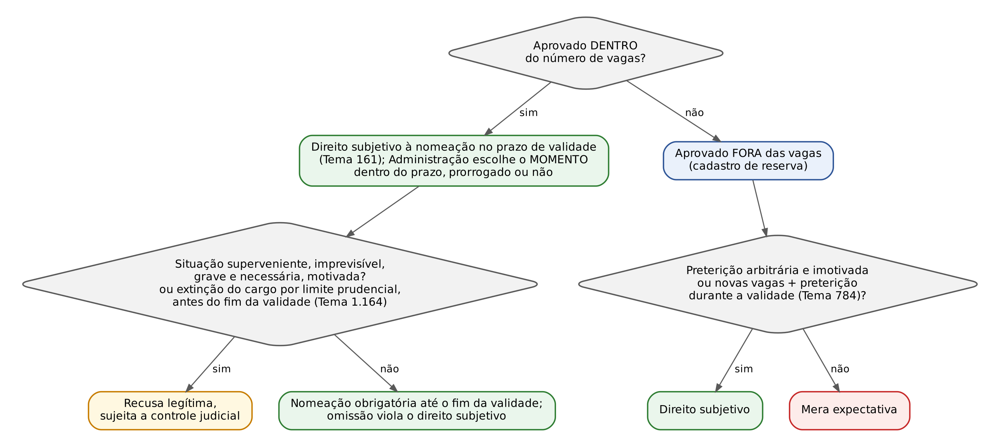
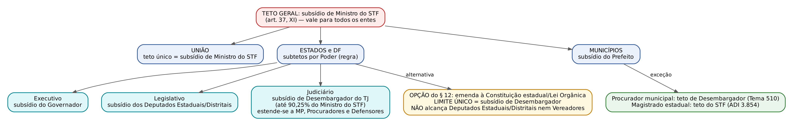
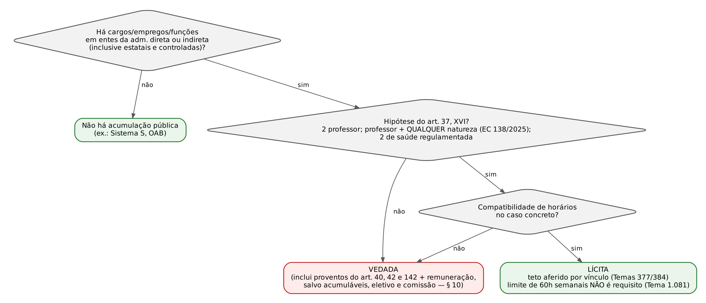
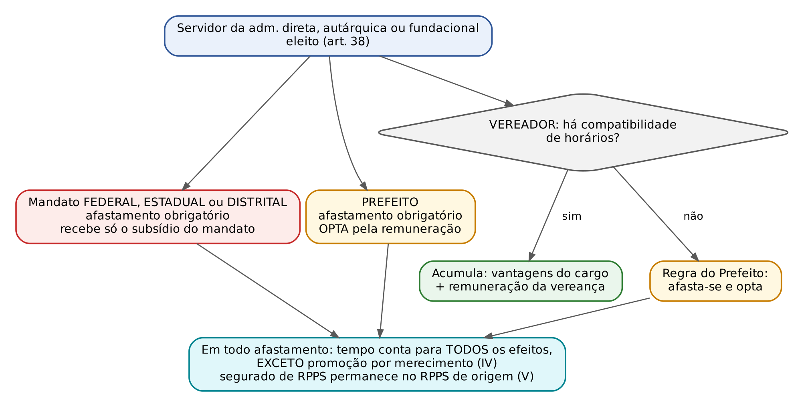
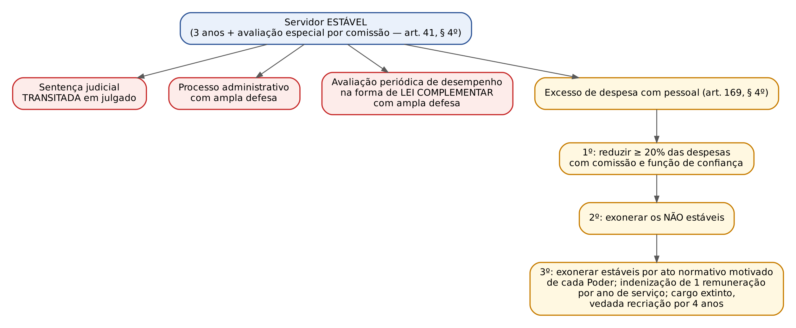
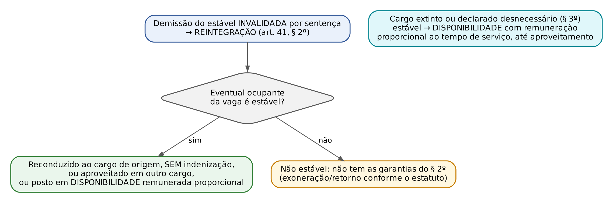
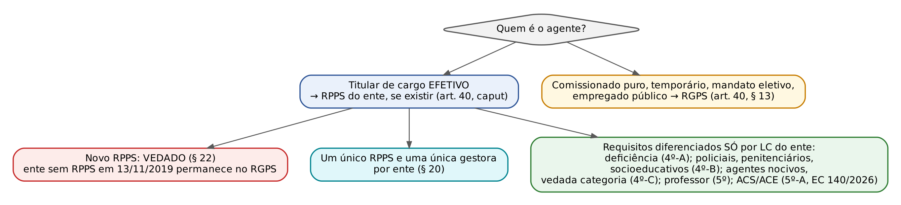

# CAPÍTULO 24 — ADMINISTRAÇÃO PÚBLICA NA CONSTITUIÇÃO: PRINCÍPIOS, SERVIDORES, RPPS, MILITARES E REGIÕES

:::INCIDENCIA
Pontos: TRF5 p. 12; TJRS p. 6; TJSC p. 10 (princípios). Nível A+. Lote: 139 questões (FGV 121, FCC 18), com 8 provas de magistratura (TJ-SC 2024 e 2025, TJ-BA, TJ-PA, TJ-TO, TRF1, TRF3, ENAM).
O que mais cai: teto e subtetos, acumulação, art. 38 (servidor eleito), estabilidade e perda do cargo, vedações remuneratórias (incorporação, vinculação, SV 37 e 42), regime previdenciário (vedação de novos RPPS e critérios diferenciados por LC do ente) e requisitos dos cargos em comissão (Tema 1.010).
:::

| Subtema | FGV | FCC | Padrão de cobrança |
|---|---|---|---|
| Remuneração, subsídio, revisão geral, vedações (incorporação, vinculação, isonomia judicial) | 22 | 3 | Caso de lei local: "constitucional?" — vínculo a índice federal, incorporação de função após X anos, iniciativa da revisão |
| Teto e subtetos (art. 37, XI, §§ 9º, 11 e 12) | 13 | 2 | Subteto único estadual (Desembargador, exceto Deputados e Vereadores); estatais que recebem recursos para pessoal ou custeio; teto por vínculo na acumulação |
| RPPS (art. 40 pós-EC 103/2019) | 20 | 2 | Vedação de novos RPPS; comissionado no RGPS; critérios diferenciados só por LC do ente e só nas hipóteses do art. 40, §§ 4º-A a 5º-A |
| Estabilidade, perda do cargo, disponibilidade, reintegração | 12 | 2 | Três hipóteses do art. 41, § 1º, mais art. 169, § 4º; avaliação periódica exige LC |
| Acumulação (art. 37, XVI e XVII; art. 42, § 3º) | 7 | 3 | Hipóteses taxativas; estatais incluídas; militar estadual pode, com prevalência da atividade militar |
| Servidor e mandato eletivo (art. 38) | 6 | 4 | Vereador com compatibilidade acumula; federal/estadual afasta sem opção; Prefeito opta |
| Cargos em comissão, funções de confiança e nepotismo | 12 | 3 | Tema 1.010 (quatro requisitos); SV 13; função de confiança só para efetivos |
| Concurso, acesso, contratação temporária, empregados de estatais | 15 | 4 | Tema 1.022 (motivação da dispensa), Tema 612, Tema 1.164, idade e doença grave |
| Princípios e publicidade (art. 37, caput e § 1º) | 8 | 0 | Eficiência x impessoalidade; § 1º não admite flexibilização |
| Regiões (art. 43) | 4 | 0 | O que exige LC (§ 1º) x o que basta lei (§ 2º) |

A responsabilidade civil do Estado (art. 37, § 6º) e a improbidade (art. 37, §§ 4º e 5º) entram aqui no recorte constitucional; o regime completo está nas Apostilas de Direito Administrativo, Caps. 24 e 27. O regime infraconstitucional dos agentes públicos (Lei 8.112/1990, Lei SC 6.745/1985, concurso em detalhe) está na Apostila de Direito Administrativo, Caps. 11 a 13; o RPPS em detalhe (cálculo, transições da EC 103), na Apostila de Direito Previdenciário, Cap. 23. Greve e associação sindical de servidores (art. 37, VI e VII): Cap. 12, seção 12.6.

## 24.1 Âmbito do art. 37 e princípios expressos

### 24.1.1 Destinatários e estrutura

O caput do art. 37 vincula a "administração pública direta e indireta de qualquer dos Poderes da União, dos Estados, do Distrito Federal e dos Municípios". Três consequências de prova: (i) os princípios alcançam também a função administrativa atípica do Legislativo e do Judiciário (o Tribunal que mantém processos em papel sem justificativa viola a EFICIÊNCIA — Q4147632); (ii) alcançam as estatais, ainda que exploradoras de atividade econômica, no que o art. 173, § 1º, não excepcionar (concurso, teto quando dependentes, motivação da dispensa); (iii) os incisos e parágrafos são, em regra, normas de reprodução obrigatória para Estados e Municípios, o que transforma quase toda questão de "lei local" em questão de controle de constitucionalidade (ver Cap. 20).

O rol do caput (legalidade, impessoalidade, moralidade, publicidade e eficiência — eficiência incluída pela EC 19/1998) não esgota os princípios: razoabilidade, proporcionalidade, segurança jurídica, motivação, supremacia e indisponibilidade do interesse público são implícitos (alguns positivados na Lei 9.784/1999, art. 2º). A FGV gosta de pedir a definição: eficiência é o princípio "relacionado ao modo de organizar, estruturar e disciplinar a Administração Pública para alcançar os melhores resultados" (Q3258850, gabarito E), que, na doutrina de Maria Sylvia Di Pietro, tem duas faces — o modo de atuação do agente e o modo de organizar a Administração.

:::PEGADINHA IMPESSOALIDADE X PUBLICIDADE X EFICIÊNCIA NAS ALTERNATIVAS
A vedação de "nomes, símbolos ou imagens que caracterizem promoção pessoal" está no § 1º, que trata da publicidade, mas é a característica clássica da IMPESSOALIDADE (Q2449608, FGV 2024, gabarito C). As demais alternativas descreviam indisponibilidade do interesse público (A), legalidade (B), publicidade (D) e eficiência (E, "presteza, perfeição e rendimento funcional"). Não confunda "publicidade educativa, informativa ou de orientação social" (finalidade da publicidade) com o princípio da publicidade (transparência).
:::

### 24.1.2 Publicidade oficial (art. 37, § 1º) e transparência

:::LEI CF, ART. 37, § 1º
A publicidade dos atos, programas, obras, serviços e campanhas dos órgãos públicos deverá ter caráter educativo, informativo ou de orientação social, dela não podendo constar nomes, símbolos ou imagens que caracterizem promoção pessoal de autoridades ou servidores públicos.
:::

O § 1º é norma de eficácia plena, que não admite flexibilização pelo legislador infraconstitucional nem pelo constituinte estadual. Daí o gabarito da Q3880733 (FGV, AL-GO 2026): emenda à Constituição estadual que diz não caracterizar promoção pessoal a divulgação de obras "de sua iniciativa, incluídos os decorrentes de emendas" parlamentares, quando atendidos critérios de "norma interna de cada poder", é inconstitucional porque o parâmetro federal não admite flexibilização (letra B; ver ADI 6.522, citada na Apostila de Direito Administrativo, Cap. 2). A armadilha era a letra A (ausência de reserva de iniciativa): o vício é material, não formal. O STF também reconhece violação ao § 1º no uso de slogans e símbolos de gestão na publicidade oficial (RE 191.668). No mesmo sentido, questões de letra: Q3783498 (gabarito B, caráter educativo, informativo ou de orientação social) e Q2512422 (verba de "publicidade institucional" pode divulgar obras com caráter informativo, vedados símbolos de promoção pessoal — gabarito C).

A publicidade é a regra também quanto às informações de órgãos policiais: o sigilo é exceção que exige justificação. Na Q2360664 (FGV, PC-SC 2024 — Delegado), portaria que impôs nível de acesso restrito a todos os processos eletrônicos de órgão policial violava o art. 5º, XXXIII, e qualquer restrição deve ser "justificada objetiva, específica e formalmente" (gabarito C, itens I e III). É a fórmula da ADPF 872 (ato restritivo de publicidade exige motivação objetiva, específica e formal). A divulgação nominal da remuneração dos servidores em sítio oficial é legítima (Tema 483, ARE 652.777); o art. 39, § 6º, impõe a publicação anual dos valores do subsídio e da remuneração dos cargos e empregos.

### 24.1.3 Moralidade e nepotismo

A moralidade é parâmetro autônomo de validade (não depende de lei), e o nepotismo é a manifestação mais cobrada.

:::JURIS STF, SÚMULA VINCULANTE 13
A nomeação de cônjuge, companheiro ou parente em linha reta, colateral ou por afinidade, até o terceiro grau, inclusive, da autoridade nomeante ou de servidor da mesma pessoa jurídica investido em cargo de direção, chefia ou assessoramento, para o exercício de cargo em comissão ou de confiança ou, ainda, de função gratificada na administração pública direta e indireta em qualquer dos Poderes da União, dos Estados, do Distrito Federal e dos Municípios, compreendido o ajuste mediante designações recíprocas, viola a Constituição Federal.
:::

Pontos de prova:

- Vedação independe de lei formal: decorre diretamente do art. 37, caput (Tema 66, RE 579.951). Por isso a Q3745820 (FCC, PGE-MT 2025) tinha como correta a letra D; a letra C reproduzia a SV 13 com a palavra trocada ("SALVO o ajuste mediante designações recíprocas", quando a súmula diz "compreendido"); a letra B afirmava iniciativa privativa do Executivo para lei antinepotismo, o que o STF nega (Tema 29, RE 570.392; v. Cap. 26); a letra E distorcia o Tema 1.001 (RE 910.552; v. Cap. 22): a lei municipal pode proibir a contratação de agentes políticos, servidores e parentes até o 3º grau de agentes eletivos e de ocupantes de cargo em comissão ou função de confiança, mas a tese RESSALVA os parentes de servidores sem cargo de confiança; a alternativa estendia o impedimento aos parentes de "qualquer um" dos servidores.
- Não há direito adquirido do comissionado nomeado antes da norma que vedou o nepotismo (ADI 3.680/RN; v. Cap. 10).
- Parentesco é critério objetivo até o 3º grau: irmão (colateral de 2º grau), tio (colateral de 3º grau) e companheira estão vedados; primo (colateral de 4º grau) não. Na Q2482467 (FGV, Câmara de Fortaleza 2024), gabarito C (vedados Luiz, Fernando e Joana; não Fabiano). Na Q3047985 (FGV, Macaé 2024), a letra C (parente por afinidade até o 3º grau na indireta municipal "não viola" a moralidade) é falsa.
- Cargos de natureza política (Secretário, Ministro): por construção jurisprudencial, ficam fora da incidência automática da SV 13, ressalvados nepotismo cruzado, fraude e manifesta falta de qualificação técnica ou idoneidade moral. Por isso, na Q3880731 (FGV, AL-GO 2026), o item II era verdadeiro (nomear o irmão pedagogo, pós-graduado, para Secretário de Educação não funda reclamação por violação à SV 13), o item I falso (conselho fiscal de instituto de previdência não é cargo político) e o item III falso (lei antinepotismo não é de iniciativa privativa, e lei que AUTORIZE a nomeação de parentes viola a Constituição — ADI 3.745). Gabarito B.

:::ATENCAO TEMA 1.000 (SV 13 E CARGOS POLÍTICOS) AINDA SEM TESE
O RE 1.133.118 (Tema 1.000, Município de Tupã/SP, relator Ministro Luiz Fux) discute se a SV 13 alcança cargos políticos. Em 23/10/2025, o julgamento começou com seis votos pela não incidência (Fux, Zanin, Mendonça, Nunes Marques, Moraes e Toffoli) e um contrário (Dino). Em 15/4/2026, o relator reajustou o voto para estender a vedação aos cargos políticos de alto escalão, com exceção restrita (por exemplo, pequenos Municípios sem outros nomes qualificados), e passou a negar provimento ao recurso; Cármen Lúcia e Dino acompanharam a negativa de provimento, divergindo da exceção; o Ministro Gilmar Mendes pediu vista. Não há tese fixada (notícias do STF de 23/10/2025 e 15/4/2026). Enquanto não houver tese, responda pela jurisprudência tradicional (exclusão dos cargos políticos, com as três ressalvas).
:::

### 24.1.4 Participação do usuário, contrato de desempenho e avaliação de políticas públicas

O § 3º manda a lei disciplinar a participação do usuário (reclamações, acesso a registros e informações — remetendo ao art. 5º, X e XXXIII — e representação contra o exercício negligente ou abusivo). O § 8º (EC 19/1998) permite ampliar a autonomia gerencial, orçamentária e financeira de órgãos e entidades "mediante contrato", com metas de desempenho, cabendo à lei dispor sobre prazo, controles e "remuneração do pessoal" (no plano federal, Lei 13.934/2019). O § 16 (EC 109/2021) impõe a avaliação de políticas públicas.

:::PEGADINHA "DEVEM" E "NA FORMA DA LEI" (§ 16)
Os órgãos e entidades "DEVEM realizar avaliação das políticas públicas, inclusive com divulgação do objeto a ser avaliado e dos resultados alcançados, na forma da LEI". Na Q3878421 (FGV 2026), o item III dizia "poderão realizar, periodicamente", "na forma da lei complementar" — duas trocas, item falso. O item I trocava readaptação por "reintegração" e "mantida a remuneração do cargo de origem" por "fazendo jus à remuneração deste" — falso. Só o item II (§ 8º, literal) era correto: gabarito B.
:::

### 24.1.5 Estatais, licitação e precedência fazendária (incisos XVIII a XXII)

- XIX: lei específica CRIA autarquia e AUTORIZA a instituição de empresa pública, sociedade de economia mista e fundação; à LC cabe definir as áreas de atuação da fundação.
- XX: depende de autorização legislativa, "em cada caso", a criação de subsidiárias e a participação em empresa privada. O STF admite autorização genérica na própria lei que autoriza a estatal (ADI 1.649), mas a dispensa de QUALQUER manifestação legislativa é inconstitucional. Por isso, na Q2535775 (FGV, MF 2024), o Art. X.1 (subsidiária integral "independe de qualquer manifestação do Poder Legislativo") era inconstitucional; o X.2 (teto para estatal que recebe recursos para "obras de conservação", isto é, custeio em geral — § 9º) era constitucional; o X.3 (verba de representação a quem recebe subsídio) violava o art. 39, § 4º. Gabarito B.
- XXI: licitação, ressalvados os casos especificados NA LEGISLAÇÃO (contratação direta não se cria por decreto), "mantidas as condições efetivas da proposta" — fundamento constitucional do equilíbrio econômico-financeiro (Q3841671, FGV 2025, gabarito B). Competência: normas gerais da União (art. 22, XXVII); Estados e Municípios legislam sobre o que não for geral (ver Cap. 22). As alienações, em regra, também se licitam.
- XXII (EC 42/2003): administrações tributárias exercidas por servidores de carreiras específicas, com recursos prioritários e atuação integrada, inclusive compartilhamento de cadastros e informações fiscais.
- Organizações sociais: o STF validou o modelo da Lei 9.637/1998, exigindo que qualificação e contrato de gestão observem os princípios do art. 37 de forma pública, objetiva e impessoal (ADI 1.923). Daí a letra D correta na Q3047985 (ato normativo que concretiza os princípios da Administração às OS é constitucional). Na mesma questão, a letra B (desempate em favor de servidor do próprio ente) é falsa (ADI 5.358).

### 24.1.6 Espécies de agentes públicos (recorte)

Classificação usual (Celso Antônio Bandeira de Mello e Di Pietro): agentes políticos, servidores públicos (estatutários, empregados públicos e temporários), militares e particulares em colaboração (requisitados — jurados, mesários, conscritos —, delegatários de serviço notarial e registral, concessionários, gestores de negócio). Na Q2511397 (FGV, Câmara dos Deputados 2024), o particular requisitado para o serviço militar e o notário são particulares em colaboração e o empregado de empresa pública é servidor celetista (gabarito E). O notário ingressa por concurso (art. 236, § 3º), mas exerce a atividade em caráter privado, por delegação; não é titular de cargo. Detalhes: Apostila de Direito Administrativo, Cap. 11.

## 24.2 Acesso aos cargos, concurso e empregados públicos

### 24.2.1 Acessibilidade (inciso I) e requisitos

:::LEI CF, ART. 37, I A IV
I - os cargos, empregos e funções públicas são acessíveis aos brasileiros que preencham os requisitos estabelecidos em lei, assim como aos estrangeiros, na forma da lei;
II - a investidura em cargo ou emprego público depende de aprovação prévia em concurso público de provas ou de provas e títulos, de acordo com a natureza e a complexidade do cargo ou emprego, na forma prevista em lei, ressalvadas as nomeações para cargo em comissão declarado em lei de livre nomeação e exoneração;
III - o prazo de validade do concurso público será de até dois anos, prorrogável uma vez, por igual período;
IV - durante o prazo improrrogável previsto no edital de convocação, aquele aprovado em concurso público de provas ou de provas e títulos será convocado com prioridade sobre novos concursados para assumir cargo ou emprego, na carreira;
:::

Quanto aos estrangeiros, a norma é de eficácia limitada ("na forma da lei"); para as universidades e instituições de pesquisa, o art. 207, § 1º, faculta admitir professores, técnicos e cientistas estrangeiros. O STF reconheceu direito líquido e certo do estrangeiro aprovado à nomeação para cargo de professor, técnico ou cientista em universidade pública, salvo se a restrição da nacionalidade estiver expressa no edital, com o exclusivo objetivo de preservar o interesse público e desde que, sem prejuízo de controle judicial, devidamente justificada (Tema 1.032, RE 1.177.699; desenvolvimento no Cap. 36). A Q2367554 (FGV, MPE-GO 2024 — Promotor) reproduziu a tese (gabarito D). Na Q3578715 (FGV 2025), a letra D é falsa porque diz "exclusivamente aos brasileiros" e depois inclui estrangeiros; a correta é a B (associação sindical do servidor civil, inciso VI).

Os requisitos de acesso dependem de LEI e de pertinência com as atribuições:

- Idade: "O limite de idade para a inscrição em concurso público só se legitima em face do art. 7º, XXX, da Constituição, quando possa ser justificado pela natureza das atribuições do cargo a ser preenchido" (Súmula 683; Tema 646). Exige lei em sentido estrito. Q4079432 (FGV, PGE-AC 2026): limite de 30 anos para oficial da PM, fixado em lei complementar estadual, é legítimo (gabarito C); a letra B inventava regra de aferição na posse. Em sentido inverso, o STF julgou inconstitucionais normas estaduais que fixavam idade máxima para voluntários da PM e do Corpo de Bombeiros, porque o vínculo voluntário é que era inválido (ADI 3.608/GO, Informativo 1145).
- Doença grave: é inconstitucional vedar a posse de aprovado acometido de doença grave que não gere incapacidade para o cargo (Tema 1.015, RE 886.131). Q3888022 (FGV 2024): restrição genérica fere dignidade e isonomia (gabarito B); a letra E erra ao vedar QUALQUER exigência restritiva, mesmo relacionada às atribuições.
- Vedação perpétua: lei que impede para sempre o servidor demitido por crime contra a Administração ou improbidade de prestar concurso cria sanção de caráter perpétuo (art. 5º, XLVII, b), e o STF declarou inconstitucional o art. 137, parágrafo único, da Lei 8.112/1990 por esse fundamento (ADI 2.975).

:::QUESTAO FGV 2024 — TJ-SC — JUIZ SUBSTITUTO (Q3049415)
Lei estadual de iniciativa parlamentar impede o servidor demitido por crime contra a Administração ou improbidade de participar de concurso no Estado. Gabarito: E — formal e materialmente inconstitucional. Passos: (1) a matéria é provimento e regime jurídico dos servidores, de iniciativa privativa do Governador por simetria com o art. 61, § 1º, II, c (vício formal; a armadilha das letras A e B é tratar o tema como "proteção da moralidade", livre para o parlamentar); (2) a vedação sem prazo é pena perpétua (ADI 2.975); (3) a letra C confunde com Direito Penal (não há tipificação de crime, mas efeito administrativo).
:::

A reserva de percentual para pessoas com deficiência (inciso VIII: "a lei reservará percentual dos cargos e empregos públicos para as pessoas portadoras de deficiência e definirá os critérios de sua admissão") foi cobrada literalmente na Q2474122 (FGV 2024, gabarito C), cujas demais alternativas contrariavam o modelo biopsicossocial (o diagnóstico médico não é imprescindível; a inclusão não é limitada pela família). Cotas raciais e para mulheres: Apostila de Direito Administrativo, Cap. 11 e Cap. 8 desta apostila (ADC 41).

### 24.2.2 A regra do concurso e o provimento derivado

O concurso é exigido para cargo E emprego (inclusive em estatais e, desde 1988, sem exceção para a indireta), "de provas ou de provas e títulos" — nunca só de títulos. As exceções constitucionais são taxativas: cargos em comissão (inciso II, parte final), contratação temporária (IX), agentes comunitários de saúde e de combate às endemias por processo seletivo público (art. 198, § 4º), cargos eletivos, membros de tribunais nomeados por critério político (quinto, STF, STJ, TCU), ex-combatentes (ADCT, art. 53, I). A Q4282429 (FGV, TCE-PE 2026) pedia a letra (I e III corretos; II falso porque comissionados não fazem concurso — gabarito C). O § 2º comina nulidade do ato e punição da autoridade para a inobservância dos incisos II e III.

:::JURIS STF, SÚMULA VINCULANTE 43
É inconstitucional toda modalidade de provimento que propicie ao servidor investir-se, sem prévia aprovação em concurso público destinado ao seu provimento, em cargo que não integra a carreira na qual anteriormente investido.
:::

Desdobramentos de 2020 a 2026:

- É inconstitucional o aproveitamento de servidor aprovado em concurso de nível médio em cargo de nível superior (Tema 697, RE 740.008), bem como a aglutinação, em carreira única, de cargos com atribuições diferentes (Tema 667).
- NÃO é provimento derivado alterar requisitos de escolaridade e a denominação de cargo já existente, mantidas as atribuições: é modernização da estrutura de pessoal (ADI 7.691/MS, Rel. Min. Cristiano Zanin, Plenário, j. 15/6/2026, Informativo 1222 — papiloscopista integrado à carreira de perito oficial forense). É a lógica que explica o gabarito B da Q3049074 (FGV, Caraguatatuba 2024): reestruturação de carreiras análogas, com atribuições similares, que passa a exigir nível superior e uniformiza a denominação, admite remuneração igualitária para antigos e novos ocupantes.
- O aproveitamento de empregados concursados de estatal extinta em quadro celetista em extinção, com similitude de funções, equivalência salarial e identidade de escolaridade, não viola a SV 43, mas é vedada a investidura em cargo estatutário; e emenda à Constituição estadual de iniciativa parlamentar sobre o tema tem vício de iniciativa (ADI 7.832/RR, Rel. Min. Flávio Dino, Plenário, j. 21/8/2026, Informativo 1227). No mesmo sentido, é inconstitucional dispositivo de Constituição estadual que permite transpor empregado público para o quadro estatutário sem concurso (Tema 1.128, RE 1.232.885).
- O estabilizado do art. 19 do ADCT (cinco anos de serviço continuado em 5/10/1988, admitido sem concurso) tem estabilidade, não efetividade: não pode ser reenquadrado em plano de cargos e carreiras de efetivos (Tema 1.157, ARE 1.306.505). Na Q3350302 (FGV, TRT-24 2025), Maria, nessa situação, não pode ser integrada ao RPPS (que é dos titulares de cargo efetivo) — gabarito C; a letra D, que a equiparava aos concursados, é a armadilha.

:::QUESTAO FGV 2024 — TJ-AP — ANALISTA JUDICIÁRIO (Q2449063)
Lei estadual editada mais de vinte anos após 1988 promoveu a ascensão de servidores de nível médio para nível superior, em afronta ao art. 37, II, e à SV 43; passados mais de cinco anos, cogitou-se da autotutela. Gabarito: A — a gravidade da flagrante inconstitucionalidade afasta o prazo decadencial da autotutela. A orientação do STF é a de que situações flagrantemente inconstitucionais não se consolidam pelo decurso do prazo do art. 54 da Lei 9.784/1999 (STF, RE 817.338/DF, Tema 839, Relator Ministro Dias Toffoli, Plenário, j. 16/10/2019, Info 956: anistia política flagrantemente inconstitucional; "não pode haver usucapião de constitucionalidade"). Armadilhas: C e E aplicam mecanicamente os cinco anos; D invoca o fato consumado, que o STF rejeita em matéria de concurso (Tema 476).
:::

### 24.2.3 Validade, prioridade e direito à nomeação

O prazo de validade é de ATÉ dois anos, prorrogável UMA vez, por IGUAL período (a prorrogação é discricionária, mas, se ocorrer, tem a mesma duração do prazo inicial). O inciso IV não proíbe novo concurso durante a validade do anterior; garante prioridade de convocação aos aprovados no certame anterior.

Teses (detalhes na Apostila de Direito Administrativo, Cap. 11): aprovado dentro das vagas tem direito subjetivo à nomeação durante a validade, cabendo à Administração escolher o momento (Tema 161, RE 598.099), salvo situação superveniente, imprevisível, grave e necessária, devidamente motivada; aprovado fora das vagas só tem direito em caso de preterição arbitrária e imotivada, inclusive quando surgirem novas vagas durante a validade (Tema 784, RE 837.311); a nomeação tardia por decisão judicial não gera indenização (Tema 671) nem fato consumado (Tema 476).

:::JURIS STF, TEMA 1.164 (RG) — RE 1.316.010, REL. MIN. FLÁVIO DINO
A superveniente extinção dos cargos oferecidos em edital de concurso público em razão da superação do limite prudencial de gastos com pessoal, previsto em lei complementar regulamentadora do art. 169 da Constituição Federal, desde que anterior ao término do prazo de validade do concurso e devidamente motivada, justifica a mitigação do direito subjetivo à nomeação de candidato aprovado dentro do número de vagas.
Leitura restritiva do STJ: os quatro requisitos são cumulativos; plano de contingenciamento que apenas SUSPENDE nomeações não equivale à extinção do cargo, e medida adotada depois do fim da validade não desfaz o direito já formado (STJ, AgInt no RMS 64.598-SP, Rel. Min. Regina Helena Costa, Primeira Turma, j. 14/9/2026, Informativo 905).
:::

:::QUESTAO FGV 2026 — TJ-BA — JUIZ SUBSTITUTO (Q4083793)
Aprovado dentro das três vagas não foi nomeado até o fim da validade (sem prorrogação); em apelação, o Município alegou crise, proximidade do limite prudencial e lei que extinguiu o cargo. Gabarito: D — a superveniente extinção do cargo pela superação do limite prudencial, anterior ao término da validade e motivada, justifica a mitigação do direito (Tema 1.164). Armadilhas: A (aplicar o Tema 161 "sem *distinguishing*"), B (fixar que o percentual da LRF "não autoriza" a recusa), C ("sem sujeição à discricionariedade" — a Administração escolhe o momento) e E ("sem possibilidade de controle judicial" — a motivação é sindicável). Para a sentença: verificar, na ordem, se a lei extintiva é anterior ao termo final da validade, se há prova da superação do limite prudencial (não basta "aproximar-se") e se o ato foi motivado; faltando qualquer requisito, prevalece o Tema 161.
:::

No mesmo sentido do Tema 161: Q2387525 (FGV, CGM-BH 2024): dentro das vagas há direito subjetivo, mas a Administração decide o momento até o fim da validade, prorrogada ou não, e só então o candidato pode exigir em juízo — gabarito D.

### 24.2.4 Empregados públicos das estatais

O empregado de empresa pública e de sociedade de economia mista ingressa por concurso (inciso II), é regido pela CLT (art. 173, § 1º, II), não tem a estabilidade do art. 41 (que é de titular de cargo efetivo) e submete-se ao teto apenas se a estatal for dependente (§ 9º).

:::JURIS STF, TEMA 1.022 (RG) — RE 688.267, PLENÁRIO, J. 8/2/2024
As empresas públicas e as sociedades de economia mista, sejam elas prestadoras de serviço público ou exploradoras de atividade econômica, ainda que em regime concorrencial, têm o dever jurídico de motivar, em ato formal, a demissão de seus empregados concursados, não se exigindo processo administrativo. Tal motivação deve consistir em fundamento razoável, não se exigindo, porém, que se enquadre nas hipóteses de justa causa da legislação trabalhista.
Efeitos modulados: vale a partir da publicação da ata do julgamento (4/3/2024), segundo a Apostila de Direito Administrativo, Cap. 4.
:::

O Tema 1.022 generalizou para todas as estatais o que o Tema 131 (RE 589.998) firmara para a ECT ("A Empresa Brasileira de Correios e Telégrafos – ECT tem o dever jurídico de motivar, em ato formal, a demissão de seus empregados" — reproduzido na letra D da Q3179505, FGV, TRF3 2025 — Juiz Federal, gabarito D).

:::QUESTAO FGV 2026 — PGE-AC — PROCURADOR DO ESTADO (Q4079400)
Empresa pública estadual concorrencial dispensou, sem justa causa e sem qualquer motivação, analista concursado havia dez anos, invocando o regime privado do art. 173, § 1º, II; o empregado pediu nulidade e reintegração, alegando necessidade de motivação e de PAD. Gabarito: B — a dispensa é nula por falta de motivação, que é exigida de todas as estatais, sem necessidade de processo administrativo. Armadilhas: A e C (restringir o dever às prestadoras de serviço público ou monopolistas), D (exigir PAD com contraditório) e E (atrelar a motivação à estabilidade do art. 41). Observação: se a dispensa for anterior a 4/3/2024, a modulação afasta a nulidade por falta de motivação.
:::

No mesmo sentido: Q4223053 (FGV, NAV Brasil 2026, gabarito D: dispensa sem justa causa admitida, com motivação razoável em ato formal; A, B, C e E erram ao falar em regime estatutário, sentença judicial, dispensa de concurso e estabilidade) e Q3085857 (FGV, DATAPREV 2024, gabarito A; a letra E erra ao dizer que a estatal é de direito público e que o teto incide necessariamente).

:::QUESTAO FCC 2026 — PGM-MANAUS — PROCURADOR DO MUNICÍPIO (Q4338822)
Afirmativas sobre regimes de pessoal à luz do TST e do STF. Gabarito: D — a aposentadoria de empregado público concedida a partir da EC 103/2019 rompe o vínculo que gerou o tempo de contribuição (art. 37, § 14). Erradas: A (exige "regular processo administrativo" e enquadramento no art. 482 da CLT, o que o Tema 1.022 dispensa), B (o contrato nulo por falta de concurso só gera saldo de salário e FGTS, não férias e aviso prévio — Súmula 363 do TST e art. 19-A da Lei 8.036/1990), C (a mudança de celetista para estatutário extingue o contrato de trabalho) e E (o TST convalida os efeitos do contrato nulo quando a entidade é posteriormente privatizada — ponto infraconstitucional, não conferido nesta pesquisa).
:::

O art. 37, § 14 (EC 103/2019), foi enfrentado pelo STF no Tema 606 (RE 655.283), em caso dos Correios: a natureza do ato de demissão é administrativa (competência da Justiça comum, não da do Trabalho) e "a concessão de aposentadoria aos empregados públicos inviabiliza a permanência no emprego, nos termos do art. 37, § 14, da CRFB, salvo para as aposentadorias concedidas pelo Regime Geral de Previdência Social até a data de entrada em vigor da Emenda Constitucional nº 103/19, nos termos do que dispõe seu art. 6º". A Q3362326 (FGV, ENAM 2025.1) cobrou exatamente isso: item I falso (competência), II verdadeiro, III falso ("independentemente da data") — gabarito B. Na Q3090477 (FGV, Niterói 2024), a cessação do vínculo da empregada pública decorre do uso do tempo de contribuição do próprio emprego (gabarito A). Antes da EC 103, o STF já negava ao servidor estatutário aposentado pelo RGPS o direito de permanecer no cargo quando a lei local prevê a vacância (Tema 1.150, RE 1.302.501).

:::QUESTAO FCC 2025 — TRT-2 — ANALISTA JUDICIÁRIO (Q3627588)
Pediu-se a orientação do STF sobre regimes de pessoal. Gabarito oficial: A — conselhos profissionais, embora autárquicos, podem contratar sob o regime celetista (ADC 36, ADI 5.367 e ADPF 367, julgadas em conjunto em 2020, por 7 a 4, vencida a relatora, Ministra Cármen Lúcia, prevalecendo a divergência aberta pelo Ministro Alexandre de Moraes). Erradas: B (serviços sociais autônomos não se submetem a concurso — Tema 569), D e E (estatais não admitem estatutários; e celetistas de estatal se admitem por concurso, não por processo seletivo simplificado). ATENÇÃO: a letra C ("admissão dos agentes comunitários de saúde e de combate às endemias obrigatoriamente pelo regime estatutário") era falsa em 2025, mas a EC 140, de 16/10/2026, incluiu no art. 198 o § 4º-B ("submetem-se ao regime jurídico dos servidores nomeados para cargo de provimento efetivo") e o § 4º-A (vedada a contratação temporária ou terceirizada, salvo emergência em saúde pública), e determinou a regularização dos vínculos até 31/12/2028 (art. 12). Hoje a letra C tende a ser considerada correta.
:::

## 24.3 Cargos em comissão e funções de confiança

:::LEI CF, ART. 37, V
as funções de confiança, exercidas exclusivamente por servidores ocupantes de cargo efetivo, e os cargos em comissão, a serem preenchidos por servidores de carreira nos casos, condições e percentuais mínimos previstos em lei, destinam-se apenas às atribuições de direção, chefia e assessoramento;
:::

|  | Função de confiança | Cargo em comissão |
|---|---|---|
| Quem exerce | EXCLUSIVAMENTE ocupante de cargo efetivo | Qualquer pessoa, reservado percentual mínimo a servidores de carreira, "nos casos, condições e percentuais mínimos previstos em lei" |
| Natureza | Conjunto de atribuições acrescido a cargo efetivo, remunerado por gratificação | Cargo autônomo, criado por lei, de livre nomeação e exoneração |
| Atribuições | Direção, chefia e assessoramento ("apenas") | Idem |
| Previdência | RPPS do cargo efetivo | Comissionado puro: RGPS (art. 40, § 13) |
| Nepotismo | Alcançado (SV 13: "função gratificada") | Alcançado |

A FCC trocou a palavra: funções de confiança exercidas "exclusivamente por servidores ocupantes de cargo efetivo" e destinadas a "direção, chefia e assessoramento" (Q3549601, gabarito C; erradas as que diziam "ocupantes ou não", "apenas chefia e assessoramento" ou "dentre outras"). Na Q4066809 (FCC, SEFAZ-GO 2026), a remuneração por atribuições de chefia pode decorrer de nomeação para cargo em comissão cujas atribuições legais incluam a chefia (gabarito E); a letra C erra ao exigir vínculo efetivo prévio (o cargo em comissão é aberto a não servidores) e a D, ao admitir "cômputo distinto" dos limites de remuneração.

:::JURIS STF, TEMA 1.010 (RG) — RE 1.041.210
a) A criação de cargos em comissão somente se justifica para o exercício de funções de direção, chefia e assessoramento, não se prestando ao desempenho de atividades burocráticas, técnicas ou operacionais; b) tal criação deve pressupor a necessária relação de confiança entre a autoridade nomeante e o servidor nomeado; c) o número de cargos comissionados criados deve guardar proporcionalidade com a necessidade que eles visam suprir e com o número de servidores ocupantes de cargos efetivos no ente federativo que os criar; e d) as atribuições dos cargos em comissão devem estar descritas, de forma clara e objetiva, na própria lei que os instituir.
:::

Complementos: no controle concentrado de lei que cria cargos em comissão, o Tribunal deve examinar as atribuições, mas não precisa se pronunciar cargo a cargo (Tema 670, RE 719.870); é inconstitucional lei que autoriza ato infralegal a transformar cargos em comissão em funções de confiança ou vice-versa (ADI 6.180/SE, j. 15/8/2023, Informativo 1104); e, em julgado de Santa Catarina, o STF validou cargos em comissão de assessor jurídico e assistente de promotoria no MP, por serem de assessoramento ligado à independência funcional de cada membro, afirmando que a proporcionalidade se afere em relação ao total de efetivos do ENTE, não de cada órgão, e que o art. 37, V, é norma de eficácia contida quanto aos percentuais (ADI 5.777/SC, red. p/ acórdão Min. Flávio Dino, Plenário, j. 6/3/2026, Informativo 1207).

:::QUESTAO FGV 2024 — TJ-SC — JUIZ SUBSTITUTO (Q2387011)
Lei municipal criou quinze cargos em comissão de "assessor" de diversos níveis, deixando ao Executivo fixar as atribuições; o Município tem vinte e cinco efetivos. Gabarito: C — inconstitucional, porque as atribuições devem estar descritas, de forma clara e objetiva, na própria lei (Tema 1.010, d). Armadilhas: A (separação de Poderes justificaria a fixação pelo Executivo), B (basta a relação de confiança), D (admite atividades burocráticas e técnicas) e E (desvincula a proporcionalidade do número de efetivos — é exatamente o contrário). Na sentença: o vício de descrição das atribuições basta; a desproporção (15 comissionados para 25 efetivos) é fundamento adicional.
:::

No mesmo sentido: Q3777929 (FGV, AL-AM 2025 — Procurador, gabarito D; a letra A erra ao aferir a proporcionalidade "de cada órgão isoladamente", como confirmou a ADI 5.777; a C erra ao incluir comissionados puros no RPPS; a B, ao dizer que a Constituição VEDA percentual mínimo) e Q3087103 (FGV, TJ-RR 2024, assinalar a INCORRETA: letra A, porque cargos em comissão não são necessariamente "preenchidos por servidores de carreira" — só o percentual mínimo legal).

:::QUESTAO FGV 2024 — AL-PR — PROCURADOR (Q2448942)
O Estado não editou a lei que define condições e percentuais mínimos de cargos em comissão para servidores de carreira. Gabarito oficial: C — há omissão inconstitucional do Estado, porque o regime jurídico-administrativo do servidor é de competência de cada ente. Comentário: a banca tratou o art. 37, V, como mandado de legislar dirigido a cada ente (lei local, não lei nacional — afastando a letra D) e atacou as letras B e E (a exigência está na própria Constituição). Ressalva para a discursiva: em 2026, o STF qualificou o dispositivo como norma de eficácia contida quanto aos percentuais (ADI 5.777), o que enfraquece a tese da omissão inconstitucional; a questão de 2024 deve ser respondida pelo gabarito, mas a qualificação é controvertida (ver nota de verificação).
:::

O cargo em comissão é de livre nomeação e exoneração: não gera estabilidade nem direito à permanência, e a troca de gestão não exige motivação (Q3593351, FGV, TCE-PE 2025, gabarito D; a E erra ao exigir motivação "sempre que houver mudança de governo"). A exceção que a FGV adora é a gestante:

A gestante tem direito à licença-maternidade e à estabilidade provisória qualquer que seja o regime, contratual ou administrativo, ainda que ocupe cargo em comissão ou seja temporária (Tema 542; v. Cap. 12).

Aplicações: Q4079398 (FGV, PGE-AC 2026: assessora comissionada exonerada grávida tem direito à licença e à estabilidade desde a confirmação da gravidez até cinco meses após o parto — gabarito B) e Q2387515 (FGV, CGM-BH 2024, gabarito A). Na Q4338769 (FCC, PGM-Manaus 2026), a letra A é falsa justamente por negar o direito à temporária.

## 24.4 Contratação por tempo determinado (art. 37, IX)

"A lei estabelecerá os casos de contratação por tempo determinado para atender a necessidade temporária de excepcional interesse público." Lei de cada ente (competência própria para o seu pessoal), ORDINÁRIA.

:::JURIS STF, TEMA 612 (RG) — RE 658.026, REL. MIN. DIAS TOFFOLI
Para que se considere válida a contratação temporária, é preciso que: a) os casos excepcionais estejam previstos em lei; b) o prazo de contratação seja predeterminado; c) a necessidade seja temporária; d) o interesse público seja excepcional; e) a necessidade de contratação seja indispensável, sendo vedada para os serviços ordinários permanentes do Estado e que estejam sob o espectro das contingências normais da Administração.
:::

A Q2482642 (FGV, SES-MT 2024) cobrou os elementos: falso o item I ("os casos excepcionais não precisam estar previstos em lei"); verdadeiros o II (prazo predeterminado) e o III (necessidade decorrente de vacância dura só até o próximo concurso) — gabarito D. É inconstitucional norma genérica que autoriza convocar temporários para suprir vacância de cargos efetivos (ADPF 915). Na Q3578715, a letra E ("é vedada a contratação por tempo determinado") nega o próprio inciso IX.

Limites materiais recentes: os cargos da polícia penal só se preenchem por concurso ou pela transformação dos cargos de agente penitenciário (EC 104/2019, art. 4º), vedada a contratação temporária, com declaração de inconstitucionalidade parcial sem redução de texto da lei acreana genérica (ADI 7.699/AC, Rel. Min. Cristiano Zanin, Plenário, j. 5/8/2026, Informativo 1224); e, desde a EC 140/2026, é vedada a contratação temporária ou terceirizada de agentes comunitários de saúde e de combate às endemias, salvo emergência em saúde pública (art. 198, § 4º-A).

:::JURIS STF, TEMA 551 (RG) — RE 1.066.677
Servidores temporários não fazem jus a décimo terceiro salário e férias remuneradas acrescidas do terço constitucional, salvo (I) expressa previsão legal e/ou contratual em sentido contrário, ou (II) comprovado desvirtuamento da contratação temporária pela Administração Pública, em razão de sucessivas e reiteradas renovações e/ou prorrogações.
Complemento: é vedada a extensão, por decisão judicial, de parcelas de qualquer natureza aos temporários (Tema 1.334, RE 1.500.990/AM, j. 26/10/2024, Informativo 1157). A gestante temporária tem licença e estabilidade provisória (Tema 542; v. Cap. 12).
:::

Aplicações: Q3592117 (FGV, TCE-PE 2025 — Procurador: a contratação temporária só gera 13º e férias com terço se houver previsão legal ou contratual — gabarito E; erradas a exigência de concurso de provas e títulos, a incidência de "todos os direitos" dos servidores, a incidência só da CLT e a competência da Justiça do Trabalho — lides de temporários são da Justiça comum, ADI 3.395) e Q3745821 (FCC, PGE-MT 2025, assinalar a EXCEÇÃO: letra B, que estendia 13º e férias "inclusive" aos temporários; corretas as demais — teto por vínculo, atribuições em lei, constitucionalidade da EC 19 quanto ao regime jurídico único com vedação de transmudação, e abono de permanência na aposentadoria especial, Tema 888).

:::QUESTAO FGV 2025 — TJ-SC — JUIZ SUBSTITUTO (Q3324307)
A Constituição do Estado Delta exige lei COMPLEMENTAR para disciplinar a contratação temporária. Gabarito: A — inconstitucional por simetria, pois a Constituição Federal reserva a matéria à lei ordinária. Fundamento: o STF declarou inconstitucional norma de Constituição estadual que exige lei complementar para regulamentar a contratação temporária, por violar a simetria e o princípio democrático (o quórum qualificado engessa a maioria), e invalidou leis complementares cearenses que contrariavam o art. 37, II e IX (ADI 7.057/CE, j. 6/12/2024, Informativo 1162). Armadilhas: B (liberdade absoluta do constituinte estadual), C (matéria exclusiva da Constituição estadual), D (decreto) e E (afirmar que a CF exige LC).
:::

:::DICA QUANDO A CONSTITUIÇÃO ESTADUAL PODE EXIGIR LEI COMPLEMENTAR?
Regra prática do STF: o constituinte estadual NÃO pode criar hipóteses de lei complementar onde a Constituição Federal se contenta com lei ordinária em matérias de reprodução obrigatória ou sensíveis ao processo legislativo (organização administrativa, regime de servidores, contratação temporária), porque isso altera o equilíbrio entre maioria e minoria desenhado pela CF. Contraste: no RPPS, a própria CF exige LC do ente para critérios diferenciados (art. 40, §§ 4º-A a 5º) e para tempo de contribuição e requisitos da aposentadoria comum (art. 40, § 1º, III), e para a avaliação periódica de desempenho (art. 41, § 1º, III). Ver Cap. 26.
:::

## 24.5 Sistema remuneratório

### 24.5.1 Reserva de lei, iniciativa e revisão geral anual (art. 37, X)

:::LEI CF, ART. 37, X
a remuneração dos servidores públicos e o subsídio de que trata o § 4º do art. 39 somente poderão ser fixados ou alterados por lei específica, observada a iniciativa privativa em cada caso, assegurada revisão geral anual, sempre na mesma data e sem distinção de índices;
:::

Três ideias: (i) lei ESPECÍFICA (nada de decreto, resolução, convenção coletiva — Súmula 679 — ou medida provisória que a substitua sem conversão; a letra E da Q4086820, "pode ser fixada ou alterada por medida provisória", é falsa no contexto da questão, que buscava a reserva de lei específica e a parcela única do subsídio); (ii) "observada a iniciativa privativa em cada caso": Executivo (art. 61, § 1º, II, a), Câmara e Senado (arts. 51, IV, e 52, XIII, por resolução de iniciativa da Mesa quanto à iniciativa, mas fixação por lei), Tribunais (art. 96, II, b), MP (art. 127, § 2º), Defensoria (art. 134); (iii) revisão geral anual, "sempre na mesma data e sem distinção de índices", que é recomposição inflacionária geral, distinta dos reajustes setoriais.

:::QUESTAO FGV 2024 — ENAM — EXAME NACIONAL DA MAGISTRATURA 2024.2 (Q3058611)
Lei estadual, de iniciativa da Assembleia, deu "recomposição linear" aos servidores do Legislativo e estendeu-a a aposentados e pensionistas, para recuperar perda inflacionária. Gabarito: B — inconstitucional, pois a iniciativa da revisão geral de TODOS os servidores estaduais é do Chefe do Executivo. Raciocínio: recomposição linear para recompor inflação é revisão geral, e não reajuste específico; a revisão geral é única para todos os Poderes ("mesma data, sem distinção de índices") e, por isso, a jurisprudência do STF atribui a iniciativa ao Executivo; a Assembleia pode iniciar a lei de REAJUSTE dos seus servidores, não a revisão geral. Armadilhas: C (iniciativa do próprio Legislativo) e D (competência da União).
:::

No mesmo sentido, Q3883093 (FGV, AL-RO 2026): é admitida a revisão simultânea de todos os servidores estaduais, sem distinção de índices, por proposição do Governador (gabarito E); a revisão não é "vedada" (A) nem promovida pela Assembleia por iniciativa própria (D), e a alteração da remuneração de categorias específicas observa a iniciativa de cada Poder (por isso a B, que exigia a iniciativa de cada Poder "em ambos os casos", é falsa). Na Q3290887 (FCC, Prefeitura de São Paulo 2025), a letra E é falsa por admitir "índices diferenciados" na revisão geral.

Controle judicial da omissão na revisão:

- O não encaminhamento do projeto não gera direito a indenização; o Chefe do Executivo deve, porém, pronunciar-se fundamentadamente sobre as razões de não propor a revisão (Tema 19, RE 565.089; v. Cap. 16).
- "O Poder Judiciário não possui competência para determinar ao Poder Executivo a apresentação de projeto de lei que vise a promover a revisão geral anual da remuneração dos servidores públicos, tampouco para fixar o respectivo índice de correção" (Tema 624, RE 843.112).
- A revisão depende de dotação na LOA e de previsão na LDO (Tema 864, RE 905.357).

:::QUESTAO FGV 2024 — TJ-SC — JUIZ SUBSTITUTO (Q2387013)
O Judiciário concedeu injunção determinando ao Prefeito o envio de projeto de revisão geral. Gabarito: E — agiu incorretamente, pois não pode determinar a apresentação do projeto nem fixar o índice (Tema 624). Armadilhas: A e D (a revisão seria decorrência da irredutibilidade e o Judiciário poderia impor o projeto) e C (deveria fixar o índice). No mandado de injunção, a solução é declarar a mora e comunicar, sem suprir a iniciativa privativa (ver Cap. 16).
:::

### 24.5.2 Vedação de aumento por isonomia (SV 37)

:::JURIS STF, SÚMULA VINCULANTE 37
Não cabe ao Poder Judiciário, que não tem função legislativa, aumentar vencimentos de servidores públicos sob o fundamento de isonomia.
:::

A vedação alcança QUALQUER verba, inclusive indenizatória como o auxílio-alimentação (Tema 600, RE 710.293, segundo o levantamento da Apostila de Direito Administrativo, Cap. 11): Q4282460 (FGV, TCE-PE 2026, gabarito B — equiparação entre carreiras distintas depende de lei e de previsão orçamentária, ainda que a verba seja indenizatória; a C é a armadilha: "natureza indenizatória afasta a vedação"). Também não cabe criar benefício remuneratório sem lei (ADPF 1.073). A SV 37 não impede o reconhecimento de diferenças por desvio de função (Súmula 378 do STJ), porque aí não há equiparação, mas pagamento pelo trabalho efetivamente prestado.

### 24.5.3 Vedações: vinculação, equiparação, efeito cascata, incorporação

:::LEI CF, ART. 37, XII A XV, E ART. 39, § 9º
XII - os vencimentos dos cargos do Poder Legislativo e do Poder Judiciário não poderão ser superiores aos pagos pelo Poder Executivo;
XIII - é vedada a vinculação ou equiparação de quaisquer espécies remuneratórias para o efeito de remuneração de pessoal do serviço público;
XIV - os acréscimos pecuniários percebidos por servidor público não serão computados nem acumulados para fins de concessão de acréscimos ulteriores;
XV - o subsídio e os vencimentos dos ocupantes de cargos e empregos públicos são irredutíveis, ressalvado o disposto nos incisos XI e XIV deste artigo e nos arts. 39, § 4º, 150, II, 153, III, e 153, § 2º, I;
Art. 39, § 9º. É vedada a incorporação de vantagens de caráter temporário ou vinculadas ao exercício de função de confiança ou de cargo em comissão à remuneração do cargo efetivo.
:::

:::JURIS STF, SÚMULA VINCULANTE 42
É inconstitucional a vinculação do reajuste de vencimentos de servidores estaduais ou municipais a índices federais de correção monetária.
:::

Casos clássicos de vinculação inconstitucional:

- Lei estadual que reajusta cargos estaduais "pelo mesmo índice e no momento" do reajuste de cargos federais (Q3028700, FGV, TRF1 2024 — gabarito B; a letra A, "se as atribuições forem semelhantes", é a armadilha: o inciso XIII veda "quaisquer" vinculações).
- Lei municipal que aplica automaticamente aos servidores municipais os reajustes concedidos por lei estadual a cargos com identidade de atribuições, ainda que limitados à inflação (Q3044090, FGV 2024 — gabarito A).
- Verba de representação de Secretário fixada em percentual de padrão remuneratório de cargo efetivo (vinculação e, além disso, violação do subsídio em parcela única) — Q3883094, primeira parte.

A vedação de incorporação do § 9º (EC 103/2019) é campeã de cobrança e vale para TODOS os entes, inclusive os que tinham leis de "estabilidade financeira" ou "quintos". O § 9º é literal na Q4150704 (FGV, TJ-SC 2026 — terceiro item verdadeiro), na Q3882259 (FGV, AL-RO 2026 — itens I, II e III do art. 39, §§ 1º, 9º e 6º, todos verdadeiros, gabarito E), na Q2566607 (FGV, TCE-PA 2024 — item I falso; II e III, incisos VI e VII, verdadeiros; gabarito D) e na Q2456279 (FGV, AL-TO 2024 — item I verdadeiro; item II falso porque a aposentadoria por incapacidade é para o servidor INSUSCETÍVEL de readaptação; item III, caput do art. 40, verdadeiro; gabarito C).

:::QUESTAO FGV 2026 — AL-RO — ANALISTA LEGISLATIVO (Q3883094)
Projeto do Governador: (W) verba de representação de Secretários = 10% de padrão remuneratório de cargo efetivo; (X) quem exercer cargo em comissão por oito anos contínuos ou doze alternados continua a receber 10% do valor do cargo após deixá-lo. Gabarito: B — ambos inconstitucionais. W: Secretários são remunerados por subsídio em parcela única, "vedado o acréscimo de qualquer [...] verba de representação" (art. 39, § 4º), e a fixação em percentual de outro padrão é vinculação (art. 37, XIII). X: é incorporação de vantagem vinculada a cargo em comissão (art. 39, § 9º); a letra E (restringir aos efetivos) não salva a norma, pois o § 9º proíbe justamente a incorporação "à remuneração do cargo efetivo".
:::

No mesmo sentido (incorporação vedada, qualquer que seja o prazo ou o requisito): Q3841649 (FGV, Abreu e Lima 2025 — gabarito C, a medida não pode ser implementada), Q3090471 (FGV, Niterói 2024 — gabarito C), Q2484689 (FGV, AL-SC 2024 — gabarito A) e Q3290887 (FCC 2025 — a letra D, incorporação "mediante condições estabelecidas em lei complementar", é falsa).

:::PEGADINHA DIREITO ADQUIRIDO E IRREDUTIBILIDADE
Não há direito adquirido a regime jurídico nem à forma de composição da remuneração, mas o valor nominal total é irredutível (Tema 41, RE 563.965; Tema 24). O teto, o efeito cascata (XIV) e os tributos são exceções expressas à irredutibilidade (XV). Quem tinha vantagem incorporada antes da EC 103 pode mantê-la se a lei já a assegurava (o § 9º não retroage para suprimir incorporações consumadas), mas não se admite nova incorporação após a emenda.
:::

### 24.5.4 Subsídio (art. 39, §§ 4º e 8º)

:::LEI CF, ART. 39, §§ 4º E 8º
§ 4º O membro de Poder, o detentor de mandato eletivo, os Ministros de Estado e os Secretários Estaduais e Municipais serão remunerados exclusivamente por subsídio fixado em parcela única, vedado o acréscimo de qualquer gratificação, adicional, abono, prêmio, verba de representação ou outra espécie remuneratória, obedecido, em qualquer caso, o disposto no art. 37, X e XI.
§ 8º A remuneração dos servidores públicos organizados em carreira poderá ser fixada nos termos do § 4º.
:::

Obrigatório para membros de Poder (magistrados, parlamentares, Chefes do Executivo), detentores de mandato, Ministros e Secretários; também, por outros dispositivos, para membros do MP (art. 128, § 5º, I, c), Advocacia Pública (art. 135), Defensoria (art. 135), policiais (art. 144, § 9º) e membros dos Tribunais de Contas. Facultativo ("poderá") para servidores organizados em carreira (§ 8º), mediante lei de iniciativa do respectivo Poder.

- Q3882038 (FGV, AL-RO 2026): juiz estadual, Secretário Estadual e Deputado Estadual recebem subsídio — gabarito E (todos).
- Q2517219 (FGV 2024): o subsídio NÃO abarca as parcelas indenizatórias (gabarito E); erradas as que excluíam Secretários, dispensavam o teto, admitiam decreto ou vedavam o subsídio para servidores de carreira.
- Q2517211 (FGV 2024): nada impede estender o subsídio a servidora de carreira, mas ela deixará de receber adicional por tempo de serviço (gabarito E); não há direito de opção (B), nem dever constitucional (C).
- Q2348938 (FGV, São José dos Campos 2024): projeto de lei que fixa o subsídio para servidores de carreira municipais é compatível com a Constituição, mas de iniciativa do Prefeito (gabarito A; a letra C erra ao dizer que o subsídio absorve verbas indenizatórias).
- Q3290887 (FCC 2025): é lícito ao Município adotar o subsídio para servidores de carreira (gabarito B); a letra A erra ao dizer "nos termos definidos em lei federal" (o § 7º fala em lei de cada ente); a C viola a SV 42.
- Q4086820 (FGV, TCE-SC 2026): gabarito C (parcela única, salvo exceções constitucionais); D (teto só para efetivos da direta federal) e B (progressão só por antiguidade) são falsas.

O STF admite, no regime de subsídio, as parcelas de natureza indenizatória e as garantias do art. 39, § 3º (13º, terço de férias, adicional noturno e de serviço extraordinário, quando cabíveis), além da gratificação pelo exercício de função de direção ou chefia distinta das atribuições ordinárias, sem incorporação (ADI 3.228, segundo a Apostila de Direito Administrativo, Cap. 11). Correlata classificada no Cap. 29: Q3425336 (FGV, TRF-1 2025 — Juiz Federal) — lei estadual de iniciativa do TJ que paga gratificação a magistrados por chefia e direção é constitucional desde que respeitado o teto e vedada a incorporação ao subsídio (gabarito B; a C é a armadilha da leitura absoluta da parcela única).

### 24.5.5 Direitos sociais do art. 7º estendidos ao servidor (art. 39, § 3º)

:::LEI CF, ART. 39, § 3º
Aplica-se aos servidores ocupantes de cargo público o disposto no art. 7º, IV, VII, VIII, IX, XII, XIII, XV, XVI, XVII, XVIII, XIX, XX, XXII e XXX, podendo a lei estabelecer requisitos diferenciados de admissão quando a natureza do cargo o exigir.
:::

| Estendidos (incisos do art. 7º) | NÃO estendidos (exemplos cobrados) |
|---|---|
| IV salário mínimo; VII garantia de salário não inferior ao mínimo para remuneração variável; VIII 13º; IX adicional noturno; XII salário-família; XIII jornada (8h diárias e, pela EC 141/2026, 40h semanais, com transição; antes, 44h); XV repouso semanal remunerado (de 2 dias pela EC 141/2026, a partir de 16/12/2026; a repercussão sobre estatutários está em aberto — v. Cap. 12, 12.3.7); XVI hora extra de 50%; XVII férias + 1/3; XVIII licença-gestante; XIX licença-paternidade; XX proteção do mercado de trabalho da mulher; XXII redução dos riscos; XXX proibição de diferença salarial e de critério de admissão por sexo, idade, cor ou estado civil | V piso salarial proporcional à extensão e complexidade; XXIII adicional de insalubridade, periculosidade e penosidade; FGTS (III); aviso prévio (XXI); seguro-desemprego (II) |

Q3660504 (FCC, TRT-2 2025): dos três itens, só o adicional noturno (inciso IX) está no § 3º — gabarito C. O piso (V) e o adicional de insalubridade (XXIII) não se estendem por força do § 3º (o servidor pode recebê-los por lei do ente; para ACS e ACE, o adicional de insalubridade passou a ter base no art. 198, § 10, na redação da EC 140/2026). A EC 141/2026, que alterou a jornada do art. 7º, XIII, tem reflexo ainda indefinido sobre servidores pela remissão do § 3º (ver Cap. 12).

:::JURIS SÚMULAS VINCULANTES 15 E 16
SV 16: Os artigos 7º, IV, e 39, § 3º (redação da EC 19/98), da Constituição, referem-se ao total da remuneração percebida pelo servidor público.
SV 15: O cálculo de gratificações e outras vantagens do servidor público não incide sobre o abono utilizado para se atingir o salário mínimo.
:::

Praças do serviço militar inicial podem receber menos que o salário mínimo (SV 6; v. Cap. 32).

Aplicações: Q4088887 (FGV, TCE-SC 2026 — remuneração básica abaixo do mínimo em pequeno Município: a garantia é aferida sobre o TOTAL da remuneração, gabarito C; a D é a tese oposta e a B contraria a SV 15) e Q3777476 (FGV, AL-AM 2025 — a única súmula reproduzida corretamente é a SV 42, letra C; a A troca "total da remuneração" por "vencimento básico", a B inverte a SV 37, a D inverte a SV 6 — "viola" em vez de "não viola" — e a E inventa direito adquirido a regime remuneratório).

Jurisprudência de direitos sociais do servidor cobrada pela FGV em provas de juiz:

:::QUESTAO FGV 2026 — TJ-PA — JUIZ SUBSTITUTO (Q3951803)
Lei municipal condiciona as férias a no máximo 12 faltas no ano e conta como falta a licença para tratamento de saúde superior a 30 dias, permitindo reduzir as férias para 20 dias. Gabarito: B — incompatível com a Constituição, pois a licença médica não pode restringir o direito às férias. Fundamento: o STF julgou inconstitucional lei municipal que previa a perda das férias pelo gozo de mais de dois meses de licença médica; a autonomia para legislar sobre o regime dos servidores não autoriza tornar irrealizável direito garantido pelos arts. 7º, XVII, e 39, § 3º (Tema 221, RE 593.448/MG, Rel. Min. Edson Fachin, j. 2/12/2022, Informativo 1078). Armadilhas: A (autonomia municipal) e D (equiparar licença médica a afastamento voluntário).
:::

:::QUESTAO FGV 2024 — TJ-SC — JUIZ SUBSTITUTO (Q2387034)
Servidor estadual, pai de gêmeos cuja mãe faleceu no parto, pede afastamento remunerado de 120 dias, à semelhança da licença-maternidade, sem previsão legal. Gabarito: B — o pedido deve ser deferido. Fundamento: à luz do art. 227 (proteção integral com prioridade absoluta) e da paternidade responsável, a licença-maternidade estende-se ao servidor pai solo, de família sem a presença materna, pelo prazo garantido à mulher (Tema 1.182, cuja tese refere 180 dias no regime federal; v. Cap. 12). Armadilha: D (legalidade estrita). Na sentença, a fundamentação é direta na Constituição, sem necessidade de lei estadual.
:::

:::QUESTAO FGV 2024 — LICENÇA-GESTANTE E ESTÁGIO PROBATÓRIO (Q3028407)
Discutia-se lei que computa a licença-gestante no estágio probatório, apesar de o art. 41 exigir "efetivo exercício". Gabarito: E — a eliminação da discriminação contra as mulheres é objetivo de desenvolvimento sustentável da Agenda 2030 (ODS 5), o que impõe aceitar o período de licença no estágio, sob pena de discriminação. O STF julgou constitucional norma paulista que computa a licença-maternidade como efetivo exercício no estágio probatório, lendo o art. 41 à luz da igualdade de gênero e da proteção à maternidade (ADI 5.220/SP, Relatora Ministra Cármen Lúcia, Plenário, sessão virtual de março de 2021). Armadilhas: B (literalismo do "efetivo exercício") e C (licença-gestante sem estatura constitucional — está no art. 7º, XVIII, c/c art. 39, § 3º).
:::

### 24.5.6 Demais normas do art. 39

Conselho de política de administração e remuneração de pessoal, integrado por servidores designados pelos Poderes (caput, na redação da EC 19/1998, cuja eficácia foi suspensa pela ADI 2.135 até o mérito, quando o STF julgou constitucional a alteração, com efeitos *ex nunc* — ver 24.9.1); padrões de vencimento observando natureza, grau de responsabilidade e complexidade, requisitos de investidura e peculiaridades (§ 1º); escolas de governo da União, dos Estados e do DF, com participação nos cursos como requisito de promoção (§ 2º — os Municípios NÃO estão no rol); relação entre maior e menor remuneração por lei de cada ente (§ 5º); aplicação de economia com despesas correntes em programas de qualidade e produtividade, inclusive adicional ou prêmio de produtividade, por lei de cada ente (§ 7º).

## 24.6 Teto remuneratório (art. 37, XI, §§ 9º, 11 e 12)

:::LEI CF, ART. 37, XI
a remuneração e o subsídio dos ocupantes de cargos, funções e empregos públicos da administração direta, autárquica e fundacional, dos membros de qualquer dos Poderes da União, dos Estados, do Distrito Federal e dos Municípios, dos detentores de mandato eletivo e dos demais agentes políticos e os proventos, pensões ou outra espécie remuneratória, percebidos cumulativamente ou não, incluídas as vantagens pessoais ou de qualquer outra natureza, não poderão exceder o subsídio mensal, em espécie, dos Ministros do Supremo Tribunal Federal, aplicando-se como limite, nos Municípios, o subsídio do Prefeito, e nos Estados e no Distrito Federal, o subsídio mensal do Governador no âmbito do Poder Executivo, o subsídio dos Deputados Estaduais e Distritais no âmbito do Poder Legislativo e o subsidio dos Desembargadores do Tribunal de Justiça, limitado a noventa inteiros e vinte e cinco centésimos por cento do subsídio mensal, em espécie, dos Ministros do Supremo Tribunal Federal, no âmbito do Poder Judiciário, aplicável este limite aos membros do Ministério Público, aos Procuradores e aos Defensores Públicos;
:::

### 24.6.1 Quem se submete

- Administração direta, autárquica e fundacional: sempre.
- Empresas públicas, sociedades de economia mista e subsidiárias: somente as que "receberem recursos da União, dos Estados, do Distrito Federal ou dos Municípios para pagamento de despesas de pessoal ou de custeio em geral" (§ 9º — estatais dependentes). Recursos para investimento (aquisição de equipamentos, aumento de capital) não atraem o teto.
- Agentes políticos, detentores de mandato, inativos e pensionistas: sempre; "incluídas as vantagens pessoais ou de qualquer outra natureza".

:::QUESTAO FGV 2024 — PREFEITURA DE VITÓRIA — PROCURADOR (Q3044162)
SEM X recebe recursos do ente para despesas com PESSOAL; SEM Y, para manutenção de imóveis (CUSTEIO); EP Z, para aquisição de equipamentos e instalações (INVESTIMENTO). Gabarito: D — X e Y estão sujeitas ao teto; Z não. A armadilha é tratar "manutenção de imóveis" como investimento: é custeio em geral.
:::

No mesmo sentido: Q3049068 (FGV, Caraguatatuba 2024 — gabarito E: estatais que não recebem recursos para pessoal ou custeio não se submetem; A e C as chamam de direito público ou submetem todas) e Q2535775 (24.1.5).

### 24.6.2 O que se exclui: parcelas indenizatórias e a EC 135/2024

:::LEI CF, ART. 37, § 11 (REDAÇÃO DA EC 135/2024)
Não serão computadas, para efeito dos limites remuneratórios de que trata o inciso XI do caput deste artigo, as parcelas de caráter indenizatório expressamente previstas em lei ordinária, aprovada pelo Congresso Nacional, de caráter nacional, aplicada a todos os Poderes e órgãos constitucionalmente autônomos.
EC 135/2024, art. 3º: Enquanto não editada a lei ordinária de caráter nacional [...] a que se refere o § 11 do art. 37 da Constituição Federal, não serão computadas, para efeito dos limites remuneratórios de que trata o inciso XI do caput do referido artigo, as parcelas de caráter indenizatório previstas na legislação.
:::

A natureza indenizatória não decorre do rótulo legal: verba que remunera o exercício de cargo em comissão ("indenização de representação" de 80% da remuneração do comissionado) é remuneratória e entra no teto (Q2351262, FGV, Câmara de São Paulo 2024 — gabarito C; a E é a armadilha: "basta que a lei assim a defina"). Pela mesma razão, a Q2346675 (FGV, Caraguatatuba 2024) tinha como correta a letra A (verbas indenizatórias previstas em lei não se submetem ao teto do procurador municipal), sendo falsas a B (honorários fora do teto), a C (único limite seria o do STF) e a D (parâmetro do Prefeito — o teto do procurador municipal é o de Desembargador, Tema 510).

:::JURIS STF, TEMAS 966 E 976 (RG) — RE 1.059.466/AL E RE 968.646/SC, REL. MIN. ALEXANDRE DE MORAES, JULGADOS EM CONJUNTO COM A RCL 88.319 ED-MC-REF/SP E AS ADIS 6.601/PR, 6.604/PB E 6.606 MC-REF/MG, PLENÁRIO, J. 25/3/2026 (INFORMATIVO 1210)
Síntese da tese (18 itens): (i) o teto do art. 37, XI, é o subsídio dos Ministros do STF, revisto pelo Congresso por lei (SV 37); (ii) o § 11 (EC 135/2024) só exclui do teto as parcelas indenizatórias previstas na lei ordinária nacional; (iii) enquanto ela não vier, Magistratura e MP só podem receber, como parcelas indenizatórias e auxílios mensais, as listadas na tese (valorização por tempo de carreira de 5% a cada cinco anos até 35%; diárias; ajuda de custo por mudança de domicílio; pro labore de magistério; gratificação por comarca de difícil provimento; indenização de férias não gozadas até 30 dias; gratificação por exercício cumulativo de jurisdição só quando houver atuação em mais de um órgão jurisdicional), com soma limitada a 35% do subsídio; (iv) ficam fora desse limite: 13º, terço de férias, auxílio-saúde comprovado, abono de permanência e gratificação eleitoral; (v) são inconstitucionais e devem cessar todos os demais auxílios e indenizações criados por resolução, decisão administrativa ou lei estadual (auxílio-moradia, alimentação, natalino, combustível, licenças compensatórias, gratificação de localidade etc.), vedada a conversão em pecúnia de licença-prêmio e licenças compensatórias; (vi) verbas remuneratórias, indenizatórias ou auxílios só se criam por lei federal (art. 37, § 11) ou por decisão do STF (art. 102, I, n); (vii) Tribunais de Contas, Defensorias e Advocacia Pública respeitam o teto, e os honorários da Advocacia Pública NÃO podem superá-lo; (viii) a tese não se estende por analogia às demais carreiras, que seguem suas leis até a lei nacional; (ix) vigência a partir do mês-base abril de 2026, com retroativos anteriores a fevereiro de 2026 suspensos até resolução conjunta CNJ e CNMP e referendo do STF.
:::

:::QUESTAO FGV 2024 — PREFEITURA DE SÃO JOSÉ DOS CAMPOS — PROCURADOR (Q3888017)
Lei municipal autorizou o pagamento de honorários de sucumbência aos procuradores. Gabarito: B — constitucional, desde que observado o teto no somatório mensal das verbas. A tese de 2026 reafirmou: o pagamento de honorários à Advocacia Pública não pode superar o teto, e os fundos de honorários têm natureza pública, sujeitos a controle (Temas 966 e 976, itens 12 e 13). Erradas: A e C (inconstitucionalidade por isonomia ou moralidade), D (honorários acima do teto) e E (competência da União para direito civil e processual).
:::

:::QUESTAO FGV 2024 — TJ-MS — ANALISTA JUDICIÁRIO (Q2490117)
Normas estaduais sobre a remuneração dos Deputados: "indenização de representação de gabinete"; pagamento por convocação para sessão extraordinária limitado a 10%; valor indenizatório previsto em lei fora do teto. Gabarito: E — inconstitucionais as duas primeiras. Fundamentos: o Deputado recebe subsídio em parcela única, vedada verba de representação (art. 39, § 4º); o art. 57, § 7º, veda pagamento de parcela indenizatória em razão de convocação extraordinária, regra de reprodução obrigatória (o STF admitiu ADI contra regimento interno de Assembleia que previa essa remuneração — ADI 4.587/GO, Informativo 747); a terceira medida (parcela efetivamente indenizatória, prevista em lei) é compatível com o § 11.
:::

### 24.6.3 Subtetos e o limite único estadual (§ 12)

:::LEI CF, ART. 37, § 12
Para os fins do disposto no inciso XI do caput deste artigo, fica facultado aos Estados e ao Distrito Federal fixar, em seu âmbito, mediante emenda às respectivas Constituições e Lei Orgânica, como limite único, o subsídio mensal dos Desembargadores do respectivo Tribunal de Justiça, limitado a noventa inteiros e vinte e cinco centésimos por cento do subsídio mensal dos Ministros do Supremo Tribunal Federal, não se aplicando o disposto neste parágrafo aos subsídios dos Deputados Estaduais e Distritais e dos Vereadores.
:::

Quatro detalhes de letra: (i) FACULDADE dos Estados e do DF, não dos Municípios; (ii) por EMENDA à Constituição estadual ou à Lei Orgânica do DF (não por lei); (iii) limite = subsídio de Desembargador, que por sua vez não pode passar de 90,25% do Ministro do STF; (iv) não se aplica aos Deputados Estaduais e Distritais nem aos Vereadores, cujo subsídio tem limites próprios (arts. 27, § 2º, e 29, VI).

:::QUESTAO FGV 2025 — TJ-ES — ATIVIDADE NOTARIAL (Q3520310)
Proposta de emenda à Constituição estadual uniformizando o teto, sem aplicá-lo aos membros do Legislativo e aos que têm o teto do STF, e prevendo subsídio para servidores de carreira. Gabarito: B — compatível com a CF; o teto único estadual será o subsídio de Desembargador. Armadilhas: A (exigir participação do Governador — a emenda constitucional estadual é o veículo exigido pelo § 12), C (o teto único não "já está previsto": é facultativo), D (subtetos não são vedados) e E (adotar o teto do STF como teto único estadual).
:::

No mesmo sentido: Q3780423 (FGV 2025 — gabarito A: pode ser realizada, mas não alcança os membros do Legislativo; a E é a armadilha de exigir emenda à CF) e Q3043793 (FGV 2024 — gabarito D: o teto único fica limitado ao subsídio de Desembargador; a E diz que a emenda "não inovaria", o que é falso porque o § 12 é opção).

Jurisprudência sobre subtetos:

- O teto dos Procuradores Municipais é o subsídio de Desembargador (90,25% do Ministro do STF), porque a expressão "Procuradores" do inciso XI os abrange (Tema 510, RE 663.696).
- A magistratura estadual tem como teto o subsídio de Ministro do STF, e não o subteto de 90,25%, pelo caráter nacional do Judiciário (ADI 3.854) — é o que justifica a ressalva "agentes cujo teto é o subsídio de Ministro do STF" na Q3520310.
- Estados não podem estender o subteto de 90,25% a carreiras não mencionadas no inciso XI (delegados, auditores fiscais, auditores governamentais), nem equiparar a carreira de delegado às carreiras jurídicas (ADI 5.622/PI, Rel. Min. Nunes Marques, Plenário, j. 28/8/2025, Informativo 1188).

### 24.6.4 Teto na acumulação e em proventos com pensão

:::JURIS STF, TEMAS 377 E 384 (RG) — RE 612.975 E RE 602.043
Nos casos autorizados constitucionalmente de acumulação de cargos, empregos e funções, a incidência do art. 37, inciso XI, da Constituição Federal pressupõe consideração de cada um dos vínculos formalizados, afastada a observância do teto remuneratório quanto ao somatório dos ganhos do agente público.
:::

:::PEGADINHA TEMA 377 X TEMA 359 X ART. 40, § 11
Acumulação LÍCITA de cargos (ativos): teto por vínculo (Temas 377/384). Remuneração ou proventos + PENSÃO (instituidor falecido após a EC 19/1998): teto sobre o SOMATÓRIO (Tema 359, RE 602.584). O art. 40, § 11, manda aplicar o teto "à soma total dos proventos de inatividade, inclusive quando decorrentes da acumulação de cargos", mas o STF, nos Temas 377 e 384, deu-lhe interpretação conforme para preservar a aferição por vínculo nas acumulações lícitas. A FGV cobra o tema com a "soma" como armadilha.
:::

Aplicações: Q4079433 (FGV, PGE-AC 2026 — Procuradora do Estado e professora em fundação estadual: teto por vínculo, gabarito C; a D inventa distinção entre entes iguais e diversos), Q2459846 (FGV, ENAM 2024 — médico municipal e médico-cirurgião em fundação estadual: lícita, com teto por vínculo, gabarito C; D e E inventam restrição ao mesmo ente ou à direta), Q2564490 (FCC, TRF-3 2024 — gabarito E; a C, "somadas as remunerações", é falsa; a A erra porque o inativo não acumula proventos com DUAS posições ativas; a B erra porque a participação em conselhos de estatais não é acumulação; a D inventa transferência de vantagens) e Q4338769 (FCC, PGM-Manaus 2026 — a letra D, "teto globalmente observado inclusive na acumulação", é falsa).

## 24.7 Acumulação de cargos, empregos e funções

:::LEI CF, ART. 37, XVI E XVII (ALÍNEA B NA REDAÇÃO DA EC 138/2025)
XVI - é vedada a acumulação remunerada de cargos públicos, exceto, quando houver compatibilidade de horários, observado em qualquer caso o disposto no inciso XI:
a) a de dois cargos de professor;
b) a de um cargo de professor com outro de qualquer natureza;
c) a de dois cargos ou empregos privativos de profissionais de saúde, com profissões regulamentadas;
XVII - a proibição de acumular estende-se a empregos e funções e abrange autarquias, fundações, empresas públicas, sociedades de economia mista, suas subsidiárias, e sociedades controladas, direta ou indiretamente, pelo poder público;
:::

:::ATENCAO EC 138, DE 19/12/2025 (DOU 22/12/2025)
A alínea b dizia "a de um cargo de professor com outro técnico ou científico". Desde a EC 138/2025, basta um cargo de professor com outro "de QUALQUER natureza", com vigência na data da publicação. Questões anteriores que exigiam a natureza técnica ou científica do segundo cargo estão desatualizadas na justificativa, embora os gabaritos de 2024 abaixo continuem corretos porque o cargo técnico continua compreendido em "qualquer natureza".
:::

Regras complementares:

- Compatibilidade de horários é o ÚNICO requisito: "As hipóteses excepcionais autorizadoras de acumulação de cargos públicos previstas na Constituição Federal sujeitam-se, unicamente, a existência de compatibilidade de horários, verificada no caso concreto, ainda que haja norma infraconstitucional que limite a jornada semanal" (Tema 1.081, ARE 1.246.685). É o gabarito C da Q4338769 (FCC 2026) e o E da Q2564490 (FCC 2024); a tese das 60 horas semanais (antiga orientação do TCU e do STJ) está superada, por isso a Q2482465 (FGV, Câmara de Fortaleza 2024) tinha como correta a letra D (professor + técnico ou científico, com compatibilidade de horários) e falsas as que exigiam limites de 60 ou 44 horas.
- Acumulação tríplice é vedada, ainda que envolva proventos (Tema 921).
- Proventos + remuneração: vedados, "ressalvados os cargos acumuláveis na forma desta Constituição, os cargos eletivos e os cargos em comissão declarados em lei de livre nomeação e exoneração" (§ 10).
- Militar estadual: aplica-se o art. 37, XVI, "com prevalência da atividade militar" (art. 42, § 3º, na redação da EC 101/2019). Q2449059 (FGV, TJ-AP 2024): oficial da PM pode acumular com cargo civil nas hipóteses gerais (por exemplo, professor), com prevalência da atividade militar — gabarito C. Para os militares das Forças Armadas, o art. 142, § 3º, II, III e VIII, tem regra própria (ver Cap. 32).

:::QUESTAO FCC 2026 — TJ-CE — ANALISTA JUDICIÁRIO (Q4231752)
Advogado empregado de sociedade controlada indiretamente pelo poder público quer acumular mais dois cargos de professor em universidades públicas. Gabarito: E — não pode: a vedação alcança sociedades controladas indiretamente (XVII) e as exceções são só as três alíneas (dois de professor; professor com outro de qualquer natureza; dois de saúde regulamentada); acumulação tríplice nunca. A letra D é a armadilha: correta na lógica, mas omite a alínea c (rol incompleto). Questão já redigida com o texto da EC 138/2025.
:::

No mesmo sentido: Q4283086 (FGV, TCE-PE 2026 — empregado de empresa pública e servidor da administração direta que não são professores nem da saúde: vedada a acumulação para ambos, gabarito E; a armadilha é supor que o empregado de estatal estaria fora da vedação) e Q2566177 (FGV, TCE-PA 2024 — cargo técnico com cargo efetivo de professor: lícito, gabarito C).

## 24.8 Servidor no exercício de mandato eletivo (art. 38)

:::LEI CF, ART. 38
Ao servidor público da administração direta, autárquica e fundacional, no exercício de mandato eletivo, aplicam-se as seguintes disposições:
I - tratando-se de mandato eletivo federal, estadual ou distrital, ficará afastado de seu cargo, emprego ou função;
II - investido no mandato de Prefeito, será afastado do cargo, emprego ou função, sendo-lhe facultado optar pela sua remuneração;
III - investido no mandato de Vereador, havendo compatibilidade de horários, perceberá as vantagens de seu cargo, emprego ou função, sem prejuízo da remuneração do cargo eletivo, e, não havendo compatibilidade, será aplicada a norma do inciso anterior;
IV - em qualquer caso que exija o afastamento para o exercício de mandato eletivo, seu tempo de serviço será contado para todos os efeitos legais, exceto para promoção por merecimento;
V - na hipótese de ser segurado de regime próprio de previdência social, permanecerá filiado a esse regime, no ente federativo de origem.
:::

| Mandato | Afastamento | Remuneração |
|---|---|---|
| Federal, estadual ou distrital | Obrigatório | Só a do mandato (não há opção) |
| Prefeito | Obrigatório | Opta entre a do cargo e a do mandato |
| Vereador com compatibilidade | Não se afasta | Acumula vantagens do cargo + remuneração da vereança |
| Vereador sem compatibilidade | Obrigatório | Opta (regra do Prefeito) |

O inciso V (EC 103/2019) mantém o servidor no RPPS de origem durante o afastamento; o tempo afastado conta para TODOS os efeitos, salvo promoção por MERECIMENTO (conta para antiguidade). O dispositivo fala em administração direta, autárquica e fundacional; o empregado de estatal segue a legislação trabalhista e eleitoral.

:::QUESTAO FCC 2025 — PREFEITURA DE SÃO PAULO — AMCI (Q3290881)
Servidor efetivo municipal, segurado do RPPS municipal, é irmão da Prefeita em primeiro mandato e quer ser Deputado Estadual. Gabarito: B — pode candidatar-se e, eleito, ficará afastado do cargo, permanecendo filiado ao RPPS municipal. Passos: (1) inelegibilidade reflexa (art. 14, § 7º) só "no território de jurisdição do titular" — a eleição para Deputado Estadual não se dá no território da jurisdição da Prefeita (o Município), segundo a orientação do TSE; não há necessidade de renúncia da Prefeita (afasta D e E); (2) mandato estadual: afastamento obrigatório (afasta C, que aplica a regra do Vereador); (3) art. 38, V: permanece no RPPS de origem. Ver Cap. 14.
:::

No mesmo sentido (letra do art. 38): Q4395376 (FCC 2026 — Vereador: gabarito A), Q3879504 (FGV, ALERJ 2026 — médico estadual eleito Vereador em outro ente: acumula com compatibilidade, gabarito E; B e D criam vedação inexistente por serem entes diversos), Q3872612 (FCC, CPU-PE 2026 — gabarito A), Q2441211 (FGV 2024 — a vereadora acumula e recebe ambos, havendo compatibilidade, gabarito C), Q3395854 (FGV, DPE-RO 2025 — servidora municipal eleita Deputada Federal: afastada, recebe apenas o subsídio, gabarito B; a D é a armadilha "para todos os efeitos legais", sem a ressalva da promoção por merecimento), Q3538522 (FCC, TRF-4 2025 — tempo conta para todos os efeitos, exceto promoção por merecimento, gabarito C) e Q3659049 (FGV, AgSUS 2025, assinalar a EXCEÇÃO — letra A, que incluía a promoção por merecimento).

## 24.9 Regime jurídico, estabilidade e vitaliciedade

### 24.9.1 Regime jurídico único

O caput do art. 39, na redação originária, impunha regime jurídico único e planos de carreira. A EC 19/1998 suprimiu a exigência, mas a nova redação teve a eficácia suspensa cautelarmente na ADI 2.135 (vício no processo legislativo da emenda), restaurando o regime único. No mérito, o STF julgou constitucional a alteração, com efeitos *ex nunc* e vedada a transmudação de regime dos atuais servidores (data do mérito registrada como 6/11/2024 na Apostila de Direito Administrativo, Cap. 11). A letra D da Q3745821 (FCC 2025) reproduz essa conclusão e é verdadeira. Lides estatutárias e de temporários: Justiça comum (ADI 3.395; v. Cap. 30).

### 24.9.2 Estabilidade (art. 41)

:::LEI CF, ART. 41
Art. 41. São estáveis após três anos de efetivo exercício os servidores nomeados para cargo de provimento efetivo em virtude de concurso público.
§ 1º O servidor público estável só perderá o cargo:
I - em virtude de sentença judicial transitada em julgado;
II - mediante processo administrativo em que lhe seja assegurada ampla defesa;
III - mediante procedimento de avaliação periódica de desempenho, na forma de lei complementar, assegurada ampla defesa.
§ 2º Invalidada por sentença judicial a demissão do servidor estável, será ele reintegrado, e o eventual ocupante da vaga, se estável, reconduzido ao cargo de origem, sem direito a indenização, aproveitado em outro cargo ou posto em disponibilidade com remuneração proporcional ao tempo de serviço.
§ 3º Extinto o cargo ou declarada a sua desnecessidade, o servidor estável ficará em disponibilidade, com remuneração proporcional ao tempo de serviço, até seu adequado aproveitamento em outro cargo.
§ 4º Como condição para a aquisição da estabilidade, é obrigatória a avaliação especial de desempenho por comissão instituída para essa finalidade.
:::

Requisitos cumulativos: concurso + cargo de provimento EFETIVO + 3 anos de efetivo exercício + avaliação especial de desempenho por comissão. Por isso, empregado de estatal não adquire estabilidade (Q2482464, FGV, Câmara de Fortaleza 2024 — gabarito D: o servidor da autarquia será estável após três anos e avaliação; o empregado da SEM não tem estabilidade), nem o comissionado (Q3593351). A estabilidade é no SERVIÇO PÚBLICO (do ente), não no cargo; a vitaliciedade é no cargo.

:::LEI CF, ART. 169, §§ 3º A 7º (EXCESSO DE DESPESA COM PESSOAL)
§ 3º Para o cumprimento dos limites estabelecidos com base neste artigo, durante o prazo fixado na lei complementar referida no caput, a União, os Estados, o Distrito Federal e os Municípios adotarão as seguintes providências: I - redução em pelo menos vinte por cento das despesas com cargos em comissão e funções de confiança; II - exoneração dos servidores não estáveis.
§ 4º Se as medidas adotadas com base no parágrafo anterior não forem suficientes para assegurar o cumprimento da determinação da lei complementar referida neste artigo, o servidor estável poderá perder o cargo, desde que ato normativo motivado de cada um dos Poderes especifique a atividade funcional, o órgão ou unidade administrativa objeto da redução de pessoal.
§ 5º O servidor que perder o cargo na forma do parágrafo anterior fará jus a indenização correspondente a um mês de remuneração por ano de serviço.
§ 6º O cargo objeto da redução prevista nos parágrafos anteriores será considerado extinto, vedada a criação de cargo, emprego ou função com atribuições iguais ou assemelhadas pelo prazo de quatro anos.
:::

São, portanto, QUATRO hipóteses de perda do cargo pelo estável (três no art. 41 e uma no art. 169, § 4º), e não apenas as do art. 41 — Q2458714 (FGV, Câmara de Fortaleza 2024, gabarito E: I a IV). Detalhes cobrados:

- Sentença TRANSITADA em julgado (não "em primeira instância", nem "ainda que com possibilidade de recurso"): Q3578711 (FGV 2025 — só o item II correto, gabarito B; o III é falso porque dispensava a ampla defesa) e Q2349806 (FGV 2024 — gabarito D, avaliação periódica na forma de LC com ampla defesa; A erra porque a extinção de cargo por decreto não gera demissão e B, porque exige trânsito em julgado).
- Avaliação periódica: depende de LEI COMPLEMENTAR (aprovada por maioria absoluta — art. 69); norma de eficácia limitada. Na Q3777465 (FGV, AL-AM 2025), a perda por desempenho insatisfatório "pressupõe a edição de diploma normativo aprovado por maioria absoluta" (gabarito C); a lei ordinária estadual que institui avaliações anuais não basta; a D (eficácia plena) é a armadilha. A lei complementar nacional prevista na EC 19/1998 ainda não foi editada (dado não conferido em fonte primária nesta pesquisa; a questão de 2025 pressupõe a ausência).
- Excesso de despesa: ordem obrigatória (20% de comissões e funções, depois não estáveis, depois estáveis), ato normativo motivado de CADA Poder, indenização de um mês por ano de serviço, extinção do cargo e vedação de recriação por quatro anos. Q4217662 (FGV, MPE-ES 2026 — gabarito B; a E inventa transferência prévia obrigatória e a C nega a hipótese).

:::QUESTAO FGV 2026 — TJ-SC — OFICIAL DE JUSTIÇA E AVALIADOR (Q4153596)
Oficial de justiça concursado do TJSC pratica grave ilícito administrativo. Gabarito: A — se já estável, só perde o cargo por sentença transitada em julgado, processo administrativo com ampla defesa ou avaliação periódica na forma de LC com ampla defesa. Armadilhas: C e E chamam a garantia de "vitaliciedade" (servidor do Judiciário não é membro; vitaliciedade é de magistrado), B e D omitem o processo administrativo.
:::

No mesmo sentido: Q4282428 (FGV, TCE-PE 2026 — V, V, F; a estabilidade não se adquire na posse — gabarito D).

### 24.9.3 Reintegração, recondução, disponibilidade e aproveitamento

:::QUESTAO FCC 2024 — TRF-3 — TÉCNICO JUDICIÁRIO (Q2564661)
Servidora concursada, demitida após quatro anos de exercício, tem a demissão invalidada por sentença. Gabarito: C — reintegrada; o ocupante da vaga, se estável, é reconduzido ao cargo de origem SEM indenização, aproveitado em outro cargo ou posto em disponibilidade proporcional; se o cargo tiver sido extinto ou declarado desnecessário, ela fica em disponibilidade proporcional até o aproveitamento. Armadilhas: A ("com direito a indenização" e, no cargo extinto, indenização em vez de disponibilidade), B ("independentemente de ter estabilidade" e disponibilidade sem remuneração), D e E (quatro anos de exercício já superam os três da estabilidade).
:::

No mesmo sentido: Q3029930 (FGV, TRF-1 2024 — Joana, estável no cargo X, ocupava o cargo Y quando o antigo titular foi reintegrado: pode ser posta em disponibilidade com remuneração proporcional, gabarito C; a B é a armadilha "com direito a indenização"; a recondução ao cargo de origem também está no § 2º, mas sem indenização), Q3265234 (FGV, Canaã dos Carajás 2025 — cargo extinto: disponibilidade proporcional, gabarito C) e Q4150704 (FGV, TJ-SC 2026 — segundo item falso porque a disponibilidade do § 3º é do servidor ESTÁVEL, não do que está em estágio probatório; primeiro item verdadeiro, readaptação do § 13 mantida a remuneração de origem; gabarito B). A readaptação (§ 13, EC 103/2019) foi cobrada literalmente também na Q3538620 (FCC, TRF-4 2025 — habilitação e escolaridade exigidas para o cargo de destino, MANTIDA a remuneração do cargo de origem, gabarito A).

O servidor em estágio probatório não estável, se o cargo for extinto, não tem direito à disponibilidade, mas não pode ser exonerado sem as formalidades legais e sem apuração de sua capacidade (Súmula 21 do STF: "Funcionário em estágio probatório não pode ser exonerado nem demitido sem inquérito ou sem as formalidades legais de apuração de sua capacidade").

### 24.9.4 Vitaliciedade

Garantia de membros (magistratura — art. 95, I —, MP — art. 128, § 5º, I, a —, Tribunais de Contas — art. 73, § 3º, e art. 75) e dos oficiais das Forças Armadas quanto ao posto e à patente (art. 142, § 3º, I e VI). Adquire-se após dois anos de exercício no primeiro grau (nos tribunais, com a posse, para os nomeados pelo quinto ou diretamente). O vitalício só perde o cargo por sentença judicial transitada em julgado (após a aquisição); a lei local não pode estender a vitaliciedade a servidores nem a procuradores do Estado.

- Q3028694 (FGV, TRF-1 2024): os vitalícios só perdem o cargo por sentença transitada em julgado, de modo que a demissão em PAD não lhes é aplicável — gabarito C. Erradas: A ("necessariamente" após concurso — há vitalícios sem concurso), B (extensão por norma local), D (estabilidade sem avaliação) e E (advocacia pública não tem vitaliciedade).
- Q2482447 (FGV, Câmara de Fortaleza 2024): o cargo vitalício pode ser extinto ou declarado desnecessário, e o titular fica em disponibilidade com remuneração proporcional — gabarito B. A garantia é de permanência no cargo enquanto ele existir, não de imutabilidade da estrutura.

## 24.10 Regime próprio de previdência social (art. 40 após a EC 103/2019)

Recorte constitucional; cálculo, regras de transição, integralidade, paridade e pensão estão na Apostila de Direito Previdenciário, Cap. 23.

### 24.10.1 Quem integra o RPPS e a vedação de novos regimes

:::LEI CF, ART. 40, CAPUT E §§ 13, 20 E 22
Art. 40. O regime próprio de previdência social dos servidores titulares de cargos efetivos terá caráter contributivo e solidário, mediante contribuição do respectivo ente federativo, de servidores ativos, de aposentados e de pensionistas, observados critérios que preservem o equilíbrio financeiro e atuarial.
§ 13. Aplica-se ao agente público ocupante, exclusivamente, de cargo em comissão declarado em lei de livre nomeação e exoneração, de outro cargo temporário, inclusive mandato eletivo, ou de emprego público, o Regime Geral de Previdência Social.
§ 20. É vedada a existência de mais de um regime próprio de previdência social e de mais de um órgão ou entidade gestora desse regime em cada ente federativo, abrangidos todos os poderes, órgãos e entidades autárquicas e fundacionais, que serão responsáveis pelo seu financiamento, observados os critérios, os parâmetros e a natureza jurídica definidos na lei complementar de que trata o § 22.
§ 22. Vedada a instituição de novos regimes próprios de previdência social, lei complementar federal estabelecerá, para os que já existam, normas gerais de organização, de funcionamento e de responsabilidade em sua gestão, dispondo, entre outros aspectos, sobre: I - requisitos para sua extinção e consequente migração para o Regime Geral de Previdência Social; [...] III - fiscalização pela União e controle externo e social; [...]
:::

Consequências cobradas em série pela FGV:

- Ente sem RPPS na data da EC 103/2019 não pode mais criá-lo, nem para efetivos nem para comissionados: Q2566543 (FGV 2024, gabarito E), Q3362939 (FGV, MPE-RJ 2025, gabarito D), Q2482327 (FGV, Câmara de Fortaleza 2024, gabarito A), Q2449062 (FGV, TJ-AP 2024 — o Estado não pode criar RPPS, gabarito B) e Q3780424 (FGV 2025 — nem RPPS nem critérios diferenciados para servidores de um regime que não pode existir: gabarito A).
- O RPPS só abrange titulares de cargo efetivo; comissionado puro, temporário, detentor de mandato e empregado público vão para o RGPS (§ 13). A Q3880434 (FGV, AL-RO 2026) concluiu que a participação no RPPS não é facultada a comissionados e parlamentares e que o regime pode ser extinto, observados os requisitos da LC federal (gabarito C). Na Q3742943 (FGV, TJ-RS 2025), proposição de critérios diferenciados para servidores com deficiência ocupantes EXCLUSIVAMENTE de cargos em comissão é incompatível com a Constituição, porque eles nem estão no RPPS (gabarito B).
- A extinção do RPPS existente é possível (§ 22, I — norma de eficácia limitada, dependente da LC federal): Q3752713 (FGV, MPE-ES 2025 — Promotor, gabarito C; a A invoca a vedação do retrocesso, a D inventa extinção obrigatória e a E, direito de opção).
- Um único RPPS e uma única gestora por ente: proposição de entidades gestoras "vinculadas a cada estrutura de poder" viola o § 20 (Q4079350, FGV, PGE-AC 2026, item III falso; itens I — cálculo dos proventos por lei ordinária do ente, § 3º — e II — LC estadual para agente socioeducativo, § 4º-B — verdadeiros; gabarito D). Os policiais civis do DF integram o RPPS distrital, pois compõem o Executivo distrital e não pode haver mais de um regime por ente (Q3425268, FGV, TRF-1 2025 — Juiz Federal, gabarito E; julgado correlato apontado na Apostila de Direito Previdenciário: ADI 5.801).

:::QUESTAO FGV 2025 — TJ-TO — JUIZ SUBSTITUTO (Q3453275)
LC federal editou normas gerais de organização, funcionamento e responsabilidade dos RPPS existentes, com sanção de vedação de transferências voluntárias ao ente que as descumprir, e vedou a instituição de novos regimes. Gabarito: E — constitucional, porque a União tem competência para as normas gerais e para fiscalizar os RPPS (§ 22, III; art. 24, XII), e a vedação de novos regimes decorre da própria Constituição. Armadilhas: A, B e C (ofensa à autonomia ou ao pacto federativo) e D (inverter a fonte: a vedação está no § 22, não na LC). Para a discursiva: as sanções a entes que descumprem normas gerais previdenciárias (hoje na Lei 9.717/1998, recepcionada como a LC do § 22 até edição de outra, segundo o art. 9º da EC 103/2019 — dispositivo não conferido nesta pesquisa) são compatíveis com a cooperação federativa.
:::

No mesmo sentido, letra do § 22 e do caput: Q3171373 (FGV, PC-MG 2025 — Delegado, gabarito E; a A erra ao dizer "lei de caráter nacional" para o cálculo, que é de lei do ente; a B, ao admitir critério diferenciado para magistrado; a C, ao dizer "deverão" e "lei complementar de caráter nacional" para policiais — o § 4º-B diz "poderão" e LC "do respectivo ente"; a D contraria o § 20) e Q3532405 (FGV, MPE-RJ 2025 — Promotor: Município que não tinha RPPS não pode criá-lo (I falso), logo não pode prever critérios diferenciados no RPPS (III falso); Vereadores no RGPS (II verdadeiro) — gabarito C). Na Q3185932 (FGV 2025), cabem na lei municipal os comissionados no RGPS (I) e os critérios para servidores com deficiência (III), mas não a criação de RPPS (II) — gabarito D, que pressupõe Município com RPPS preexistente.

### 24.10.2 Requisitos e critérios diferenciados: só por LC do ente e só nas hipóteses constitucionais

:::LEI CF, ART. 40, §§ 4º A 5º-A (§§ 4º E 5º-A NA REDAÇÃO DA EC 140/2026)
§ 4º É vedada a adoção de requisitos ou critérios diferenciados para concessão de benefícios em regime próprio de previdência social, ressalvado o disposto nos §§ 4º-A, 4º-B, 4º-C, 5º e 5º-A deste artigo.
§ 4º-A. Poderão ser estabelecidos por lei complementar do respectivo ente federativo idade e tempo de contribuição diferenciados para aposentadoria de servidores com deficiência, previamente submetidos a avaliação biopsicossocial realizada por equipe multiprofissional e interdisciplinar.
§ 4º-B. Poderão ser estabelecidos por lei complementar do respectivo ente federativo idade e tempo de contribuição diferenciados para aposentadoria de ocupantes do cargo de agente penitenciário, de agente socioeducativo ou de policial dos órgãos de que tratam o inciso IV do caput do art. 51, o inciso XIII do caput do art. 52 e os incisos I a IV do caput do art. 144.
§ 4º-C. Poderão ser estabelecidos por lei complementar do respectivo ente federativo idade e tempo de contribuição diferenciados para aposentadoria de servidores cujas atividades sejam exercidas com efetiva exposição a agentes químicos, físicos e biológicos prejudiciais à saúde, ou associação desses agentes, vedada a caracterização por categoria profissional ou ocupação.
§ 5º-A. O requisito de idade a que se refere o inciso III do § 1º deste artigo será de 57 (cinquenta e sete) anos de idade, se mulher, e 60 (sessenta) anos de idade, se homem, para o agente comunitário de saúde e o agente de combate às endemias que comprovem o mínimo de 25 (vinte e cinco) anos de tempo de contribuição e de efetivo exercício na respectiva atividade profissional.
:::

| Hipótese | Veículo | Observação |
|---|---|---|
| Servidor com deficiência (§ 4º-A) | LC do ente | Avaliação biopsicossocial por equipe multiprofissional e interdisciplinar |
| Agente penitenciário, socioeducativo, policiais da Câmara, do Senado e do art. 144, I a IV (§ 4º-B) | LC do ente | Rol literal: art. 144, I a IV (PF, PRF, PFF e polícias civis); a polícia penal (art. 144, VI) não consta do inciso citado, mas o agente penitenciário sim; guardas municipais não têm aposentadoria especial (Tema 1.057, ARE 1.215.727) |
| Exposição efetiva a agentes nocivos (§ 4º-C) | LC do ente | Vedada caracterização por categoria profissional ou ocupação |
| Professor da educação infantil, ensino fundamental e médio (§ 5º) | Idade reduzida em 5 anos; tempo de magistério em LC do ente | Não alcança ensino superior |
| ACS e ACE (§ 5º-A, EC 140/2026) | A própria CF fixa: 57 (mulher) e 60 (homem), com 25 anos de contribuição e de efetivo exercício | Transição nos arts. 3º a 5º da EC 140 |
| Idade mínima comum (§ 1º, III) | União: 62 (mulher) e 65 (homem); Estados, DF e Municípios: emenda à Constituição ou à Lei Orgânica, com tempo e requisitos em LC do ente | Cálculo dos proventos: lei (ordinária) do ente (§ 3º) |

:::QUESTAO FGV 2024 — TJ-SC — JUIZ SUBSTITUTO (Q3049421)
Constituição estadual equipara as funções da magistratura, do MP e da Defensoria a atividades de risco e lhes estende a aposentadoria diferenciada dos policiais. Gabarito: C — inconstitucional, porque a CF não confere a essas carreiras critérios diferenciados; o § 4º veda requisitos diferenciados fora das ressalvas taxativas dos §§ 4º-A a 5º-A. O STF declarou inconstitucional a extensão da aposentadoria policial a magistrados, membros do MP, da Defensoria e outras carreiras (ADI 7.494, segundo a Apostila de Direito Previdenciário, Cap. 23). Armadilhas: A (autonomia estadual), B (afirmar que a CF reconhece o direito), D (competência federal "inteira" sobre as carreiras) e E (distinguir magistrados — LOMAN — dos demais).
:::

Aplicações do quadro:

- Agentes biológicos: o Estado pode prever critério diferenciado por LC, mas NÃO por categoria profissional (Q3777898, FGV, AL-AM 2025 — Procurador: a norma que beneficia "determinada categoria profissional" afronta os balizamentos da CF, gabarito E); por LC municipal e sem caracterização por categoria (Q3099304, FGV, Niterói 2024 — gabarito A; Q3290885, FCC, Prefeitura de São Paulo 2025 — ambas as medidas por lei municipal, exigindo-se LC para a de agentes nocivos; o abono de permanência basta lei, gabarito A).
- Deficiência: LC do Município (Q3008998, FGV, Abreu e Lima 2024 — gabarito D; não é a CF que fixa os critérios nem LC federal). Na Q2566139 (FGV, TCE-PA 2024), a avaliação biopsicossocial (I) e a idade inferior conforme o grau (III) são compatíveis; o cômputo de férias e licença não fruídas como tempo de contribuição (II) é contagem fictícia vedada (§ 10) — gabarito D.
- Igualdade material: é inconstitucional exigir requisitos IGUAIS de policiais homens e mulheres para a aposentadoria, desconsiderando a diferenciação de gênero (ADI 7.727 MC-Ref/DF; v. Cap. 8).

### 24.10.3 Abono de permanência, readaptação e outras regras

:::LEI CF, ART. 40, § 19
Observados critérios a serem estabelecidos em lei do respectivo ente federativo, o servidor titular de cargo efetivo que tenha completado as exigências para a aposentadoria voluntária e que opte por permanecer em atividade poderá fazer jus a um abono de permanência equivalente, no máximo, ao valor da sua contribuição previdenciária, até completar a idade para aposentadoria compulsória.
:::

Antes da EC 103/2019, o abono era igual ao valor da contribuição; agora é "no máximo" esse valor, conforme lei do ente.

:::QUESTAO FGV 2026 — PGE-AC — PROCURADOR DO ESTADO (Q4079435)
Servidora estadual que preencheu os requisitos da aposentadoria voluntária em 2024, já sob a LC estadual de adequação à EC 103, foi informada de que o abono seria de 50% da contribuição. Gabarito: B — constitucional, pois após a EC 103 o abono é "no máximo" o valor da contribuição, cabendo ao ente fixar critérios em lei. Ressalva: a redução depende de LEI do ente, não de "diretriz administrativa" mencionada no enunciado; a banca pressupôs a base legal estadual (ver nota). Armadilhas: A (reembolso obrigatório integral), C (abono extinto), D (competência privativa da União) e E (condicionar ao déficit atuarial).
:::

Outras regras do art. 40: aposentadoria por incapacidade permanente "quando INSUSCETÍVEL de readaptação", com avaliações periódicas (§ 1º, I); compulsória aos 70 anos, ou 75 na forma de LC, com proventos proporcionais (§ 1º, II; LC 152/2015 fixou 75 anos); proventos entre o mínimo e o teto do RGPS quando instituída a previdência complementar (§§ 2º e 14 a 16); vedação de mais de uma aposentadoria pelo RPPS, salvo cargos acumuláveis (§ 6º); contagem recíproca (§ 9º); vedação de tempo fictício (§ 10); teto sobre a soma dos proventos (§ 11); contribuição de inativos e pensionistas sobre o que exceder o teto do RGPS (§ 18). O art. 37, § 15, veda complementação de aposentadorias e pensões que não decorra do regime de previdência complementar ou de lei que extinga o RPPS.

## 24.11 Militares dos Estados, do DF e dos Territórios (art. 42)

:::LEI CF, ART. 42
Os membros das Polícias Militares e Corpos de Bombeiros Militares, instituições organizadas com base na hierarquia e disciplina, são militares dos Estados, do Distrito Federal e dos Territórios.
§ 1º Aplicam-se aos militares dos Estados, do Distrito Federal e dos Territórios, além do que vier a ser fixado em lei, as disposições do art. 14, § 8º; do art. 40, § 9º; e do art. 142, §§ 2º e 3º, cabendo a lei estadual específica dispor sobre as matérias do art. 142, § 3º, inciso X, sendo as patentes dos oficiais conferidas pelos respectivos governadores.
§ 2º Aos pensionistas dos militares dos Estados, do Distrito Federal e dos Territórios aplica-se o que for fixado em lei específica do respectivo ente estatal.
§ 3º Aplica-se aos militares dos Estados, do Distrito Federal e dos Territórios o disposto no art. 37, inciso XVI, com prevalência da atividade militar.
:::

Pontos: (i) remissões do § 1º — elegibilidade do militar (art. 14, § 8º: afastamento se tiver menos de dez anos; agregação e inatividade se tiver mais), contagem recíproca (art. 40, § 9º), vedação de *habeas corpus* contra punições disciplinares quanto ao mérito (art. 142, § 2º), regime do art. 142, § 3º (vedação de sindicalização e greve, de filiação partidária na ativa, perda do posto e da patente por tribunal); (ii) lei estadual ESPECÍFICA sobre ingresso, limites de idade, estabilidade, transferência para a inatividade, direitos, deveres e remuneração (art. 142, § 3º, X), e patentes conferidas pelo Governador; (iii) a União tem competência privativa para normas gerais de organização, efetivos, material bélico, garantias, convocação, mobilização, inatividades e pensões das polícias militares e corpos de bombeiros (art. 22, XXI, na redação da EC 103/2019), o que não exclui a fixação, pelos Estados, das alíquotas de contribuição de seus militares inativos e pensionistas (Tema 1.177, RE 1.338.750/SC, Rel. Min. Luiz Fux, j. 21/10/2021) nem a adaptação das carreiras à realidade local (ADI 7.855/RS, Informativo 1230); (iv) lei federal não pode anistiar infrações disciplinares de militares estaduais (ADI 4.869/DF, Informativo 1056) — os três precedentes, com a ADI 3.608 (voluntários), estão desenvolvidos no Cap. 22, 22.3.12; (v) as praças do serviço militar inicial podem receber menos que o salário mínimo (SV 6, Tema 15), e os vencimentos da PM e do Corpo de Bombeiros do DF são matéria de lei federal (Súmula 647 do STF; art. 21, XIV). Acumulação: ver 24.7. Limite de idade por lei estadual específica: Q4079432 (24.2.1).

## 24.12 Regiões (art. 43)

:::LEI CF, ART. 43
Para efeitos administrativos, a União poderá articular sua ação em um mesmo complexo geoeconômico e social, visando a seu desenvolvimento e à redução das desigualdades regionais.
§ 1º - Lei complementar disporá sobre: I - as condições para integração de regiões em desenvolvimento; II - a composição dos organismos regionais que executarão, na forma da lei, os planos regionais, integrantes dos planos nacionais de desenvolvimento econômico e social, aprovados juntamente com estes.
§ 2º - Os incentivos regionais compreenderão, além de outros, na forma da lei: I - igualdade de tarifas, fretes, seguros e outros itens de custos e preços de responsabilidade do Poder Público; II - juros favorecidos para financiamento de atividades prioritárias; III - isenções, reduções ou diferimento temporário de tributos federais devidos por pessoas físicas ou jurídicas; IV - prioridade para o aproveitamento econômico e social dos rios e das massas de água represadas ou represáveis nas regiões de baixa renda, sujeitas a secas periódicas.
:::

Regiões administrativas (de desenvolvimento) não são entes federativos nem se confundem com as regiões metropolitanas, aglomerações urbanas e microrregiões criadas por LC ESTADUAL (art. 25, § 3º — Cap. 21). O art. 43 é uma das bases constitucionais do tratamento desigual entre regiões, ao lado do art. 3º, III, do art. 151, I (incentivos fiscais regionais) e do art. 165, § 7º. O § 3º trata da recuperação de terras áridas e o § 4º (EC 132/2023) manda considerar, sempre que possível, critérios de sustentabilidade ambiental e redução de emissões de carbono na concessão dos incentivos tributários do § 2º, III.

:::DICA LC X LEI ORDINÁRIA NO ART. 43
LEI COMPLEMENTAR: condições de integração das regiões e composição dos organismos regionais (§ 1º). LEI (ordinária): os incentivos do § 2º ("na forma da lei"), inclusive juros favorecidos e diferimento de tributos federais.
:::

Aplicações: Q2450528 (FGV, Câmara de Fortaleza 2024 — lei FEDERAL ORDINÁRIA tratou das condições de integração (I), da composição dos organismos (II) e dos juros favorecidos (III): só o item III é constitucional, gabarito C); Q3044160 (FGV, Vitória 2024 — lei federal que concede incentivos a um complexo geoeconômico, com diferimento de tributos federais e juros favorecidos: nenhum vício, gabarito A; a D é a armadilha da "isonomia federativa"); Q3752711 (FGV, MPE-ES 2025 — juros favorecidos regionais por instituições oficiais: possível, por lei, desde que os Estados integrem o mesmo complexo geoeconômico e social, conforme critérios de LC, gabarito B; a A nega a possibilidade e a D exige emenda).

## 24.13 Responsabilidade civil do Estado (art. 37, § 6º) — recorte constitucional

:::LEI CF, ART. 37, § 6º
As pessoas jurídicas de direito público e as de direito privado prestadoras de serviços públicos responderão pelos danos que seus agentes, nessa qualidade, causarem a terceiros, assegurado o direito de regresso contra o responsável nos casos de dolo ou culpa.
:::

Cinco ideias constitucionais (o regime completo, com omissão, custódia, atos legislativos e jurisdicionais, excludentes e prescrição, está na Apostila de Direito Administrativo, Cap. 24):

- Sujeitos: pessoas de direito público e privadas PRESTADORAS de serviço público (estatais exploradoras de atividade econômica respondem pelo regime privado). A concessionária responde objetivamente perante usuários e não usuários (Tema 130, RE 591.874).
- Teoria do risco administrativo: responsabilidade objetiva da pessoa jurídica, com excludentes (culpa exclusiva da vítima, caso fortuito ou força maior, fato de terceiro); risco integral só em hipóteses excepcionais (dano nuclear, ambiental).
- "Agentes, nessa qualidade": o dano deve guardar relação com a função.
- Dupla garantia: "A teor do disposto no art. 37, § 6º, da Constituição Federal, a ação por danos causados por agente público deve ser ajuizada contra o Estado ou a pessoa jurídica de direito privado prestadora de serviço público, sendo parte ilegítima para a ação o autor do ato, assegurado o direito de regresso contra o responsável nos casos de dolo ou culpa" (Tema 940, RE 1.027.633). O agente responde subjetivamente, em regresso.
- Omissão e custódia: o STF aplica o risco administrativo também à omissão quando há dever específico de agir (Tema 592, morte de detento; Tema 366, fiscalização); em operações de segurança pública, a perícia inconclusiva sobre a origem do disparo não afasta a responsabilidade (Tema 1.237, ARE 1.385.315); notários e registradores: o Estado responde objetivamente, com regresso obrigatório (Tema 777, RE 842.846).

:::QUESTAO FGV 2026 — PC-PR — DELEGADO DE POLÍCIA (Q4378316)
Agente público, nessa qualidade e com culpa, causa dano material a terceiro durante operação policial. Gabarito: E — a pessoa jurídica responde objetivamente, assegurado o regresso contra o responsável nos casos de dolo ou culpa. Erradas: A (exigir dolo específico), B (inverter: Estado subjetivo, agente objetivo), C (objetiva excluiria o regresso) e D (litisconsórcio necessário com o agente — o Tema 940 diz o oposto: o agente é parte ilegítima).
:::

:::SENTENCA FUNDAMENTAÇÃO-MODELO: LEGITIMIDADE PASSIVA NA AÇÃO INDENIZATÓRIA CONTRA AGENTE
"O autor dirigiu a pretensão indenizatória também contra o servidor que, no exercício da função, teria causado o dano. Nos termos do art. 37, § 6º, da Constituição, a vítima tem ação contra a pessoa jurídica de direito público ou a de direito privado prestadora de serviço público, que responde objetivamente, e a esta assiste o regresso contra o agente nos casos de dolo ou culpa. O Supremo Tribunal Federal, no Tema 940 da repercussão geral (RE 1.027.633), assentou a dupla garantia: a ação deve ser ajuizada contra o ente, sendo parte ilegítima o autor do ato. Reconheço, assim, a ilegitimidade passiva do servidor e extingo o processo, quanto a ele, sem resolução do mérito (CPC, art. 485, VI), prosseguindo a ação em face do ente público."
:::

## 24.14 Improbidade administrativa e prescrição (art. 37, §§ 4º e 5º) — fundamentos constitucionais

:::LEI CF, ART. 37, §§ 4º E 5º
§ 4º - Os atos de improbidade administrativa importarão a suspensão dos direitos políticos, a perda da função pública, a indisponibilidade dos bens e o ressarcimento ao erário, na forma e gradação previstas em lei, sem prejuízo da ação penal cabível.
§ 5º A lei estabelecerá os prazos de prescrição para ilícitos praticados por qualquer agente, servidor ou não, que causem prejuízos ao erário, ressalvadas as respectivas ações de ressarcimento.
:::

Recorte constitucional (Lei 8.429/1992 com a Lei 14.230/2021: Apostila de Direito Administrativo, Cap. 27):

- O § 4º lista quatro consequências (suspensão dos direitos políticos, perda da função, indisponibilidade dos bens, ressarcimento), "na forma e gradação previstas em lei", e a ressalva "sem prejuízo da ação penal cabível" consagra a independência das instâncias. O rol não é exaustivo: a lei pode prever multa civil e proibição de contratar (ADI 4.295). A indisponibilidade é medida cautelar, não sanção.
- A suspensão dos direitos políticos por improbidade é hipótese do art. 15, V (Cap. 14).
- Dolo: a improbidade culposa da redação originária é inconstitucional (Tema 309, RE 656.558), e a Lei 14.230/2021 exige dolo em todos os tipos; a revogação da modalidade culposa alcança processos sem trânsito em julgado, mas o novo regime prescricional é irretroativo (Tema 1.199, ARE 843.989).
- Prescrição do ressarcimento (§ 5º): é imprescritível a ação de ressarcimento fundada em ato DOLOSO de improbidade (Tema 897, RE 852.475); é prescritível a decorrente de ilícito civil (Tema 666) e a fundada em decisão de Tribunal de Contas (Tema 899, RE 636.886: "É prescritível a pretensão de ressarcimento ao erário fundada em decisão de Tribunal de Contas"). Os Temas 897 e 899 estão desenvolvidos no Cap. 27.
- Agentes políticos: o prefeito responde por crime de responsabilidade e por improbidade (Tema 576, RE 976.566; v. Cap. 28); não há foro por prerrogativa na ação de improbidade (ADI 2.797 e ADI 4.870); o Presidente da República responde apenas pela Lei 1.079/1950 (art. 85, V — Cap. 28).
- Nepotismo como improbidade: a Lei 14.230/2021 o tipificou no art. 11, XI, mas exige dolo com finalidade ilícita e afasta a mera nomeação política (art. 11, § 5º). Por isso a letra A da Q3745820 (FCC 2025), que punia o nepotismo por violação de "legalidade" genérica, não foi o gabarito.

## 24.15 Resumo para revisão pré-prova

| Instituto | Regra | Exceções e detalhes | Fundamento |
|---|---|---|---|
| Princípios | LIMPE para direta e indireta de todos os Poderes e entes | Eficiência pela EC 19/1998; implícitos (razoabilidade, segurança jurídica) | Art. 37, caput |
| Publicidade oficial | Caráter educativo, informativo ou de orientação social | Vedada promoção pessoal; norma não flexibilizável por lei ou Constituição estadual | Art. 37, § 1º |
| Nepotismo | Vedado até o 3º grau, inclusive afinidade e designações recíprocas, sem necessidade de lei | Cargos políticos fora, salvo nepotismo cruzado, fraude ou falta de qualificação; lei antinepotismo de iniciativa parlamentar é válida; Tema 1.000 pendente | SV 13; Temas 66 e 29 |
| Acesso | Brasileiros e estrangeiros na forma da lei; requisitos por lei e pertinentes às atribuições | Idade só se justificada pelo cargo (Súm. 683); doença grave sem incapacidade não impede posse (Tema 1.015); vedação perpétua inconstitucional (ADI 2.975) | Art. 37, I |
| Concurso | Provas ou provas e títulos para cargo e emprego | Comissão, temporário, ACS/ACE por processo seletivo; validade até 2 anos + 1 prorrogação igual; provimento derivado vedado (SV 43) | Art. 37, II a IV, § 2º |
| Nomeação | Dentro das vagas: direito subjetivo, Administração escolhe o momento na validade | Situação superveniente motivada; extinção do cargo por limite prudencial antes do fim da validade (Tema 1.164) | Temas 161, 784, 1.164 |
| Estatais | Concurso; CLT; sem estabilidade; dispensa motivada sem PAD nem justa causa | Teto só para dependentes (§ 9º); aposentadoria rompe o vínculo após a EC 103 | Tema 1.022; art. 37, §§ 9º e 14; Tema 606 |
| Cargo em comissão | Direção, chefia e assessoramento; lei descreve atribuições; proporcionalidade com efetivos do ente | Gestante: estabilidade provisória (Tema 542); comissionado puro no RGPS | Art. 37, V; Tema 1.010 |
| Função de confiança | Exclusiva de efetivos | Remunerada por gratificação; não se incorpora | Art. 37, V; art. 39, § 9º |
| Contratação temporária | Lei ordinária do ente; prazo, necessidade temporária, excepcional interesse | Sem 13º e férias salvo lei, contrato ou desvirtuamento (Tema 551); vedada para polícia penal e ACS/ACE (EC 140); Constituição estadual não pode exigir LC (ADI 7.057) | Art. 37, IX; Tema 612 |
| Remuneração | Lei específica, iniciativa de cada Poder; revisão geral anual na mesma data e sem distinção de índices | Iniciativa da revisão geral: Executivo; Judiciário não impõe projeto nem fixa índice (Tema 624); sem indenização (Tema 19) | Art. 37, X |
| Vedações | Vinculação e equiparação (XIII), efeito cascata (XIV), incorporação (art. 39, § 9º), aumento judicial por isonomia | SV 37 alcança verba indenizatória; SV 42 (índices federais) | Art. 37, XII a XV |
| Subsídio | Parcela única obrigatória para membros de Poder, mandatos, Ministros e Secretários | Facultativo para carreira (§ 8º); admite indenizatórias e direitos do art. 39, § 3º | Art. 39, §§ 4º e 8º |
| Direitos do art. 7º | Rol do art. 39, § 3º | Fora: piso (V), adicionais de insalubridade (XXIII), FGTS; mínimo sobre o total (SV 16) | Art. 39, § 3º |
| Teto | Subsídio de Ministro do STF; subtetos: Prefeito; Governador, Deputados e Desembargador (90,25%) nos Estados | Opção de teto único estadual por emenda, exceto Deputados e Vereadores (§ 12); procurador municipal no teto de Desembargador (Tema 510); indenizatórias fora só nos termos do § 11 (EC 135/2024; Temas 966/976) | Art. 37, XI, §§ 9º, 11 e 12 |
| Teto e acumulação | Por vínculo na acumulação lícita | Soma com pensão (Tema 359) | Temas 377 e 384 |
| Acumulação | Vedada, inclusive em estatais e controladas | 2 professor; professor + qualquer natureza (EC 138/2025); 2 saúde; só compatibilidade de horários (Tema 1.081); militar estadual com prevalência da atividade militar | Art. 37, XVI e XVII; art. 42, § 3º |
| Mandato eletivo | Federal/estadual/distrital: afasta sem opção; Prefeito: afasta e opta; Vereador: acumula se compatível | Tempo conta para tudo, salvo promoção por merecimento; permanece no RPPS de origem | Art. 38 |
| Estabilidade | 3 anos + avaliação especial por comissão; só efetivos concursados | Perde por sentença transitada, PAD, avaliação periódica (LC) e excesso de despesa (art. 169, § 4º) | Art. 41; art. 169, §§ 3º a 7º |
| Reintegração e disponibilidade | Reintegrado; ocupante estável reconduzido sem indenização, aproveitado ou em disponibilidade | Cargo extinto: estável em disponibilidade proporcional; readaptação mantém a remuneração de origem | Art. 41, §§ 2º e 3º; art. 37, § 13 |
| RPPS | Só efetivos; um regime e uma gestora por ente; vedados novos RPPS | Critérios diferenciados só por LC do ente (deficiência, policiais e penitenciários, agentes nocivos sem categoria, professor; ACS/ACE na própria CF); abono até o valor da contribuição, por lei do ente | Art. 40, §§ 4º a 5º-A, 13, 19, 20 e 22 |
| Militares estaduais | Lei estadual específica; patentes pelo Governador; normas gerais da União | Estados fixam alíquotas de seus inativos (Tema 1.177) | Art. 42; art. 22, XXI |
| Regiões | União articula ação em complexo geoeconômico | LC: integração e organismos regionais; lei ordinária: incentivos | Art. 43 |
| Responsabilidade civil | Objetiva (risco administrativo) de direito público e privadas prestadoras | Dupla garantia (Tema 940); regresso por dolo ou culpa | Art. 37, § 6º |
| Improbidade | Suspensão de direitos políticos, perda da função, indisponibilidade, ressarcimento | Só dolosa (Temas 309 e 1.199); ressarcimento imprescritível só no ato doloso (Tema 897) | Art. 37, §§ 4º e 5º |

## 24.16 Artigos de lei incidentes

- Constituição Federal: arts. 5º, XXXIII e XLVII, b; 7º (incisos do art. 39, § 3º); 14, §§ 7º e 8º; 15, V; 22, XXI e XXVII; 37 (caput, I a XXII, §§ 1º a 16); 38; 39; 40; 41; 42; 43; 57, § 7º; 61, § 1º, II, a e c; 69; 142, §§ 2º e 3º; 144; 169, §§ 1º a 7º; 173, § 1º, II; 198, §§ 4º a 4º-B e 10; 207, § 1º.
- ADCT: arts. 19 e 53.
- Emendas Constitucionais: 19/1998; 103/2019 (arts. 6º e 9º); 104/2019 (art. 4º); 109/2021; 132/2023; 135/2024 (art. 3º); 138/2025; 140/2026 (arts. 3º a 5º e 12); 141/2026 (art. 7º, XIII e XV, aplicáveis por força do art. 39, § 3º).
- Lei 8.112/1990: art. 137, parágrafo único (ADI 2.975).
- Lei 9.784/1999: art. 54.
- Lei 8.036/1990: art. 19-A.
- Lei 8.429/1992 (com a Lei 14.230/2021): art. 11, XI e § 5º.
- LC 152/2015 (compulsória aos 75 anos).

## 24.17 Julgados, temas e súmulas do capítulo

- STF, Súmulas Vinculantes 13, 15, 16, 37, 42 e 43: nepotismo; abono para o mínimo; mínimo sobre o total; isonomia judicial; índices federais; provimento derivado.
- STF, Súmulas 21 e 683: exoneração no estágio probatório; limite de idade.
- STF, Tema 66 (RE 579.951): nepotismo vedado independentemente de lei.
- STF, ADPF 872 e Tema 483: publicidade e transparência.
- STF, Tema 1.015 (RE 886.131): doença grave sem incapacidade não impede posse.
- STF, ADI 2.975: vedação perpétua de retorno ao serviço público.
- STF, ADI 7.691/MS (Info 1222): mudança de escolaridade e denominação não é provimento derivado.
- STF, ADI 7.832/RR (Info 1227): aproveitamento de empregados de estatal extinta em quadro celetista.
- STF, Temas 697, 667, 1.128 e 1.157: ascensão, aglutinação, transposição e estabilizado do art. 19 do ADCT.
- STF, Temas 161, 784 e 1.164 (RE 1.316.010); STJ, AgInt no RMS 64.598-SP (Info 905): direito à nomeação.
- STF, Tema 1.022 (RE 688.267) e Tema 131 (RE 589.998): motivação da dispensa nas estatais.
- STF, Tema 606 (RE 655.283) e Tema 1.150 (RE 1.302.501): aposentadoria e vínculo.
- STF, Tema 1.010 (RE 1.041.210), Tema 670 (RE 719.870), ADI 6.180/SE e ADI 5.777/SC (Info 1207): cargos em comissão.
- STF, Tema 612 (RE 658.026), Tema 551 (RE 1.066.677), Tema 1.334 (RE 1.500.990), ADPF 915, ADI 7.057/CE (Info 1162) e ADI 7.699/AC (Info 1224): contratação temporária.
- STF, Temas 624 e 864: revisão geral anual.
- STF, Tema 600 e ADPF 1.073: vedação de aumento sem lei.
- STF, Temas 41 e 24: irredutibilidade sem direito adquirido a regime.
- STF, Tema 221 (RE 593.448): licença médica não restringe férias.
- STF, Temas 966 e 976 (RE 1.059.466 e RE 968.646, Info 1210): teto, EC 135/2024 e parcelas indenizatórias.
- STF, Tema 510 (RE 663.696), ADI 3.854 e ADI 5.622/PI (Info 1188): subtetos.
- STF, Temas 377, 384 e 359: teto na acumulação e com pensão.
- STF, ADI 4.587/GO: remuneração por sessão extraordinária.
- STF, Tema 1.081 (ARE 1.246.685) e Tema 921: compatibilidade de horários; acumulação tríplice.
- STF, ADI 2.135: regime jurídico único.
- STF, ADI 7.494, ADI 5.801 e Tema 1.057: critérios diferenciados no RPPS.
- STF, Temas 130, 592, 777, 940 e 1.237: responsabilidade civil (recorte).
- STF, Temas 309, 666 e 1.199; ADI 4.295: improbidade e ressarcimento (recorte).

Remissões a outros capítulos: Tema 19 (Cap. 16); ADI 7.727 MC-Ref (Cap. 8); ADI 3.680 (Cap. 10); Temas 542 e 1.182 (Cap. 12); SV 6 e Tema 15 (Cap. 32); greve e sindicalização de servidores (Cap. 12); Tema 1.001, Tema 1.177, ADIs 7.855, 4.869 e 3.608 (Cap. 22, 22.3.12); Tema 29 (Cap. 26); Temas 897 e 899 (Cap. 27); Tema 576 (Cap. 28); ADI 3.395 (Cap. 30); Tema 1.032 (Cap. 36); inelegibilidade reflexa e suspensão de direitos políticos (Cap. 14); mandado de injunção e revisão geral (Cap. 16); controle de lei local (Cap. 20); competências legislativas (Cap. 22); iniciativa e processo legislativo (Cap. 26); Tribunais de Contas e prescrição do ressarcimento (Cap. 27); magistratura e vitaliciedade (Cap. 29); Forças Armadas (Cap. 32); Apostila de Direito Administrativo, Caps. 2, 4, 11 a 14, 24 e 27; Apostila de Direito Previdenciário, Cap. 23.

:::NOTA NOTAS DE VERIFICAÇÃO
- Conferido no Planalto (Chrome, 7/11/2026): CF, arts. 37 a 43, 169 e 198, §§ 4º a 15, redação vigente; quadro de emendas (última: EC 141/2026); íntegras das EC 135/2024 (art. 37, § 11, e art. 3º), EC 138/2025 (art. 37, XVI, b) e EC 140/2026 (ACS/ACE). Todos os boxes LEI da CF foram transcritos dessas páginas.
- Lidas as 139 questões do lote (todas referidas no texto) e feita busca por palavra-chave no banco: as correlatas pertencem a outros capítulos; aproveitada apenas a Q3425336 (Cap. 29).
- Fontes do Drive lidas: fichas cf-0501, cf-0569, cf-0590, cf-0595, cf-0631, adm-0493, adm-0720, adm-0862, adm-0865, adm-0866, adm-0868, adm-0995, adm-1002 (Caderno de jurisprudência). As obras doutrinárias do briefing (Mendes/Branco, Lenza, Sinopse TJSC) não foram abertas, por economia; a doutrina citada é a corrente e atribuída só a Di Pietro e Bandeira de Mello em pontos pacíficos.
- Julgados confirmados no Buscador Dizer o Direito local (Temas 542, 1.182, 1.177, 29, 899, 966/976, ADI 3.680, 7.727, 7.855, 4.869, 4.587, 3.608), nas fichas do Drive e na pesquisa web (ADI 7.057/CE, Informativo 1162, j. 6/12/2024). Demais temas (161, 784, 612, 551, 1.334, 1.022, 606, 1.010, 1.081, 377/384, 359, 510, 19, 624, 864, 600, 1.032, 1.015, 646, 697, 667, 1.128, 940, 130, 592, 777, 1.237, 309, 897, 1.199, ADI 2.975, 2.135, 1.923, 5.622, 7.494, 5.801) foram citados conforme as Apostilas de Direito Administrativo (Caps. 2, 4, 11, 24, 27) e de Direito Previdenciário (Cap. 23), que os conferiram; não reconferidos individualmente nesta tarefa.
- Datas divergentes: Tema 1.164 aparece como j. 10/10/2025 (Apostila de Administrativo) e 13/10/2025 (ficha adm-0493); omiti a data.
- Conferidos na limpeza (12/11/2026): RE 817.338/DF, Tema 839 (Q2449063; Damásio, Info 956); ADI 5.220/SP (Q3028407; notícia de escritório de 22/3/2021 e artigo do Conjur de 28/10/2025; o ano de 2021 e o mês da sessão vêm da notícia, sem o dia exato confirmado, e a notícia registra também o número "5520" em um campo, por isso o número merece reconferência); ADC 36, ADI 5.367 e ADPF 367 (Q3627588; Migalhas, 4/9/2020: julgamento conjunto, 7 a 4, relatora vencida, divergência do Ministro Alexandre de Moraes; o redator do acórdão não foi visto); EC 140, de 16/10/2026 (página da emenda no Planalto, Chrome; data uniforme com os Caps. 12 e 35, que datam a EC 141 e a EC 140 do mesmo dia); Tema 1.000 (notícias do STF de 23/10/2025 e 15/4/2026). Atualizada a tabela do art. 39, § 3º, quanto aos incisos XIII e XV do art. 7º após a EC 141/2026 (datas de transição conforme o Cap. 12, que as conferiu no Planalto).
- Sem número conferido: art. 9º da EC 103/2019 (Lei 9.717/1998 como LC do § 22); inexistência de LC nacional da avaliação periódica de desempenho.
- Gabaritos discutíveis ou desatualizados: Q3627588 (letra C tende a ser correta após a EC 140/2026); Q2448942 (omissão inconstitucional quanto aos percentuais do art. 37, V, em tensão com a ADI 5.777/2026, que qualificou a norma como de eficácia contida); Q4079435 (redução do abono pressupõe lei, não diretriz); Q3185932 (pressupõe Município com RPPS preexistente para validar o item III); Q3290881 (elegibilidade do irmão da Prefeita para Deputado Estadual segue a leitura territorial do TSE, não reconferida). Questões anteriores a 22/12/2025 sobre a alínea b do art. 37, XVI, devem ser lidas com a EC 138/2025.
- Tema 1.000 (SV 13 e cargos políticos): situação conferida até a vista do Ministro Gilmar Mendes (15/4/2026), sem tese; andamento posterior não visto — reconferir antes da prova.
- Gabaritos reavaliados na limpeza: as ressalvas de Q3627588, Q2448942, Q4079435 e Q3185932 procedem e ficam registradas nos boxes; Q3290881 segue a leitura territorial do art. 14, § 7º (titular da inelegibilidade reflexa: Cap. 14).
- Deduplicação (limpeza de 12/11/2026, sem enxugar o texto): retirados da lista final, com remissão no texto, Tema 1.001, Tema 1.177, ADIs 7.855, 4.869 e 3.608 (titular Cap. 22, 22.3.12), Tema 29 (Cap. 26), Temas 897 e 899 (Cap. 27), Tema 576 (Cap. 28), ADI 3.395 (Cap. 30) e Tema 1.032 (Cap. 36). Mantidos aqui, embora também listados em capítulos de fora do grupo: SV 15 e 16 (Cap. 12), ADI 5.777 (na passada final, o Cap. 31 passou a remeter para cá), Súmula 683 (Cap. 8) e ADI 4.587 (Caps. 18, 25 e 26, pelo ângulo do objeto da ADI).
- Passada final de deduplicação e uniformização (12/11/2026): ADI 5.777: titular aqui; o Cap. 31 passou a remeter; SV 6 retirada do box JURIS e da lista, com remissão (titular Cap. 32); Temas 542 e 1.182 reduzidos a frase com remissão e retirados da lista (titular Cap. 12); box JURIS do Tema 542 suprimido; ADI 3.680 reduzida a remissão e retirada da lista (titular Cap. 10); ADI 7.727 MC-Ref reduzida a remissão e retirada da lista (titular Cap. 8, igualdade material; o Cap. 3 já remete ao Cap. 8); Tema 19 retirado da lista, com remissão (titular Cap. 16, que transcreve a tese).
:::
