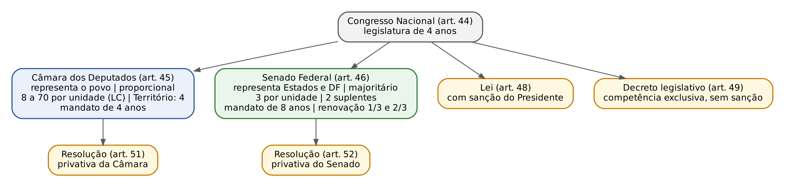
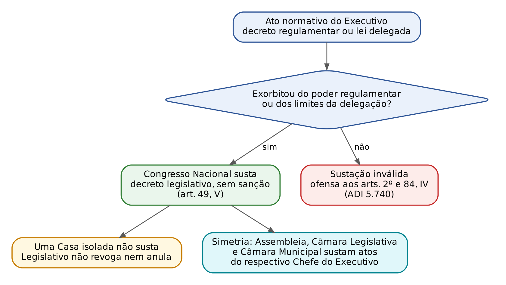
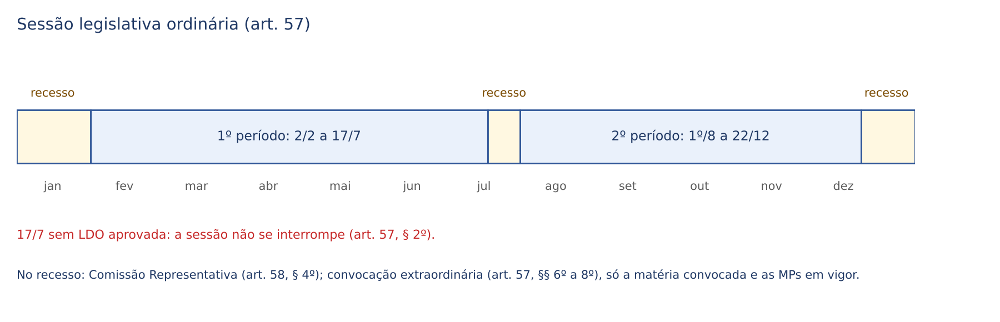
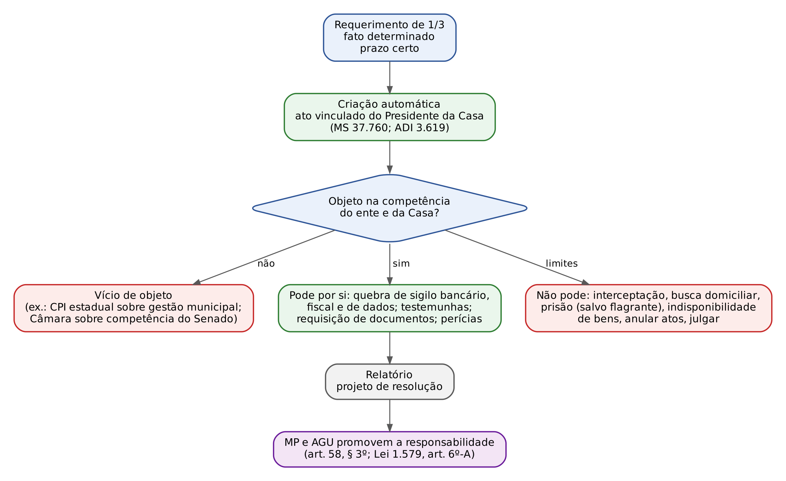
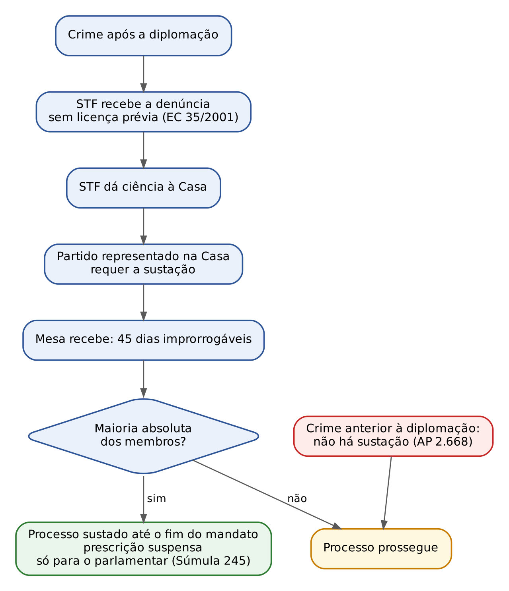
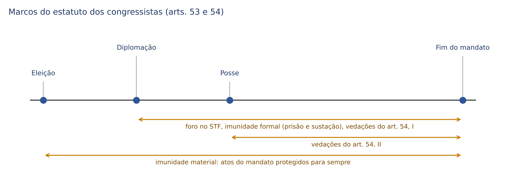
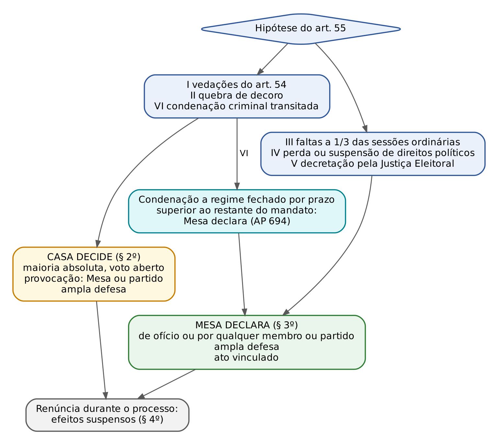

# CAPÍTULO 25 — PODER LEGISLATIVO I: ESTRUTURA, COMPETÊNCIAS, COMISSÕES, CPIS E ESTATUTO DOS PARLAMENTARES

:::INCIDENCIA
Pontos: TRF5 p. 7; TJRS p. 7; TJSC p. 7 (a parte de organização, competências, comissões, CPIs e estatuto; processo legislativo no Cap. 26 e fiscalização e Tribunais de Contas no Cap. 27).
Nível A+. Lote: 66 questões (FGV 59, FCC 7), quase todas casos práticos com "segmente a narrativa e diga o que é vício".
O que mais cai: requisitos, objeto e poderes da CPI (reserva de jurisdição e limites federativos), convocação do art. 50, sustação do art. 49, V, imunidade material (Tema 950 e vereador) e formal (prisão e sustação), quóruns e órgãos do art. 51 x art. 52.
:::

| Subtema | FGV | FCC | Padrão de cobrança |
|---|---|---|---|
| CPI: requisitos, objeto, poderes, pessoas convocáveis | 20 | 2 | Caso com três medidas (convocação, quebra de sigilo, interceptação) e a pergunta "quais são válidas?"; objeto fora da competência do ente é vício |
| Imunidades, foro e sustação de ação penal | 13 | 0 | Discurso fora da Casa; vereador fora do Município; Estado não indeniza (Tema 950); sustação só para crime posterior à diplomação |
| Competências do Congresso (arts. 48 e 49), sustação de atos normativos | 11 | 0 | "Quem susta?" (Congresso, por decreto legislativo, sem sanção); plebiscito; sede; tratados |
| Convocação e pedidos de informação (arts. 50 e 58) | 8 | 0 | Quem pode ser convocado (Ministros e titulares de órgãos da Presidência, não Presidente, Governador, Ministro de tribunal, PGR); prazo de 30 dias |
| Câmara x Senado (arts. 45, 46, 51 e 52), sessões conjuntas | 3 | 4 | Letra do art. 52 (voto secreto, arguição pública x secreta, maioria absoluta para exonerar o PGR), finanças estaduais no Senado |
| Mesas, sessões, remuneração e simetria nas Assembleias | 4 | 1 | Recondução; parcela por convocação extraordinária; o que exige lei na organização da Casa |

## 25.1 Estrutura do Poder Legislativo federal

### 25.1.1 Funções típicas e atípicas; controle legislativo x controle parlamentar

O Legislativo tem duas funções típicas de igual dignidade: legislar e fiscalizar (controle externo, com o auxílio do Tribunal de Contas, arts. 70 e 71, e controle político, pelas CPIs, convocações, pedidos de informação, sustação de atos e julgamento de contas). As funções atípicas são administrar (organizar seus serviços e prover cargos, arts. 51, IV, e 52, XIII) e julgar (Senado nos crimes de responsabilidade, art. 52, I e II). A teoria geral da separação de Poderes está no Cap. 6 (ver 06.4); aqui interessam o recorte e as competências.

Na terminologia que a FGV adotou (Q3099333, FGV 2024, Niterói, gabarito A), o "controle legislativo" é a atuação do Parlamento enquanto Poder (edição de leis e fiscalização financeira e orçamentária), e o "controle parlamentar" é a fiscalização política exercida pelos parlamentares e órgãos da Casa (CPI, convocação, requerimentos). As demais alternativas inventavam exclusividades (só CPI, só Senado, só Judiciário) ou chamavam o TCU de "órgão externo que exerce controle parlamentar".

:::PEGADINHA
O controle legislativo sobre o Executivo é de ESTRITA LEGALIDADE CONSTITUCIONAL: só as hipóteses previstas na Constituição Federal, que os Estados reproduzem por simetria, sem poder ampliá-las. Daí a inconstitucionalidade de normas estaduais que exigem autorização legislativa para atos típicos de gestão (exemplo clássico: autorização prévia para o Governador assinar convênios). Mas a FGV cobrou exceção relevante (Q2351240, FGV 2024, Câmara Municipal de São Paulo, gabarito D): emenda à Constituição estadual que exige autorização da Assembleia para alienação ou concessão de terras públicas estaduais é compatível com a CF, porque reproduz a lógica do art. 49, XVII ("tutela compartilhada do patrimônio público"), ressalvada a competência do Congresso para áreas superiores a 2.500 hectares (art. 188, § 1º). Armadilhas: tratar a separação de Poderes como cláusula pétrea estadual que tornaria a emenda inválida e invocar "proporcionalidade" para terras pequenas.
:::

### 25.1.2 Bicameralismo federativo

O Congresso Nacional compõe-se de duas Casas (art. 44): a Câmara, que representa o POVO (art. 45), e o Senado, que representa os ESTADOS e o DISTRITO FEDERAL (art. 46). Por isso o bicameralismo brasileiro é federativo (e não aristocrático, como a Câmara dos Lordes): a paridade de representação dos Estados no Senado é expressão do pacto federativo (art. 60, § 4º, I, protege a forma federativa). As Casas são em regra iguais em competência legislativa (bicameralismo igual ou perfeito), com assimetrias pontuais: a iniciativa do Presidente, do STF, dos Tribunais Superiores e a popular começa na Câmara (arts. 61, § 2º, e 64), e a MP é apreciada primeiro na Câmara (art. 62, § 8º) — detalhes no Cap. 26.

Nos Estados, no DF e nos Municípios o Legislativo é UNICAMERAL (Assembleia Legislativa, Câmara Legislativa, Câmara Municipal). Os Territórios não têm Senadores, mas elegem quatro Deputados Federais (art. 45, § 2º).

| Aspecto | Câmara dos Deputados | Senado Federal |
|---|---|---|
| Representa | o povo | os Estados e o DF |
| Sistema eleitoral | proporcional | majoritário (maioria simples, turno único) |
| Circunscrição | cada Estado, cada Território e o DF | cada Estado e o DF (Território não elege) |
| Número | fixado por LEI COMPLEMENTAR, proporcional à população; mínimo 8 e máximo 70 por unidade; Território: 4 | 3 por Estado e pelo DF (81) |
| Mandato | 4 anos (uma legislatura) | 8 anos (duas legislaturas) |
| Renovação | integral a cada 4 anos | a cada 4 anos, alternadamente, por 1/3 e 2/3 |
| Suplentes | os da lista partidária (sistema proporcional) | 2 suplentes por Senador, eleitos com ele |
| Idade mínima (art. 14, § 3º, VI) | 21 anos | 35 anos |
| Presidente da Casa na linha sucessória (art. 80) | 2º | 3º |
| Fundamento | art. 45 | art. 46 |

:::QUESTAO FGV 2024 — CÂMARA DE FORTALEZA — ANALISTA DE REDAÇÃO (Q2458422)
Pedia a assertiva correta sobre o Senado. Gabarito B: renovação de quatro em quatro anos, alternadamente, por um e dois terços (art. 46, § 2º). Armadilhas, todas de letra: deliberações por "maioria absoluta dos votos" (o art. 47 diz maioria dos votos, presente a maioria absoluta); sistema "proporcional" (é majoritário); "mandato de quatro anos" (oito); "três suplentes" (dois). No mesmo sentido, quanto a sistemas e mandatos: Q2362705 (FGV 2024, São José dos Campos, gabarito E: Deputados pelo sistema proporcional, mandato de uma legislatura; Senadores pelo majoritário, mandato de duas).
:::

Legislatura (art. 44, parágrafo único) é o período de quatro anos que coincide com o mandato dos Deputados; sessão legislativa é o período anual de reunião (art. 57; ver 25.4). Cada legislatura tem quatro sessões legislativas ordinárias.

#### Número de Deputados e a ADO 38

O art. 45, § 1º, exige lei complementar que fixe o total e a representação por unidade, "procedendo-se aos ajustes necessários, no ano anterior às eleições". A LC 78/1993 fixou o teto de 513, e a distribuição ficou congelada desde então. O STF, na ADO 38, reconheceu a omissão inconstitucional e fixou prazo ao Congresso para atualizar a distribuição. Em 2025 o Congresso aprovou projeto que elevava o total para 531, integralmente vetado pelo Presidente da República em julho de 2025 (Veto 20/2025, ao PLP 177/2023, que revogaria a LC 78/1993); em consulta ao portal do Congresso Nacional em 12/11/2026, o veto continuava "não apreciado", sobrestando a pauta desde 17/8/2025. Pendente a apreciação do veto, o Plenário do STF referendou decisão do Ministro Luiz Fux que manteve, para as eleições de 2026, a composição de 2022 (notícia oficial de 2/10/2025). Para a prova: quem fixa é a LEI COMPLEMENTAR (não resolução do TSE, não lei ordinária), com os limites de 8 e 70.

:::PEGADINHA
"Proporcionalmente à população" não significa proporcionalidade pura: os pisos (8) e tetos (70) produzem sobrerrepresentação dos Estados pouco populosos e sub-representação de São Paulo. A alternativa que afirma "o número é proporcional ao eleitorado" está errada (o critério é a POPULAÇÃO).
:::

#### Vaga de Senador e suplência

Os dois suplentes do Senador são eleitos com ele, na mesma chapa. Havendo vaga e não havendo suplente, faz-se eleição se faltarem mais de QUINZE MESES para o término do mandato (art. 56, § 2º; vale para Deputados e Senadores). Quando a vaga decorre de cassação da CHAPA pela Justiça Eleitoral, o ilícito contamina a chapa inteira: não assume o suplente nem, interinamente, o candidato mais votado seguinte; aguarda-se a eleição suplementar (STF, ADPF 643 e ADPF 644, Relatora Ministra Rosa Weber, redator do acórdão Ministro Edson Fachin, Plenário, j. 21/11/2023, Informativo 1.117). Se faltarem menos de quinze meses, o cargo pode ficar vago até a eleição ordinária, sem ofensa ao pacto federativo.

:::QUESTAO FGV 2024 — AL-PR — ANALISTA LEGISLATIVO (Q2449867)
Gabarito B: Deputados e Senadores são invioláveis, civil e penalmente, por opiniões, palavras e votos e, desde a expedição do diploma, são julgados pelo STF (art. 53, caput e § 1º). Armadilhas: eleição para vaga se faltarem "mais de seis meses" (são quinze meses); autorização para processo contra o Presidente "pelo Senado" (é a Câmara, art. 51, I); aprovação de chefes de missão diplomática "pela Câmara" (é o Senado, art. 52, IV); prisão em flagrante com remessa em "quarenta e oito horas" ao "STF" por "dois terços" (são vinte e quatro horas, à Casa, por maioria).
:::

### 25.1.3 Quórum de deliberação e quóruns qualificados

Regra geral (art. 47): "Salvo disposição constitucional em contrário, as deliberações de cada Casa e de suas Comissões serão tomadas por maioria dos votos, presente a maioria absoluta de seus membros". São dois quóruns distintos: o de INSTALAÇÃO (presença da maioria absoluta) e o de APROVAÇÃO (maioria simples dos presentes). Maioria absoluta é número fixo (mais da metade dos membros da Casa: 257 Deputados e 41 Senadores); maioria simples varia com a presença.

| Deliberação | Quórum | Fundamento |
|---|---|---|
| Lei ordinária, decreto legislativo, resolução (regra) | maioria simples, presente a maioria absoluta | art. 47 |
| Lei complementar | maioria absoluta | art. 69 |
| Emenda constitucional | 3/5, em dois turnos, em cada Casa | art. 60, § 2º |
| Rejeição de veto | maioria absoluta, em sessão conjunta | art. 66, § 4º |
| Autorizar processo contra Presidente, Vice e Ministros (Câmara) | 2/3 | art. 51, I |
| Condenação por crime de responsabilidade (Senado) | 2/3 | art. 52, parágrafo único |
| Exoneração de ofício do PGR (Senado) | maioria absoluta, voto secreto | art. 52, XI |
| Resolver sobre prisão em flagrante de parlamentar | maioria dos membros (absoluta), voto aberto | art. 53, § 2º |
| Sustar ação penal contra parlamentar | maioria dos membros | art. 53, § 3º |
| Suspender imunidades no estado de sítio | 2/3 dos membros | art. 53, § 8º |
| Perda do mandato nos incisos I, II e VI do art. 55 | maioria absoluta | art. 55, § 2º |
| Criação de CPI | requerimento de 1/3 (não há votação) | art. 58, § 3º |
| Recurso contra decisão conclusiva de comissão | 1/10 dos membros da Casa | art. 58, § 2º, I |
| Convocação extraordinária pelo Presidente da República, pelos Presidentes das Casas ou pela maioria de ambas | aprovação da maioria absoluta de cada Casa | art. 57, § 6º, II |

:::DICA
"Maioria de seus membros" (arts. 53, §§ 2º e 3º) é maioria ABSOLUTA, porque se conta sobre o total de membros, não sobre os presentes. A FGV troca "maioria dos membros" por "dois terços" para a sustação (Q3777461, alternativa C) e "maioria" por "dois terços" para a prisão (Q2449867, alternativa E).
:::

## 25.2 Atribuições do Congresso Nacional (arts. 48 e 49)

### 25.2.1 A diferença que decide a questão: com ou sem sanção

O art. 48 lista matérias sobre as quais o Congresso dispõe "com a sanção do Presidente da República", isto é, por LEI (ordinária ou complementar): é a função legislativa propriamente dita, sobre todas as matérias de competência da União. O art. 49 ("competência exclusiva") e os arts. 51 e 52 ("competência privativa" de cada Casa) dispensam a sanção: o Congresso atua por DECRETO LEGISLATIVO (art. 49) e cada Casa por RESOLUÇÃO (arts. 51 e 52), atos promulgados pelo próprio Legislativo (sobre as espécies, ver Cap. 26).

| Matéria | Art. 48 (lei, com sanção) | Art. 49 (decreto legislativo, sem sanção) |
|---|---|---|
| Sede | transferência temporária da sede do GOVERNO FEDERAL (VII) | mudar temporariamente a SUA sede, do Congresso (VI) |
| Subsídios | dos Ministros do STF (XV) | idêntico para Deputados e Senadores; do Presidente, do Vice e dos Ministros de Estado (VII e VIII) |
| Território | limites do território nacional; incorporação, subdivisão ou desmembramento de Estados e Territórios, ouvidas as Assembleias (V e VI) | — |
| Anistia | concessão de anistia (VIII) | — |
| Dívida | montante da dívida mobiliária FEDERAL (XIV) | — (a dos Estados, DF e Municípios é do Senado, art. 52, IX) |
| Tratados | — | resolver definitivamente sobre os que acarretem encargos ou compromissos gravosos ao patrimônio nacional (I) |
| Guerra e paz | — | autorizar o Presidente a declarar guerra e celebrar a paz (II) |
| Ausência do País | — | autorizar Presidente e Vice a se ausentarem por MAIS de quinze dias (III) |
| Estados de crise | — | aprovar estado de defesa e intervenção federal; autorizar estado de sítio; suspender qualquer delas (IV) |
| Controle | — | sustar atos normativos exorbitantes (V); julgar as contas do Presidente (IX); fiscalizar atos do Executivo, inclusive da indireta (X) |
| Consulta popular | — | autorizar referendo e convocar plebiscito (XV) |
| Terras | — | terras indígenas: recursos hídricos e minerais (XVI); alienação ou concessão de terras públicas com área superior a 2.500 hectares (XVII) |
| Calamidade | — | decretar estado de calamidade pública de âmbito nacional (XVIII, arts. 167-B a 167-G) |

:::LEI CF, ART. 49 (INCISOS MAIS COBRADOS)
"É da competência exclusiva do Congresso Nacional: I - resolver definitivamente sobre tratados, acordos ou atos internacionais que acarretem encargos ou compromissos gravosos ao patrimônio nacional; [...] V - sustar os atos normativos do Poder Executivo que exorbitem do poder regulamentar ou dos limites de delegação legislativa; VI - mudar temporariamente sua sede; [...] IX - julgar anualmente as contas prestadas pelo Presidente da República e apreciar os relatórios sobre a execução dos planos de governo; [...] XV - autorizar referendo e convocar plebiscito;"
:::

:::QUESTAO FGV 2024 — TJ-AP — ANALISTA JUDICIÁRIO (Q2442292)
Deputada propõe projeto de lei que muda temporariamente a sede do Poder Legislativo para outra região. Gabarito D: a mudança pode ser estabelecida pelo Congresso, sem o concurso do Executivo (art. 49, VI, decreto legislativo). O vício da proposta é de FORMA (lei, com sanção), não de conteúdo. Armadilhas: exigir emenda constitucional ou plebiscito, ou afirmar que a definição de Brasília como capital (art. 18, § 1º) impede a mudança TEMPORÁRIA. Cuidado com a vizinha do art. 48, VII: a transferência temporária da sede do GOVERNO FEDERAL é por lei, com sanção.
:::

Outros itens de letra do art. 49 cobrados no lote, todos com o mesmo método (identificar se a competência é do Congresso, de uma Casa ou do Presidente):

- Q2511458 (FGV 2024, Câmara dos Deputados, gabarito B): resolver definitivamente sobre tratados gravosos é competência EXCLUSIVA do Congresso. O Presidente celebra (art. 84, VIII); o Congresso referenda; a incorporação está no Cap. 11 (ver 11.2).
- Q3878418 (FGV 2026, gabarito C): convocar plebiscito é competência exclusiva do Congresso (art. 49, XV); não é do Executivo nem comum.
- Q3851090 (FGV 2026, AMAZUL, gabarito D): julgar anualmente as contas do Presidente é exclusiva do Congresso (art. 49, IX). As demais alternativas trocavam o órgão: anistia é art. 48 (com sanção); julgar Ministros do STF por crime de responsabilidade é do Senado (art. 52, II); autorizar processo contra Ministro de Estado é da Câmara (art. 51, I) e só em conexão com o Presidente; aprovar o PGR é do Senado (art. 52, III, e).

:::ATENCAO
Julgar as contas do Presidente (art. 49, IX) é do CONGRESSO; o TCU só emite parecer prévio em sessenta dias (art. 71, I). Se as contas não forem apresentadas em sessenta dias após a abertura da sessão legislativa, a CÂMARA procede à tomada de contas (art. 51, II). O regime do parecer prévio e das contas de Prefeito (Tema 835) é do Cap. 27.
:::

### 25.2.2 Sustação de atos normativos do Executivo (art. 49, V)

É o "veto legislativo" do sistema brasileiro: o Congresso, por decreto legislativo, susta (não revoga nem anula) atos normativos do Executivo em duas hipóteses taxativas — exorbitância do poder regulamentar (decreto que inova ou contraria a lei) e exorbitância dos limites da delegação legislativa (lei delegada que extrapola a resolução do art. 68, § 2º). Não serve para sustar decreto que o Legislativo apenas considere inconveniente, nem lei, nem ato concreto, nem ato do Judiciário.

Três consequências práticas:

- O decreto legislativo que susta ato regulamentar é ato normativo primário e pode ser objeto de ADI; sua validade PRESSUPÕE a efetiva exorbitância. Sustar um regulamento fiel à lei viola a separação de Poderes e o art. 84, IV (STF, ADI 5.740, Relatora Ministra Cármen Lúcia, Plenário, j. 23/11/2020: decreto legislativo distrital que sustou regulamentação de lei antidiscriminatória sem que houvesse exorbitância).
- É controle POLÍTICO e REPRESSIVO, que convive com o controle judicial (o decreto exorbitante também pode ser atacado em juízo; em regra a exorbitância é ilegalidade, e não inconstitucionalidade direta, o que afasta a ADI contra o próprio decreto regulamentar — ver Cap. 18).
- Por simetria, Assembleias Legislativas, Câmara Legislativa do DF e Câmaras Municipais sustam atos do respectivo Chefe do Executivo nas mesmas hipóteses.

:::QUESTAO FGV 2026 — PC-PR — AGENTE DE POLÍCIA JUDICIÁRIA (Q4375163)
A Câmara, por maioria absoluta, sustou decreto regulamentar exorbitante. Gabarito D: contrariedade à ordem jurídica, porque sustar é competência EXCLUSIVA do Congresso Nacional (art. 49, V), e não de uma das Casas isoladamente. Armadilhas: "competência concorrente entre Câmara e Senado" e a inclusão do STF entre os competentes. No mesmo sentido: Q4153598 (FGV 2026, TJ-SC, Oficial de Justiça, gabarito D: lei delegada exorbitante — Congresso), Q3846844 (FGV 2026, PC-PI, gabarito A: é possível o Congresso sustar o decreto; erradas as alternativas que o reduzem a pedir revogação ao Executivo ou que atribuem à Mesa a revogação).
:::

:::QUESTAO FGV 2026 — ALERJ — ESPECIALISTA LEGISLATIVO (Q3879509)
Governador exorbita do poder regulamentar. Gabarito A: a Assembleia pode sustar, ela própria, a eficácia do decreto (simetria com o art. 49, V). Armadilhas: "revogar o decreto" (o Legislativo não revoga ato do Executivo), "processo administrativo de controle de constitucionalidade" (inexistente) e crime de responsabilidade com "extinção do decreto". No mesmo sentido: Q3883324 (FGV 2026, ALERJ, gabarito B: sustar atos normativos exorbitantes; erradas "julgar contas de gestores com exceção do Governador" — invertido —, "revogar atos administrativos", "aplicar penalidades de licitação" e "rever registro de aposentadoria feito pelo Tribunal de Contas").
:::

:::QUESTAO FGV 2026 — AL-RO — CONSULTOR LEGISLATIVO (Q3881992)
Pergunta de contexto (governança de florestas) sobre atribuição da Assembleia. Gabarito A: aprovar o orçamento e o plano plurianual estaduais, alocando recursos para políticas ambientais. Armadilhas: Assembleia criando ou extinguindo unidades de conservação federais ("parques nacionais"), fiscalizando atos do JUDICIÁRIO, CPI que "cria, altera ou revoga normas ambientais por ato próprio" (CPI não legisla) e Assembleia fazendo licenciamento ambiental (função administrativa do Executivo).
:::

### 25.2.3 Convocação de autoridades e pedidos de informação (art. 50)

:::LEI CF, ART. 50, CAPUT E § 2º
"A Câmara dos Deputados e o Senado Federal, ou qualquer de suas Comissões, poderão convocar Ministro de Estado, quaisquer titulares de órgãos diretamente subordinados à Presidência da República ou o Presidente do Comitê Gestor do Imposto sobre Bens e Serviços para prestarem, pessoalmente, informações sobre assunto previamente determinado, importando crime de responsabilidade a ausência sem justificação adequada. [...] § 2º As Mesas da Câmara dos Deputados e do Senado Federal poderão encaminhar pedidos escritos de informações a Ministros de Estado ou a qualquer das pessoas referidas no caput deste artigo, importando em crime de responsabilidade a recusa, ou o não - atendimento, no prazo de trinta dias, bem como a prestação de informações falsas."
:::

O Presidente do Comitê Gestor do IBS foi acrescentado ao caput pela reforma tributária (EC 132/2023; redação conferida no Planalto). Quatro filtros resolvem todas as questões:

| Filtro | Regra | Erro típico das alternativas |
|---|---|---|
| Quem convoca | cada Casa (Plenário) OU qualquer de suas Comissões; Mesas para o pedido ESCRITO | "só o Congresso em sessão conjunta"; "comissão não pode convocar isoladamente" |
| Quem é convocável | Ministro de Estado, titulares de órgãos diretamente subordinados à Presidência, Presidente do Comitê Gestor do IBS | Presidente da República, Vice, Governador, Ministro de tribunal, PGR, servidor estadual |
| Objeto | assunto PREVIAMENTE DETERMINADO | convocação genérica |
| Sanção | crime de responsabilidade: ausência sem justificação adequada; recusa, não atendimento em 30 DIAS ou informação falsa | "crime de desobediência"; "quinze dias"; "dez dias"; "não há sanção" |

O § 1º prevê o comparecimento ESPONTÂNEO do Ministro, "por sua iniciativa e mediante entendimentos com a Mesa respectiva", para expor assunto de relevância de seu Ministério. Não há dever de comparecimento ANUAL (versão falsa cobrada na Q3757897).

:::QUESTAO FGV 2025 — CÂMARA DOS DEPUTADOS, COMISSÃO DE SEGURANÇA PÚBLICA (Q3780430)
A comissão quer convocar o Ministro da Justiça, um Ministro do STJ e o diretor de presídio estadual. Gabarito A: só o Ministro de Estado. Passo 1: comissões podem convocar (art. 50, caput, e art. 58, § 2º, III). Passo 2: Ministro de tribunal não é convocável (separação de Poderes); quando muito, a comissão pode SOLICITAR depoimento (art. 58, § 2º, V), sem coerção. Passo 3: autoridade estadual não se submete à convocação de órgão federal (autonomia federativa). No mesmo sentido: Q3656886 (FGV 2025, Niterói, gabarito E: Ministro de Estado, mas não Governadora nem Ministro do STJ), Q2482468 (FGV 2024, Câmara de Fortaleza, gabarito D: Ministro da Justiça sim; Ministro do STF e Presidente da República não são sujeitos à convocação — sem "prerrogativa de responder por escrito em dez dias", que não existe).
:::

:::QUESTAO FGV 2024 — CVM — ANALISTA (Q2517545)
Ministro das Relações Exteriores não responde a pedido escrito da Mesa da Câmara em sessenta dias; Ministro da Fazenda falta, sem justificativa, a convocação da Câmara. Gabarito E: ambos incorreram em crime de responsabilidade (art. 50, caput e § 2º). Armadilhas: incluir Presidente e Vice entre os destinatários (alternativas A e B) e dizer que o pedido escrito "não é vinculante". No mesmo sentido: Q2511401 (FGV 2024, Câmara dos Deputados, gabarito E: Senado e CCJ da Câmara convocam o Ministro da Fazenda; ausência injustificada em qualquer delas é crime de responsabilidade, pois comissões podem convocar isoladamente), Q3882262 (FGV 2026, AL-RO, gabarito B: pedido da Mesa do Senado ao Ministro da Saúde — prazo de TRINTA dias, crime de responsabilidade; armadilhas "quinze dias" e "crime de desobediência"), Q3757897 (FGV 2025, CPRM, gabarito A: V–F–F; a segunda afirmação errava o prazo, quinze dias, e a terceira inventava comparecimento anual obrigatório).
:::

:::QUESTAO FGV 2026 — ALERJ — COMISSÃO TEMPORÁRIA (Q3881045)
Comissão temporária da Assembleia cogita convocar o Governador. Gabarito D: a Constituição da República não prevê convocação do Chefe do Executivo. O art. 50 é norma de reprodução obrigatória quanto aos destinatários (Secretários de Estado, por simetria); Constituição estadual que permita convocar o Governador viola a separação de Poderes. Armadilhas: "possível com aprovação do Plenário", "possível só se for CPI" e "possível, mas o Governador marca dia e hora" (prerrogativa que a CF confere a certas autoridades como testemunhas no CPP, não a convocados por Parlamento).
:::

:::PEGADINHA
Requerimento de informação é prerrogativa da MESA (órgão colegiado), não de parlamentar individualmente. É inconstitucional norma estadual ou municipal que confira a um Deputado ou Vereador, isoladamente, o poder de requisitar informações ao Executivo sob pena de responsabilização (STF, ADI 4.700, Relator Ministro Gilmar Mendes, Plenário, j. 13/12/2021, Informativo 1.041: inconstitucional a expressão "A qualquer Deputado" do art. 101 da Constituição fluminense; afirmativa I da Q3154047 — FGV 2025, SEFAZ-RS — e da Q3047230, classificada no Cap. 27, ambas falsas). O que o parlamentar individual tem é o direito de CIDADÃO de acesso à informação (art. 5º, XXXIII, e Lei 12.527/2011), que não depende da Mesa: STF, Tema 832 (RE 865.401, Relator Ministro Dias Toffoli, Plenário, j. 25/4/2018), salvo matéria sob sigilo ou sujeita à aprovação de CPI. Na Q3047230 (FGV 2024), o gabarito C reconhece exatamente esse direito.
:::

## 25.3 Competências privativas da Câmara e do Senado (arts. 51 e 52)

Exercidas por RESOLUÇÃO, sem sanção. "Privativamente", aqui, não significa delegável: ninguém exerce competência de uma Casa pela outra.

### 25.3.1 Câmara dos Deputados (art. 51)

| Inciso | Competência | Pegadinha |
|---|---|---|
| I | autorizar, por 2/3 de seus membros, a instauração de processo contra Presidente, Vice e Ministros de Estado | quem AUTORIZA é a Câmara; quem JULGA crime de responsabilidade é o Senado; crime comum, o STF (art. 102, I, b e c) |
| II | tomada de contas do Presidente, quando não apresentadas ao Congresso em 60 dias após a abertura da sessão legislativa | quem julga as contas é o Congresso |
| III e IV | regimento interno; organização, funcionamento, polícia, criação, transformação ou extinção de cargos de seus serviços; INICIATIVA DE LEI para fixar a remuneração, observada a LDO | criar cargo é resolução; fixar remuneração dos servidores exige LEI (EC 19/1998) |
| V | eleger membros do Conselho da República (art. 89, VII) | o Senado também elege (art. 52, XIV) |

:::QUESTAO FGV 2025 — TJ-RS — ANALISTA JUDICIÁRIO (Q3742944)
Deputados estaduais querem criar cargos efetivos, extinguir cargos em comissão vagos e aumentar a remuneração dos servidores da Assembleia. Gabarito C: só o aumento remuneratório exige lei. Fundamento: por simetria com os arts. 51, IV, e 52, XIII, a Casa dispõe sobre criação, transformação e extinção dos cargos de seus serviços por ato próprio (resolução), e a remuneração depende de lei de iniciativa da própria Casa (art. 37, X). Armadilha: transpor a regra do Executivo (criação de cargos por lei, art. 48, X; extinção de cargos VAGOS por decreto, art. 84, VI, b) para o Legislativo.
:::

### 25.3.2 Senado Federal (art. 52)

As competências do Senado se agrupam em cinco blocos; as provas trocam o órgão, o quórum ou a forma da votação.

| Bloco | Incisos | Detalhe que cai |
|---|---|---|
| Julgamento político | I: Presidente e Vice nos crimes de responsabilidade e Ministros de Estado e Comandantes das Forças Armadas nos crimes da mesma natureza CONEXOS com aqueles; II: Ministros do STF, membros do CNJ e do CNMP, PGR e AGU nos crimes de responsabilidade | preside o Presidente do STF; condenação por 2/3; pena limitada à perda do cargo com inabilitação por OITO anos (parágrafo único). Ministro de Estado em crime de responsabilidade NÃO conexo é julgado pelo STF (art. 102, I, c) |
| Aprovação prévia de autoridades | III: por voto secreto, após arguição PÚBLICA: magistrados nos casos previstos, Ministros do TCU indicados pelo Presidente, Governador de Território, presidente e diretores do Banco Central, PGR, titulares de outros cargos que a lei determinar; IV: chefes de missão diplomática de caráter permanente, por voto secreto, após arguição em sessão SECRETA | a única arguição em sessão secreta é a dos diplomatas |
| Finanças federativas | V: operações externas de natureza financeira de interesse da União, Estados, DF, Territórios e Municípios; VI: limites globais da dívida consolidada (por proposta do Presidente); VII: limites para operações de crédito externo e interno; VIII: garantia da União; IX: limites da dívida MOBILIÁRIA dos Estados, DF e Municípios | dívida mobiliária FEDERAL é do Congresso, por lei (art. 48, XIV) |
| Controle e diversas | X: suspender a execução de lei declarada inconstitucional por decisão definitiva do STF (controle difuso — ver Cap. 17); XI: aprovar, por MAIORIA ABSOLUTA e voto secreto, a exoneração de ofício do PGR antes do término do mandato; XV: avaliar periodicamente a funcionalidade do Sistema Tributário Nacional e o desempenho das administrações tributárias | a suspensão do art. 52, X, não é da Câmara; a avaliação do sistema tributário não é da Câmara |
| Auto-organização | XII a XIV: regimento, organização, polícia, cargos, iniciativa de lei de remuneração, membros do Conselho da República | igual à Câmara |

:::QUESTAO FCC 2024 — TRT 11ª REGIÃO — ANALISTA JUDICIÁRIO (Q2400722)
Gabarito A: compete privativamente ao Senado aprovar, por maioria absoluta e voto secreto, a exoneração de ofício do PGR (art. 52, XI). Armadilhas: chefes de missão diplomática "ao Congresso" (é o Senado), autorização de processo contra o Presidente "ao Senado" (é a Câmara), suspensão de lei declarada inconstitucional "à Câmara" e avaliação do Sistema Tributário "à Câmara" (ambas do Senado).
:::

:::QUESTAO FCC 2024 — TRF 3ª REGIÃO — ANALISTA JUDICIÁRIO (Q2564485)
Presidente pratica crime de responsabilidade e Ministro de Estado pratica crime da mesma natureza conexo. Gabarito C: ambos são processados e julgados pelo Senado (art. 52, I), ao qual compete também julgar os membros do CNMP nos crimes de responsabilidade (art. 52, II). Armadilhas: deslocar o Ministro para o STF (só se o crime de responsabilidade NÃO for conexo — art. 102, I, c) e atribuir ao Senado o julgamento de Ministros por crimes comuns (é do STF). O rito do impeachment está no Cap. 28.
:::

:::QUESTAO FGV 2026 — TCE-PE — ANALISTA DE CONTROLE EXTERNO (Q4283103)
Estado quer contratar financiamento externo e emitir títulos da dívida mobiliária; o Presidente envia projeto sobre a dívida mobiliária federal. Gabarito A: o Senado autoriza a operação externa estadual (art. 52, V) e estabelece os limites da dívida mobiliária estadual (art. 52, IX); o Congresso, por lei, trata da dívida mobiliária federal (art. 48, XIV). Armadilhas: Congresso fixando limites da dívida estadual, Senado autorizando "só operações internas" ou "só com garantia da União".
:::

## 25.4 Reuniões, sessões legislativas e Mesas (art. 57)

### 25.4.1 Calendário e sessões

:::LEI CF, ART. 57, CAPUT, §§ 2º, 4º, 6º E 7º
"O Congresso Nacional reunir-se-á, anualmente, na Capital Federal, de 2 de fevereiro a 17 de julho e de 1º de agosto a 22 de dezembro. [...] § 2º A sessão legislativa não será interrompida sem a aprovação do projeto de lei de diretrizes orçamentárias. [...] § 4º Cada uma das Casas reunir-se-á em sessões preparatórias, a partir de 1º de fevereiro, no primeiro ano da legislatura, para a posse de seus membros e eleição das respectivas Mesas, para mandato de 2 (dois) anos, vedada a recondução para o mesmo cargo na eleição imediatamente subseqüente. [...] § 7º Na sessão legislativa extraordinária, o Congresso Nacional somente deliberará sobre a matéria para a qual foi convocado, ressalvada a hipótese do § 8º deste artigo, vedado o pagamento de parcela indenizatória, em razão da convocação."
:::

Vocabulário que a banca troca:

- Legislatura: 4 anos (art. 44, parágrafo único).
- Sessão legislativa ORDINÁRIA: o ano legislativo, em dois períodos (2/2 a 17/7 e 1º/8 a 22/12); datas que caem em sábado, domingo ou feriado passam ao primeiro dia útil seguinte (§ 1º). O intervalo é o recesso.
- Sessão legislativa EXTRAORDINÁRIA: a convocada no recesso (§ 6º). Delibera só sobre a matéria da convocação, mais as MPs em vigor, incluídas automaticamente na pauta (§ 8º).
- Sessão preparatória: a partir de 1º/2 do primeiro ano da legislatura (posse e eleição das Mesas).
- Sessões ordinárias e extraordinárias (diárias, regimentais) são outra coisa: são as reuniões dentro da sessão legislativa, e é sobre as ORDINÁRIAS que se conta a falta de um terço que leva à perda do mandato (art. 55, III).

Convocação extraordinária (art. 57, § 6º):

| Quem convoca | Hipóteses | Aprovação |
|---|---|---|
| Presidente do Senado (inciso I) | decretação de estado de defesa ou de intervenção federal; pedido de autorização para o estado de sítio; compromisso e posse do Presidente e do Vice | dispensada |
| Presidente da República, Presidentes da Câmara e do Senado ou requerimento da maioria dos membros de AMBAS as Casas (inciso II) | urgência ou interesse público relevante | maioria absoluta de CADA Casa, em todas as hipóteses do inciso (EC 50/2006) |

Sessões CONJUNTAS (art. 57, § 3º), "além de outros casos previstos nesta Constituição": inaugurar a sessão legislativa; elaborar o regimento comum e regular serviços comuns; receber o compromisso do Presidente e do Vice; conhecer do veto e sobre ele deliberar. Outros casos esparsos: apreciação dos projetos orçamentários (art. 166) e delegação legislativa, quando houver (art. 68). Sessão conjunta não é sessão unicameral: os votos são colhidos separadamente em cada Casa.

:::QUESTAO FCC 2026 — PGM MANAUS — PROCURADOR (Q4338746)
Gabarito D: inaugurar a sessão legislativa, elaborar o regimento comum e regular serviços comuns, receber o compromisso do Presidente e do Vice e conhecer do veto e sobre ele deliberar (art. 57, § 3º, rol completo). As alternativas misturavam competências do Senado (exoneração do PGR, diplomatas) e da Câmara (autorização de processo contra o Presidente) com as hipóteses de sessão conjunta.
:::

### 25.4.2 Vedação de pagamento pela convocação extraordinária

A vedação de "parcela indenizatória, em razão da convocação" (art. 57, § 7º, na redação da EC 50/2006) alcança os Deputados Estaduais por força do art. 27, § 2º, que manda observar o art. 57, § 7º, na fixação do subsídio. É inconstitucional norma de Constituição estadual que permita o pagamento (STF, ADI 6.857, Relator Ministro Cristiano Zanin, Plenário, j. 3/6/2025, Informativo 1.180). Dispositivo de Regimento Interno de Assembleia com o mesmo conteúdo, por ter caráter normativo e autônomo, pode ser impugnado diretamente por ADI (ADI 4.587; v. Cap. 18).

:::QUESTAO FGV 2025 — ENAC — 2º EXAME NACIONAL DOS CARTÓRIOS (Q3673843)
Emenda à Constituição estadual cria verba indenizatória por sessão extraordinária. Gabarito E: inconstitucional, porque a CF veda o pagamento e a regra é de reprodução obrigatória. Armadilhas: "constitucional por ser verba indenizatória fora do teto" (o rótulo não afasta a vedação expressa), "inconstitucional só se ultrapassar 75% do subsídio federal" (o limite do art. 27, § 2º, é outro) e "não há simetria" (o art. 27, § 2º, a impõe expressamente).
:::

### 25.4.3 Mesas: composição, mandato e recondução

A Mesa é o órgão diretor de cada Casa (Presidente, Vice-Presidentes e Secretários), com competências constitucionais próprias: pedidos escritos de informação (art. 50, § 2º), legitimidade para ADI e ADC (art. 103, II e III), declaração de perda do mandato nos casos do art. 55, § 3º, provocação da perda nos casos do § 2º, recebimento do pedido de sustação de ação penal (art. 53, § 4º). A Mesa do Congresso é presidida pelo Presidente do Senado, e os demais cargos são exercidos alternadamente por ocupantes de cargos equivalentes nas duas Casas (art. 57, § 5º). Na constituição das Mesas, assegura-se, "tanto quanto possível", a representação proporcional dos partidos ou blocos (art. 58, § 1º).

Mandato de DOIS anos, "vedada a recondução para o mesmo cargo na eleição imediatamente subsequente" (art. 57, § 4º). A jurisprudência do STF consolidou um regime em camadas:

| Situação | Regra | Precedente |
|---|---|---|
| Câmara e Senado: recondução ao mesmo cargo dentro da MESMA legislatura | vedada (o art. 57, § 4º, não foi derrogado pela EC 16/1997, que permitiu a reeleição no Executivo) | ADI 6.524, Relator Ministro Gilmar Mendes, Plenário, j. 14/12/2020 (Informativo 1.003) |
| Câmara e Senado: recondução em NOVA legislatura | permitida ("constitui-se Congresso novo") | mesma ADI 6.524 |
| Assembleias Legislativas (e, pela mesma lógica, Câmaras Municipais) | o art. 57, § 4º, não é de reprodução obrigatória, mas a autonomia é limitada pelos princípios republicano e democrático: no máximo UMA reeleição ou recondução sucessiva ao mesmo cargo, independentemente de os mandatos estarem na mesma legislatura; cargo distinto na Mesa é permitido; aplicação às Mesas eleitas após a publicação do acórdão da ADI 6.524 | ADIs 6.684, 6.707, 6.709 e 6.710, redator do acórdão Ministro Gilmar Mendes, Plenário, j. 17/9/2021 (Informativo 1.030) |
| Eleição antecipada da Mesa do 2º biênio | só a partir de outubro do ano anterior ao início do biênio (analogia com o calendário eleitoral do art. 77) | ADI 7.733, Relator Ministro Gilmar Mendes, j. 19/11/2024 (Informativo 1.159); ADI 7.734, Relator Ministro Alexandre de Moraes, j. 14/4/2026 (Informativo 1.212), que anulou eleição feita com cerca de 18 meses de antecedência |
| Eleição única, no início da legislatura, das Mesas dos dois biênios | inconstitucional (periodicidade, alternância, pluralismo) | ADI 7.350, Relator Ministro Dias Toffoli, Plenário, j. 11/3/2024 (Informativo 1.128) |
| Desempate pelo critério da idade (o mais idoso) | constitucional; matéria *interna corporis* inserida na autonomia do art. 27, § 3º, e adotada pela própria CF no art. 77, § 5º | ADI 7.756, Relatora Ministra Cármen Lúcia, Plenário, j. 26/11/2025 (Informativo 1.200) |

:::QUESTAO FGV 2024 — MPE-GO — PROMOTOR DE JUSTIÇA SUBSTITUTO (Q2367559)
Norma estadual permite uma única reeleição dos membros da Mesa para o mesmo cargo na eleição imediatamente subsequente, dentro da mesma legislatura. Gabarito C: constitucional, porque o limite é de uma reeleição, independentemente de os mandatos estarem na mesma legislatura. Armadilha central: alternativas A, B e E, que exigem SIMETRIA com o art. 57, § 4º (vedação dentro da legislatura). O STF afastou a simetria quanto a esse ponto e fixou o limite de uma recondução com base no princípio republicano.
:::

:::DICA
Para a discursiva: a recondução na Mesa NÃO é cláusula de reprodução obrigatória (os Estados podem permitir uma recondução dentro da legislatura), mas o princípio republicano é limite material à autonomia (proíbe reeleições sucessivas ilimitadas, eleições antecipadas e eleições casadas dos dois biênios). Questão de 2026 sobre eleição de Mesa de Câmara Municipal tende a seguir o mesmo raciocínio, mas não vi precedente específico do STF para Câmaras Municipais nesta pesquisa.
:::

## 25.5 Comissões parlamentares (art. 58)

### 25.5.1 Espécies e composição

O Congresso e cada Casa têm comissões PERMANENTES (temáticas, que subsistem às legislaturas: CCJ, Finanças, Saúde etc.) e TEMPORÁRIAS (criadas para fim específico e extintas ao cumpri-lo ou ao fim do prazo: especiais, externas, de inquérito), "constituídas na forma e com as atribuições previstas no respectivo regimento ou no ato de que resultar sua criação" (art. 58, caput). Há ainda comissões MISTAS (Deputados e Senadores): a comissão mista de orçamento (art. 166, § 1º), a comissão mista das MPs (art. 62, § 9º) e a CPMI. Durante o recesso funciona a Comissão Representativa do Congresso, eleita na última sessão ordinária do período, com atribuições do regimento comum e composição que reproduz, quanto possível, a proporcionalidade partidária (art. 58, § 4º).

Proporcionalidade (art. 58, § 1º): "Na constituição das Mesas e de cada Comissão, é assegurada, tanto quanto possível, a representação proporcional dos partidos ou dos blocos parlamentares que participam da respectiva Casa". Vale para TODAS as comissões, permanentes e temporárias, inclusive CPI (o que derruba a alternativa D da Q2351237). A cláusula "tanto quanto possível" torna a regra relativa: a impossibilidade aritmética de contemplar partidos pequenos não invalida a comissão.

### 25.5.2 Atribuições (art. 58, § 2º)

| Inciso | Atribuição | Observação |
|---|---|---|
| I | discutir e votar projeto de lei que dispensar, na forma do regimento, a competência do Plenário, salvo recurso de 1/10 dos membros da Casa | poder CONCLUSIVO (delegação interna *interna corporis*); não se aplica a PEC, LC, códigos etc., conforme os regimentos |
| II | realizar audiências públicas com entidades da sociedade civil | nada impede que ocorram fora da sede (Q3881994) |
| III | convocar Ministros de Estado para prestar informações sobre assuntos inerentes a suas atribuições | coercitivo (crime de responsabilidade, art. 50) |
| IV | receber petições, reclamações, representações ou queixas de qualquer pessoa contra atos ou omissões de autoridades ou entidades públicas | concretiza o direito de petição |
| V | SOLICITAR depoimento de qualquer autoridade ou cidadão | não coercitivo |
| VI | apreciar programas de obras e planos de desenvolvimento e emitir parecer | — |

:::QUESTAO FGV 2026 — AL-RO — CONSULTOR LEGISLATIVO (Q3881994)
Comissão PERMANENTE de saúde da Assembleia, por maioria absoluta e fundamentadamente, decide (I) audiência pública fora da Casa, (II) quebra do sigilo bancário do presidente de autarquia estadual e (III) sua convocação. Gabarito B: só a medida I é válida. Passo 1: audiência pública é atribuição de toda comissão (art. 58, § 2º, II). Passo 2: quebra de sigilo é poder de investigação "próprio das autoridades judiciais", privativo da CPI (art. 58, § 3º); comissão permanente não tem. Passo 3: comissão convoca Ministro de Estado (Secretário, por simetria) e titulares de órgãos diretamente subordinados ao Chefe do Executivo; dirigente de AUTARQUIA não se inclui no rol do art. 50 (pode ter o depoimento SOLICITADO).
:::

:::QUESTAO FGV 2026 — ALERJ — PROCURADOR LEGISLATIVO (Q3880783)
Gabarito C: comissões permanentes e temporárias são constituídas de forma proporcional à representação partidária ou dos blocos. Armadilhas: comissão "editar atos com força de lei sem o Plenário" (o poder conclusivo é votar o PROJETO, que segue à sanção), composição "exclusivamente governista", funcionamento só no período ordinário (a Comissão Representativa e as CPIs atuam no recesso) e vedação de audiência pública.
:::

:::QUESTAO FCC 2026 — PGM MANAUS — PROCURADOR (Q4338757)
Quatro afirmações sobre Assembleias, por simetria. Gabarito D (I e II corretas). III é falsa só por um elemento: o quórum de criação da CPI é UM TERÇO, não dois terços. IV é falsa porque comissão estadual não convoca autoridade MUNICIPAL (autonomia do Município) — a afirmativa misturava o art. 2º da Lei 1.579/1952 ("tomar depoimento de quaisquer autoridades federais, estaduais ou municipais", que é para CPI e não é convocação coercitiva) com o art. 58, § 2º, III.
:::

## 25.6 Comissões parlamentares de inquérito

### 25.6.1 Natureza e requisitos

:::LEI CF, ART. 58, § 3º
"As comissões parlamentares de inquérito, que terão poderes de investigação próprios das autoridades judiciais, além de outros previstos nos regimentos das respectivas Casas, serão criadas pela Câmara dos Deputados e pelo Senado Federal, em conjunto ou separadamente, mediante requerimento de um terço de seus membros, para a apuração de fato determinado e por prazo certo, sendo suas conclusões, se for o caso, encaminhadas ao Ministério Público, para que promova a responsabilidade civil ou criminal dos infratores."
:::

A CPI é comissão temporária que exerce a função típica FISCALIZADORA do Legislativo. Tem poderes de investigação (instrução probatória), não poderes jurisdicionais: não acusa, não julga, não aplica sanção, não anula atos. A Lei 1.579/1952 (na redação da Lei 13.367/2016) é a lei geral, conferida no Planalto.

Requisitos CONSTITUCIONAIS, cumulativos e exaustivos:

| Requisito | Conteúdo | Consequência prática |
|---|---|---|
| Requerimento de 1/3 dos membros | 171 Deputados, 27 Senadores; CPMI: 1/3 de CADA Casa (171 + 27) | preenchido o terço, a criação é automática; não há votação em Plenário |
| Fato determinado | acontecimento de relevante interesse para a vida pública e a ordem constitucional, legal, econômica e social do País, definido no requerimento (definição regimental); pode haver mais de um fato, desde que determinados (art. 5º, § 1º, da Lei 1.579) | fatos conexos surgidos na investigação podem ser apurados por aditamento; vedada investigação genérica ("corrupção na saúde") |
| Prazo certo | fixado no ato de criação; a incumbência termina com a sessão legislativa, salvo prorrogação deliberada pela Casa DENTRO da legislatura em curso (art. 5º, § 2º, da Lei 1.579) | não pode ultrapassar a legislatura |
| (Implícito) Competência do ente | o fato deve estar na esfera de fiscalização da respectiva Casa e do respectivo ente | CPI estadual não investiga Município como tal; CPI federal não investiga a gestão própria do Estado |

### 25.6.2 Direito das minorias e controle judicial da criação

A CPI é instrumento da MINORIA parlamentar: o terço é a garantia de que a oposição investigue mesmo contra a vontade da maioria. Daí três teses consolidadas:

- Não se pode condicionar a criação a deliberação do Plenário nem a juízo do Presidente da Casa. A instauração depende unicamente dos requisitos do art. 58, § 3º (STF, MS 37.760 MC-Ref, Relator Ministro Roberto Barroso, Plenário, j. 14/4/2021, Informativo 1.013 — a "CPI da Pandemia"). A regra é de observância obrigatória para os Estados: o STF declarou inconstitucionais dispositivos do Regimento da Assembleia de São Paulo que exigiam aprovação plenária do requerimento (ADI 3.619, Relator Ministro Eros Grau, Plenário, noticiada em 1/8/2006).
- Ato vinculado do Presidente da Casa, sujeito a mandado de segurança impetrado por parlamentar signatário (direito líquido e certo à instalação). Omissão dos líderes em indicar membros não paralisa a CPI: cabe ao Presidente da Casa suprir a indicação, por analogia com os regimentos (STF, MS 24.849, Relator Ministro Celso de Mello, Plenário, j. 22/6/2005, Informativo 393 — a "CPI dos Bingos").
- A PRORROGAÇÃO, ao contrário, não é direito subjetivo da minoria: depende de deliberação da Casa, nos termos regimentais (art. 21 do Regimento Comum e art. 5º, § 2º, da Lei 1.579); a controvérsia é *interna corporis*, sem intervenção judicial salvo ofensa direta à Constituição (STF, MS 40.799, Relator Ministro André Mendonça, redator do acórdão Ministro Flávio Dino, Plenário, j. 26/3/2026, Informativo 1.210).

:::QUESTAO FGV 2024 — AL-TO — PROCURADOR JURÍDICO (Q2457273)
Presidente da Casa nega instalar CPI requerida pela metade dos parlamentares, alegando discricionariedade. Gabarito B (V–F–V). Primeira: a CPI é prerrogativa político-jurídica das minorias (verdadeira). Segunda: é FALSO que lei não possa dar prioridade aos procedimentos derivados das conclusões de CPI — o art. 3º da Lei 10.001/2000 o faz e foi considerado constitucional pelo STF (STF, ADI 5.351, Relatora Ministra Cármen Lúcia, Plenário, j. 18/6/2021, Informativo 1.022). Cuidado: na mesma ação foram declarados formalmente inconstitucionais, por vício de iniciativa (atribuições do MP), o prazo de trinta dias e o dever de justificar a omissão impostos ao MP (art. 2º, caput, em parte, e parágrafo único) e o art. 4º. Terceira: CPI federal não pode convocar Governador (verdadeira; ver 25.6.5). No mesmo sentido quanto à vinculação: Q3154047 (FGV 2025, SEFAZ-RS, gabarito A: só II correta; III falsa, a instalação não depende de juízo de oportunidade do Presidente; I falsa, ver 25.2.3).
:::

:::QUESTAO FCC 2025 — DPE-AM — DEFENSOR PÚBLICO (Q3531571)
Lacunas sobre CPMI. Gabarito E: fato determinado, prazo certo, requerimento de 1/3 dos Senadores E 1/3 dos Deputados. Armadilhas: "crime" em vez de fato determinado, prazo "estimado" ou "máximo", "1/3 do total do Congresso independentemente da Casa" e "1/4 dos Deputados". No mesmo sentido: Q3757892 (FGV 2025, CPRM, gabarito E: CPI federal criada pela Câmara e pelo Senado, em conjunto ou separadamente; conclusões vão ao MP, não ao Senado, e a Casa não "responsabiliza" os investigados), Q3047979 (FGV 2024, Macaé, gabarito B: quebra de sigilo de dados telefônicos; erradas interceptação, dois terços, fato indeterminado e envio ao Tribunal de Contas).
:::

:::QUESTAO FGV 2026 — ALERJ — PROCURADOR LEGISLATIVO (Q3880825)
Deputado colhe assinaturas para CPI sobre "corrupção intensa na saúde". Gabarito C: as CPIs são compostas, quanto possível, proporcionalmente pelos partidos e presididas pelos primeiros signatários do requerimento. A primeira parte é o art. 58, § 1º; a segunda não está na CF nem no art. 109, § 3º, da Constituição fluminense (que só reproduz o modelo federal), e só pode decorrer do Regimento Interno da ALERJ, não conferido (o enunciado pedia "legislação em vigor"; a menção ao TSE é impertinente). Erradas: fatos genéricos (exige fato determinado); "vedada a requisição" (a Lei 1.579, art. 2º, autoriza requisitar documentos); "não possui poderes de autoridade judicial" (possui); requerimento de "metade" (é um terço). Em prova nacional, a presidência pelo primeiro signatário NÃO é regra da CF federal — gabarito dependente do direito estadual; registro na nota.
:::

### 25.6.3 Poderes: o que a CPI pode por autoridade própria

"Poderes de investigação próprios das autoridades judiciais" significa que a CPI pode determinar, por deliberação MOTIVADA e do COLEGIADO (não do presidente ou do relator isoladamente), as medidas instrutórias que um juiz determinaria, EXCETO as protegidas por cláusula constitucional de reserva de jurisdição.

| A CPI PODE, por si | Fundamento e cautela |
|---|---|
| Quebrar sigilo BANCÁRIO, FISCAL e de DADOS (inclusive registros telefônicos: quem ligou, quando, por quanto tempo) | decisão colegiada, fundamentada, com indicação de causa provável e pertinência com o fato; dados obtidos ficam sob sigilo e não podem ser divulgados sem justa causa |
| Ouvir investigados e testemunhas, estas sob compromisso; requisitar documentos e informações da administração direta, indireta e fundacional; determinar diligências e perícias; deslocar-se aos locais | Lei 1.579, arts. 2º e 4º (falso testemunho perante CPI é crime) |
| Intimar testemunhas na forma do CPP; havendo recusa injustificada, pedir ao JUIZ criminal a condução | Lei 1.579, art. 3º, § 1º: a condução coercitiva é judicial |
| Prender em flagrante (como qualquer do povo) | art. 301 do CPP; não é poder especial |
| Solicitar ao juízo criminal medidas cautelares quando houver indícios veementes de proveniência ilícita de bens | Lei 1.579, art. 3º-A: a CPI PEDE, não decreta |

| A CPI NÃO PODE (reserva de jurisdição ou falta de poder) | Por quê |
|---|---|
| Interceptação telefônica (conteúdo da comunicação) | art. 5º, XII: "por ordem judicial", "para fins de investigação criminal ou instrução processual penal" |
| Busca e apreensão domiciliar | art. 5º, XI: "por determinação judicial" |
| Decretar prisão (salvo flagrante) | art. 5º, LXI: ordem escrita e fundamentada de autoridade judiciária |
| Indisponibilidade, arresto, sequestro de bens; proibição de ausentar-se do País; medidas cautelares em geral | são atos de poder geral de cautela, próprio da jurisdição, e não de investigação |
| Anular atos, aplicar sanções, julgar | CPI apura; quem responsabiliza é o MP, a AGU, o Judiciário (art. 58, § 3º, parte final; Lei 1.579, art. 6º-A) |
| Investigar atos JURISDICIONAIS (conteúdo de decisões) ou rever decisões | separação de Poderes; o magistrado pode ser ouvido sobre atos ADMINISTRATIVOS, não sobre o mérito de sua judicatura |
| Quebrar sigilo sem fundamentação individualizada | exigência de motivação e proporcionalidade (abaixo) |

:::JURIS STF, MS 38.130 AGR, RELATOR MINISTRO ROBERTO BARROSO, PRIMEIRA TURMA, J. 29/8/2022
Os requerimentos de providências investigativas dirigidos a CPI devem ser fundamentados de modo a (i) individualizar as condutas a apurar, (ii) apresentar indícios de autoria, (iii) explicitar a utilidade da medida para caracterizar as infrações e (iv) delimitar os dados buscados. É a aplicação do princípio da proporcionalidade aos poderes de investigação parlamentar, com remissão ao precedente do Plenário segundo o qual a quebra deferida por CPI precisa ser motivada (MS 24.817, Relator Ministro Celso de Mello, citado no julgado).
:::

:::QUESTAO FGV 2024 — TJ-SC — OFICIAL DE JUSTIÇA (Q2515567)
CPI da Câmara sobre desvio em empresa pública federal; propostas: interceptação telefônica (João), quebra de sigilo telefônico (Maria) e convocação do PGR (Joana). Gabarito B: só a de Maria. Passo 1: interceptação tem reserva de jurisdição (art. 5º, XII). Passo 2: "quebra do sigilo telefônico" = registros (dados), poder da CPI. Passo 3: o PGR é chefe do MPU, instituição autônoma (art. 127, §§ 1º e 2º), e não está no rol de convocáveis; pode ser convidado, não convocado. Armadilha: o ato de constituição da CPI repetia a frase "próprios das autoridades judiciais", sugerindo poderes ilimitados.
:::

Mesma estrutura, mesmo raciocínio (cada medida analisada isoladamente):

- Q2515924 (FGV 2024, CVM, gabarito E): CPI pode quebrar sigilo de dados telefônicos e fiscal; não pode interceptar.
- Q2442333 (FGV 2024, TJ-AP, gabarito B): por si só, só a quebra de sigilo bancário; busca e apreensão domiciliar, indisponibilidade de bens, interceptação e prisão preventiva exigem juiz.
- Q3593750 (FGV 2025, gabarito C): CPI estadual sobre não pagamento de dívida fundada — convocar o Procurador-Geral de JUSTIÇA é inválido (autonomia do MP estadual; simetria com o PGR); quebra de sigilo bancário é válida; interceptação é inválida.
- Q2611645 (FGV 2024, TCE-PA, gabarito B): 175 Deputados (mais de 1/3: 171) requerem CPI para apurar se houve AUTORIZAÇÃO para operações externas de Estados e DF; só há vício no OBJETO, porque autorizar operações externas é competência privativa do Senado (art. 52, V) — a Câmara não investiga o exercício de competência privativa da outra Casa. Recusar requerimentos de interceptação não é vício: é dever.
- Q2513087 (FGV 2024, Câmara dos Deputados, gabarito D): CPI da Câmara sobre critérios de aprovação de chefes de missão diplomática (competência privativa do Senado, art. 52, IV) tem vício de objeto; interceptação é vício; convocar Pedro, particular sem vínculo com a Administração, como testemunha, é válido (testemunha pode ser qualquer pessoa).

:::QUESTAO FCC 2025 — PGE-MT — PROCURADOR DO ESTADO (Q3745740)
CPI da Assembleia apura crimes de magistrados estaduais e de partes no pagamento de precatórios; determina quebra de sigilo bancário, busca e apreensão nas residências e indisponibilidade de bens. Gabarito E: o objeto é compatível com a Constituição (o pagamento de precatórios é atividade administrativa da Presidência do Tribunal, não ato jurisdicional; poderes de investigação de outros órgãos não excluem a investigação parlamentar), a quebra de sigilo bancário é válida, mas busca domiciliar e indisponibilidade de bens estão sob reserva de jurisdição. Armadilhas: "só o TJ pode investigar juízes" (alternativa A) e "descabido controle do Legislativo sobre o Judiciário" (B). O limite é o ato jurisdicional típico, não a pessoa do juiz.
:::

### 25.6.4 Direitos de investigados e testemunhas

- Direito ao silêncio e à não autoincriminação (art. 5º, LXIII): o investigado, e a testemunha quanto a fatos que possam incriminá-la, podem calar-se, sem que isso configure falso testemunho ou desobediência. A testemunha não pode, porém, recusar-se a comparecer, nem mentir sobre fatos que não a incriminem.
- Assistência de advogado, "ainda que em reunião secreta" (Lei 1.579, art. 3º, § 2º; Lei 8.906/1994, art. 7º), com direito de se comunicar com o cliente e de intervir para impedir abusos.
- Sigilo profissional: quem deve guardar segredo em razão de função ou ofício (advogado, médico, sacerdote) pode recusar-se a depor sobre o que conheceu nessa condição.
- Os próprios parlamentares não são obrigados a testemunhar sobre informações recebidas ou prestadas em razão do mandato (art. 53, § 6º).
- Habeas corpus preventivo é a via usual para assegurar o silêncio e afastar ameaça de prisão por "desobediência".

### 25.6.5 Limites federativos e quanto às pessoas convocáveis

| Pessoa | Pode ser convocada por CPI? |
|---|---|
| Ministros de Estado, Secretários (na CPI estadual), servidores e particulares como testemunhas | sim |
| Presidente da República | não (separação de Poderes; responde perante a Câmara e o Senado nas vias próprias) |
| Governador por CPI FEDERAL | não; pode ser convidado (STF, ADPF 848 MC-Ref, Relatora Ministra Rosa Weber, Plenário, j. 25/6/2021, Informativo 1.023): governadores prestam contas à Assembleia e ao TCE, e a CPI federal não alcança competências estaduais nem as do TCU |
| Governador por CPI da própria Assembleia | a CF não prevê convocação do Chefe do Executivo (Q3881045); por simetria com o Presidente, a orientação é de que não há dever de comparecer |
| Prefeito por CPI ESTADUAL | não; a Assembleia não fiscaliza a gestão municipal, que se submete à Câmara Municipal e ao Tribunal de Contas (art. 31) |
| Magistrado | não sobre atos jurisdicionais; sobre atos administrativos ou fatos de que tenha conhecimento, pode depor, com as prerrogativas da LOMAN |
| PGR e Procurador-Geral de Justiça | não convocáveis (autonomia funcional do MP) |
| Conselheiro de Tribunal de Contas por CPI MUNICIPAL | não por intimação; pode ser convidado (Q3592207, gabarito B) — conselheiros têm as garantias e prerrogativas de magistrado (art. 73, § 3º, e art. 75) e o TCE não é órgão municipal |

:::QUESTAO FGV 2026 — PROVA NÃO IDENTIFICADA NO BANCO (Q4279857)
CPI da Assembleia sobre endividamento dos MUNICÍPIOS, sob a ótica de governança e economicidade; convoca os Prefeitos e quebra o sigilo bancário de agentes cujo patrimônio cresceu acima da remuneração. Gabarito D: vício no objeto e na convocação; a quebra é válida. Passo 1: a gestão financeira municipal é fiscalizada pela Câmara Municipal com o auxílio do Tribunal de Contas (art. 31); a Assembleia não tem competência para investigá-la em si. Passo 2: Prefeito não se submete à convocação estadual (autonomia municipal). Passo 3: a quebra de sigilo bancário por CPI estadual é válida (STF, ACO 730, Relator Ministro Joaquim Barbosa, Plenário, j. 22/9/2004: CPI estadual pode requisitar dados bancários ao Banco Central). A questão exigia análise "segmentada": o vício de objeto não contamina, para fins de resposta, a validade abstrata da quebra.
:::

:::QUESTAO FGV 2024 — CÂMARA MUNICIPAL DE SÃO PAULO — PROCURADOR LEGISLATIVO (Q2351237)
Um terço dos Vereadores requer CPI sobre baixa qualidade do serviço de RADIODIFUSÃO no Município. Gabarito B: só há vício no objeto, porque radiodifusão é serviço da União (art. 21, XII, a; art. 22, IV; art. 49, XII). Câmara Municipal pode instituir CPI (fiscalização do Executivo municipal, art. 31), com 1/3, proporcionalidade e prazo determinado. Armadilhas: proporcionalidade "só nas permanentes" e "CPI não existe no Município". No mesmo sentido, quanto ao objeto: Q4088884 (FGV 2026, TCE-SC, gabarito C: CPI da Assembleia sobre taxas do mercado CAMBIAL — matéria da União, art. 21, VIII, e art. 22, VII; 1/3 e prazo de 3 meses estão corretos, e a convocação do Secretário de Turismo também), Q2387719 (FGV 2024, gabarito C: Assembleia não instaura CPI para apurar contrato do MUNICÍPIO, ainda que o TCE tenha apontado irregularidades; erradas "CPI anula o contrato" e "precisa de maioria").
:::

:::PEGADINHA
CPI MUNICIPAL existe (decorre da autonomia e da função fiscalizadora da Câmara, art. 31), mas a extensão dos seus poderes é controvertida: a doutrina majoritária nega à CPI municipal a quebra de sigilo bancário e fiscal por autoridade própria, porque o Município não tem Poder Judiciário e a LC 105/2001 não a contempla; nas provas, o que se cobra é o OBJETO (interesse local, gestão municipal) e a composição. Não encontrei, nesta pesquisa, precedente do STF com tese vinculante sobre os poderes de CPI municipal; não afirme na prova que "a CPI municipal tem os mesmos poderes da federal".
:::

### 25.6.6 Conclusões e controle jurisdicional

As conclusões da CPI são encaminhadas, "se for o caso", ao Ministério Público "para que promova a responsabilidade civil ou criminal dos infratores" (art. 58, § 3º), e, pela Lei 1.579, art. 6º-A (Lei 13.367/2016), também à AGU e a outros órgãos, com cópia da documentação. O relatório conclui por projeto de resolução (art. 5º). A CPI não "indicia" no sentido processual penal com efeitos vinculantes: o MP forma a *opinio delicti* livremente. A Lei 10.001/2000 impõe prioridade de tramitação aos procedimentos derivados (art. 3º, validado na ADI 5.351).

Controle judicial dos atos da CPI (cabe sempre que houver lesão a direito individual; não é *interna corporis*):

| CPI | Ação | Competência |
|---|---|---|
| Federal (Câmara, Senado ou mista) | MS ou HC contra ato da CPI | STF (art. 102, I, d e i) |
| Estadual | MS ou HC | Tribunal de Justiça, conforme a Constituição estadual |
| Municipal | MS ou HC | juízo de primeiro grau, salvo previsão diversa na Constituição estadual |

Extinta a CPI, o MS contra seus atos perde o objeto (a autoridade coatora deixou de existir), salvo se a ofensa persistir pela guarda dos dados; nesse caso, a jurisprudência admite pedido de inutilização ou devolução do material.

:::SENTENCA MANDADO DE SEGURANÇA CONTRA QUEBRA DE SIGILO POR CPI ESTADUAL SEM MOTIVAÇÃO
"A Comissão Parlamentar de Inquérito dispõe de poderes de investigação próprios das autoridades judiciais (CF, art. 58, § 3º, aplicável às Assembleias por simetria), o que inclui a quebra de sigilo bancário. Esses poderes, contudo, sujeitam-se ao mesmo dever de motivação que vincula o juiz (art. 93, IX): a deliberação há de individualizar a conduta do investigado, indicar os indícios que o ligam ao fato determinado objeto da Comissão e delimitar o período e os dados buscados, sob pena de violação da intimidade (art. 5º, X). O ato impugnado limitou-se a aprovar, em bloco, requerimento genérico, sem relação demonstrada com o fato que justificou a criação da Comissão. Concedo a segurança para declarar a nulidade da quebra de sigilo, determinando a inutilização dos dados eventualmente obtidos, sem prejuízo de nova deliberação devidamente fundamentada."
:::

## 25.7 Estatuto dos congressistas: prerrogativas e imunidades

### 25.7.1 Natureza das prerrogativas

O estatuto dos congressistas (arts. 53 a 56) reúne prerrogativas (imunidades material e formal, foro, isenção do dever de testemunhar, incorporação condicionada) e vedações (incompatibilidades e impedimentos), além das hipóteses de perda do mandato. As prerrogativas não são privilégios pessoais: protegem a INSTITUIÇÃO e o livre exercício do mandato. Consequências cobráveis:

- São IRRENUNCIÁVEIS (norma de ordem pública).
- Não alcançam o SUPLENTE, que tem mera expectativa de direito; o suplente só as adquire quando assume.
- Não se estendem ao corréu sem prerrogativa (Súmula 245 do STF: "A imunidade parlamentar não se estende ao corréu sem essa prerrogativa"); a sustação de ação penal, por exemplo, alcança só o parlamentar, e o processo segue contra os demais.
- O parlamentar licenciado para exercer cargo do art. 56, I (Ministro, Secretário), NÃO perde o mandato, mas tem SUSPENSAS as imunidades enquanto no cargo, porque não está no exercício da função parlamentar. A antiga Súmula 4 do STF ("não perde a imunidade parlamentar o congressista nomeado Ministro de Estado") foi CANCELADA (Inq 104, 1981). O foro no STF, porém, permanece, por outro título (Ministro de Estado também tem foro no STF, art. 102, I, c).

:::QUESTAO FCC 2025 — PGE-TO — PROCURADOR DO ESTADO (Q3745535)
Deputado Federal nomeado Secretário de Estado, sem renunciar, critica antagonista em audiência na Assembleia, onde presta contas como Secretário. Gabarito A: a pretensão da ofendida é cabível em tese, porque, embora não tenha perdido o mandato (art. 56, I), suas palavras, proferidas como Secretário, não guardam relação com o exercício do mandato legislativo e não estão cobertas pela imunidade material. Armadilhas: "perdeu o mandato" (C) e "não perde a imunidade porque não perdeu o mandato" (B e D), que reproduz a Súmula 4 cancelada.
:::

### 25.7.2 Imunidade material (inviolabilidade)

:::LEI CF, ART. 53, CAPUT (EC 35/2001)
"Os Deputados e Senadores são invioláveis, civil e penalmente, por quaisquer de suas opiniões, palavras e votos."
:::

Alcance: exclui a responsabilidade PENAL (crimes contra a honra, de incitação etc.) e CIVIL (indenização por dano moral). Por construção jurisprudencial, abrange também a responsabilidade ADMINISTRATIVA e POLÍTICA externa, mas NÃO impede a responsabilização DISCIPLINAR pela própria Casa por quebra de decoro (art. 55, II, e § 1º: o abuso das prerrogativas é incompatível com o decoro). Natureza penal: para a corrente predominante no STF, causa de atipicidade da conduta (há quem a trate como causa de exclusão de pena ou de isenção de responsabilidade); a consequência prática comum é que persiste após o mandato quanto aos atos praticados durante ele (proteção perpétua do ato, não da pessoa).

O requisito decisivo é o NEXO FUNCIONAL ("prática *in officio*" ou "*propter officium*"):

| Onde e como | Regra |
|---|---|
| Dentro do recinto parlamentar (Plenário, comissões) | a imunidade é presumida; a pertinência com o mandato é, em regra, dispensada de demonstração, mas o STF a nega quando a manifestação é inteiramente desvinculada (ofensa pessoal, assunto privado) — o recinto não é salvo-conduto absoluto |
| Fora do recinto (entrevistas, comícios, redes sociais, eventos partidários) | protegida se houver nexo com o exercício do mandato (crítica política, fiscalização, denúncia de irregularidades); não importa o lugar, a cidade ou o Estado |
| Manifestações que atentam contra a ordem democrática, discurso de ódio, incitação à violência | não protegidas: a imunidade não é escudo para atacar a própria democracia |

:::JURIS STF, INQ 4.781 REF, RELATOR MINISTRO ALEXANDRE DE MORAES, PLENÁRIO, J. 17/2/2021 (INFORMATIVO 1.006)
Caso do Deputado que publicou vídeo com ameaças a Ministros do STF e apologia de medidas antidemocráticas. A imunidade material não pode ser usada para atentar contra a manutenção do Estado Democrático de Direito. O vídeo disponível na internet configurou crime PERMANENTE (flagrante perpetuado), e os crimes eram inafiançáveis tanto por atentarem contra a ordem constitucional (art. 5º, XLIV, e art. 323, III, do CPP) quanto por estarem presentes os motivos da preventiva (art. 324, IV, do CPP). Daí a prisão em flagrante, submetida à Câmara nos termos do art. 53, § 2º.
:::

:::QUESTAO FGV 2024 — PREFEITURA DE ABREU E LIMA — TÉCNICO (Q3009005)
Deputada Federal critica, em comício no seu Estado, a política habitacional estadual. Gabarito A: não pode ser responsabilizada. A crítica política tem nexo com o mandato, e a inviolabilidade não depende do local (fora de Brasília, fora do Congresso) nem do destinatário (autoridades estaduais). Armadilha: "precisa de autorização da Mesa".
:::

#### Responsabilidade civil do Estado e do parlamentar (Tema 950)

:::JURIS STF, TEMA 950 DA REPERCUSSÃO GERAL (RE 632.115, RELATOR MINISTRO LUÍS ROBERTO BARROSO, PLENÁRIO, NOTÍCIA OFICIAL DE 16/10/2025)
1. A imunidade material parlamentar (art. 53, caput, c/c art. 27, § 1º, e art. 29, VIII) configura excludente da responsabilidade civil objetiva do Estado (art. 37, § 6º), afastando qualquer pretensão indenizatória contra o ente público por opiniões, palavras e votos cobertos pela garantia. 2. Quando a conduta extrapolar os limites da imunidade, a responsabilização recai de forma pessoal, direta e exclusiva sobre o parlamentar, sob o regime da responsabilidade civil SUBJETIVA. (Caso concreto: Deputado Estadual do Ceará que ofendeu juiz.) O regime geral da responsabilidade do Estado por atos legislativos está na Apostila de Direito Administrativo, Cap. 24.
:::

:::QUESTAO FGV 2026 — TJ-PR — JUIZ SUBSTITUTO (Q3898944)
Deputado Estadual, após discurso legislativo, aproveita a cobertura da imprensa para ofender o vizinho por questões de vizinhança; o vizinho processa o Estado e o Deputado. Gabarito B: a imunidade configura excludente da responsabilização objetiva do Estado, mas não obsta a responsabilização subjetiva do Deputado. Passo 1: ofensa por conflito de vizinhança não tem nexo com o mandato — fora da imunidade, ainda que dita na tribuna. Passo 2: pelo Tema 950, o Estado não responde em nenhuma hipótese (dentro da imunidade, pela excludente; fora dela, porque a responsabilidade é pessoal e exclusiva do parlamentar). Passo 3: o Deputado responde subjetivamente. Armadilhas: imunidade "absoluta" (A); "só em regresso" (C); responsabilidade subjetiva do Estado (D); responsabilidade objetiva do Estado com imunidade do Deputado (E). No mesmo sentido: Q3914549 (FGV 2026, TJ-MS, cartórios, gabarito B: imunidade como excludente da responsabilidade do Estado por discurso em Plenário que imputa crimes a delegatário; erradas a solidariedade objetiva e a "imunidade relativa" que permitiria demandar o Estado).
:::

:::DICA
Antes do Tema 950, parte da doutrina sustentava que a imunidade só protegeria o parlamentar, permitindo ação contra o Estado pelo art. 37, § 6º. Questões anteriores a outubro de 2025 com esse gabarito estão superadas. Na sentença, a ação proposta só contra o Estado, por manifestação coberta pela imunidade, é julgada improcedente (excludente), e não extinta por ilegitimidade.
:::

:::SENTENCA AÇÃO INDENIZATÓRIA CONTRA O ESTADO E CONTRA DEPUTADO ESTADUAL
"O réu, Deputado Estadual, proferiu as declarações impugnadas da tribuna da Assembleia, mas sobre desavença pessoal de vizinhança, sem qualquer pertinência com o exercício do mandato. A inviolabilidade do art. 53, caput, estendida aos Deputados Estaduais pelo art. 27, § 1º, da Constituição, protege a função, e não a pessoa, e exige nexo funcional que aqui não existe. Pela tese fixada no Tema 950 da repercussão geral, de observância obrigatória (CPC, art. 927, III), o Estado não responde por manifestações de parlamentares: se cobertas pela imunidade, esta é excludente da responsabilidade objetiva; se a extrapolam, a responsabilidade é pessoal, direta e exclusiva do parlamentar, de natureza subjetiva. Julgo improcedente o pedido em face do Estado e procedente, em parte, em face do réu pessoa natural, cujo dolo de ofender está demonstrado."
:::

### 25.7.3 Imunidade formal quanto à prisão (art. 53, § 2º)

:::LEI CF, ART. 53, § 2º
"Desde a expedição do diploma, os membros do Congresso Nacional não poderão ser presos, salvo em flagrante de crime inafiançável. Nesse caso, os autos serão remetidos dentro de vinte e quatro horas à Casa respectiva, para que, pelo voto da maioria de seus membros, resolva sobre a prisão."
:::

- Termo inicial: a DIPLOMAÇÃO pela Justiça Eleitoral (não a posse). Termo final: o fim do mandato.
- Abrange a prisão CAUTELAR (preventiva, temporária) e a prisão civil. Não impede a prisão por SENTENÇA CONDENATÓRIA TRANSITADA em julgado (a execução da pena definitiva não é "prisão" vedada pelo § 2º; o problema passa a ser a perda do mandato — ver 25.9).
- Única exceção: flagrante de crime INAFIANÇÁVEL. A Casa decide, pela maioria absoluta, em votação ABERTA (a EC 35/2001 suprimiu o voto secreto), se mantém ou relaxa a prisão. A inafiançabilidade pode decorrer da natureza do crime (art. 5º, XLII a XLIV) ou da presença dos requisitos da preventiva (art. 324, IV, do CPP), conforme o caso Daniel Silveira.
- Medidas cautelares diversas da prisão (art. 319 do CPP) podem ser impostas pelo STF; se impossibilitarem, direta ou indiretamente, o exercício regular do mandato (afastamento, recolhimento noturno), a decisão é remetida em vinte e quatro horas à Casa, para deliberar nos termos do art. 53, § 2º (STF, ADI 5.526, Plenário, j. 11/10/2017).

:::QUESTAO FGV 2024 — SES-MT — ADVOGADO (Q2482643)
Três afirmações. Gabarito B (F, F, V). Primeira, falsa: a imunidade material protege da responsabilidade civil E penal. Segunda, falsa: o foro por prerrogativa não é imunidade (é prerrogativa processual) e não se aplica ao suplente. Terceira, verdadeira: a imunidade formal quanto à prisão começa na diplomação e não impede o flagrante de crime inafiançável.
:::

:::QUESTAO FGV 2024 — CÂMARA DOS DEPUTADOS — CONSULTOR LEGISLATIVO (Q2513095)
Risco de estado de sítio e preocupação com as imunidades. Gabarito E: elas subsistem e só podem ser suspensas por 2/3 dos membros da Casa, quanto a atos praticados FORA do recinto do Congresso e incompatíveis com a execução da medida (art. 53, § 8º; ver Cap. 32 sobre o estado de sítio). Três requisitos cumulativos: quórum, local e incompatibilidade. Armadilhas: suspensão automática após 60 dias; suspensão "prevista no decreto do Presidente"; suspensão de "quaisquer atos". No estado de DEFESA, não há previsão de suspensão.
:::

:::QUESTAO FGV 2024 — CÂMARA DOS DEPUTADOS — CONSULTOR LEGISLATIVO (Q2513085)
Incorporação de Deputados às Forças Armadas. Gabarito D: possível, sempre dependente de prévia licença da Câmara. Letra do art. 53, § 7º: "embora militares e ainda que em tempo de guerra". Armadilhas: só militares; só com declaração de guerra; "independentemente de licença"; vedação absoluta.
:::

### 25.7.4 Imunidade formal quanto ao processo: sustação da ação penal (art. 53, §§ 3º a 5º)

Desde a EC 35/2001, não há LICENÇA prévia: o STF recebe a denúncia sem autorização da Casa. O que há é a possibilidade de SUSTAÇÃO posterior, com regime estrito.

:::LEI CF, ART. 53, §§ 3º A 5º
"§ 3º Recebida a denúncia contra o Senador ou Deputado, por crime ocorrido após a diplomação, o Supremo Tribunal Federal dará ciência à Casa respectiva, que, por iniciativa de partido político nela representado e pelo voto da maioria de seus membros, poderá, até a decisão final, sustar o andamento da ação. § 4º O pedido de sustação será apreciado pela Casa respectiva no prazo improrrogável de quarenta e cinco dias do seu recebimento pela Mesa Diretora. § 5º A sustação do processo suspende a prescrição, enquanto durar o mandato."
:::

| Elemento | Regra |
|---|---|
| Crime | ocorrido APÓS a diplomação (crime anterior: não há sustação, só deslocamento de foro se houver relação com o mandato — ver 25.7.5) |
| Momento | após o recebimento da denúncia (ou queixa), "até a decisão final" |
| Iniciativa | partido político REPRESENTADO na Casa (não o próprio parlamentar, não a Mesa de ofício) |
| Quórum | maioria absoluta dos membros |
| Prazo | 45 dias, improrrogáveis, do recebimento pela Mesa |
| Efeito | suspende o processo e a PRESCRIÇÃO enquanto durar o mandato; alcança só o parlamentar (Súmula 245) |
| Fim do mandato | o processo retoma o curso, no juízo competente |

:::JURIS STF, AP 2.668, RELATOR MINISTRO ALEXANDRE DE MORAES, PRIMEIRA TURMA, J. 13/5/2025 (NOTÍCIA OFICIAL)
A Câmara aprovou resolução sustando a ação penal contra Deputado réu por organização criminosa armada, tentativa de abolição violenta do Estado Democrático de Direito, golpe de Estado, dano qualificado e deterioração de patrimônio tombado. A Turma, por unanimidade, assentou que a sustação só alcança os crimes praticados APÓS a diplomação (os de dano, ocorridos em 8/1/2023), prosseguindo a ação quanto aos demais, anteriores, e que a decisão é pessoal, não beneficiando corréus.
:::

:::QUESTAO FGV 2026 — ALERJ — PROCURADOR LEGISLATIVO (Q3880804)
Ação penal única contra Deputado Estadual por prevaricação (antes da diplomação) e concussão (no mandato); a Assembleia, por iniciativa de partido e maioria, susta o andamento. Gabarito D: suspensão parcial — processo e prescrição suspensos só quanto à concussão, posterior à diplomação; prossegue quanto à prevaricação. Armadilhas: suspensão integral; vedação para crimes contra a Administração (não há); não aplicação a Deputados Estaduais (o art. 27, § 1º, a estende, e o STF o confirmou — ver 25.10). Exatamente a lógica da AP 2.668.
:::

:::QUESTAO FGV 2025 — AL-AM — ASSESSOR JURÍDICO (Q3777461)
Fato após a diplomação e antes da posse. Gabarito D: partido político com representação na Câmara pode requerer a sustação. O marco é a diplomação, não a posse; a ação já tramita no STF desde a diplomação (alternativa A errada); a sustação SUSPENDE (não interrompe) a prescrição (B); o quórum é maioria, não 2/3 (C); não há autorização prévia (E).
:::

### 25.7.5 Prerrogativa de foro (art. 53, § 1º)

"Os Deputados e Senadores, desde a expedição do diploma, serão submetidos a julgamento perante o Supremo Tribunal Federal" (art. 53, § 1º; art. 102, I, b: "nas infrações penais comuns", que abrangem crimes eleitorais, contravenções e crimes dolosos contra a vida). Não há foro para ações cíveis, de improbidade ou populares. O tema processual (fixação, deslocamento, perpetuação, regra de estabilização) é desenvolvido na Apostila de Processo Penal, Cap. 10 (10.5); aqui, a síntese constitucional:

| Marco | Orientação |
|---|---|
| AP 937 QO (2018) | o foro restringe-se aos crimes praticados no cargo e em razão das funções; encerrada a instrução (intimação para alegações finais), a competência não se altera |
| HC 232.627 (Relator Ministro Gilmar Mendes, Plenário, j. 11/3/2025, Informativo 1.168) | a prerrogativa para crimes praticados no cargo e em razão das funções SUBSISTE após o afastamento, ainda que o inquérito ou a ação sejam iniciados depois do fim do exercício; aplicação imediata, preservados os atos já praticados |
| Mandatos sucessivos ("cruzados") sem interrupção | crime funcional de Deputado Federal que se elege Senador (ou vice-versa) continua no STF (Inq 4.342 QO, Relator Ministro Edson Fachin, Plenário, j. 1/4/2022, Informativo 1.049) |
| Crime anterior à diplomação ou sem relação com as funções | primeiro grau (ou o juízo próprio), mesmo durante o mandato |

:::QUESTAO FGV 2024 — TJ-SC — JUIZ SUBSTITUTO (Q2387016)
Deputado Federal recebe vantagem para favorecer empresa (corrupção passiva, em razão da função), oculta a origem (lavagem) e depois recebe doação não contabilizada para a campanha ao Senado, sendo eleito. Gabarito A: será julgado no STF. Passo 1: os crimes foram praticados no cargo e em razão das funções de Deputado (critério da AP 937). Passo 2: a eleição para Senador, sem solução de continuidade, mantém a competência do STF (mandatos sucessivos); com o HC 232.627, nem a cessação da função a afastaria. Passo 3: ainda que se reconheça crime eleitoral conexo (falsidade na prestação de contas), a competência originária do STF para parlamentares abrange crimes eleitorais, de modo que não se desloca para a Justiça Eleitoral de primeiro grau (alternativa B) nem para a Justiça Federal (D e E).
:::

### 25.7.6 Isenção do dever de testemunhar e demais prerrogativas

- Art. 53, § 6º: não são obrigados a testemunhar sobre informações recebidas ou prestadas em razão do mandato, nem sobre as pessoas que lhes confiaram ou deles receberam informações (sigilo da fonte parlamentar). Fora disso, depõem como testemunhas, com a prerrogativa do art. 221 do CPP (ajustar dia, hora e local).
- Art. 53, § 7º: incorporação às Forças Armadas depende de licença da Casa (Q2513085).
- Art. 53, § 8º: imunidades subsistem no estado de sítio (Q2513095).
- Súmula 397 do STF: o poder de polícia da Câmara e do Senado, em caso de crime cometido em suas dependências, compreende, consoante o regimento, a prisão em flagrante e a realização do inquérito.

## 25.8 Incompatibilidades e impedimentos (arts. 54 e 56)

### 25.8.1 Vedações do art. 54

:::LEI CF, ART. 54
"Os Deputados e Senadores não poderão: I - desde a expedição do diploma: a) firmar ou manter contrato com pessoa jurídica de direito público, autarquia, empresa pública, sociedade de economia mista ou empresa concessionária de serviço público, salvo quando o contrato obedecer a cláusulas uniformes; b) aceitar ou exercer cargo, função ou emprego remunerado, inclusive os de que sejam demissíveis 'ad nutum', nas entidades constantes da alínea anterior; II - desde a posse: a) ser proprietários, controladores ou diretores de empresa que goze de favor decorrente de contrato com pessoa jurídica de direito público, ou nela exercer função remunerada; b) ocupar cargo ou função de que sejam demissíveis 'ad nutum', nas entidades referidas no inciso I, 'a'; c) patrocinar causa em que seja interessada qualquer das entidades a que se refere o inciso I, 'a'; d) ser titulares de mais de um cargo ou mandato público eletivo."
:::

| Desde a DIPLOMAÇÃO (art. 54, I) | Desde a POSSE (art. 54, II) |
|---|---|
| firmar ou manter contrato com PJ de direito público, autarquia, empresa pública, SEM, concessionária — salvo cláusulas uniformes | ser proprietário, controlador ou diretor de empresa que goze de FAVOR decorrente de contrato com PJ de direito público, ou nela exercer função remunerada |
| aceitar ou exercer cargo, função ou emprego REMUNERADO nessas entidades, inclusive *ad nutum* | ocupar cargo ou função *ad nutum* nessas entidades |
| — | patrocinar causa em que seja interessada qualquer dessas entidades |
| — | ser titular de mais de um cargo ou mandato público eletivo |

A infração a qualquer vedação gera PERDA do mandato decidida pela Casa (art. 55, I, e § 2º). As vedações de exercício profissional da advocacia têm disciplina complementar no Estatuto da OAB (Lei 8.906/1994, arts. 28 e 30), que torna os membros das Mesas incompatíveis e os demais parlamentares impedidos de advogar contra ou a favor do Poder Público.

:::QUESTAO FGV 2026 — TJ-GO — JUIZ SUBSTITUTO (Q3966693)
Deputada Estadual eleita, após a proclamação e antes da diplomação, celebra contrato de ADESÃO com sociedade de economia mista estadual. Gabarito E: não há irregularidade, e o contrato pode continuar a produzir efeitos mesmo após diploma e posse. Dois fundamentos independentes: (i) a vedação de contratar começa na DIPLOMAÇÃO; (ii) mais decisivo, contrato de adesão "obedece a cláusulas uniformes", exceção expressa do art. 54, I, a, que vale inclusive durante o mandato. Armadilhas: cessação de efeitos na posse ou na diplomação (B e C) e a restrição a SEM prestadora de serviço público (D).
:::

### 25.8.2 Afastamentos que não geram perda do mandato (art. 56)

| Hipótese | Regra |
|---|---|
| Investidura em cargo de Ministro de Estado, Governador de Território, Secretário de Estado, do DF, de Território, de Prefeitura de CAPITAL, ou chefe de missão diplomática TEMPORÁRIA (inciso I) | não perde o mandato; pode optar pela remuneração do mandato (§ 3º); convoca-se o suplente (§ 1º); imunidades suspensas (25.7.1). Secretário de Município que NÃO é capital: perde o mandato (art. 54, II, d c/c art. 55, I) |
| Licença por motivo de DOENÇA | sem limite de prazo; convoca-se suplente se superior a 120 dias |
| Licença para interesse particular, SEM remuneração | não pode ultrapassar 120 dias por sessão legislativa |
| Suplente | convocado em caso de vaga, de investidura nas funções do inciso I ou de licença SUPERIOR a 120 dias (§ 1º) |
| Vaga sem suplente | eleição se faltarem mais de QUINZE MESES para o término do mandato (§ 2º) |

:::QUESTAO FGV 2025 — TRF 1ª REGIÃO — JUIZ FEDERAL SUBSTITUTO (Q3425276)
Norma estadual fixa prazo de 60 dias de afastamento ou licença para convocar suplente de Deputado Estadual. Gabarito D: inconstitucional, por ofensa aos princípios democrático, da soberania popular e da simetria; o prazo de 120 dias do art. 56, § 1º, não pode ser alterado pelos Estados (STF, ADI 7.257 e ADI 7.251, Relator Ministro André Mendonça, Plenário, j. 7/4/2025, Informativo 1.172; a ADI 7.257 tratou justamente da norma CATARINENSE). Armadilhas: autonomia para regras de suplência (A); regras "diversas" para Deputados Estaduais (B — o art. 27, § 1º, manda aplicar as mesmas sobre licença e impedimentos); "menor prazo possível" (E).
:::

## 25.9 Perda do mandato (art. 55)

:::LEI CF, ART. 55, §§ 2º A 4º
"§ 2º Nos casos dos incisos I, II e VI, a perda do mandato será decidida pela Câmara dos Deputados ou pelo Senado Federal, por maioria absoluta, mediante provocação da respectiva Mesa ou de partido político representado no Congresso Nacional, assegurada ampla defesa. § 3º Nos casos previstos nos incisos III a V, a perda será declarada pela Mesa da Casa respectiva, de ofício ou mediante provocação de qualquer de seus membros, ou de partido político representado no Congresso Nacional, assegurada ampla defesa. § 4º A renúncia de parlamentar submetido a processo que vise ou possa levar à perda do mandato, nos termos deste artigo, terá seus efeitos suspensos até as deliberações finais de que tratam os §§ 2º e 3º."
:::

| Hipótese (art. 55) | Quem e como | Natureza |
|---|---|---|
| I — infringir as vedações do art. 54 | CASA decide, por maioria absoluta (votação aberta desde a EC 76/2013), provocada pela Mesa ou por partido representado no Congresso, com ampla defesa (§ 2º) | constitutiva ("cassação"), juízo político |
| II — procedimento incompatível com o decoro (§ 1º: abuso das prerrogativas, vantagens indevidas e casos do regimento) | idem | idem |
| VI — condenação criminal transitada em julgado | idem, como regra literal; ver a construção jurisprudencial abaixo | idem |
| III — faltar, em cada sessão legislativa, à terça parte das sessões ORDINÁRIAS, salvo licença ou missão autorizada | MESA declara, de ofício ou por provocação de qualquer membro ou de partido representado no Congresso, com ampla defesa (§ 3º) | declaratória ("extinção"), ato vinculado |
| IV — perder ou ter suspensos os direitos políticos | idem | idem |
| V — quando o decretar a Justiça Eleitoral, nos casos da CF | idem | idem |

A legitimidade para provocar difere: no § 2º, Mesa ou partido; no § 3º, a Mesa age de ofício ou por provocação de QUALQUER membro ou partido. A renúncia após a instauração do processo tem efeitos suspensos (§ 4º, EC de Revisão 6/1994), para evitar a fuga da inelegibilidade (art. 1º, I, k, da LC 64/1990 — ver Cap. 14).

#### Condenação criminal transitada em julgado: o problema do inciso VI

Pela letra (§ 2º), a perda por condenação criminal depende de deliberação da Casa, embora o art. 15, III, suspenda os direitos políticos de qualquer condenado (o que levaria ao inciso IV, com mera declaração da Mesa). O STF oscilou: na AP 470 decretou a perda como efeito da condenação; depois afirmou a decisão da Casa; e a Primeira Turma firmou a orientação de compromisso: se a condenação impõe regime inicial FECHADO por tempo superior ao que falta para o fim do mandato (ou superior a 120 dias, a impedir o comparecimento), a perda é consequência lógica e deve ser DECLARADA pela Mesa (art. 55, III, e § 3º); nos demais casos, a Casa delibera (art. 55, VI, e § 2º) (STF, AP 694, Relatora Ministra Rosa Weber, Primeira Turma, j. 2/5/2017, Informativo 863). Em dezembro de 2025, o Relator da Execução Penal 149 anulou deliberação da Câmara que rejeitara a perda do mandato de Deputada condenada a 10 anos em regime inicial fechado e determinou a posse do suplente, com base nesse raciocínio (decisão monocrática de 11/12/2025, referendada por unanimidade pela Primeira Turma em sessão virtual extraordinária, com prazo de 48 horas para a Mesa empossar o suplente; notícia oficial de 12/12/2025).

:::QUESTAO FGV 2024 — TJ-SC — OFICIAL DE JUSTIÇA (Q2515571)
Deputado Estadual condenado por improbidade, com trânsito em julgado e suspensão dos direitos políticos. Gabarito B: a perda do mandato será DECLARADA pela Mesa da Assembleia, assegurada ampla defesa (art. 55, IV, e § 3º, aplicáveis por força do art. 27, § 1º). Armadilhas: "decidida pela Mesa por maioria absoluta" (C confunde § 2º e § 3º), decisão definitiva do TJ (A), efeito autoexecutório com posse imediata do suplente (D) e necessidade de previsão expressa na sentença (E — a suspensão dos direitos políticos já foi aplicada; a perda decorre da Constituição).
:::

:::PEGADINHA
Infidelidade partidária é perda decretada pela Justiça Eleitoral (inciso V, declarada pela Mesa) e só alcança cargos do sistema PROPORCIONAL (Deputados e Vereadores), não Senadores; as hipóteses de justa causa e a "janela" estão no art. 17, § 6º, e no Cap. 14. Na Q2564232 (FGV 2024, TCE-PA, classificada no Cap. 14), a desfiliação imotivada de Deputado leva à perda (gabarito A).
:::

## 25.10 Deputados Estaduais, Distritais e Vereadores

### 25.10.1 Assembleias Legislativas e Deputados Estaduais (art. 27)

:::LEI CF, ART. 27, CAPUT E §§ 1º A 3º
"O número de Deputados à Assembléia Legislativa corresponderá ao triplo da representação do Estado na Câmara dos Deputados e, atingido o número de trinta e seis, será acrescido de tantos quantos forem os Deputados Federais acima de doze. § 1º Será de quatro anos o mandato dos Deputados Estaduais, aplicando- sê-lhes as regras desta Constituição sobre sistema eleitoral, inviolabilidade, imunidades, remuneração, perda de mandato, licença, impedimentos e incorporação às Forças Armadas. § 2º O subsídio dos Deputados Estaduais será fixado por lei de iniciativa da Assembléia Legislativa, na razão de, no máximo, setenta e cinco por cento daquele estabelecido, em espécie, para os Deputados Federais, observado o que dispõem os arts. 39, § 4º, 57, § 7º, 150, II, 153, III, e 153, § 2º, I. § 3º Compete às Assembléias Legislativas dispor sobre seu regimento interno, polícia e serviços administrativos de sua secretaria, e prover os respectivos cargos."
:::

Cálculo do número de Deputados Estaduais (art. 27, caput): até 12 Deputados Federais, multiplica-se por 3; acima de 12, soma-se 36 ao excedente. Exemplos: Estado com 8 Federais: 24; com 12: 36; com 16 (Santa Catarina): 36 + 4 = 40; com 31 (Rio Grande do Sul): 36 + 19 = 55; com 70 (São Paulo): 36 + 58 = 94.

O § 1º é norma de EXTENSÃO expressa (não mera simetria implícita): as regras federais sobre sistema eleitoral, inviolabilidade, imunidades, remuneração, perda de mandato, licença, impedimentos e incorporação aplicam-se aos Deputados Estaduais. Consequências:

- Imunidade material idêntica à federal, sem limite territorial (a Deputada Estadual que critica o Governo em evento fora do Estado, com nexo funcional, está protegida).
- Imunidades FORMAIS idênticas: a Assembleia resolve sobre a prisão em flagrante de crime inafiançável e pode sustar ação penal por crime posterior à diplomação. A antiga orientação sumulada que negava aos Deputados Estaduais imunidade perante a Justiça Federal está superada. O STF declarou constitucionais normas de Constituições estaduais que estendem aos Deputados Estaduais as imunidades formais do art. 53 (ADI 5.824 e ADI 5.825, Relator Ministro Edson Fachin, Plenário, j. 16/12/2022, Informativo 1.081), o que valida a revisão, pela Assembleia, de prisão e de medidas cautelares que afetem o mandato.
- Licença, suplência e impedimentos: o prazo de 120 dias para convocação de suplente é de observância obrigatória (ADI 7.257/SC, ver 25.8.2).
- Remuneração: teto de 75% do subsídio dos Deputados Federais (§ 2º), fixado por LEI de iniciativa da Assembleia (não por resolução, ao contrário do subsídio federal, fixado por decreto legislativo — art. 49, VII), vedada parcela pela convocação extraordinária (ADI 6.857, ver 25.4.2).

Foro dos Deputados Estaduais: a CF não o prevê expressamente; decorre das Constituições estaduais (art. 125, § 1º), que o atribuem ao Tribunal de Justiça, com as mesmas restrições da AP 937 (crime no cargo e em razão dele). Nos crimes federais e eleitorais, por simetria, a competência é do TRF e do TRE. A pergunta discursiva clássica — competência do Júri para crime doloso contra a vida de Deputado Estadual — resolve-se pela Súmula Vinculante 45 (o foro estabelecido EXCLUSIVAMENTE pela Constituição estadual não prevalece sobre a competência constitucional do Júri), conforme desenvolvido na Apostila de Processo Penal, Cap. 10.

### 25.10.2 Deputados Distritais

Art. 32, § 3º: "Aos Deputados Distritais e à Câmara Legislativa aplica-se o disposto no art. 27". Mesmo regime dos Deputados Estaduais (número, mandato, imunidades, subsídio).

### 25.10.3 Vereadores

| Prerrogativa ou vedação | Regra | Fundamento |
|---|---|---|
| Imunidade material | inviolabilidade "por suas opiniões, palavras e votos no exercício do mandato e na circunscrição do Município" | art. 29, VIII |
| Imunidade formal (prisão e processo) | NÃO têm; Constituição estadual ou Lei Orgânica não pode criá-la (matéria processual penal, competência privativa da União, art. 22, I) | — |
| Foro por prerrogativa | a CF não prevê; Constituição estadual que o institua é controvertida e, de todo modo, cede ao Júri (Súmula Vinculante 45) | — |
| Proibições e incompatibilidades | "similares, no que couber", às dos congressistas e às dos Deputados Estaduais | art. 29, IX |
| Subsídio | fixado pela Câmara em cada legislatura para a subsequente, com limites por faixa populacional e total de despesa até 5% da receita do Município | art. 29, VI e VII (detalhes no Cap. 21) |
| Acumulação com cargo público | havendo compatibilidade de horários, acumula e recebe ambos; sem compatibilidade, afasta-se do cargo e opta pela remuneração | art. 38, III |

:::JURIS STF, TEMA 469 DA REPERCUSSÃO GERAL (RE 600.063, REDATOR DO ACÓRDÃO MINISTRO ROBERTO BARROSO, PLENÁRIO, J. 25/2/2015, INFORMATIVO 775)
"Nos limites da circunscrição do município e havendo pertinência com o exercício do mandato, garante-se a imunidade prevista no art. 29, VIII, da CF aos vereadores." Dois requisitos cumulativos: territorial (circunscrição do Município) e funcional (pertinência com o mandato). No caso, ofensas proferidas em sessão da Câmara contra outro Vereador, no contexto de debate sobre representação contra o Prefeito, ficaram protegidas.
:::

:::QUESTAO FGV 2024 — CÂMARA MUNICIPAL DE SÃO PAULO — PROCURADOR LEGISLATIVO (Q2351280)
Congresso partidário no Município X (capital); Vereadores dos Municípios W, X, Y e Z criticam duramente os respectivos Prefeitos. Gabarito A: alguns podem ser responsabilizados, mas não todos. Os Vereadores de X falaram na circunscrição do seu Município e com pertinência (crítica ao seu Prefeito): imunes. Os de W, Y e Z falaram FORA da circunscrição: sem imunidade, respondem se houver ilícito. Armadilhas: imunidade igual à dos parlamentares federais (D — falso, o vereador tem o limite territorial) e "direito fundamental à crítica" como imunidade (E).
:::

:::QUESTAO FGV 2024 — PREFEITURA DE VITÓRIA — PROCURADOR (Q3044164)
Vereadora, logo após sessão, fora das dependências da Câmara mas no Município, responde à imprensa nacional sobre desvios de recursos pelo Executivo municipal. Gabarito B: não pode ser responsabilizada, considerando a natureza (fiscalização, pertinente ao mandato) e o local (circunscrição do Município). O recinto da Câmara não é requisito; o alcance nacional do veículo é irrelevante; não há licença prévia para processar Vereador (D).
:::

| Comparativo de prerrogativas | Congressistas | Deputados Estaduais e Distritais | Vereadores |
|---|---|---|---|
| Imunidade material | sim, sem limite territorial | sim, sem limite territorial (art. 27, § 1º) | sim, só na circunscrição do Município e com pertinência (art. 29, VIII) |
| Imunidade formal (prisão e sustação) | sim (art. 53, §§ 2º a 5º) | sim (art. 27, § 1º; ADIs 5.824 e 5.825) | não |
| Foro | STF (art. 53, § 1º) | TJ, TRF ou TRE, pela Constituição estadual e simetria | não previsto na CF |
| Isenção de testemunhar sobre informações do mandato | sim (art. 53, § 6º) | sim (extensão) | não prevista na CF |
| Responsabilidade do Estado pelas manifestações (Tema 950) | imunidade é excludente | idem | idem (a tese cita o art. 29, VIII) |

## 25.11 Resumo para revisão pré-prova

| Instituto | Regra | Exceções e detalhes | Fundamento |
|---|---|---|---|
| Bicameralismo | Câmara (povo, proporcional, 4 anos) e Senado (Estados e DF, majoritário, 3 por unidade, 8 anos, 2 suplentes, renovação 1/3 e 2/3) | Território: 4 Deputados, sem Senador; 8 a 70 Deputados por unidade, por LC; composição de 2022 mantida para 2026 (ADO 38) | arts. 44 a 46 |
| Quórum geral | maioria dos votos, presente a maioria absoluta | "salvo disposição constitucional em contrário" | art. 47 |
| Art. 48 x art. 49 | art. 48: lei, com sanção; art. 49: decreto legislativo, sem sanção | sede do Governo (lei) x sede do Congresso (decreto legislativo); dívida mobiliária federal (lei) x estadual (Senado) | arts. 48 e 49 |
| Sustação | Congresso susta atos normativos que exorbitem do poder regulamentar ou da delegação | só essas hipóteses (ADI 5.740); por simetria nas Assembleias e Câmaras; não revoga nem anula | art. 49, V |
| Convocação | Casas ou comissões convocam Ministros, titulares de órgãos da Presidência e Presidente do Comitê Gestor do IBS; Mesas pedem informações por escrito | crime de responsabilidade; prazo de 30 dias; não convocáveis: Presidente, Governador, magistrados, PGR | art. 50; art. 58, § 2º, III e V |
| Câmara (privativas) | autoriza processo contra Presidente, Vice e Ministros por 2/3; tomada de contas; organização e cargos | remuneração de servidores exige lei de iniciativa da Casa | art. 51 |
| Senado (privativas) | julga crimes de responsabilidade; aprova autoridades (voto secreto, arguição pública; diplomatas: sessão secreta); finanças federativas; art. 52, X; exonera PGR por maioria absoluta | condenação por 2/3, perda do cargo e inabilitação por 8 anos | art. 52 |
| Sessão legislativa | 2/2 a 17/7 e 1º/8 a 22/12; não se interrompe sem aprovar a LDO | extraordinária: só a matéria convocada mais MPs; vedada parcela indenizatória (também para Deputados Estaduais, ADI 6.857) | art. 57 |
| Mesas | mandato de 2 anos; vedada recondução ao mesmo cargo na eleição imediatamente subsequente | permitida em nova legislatura (ADI 6.524); Estados: uma recondução, mesmo na mesma legislatura (ADI 6.684); eleição do 2º biênio só a partir de outubro anterior (ADIs 7.733 e 7.734) | art. 57, §§ 4º e 5º |
| Comissões | permanentes e temporárias, com proporcionalidade "tanto quanto possível"; poder conclusivo com recurso de 1/10 | comissão comum não quebra sigilo | art. 58, §§ 1º e 2º |
| CPI: requisitos | 1/3, fato determinado, prazo certo | criação automática, direito da minoria (MS 37.760; ADI 3.619); prorrogação depende da Casa (MS 40.799) | art. 58, § 3º; Lei 1.579 |
| CPI: poderes | quebra de sigilo bancário, fiscal e de dados; testemunhas sob compromisso; requisição de documentos | não pode interceptar, buscar em domicílio, prender (salvo flagrante), decretar indisponibilidade; motivação individualizada (MS 38.130 AgR) | art. 58, § 3º; art. 5º, XI, XII, LXI |
| CPI: limites | objeto na esfera de competência do ente e da Casa | CPI federal não convoca Governador (ADPF 848); CPI estadual quebra sigilo (ACO 730), mas não investiga gestão municipal | princípio federativo |
| Imunidade material | civil e penal, por opiniões, palavras e votos com nexo funcional | não cobre ataques à democracia (Inq 4.781); Estado não responde (Tema 950); parlamentar responde subjetivamente se extrapolar | art. 53, caput |
| Prisão | desde a diplomação, só flagrante de crime inafiançável; Casa resolve em 24 h, por maioria | cautelares que afetem o mandato vão à Casa (ADI 5.526) | art. 53, § 2º |
| Sustação de ação penal | crime após a diplomação; partido; maioria; 45 dias; suspende a prescrição | só os crimes posteriores à diplomação e só para o parlamentar (AP 2.668; Súmula 245) | art. 53, §§ 3º a 5º |
| Foro | STF desde a diplomação, crimes no cargo e em razão dele | subsiste após o afastamento (HC 232.627) | art. 53, § 1º; art. 102, I, b |
| Incompatibilidades | desde a diplomação: contratos e cargos remunerados; desde a posse: favor contratual, cargo *ad nutum*, patrocínio de causa, dois mandatos | contrato de cláusulas uniformes é permitido | art. 54 |
| Não perda do mandato | Ministro, Secretário de Estado ou de Prefeitura de capital etc.; licença por doença ou particular até 120 dias | suplente se licença superior a 120 dias (obrigatório nos Estados, ADI 7.257); vaga sem suplente: eleição se faltarem mais de 15 meses | art. 56 |
| Perda do mandato | Casa decide (I, II, VI) por maioria absoluta; Mesa declara (III, IV, V) | condenação a regime fechado superior ao restante do mandato: Mesa declara (AP 694); renúncia com efeitos suspensos | art. 55 |
| Deputados Estaduais | número pelo triplo até 36, depois +1 por Federal acima de 12; mesmas regras dos Federais; subsídio até 75% por lei | imunidades formais estendidas (ADIs 5.824 e 5.825) | art. 27 |
| Vereadores | imunidade material na circunscrição e com pertinência | sem imunidade formal e sem foro na CF | art. 29, VIII e IX; Tema 469 |

## 25.12 Artigos de lei incidentes

- Constituição Federal: arts. 5º, X, XI, XII, XXXIII, LXI e LXIII; 15, III; 22, I; 27; 29, VI a IX; 31; 32, § 3º; 37, § 6º; 38, III; 44 a 58; 102, I, b, c, d e i; 125, § 1º.
- Lei 1.579/1952 (CPIs, na redação da Lei 13.367/2016): arts. 1º, 2º, 3º, 3º-A, 4º, 5º e 6º-A.
- Lei 10.001/2000 (prioridade nos procedimentos derivados de CPI).
- Lei Complementar 78/1993 (número de Deputados Federais).
- Lei Complementar 105/2001 (sigilo das operações financeiras; acesso de CPI).
- Lei 8.906/1994 (Estatuto da OAB), arts. 28 e 30 (incompatibilidades e impedimentos de parlamentares).
- Código de Processo Penal: arts. 221, 301, 319, 323, III, e 324, IV (prerrogativas testemunhais, flagrante, cautelares e inafiançabilidade).

## 25.13 Julgados, temas e súmulas do capítulo

- Tema 950 (RE 632.115): imunidade material exclui a responsabilidade do Estado; excesso gera responsabilidade subjetiva pessoal do parlamentar.
- Tema 469 (RE 600.063): Vereador imune na circunscrição e com pertinência.
- Tema 832 (RE 865.401): parlamentar, como cidadão, acessa informações sem depender da Mesa.
- Súmula 245 do STF: imunidade não se estende ao corréu.
- Súmula 397 do STF: poder de polícia das Casas inclui flagrante e inquérito.
- Súmula 4 do STF (cancelada): parlamentar Ministro perde (suspende) a imunidade.
- ADI 5.740: sustação pelo art. 49, V, pressupõe exorbitância efetiva.
- ADI 6.857: vedada parcela por convocação extraordinária a Deputados Estaduais.
- ADI 5.351: constitucional a prioridade do art. 3º da Lei 10.001/2000; inconstitucionais, por vício de iniciativa, os prazos impostos ao MP.
- MS 24.849: omissão dos líderes na indicação de membros de CPI é suprida pelo Presidente da Casa.
- ADI 4.700: parlamentar isolado não requisita informações ao Executivo.
- Inq 4.342 QO: mandatos cruzados de parlamentar federal mantêm o foro no STF.
- ADI 6.524: vedada a recondução das Mesas do Congresso na mesma legislatura.
- ADIs 6.684, 6.707, 6.709 e 6.710: Assembleias, uma recondução, mesmo na mesma legislatura.
- ADI 7.350: inconstitucional eleição simultânea das Mesas dos dois biênios.
- ADIs 7.733 e 7.734: eleição do 2º biênio só a partir de outubro do ano anterior.
- ADI 7.756: desempate por idade na eleição da Mesa é constitucional.
- ADPFs 643 e 644: cassação da chapa de Senador leva a eleição suplementar, sem posse interina.
- MS 37.760 MC-Ref: instalação de CPI não depende de juízo do Presidente nem do Plenário.
- ADI 3.619: Assembleia não pode exigir aprovação plenária para criar CPI.
- MS 40.799: prorrogação de CPI depende da Casa; matéria *interna corporis*.
- MS 38.130 AgR: requerimentos de quebra de sigilo por CPI exigem fundamentação individualizada.
- ACO 730: CPI estadual pode quebrar sigilo bancário.
- ADPF 848 MC-Ref: CPI federal não convoca Governador.
- Inq 4.781 Ref: imunidade não protege ataque ao Estado Democrático; flagrante permanente na internet.
- ADI 5.526: cautelares que afetem o mandato submetem-se à Casa em 24 horas.
- AP 2.668: sustação alcança só crimes posteriores à diplomação.
- ADIs 5.824 e 5.825: Deputados Estaduais têm as imunidades formais do art. 53.
- ADIs 7.257 e 7.251: prazo de 120 dias para suplente é de observância obrigatória.
- AP 694: condenação a regime fechado longo: perda declarada pela Mesa.
- HC 232.627: foro subsiste após o afastamento para crimes funcionais.

Remissões a outros capítulos: separação de Poderes (Cap. 6, 06.4); ADI 4.587 e regimento interno como objeto de ADI (Cap. 18); incorporação de tratados (Cap. 11); infidelidade partidária e inelegibilidades (Cap. 14); art. 52, X, e mutação constitucional (Cap. 17); processo legislativo, espécies normativas e controle *interna corporis* (Cap. 26); fiscalização, TCU e contas (Cap. 27); impeachment (Cap. 28); estado de sítio (Cap. 32); foro por prerrogativa em detalhe (Apostila de Processo Penal, Cap. 10); responsabilidade civil do Estado (Apostila de Direito Administrativo, Cap. 24) e controle legislativo da Administração (Apostila de Direito Administrativo, Cap. 25).

:::NOTA NOTAS DE VERIFICAÇÃO
- Conferidos no Planalto (7/11/2026): CF, arts. 27, 29, 32, 44 a 58 e 102, I, b e c (redação vigente; o art. 50 inclui o Presidente do Comitê Gestor do IBS); Lei 1.579/1952 na redação da Lei 13.367/2016.
- Julgados com número e data vistos em fonte nesta tarefa: fichas cf-0549 a cf-0563, cf-0586 e cf-0728 do Drive do usuário (caderno cf3.pdf); Tema 950 e AP 2.668 (notícias oficiais do STF); HC 232.627 (Informativo 1.168, comentário da Estratégia); ADO 38 (notícia oficial de 2/10/2025); ADI 5.526 (notícia oficial de 11/10/2017); AP 694 (Informativo 863, por resumo); ADPF 848 (Informativo 1.023, por resumo); ACO 730 (Informativo 362); ADI 3.619 (notícia de 1/8/2006, sem data do julgamento); EP 149 (notícia oficial de 11/12/2025; o resultado do referendo pela Primeira Turma não foi conferido em fonte oficial).
- Conferidos na limpeza de 12/11/2026: ADI 5.351 (Damásio e Trilhante: Plenário, j. 18/6/2021, Informativo 1.022, procedência parcial); MS 24.849, "CPI dos Bingos" (Damásio, Informativo 393, j. 22/6/2005); ADI 4.700 (Damásio, Informativo 1.041, j. 13/12/2021); Inq 4.342 QO, "mandatos cruzados" (Trilhante e Damásio, j. 1/4/2022, Informativo 1.049); HC 232.627 (Damásio: j. 11/3/2025, Plenário; data adotada no texto); EP 149 (notícia oficial do STF de 12/12/2025: referendo unânime da Primeira Turma); Veto 20/2025 ao PLP 177/2023 (portal do Congresso Nacional, 12/11/2026: "não apreciado", sobrestando a pauta); ECs 35, de 20/12/2001 (art. 53), 50, de 14/2/2006 (art. 57), e 76, de 28/11/2013 (voto aberto nos arts. 55, § 2º, e 66, § 4º), no quadro de emendas do Planalto. Nenhuma das ECs 135 a 141 altera os arts. 44 a 58 (ementas conferidas no mesmo quadro).
- MS 24.817 aparece só citado dentro do MS 38.130 AgR.
- Q3880825 (ALERJ): o gabarito C depende de regra regimental da ALERJ (presidência pelo primeiro signatário), que não está na CF nem no art. 109, § 3º, da Constituição fluminense (versão consultada em cópia não oficial); o Regimento Interno não foi conferido. A ressalva procede para provas de âmbito nacional.
- Deduplicação (limpeza de 12/11/2026): ADI 4.587 reduzida a remissão (titular Cap. 18). Titular aqui, embora também mencionados fora do grupo: HC 232.627 (o Cap. 28 passou a remeter para cá; o Cap. 30 já remete), ADIs 7.257 e 7.251 (o Cap. 1 remete), ADI 6.857 (o Cap. 3 remete), Tema 469 (o Cap. 21 remete). ADI 7.734 também tem box JURIS no Cap. 1 (fora do grupo, não alterado).
- Q4279857 e Q2387016: gabaritos coerentes com a jurisprudência citada; na Q2387016, a qualificação da doação não contabilizada como crime eleitoral é irrelevante para o resultado (STF em qualquer caso).
- CPI municipal: a extensão dos seus poderes (quebra de sigilo) não tem precedente vinculante localizado; tratada como controvérsia doutrinária.
- Passada final de deduplicação e uniformização (12/11/2026): ADI 7.734: o Cap. 1 passou a remeter para cá (box JURIS do Cap. 1 reduzido).
:::
