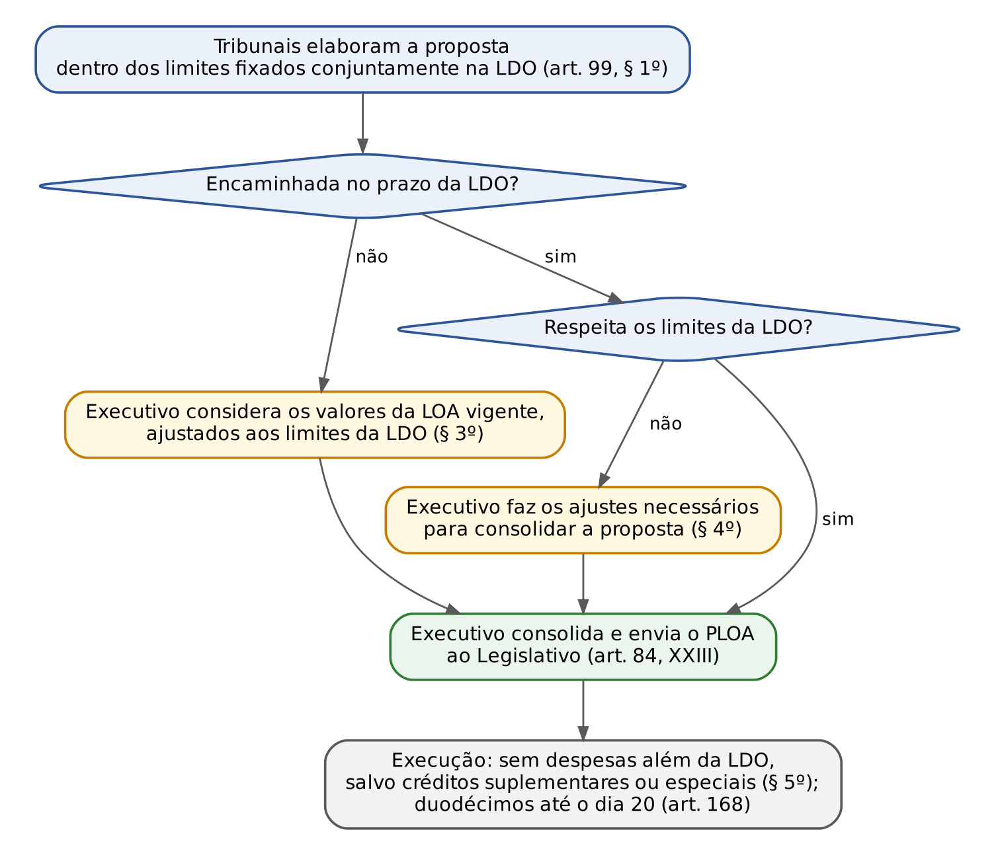
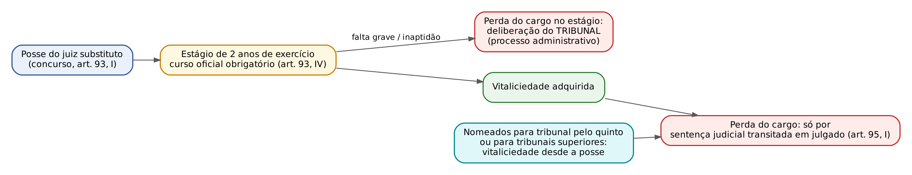
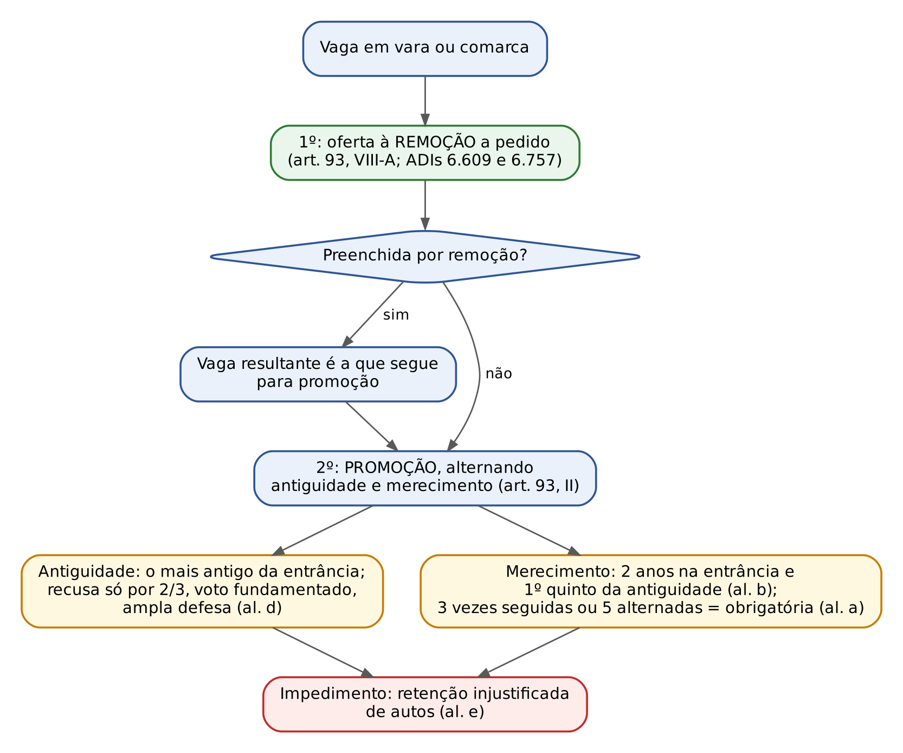
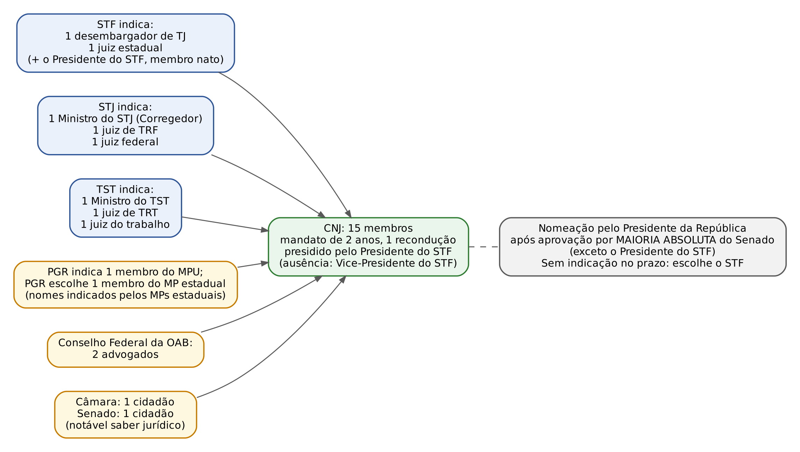
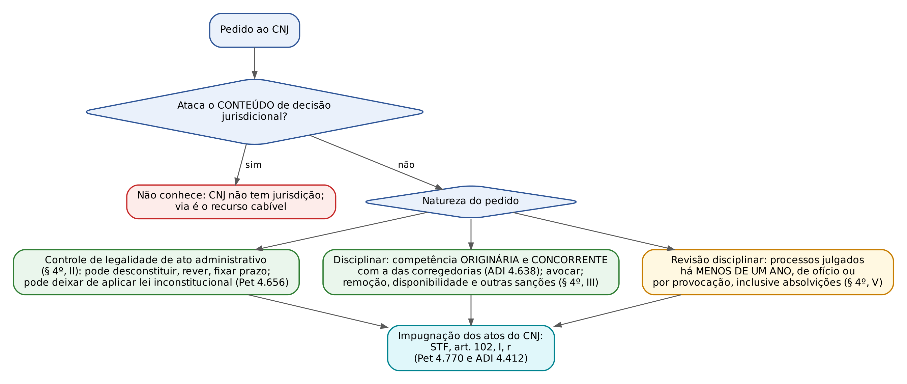
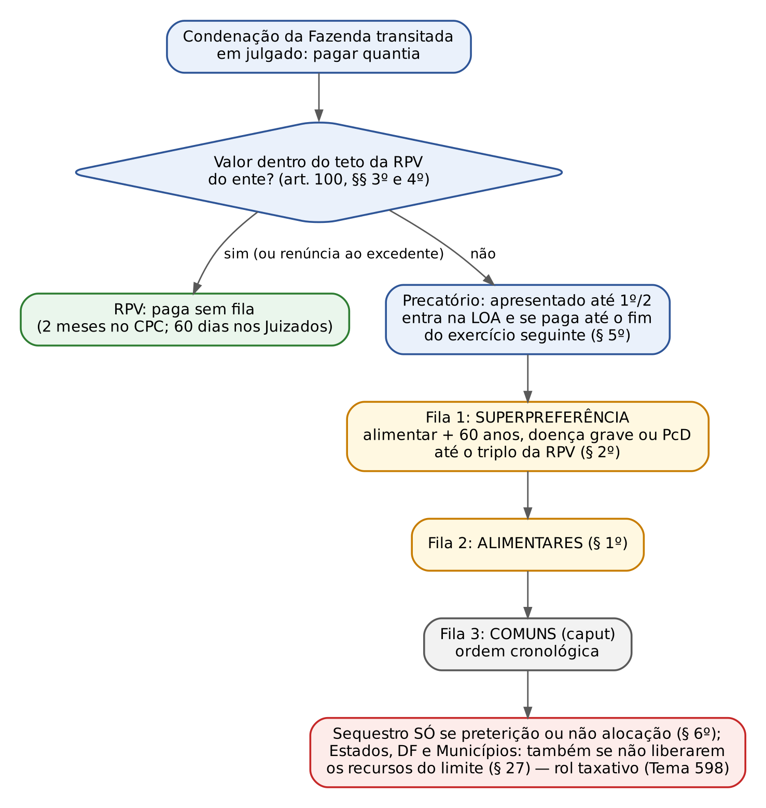
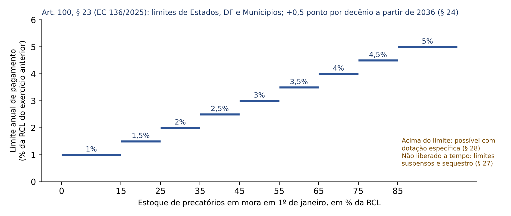

# CAPÍTULO 29 — PODER JUDICIÁRIO I: ESTRUTURA, GARANTIAS, ESTATUTO DA MAGISTRATURA, CNJ E PRECATÓRIOS

:::INCIDENCIA
Pontos atendidos: TRF5 p. 9, 13; TJRS p. 8; TJSC p. 8.
Nível A+. Lote: 38 questões (FGV 34, FCC 4), com 13 de provas de magistratura (TJSC, TJPA, TJCE, TRF1, TRF6 e ENAM).
O que mais cai: composição e competências do CNJ (e o que ele NÃO pode fazer), precatórios após as ECs 113 e 136, reserva de iniciativa do Judiciário em lei sobre magistrados, remoção antes da promoção, quóruns do art. 93 e autonomia orçamentária (art. 99, §§ 3º e 4º).
:::

| Subtema | FGV | FCC | Padrão de cobrança |
|---|---|---|---|
| CNJ: composição, natureza, competências e limites | 12 | 2 | Membro nato, quem indica quem, 15 membros, revisão disciplinar "há menos de um ano", nenhuma ingerência sobre decisão jurisdicional, competência concorrente com as corregedorias |
| Precatórios e RPV | 7 | 1 | Natureza alimentar e superpreferência, sequestro taxativo (Tema 598), § 11, limites da EC 136, RPV fixada pelo ente |
| Estatuto da Magistratura: ingresso, promoção, remoção, eleição dos órgãos diretivos | 5 | 0 | Iniciativa do STF (LOMAN), limites etários inconstitucionais, remoção precede promoção, só desembargadores votam |
| Remuneração dos magistrados e reserva de iniciativa | 4 | 0 | Iniciativa do Tribunal (art. 96, II, b), escalonamento do art. 93, V, gratificações e teto |
| Garantias, disciplina e publicidade | 4 | 0 | Inamovibilidade relativa, maioria absoluta para remoção e disponibilidade (EC 103), sessão pública, fundamentação |
| Autonomia administrativa e financeira | 3 | 0 | Proposta fora do prazo (LOA vigente ajustada à LDO), proposta acima dos limites (ajuste pelo Executivo), autogoverno por resolução |
| Quinto constitucional | 0 | 1 | Dez anos, lista sêxtupla, lista tríplice, vinte dias, Executivo |

Os números somam 39 porque a Q3362338 (ENAM) cobra CNJ e disciplina.

## 29.1 Função jurisdicional e estrutura do Poder Judiciário

### 29.1.1 Função típica, funções atípicas e princípios

A jurisdição é a função estatal de aplicar o direito ao caso concreto com definitividade (aptidão para a coisa julgada), por órgão imparcial e mediante provocação. Os traços cobrados como "princípios da jurisdição": inércia (o juiz não age de ofício, salvo exceções legais), substitutividade, indeclinabilidade (art. 5º, XXXV), investidura, aderência ao território, indelegabilidade, juiz natural (art. 5º, XXXVII e LIII; desenvolvido no Cap. 10) e definitividade. O Brasil adota a unidade de jurisdição (sistema inglês): não há contencioso administrativo com coisa julgada, de modo que a decisão administrativa, inclusive do CNJ e dos Tribunais de Contas, sempre pode ser revista judicialmente (as exceções constitucionais à inafastabilidade, como a da Justiça Desportiva no art. 217, § 1º, estão no Cap. 10).

Como os demais Poderes, o Judiciário exerce funções atípicas: administra (organiza secretarias, provê cargos, concede férias e licenças: art. 96, I, b a f) e legisla em sentido material (regimentos internos: art. 96, I, a). O CNJ e o CJF são órgãos do Judiciário que exercem SÓ funções administrativas; não têm jurisdição.

Princípios constitucionais do Poder Judiciário que as bancas transformam em alternativas (todos com sede no art. 93, salvo indicação): publicidade dos julgamentos e motivação de todas as decisões (IX e X, ver 29.4.5); atividade jurisdicional ininterrupta, vedadas férias coletivas nos juízos e tribunais de segundo grau, com plantão permanente (XII); número de juízes proporcional à demanda e à população (XIII); delegação aos servidores de atos de administração e de mero expediente sem caráter decisório (XIV); distribuição imediata em todos os graus (XV); razoável duração do processo (art. 5º, LXXVIII); destinação exclusiva das custas e emolumentos ao custeio dos serviços afetos às atividades específicas da Justiça (art. 98, § 2º).

:::PEGADINHA FÉRIAS COLETIVAS
O art. 93, XII, veda férias coletivas "nos juízos e tribunais de segundo grau". Os tribunais superiores e o STF NÃO estão abrangidos pela vedação; é por isso que mantêm recessos e férias coletivas regimentais. Alternativa que estende a vedação "a todos os órgãos do Poder Judiciário" está errada.
:::

### 29.1.2 Órgãos do Poder Judiciário (art. 92)

:::LEI CF, ART. 92
São órgãos do Poder Judiciário: I - o Supremo Tribunal Federal; I-A o Conselho Nacional de Justiça; II - o Superior Tribunal de Justiça; II-A - o Tribunal Superior do Trabalho; III - os Tribunais Regionais Federais e Juízes Federais; IV - os Tribunais e Juízes do Trabalho; V - os Tribunais e Juízes Eleitorais; VI - os Tribunais e Juízes Militares; VII - os Tribunais e Juízes dos Estados e do Distrito Federal e Territórios. § 1º O Supremo Tribunal Federal, o Conselho Nacional de Justiça e os Tribunais Superiores têm sede na Capital Federal. § 2º O Supremo Tribunal Federal e os Tribunais Superiores têm jurisdição em todo o território nacional.
:::

Três observações de prova sobre a literalidade:

- O CNJ (inciso I-A, EC 45/2004) é órgão do Judiciário, mas o § 2º NÃO lhe atribui "jurisdição em todo o território nacional": ele tem sede na Capital (§ 1º), mas não tem jurisdição alguma. A alternativa que diz "o STF, o CNJ e os Tribunais Superiores têm jurisdição em todo o território nacional" mistura os dois parágrafos.
- O TST foi listado expressamente (inciso II-A) pela EC 92/2016; antes, figurava apenas implicitamente em "Tribunais e Juízes do Trabalho".
- Não são órgãos do Judiciário: o Ministério Público, a Defensoria, os Tribunais de Contas (órgãos de controle externo que auxiliam o Legislativo, Cap. 27), a Justiça Desportiva, os juízos arbitrais, a justiça de paz (que exerce "atribuições conciliatórias, sem caráter jurisdicional", art. 98, II), o CJF, o CSJT e a ENFAM como órgãos autônomos (funcionam JUNTO ao STJ e ao TST, art. 105, parágrafo único, e art. 111-A, § 2º).

O STF afirma o caráter nacional e unitário do Poder Judiciário: a divisão em "Justiças" (federal, estaduais, especializadas) é repartição de competência, não de soberania; os magistrados estaduais e federais integram uma só magistratura nacional, regida por um só Estatuto (art. 93). Dessa premissa decorrem três teses muito cobradas: (a) a constitucionalidade do CNJ, que controla também os tribunais estaduais sem ofender o pacto federativo; (b) a inconstitucionalidade de órgão estadual de controle do Judiciário com participação de outros Poderes (Súmula 649 do STF: "É inconstitucional a criação, por Constituição estadual, de órgão de controle administrativo do Poder Judiciário do qual participem representantes de outros Poderes ou entidades"; v. Cap. 6); (c) a reserva do regime jurídico da magistratura à lei complementar nacional de iniciativa do STF, com invalidação de inovações estaduais (29.4.1).

A estrutura judiciária completa, com a composição e a competência de cada tribunal, a Justiça Federal e os Juizados Especiais Federais, a Justiça dos Estados e as Justiças especializadas, está no Cap. 30. Aqui ficam as normas COMUNS a todo o Judiciário (arts. 92 a 100 e 103-B) e o CJF.

### 29.1.3 Juizados especiais e justiça de paz (art. 98)

A União, no DF e nos Territórios, e os Estados "criarão" (dever) juizados especiais providos por juízes togados, ou togados e leigos, para conciliação, julgamento e execução de causas cíveis de menor complexidade e infrações penais de menor potencial ofensivo, com procedimento oral e sumaríssimo, transação e julgamento de recursos por turmas de juízes de primeiro grau (art. 98, I). Lei federal dispõe sobre os juizados no âmbito da Justiça Federal (§ 1º). A justiça de paz é remunerada, composta de cidadãos eleitos pelo voto direto, universal e secreto, com mandato de QUATRO anos, para celebrar casamentos, verificar o processo de habilitação e exercer atribuições conciliatórias SEM caráter jurisdicional (inciso II).

A competência legislativa sobre juizados é tema do Cap. 22 (art. 24, X, "criação, funcionamento e processo do juizado de pequenas causas", concorrente, ao lado da privativa da União sobre processo, art. 22, I). Aqui interessa a dimensão de autogoverno: a INSTALAÇÃO e a transformação de unidades por ato do tribunal (29.2.2).

## 29.2 Garantias institucionais: autogoverno e autonomia administrativa e financeira

As garantias do Judiciário dividem-se, na sistematização corrente (José Afonso da Silva; Alexandre de Moraes), em garantias INSTITUCIONAIS, que protegem o Poder como um todo (autonomia orçamentária, administrativa e de autogoverno), e garantias FUNCIONAIS ou de órgãos, que protegem os membros, subdivididas em garantias de independência (vitaliciedade, inamovibilidade, irredutibilidade) e garantias de imparcialidade (as vedações do art. 95, parágrafo único). As garantias funcionais estão em 29.3.

### 29.2.1 Competências privativas dos tribunais (art. 96)

:::LEI CF, ART. 96, I E II
Compete privativamente: I - aos tribunais: a) eleger seus órgãos diretivos e elaborar seus regimentos internos, com observância das normas de processo e das garantias processuais das partes, dispondo sobre a competência e o funcionamento dos respectivos órgãos jurisdicionais e administrativos; b) organizar suas secretarias e serviços auxiliares e os dos juízos que lhes forem vinculados, velando pelo exercício da atividade correicional respectiva; c) prover, na forma prevista nesta Constituição, os cargos de juiz de carreira da respectiva jurisdição; d) propor a criação de novas varas judiciárias; e) prover, por concurso público de provas, ou de provas e títulos, obedecido o disposto no art. 169, parágrafo único, os cargos necessários à administração da Justiça, exceto os de confiança assim definidos em lei; f) conceder licença, férias e outros afastamentos a seus membros e aos juízes e servidores que lhes forem imediatamente vinculados; II - ao Supremo Tribunal Federal, aos Tribunais Superiores e aos Tribunais de Justiça propor ao Poder Legislativo respectivo, observado o disposto no art. 169: a) a alteração do número de membros dos tribunais inferiores; b) a criação e a extinção de cargos e a remuneração dos seus serviços auxiliares e dos juízos que lhes forem vinculados, bem como a fixação do subsídio de seus membros e dos juízes, inclusive dos tribunais inferiores, onde houver; c) a criação ou extinção dos tribunais inferiores; d) a alteração da organização e da divisão judiciárias;
:::

Leitura cobrada do art. 96:

- Inciso I: competências que o tribunal exerce por ATO PRÓPRIO (regimento, resolução, ato administrativo), sem lei. Inciso II: matérias que exigem LEI, mas de iniciativa RESERVADA ao tribunal. A alínea d do inciso I ("propor a criação de novas varas") pertence, na lógica, ao segundo grupo: vara se cria por lei de iniciativa do tribunal.
- Os TRFs e os TRTs NÃO estão no inciso II: quem propõe ao Congresso a lei sobre seus cargos, número de membros e subsídios é o tribunal superior respectivo (STJ ou TST) ou, conforme o caso, o STF.
- O art. 125, § 1º, completa o quadro estadual: a competência dos tribunais é definida na Constituição do Estado, "sendo a lei de organização judiciária de iniciativa do Tribunal de Justiça".
- O inciso III atribui aos TJs o julgamento dos juízes estaduais e do DF e dos membros do MP, nos crimes comuns e de responsabilidade, ressalvada a Justiça Eleitoral (foro por prerrogativa: Cap. 30 e Apostila de Processo Penal).

Regimento interno: é ato normativo primário no que trata de competência e funcionamento dos órgãos do tribunal (art. 96, I, a), mas não pode inovar em direito processual, matéria reservada à lei federal (art. 22, I), devendo observar "as normas de processo e as garantias processuais das partes". Por ser ato normativo autônomo, o regimento e as resoluções de tribunal com conteúdo normativo podem ser objeto de ADI (ver Cap. 18).

### 29.2.2 Autogoverno por ato próprio: o caso dos juizados (ADI 4.235)

:::JURIS STF, ADI 4.235/RJ, PLENÁRIO, J. 12/12/2022 (INFORMATIVO 1079)
É constitucional, por não violar o princípio da legalidade, lei estadual que prevê que o Órgão Especial do Tribunal de Justiça pode transformar juízos, instalar juizado em substituição a adjunto e fixar a competência dos juizados especiais. A lei de organização judiciária autoriza; o tribunal executa por resolução, no exercício do art. 96, I, a (dispor sobre "a competência e o funcionamento dos respectivos órgãos jurisdicionais"). Foram mantidos o art. 3º da Lei 2.556/1996 e o art. 4º da Lei 3.603/2001, ambas do Rio de Janeiro.
:::

:::QUESTAO FGV 2026 — ENAM 2026.1 (Q4102397)
Lei estadual de organização judiciária autoriza o Órgão Especial do TJ, por resolução, a transformar juízos cíveis e criminais em juizados especiais e a instalar juizados. Gabarito: E, a lei é constitucional, pois não viola a legalidade e a Constituição atribui aos tribunais dispor sobre competência e funcionamento de seus órgãos (art. 96, I, a; ADI 4.235). Armadilhas: A (reserva de lei: a lei existe e delega o detalhamento ao tribunal); B (direito processual: transformar e instalar unidades é organização judiciária, não processo); C e D (fundamentos errados para a conclusão certa: a validade não decorre de lei nacional de normas gerais nem da competência concorrente do art. 24, X, mas do autogoverno).
:::

### 29.2.3 Eleição dos órgãos diretivos: LOMAN, colégio eleitoral e EC 134/2024

A LOMAN (LC 35/1979), recepcionada como Estatuto da Magistratura provisório, dispõe no art. 102 que os tribunais, "pela maioria dos seus membros efetivos, por votação secreta, elegerão dentre seus Juízes mais antigos, em número correspondente ao dos cargos de direção, os titulares destes, com mandato por dois anos, proibida a reeleição". Três consequências consolidadas:

- Colégio eleitoral: só os membros do tribunal votam. Norma estadual que inclua juízes de primeiro grau no colégio eleitoral é inconstitucional: o art. 96, I, a, atribui a eleição aos "tribunais", isto é, aos órgãos colegiados, e a matéria é do Estatuto da Magistratura. O STF declarou inconstitucional, por unanimidade, a EC 67/2013 à Constituição de Mato Grosso, que previa eleição direta com voto dos juízes (ADI 5.303/MT, j. 9/8/2024, Informativo 1145, com fundamento também na separação de Poderes).
- Reeleição e elegibilidade: a vedação à reeleição e o critério dos "mais antigos" são normas da LOMAN, de observância obrigatória; regimento ou lei estadual não podem afastá-las.
- Iniciativa: a matéria é de lei complementar nacional de iniciativa do STF (art. 93, caput); Constituição estadual, por emenda parlamentar, não pode dispor sobre ela.

A EC 134/2024 acrescentou parágrafo único ao art. 96: "Nos Tribunais de Justiça compostos de mais de 170 (cento e setenta) desembargadores em efetivo exercício, a eleição para os cargos diretivos [...] será realizada entre os membros do tribunal pleno, por maioria absoluta e por voto direto e secreto, para um mandato de 2 (dois) anos, vedada mais de 1 (uma) recondução sucessiva". Na prática, alcançava só os TJs de São Paulo e do Rio de Janeiro. O PGR ajuizou a ADI 7.751, e o STF, convertendo a apreciação da cautelar em julgamento de mérito, julgou PROCEDENTE o pedido e declarou a inconstitucionalidade formal e material da EC 134/2024, acrescentando que a alteração da forma de escolha do autogoverno do Judiciário viola a cláusula pétrea da separação de Poderes (STF, ADI 7.751/DF, Relatora Ministra Cármen Lúcia, Plenário, sessão virtual de 30/10/2026 a 10/11/2026, por maioria). O voto da relatora sustentou a inconstitucionalidade material (o tamanho do tribunal não justifica regime diferenciado de mandatos). Para prova: a recondução nos TJs com mais de 170 desembargadores caiu; vale, para todos os tribunais, a regra da LOMAN (mandato de dois anos, vedada a reeleição). Questões elaboradas antes de novembro de 2026 que tomem o parágrafo único do art. 96 como vigente devem ser lidas com essa ressalva; o texto compilado do Planalto ainda o exibia na conferência de 12/11/2026.

:::QUESTAO FGV 2025 — ENAM 2025.1 (Q3362320)
Emenda à Constituição estadual, de iniciativa parlamentar, atribui ao TJ eleger seus dirigentes pelo voto de todos os magistrados em atividade, de primeiro e segundo graus, com mandato de dois anos e uma recondução; a LOMAN (1979) prevê eleição pelo tribunal, dois anos, sem reeleição. Gabarito: D, compete privativamente aos tribunais, como órgãos colegiados, a eleição dos órgãos diretivos, o que exclui a inclusão de juízes no colégio eleitoral por norma estadual. Armadilhas: A ("pedigree democrático" da emenda parlamentar não supera a reserva do art. 93 e do art. 96, I, a); B (Estatuto da Magistratura é lei COMPLEMENTAR de iniciativa do STF, não lei ordinária do Congresso); C (princípio democrático como fundamento de norma estadual); E (a LOMAN foi recepcionada no que é compatível; não há vácuo).
:::

### 29.2.4 Reserva de iniciativa: subsídio, vantagens e regime da magistratura

Separe três camadas, porque as questões misturam iniciativa, espécie normativa e ente competente:

| Matéria | Espécie e ente | Iniciativa | Fundamento |
|---|---|---|---|
| Estatuto da Magistratura (ingresso, promoção, remoção, deveres, vedações, direitos e vantagens, disciplina, eleição dos dirigentes) | Lei complementar FEDERAL (nacional) | STF | Art. 93, caput |
| Subsídio dos Ministros do STF | Lei ordinária federal | STF | Arts. 48, XV, e 96, II, b |
| Subsídio dos desembargadores e juízes estaduais | Lei ordinária ESTADUAL, dentro do escalonamento do art. 93, V | Tribunal de Justiça | Art. 96, II, b |
| Criação de cargos, remuneração de servidores, organização e divisão judiciárias | Lei ordinária do ente | Tribunal | Art. 96, II, b e d; art. 125, § 1º |
| Criação de varas | Lei ordinária do ente | Tribunal | Art. 96, I, d |

Consequências cobradas:

- Lei de iniciativa do Governador ou parlamentar sobre gratificação, subsídio ou vantagem de magistrado tem vício formal de iniciativa (art. 96, II, b). Emenda parlamentar a projeto do tribunal que aumente despesa também é inconstitucional (art. 63, II; Cap. 26).
- Mesmo com a iniciativa correta, o ESTADO não pode criar direito, dever ou vantagem do magistrado não previstos no Estatuto nacional: a matéria é do art. 93, e os direitos e vantagens da magistratura têm rol na LOMAN (arts. 65 e seguintes). Por isso a Assembleia não pode aprovar, ainda que por proposta do TJ, "horas extras" para juízes.
- Depois do julgamento conjunto de 25/3/2026 sobre o teto e as parcelas indenizatórias (Rcl 88.319 ED-MC-Ref/SP, Rel. Min. Flávio Dino, com a ADI 6.606, a ADI 6.601, a ADI 6.604 e os Temas 966 e 976, Informativo 1210), a criação ou alteração de verbas remuneratórias, indenizatórias ou auxílios da magistratura "somente poderão ser realizadas por Lei Federal (CF, art. 37, § 11) ou por decisão do Supremo Tribunal Federal (CF, art. 102, I, n)", e só são pagáveis as parcelas listadas na tese, com limite conjunto de 35% do subsídio. A tese completa está no Cap. 24, item 24.6.2; aqui basta a consequência: lei ESTADUAL, ainda que de iniciativa do TJ, não cria mais gratificação de magistrado.

:::QUESTAO FGV 2025 — TJ-SC — JUIZ SUBSTITUTO (Q3324308)
Lei de iniciativa do Governador institui gratificação especial de acúmulo de função para os magistrados estaduais. Gabarito: E, inconstitucional, porque a matéria é de lei reservada ao Tribunal de Justiça (art. 96, II, b). Armadilhas: A (juiz como "servidor" sob regime jurídico de iniciativa do Governador: magistrado é membro de Poder, e o art. 61, § 1º, II, c, não o alcança); B (o CNJ não "permite" vantagem por lei local); C (a iniciativa não é "facultada", é RESERVADA); D (iniciativa parlamentar). Atualização: após o julgamento de 25/3/2026 (Informativo 1210), a gratificação por exercício cumulativo de jurisdição só é válida nos termos das leis federais citadas na tese e apenas quando houver atuação em mais de um órgão jurisdicional; uma lei estadual criando-a seria inconstitucional também pela matéria, e não só pela iniciativa.
:::

:::QUESTAO FGV 2024 — TCE-GO — ANALISTA DE CONTROLE EXTERNO (Q2524459)
Projeto de lei do TJ regulamenta o pagamento de horas extraordinárias aos magistrados. Gabarito: D, o TJ carece de legitimidade para propor e a Assembleia de competência para apreciar. Passos: (1) direitos e vantagens da magistratura são matéria do Estatuto (art. 93, caput), lei complementar nacional de iniciativa do STF; (2) magistrado não tem jornada nem "hora extra" (o regime é de subsídio em parcela única, art. 39, § 4º, e a atividade é ininterrupta, art. 93, XII); (3) logo, nem o TJ nem a Assembleia atuam: o vício é de competência federativa e de iniciativa. Erradas: A (não há competência suplementar estadual sobre o Estatuto); B (Constituição estadual tampouco pode tratar do tema); C (a exigência de lei complementar estadual não sana o vício); E (o regime dos servidores não se aplica subsidiariamente a membros de Poder).
:::

:::QUESTAO FGV 2025 — TRF 1ª REGIÃO — JUIZ FEDERAL SUBSTITUTO (Q3425336)
Lei estadual de iniciativa do TJ paga a juízes e desembargadores gratificações por chefia e direção, permitindo a incorporação ao subsídio. Gabarito: B, constitucional desde que respeitado o teto e sem incorporação ao subsídio. Fundamento usado pela banca: o subsídio impede a cumulação com verbas que remunerem as atividades ORDINÁRIAS do cargo, não com retribuição por encargos extraordinários (ADI 4.941/AL, j. 14/8/2019, Informativo 947, quanto a servidores; ADI 3.228/ES, j. 19/2/2025, Informativo 1166, quanto ao Ministério Público, com invalidação da cláusula de incorporação e ressalva do teto). Armadilhas: A (permite a incorporação), C (subsídio veda "quaisquer" parcelas), D e E (iniciativa do Governador ou do STF: a lei estadual sobre remuneração de magistrados estaduais é de iniciativa do TJ). Ressalva: o gabarito reflete a jurisprudência anterior à tese de 25/3/2026 (Informativo 1210); a gratificação por cargo de direção não está entre as parcelas autorizadas e, hoje, só lei federal pode criá-la (ver nota).
:::

:::QUESTAO FGV 2024 — ENAM 1 (REAPLICAÇÃO) (Q2506991)
Lei estadual de iniciativa do TJ fixa o subsídio dos desembargadores em 90,25% do subsídio dos Ministros do STF e escalona as entrâncias (substituto, 1ª, 2ª e 3ª) com diferença de 5% entre uma e outra. Gabarito: B, constitucional: os Estados, por lei de iniciativa do TJ, fixam os subsídios e organizam a Justiça local, inclusive o número de entrâncias. Conta de conferência: 95% (Tribunais Superiores, art. 93, V) x 95% = 90,25%, que é o teto do desembargador; o escalonamento de 5% está dentro da faixa constitucional (nem menos de 5% nem mais de 10%). Armadilhas: A (lei nacional de escalonamento: o art. 93, V, já é a norma nacional); C (isonomia: o escalonamento é exigido pela Constituição); D (iniciativa do Executivo); E (interpretação conforme para reduzir às "categorias nacionais": o art. 93, V, manda escalonar conforme as categorias da estrutura judiciária, e as entrâncias são categorias da organização estadual).
:::

:::LEI CF, ART. 93, V
o subsídio dos Ministros dos Tribunais Superiores corresponderá a noventa e cinco por cento do subsídio mensal fixado para os Ministros do Supremo Tribunal Federal e os subsídios dos demais magistrados serão fixados em lei e escalonados, em nível federal e estadual, conforme as respectivas categorias da estrutura judiciária nacional, não podendo a diferença entre uma e outra ser superior a dez por cento ou inferior a cinco por cento, nem exceder a noventa e cinco por cento do subsídio mensal dos Ministros dos Tribunais Superiores, obedecido, em qualquer caso, o disposto nos arts. 37, XI, e 39, § 4º;
:::

### 29.2.5 Autonomia financeira: a proposta orçamentária (art. 99)

O art. 99, caput, assegura ao Judiciário "autonomia administrativa e financeira". A autonomia financeira não é soberania orçamentária: o Judiciário ELABORA sua proposta, mas o orçamento é uno, consolidado pelo Executivo e aprovado pelo Legislativo. As regras dos §§ 3º a 5º (EC 45/2004) resolvem o que acontece quando o tribunal não cumpre o prazo ou os limites:

:::LEI CF, ART. 99, §§ 1º A 5º
§ 1º Os tribunais elaborarão suas propostas orçamentárias dentro dos limites estipulados conjuntamente com os demais Poderes na lei de diretrizes orçamentárias. § 2º O encaminhamento da proposta, ouvidos os outros tribunais interessados, compete: I - no âmbito da União, aos Presidentes do Supremo Tribunal Federal e dos Tribunais Superiores, com a aprovação dos respectivos tribunais; II - no âmbito dos Estados e no do Distrito Federal e Territórios, aos Presidentes dos Tribunais de Justiça, com a aprovação dos respectivos tribunais. § 3º Se os órgãos referidos no § 2º não encaminharem as respectivas propostas orçamentárias dentro do prazo estabelecido na lei de diretrizes orçamentárias, o Poder Executivo considerará, para fins de consolidação da proposta orçamentária anual, os valores aprovados na lei orçamentária vigente, ajustados de acordo com os limites estipulados na forma do § 1º deste artigo. § 4º Se as propostas orçamentárias de que trata este artigo forem encaminhadas em desacordo com os limites estipulados na forma do § 1º, o Poder Executivo procederá aos ajustes necessários para fins de consolidação da proposta orçamentária anual. § 5º Durante a execução orçamentária do exercício, não poderá haver a realização de despesas ou a assunção de obrigações que extrapolem os limites estabelecidos na lei de diretrizes orçamentárias, exceto se previamente autorizadas, mediante a abertura de créditos suplementares ou especiais.
:::

Pontos de fixação:

- Limites: fixados "conjuntamente com os demais Poderes" na LDO. Não é o Executivo que os impõe unilateralmente, nem o Judiciário que os define sozinho.
- Quem encaminha: Presidentes do STF e dos Tribunais Superiores (União); Presidentes dos TJs (Estados e DF), sempre "com a aprovação dos respectivos tribunais" e "ouvidos os outros tribunais interessados". Os TRFs e TRTs não encaminham diretamente: suas propostas passam pelo CJF e pelo CSJT e pelos tribunais superiores.
- Atraso: o Executivo usa a LOA VIGENTE, ajustada aos limites da LDO. Não usa a proposta atrasada nem corrige pela inflação.
- Excesso: o Executivo AJUSTA. É exceção expressa à ideia de intangibilidade da proposta; fora das hipóteses dos §§ 3º e 4º, o Executivo não pode cortar a proposta do Judiciário ao consolidá-la (deve encaminhá-la ao Legislativo, a quem cabe deliberar sobre eventuais reduções; a jurisprudência do STF sobre esse ponto envolveu propostas de Defensorias e do MP, ver Cap. 31).
- Execução: duodécimos entregues até o dia 20 de cada mês (art. 168); a retenção pelo Executivo autoriza mandado de segurança do tribunal e configura crime de responsabilidade (art. 85, II; Lei 1.079/1950).

:::QUESTAO FGV 2024 — ENAM 1 (Q2459850)
Por divergências internas, o TJ perde o prazo de encaminhamento da proposta orçamentária e só a aprova uma semana depois. Gabarito: C, os valores aprovados na lei orçamentária vigente, ajustados aos limites da LDO, serão utilizados pelo órgão competente para consolidação (art. 99, § 3º). Armadilhas: A (dotações da lei vigente "como proposta do Judiciário", sem o ajuste à LDO); B (a proposta atrasada "deve necessariamente" ser considerada: a autonomia não se sobrepõe ao prazo); D (envio direto ao Legislativo até a apreciação pela comissão: não há essa via, a proposta é consolidada pelo Executivo); E (atualização pelo índice de inflação: o critério é o ajuste aos limites da LDO).
:::

:::QUESTAO FGV 2026 — TJ-MS — ANALISTA JUDICIÁRIO (Q3856324)
Pediu-se a INCORRETA sobre o orçamento do Judiciário. Gabarito: E, que dizia que a proposta é elaborada pelo Executivo e que, se não encaminhada no prazo, o próprio Judiciário faria os ajustes. Inverte tudo: quem elabora é o tribunal (§ 1º), quem consolida e ajusta é o Executivo (§§ 3º e 4º). As alternativas A a D reproduzem a letra dos §§ 1º, 3º, 4º e 5º.
:::

## 29.3 Garantias funcionais e vedações dos magistrados (art. 95)

:::LEI CF, ART. 95
Os juízes gozam das seguintes garantias: I - vitaliciedade, que, no primeiro grau, só será adquirida após dois anos de exercício, dependendo a perda do cargo, nesse período, de deliberação do tribunal a que o juiz estiver vinculado, e, nos demais casos, de sentença judicial transitada em julgado; II - inamovibilidade, salvo por motivo de interesse público, na forma do art. 93, VIII; III - irredutibilidade de subsídio, ressalvado o disposto nos arts. 37, X e XI, 39, § 4º, 150, II, 153, III, e 153, § 2º, I. Parágrafo único. Aos juízes é vedado: I - exercer, ainda que em disponibilidade, outro cargo ou função, salvo uma de magistério; II - receber, a qualquer título ou pretexto, custas ou participação em processo; III - dedicar-se à atividade político-partidária. IV receber, a qualquer título ou pretexto, auxílios ou contribuições de pessoas físicas, entidades públicas ou privadas, ressalvadas as exceções previstas em lei; V exercer a advocacia no juízo ou tribunal do qual se afastou, antes de decorridos três anos do afastamento do cargo por aposentadoria ou exoneração.
:::

As garantias são do CARGO e da função, não privilégio pessoal: existem para assegurar a independência de quem julga, por isso são irrenunciáveis e não se estendem a servidores do Judiciário (Súmula 46 do STF: o desmembramento de serventia não viola a vitaliciedade do serventuário; a referência histórica é aos antigos serventuários, hoje delegatários do art. 236).

### 29.3.1 Vitaliciedade

- Aquisição: no primeiro grau, após DOIS ANOS de exercício (não "três", como a estabilidade do art. 41); nos tribunais, com a POSSE, para quem ingressa pelo quinto ou é nomeado diretamente para tribunal superior ou para o STF (LOMAN, art. 22, I). A participação em curso oficial ou reconhecido por escola nacional é "etapa obrigatória do processo de vitaliciamento" (art. 93, IV).
- Perda no estágio: por "deliberação do tribunal a que o juiz estiver vinculado" (processo administrativo); a LOMAN exige proposta do tribunal ou do órgão especial pelo voto de dois terços dos membros efetivos (art. 22, § 1º, LC 35, com a ressalva de que, desde a EC 45, o quórum disciplinar constitucional é a maioria absoluta, art. 93, X; ver 29.4.4). O juiz não vitalício pratica todos os atos dos vitalícios (art. 22, § 2º, LOMAN).
- Perda após a aquisição: SÓ por sentença judicial transitada em julgado. Não há perda do cargo de magistrado vitalício por decisão administrativa, nem do tribunal nem do CNJ. Pela LOMAN, a perda decorre de ação penal por crime comum ou de responsabilidade (art. 26, I) e das hipóteses de exercício de outra função, recebimento de custas ou atividade político-partidária (art. 26, II), estas, após a CF/1988, também dependentes de sentença judicial.
- A aposentadoria compulsória DEIXOU de ser pena. A EC 103/2019 retirou do texto constitucional a menção à aposentadoria por interesse público (arts. 93, VIII, e 103-B, § 4º, III), e a Primeira Turma do STF afirmou que a penalidade do art. 42, V, da LOMAN não foi recepcionada após a emenda; se o CNJ entender cabível a sanção mais grave, cabe à AGU propor a ação de perda do cargo diretamente no STF (AO 2.870 AgR/DF, Relator Ministro Flávio Dino, Primeira Turma, j. 26/5/2026, Informativo 1219, com embargos da PGR rejeitados em junho de 2026). Na sequência, a Resolução CNJ 693, de 5/8/2026, alterou a Resolução 135/2011: o rol de penas passou a ser advertência, censura, remoção compulsória, disponibilidade, DISPONIBILIDADE COM PROPOSTA DE PERDA DO CARGO e demissão (só para não vitalícios). A nova pena implica afastamento imediato, vencimentos proporcionais até o trânsito em julgado da ação civil e vacância da unidade; a decisão de tribunal que a aplique sobe ao CNJ em reexame necessário, e, confirmada (ou aplicada por Tribunal Superior ou pelo próprio CNJ), a AGU ajuíza no STF, em trinta dias, a ação civil de perda do cargo (arts. 3º, 7º, 22-A, 22-B e 22-C da Resolução 135, na redação da Resolução 693, republicada no DJe/CNJ 212/2026, de 4/9/2026). A norma aplica-se aos processos disciplinares e às revisões em curso. Coerência com a vitaliciedade: a perda do cargo continua dependendo de sentença transitada em julgado (art. 95, I).
- A vitaliciedade NÃO impede a aposentadoria compulsória por idade (art. 40, § 1º, II, aplicável aos magistrados pelo art. 93, VI) nem a extinção do cargo, caso em que o titular fica em disponibilidade (ver Cap. 24, item 24.9.4).

### 29.3.2 Inamovibilidade

Garantia de não ser removido, nem promovido, sem consentimento. É RELATIVA: cede ao "motivo de interesse público, na forma do art. 93, VIII", isto é, por decisão da maioria absoluta do tribunal ou do CNJ, assegurada ampla defesa. Precisões:

- Alcança o juiz titular; o juiz substituto, por definição, é designado para substituir e auxiliar, e a sua designação não ofende a garantia, embora a remoção arbitrária do substituto, sem critério objetivo, seja combatida pela jurisprudência do CNJ.
- A elevação da entrância da comarca não promove automaticamente o juiz, mas também não o desloca: "A elevação da entrância da comarca não promove automaticamente o juiz, mas não interrompe o exercício de suas funções na mesma comarca" (Súmula 40 do STF). Lei estadual que, ao elevar a entrância, assegure aos ocupantes promoção "na própria comarca" é tema de controle abstrato (Q3301284, TJSE 2025, Cap. 18).
- Remoção, disponibilidade e as demais sanções não podem ser usadas como reação ao CONTEÚDO das decisões ou à "ideologia" do juiz: a independência funcional protege o entendimento jurídico (LOMAN, art. 41: o magistrado não pode ser punido ou prejudicado pelas opiniões que manifestar ou pelo teor das decisões que proferir, salvo impropriedade ou excesso de linguagem; ver 29.6.4).

:::QUESTAO FGV 2026 — TJ-SC — ANALISTA JURÍDICO (Q4150692)
Entidades da sociedade civil pedem o "afastamento" e a "substituição" do juiz João por morosidade e por sua ideologia. Gabarito oficial: C, João pode ser afastado do cargo, por tempo limitado, com vencimentos proporcionais ao tempo de serviço (descrição da DISPONIBILIDADE, art. 93, VIII, e LOMAN, art. 42, IV). Armadilhas: A (remoção compulsória "somente" se houver crime: o motivo é o interesse público, apurado em processo administrativo); B (inamovibilidade absoluta: a garantia é relativa); D (quórum de DOIS TERÇOS: desde a EC 45 o quórum é a MAIORIA ABSOLUTA, e a EC 103 manteve); E (remoção ou aposentadoria só como efeito de condenação criminal ou por improbidade). Gabarito discutível: a disponibilidade tem duração mínima, não máxima (o magistrado só pode pedir aproveitamento depois de dois anos, LOMAN, art. 57, § 1º), e a ideologia nunca seria motivo legítimo; a alternativa C apenas descreve uma possibilidade abstrata, em processo regular, por falta funcional como a morosidade injustificada. A crítica procede quanto ao "tempo limitado": depois da Resolução CNJ 693/2026, a disponibilidade sem aproveitamento em cinco anos abre procedimento de perda do cargo (art. 6º, § 5º, da Resolução 135), o que reforça que a pena não tem termo final fixo.
:::

### 29.3.3 Irredutibilidade de subsídio

Garantia NOMINAL, não real: protege contra redução do valor, não contra a perda inflacionária (não há direito à revisão automática). Ressalvas do próprio art. 95, III: teto (art. 37, XI) e revisão geral (art. 37, X), vedação de acréscimos ao subsídio (art. 39, § 4º), igualdade tributária e imposto de renda (arts. 150, II, 153, III, e § 2º, I). Incide, portanto, o imposto de renda e a contribuição previdenciária; e o corte do que exceder o teto não ofende a garantia (ver Cap. 24).

### 29.3.4 Vedações (garantias de imparcialidade)

| Vedação (art. 95, parágrafo único) | Precisão de prova |
|---|---|
| I - outro cargo ou função, "ainda que em disponibilidade", salvo UMA de magistério | Uma só função de magistério, pública ou privada; a LOMAN exige correlação de matérias e compatibilidade de horários e veda função de direção administrativa ou técnica de estabelecimento de ensino (art. 26, § 1º); a docência em curso oficial para a magistratura não conta como exercício de cargo (§ 2º). A vedação alcança o magistrado em disponibilidade, mas não o aposentado |
| II - custas ou participação em processo | "A qualquer título ou pretexto" |
| III - atividade político-partidária | Filiação partidária inclusive; para concorrer, o magistrado deve afastar-se definitivamente (aposentadoria ou exoneração) no prazo da legislação eleitoral (Cap. 14) |
| IV - auxílios ou contribuições de pessoas físicas, entidades públicas ou privadas | "Ressalvadas as exceções previstas em lei" (EC 45) |
| V - advocacia no juízo ou tribunal do qual se afastou, antes de três anos do afastamento por aposentadoria ou exoneração | "Quarentena" de saída (EC 45): três anos, restrita ao juízo ou tribunal de origem; não impede advogar em outros órgãos |

A LOMAN acrescenta vedações (art. 36): exercer o comércio ou participar de sociedade comercial, inclusive de economia mista, exceto como acionista ou quotista; exercer cargo de direção ou técnico de sociedade civil, associação ou fundação, salvo de associação de classe e sem remuneração; e manifestar, por qualquer meio de comunicação, opinião sobre processo pendente, seu ou de outrem, ou juízo depreciativo sobre decisões de órgãos judiciais, "ressalvada a crítica nos autos e em obras técnicas ou no exercício do magistério". Os arts. 35 e 36 são objeto da ADPF 774 (anotação na página da LOMAN no Planalto; o resultado não foi conferido nesta tarefa).

:::PEGADINHA QUARENTENAS: MAGISTRADO X MP X INGRESSO
- Quarentena de SAÍDA do magistrado e do membro do MP: três anos, no juízo ou tribunal (ou, para o MP, perante o juízo ou tribunal) de que se afastou (arts. 95, parágrafo único, V, e 128, § 6º).
- "Quarentena" de ENTRADA: três anos de atividade jurídica para o ingresso na magistratura (art. 93, I) e no MP (art. 129, § 3º).
- A quarentena de saída depende de afastamento por APOSENTADORIA ou EXONERAÇÃO; o texto não fala em disponibilidade, e o magistrado em disponibilidade continua submetido à vedação do inciso I (outro cargo ou função).
:::

## 29.4 Estatuto da Magistratura: art. 93 e LOMAN

### 29.4.1 Lei complementar nacional de iniciativa do STF

"Lei complementar, de iniciativa do Supremo Tribunal Federal, disporá sobre o Estatuto da Magistratura, observados os seguintes princípios" (art. 93, caput). Até a sua edição, vigora a LOMAN (LC 35/1979), recepcionada no que é compatível com a Constituição. O STF extrai daí uma regra forte: o regime jurídico da magistratura exige tratamento UNIFORME e NACIONAL, e não comporta inovação estadual, nem por lei de iniciativa do TJ, nem por Constituição estadual. Ilustrações recentes:

- Limites etários para ingresso: inconstitucionais, tanto o máximo quanto o mínimo, por violarem o art. 93, I, e a reserva do Estatuto (ADI 5.329/DF, j. 14/12/2020, Informativo 1002; ADIs julgadas em setembro de 2021, Informativo 1031, contra leis do Ceará, de Mato Grosso do Sul e de Rondônia; ADI 6.741/ES, 2023, contra a faixa de 25 a 50 anos do Espírito Santo, com o argumento adicional de que a exigência de três anos de atividade jurídica já torna desnecessária idade mínima).
- Critério estadual de antiguidade (tempo de serviço público), permuta entre magistrados de TJs diferentes por lei estadual: inconstitucionais (ADI 6.762/AC e ADI 6.782/RN, 2023). A permuta entre tribunais passou a ter base constitucional com a EC 130/2023 (art. 93, VIII-B), mas sua disciplina continua sendo nacional.
- Abono de permanência para magistrados criado por lei estadual: inconstitucional (ADI 2.952/RJ, Informativo 1089, conforme indexação de fonte secundária; ver nota).

:::QUESTAO FGV 2024 — TJ-SC — JUIZ SUBSTITUTO (Q2387014)
Lei de organização judiciária estadual fixa idade mínima de 25 e máxima de 50 anos para ingresso na magistratura. Gabarito: E, inconstitucional, porque o limite máximo de 50 anos não guarda correlação com a natureza do cargo e destoa do critério adotado para a composição dos tribunais. Armadilhas: A, C e D (constitucionalidade por isonomia, por ser tema da lei de organização judiciária ou pela razoabilidade do mínimo de 25 anos). Observe que o STF invalida também o limite MÍNIMO (ADIs 5.329 e 6.741); a alternativa E é a única correta, mas não esgota o vício. No mesmo sentido, quanto à reserva do Estatuto: Q2387032, abaixo.
:::

:::QUESTAO FGV 2024 — TJ-SC — JUIZ SUBSTITUTO (Q2387032)
Lei estadual de iniciativa parlamentar determina que, no concurso para juiz substituto do TJ, todos os candidatos com 50% de acertos na prova objetiva sejam classificados para a segunda fase. Gabarito: B, inconstitucional, porque a lei, no caso, é de iniciativa privativa do STF. Passos: (1) regras do concurso de ingresso integram o Estatuto da Magistratura (art. 93, I); (2) o Estatuto é lei complementar NACIONAL de iniciativa do STF (art. 93, caput); (3) logo, nem a Assembleia nem o TJ podem dispor sobre o tema por lei estadual (o concurso é regulado nacionalmente pela Resolução CNJ 75/2009). Armadilhas: A (Governador) e E (Presidente do TJ): erram o titular da iniciativa; C e D (constitucionalidade "democratizante").
:::

### 29.4.2 Ingresso, vitaliciamento e residência (art. 93, I, IV e VII)

- Ingresso no cargo inicial de juiz substituto, por concurso de provas e títulos, com participação da OAB EM TODAS AS FASES, exigidos do bacharel "no mínimo, três anos de atividade jurídica", observada a ordem de classificação nas nomeações (I).
- Momento da comprovação do triênio: "A comprovação do triênio de atividade jurídica exigida para o ingresso no cargo de juiz substituto, nos termos do inciso I do art. 93 da Constituição Federal, deve ocorrer no momento da inscrição definitiva no concurso público" (Tema 509 do STF, RE 655.265, red. p/ acórdão Min. Edson Fachin, j. 13/4/2016). Não é na posse nem na inscrição preliminar. A atividade jurídica conta-se após a conclusão do curso de Direito (regra da Resolução CNJ 75/2009).
- Cursos oficiais de preparação, aperfeiçoamento e promoção; curso oficial ou reconhecido pela escola nacional como etapa obrigatória do vitaliciamento (IV). A ENFAM funciona junto ao STJ e regulamenta os cursos oficiais para ingresso e promoção (art. 105, parágrafo único, I); a ENAMAT, junto ao TST.
- O juiz TITULAR reside na respectiva comarca, salvo autorização do TRIBUNAL (VII). Na LOMAN, a autorização era do "órgão disciplinar" (art. 35, V); prevalece a redação constitucional (EC 45).

### 29.4.3 Promoção, remoção, permuta e acesso aos tribunais

| Regra (art. 93) | Letra exata | Pegadinha |
|---|---|---|
| Promoção de entrância para entrância (II) | "alternadamente, por antiguidade e merecimento" | Não é "preferencialmente por merecimento" |
| Promoção obrigatória (II, a) | Juiz que figure "por três vezes consecutivas ou cinco alternadas" em lista de merecimento | Três consecutivas OU cinco alternadas |
| Requisitos do merecimento (II, b) | Dois anos de exercício na entrância e integrar a primeira QUINTA parte da lista de antiguidade dela, "salvo se não houver com tais requisitos quem aceite o lugar vago" | A antiguidade é aferida NA ENTRÂNCIA do interessado, não em todas |
| Aferição do merecimento (II, c) | Desempenho, produtividade e presteza, frequência e aproveitamento em cursos | Critérios objetivos |
| Recusa do mais antigo (II, d) | Voto fundamentado de DOIS TERÇOS dos membros do tribunal, procedimento próprio, ampla defesa, repetindo-se a votação até fixar a indicação | Único quórum de dois terços do art. 93 |
| Impedimento (II, e) | Não será promovido o juiz que retiver autos injustificadamente além do prazo legal | Nem pode devolvê-los sem despacho ou decisão |
| Acesso ao 2º grau (III) | Antiguidade e merecimento, alternadamente, apurados na última ou única entrância | Antes da EC 45, havia tribunais de alçada |
| Remoção a pedido (VIII-A, EC 130/2023) | Atende, no que couber, às alíneas a, b, c e e do inciso II e ao art. 94 | Sem a alínea d (recusa por dois terços) |
| Permuta (VIII-B, EC 130/2023) | Comarcas de igual entrância, mesmo segmento de justiça, inclusive entre juízes de segundo grau vinculados a tribunais diferentes, na justiça estadual, federal ou do trabalho | Só no MESMO segmento |

Remoção antes da promoção. Após a EC 45/2004, que inseriu o inciso VIII-A, o STF passou a entender que, nas carreiras da magistratura estadual e federal, a remoção a pedido PRECEDE a promoção, tanto por antiguidade quanto por merecimento. A orientação anterior (Tema 964, que dava precedência à promoção por antiguidade) foi superada pela ADI 6.609/MG (red. p/ acórdão Min. Gilmar Mendes, j. 19/10/2023, Informativo 1113) e pela ADI 6.757/RR (Plenário, j. 20/2/2025, Informativo 1166), que validou lei estadual estabelecendo a precedência da remoção e cancelou formalmente o Tema 964. Na ADI 6.757, o STF MODULOU os efeitos: os tribunais têm doze meses, contados da publicação da ata, para implementar o novo sistema, ficando ressalvados os concursos de remoção e promoção já concluídos e mantidas, nesse período, as regras de cada tribunal.

:::QUESTAO FGV 2026 — TJ-PA — JUIZ SUBSTITUTO (Q3951807)
Maria (primeira entrância) só pode ocupar a vara de segunda entrância por promoção; João (segunda entrância) por remoção. A vaga surgirá em 2026; pergunta-se a ordem de oferecimento segundo o entendimento do STF "em caráter prospectivo". Gabarito: D, a remoção precede a promoção por antiguidade ou por merecimento. A referência ao caráter prospectivo é a modulação da ADI 6.757 (doze meses para implementação). Armadilhas: A e C (promoção antes da remoção), B e E (fórmulas mistas do entendimento superado, que separava antiguidade e merecimento).
:::

:::QUESTAO FGV 2025 — TJ-CE — JUIZ SUBSTITUTO (Q3505844)
Juiz de segunda entrância, no primeiro quinto da lista de antiguidade, quer a vaga de vara de entrância especial liberada por remoção. Gabarito: D, a remoção deve anteceder a promoção, tanto no critério de antiguidade quanto no de merecimento, sendo a antiguidade aferida na entrância do interessado (art. 93, II, b). Armadilhas: A e B (precedência só em um dos critérios), C e E (antiguidade aferida "em todas as entrâncias").
:::

### 29.4.4 Disciplina: quóruns, órgão especial e penas

:::LEI CF, ART. 93, VIII, X E XI
VIII - o ato de remoção ou de disponibilidade do magistrado, por interesse público, fundar-se-á em decisão por voto da maioria absoluta do respectivo tribunal ou do Conselho Nacional de Justiça, assegurada ampla defesa; [...] X as decisões administrativas dos tribunais serão motivadas e em sessão pública, sendo as disciplinares tomadas pelo voto da maioria absoluta de seus membros; XI nos tribunais com número superior a vinte e cinco julgadores, poderá ser constituído órgão especial, com o mínimo de onze e o máximo de vinte e cinco membros, para o exercício das atribuições administrativas e jurisdicionais delegadas da competência do tribunal pleno, provendo-se metade das vagas por antigüidade e a outra metade por eleição pelo tribunal pleno;
:::

Quóruns e números do art. 93 (tabela de memorização):

| Ato | Quórum ou número | Inciso |
|---|---|---|
| Recusar o juiz mais antigo na promoção | 2/3 dos membros, voto fundamentado | II, d |
| Remoção ou disponibilidade por interesse público | Maioria absoluta do tribunal ou do CNJ | VIII (EC 103/2019) |
| Decisões disciplinares em geral | Maioria absoluta dos membros, em sessão pública e motivada | X |
| Órgão especial | Tribunal com mais de 25 julgadores; 11 a 25 membros; metade por antiguidade, metade por eleição do pleno | XI |
| Declaração de inconstitucionalidade (reserva de plenário) | Maioria absoluta do tribunal ou do órgão especial | Art. 97 (Cap. 17) |
| Promoção obrigatória | 3 listas consecutivas ou 5 alternadas | II, a |
| Merecimento | 2 anos na entrância e 1º quinto da antiguidade | II, b |

A LOMAN previa quórum de DOIS TERÇOS e sessão SECRETA para a perda do cargo, a remoção e a disponibilidade (arts. 27, § 6º, e 45). Essas regras não sobreviveram à EC 45: prevalecem a maioria absoluta e a sessão pública (art. 93, VIII e X). Questões que reproduzem a LOMAN contra a Constituição são armadilha frequente.

Penas disciplinares da LOMAN (art. 42): advertência; censura; remoção compulsória; disponibilidade com vencimentos proporcionais ao tempo de serviço; aposentadoria compulsória com vencimentos proporcionais (não mais aplicável: v. a atualização de 2026, abaixo); demissão. Advertência e censura "somente são aplicáveis aos Juízes de primeira instância" (parágrafo único); o juiz censurado não figura em lista de merecimento por um ano (art. 44, parágrafo único). A demissão do vitalício depende de sentença (29.3.1); a do não vitalício, de decisão do tribunal. O procedimento disciplinar dos magistrados é uniformizado pela Resolução CNJ 135/2011 (cuja constitucionalidade foi examinada na ADI 4.638, ver 29.6.3).

Atualização de 2026: a aposentadoria compulsória (art. 42, V) não foi recepcionada após a EC 103/2019 (AO 2.870 AgR, Informativo 1219) e saiu do rol da Resolução 135 com a Resolução CNJ 693/2026, que criou a disponibilidade com proposta de perda do cargo (29.3.1). A disponibilidade comum ganhou desfecho: passados cinco anos da pena sem pedido de aproveitamento, ou com pedidos reiteradamente indeferidos, o tribunal instaura procedimento, com contraditório, para avaliar a perda do cargo por incompatibilidade permanente (art. 6º, § 5º, da Resolução 135, na redação de 2026). Alternativa que apresente a aposentadoria compulsória como "pena máxima" do magistrado vitalício está desatualizada.

| Pena (Resolução 135, art. 3º, redação da Resolução 693/2026) | Alcance |
|---|---|
| Advertência e censura | Só juízes de primeiro grau |
| Remoção compulsória | Interesse público, maioria absoluta (art. 93, VIII) |
| Disponibilidade | Vencimentos proporcionais; após cinco anos, procedimento de avaliação da perda do cargo |
| Disponibilidade com proposta de perda do cargo | Afastamento imediato, reexame necessário no CNJ e ação civil da AGU no STF |
| Demissão | Só juízes não vitalícios |

:::QUESTAO FGV 2024 — TJ (PROVA NÃO IDENTIFICADA NA BASE) (Q3043795)
Na sessão disciplinar, o presidente do colegiado do TJ retira o público, deixando só o magistrado e seu advogado; todos os membros presentes, a sanção é aplicada pela diferença de um voto, em decisão motivada. Gabarito: D, a única incorreção é a retirada do público. Passos: (1) as decisões administrativas, inclusive disciplinares, são tomadas "em sessão pública" (art. 93, X); a sessão secreta da LOMAN não foi recepcionada; (2) quórum: com todos presentes, maioria de um voto é maioria absoluta dos membros, o que basta; (3) motivação houve; (4) o tribunal de vinculação é competente (a competência do CNJ é concorrente, não exclusiva).
:::

:::QUESTAO FGV 2025 — ENAM 2025.1 (Q3362338)
Três afirmativas sobre responsabilização de magistrados. Gabarito: A (F, F, V). (1) FALSA: a atuação correicional do CNJ não é subsidiária às corregedorias locais; é originária e concorrente (ADI 4.638). (2) FALSA: a Lei 13.869/2019 (abuso de autoridade) aplica-se a membros do Judiciário; o que ela afasta é a criminalização da "divergência na interpretação de lei ou na avaliação de fatos e provas" (art. 1º, § 2º), sem excluir os magistrados do seu alcance. (3) VERDADEIRA: remoção e disponibilidade por interesse público exigem maioria absoluta do tribunal ou do CNJ, com ampla defesa (art. 93, VIII, redação da EC 103/2019).
:::

### 29.4.5 Publicidade e fundamentação (art. 93, IX)

:::LEI CF, ART. 93, IX
todos os julgamentos dos órgãos do Poder Judiciário serão públicos, e fundamentadas todas as decisões, sob pena de nulidade, podendo a lei limitar a presença, em determinados atos, às próprias partes e a seus advogados, ou somente a estes, em casos nos quais a preservação do direito à intimidade do interessado no sigilo não prejudique o interesse público à informação;
:::

- Publicidade: regra; a restrição exige LEI e se limita à PRESENÇA em determinados atos (partes e advogados, ou só advogados), por ponderação entre intimidade e interesse público à informação. Segredo de justiça restringe a presença e o acesso, mas NÃO dispensa a fundamentação.
- Fundamentação: "todas as decisões", inclusive interlocutórias e administrativas (inciso X), "sob pena de nulidade". Mas o conteúdo exigido é mínimo: "O art. 93, IX, da Constituição Federal exige que o acórdão ou decisão sejam fundamentados, ainda que sucintamente, sem determinar, contudo, o exame pormenorizado de cada uma das alegações ou provas" (Tema 339 do STF, AI 791.292 QO, Rel. Min. Gilmar Mendes, j. 23/6/2010). O padrão analítico do art. 489, § 1º, do CPC é de lei, não de Constituição (ver Apostila de Processo Civil).
- Fundamentação *per relationem* (remissão a parecer do MP, a sentença ou a decisão anterior): admitida pelo STF desde que a peça referida seja indicada e o resultado permita conhecer as razões. Nos Juizados, a turma pode confirmar a sentença por seus próprios fundamentos (art. 82, § 5º, da Lei 9.099/1995), sem afronta ao art. 93, IX (Tema 451 do STF, RE 635.729).

:::QUESTAO FGV 2025 — TCE-PE — ANALISTA DE GESTÃO (Q3593087)
Sobre o dever de fundamentação. Gabarito: C, a letra do art. 93, IX ("todos os julgamentos [...] serão públicos, e fundamentadas todas as decisões, sob pena de nulidade"). Armadilhas: A (nulidade "pacífica" da fundamentação *per relationem*: ao contrário, é admitida); B (dispensa nas interlocutórias); D (dispensa no segredo de justiça); E (dispensa "em nome da eficiência" nos tribunais).
:::

:::SENTENCA FUNDAMENTAÇÃO PER RELATIONEM NO ACÓRDÃO
"Adoto como razões de decidir, nos termos do art. 93, IX, da Constituição, os fundamentos do parecer da Procuradoria-Geral de Justiça (evento 12), que enfrentou os pontos devolvidos — a legitimidade passiva e a prescrição —, transcritos a seguir no essencial. Acrescento que a alegação nova da apelante, sobre a nulidade da citação, não foi examinada no parecer e é afastada pelos motivos seguintes: [...]" Na técnica, transcreva ou identifique precisamente a peça e enfrente o que ela não enfrentou: a remissão pura a peça que não examinou a tese decisiva é o que gera nulidade.
:::

### 29.4.6 Responsabilidade do magistrado e ética judicial

- Responsabilidade civil: pelos danos causados no exercício da jurisdição responde o ESTADO (art. 37, § 6º), com regresso contra o magistrado apenas por dolo ou fraude ou recusa, omissão ou retardo injustificado de providência (art. 143 do CPC; LOMAN, art. 49). O STF não admite ação direta da vítima contra o agente público (ver Cap. 24 e Apostila de Direito Administrativo). Erro judiciário penal: art. 5º, LXXV (Cap. 10).
- Responsabilidade penal: crimes comuns e de responsabilidade julgados pelo tribunal competente (art. 96, III, para juízes estaduais; art. 105, I, a, para desembargadores; art. 108, I, a, para juízes federais); Lei de Abuso de Autoridade aplicável, com o filtro do art. 1º, § 2º (crime de hermenêutica excluído).
- Ética judicial (TRF5, ponto 9): o Código de Ética da Magistratura Nacional, aprovado pelo CNJ na 68ª Sessão Ordinária, de 6/8/2008 (texto datado de 26/8/2008), organiza-se em capítulos sobre independência, imparcialidade, transparência, integridade pessoal e profissional, diligência e dedicação, cortesia, prudência, sigilo profissional, conhecimento e capacitação, e dignidade, honra e decoro; e a Resolução CNJ 305, de 17/12/2019, "estabelece os parâmetros para o uso das redes sociais pelos membros do Poder Judiciário". A violação desses deveres alimenta o processo disciplinar, mas não autoriza punição pelo teor das decisões.

## 29.5 Quinto constitucional

:::LEI CF, ART. 94
Um quinto dos lugares dos Tribunais Regionais Federais, dos Tribunais dos Estados, e do Distrito Federal e Territórios será composto de membros, do Ministério Público, com mais de dez anos de carreira, e de advogados de notório saber jurídico e de reputação ilibada, com mais de dez anos de efetiva atividade profissional, indicados em lista sêxtupla pelos órgãos de representação das respectivas classes. Parágrafo único. Recebidas as indicações, o tribunal formará lista tríplice, enviando-a ao Poder Executivo, que, nos vinte dias subseqüentes, escolherá um de seus integrantes para nomeação.
:::

Fundamento: arejar os tribunais com a experiência de outras carreiras jurídicas e conferir legitimidade plural à composição. Pontos de prova:

- Tribunais alcançados pelo art. 94: TRFs e TJs (e TJDFT). TRTs e TST têm regra própria idêntica em essência (arts. 111-A, I, e 115, I). O STJ NÃO tem "quinto", mas um TERÇO, dividido em partes iguais entre advogados e membros do MP, com lista sêxtupla e escolha pelo próprio STJ em lista tríplice (art. 104, parágrafo único, II; Cap. 30). O STF e os tribunais eleitorais e militares têm regras próprias (Cap. 30).
- Requisitos: mais de DEZ anos (de carreira, para o MP; de efetiva atividade profissional, para o advogado), notório saber jurídico e reputação ilibada. Idade, no TRF, entre trinta e setenta anos (art. 107, EC 122/2022).
- Procedimento: lista SÊXTUPLA pelo órgão de classe (OAB ou MP, na forma das leis orgânicas), lista TRÍPLICE pelo tribunal, escolha pelo Chefe do Executivo (Governador, nos TJs; Presidente da República, nos TRFs) em VINTE dias. Não há sabatina no Senado para os TRFs nem na Assembleia para os TJs; previsão de aprovação legislativa em Constituição estadual acrescenta requisito não previsto no art. 94 (o STF suspendeu, por unanimidade, a expressão "depois de aprovada a escolha pela maioria absoluta da Assembléia Legislativa" do art. 63, parágrafo único, da Constituição paulista: ADI 4.150 MC/SP, Relator Ministro Marco Aurélio, Plenário, j. 8/10/2008; julgamento de mérito não conferido).
- Fração ímpar: quando o número de vagas não for múltiplo de cinco, o arredondamento se faz para cima, e a alternância entre advogados e MP se mantém (doutrina e jurisprudência do STF).
- O tribunal pode devolver a lista sêxtupla se faltarem requisitos objetivos (por exemplo, o tempo de carreira), mas não pode recusá-la por juízo político; o órgão de classe é quem indica.
- Legitimidade e autoridade coatora: "Integrante de lista de candidatos a determinada vaga da composição de tribunal é parte legítima para impugnar a validade da nomeação de concorrente" (Súmula 628 do STF); "No mandado de segurança contra a nomeação de magistrado da competência do Presidente da República, este é considerado autoridade coatora, ainda que o fundamento da impetração seja nulidade ocorrida em fase anterior do procedimento" (Súmula 627 do STF).
- Quem ingressa pelo quinto adquire a vitaliciedade com a POSSE e se submete integralmente ao Estatuto da Magistratura; o art. 93, VIII-A e VIII-B, manda aplicar o art. 94, "no que couber", também à remoção e à permuta (para que a origem da vaga, do quinto ou da carreira, seja preservada).

:::QUESTAO FCC 2024 — TRF 3ª REGIÃO — TÉCNICO JUDICIÁRIO (Q2564663)
Antônio é membro do MPF há 12 anos; Sandra é advogada com 14 anos de efetiva atividade profissional. Gabarito: D, ambos podem compor um TRF: um quinto das vagas é de MP e advogados, indicados em lista sêxtupla, o tribunal forma a lista tríplice e envia ao Poder Executivo, que escolhe em vinte dias. Armadilhas: A (quinze anos de carreira), B e C (lista QUÍNTUPLA, envio ao STF, trinta dias), E (só a advogada, com trinta dias). No mesmo sentido, sobre números trocados: Q2449866 (FGV 2024, AL-PR, Cap. 30: errada a alternativa que falava em "um terço" dos TJs com MP de "cinco anos" de carreira).
:::

## 29.6 Conselho Nacional de Justiça (art. 103-B)

### 29.6.1 Natureza e finalidade

Criado pela EC 45/2004, o CNJ é órgão do Poder Judiciário (art. 92, I-A) de natureza exclusivamente ADMINISTRATIVA, com competência sobre todo o Judiciário nacional, exceto o STF. Não exerce jurisdição, não revê decisões judiciais e não se sobrepõe ao STF, a quem se submete (art. 102, I, r). O STF, ao julgar a ação da Associação dos Magistrados Brasileiros contra a EC 45 (ADI 3.367/DF, Relator Ministro Cezar Peluso, Plenário, j. 13/4/2005, improcedente; afastado por unanimidade o vício formal), afirmou: (a) a constitucionalidade do Conselho, porque órgão interno do próprio Judiciário, de composição majoritariamente de magistrados, não ofende a separação de Poderes nem o pacto federativo, dado o caráter nacional do Judiciário; (b) a ausência de competência do CNJ sobre o STF e seus Ministros; (c) a inviabilidade de órgãos estaduais similares com membros externos (na linha da Súmula 649). A finalidade institucional que as bancas cobram é a de PLANEJAMENTO, COORDENAÇÃO e CONTROLE administrativo e financeiro, reagindo a déficits de gestão, transparência e uniformidade do Judiciário, além do controle disciplinar.

:::QUESTAO FGV 2026 — TJ-SC — ASSISTENTE SOCIAL (Q4150494)
Sobre a criação do CNJ pela EC 45/2004. Gabarito: E, o CNJ foi criado para promover a integração e a coordenação dos órgãos jurisdicionais, respondendo a déficits de gestão. Armadilhas: A (órgão "primordialmente disciplinar", com coordenação subsidiária: inverte o desenho do § 4º, cuja cabeça é o controle da atuação administrativa e financeira); B (a autonomia administrativa e financeira já existia, art. 99, desde 1988); C (atuação "permanente sobre os órgãos jurisdicionais": o CNJ não atua sobre a jurisdição); D (garantir independência frente aos demais Poderes: a finalidade foi controle e coordenação interna, não blindagem externa).
:::

### 29.6.2 Composição

:::LEI CF, ART. 103-B, CAPUT E §§ 1º A 3º
O Conselho Nacional de Justiça compõe-se de 15 (quinze) membros com mandato de 2 (dois) anos, admitida 1 (uma) recondução, sendo: I - o Presidente do Supremo Tribunal Federal; II um Ministro do Superior Tribunal de Justiça, indicado pelo respectivo tribunal; III um Ministro do Tribunal Superior do Trabalho, indicado pelo respectivo tribunal; IV um desembargador de Tribunal de Justiça, indicado pelo Supremo Tribunal Federal; V um juiz estadual, indicado pelo Supremo Tribunal Federal; VI um juiz de Tribunal Regional Federal, indicado pelo Superior Tribunal de Justiça; VII um juiz federal, indicado pelo Superior Tribunal de Justiça; VIII um juiz de Tribunal Regional do Trabalho, indicado pelo Tribunal Superior do Trabalho; IX um juiz do trabalho, indicado pelo Tribunal Superior do Trabalho; X um membro do Ministério Público da União, indicado pelo Procurador-Geral da República; XI um membro do Ministério Público estadual, escolhido pelo Procurador-Geral da República dentre os nomes indicados pelo órgão competente de cada instituição estadual; XII dois advogados, indicados pelo Conselho Federal da Ordem dos Advogados do Brasil; XIII dois cidadãos, de notável saber jurídico e reputação ilibada, indicados um pela Câmara dos Deputados e outro pelo Senado Federal. § 1º O Conselho será presidido pelo Presidente do Supremo Tribunal Federal e, nas suas ausências e impedimentos, pelo Vice-Presidente do Supremo Tribunal Federal. § 2º Os demais membros do Conselho serão nomeados pelo Presidente da República, depois de aprovada a escolha pela maioria absoluta do Senado Federal. § 3º Não efetuadas, no prazo legal, as indicações previstas neste artigo, caberá a escolha ao Supremo Tribunal Federal.
:::

Chaves de memorização:

- 15 membros: 9 magistrados (o Presidente do STF + 8 indicados, sendo 2 pelo STF, 3 pelo STJ e 3 pelo TST) e 6 não magistrados (2 do MP, 2 advogados, 2 cidadãos).
- Cada tribunal superior indica três "de sua Justiça" (um dos seus, um de segundo grau, um de primeiro grau); o STF indica DOIS (desembargador e juiz estadual), porque o terceiro é o seu Presidente.
- Não há juiz eleitoral nem militar no CNJ; nenhum Ministro do STF além do Presidente; nenhum membro indicado pelo Presidente da República.
- Membro NATO: só o Presidente do STF (EC 61/2009), que não depende de nomeação nem de sabatina. Antes da EC 61, o STF indicava "um Ministro do Supremo Tribunal Federal" para a presidência, e havia limites de idade (mais de 35 e menos de 66 anos), suprimidos.
- Presidência: Presidente do STF; nas ausências, o VICE-PRESIDENTE DO STF (não o conselheiro mais antigo, nem o Corregedor).
- Corregedor Nacional: o Ministro do STJ, excluído da distribuição de processos no STJ (§ 5º).
- MP estadual: escolhido pelo PGR entre nomes indicados pelos MPs estaduais (não pelo CNMP).
- Oficiam junto ao Conselho, sem serem membros: o PGR e o Presidente do Conselho Federal da OAB (§ 6º).
- Nomeação de todos, exceto o Presidente do STF: Presidente da República, após aprovação por MAIORIA ABSOLUTA do Senado; omissão nas indicações: escolha pelo STF.

| Item | CNJ (art. 103-B) | CNMP (art. 130-A) |
|---|---|---|
| Membros | 15 | 14 |
| Presidência | Presidente do STF (membro nato) | Procurador-Geral da República |
| Mandato | 2 anos, 1 recondução | 2 anos, 1 recondução |
| Nomeação | Presidente da República após maioria absoluta do Senado (exceto o Presidente do STF) | Presidente da República após maioria absoluta do Senado |
| Corregedor | Ministro do STJ | Escolhido entre os membros do MP que integram o Conselho (Cap. 31) |
| Revisão disciplinar | Processos julgados há menos de um ano | Processos julgados há menos de um ano |
| Impugnação dos atos | STF (art. 102, I, r) | STF (art. 102, I, r) |

:::QUESTAO FCC 2026 — PGM MANAUS — PROCURADOR DO MUNICÍPIO (Q4338750)
Membro(s) nato(s) do CNJ. Gabarito: C, só o Presidente do STF. Armadilhas: PGR (oficia junto ao Conselho, não é membro), Ministro decano, presidentes dos tribunais superiores, AGU. No mesmo sentido, composição e presidência: Q3856320 (FGV 2026, TJ-MS, gabarito E, a competência do § 4º, III, para receber reclamações inclusive contra serventias notariais e de registro; erradas a composição de "10 membros", a presidência pelo Ministro do STJ, a atuação do "Procurador-Geral de Justiça e do AGU" e a presidência pelo "Ministro mais antigo"); Q3088040 (FGV 2024, TJ-RR, pediu-se quem NÃO integra: gabarito D, "juiz do TRE indicado pelo STF"); Q2450170 (FGV 2024, AL-PR, gabarito A, um Ministro do TST indicado pelo próprio tribunal; erradas o juiz estadual indicado pelo STJ, os cidadãos indicados pelo Presidente da República, o juiz eleitoral e o MP estadual escolhido pelo CNMP); Q3757895 (FGV 2025, CPRM) e Q3114971 (FGV 2024, TJ-MT), que pediam apenas reconhecer o órgão de 15 membros que controla a atuação administrativa e financeira do Judiciário: gabarito B, o CNJ.
:::

### 29.6.3 Competências (art. 103-B, §§ 4º e 5º)

:::LEI CF, ART. 103-B, § 4º
Compete ao Conselho o controle da atuação administrativa e financeira do Poder Judiciário e do cumprimento dos deveres funcionais dos juízes, cabendo-lhe, além de outras atribuições que lhe forem conferidas pelo Estatuto da Magistratura: I - zelar pela autonomia do Poder Judiciário e pelo cumprimento do Estatuto da Magistratura, podendo expedir atos regulamentares, no âmbito de sua competência, ou recomendar providências; II - zelar pela observância do art. 37 e apreciar, de ofício ou mediante provocação, a legalidade dos atos administrativos praticados por membros ou órgãos do Poder Judiciário, podendo desconstituí-los, revê-los ou fixar prazo para que se adotem as providências necessárias ao exato cumprimento da lei, sem prejuízo da competência do Tribunal de Contas da União; III - receber e conhecer das reclamações contra membros ou órgãos do Poder Judiciário, inclusive contra seus serviços auxiliares, serventias e órgãos prestadores de serviços notariais e de registro que atuem por delegação do poder público ou oficializados, sem prejuízo da competência disciplinar e correicional dos tribunais, podendo avocar processos disciplinares em curso, determinar a remoção ou a disponibilidade e aplicar outras sanções administrativas, assegurada ampla defesa; IV representar ao Ministério Público, no caso de crime contra a administração pública ou de abuso de autoridade; V rever, de ofício ou mediante provocação, os processos disciplinares de juízes e membros de tribunais julgados há menos de um ano; VI elaborar semestralmente relatório estatístico sobre processos e sentenças prolatadas, por unidade da Federação, nos diferentes órgãos do Poder Judiciário; VII elaborar relatório anual, propondo as providências que julgar necessárias, sobre a situação do Poder Judiciário no País e as atividades do Conselho, o qual deve integrar mensagem do Presidente do Supremo Tribunal Federal a ser remetida ao Congresso Nacional, por ocasião da abertura da sessão legislativa.
:::

Leitura dirigida:

- Poder normativo (I): o CNJ expede atos regulamentares "no âmbito de sua competência", com força para concretizar diretamente princípios constitucionais (o STF validou a resolução do CNJ que vedou o nepotismo no Judiciário, antes mesmo da Súmula Vinculante 13: ADC 12/DF, Relator Ministro Ayres Britto, Plenário, liminar em 2006 e mérito em 20/8/2008, procedente), mas não pode inovar em matéria reservada a lei, criar direitos ou deveres para terceiros fora da sua esfera, nem legislar sobre processo. Exemplo cobrado: a Resolução CNJ 125/2010 (política judiciária de tratamento adequado dos conflitos), validada inclusive quanto à facultatividade do advogado nos CEJUSCs (ADI 6.324, abaixo).
- Controle de legalidade (II): de ofício ou por provocação, sobre atos administrativos de membros ou órgãos do Judiciário, com poder de desconstituir, rever ou fixar prazo, "sem prejuízo da competência do Tribunal de Contas da União". O CNJ não declara a inconstitucionalidade de lei com efeito geral, mas pode deixar de aplicar, no caso concreto submetido ao seu controle, lei manifestamente inconstitucional (Pet 4.656/PB, Rel. Min. Cármen Lúcia, j. 19/12/2016, Informativo 851: o CNJ podia afastar a lei paraibana que criara cargos em comissão para funções técnicas no TJ, e o STF declarou incidentalmente a inconstitucionalidade do dispositivo).
- Disciplinar (III): reclamações contra magistrados, órgãos, serviços auxiliares e serventias extrajudiciais (oficializadas ou delegadas), "sem prejuízo da competência disciplinar e correicional dos tribunais"; pode avocar processos em curso, determinar remoção ou disponibilidade e aplicar outras sanções (a EC 103/2019 suprimiu a menção à aposentadoria com subsídios proporcionais). Desde a Resolução CNJ 693/2026, o CNJ também reexamina necessariamente as decisões dos tribunais que aplicam a disponibilidade com proposta de perda do cargo, e a perda efetiva depende de ação civil da AGU no STF (29.3.1).
- Representação ao MP (IV) por crime contra a administração pública ou abuso de autoridade: o CNJ não processa crimes.
- Revisão disciplinar (V): de ofício ou por provocação, dos processos disciplinares "de juízes e membros de tribunais julgados há MENOS DE UM ANO". Alcança decisões condenatórias e ABSOLUTÓRIAS (inclusive arquivamentos), e o prazo é decadencial, contado do julgamento (o Regimento Interno do CNJ conta da publicação da decisão).
- Relatórios (VI e VII): estatístico SEMESTRAL e anual; o anual integra a mensagem do Presidente do STF ao Congresso na abertura da sessão legislativa.

Competência disciplinar originária e concorrente. Na ADI 4.638 (Resolução CNJ 135/2011; Relator Ministro Marco Aurélio), o STF, por maioria, no referendo parcial da liminar (Plenário, sessões de 1º, 2 e 8/2/2012), afirmou que a competência disciplinar do CNJ é ORIGINÁRIA e CONCORRENTE com a dos tribunais: o Conselho pode instaurar processo disciplinar desde logo, sem esperar a atuação da corregedoria local, e pode avocar processos em curso; não é instância subsidiária nem recursal. A autonomia dos tribunais é preservada pela coexistência das competências (o tribunal continua competente) e pela vedação de reabrir, fora do prazo de revisão, o que o tribunal já julgou. No mérito, a ação foi julgada improcedente na parte remanescente, com perda parcial de objeto quanto ao art. 3º, § 1º, da Resolução (Plenário, sessão virtual de 23/6/2023 a 30/6/2023, Redator para o acórdão Ministro Roberto Barroso).

:::QUESTAO FGV 2024 — TJ-RJ — RESIDÊNCIA JURÍDICA (Q2375277)
Processo disciplinar contra juiz, instaurado por representação retaliatória de parte vencida, é arquivado pelo TJ; a parte quer revisão no CNJ. Gabarito: B, o pedido de revisão deve ser formulado até um ano após a publicação da decisão do tribunal. Armadilhas: A (revisão limitada ao devido processo, sem mérito: a revisão é ampla); C (só decisões condenatórias, a qualquer tempo: alcança absolvições e tem prazo); D (prazo prescricional contado da conduta: o marco é o julgamento); E (autonomia do tribunal impede revisão de arquivamento). A banca usou o marco da PUBLICAÇÃO, do Regimento Interno; a Constituição fala em processos "julgados há menos de um ano".
:::

### 29.6.4 Limites: decisão jurisdicional, STF e independência funcional

- O CNJ NÃO revê, anula, reforma nem suspende decisão judicial, qualquer que seja o vício alegado (erro de julgamento, inconstitucionalidade, contrariedade à prova). Contra decisão judicial cabe o recurso próprio; contra a conduta do juiz no processo (morosidade, parcialidade, desvio funcional) cabe a via disciplinar.
- O CNJ não pode instaurar processo disciplinar com base apenas no CONTEÚDO da decisão ou no entendimento jurídico do juiz: a independência funcional protege a interpretação (LOMAN, art. 41), ressalvadas impropriedade ou excesso de linguagem e decisões que revelem desvio ético ou fraude.
- O CNJ não tem competência sobre o STF nem sobre seus Ministros.
- O CNJ não substitui o TCU nem os Tribunais de Contas: o controle é "sem prejuízo" deles (§ 4º, II).

:::QUESTAO FGV 2025 — DPE-RO — ANALISTA JURÍDICO (Q3395855)
Parte atingida por tutela de urgência "manifestamente contrária à prova dos autos" quer providência do CNJ contra o juiz. Gabarito: D, o CNJ não pode reformar a decisão, e a instauração de processo disciplinar não pode decorrer apenas do entendimento jurídico do magistrado. Armadilhas: A e B (punição condicionada à reforma pelo tribunal, ou a juízo preliminar do CNJ sobre o acerto da decisão); C (CNJ só depois do tribunal local: competência concorrente); E (remoção compulsória por dois terços: quórum errado e fundamento ilegítimo). No mesmo sentido: Q2515923 (FGV 2024, CVM, gabarito D: o CNJ não tem competência para anular sentença tida por inconstitucional e proferir outra; cabe o recurso cabível e, só após o exaurimento das instâncias ordinárias, o recurso ao STF; errada a C, que mandava interpor RE diretamente contra a sentença de primeiro grau).
:::

### 29.6.5 Controle dos atos do CNJ pelo STF (art. 102, I, r)

Compete ao STF processar e julgar, originariamente, "as ações contra o Conselho Nacional de Justiça e contra o Conselho Nacional do Ministério Público" (art. 102, I, r). Por muito tempo, o STF leu o dispositivo restritivamente (só mandado de segurança, *habeas corpus*, *habeas data* e mandado de injunção contra os Conselhos; ações ordinárias contra a União, na Justiça Federal). A orientação mudou em 18/11/2020, no julgamento conjunto da Pet 4.770 AgR/DF (Rel. Min. Luís Roberto Barroso), da Rcl 33.459 AgR/PE e da ADI 4.412/DF (Informativo 1000): é competência do STF processar e julgar TODAS as ações, inclusive ordinárias, contra decisões do CNJ e do CNMP proferidas no exercício de suas competências constitucionais (atividade-fim). Ficam fora, na Justiça Federal, as demandas sobre atos sem esse caráter (por exemplo, relações funcionais dos servidores do próprio Conselho).

Decisões negativas. Quando o CNJ simplesmente NÃO CONHECE do pedido ou se recusa a intervir, não há ato do Conselho que substitua o do tribunal; o interessado deve impugnar o ato originário (do tribunal ou da corregedoria local) perante o juízo competente. Por isso o STF declina da competência originária nesses casos: negou-se seguimento a MS contra decisão negativa do CNJ em pedido de providências, porque o Conselho apenas declinara de interferir na escolha feita pelo tribunal local (MS 37.545, Relator Ministro Gilmar Mendes, decisão monocrática de 11/12/2020). A mesma lógica vale para o CNMP (Q3362512, Cap. 30).

:::QUESTAO FGV 2026 — ENAC — 3º EXAME NACIONAL DOS CARTÓRIOS (Q4130141)
João, interino em registro civil, tem a interinidade cessada pela Corregedoria-Geral, em decisão motivada e individualizada, por atos incompatíveis com a moralidade, sem processo administrativo; o CNJ não conhece do PCA; o STF declara-se incompetente para a ação originária. Gabarito: A, nenhuma irregularidade. Passos: (1) o interino não é titular de delegação (não ingressou por concurso, art. 236, § 3º): exerce função precária, de confiança do Poder Público delegante, dispensável por decisão motivada sem processo disciplinar; (2) o CNJ pode não conhecer de pedido que não revele ilegalidade relevante ou interesse geral; (3) não conhecido o PCA, não há ato do CNJ a impugnar no STF, e a ação contra a Corregedoria vai ao juízo competente. Armadilha C: o preposto da serventia na data da vacância pode ser designado interino, mas isso não lhe dá estabilidade nem direito a processo disciplinar para a cessação.
:::

### 29.6.6 Poder regulamentar: a Resolução 125 e os CEJUSCs

:::JURIS STF, ADI 6.324/DF, REL. MIN. LUÍS ROBERTO BARROSO, PLENÁRIO, J. 21/8/2023 (INFORMATIVO 1104)
"É constitucional a disposição do Conselho Nacional de Justiça que prevê a facultatividade de representação por advogado ou defensor público nos Centros Judiciários de Solução de Conflitos e Cidadania (CEJUSCs)." A ação era da OAB contra a Resolução CNJ 125/2010. Fundamentos: o CNJ atuou no âmbito do art. 103-B, § 4º, I, regulamentando política judiciária; a norma remete às hipóteses em que a própria legislação dispensa o advogado (juizados, autocomposição pré-processual), e a indispensabilidade do advogado (art. 133) não é absoluta.
:::

:::QUESTAO FCC 2024 — TRT 11ª REGIÃO — ANALISTA JUDICIÁRIO (Q2400453)
Resolução do CNJ sobre os CEJUSCs com facultatividade de advogado ou defensor. Gabarito: D, o CNJ tem competência para editá-la e é constitucional a facultatividade quanto a advogado e a defensor público (ADI 6.324). Armadilhas: A e E (incompetência do CNJ), B (constitucional só para advogado), C (competência, mas facultatividade inconstitucional).
:::

### 29.6.7 CNJ, CJF e CSJT: hierarquia administrativa

O CNJ está no topo do sistema administrativo do Judiciário (exceto o STF). O CJF e o CSJT são órgãos centrais de supervisão administrativa, orçamentária, financeira e patrimonial de cada Justiça (federal e do trabalho), cujas decisões têm caráter vinculante PARA OS ÓRGÃOS DAQUELA JUSTIÇA (arts. 105, parágrafo único, II, e 111-A, § 2º, II), mas que se submetem ao controle do CNJ, porque seus atos são atos administrativos de órgãos do Judiciário (art. 103-B, § 4º, II). Havendo conflito entre norma geral do CNJ e decisão do CJF ou do CSJT sobre a mesma matéria administrativa, prevalece a do CNJ; não há "conflito de competência" a suscitar, porque não se trata de jurisdição.

:::QUESTAO FGV 2024 — TRF 1ª REGIÃO — TÉCNICO JUDICIÁRIO (Q3029929)
O CJF decide sobre a forma de realização de despesa pelos TRFs; depois o CNJ edita norma geral em sentido diverso. Gabarito: B, prevalece a decisão do CNJ. Armadilhas: A (prevalência do CJF por ser órgão central da Justiça Federal); C e D (conflito de competência no STF ou no STJ: não há atividade jurisdicional em conflito); E (CNJ sem efeito vinculante para órgãos subordinados ao CJF).
:::

| Órgão | Base | Funciona junto a | Alcance | Natureza das decisões |
|---|---|---|---|---|
| CNJ | Art. 103-B | Órgão autônomo do Judiciário (sede na Capital) | Todo o Judiciário, salvo o STF | Administrativas e disciplinares; controle pelo STF |
| CJF | Art. 105, parágrafo único, II | STJ | Justiça Federal de 1º e 2º graus | Supervisão administrativa e orçamentária, poderes correicionais, caráter vinculante |
| CSJT | Art. 111-A, § 2º, II | TST | Justiça do Trabalho de 1º e 2º graus | Supervisão administrativa, orçamentária, financeira e patrimonial, efeito vinculante |
| ENFAM | Art. 105, parágrafo único, I | STJ | Formação de magistrados | Regulamenta cursos oficiais de ingresso e promoção |
| ENAMAT | Art. 111-A, § 2º, I | TST | Formação de magistrados do trabalho | Idem |

## 29.7 Conselho da Justiça Federal

:::LEI CF, ART. 105, PARÁGRAFO ÚNICO
Funcionarão junto ao Superior Tribunal de Justiça: I - a Escola Nacional de Formação e Aperfeiçoamento de Magistrados, cabendo-lhe, dentre outras funções, regulamentar os cursos oficiais para o ingresso e promoção na carreira; II - o Conselho da Justiça Federal, cabendo-lhe exercer, na forma da lei, a supervisão administrativa e orçamentária da Justiça Federal de primeiro e segundo graus, como órgão central do sistema e com poderes correicionais, cujas decisões terão caráter vinculante.
:::

O CJF é órgão do sistema da Justiça Federal que "funciona junto" ao STJ, sem integrar a estrutura jurisdicional. Atribuições constitucionais: supervisão administrativa e orçamentária da Justiça Federal de primeiro e segundo graus, como órgão central do sistema, com poderes correicionais e decisões vinculantes. Não supervisiona o STJ (que se autoadministra) nem os juizados estaduais. É disciplinado pela Lei 11.798, de 29/10/2008, que o compõe com o Presidente e o Vice-Presidente do STJ, QUATRO Ministros eleitos entre os integrantes do STJ, com suplentes (art. 2º, II, na redação da Lei 14.226/2021; eram três na redação original), e os Presidentes dos TRFs, substituídos pelos Vice-Presidentes; a Corregedoria-Geral da Justiça Federal é dirigida pelo Ministro do STJ eleito Corregedor-Geral conforme o Regimento Interno do STJ (art. 2º, § 6º, na redação da Lei 13.788/2018). O CJF promove as Jornadas de Direito Civil, Processo Civil e outras, cujos enunciados não vinculam, mas orientam a interpretação.

O ENAM 2024 (reaplicação) cobrou o paralelo trabalhista: o órgão de supervisão administrativa, orçamentária, financeira e patrimonial da Justiça do Trabalho de primeiro e segundo graus, com decisões de efeito vinculante, que funciona junto ao TST, é o CSJT (Q2506995, Cap. 30).

## 29.8 Precatórios e requisições de pequeno valor (art. 100)

O regime do art. 100 é a forma constitucional de execução de quantia contra a Fazenda: os bens públicos são impenhoráveis, e a satisfação do credor depende de inclusão orçamentária e de ordem cronológica impessoal. Aqui fica o núcleo CONSTITUCIONAL; o procedimento (juiz da execução x presidente do tribunal, impugnação, fracionamento, cessão, juros e índices) está na Apostila de Processo Civil, Cap. 27, item 27.5, e a evolução das emendas, os regimes especiais e a tabela de RPV por ente, na Apostila de Direito Administrativo, Cap. 26, item 26.5.

### 29.8.1 Estrutura do art. 100 em uma tabela

| Parágrafo | Regra | Emenda |
|---|---|---|
| Caput | Pagamento "exclusivamente na ordem cronológica de apresentação dos precatórios", proibida a designação de casos ou pessoas | EC 62/2009 |
| § 1º | Créditos ALIMENTARES: relação laboral ou previdenciária, "independentemente da sua natureza tributária", inclusive repetição de indébito sobre remuneração ou proventos, e indenizações por MORTE ou INVALIDEZ fundadas em responsabilidade civil; preferência sobre todos, salvo o § 2º | EC 136/2025 |
| § 2º | SUPERPREFERÊNCIA: créditos alimentares de titulares, originários ou por sucessão hereditária, com 60 anos, doença grave ou deficiência, até o TRIPLO da RPV, admitido o fracionamento para isso | EC 94/2016 |
| §§ 3º e 4º | RPV fora da fila; valor fixado por lei de cada ente, conforme a capacidade econômica, com MÍNIMO igual ao maior benefício do RGPS | EC 62/2009 |
| § 5º | Precatórios apresentados até 1º DE FEVEREIRO entram no orçamento e são pagos até o fim do exercício seguinte, com atualização monetária | EC 136/2025 |
| § 6º | Dotações consignadas ao Judiciário; Presidente do Tribunal determina o pagamento e autoriza SEQUESTRO, a requerimento do credor, "exclusivamente" em caso de preterição ou de não alocação orçamentária | EC 62/2009 |
| § 7º | Presidente do Tribunal que retarda ou frustra a liquidação: crime de responsabilidade e responsabilidade perante o CNJ | EC 62/2009 |
| § 8º | Vedados precatório complementar ou suplementar de valor pago e fracionamento para enquadrar parte na RPV | EC 62/2009 |
| §§ 9º e 10 | Débitos do credor inscritos em dívida ativa: DEPÓSITO no juízo da cobrança, sem interromper o pagamento (não mais compensação) | EC 113/2021 |
| § 11 | Faculdade do CREDOR, conforme lei do ente devedor, de usar o crédito para quitar débitos inscritos ou parcelados, comprar imóveis públicos, pagar outorgas de concessão, adquirir participação societária ou direitos do ente | EC 113/2021 |
| §§ 13 e 14 | Cessão livre, sem concordância do devedor; o cessionário não leva os §§ 2º e 3º; eficácia após comunicação ao tribunal e ao ente | EC 62 e 113 |
| § 20 | Precatório superior a 15% do montante do exercício: 15% no exercício seguinte e o resto em cinco parcelas, ou acordo com redução máxima de 40% | EC 94/2016 |
| §§ 23 a 30 | Limites de pagamento de Estados, DF e Municípios em % da RCL; consequências do não repasse; pagamento acima do limite; acordos; exclusão dos valores aportados | EC 136/2025 |

### 29.8.2 Quem paga por precatório e quanto é "pequeno valor"

- Submetem-se: União, Estados, DF, Municípios, autarquias e fundações de direito público; por extensão, as estatais que prestam serviço público essencial em regime não concorrencial e sem finalidade primária de lucro (requisitos cumulativos). Estatal em regime concorrencial não se beneficia (Tema 253 do STF, RE 599.628). Detalhes e exceções (conselhos profissionais, sucessão pela União): Apostila de Direito Administrativo, Cap. 26.
- RPV: cada ente fixa a sua por LEI própria, com piso no maior benefício do RGPS (§ 4º); sem lei, valem 40 salários mínimos para Estados e DF e 30 para Municípios (art. 87 do ADCT) e 60 para a União (Lei 10.259/2001). O ente pode fixar valor INFERIOR aos do ADCT, desde que compatível com sua capacidade econômica, aferida pela receita, pelo endividamento e pela litigiosidade, devendo o Judiciário deferência à escolha legislativa sem prova concreta de desproporção (Tema 1.231 do STF, RE 1.359.139, j. 2/9/2022). Em Santa Catarina, a RPV estadual é de 10 salários mínimos (Lei estadual 15.945/2013, mantida pelo STF na ADI 5.100, sem alcançar condenações já transitadas). A iniciativa dessa lei não é reservada ao Tribunal nem ao Executivo, segundo a orientação registrada na Apostila de Processo Civil (Tema 1.326 do STF).

:::QUESTAO FGV 2024 — CÂMARA DOS DEPUTADOS — CONSULTOR DE ORÇAMENTO (Q2512350)
Município de 30 mil habitantes, em crise financeira, fixa por lei de iniciativa do Prefeito a RPV em 15.000 (quinze mil) reais. Gabarito: A, a lei é constitucional. Passos: (1) o § 4º autoriza cada ente a fixar a RPV por lei própria, segundo sua capacidade econômica; (2) o único piso é o maior benefício do RGPS, e 15.000 reais o superavam em 2024; (3) os 30 salários mínimos do art. 87 do ADCT são supletivos e podem ser reduzidos (Tema 1.231). Armadilhas: B e C (pisos de 40 ou 30 salários mínimos), D (lei complementar nacional), E (iniciativa do TJ). No mesmo sentido: Q2654862 (FCC 2024, PGE-GO, Cap. 18: a confederação de policiais civis não tem pertinência temática para impugnar a lei estadual de RPV, e o mérito se resolve pela proporcionalidade do valor em face da realidade financeira do ente).
:::

:::QUESTAO FGV 2024 — AL-TO — PROCURADOR JURÍDICO (Q2457299)
Três afirmativas. Gabarito: B (I e II corretas). I: estatais só pagam por precatório se prestarem exclusivamente serviço público essencial, em regime não concorrencial e sem finalidade primária de lucro, requisitos cumulativos. II: Estados e DF têm autonomia para fixar o valor da RPV. III, ERRADA: risco à saúde não autoriza sequestro fora das hipóteses constitucionais (Tema 598, abaixo).
:::

### 29.8.3 Natureza alimentar, superpreferência e o sequestro taxativo

- Natureza alimentar é dada pelo § 1º: salários, vencimentos, proventos, pensões, benefícios previdenciários e indenizações por morte ou invalidez. Indenização por desapropriação, restituição de tributo (fora do indébito sobre remuneração ou proventos) e verbas indenizatórias de servidor (como licença-prêmio convertida) NÃO são alimentares. A preferência alimentar não dispensa o precatório (Súmula 655 do STF). Os honorários advocatícios incluídos na condenação ou destacados têm natureza alimentar e podem ser requisitados de forma autônoma (Súmula Vinculante 47).
- Superpreferência: crédito ALIMENTAR + titular (originário ou por sucessão hereditária) com 60 anos, doença grave ou deficiência, até o triplo da RPV; basta completar 60 anos enquanto pendente o precatório, porque o STF invalidou a restrição "na data de expedição" (ADIs 4.357 e 4.425). A parcela superpreferencial é paga por precatório, não por RPV, salvo se o valor couber no limite da RPV (Tema 1.156 do STF, ver Apostila de Processo Civil, Cap. 27).
- Sequestro: só nas hipóteses do texto. "O deferimento de sequestro de rendas públicas para pagamento de precatório deve se restringir às hipóteses enumeradas taxativamente na Constituição Federal de 1988" (Tema 598 do STF, RE 840.435/RS, Rel. Min. Dias Toffoli, j. 22/9/2023, Informativo 1109, em síntese do Buscador Dizer o Direito). O caso era o de credor portador de moléstia grave: é inconstitucional o sequestro para satisfazê-lo sem observar o regime de precatórios. Hipóteses válidas: preterição do direito de precedência e não alocação orçamentária (§ 6º); RPV não paga no prazo (lei); e, para Estados, DF e Municípios, a não liberação tempestiva dos recursos do limite do § 23 (§ 27, II, EC 136/2025).

:::QUESTAO FGV 2026 — MPE-GO — PROMOTOR DE JUSTIÇA SUBSTITUTO (Q3865742)
Joana, com doença grave irreversível e incapaz, tem crédito vultoso contra o Estado; a espera, mesmo com preferência, põe em risco sua vida. Gabarito: D, observa-se a sistemática dos precatórios, com a preferência constitucional decorrente da situação pessoal, não cabendo sequestro (Tema 598). Armadilhas: A (sequestro para satisfação imediata do direito fundamental: exatamente a tese rejeitada); B (RPV por condição pessoal: a RPV se define pelo valor); C (natureza alimentar "afasta" o precatório: Súmula 655); E (rito abreviado com RE). Note que a preferência de Joana depende de o crédito ser ALIMENTAR; o enunciado não o diz, e a banca presumiu.
:::

:::QUESTAO FGV 2025 — TRF 6ª REGIÃO — JUIZ FEDERAL SUBSTITUTO (Q3742406)
Precatórios alimentares de servidores contra o Município, expedidos em 2022; um credor completa 60 anos em 2023, outro tem doença grave desde 2000, outro deve tributos municipais; o Município quer aplicar a poupança para correção e juros. Gabarito: D, o portador de doença grave tem preferência no pagamento, até o limite fixado em lei (triplo da RPV), por expressa previsão constitucional. Armadilhas: A (superpreferência só para quem tinha 60 anos na expedição: restrição invalidada nas ADIs 4.357 e 4.425); B (compensação com tributos em favor da Fazenda: inconstitucional, hoje substituída pelo depósito do § 9º); C (índice da poupança: invalidado nas mesmas ADIs; o regime atual é o da EC 113 e da EC 136); E (idade prevalece sobre doença: as três situações do § 2º estão no mesmo patamar).
:::

:::QUESTAO FGV 2026 — ALERJ — PROCURADOR LEGISLATIVO (Q3880802)
Quatro créditos contra o Estado: (I) restituição de IPVA a aposentada de 72 anos; (II) desapropriação indireta a credor de 59 anos; (III) indenização por morte, transmitida ao filho de 22 anos; (IV) crédito trabalhista de empregado público de 45 anos. Gabarito: A, só III e IV são alimentares e nenhum tem superpreferência. Passos: (1) IPVA é indébito tributário que não incide sobre remuneração ou proventos: não é alimentar, e a idade da credora não muda a natureza; (2) desapropriação não é alimentar; (3) indenização por morte fundada em responsabilidade civil e crédito de relação laboral são alimentares (§ 1º); (4) superpreferência exige crédito alimentar E titular idoso, doente grave ou com deficiência: os titulares de III (22 anos) e IV (45 anos) não se enquadram. Armadilhas: B (tributário vira alimentar pela idade), C e D (preferências qualificadas inexistentes), E (prioridade por vulnerabilidade social).
:::

:::QUESTAO FGV 2024 — PREFEITURA DE CARAGUATATUBA — PROCURADOR (Q2346688)
I (vedada a cessão de precatório), II (alimentares com prioridade sobre os não alimentares do mesmo orçamento) e III (honorários incluídos na condenação são alimentares). Gabarito: C, II e III. A cessão é LIVRE, independentemente da concordância do devedor (§ 13); honorários: Súmula Vinculante 47.
:::

### 29.8.4 Mecanismos alternativos de satisfação (§§ 11, 20 e 29)

- § 11 (EC 113/2021): FACULDADE do credor, "conforme estabelecido em lei do ente federativo devedor", de usar créditos líquidos e certos (próprios ou adquiridos de terceiros) para quitar débitos parcelados ou inscritos em dívida ativa do ente, comprar imóveis públicos, pagar outorga de delegações e concessões, adquirir participação societária ou direitos do ente. Nas ADIs 7.047 e 7.064 (Plenário, j. 30/11/2023, Rel. Min. Luiz Fux), o STF afastou a expressão que tornava o § 11 autoaplicável à União (dados conforme a Apostila de Direito Administrativo; ver nota): também para a União, depende de lei.
- § 20: acordos diretos perante Juízos Auxiliares de Conciliação, com redução máxima de 40%, para precatórios de valor superior a 15% do montante do exercício.
- § 29 (EC 136/2025): credor de Estado, DF ou Município não pago por força dos §§ 20 ou 23 pode optar por acordo direto, em parcela única, até o fim do exercício seguinte, com renúncia de parte do crédito.

:::QUESTAO FCC 2024 — PIAUÍPREV — ANALISTA PREVIDENCIÁRIO (Q3884630)
Credor de precatório quer alternativas à espera. Gabarito: E, usar o crédito para quitar débitos parcelados ou inscritos em dívida ativa do ente devedor ou adquirir imóveis dele, nos termos de lei do ente (§ 11). Armadilhas: A (superpreferência com quitação "integral": limitada ao triplo da RPV); B (alienar no mercado de capitais e usar títulos em outorga: mistura cessão e § 11 com instrumento inexistente); C (receber à vista renunciando a juros e correção, fora da ordem: não existe; os acordos do § 20 exigem juízo de conciliação e deságio limitado); D (desconto MÍNIMO de 30%: o § 20 prevê redução MÁXIMA de 40%).
:::

### 29.8.5 EC 136/2025: limites de pagamento dos entes subnacionais

:::LEI CF, ART. 100, §§ 27, 28 E 30 (EC 136/2025)
§ 27. Se os recursos destinados aos pagamentos de precatórios dos Estados, do Distrito Federal e dos Municípios, observados os limites do § 23 deste artigo, não forem tempestivamente liberados, no todo ou em parte: I - os limites de que trata o § 23 deste artigo serão suspensos; II - o Presidente do Tribunal de Justiça local determinará o sequestro, até o limite do valor devido, das contas municipais, estaduais ou distrital do ente federativo inadimplente para fins de pagamento de precatórios; III - o Governador do Estado ou do Distrito Federal ou o Prefeito do Município inadimplente responderá na forma da legislação de responsabilidade fiscal e de improbidade administrativa; IV - o Estado, o Distrito Federal ou o Município ficará impedido de receber transferências voluntárias, enquanto perdurar a omissão. § 28. Os Estados, o Distrito Federal e os Municípios, mediante dotação orçamentária específica, poderão efetuar pagamentos de precatórios que superem os limites previstos no § 23 deste artigo. [...] § 30. Os valores efetivamente aportados pelos entes federativos nas contas especiais do Poder Judiciário destinadas ao pagamento de precatórios deverão ser imediatamente excluídos do estoque da dívida para fins de apuração do saldo devedor, vedada a incidência de juros, de correção monetária ou de quaisquer acréscimos legais sobre esses valores após sua transferência.
:::

- Limites (§ 23): de 1% a 5% da RCL do exercício anterior, em nove faixas conforme a relação entre o estoque em mora em 1º de janeiro e a RCL (até 15%: 1%; acima de 85%: 5%), majorados em 0,5 ponto a cada decênio a partir de 1º/1/2036 se houver estoque (§ 24).
- Pagamentos por compensação ou uso de créditos (§§ 11 e 21) não contam para o limite (§ 26).
- O limite é teto de OBRIGAÇÃO, não de possibilidade: o ente pode pagar mais, com dotação específica (§ 28).
- Valores aportados nas contas do Judiciário saem do estoque e deixam de render juros e correção (§ 30).
- Linha de crédito especial da União para quitar o excedente (§ 19-A, lei complementar).
- A EC 136 é questionada no STF (ADI 7.873, segundo a Apostila de Direito Administrativo, pendente na última conferência; ver nota).

:::QUESTAO FGV 2026 — ALERJ — ESPECIALISTA LEGISLATIVO (Q3883048)
Sobre a EC 136/2025. Gabarito: E, a emenda fixou limites vinculados à RCL, graduados conforme o percentual que o estoque em mora representa, podendo o ente superá-los com dotação orçamentária específica (§§ 23 e 28). Armadilhas: A (limite uniforme de 3%); B (superação vedada "em qualquer hipótese"); C (limites mantidos se os recursos não forem liberados, com sequestro só após sentença: o § 27 SUSPENDE os limites e manda o Presidente do TJ sequestrar); D (valores transferidos continuam no estoque, com juros e correção: o § 30 diz o contrário).
:::

:::DICA ROTEIRO PARA O CASO PRÁTICO DE PRECATÓRIO
1. O devedor paga por precatório (pessoa de direito público ou estatal equiparada)? 2. Valor dentro da RPV do ente (lei local; supletivamente, ADCT)? Se sim, RPV. 3. Natureza: alimentar (§ 1º) ou comum? 4. Se alimentar: titular com 60 anos, doença grave ou deficiência? Superpreferência até o triplo da RPV, por precatório. 5. Houve cessão? O cessionário mantém a natureza alimentar, mas perde §§ 2º e 3º. 6. Pedido de sequestro: só preterição, não alocação ou § 27; doença, urgência ou demora não bastam (Tema 598). 7. Compensação pela Fazenda: não; depósito no juízo da cobrança (§ 9º). 8. Credor quer usar o crédito: § 11, se houver lei do ente.
:::

## 29.9 Resumo para revisão pré-prova

| Instituto | Regra | Exceções e detalhes | Fundamento |
|---|---|---|---|
| Órgãos do Judiciário | STF, CNJ, STJ, TST, TRFs, Justiças do Trabalho, Eleitoral, Militar e dos Estados e DF | CNJ tem sede na Capital, mas não tem jurisdição; justiça de paz não é jurisdicional | Arts. 92 e 98, II |
| Autogoverno | Tribunais elegem dirigentes, fazem regimentos, organizam serviços e dispõem sobre competência e funcionamento de órgãos | Transformar juízos em juizados por resolução, se a lei autorizar, é válido (ADI 4.235) | Art. 96, I |
| Iniciativa reservada | Subsídio, cargos, número de membros, organização judiciária: lei de iniciativa do tribunal | Estatuto da Magistratura: LC nacional de iniciativa do STF; verbas da magistratura só por lei federal ou decisão do STF (Info 1210) | Arts. 93 e 96, II; 125, § 1º |
| Eleição dos dirigentes | Só desembargadores votam; mandato de 2 anos; sem reeleição (LOMAN) | EC 134/2024 (uma recondução em TJs com mais de 170 desembargadores) declarada inconstitucional (ADI 7.751, novembro de 2026) | Art. 96, I, a; LOMAN, art. 102; ADIs 5.303 e 7.751 |
| Proposta orçamentária | Tribunal elabora nos limites da LDO; Presidentes encaminham com aprovação do tribunal | Atraso: LOA vigente ajustada à LDO; excesso: Executivo ajusta; duodécimos até o dia 20 | Arts. 99 e 168 |
| Vitaliciedade | 1º grau: após 2 anos; tribunais: na posse | No estágio, perda por deliberação do tribunal; depois, só por sentença transitada | Art. 95, I; LOMAN, art. 22 |
| Inamovibilidade | Relativa | Interesse público: maioria absoluta do tribunal ou do CNJ, ampla defesa | Arts. 95, II, e 93, VIII |
| Irredutibilidade | Nominal | Teto, revisão geral, subsídio, tributos | Art. 95, III |
| Vedações | Outro cargo salvo um de magistério; custas; política partidária; auxílios; advocacia por 3 anos no juízo de origem | LOMAN, art. 36: comércio, direção de associações (salvo de classe), opinião sobre processo pendente | Art. 95, parágrafo único |
| Ingresso | Juiz substituto, concurso com OAB em todas as fases, 3 anos de atividade jurídica | Comprovação na inscrição definitiva (Tema 509); limites etários estaduais inconstitucionais | Art. 93, I; ADIs 5.329 e 6.741 |
| Promoção | Alternada por antiguidade e merecimento | Obrigatória: 3 consecutivas ou 5 alternadas; merecimento: 2 anos e 1º quinto; recusa do mais antigo: 2/3 | Art. 93, II |
| Remoção x promoção | Remoção a pedido precede a promoção, por antiguidade ou merecimento | Prazo de 12 meses para implementação (ADI 6.757); Tema 964 cancelado | Art. 93, VIII-A; ADIs 6.609 e 6.757 |
| Permuta | Mesma entrância e mesmo segmento, inclusive entre tribunais diferentes | Lei estadual não pode disciplinar | Art. 93, VIII-B (EC 130/2023) |
| Disciplina | Decisões motivadas, em sessão pública, por maioria absoluta | Sessão secreta e 2/3 da LOMAN não recepcionados; aposentadoria compulsória deixou de ser pena (AO 2.870 AgR; Resolução CNJ 693/2026), substituída pela disponibilidade com proposta de perda do cargo | Art. 93, VIII e X; Resolução CNJ 135/2011, art. 3º |
| Publicidade e fundamentação | Todos os julgamentos públicos; todas as decisões fundamentadas, sob pena de nulidade | Lei pode limitar a presença; fundamentação sucinta basta (Tema 339); *per relationem* admitida (Tema 451) | Art. 93, IX |
| Órgão especial | Tribunais com mais de 25 julgadores; 11 a 25 membros | Metade por antiguidade, metade por eleição do pleno | Art. 93, XI |
| Quinto | 1/5 dos TRFs e TJs: MP e advogados com mais de 10 anos | Lista sêxtupla, tríplice, Executivo em 20 dias; STJ tem 1/3 | Art. 94; Súmulas 627 e 628 |
| CNJ: composição | 15 membros, 2 anos, 1 recondução; Presidente do STF é membro nato e preside | Vice do STF substitui; Corregedor é o Ministro do STJ; PGR e Presidente da OAB oficiam | Art. 103-B, caput e §§ 1º a 6º |
| CNJ: competências | Controle administrativo, financeiro e disciplinar; poder regulamentar | Competência disciplinar originária e concorrente (ADI 4.638); revisão de processos julgados há menos de 1 ano | Art. 103-B, § 4º |
| CNJ: limites | Não revê decisão judicial; não pune pelo conteúdo da decisão; não alcança o STF | Pode afastar lei inconstitucional no caso concreto (Pet 4.656) | Art. 103-B; LOMAN, art. 41 |
| Atos do CNJ | Todas as ações contra decisões na atividade-fim: STF | Decisão de não conhecimento não atrai o STF | Art. 102, I, r; Pet 4.770 e ADI 4.412 |
| CJF | Junto ao STJ; supervisão administrativa e orçamentária da Justiça Federal; decisões vinculantes | Submete-se ao controle do CNJ | Art. 105, parágrafo único, II |
| Precatórios: filas | Superpreferência (até o triplo da RPV), alimentares, comuns | Alimentar: laboral, previdenciário, morte ou invalidez; preferência não dispensa precatório | Art. 100, §§ 1º e 2º; Súmula 655; SV 47 |
| RPV | Lei de cada ente, piso no maior benefício do RGPS | Pode ficar abaixo do ADCT conforme capacidade econômica (Tema 1.231) | Art. 100, §§ 3º e 4º; ADCT, art. 87 |
| Sequestro | Só preterição, não alocação e § 27 | Doença grave ou urgência não autorizam (Tema 598) | Art. 100, §§ 6º e 27 |
| EC 136/2025 | Limites de 1% a 5% da RCL; apresentação até 1º de fevereiro | Pagar acima com dotação específica; não repasse suspende limites e gera sequestro | Art. 100, §§ 5º e 23 a 30 |

## 29.10 Artigos de lei incidentes

- Constituição Federal: arts. 92 a 100; 102, I, n e r; 103-B; 104, parágrafo único; 105, parágrafo único; 107; 111-A, § 2º; 115; 125, §§ 1º e 2º; 168; 236, § 3º; ADCT, arts. 87 e 97 a 107-A.
- Emendas constitucionais: EC 45/2004; EC 61/2009; EC 62/2009; EC 92/2016; EC 94/2016; EC 103/2019 (arts. 93, VIII, e 103-B, § 4º, III); EC 113/2021; EC 122/2022; EC 130/2023; EC 134/2024 (declarada inconstitucional na ADI 7.751); EC 136/2025.
- LC 35/1979 (LOMAN): arts. 22, 25, 26, 27, 35, 36, 41, 42 a 47, 49, 56, 57 e 102.
- Lei 11.798/2008 (Conselho da Justiça Federal): art. 2º, II e § 6º (redação das Leis 14.226/2021 e 13.788/2018).
- Lei 13.869/2019 (abuso de autoridade): art. 1º, § 2º.
- Lei 9.099/1995, art. 82, § 5º; Lei 10.259/2001, art. 17; Lei 12.153/2009, art. 13.
- CPC, art. 143 (responsabilidade do juiz).
- Resoluções do CNJ: 75/2009 (concurso da magistratura), 125/2010 (CEJUSCs), 135/2011 (processo disciplinar; arts. 3º, 6º, § 5º, 7º e 22-A a 22-C na redação da Resolução 693/2026), 305/2019 (redes sociais), 693/2026; Código de Ética da Magistratura Nacional (2008).

## 29.11 Julgados, temas e súmulas do capítulo

- ADI 4.235/RJ (Info 1079): órgão especial pode, por autorização legal, transformar juízos e instalar juizados.
- ADI 5.303/MT (Info 1145): juízes de primeiro grau não podem votar na eleição dos dirigentes do TJ.
- ADI 7.751 (Relatora Ministra Cármen Lúcia, sessão virtual de 30/10 a 10/11/2026, por maioria): EC 134/2024 formal e materialmente inconstitucional.
- AO 2.870 AgR (Info 1219) e Resolução CNJ 693/2026: aposentadoria compulsória não é mais pena; disponibilidade com proposta de perda do cargo e ação da AGU no STF.
- ADI 4.150 MC: Constituição estadual não pode exigir aprovação da Assembleia para o quinto.
- ADI 3.367: constitucionalidade do CNJ. ADC 12: resolução do CNJ contra o nepotismo.
- MS 37.545: decisão negativa do CNJ não atrai a competência do STF.
- ADI 4.941/AL (Info 947) e ADI 3.228/ES (Info 1166): gratificação por encargo extraordinário compatível com subsídio, sem incorporação e sob o teto.
- ADI 5.329/DF (Info 1002), ADIs do Info 1031 e ADI 6.741/ES: limites etários para ingresso na magistratura são inconstitucionais.
- ADI 6.762/AC e ADI 6.782/RN: antiguidade e permuta não se regulam por lei estadual.
- ADI 2.952/RJ (Info 1089): abono de permanência para magistrados por lei estadual é inconstitucional.
- Tema 509 (RE 655.265): triênio comprovado na inscrição definitiva.
- ADI 6.609/MG (Info 1113) e ADI 6.757/RR (Info 1166): remoção precede promoção; Tema 964 cancelado; modulação de 12 meses.
- Tema 339 (AI 791.292 QO): fundamentação sucinta atende ao art. 93, IX.
- Tema 451 (RE 635.729): turma recursal pode confirmar a sentença por seus fundamentos.
- Súmula 40 do STF: elevação de entrância não promove o juiz nem o desloca.
- Súmula 46 do STF: desmembramento de serventia não viola vitaliciedade.
- Súmulas 627 e 628 do STF: autoridade coatora e legitimidade na impugnação de nomeação para tribunal.
- ADI 4.638 (referendo de fevereiro de 2012; mérito em junho de 2023): competência disciplinar do CNJ originária e concorrente.
- Pet 4.656/PB (Info 851): CNJ pode afastar lei inconstitucional no controle de ato administrativo.
- Pet 4.770 AgR/DF, Rcl 33.459 AgR/PE e ADI 4.412/DF (Info 1000): todas as ações contra atos do CNJ na atividade-fim vão ao STF.
- ADI 6.324/DF (Info 1104): facultatividade do advogado nos CEJUSCs é constitucional.
- Tema 598 (RE 840.435, Info 1109): sequestro de verbas para precatório só nas hipóteses constitucionais.
- Tema 1.231 (RE 1.359.139): RPV abaixo do ADCT conforme capacidade econômica, com deferência judicial.
- ADIs 4.357 e 4.425: invalidação parcial da EC 62 (data de expedição, poupança, compensação, regime especial).
- ADIs 7.047 e 7.064: § 11 não autoaplicável à União.
- Súmula 655 do STF e Súmula Vinculante 47: alimentar não dispensa precatório; honorários são alimentares.

Remissões a outros capítulos: Súmula 649 e separação de Poderes (Cap. 6); Rcl 88.319 ED-MC-Ref e tese de 25/3/2026 sobre verbas da magistratura (Cap. 24, 24.6.2); Súmula 731 e alínea n do art. 102, I (Cap. 30); juiz natural e inafastabilidade (Cap. 10); súmula vinculante e reclamação (Cap. 19); controle estadual e art. 125, § 2º (Cap. 20); competência legislativa sobre juizados e processo (Cap. 22); teto, subsídio e penduricalhos (Cap. 24, itens 24.5 e 24.6); vitaliciedade em geral (Cap. 24, item 24.9.4); processo legislativo e emenda parlamentar com aumento de despesa (Cap. 26); Tribunais de Contas (Cap. 27); crimes de responsabilidade (Cap. 28); STF, STJ, TRFs, Justiça Federal, JEFs, Justiças especializadas e dos Estados (Cap. 30); CNMP e Ministério Público (Cap. 31); procedimento dos precatórios (Apostila de Processo Civil, Cap. 27) e regime administrativo (Apostila de Direito Administrativo, Cap. 26).

:::NOTA NOTAS DE VERIFICAÇÃO
- Conferidos no Planalto (texto compilado da CF, 8/11/2026): arts. 92 a 101, 102, I, r, 103-B, 105, parágrafo único, 107, 111-A, 115, 125 e 168; LOMAN (LC 35/1979), arts. 22, 25 a 27, 35, 36, 42 a 47, 56, 57 e 102. O texto compilado ainda exibe o § 12 do art. 100 (EC 62), declarado inconstitucional; não foi usado. Arts. 104, parágrafo único, e 111-A, § 2º, e art. 96, parágrafo único (ainda exibido no compilado), reconferidos em 12/11/2026. LOMAN, arts. 41 e 49, citados de memória (alta segurança), não conferidos.
- Jurisprudência conferida em fontes secundárias (Buscador Dizer o Direito local, Damásio, Trilhante, notícias do STF e da imprensa jurídica): ADI 4.235, ADI 5.303 (Info 1145; relator não indicado), ADI 6.757 (modulação de 12 meses), ADI 6.609, Pet 4.770/ADI 4.412, Pet 4.656, ADI 6.324, ADI 5.329, ADI 6.741, ADIs 6.762 e 6.782, ADI 2.952 (apenas título e informativo), ADI 4.941, ADI 3.228, Tema 598, Temas 339, 451 e 509, tese de 25/3/2026 (Info 1210). ADI 7.751: andamento no portal do STF (12/11/2026) — sessão virtual de 30/10/2026 a 10/11/2026, procedência por maioria (inconstitucionalidade formal e material); acórdão ainda não publicado. Relatora Ministra Cármen Lúcia confirmada (notícia JuriNews de 30/10/2026); a indicação do Ministro Alexandre de Moraes como redator do acórdão e a composição exata dos vencidos NÃO foram confirmadas na passada final (o portal do STF bloqueia a leitura automática do andamento) e foram retiradas do texto — CONFERIR no acórdão.
- Conferidos no portal do STF (andamentos, 12/11/2026): ADI 4.638 (referendo da liminar em 1º, 2 e 8/2/2012; mérito improcedente na sessão virtual de 23 a 30/6/2023, Redator Ministro Roberto Barroso), ADI 3.367 (Relator Cezar Peluso, 13/4/2005, improcedente), ADC 12 (Relator Ayres Britto, mérito em 20/8/2008), MS 37.545 (Relator Gilmar Mendes, negado seguimento em 11/12/2020). ADI 4.150 MC (8/10/2008) conferida em notícia do STF; mérito não conferido. AO 2.870 AgR (Primeira Turma, 26/5/2026, Info 1219) conferida em fonte secundária (Damásio) e em notícia do STF de 30/6/2026 sobre os embargos. Resolução CNJ 693, de 5/8/2026, lida no PDF do atos.cnj.jus.br (arts. 2º, 3º e 8º); a Resolução CNJ 650/2025 (que revogou as Resoluções 34/2007 e 170/2013) não é citada no capítulo.
- Sem número, por não visto nesta tarefa: o arredondamento da fração do quinto; a natureza precária da interinidade em serventia.
- Dados de precatórios tomados das Apostilas de Direito Administrativo (Cap. 26) e de Processo Civil (Cap. 27), que os conferiram: Temas 253, 1.156, 1.231 e 1.326, ADIs 4.357, 4.425, 5.100, 7.047, 7.064 e 7.873, Súmula 655. Valor do maior benefício do RGPS em 2024 (cerca de 7.786 reais) lembrado, não conferido.
- Atualizado na limpeza de 12/11/2026: aposentadoria compulsória (texto reescrito conforme AO 2.870 AgR e Resolução CNJ 693/2026); EC 134/2024 (ADI 7.751 julgada); composição do CJF (Lei 11.798/2008, art. 2º, II, agora com quatro Ministros, Lei 14.226/2021, conferida no Planalto). Código de Ética (68ª Sessão Ordinária, 6/8/2008, PDF do CNJ) e Resolução CNJ 305, de 17/12/2019 (atos.cnj.jus.br), conferidos.
- Gabaritos discutíveis (críticas de mérito reavaliadas em 12/11/2026 e mantidas): Q4150692 (gabarito C descreve a disponibilidade como afastamento "por tempo limitado", quando a LOMAN fixa prazo mínimo de dois anos para o aproveitamento); Q3425336 e Q3324308 (corretos à época, mas a tese de 25/3/2026 veda a criação de gratificações de magistrados por lei estadual); Q2375277 (marco da publicação, regimental, e não do julgamento); Q3865742 (pressupõe crédito alimentar não descrito); Q2387014 (gabarito só aponta o limite máximo, embora o mínimo também seja inconstitucional). Q3043795 sem identificação da prova na base.
- Deduplicação (limpeza de 12/11/2026): Rcl 88.319 (titular Cap. 24), Súmula 649 (titular Cap. 6) e Súmula 731 (titular Cap. 30) retiradas da lista e postas em remissão. Titular aqui: Pet 4.770 AgR, MS 37.545 (o Cap. 30 remete), ADI 3.367 e ADC 12 (na passada final, o Cap. 6 passou a remeter para cá), Súmula 627 (na passada final, o Cap. 28 passou a remeter para cá; os Caps. 30 e 31 não a mencionam).
- Drive: nenhuma obra aberta, por economia; nada foi delas transcrito.
- Passada final de deduplicação e uniformização (12/11/2026): Resolução CNJ 693/2026: conferido em atos.cnj.jus.br (12/11/2026) que a resolução foi publicada originariamente no DJe/CNJ 185/2026, de 5/8/2026, e republicada no DJe/CNJ 212/2026, de 4/9/2026, p. 6-8, "em razão de ajuste de erro material"; o texto republicado (art. 3º) e o compilado da Resolução 135 (detalhar/95) acrescentam o Título III-A e os arts. 22-A, 22-B e 22-C (o capítulo citava 7º-A a 7º-C; o texto da publicação original não foi visto); a lista de dispositivos foi corrigida; ADI 7.751: retirada a indicação do Ministro Alexandre de Moraes como redator do acórdão e a composição dos vencidos (não confirmadas); mantidos Relatora Ministra Cármen Lúcia, sessão virtual de 30/10 a 10/11/2026, por maioria; Aposentadoria compulsória: rol da LOMAN (art. 42) recebeu ressalva de que a pena não é mais aplicável (AO 2.870 AgR; Resolução CNJ 693/2026).
:::
