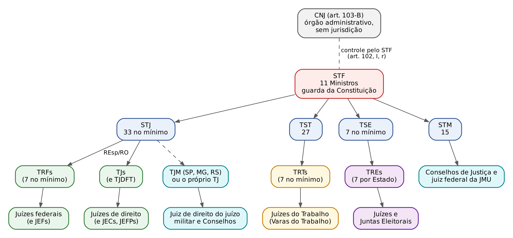
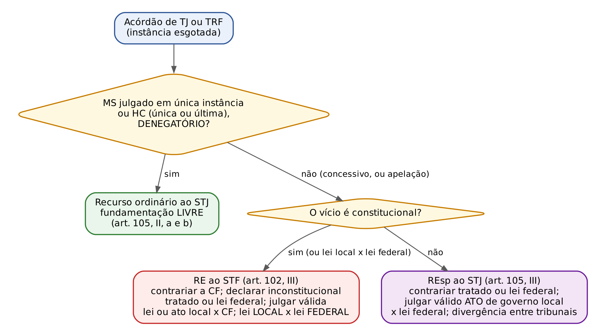
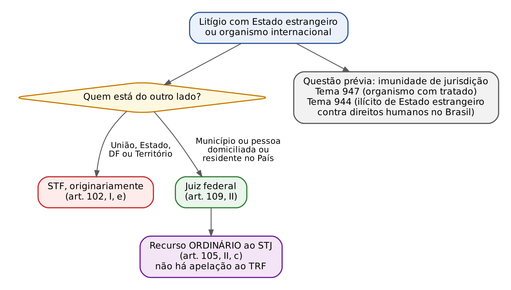
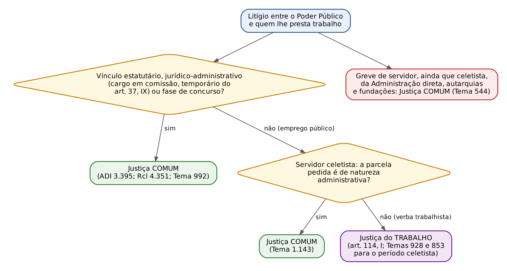
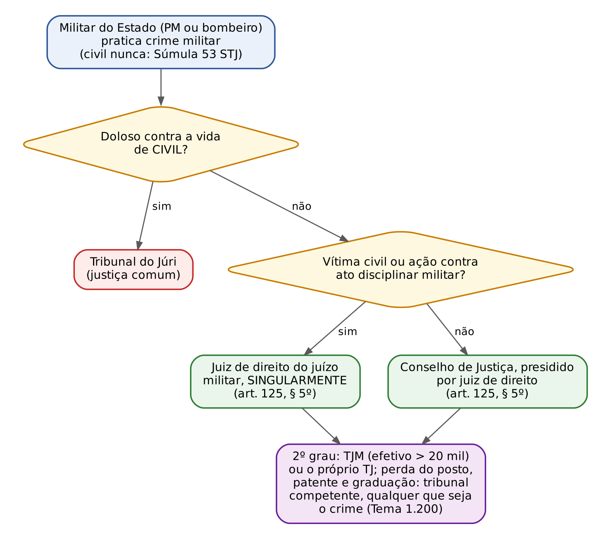
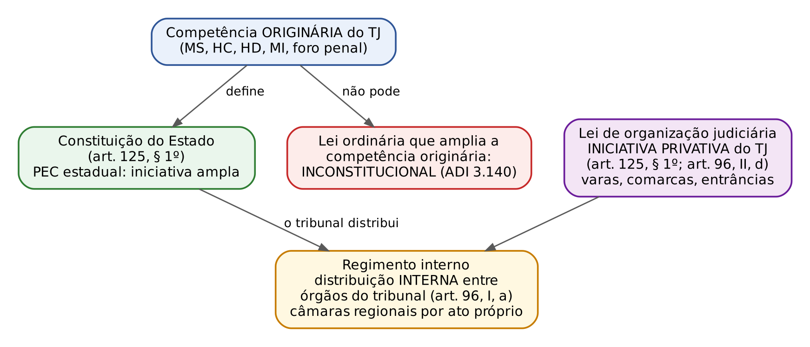
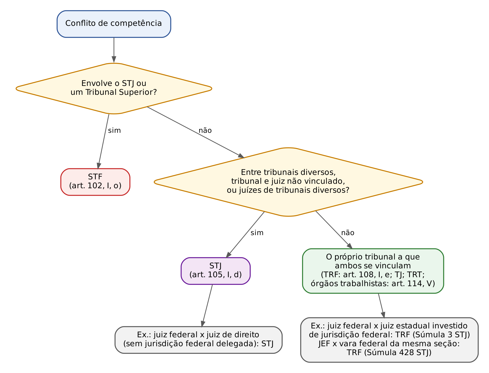

# CAPÍTULO 30 — PODER JUDICIÁRIO II: TRIBUNAIS, JUSTIÇAS ESPECIALIZADAS E REPARTIÇÃO DA COMPETÊNCIA

:::INCIDENCIA
TRF5 p. 9; TJRS p. 8; TJSC p. 8. Nível A+. Lote: 95 questões (FGV 59, FCC 36).
Cai: composição dos tribunais (idades, quinto, origem das vagas), recurso cabível contra acórdão de TJ ou TRF (RO x RE x REsp), causas com organismo internacional, art. 109, art. 114 lido pelo STF e fonte da competência do TJ (Constituição Estadual x lei de organização judiciária).
:::

#### Mapa de cobrança

| Subtema | FGV | FCC | Padrão |
|---|---|---|---|
| Fontes da competência e organização geral | 1 | 0 | rol taxativo na CF x ampliação por lei |
| Composição dos tribunais | 2 | 10 | FCC: casos com idade, carreira e tempo de exercício de candidatos a TRT, TST e TRF |
| STF: competência originária e recursal | 6 | 5 | troca entre alíneas do art. 102 e do art. 105; conflito federativo; crime político |
| Recurso contra acórdão de TJ ou TRF (RO, RE, REsp) | 15 | 3 | MS denegado em única instância = RO ao STJ; lei local x lei federal = RE |
| Estado estrangeiro e organismo internacional | 9 | 0 | juiz federal e RO ao STJ (Município); STF (União, Estado) |
| STJ: foro penal originário | 2 | 0 | MPU que oficia em tribunal; conselheiro de TCM |
| Justiça Federal (art. 109, TRFs, delegação) | 7 | 5 | letra dos incisos; sociedade de economia mista; § 3º depende de lei |
| Justiça do Trabalho | 5 | 9 | art. 114 x ADI 3.395 e Temas 544, 992, 1.143; CSJT e ENAMAT |
| Justiça Militar | 0 | 1 | perda do posto e da patente |
| Justiça dos Estados (art. 125) | 12 | 3 | competência originária do TJ na Constituição Estadual; câmaras regionais; foro e simetria |

## 30.1 A arquitetura constitucional da competência

### 30.1.1 Cinco Justiças, dois níveis de fonte

A CF organiza a jurisdição em Justiças com competências próprias. Três delas (do Trabalho, Eleitoral e Militar) são especializadas por matéria; duas são comuns: a Federal, com competência ENUMERADA no próprio texto constitucional (arts. 108 e 109), e a dos Estados, RESIDUAL (o que não é das especializadas nem da Federal). O STF e o STJ, órgãos de superposição, têm competências originárias e recursais também exaustivas na CF. A organização geral (art. 92, CNJ, CJF, garantias, quinto constitucional, juizados e justiça de paz) está no Cap. 29; aqui se trata da repartição da competência entre os órgãos.

A banca cobra a FONTE da competência de cada órgão. A regra é saber onde a CF se fecha (rol taxativo, insuscetível de ampliação por lei) e onde ela remete ao legislador.

| Órgão | Onde está a competência | Ampliável por lei? |
|---|---|---|
| STF | art. 102 (originária, RO e RE); § 1º remete à lei só a forma da ADPF | NÃO: *numerus clausus*; competência de direito estrito |
| STJ | art. 105 | NÃO, salvo o que a própria CF remete (art. 105, § 3º, VI, outras hipóteses de relevância "previstas em lei") |
| TRFs e juízes federais | arts. 108 e 109 | NÃO; o § 3º do art. 109 só autoriza a lei a DELEGAR a causa previdenciária ao juiz estadual |
| Justiça do Trabalho | art. 114, I a VIII; inciso IX: "outras controvérsias decorrentes da relação de trabalho, na forma da lei"; art. 111-A, § 1º ("A lei disporá sobre a competência do Tribunal Superior do Trabalho"); art. 113 | SIM, nos limites da relação de trabalho |
| Justiça Eleitoral | art. 121: lei complementar dispõe sobre organização e competência | definida em lei complementar (Código Eleitoral recepcionado como tal nessa parte) |
| Justiça Militar da União | art. 124: crimes militares "definidos em lei"; parágrafo único: lei dispõe sobre organização e competência | definida em lei |
| Tribunais de Justiça | art. 125, § 1º: Constituição do Estado | pela Constituição Estadual, não por lei ordinária (ver 30.9) |

:::QUESTAO FGV 2024 — PREFEITURA DE CARAGUATATUBA — ADVOGADO (Q3049075)
Cobrado: enquadrar cada órgão em (I) competência *numerus clausus* na CF, (II) prevista na CF e ampliável por lei, (III) prevista só em lei. Gabarito B: TRFs em (I) e Justiça do Trabalho em (II) (art. 114, IX). Armadilhas: A (TJ em III: a fonte é a Constituição Estadual, não a lei de organização judiciária), C (TST em III: o art. 111-A, § 1º, remete à lei, mas a Justiça do Trabalho tem núcleo constitucional), D (STJ ampliável), E (Tribunais Superiores em bloco: TST, TSE e STM têm competência legal).
:::

:::QUESTAO FGV 2024 — PREFEITURA DE SÃO JOSÉ DOS CAMPOS — AUDITOR TRIBUTÁRIO (Q2348937)
Três afirmações sobre o STF: (João) suas competências não podem ser ampliadas por lei; (Antônio) julga, em certa hipótese, recurso contra sentença de juiz monocrático; (Pedro) só aprecia recursos de fundamentação vinculada. Gabarito E (João e Antônio certos). Antônio acerta por causa do crime político: o juiz federal julga (art. 109, IV) e o recurso ORDINÁRIO vai direto ao STF (art. 102, II, *b*), saltando o TRF. Pedro erra porque o RO é de fundamentação livre. No mesmo sentido: Q2611646 (FGV 2024, TCE-PA: condenado por crime político por juiz federal, recurso de fundamentação livre ao STF; gabarito B).
:::

### 30.1.2 Recursos ordinários e excepcionais: o mapa

Os tribunais de superposição julgam por três vias: originária, recurso ORDINÁRIO (fundamentação livre, devolve fatos e direito, sem prequestionamento nem repercussão geral) e recurso EXCEPCIONAL (RE e REsp: fundamentação vinculada às hipóteses constitucionais, causa decidida em única ou última instância, só questão de direito). A FGV formula a mesma pergunta de dezenas de modos: "recurso de fundamentação livre ao STJ", "recurso de fundamentação vinculada ao STF".

|  | RE (art. 102, III) | REsp (art. 105, III) | RO ao STF (art. 102, II) | RO ao STJ (art. 105, II) |
|---|---|---|---|---|
| Decisão recorrível | causas decididas em única ou última instância por QUALQUER órgão (inclusive turma recursal e juiz de alçada) | causas decididas em única ou última instância por TRF ou TJ (nunca turma recursal) | HC, MS, HD e MI decididos em única instância pelos Tribunais Superiores, se denegatória; crime político | HC (única ou última instância) e MS (única instância) de TRF ou TJ, se denegatória; causas Estado estrangeiro ou organismo internacional x Município ou pessoa residente no País |
| Fundamentação | vinculada | vinculada | livre | livre |
| Filtro | repercussão geral (§ 3º: recusa por 2/3 dos membros) | relevância (§§ 2º e 3º: não conhecimento por 2/3 do órgão julgador) | não há | não há |

Pontos de prova:

- RE cabe contra decisão de primeiro grau em causa de alçada e contra acórdão de turma recursal (Súmula 640 do STF; v. Cap. 17). O REsp, ao contrário, exige acórdão de TRF ou TJ: "Não cabe recurso especial contra decisão proferida por órgão de segundo grau dos Juizados Especiais" (Súmula 203 do STJ). A diferença está no texto: o art. 102, III, fala em "causas decididas"; o art. 105, III, em causas decididas "pelos Tribunais Regionais Federais ou pelos tribunais dos Estados".
- O REsp não cabe contra acórdão de Tribunal Superior (TST, TSE, STM): deles só cabe RE (e, se denegatória a decisão em HC, MS, HD ou MI originários, RO ao STF).
- A EC 45/2004 deslocou do STJ para o STF a hipótese "julgar válida LEI local contestada em face de lei federal" (art. 102, III, *d*; Q3088358, gabarito A). Ficou no STJ apenas o ATO de governo local contestado em face de lei federal (art. 105, III, *b*): "decreto" ou "ato" municipal x lei federal leva ao REsp; "lei", ao RE. A razão: lei local x lei federal é conflito de competência legislativa, questão constitucional por natureza.

:::QUESTAO FGV 2024 — EPE — ADVOGADO (Q2759006)
Três acórdãos de TRF: (1) denega MS contra ato de juiz federal, com afronta à CF; (2) julga válida lei local contestada em face de lei federal; (3) contraria tratado internacional. Gabarito D: (1) RO ao STJ (MS em única instância, denegado; a afronta à CF não desloca o recurso ao STF: o RO absorve toda a matéria); (2) RE ao STF (art. 102, III, *d*); (3) REsp ao STJ (art. 105, III, *a*). Armadilha: tratar "afronta à CF" como sinônimo de RE.
:::

:::QUESTAO FGV 2026 — TJ-RJ — ANALISTA JUDICIÁRIO (Q3868576)
Caso: órgão fracionário do TJ aplica lei estadual e rejeita a alegação de que ela afrontava lei federal. Gabarito D (RE). No mesmo sentido: Q3777902 (FGV 2025, AL-AM, Procurador: TJ julga válida lei estadual contestada em face de lei federal; gabarito C, RE; a alternativa E, "exigiria análise de norma interposta", é distração tomada do controle concentrado) e Q3049392 (FGV 2024, TJ-SC, Juiz Substituto: MS denegado pelo TJ em APELAÇÃO, discussão sobre lei municipal x lei federal editada na competência concorrente; gabarito D, recurso de fundamentação vinculada ao STF; não há RO porque o TJ não julgou o MS em única instância; comentada também no Cap. 15).
:::

Divergência jurisprudencial (art. 105, III, *c*) é hipótese exclusiva do REsp: não há RE por divergência. Interpretação de lei FEDERAL divergente entre tribunais (TJ x TJ, TRF x TRF, TJ x TRF) leva ao STJ (Q3009008, FGV 2024: TJ dá a lei tributária da União interpretação oposta à de outro TJ; gabarito C, REsp; Q3029099, FGV 2024: TRF x TRF, gabarito C, STJ). Embargos de divergência não são recurso contra acórdão de tribunal local.

:::QUESTAO FGV 2024 — (Q2441212)
Afirmações sobre RE e REsp: ambos seriam julgados pelo STF (Maria, errada); ambos exigem causa decidida em única ou última instância (Ana, certa); seriam interpostos após o julgamento de recursos ordinários pelo STJ e pelo STF (Antônia, errada). Gabarito B. O requisito comum é o esgotamento da instância de origem: enquanto couber recurso ordinário no tribunal local, não há causa decidida em única ou última instância.
:::

O regime processual do RE e do REsp (repercussão geral, relevância regulamentada pela Lei 15.484/2026, repetitivos, agravos) está na Apostila de Processo Civil, Cap. 43, e a repercussão geral sob o ângulo constitucional no Cap. 17 (17.8). O recurso ordinário em HC, MS e HD foi desenvolvido no Cap. 15 (15.2.5 e 15.6.3), onde também estão comentadas as questões deste lote que o pressupõem: Q2515566, Q3028702, Q3044166, Q3049073, Q3099306, Q3174666, Q3780426 (todas FGV 2024 ou 2025: TJ ou TRF denega MS originário ou HC, recurso ordinário de fundamentação livre ao STJ, ainda que se alegue afronta à CF) e Q3530357 e Q3872161 (FCC: MS contra Ministro de Estado e HC contra desembargador, competência do STJ e RO ao STF se denegatória).

:::QUESTAO FGV 2025 — (Q3185930)
Caso: Pleno do TJ julga dois MS originários contra o Presidente do TCE: no primeiro denega, no segundo concede; o vencido em cada um alega afronta à CF. Gabarito D: STJ, apenas quanto ao denegatório. Resolução: o RO só existe em favor do impetrante vencido (art. 105, II, *b*: "quando denegatória a decisão"); contra o acórdão concessivo, o Estado vencido só tem RE (se a questão for constitucional, como no enunciado) ou REsp. Armadilha: E inverte a lógica.
:::

## 30.2 Composição dos tribunais

### 30.2.1 Quadro comparativo

As idades máximas foram elevadas de 65 para 70 anos pela EC 122, de 17/5/2022, para STF, STJ, TRFs, TST, TRTs e STM (e TCU). Questões antigas e alternativas com "menos de sessenta e cinco anos" estão desatualizadas; as provas de 2024 a 2026 já usam o limite de 70.

| Tribunal | Número | Idade | Requisito pessoal | Nomeação | Senado | Origem das vagas |
|---|---|---|---|---|---|---|
| STF (art. 101) | 11 | mais de 35 e menos de 70 | cidadão, notável saber jurídico, reputação ilibada; brasileiro NATO (art. 12, § 3º, IV) | Presidente da República | maioria ABSOLUTA, após arguição pública e voto secreto (art. 52, III, *a*) | livre escolha |
| STJ (art. 104) | NO MÍNIMO 33 | 35 a 70 | brasileiro (nato ou naturalizado), notável saber, reputação ilibada | Presidente | maioria absoluta | 1/3 juízes de TRF e 1/3 desembargadores de TJ (lista tríplice do próprio STJ); 1/3, em partes iguais, advogados e membros do MPF, MPE e MPDFT, alternadamente, "indicados na forma do art. 94" |
| TST (art. 111-A) | 27 | 35 a 70 | brasileiro, notável saber, reputação ilibada | Presidente | maioria absoluta | 1/5 advogados (mais de 10 anos de atividade) e MEMBROS DO MPT (mais de 10 anos de efetivo exercício), observado o art. 94; demais, juízes de TRT ORIUNDOS DA MAGISTRATURA DA CARREIRA, indicados pelo TST |
| STM (art. 123) | 15, vitalícios | civis: 35 a 70 | militares: oficiais-generais da ativa, do posto mais elevado | Presidente | "aprovada a indicação pelo Senado" (sem quórum qualificado no texto) | 3 Marinha, 4 Exército, 3 Aeronáutica, 5 civis (3 advogados com mais de 10 anos; 2, por escolha paritária, entre juízes da Justiça Militar e membros do MPM) |
| TSE (art. 119) | NO MÍNIMO 7 | não há | — | eleição (5) e nomeação (2) | NÃO | 3 Ministros do STF e 2 do STJ, eleitos por voto secreto; 2 advogados nomeados pelo Presidente entre 6 indicados pelo STF |
| TRF (art. 107) | NO MÍNIMO 7 | mais de 30 e menos de 70 | brasileiro; recrutado, quando possível, na região | Presidente | NÃO | 1/5 advogados (mais de 10 anos) e MPF (mais de 10 anos de carreira); demais, promoção de juízes federais com MAIS DE 5 ANOS de exercício, por antiguidade e merecimento alternadamente |
| TRT (art. 115) | NO MÍNIMO 7 | 30 a 70 | brasileiro; recrutado, quando possível, na região | Presidente | NÃO | 1/5 advogados (mais de 10 anos) e MPT (mais de 10 anos), observado o art. 94; demais, promoção de juízes do trabalho, antiguidade e merecimento alternadamente |
| TRE (art. 120) | 7 (número fixo pela composição) | não há | — | eleição e nomeação | NÃO | 2 desembargadores do TJ e 2 juízes de direito escolhidos pelo TJ (voto secreto); 1 juiz do TRF com sede na capital ou, não havendo, juiz federal, escolhido pelo TRF; 2 advogados nomeados pelo Presidente entre 6 indicados pelo TJ |

Detalhes que decidem questões:

- Só o STF exige "cidadãos" e só a ele se aplica a exigência de brasileiro nato entre os tribunais judiciais (art. 12, § 3º, IV). Brasileiro naturalizado pode ser Ministro do STJ, do TST ou juiz de TRT e TRF.
- O TST NÃO tem membros do MPF nem do MP estadual: o quinto é de advogados e membros do MPT. O TRF não tem MP estadual nem MPT: só MPF. O STJ é o único tribunal com membros de TODOS os ramos do MP (MPF, MPE e MPDFT), em terço, não em quinto.
- O requisito de "mais de cinco anos de exercício" para promoção de juiz federal ao TRF está no art. 107, II; o art. 115, II, não repete esse tempo para o juiz do trabalho, e o art. 111-A, II, exige que o juiz de TRT promovido ao TST seja "oriundo da magistratura da carreira".
- Aprovação pelo Senado: STF, STJ, TST (maioria absoluta) e STM (sem quórum qualificado). TRF, TRT, TSE e TRE não passam pelo Senado.
- Presidente e Vice do TSE: entre os Ministros do STF; Corregedor Eleitoral: entre os do STJ (art. 119, parágrafo único). Presidente e Vice do TRE: entre os desembargadores (art. 120, § 2º). Os juízes eleitorais servem por dois anos, no mínimo, e nunca por mais de dois biênios consecutivos (art. 121, § 2º).

:::QUESTAO FCC 2025 — TRF-4 — TÉCNICO JUDICIÁRIO (Q3538948)
Candidatos ao TRF: membro do MP ESTADUAL, nato, 62 anos, mais de 10 de carreira; advogada naturalizada de 71 anos; juíza federal de 40 anos com 3 anos de exercício. Gabarito D (nenhum): o quinto do TRF é de membros do MPF; 71 anos supera o limite; a promoção exige mais de 5 anos de exercício. A naturalização da advogada é irrelevante (o problema é a idade).
:::

:::QUESTAO FCC 2025 — TRT-2 — ANALISTA JUDICIÁRIO (Q3660500)
TRT: advogada nata de 73 anos (excluída pela idade); advogada de 40 anos com 15 de atividade (pode); membro do MPT NATURALIZADO, 66 anos, 20 de exercício (pode: não se exige nacionalidade originária). Gabarito C. Armadilha: a naturalização, que só impede a vaga no STF.
No mesmo sentido, sobre TRT: Q3627585 (FCC 2025, TRT-2: advogado de 34 anos com 11 de atividade pode; membro do MPF não, porque o quinto do TRT é do MPT; mínimo de sete juízes; gabarito B); Q3170764 (FCC 2024, TRT-20: membro do MPF não; membro do MPT de 38 anos com 11 de exercício e advogada de 34 com 12 de atividade, sim; gabarito C); Q3216599 (FCC 2025, TRT-6: no mínimo sete juízes, mais de 30 e menos de 70; gabarito E).
:::

:::QUESTAO FCC 2025 — TRT-6 — OFICIAL DE JUSTIÇA (Q3215721)
TST: juiz de TRT oriundo da carreira, mas com 33 anos (abaixo dos 35), e advogado de 67 anos com mais de 10 de atividade. Gabarito C: só o advogado, nomeado pelo Presidente após aprovação pela maioria absoluta do Senado. No mesmo sentido: Q3469430 (FCC 2025, TRT-1: membro do MPT de 66 anos pode; advogado de 34 não; "um de seus 27 Ministros"; gabarito A); Q3089704 (FCC 2024, TRT-7: juiz de TRT com 32 anos, advogado com 72 e membro do MPF, nenhum pode; gabarito A); Q3089789 (FCC 2024, TRT-7: advogada de 33 não, membro do MP estadual não, juiz de TRT da carreira com 65, sim; gabarito D).
:::

Distratores de letra seca no lote: STF com "mais de quarenta e menos de sessenta" e TST com 17 Ministros aprovados por 2/3 do Senado (Q2449866, FGV 2024, AL-PR; gabarito E, a composição do CNJ, 15 membros com mandato de 2 anos e uma recondução, Cap. 29); STF "entre trinta e sessenta e cinco" e crime político "originário" (Q3872032, FCC 2026; gabarito C, só a assertiva da súmula vinculante); STF "dentre advogados" (Q3088358, alternativa C); TST com 11 Ministros (Q3303225, item III) ou com mais de 25 anos (Q3214713, B); TRT com "um terço" e MPF (Q3215147, A) ou com 11 juízes nomeados pelo Presidente do TST (Q3848784, E); TRF com 33 juízes (Q3538765, B e C) ou com MP "Federal ou Estadual" (Q2564486, E). Escolha de Ministro do STF: aprovação pelo SENADO, voto SECRETO, após arguição pública (Q3847181, FGV 2026, gabarito D; armadilhas: Câmara, sessão conjunta, voto aberto).

## 30.3 Supremo Tribunal Federal

### 30.3.1 Natureza e competência de direito estrito

Ao STF compete, "precipuamente, a guarda da Constituição" (art. 102, *caput*). Acumula as funções de corte constitucional (controle concentrado, Caps. 18 a 20), de tribunal de superposição (RE e RO) e de foro originário de altas autoridades e de conflitos que tocam a Federação. Sua competência é de direito estrito: não se amplia por lei nem por interpretação extensiva, e o próprio Tribunal recusa competências que a CF não lhe deu (por exemplo: "Não compete ao Supremo Tribunal Federal conhecer originariamente de mandado de segurança contra atos de outros tribunais", Súmula 624 do STF; v. Cap. 15, 15.6.1).

### 30.3.2 Competência originária (art. 102, I): leitura dirigida

:::LEI CF, ART. 102, I (ALÍNEAS CUJA LETRA É A PEGADINHA)
e) o litígio entre Estado estrangeiro ou organismo internacional e a União, o Estado, o Distrito Federal ou o Território;
f) as causas e os conflitos entre a União e os Estados, a União e o Distrito Federal, ou entre uns e outros, inclusive as respectivas entidades da administração indireta;
n) a ação em que TODOS os membros da magistratura sejam direta ou indiretamente interessados, e aquela em que MAIS DA METADE dos membros do tribunal de origem estejam impedidos ou sejam direta ou indiretamente interessados;
o) os conflitos de competência entre o Superior Tribunal de Justiça e quaisquer tribunais, entre Tribunais Superiores, ou entre estes e qualquer outro tribunal;
r) as ações contra o Conselho Nacional de Justiça e contra o Conselho Nacional do Ministério Público;
:::

Quadro de pares que a banca troca (STF x STJ):

| Matéria | STF | STJ |
|---|---|---|
| Ministro de Estado e Comandantes das Forças | julga nos crimes comuns e de responsabilidade (ressalvada a conexão com o Presidente, art. 52, I); HC quando PACIENTE | MS e HD contra seus ATOS (art. 105, I, *b*); HC quando COATOR (art. 105, I, *c*) |
| Mesa da Câmara ou do Senado, TCU, PGR, Presidente | MS e HD contra seus atos | — |
| Governador | — | crimes comuns (art. 105, I, *a*); crimes de responsabilidade: tribunal especial (Lei 1.079/1950; Cap. 28) |
| Desembargador, membro de TRF, TRT, TRE, TCE, TCM, MPU que oficia em tribunal | — | crimes comuns e de responsabilidade |
| Membro de Tribunal Superior e do TCU, chefe de missão diplomática permanente | crimes comuns e de responsabilidade | — |
| Estado estrangeiro ou organismo internacional x União, Estado, DF ou Território | originária | — |
| Estado estrangeiro ou organismo internacional x Município ou pessoa residente | — (juiz federal, art. 109, II) | recurso ordinário (art. 105, II, *c*) |
| Extradição | originária | — |
| Homologação de sentença estrangeira e *exequatur* | — (até a EC 45/2004 era do STF) | originária (art. 105, I, *i*) |
| Conflitos de competência | envolvendo STJ ou Tribunal Superior | entre quaisquer outros tribunais e entre juízes de tribunais diversos |
| Conflitos de atribuições entre autoridades administrativas e judiciárias | — | art. 105, I, *g* |
| Mandado de injunção | norma a cargo do Presidente, Congresso, Casas, Mesas, TCU, Tribunais Superiores, STF | norma a cargo de órgão federal da administração direta ou indireta, ressalvados STF e Justiças especializadas e Federal |
| Revisão criminal e rescisória | dos SEUS julgados | dos SEUS julgados |

:::QUESTAO FCC 2024 — TRF-3 — ANALISTA JUDICIÁRIO (Q2564483)
Gabarito C: HC sendo paciente Ministro de Estado e ADI de lei federal ou estadual. Erradas: A ("metade de todos os membros da magistratura": o texto exige TODOS os membros da magistratura, ou mais da metade do TRIBUNAL DE ORIGEM; e crime político em RO); B (CNJ "não pode expedir atos regulamentares": o art. 103-B, § 4º, I, o autoriza); D (ADC só de lei federal; MS contra Ministro de Estado é do STJ); E (Prefeito não é legitimado do art. 103).
:::

:::QUESTAO FCC 2024 — TRT-7 — ANALISTA JUDICIÁRIO (Q3089707)
Gabarito C: o MI do art. 102, I, *q*, na literalidade. Erradas: A (conflito de atribuições: STJ, art. 105, I, *g*); B (inclui a "Mesa do Congresso Nacional" entre os legitimados da ADC, que não existe no art. 103); D (inverte as hipóteses da alínea *n*); E (Governadores e desembargadores: STJ).
No mesmo sentido: Q3170845 (FCC 2024, TRT-20: HC sendo paciente Ministro de Estado, MS contra o TCU e HD contra a Mesa da Câmara, todos no STF; gabarito D); Q4338744 (FCC 2026, PGM-Manaus: MS contra Presidente, Mesas, TCU, PGR e o próprio STF; gabarito A; erradas a carta rogatória no STF, a lista de coatores no HC, a revisão "de julgados das cortes superiores" e o RO contra decisão "concessiva"); Q3038840 (FGV 2024, Nova Iguaçu: extradição; gabarito D; homologação e MS contra Ministro de Estado são do STJ; RO em HC de TRF vai ao STJ); Q3856322 (FGV 2026, TJ-MS: causas e conflitos entre União e Estados, inclusive administração indireta; gabarito B).
:::

#### O conflito federativo (alínea *f*)

A alínea *f* é lida RESTRITIVAMENTE pelo STF. Não basta que União e Estado (ou suas entidades da administração indireta) estejam em polos opostos: exige-se litígio com potencial de abalar o pacto federativo, isto é, conflito federativo propriamente dito, e não mera causa patrimonial entre entes. Sem essa nota, a causa entre a União e um Estado segue a regra do art. 109, I (juiz federal). A FGV, contudo, cobra a letra em casos singelos de "conflito entre o Estado Alfa e o Estado Beta": a resposta é o STF originariamente (Q3878422, FGV 2026, gabarito E), e não o TJ de um deles "por prevenção". Município não figura na alínea *f*: Município x Estado é do juiz de direito; Município x União, do juiz federal.

#### Itaipu e o litígio internacional da alínea *e*

:::JURIS STF, RCL 2.937, PLENÁRIO, J. 15/12/2011
Ações civis públicas do MPF contra a Itaipu Binacional, que pretendiam sujeitá-la à fiscalização do TCU e às leis brasileiras de licitação e de admissão de pessoal, foram avocadas pelo STF. Fundamento: o MPF atua como órgão da União, e a procedência poderia atingir interesses do Paraguai, Estado soberano coproprietário do empreendimento, sujeito ao tratado binacional; o litígio era, em substância, entre Estado estrangeiro e a União (art. 102, I, *e*). Ação ajuizada só por particulares, sem pessoa política no polo, não foi avocada.
:::

:::QUESTAO FGV 2025 — TRF-6 — JUIZ FEDERAL SUBSTITUTO (Q3742430)
Cobrou exatamente esse caso: juízo competente para as ACPs do MPF contra a Itaipu Binacional. Gabarito D (STF). Armadilhas: vara federal de Foz do Iguaçu (A, aparência de causa da União em primeiro grau), TRF4 (B), STJ (C) e uma inexistente "Comissão Binacional de Contas" (E).
:::

#### Ação de interesse da magistratura (alínea *n*)

Duas hipóteses distintas: interesse de TODOS os membros da magistratura (nacional), e impedimento ou interesse de MAIS DA METADE dos membros do TRIBUNAL DE ORIGEM. Exemplo sumulado do interesse geral: "Para fim da competência originária do Supremo Tribunal Federal, é de interesse geral da magistratura a questão de saber se, em face da LOMAN, os juízes têm direito à licença-prêmio" (Súmula 731 do STF). Não basta que a causa interesse a uma carreira ou a um tribunal; e a participação da maioria do tribunal de origem na deliberação impugnada não atrai, por si, a alínea *n* (Cap. 15, 15.6.1).

#### Ações contra o CNJ e o CNMP (alínea *r*)

O STF julga TODAS as ações (inclusive ordinárias) contra decisões do CNJ e do CNMP no exercício de suas competências constitucionais (Pet 4.770 AgR, Rcl 33.459 AgR e ADI 4.412; v. Cap. 29, 29.6.5). O complemento cobrado é a decisão NEGATIVA: quando o Conselho apenas se recusa a intervir e mantém o ato do órgão de origem, não há ato do Conselho a impugnar, e a competência segue a autoridade que praticou o ato (MS 37.545; v. Cap. 29, 29.6.5).

:::QUESTAO FGV 2025 — MPE-RJ — ANALISTA DO MP (Q3362512)
Caso: servidor do MPF tem requerimento negado pela gestão de pessoal do MPF; o CNMP, em procedimento de controle administrativo, não vê irregularidade e se nega a reformar. Gabarito A (juiz federal). Passos: (1) o CNMP não substituiu nem confirmou com conteúdo próprio o ato; apenas não interveio; (2) o ato lesivo continua sendo o do órgão do MPF, autoridade federal; (3) ação ordinária ou MS contra a União ou a autoridade federal de primeiro grau: juiz federal (art. 109, I e VIII). Armadilhas: C e D (STF por causa da alínea *r*).
:::

### 30.3.3 Recurso ordinário ao STF (art. 102, II)

Duas hipóteses: (a) HC, MS, HD e MI decididos em ÚNICA instância pelos TRIBUNAIS SUPERIORES (STJ, TST, TSE, STM), se denegatória a decisão; (b) o crime político. A primeira não abrange decisões de TJ ou TRF (essas vão ao STJ), nem MI (que o art. 105, II, não prevê para o STJ). A segunda é a única hipótese em que o STF revê, em recurso de fundamentação livre, sentença de primeiro grau: crime político é julgado por juiz federal (art. 109, IV) e o recurso salta o TRF.

:::PEGADINHA CRIME POLÍTICO: COMPETÊNCIA ORIGINÁRIA?
O STF NÃO julga originariamente crime político (salvo, claro, se o réu tiver foro no STF). Quem julga é o juiz federal; o STF julga o RO. Por isso estão erradas as afirmações de que compete ao STF "processar e julgar, originariamente, o crime político" (Q3872032, FCC 2026, item II) e de que a condenação "resultou de decisão do STF" (Q2611646, alternativa D). A Lei 14.197/2021 (crimes contra o Estado Democrático de Direito) é examinada no Cap. 32.
:::

### 30.3.4 Recurso extraordinário (art. 102, III)

Hipóteses: decisão que (a) contrariar dispositivo da CF; (b) declarar a inconstitucionalidade de tratado ou lei federal; (c) julgar válida lei ou ato de governo local contestado em face da CF; (d) julgar válida lei local contestada em face de lei federal. A repercussão geral (§ 3º) só pode ser recusada por 2/3 dos membros do Tribunal. O RE é também a via de acesso ao STF contra o acórdão do TJ em representação de inconstitucionalidade quando o parâmetro estadual reproduz norma da CF (Cap. 20, 20.5).

### 30.3.5 Súmula vinculante, ADPF, ADI e reclamação

Remissão: ADI e ADC (Cap. 18); ADPF, ADO, súmula vinculante e reclamação (Cap. 19). Letra cobrada nos itens de "competências do STF": súmula vinculante aprovada de ofício ou por provocação, por 2/3 dos membros, após reiteradas decisões sobre matéria constitucional, com efeito vinculante para os demais órgãos do Judiciário e para a administração pública direta e indireta das três esferas (art. 103-A), e não "exclusivamente" para o Judiciário (Q3088358, alternativa E); a reclamação procedente ANULA o ato administrativo contrário (art. 103-A, § 3º; falsa a alternativa B da mesma questão).

## 30.4 Superior Tribunal de Justiça

### 30.4.1 Papel e órgãos que funcionam junto a ele

Criado em 1988 para receber do STF a guarda da lei federal. Junto a ele funcionam a ENFAM (cursos oficiais de ingresso e promoção) e o CJF (supervisão administrativa e orçamentária da Justiça Federal de primeiro e segundo graus, com poderes correicionais e decisões vinculantes; Cap. 29).

### 30.4.2 Competência originária penal (art. 105, I, *a*)

:::LEI CF, ART. 105, I, A
"nos crimes comuns, os Governadores dos Estados e do Distrito Federal, e, nestes e nos de responsabilidade, os desembargadores dos Tribunais de Justiça dos Estados e do Distrito Federal, os membros dos Tribunais de Contas dos Estados e do Distrito Federal, os dos Tribunais Regionais Federais, dos Tribunais Regionais Eleitorais e do Trabalho, os membros dos Conselhos ou Tribunais de Contas dos Municípios e os do Ministério Público da União que oficiem perante tribunais;"
:::

Notas:

- Governador: só crimes comuns no STJ; o crime de responsabilidade vai ao tribunal especial da lei (Cap. 28).
- "Membros dos Conselhos ou Tribunais de Contas dos Municípios": alcança os conselheiros dos órgãos estaduais de contas dos Municípios e os dois tribunais municipais existentes (Rio de Janeiro e São Paulo, cuja manutenção é ressalvada pelo art. 31, § 4º).
- "Membros do MPU que oficiem perante tribunais": procurador regional da República, procurador regional do Trabalho, subprocurador-geral. O membro do MPU de primeiro grau (procurador da República) vai ao TRF (art. 108, I, *a*). O membro do MP ESTADUAL, qualquer que seja a instância em que oficie, vai ao TJ (art. 96, III), ressalvada a Justiça Eleitoral.
- O alcance temporal e funcional do foro (AP 937; HC 232.627 e Inq 4.787 QO, j. 12/3/2025; foro dos vitalícios e o Tema 1.147 pendente) está no Cap. 25 (25.7.5) e na Apostila de Processo Penal, Cap. 10.

:::QUESTAO FGV 2024 — TRF-1 — OFICIAL DE JUSTIÇA (Q3028647)
Caso: procurador regional da República que oficia no TRF1 e conselheiro do Tribunal de Contas dos Municípios do Pará investigados por crime contra a União, com pertinência funcional e contemporaneidade. Gabarito E: ambos no STJ (art. 105, I, *a*). Armadilhas: mandar o procurador regional ao TRF (confusão com o procurador de primeiro grau) e o conselheiro ao TRF por ser o crime federal (o foro constitucional prevalece sobre a natureza federal do crime).
:::

:::QUESTAO FGV 2025 — MPU — ANALISTA (Q3339808)
Procurador regional da República (STJ), chefe de missão diplomática permanente e deputado federal (ambos STF, art. 102, I, *b* e *c*). Gabarito B.
:::

### 30.4.3 Demais competências originárias

- MS e HD contra ato de Ministro de Estado, dos Comandantes ou do próprio STJ; HC quando coator ou paciente for autoridade da alínea *a*, ou coator tribunal a ele sujeito, Ministro de Estado ou Comandante (I, *b* e *c*; Cap. 15).
- Conflitos de competência (I, *d*; ver 30.10); revisões criminais, rescisórias de seus julgados e reclamação (I, *e* e *f*).
- Conflitos de ATRIBUIÇÕES entre autoridades administrativas e judiciárias da União, ou entre autoridades judiciárias de um Estado e administrativas de outro ou do DF, ou entre as deste e da União (I, *g*).
- MI quando a norma for atribuição de órgão, entidade ou autoridade federal, da administração direta ou indireta, excetuados os casos do STF e das Justiças Militar, Eleitoral, do Trabalho e Federal (I, *h*).
- Homologação de sentenças estrangeiras e *exequatur* às cartas rogatórias (I, *i*, desde a EC 45/2004; o procedimento está na Apostila de Processo Civil, Cap. 38). A execução posterior é do juiz federal (art. 109, X).
- Conflitos entre entes federativos, ou entre estes e o Comitê Gestor do IBS, relacionados ao IBS e à CBS (art. 105, I, *j*, incluído pela EC 132/2023). É competência originária nova, que retira do STF (alínea *f* do art. 102) e da Justiça Federal esses litígios federativos tributários específicos; o regime do IBS e da CBS está no Cap. 33 e na Apostila de Direito Tributário.

:::QUESTAO FCC 2025 — TRT-2 — ANALISTA JUDICIÁRIO (Q3848786)
Homologação de sentença estrangeira (STJ), MS contra Ministro de Estado (STJ) e REsp contra acórdão do TJSP em causa de valor superior a 500 salários mínimos (STJ, com relevância presumida, art. 105, § 3º, III). Gabarito E. Armadilhas: homologação no STF (regime anterior à EC 45/2004) e negar a relevância presumida.
:::

### 30.4.4 Recurso ordinário ao STJ (art. 105, II)

HC denegado em única ou última instância por TRF ou TJ (*a*); MS denegado em única instância por TRF ou TJ (*b*); e as causas em que forem partes Estado estrangeiro ou organismo internacional, de um lado, e, do outro, Município ou pessoa residente ou domiciliada no País (*c*). As duas primeiras foram examinadas no Cap. 15. A terceira é a mais cobrada pela FGV em todo o capítulo.

:::PASSO CAUSA ENTRE ORGANISMO INTERNACIONAL (OU ESTADO ESTRANGEIRO) E ENTE BRASILEIRO
1. Quem está do outro lado? União, Estado, DF ou Território: STF, originariamente, em instância única (art. 102, I, *e*). Município ou pessoa (física ou jurídica) residente ou domiciliada no País: juiz federal (art. 109, II).
2. Da sentença do juiz federal cabe recurso ORDINÁRIO ao STJ (art. 105, II, *c*), de fundamentação livre; não há apelação ao TRF. O agravo contra interlocutória também vai ao STJ (art. 1.027, II, *b*, e § 1º, do CPC).
3. Do acórdão do STJ no RO cabe, se houver questão constitucional, RE ao STF.
4. Preliminar de imunidade de jurisdição: organismo internacional com imunidade prevista em tratado internalizado não pode ser demandado, salvo renúncia expressa (Tema 947 do STF, RE 1.034.840, j. 2/6/2017); Estado estrangeiro não tem imunidade por ato ilícito que viole direitos humanos praticado no território nacional (Tema 944 do STF, ARE 954.858, j. 23/8/2021). A imunidade não muda a competência: é questão a ser decidida pelo juízo competente.
:::

:::QUESTAO FGV 2025 — ENAM 2025.1 — EXAME NACIONAL DA MAGISTRATURA (Q3362319)
Caso: organização internacional ajuíza ação contra Município por divergência na interpretação de ajuste; o juízo competente julga improcedente o pedido, exaurindo a instância; a autora alega afronta à CF. Gabarito C: recurso de fundamentação livre ao STJ. Armadilhas: B (fundamentação livre ao STF: confunde com o art. 102, II), D (TRF: confunde com a regra geral do art. 108, II) e E (RE "porque a decisão contraria a CF": a sentença de primeiro grau não esgotou instância apta ao RE, já que cabe RO).
:::

No mesmo sentido, todas FGV: Q3117568 (TJ-PE 2024, Juiz Substituto: juiz de direito que recebe ação do Município contra organização internacional deve declinar para o juiz federal; gabarito B); Q3265466 (Canaã dos Carajás 2025: ajuizamento perante juiz federal; gabarito A); Q3656904 (Niterói 2025: juiz federal e recurso ao STJ; gabarito B); Q2351224 (Câmara de São Paulo 2024: juiz federal com RO ao STJ; gabarito C; a alternativa B, RO ao STF, é a armadilha); Q2482349 (Câmara de Fortaleza 2024: recurso ordinário contra a sentença vai ao STJ; gabarito B); Q3044167 (Vitória 2024: devolução de recursos pedida pela organização ao Município; recurso ao STJ; gabarito B); Q3301279 (TJ-SE 2025, Juiz Substituto: litígio do Município com organismo internacional e MS denegado pelo TJ contra ato do Prefeito, ambos com recurso ao STJ; gabarito B); Q2506993 (ENAM 2024 Reaplicação: a INCORRETA era "compete ao STF julgar o litígio entre o Estado estrangeiro e um Município"; gabarito A; as demais eram corretas: STJ julga rescisórias de seus julgados; Justiça do Trabalho julga MS, HC e HD em matéria de sua jurisdição; competência da Justiça estadual definida na Constituição do Estado, com lei de organização judiciária de iniciativa do TJ; lei complementar dispõe sobre organização e competência da Justiça Eleitoral).

### 30.4.5 Recurso especial (art. 105, III)

Hipóteses: decisão de TRF ou TJ que (a) contrariar tratado ou lei federal, ou negar-lhes vigência; (b) julgar válido ato de governo local contestado em face de lei federal; (c) der a lei federal interpretação divergente da de outro tribunal. Desde a EC 125, de 14/7/2022, exige-se a demonstração da RELEVÂNCIA das questões de direito federal infraconstitucional; o STJ só pode deixar de conhecer por esse motivo pela manifestação de 2/3 dos membros do órgão competente (§ 2º). Há relevância presumida (§ 3º) em: ações penais; ações de improbidade administrativa; ações cujo valor da causa ultrapasse 500 salários mínimos; ações que possam gerar inelegibilidade; hipóteses em que o acórdão contrariar jurisprudência dominante do STJ; outras previstas em lei. A regulamentação veio com a Lei 15.484/2026 (Apostila de Processo Civil, Cap. 43).

:::ATENCAO OS QUÓRUNS DE 2/3 NO RE E NO RESP
Repercussão geral: recusa por 2/3 dos membros DO TRIBUNAL (art. 102, § 3º), isto é, 8 Ministros do STF. Relevância: não conhecimento por 2/3 dos membros DO ÓRGÃO COMPETENTE para o julgamento (art. 105, § 2º), que pode ser Turma, Seção ou Corte Especial. A banca troca "tribunal" por "órgão".
:::

## 30.5 Justiça Federal

### 30.5.1 Tribunais Regionais Federais

:::LEI CF, ART. 107, §§ 2º E 3º, E ART. 108
Art. 107, § 2º Os Tribunais Regionais Federais instalarão a justiça itinerante, com a realização de audiências e demais funções da atividade jurisdicional, nos limites territoriais da respectiva jurisdição, servindo-se de equipamentos públicos e comunitários. § 3º Os Tribunais Regionais Federais poderão funcionar descentralizadamente, constituindo Câmaras regionais, a fim de assegurar o pleno acesso do jurisdicionado à justiça em todas as fases do processo.
Art. 108. Compete aos Tribunais Regionais Federais: I - processar e julgar, originariamente: a) os juízes federais da área de sua jurisdição, INCLUÍDOS os da Justiça Militar e da Justiça do Trabalho, nos crimes comuns e de responsabilidade, e os membros do Ministério Público da União, ressalvada a competência da Justiça Eleitoral; b) as revisões criminais e as ações rescisórias de julgados seus ou dos juízes federais da região; c) os mandados de segurança e os habeas data contra ato do próprio Tribunal ou de juiz federal; d) os habeas corpus, quando a autoridade coatora for juiz federal; e) os conflitos de competência entre juízes federais vinculados ao Tribunal; II - julgar, em grau de recurso, as causas decididas pelos juízes federais e pelos juízes estaduais no exercício da competência federal da área de sua jurisdição.
:::

Pontos finos:

- Alínea *a*: o TRF julga também os juízes do Trabalho e os juízes da Justiça Militar da União da sua área ("incluídos"), e os membros do MPU (de primeiro grau; os que oficiam perante tribunais vão ao STJ). A FCC troca "incluídos" por "excluídos" (Q3538765, alternativa E, falsa).
- Juiz de DIREITO e promotor de justiça, ainda que acusados de crime federal, vão ao TJ (art. 96, III); o TRF não os julga.
- Alínea *c*: MS contra juiz federal é do TRF, não do juiz federal (o art. 109, VIII, ressalva "os casos de competência dos tribunais federais"). Alínea *d*: HC contra juiz federal, idem.
- Inciso II: o TRF julga os recursos contra decisões dos juízes estaduais no exercício da competência federal delegada (art. 109, § 4º); fora da delegação, recurso contra juiz estadual vai ao TJ, ainda que a questão seja a competência federal (Súmula 55 do STJ; Apostila de Processo Civil, Cap. 5).
- As regras de justiça itinerante e de câmaras regionais vieram com a EC 45/2004 e se repetem, com a mesma redação, para os TRTs (art. 115, §§ 1º e 2º) e para os TJs (art. 125, §§ 6º e 7º). Justiça itinerante: "INSTALARÃO" (dever), com AUDIÊNCIAS E DEMAIS FUNÇÕES da atividade jurisdicional, servindo-se de equipamentos públicos e comunitários. Câmaras regionais: "PODERÃO" (faculdade). Ver 30.9.3.

:::QUESTAO FCC 2025 — TRF-4 — ANALISTA JUDICIÁRIO (Q3538765)
Gabarito A: TRFs com no mínimo sete juízes e competência originária e recursal, inclusive sobre decisões de juízes estaduais no exercício da competência federal. Erradas: B e C (33 juízes), D (um terço; advogados com 15 anos), E (excluídos os juízes da Justiça Militar e do Trabalho).
:::

### 30.5.2 Competência dos juízes federais (art. 109): estrutura

A competência do juiz federal é constitucional, expressa e absoluta. No cível, o critério dominante é PESSOAL (inciso I: quem é parte), com exceções materiais; no crime, o critério é o BEM JURÍDICO ofendido (inciso IV) ou a natureza da infração (incisos V a VI e IX a X). A mecânica processual do deslocamento (Súmulas 150, 224 e 254 do STJ, art. 45 do CPC), a casuística cível e a competência delegada estão na Apostila de Processo Civil, Cap. 5 (05.6 a 05.8); a casuística penal (Súmulas 38, 42, 122, 140, 147, 546 do STJ; Temas 393 e 648 do STF) está na Apostila de Processo Penal, Cap. 10 (10.2). Aqui, a leitura constitucional e as pegadinhas de letra.

| Inciso | Hipótese | O que a banca troca |
|---|---|---|
| I | causas em que União, entidade autárquica ou empresa pública federal forem interessadas como autoras, rés, assistentes ou oponentes, EXCETO falência, acidentes de trabalho e as sujeitas às Justiças Eleitoral e do Trabalho | sociedade de economia mista (não está: Justiça estadual, Súmula 556 do STF, Súmula 42 do STJ; Banco do Brasil, Súmula 508 do STF; salvo intervenção da União como assistente ou opoente, Súmula 517 do STF); "inclusive as de falência e as de acidentes de trabalho" (falso); fundações públicas federais e conselhos profissionais (são autarquias: entram) |
| II | causas entre Estado estrangeiro ou organismo internacional e MUNICÍPIO ou pessoa domiciliada ou residente no País | Estado estrangeiro x União ou Estado: STF |
| III | causas fundadas em tratado ou CONTRATO DA UNIÃO com Estado estrangeiro ou organismo internacional | não basta o tratado: é a causa "fundada" em tratado ou contrato da União |
| IV | crimes POLÍTICOS e infrações penais em detrimento de bens, serviços ou interesse da União, autarquias ou empresas públicas, EXCLUÍDAS AS CONTRAVENÇÕES e ressalvada a competência das Justiças Militar e Eleitoral | "incluídas as contravenções" (falso; Súmula 38 do STJ); sociedade de economia mista federal (estadual) |
| V | crimes previstos em tratado ou convenção internacional, quando, iniciada a execução no País, o resultado tenha ou devesse ter ocorrido no estrangeiro, ou reciprocamente | exige os dois requisitos: previsão convencional E transnacionalidade |
| V-A | causas relativas a direitos humanos deslocadas pelo IDC (§ 5º) | ver 30.5.4 |
| VI | crimes contra a organização do trabalho e, NOS CASOS DETERMINADOS POR LEI, contra o sistema financeiro e a ordem econômico-financeira | crime contra a organização do trabalho é federal quando ofende o sistema ou direitos coletivos; crime contra o sistema financeiro só nos casos da lei |
| VII | HC em matéria criminal de sua competência ou quando o constrangimento provier de autoridade não sujeita diretamente a outra jurisdição | HC contra juiz federal é do TRF |
| VIII | MS e HD contra ato de autoridade federal, excetuados os casos de competência dos tribunais federais | "contra ato de qualquer autoridade federal" (falso: ressalva dos tribunais); dirigente de pessoa privada com delegação federal é autoridade federal (Tema 722 do STF; Apostila de Processo Civil, Cap. 5) |
| IX | crimes cometidos a bordo de navios ou aeronaves, ressalvada a competência da Justiça Militar |  |
| X | crimes de ingresso ou permanência irregular de estrangeiro; execução de carta rogatória, APÓS o *exequatur*, e de sentença estrangeira, APÓS a homologação; causas referentes à nacionalidade, INCLUSIVE A RESPECTIVA OPÇÃO, e à naturalização | *exequatur* e homologação são do STJ (art. 105, I, *i*); "exceto a respectiva opção" (falso) |
| XI | a disputa sobre direitos indígenas | presença de indígena na lide não basta: exige-se disputa sobre direitos da coletividade indígena (crime comum com indígena autor ou vítima é estadual, Súmula 140 do STJ) |

:::QUESTAO FCC 2025 — TRF-4 — OFICIAL DE JUSTIÇA (Q3562216)
Gabarito D (inciso V, letra exata). Erradas: A ("inclusive as contravenções"), B ("exceto a respectiva opção"), C (MS "contra ato de qualquer autoridade federal"; revisão criminal de julgados do juiz federal é do TRF, art. 108, I, *b*), E (concessão de *exequatur*: STJ).
:::

:::QUESTAO FCC 2024 — TRF-3 — ANALISTA JUDICIÁRIO (Q2564486)
Gabarito A: na delegação do § 3º, o recurso é SEMPRE para o TRF (§ 4º). Erradas: B (IDC perante "qualquer Tribunal Superior, apenas durante a fase de inquérito": é perante o STJ, em qualquer fase do inquérito ou processo), C (homologação de sentença estrangeira não é do juiz federal), D (contravenções incluídas), E (MP Federal ou Estadual no quinto do TRF).
No mesmo sentido: Q3295820 (FCC 2025, TRT-15: crimes contra a organização do trabalho e a bordo de navios ou aeronaves, ressalvada a Justiça Militar; gabarito A; erradas HC contra juiz federal, MS contra juiz federal ou contra os Comandantes das Forças e "inclusive as de falência"); Q3562227 (FCC 2025, TRF-4: NÃO compete ao juiz federal, em regra, a infração contra bens de sociedade de economia mista federal; gabarito A, Súmula 42 do STJ).
:::

### 30.5.3 Casuística constitucional de competência federal cível

:::QUESTAO FGV 2025 — TRF-5 — JUIZ FEDERAL SUBSTITUTO (Q3373890)
Pediu-se a afirmação correta sobre competência da Justiça Federal. Gabarito B: compete à Justiça Federal a execução fiscal promovida por conselho de fiscalização profissional (natureza autárquica; Súmula 66 do STJ). Por que as demais caem:
- A: CEF (empresa pública) é da Justiça Federal; o Banco do Brasil (sociedade de economia mista) é da estadual (Súmula 508 do STF). "Função social" não é critério do art. 109.
- C: "É da competência da Justiça Estadual autorizar o levantamento dos valores relativos ao PIS/PASEP e FGTS, em decorrência do falecimento do titular da conta" (Súmula 161 do STJ). É procedimento de jurisdição voluntária sem lide com a CEF.
- D: a movimentação do FGTS é da Justiça Federal, "excluídas as reclamações trabalhistas" (Súmula 82 do STJ); não é da Justiça do Trabalho por ser direito inerente ao contrato.
- E: "A decisão do Juízo Federal que exclui da relação processual ente federal não pode ser reexaminada no Juízo Estadual" (Súmula 254 do STJ); o juiz estadual não suscita conflito.
:::

:::QUESTAO FGV 2025 — TRF-6 — JUIZ FEDERAL SUBSTITUTO (Q3742394)
Caso: adoção de criança indígena na Vara da Infância estadual; o juiz determina a oitiva da Funai (exigência do ECA para subsidiar a equipe interprofissional); o MP suscita conflito alegando que a presença da autarquia federal desloca a causa. Gabarito D: a competência permanece na Justiça estadual, porque a intervenção da Funai é determinada por lei para subsidiar a equipe técnica e não se confunde com interesse jurídico direto na lide; prevalece o melhor interesse da criança e a estrutura especializada da Vara da Infância (orientação do STJ, Segunda Seção, Relatora Ministra Nancy Andrighi, j. 3/4/2025, Informativo 848, processo em segredo de justiça, conforme a Apostila de Processo Civil, Cap. 5). Armadilhas: A (presença de autarquia como parte formal equiparada a interesse da União), B e E (art. 109, XI, sem disputa sobre direitos coletivos indígenas) e C (intervenção "facultativa": ela é obrigatória, só não desloca).
:::

Imposto de renda retido na fonte por ente subnacional: o produto pertence ao Estado (art. 157, I) ou ao Município (Tema 1.130), não há interesse da União (Tema 572) e a causa é da Justiça estadual. Assim, o TJ julga o MS contra autoridade estadual previsto na Constituição Estadual (Q3742345, FGV 2025, TRF-6, Juiz Federal, gabarito A, comentada no Cap. 15) e o juiz de direito julga a ação contra a retenção municipal (Q3951773, FGV 2026, TJ-PA, Juiz, classificada no Cap. 33, gabarito D).

Medicamentos: a competência se fixa pelo Tema 1.234 do STF (não incorporados com registro, tratamento anual igual ou superior a 210 salários mínimos: Justiça Federal, contra a União; abaixo disso, Justiça estadual) e pelo Tema 500 (sem registro na Anvisa: Justiça Federal, contra a União). A FCC cobrou o cenário do medicamento sem registro (Q3954621, FCC 2026, DPE-MT, classificada no Cap. 35, gabarito A). Regime completo: Apostila de Direito Administrativo, Cap. 32, e Apostila de Processo Civil, Cap. 5 (05.6.9).

### 30.5.4 Delegação ao juiz estadual (art. 109, §§ 3º e 4º)

:::LEI CF, ART. 109, §§ 3º E 4º (REDAÇÃO DA EC 103/2019 NO § 3º)
§ 3º LEI PODERÁ autorizar que as causas de competência da Justiça Federal em que forem parte instituição de previdência social e segurado possam ser processadas e julgadas na justiça estadual quando a comarca do domicílio do segurado não for sede de vara federal.
§ 4º Na hipótese do parágrafo anterior, o recurso cabível será SEMPRE para o Tribunal Regional Federal na área de jurisdição do juiz de primeiro grau.
:::

Até a EC 103/2019, a delegação era direta ("serão processadas e julgadas na justiça estadual"). Hoje depende de lei: art. 15, III, da Lei 5.010/1966, na redação da Lei 13.876/2019, que restringe a delegação às causas de benefício pecuniário quando a comarca do domicílio do segurado estiver a mais de 70 km de município sede de vara federal (detalhes e direito intertemporal na Apostila de Processo Civil, Cap. 5, 05.7, e na Apostila de Direito Previdenciário, Cap. 20). Três consequências de prova: (a) a delegação é só PREVIDENCIÁRIA (instituição de previdência social x segurado); qualquer outra causa contra autarquia federal vai à vara federal com jurisdição sobre o território; (b) a delegação é faculdade do segurado; (c) acidente do trabalho NÃO é delegação: é competência estadual originária (exceção do inciso I; Súmula 501 do STF), com recurso ao TJ.

:::QUESTAO FGV 2025 — TJ-SC — JUIZ LEIGO (Q3592883)
Ação contra ente da administração federal indireta em comarca sem vara federal. Gabarito D: a lei pode autorizar o ajuizamento no juízo estadual desde que a ré seja instituição de previdência social e o autor segurado. Erradas: A, B e C (qualquer temática), E ("com base em determinação constitucional": desde a EC 103/2019, a CF apenas autoriza a lei).
No mesmo sentido: Q3029932 (FGV 2024, TRF-1: ação contra autarquia federal de fomento rural em comarca sem vara federal deve ir à vara federal com competência no território, por imperativo constitucional; gabarito C); Q3154666 (FGV 2025, SEFAZ-RS: revisão de benefício contra o INSS na vara estadual; o juiz estadual é competente se a comarca não for sede de vara federal E a lei autorizar; gabarito C; a alternativa E erra ao mandar o recurso ao TJ).
:::

### 30.5.5 Incidente de deslocamento de competência (IDC)

:::LEI CF, ART. 109, § 5º
Nas hipóteses de grave violação de direitos humanos, o Procurador-Geral da República, com a finalidade de assegurar o cumprimento de obrigações decorrentes de tratados internacionais de direitos humanos dos quais o Brasil seja parte, poderá suscitar, perante o Superior Tribunal de Justiça, em qualquer fase do inquérito ou processo, incidente de deslocamento de competência para a Justiça Federal.
:::

Legitimidade EXCLUSIVA do PGR; competência do STJ (Terceira Seção); qualquer fase do inquérito ou do processo; requisitos jurisprudenciais cumulativos: grave violação de direitos humanos, risco de responsabilização internacional do Brasil e incapacidade (inércia, omissão, ineficácia) das instâncias locais. O IDC é medida excepcional, compatível com o pacto federativo justamente por exigir a falha do Estado-membro (IDC 1, caso Dorothy Stang, indeferido; IDC 2, caso Manoel Mattos, deferido; casos e figura na Apostila de Processo Penal, Cap. 10, 10.2.6; perspectiva internacional no Cap. 11).

:::QUESTAO FGV 2024 — ENAM (REAPLICAÇÃO) — EXAME NACIONAL DA MAGISTRATURA (Q2506996)
Três itens sobre competência criminal federal. Gabarito B (só o II, crimes previstos em tratado com caráter transnacional). Item I falso: o homicídio doloso de civil por militar das Forças Armadas em missão de GLO é da Justiça Militar da União (art. 9º, § 2º, do CPM), sem decisão do STF que o transfira à Justiça Federal (30.8.1). Item III falso: o IDC é decidido pelo STJ, não pelo STF.
:::

### 30.5.6 Foro das causas da União e Juizados Especiais Federais

União AUTORA: seção judiciária do domicílio da outra parte (§ 1º). União RÉ: à escolha do autor, seu domicílio, o local do ato ou fato, a situação da coisa ou o Distrito Federal (§ 2º), regra estendida às autarquias federais (Tema 374 do STF). Cada Estado e o DF constituem uma seção judiciária, com sede na capital e varas localizadas segundo a lei (art. 110); nos Territórios, a jurisdição federal cabe aos juízes da justiça local (art. 110, parágrafo único).

Os JEFs têm fundamento no art. 98, § 1º ("Lei federal disporá sobre a criação de juizados especiais no âmbito da Justiça Federal") e disciplina na Lei 10.259/2001 (causas federais até 60 salários mínimos; competência absoluta só quanto ao VALOR, preservada a escolha de foro do art. 109, § 2º, Tema 1.277 do STF; RE cabível, REsp vedado, Súmula 203 do STJ). Desenvolvimento: Apostila de Processo Civil, Cap. 37, e Apostila de Processo Penal, Cap. 24.

## 30.6 Justiça do Trabalho

### 30.6.1 Órgãos e estrutura

:::LEI CF, ARTS. 111, 111-A, § 2º E § 3º, E 112
Art. 111. São órgãos da Justiça do Trabalho: I - o Tribunal Superior do Trabalho; II - os Tribunais Regionais do Trabalho; III - Juizes do Trabalho.
Art. 111-A, § 2º Funcionarão junto ao Tribunal Superior do Trabalho: I a Escola Nacional de Formação e Aperfeiçoamento de Magistrados do Trabalho, cabendo-lhe, dentre outras funções, regulamentar os cursos oficiais para o ingresso e promoção na carreira; II o Conselho Superior da Justiça do Trabalho, cabendo-lhe exercer, na forma da lei, a supervisão administrativa, orçamentária, financeira e patrimonial da Justiça do Trabalho de primeiro e segundo graus, como órgão central do sistema, cujas decisões terão EFEITO VINCULANTE. § 3º Compete ao Tribunal Superior do Trabalho processar e julgar, originariamente, a reclamação para a preservação de sua competência e garantia da autoridade de suas decisões.
Art. 112. A lei criará varas da Justiça do Trabalho, podendo, nas comarcas não abrangidas por sua jurisdição, atribuí-la aos juízes de direito, com recurso para o respectivo Tribunal Regional do Trabalho.
:::

Notas:

- As Juntas de Conciliação e Julgamento (com juízes classistas) foram extintas pela EC 24/1999; nas Varas do Trabalho, a jurisdição é exercida por juiz singular (art. 116). Alternativas que mencionam juntas ou sindicatos como órgãos estão erradas (Q3660516, FCC 2025, TRT-2, gabarito B: TST, TRTs e juízes do trabalho; Q3214713, alternativa E).
- O TST foi incluído expressamente no rol do art. 92 (inciso II-A) pela EC 92/2016, que também inseriu o § 3º do art. 111-A (reclamação no TST).
- CSJT x CJF: o CSJT funciona junto ao TST e supervisiona a gestão "administrativa, orçamentária, FINANCEIRA E PATRIMONIAL" da Justiça do Trabalho de primeiro e segundo graus, com efeito vinculante; o CJF funciona junto ao STJ e supervisiona a gestão "administrativa e orçamentária" da Justiça Federal de primeiro e segundo graus, com poderes correicionais e decisões de caráter vinculante (art. 105, § 1º, II). Nenhum dos dois supervisiona o próprio Tribunal Superior junto ao qual funciona.
- Juiz de direito com jurisdição trabalhista (art. 112): recurso ao TRT, não ao TJ. É a mesma lógica do art. 109, § 4º.

:::QUESTAO FGV 2024 — ENAM (REAPLICAÇÃO) — EXAME NACIONAL DA MAGISTRATURA (Q2506995)
Órgão de supervisão administrativa, orçamentária, financeira e patrimonial da Justiça do Trabalho de primeiro e segundo graus, com decisões vinculantes, que funciona junto ao TST. Gabarito E (CSJT). Armadilhas: CJF (funciona junto ao STJ), CNJ e TNU.
No mesmo sentido: Q3214713 (FCC 2025, TRT-6: TST como órgão da Justiça do Trabalho, com ENAMAT e CSJT funcionando junto a ele; gabarito C; erradas a reclamação "somente em grau de recurso", 27 Ministros "com mais de vinte e cinco", 17 Ministros e a vedação de lei sobre competência); Q3169934 (FCC 2024, TRT-20: TST julga originariamente a reclamação para preservar sua competência; gabarito B; erradas a exclusão das penalidades administrativas, TRT com 11 juízes e limite de 75 anos, exclusão das ações de greve e supervisão "apenas de segundo grau, sem efeito vinculante"); Q3295819 (FCC 2025, TRT-15: só o item I, art. 112, correto; gabarito D; item II erra o tempo de advocacia, item III troca quinto por terço, item IV inclui o próprio TST na supervisão do CSJT e nega efeito vinculante).
:::

### 30.6.2 A competência do art. 114 depois da EC 45/2004

:::LEI CF, ART. 114, I A IX E §§ 2º E 3º
Compete à Justiça do Trabalho processar e julgar: I as ações oriundas da relação de trabalho, abrangidos os entes de direito público externo e da administração pública direta e indireta da União, dos Estados, do Distrito Federal e dos Municípios; II as ações que envolvam exercício do direito de greve; III as ações sobre representação sindical, entre sindicatos, entre sindicatos e trabalhadores, e entre sindicatos e empregadores; IV os mandados de segurança, habeas corpus e habeas data, quando o ato questionado envolver matéria sujeita à sua jurisdição; V os conflitos de competência entre órgãos com jurisdição trabalhista, ressalvado o disposto no art. 102, I, o; VI as ações de indenização por dano moral ou patrimonial, decorrentes da relação de trabalho; VII as ações relativas às penalidades administrativas impostas aos empregadores pelos órgãos de fiscalização das relações de trabalho; VIII a execução, de ofício, das contribuições sociais previstas no art. 195, I, a, e II, e seus acréscimos legais, decorrentes das sentenças que proferir; IX outras controvérsias decorrentes da relação de trabalho, na forma da lei.
§ 2º Recusando-se qualquer das partes à negociação coletiva ou à arbitragem, é facultado às mesmas, DE COMUM ACORDO, ajuizar dissídio coletivo de natureza econômica, podendo a Justiça do Trabalho decidir o conflito, respeitadas as disposições mínimas legais de proteção ao trabalho, bem como as convencionadas anteriormente.
§ 3º Em caso de greve em atividade essencial, com possibilidade de lesão do interesse público, o Ministério Público do Trabalho poderá ajuizar dissídio coletivo, competindo à Justiça do Trabalho decidir o conflito.
:::

A EC 45/2004 trocou "relação de emprego" por "relação de TRABALHO" e acrescentou greve, representação sindical, remédios constitucionais, danos morais e patrimoniais, penalidades administrativas e execução de contribuições. O STF, porém, conteve a expansão em quatro frentes que dominam as provas:

1. Servidores com vínculo jurídico-administrativo. Na ADI 3.395, o STF deu interpretação conforme ao inciso I para excluir da Justiça do Trabalho as causas entre o Poder Público e servidores a ele vinculados por relação estatutária ou jurídico-administrativa. Daí: servidor estatutário, ocupante de cargo em comissão sem vínculo efetivo e contratado temporário do art. 37, IX, litigam na Justiça COMUM, ainda que aleguem desvirtuamento do vínculo e formulem pedidos com base na CLT ou na lei do FGTS (Rcl 4.351 MC-AgR, Plenário, j. 11/11/2015, Informativo 807).

2. Servidor celetista e parcela administrativa. "A Justiça Comum é competente para julgar ação ajuizada por servidor celetista contra o Poder Público, em que se pleiteia parcela de natureza administrativa" (Tema 1.143 do STF, j. 3/7/2023). Em sentido oposto, verbas trabalhistas do período celetista anterior à transposição para o regime estatutário são da Justiça do Trabalho (Tema 928, ARE 1.001.075, j. 9/12/2016), assim como as de trabalhadores admitidos sem concurso, sob regime celetista, antes da CF/1988 (Tema 853).

3. Fase pré-contratual. "Compete à Justiça Comum processar e julgar controvérsias relacionadas à fase pré-contratual de seleção e de admissão de pessoal e eventual nulidade do certame em face da Administração Pública, direta e indireta, nas hipóteses em que adotado o regime celetista de contratação de pessoas", salvo sentença de mérito proferida antes de 6/6/2018 (Tema 992, RE 960.429, tese aprovada em 5/3/2020, modulação nos embargos).

4. Greve de servidores. "A justiça comum, federal ou estadual, é competente para julgar a abusividade de greve de servidores públicos celetistas da Administração pública direta, autarquias e fundações públicas" (Tema 544, RE 846.854, j. 1/8/2017; v. Cap. 12). O inciso II, portanto, só abrange a greve na iniciativa privada e nas estatais exploradoras de atividade econômica.

Mais quatro linhas de corte:

- Matéria penal: a Justiça do Trabalho não tem competência criminal; o STF afastou leitura do art. 114, I, IV e IX, que lhe atribuísse julgamento de crimes, ainda que decorrentes da relação de trabalho (ADI 3.684). O HC do inciso IV é o impetrado contra ato de juiz do trabalho em matéria de sua jurisdição (prisão civil de depositário, por exemplo, antes da SV 25).
- Recuperação judicial: "Compete ao juízo comum falimentar processar e julgar a execução dos créditos trabalhistas no caso de empresa em fase de recuperação judicial" (Tema 90, RE 583.955).
- Previdência complementar: compete à Justiça comum o processamento de demandas contra entidades privadas de previdência para obter complementação de aposentadoria, com modulação para causas sentenciadas até 20/2/2013 (Tema 190, RE 586.453). Já a ação do empregado contra o EMPREGADOR por verbas trabalhistas e seus reflexos nas contribuições à entidade de previdência é da Justiça do Trabalho (Tema 1.166).
- Contribuições previdenciárias (inciso VIII): a execução de ofício alcança só as contribuições relativas ao objeto da condenação constante das sentenças e dos acordos homologados (Súmula Vinculante 53; Tema 36); não alcança as incidentes sobre todo o vínculo apenas reconhecido.

Em favor da Justiça do Trabalho, os enunciados vinculantes e temas de 2009 a 2010:

- "A Justiça do Trabalho é competente para processar e julgar as ações de indenização por danos morais e patrimoniais decorrentes de acidente de trabalho propostas por empregado contra empregador, inclusive aquelas que ainda não possuíam sentença de mérito em primeiro grau quando da promulgação da Emenda Constitucional nº 45/04" (Súmula Vinculante 22). A competência alcança as ações propostas pelos SUCESSORES do trabalhador falecido (Tema 242). Não confundir com a ação ACIDENTÁRIA contra o INSS, que é da Justiça estadual (Súmula 501 do STF).
- Possessória decorrente de greve na iniciativa privada: Justiça do Trabalho (Súmula Vinculante 23; v. Cap. 12).

:::QUESTAO FCC 2025 — TRT-2 — ANALISTA JUDICIÁRIO (Q3627601)
Tema de repercussão geral sobre competência material. Gabarito A (Tema 544: abusividade de greve de servidores celetistas da Administração direta, autarquias e fundações, Justiça comum). Erradas: B (execução de créditos trabalhistas em recuperação judicial: juízo falimentar, Tema 90), C (verbas do período celetista anterior à transposição: Justiça do Trabalho, Tema 928), D (complementação de aposentadoria contra entidade privada de previdência: Justiça comum, Tema 190), E (danos por acidente de trabalho propostos por sucessores: Justiça do Trabalho, Tema 242).
:::

:::QUESTAO FGV 2025 — TRF-3 — JUIZ FEDERAL SUBSTITUTO (Q3179499)
Gabarito C (Tema 544). Por que as outras caem:
- A: atribui ao Tema 1.120 a vedação absoluta de controle sobre a interpretação de normas regimentais; a tese ressalva o caso em que caracterizado desrespeito às normas constitucionais do processo legislativo (Cap. 26). A omissão da ressalva tornou a afirmação incorreta para a banca.
- B: servidor celetista que pede parcela de natureza administrativa litiga na Justiça Comum (Tema 1.143), ainda que o vínculo seja regido pela CLT.
- D: o Tema 944 diz o contrário: atos ilícitos de Estados estrangeiros em violação a direitos humanos no território nacional NÃO gozam de imunidade de jurisdição.
- E: o Tema 947 diz que o organismo internacional com imunidade garantida em tratado internalizado NÃO pode ser demandado, salvo renúncia expressa.
:::

:::QUESTAO FGV 2024 — ENAM 2024.2 — EXAME NACIONAL DA MAGISTRATURA (Q3058607)
Caso: greve de bancários com ameaça de ocupação de agências; um banco estatal federal (sociedade de economia mista) e um banco privado ajuízam interditos proibitórios. Gabarito C: ambos na Justiça do Trabalho (SV 23; Tema 74). A sociedade de economia mista exploradora de atividade econômica contrata pelo regime celetista e não tem o foro do art. 109, I; a ação possessória decorre do exercício do direito de greve (art. 114, II). Armadilhas: B e E (Justiça Federal por ser estatal federal) e A e D (possessória como ação civil estadual).
:::

:::QUESTAO FGV 2024 — ENAM (REAPLICAÇÃO) — EXAME NACIONAL DA MAGISTRATURA (Q2506988)
Caso: candidata em concurso de Município que adota o regime celetista para seus servidores quer discutir questões não anuladas. Gabarito C: o concurso tem natureza administrativa, e a competência é da Justiça Comum (Tema 992). Armadilhas: A ("sempre" Justiça Comum para atos afetos aos servidores: o celetista com verba trabalhista vai à Justiça do Trabalho), B (fase pré-contratual como relação de trabalho), D e E (generalizações).
:::

:::QUESTAO FGV 2026 — ALERJ — PROCURADOR LEGISLATIVO (Q3880812)
Ocupante de cargo em comissão de assessoramento, sem vínculo efetivo, cobra parcela negada pela Assembleia estadual. Gabarito D (Justiça Estadual). O vínculo é jurídico-administrativo (ADI 3.395); sendo o ente estadual, a Justiça comum é a estadual.
:::

:::QUESTAO FCC 2024 — TRT-20 — ANALISTA JUDICIÁRIO (Q3170846)
Itens: (I) conflitos entre STJ e TST; (II) indenização por dano moral ou patrimonial decorrente da relação de trabalho; (III) penalidades administrativas impostas aos empregadores pela fiscalização do trabalho. Gabarito C (II e III). O conflito entre STJ e TST é do STF (art. 102, I, *o*), e o art. 114, V, ressalva expressamente essa hipótese.
No mesmo sentido: Q3848784 (FCC 2025, TRT-2: danos morais e patrimoniais e outras controvérsias da relação de trabalho, na forma da lei; gabarito A; erradas a troca de funções entre ENAMAT e CSJT, o "terço" no TST, a negação da competência para a greve e o TRT com 11 juízes nomeados pelo Presidente do TST); Q3303225 (FCC 2025, TRT-15: dissídio coletivo do MPT em greve em atividade essencial, decidido pela Justiça do Trabalho, e danos morais da relação de trabalho; gabarito D; TST com 11 Ministros é falso).
:::

## 30.7 Justiça Eleitoral

### 30.7.1 Órgãos, composição e garantias

Órgãos: TSE, TREs, juízes eleitorais e juntas eleitorais (art. 118). A Justiça Eleitoral não tem quadro próprio de magistrados: compõe-se por empréstimo de juízes de outras Justiças e de advogados, com mandato temporário (dois anos, no mínimo, e nunca mais de dois biênios consecutivos, art. 121, § 2º). Composição do TSE e dos TREs no quadro de 30.2.1. Haverá um TRE na capital de cada Estado e no DF (art. 120). Os membros dos tribunais, os juízes de direito e os integrantes das juntas, no exercício de suas funções e no que lhes for aplicável, gozarão de plenas garantias e serão inamovíveis (art. 121, § 1º). A organização e a competência dos tribunais, dos juízes de direito e das juntas eleitorais são matéria de LEI COMPLEMENTAR (art. 121, *caput*), papel desempenhado, nessa parte, pelo Código Eleitoral, recepcionado com status de lei complementar.

### 30.7.2 Recorribilidade das decisões

:::LEI CF, ART. 121, §§ 3º E 4º
§ 3º São IRRECORRÍVEIS as decisões do Tribunal Superior Eleitoral, SALVO as que contrariarem esta Constituição e as denegatórias de habeas corpus ou mandado de segurança.
§ 4º Das decisões dos Tribunais Regionais Eleitorais SOMENTE caberá recurso quando: I - forem proferidas contra disposição expressa desta Constituição ou de lei; II - ocorrer divergência na interpretação de lei entre dois ou mais tribunais eleitorais; III - versarem sobre inelegibilidade ou expedição de diplomas nas eleições federais ou estaduais; IV - anularem diplomas ou decretarem a perda de mandatos eletivos federais ou estaduais; V - denegarem habeas corpus, mandado de segurança, habeas data ou mandado de injunção.
:::

Leitura: do TSE cabe RE ao STF (questão constitucional) e RO ao STF (HC e MS denegados em única instância, art. 102, II, *a*). Nos TREs, o § 3º menciona só HC e MS, enquanto o § 4º, V, inclui também HD e MI: a assimetria é cobrada. Matéria eleitoral não sobe ao STJ: o REsp não cabe contra acórdão de TRE ou TSE; a uniformização é feita pelo TSE (recurso especial eleitoral).

### 30.7.3 Competência criminal e prevalência

A Justiça Eleitoral julga os crimes eleitorais e os crimes comuns a eles CONEXOS, inclusive os federais (STF, Inq 4.435 AgR-quarto, Plenário, j. 13 e 14/3/2019), cabendo a ela decidir sobre a existência da conexão. O foro por prerrogativa prevalece: congressista acusado de crime eleitoral é julgado pelo STF, porque "infração penal comum" (art. 102, I, *b*) abrange o crime eleitoral; Prefeito, pelo TRE (Súmula 702 do STF); juiz de direito e promotor, pelo TRE (ressalva dos arts. 96, III, e 108, I, *a*). Desenvolvimento: Apostila de Processo Penal, Cap. 10 (10.3). Prova de juiz do TJSC cobrou a combinação: deputado federal que, eleito senador sem interrupção, responde por corrupção e lavagem praticadas no primeiro mandato e por doação não contabilizada à campanha: competência do STF (Q2387016, FGV 2024, TJ-SC, Juiz Substituto, classificada no Cap. 25, gabarito A).

## 30.8 Justiça Militar

### 30.8.1 Justiça Militar da União

Órgãos: STM e os tribunais e juízes militares instituídos por lei (art. 122). STM: 15 Ministros vitalícios (quadro de 30.2.1). Competência: "processar e julgar os crimes militares definidos em lei" (art. 124), cabendo à lei dispor sobre organização, funcionamento e competência (parágrafo único). Características:

- Competência exclusivamente PENAL (crimes militares) e definida em razão da matéria; diferentemente da Justiça Militar estadual, não julga ações contra atos disciplinares.
- Julga militares e CIVIS que pratiquem crime militar federal (por exemplo, contra patrimônio sob administração militar). No primeiro grau, atuam os Conselhos de Justiça e o juiz federal da Justiça Militar, que julga monocraticamente os civis (Lei 8.457/1992, na redação da Lei 13.774/2018).
- Crime doloso contra a vida de civil praticado por militar das Forças Armadas: regra, Júri; mas é da JMU quando praticado nas hipóteses do art. 9º, § 2º, do CPM (Lei 13.491/2017): cumprimento de atribuições estabelecidas pelo Presidente ou pelo Ministro da Defesa, segurança de instituição ou missão militar, operação de paz, de garantia da lei e da ordem ou atribuição subsidiária. A constitucionalidade dessa ampliação é discutida no STF (ADIs 5.032 e 5.901); as bancas aplicam o texto legal (ver Q2506996, em 30.5.5).
- Crimes militares por extensão (art. 9º, II, do CPM, após a Lei 13.491/2017): direito material na Apostila de Direito Penal e processual na Apostila de Processo Penal, Cap. 10 (10.4).
- Perda do posto e da patente do oficial das Forças Armadas: só se julgado indigno do oficialato ou com ele incompatível, por decisão de tribunal militar de caráter permanente, em tempo de paz, ou de tribunal especial, em tempo de guerra; o oficial condenado na justiça comum ou militar a pena privativa de liberdade superior a dois anos, por sentença transitada em julgado, é submetido a esse julgamento (art. 142, § 3º, VI e VII; Cap. 32; Q3996817, FGV 2026, TRF-2, Juiz Federal, gabarito E).

### 30.8.2 Justiça Militar estadual (art. 125, §§ 3º a 5º)

:::LEI CF, ART. 125, §§ 3º A 5º
§ 3º A lei estadual PODERÁ criar, mediante proposta do Tribunal de Justiça, a Justiça Militar estadual, constituída, em primeiro grau, pelos juízes de direito e pelos Conselhos de Justiça e, em segundo grau, pelo próprio Tribunal de Justiça, ou por Tribunal de Justiça Militar nos Estados em que o efetivo militar seja superior a vinte mil integrantes.
§ 4º Compete à Justiça Militar estadual processar e julgar os militares dos Estados, nos crimes militares definidos em lei e as ações judiciais contra atos disciplinares militares, ressalvada a competência do júri quando a vítima for civil, cabendo ao tribunal competente decidir sobre a perda do posto e da patente dos oficiais e da graduação das praças.
§ 5º Compete aos juízes de direito do juízo militar processar e julgar, SINGULARMENTE, os crimes militares cometidos contra civis e as ações judiciais contra atos disciplinares militares, cabendo ao Conselho de Justiça, sob a presidência de juiz de direito, processar e julgar os demais crimes militares.
:::

Pontos de prova:

- Criação: lei ESTADUAL, mediante proposta do TJ ("poderá": norma de eficácia limitada, de princípio institutivo, conforme gabarito da FGV em Q3049076, classificada no Cap. 4).
- Segundo grau: o próprio TJ ou, onde o efetivo militar for superior a 20 mil integrantes, um Tribunal de Justiça Militar. Existem TJMs em São Paulo, Minas Gerais e Rio Grande do Sul. Em Santa Catarina, não há TJM: o segundo grau é o próprio TJSC, e o primeiro grau funciona como juízo de direito militar na Capital. Consequência para conflitos: no RS, conflito entre juiz de direito comum e juiz da Justiça Militar estadual envolve juízes vinculados a tribunais diversos (TJ e TJM) e vai ao STJ; em SC, é resolvido pelo próprio TJ (Apostila de Processo Penal, Cap. 10).
- Só julga MILITARES DOS ESTADOS (policiais e bombeiros militares); civil nunca: compete à Justiça comum estadual processar e julgar civil acusado de crime contra instituição militar estadual (Súmula 53 do STJ). A JMU, ao contrário, julga civis.
- Competência CÍVEL: ações judiciais contra atos disciplinares militares (EC 45/2004), julgadas pelo juiz de direito do juízo militar singularmente.
- Júri: crime doloso contra a vida de CIVIL praticado por militar estadual é do Júri (ressalva constitucional, sem as exceções que a lei criou para as Forças Armadas).
- Perda do posto, da patente e da graduação: "cabendo ao tribunal competente decidir" (§ 4º). O STF fixou que "o Tribunal de Justiça Militar, onde houver, ou o Tribunal de Justiça são competentes para decidir, em processo autônomo decorrente de representação do Ministério Público, sobre a perda do posto e da patente dos oficiais e da graduação das praças que teve contra si uma sentença condenatória, independentemente da natureza do crime por ele cometido" (Tema 1.200, j. 26/6/2023), e que a perda da graduação da praça pode ser efeito secundário da condenação por crime militar ou comum (art. 102 do CPM; art. 92, I, *b*, do CP). Antes, a perda administrativa da graduação já era admitida: "O art. 125, § 4º, da Constituição não impede a perda da graduação de militar mediante procedimento administrativo" (Súmula 673 do STF).

:::QUESTAO FCC 2025 — PGE-MT — PROCURADOR DO ESTADO (Q3745751)
Perda do posto e da patente de oficiais do Corpo de Bombeiros Militar condenados por sentença transitada em julgado que não declarou a perda. Gabarito A: TJ, independentemente da natureza do crime (Mato Grosso não tem TJM; Tema 1.200). Armadilhas: Conselhos de Justiça (B e E: o § 4º fala em "tribunal"); cisão entre crime comum e militar (C, superada pelo Tema 1.200); Governador decidindo a perda da patente (D e E).
:::

:::PEGADINHA PRIMEIRO GRAU DA JUSTIÇA MILITAR ESTADUAL
"Constituída, em primeiro grau, pelos juízes de direito E pelos Conselhos de Justiça e, em segundo grau, pelo próprio TJ ou por TJM." A FCC inverte: "em primeiro grau, pelos juízes de direito e, em segundo grau, pelos Conselhos de Justiça" (Q4240002, FCC 2026, TJ-CE, alternativa A, falsa). Os Conselhos são órgãos de PRIMEIRO grau, presididos pelo juiz de direito.
:::

## 30.9 Justiça dos Estados

### 30.9.1 Autonomia de organização e seus limites

"Os Estados organizarão sua Justiça, observados os princípios estabelecidos nesta Constituição" (art. 125, *caput*). A autonomia é de auto-organização, condicionada: o Poder Judiciário é nacional e uno (o CNJ não é órgão estranho ao Judiciário estadual, conforme a orientação da ADC 12), e os princípios dos arts. 93 a 100 e do art. 37 se impõem ao constituinte decorrente. O ponto, no entanto, que mais cai é a distribuição de matérias entre três fontes normativas estaduais diferentes.

:::LEI CF, ART. 125, § 1º
A competência dos tribunais será definida na Constituição do Estado, sendo a lei de organização judiciária de iniciativa do Tribunal de Justiça.
:::

| Fonte | O que disciplina | Iniciativa | Exemplo |
|---|---|---|---|
| Constituição do Estado | competência dos tribunais, inclusive a ORIGINÁRIA do TJ (MS, HC, HD, MI, foro penal, representação de inconstitucionalidade) | PEC estadual: legitimados da própria Constituição Estadual (inclusive parlamentares); não há reserva de iniciativa do TJ | CE/SC, art. 83, XI (Cap. 15, 15.6.2) |
| Lei de organização judiciária (lei ordinária ou complementar estadual) | organização e divisão judiciárias: comarcas, entrâncias, varas, número de cargos | PRIVATIVA do TJ (art. 125, § 1º; art. 96, II, *d*) | criação de vara especializada |
| Regimento interno | competência e funcionamento dos ÓRGÃOS INTERNOS do tribunal (câmaras, grupos, órgão especial), observadas as normas de processo | o próprio tribunal (art. 96, I, *a*) | distribuição do MS originário entre Pleno e câmaras |

:::JURIS STF, ADI 3.140, PLENÁRIO, J. 10/5/2007 (INFORMATIVO 466)
A Constituição do Ceará atribuía ao TJ o MS e o HD contra certas autoridades "e de quaisquer outras autoridades a estas equiparadas, na forma da lei". O STF declarou inconstitucional a expressão: o art. 125, § 1º, exige que a competência do TJ seja definida NA Constituição do Estado; o constituinte estadual não pode delegá-la ao legislador ordinário nem deixá-la indefinida. Consequência: lei ordinária que amplia a competência originária do TJ é inconstitucional, ainda que de iniciativa do próprio Tribunal.
:::

Três desdobramentos cobrados:

- Competência originária CÍVEL do TJ (MS, HD, MI) não é "foro por prerrogativa de função" e não depende de simetria com a CF (Cap. 15, 15.6.2).
- A Constituição Estadual pode ser emendada por iniciativa parlamentar para remodelar essas competências: o art. 125, § 1º, reserva ao TJ a iniciativa da LEI de organização judiciária, não a da emenda constitucional estadual.
- Lei estadual de iniciativa do Governador sobre organização judiciária é inconstitucional (vício formal de iniciativa).

:::QUESTAO FGV 2025 — TJ-CE — JUIZ SUBSTITUTO (Q3505811)
Caso: por mobilização política, a competência do TJ é alterada para julgar MS contra certas autoridades, antes julgados por juízos singulares. Gabarito B: materialmente constitucional, devendo a alteração ser feita por emenda à Constituição Estadual. Armadilhas: A (foro por prerrogativa: não se aplica ao MS), C (lei de organização judiciária de iniciativa do TJ: a lei organiza, não define a competência originária), D (regimento interno, *interna corporis*), E (simetria exigida e iniciativa do TJ).
No mesmo sentido: Q3841654 (FGV 2025, Abreu e Lima: LEI estadual que atribui ao TJ o MS contra Prefeitos é inconstitucional, porque a ampliação deve estar na Constituição Estadual; gabarito C); Q3777894 (FGV 2025, AL-AM: competência do TJ para MS contra o Presidente da Assembleia deve estar prevista na Constituição Estadual; gabarito B); Q2517213 (FGV 2024: onde pesquisar se o TJ julga MS contra autoridade estadual: na Constituição do Estado; gabarito C); Q3882270 (FGV 2026, AL-RO: lideranças da Assembleia querem remodelar as competências originárias do TJ quanto aos remédios constitucionais; gabarito C, os parlamentares têm legitimidade para apresentar a proposição, isto é, a PEC estadual; erradas as alternativas que exigem regimento interno, rol taxativo na CF, lei complementar ou lei de organização judiciária de iniciativa do TJ).
:::

:::QUESTAO FGV 2026 — ENAC — EXAME NACIONAL DOS CARTÓRIOS (Q4130143)
Emenda à Constituição estadual atribui ao TJ o MS contra atos de notários e registradores; um legitimado impugna-a em controle concentrado. Gabarito C: constitucional, por se tratar de causa de natureza cível, ainda que sem correspondência na CF. Por que as demais caem: A e B (a matéria é da Constituição Estadual, não da lei de organização judiciária nem do regimento); D (não se trata de foro por prerrogativa de função em matéria penal); E (não depende de simetria; e a decisão do TJ em MS não iria ao STF por recurso ordinário).
:::

:::ATENCAO GABARITO DIVERGENTE DA LINHA DOMINANTE: Q3882048
FGV 2026, AL-RO, Consultor Legislativo: proposição apresentada à Assembleia para atribuir ao TJ as ações mandamentais contra atos do Presidente ou da Mesa da Casa. O gabarito oficial (D) afirma que a "Lei de Organização e Divisão Judiciárias", *sedes materiae* das competências originárias do TJ, deve ser o objeto da proposição. A afirmação contraria a letra do art. 125, § 1º (competência dos tribunais "definida na Constituição do Estado"), a ADI 3.140 e as demais questões da própria FGV (Q3505811, Q3777894, Q3841654, Q3882270), em que a resposta é a emenda à Constituição Estadual, sem reserva de iniciativa do TJ (que era justamente a alternativa E). Em prova, siga a letra da CF e a jurisprudência; o gabarito está registrado na nota como discutível.
:::

:::QUESTAO FGV 2026 — TJ-SC — ASSISTENTE SOCIAL (Q4150499)
Verdadeiro ou falso: (I) os Estados organizam sua Justiça com autonomia, observados os princípios da CF (V); (II) os TJs exercem controle concentrado de leis municipais em face da Constituição Estadual (V, art. 125, § 2º; Cap. 20); (III) é constitucional atribuir ao Governador a iniciativa da lei de organização judiciária (F). Gabarito B (V, V, F).
:::

### 30.9.2 Foro por prerrogativa de função na Constituição Estadual

Em matéria PENAL, a liberdade do constituinte estadual é menor. O art. 125, § 1º, permite à Constituição do Estado definir o foro de autoridades estaduais no TJ, mas o STF exige SIMETRIA: só se pode dar foro a autoridade estadual que corresponda a autoridade federal com foro na CF (Vice-Governador, Secretários de Estado, Procurador-Geral de Justiça, Deputados Estaduais, já previstos pelo art. 27, § 1º). São inconstitucionais normas estaduais que estendem o foro a procuradores do Estado, procuradores da Assembleia, defensores públicos e delegados de polícia (ADI 2.553, v. Cap. 31; ADIs 6.501, 6.508, 6.515 e 6.516, j. 20/8/2021, conforme a Apostila de Processo Penal, Cap. 10). E, mesmo válido, o foro criado exclusivamente pela Constituição Estadual não prevalece sobre o Júri: "A competência constitucional do Tribunal do Júri prevalece sobre o foro por prerrogativa de função estabelecido exclusivamente pela Constituição estadual" (Súmula Vinculante 45).

:::QUESTAO FGV 2024 — ENAM — 1º EXAME NACIONAL DA MAGISTRATURA (Q2459852)
Constituição estadual confere aos reitores das universidades públicas estaduais foro no TJ por crimes comuns. Gabarito D: inconstitucional, porque o Estado não pode, discricionariamente, estender o foro a cargos sem correspondência federal, sob pena de violar o modelo de reprodução obrigatória da CF. Armadilhas: A e C (autonomia federativa ilimitada; C ainda admite a criação por lei infraconstitucional), B (foro como garantia genérica), E (fundamento errado: o vício não é a natureza autárquica da universidade, mas a falta de simetria).
:::

Supervisão de investigações: o STF admite que a norma estadual (ou regimental) condicione a instauração de inquérito contra autoridade com foro no TJ à autorização do desembargador RELATOR, por simetria com o modelo aplicado às autoridades com foro no próprio STF (ADI 7.083, j. 13/5/2022, Informativo 1.054, sobre o Regimento Interno do TJAP). É inconstitucional, porém, exigir deliberação COLEGIADA (órgão especial ou plenário) para autorizar a investigação, prerrogativa sem respaldo na LOMAN (ADI 5.331, sobre lei complementar mineira, julgamento noticiado em 6/6/2022: autorização pelo relator, não pelo órgão colegiado). Também é inconstitucional exigir autorização colegiada para medidas cautelares contra autoridades com foro (ADI 7.496 MC-Ref, j. 24/6/2024, conforme a Apostila de Processo Penal, Cap. 10).

:::QUESTAO FCC 2024 — PGE-GO — PROCURADOR DO ESTADO (Q2654854)
PEC estadual: (a) competência do TJ abrangeria a fase de investigação, para supervisão judicial; (b) instauração do inquérito dependeria de decisão prévia do ÓRGÃO ESPECIAL. Gabarito C: inconstitucional quanto à decisão prévia do órgão especial, devendo aplicar-se, por simetria, o tratamento dado às autoridades com foro no STF (autorização do relator). A supervisão judicial em si é válida (afasta D e E); a iniciativa do TJ não sana a exigência colegiada (afasta A).
:::

### 30.9.3 Descentralização, justiça itinerante e varas agrárias

:::LEI CF, ART. 125, §§ 6º E 7º, E ART. 126
§ 6º O Tribunal de Justiça PODERÁ funcionar descentralizadamente, constituindo Câmaras regionais, a fim de assegurar o pleno acesso do jurisdicionado à justiça em todas as fases do processo.
§ 7º O Tribunal de Justiça INSTALARÁ a justiça itinerante, com a realização de audiências e demais funções da atividade jurisdicional, nos limites territoriais da respectiva jurisdição, servindo-se de equipamentos públicos e comunitários.
Art. 126. Para dirimir conflitos fundiários, o Tribunal de Justiça PROPORÁ a criação de varas especializadas, com competência exclusiva para questões agrárias.
Parágrafo único. Sempre que necessário à eficiente prestação jurisdicional, o juiz far-se-á presente no local do litígio.
:::

A constituição de câmaras regionais é decisão de autogoverno do tribunal (art. 96, I, *a*, e art. 125, § 6º): não depende de emenda à Constituição Estadual, de lei, nem de autorização do CNJ. O que a CF não autoriza é transferir a prática de atos judiciais a estruturas de outro Poder.

:::QUESTAO FGV 2026 — TJ-SC — OFICIAL DE JUSTIÇA (Q4153592)
Três pilares de desconcentração decididos pelo Órgão Especial: (I) câmaras regionais por ato administrativo; (II) audiências itinerantes com equipamentos públicos e comunitários; (III) convênios para que estruturas municipais acessem o processo eletrônico e exarem despachos de mero expediente em executivos fiscais. Gabarito D (I e II certos). O pilar III é inválido: atos judiciais, ainda que ordinatórios, são praticados por servidores do Judiciário sob supervisão do juiz (art. 93, XIV, delega a servidores, não a agentes de outro ente), e o Município é parte interessada nas execuções fiscais; o convênio violaria a separação de Poderes e a imparcialidade.
No mesmo sentido: Q2482338 (FGV 2024, Câmara de Fortaleza: movimento de Câmaras Municipais pela criação de câmaras regionais do TJ; gabarito E, cabe ao TJ avaliar, no plano administrativo, a conveniência; erradas a autorização do CNJ, a incompatibilidade com a "unicidade orgânica", a necessidade de emenda à Constituição Estadual e de lei de iniciativa do TJ).
:::

:::PEGADINHA A REDAÇÃO ANTIGA DO ART. 126
Antes da EC 45/2004: "o Tribunal de Justiça designará juízes de entrância especial, com competência exclusiva para questões agrárias". Hoje: o TJ "PROPORÁ a criação de VARAS ESPECIALIZADAS". A FCC usa a redação revogada como distrator (Q4231751, FCC 2026, TJ-CE, alternativa A; Q4240002, alternativa C, que ainda troca "exclusiva" por "dentre outras").
:::

:::QUESTAO FCC 2026 — TJ-CE — ANALISTA JUDICIÁRIO (Q4231751)
Gabarito C (justiça itinerante, com audiências e demais funções da atividade jurisdicional, servindo-se de equipamentos públicos e comunitários). Erradas: A (redação revogada do art. 126), B (vedação de câmaras regionais), D (lei de organização judiciária de iniciativa do STJ), E ("permitida" a legitimação a um único órgão na representação de inconstitucionalidade: é VEDADA, art. 125, § 2º).
No mesmo sentido: Q4240002 (FCC 2026, TJ-CE, Oficial de Justiça: gabarito D, representação de inconstitucionalidade com vedação de legitimação a um único órgão; erradas a inversão dos graus da Justiça Militar, a proibição de usar equipamentos públicos, a redação antiga do art. 126 e a vedação de funcionamento descentralizado); Q3215147 (FCC 2025, TRT-6: câmaras regionais nos TRTs; gabarito D; a alternativa B limitava a justiça itinerante às audiências).
:::

### 30.9.4 Representação de inconstitucionalidade e outros pontos

O art. 125, § 2º (representação de inconstitucionalidade de leis ou atos normativos estaduais ou municipais em face da Constituição Estadual, vedada a legitimação de um único órgão) é desenvolvido no Cap. 20, com os legitimados da Constituição de SC (art. 85) e do RS (art. 95). Os TJs julgam os juízes estaduais e os membros do MP nos crimes comuns e de responsabilidade, ressalvada a Justiça Eleitoral (art. 96, III; Cap. 29); a regra da EC 134/2024 sobre a eleição dos órgãos diretivos dos TJs com mais de 170 desembargadores, declarada inconstitucional na ADI 7.751 (sessão virtual de 30/10 a 10/11/2026), está no Cap. 29.

:::SENTENCA ACÓRDÃO DE CÂMARA DO TJ DIANTE DE LEI ORDINÁRIA QUE AMPLIOU A COMPETÊNCIA ORIGINÁRIA DO TRIBUNAL
"O mandado de segurança impugna ato de autoridade cuja sujeição à competência originária deste Tribunal decorre unicamente da Lei estadual n. X, que acrescentou hipótese não prevista na Constituição do Estado. O art. 125, § 1º, da Constituição Federal reserva à Constituição Estadual a definição da competência dos tribunais, e o Supremo Tribunal Federal, ao julgar a ADI 3.140, declarou inconstitucional norma que remetia essa definição ao legislador ordinário. Havendo pronunciamento do Plenário do Supremo Tribunal Federal sobre a questão, dispensa-se a submissão ao Órgão Especial (art. 949, parágrafo único, do CPC), sem ofensa ao art. 97 da CF e à Súmula Vinculante 10. Afasto, incidentalmente, a aplicação do dispositivo, declaro a incompetência deste órgão e determino a remessa dos autos ao juízo de primeiro grau competente, preservados os efeitos da impetração."
Observação: sem precedente do STF ou do próprio Órgão Especial, a câmara NÃO pode simplesmente deixar de aplicar a lei; deve suscitar o incidente de arguição de inconstitucionalidade (art. 97; SV 10; Cap. 17).
:::

## 30.10 Conflitos de competência e de atribuições

### 30.10.1 Quem julga

A regra é hierárquica: o conflito é decidido pelo tribunal a que ambos os órgãos estejam vinculados; não havendo tribunal comum, sobe ao STJ; e, se envolver o STJ ou Tribunal Superior, ao STF.

| Conflito entre | Quem julga | Fonte |
|---|---|---|
| STJ x qualquer tribunal; Tribunais Superiores entre si; Tribunal Superior x qualquer outro tribunal | STF | art. 102, I, *o* |
| Tribunais diversos (TJ x TRF; TJ x TRT; TRF x TRF; TJ de um Estado x TJ de outro) | STJ | art. 105, I, *d* |
| Tribunal x juiz a ele não vinculado | STJ | art. 105, I, *d* |
| Juízes vinculados a tribunais diversos (juiz federal x juiz de direito; juiz do trabalho x juiz de direito; juiz de direito de SP x de SC) | STJ | art. 105, I, *d* |
| Juízes federais da mesma região | TRF | art. 108, I, *e* |
| Juiz federal x juiz estadual investido de jurisdição federal (mesma região) | TRF | Súmula 3 do STJ |
| JEF x juízo federal comum da mesma seção | TRF | Súmula 428 do STJ |
| Órgãos com jurisdição trabalhista entre si | Justiça do Trabalho (TRT ou TST), ressalvado o art. 102, I, *o* | art. 114, V |
| Juízes de direito do mesmo Estado; juizado especial x juízo comum estadual | TJ | Constituição Estadual |
| Juiz de direito comum x juízo militar estadual, em Estado SEM TJM (SC) | TJ | Súmula 555 do STF, conforme a Apostila de Processo Penal, Cap. 10 |
| Idem, em Estado COM TJM (RS, SP, MG) | STJ | art. 105, I, *d* (tribunais diversos) |

Notas:

- Não há conflito quando já existe sentença transitada em julgado de um dos juízos (Súmula 59 do STJ, segundo a Apostila de Processo Civil, Cap. 5), nem quando o juiz federal exclui o ente federal e devolve os autos (Súmula 224 do STJ: restitui sem suscitar conflito; o estadual não reexamina, Súmula 254).
- "Conflito de competência entre quaisquer tribunais, bem como entre tribunal e juízes a ele não vinculados e entre juízes vinculados a tribunais diversos" é a letra do art. 105, I, *d*, e a FGV a oferece como competência do STF para induzir ao erro (Q3856322, alternativa A).
- O procedimento do conflito no tribunal (arts. 951 a 959 do CPC) está na Apostila de Processo Civil, Cap. 38; no processo penal, Apostila de Processo Penal, Cap. 11.

### 30.10.2 Conflito de atribuições

Conflito de ATRIBUIÇÕES é o que envolve ao menos uma autoridade ADMINISTRATIVA. O art. 105, I, *g*, dá ao STJ os conflitos entre autoridades administrativas e judiciárias da União, ou entre autoridades judiciárias de um Estado e administrativas de outro ou do DF, ou entre as deste e da União. Entre autoridades administrativa e judiciária do MESMO Estado, o conflito é resolvido pelo TJ, na forma da Constituição Estadual. Conflitos entre órgãos do Ministério Público de ramos ou Estados diversos são matéria do Cap. 31 (funções essenciais à Justiça) e da Apostila de Processo Penal, Cap. 11 (11.9).

## 30.11 Resumo para revisão pré-prova

| Instituto | Regra | Exceções e detalhes | Fundamento |
|---|---|---|---|
| Fontes da competência | STF, STJ, TRF e juiz federal: rol taxativo na CF | Trabalho: ampliável por lei (114, IX); Eleitoral: LC; Militar: lei; TJ: Constituição Estadual | arts. 102, 105, 108, 109, 114, 121, 124, 125, § 1º |
| Composição | idades 35 a 70 (STF, STJ, TST, civis do STM) e 30 a 70 (TRF, TRT); Senado por maioria absoluta para STF, STJ e TST | quinto do TRF com MPF; do TRT e do TST com MPT; terço do STJ com todos os MPs; TRF: juiz federal com mais de 5 anos | arts. 101, 104, 107, 111-A, 115, 123; EC 122/2022 |
| STF originária | autoridades das alíneas *b* e *c*; MS contra Presidente, Mesas, TCU, PGR e STF; Estado estrangeiro x União/Estado/DF/Território; conflito federativo; extradição; CNJ e CNMP | conflito federativo lido restritivamente; Itaipu (Rcl 2.937); não julga MS contra outros tribunais (Súmula 624) | art. 102, I |
| RO ao STF | HC, MS, HD, MI denegados em única instância por Tribunal Superior; crime político | crime político: juiz federal julga, STF revê | art. 102, II |
| RE | contrariar CF; declarar inconstitucional tratado ou lei federal; lei ou ato local x CF; LEI local x lei federal | cabe contra turma recursal e causa de alçada (Súmula 640); repercussão geral, recusa por 2/3 | art. 102, III e § 3º |
| STJ originária | Governador (comuns), desembargadores, membros de TRF, TRE, TRT, TCE, TCM e MPU que oficia em tribunal; MS e HD contra Ministro de Estado e Comandantes; conflitos; homologação e *exequatur*; IBS/CBS | membro do MPU de primeiro grau: TRF; membro do MP estadual: TJ | art. 105, I |
| RO ao STJ | HC denegado (única ou última instância) e MS denegado (única instância) por TRF ou TJ; Estado estrangeiro ou organismo internacional x Município ou pessoa residente | fundamentação livre; a afronta à CF não desloca ao STF | art. 105, II |
| REsp | contrariar lei federal; ATO de governo local x lei federal; divergência | relevância (EC 125/2022; Lei 15.484/2026); não cabe contra turma recursal (Súmula 203) | art. 105, III, §§ 2º e 3º |
| TRF | julga juízes federais (inclusive do Trabalho e da JMU) e MPU; MS e HC contra juiz federal; recursos do juiz federal e do estadual delegado | justiça itinerante (deve) e câmaras regionais (pode) | arts. 107 e 108 |
| Juiz federal | art. 109: critério pessoal no cível; bem jurídico da União no crime | sociedade de economia mista: estadual; contravenção: estadual; falência e acidente de trabalho: exceções | art. 109; Súmulas 508, 517 e 556 do STF; 38, 42, 66 do STJ |
| Delegação | lei PODERÁ autorizar causas instituição de previdência x segurado na Justiça estadual | recurso sempre ao TRF; acidentária é estadual originária | art. 109, §§ 3º e 4º |
| IDC | PGR, perante o STJ, em qualquer fase | grave violação, risco internacional, incapacidade local | art. 109, V-A e § 5º |
| Justiça do Trabalho | relação de trabalho, greve, sindicatos, danos, penalidades administrativas, contribuições | não julga servidor estatutário, comissionado ou temporário (ADI 3.395); nem greve de servidor (Tema 544); nem concurso (Tema 992); nem parcela administrativa de celetista (Tema 1.143); nem crime (ADI 3.684) | art. 114 |
| CSJT x CJF | CSJT: junto ao TST; administrativa, orçamentária, financeira e patrimonial; efeito vinculante | CJF: junto ao STJ; administrativa e orçamentária; poderes correicionais | arts. 111-A, § 2º, e 105, § 1º |
| Justiça Eleitoral | juízes emprestados, biênios; LC sobre organização e competência | TSE: irrecorrível salvo CF e denegação de HC ou MS; TRE: hipóteses do § 4º | arts. 118 a 121 |
| JMU | crimes militares; julga civis | doloso contra a vida de civil por militar federal: JMU nas hipóteses do art. 9º, § 2º, do CPM | arts. 122 a 124 |
| JME | militares dos Estados; crimes militares e ações contra atos disciplinares | Júri se vítima civil; civil nunca (Súmula 53 do STJ); TJM se efetivo superior a 20 mil; perda do posto pelo tribunal, qualquer crime (Tema 1.200) | art. 125, §§ 3º a 5º |
| TJ | competência na Constituição Estadual; lei de organização judiciária de iniciativa do TJ | lei ordinária não amplia (ADI 3.140); foro penal só com simetria (ADI 2.553); MS sem simetria | art. 125, § 1º |
| Desconcentração do TJ | câmaras regionais por ato do TJ; justiça itinerante obrigatória | varas agrárias: TJ PROPORÁ a criação | arts. 125, §§ 6º e 7º, e 126 |
| Conflitos | STF se envolver STJ ou Tribunal Superior; STJ entre tribunais diversos ou juízes de tribunais diversos; tribunal comum nos demais | Súmulas 3 e 428 do STJ (TRF); conflito de atribuições: STJ (105, I, *g*) | arts. 102, I, *o*; 105, I, *d* e *g*; 108, I, *e*; 114, V |

## 30.12 Artigos de lei incidentes

- Constituição Federal: arts. 92, 94, 96, 98, § 1º, 101 a 126; art. 12, § 3º, IV; art. 52, III, *a*; art. 142, § 3º, VI e VII.
- Emendas Constitucionais: 45/2004; 92/2016; 103/2019 (art. 109, § 3º); 122/2022 (idades); 125/2022 (relevância); 132/2023 (art. 105, I, *j*); 134/2024 (art. 96, parágrafo único; declarada inconstitucional na ADI 7.751, sessão virtual encerrada em 10/11/2026, Cap. 29, 29.2.3).
- Lei 5.010/1966, art. 15, III (redação da Lei 13.876/2019); Lei 10.259/2001; Lei 15.484/2026.
- CPM, art. 9º, §§ 1º e 2º (Lei 13.491/2017); Lei 8.457/1992 (redação da Lei 13.774/2018).
- CPC, arts. 45, 949, parágrafo único, 951 a 959, 1.027, II, *b*.
- Constituição do Estado de Santa Catarina, art. 83, XI (Cap. 15) e art. 85 (Cap. 20); Constituição do Estado do Rio Grande do Sul, art. 95 (Cap. 20).

## 30.13 Julgados, temas e súmulas do capítulo

- Rcl 2.937 (STF): ACPs do MPF contra Itaipu são litígio entre Estado estrangeiro e União, competência originária do STF.
- ADI 3.140: competência do TJ só pela Constituição Estadual, vedada a delegação à lei.
- ADIs 6.501, 6.508, 6.515 e 6.516: foro estadual exige simetria.
- ADI 7.083: autorização do relator para inquérito contra autoridade com foro no TJ é válida.
- ADI 5.331: autorização colegiada para investigar magistrado é inconstitucional.
- ADI 3.395: Justiça do Trabalho não julga vínculo estatutário ou jurídico-administrativo.
- ADI 3.684: Justiça do Trabalho não tem competência criminal.
- Rcl 4.351 MC-AgR: temporário do art. 37, IX, litiga na Justiça Comum.
- Tema 992: fase pré-contratual de concurso celetista, Justiça Comum.
- Tema 1.143: parcela administrativa pedida por servidor celetista, Justiça Comum.
- Temas 928 e 853: verbas do período celetista, Justiça do Trabalho.
- Tema 90: créditos trabalhistas na recuperação judicial, juízo falimentar.
- Tema 190: complementação de aposentadoria contra entidade privada, Justiça Comum.
- Tema 1.166: verbas trabalhistas e reflexos na previdência complementar contra o empregador, Justiça do Trabalho.
- Tema 242 e Súmula Vinculante 22: danos por acidente de trabalho, inclusive dos sucessores, Justiça do Trabalho.
- Súmula Vinculante 53 e Tema 36: execução de ofício das contribuições limitada à condenação.
- Temas 944 e 947: imunidade de jurisdição (Estado estrangeiro por ilícito contra direitos humanos: não; organismo com tratado: sim).
- Tema 1.200: perda do posto, patente e graduação pelo TJM ou TJ, qualquer que seja o crime.
- Súmula 673 do STF: perda da graduação por procedimento administrativo.
- Súmula 731 do STF: licença-prêmio da LOMAN é interesse de toda a magistratura.
- Súmula 203 do STJ: REsp não cabe contra turma recursal.
- Súmulas 66, 82 e 161 do STJ: conselho profissional na Justiça Federal; FGTS na Federal; levantamento por falecimento na Estadual.

Remissões a outros capítulos: Súmula 624 do STF (Cap. 15, 15.6.1); Pet 4.770 AgR e MS 37.545, ações contra o CNJ e decisão negativa (Cap. 29, 29.6.5); Tema 544 e Súmula Vinculante 23, greve (Cap. 12); Súmula 640 do STF (Cap. 17); ADI 2.553, foro de procuradores, defensores e delegados (Cap. 31); RO em HC e MS e competência originária do TJ no MS (Cap. 15); repercussão geral e reserva de plenário (Cap. 17); ADI, ADC, ADPF, súmula vinculante e reclamação (Caps. 18 e 19); representação de inconstitucionalidade (Cap. 20); foro de congressistas e AP 937 (Cap. 25); CNJ, CJF, quinto e garantias (Cap. 29); MP e conflitos de atribuição entre MPs (Cap. 31); Forças Armadas e perda do posto do oficial federal (Cap. 32); Súmulas 150, 224, 254 e 428 do STJ, delegação e JEF (Apostila de Processo Civil, Caps. 5 e 37); competência penal federal, eleitoral e militar e foro (Apostila de Processo Penal, Caps. 10 e 11).

:::NOTA NOTAS DE VERIFICAÇÃO
Conferidos no Planalto (8/11/2026): CF, arts. 92, 94, 96, 98 e 101 a 126; quadro de emendas (EC 92/2016, 122/2022, 125/2022, 132/2023, 134/2024). Teses dos Temas 90, 190, 544, 928, 944, 947, 992, 1.143 e 1.200, SVs 22, 23 e 53, Súmulas 82 e 161 do STJ e 624, 640 e 673 do STF conferidas em repositórios de teses; Temas 36, 74, 242, 853 e 1.166 vistos só em listagem temática. Rcl 2.937, ADI 3.140, ADI 7.083, ADI 5.331 e MS 37.545 conferidos em fontes secundárias (informativos e notícias); ADIs 3.395 e 3.684 apenas localizadas por título. Precedentes de foro, Justiça Eleitoral, Militar e IDC e as Súmulas 3, 59, 66, 150, 224, 254 e 428 do STJ e 555 do STF foram tomados das Apostilas de Processo Penal (Cap. 10) e Processo Civil (Caps. 5 e 37), sem reconferência. Drive: o Graal TRF6 Constitucional veio incompleto pelo conector (sem o Ponto 5); usadas extrações já feitas da Sinopse TJSC 2026.
Conferidos na limpeza de 12/11/2026: art. 142, § 3º, VI e VII (Planalto, redação da EC 18/1998); ADIs 3.395 (sessão virtual de 3 a 14/4/2020, Relator Ministro Alexandre de Moraes; a interpretação conforme do mérito fala em relação "jurídico-estatutária", e a extensão a vínculos jurídico-administrativos vem da liminar e da Rcl 4.351) e 3.684 (sessão virtual de 1º a 8/5/2020, Relator Ministro Gilmar Mendes), no portal do STF; textos das Súmulas 3, 59, 150, 224, 254 e 428 do STJ e 555 do STF (repositório Damásio), coincidentes com o capítulo; MS 37.545 (negado seguimento em 11/12/2020, portal do STF), agora titularizado no Cap. 29; Pet 4.770 reduzida a remissão ao Cap. 29 (a remissão ao 15.6.1 foi retirada). Figuras 1 a 7 conferidas visualmente: coerentes com o texto. TJMs: apenas SP, MG e RS mantêm tribunal (notícia de 2017 do jornal Estado de Minas; artigo de 2026 informa que o TJM do Paraná, criado pela Lei estadual 5.796/1968, nunca foi instalado). Art. 96, parágrafo único (EC 134/2024): tratado no Cap. 29, agora com o resultado da ADI 7.751.
Deduplicação (limpeza de 12/11/2026): Súmula 624 (titular Cap. 15) e MS 37.545 e Pet 4.770 (titular Cap. 29) retirados da lista. Titular aqui: Temas 944 e 947 (na passada final, o Cap. 11 passou a remeter para cá) e ADI 3.395 (o Cap. 24 remete).
Não conferido: estrutura da Justiça Militar em SC; andamento das ADIs 5.032 e 5.901.
Gabaritos discutíveis (reavaliados em 12/11/2026): Q3882048 — a crítica procede (lei de organização judiciária como sede da competência originária do TJ, contra o art. 125, § 1º, e a ADI 3.140); Q3179499, alternativa A — a crítica é fraca: a tese do Tema 1.120 contém a ressalva do desrespeito às normas constitucionais do processo legislativo, e sua omissão torna a alternativa incorreta, como entendeu a banca; mantido o gabarito C sem ressalva de mérito. Questões com idade máxima de 65 anos estão desatualizadas (EC 122/2022).
- Passada final de deduplicação e uniformização (12/11/2026): EC 134/2024: menção no texto ajustada para refletir a declaração de inconstitucionalidade (ADI 7.751).
:::
