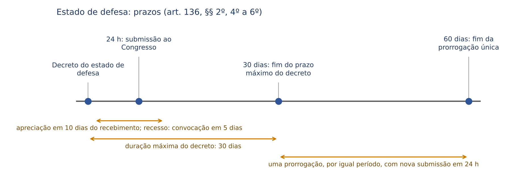
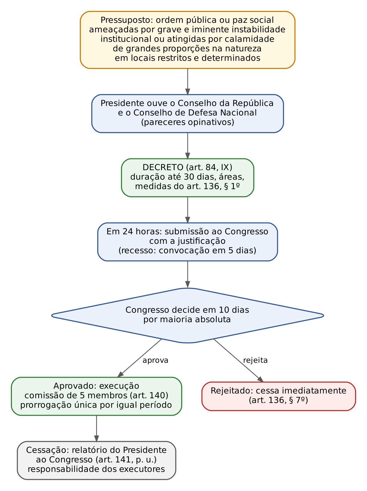
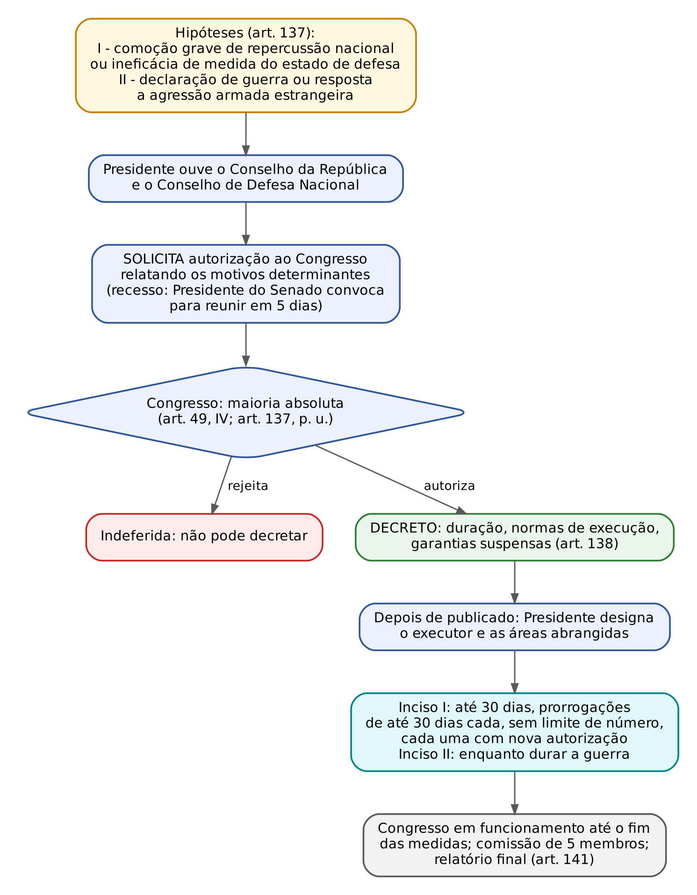
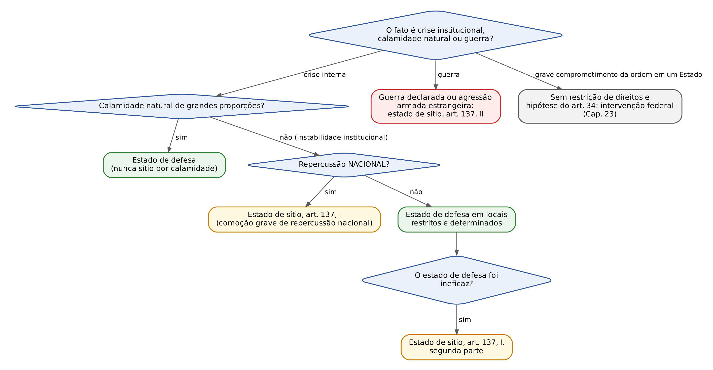
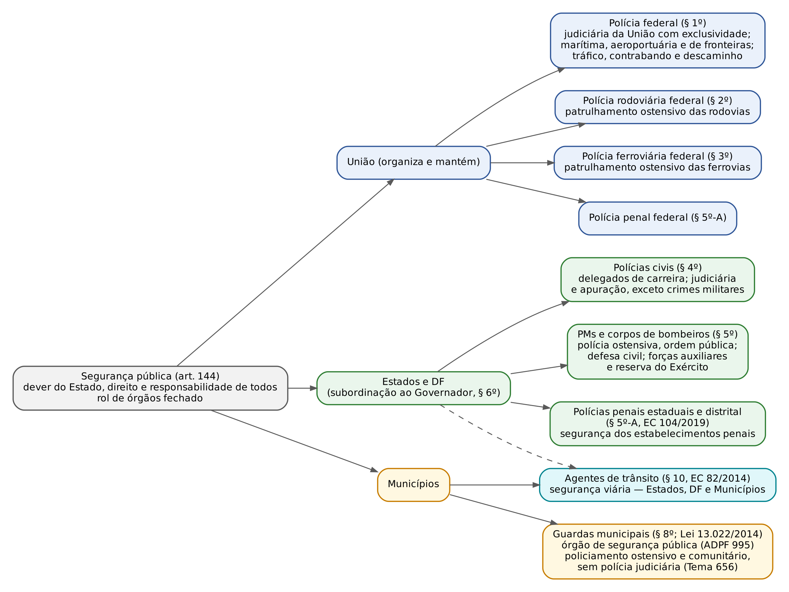

# CAPÍTULO 32 — DEFESA DO ESTADO E DAS INSTITUIÇÕES DEMOCRÁTICAS

:::INCIDENCIA
TRF5 p. 8; TJRS p. 9. Nível A. Lote: 34 questões (FGV 31, FCC 3).
O que mais cai: qual medida cabe no caso narrado (defesa x sítio x intervenção); prazos de 30 dias e prorrogações; autorização prévia x apreciação posterior; róis taxativos de restrições (art. 136, § 1º, x art. 139); guardas municipais (ADPF 995 e Tema 656); subordinação das polícias ao Governador.
:::

| Subtema | FGV | FCC | Padrão |
|---|---|---|---|
| Estado de defesa e estado de sítio: cabimento no caso narrado | 14 | 0 | Calamidade natural ou crise localizada leva ao estado de defesa; comoção nacional, ao sítio; intervenção federal como distrator |
| Prazos, controle político e medidas restritivas | 6 | 1 | 30 dias com uma prorrogação (defesa) x prorrogações ilimitadas de 30 dias (sítio, I); imprensa e busca domiciliar só no sítio |
| Forças Armadas e regime dos militares | 1 | 0 | Perda do posto e da patente só por tribunal militar (art. 142, § 3º, VI e VII) |
| Segurança pública: órgãos, polícias, SUSP | 7 | 1 | Subordinação ao Governador; atribuições literais do art. 144; ausência de ciclo completo |
| Guardas municipais | 3 | 1 | Órgão de segurança pública; policiamento ostensivo e comunitário, sem polícia judiciária, sob controle externo do MP |

## 32.1 O sistema constitucional das crises

O Título V da Constituição ("Da Defesa do Estado e das Instituições Democráticas") reúne três capítulos de natureza diversa: o sistema constitucional das crises (estado de defesa e estado de sítio, arts. 136 a 141), as Forças Armadas (arts. 142 e 143) e a segurança pública (art. 144). A intervenção federal, embora também seja medida de exceção, está no Título III, porque é instrumento de preservação do pacto federativo, e não de defesa do Estado contra crises (Cap. 23).

Os estados de defesa e de sítio inauguram o que a doutrina chama de legalidade extraordinária: a própria Constituição prevê, de antemão, as hipóteses, o procedimento, os limites e os controles de um regime temporário em que certos direitos podem ser restringidos ou suspensos. Não há "estado de exceção" fora da Constituição. Daí os princípios que estruturam todo o capítulo e que as bancas cobram em assertivas teóricas:

- Necessidade: a medida só se legitima diante dos fatos descritos no texto (arts. 136, caput, e 137). Calamidade que não seja "de grandes proporções na natureza" ou instabilidade que não seja "grave e iminente" não autorizam a medida.
- Temporariedade: o decreto deve fixar a duração, com teto constitucional (salvo no sítio por guerra).
- Proporcionalidade e taxatividade: só as restrições arroladas, e só as necessárias. Os róis dos arts. 136, § 1º, e 139 são fechados.
- Controle: político (Congresso), concomitante (comissão do art. 140), sucessivo (art. 141, parágrafo único) e jurisdicional (atos dos executores).
- Responsabilidade: cessada a medida, cessam os efeitos, "sem prejuízo da responsabilidade pelos ilícitos cometidos por seus executores ou agentes" (art. 141).

### 32.1.1 Competências e órgãos envolvidos

- Presidente da República: decretar o estado de defesa e o estado de sítio é competência PRIVATIVA (art. 84, IX), não incluída entre as delegáveis do parágrafo único do art. 84 (só os incisos VI, XII e XXV, primeira parte, são delegáveis). Convocar e presidir o Conselho da República e o Conselho de Defesa Nacional também é privativo (art. 84, XVIII) e indelegável — foi o gabarito da Q3872164 (FCC 2026, Cap. 28).
- Congresso Nacional: compete-lhe EXCLUSIVAMENTE "aprovar o estado de defesa e a intervenção federal, autorizar o estado de sítio, ou suspender qualquer uma dessas medidas" (art. 49, IV). Os verbos são a chave: APROVAR (defesa e intervenção, a posteriori) x AUTORIZAR (sítio, a priori). Na Q2400721 (FCC 2024, Cap. 28), a alternativa que atribuía essa competência ao Presidente era falsa.
- Conselho da República (art. 90, I) e Conselho de Defesa Nacional (art. 91, § 1º, II): órgãos de CONSULTA. A oitiva é obrigatória antes da decretação (defesa) ou da solicitação (sítio), mas os pareceres NÃO vinculam o Presidente. Composição e demais atribuições: Cap. 28.
- Mesa do Congresso Nacional: designa a comissão de cinco membros que acompanha e fiscaliza a execução (art. 140).

:::PEGADINHA VINCULAÇÃO DOS PARECERES E INICIATIVA
"Oitiva prévia do Conselho da República e do Conselho de Defesa Nacional, cujos pareceres são vinculativos" — falso (Q3304054, alternativa C). A oitiva é requisito formal; o conteúdo é opinativo. Também é falso que o Congresso "decrete" ou "proponha" o estado de defesa: o Presidente decreta e o Congresso aprova ou rejeita.
:::

### 32.1.2 Estado de defesa, estado de sítio e as figuras vizinhas

Três figuras aparecem como distratores constantes:

- Intervenção federal (arts. 34 a 36): suprime temporariamente a autonomia de um Estado ou do DF; não autoriza, por si, restrição de direitos fundamentais. O quadro comparativo completo está em 23.6.2; aqui basta lembrar que, quando o enunciado pede medida "em cuja vigência fosse admitida a restrição aos direitos individuais", a intervenção não é a resposta (Q3171977, Q3028419).
- Estado de calamidade pública de âmbito nacional (arts. 167-B a 167-G, incluídos pela EC 109/2021): regime FISCAL extraordinário, decretado pelo Congresso Nacional por proposta do Presidente da República (art. 49, XVIII; art. 84, XXVIII), que flexibiliza regras orçamentárias e de contratação. Não restringe direitos fundamentais e não é medida de defesa do Estado (Q3865753, alternativa D; Q4338745, Cap. 28, em que a alternativa que atribuía ao Presidente "decretar" o estado de calamidade nacional era falsa).
- "Estado de emergência", "estado de urgência", "estado de necessidade constitucional", "operação de garantia da lei e da ordem": não são medidas constitucionais de defesa do Estado. A situação de emergência e o estado de calamidade da legislação de defesa civil são atos administrativos; a GLO é forma de emprego das Forças Armadas (32.5.2), não estado de exceção.

:::DICA LIMITE CIRCUNSTANCIAL
Na vigência de intervenção federal, de estado de defesa ou de estado de sítio, a Constituição não pode ser emendada (art. 60, § 1º). O limite incide durante a VIGÊNCIA da medida decretada, não durante a crise que poderia justificá-la. Por isso, na Q3865753 (FGV 2026 — MPE-GO — Promotor), a alternativa "enquanto perdurar a referida situação, a Constituição não pode ser emendada" estava errada: nenhuma medida havia sido decretada. Teoria dos limites circunstanciais: 3.3.4.
:::

## 32.2 Estado de defesa (art. 136)

:::LEI CF, ART. 136, CAPUT E § 1º
Art. 136. O Presidente da República pode, ouvidos o Conselho da República e o Conselho de Defesa Nacional, decretar estado de defesa para preservar ou prontamente restabelecer, em locais restritos e determinados, a ordem pública ou a paz social ameaçadas por grave e iminente instabilidade institucional ou atingidas por calamidades de grandes proporções na natureza.
§ 1º O decreto que instituir o estado de defesa determinará o tempo de sua duração, especificará as áreas a serem abrangidas e indicará, nos termos e limites da lei, as medidas coercitivas a vigorarem, dentre as seguintes:
I - restrições aos direitos de: a) reunião, ainda que exercida no seio das associações; b) sigilo de correspondência; c) sigilo de comunicação telegráfica e telefônica;
II - ocupação e uso temporário de bens e serviços públicos, na hipótese de calamidade pública, respondendo a União pelos danos e custos decorrentes.
:::

### 32.2.1 Pressupostos

O caput contém quatro elementos, todos cobrados isoladamente:

| Elemento | Texto | O que a banca troca |
|---|---|---|
| Finalidade | "preservar ou prontamente restabelecer" | Nada de relevante; a medida serve tanto à prevenção quanto à reação |
| Objeto protegido | "a ordem pública ou a paz social" | "segurança nacional", "integridade nacional" (que são do sítio e da intervenção) |
| Causas | "grave e iminente instabilidade institucional" OU "calamidades de grandes proporções na natureza" | Calamidade não natural (tecnológica, sanitária); comoção NACIONAL (é do sítio) |
| Espaço | "locais restritos e determinados" | Abrangência nacional |

Duas consequências práticas resolvem a maior parte das questões:

- Calamidade natural de grandes proporções (enchente, terremoto, ciclo de desastres) leva ao estado de DEFESA, nunca diretamente ao sítio: o art. 137 não prevê calamidade como hipótese de sítio. Assim nas Q3879513, Q3171977, Q3966694, Q3865753 e Q4378301.
- Instabilidade institucional localizada (ainda que em dois Estados contíguos ou em duas regiões) leva ao estado de DEFESA; o sítio só cabe se a comoção tiver repercussão NACIONAL ou se o estado de defesa se mostrar ineficaz (art. 137, I). Assim nas Q3605996, Q3592130, Q3846056, Q3777899, Q3028419 e Q2506990.

A pandemia de Covid-19 não ensejou estado de defesa: além de não ser calamidade "na natureza" no sentido estrito do texto (a doutrina diverge sobre enquadrar epidemias), a abrangência era nacional, incompatível com "locais restritos e determinados". O enfrentamento deu-se por legislação ordinária (Lei 13.979/2020) e, no plano fiscal, pelo regime extraordinário que depois inspirou a EC 109/2021.

:::QUESTAO FGV 2024 — Q3028419
Grave instabilidade institucional em determinada região, decorrente de reiterados atos de desobediência de segmentos da segurança pública; busca-se medida que restabeleça prontamente a ordem, inclusive com restrição de direitos. Gabarito: B (estado de defesa).
Passos: (1) causa = instabilidade institucional, não calamidade; (2) espaço = região determinada, sem repercussão nacional, logo não cabe sítio; (3) a medida deve restringir direitos, o que afasta a intervenção federal; (4) a fórmula "prontamente restabelecer" é do art. 136.
No mesmo sentido: Q3171977 (FGV 2025 — enchente regional com grave ameaça à paz social; medida que admita restrição de direitos individuais: estado de defesa, gabarito B; "estado de emergência" e "estado de calamidade pública" são distratores) e Q3879513 (FGV 2026 — ALERJ: calamidade natural ameaçando a paz social em um Estado; gabarito B).
:::

### 32.2.2 O decreto e as medidas coercitivas

O decreto (que é ato do Presidente, não lei) deve conter, por exigência do § 1º: (i) o tempo de duração; (ii) as áreas abrangidas; (iii) as medidas coercitivas, escolhidas DENTRE as do rol e "nos termos e limites da lei". A lei referida não foi editada; a doutrina entende que a falta dela não impede a decretação, porque o rol constitucional é autoaplicável quanto ao limite máximo, mas ela limitaria o modo de execução.

Rol fechado do estado de defesa:

- Restrições (não suspensão) aos direitos de reunião (inclusive no seio das associações), ao sigilo de correspondência e ao sigilo de comunicação telegráfica e TELEFÔNICA.
- Ocupação e uso temporário de bens e serviços PÚBLICOS, só na hipótese de calamidade pública, com responsabilidade da UNIÃO pelos danos e custos. É uma das duas exceções constitucionais à vedação de requisição de bens de um ente por outro (ADI 3.454/DF; ver 21.2.3).

O que NÃO pode ser restringido no estado de defesa (e aparece como distrator): liberdade de imprensa, radiodifusão e televisão; inviolabilidade do domicílio (busca e apreensão domiciliar sem ordem judicial); liberdade de locomoção (obrigação de permanência em localidade); requisição de bens PARTICULARES; intervenção em empresas de serviços públicos. Todas essas são medidas do estado de sítio (art. 139).

:::PEGADINHA SIGILO TELEFÔNICO NO ESTADO DE DEFESA
O art. 5º, XII, exige ordem judicial para a interceptação telefônica. No estado de defesa, o próprio decreto pode restringir o sigilo da comunicação telefônica (art. 136, § 1º, I, c), sem necessidade de ordem judicial prévia — a legalidade extraordinária substitui, nos limites do decreto, a reserva de jurisdição. Duas questões exploram o ponto: na Q3846056 e na Q3592130 a alternativa D ("ressalvada a quebra do sigilo das comunicações, que deve ser antecedida de ordem judicial") estava ERRADA; na Q3605996 e na Q4378301, a restrição ao sigilo telefônico era compatível com o estado de defesa.
:::

:::QUESTAO FGV 2026 — TJ-GO — JUIZ SUBSTITUTO (Q3966694)
Calamidade natural de grandes proporções em 20% dos Municípios de um Estado, com aproveitamento da desordem por grupos criminosos; ONGs cogitam medida de defesa do Estado. Gabarito: C — o estado de defesa é cabível, mas não pode restringir a liberdade de imprensa.
Armadilhas: A (vedação de intervenção da União em Municípios — irrelevante: a medida cogitada não é intervenção); B (o Estado-membro não decreta estado de defesa: competência privativa do Presidente; não há lei complementar "nacional" a observar); D ("60 dias, prorrogável uma vez" — o teto é 30 dias, prorrogável uma vez por igual período); E (não há "preferência" com motivação específica para decretar sítio de imediato por calamidade: calamidade não é hipótese de sítio).
:::

### 32.2.3 Prazo

O tempo de duração "não será superior a trinta dias, podendo ser prorrogado uma vez, por igual período, se persistirem as razões que justificaram a sua decretação" (§ 2º). Duração máxima total: 60 dias. A prorrogação também é submetida ao Congresso em 24 horas (§ 4º: "Decretado o estado de defesa ou sua prorrogação").

:::QUESTAO FGV 2026 — PC-PR — DELEGADO DE POLÍCIA (Q4378301)
Narrativa: calamidade natural ameaça a ordem pública em dezenas de Municípios; o Presidente, após ouvir os dois Conselhos, decreta estado de defesa por 60 dias; o Congresso aprova por maioria absoluta; o decreto prevê restrições ao sigilo telefônico. Gabarito: B — a única incorreção é a duração.
Passos: causa (calamidade natural) correta; oitiva dos Conselhos correta; aprovação a posteriori por maioria absoluta correta; sigilo telefônico está no rol; o decreto, porém, não pode fixar 60 dias de uma vez: são 30, prorrogáveis por mais 30.
No mesmo sentido, quanto ao prazo: Q3865753 (FGV 2026 — MPE-GO — Promotor; ciclo de calamidades naturais em Estados de uma região; gabarito E: a medida cabível não pode durar mais de 30 dias, prorrogável uma única vez por igual período). Na mesma questão, a alternativa C (opção livre entre defesa e sítio) e a B (estado de defesa sem restrição de direitos) estavam erradas.
:::

### 32.2.4 Prisões na vigência do estado de defesa

O § 3º estabelece um estatuto mínimo da prisão, que é a garantia que sobrevive à legalidade extraordinária:

:::LEI CF, ART. 136, § 3º
§ 3º Na vigência do estado de defesa:
I - a prisão por crime contra o Estado, determinada pelo executor da medida, será por este comunicada imediatamente ao juiz competente, que a relaxará, se não for legal, facultado ao preso requerer exame de corpo de delito à autoridade policial;
II - a comunicação será acompanhada de declaração, pela autoridade, do estado físico e mental do detido no momento de sua autuação;
III - a prisão ou detenção de qualquer pessoa não poderá ser superior a dez dias, salvo quando autorizada pelo Poder Judiciário;
IV - é vedada a incomunicabilidade do preso.
:::

Leitura técnica:

- O executor pode determinar PRISÃO por crime contra o Estado sem ordem judicial prévia: é exceção ao art. 5º, LXI. O controle judicial é imediato e posterior (comunicação imediata; relaxamento se ilegal), e não prévio.
- A comunicação é feita pelo EXECUTOR ao juiz competente, com declaração do estado físico e mental do detido; o exame de corpo de delito é FACULTADO ao preso e requerido à autoridade policial.
- Teto de DEZ dias para a prisão ou detenção de qualquer pessoa, salvo autorização do Judiciário.
- Incomunicabilidade VEDADA (regra que reforça o art. 5º, LXII e LXIII). Se é vedada até no estado de defesa, com mais razão é incompatível com a normalidade constitucional — por isso a doutrina majoritária considera não recepcionado o art. 21 do CPP (incomunicabilidade do indiciado).

:::QUESTAO FGV 2025 — TCE-RR — AUDITOR SUBSTITUTO DE CONSELHEIRO (Q3174664)
No estado de defesa regularmente decretado, assessores sugerem ao "interventor" a detenção de grupo de pessoas para apurar envolvimento nas condutas que motivaram a medida. Gabarito: C — a detenção não pode superar dez dias, salvo autorização judicial (art. 136, § 3º, III).
Armadilhas: A (detenção seria exclusiva do sítio — falso; o § 3º disciplina prisão e detenção no estado de defesa); D (comunicação PRÉVIA ao juiz, que poderia obstá-la — o controle é posterior e imediato, com relaxamento); E (exigência de flagrante ou ordem judicial — é justamente a regra excepcionada). Observação: o enunciado chama de "interventor" quem a Constituição chama de "executor da medida"; interventor é figura da intervenção federal (art. 36, § 1º).
:::

:::QUESTAO FGV 2025 — PGM-RJ — ANALISTA DE PROCURADORIA (Q3605996)
Grupos extremistas atuam de forma orquestrada em duas regiões contíguas para desestabilizar as instituições (corte de água e energia, ataques às forças de segurança). Gabarito: D — cabe apenas o estado de defesa, no qual é vedada a incomunicabilidade do preso e permitida a restrição ao sigilo telefônico.
Armadilhas: A (obrigação de permanência em localidade é medida do sítio, e o sítio não cabe de início); B e C (intervenção federal não é a medida para crise que abrange regiões, e o enunciado pede medida de defesa do Estado); E (sítio não cabe sem comoção de repercussão nacional ou ineficácia prévia do estado de defesa).
:::

### 32.2.5 Controle político a posteriori

:::LEI CF, ART. 136, §§ 4º A 7º
§ 4º Decretado o estado de defesa ou sua prorrogação, o Presidente da República, dentro de vinte e quatro horas, submeterá o ato com a respectiva justificação ao Congresso Nacional, que decidirá por maioria absoluta.
§ 5º Se o Congresso Nacional estiver em recesso, será convocado, extraordinariamente, no prazo de cinco dias.
§ 6º O Congresso Nacional apreciará o decreto dentro de dez dias contados de seu recebimento, devendo continuar funcionando enquanto vigorar o estado de defesa.
§ 7º Rejeitado o decreto, cessa imediatamente o estado de defesa.
:::

Pontos de prova:

- O estado de defesa produz efeitos DESDE A DECRETAÇÃO; o Congresso o aprova ou rejeita depois (por isso a banca usa "referendado", "ratificado", "apreciado a posteriori"). Quem aprecia é o CONGRESSO NACIONAL, e não o Senado (Q3009007, alternativa E: "posterior ratificação do Senado Federal" — falso).
- Quórum: maioria ABSOLUTA. Prazos: 24 horas para submeter; 10 dias para apreciar, contados do recebimento; 5 dias para a convocação extraordinária em recesso (convocação que, no estado de defesa, é feita pelo Presidente do Senado — art. 57, § 6º, I).
- Rejeitado o decreto, a medida cessa IMEDIATAMENTE, sem prejuízo da responsabilidade dos executores pelos atos ilícitos (art. 141). Os atos praticados até a rejeição, se conformes ao decreto, não se tornam ilícitos só pela rejeição — a rejeição tem efeitos prospectivos quanto à vigência; a doutrina discute a responsabilização do próprio Presidente por crime de responsabilidade se a decretação foi manifestamente abusiva (art. 85, III, da CF — atentado ao exercício dos direitos políticos, individuais e sociais —, e Lei 1.079/1950, art. 7º; Cap. 28).
- O Congresso deve continuar funcionando enquanto vigorar a medida (§ 6º). Mesma regra no sítio (art. 138, § 3º).

:::QUESTAO FGV 2025 — AL-AM — PROCURADOR (Q3777899)
Redução paulatina do efetivo das forças de segurança de um Estado (sem reposição de óbitos e aposentadorias) gera "grave e iminente instabilidade institucional" que ameaça a ordem pública; lideranças pedem providência ao Presidente. Gabarito: A — o Presidente NÃO pode decretar o estado de sítio.
Passos: (1) a descrição reproduz a hipótese do estado de defesa (art. 136); (2) não há comoção de repercussão nacional nem estado de defesa anterior ineficaz, de modo que o sítio é incabível (B e E erradas); (3) D é errada porque o estado de defesa pode restringir direitos; (4) C (intervenção federal sem restrição de direitos) foi considerada errada: o art. 34, III, exige "grave comprometimento da ordem pública" efetivamente instalado, ao passo que o enunciado narra ordem pública AMEAÇADA, fórmula do art. 136. A distinção ameaça (defesa) x comprometimento (intervenção) é o critério da banca; registre-se que, em casos reais, a intervenção na segurança pública do Rio de Janeiro (2018) foi decretada com base no art. 34, III, limitada à área de segurança pública (23.2.1).
:::

## 32.3 Estado de sítio (arts. 137 a 139)

### 32.3.1 Hipóteses e autorização prévia

:::LEI CF, ART. 137
Art. 137. O Presidente da República pode, ouvidos o Conselho da República e o Conselho de Defesa Nacional, solicitar ao Congresso Nacional autorização para decretar o estado de sítio nos casos de:
I - comoção grave de repercussão nacional ou ocorrência de fatos que comprovem a ineficácia de medida tomada durante o estado de defesa;
II - declaração de estado de guerra ou resposta a agressão armada estrangeira.
Parágrafo único. O Presidente da República, ao solicitar autorização para decretar o estado de sítio ou sua prorrogação, relatará os motivos determinantes do pedido, devendo o Congresso Nacional decidir por maioria absoluta.
:::

O inciso I contém DUAS hipóteses autônomas, unidas por "ou":

- Comoção grave de repercussão NACIONAL: autoriza o sítio DIRETAMENTE, sem necessidade de estado de defesa anterior. É a hipótese que derruba a tese do "escalonamento obrigatório".
- Ineficácia de medida tomada durante o estado de defesa: aqui sim há precedência — o sítio vem DEPOIS de um estado de defesa que se mostrou insuficiente. É a chamada "precedência condicionada".

O inciso II (guerra declarada ou resposta a agressão armada estrangeira) é o sítio defensivo externo, com regime mais amplo (32.3.3). A declaração de guerra é ato do Presidente autorizado pelo Congresso ou por ele referendado, quando a agressão ocorrer no intervalo das sessões (art. 84, XIX; art. 49, II).

Diferentemente do estado de defesa, o sítio exige AUTORIZAÇÃO PRÉVIA do Congresso, por maioria absoluta, tanto para a decretação quanto para cada prorrogação. Se o pedido ocorrer durante o recesso, "o Presidente do Senado Federal, de imediato, convocará extraordinariamente o Congresso Nacional para se reunir dentro de cinco dias" (art. 138, § 2º). O Congresso permanece em funcionamento até o término das medidas coercitivas (art. 138, § 3º).

:::QUESTAO FGV 2024 — TJ-AP — ANALISTA JUDICIÁRIO (Q2449061)
Comoção grave de repercussão nacional: qual medida? Gabarito: A — SOMENTE o estado de sítio.
Armadilhas: B (estado de defesa exige locais restritos e determinados; comoção NACIONAL é hipótese textual do sítio); C (não há discricionariedade de escolha entre as medidas: cada uma tem pressuposto próprio); D (escalonamento obrigatório — só existe na segunda parte do inciso I); E (exigir "risco para a segurança nacional" acrescenta requisito inexistente).
No mesmo sentido: Q2387543 (FGV 2024 — CGM-BH: providência para comoção grave de repercussão nacional, com prazo de 30 dias prorrogável "de cada vez" por igual prazo e acompanhamento por comissão da Mesa do Congresso; gabarito A, apenas o estado de sítio — a expressão "de cada vez" é do art. 138, § 1º); Q2515565 (FGV 2024 — TJ-SC — Oficial de Justiça: grave agitação popular de repercussão nacional, acompanhamento por comissão designada pela Mesa; gabarito A, estado de sítio — o dado decisivo é a repercussão nacional, porque a comissão do art. 140 existe nas duas medidas).
:::

:::QUESTAO FGV 2024 — ENAM — 1º EXAME NACIONAL DA MAGISTRATURA, REAPLICAÇÃO (Q2506990)
Grave e iminente instabilidade institucional em duas regiões do País, por disputas entre instituições. Gabarito: E — há relação de precedência condicionada do estado de defesa em relação ao sítio; este, quando admitido, deve ser AUTORIZADO, aquele é REFERENDADO pelo Congresso.
Armadilhas: A (só intervenção federal); B (prorrogações ilimitadas do estado de defesa — só uma); D (é possível defesa OU sítio — o sítio não cabe sem repercussão nacional ou ineficácia prévia).
Atenção: a alternativa C ("caso seja decretado o estado de defesa ou o estado de sítio, a medida será acompanhada por comissão designada pela Mesa do Congresso Nacional") reproduz o art. 140 e, isoladamente, é verdadeira; o gabarito oficial manteve E. Para a prova, a lição é que a FGV, quando o enunciado narra situação concreta, considera errada a alternativa que pressupõe o cabimento do sítio no caso ("caso seja decretado [...] o estado de sítio"). Ver nota de verificação.
:::

### 32.3.2 O decreto, o executor e os prazos

:::LEI CF, ART. 138, CAPUT E § 1º
Art. 138. O decreto do estado de sítio indicará sua duração, as normas necessárias a sua execução e as garantias constitucionais que ficarão suspensas, e, depois de publicado, o Presidente da República designará o executor das medidas específicas e as áreas abrangidas.
§ 1º - O estado de sítio, no caso do art. 137, I, não poderá ser decretado por mais de trinta dias, nem prorrogado, de cada vez, por prazo superior; no do inciso II, poderá ser decretado por todo o tempo que perdurar a guerra ou a agressão armada estrangeira.
:::

- Conteúdo do decreto: duração, normas de execução e GARANTIAS CONSTITUCIONAIS QUE FICARÃO SUSPENSAS. No estado de defesa fala-se em "restrições"; no sítio, em "suspensão" de garantias.
- Executor e áreas: designados pelo Presidente DEPOIS da publicação do decreto. No estado de defesa, as áreas constam do próprio decreto (art. 136, § 1º). O sítio pode ter abrangência nacional ou parcial.
- Prazos: inciso I — até 30 dias; prorrogações de até 30 dias "de cada vez", SEM limite de número, cada uma precedida de nova autorização; inciso II — "por todo o tempo que perdurar a guerra ou a agressão armada estrangeira".

:::QUESTAO FGV 2025 — DPE-PE — DEFENSOR PÚBLICO (Q3390816)
Grave crise institucional nos limites de um Estado; decretado o estado de sítio "com estrita observância da sistemática constitucional". Gabarito: B — o decreto indicou as garantias constitucionais que ficariam suspensas (art. 138).
Armadilhas: A (duração enquanto perdurar a anormalidade — só no inciso II, por guerra); C (busca e apreensão domiciliar é admitida no sítio do inciso I, art. 139, V); D (as restrições não se limitam a reunião e comunicação); E (a narrativa não autoriza presumir que o estado de defesa foi descartado por inaptidão; a frase cria requisito de motivação inexistente).
:::

### 32.3.3 Medidas: o rol do art. 139 e o sítio por guerra

:::LEI CF, ART. 139
Art. 139. Na vigência do estado de sítio decretado com fundamento no art. 137, I, só poderão ser tomadas contra as pessoas as seguintes medidas:
I - obrigação de permanência em localidade determinada;
II - detenção em edifício não destinado a acusados ou condenados por crimes comuns;
III - restrições relativas à inviolabilidade da correspondência, ao sigilo das comunicações, à prestação de informações e à liberdade de imprensa, radiodifusão e televisão, na forma da lei;
IV - suspensão da liberdade de reunião;
V - busca e apreensão em domicílio;
VI - intervenção nas empresas de serviços públicos;
VII - requisição de bens.
Parágrafo único. Não se inclui nas restrições do inciso III a difusão de pronunciamentos de parlamentares efetuados em suas Casas Legislativas, desde que liberada pela respectiva Mesa.
:::

Leitura técnica:

- "Só poderão": o rol é TAXATIVO (*numerus clausus*) para o sítio do inciso I. Por isso a Q3846056 e a Q3592130 consideraram correta a afirmação de que "mesmo a mais severa" das medidas, preenchidos os requisitos, só pode restringir os direitos previstos em *numerus clausus* — a narrativa era de crise interna, isto é, sítio do inciso I.
- Comparado ao estado de defesa: reunião passa de RESTRIÇÃO a SUSPENSÃO; entram a imprensa, a prestação de informações, a busca domiciliar, a permanência em localidade, a detenção em edifício especial, a intervenção em empresas de serviços públicos e a requisição de bens (inclusive particulares).
- Parágrafo único: a censura não alcança pronunciamentos de parlamentares nas Casas, desde que a Mesa libere a difusão.
- Sítio do inciso II (guerra): o art. 139 refere-se apenas ao inciso I. No sítio por guerra, a doutrina majoritária entende que o decreto pode suspender, em tese, quaisquer garantias constitucionais, desde que as indique expressamente (art. 138) e observe a proporcionalidade, com limites implícitos — direitos que sequer em guerra se admite suspender, como a vedação da tortura e de penas cruéis, o direito à vida fora da hipótese do art. 5º, XLVII, a (pena de morte em guerra declarada), e as garantias do devido processo penal mínimo. A pena de morte e o tribunal militar de caráter especial são figuras próprias do tempo de guerra (art. 5º, XLVII, a; art. 142, § 3º, VI).

:::DICA AS IMUNIDADES PARLAMENTARES NO SÍTIO
As imunidades de Deputados e Senadores SUBSISTEM no estado de sítio, só podendo ser suspensas mediante o voto de 2/3 dos membros da Casa respectiva, nos casos de atos praticados FORA do recinto do Congresso Nacional que sejam incompatíveis com a execução da medida (art. 53, § 8º). Três requisitos cumulativos: quórum, local e incompatibilidade. Não há regra equivalente para o estado de defesa. Questão desenvolvida em 25.7.3 (Q2513095).
:::

:::QUESTAO FGV 2024 — PREFEITURA DE ABREU E LIMA — TÉCNICO EM CONTROLE INTERNO (Q3009007)
Agressão armada estrangeira. Gabarito: B — estado de sítio, de competência do Presidente da República, com prévia autorização do Congresso.
Armadilhas: A e C (as Forças Armadas não decretam nada: estão sob a autoridade suprema do Presidente); C ("estado de urgência" não existe); D e E (estado de defesa não é medida para agressão externa; não é o Congresso que o decreta; quem aprecia é o Congresso, e não o Senado).
:::

## 32.4 Disposições comuns, controle e quadro comparativo

### 32.4.1 Comissão de acompanhamento e relatório final

:::LEI CF, ARTS. 140 E 141
Art. 140. A Mesa do Congresso Nacional, ouvidos os líderes partidários, designará Comissão composta de cinco de seus membros para acompanhar e fiscalizar a execução das medidas referentes ao estado de defesa e ao estado de sítio.
Art. 141. Cessado o estado de defesa ou o estado de sítio, cessarão também seus efeitos, sem prejuízo da responsabilidade pelos ilícitos cometidos por seus executores ou agentes.
Parágrafo único. Logo que cesse o estado de defesa ou o estado de sítio, as medidas aplicadas em sua vigência serão relatadas pelo Presidente da República, em mensagem ao Congresso Nacional, com especificação e justificação das providências adotadas, com relação nominal dos atingidos e indicação das restrições aplicadas.
:::

- A comissão é comum às duas medidas, composta de CINCO membros do Congresso, designados pela MESA DO CONGRESSO (não pelas Mesas das Casas), ouvidos os líderes partidários.
- O relatório final é do PRESIDENTE DA REPÚBLICA, em mensagem ao Congresso, com relação NOMINAL dos atingidos.
- Cessação: ao fim do prazo, pela revogação presidencial, pela rejeição (defesa) ou pela suspensão determinada pelo Congresso (art. 49, IV: "suspender qualquer uma dessas medidas").

### 32.4.2 Controles: político e jurisdicional

| Momento | Estado de defesa | Estado de sítio |
|---|---|---|
| Prévio | Oitiva dos Conselhos (opinativa) | Oitiva dos Conselhos + AUTORIZAÇÃO do Congresso (maioria absoluta) |
| Concomitante | Apreciação em 10 dias (maioria absoluta); comissão do art. 140; possibilidade de suspensão (art. 49, IV) | Comissão do art. 140; Congresso em funcionamento; nova autorização para cada prorrogação; suspensão (art. 49, IV) |
| Sucessivo | Relatório do Presidente (art. 141, parágrafo único); responsabilização | Idem |

Controle jurisdicional: o Judiciário não substitui o juízo político sobre a conveniência da medida, mas controla (i) os pressupostos objetivos e formais (oitiva dos Conselhos, prazo, área, autorização ou apreciação congressual, quórum); (ii) a conformidade dos atos de execução com o decreto e com os róis constitucionais; (iii) a legalidade de prisões e de restrições individuais, por *habeas corpus* e mandado de segurança, que NÃO ficam suspensos — a Constituição de 1988 não autoriza a suspensão do *habeas corpus*, ao contrário da Carta de 1967/1969 após o AI-5. O próprio art. 136, § 3º, I, prevê o relaxamento judicial da prisão ilegal. Os executores respondem civil, penal e administrativamente pelos excessos (art. 141), e a União responde objetivamente (art. 37, § 6º; art. 136, § 1º, II, para a ocupação de bens).

:::SENTENCA HABEAS CORPUS CONTRA PRISÃO DO EXECUTOR NO ESTADO DE DEFESA
Cenário: preso por ordem do executor, comunicado ao juízo depois de 12 dias de custódia, sem autorização judicial. Redação-modelo: "O estado de defesa não suspende a jurisdição nem a garantia do *habeas corpus*. A prisão determinada pelo executor da medida submete-se ao regime do art. 136, § 3º, da Constituição: comunicação imediata ao juiz, declaração do estado físico e mental do detido, vedação da incomunicabilidade e limite de dez dias, salvo autorização judicial. Ultrapassado o prazo sem autorização, a custódia tornou-se ilegal, independentemente do juízo político sobre a conveniência da medida, que não está em discussão. Concedo a ordem para relaxar a prisão, com comunicação ao Congresso Nacional, por meio da comissão do art. 140, e ao Ministério Público, para apuração da responsabilidade do executor (art. 141)." Competência: a autoridade coatora é o executor designado pelo Presidente; a competência segue as regras ordinárias (por exemplo, juiz federal se o executor for autoridade federal, art. 109, VII).
:::

### 32.4.3 Quadro comparativo

| Aspecto | Estado de defesa | Estado de sítio (art. 137, I) | Estado de sítio (art. 137, II) |
|---|---|---|---|
| Pressuposto | Ordem pública ou paz social ameaçadas por grave e iminente instabilidade institucional ou atingidas por calamidade de grandes proporções na natureza | Comoção grave de repercussão nacional OU ineficácia de medida do estado de defesa | Declaração de guerra ou resposta a agressão armada estrangeira |
| Abrangência | Locais restritos e determinados, fixados no decreto | Nacional ou parcial; áreas designadas após a publicação | Idem |
| Oitiva dos Conselhos | Sim, opinativa | Sim, opinativa | Sim, opinativa |
| Congresso | Aprova ou rejeita DEPOIS (24 h para submeter; 10 dias para decidir) | AUTORIZA ANTES | AUTORIZA ANTES |
| Quórum | Maioria absoluta | Maioria absoluta | Maioria absoluta |
| Duração | Até 30 dias + UMA prorrogação de igual período (máximo 60) | Até 30 dias; prorrogações de até 30 dias cada, sem limite de número | Todo o tempo da guerra ou da agressão |
| Medidas | Rol do art. 136, § 1º (restrição a reunião e sigilos de correspondência e telefônico; ocupação de bens públicos na calamidade) | Rol taxativo do art. 139 | Garantias indicadas no decreto (art. 138), com limites implícitos |
| Prisão | Pelo executor, por crime contra o Estado, com comunicação imediata ao juiz; até 10 dias | Detenção em edifício não destinado a presos comuns | Idem, conforme o decreto |
| Imprensa e busca domiciliar | Não | Sim | Sim |
| Comissão (art. 140) e relatório (art. 141) | Sim | Sim | Sim |
| Imunidades parlamentares (art. 53, § 8º) | Sem previsão de suspensão | Suspensão por 2/3, atos fora do recinto, incompatíveis com a medida | Idem |
| Emenda constitucional | Vedada (art. 60, § 1º) | Vedada | Vedada |

:::PASSO ROTEIRO PARA A QUESTÃO DE CASO
1. Identifique a causa: calamidade natural, instabilidade institucional, comoção nacional, guerra ou agressão estrangeira, grave comprometimento da ordem em um ente.
2. Identifique a extensão: locais restritos (defesa) x repercussão nacional (sítio).
3. Verifique se houve estado de defesa anterior ineficaz (sítio, I, segunda parte).
4. Verifique o que o enunciado pede: restrição de direitos (defesa ou sítio) ou substituição de autoridade estadual (intervenção).
5. Confira a letra dos prazos, do quórum, do momento do controle e do rol de medidas.
:::

:::QUESTAO FGV 2025 — ENAM — EXAME NACIONAL DA MAGISTRATURA 2025.1 (Q3362321)
Três afirmativas V/F. (1) Intervenção para garantir o livre exercício dos Poderes: se a coação for contra o Judiciário, a decretação "dependerá de solicitação do STF" — FALSA: contra o Judiciário, há REQUISIÇÃO do STF (art. 36, I); solicitação é do Poder Legislativo ou Executivo coacto. (2) Hipóteses do sítio e decisão do Congresso por maioria absoluta — VERDADEIRA (art. 137). (3) Decretação privativa do estado de defesa pelo Presidente; submissão ao Congresso no prazo constitucional; decisão por maioria absoluta; rejeição faz cessar imediatamente a medida — VERDADEIRA (art. 84, IX; art. 136, §§ 4º e 7º). Gabarito: A (F – V – V).
Correlata: Q3848962 (FGV 2026 — PC-PI, Cap. 23), com o mesmo item sobre requisição do STF, e com distratores do estado de defesa: "vedada a prorrogação" (falso; uma prorrogação) e "não poderá restringir reunião e sigilos" (falso; é exatamente o rol do art. 136, § 1º, I).
:::

:::QUESTAO FGV 2024 — TJ-MS — ANALISTA JUDICIÁRIO (Q2489705)
Ana: o estado de defesa pode ter maior extensão temporal que o sítio. Maria: o estado de defesa é referendado pelo Congresso; o sítio é autorizado. Joana: nos dois cabe busca e apreensão domiciliar. Gabarito: B — só Maria está certa.
Por quê: o estado de defesa tem teto de 60 dias; o sítio do inciso I admite prorrogações sucessivas sem limite de número e o do inciso II dura enquanto durar a guerra (Ana errada); busca domiciliar só no sítio (art. 139, V) (Joana errada).
:::

:::QUESTAO FCC 2025 — DPE-SP — ANALISTA DE DEFENSORIA (Q3304054)
Característica COMUM ao estado de defesa e ao estado de sítio. Gabarito: B — decretação exclusiva pelo Presidente da República, devendo o Congresso continuar em funcionamento (arts. 84, IX; 136, § 6º; 138, § 3º).
Armadilhas: A (30 + 30 uma única vez é só da defesa); C (pareceres vinculativos); D (abrangência nacional — a defesa é localizada); E (autorização prévia — só no sítio).
:::

:::QUESTAO FGV 2025 — TCE-PE — PROCURADOR DO TRIBUNAL DE CONTAS (Q3592130)
Escalada da violência em dois Estados contíguos, por ação insurgente e orquestrada de organizações criminosas, com grave instabilidade institucional e ameaça à paz social. Gabarito: E — as medidas observam um escalonamento (a crise localizada começa pelo estado de defesa) e mesmo a mais severa, se preenchidos os requisitos, só pode restringir direitos previstos em *numerus clausus*.
Armadilhas: A (não cabe intervenção como única saída); B (sítio "por todo o tempo" e autorizado — o tempo indeterminado é só do inciso II); C ("ontologicamente similares", distintas apenas pela intensidade — também diferem nos pressupostos, na abrangência e no momento do controle); D (o sigilo das comunicações pode ser restringido pelo decreto, sem ordem judicial prévia).
No mesmo sentido, com texto idêntico: Q3846056 (FGV 2026 — AMAZUL — Advogado; gabarito E).
:::

:::QUESTAO FGV 2025 — TCE-RR — AUDITOR DE CONTROLE EXTERNO (Q3186460)
Gincana. Alfa: os três institutos (intervenção, defesa, sítio) são sempre apreciados a posteriori pelo Legislativo, mas só os dois últimos restringem direitos. Beta: na intervenção o Executivo só atua se provocado; defesa e sítio podem ser decretados espontaneamente. Gama: a intervenção federal não alcança Municípios situados nos Estados, e, cessados defesa e sítio, o Presidente relata ao Congresso as medidas aplicadas. Gabarito: B — Alfa e Beta parcialmente certos; Gama totalmente certo.
Por quê: Alfa erra no "sempre a posteriori" (o sítio é autorizado antes; a intervenção dos incisos VI e VII do art. 34 pode dispensar a apreciação, art. 36, § 3º) e acerta quanto à restrição de direitos. Beta erra quanto à intervenção (há hipóteses espontâneas — art. 34, I, II, III e V) e foi tida como parcialmente certa quanto às medidas de exceção, que partem de iniciativa do Presidente. Gama acerta: a União só intervém em Municípios localizados em Territórios (art. 35) e o relatório do art. 141, parágrafo único, é comum às duas medidas.
:::

## 32.5 Forças Armadas (arts. 142 e 143)

### 32.5.1 Natureza e missões

:::LEI CF, ART. 142, CAPUT E §§ 1º E 2º
Art. 142. As Forças Armadas, constituídas pela Marinha, pelo Exército e pela Aeronáutica, são instituições nacionais permanentes e regulares, organizadas com base na hierarquia e na disciplina, sob a autoridade suprema do Presidente da República, e destinam-se à defesa da Pátria, à garantia dos poderes constitucionais e, por iniciativa de qualquer destes, da lei e da ordem.
§ 1º Lei complementar estabelecerá as normas gerais a serem adotadas na organização, no preparo e no emprego das Forças Armadas.
§ 2º Não caberá habeas corpus em relação a punições disciplinares militares.
:::

Elementos cobrados:

- Composição fechada: Marinha, Exército e Aeronáutica. Polícias militares e corpos de bombeiros são "forças auxiliares e reserva do Exército" (art. 144, § 6º), não integram as Forças Armadas; a Força Nacional de Segurança Pública é programa de cooperação federativa formado por integrantes cedidos das forças de segurança dos entes (Lei 11.473/2007), também não integra as Forças Armadas (Q3645133, alternativa B — falsa); guardas municipais muito menos (Q3782922, alternativa E — falsa).
- Instituições NACIONAIS (não do Governo), PERMANENTES e REGULARES; bases: HIERARQUIA e DISCIPLINA.
- Autoridade SUPREMA do Presidente da República, que é o Comandante Supremo (art. 84, XIII), nomeia os Comandantes da Marinha, do Exército e da Aeronáutica, promove os oficiais-generais e os nomeia para os cargos que lhes são privativos.
- Três destinações: defesa da Pátria; garantia dos poderes constitucionais; e, POR INICIATIVA DE QUALQUER DESTES (dos poderes constitucionais), garantia da lei e da ordem.
- Lei COMPLEMENTAR para as normas gerais de organização, preparo e emprego: LC 97/1999.
- Iniciativa privativa do Presidente para as leis que fixem ou modifiquem os EFETIVOS das Forças Armadas (art. 61, § 1º, I) e para as que disponham sobre os militares das Forças Armadas, seu regime jurídico, provimento de cargos, promoções, estabilidade, remuneração, reforma e transferência para a reserva (art. 61, § 1º, II, f). Projetos de iniciativa do Presidente começam na Câmara (art. 64), e ele pode pedir urgência (art. 64, § 1º). Cobrado nas Q3233121 e Q3088362 (FCC 2024, desenvolvidas no Cap. 26).
- Cargo de oficial das Forças Armadas é privativo de brasileiro NATO (art. 12, § 3º, VI): Q4231755 e Q3872033 (FCC 2026, Cap. 13).

### 32.5.2 A tese do "poder moderador" e a ADI 6.457

Em 2020, diante de interpretações que liam no art. 142 uma autorização para que as Forças Armadas arbitrassem conflitos entre os Poderes (a "intervenção militar constitucional"), o PDT ajuizou a ADI 6.457, voltada contra o art. 142 e dispositivos da LC 97/1999 (art. 1º, que reproduz a autoridade suprema do Presidente, e art. 15, que disciplina o emprego, inclusive em GLO).

:::JURIS STF, ADI 6.457/DF, REL. MIN. LUIZ FUX, PLENÁRIO VIRTUAL, SESSÃO ENCERRADA EM 8/4/2024, UNÂNIME
Interpretação fixada para o art. 142 da CF e para a LC 97/1999:
- A missão institucional das Forças Armadas NÃO acomoda o exercício de "poder moderador" entre o Executivo, o Legislativo e o Judiciário.
- É inadmissível interpretação que permita a utilização das Forças Armadas para intromissões indevidas no independente funcionamento dos outros Poderes.
- A prerrogativa do Presidente da República de autorizar o emprego das Forças Armadas, por iniciativa dos outros Poderes, não pode ser exercida contra os próprios Poderes entre si.
- O emprego das Forças Armadas para a garantia da lei e da ordem NÃO se limita às hipóteses de intervenção federal, estado de defesa e estado de sítio, mas destina-se ao excepcional enfrentamento de grave e concreta violação à segurança pública interna, em caráter subsidiário, após o esgotamento dos mecanismos ordinários e preferenciais de preservação da ordem pública e da incolumidade das pessoas e do patrimônio.
- A "autoridade suprema" do Presidente (art. 1º da LC 97/1999) liga-se à hierarquia e à disciplina militares e não se sobrepõe à separação e à harmonia entre os Poderes; não se viu inconstitucionalidade no art. 15, § 1º (decisão presidencial sobre o emprego).
:::

Consequências para a prova:

- "Garantia dos poderes constitucionais" significa proteção dos Poderes, todos, contra ameaças externas a eles, e não arbitragem de um sobre o outro. Não há, na Constituição de 1988, poder moderador (instituto do Império, art. 98 da Constituição de 1824, atribuído ao Imperador). O sistema de freios e contrapesos opera por instrumentos recíprocos entre os próprios Poderes, não por um elemento externo — foi o que se cobrou, em chave teórica, na Q3778242 (FGV 2025, Cap. 6: a alternativa do "poder moderador independente" era falsa).
- A GLO é subsidiária e excepcional; não depende de estado de exceção; é decidida pelo Presidente, de ofício ou por iniciativa dos Presidentes do STF, do Senado ou da Câmara (LC 97/1999, art. 15). O pedido de Governador para emprego em seu Estado também se submete à decisão presidencial e à constatação do esgotamento dos meios estaduais.
- Atuação militar contra o funcionamento dos Poderes não tem amparo constitucional e pode configurar crimes contra o Estado Democrático de Direito (32.7).

:::NOTA COMPETÊNCIA PARA CRIMES DE MILITARES EM GLO
O art. 9º, § 2º, do Código Penal Militar (redação da Lei 13.491/2017) atribui à Justiça Militar da União os crimes dolosos contra a vida de civis cometidos por militares das Forças Armadas em determinados contextos, entre eles operações de GLO. A ENAM 2024 (Q2506996, Cap. 30) considerou FALSA a afirmação de que o STF julgou inconstitucional essa atribuição e transferiu a competência à Justiça Federal (gabarito B: só o item sobre crimes previstos em tratado com caráter transnacional estava correto). Desenvolvimento no Cap. 30.
:::

:::QUESTAO FGV 2025 — CNU — BLOCO 7: JUSTIÇA E DEFESA (Q3645110)
Política Nacional de Fronteiras (Decreto 12.038/2024). Gabarito: D — fortalece a sinergia entre instituições civis e militares para a prevenção de crimes transnacionais, atribuindo ao representante do Gabinete de Segurança Institucional a presidência do Comitê Nacional de Fronteiras.
Fundamento constitucional útil: as Forças Armadas não perdem suas competências por política administrativa; a faixa de fronteira (até 150 km, art. 20, § 2º) é fundamental para a defesa do território, e a PF exerce as funções de polícia de fronteiras (art. 144, § 1º, III). Os distratores atribuíam ao decreto efeitos impossíveis para um ato infralegal: substituir competências constitucionais das Forças Armadas (A) ou transferir a fiscalização aduaneira, que é da União (art. 21, XXII; art. 237), a Municípios (B). O conteúdo do decreto (presidência do comitê) não foi conferido no texto oficial (ver nota de verificação).
:::

### 32.5.3 Estatuto constitucional dos militares (art. 142, §§ 2º e 3º)

:::LEI CF, ART. 142, § 3º, IV A VII
IV - ao militar são proibidas a sindicalização e a greve;
V - o militar, enquanto em serviço ativo, não pode estar filiado a partidos políticos;
VI - o oficial só perderá o posto e a patente se for julgado indigno do oficialato ou com ele incompatível, por decisão de tribunal militar de caráter permanente, em tempo de paz, ou de tribunal especial, em tempo de guerra;
VII - o oficial condenado na justiça comum ou militar a pena privativa de liberdade superior a dois anos, por sentença transitada em julgado, será submetido ao julgamento previsto no inciso anterior;
:::

Pontos de prova:

- Patentes (inciso I): conferidas pelo Presidente da República (nos Estados, pelos Governadores, art. 42, § 1º) e asseguradas em plenitude aos oficiais da ativa, da reserva ou reformados.
- Posse em cargo civil: o militar da ativa que toma posse em cargo ou emprego público civil PERMANENTE vai para a reserva (inciso II); em cargo, emprego ou função civil TEMPORÁRIA não eletiva fica agregado e, após dois anos de afastamento, contínuos ou não, é transferido para a reserva (inciso III). Exceção nos dois casos: acumulação de cargos privativos de profissionais de saúde (art. 37, XVI, c — EC 77/2014). Para militares estaduais, aplica-se o art. 37, XVI, por inteiro, com prevalência da atividade militar (art. 42, § 3º — EC 101/2019; 24.11).
- Sindicalização e greve PROIBIDAS (inciso IV); filiação partidária vedada na ATIVA (inciso V). Elegibilidade do militar: art. 14, § 8º (Cap. 14).
- Direitos sociais estendidos (inciso VIII): art. 7º, VIII (décimo terceiro), XII (salário-família), XVII (férias com um terço), XVIII (licença à gestante), XIX (licença-paternidade) e XXV (assistência em creches e pré-escolas); e art. 37, XI (teto), XIII (vedação de vinculação), XIV (vedação de efeito cascata) e XV (irredutibilidade). Não há garantia de salário mínimo: SÚMULA VINCULANTE 6 e Tema 15 — "Não viola a Constituição o estabelecimento de remuneração inferior ao salário mínimo para as praças prestadoras de serviço militar inicial".
- Lei ordinária (inciso X) disporá sobre ingresso, limites de idade, estabilidade, inatividade, direitos, deveres e remuneração. Limite de idade para ingresso exige lei em sentido formal e justificativa na natureza do cargo (Q4079432, Cap. 24, quanto à PM estadual; 08.4).
- Regulamentos disciplinares: o art. 47 do Estatuto dos Militares (Lei 6.880/1980) foi recepcionado e são válidas as punições de detenção e prisão disciplinar do Regulamento Disciplinar do Exército (Tema 703, RE 603.116/RS, Rel. Min. Dias Toffoli, j. 19/8/2024, Info 1146). A reserva legal do art. 5º, LXI ("transgressão militar ou crime propriamente militar, definidos em lei") satisfaz-se com a lei que remete ao regulamento a especificação das transgressões.
- *Habeas corpus* e punições disciplinares (§ 2º): a vedação alcança o MÉRITO da punição (conveniência e oportunidade), não os pressupostos de legalidade. A orientação do STF admite o *habeas corpus* para examinar a hierarquia, o poder disciplinar, o ato ligado à função e a pena suscetível de aplicação disciplinar. A mesma regra vale para os militares estaduais (art. 42, § 1º).

:::QUESTAO FGV 2026 — TRF-2 — JUIZ FEDERAL SUBSTITUTO (Q3996817)
Oficial das Forças Armadas condenado, com trânsito em julgado, a 2 anos e 2 meses de pena privativa de liberdade. Gabarito: E — deve ser submetido a julgamento por tribunal militar de caráter permanente, em tempo de paz, podendo perder o posto e a patente se julgado indigno do oficialato ou com ele incompatível.
Passos: (1) a pena supera dois anos, o que dispara o inciso VII, seja a condenação da Justiça comum ou da militar; (2) a perda NÃO é efeito automático da condenação (A e B erradas); (3) em tempo de paz, o órgão é o tribunal militar PERMANENTE (o Superior Tribunal Militar, para oficiais das Forças Armadas); tribunal especial só em guerra (D errada); (4) C erra ao negar o julgamento de indignidade.
Correlata: Q3745751 (FCC 2025 — PGE-MT — Procurador, Cap. 30): para oficiais e praças militares ESTADUAIS, a decisão sobre a perda do posto e da patente (quando a sentença não a declarou como efeito) é do "tribunal competente" (art. 125, § 4º) — o Tribunal de Justiça onde não houver Tribunal de Justiça Militar, independentemente da natureza (comum ou militar) do crime; gabarito A. Santa Catarina e Rio Grande do Sul: o RS tem Tribunal de Justiça Militar; SC não (a competência é do TJSC) — conferir no Cap. 30.
:::

### 32.5.4 Serviço militar (art. 143)

- O serviço militar é obrigatório "nos termos da lei" (Lei 4.375/1964).
- Escusa de consciência: compete às Forças Armadas, na forma da lei, atribuir SERVIÇO ALTERNATIVO aos que, em tempo de paz, após alistados, alegarem imperativo de consciência decorrente de crença religiosa e de convicção filosófica ou POLÍTICA (§ 1º; Lei 8.239/1991). A recusa ao serviço alternativo gera a perda dos direitos políticos do art. 15, IV (a lei fala em suspensão até o cumprimento; a divergência terminológica é explorada em prova — Cap. 14).
- Mulheres e eclesiásticos são ISENTOS do serviço militar obrigatório EM TEMPO DE PAZ, sujeitos a outros encargos que a lei lhes atribuir (§ 2º).
- Incorporação de parlamentares às Forças Armadas, ainda que militares e em tempo de guerra, depende de prévia licença da Casa respectiva (art. 53, § 7º) — Q2513085, desenvolvida no Cap. 25.

## 32.6 Segurança pública (art. 144)

### 32.6.1 Estrutura do art. 144

:::LEI CF, ART. 144, CAPUT
Art. 144. A segurança pública, dever do Estado, direito e responsabilidade de todos, é exercida para a preservação da ordem pública e da incolumidade das pessoas e do patrimônio, através dos seguintes órgãos: I - polícia federal; II - polícia rodoviária federal; III - polícia ferroviária federal; IV - polícias civis; V - polícias militares e corpos de bombeiros militares; VI - polícias penais federal, estaduais e distrital.
:::

- A tríade "dever do Estado, direito e responsabilidade de todos" fundamenta estratégias colaborativas e de participação comunitária (segurança cidadã): Q3782921 (FGV 2025 — Gestor de Segurança Municipal-RJ; gabarito C). O direito à segurança está também nos arts. 5º, caput, e 6º.
- O rol de órgãos é considerado TAXATIVO pela jurisprudência do STF: os Estados não podem criar novos órgãos de segurança pública nem inserir no art. 144 de sua Constituição instituições estranhas ao modelo federal. Exemplo recente: é inconstitucional incluir o instituto socioeducativo estadual entre os órgãos de segurança pública, porque as medidas socioeducativas se regem pelos arts. 227 e 228, com finalidade pedagógica (ADI 7.466/AC, Rel. Min. Dias Toffoli, j. 11/11/2024, Info 1158). Os Municípios só podem criar guardas municipais (§ 8º) e órgãos de trânsito (§ 10).
- O Poder Judiciário e o Ministério Público NÃO são órgãos de segurança pública: integram o sistema de justiça criminal, com funções de julgamento, garantia e controle (Q3782922, gabarito D). O MP exerce o controle externo da atividade policial (art. 129, VII; Cap. 31).

### 32.6.2 Órgãos federais

| Órgão | Atribuições literais | Pontos de prova |
|---|---|---|
| Polícia federal (§ 1º) | I - apurar infrações contra a ordem política e social ou em detrimento de bens, serviços e interesses da União, autarquias e empresas públicas, e outras infrações de repercussão interestadual ou internacional que exijam repressão uniforme, segundo a lei; II - prevenir e reprimir tráfico de drogas, contrabando e descaminho, sem prejuízo da ação fazendária; III - polícia marítima, aeroportuária e de fronteiras; IV - com EXCLUSIVIDADE, polícia judiciária da União | A PF pode INVESTIGAR crime de competência estadual quando houver repercussão interestadual ou internacional que exija repressão uniforme (Lei 10.446/2002): a investigação federal não desloca a competência para a Justiça Federal. Sociedades de economia mista não constam do inciso I |
| Polícia rodoviária federal (§ 2º) | Patrulhamento ostensivo das rodovias federais, na forma da lei | Não investiga; pode lavrar termo circunstanciado (ADIs 6.245 e 6.264, Relator Ministro Luís Roberto Barroso, Plenário, sessão virtual de 10/2/2023 a 17/2/2023, Info 1083, unânime: "O Termo Circunstanciado de Ocorrência (TCO) não possui natureza investigativa, podendo ser lavrado por integrantes da polícia judiciária ou da polícia administrativa") |
| Polícia ferroviária federal (§ 3º) | Patrulhamento ostensivo das ferrovias federais | Órgão constitucionalmente previsto, sem efetiva estruturação de carreira |
| Polícia penal federal (§ 5º-A) | Segurança dos estabelecimentos penais federais | Vinculada ao órgão administrador do sistema penal federal |

:::QUESTAO FGV 2025 — CNU — BLOCO 7: JUSTIÇA E DEFESA (Q3645133)
Atuação das forças de segurança. Gabarito: A — a Polícia Federal pode investigar crimes de competência da Justiça Estadual com repercussão interestadual ou internacional que exija repressão uniforme (art. 144, § 1º, I).
Armadilhas: B (Força Nacional não integra as Forças Armadas); C (as polícias estaduais NÃO atuam em ciclo único: a Constituição separa polícia ostensiva — PM — e polícia judiciária — civil); D (a guarda municipal não substitui as polícias estaduais, ainda que possa fazer policiamento ostensivo e comunitário); E (a PRF não tem atribuição investigativa).
:::

### 32.6.3 Órgãos estaduais e distritais

Polícias civis (§ 4º): "dirigidas por delegados de polícia de carreira", incumbem-lhes, "ressalvada a competência da União, as funções de polícia judiciária e a apuração de infrações penais, exceto as militares". Pontos:

- Subordinação ao Governador (§ 6º): a polícia civil INTEGRA a estrutura do Poder Executivo; não tem autonomia administrativa, funcional ou financeira, nem é função essencial à Justiça; os delegados não têm independência funcional (Q3846847, FGV 2026 — PC-PI; gabarito E).
- Pela mesma razão, a Constituição estadual não pode atribuir ao delegado o status de carreira jurídica "para todos os efeitos" nem equipará-lo às funções essenciais à Justiça: além do vício de iniciativa (art. 61, § 1º, II, c), a qualificação é incompatível com a subordinação ao Governador (ADI 7.206/PA, Rel. Min. Nunes Marques, Plenário, sessão virtual de 3/10/2025 a 10/10/2025, unânime, com declaração de inconstitucionalidade do parágrafo único do art. 197 da Constituição do Pará, acrescentado pela EC estadual 46/2010; embargos de declaração rejeitados na sessão de 28/11/2025 a 5/12/2025; o julgamento começara em dezembro de 2024, Info 1160).
- A investigação criminal NÃO é privativa da polícia: o MP tem poder investigatório (Tema 184; Cap. 31) e o art. 144, § 4º, não monopoliza a apuração (Q2365410, FGV 2024, Cap. 31). O termo circunstanciado também não é ato privativo de delegado: lei estadual pode autorizar a PM e o Corpo de Bombeiros a lavrá-lo (ADI 5.637/MG, j. 11/3/2022, Info 1046, unânime), porque o TCO não é ato de investigação.
- Competência legislativa: concorrente sobre organização, garantias, direitos e deveres das polícias civis (art. 24, XVI), com a Lei Orgânica Nacional das Polícias Civis (Lei 14.735/2023) como norma geral; iniciativa privativa do Governador para o regime jurídico (22.3.12).

:::QUESTAO FCC 2024 — PGE-GO — PROCURADOR DO ESTADO SUBSTITUTO (Q2654849)
Associação de delegados pleiteia: I - inclusão da polícia civil entre as funções essenciais à Justiça estadual; II - independência funcional aos delegados; III - subsídio fixado em lei; IV - nomeação do Delegado-Geral em lista tríplice formada pela carreira. Gabarito: C — só III é admissível.
Por quê: III decorre do art. 144, § 9º (remuneração dos policiais na forma do art. 39, § 4º — subsídio); I contraria o modelo constitucional das funções essenciais à Justiça (arts. 127 a 135), que não contempla órgão de segurança pública; II e IV são incompatíveis com a vinculação hierárquico-administrativa das polícias civis ao Governador (§ 6º), que lhe garante livre escolha do dirigente entre delegados de carreira. A Constituição estadual pode, porém, fixar requisitos objetivos razoáveis para a escolha do chefe da polícia (por exemplo, integrar a última classe), e a cláusula de reserva de iniciativa não se aplica às normas ORIGINÁRIAS da Constituição estadual (Q3324284, FGV 2025 — TJ-SC — Juiz Substituto, desenvolvida no Cap. 3).
:::

Polícias militares e corpos de bombeiros militares (§§ 5º e 6º):

- PM: "polícia ostensiva e a preservação da ordem pública"; bombeiros: além das atribuições legais, "a execução de atividades de defesa civil".
- "Forças auxiliares e reserva do Exército", mas subordinadas aos GOVERNADORES (não ao Presidente). Na Q2360666 (FGV 2024 — PC-SC — Delegado), o item III ("subordinadas à autoridade suprema do Presidente da República") era falso.
- Militares estaduais (art. 42), competência da União para normas gerais (art. 22, XXI; Lei 14.751/2023), alíquotas (Tema 1.177), anistia disciplinar (ADI 4.869), voluntários (ADI 3.608), adaptação local das carreiras (ADI 7.855): 22.3.12 e 24.11. Vagas femininas nos concursos: 08.4.5 (ADI 7.492 e correlatas; Q2654853, Q3888019).

Polícias penais (§ 5º-A, EC 104/2019):

- "Vinculadas ao órgão administrador do sistema penal da unidade federativa a que pertencem, cabe a segurança dos estabelecimentos penais." Na Q2360666, o item II atribuía às polícias CIVIS a "segurança dos estabelecimentos prisionais" — falso.
- A EC 104/2019 alterou também o art. 21, XIV (a União organiza e mantém a polícia penal do DF), o art. 32, § 4º, e o § 6º do art. 144 (subordinação das polícias penais estaduais e distrital aos Governadores). Seu art. 4º disciplina o preenchimento dos quadros: concurso público e transformação dos cargos dos atuais agentes penitenciários e equivalentes.
- "Cargos equivalentes": a transformação só é válida se houver identidade de atribuições, de requisitos de escolaridade para ingresso e de remuneração entre os cargos extintos e os criados (ADI 7.466/AC — interpretação conforme; vedação de provimento derivado sem concurso: 24.2.2).
- Contratação TEMPORÁRIA para funções próprias da polícia penal é inconstitucional: a carência estrutural de pessoal não autoriza vínculos precários para funções permanentes e essenciais (ADI 7.069/GO, j. 25/9/2026, Info 1231, com modulação: efeitos após dois anos da publicação da ata).

Remuneração (§ 9º): os servidores policiais de todos os órgãos do art. 144 são remunerados por SUBSÍDIO (art. 39, § 4º). Greve: vedada "sob qualquer forma ou modalidade" aos policiais civis e a todos os servidores que atuem diretamente na segurança pública, com obrigatória participação do Poder Público em mediação instaurada pelas entidades classistas (Tema 541, ARE 654.432, Rel. Min. Edson Fachin, j. 5/4/2017; desenvolvido em 12.6.2); para os militares, a proibição é textual (art. 142, § 3º, IV, c/c art. 42, § 1º).

:::QUESTAO FGV 2024 — PC-SC — DELEGADO (Q2360666)
Itens: I - é inconstitucional o exercício de greve por todas as carreiras policiais do art. 144; II - às polícias civis cabem polícia judiciária, segurança dos estabelecimentos prisionais e investigação, ressalvadas as da União e as militares; III - as PMs, subordinadas à autoridade suprema do Presidente, fazem policiamento ostensivo e preservação da ordem. Gabarito: E — só I.
Por quê: I reproduz o Tema 541 (civis) somado à vedação constitucional dos militares; II erra ao atribuir à polícia civil a segurança prisional (polícia penal, § 5º-A); III erra na subordinação (Governadores, § 6º).
:::

Distrito Federal: a União organiza e mantém as polícias civil, penal e militar e o corpo de bombeiros do DF (art. 21, XIV), mas eles se subordinam ao Governador distrital (§ 6º), e lei federal disporá sobre sua utilização (art. 32, § 4º). Vencimentos: SV 39. Previdência dos policiais civis do DF: Q3425268 (FGV 2025 — TRF-1 — Juiz Federal, Cap. 24).

### 32.6.4 Competências legislativas na segurança pública (síntese)

- Não há competência legislativa genérica "em segurança pública" no art. 24. Os conflitos se resolvem pelos títulos específicos: direito penal e processual (art. 22, I), material bélico e normas gerais das PMs (art. 22, XXI), autorização e fiscalização da produção e do comércio de material bélico (art. 21, VI), organização das polícias civis (art. 24, XVI). Detalhamento: 22.3.4 e 22.3.12.
- Porte de arma: os Estados não criam hipóteses de porte, nem para órgão estadual de segurança (os peritos criminais o têm pela lei federal), mas podem ser mais restritivos com os aposentados das forças estaduais (ADIs 7.572 e 7.024; v. Cap. 22, 22.9.6). Correlatas: Q2448932 (porte a agentes socioeducativos, inconstitucional, Cap. 22) e Q2457274 (porte a Procurador do Estado, Cap. 3).

:::QUESTAO FGV 2025 — CNU — BLOCO 7: JUSTIÇA E DEFESA (Q3645130)
Prefeito propõe lei municipal que (i) multa usuários de drogas em via pública e (ii) cria polícia militar municipal. Gabarito: E — ambas violam o federalismo em segurança pública.
Por quê: (i) sancionar o porte de drogas para consumo é matéria de direito penal e de política nacional sobre drogas (art. 22, I); o STF, ao descriminalizar o porte de *cannabis* para uso pessoal, manteve o caráter ilícito da conduta com sanções de natureza administrativa definidas na legislação federal (Tema 506, RE 635.659/SP, Rel. Min. Gilmar Mendes, j. 26/6/2024), sem abrir espaço a multas municipais; (ii) o Município só pode instituir guarda municipal (§ 8º): polícia militar é órgão estadual (§§ 5º e 6º), e o rol do art. 144 é fechado.
:::

### 32.6.5 Sistema Único de Segurança Pública e segurança viária

- O § 7º manda a lei disciplinar "a organização e o funcionamento dos órgãos responsáveis pela segurança pública, de maneira a garantir a eficiência de suas atividades". A Lei 13.675/2018 instituiu o SUSP e a Política Nacional de Segurança Pública e Defesa Social, em modelo de federalismo cooperativo (integração operacional, padronização de procedimentos, compartilhamento de informações, participação social), com integrantes estratégicos (os entes, por seus Poderes Executivos e conselhos) e operacionais (os órgãos do art. 144, agentes penitenciários, guardas municipais — art. 9º, § 1º, VII — e outros). Q3782928 (FGV 2025 — Gestor de Segurança Municipal-RJ; gabarito B: o SUSP estrutura-se no federalismo cooperativo; falsas as alternativas que vedam participação da sociedade civil, extinguem a distinção entre polícia judiciária e ostensiva ou excluem as guardas).
- O título do edital fala em "sistema único — EC 104/2019": a EC 104 criou as polícias penais; o SUSP é LEGAL (Lei 13.675/2018), sem previsão constitucional expressa. Não houve, até a data desta apostila, emenda constitucional sobre o SUSP: o quadro de emendas do Planalto, conferido em 8/11/2026, termina na EC 141/2026, sem emenda sobre o art. 144 posterior à EC 104/2019 (ver nota).
- Segurança viária (§ 10, EC 82/2014): compreende educação, engenharia e fiscalização de trânsito, e compete, no âmbito dos Estados, do DF e dos Municípios, aos respectivos órgãos ou entidades executivos e seus agentes de trânsito, estruturados em carreira, na forma da lei.

### 32.6.6 Guardas municipais (§ 8º)

:::LEI CF, ART. 144, § 8º
§ 8º Os Municípios poderão constituir guardas municipais destinadas à proteção de seus bens, serviços e instalações, conforme dispuser a lei.
:::

O texto sugere uma guarda patrimonial. A evolução legislativa e jurisprudencial ampliou o papel:

- Estatuto Geral das Guardas Municipais (Lei 13.022/2014): normas gerais (a "lei" do § 8º é federal), com competências de proteção de bens, serviços, logradouros e instalações, mas também de prevenção, colaboração com os demais órgãos e encaminhamento de autores de infrações em flagrante à autoridade competente — a guarda NÃO indicia (Q3453306, alternativa E — falsa).
- Guardas executam atividade de segurança pública essencial ao atendimento de necessidades inadiáveis da comunidade (RE 846.854/SP, citado no julgamento da ADPF 995), o que justifica a extensão a elas das restrições ao direito de greve.

:::JURIS STF, ADPF 995/DF, REL. MIN. ALEXANDRE DE MORAES, PLENÁRIO, J. 28/8/2023 (INFO 1105)
As guardas municipais são reconhecidamente órgãos de segurança pública, e aquelas devidamente criadas e instituídas integram o Sistema Único de Segurança Pública. Foram afastadas todas as interpretações judiciais que as excluíam do sistema. Ação da Associação das Guardas Municipais do Brasil; conhecimento por 6 x 5 (vencidos, quanto ao cabimento, os Ministros Edson Fachin, Rosa Weber, André Mendonça, Cármen Lúcia e Nunes Marques).
:::

:::JURIS STF, TEMA 656, RE 608.588/SP, REL. MIN. LUIZ FUX, PLENÁRIO, J. 20/2/2025 (INFO 1166)
É constitucional, no âmbito dos municípios, o exercício de ações de segurança urbana pelas Guardas Municipais, inclusive policiamento ostensivo e comunitário, respeitadas as atribuições dos demais órgãos de segurança pública previstos no art. 144 da Constituição Federal e excluída qualquer atividade de polícia judiciária, sendo submetidas ao controle externo da atividade policial pelo Ministério Público, nos termos do artigo 129, inciso VII, da CF. Conforme o art. 144, § 8º, da Constituição Federal, as leis municipais devem observar as normas gerais fixadas pelo Congresso Nacional.
:::

Na Primeira Turma, o STF validou busca pessoal e domiciliar realizada por guarda municipal em flagrante de tráfico nas modalidades permanentes ("trazer consigo", "ter em depósito"), havendo fundadas razões (RE 1.468.558/SP, Rel. Min. Alexandre de Moraes, j. 1/10/2024, Info 1153). A orientação mais restritiva que o STJ adotava antes do Tema 656 (atuação da guarda limitada à tutela de bens, serviços e instalações municipais, com busca pessoal só em situações excepcionais ligadas a essa finalidade) deve ser relida à luz da tese; acompanhe a jurisprudência do STJ posterior a 2025 (nota).

Outros pontos cobrados (FCC):

- Porte de arma: o STF considerou inconstitucional a diferenciação do porte de arma dos guardas municipais conforme o número de habitantes do Município, por ausência de razoabilidade e violação da isonomia e da eficiência.
- Trânsito: o STF admite que lei municipal atribua à guarda o exercício do poder de polícia de trânsito, inclusive com imposição de sanções administrativas.
- Requisitos de ingresso (altura mínima, idade): válidos quando previstos em lei e justificados pela natureza do cargo (art. 39, § 3º; quanto à idade, Súmula 683 do STF — ver 08.4).

:::QUESTAO FGV 2025 — TJ-TO — JUIZ SUBSTITUTO (Q3453306)
Lei municipal atribui à guarda civil policiamento preventivo e comunitário e ações de segurança urbana; o PGJ ajuíza representação de inconstitucionalidade no TJ. Gabarito: C — é constitucional o exercício de ações de segurança urbana pelas guardas, inclusive policiamento ostensivo e comunitário, respeitadas as atribuições dos demais órgãos (Tema 656).
Armadilhas: A (confusão com competência exclusiva das polícias estaduais); B (lei municipal restrita à proteção de bens, cabendo à lei federal outras funções — o Tema 656 admite a lei municipal, observadas as normas gerais); D (a guarda integra o SUSP — ADPF 995); E (guarda não indicia).
:::

:::QUESTAO FGV 2026 — PC-PI — DELEGADO DE POLÍCIA (Q3848960)
Prefeito quer criar guarda municipal por lei. Gabarito: D — as guardas são órgãos de segurança pública, criáveis por lei municipal, que deve observar as normas gerais do Congresso Nacional.
Armadilhas: A (estão sujeitas ao controle externo do MP); B (podem fazer policiamento ostensivo); C (nunca exercem polícia judiciária); E (não são órgãos *sui generis* fora da segurança pública).
:::

:::QUESTAO FCC 2024 — PREFEITURA DE JABOATÃO DOS GUARARAPES — PROCURADOR (Q3542093)
Qual lei sobre guardas municipais seria MATERIALMENTE inconstitucional? Gabarito: A — a que diferencie o porte de arma conforme as variações demográficas dos Municípios (falta de razoabilidade; isonomia e eficiência).
Por quê as demais são válidas: B (estender aos guardas a vedação de greve dos servidores da segurança pública é compatível com o reconhecimento de que exercem atividade de segurança pública essencial); C (a lei que as considera executoras de segurança pública está alinhada à ADPF 995 — a alternativa, ao afirmar a inconstitucionalidade, é falsa); D (altura mínima é admissível se prevista em lei e justificada pelo cargo); E (poder de polícia de trânsito com sanções é admitido).
:::

:::SENTENCA REPRESENTAÇÃO DE INCONSTITUCIONALIDADE CONTRA LEI MUNICIPAL SOBRE GUARDA MUNICIPAL
Parâmetro: a Constituição estadual, que reproduz o art. 144, § 8º (norma de reprodução obrigatória — Cap. 20). Redação-modelo: "As guardas municipais são órgãos de segurança pública e integram o Sistema Único de Segurança Pública (STF, ADPF 995). Nos termos do Tema 656 da repercussão geral, é constitucional a lei municipal que lhes atribui ações de segurança urbana, inclusive policiamento ostensivo e comunitário, desde que respeitadas as atribuições dos demais órgãos do art. 144, excluída qualquer atividade de polícia judiciária e observadas as normas gerais da Lei 13.022/2014. Os dispositivos impugnados limitam-se ao patrulhamento preventivo e à colaboração com as polícias estaduais; não conferem à guarda poder de instaurar procedimento investigatório, lavrar auto de prisão ou indiciar. Julgo improcedente a representação quanto a eles e procedente quanto ao art. X, que autoriza a guarda a 'conduzir investigações sobre crimes ocorridos em próprios municipais', por usurpação da função de polícia judiciária (art. 144, § 4º, reproduzido no art. Y da Constituição do Estado)." Se o parâmetro invocado for exclusivamente a CF, lembre que o TJ só controla em face da Constituição estadual (art. 125, § 2º), salvo norma de reprodução obrigatória — Cap. 20.
:::

## 32.7 Crimes contra o Estado Democrático de Direito na perspectiva constitucional

A tipificação e a dosimetria (Título XII da Parte Especial do Código Penal, arts. 359-I a 359-T, incluídos pela Lei 14.197/2021, e arts. 359-M-A e 359-M-B, incluídos pela Lei 15.402/2026) estão desenvolvidas na Apostila de Direito Penal, Cap. 36 (36.11). Aqui, só o que é constitucional.

### 32.7.1 Da segurança nacional à defesa da democracia

- A Lei 14.197/2021 revogou a Lei de Segurança Nacional (Lei 7.170/1983), editada sob a doutrina da segurança nacional do regime militar. A mudança é de bem jurídico: protege-se o Estado Democrático DE DIREITO (art. 1º, caput) — soberania, integridade territorial, funcionamento dos Poderes constitucionais, processo eleitoral, serviços essenciais — e não o governo ou o regime enquanto tais.
- A Constituição já continha os mandados de proteção: constitui crime inafiançável e IMPRESCRITÍVEL a ação de grupos armados, civis ou militares, contra a ordem constitucional e o Estado Democrático (art. 5º, XLIV); é vedada a associação de caráter paramilitar (art. 5º, XVII) e a utilização, pelos partidos, de organização paramilitar (art. 17, § 4º); a defesa da democracia é também limite material à reforma (art. 60, § 4º, II e III — voto e separação de Poderes).
- Esse conjunto é a base da chamada democracia defensiva (ou militante): o regime democrático pode reagir, nos limites do devido processo, contra quem usa as liberdades para destruí-lo. Expressão jurisprudencial: o STF declarou constitucional, por 10 x 1, a instauração de ofício do inquérito sobre notícias fraudulentas, ameaças e ataques ao Tribunal e a seus membros, com a ressalva de que o objeto não abrange críticas ou discordâncias legítimas (ADPF 572, Rel. Min. Edson Fachin, julgamento concluído em 18/6/2020; vencido o Min. Marco Aurélio).

### 32.7.2 Liberdades públicas e a cláusula do art. 359-T

O art. 359-T exclui do Título XII "a manifestação crítica aos poderes constitucionais", a atividade jornalística e a reivindicação de direitos por passeatas, reuniões, greves, aglomerações ou outra forma de manifestação política com propósitos sociais. A cláusula concretiza os arts. 5º, IV, IX, XVI, e 220 da Constituição e funciona como critério interpretativo: os tipos de abolição violenta (359-L) e golpe de Estado (359-M) exigem VIOLÊNCIA ou GRAVE AMEAÇA, de modo que o discurso, por mais radical, só se torna penalmente relevante quando incita a violência (art. 286, parágrafo único, do CP — incitação à animosidade das Forças Armadas contra os Poderes) ou integra atos executórios. Limites da liberdade de expressão e discurso antidemocrático: Cap. 9.

### 32.7.3 Competência, imprescritibilidade e a ligação com o art. 142

- Crimes políticos são de competência da Justiça Federal (art. 109, IV), com RECURSO ORDINÁRIO ao STF (art. 102, II, b), e não apelação ao TRF. Para a caracterização do crime político, a orientação do STF exige motivação política e lesão real ou potencial aos bens jurídicos protegidos pela legislação de defesa do Estado. Nos fatos de 8/1/2023 e na ação penal do núcleo de planejamento da tentativa de golpe, a competência originária do STF decorreu da conexão com investigados com foro e dos inquéritos já em curso na Corte — ponto doutrinariamente controvertido (Apostila de Direito Penal, 36.11.3).
- A imprescritibilidade do art. 5º, XLIV, alcança a "ação de grupos armados"; sua incidência sobre cada tipo do Título XII depende de a conduta concreta corresponder a essa descrição constitucional.
- O art. 142 não legitima "intervenção militar" para "restaurar a ordem" contra os Poderes (ADI 6.457, 32.5.2). Quem invoca o dispositivo para incitar ou executar a deposição de governo legitimamente constituído ou a restrição violenta do funcionamento dos Poderes pratica, em tese, os crimes dos arts. 359-L e 359-M, e não exercício de prerrogativa constitucional.
- Leis penais posteriores mais benéficas aos condenados por esses crimes (Lei 15.402/2026: concurso formal obrigatório entre 359-L e 359-M no mesmo contexto e redução de 1/3 a 2/3 para quem agiu em multidão, sem liderança nem financiamento) retroagem por força do art. 5º, XL. A anistia a esses crimes é matéria de lei federal (arts. 21, XVII, e 48, VIII); o limite constitucional expresso de anistia é o do art. 5º, XLIII (tortura, tráfico, terrorismo e hediondos), que não menciona os crimes contra o Estado Democrático de Direito — a discussão sobre limites implícitos (proteção deficiente da ordem democrática) não foi resolvida pelo STF até a data desta apostila (ver nota).

:::PRATIQUE EXERCÍCIOS ELABORADOS PARA ESTA APOSTILA (NÃO SÃO QUESTÕES DE BANCA)
1. Durante estado de sítio decretado com base em comoção grave de repercussão nacional, o executor determina a censura prévia de jornal e proíbe a difusão de discurso de Senador proferido em plenário, já liberado pela Mesa. Resolução: a restrição à liberdade de imprensa é admitida no sítio do art. 137, I, "na forma da lei" (art. 139, III), mas o parágrafo único do art. 139 exclui da restrição a difusão de pronunciamentos de parlamentares em suas Casas, desde que liberada pela Mesa; a proibição do discurso é inconstitucional.
2. Lei estadual cria a "Polícia Científica" como órgão autônomo e garante porte de arma a todos os seus servidores. Resolução: a concessão de porte a todos é inconstitucional (competência da União, arts. 21, VI, e 22, XXI); os peritos oficiais de natureza criminal mantêm porte pela lei federal (ADI 7.572/ES). A inclusão de novo órgão no rol de segurança pública da Constituição estadual esbarra na taxatividade do art. 144 (ADI 7.466/AC, por analogia).
3. O Presidente decreta estado de defesa em três Estados atingidos por enchentes e, no 25º dia, edita decreto prorrogando-o por 45 dias. Resolução: a prorrogação é admitida uma vez, por igual período (30 dias), com submissão ao Congresso em 24 horas; o excesso de 15 dias é inconstitucional e, persistindo a crise, não cabe nova prorrogação nem sítio por calamidade — só sítio se configurada a ineficácia da medida e uma das hipóteses do art. 137, I, com autorização prévia.
:::

## 32.8 Resumo para revisão pré-prova

| Instituto | Regra | Exceções e detalhes | Fundamento |
|---|---|---|---|
| Estado de defesa: pressupostos | Ordem pública ou paz social ameaçadas por grave e iminente instabilidade institucional ou atingidas por calamidade de grandes proporções na natureza, em locais restritos e determinados | Calamidade nunca autoriza sítio direto | Art. 136 |
| Estado de defesa: decreto e controle | Presidente decreta após ouvir os Conselhos; submete em 24 h; Congresso decide em 10 dias, por maioria absoluta; rejeição faz cessar imediatamente | Recesso: convocação em 5 dias; Congresso funciona durante a medida | Arts. 84, IX; 136, §§ 4º a 7º; 49, IV |
| Estado de defesa: medidas | Restrições a reunião (inclusive em associações), sigilo de correspondência e de comunicação telegráfica e telefônica; ocupação de bens e serviços públicos na calamidade, com responsabilidade da União | Sem imprensa, sem busca domiciliar, sem permanência em localidade | Art. 136, § 1º |
| Estado de defesa: prazo e prisão | Até 30 dias + uma prorrogação igual; prisão por crime contra o Estado pelo executor, comunicada imediatamente ao juiz; até 10 dias salvo autorização judicial; incomunicabilidade vedada | Exame de corpo de delito facultado ao preso | Art. 136, §§ 2º e 3º |
| Estado de sítio: hipóteses | Comoção grave de repercussão nacional; ineficácia do estado de defesa; guerra ou agressão armada estrangeira | Escalonamento só na ineficácia do estado de defesa | Art. 137 |
| Estado de sítio: controle | Autorização PRÉVIA do Congresso, maioria absoluta, para decretar e para cada prorrogação | Recesso: Presidente do Senado convoca para 5 dias | Arts. 137, p. u.; 138, §§ 2º e 3º |
| Estado de sítio: decreto e prazo | Duração, normas de execução, garantias suspensas; executor e áreas após a publicação; inciso I: 30 dias, prorrogações de até 30 cada, ilimitadas; inciso II: enquanto durar a guerra | — | Art. 138 |
| Estado de sítio: medidas (inciso I) | Rol taxativo: permanência em localidade; detenção em edifício especial; correspondência, comunicações, informações, imprensa; suspensão de reunião; busca domiciliar; intervenção em empresas de serviços públicos; requisição de bens | Pronunciamentos parlamentares liberados pela Mesa; inciso II: garantias indicadas no decreto | Art. 139 |
| Comuns | Comissão de 5 congressistas designada pela Mesa do Congresso; relatório nominal do Presidente após a cessação; responsabilidade dos executores; vedação de emenda constitucional | Imunidades parlamentares só suspensas no sítio (2/3, atos fora do recinto) | Arts. 140, 141, 60, § 1º, 53, § 8º |
| Figuras vizinhas | Intervenção federal não restringe direitos; calamidade pública nacional é regime fiscal decretado pelo Congresso a pedido do Presidente | "Estado de emergência" e GLO não são estados de exceção | Arts. 34 a 36; 49, XVIII; 167-B |
| Forças Armadas | Marinha, Exército e Aeronáutica; instituições nacionais permanentes e regulares; hierarquia e disciplina; autoridade suprema do Presidente; defesa da Pátria, garantia dos Poderes e, por iniciativa destes, da lei e da ordem | Não há poder moderador; GLO subsidiária e excepcional | Art. 142; LC 97/1999; ADI 6.457 |
| Militares | Sem sindicalização e greve; sem filiação partidária na ativa; perda do posto e da patente só por tribunal militar permanente (paz) ou especial (guerra); condenação superior a 2 anos leva ao julgamento de indignidade | Sem salário mínimo para praças do serviço inicial (SV 6); HC só quanto à legalidade da punição | Art. 142, §§ 2º e 3º; Tema 703 |
| Serviço militar | Obrigatório; serviço alternativo por imperativo de consciência em tempo de paz; mulheres e eclesiásticos isentos em tempo de paz | Recusa ao alternativo: art. 15, IV | Art. 143 |
| Segurança pública: órgãos | Rol fechado: PF, PRF, PFF, polícias civis, PMs e bombeiros, polícias penais; guardas e agentes de trânsito nos Municípios | Socioeducativo não é órgão de segurança (ADI 7.466) | Art. 144 |
| Polícias estaduais | Subordinadas ao Governador; civis: judiciária e apuração, exceto militares; PM: ostensiva e ordem pública; bombeiros: defesa civil; penais: segurança dos estabelecimentos penais | Sem ciclo completo; TCO não é privativo de delegado (ADI 5.637); delegado sem independência funcional (ADI 7.206) | Art. 144, §§ 4º a 6º |
| Polícia penal | EC 104/2019; transformação de cargos só com identidade de atribuições, escolaridade e remuneração; vedada contratação temporária | ADI 7.069: modulação de 2 anos | Art. 144, § 5º-A; ADI 7.466 |
| Remuneração e greve | Subsídio; greve vedada a policiais civis e servidores que atuem diretamente na segurança pública; mediação obrigatória | Militares: vedação textual | Art. 144, § 9º; Tema 541; art. 142, § 3º, IV |
| Guardas municipais | Órgãos de segurança pública, integrantes do SUSP; policiamento ostensivo e comunitário; sem polícia judiciária; controle externo do MP; leis municipais observam normas gerais federais | Porte não pode variar pela população; trânsito admitido | Art. 144, § 8º; ADPF 995; Tema 656; Lei 13.022/2014 |
| SUSP e trânsito | SUSP legal (Lei 13.675/2018), federalismo cooperativo; segurança viária pelos órgãos executivos de trânsito dos Estados, DF e Municípios | Sem emenda constitucional sobre o SUSP até a EC 141/2026 | Art. 144, §§ 7º e 10 |
| Porte de arma | Competência da União; Estado não cria hipótese de porte | Estado pode restringir mais (aposentados) | ADIs 7.572 e 7.024 (Cap. 22, 22.9.6) |
| Crimes contra o Estado Democrático de Direito | Lei 14.197/2021 revogou a LSN; violência ou grave ameaça como elementares; art. 359-T protege crítica e manifestação | Justiça Federal e RO ao STF (crimes políticos); imprescritibilidade para ação de grupos armados | Arts. 5º, XLIV, 109, IV, 102, II, b |

## 32.9 Artigos de lei incidentes

- Constituição Federal: arts. 1º; 5º, XVII, XL, XLIII, XLIV, XLVII, a, LXI; 12, § 3º, VI; 14, § 8º; 15, IV; 17, § 4º; 20, § 2º; 21, VI, XIV, XVII; 22, I, XXI; 24, XVI; 32, § 4º; 34, III; 35; 36; 37, XVI; 39, §§ 3º e 4º; 42; 48, VIII; 49, II, IV, XVIII; 53, §§ 7º e 8º; 57, § 6º, I; 60, § 1º; 61, § 1º, I e II, f; 64; 84, IX, XIII, XVIII, XIX, XXVIII, parágrafo único; 85, III; 90; 91; 102, II, b; 109, IV; 125, § 4º; 129, VII; 136 a 144; 167-B a 167-G.
- Emendas Constitucionais: 18/1998; 19/1998; 77/2014; 82/2014; 101/2019; 104/2019 (art. 4º); 109/2021.
- LC 97/1999 (arts. 1º e 15).
- Lei 4.375/1964; Lei 6.880/1980 (art. 47); Lei 8.239/1991; Lei 10.446/2002; Lei 11.473/2007; Lei 13.022/2014; Lei 13.675/2018 (art. 9º); Lei 14.735/2023; Lei 14.751/2023; Lei 1.079/1950 (art. 7º).
- Código Penal: arts. 286, parágrafo único; 359-I a 359-T; 359-M-A e 359-M-B (Lei 14.197/2021; Lei 15.402/2026). Código Penal Militar: art. 9º, § 2º (Lei 13.491/2017).
- Decreto 4.346/2002 (Regulamento Disciplinar do Exército, art. 24, IV e V); Decreto 12.038/2024 (Política Nacional de Fronteiras).

## 32.10 Julgados, temas e súmulas do capítulo

- ADI 6.457 (2024): Forças Armadas não exercem poder moderador; GLO subsidiária e excepcional.
- ADPF 995 (2023): guardas municipais são órgãos de segurança pública e integram o SUSP.
- Tema 656 (RE 608.588, 2025): guardas podem fazer policiamento ostensivo e comunitário, sem polícia judiciária, sob controle externo do MP.
- RE 1.468.558 (2024): busca por guarda municipal em flagrante de tráfico permanente, com fundadas razões.
- Tema 703 (RE 603.116, 2024): recepção do art. 47 do Estatuto dos Militares; prisão e detenção disciplinares válidas.
- Súmula Vinculante 6 e Tema 15: praças do serviço militar inicial podem receber menos que o salário mínimo.
- ADI 7.466 (2024): socioeducativo não é órgão de segurança pública; transformação de cargos em polícia penal só com equivalência real.
- ADI 7.069 (2026): vedada contratação temporária para funções da polícia penal, com modulação.
- ADI 7.206 (2025): delegado não pode ser qualificado como carreira jurídica para todos os efeitos.
- ADI 5.637 (2022): PM e bombeiros podem lavrar TCO.
- ADIs 6.245 e 6.264 (Info 1083, 2023): TCO não é investigação; PRF pode lavrá-lo.
- ADPF 572 (2020): constitucionalidade do inquérito sobre ataques ao STF.
- Tema 506 (RE 635.659, 2024): porte de cannabis para uso pessoal, ilícito administrativo — usado para afastar sanção municipal.

Remissões a outros capítulos: ADIs 7.572 e 7.024, porte de arma (22.9.6); ADI 3.454 (requisição entre entes; 21.2.3); intervenção federal e IF no Rio de Janeiro (Cap. 23); art. 53, § 8º (25.7.3); Tema 184 (Cap. 31); Tema 1.177, ADIs 3.608, 4.869, 7.855 e 7.893, SV 39 e Súmula 647 (22.3.12 e 24.11); ADI 7.492 e correlatas (08.4.5); Súmula 683 (08.4); Tema 541 em detalhe (12.6.2); Lei 14.197/2021 e Lei 15.402/2026 (Apostila de Direito Penal, 36.11).

:::NOTA NOTAS DE VERIFICAÇÃO
- Conferidos no Planalto (CF compilada, 8/11/2026): arts. 136 a 144, transcritos dos boxes LEI. Quadro de emendas conferido até a EC 141/2026: nenhuma emenda alterou os arts. 136 a 144 depois da EC 104/2019; a "PEC da Segurança Pública" não havia sido promulgada. Os arts. 49, 53, 57, 60, 84, 90, 91, 109 e 125 foram citados sem nova conferência literal nesta tarefa (conferidos em outros capítulos).
- ADI 6.457: relator, sessão e unanimidade colhidos em notícia (Conjur) e reconferidos no portal do STF em 12/11/2026, inclusive a parte dispositiva.
- ADPF 995: data de 28/8/2023 e Informativo 1105 segundo ficha de julgado comentado do Drive (cf-0632); notícia consultada indica sessão virtual encerrada em 25/8/2023. Placar de conhecimento (6 x 5) colhido em notícia.
- Conferidos no portal do STF (andamentos, 12/11/2026): ADI 6.457 (sessão virtual de 29/3 a 8/4/2024, unânime, conversão do referendo em mérito, procedência parcial com interpretação conforme aos arts. 1º, caput, e 15, caput e §§ 1º a 3º, da LC 97/1999; itens do box conferidos com a parte dispositiva); ADI 7.206 (início em dezembro de 2024, Info 1160; mérito na sessão virtual de 3 a 10/10/2025; embargos rejeitados em dezembro de 2025); ADIs 6.245 e 6.264 (TCO, Relator Barroso, sessão virtual de 10 a 17/2/2023, tese literal).
- Não vistos em fonte nesta tarefa e, por isso, descritos sem número: precedentes do STF sobre porte de arma de guardas conforme a população do Município; poder de polícia de trânsito das guardas; cabimento de *habeas corpus* quanto à legalidade de punições disciplinares; conceito de crime político; orientação do STJ sobre busca pessoal por guardas antes do Tema 656; julgamento da ADI sobre competência da Justiça Militar em GLO (Cap. 30).
- Decreto 12.038, de 29/5/2024 (Q3645110): conferido no Planalto; o art. 8º, I, atribui ao Gabinete de Segurança Institucional a presidência do Comitê Nacional de Fronteiras. Lei 15.402, de 8/5/2026 (promulgada após rejeição de veto total), conferida no Planalto: incluiu os arts. 359-M-A (concurso formal próprio para os delitos do Capítulo II do Título XII no mesmo contexto) e 359-M-B (redução de 1/3 a 2/3 em contexto de multidão, sem financiamento nem liderança) e alterou o art. 112 da LEP. Quadro de emendas reconferido em 12/11/2026: as ECs 137 a 141 não tocam os arts. 136 a 144.
- Gabaritos discutíveis (reavaliados em 12/11/2026: a crítica procede em Q2506990 e Q3186460; em Q3777899 é fraca, pois o critério ameaça x comprometimento tem apoio na letra dos arts. 34, III, e 136): Q2506990 (a alternativa C reproduz o art. 140 e é, isoladamente, verdadeira; a banca manteve E); Q3777899 (a exclusão da intervenção federal depende da distinção entre ordem "ameaçada" e "grave comprometimento"); Q3186460 (a qualificação de Beta como "parcialmente certo" é discutível, porque o sítio depende de autorização prévia).
- Anistia aos crimes do Título XII: não localizada decisão definitiva do STF sobre limites implícitos; tratado como questão aberta.
- Militares estaduais: RS tem Tribunal de Justiça Militar e SC não tem (conferido na limpeza do Cap. 30, 30.8.2).
- Deduplicação (limpeza de 12/11/2026): ADIs 7.572 e 7.024 reduzidas a remissão (titular Cap. 22, 22.9.6) e retiradas da lista; Tema 541 retirado da lista (titular Cap. 12, 12.6.2, já em remissão). Titular aqui: Tema 703 (Caps. 3 e 8 remetem), Tema 656 (Cap. 22 remete), ADPF 572 (Cap. 1 remete); SV 6/Tema 15 (na passada final, os Caps. 12 e 24 passaram a remeter para cá). ADI 6.457 (Caps. 1 e 6 remetem).
:::
