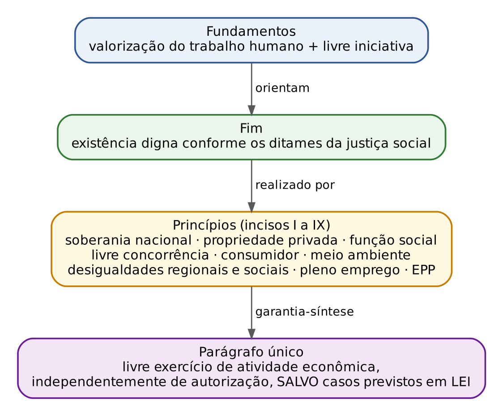
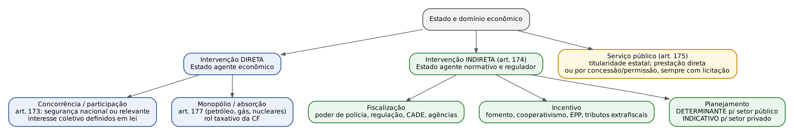
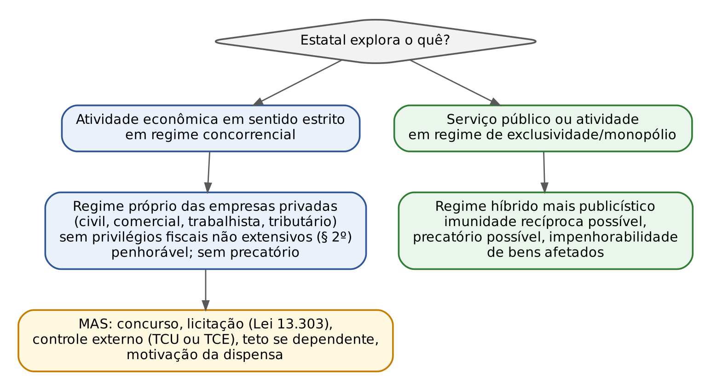
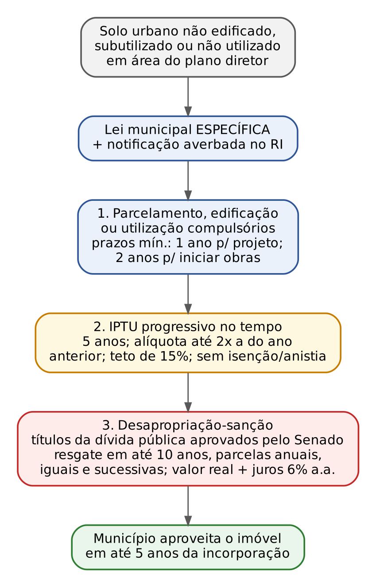
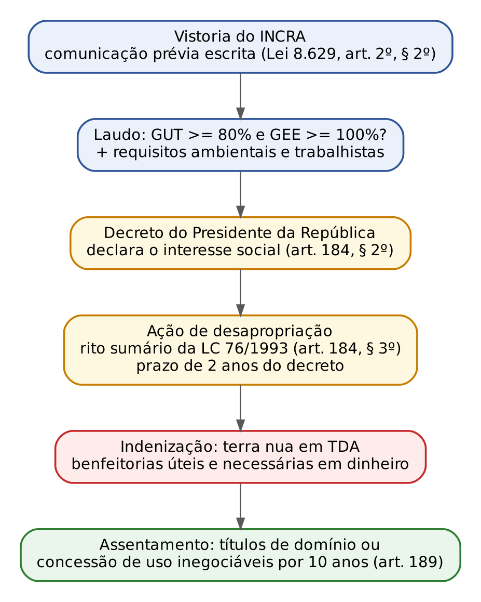
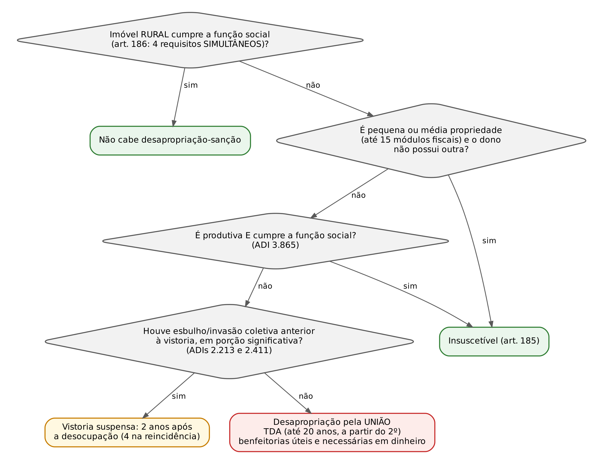

# CAPÍTULO 34 — ORDEM ECONÔMICA, PROPRIEDADE URBANA E RURAL, REFORMA AGRÁRIA E SISTEMA FINANCEIRO

:::INCIDENCIA
Pontos: TRF5 p. 13 e 18; TJRS p. 11. Nível A+. Lote: 33 questões (FGV 27, FCC 6).
O que mais cai: rol literal do art. 170 e o parágrafo único (autorização só "nos casos previstos em lei"); livre iniciativa x regulação (aplicativos, embalagem, SV 49); art. 173 e estatais; planejamento determinante x indicativo; art. 182, § 4º (sanções sucessivas); arts. 184 a 186 e 191; art. 243.
:::

#### Mapa de cobrança

| Subtema | FGV | FCC | Padrão |
|---|---|---|---|
| Fundamentos e princípios do art. 170 | 6 | 2 | Rol literal com intrusos (desenvolvimento sustentável, direito de greve, subsidiariedade, equilíbrio fiscal); livre iniciativa não absoluta |
| Livre exercício (parágrafo único) e livre iniciativa na jurisprudência | 5 | 1 | Atividade não regulamentada é livre; Temas 525 e 967; salão-parceiro |
| Intervenção direta e estatais (art. 173) | 1 | 0 | § 1º, II, com licitação; § 2º; § 5º (responsabilidade da pessoa jurídica) |
| Intervenção indireta, planejamento, cooperativas, agências, EPP | 2 | 2 | Planejamento "determinante" x "indicativo"; cooperativas de crédito no SFN; ADI 6.276 |
| Recursos minerais | 1 | 0 | Água mineral como insumo; imprescritibilidade (Tema 1.268) |
| Bens e terras públicas | 3 | 0 | Imprescritibilidade e impenhorabilidade; art. 188, § 1º (2.500 ha) |
| Política urbana | 2 | 0 | Plano diretor (Câmara, mais de 20 mil habitantes); desapropriação urbanística em até 10 anos |
| Política agrária, reforma agrária, usucapião rural e expropriação | 7 | 1 | TDA; art. 185 e ADI 3.865; ADI 2.213; art. 191 (50 ha, 5 anos); art. 243 sem indenização |

## 34.1 A Constituição econômica: fundamentos, fim e princípios (art. 170)

### 34.1.1 Estrutura do caput e natureza do modelo

O Título VII ("Da Ordem Econômica e Financeira") abre com uma norma de estrutura tripartida, que as bancas desmontam para trocar as peças de lugar:

- FUNDAMENTOS: valorização do trabalho humano e livre iniciativa. São dois, e a ordem importa pouco; o que importa é que a livre iniciativa NÃO aparece sozinha. No art. 1º, IV, ambos reaparecem como fundamentos da República ("os valores sociais do trabalho e da livre iniciativa"; ver Cap. 6).
- FIM: "assegurar a todos existência digna, conforme os ditames da justiça social". Crescimento econômico não é fim constitucional autônomo; alternativa que "prioriza o crescimento ainda que comprometa a justiça social" está errada.
- PRINCÍPIOS: os nove incisos (34.1.2).

A doutrina qualifica a Constituição econômica de 1988 como compromissória: consagra o modo de produção capitalista (propriedade privada, livre iniciativa, livre concorrência) e, ao mesmo tempo, impõe fins de transformação (justiça social, redução das desigualdades, pleno emprego) e reserva ao Estado papéis de regulador, planejador e, excepcionalmente, empresário. Eros Grau, em obra clássica sobre a ordem econômica de 1988, sustenta que a Constituição é dirigente também no plano econômico e que os princípios do art. 170 devem ser lidos em conjunto, sem hierarquia entre livre iniciativa e valorização do trabalho. Daí duas consequências de prova: (i) nenhum princípio da ordem econômica é absoluto; (ii) a restrição à livre iniciativa se resolve por ponderação e proporcionalidade (ver Cap. 5), e não por prevalência apriorística de um dos polos.

:::QUESTAO FGV 2025 — TRF-6 — JUIZ FEDERAL SUBSTITUTO (Q3742383)
Caso: sociedade farmacêutica impugna lei estadual que limita a comercialização de medicamentos de alto custo, alegando violação da livre iniciativa; o enunciado já anuncia que o STF reconheceu a livre iniciativa como fundamento, mas não absoluto. Gabarito: D — o art. 170 assegura a livre iniciativa, mas admite sua relativização diante de outros princípios, numa lógica de harmonização e ponderação. Armadilhas: (A) "direito absoluto"; (B) interpretação "isolada" com "supremacia" derivada do art. 1º, IV; (C) princípio exclusivamente do empresário; (E) prevalência "sempre" da iniciativa privada.
No mesmo sentido, sem caso: Q3879518 (FGV 2026 — ALERJ: gabarito B, a ordem econômica funda-se na valorização do trabalho e na livre iniciativa e visa à existência digna conforme a justiça social; erradas as alternativas de "lógica exclusiva do livre mercado", "propriedade como valor absoluto" e "crescimento em detrimento da redução das desigualdades"); Q3881552 (FGV 2026 — ALERJ: gabarito C, o projeto de incentivos setoriais deve harmonizar livre iniciativa e valorização do trabalho; erradas "neutralidade absoluta do Estado" e "privilégios permanentes a setores estratégicos").
:::

:::QUESTAO FGV 2026 — TRF-2 — JUIZ FEDERAL SUBSTITUTO (Q3996843)
Caso: plataforma digital dominante pratica preços predatórios e impõe cláusulas de paridade (*most favoured nation*) aos fornecedores. Gabarito: C — livre concorrência e defesa do consumidor são princípios autônomos da ordem econômica e justificam atuação estatal mesmo em ambiente regido predominantemente pela iniciativa privada. Armadilhas: (A) negar à valorização do trabalho função interpretativa em mercados digitais; (B) livre iniciativa "absoluta"; (D) função social restrita à propriedade imobiliária (a função social alcança bens de produção, empresa e ativos intangíveis); (E) pleno emprego como diretriz "desvinculada". Fundamento adicional: art. 173, § 4º (a lei reprimirá o abuso do poder econômico que vise à dominação dos mercados, à eliminação da concorrência e ao aumento arbitrário dos lucros), concretizado pela Lei 12.529/2011 (CADE).
:::

### 34.1.2 Os nove princípios: letra exata e intrusos

:::LEI CF, ART. 170, CAPUT E INCISOS
"A ordem econômica, fundada na valorização do trabalho humano e na livre iniciativa, tem por fim assegurar a todos existência digna, conforme os ditames da justiça social, observados os seguintes princípios: I - soberania nacional; II - propriedade privada; III - função social da propriedade; IV - livre concorrência; V - defesa do consumidor; VI - defesa do meio ambiente, inclusive mediante tratamento diferenciado conforme o impacto ambiental dos produtos e serviços e de seus processos de elaboração e prestação; VII - redução das desigualdades regionais e sociais; VIII - busca do pleno emprego; IX - tratamento favorecido para as empresas de pequeno porte constituídas sob as leis brasileiras e que tenham sua sede e administração no País."
:::

| Inciso | Nota de prova |
|---|---|
| I — soberania nacional | Soberania ECONÔMICA, não só política (art. 1º, I); fundamenta restrições ao capital estrangeiro (art. 172; art. 176, § 1º; art. 190; art. 192) |
| II e III — propriedade privada e função social | Lidos juntos; alcançam bens de produção e a empresa (função social da empresa), não só imóveis |
| IV — livre concorrência | Distinta da livre iniciativa (que é fundamento); base da SV 49 e da repressão ao abuso do poder econômico (art. 173, § 4º) |
| V — defesa do consumidor | Também direito fundamental (art. 5º, XXXII; ver Cap. 10); justifica regulação de preços e de práticas |
| VI — meio ambiente | "Inclusive mediante tratamento DIFERENCIADO conforme o impacto ambiental" (EC 42/2003): a CF autoriza, não veda, a diferenciação |
| VII — redução das desigualdades regionais e sociais | Repete objetivo fundamental (art. 3º, III); não confundir com "erradicar a pobreza" |
| VIII — busca do pleno emprego | Princípio "de busca": impõe orientação, não garante emprego a cada um |
| IX — tratamento favorecido para EPP | Constituídas sob leis brasileiras E com sede E administração no País (EC 6/1995 extinguiu a "empresa brasileira de capital nacional" do antigo art. 171) |

:::PEGADINHA INTRUSOS FREQUENTES NO ROL DO ART. 170
NÃO são princípios do art. 170: desenvolvimento sustentável (a expressão não está no rol; o inciso VI fala em "defesa do meio ambiente"), direito de greve, subsidiariedade, igualdade entre os Estados, livre exercício de profissão (art. 5º, XIII), direito de herança, mínimo existencial, Seguridade Social, equidade fiscal, equilíbrio das contas públicas, proteção ao empreendedor. Também são erradas as variações do inciso IX: "independentemente do porte", "empresas brasileiras de capital nacional" (revogado), "mesmo que tenham sede e administração em outro país". E o inciso VI não "veda" tratamento diferenciado: o autoriza.
:::

:::QUESTAO FCC 2026 — PGM MANAUS — PROCURADOR DO MUNICÍPIO (Q4338747)
Rol de princípios. Gabarito: D — busca do pleno emprego, defesa do consumidor, defesa do meio ambiente e redução das desigualdades regionais e sociais. Armadilhas: (A) inclui "subsidiariedade" e "vedado o tratamento diferenciado"; (B) "empresas brasileiras de capital nacional"; (C) favorecimento "independentemente do porte"; (E) EPP com sede e administração "em outro país".
No mesmo sentido: Q3954661 (FCC 2026 — DPE-MT: gabarito C, soberania nacional, defesa do consumidor e busca do pleno emprego; erradas as alternativas com "igualdade entre os estados", "livre exercício da profissão", "direito de herança", "mínimo existencial", "Seguridade Social", "equidade fiscal", "equilíbrio das contas públicas" e "proteção ao empreendedor").
:::

:::QUESTAO FGV 2026 — ENAM 2026.1 (Q4102399)
Três afirmativas. I: são princípios expressos "propriedade privada, desenvolvimento sustentável, livre concorrência e direito de greve" — FALSA (dois intrusos). II: proibir ou restringir o transporte individual por aplicativo é inconstitucional por violar livre iniciativa e livre concorrência — VERDADEIRA (Tema 967; ver 34.2.1). III: literalidade do parágrafo único do art. 170 — VERDADEIRA. Gabarito: E (II e III).
:::

Microempresas e empresas de pequeno porte têm dois fundamentos distintos que as provas confundem: o princípio do art. 170, IX (tratamento FAVORECIDO, só para EPP constituídas sob leis brasileiras com sede e administração no País) e a regra do art. 179, dirigida a TODOS os entes ("A União, os Estados, o Distrito Federal e os Municípios dispensarão às microempresas e às empresas de pequeno porte, assim definidas em lei, tratamento jurídico diferenciado, visando a incentivá-las pela simplificação de suas obrigações administrativas, tributárias, previdenciárias e creditícias, ou pela eliminação ou redução destas por meio de lei"). No plano tributário, o tratamento diferenciado e favorecido depende de lei complementar (art. 146, III, *d*, e parágrafo único — Simples Nacional; ver Apostila de Direito Tributário).

:::QUESTAO FCC 2026 — SEFAZ-SP — AFRE (Q3917705)
Gabarito: B — tratamento diferenciado e favorecido para EPP e microempresas no âmbito de União, Estados, DF e Municípios. Armadilhas: (A) e (D) tratamento "igualitário" (a isonomia aqui é material: tratar desigualmente os desiguais); (C) diferenciado "mas não favorecido" e "por mera opção legislativa" (é imposição constitucional); (E) diferenciado "mais gravoso".
:::

Os demais dispositivos do Capítulo I, menos cobrados, entram pela literalidade: o art. 172 (a lei disciplinará os investimentos de capital estrangeiro "com base no interesse nacional", incentivará os reinvestimentos e regulará a remessa de lucros); o art. 178 (ordenação dos transportes aéreo, aquático e terrestre; no transporte internacional, observância dos acordos firmados pela União, "atendido o princípio da reciprocidade"; a lei estabelecerá as condições em que a cabotagem e a navegação interior poderão ser feitas por embarcações estrangeiras — EC 7/1995); o art. 180 (todos os entes "promoverão e incentivarão o turismo"); e o art. 181 (o atendimento de requisição de documento ou informação comercial feita por autoridade estrangeira a pessoa residente no País depende de autorização do Poder competente — cláusula de soberania).

### 34.1.3 Livre exercício de atividade econômica (parágrafo único)

:::LEI CF, ART. 170, PARÁGRAFO ÚNICO
"É assegurado a todos o livre exercício de qualquer atividade econômica, independentemente de autorização de órgãos públicos, salvo nos casos previstos em lei."
:::

A norma é de eficácia CONTIDA (ver Cap. 4): produz efeitos plenos desde logo e só cede quando LEI exigir autorização. Três corolários:

- Silêncio normativo = liberdade. Atividade nova, não regulamentada, pode ser exercida sem licença específica; a ausência de lei não gera omissão inconstitucional nem autoriza mandado de injunção (o MI pressupõe que a falta de norma torne INVIÁVEL o exercício de direito; aqui a falta de norma é justamente o que garante o exercício).
- Reserva de LEI: decreto, portaria ou juízo discricionário da fiscalização não criam exigência de autorização. A "supremacia do interesse público" não substitui a lei.
- A exigência legal de autorização deve ser proporcional e ligada a risco ou interesse público relevante. A Lei 13.874/2019 (Declaração de Direitos de Liberdade Econômica), expressamente remetida pelo Planalto ao parágrafo único e ao art. 174, concretiza a regra: dispensa atos públicos de liberação para atividades de baixo risco, presume a boa-fé do particular e impõe a análise de impacto regulatório.

:::QUESTAO FGV 2025 — FISCALIZAÇÃO ESTADUAL (Q3780427)
Caso: fiscais constatam que João exerce atividade econômica sem autorização; não há lei exigindo autorização. Gabarito: A — a exigência de autorização "pressupõe integração legislativa". Armadilhas: (B) autorização só para estrangeiros; (C) autorização como comando constitucional direto; (D) livre iniciativa como vedação ABSOLUTA de autorização (errado: a lei pode exigi-la); (E) supremacia do interesse público autorizando a exigência por juízo da fiscalização.
No mesmo sentido: Q3044092 (FGV 2024 — fiscais municipais diante de pedido de alvará para atividade que associa serviço manual e tecnologia, sem regulamentação: gabarito B, a ausência de permissivo legal permite que Maria explore livremente a atividade; erradas a vedação por falta de lei, a autorização judicial, a "faculdade" do Executivo e o dever de editar a norma) e Q3592880 (FGV 2025 — TJ-SC — Juiz Leigo: gabarito A, Ana pode exercer livremente a atividade apesar da omissão regulamentar; armadilhas: MI e ADO, que pressupõem omissão que inviabilize direito).
:::

:::DICA ALVARÁ DE LOCALIZAÇÃO NÃO É AUTORIZAÇÃO DA ATIVIDADE
O parágrafo único afasta a exigência de autorização para EXERCER a atividade, mas não dispensa o poder de polícia urbanístico e sanitário (alvará de localização e funcionamento, zoneamento, licença ambiental), que tem base em lei e no art. 30, VIII. Por isso é válido condicionar o funcionamento à compatibilidade com o zoneamento, mas inválido negar o alvará "porque a atividade não está regulamentada".
:::

## 34.2 Livre iniciativa e livre concorrência na jurisprudência do STF

A FGV cobra, quase sempre em caso prático de lei estadual ou municipal, uma lista estável de precedentes. Muitos têm também face federativa (competência), desenvolvida no Cap. 22; aqui interessa o vício MATERIAL por ofensa aos princípios da ordem econômica.

### 34.2.1 Leis inconstitucionais por ofensa à livre iniciativa ou à livre concorrência

:::JURIS STF, TEMA 967 (RE 1.054.110, J. 9/5/2019) E ADPF 449/DF
Tese: "1. A proibição ou restrição da atividade de transporte privado individual por motorista cadastrado em aplicativo é inconstitucional, por violação aos princípios da livre iniciativa e da livre concorrência; e 2. No exercício de sua competência para regulamentação e fiscalização do transporte privado individual de passageiros, os Municípios e o Distrito Federal não podem contrariar os parâmetros fixados pelo legislador federal (CF/1988, art. 22, XI)." A tese tem DUAS faces: material (livre iniciativa e concorrência) e federativa (Lei 13.640/2018 como parâmetro). O Município regulamenta e fiscaliza; não proíbe nem cria restrição desproporcional (ver Cap. 22).
:::

:::QUESTAO FGV 2024 — PREFEITURA DE VITÓRIA — PROCURADOR (Q3044180)
Caso: lei municipal regula o táxi sem licitação para a autorização, veda o transporte por aplicativo e proíbe o mototáxi. Gabarito: B — inconstitucional APENAS quanto às vedações (aplicativo e mototáxi), que extrapolam a competência municipal e violam princípios da ordem econômica. Passos: (1) táxi é serviço de utilidade pública explorado por autorização, e a lei federal (Lei 12.587/2012) não exige licitação para essa autorização; (2) proibir aplicativo contraria o Tema 967; (3) proibir mototáxi, atividade regulada por lei federal, invade o art. 22, XI, e restringe a livre iniciativa. Armadilha: (C) exigir licitação para o táxi; (E) negar ao Município qualquer competência.
:::

:::JURIS STF, TEMA 525 (RE 839.950, J. 24/10/2018)
"São inconstitucionais as leis que obrigam os supermercados ou similares à prestação de serviços de acondicionamento ou embalagem das compras, por violação ao princípio da livre iniciativa (arts. 1º, IV, e 170 da Constituição)." O vício é MATERIAL: impor custo de mão de obra a um setor, sem relação com segurança, saúde ou informação do consumidor, é intervenção desproporcional. Não confundir com leis consumeristas de informação (preço, rotulagem), em regra válidas.
:::

:::QUESTAO FGV 2026 — ALERJ — ESPECIALISTA LEGISLATIVO (Q3883342)
Estudo prévio de projeto de lei estadual que obrigaria supermercados a empacotar as compras. Gabarito: B — a proposição afrontaria a livre iniciativa, sendo inconstitucional (Tema 525). Armadilhas: (A) lei complementar; (C) regulamento; (D) direito econômico e consumidor, "constitucional" (o atrativo da competência concorrente do art. 24, I e V, não salva o vício material); (E) lei nacional da União.
:::

:::JURIS SÚMULA VINCULANTE 49 (17/6/2015; ANTIGA SÚMULA 646 DO STF)
"Ofende o princípio da livre concorrência lei municipal que impede a instalação de estabelecimentos comerciais do mesmo ramo em determinada área." O zoneamento é competência municipal legítima (art. 30, VIII); o que viola a Constituição é o zoneamento ANTICONCORRENCIAL, que protege o estabelecimento já instalado contra a entrada de concorrente. A distinção com a distância mínima fundada em segurança (postos de combustível) está no Cap. 22.
:::

:::SENTENCA CONTROLE INCIDENTAL DE LEI MUNICIPAL ANTICONCORRENCIAL
Situação: mandado de segurança contra indeferimento de alvará de farmácia com base em lei municipal que exige distância mínima de 500 metros de outra farmácia. Redação-modelo: "A Lei Municipal n. X, ao vedar a instalação de estabelecimento do mesmo ramo em raio determinado, não disciplina o uso do solo segundo critérios urbanísticos, de segurança ou de saúde, mas reserva mercado ao comerciante já estabelecido, em afronta direta ao princípio da livre concorrência (CF, art. 170, IV), conforme o enunciado da Súmula Vinculante 49. Reconheço, *incidenter tantum*, a inconstitucionalidade do dispositivo, cuja aplicação afasto no caso concreto, e concedo a segurança para determinar a análise do pedido de alvará sem a exigência impugnada." Observação: o juiz singular declara a inconstitucionalidade incidental sem reserva de plenário; no tribunal, órgão fracionário pode aplicar diretamente a SV 49 sem remeter ao plenário ou órgão especial (art. 949, parágrafo único, do CPC; ver Cap. 17).
:::

### 34.2.2 Intervenções válidas: regulação, preços e setores específicos

A livre iniciativa convive com regulação intensa, e o STF valida a maior parte das intervenções setoriais que tenham fundamento constitucional identificável:

- Cota de tela: "São constitucionais a cota de tela, consistente na obrigatoriedade de exibição de filmes nacionais nos cinemas brasileiros, e as sanções administrativas decorrentes de sua inobservância" (Tema 704, RE 627.432, j. 18/3/2021). Fundamentos: proteção da cultura nacional (arts. 215 e 216) e proporcionalidade da restrição.
- Lei Ferrari: a Lei 6.729/1979, que impõe contrato de concessão comercial entre montadoras e concessionárias, cláusula de exclusividade de marca, delimitação territorial e cotas, foi RECEPCIONADA e é compatível com livre iniciativa, liberdade de contratar e defesa da concorrência; o setor tem estrutura oligopolista e assimetria contratual, o aperfeiçoamento é questão de política legislativa e o CADE continua competente para reprimir abusos (ADPF 1.106/DF, Relator Ministro Edson Fachin, Plenário, j. 23/4/2026, Info 1214).
- Parceria em salões de beleza: é constitucional o contrato de parceria entre salão-parceiro e profissional-parceiro (Lei 13.352/2016), mas ele é nulo quando usado para dissimular relação de emprego (ADI 5.625, Plenário, j. 28/10/2021, Info 1036) — prestígio à livre iniciativa e aos valores sociais do trabalho.
- Meia-entrada e descontos obrigatórios: é constitucional lei estadual que assegura meia-entrada a estudantes em eventos esportivos, culturais e de lazer (ADI 1.950/SP, Relator Ministro Eros Grau, Plenário, j. 3/11/2005, Info 407; vencidos os Ministros Marco Aurélio e Cezar Peluso). Duas faces: formal, porque o Estado exerce competência concorrente em direito econômico (art. 24, I) e, sem lei federal, a competência plena do § 3º; material, porque a livre iniciativa convive com o dever estatal de garantir acesso à educação, à cultura e ao desporto (arts. 23, V, 205, 208, 215 e 217, § 3º).
- Controle de preços e responsabilidade do Estado: "É imprescindível para o reconhecimento da responsabilidade civil do Estado em decorrência da fixação de preços no setor sucroalcooleiro a comprovação de efetivo prejuízo econômico, mediante perícia técnica em cada caso concreto" (Tema 826, ARE 884.325, Relator Ministro Edson Fachin, j. 18/8/2020). A intervenção em preços não é, em si, ilícita; gera dever de indenizar quando, fixados os preços abaixo dos custos apurados pelo próprio Estado, há dano efetivo e demonstrado.

:::QUESTAO FCC 2025 — DPE-AM — DEFENSOR PÚBLICO (Q3531575)
Decisões vinculantes que ressaltaram os valores sociais do trabalho e da livre iniciativa. Gabarito: A — validade dos contratos de parceria entre salão-parceiro e profissional-parceiro, desde que conformes aos fatos e sem elementos de relação de emprego (ADI 5.625). Erradas: (B) o motorista de aplicativo não foi submetido à CLT e o STF não admitiu operação "ainda que prejudique a mobilidade"; (C) o serviço postal NÃO é atividade econômica em sentido estrito (ADPF 46; ver 34.4.2); (D) vouchers e fechamento de unidades públicas não foram validados; (E) a fixação do horário de funcionamento do comércio é competência MUNICIPAL (Súmula Vinculante 38; ver Cap. 22), não "extrapola" a competência local.
:::

### 34.2.3 Repressão ao abuso do poder econômico e responsabilidade da pessoa jurídica

:::LEI CF, ART. 173, §§ 4º E 5º
"§ 4º - lei reprimirá o abuso do poder econômico que vise à dominação dos mercados, à eliminação da concorrência e ao aumento arbitrário dos lucros. § 5º A lei, sem prejuízo da responsabilidade individual dos dirigentes da pessoa jurídica, estabelecerá a responsabilidade desta, sujeitando-a às punições compatíveis com sua natureza, nos atos praticados contra a ordem econômica e financeira e contra a economia popular."
:::

- O § 4º reprime o ABUSO do poder econômico, não o poder econômico em si: a posição dominante obtida por eficiência é lícita. As três finalidades (dominação dos mercados, eliminação da concorrência, aumento arbitrário dos lucros) estão no texto; a Lei 12.529/2011 (Sistema Brasileiro de Defesa da Concorrência) as concretiza.
- O § 5º é, com o art. 225, § 3º (meio ambiente), um dos dois fundamentos constitucionais da responsabilização da pessoa jurídica. Diferença decisiva: o art. 225, § 3º, prevê expressamente sanções PENAIS à pessoa jurídica (regulado pela Lei 9.605/1998); o art. 173, § 5º, fala em "punições compatíveis com sua natureza", e o legislador não instituiu responsabilidade penal da pessoa jurídica por crimes contra a ordem econômica (a responsabilização é administrativa e civil — Lei 12.529/2011 e Lei 12.846/2013). Ver Apostila de Direito Penal.
- A responsabilidade da pessoa jurídica é "sem prejuízo" da responsabilidade individual dos dirigentes: as duas coexistem. A alternativa que restringe a responsabilidade aos dirigentes (Q3996844, D) está errada.

## 34.3 Intervenção do Estado no domínio econômico

### 34.3.1 Modalidades

A classificação mais difundida, de Eros Grau, distingue a intervenção NO domínio econômico (o Estado atua como agente: por absorção, quando detém o monopólio, ou por participação, quando concorre com particulares) da intervenção SOBRE o domínio econômico (o Estado disciplina a atividade alheia: por direção, mediante comandos cogentes, ou por indução, mediante estímulos e desestímulos). Na terminologia que as bancas usam, a primeira é a intervenção DIRETA (arts. 173 e 177) e a segunda, a INDIRETA (art. 174). O serviço público (art. 175) não é intervenção no domínio econômico em sentido estrito: é atividade de titularidade estatal, e por isso o particular só a exerce por delegação.

|  | Intervenção direta | Intervenção indireta | Serviço público |
|---|---|---|---|
| Base | arts. 173 e 177 | art. 174 | art. 175 |
| Papel do Estado | agente econômico (empresário) | agente normativo e regulador | titular da atividade |
| Pressuposto | segurança nacional ou relevante interesse coletivo, definidos em lei; ou monopólio previsto na CF | fiscalização, incentivo e planejamento, na forma da lei | prestação direta ou por concessão ou permissão, sempre com licitação |
| Regime | predominantemente privado (art. 173, § 1º, II) | direito público (poder de polícia, fomento) | direito público, com delegatário privado |
| Atividade do particular | livre (salvo monopólio) | livre, sob regulação | só por delegação |

### 34.3.2 Exploração direta de atividade econômica (art. 173)

:::LEI CF, ART. 173, CAPUT
"Ressalvados os casos previstos nesta Constituição, a exploração direta de atividade econômica pelo Estado só será permitida quando necessária aos imperativos da segurança nacional ou a relevante interesse coletivo, conforme definidos em lei."
:::

Quatro pontos de letra:

- Caráter SUBSIDIÁRIO: "só será permitida". A regra é a iniciativa privada; o Estado-empresário é exceção que precisa de justificativa.
- Pressupostos ALTERNATIVOS: imperativos da segurança nacional OU relevante interesse coletivo.
- "Conforme definidos em lei": a lei qualifica o pressuposto; não basta autorização legislativa genérica sem a demonstração do imperativo (erro da alternativa E da Q3996844). Além disso, a criação da estatal depende de lei específica que AUTORIZE sua instituição (art. 37, XIX), e as subsidiárias, de autorização legislativa (art. 37, XX; ver Cap. 24).
- "Ressalvados os casos previstos nesta Constituição": monopólios (art. 177) e serviços públicos (art. 175) não precisam dos pressupostos do caput, porque a própria CF já os atribuiu ao Estado.

:::LEI CF, ART. 173, §§ 1º A 3º
"§ 1º A lei estabelecerá o estatuto jurídico da empresa pública, da sociedade de economia mista e de suas subsidiárias que explorem atividade econômica de produção ou comercialização de bens ou de prestação de serviços, dispondo sobre: I - sua função social e formas de fiscalização pelo Estado e pela sociedade; II - a sujeição ao regime jurídico próprio das empresas privadas, inclusive quanto aos direitos e obrigações civis, comerciais, trabalhistas e tributários; III - licitação e contratação de obras, serviços, compras e alienações, observados os princípios da administração pública; IV - a constituição e o funcionamento dos conselhos de administração e fiscal, com a participação de acionistas minoritários; V - os mandatos, a avaliação de desempenho e a responsabilidade dos administradores. § 2º As empresas públicas e as sociedades de economia mista não poderão gozar de privilégios fiscais não extensivos às do setor privado. § 3º A lei regulamentará as relações da empresa pública com o Estado e a sociedade."
:::

O estatuto do § 1º (redação da EC 19/1998) é a Lei 13.303/2016 (Lei das Estatais). O regime é HÍBRIDO: privado quanto às obrigações civis, comerciais, trabalhistas e tributárias (inciso II), mas com núcleo publicístico inafastável — concurso público (art. 37, II), licitação própria (inciso III; normas gerais pela União, art. 22, XXVII), controle externo (art. 71, II), teto remuneratório quando dependente (art. 37, § 9º), vedação de acumulação (art. 37, XVII) e dever de motivar a dispensa de empregados (Tema 1.022; ver Cap. 24).

:::QUESTAO FGV 2026 — TRF-2 — JUIZ FEDERAL SUBSTITUTO (Q3996844)
Caso: a União cria, por lei específica, sociedade de economia mista para produzir e comercializar fertilizantes, invocando segurança alimentar, e a empresa passa a concorrer com particulares. Gabarito: C — a sujeição ao regime próprio das empresas privadas alcança direitos e obrigações civis, comerciais, trabalhistas e tributárias, sem afastar a licitação e os princípios da Administração Pública. Armadilhas: (A) regime "integralmente de direito público"; (B) privilégios fiscais exclusivos "justificados por lei específica" (o § 2º não tem ressalva); (D) responsabilidade restrita aos dirigentes (o § 5º prevê a da pessoa jurídica); (E) dispensa dos imperativos do caput.
:::

:::ESQUEMA EXPLORADORAS DE ATIVIDADE ECONÔMICA X PRESTADORAS DE SERVIÇO PÚBLICO
A distinção entre estatal que explora atividade econômica em regime concorrencial e estatal que presta serviço público (ou atua em regime de exclusividade) é a chave de várias teses do STF, cada uma desenvolvida no capítulo próprio:
- Imunidade tributária recíproca (art. 150, VI, *a*): pode alcançar prestadoras de serviço público em regime não concorrencial e sem intuito primordial de lucro; não alcança exploradoras de atividade econômica em concorrência nem as sociedades de economia mista com ações negociadas em bolsa voltadas à remuneração do capital (Cap. 33 e Apostila de Direito Tributário).
- Regime de precatórios (art. 100): aplicável a estatais prestadoras de serviço público próprio do Estado, em regime não concorrencial e sem distribuição de lucros; inaplicável às que exploram atividade econômica em concorrência (Cap. 29).
- Penhorabilidade de bens: os bens afetados à prestação de serviço público são impenhoráveis; os das exploradoras em concorrência, penhoráveis.
- Privilégios fiscais (art. 173, § 2º): a vedação mira as exploradoras em concorrência, para preservar a isonomia com o setor privado.
:::

#### Governança, indicações políticas e desestatização

- Lei das Estatais: o STF validou, por maioria, as restrições da Lei 13.303/2016 a indicações políticas para diretorias e conselhos de administração (vedação a ministros, secretários, dirigentes partidários e participantes de campanha recente, entre outros), por não violarem a Constituição nem direitos fundamentais; por unanimidade, preservou até o fim dos mandatos os indicados durante a vigência da liminar de março de 2023 (ADI 7.331, Plenário, j. 9/5/2024). Fundamentos: moralidade, impessoalidade e eficiência na gestão das estatais (art. 173, § 1º, I e V).
- Alienação de controle: "A alienação do controle acionário de empresas públicas e sociedades de economia mista exige autorização legislativa e licitação"; a exigência de autorização legislativa "não se aplica à alienação do controle de suas subsidiárias e controladas", caso em que a operação pode ser feita sem licitação, desde que siga procedimento que observe os princípios do art. 37 e assegure a competitividade (ADI 5.624 MC-Ref, Relator Ministro Ricardo Lewandowski, Plenário, j. 6/6/2019, Info 943). Lógica de simetria das formas: o que a lei autorizou criar, só a lei autoriza alienar (art. 37, XIX e XX).
- Plebiscito estadual: é constitucional a emenda à Constituição gaúcha (EC estadual 77/2019) que revogou a exigência de consulta plebiscitária prévia para alienar, cindir, fundir ou extinguir estatais, mantida a autorização legislativa (STF, j. 25/10/2024, Info 1156). O exame da Q3328186 (FGV 2025 — ENAC), que reproduz o caso, está no Cap. 3.
- Eletrobras: na desestatização por capitalização (Lei 14.182/2021), o *voting cap* de 10% imposto a qualquer acionista, inclusive à União (que manteve cerca de 42% das ações ordinárias), é constitucional desde que assegurada à União a indicação de membros dos conselhos, conforme acordo homologado na própria ADI (ADI 7.385 Acordo; v. Cap. 18).

### 34.3.3 Monopólios da União (art. 177)

:::LEI CF, ART. 177, CAPUT E § 1º
"Constituem monopólio da União: I - a pesquisa e a lavra das jazidas de petróleo e gás natural e outros hidrocarbonetos fluidos; II - a refinação do petróleo nacional ou estrangeiro; III - a importação e exportação dos produtos e derivados básicos resultantes das atividades previstas nos incisos anteriores; IV - o transporte marítimo do petróleo bruto de origem nacional ou de derivados básicos de petróleo produzidos no País, bem assim o transporte, por meio de conduto, de petróleo bruto, seus derivados e gás natural de qualquer origem; V - a pesquisa, a lavra, o enriquecimento, o reprocessamento, a industrialização e o comércio de minérios e minerais nucleares e seus derivados, com exceção dos radioisótopos cuja produção, comercialização e utilização poderão ser autorizadas sob regime de permissão, conforme as alíneas b e c do inciso XXIII do caput do art. 21 desta Constituição Federal. § 1º A União poderá contratar com empresas estatais ou privadas a realização das atividades previstas nos incisos I a IV deste artigo observadas as condições estabelecidas em lei."
:::

- Rol TAXATIVO: monopólio só por norma constitucional; lei não cria monopólio novo (o art. 173 permite ao Estado concorrer, não excluir particulares).
- EC 9/1995 flexibilizou o monopólio do petróleo: a União PODE contratar estatais ou privadas para os incisos I a IV. O inciso V (nuclear) ficou FORA do § 1º: não há contratação com privados, ressalvados os radioisótopos sob PERMISSÃO (EC 49/2006), nos termos do art. 21, XXIII, *b* (pesquisa e usos médicos, agrícolas e industriais) e *c* (radioisótopos de meia-vida igual ou inferior a duas horas). A questão de radioisótopos (Q2511895) foi resolvida no Cap. 22.
- Monopólio da ATIVIDADE, não do produto: "o monopólio se refere à atividade empresarial, e não à propriedade"; por isso a lei pode atribuir ao concessionário a propriedade do produto da lavra (art. 176, caput) sem violar o art. 177. A Petrobras perdeu a condição de executora exclusiva e passou a ser estatal exploradora de atividade econômica, sujeita a licitação (ADI 3.273, Plenário, j. 16/3/2005, Info 380, que julgou improcedente a ação contra a Lei 9.478/1997).
- O § 2º manda a lei dispor sobre a garantia do fornecimento de derivados em todo o território, as condições de contratação e "a estrutura e atribuições do órgão regulador do monopólio da União" (base constitucional da ANP).
- O § 4º disciplina a CIDE-combustíveis (EC 33/2001): alíquota diferenciada por produto ou uso, reduzida e restabelecida por ato do Executivo sem anterioridade do art. 150, III, *b*, e destinação a subsídios de preços ou transporte de combustíveis, projetos ambientais da indústria do petróleo e gás, infraestrutura de transportes e, desde a EC 132/2023, subsídios a tarifas de transporte público coletivo de passageiros (alínea *d*). Detalhes tributários: Cap. 33.
- Gás canalizado: os serviços LOCAIS de gás canalizado são dos ESTADOS (art. 25, § 2º; vedada MP na regulamentação) — não confundir com o monopólio da União sobre o transporte por conduto de gás natural (inciso IV). Ver Cap. 21.

:::PEGADINHA MONOPÓLIO X PRIVILÉGIO X COMPETÊNCIA LEGISLATIVA
(1) O monopólio do petróleo NÃO se limita à extração: abrange refino, importação e exportação e transporte (incisos II a IV). (2) Lei estadual que obriga empreiteiras de rodovias estaduais a usar asfalto com borracha de pneus inservíveis não trata de petróleo nem do monopólio: é constitucional (Q2511894, gabarito A; desenvolvida no Cap. 22). (3) Serviço postal é PRIVILÉGIO (exclusividade de serviço público), não monopólio de atividade econômica (34.4.2). (4) Monopólio é diferente de competência privativa para legislar sobre energia (art. 22, IV): lei distrital que obriga pesar botijões de GLP diante do consumidor é inconstitucional por invadir esta última (ADI 4.676; Cap. 22).
:::

## 34.4 Intervenção indireta: fiscalização, incentivo, planejamento e regulação

### 34.4.1 O art. 174

:::LEI CF, ART. 174, CAPUT E §§ 1º A 4º
"Como agente normativo e regulador da atividade econômica, o Estado exercerá, na forma da lei, as funções de fiscalização, incentivo e planejamento, sendo este determinante para o setor público e indicativo para o setor privado. § 1º A lei estabelecerá as diretrizes e bases do planejamento do desenvolvimento nacional equilibrado, o qual incorporará e compatibilizará os planos nacionais e regionais de desenvolvimento. § 2º A lei apoiará e estimulará o cooperativismo e outras formas de associativismo. § 3º O Estado favorecerá a organização da atividade garimpeira em cooperativas, levando em conta a proteção do meio ambiente e a promoção econômico-social dos garimpeiros. § 4º As cooperativas a que se refere o parágrafo anterior terão prioridade na autorização ou concessão para pesquisa e lavra dos recursos e jazidas de minerais garimpáveis, nas áreas onde estejam atuando, e naquelas fixadas de acordo com o art. 21, XXV, na forma da lei."
:::

O par "DETERMINANTE para o setor público / INDICATIVO para o setor privado" é a pegadinha mais frequente do capítulo. O plano vincula a Administração (é base para a coerência entre PPA, LDO, LOA e execução, o que interessa ao controle externo), mas ao particular só pode oferecer incentivos e desincentivos: converter o plano em obrigação de compra, produção ou investimento do setor privado é intervenção por direção sem base constitucional e ofende a livre iniciativa.

:::QUESTAO FGV 2026 — TRF-2 — JUIZ FEDERAL SUBSTITUTO (Q3996842)
Caso: lei estadual institui plano de desenvolvimento com (I) prioridade, nas contratações públicas, a cooperativas sediadas no Estado, observados vantajosidade, igualdade entre licitantes e lei nacional de licitações; e (II) metas obrigatórias para indústrias de grande faturamento adquirirem percentual mínimo de fornecedores locais, sob multa. Gabarito: B — I é constitucional (estímulo ao cooperativismo, art. 174, § 2º, com respeito à licitação); II é inconstitucional, por converter o planejamento indicativo em imposição compulsória ao setor privado. Armadilhas: (A) eficácia vinculante do plano também para o setor privado; (C) inverter as medidas; (D) vedação a "qualquer" direcionamento estatal; (E) favorecimento regional vedado. Passos: (1) identificar o destinatário de cada medida (setor público x privado); (2) aplicar o art. 174 (determinante x indicativo); (3) no item I, checar se a preferência respeita isonomia e normas gerais (art. 22, XXVII).
No mesmo sentido: Q3880793 (FGV 2026 — ALERJ — Procurador Legislativo: gabarito E, as três afirmativas corretas — Estado como regulador e, excepcionalmente, agente direto; planejamento determinante para o setor público e indicativo para o privado, relevante para o controle externo; tributos e instrumentos financeiros como mecanismos de intervenção, respeitados os princípios próprios).
:::

:::QUESTAO FCC 2025 — PREFEITURA DE SÃO PAULO — AUDITOR (Q3290884)
Cooperativas na CF. I — o Estado favorecerá a organização garimpeira em cooperativas (art. 174, § 3º): correta. II — a prioridade das cooperativas garimpeiras não se aplica às terras indígenas: correta, porque o art. 231, § 7º, afasta das terras indígenas o disposto no art. 174, §§ 3º e 4º. III — o SFN não abrange as cooperativas de crédito: FALSA (o art. 192 diz "abrangendo as cooperativas de crédito"). IV — a política agrícola leva em conta o cooperativismo (art. 187, VI): correta. Gabarito: E (I, II e IV).
:::

### 34.4.2 Serviços públicos (art. 175)

:::LEI CF, ART. 175
"Incumbe ao Poder Público, na forma da lei, diretamente ou sob regime de concessão ou permissão, sempre através de licitação, a prestação de serviços públicos. Parágrafo único. A lei disporá sobre: I - o regime das empresas concessionárias e permissionárias de serviços públicos, o caráter especial de seu contrato e de sua prorrogação, bem como as condições de caducidade, fiscalização e rescisão da concessão ou permissão; II - os direitos dos usuários; III - política tarifária; IV - a obrigação de manter serviço adequado."
:::

- "INCUMBE ao Poder Público": a titularidade é estatal; a delegação transfere a execução, não a titularidade.
- "SEMPRE através de licitação": não há concessão ou permissão de serviço público sem licitação; a prorrogação não prevista no edital ou a renovação sem licitação equivale a nova outorga sem licitação (o tema, com o caso de transporte intermunicipal, está no Cap. 20). A autorização não aparece no art. 175 (aparece nos arts. 21, XI e XII, e 223); é vínculo precário para atividades de interesse predominantemente privado ou emergencial.
- Leis gerais: Lei 8.987/1995 (concessões e permissões) e Lei 11.079/2004 (PPP). Política tarifária, direitos dos usuários e obrigações do concessionário são definidos pelo PODER CONCEDENTE; daí a inconstitucionalidade de leis estaduais que interferem em contratos de concessão federal (energia, telecomunicações), tema de competência desenvolvido no Cap. 22.
- Greve no transporte coletivo e concessão: o Município pode, por lei, autorizar a contratação emergencial de carros de aplicativo durante greve no transporte coletivo, mas não pode descontar esse custo dos créditos da concessionária nem extinguir automaticamente a concessão (ADPF 1.284/MA, j. 18/9/2026, Info 1230). A extinção e a caducidade exigem o procedimento da lei e o devido processo (art. 175, parágrafo único, I).

:::JURIS STF, ADPF 46/DF (PLENÁRIO, J. 5/8/2009, INFO 554)
O serviço postal é SERVIÇO PÚBLICO, e não atividade econômica em sentido estrito; por isso não se lhe aplicam os argumentos de livre iniciativa e livre concorrência, e a exclusividade da ECT é PRIVILÉGIO, inerente ao serviço público, e não monopólio de atividade econômica. A arguição contra a Lei 6.538/1978 foi julgada improcedente, com interpretação conforme do art. 42 (tipo penal de violação do privilégio) para restringi-lo às atividades do art. 9º da lei (cartas, cartões-postais, correspondência agrupada, fabricação e emissão de selos). Pela maioria, ficaram fora do privilégio encomendas e impressos; a extensão do privilégio a boletos e faturas dividiu o Plenário e não deve ser afirmada como tese da ADPF em prova (ver nota). Desdobramento no STJ: a entrega de carnês de IPTU e ISS pelo próprio Município, sem terceiros, não viola o privilégio postal, porque a notificação integra o processo de lançamento tributário (AgRg no AREsp 228.049/MG, Info 519). Sobre lei estadual que regula a postagem de boletos (Tema 491), ver Cap. 22.
:::

### 34.4.3 Agências reguladoras

A CF menciona "órgão regulador" em dois lugares: telecomunicações (art. 21, XI, EC 8/1995) e petróleo (art. 177, § 2º, III, EC 9/1995). As demais agências (ANEEL, ANVISA, ANS, ANA, ANTT, ANAC, ANM) e as estaduais (no RS, a AGERGS) são criação legal, como autarquias sob regime especial (Lei 13.848/2019, lei geral das agências federais, e Lei 9.986/2000, gestão de recursos humanos). O regime especial combina: dirigentes nomeados pelo Chefe do Executivo após aprovação do Senado (ou da Assembleia, no plano estadual), mandato fixo e não coincidente, vedação de exoneração *ad nutum*, quarentena, autonomia financeira e decisões colegiadas.

:::JURIS STF, ADI 1.949/RS (RELATOR MINISTRO DIAS TOFFOLI, PLENÁRIO, J. 17/9/2014)
AGERGS (agência gaúcha de regulação de serviços públicos delegados). (1) É inconstitucional a lei que permite à Assembleia Legislativa DESTITUIR os conselheiros da agência sem participação do Governador: viola a separação de Poderes. (2) É constitucional o mandato de quatro anos com aprovação prévia dos nomes pela Assembleia, por simetria com o modelo federal (art. 52, III, *f*). (3) O Governador participa da destituição, mas não pode exonerar livremente; enquanto não houver lei, o mandato só se perde por renúncia, condenação judicial transitada em julgado ou processo administrativo disciplinar, admitidas outras hipóteses legais desde que motivadas e com processo formal. Lição: a autonomia reforçada da agência protege-a tanto do Executivo quanto do Legislativo.
:::

:::QUESTAO FGV 2024 — MPE-GO — PROMOTOR DE JUSTIÇA SUBSTITUTO (Q2367555)
Caso: confederação de setor regulado impugna em ADI a vedação de que ocupantes de cargo em organização sindical integrem a diretoria colegiada de agências reguladoras. Gabarito: B — improcedência: exigência legal de requisitos para cargos públicos, racionalmente justificada, não é discriminação; preserva a atuação técnica e impessoal das agências. Fundamento: o STF declarou constitucionais os incisos III e VII do art. 8º-A da Lei 9.986/2000 (vedação de indicação de dirigente sindical e de membro de conselho ou diretoria de associação patronal ou trabalhista), porque os órgãos decisórios das agências devem estar livres de influências políticas, sociais e econômicas externas, e a restrição, de alcance limitado, não viola igualdade nem liberdade de associação (ADI 6.276, Plenário, j. 17/9/2021, Info 1030). Armadilhas: (A) negar autonomia às agências e vinculá-las às "orientações políticas do governo"; (C) e (D) procedência por discriminação sindical; (E) ilegitimidade da confederação.
:::

:::DICA PODER NORMATIVO DAS AGÊNCIAS
O STF admite que as agências editem normas técnicas dentro dos parâmetros da lei (deslegalização limitada, ou delegação com *standards*), mas não que inovem em matéria reservada à lei nem contrariem a lei setorial. Em prova, a fórmula segura é: poder normativo técnico e setorial, subordinado à lei, sujeito a controle judicial de legalidade e razoabilidade e, no âmbito federal, à análise de impacto regulatório (Lei 13.848/2019 e Lei 13.874/2019).
:::

## 34.5 Recursos minerais e potenciais de energia hidráulica

### 34.5.1 Regime do art. 176

:::LEI CF, ART. 176
"As jazidas, em lavra ou não, e demais recursos minerais e os potenciais de energia hidráulica constituem propriedade distinta da do solo, para efeito de exploração ou aproveitamento, e pertencem à União, garantida ao concessionário a propriedade do produto da lavra. § 1º A pesquisa e a lavra de recursos minerais e o aproveitamento dos potenciais a que se refere o 'caput' deste artigo somente poderão ser efetuados mediante autorização ou concessão da União, no interesse nacional, por brasileiros ou empresa constituída sob as leis brasileiras e que tenha sua sede e administração no País, na forma da lei, que estabelecerá as condições específicas quando essas atividades se desenvolverem em faixa de fronteira ou terras indígenas. § 2º - É assegurada participação ao proprietário do solo nos resultados da lavra, na forma e no valor que dispuser a lei. § 3º A autorização de pesquisa será sempre por prazo determinado, e as autorizações e concessões previstas neste artigo não poderão ser cedidas ou transferidas, total ou parcialmente, sem prévia anuência do poder concedente. § 4º Não dependerá de autorização ou concessão o aproveitamento do potencial de energia renovável de capacidade reduzida."
:::

| Elemento | Regra | Pegadinha |
|---|---|---|
| Titularidade | União (também art. 20, VIII e IX) | O recurso no subsolo de imóvel municipal ou estadual continua da União; o ente local não tem prioridade de exploração |
| Dualidade dominial | propriedade do subsolo distinta da do solo | O dono do solo não é dono da jazida |
| Produto da lavra | pertence ao concessionário | Não viola o monopólio (ADI 3.273) |
| Título | autorização (pesquisa) ou concessão (lavra) da UNIÃO | Pesquisa: SEMPRE por prazo determinado; cessão ou transferência só com anuência prévia |
| Quem pode explorar | brasileiros ou empresa constituída sob leis brasileiras com sede e administração no País | Condições específicas para faixa de fronteira e terras indígenas (nestas, ainda o art. 231, § 3º: autorização do Congresso, oitiva das comunidades e participação nos resultados) |
| Proprietário do solo | participação nos resultados, na forma e no valor da lei | Direito do PROPRIETÁRIO do solo, distinto da participação dos ENTES (art. 20, § 1º) |
| Energia renovável de capacidade reduzida | independe de autorização ou concessão | Única dispensa constitucional |
| Garimpo | cooperativas favorecidas e com prioridade (art. 174, §§ 3º e 4º) | Não se aplica às terras indígenas (art. 231, § 7º) |

Participação dos entes no resultado da exploração ou compensação financeira (art. 20, § 1º), natureza de receita originária dos *royalties* e bens da União: Cap. 21. Competência legislativa privativa sobre jazidas e energia (art. 22, IV e XII), competência comum para registrar e fiscalizar concessões minerárias (art. 23, XI), indenização ambiental na mineração (ADI 4.031/PA) e plano diretor que zoneia a mineração: Cap. 22.

:::QUESTAO FGV 2025 — TRF-6 — JUIZ FEDERAL SUBSTITUTO (Q3742423)
Três afirmativas, todas corretas (gabarito A). I — competência COMUM para registrar, acompanhar e fiscalizar as concessões de pesquisa e exploração de recursos hídricos e minerais (art. 23, XI): resolvida no Cap. 22. II — é indispensável autorização federal para usar água mineral extraída do solo como insumo de processo industrial, mesmo sem envase nem consumo humano: tese do STJ, porque a água mineral é recurso mineral (Código de Mineração) e, portanto, bem da União sujeito ao regime do art. 176 (REsp 1.490.603/PR, j. 20/2/2024, Info 801). III — é imprescritível a pretensão de ressarcimento ao erário decorrente da exploração irregular do patrimônio mineral da União, "porquanto indissociável do dano ambiental causado" (STF, Tema 1.268, RE 1.427.694/SC, Relatora Ministra Rosa Weber, Plenário, j. 1/9/2023). Armadilha: supor aplicável a prescrição do Tema 666 (ilícito civil comum); a extração clandestina causa necessariamente dano ambiental, o que atrai a lógica do Tema 999 (imprescritibilidade da reparação ambiental).
:::

### 34.5.2 Energia

O sistema constitucional da energia é repartido entre: competência material da União para explorar, diretamente ou mediante autorização, concessão ou permissão, os serviços e instalações de energia elétrica e o aproveitamento energético dos cursos de água, em articulação com os Estados onde se situam os potenciais (art. 21, XII, *b*); serviços e instalações nucleares e monopólio dos minérios nucleares (art. 21, XXIII; art. 177, V; Congresso aprova iniciativas do Executivo sobre atividades nucleares, art. 49, XIV; localização de usinas nucleares definida em lei federal, art. 225, § 6º); competência legislativa privativa sobre águas, energia, informática, telecomunicações e radiodifusão (art. 22, IV) e sobre atividades nucleares de qualquer natureza (art. 22, XXVI); potenciais de energia hidráulica como bens da União (art. 20, VIII); e gás canalizado local aos Estados (art. 25, § 2º). Os conflitos federativos (leis estaduais sobre concessionárias de energia, religação, interrupção, P&D, compartilhamento de postes) estão no Cap. 22.

## 34.6 Sistema financeiro nacional (art. 192)

:::LEI CF, ART. 192 (REDAÇÃO DA EC 40/2003)
"O sistema financeiro nacional, estruturado de forma a promover o desenvolvimento equilibrado do País e a servir aos interesses da coletividade, em todas as partes que o compõem, abrangendo as cooperativas de crédito, será regulado por leis complementares que disporão, inclusive, sobre a participação do capital estrangeiro nas instituições que o integram."
:::

Pontos de prova:

- A EC 40/2003 revogou todos os incisos e parágrafos, inclusive o antigo § 3º (limite de juros reais de 12% ao ano). Antes da emenda, o STF já entendia que esse limite dependia de lei complementar, entendimento consolidado na Súmula Vinculante 7 ("A norma do § 3º do artigo 192 da Constituição, revogada pela Emenda Constitucional 40/2003, que limitava a taxa de juros reais a 12% ao ano, tinha sua aplicação condicionada à edição de lei complementar"). Exemplo clássico de norma de eficácia limitada (Cap. 4).
- "Leis complementares", no PLURAL: a EC 40/2003 permitiu a regulação fatiada do sistema (por exemplo, a LC 105/2001, sigilo bancário; a LC 130/2009, cooperativas de crédito; a LC 179/2021, autonomia do Banco Central). A Lei 4.595/1964 foi recepcionada com status de lei complementar na parte em que disciplina o sistema financeiro.
- "Abrangendo as cooperativas de crédito": a FCC troca para "não abrange" (Q3290884, III).
- Competências: privativa da União para legislar sobre política de crédito, câmbio, seguros e transferência de valores (art. 22, VII) e sobre sistemas de poupança, captação e garantia da poupança popular (art. 22, XIX — cobrado na Q3214710, itens III e V); atribuições do Congresso sobre matéria financeira, cambial e monetária, instituições financeiras e suas operações (art. 48, XIII); Banco Central como único emissor de moeda e vedações de financiar o Tesouro (art. 164; ver Cap. 33).
- Autonomia do Banco Central: o STF julgou improcedente a ADI contra a LC 179/2021, afastando vício de iniciativa: a lei define objetivos e autonomia do Banco Central e o regime de nomeação e exoneração de presidente e diretores, como instituição de Estado, sem tratar de regime de servidores; ainda que houvesse reserva de iniciativa, o projeto do Executivo tramitou simultaneamente e foi apensado (ADI 6.696, Plenário, j. 26/8/2021, Info 1027; vencidos os Ministros Ricardo Lewandowski e Rosa Weber).
- Relações de consumo bancárias: o CDC aplica-se às instituições financeiras, porque a lei complementar do art. 192 só é exigida para a estrutura do sistema (ADI 2.591, j. 7/6/2006; v. Cap. 10, 10.6); no mesmo sentido, a Súmula 297 do STJ ("O Código de Defesa do Consumidor é aplicável às instituições financeiras").

:::PEGADINHA SISTEMA FINANCEIRO NA PROVA DA FGV
(1) "Lei complementar única" — errado: são leis complementares. (2) "Juros reais de 12% em vigor" — revogado (EC 40/2003; SV 7). (3) Lei estadual ou municipal sobre tarifas bancárias, tempo de fila e segurança de agências: tempo de fila e segurança são interesse local ou consumo (válidas), mas tarifas, operações e funcionamento do sistema são matéria federal (Cap. 22). (4) Vedação a que condenados por crimes contra o sistema financeiro dirijam instituições financeiras: a FGV, na Q2535777 (classificada no Cap. 9), deu como correta a afronta a direito fundamental (liberdade profissional) — ver a discussão naquele capítulo.
:::

## 34.7 Regime constitucional da propriedade pública e privada

### 34.7.1 Propriedade privada e bens de produção

O núcleo do direito de propriedade (garantia de instituto e de permanência, função social como elemento do conteúdo, mapa das intervenções, requisição, bem de família, pequena propriedade rural impenhorável) está no Cap. 10. Aqui interessam três desdobramentos econômicos:

- Função social dos bens de produção e da empresa: o art. 170, III, irradia a função social para além do imóvel, alcançando a empresa e os bens de produção, inclusive ativos digitais (Q3996843, D). A função social não suprime a propriedade privada, que é princípio autônomo (art. 170, II); a combinação dos dois impede leituras extremas ("propriedade absoluta" ou "propriedade como mera função").
- Recursos naturais: os recursos minerais e os potenciais hidráulicos (art. 176), o mar territorial, a plataforma continental e a zona econômica exclusiva em seus recursos naturais (art. 20, V e VI) são bens da União — estão fora do comércio privado como domínio, embora explorados por particulares mediante título.
- Restrições ao capital estrangeiro na propriedade: aquisição e arrendamento de imóvel rural (art. 190, 34.7.4), exploração mineral (art. 176, § 1º), empresas jornalísticas e de radiodifusão (art. 222; Cap. 36), participação no sistema financeiro (art. 192) e assistência à saúde (art. 199, § 3º; Cap. 35).

### 34.7.2 Bens públicos: regime constitucional

A CF não traz um capítulo sobre bens públicos, mas fixa os pilares do regime:

- IMPRESCRITIBILIDADE: "Os imóveis públicos não serão adquiridos por usucapião" (art. 183, § 3º, e art. 191, parágrafo único). A vedação alcança TODOS os bens públicos (uso comum, especial e dominicais), inclusive os dominicais e as terras devolutas, e a posse de particular sobre bem público é mera detenção (tema civil: Apostila de Direito Civil). A Súmula 340 do STF (1963) já afirmava que, desde a vigência do Código Civil, "os bens dominicais, como os demais bens públicos, não podem ser adquiridos por usucapião".
- IMPENHORABILIDADE: decorre do regime de precatórios do art. 100 (execução contra a Fazenda sem constrição de bens; ver Cap. 29).
- INALIENABILIDADE relativa: bens de uso comum e especial são inalienáveis enquanto afetados; os dominicais são alienáveis na forma da lei (licitação e, para imóveis, autorização legislativa, conforme a legislação de cada ente).
- Gestão: o uso privativo de bem público por particular se faz por autorização, permissão ou concessão de uso (ou concessão de direito real de uso), sem transferência de domínio.

:::QUESTAO FGV 2026 — TJ-PA — JUIZ SUBSTITUTO (Q3951797)
Caso: particular ocupa há mais de 12 anos área do patrimônio estadual destinada à proteção ambiental e ao uso coletivo de população ribeirinha, onde edificou estrutura comercial; pede usucapião e, alternativamente, a penhora da área para garantir dívida civil; o Estado estuda conceder a exploração ordenada. Gabarito: B — trata-se de bem público estadual de uso comum ou especial, imprescritível e impenhorável, admitida apenas a gestão por concessão administrativa. Armadilhas: (A) usucapião de bem público após 10 anos de ocupação produtiva com autorização do Executivo; (C) penhora com avaliação oficial; (D) concessão de uso dependente de desafetação por lei complementar e autorização legislativa para cada bem (a concessão de uso não transfere domínio e não exige desafetação; e, no Amapá, o STF afastou até a exigência de autorização legislativa para a concessão de uso: ver 34.7.3); (E) "direito real provisório" do ocupante.
:::

### 34.7.3 Terras públicas e devolutas (art. 188)

:::LEI CF, ART. 188
"A destinação de terras públicas e devolutas será compatibilizada com a política agrícola e com o plano nacional de reforma agrária. § 1º A alienação ou a concessão, a qualquer título, de terras públicas com área superior a dois mil e quinhentos hectares a pessoa física ou jurídica, ainda que por interposta pessoa, dependerá de prévia aprovação do Congresso Nacional. § 2º Excetuam-se do disposto no parágrafo anterior as alienações ou as concessões de terras públicas para fins de reforma agrária."
:::

- O caput alcança TODAS as terras públicas, afetadas ou não, e não só as devolutas: a destinação deve ser "compatibilizada" com a política agrícola e com o plano de reforma agrária (não "vinculada exclusivamente" à reforma agrária).
- § 1º: mais de 2.500 hectares; alienação OU concessão, "a qualquer título"; a pessoa física ou jurídica, "ainda que por interposta pessoa"; aprovação PRÉVIA do Congresso Nacional (competência exclusiva, art. 49, XVII, por decreto legislativo). A regra vale para terras públicas de QUALQUER ente, inclusive estaduais.
- § 2º: a exigência não se aplica às alienações e concessões para reforma agrária.
- Distribuição das terras devolutas entre União (art. 20, II) e Estados (art. 26, IV) e indisponibilidade das devolutas necessárias à proteção de ecossistemas (art. 225, § 5º): Cap. 21. ADI sobre ratificação de registros de imóveis rurais oriundos de alienações de terras devolutas na faixa de fronteira, com interpretação conforme para submeter a ratificação à política agrícola e ao plano de reforma agrária (Q3745746): Cap. 18.

:::QUESTAO FGV 2024 — CÂMARA DOS DEPUTADOS — CONSULTOR LEGISLATIVO (Q2511550)
Caso: grandes faixas de terras públicas não afetadas, irregularmente possuídas por particulares; debate sobre vinculá-las à política agrícola. Gabarito: A — a destinação dessas terras deve ser compatibilizada com a política agrícola (art. 188, caput). Armadilhas: (B) "somente terras devolutas" (o caput fala em terras públicas E devolutas); (C) destinação constitucional automática ao assentamento de colonos; (D) "apenas" à reforma agrária; (E) desapropriação prévia do domínio útil (não se desapropria bem do próprio ente).
:::

:::QUESTAO FGV 2026 — AL-RO — CONSULTOR LEGISLATIVO (Q3882051)
Caso: emenda à Constituição do Estado Alfa condiciona os atos de concessão gratuita ou onerosa de terras públicas, de qualquer dimensão, à autorização da Assembleia Legislativa; o Governador questiona a validade. Gabarito oficial: C — é constitucional, ressalvada a competência do Congresso para aprovar previamente as concessões de terras públicas estaduais com mais de 2.500 hectares. Fundamento: o STF julgou improcedente a ADI 6.596 contra o art. 327 da Constituição de Mato Grosso, que exige autorização da Assembleia para alienar ou conceder terras públicas, salvo para reforma agrária: o art. 188, § 1º, não é norma de reprodução obrigatória que impeça o Estado de ampliar o controle legislativo, e a exigência traduz tutela compartilhada do patrimônio público, compatível com a separação de Poderes (Relatora Ministra Rosa Weber, Plenário, sessão virtual encerrada em 17/2/2023). Armadilhas: (A) violação de *checks and balances*; (B) norma de reprodução obrigatória; (D) autorização só acima de 2.500 ha, por simetria; (E) concessão como pura gestão do Executivo.
Atenção à distinção posterior: o STF declarou inconstitucional a expressão "e a concessão" da Constituição do Amapá, que exigia autorização prévia da Assembleia para a CONCESSÃO DE USO de imóveis estaduais em geral, por violar a separação de Poderes e a reserva de administração (a concessão de uso é contrato administrativo de gestão), preservando a exigência quanto à ALIENAÇÃO (ADI 6.891/AP, Plenário, sessão virtual encerrada em 29/5/2026, Info 1220; prevaleceu o voto do Ministro Alexandre de Moraes, vencidos o relator, Ministro Nunes Marques, e os Ministros Cármen Lúcia e André Mendonça). As duas decisões convivem: terras públicas, cuja destinação a CF submete à política agrícola e fundiária e a controle legislativo (art. 188), admitem autorização legislativa estadual inclusive para concessões (ADI 6.596); a exigência GENERALIZADA de autorização para qualquer concessão de uso de imóveis estaduais, ato de gestão, não admite. Avaliação do gabarito: procede, porque o enunciado trata de "terras públicas" e reproduz o desenho da ADI 6.596; a fonte consultada sobre a ADI 6.891 não menciona a ADI 6.596 nem faz a distinção entre terras públicas e imóveis em geral, que é construção desta apostila para harmonizar os precedentes. Em prova futura sobre "concessão de uso de imóveis estaduais em geral", a resposta é a inconstitucionalidade.
:::

### 34.7.4 Aquisição de imóvel rural por estrangeiro (art. 190)

:::LEI CF, ART. 190
"A lei regulará e limitará a aquisição ou o arrendamento de propriedade rural por pessoa física ou jurídica estrangeira e estabelecerá os casos que dependerão de autorização do Congresso Nacional."
:::

A lei é a Lei 5.709/1971, recebida pela CF de 1988, e o STF validou a extensão de suas restrições (art. 1º, § 1º) às empresas BRASILEIRAS controladas por estrangeiros, apesar da revogação do art. 171 pela EC 6/1995, com fundamento na soberania nacional (arts. 1º, I, e 170, I) (ADPF 342 e ACO 2.463, j. 23/4/2026; v. Cap. 13).

## 34.8 Política urbana (arts. 182 e 183)

### 34.8.1 Competência, plano diretor e função social urbana

:::LEI CF, ART. 182, CAPUT E §§ 1º A 3º
"A política de desenvolvimento urbano, executada pelo Poder Público municipal, conforme diretrizes gerais fixadas em lei, tem por objetivo ordenar o pleno desenvolvimento das funções sociais da cidade e garantir o bem- estar de seus habitantes. § 1º O plano diretor, aprovado pela Câmara Municipal, obrigatório para cidades com mais de vinte mil habitantes, é o instrumento básico da política de desenvolvimento e de expansão urbana. § 2º A propriedade urbana cumpre sua função social quando atende às exigências fundamentais de ordenação da cidade expressas no plano diretor. § 3º As desapropriações de imóveis urbanos serão feitas com prévia e justa indenização em dinheiro."
:::

- Repartição: a União fixa as DIRETRIZES GERAIS (art. 21, XX — diretrizes para o desenvolvimento urbano, inclusive habitação, saneamento e transportes urbanos; art. 24, I — direito urbanístico, concorrente), que são o Estatuto da Cidade (Lei 10.257/2001); o MUNICÍPIO executa a política (art. 182, caput; art. 30, VIII — adequado ordenamento territorial). O Estado legisla suplementarmente sobre direito urbanístico e atua nas regiões metropolitanas (art. 25, § 3º; Cap. 21).
- Plano diretor: aprovado pela CÂMARA MUNICIPAL (lei municipal, não decreto do Prefeito nem lei estadual), obrigatório para cidades com MAIS DE VINTE MIL habitantes, é o "instrumento BÁSICO" (não "diretriz geral") da política de desenvolvimento e expansão urbana. O Estatuto da Cidade (art. 41) amplia a obrigatoriedade a cidades integrantes de regiões metropolitanas e aglomerações urbanas, àquelas onde o Município pretenda usar os instrumentos do art. 182, § 4º, às integrantes de áreas de especial interesse turístico, às inseridas na área de influência de empreendimentos de significativo impacto ambiental regional ou nacional e às incluídas no cadastro nacional de Municípios com áreas suscetíveis a deslizamentos, inundações bruscas ou processos geológicos ou hidrológicos correlatos.
- Função social urbana: é aferida pelo PLANO DIRETOR (§ 2º). Sem plano diretor, não há parâmetro para as sanções do § 4º.
- Leis urbanísticas específicas (parcelamento, zoneamento pontual) não precisam estar contidas no plano diretor, desde que compatíveis com ele (Tema 348; ver Cap. 22).
- Desapropriação urbana COMUM (necessidade ou utilidade pública, interesse social): prévia, justa e em DINHEIRO (§ 3º). Só a desapropriação-SANÇÃO do § 4º, III, é paga em títulos.

:::QUESTAO FGV 2026 — AL-RO — ANALISTA LEGISLATIVO (Q3882285)
Plano diretor segundo a CF. Gabarito: A — aprovado pela Câmara Municipal, obrigatório para cidades com mais de vinte mil habitantes, é o instrumento básico da política de desenvolvimento e de expansão urbana. As demais alternativas trocam um dos três elementos: Assembleia Legislativa, dez ou cinquenta mil habitantes, "diretriz geral".
:::

### 34.8.2 Sanções ao solo urbano não edificado, subutilizado ou não utilizado (art. 182, § 4º)

:::LEI CF, ART. 182, § 4º
"É facultado ao Poder Público municipal, mediante lei específica para área incluída no plano diretor, exigir, nos termos da lei federal, do proprietário do solo urbano não edificado, subutilizado ou não utilizado, que promova seu adequado aproveitamento, sob pena, sucessivamente, de: I - parcelamento ou edificação compulsórios; II - imposto sobre a propriedade predial e territorial urbana progressivo no tempo; III - desapropriação com pagamento mediante títulos da dívida pública de emissão previamente aprovada pelo Senado Federal, com prazo de resgate de até dez anos, em parcelas anuais, iguais e sucessivas, assegurados o valor real da indenização e os juros legais."
:::

Cinco requisitos cumulativos que as bancas testam um a um: (1) é FACULDADE do Município; (2) lei municipal ESPECÍFICA; (3) área incluída no PLANO DIRETOR; (4) nos termos da LEI FEDERAL (Estatuto da Cidade); (5) gradação SUCESSIVA — não se pula etapa.

| Etapa | CF | Estatuto da Cidade (Lei 10.257/2001) |
|---|---|---|
| Parcelamento, edificação ou utilização compulsórios | art. 182, § 4º, I | art. 5º: notificação averbada no registro de imóveis; prazos não inferiores a 1 ano, da notificação, para protocolar o projeto, e 2 anos, da aprovação, para iniciar as obras; subutilizado = aproveitamento inferior ao mínimo do plano diretor |
| IPTU progressivo no tempo | art. 182, § 4º, II | art. 7º: por 5 anos consecutivos; alíquota de cada ano até o DOBRO da do ano anterior, respeitado o máximo de 15%; mantém-se a alíquota máxima até o cumprimento; vedadas isenção e anistia |
| Desapropriação-sanção | art. 182, § 4º, III | art. 8º: após 5 anos de IPTU progressivo; títulos com prévia aprovação do Senado, resgate em até 10 anos, prestações anuais, iguais e sucessivas, valor real e juros legais de 6% ao ano; valor real = base de cálculo do IPTU, descontadas valorizações por obras públicas posteriores à notificação, sem expectativas de ganho, lucros cessantes e juros compensatórios; títulos sem poder liberatório de tributos; aproveitamento pelo Município em até 5 anos |

:::QUESTAO FGV 2024 — AL-TO — PROCURADOR JURÍDICO (Q2457259)
Caso: frustradas a edificação compulsória e o IPTU progressivo, o Município desapropria o solo urbano subutilizado. Gabarito: A — desapropriação urbanística, paga em títulos da dívida pública de emissão previamente aprovada pelo Senado, resgate em até DEZ anos, em parcelas anuais, iguais e sucessivas, assegurados o valor real e os juros legais. Armadilhas: (B) cinco anos (é o prazo do IPTU progressivo, não o do resgate); (C), (D) e (E) indenização prévia em dinheiro (regra do § 3º e do art. 5º, XXIV, que não se aplica à sanção).
:::

:::ESQUEMA IPTU PROGRESSIVO NO TEMPO X PROGRESSIVIDADE FISCAL
O IPTU progressivo NO TEMPO (art. 182, § 4º, II) é extrafiscal e sancionatório: a alíquota cresce ano a ano contra o mesmo proprietário inadimplente da função social. A progressividade FISCAL em razão do valor do imóvel e as alíquotas diferentes conforme localização e uso (art. 156, § 1º, I e II) vieram com a EC 29/2000. Antes dela, só a progressividade ligada à função social era admitida: "É inconstitucional a lei municipal que tenha estabelecido, antes da Emenda Constitucional 29/2000, alíquotas progressivas para o IPTU, salvo se destinada a assegurar o cumprimento da função social da propriedade urbana" (Súmula 668 do STF). Detalhes: Apostila de Direito Tributário.
:::

### 34.8.3 Usucapião especial urbana (art. 183)

:::LEI CF, ART. 183
"Aquele que possuir como sua área urbana de até duzentos e cinqüenta metros quadrados, por cinco anos, ininterruptamente e sem oposição, utilizando-a para sua moradia ou de sua família, adquirir-lhe-á o domínio, desde que não seja proprietário de outro imóvel urbano ou rural. § 1º O título de domínio e a concessão de uso serão conferidos ao homem ou à mulher, ou a ambos, independentemente do estado civil. § 2º Esse direito não será reconhecido ao mesmo possuidor mais de uma vez. § 3º Os imóveis públicos não serão adquiridos por usucapião."
:::

Requisitos: área URBANA de até 250 m²; posse com *animus domini* ("como sua"); 5 anos ininterruptos e sem oposição; MORADIA própria ou da família; possuidor não proprietário de OUTRO imóvel urbano OU rural; uma única vez por possuidor. Não há exigência de justo título ou boa-fé (é usucapião constitucional *pro misero*). O Estatuto da Cidade (art. 9º) estende a regra a "área ou edificação urbana" e admite a *accessio possessionis* apenas ao herdeiro legítimo que já resida no imóvel ao abrir-se a sucessão (art. 9º, § 3º); o art. 10 disciplina a usucapião COLETIVA de núcleos urbanos informais com área média inferior a 250 m² por possuidor (redação da Lei 13.465/2017), declarada por sentença com atribuição de frações ideais iguais, salvo acordo escrito. A "concessão de uso" mencionada no § 1º é a concessão de uso especial para fins de moradia, alternativa para ocupações em imóveis PÚBLICOS, que não são usucapíveis.

:::JURIS STF, TEMA 815 (RE 422.349, RELATOR MINISTRO DIAS TOFFOLI, J. 29/4/2015)
"Preenchidos os requisitos do art. 183 da Constituição Federal, o reconhecimento do direito à usucapião especial urbana não pode ser obstado por legislação infraconstitucional que estabeleça módulos urbanos na respectiva área em que situado o imóvel (dimensão do lote)." A norma constitucional define integralmente os requisitos; lei municipal de lote mínimo não pode criar requisito adicional. O STJ estendeu a lógica à usucapião extraordinária em área inferior ao módulo urbano municipal.
:::

|  | Usucapião especial urbana | Usucapião especial rural (*pro labore*) |
|---|---|---|
| Base | art. 183; Estatuto da Cidade, art. 9º; CC, art. 1.240 | art. 191; CC, art. 1.239 |
| Área | até 250 m², urbana | até 50 hectares, zona rural |
| Prazo | 5 anos ininterruptos, sem oposição | 5 anos ininterruptos, sem oposição |
| Finalidade | moradia própria ou da família | moradia E tornar a área produtiva pelo trabalho próprio ou da família |
| Outro imóvel | não pode ser proprietário de imóvel urbano ou rural | não pode ser proprietário de imóvel rural ou urbano |
| Repetição | vedada ao mesmo possuidor (§ 2º) | o texto do art. 191 é silente |
| Bem público | vedada (§ 3º) | vedada (parágrafo único) |
| Justo título e boa-fé | dispensados | dispensados |

:::PEGADINHA USUCAPIÃO RURAL: O QUE A CF NÃO EXIGE
O art. 191 não exige certificação do INCRA, laudo agronômico, plano de manejo, faturamento mínimo, prova de inexistência de veículo ou de outra renda, nem prazo de dez anos. Exige: não ser proprietário de imóvel rural ou urbano; 5 anos ininterruptos sem oposição; área rural de até 50 ha; produtividade pelo trabalho próprio ou da família; moradia. Os prazos de 10 e 15 anos são da usucapião ordinária e extraordinária do Código Civil.
:::

:::QUESTAO FGV 2026 — TJ-PA — JUIZ SUBSTITUTO (Q3951795)
Caso: pequeno agricultor reside há cinco anos em área rural de cerca de 40 hectares sem registro em nome de terceiros, cultivando hortaliças com a família, sem oposição. Gabarito: D — admitida a usucapião rural: área não superior a 50 hectares, moradia, produtividade e posse mansa por cinco anos. Armadilhas: (A) prova de não possuir veículo ou outra renda; (B) faturamento mínimo e certificação do INCRA; (C) dez anos e plano de manejo; (E) laudo oficial revisado a cada dois anos. O enunciado silencia sobre outro imóvel: em prova, presume-se o requisito, mas no caso concreto ele é indispensável.
:::

## 34.9 Política agrícola e fundiária e reforma agrária (arts. 184 a 191)

### 34.9.1 Desapropriação por interesse social para reforma agrária (art. 184)

:::LEI CF, ART. 184
"Compete à União desapropriar por interesse social, para fins de reforma agrária, o imóvel rural que não esteja cumprindo sua função social, mediante prévia e justa indenização em títulos da dívida agrária, com cláusula de preservação do valor real, resgatáveis no prazo de até vinte anos, a partir do segundo ano de sua emissão, e cuja utilização será definida em lei. § 1º As benfeitorias úteis e necessárias serão indenizadas em dinheiro. § 2º O decreto que declarar o imóvel como de interesse social, para fins de reforma agrária, autoriza a União a propor a ação de desapropriação. § 3º Cabe à lei complementar estabelecer procedimento contraditório especial, de rito sumário, para o processo judicial de desapropriação. § 4º O orçamento fixará anualmente o volume total de títulos da dívida agrária, assim como o montante de recursos para atender ao programa de reforma agrária no exercício. § 5º São isentas de impostos federais, estaduais e municipais as operações de transferência de imóveis desapropriados para fins de reforma agrária."
:::

| Elemento | Regra | Pegadinha |
|---|---|---|
| Competência | UNIÃO (exclusiva; também Lei 8.629/1993, art. 2º, § 1º) | Estado e Município não desapropriam PARA REFORMA AGRÁRIA (ver a discussão da Q3086973) |
| Objeto | imóvel RURAL que não cumpre a função social | Imóvel urbano subutilizado: art. 182, § 4º |
| Indenização da terra nua | PRÉVIA e JUSTA, em títulos da dívida AGRÁRIA (TDA), com cláusula de preservação do valor real | Não é "títulos da dívida pública" (essa é a urbanística) nem "sem indenização" (essa é a do art. 243) |
| Resgate | até VINTE anos, a partir do SEGUNDO ano da emissão | Urbanística: até DEZ anos |
| Benfeitorias úteis e necessárias | em DINHEIRO | As voluptuárias seguem o regime da terra nua |
| Decreto | declara o interesse social e autoriza a União a propor a ação | Ato do Presidente da República |
| Procedimento judicial | LEI COMPLEMENTAR, contraditório especial, rito sumário (LC 76/1993) | Não é lei ordinária |
| Orçamento | fixa anualmente o volume de TDA e os recursos do programa | — |
| § 5º | operações de transferência isentas de impostos federais, estaduais e municipais | Natureza de IMUNIDADE (limitação constitucional), apesar da palavra "isentas"; alcança impostos das três esferas |

A Lei 8.629/1993 autoriza o ingresso do órgão federal no imóvel para levantamento de dados mediante PRÉVIA comunicação escrita ao proprietário, preposto ou representante (art. 2º, § 2º), e desconsidera modificações de domínio, dimensão e uso feitas até seis meses após a comunicação (art. 2º, § 4º). A falta da comunicação prévia viola o devido processo legal e invalida a vistoria.

:::QUESTAO FGV 2026 — ALERJ — PROCURADOR LEGISLATIVO (Q3880789)
Caso: grande fazenda praticamente improdutiva, sem cuidados ambientais mínimos e com descumprimento reiterado da legislação trabalhista. Gabarito: C — desapropriação para reforma agrária com pagamento em títulos da dívida agrária. Armadilhas: (A) IPTU progressivo (urbano e municipal); (B) indenização prévia em dinheiro; (D) expropriação sem indenização (só art. 243); (E) intervenção federal (função social não é princípio sensível do art. 34, VII).
No mesmo sentido: Q4012607 (FCC 2026 — DPE-MA, classificada no Cap. 38: a alternativa C troca TDA por "títulos da dívida pública", e a A afirma isenção só de impostos federais; ambas erradas).
:::

:::QUESTAO FGV 2024 — TJ-MT — JUIZ SUBSTITUTO (Q3086973)
Caso: Estado declara de interesse social e desapropria imóvel rural para assentar cerca de cem famílias na produção rural; o expropriado impetra MS alegando usurpação de competência da União. Gabarito oficial: B — somente a União pode desapropriar para os fins narrados. Fundamento: art. 184 (competência da União para a desapropriação-sanção de reforma agrária). Avaliação do gabarito: procede. Há a distinção doutrinária entre a desapropriação-sanção do art. 184 (só da União, em TDA) e a desapropriação por interesse social comum do art. 5º, XXIV, com base na Lei 4.132/1962 (art. 2º, que inclui, no inciso III, "o estabelecimento e a manutenção de colônias ou cooperativas de povoamento e trabalho agrícola"), que qualquer ente pode promover com indenização prévia em DINHEIRO, e o Rio Grande do Sul a usou no caso do decreto estadual 41.241/2001, fundado no art. 5º, XXIV, da CF e no art. 2º, II, da Lei 4.132: na SS 2.217 (decisão do Presidente Ministro Maurício Corrêa, 2/9/2003), o STF manteve a situação das cerca de 105 famílias já instaladas, por um juízo de contracautela fundado na "peculiar gravidade" do caso, sem firmar tese sobre a competência estadual. Depois, na AC 2.910 (caso gaúcho da Fazenda Mercês e Palermo, Relatora Ministra Ellen Gracie, 2011), a relatora reafirmou que Estado-membro não tem competência para desapropriar para reforma agrária. Como o enunciado descreve assentamento de famílias sem falar em indenização em dinheiro nem na Lei 4.132, a alternativa C ("regra geral de justa e prévia indenização") não supera a B. Em discursiva ou oral, vale expor a distinção.
:::

:::JURIS STF, TEMA 858 — DESAPROPRIAÇÃO E DEFESA DO PATRIMÔNIO PÚBLICO
Tese reproduzida na Q3179502 (FGV 2025 — TRF-3 — Juiz Federal, gabarito A, demais alternativas de outros capítulos): o trânsito em julgado da sentença condenatória proferida em ação desapropriatória não obsta a propositura de ação civil pública em defesa do patrimônio público para discutir a dominialidade do bem expropriado, ainda que expirado o prazo da ação rescisória; e, em ação de desapropriação, os honorários sucumbenciais só são devidos se houver efetivo pagamento de indenização aos expropriados. Razão: a justa indenização (art. 5º, XXIV; art. 184) pressupõe que o expropriado seja dono; indenizar quem não é proprietário (terras públicas, sobreposição de títulos) lesa o erário, e a coisa julgada não blinda essa lesão. Paradigma: RE 1.010.819/PR, Plenário, j. 26/5/2021 (relator originário Ministro Marco Aurélio); a tese acima confere com a oficial.
:::

### 34.9.2 Imóveis insuscetíveis (art. 185) e função social rural (art. 186)

:::LEI CF, ARTS. 185 E 186
"Art. 185. São insuscetíveis de desapropriação para fins de reforma agrária: I - a pequena e média propriedade rural, assim definida em lei, desde que seu proprietário não possua outra; II - a propriedade produtiva. Parágrafo único. A lei garantirá tratamento especial à propriedade produtiva e fixará normas para o cumprimento dos requisitos relativos a sua função social. Art. 186. A função social é cumprida quando a propriedade rural atende, simultaneamente, segundo critérios e graus de exigência estabelecidos em lei, aos seguintes requisitos: I - aproveitamento racional e adequado; II - utilização adequada dos recursos naturais disponíveis e preservação do meio ambiente; III - observância das disposições que regulam as relações de trabalho; IV - exploração que favoreça o bem-estar dos proprietários e dos trabalhadores."
:::

- Pequena propriedade: até 4 módulos fiscais, respeitada a fração mínima de parcelamento; média: superior a 4 e até 15 módulos fiscais (Lei 8.629/1993, art. 4º, II e III). A imunidade à desapropriação exige que o proprietário não possua OUTRA propriedade rural (art. 4º, § 1º). Não confundir com a impenhorabilidade do art. 5º, XXVI (só a pequena, trabalhada pela família, por dívidas da atividade produtiva; Cap. 10).
- Propriedade produtiva: explorada econômica e racionalmente, atinge SIMULTANEAMENTE grau de utilização da terra (GUT) igual ou superior a 80% e grau de eficiência na exploração (GEE) igual ou superior a 100%, segundo índices do órgão federal (art. 6º, §§ 1º e 2º). Força maior, caso fortuito ou renovação técnica de pastagens não retiram a qualificação no ano (§ 7º); laudos com mais de 5 anos devem, a pedido do proprietário, ser atualizados (§ 9º, Lei 14.757/2023).
- Os quatro requisitos do art. 186 são SIMULTÂNEOS (repetidos na Lei 8.629/1993, art. 9º): basta faltar um para a propriedade descumprir a função social — inclusive o trabalhista ou o ambiental em propriedade economicamente eficiente.

:::JURIS STF, ADI 3.865 (RELATOR MINISTRO EDSON FACHIN, PLENÁRIO, SESSÃO VIRTUAL ENCERRADA EM 1/9/2023)
A CNA impugnou dispositivos da Lei 8.629/1993 que exigem da propriedade produtiva, para ser imune à desapropriação, também o cumprimento da função social. O STF, por unanimidade, julgou a ação improcedente: o cumprimento da função social é requisito para que a propriedade produtiva fique protegida da desapropriação para reforma agrária. O art. 185, parágrafo único, remete à lei a fixação das "normas para o cumprimento dos requisitos relativos a sua função social" da propriedade produtiva, e a leitura do legislador, que harmoniza a proteção da propriedade produtiva com a função social exigida de toda propriedade (arts. 5º, XXIII, 170, III, e 186), é compatível com a Constituição. Consequência prática: "produtiva" para o art. 185, II, não é apenas a que atinge GUT e GEE; é a que, além disso, observa os demais requisitos do art. 186.
:::

:::QUESTAO FGV 2025 — TRF-5 — JUIZ SUBSTITUTO (Q3373841)
Caso: lei federal exige que a propriedade produtiva, para escapar da desapropriação, seja explorada eficientemente segundo índices oficiais e, "simultaneamente", de maneira racional, de modo a cumprir a função social; a expressão é impugnada em controle difuso para frustrar desapropriação da União. Gabarito: C — constitucional, pois a cláusula de imunidade à desapropriação pode ser integrada por conceitos que conjuguem funcionalização social e propriedade produtiva (ADI 3.865). Armadilhas: (A) vedação a conceitos jurídicos indeterminados; (B) raciocínio invertido sobre desapropriação-sanção; (D) função social cumprida pela simples produtividade; (E) conceito de propriedade produtiva "de estatura constitucional" infenso à lei (o art. 185, parágrafo único, remete expressamente à lei).
:::

### 34.9.3 Invasões, vistoria e recursos públicos (ADIs 2.213 e 2.411)

A MP 2.183-56/2001 introduziu na Lei 8.629/1993 regras de reação às ocupações coletivas: o imóvel objeto de esbulho possessório ou invasão motivada por conflito agrário ou fundiário de caráter coletivo não será vistoriado, avaliado ou desapropriado nos dois anos seguintes à desocupação, ou no dobro desse prazo em caso de reincidência (art. 2º, § 6º); exclui do programa quem participar de invasões (§ 7º); e veda o repasse de recursos públicos a entidade, movimento ou sociedade de fato que auxilie, incentive ou participe de invasão de imóveis rurais ou de bens públicos (§ 8º).

:::JURIS STF, ADIS 2.213 E 2.411 (RELATOR MINISTRO NUNES MARQUES, PLENÁRIO, SESSÃO VIRTUAL ENCERRADA EM 18/12/2023)
O STF validou a regra que impede a desapropriação de imóvel rural invadido nos dois anos seguintes à desocupação, com interpretação restritiva proposta pelo Ministro Edson Fachin e incorporada pelo relator: ela incide apenas quando a invasão ou ocupação for ANTERIOR ou CONTEMPORÂNEA à vistoria do INCRA e atingir porção SIGNIFICATIVA do imóvel, a ponto de alterar seus índices de produtividade. Validou também a vedação de recursos públicos a movimentos que participem direta ou indiretamente de invasões de propriedades rurais ou de bens públicos, com base na legalidade e na moralidade. A lógica: a invasão não pode ser usada para fabricar a improdutividade que justificaria a desapropriação, mas o proprietário não pode invocar ocupação ínfima ou posterior à vistoria para escapar da sanção.
:::

:::QUESTAO FGV 2025 — TRF-1 — JUIZ FEDERAL SUBSTITUTO (Q3425339)
Caso: líderes de movimento invadem violentamente fazenda produtiva de 40 ha, destroem rebanho e plantações e pedem vistoria ao INCRA; o movimento recebe recursos públicos. Gabarito: C — é constitucional norma que impeça a vistoria, para fins de desapropriação, de imóvel rural esbulhado, desde que a ocupação seja anterior e atinja porção significativa do imóvel, em prejuízo da utilização da terra. Armadilhas: (A) inconstitucionalidade da vedação de recursos a movimentos invasores (o STF a validou); (B) o oposto do gabarito; (D) "ocupação social" de imóvel produtivo; (E) legítima defesa da posse como inconstitucional. Observação: o imóvel de 40 ha produtivo seria, de todo modo, insuscetível (art. 185), o que reforça a conclusão.
:::

### 34.9.4 Política agrícola, beneficiários e licenciamento

- Política agrícola (art. 187): planejada e executada na forma da lei, com participação efetiva do setor de produção (produtores e trabalhadores rurais) e dos setores de comercialização, armazenamento e transportes, levando em conta, especialmente: instrumentos creditícios e fiscais; preços compatíveis com os custos de produção e garantia de comercialização; incentivo à pesquisa e à tecnologia; assistência técnica e extensão rural; seguro agrícola; cooperativismo; eletrificação rural e irrigação; habitação para o trabalhador rural. Incluem-se no planejamento agrícola as atividades agroindustriais, agropecuárias, pesqueiras e florestais (§ 1º), e serão compatibilizadas as ações de política agrícola e de reforma agrária (§ 2º). Lei 8.171/1991.
- Beneficiários (art. 189): recebem títulos de domínio ou de concessão de uso INEGOCIÁVEIS por DEZ anos, conferidos ao homem ou à mulher, ou a ambos, independentemente do estado civil.
- Terras públicas e estrangeiros: 34.7.3 e 34.7.4.

:::QUESTAO FCC 2024 — PGE-GO — PROCURADOR DO ESTADO (Q2654852)
Qual medida é compatível com a ordem econômica e o meio ambiente segundo o STF? Gabarito: B — critérios diferenciados de licenciamento ambiental para projetos de assentamento de reforma agrária, adequados às especificidades de sua implantação (não se dispensa o licenciamento; adapta-se o procedimento): o STF julgou constitucional a Resolução CONAMA 458/2013, que simplifica o licenciamento nos assentamentos (ADI 5.547, Relator Ministro Edson Fachin, Plenário, sessão virtual encerrada em 21/9/2020). Erradas, porque o STF as invalidou ou suspendeu: (A) aprovação tácita de agrotóxicos por decurso de prazo (ADPFs 656 e 658, Relator Ministro Ricardo Lewandowski, referendo da cautelar em junho de 2020, contra a Portaria 43/2020 do Ministério da Agricultura); (C) dispensa, por lei estadual, de licenciamento exigido pela lei federal para atividades agrossilvipastoris (linha da ADI 4.529/MT, Relatora Ministra Rosa Weber, j. 21/11/2022, Info 1076: norma estadual não pode criar dispensa de licenciamento para atividade potencialmente degradadora; o precedente específico das atividades agrossilvipastoris não foi identificado); (D) presunção de legalidade do ouro e de boa-fé do adquirente com base em informações do vendedor (ADIs 7.273 e 7.345, Relator Ministro Gilmar Mendes, Plenário, j. 21/3/2025, Info 1170: inconstitucional o art. 39, § 4º, da Lei 12.844/2013; à época da prova, vigia a cautelar referendada em 2023); (E) lei estadual que proíbe a destruição de bens apreendidos em fiscalização ambiental (ADI 7.203/RO, Relator Ministro Gilmar Mendes, j. 28/2/2023, Info 1084). O gabarito procede. O desenvolvimento ambiental está na Apostila de Direito Ambiental.
:::

### 34.9.5 Expropriação confiscatória (art. 243)

:::LEI CF, ART. 243 (REDAÇÃO DA EC 81/2014)
"As propriedades rurais e urbanas de qualquer região do País onde forem localizadas culturas ilegais de plantas psicotrópicas ou a exploração de trabalho escravo na forma da lei serão expropriadas e destinadas à reforma agrária e a programas de habitação popular, sem qualquer indenização ao proprietário e sem prejuízo de outras sanções previstas em lei, observado, no que couber, o disposto no art. 5º. Parágrafo único. Todo e qualquer bem de valor econômico apreendido em decorrência do tráfico ilícito de entorpecentes e drogas afins e da exploração de trabalho escravo será confiscado e reverterá a fundo especial com destinação específica, na forma da lei."
:::

- Alcance: propriedades RURAIS E URBANAS, de qualquer região. A EC 81/2014 acrescentou o trabalho escravo (na forma da lei — a hipótese depende de regulamentação legal) e a destinação a programas de habitação popular, além da reforma agrária.
- Sem QUALQUER indenização; "sem prejuízo de outras sanções"; observado, no que couber, o art. 5º (devido processo; procedimento judicial da Lei 8.257/1991 para as culturas psicotrópicas).
- Destino do IMÓVEL: reforma agrária e programas de habitação popular. Destino dos BENS MÓVEIS apreendidos (parágrafo único): confisco e reversão a fundo especial. A troca entre os dois destinos é a armadilha clássica (leilão e reversão do valor à assistência social).
- Extensão: a expropriação "há de abranger toda a propriedade e não apenas a área efetivamente cultivada" (STF, RE 543.974, j. 26/3/2009, Info 540).
- Culpa: "A expropriação prevista no art. 243 da Constituição Federal pode ser afastada, desde que o proprietário comprove que não incorreu em culpa, ainda que *in vigilando* ou *in eligendo*" (Tema 399, RE 635.336/PE, Relator Ministro Gilmar Mendes, j. 14/12/2016). A tese consagra responsabilidade subjetiva com culpa presumida: cabe ao proprietário provar que não concorreu, nem por falta de vigilância nem por má escolha de quem ocupava o imóvel.

:::QUESTAO FGV 2025 — TRF-6 — JUIZ FEDERAL SUBSTITUTO (Q3742417)
Caso: operação da PF e do MPF descobre culturas ilegais de plantas psicotrópicas em dezenas de propriedades rurais e urbanas. Gabarito: E — serão expropriadas e destinadas à reforma agrária e a programas de habitação popular, sem qualquer indenização e sem prejuízo de outras sanções. Armadilhas: (A) destinação a programas de inclusão social contra o uso de drogas; (B) e (C) leilão com reversão do valor à assistência social (é o destino dos bens MÓVEIS apreendidos, não do imóvel); (B) e (D) indenização em títulos da dívida pública.
:::

|  | Desapropriação comum | Urbanística-sanção | Agrária-sanção | Expropriação confiscatória |
|---|---|---|---|---|
| Base | art. 5º, XXIV; art. 182, § 3º | art. 182, § 4º, III | art. 184 | art. 243 |
| Quem | todos os entes | Município (e DF) | União | União (procedimento judicial) |
| Pressuposto | necessidade, utilidade pública ou interesse social | solo urbano não edificado, subutilizado ou não utilizado, após etapas sucessivas | imóvel rural que não cumpre a função social | culturas ilegais de psicotrópicos ou trabalho escravo |
| Indenização | prévia, justa, em dinheiro | títulos da dívida pública aprovados pelo Senado, até 10 anos | TDA, até 20 anos a partir do 2º ano; benfeitorias úteis e necessárias em dinheiro | nenhuma |
| Destino | finalidade pública declarada | aproveitamento em até 5 anos | reforma agrária (assentamentos) | reforma agrária e habitação popular |

## 34.10 Resumo para revisão pré-prova

| Instituto | Regra | Exceções e detalhes | Fundamento |
|---|---|---|---|
| Fundamentos da ordem econômica | valorização do trabalho humano e livre iniciativa | fim: existência digna conforme a justiça social; nenhum princípio absoluto | art. 170, caput |
| Princípios | 9 incisos: soberania, propriedade, função social, livre concorrência, consumidor, meio ambiente, desigualdades, pleno emprego, EPP | intrusos: desenvolvimento sustentável, greve, subsidiariedade, equilíbrio fiscal; meio ambiente com tratamento diferenciado autorizado | art. 170, I a IX |
| EPP e ME | favorecimento (EPP brasileira, sede e administração no País) e tratamento diferenciado por todos os entes | tributário por LC | arts. 170, IX, 179, 146, III, d |
| Livre exercício | independe de autorização | salvo casos previstos em LEI; silêncio normativo = liberdade; sem MI ou ADO | art. 170, parágrafo único; Lei 13.874/2019 |
| Livre iniciativa x leis locais | proibir aplicativos, obrigar empacotador, vedar concorrente próximo: inconstitucional | cota de tela, Lei Ferrari, salão-parceiro: válidos | Temas 967, 525, 704; SV 49; ADPF 1.106; ADI 5.625 |
| Abuso do poder econômico | lei reprime dominação de mercados, eliminação da concorrência, aumento arbitrário de lucros | PJ responde sem prejuízo dos dirigentes; punições compatíveis com sua natureza | art. 173, §§ 4º e 5º |
| Estado empresário | só por segurança nacional ou relevante interesse coletivo definidos em lei | ressalvados monopólios e serviços públicos | art. 173, caput |
| Estatais exploradoras | regime das empresas privadas (civil, comercial, trabalhista, tributário) | licitação, concurso, controle externo, motivação da dispensa; sem privilégios fiscais | art. 173, §§ 1º e 2º; Lei 13.303/2016 |
| Desestatização | controle de EP e SEM: autorização legislativa e licitação | subsidiárias: sem autorização legislativa, procedimento competitivo | ADI 5.624 MC-Ref |
| Monopólios | petróleo, gás, hidrocarbonetos (pesquisa, lavra, refino, importação e exportação, transporte) e nucleares | I a IV podem ser contratados (EC 9/1995); radioisótopos por permissão (EC 49/2006) | art. 177; ADI 3.273 |
| Planejamento | determinante para o setor público | indicativo para o setor privado | art. 174 |
| Cooperativismo | lei apoia e estimula; garimpeiras com prioridade | prioridade não se aplica em terras indígenas | arts. 174, §§ 2º a 4º, 231, § 7º |
| Serviço público | Poder Público presta direta ou indiretamente | concessão ou permissão SEMPRE com licitação | art. 175 |
| Serviço postal | serviço público com privilégio da ECT | encomendas e impressos fora | ADPF 46 |
| Agências | autonomia reforçada, mandato fixo | Legislativo não destitui sozinho; dirigente sindical vedado | ADI 1.949; ADI 6.276 |
| Recursos minerais | da União, distintos do solo; produto da lavra ao concessionário | brasileiros ou empresa brasileira com sede no País; energia renovável de capacidade reduzida dispensa título | art. 176 |
| Ressarcimento por lavra ilegal | imprescritível | indissociável do dano ambiental | Tema 1.268 |
| SFN | leis complementares; inclui cooperativas de crédito | juros de 12% revogados; autonomia do BC válida | art. 192; SV 7; ADI 6.696 |
| Bens públicos | imprescritíveis, impenhoráveis | uso privativo por autorização, permissão ou concessão | arts. 183, § 3º, 191, parágrafo único, 100; Súmula 340 |
| Terras públicas | destinação compatível com política agrícola e reforma agrária | > 2.500 ha: aprovação prévia do Congresso, salvo reforma agrária; Estado pode exigir autorização da Assembleia | art. 188; ADI 6.596; ADI 6.891 |
| Estrangeiro e imóvel rural | lei regula e limita | empresas brasileiras com controle estrangeiro equiparadas | art. 190; ADPF 342 |
| Plano diretor | Câmara Municipal; mais de 20 mil habitantes; instrumento básico | Estatuto amplia hipóteses | art. 182, § 1º; Estatuto, art. 41 |
| Sanções urbanas | parcelamento ou edificação, IPTU progressivo no tempo, desapropriação em títulos | sucessivas; lei específica; área do plano diretor; resgate em até 10 anos | art. 182, § 4º; Estatuto, arts. 5º a 8º |
| Usucapião urbana | 250 m², 5 anos, moradia, sem outro imóvel | uma vez; não há usucapião de bem público; lote mínimo não impede | art. 183; Tema 815 |
| Usucapião rural | 50 ha, 5 anos, produtiva pelo trabalho, moradia, sem outro imóvel | sem certificações ou laudos | art. 191 |
| Reforma agrária | União; TDA até 20 anos a partir do 2º; benfeitorias úteis e necessárias em dinheiro | LC de rito sumário; imunidade do § 5º | art. 184 |
| Insuscetíveis | pequena e média (dono sem outra) e produtiva | produtiva também precisa cumprir a função social | art. 185; ADI 3.865 |
| Função social rural | 4 requisitos simultâneos | aproveitamento, meio ambiente, trabalho, bem-estar | art. 186 |
| Imóvel invadido | sem vistoria por 2 anos (4 na reincidência) | só se a invasão for anterior à vistoria e significativa | ADIs 2.213 e 2.411 |
| Expropriação | psicotrópicos ou trabalho escravo; sem indenização; reforma agrária e habitação | toda a gleba; afastada se provada ausência de culpa | art. 243; RE 543.974; Tema 399 |

## 34.11 Artigos de lei incidentes

- Constituição Federal: arts. 1º, IV; 5º, XXII a XXVI; 20, VIII e IX, e § 1º; 21, XI, XII, XX, XXIII e XXV; 22, II, IV, VII, XII, XIX e XXVII; 23, XI; 24, I; 25, § 2º; 26, IV; 30, VIII; 37, XIX a XXI; 49, XVII; 100; 146, III, d; 150, VI, a; 156, § 1º; 164; 170 a 192; 225, § 3º; 231, §§ 3º e 7º; 243.
- ADCT: nenhum dispositivo desenvolvido neste capítulo.
- Lei 10.257/2001 (Estatuto da Cidade): arts. 5º, 7º, 8º, 9º, 10 e 41.
- Lei 8.629/1993: arts. 2º (§§ 1º, 2º, 4º, 6º a 8º), 4º, 6º e 9º.
- LC 76/1993 (rito sumário da desapropriação agrária).
- Lei 4.132/1962 (desapropriação por interesse social), art. 2º, II e III.
- Lei 8.257/1991 (expropriação de glebas com culturas psicotrópicas).
- Lei 5.709/1971 (aquisição de imóvel rural por estrangeiro), art. 1º, § 1º.
- Lei 13.303/2016 (Lei das Estatais).
- Lei 13.874/2019 (Declaração de Direitos de Liberdade Econômica).
- Lei 12.529/2011 (Sistema Brasileiro de Defesa da Concorrência).
- Lei 13.848/2019 e Lei 9.986/2000, art. 8º-A, III e VII (agências reguladoras).
- Lei 9.478/1997 (Lei do Petróleo); Lei 14.182/2021 (desestatização da Eletrobras), art. 3º, III.
- Lei 8.987/1995 (concessões e permissões); Lei 6.538/1978 (serviço postal), arts. 9º e 42.
- Lei 13.640/2018 (transporte individual por aplicativo); Lei 6.729/1979 (Lei Ferrari); Lei 13.352/2016 (salão-parceiro).
- LC 179/2021 (autonomia do Banco Central).

## 34.12 Julgados, temas e súmulas do capítulo

- Tema 967 (RE 1.054.110) e ADPF 449: proibir aplicativo de transporte viola livre iniciativa e concorrência.
- Tema 525 (RE 839.950): lei que obriga empacotador em supermercado é inconstitucional.
- SV 49: lei municipal que impede estabelecimento do mesmo ramo em determinada área ofende a livre concorrência.
- Tema 704 (RE 627.432): cota de tela é constitucional.
- ADPF 1.106 (j. 23/4/2026): Lei Ferrari recepcionada.
- ADI 5.625 (j. 28/10/2021): contrato de salão-parceiro válido, salvo fraude trabalhista.
- ADI 1.950/SP (j. 3/11/2005): meia-entrada estudantil por lei estadual é constitucional.
- Súmula 297 do STJ: CDC aplicável às instituições financeiras.
- Tema 826 (ARE 884.325): indenização por fixação de preços exige prova pericial de prejuízo efetivo.
- ADI 7.331 (j. 9/5/2024): restrições a indicações políticas nas estatais válidas.
- ADI 5.624 MC-Ref (j. 6/6/2019): alienação de controle exige lei e licitação; subsidiárias não exigem lei.
- ADI 3.273 (j. 16/3/2005): monopólio é da atividade; produto da lavra pode ser do concessionário.
- ADPF 46 (j. 5/8/2009): serviço postal é serviço público sob privilégio, não monopólio econômico.
- ADI 1.949 (j. 17/9/2014): Assembleia não destitui sozinha dirigentes de agência; mandato com garantias.
- ADI 6.276 (j. 17/9/2021): vedação de dirigente sindical na direção de agência é constitucional.
- REsp 1.490.603 (STJ, j. 20/2/2024): água mineral como insumo industrial exige título federal.
- Tema 1.268 (RE 1.427.694): ressarcimento por exploração mineral irregular é imprescritível.
- ADI 6.696 (j. 26/8/2021): autonomia do Banco Central (LC 179/2021) constitucional.
- SV 7: juros de 12% do antigo art. 192, § 3º, dependiam de lei complementar.
- Súmula 340: bens públicos, inclusive dominicais, não se usucapem.
- ADI 6.596 (2023): Constituição estadual pode exigir autorização da Assembleia para alienar ou conceder terras públicas.
- ADI 6.891 (j. 29/5/2026): inconstitucional exigir autorização da Assembleia para concessão de uso de imóveis estaduais.
- Súmula 668: IPTU progressivo antes da EC 29/2000 só se ligado à função social.
- Tema 815 (RE 422.349): lote mínimo municipal não impede usucapião especial urbana.
- ADI 3.865 (2023): propriedade produtiva só é imune se também cumprir a função social.
- ADIs 2.213 e 2.411 (2023): imóvel invadido não é vistoriado por 2 anos, se a invasão for anterior e significativa; sem recursos públicos a invasores.
- SS 2.217 (2/9/2003): contracautela que preservou desapropriação estadual por interesse social (Lei 4.132), sem tese sobre a competência; AC 2.910 (2011): Estado não desapropria para reforma agrária.
- Tema 858: coisa julgada na desapropriação não impede ACP sobre dominialidade.
- RE 543.974 (j. 26/3/2009): expropriação do art. 243 alcança toda a gleba.
- Tema 399 (RE 635.336): expropriação afastada se o proprietário provar ausência de culpa.

Remissões a outros capítulos: ADI 7.385 (Cap. 18); ADPF 342 e ACO 2.463, imóvel rural e empresa brasileira de controle estrangeiro (Cap. 13); ADI 2.591, CDC e instituições financeiras (Cap. 10); propriedade, desapropriação comum, requisição, bem de família e pequena propriedade impenhorável (Cap. 10); competências sobre energia, mineração, transporte, consumo, boletos (Tema 491), horário do comércio (SV 38), Tema 348 e ADPF 1.284 no aspecto federativo (Cap. 22); bens da União e dos Estados, terras devolutas e *royalties* (Cap. 21); estatais, concurso e Tema 1.022 (Cap. 24); plebiscito para desestatização no RS (Cap. 3); interpretação conforme em terras devolutas de fronteira (Cap. 18); precatórios e estatais (Cap. 29); imunidade recíproca de estatais, CIDE e IPTU (Cap. 33); terras indígenas e quilombolas (Cap. 38).

:::NOTA NOTAS DE VERIFICAÇÃO
- Conferidos no Planalto (7 a 8/11/2026): CF, arts. 170 a 192 e 243 (redação vigente); Estatuto da Cidade, arts. 5º, 7º a 10 e 41; Lei 8.629/1993, arts. 2º, 4º, 6º e 9º.
- Conferidos em fonte (portal do STF, informativos, compilações de teses, fichas cf-0342 e cf-0598 do Drive): Temas 399, 815, 826, 967, 1.268; ADIs 1.949, 2.213/2.411, 3.273, 3.865, 5.624, 5.625, 6.276, 6.596, 6.696, 6.891, 7.331, 7.385; ADPFs 46, 342/ACO 2.463, 1.106; RE 543.974; SS 2.217; REsp 1.490.603; Súmulas 340 e 668; SV 7. Temas 525, 704, 491, SV 49 e ADPF 1.284 vieram do Radar.
- Limpeza de 12/11/2026: ADI 1.950/SP (juris.damasio.com.br, Info 407: Rel. Min. Eros Grau, j. 3/11/2005, vencidos Marco Aurélio e Peluso); Súmula 297 do STJ (juris.damasio.com.br, texto; publicação em 9/9/2004); ADI 2.591 (Trilhante; reduzida a remissão, titular Cap. 10); Tema 858 (Trilhante: RE 1.010.819/PR, Rel. Min. Marco Aurélio, j. 26/5/2021, tese oficial; o redator do acórdão não foi visto); precedentes da Q2654852: ADI 5.547 (notícia do STF, Rel. Min. Edson Fachin, sessão virtual encerrada em 21/9/2020; a notícia diz "unanimidade" no corpo e "maioria" no subtítulo), ADPFs 656 e 658 (notícia do STF, Rel. Min. Ricardo Lewandowski, referendo em junho de 2020, dia exato não visto), ADI 4.529/MT (Damásio, Info 1076), ADIs 7.273 e 7.345 (Damásio, Info 1170, j. 21/3/2025), ADI 7.203/RO (Damásio, Info 1084, j. 28/2/2023); SS 2.217 (notícia do STF de 3/9/2003: decreto gaúcho 41.241/2001, art. 5º, XXIV, da CF e art. 2º, II, da Lei 4.132, manutenção das cerca de 105 famílias) e AC 2.910 (notícia do IRIB sobre o julgamento de 2011: a relatora Ellen Gracie negava competência estadual para reforma agrária; pedido de vista do Ministro Luiz Fux, desfecho não visto); Lei 4.132/1962, art. 2º (Planalto); ADI 6.891 (Damásio, Info 1220, e notícia do STF de 8/6/2026: prevaleceu o voto do Ministro Alexandre de Moraes, vencidos Nunes Marques, Cármen Lúcia e André Mendonça); ADI 6.596 (notícia do STF de 7/3/2023: sessão virtual encerrada em 17/2/2023, unanimidade). Deduplicação: ADPF 342/ACO 2.463 reduzidas a remissão (titular Cap. 13) e ADI 2.591 (titular Cap. 10). Mantidos aqui como titulares, embora também tratados fora do grupo: Temas 967 e 525 e SV 49 (linhas de tabela e pegadinha no Cap. 22, que trata a face federativa), SV 7 (exemplo de eficácia limitada no Cap. 4), ADI 7.385 (aspecto processual no Cap. 18).
- Não conferidos (descritos sem número ou com ressalva): precedente específico de dispensa estadual de licenciamento para atividades agrossilvipastoris (alternativa C da Q2654852); julgamento da EC gaúcha 77/2019 (número da ADI não identificado na fonte); extensão do privilégio postal a boletos na ADPF 46 (Plenário dividido).
- Gabaritos avaliados na limpeza: Q3086973 (FGV, TJ-MT, gabarito B) procede: a SS 2.217 foi contracautela sem tese sobre competência, e o enunciado fala em assentamento sem indenização em dinheiro; a distinção com a desapropriação por interesse social da Lei 4.132 vale para discursiva. Q3882051 (FGV 2026, gabarito C) procede, coerente com a ADI 6.596 (terras públicas); a ADI 6.891 (29/5/2026) invalidou a exigência generalizada de autorização legislativa para concessão de uso de imóveis estaduais, distinção a observar em provas futuras. Q2654852 (gabarito B) procede (ADI 5.547).
- Q3742423 (ch 34): o item I é desenvolvido no Cap. 22; os itens II e III, aqui.
- Q3951795: o enunciado não menciona a inexistência de outro imóvel; o gabarito D o pressupõe.
- A classificação "intervenção no e sobre o domínio econômico (absorção, participação, direção, indução)" foi atribuída a Eros Grau, autoria amplamente reconhecida; a página da obra não foi conferida.
- Passada final de deduplicação e uniformização (12/11/2026): Temas 967 e 525 e SV 49: titular aqui (face material); o Cap. 22 só trata a face federativa, com remissão; ADI 7.385 reduzida a frase com remissão e retirada da lista (titular Cap. 18, que recebeu o núcleo do mérito).
:::
