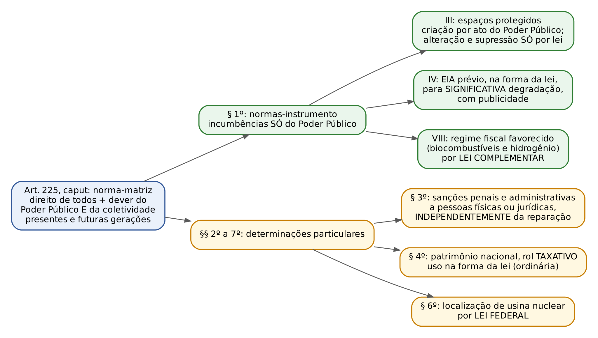
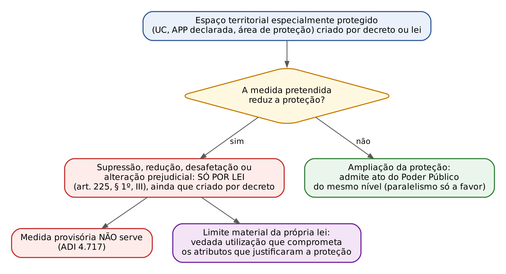
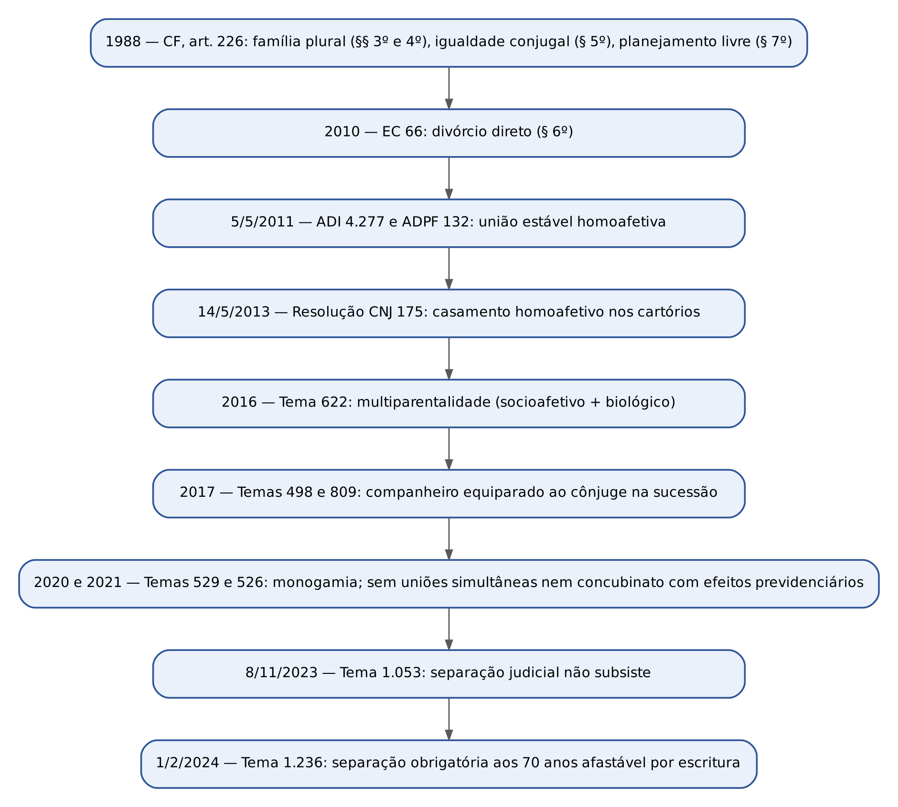
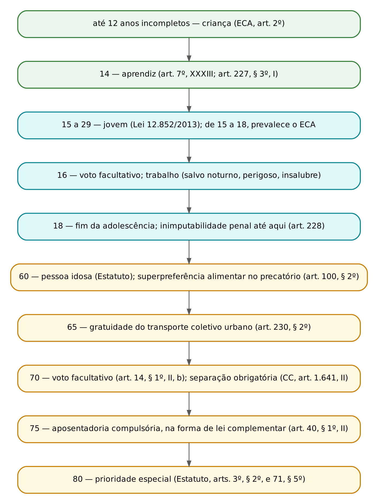

# CAPÍTULO 37 — ORDEM SOCIAL III: MEIO AMBIENTE, FAMÍLIA, CRIANÇA, JOVEM, PESSOA IDOSA E PESSOA COM DEFICIÊNCIA

:::INCIDENCIA
TRF5 p. 15 e 17; TJRS p. 12; TJSC p. 14. Nível A. Lote: 19 questões (FGV 13, FCC 6), mais correlatas de outros capítulos.
O que mais cai: letra do art. 225 (§ 1º, III e IV; §§ 3º, 4º e 6º), reserva de lei para suprimir espaço protegido criado por decreto, dispensa de EIA ou de licenciamento como proteção deficiente, planejamento familiar sem coerção (art. 226, § 7º), união e casamento homoafetivos, prioridade absoluta e o jovem (EC 65/2010).
:::

| Subtema | FGV | FCC | Padrão |
|---|---|---|---|
| Letra do art. 225 (incisos e parágrafos) | 2 | 2 | troca de "lei" por "lei complementar" ou "estadual", "exclusivo", "vedação absoluta", responsabilidade "subjetiva" |
| Espaços territoriais especialmente protegidos | 3 | 1 | Prefeito cria área protegida por decreto; sucessor quer suprimi-la: só por lei |
| EIA e licenciamento | 2 | 0 | lei estadual ou municipal dispensa licenciamento ou EIA: inconstitucional (proteção deficiente, retrocesso) |
| Natureza do direito, clima, justiça ambiental, prescrição | 2 | 1 | ADPF 708 (Fundo Clima), racismo ambiental, Tema 999 |
| Família: novas configurações, união e casamento homoafetivos | 2 | 0 | ADI 4.277, Resolução CNJ 175/2013 |
| Planejamento familiar | 1 | 2 | lei com medidas coercitivas ou de controle demográfico é inconstitucional; Lei 9.263/1996 |
| Jovem | 1 | 0 | plano nacional de juventude: lei, decenal, articulação das esferas |

## 37.1 Visão de conjunto: os sujeitos de proteção especial na Ordem Social

O Título VIII reúne, depois da seguridade (Cap. 35) e da educação, cultura, desporto, ciência e comunicação (Cap. 36), dois capítulos que interessam aqui: o Capítulo VI (Do Meio Ambiente, art. 225, artigo único) e o Capítulo VII, cuja denominação, desde a EC 65/2010, é "Da Família, da Criança, do Adolescente, do Jovem e do Idoso" (arts. 226 a 230). A pessoa com deficiência não tem capítulo próprio: aparece em dispositivos esparsos (arts. 7º, XXXI; 23, II; 24, XIV; 37, VIII; 100, § 2º; 203, IV e V; 208, III; 227, § 1º, II, e § 2º; 244), cujo mapa completo e o regime da Convenção de Nova York estão no Cap. 11 (11.9).

O traço comum dos arts. 225, 227 e 230 é a estrutura de DEVER COMPARTILHADO: o constituinte não se limita a atribuir um direito, mas nomeia os obrigados. A banca explora exatamente a composição de cada rol.

| Dispositivo | Titular | Obrigados (letra) | Cláusula de intensidade |
|---|---|---|---|
| Art. 225, *caput* | "todos" (presentes e futuras gerações) | "Poder Público e coletividade" (defender e preservar) | incumbências do § 1º: SÓ o Poder Público |
| Art. 226, *caput* | a família, "base da sociedade" | o Estado ("especial proteção") | — |
| Art. 227, *caput* | criança, adolescente e jovem | "família, sociedade e Estado" | "com absoluta prioridade" |
| Art. 229 | filhos menores / pais na velhice, carência ou enfermidade | pais / filhos maiores | dever recíproco |
| Art. 230, *caput* | pessoas idosas | "família, sociedade e Estado" | programas "preferencialmente em seus lares" (§ 1º) |

Três chaves dogmáticas atravessam o capítulo e foram desenvolvidas em outros lugares: a dimensão objetiva dos direitos fundamentais e os deveres estatais de proteção, com a proibição de proteção insuficiente (Cap. 7, 07.7 e 07.10.5); a vedação do retrocesso (Cap. 7 e, no ambiente, 37.2.4); e a competência legislativa concorrente sobre meio ambiente (art. 24, VI a VIII), proteção às pessoas com deficiência (XIV) e proteção à infância e à juventude (XV), com competência comum material (art. 23, II, VI e VII), cuja casuística está no Cap. 22 (22.5.4 e 22.5.5).

:::PEGADINHA QUEM DEVE O QUÊ
"É dever exclusivo do Estado assegurar à criança..." (errado: família, sociedade e Estado); "incumbe ao Poder Público e à coletividade, para assegurar a efetividade desse direito, exigir estudo prévio de impacto ambiental" (errado: o *caput* do art. 225 impõe o dever geral ao Poder Público e à coletividade, mas as incumbências do § 1º são SÓ do Poder Público); "a família tem especial proteção da sociedade" (errado: "do Estado").
:::

## 37.2 Meio ambiente (art. 225) na perspectiva constitucional

O regime completo (princípios, competências e LC 140/2011, licenciamento e a Lei 15.190/2025, responsabilidade civil, administrativa e penal, espaços protegidos, fauna e flora) está na Apostila de Direito Ambiental, Caps. 1 a 10. Aqui ficam a letra do art. 225, a natureza do direito, a técnica de controle das leis ambientais e as teses do STF com que as bancas constroem os casos práticos.

### 37.2.1 Estrutura e letra

A divisão de José Afonso da Silva, adotada pelas bancas, separa o *caput* (norma-matriz: direito e dever), o § 1º (normas-instrumento: incumbências do Poder Público) e os §§ 2º a 7º (determinações particulares).

:::LEI CF, ART. 225, CAPUT E § 1º, III E IV
Art. 225. Todos têm direito ao meio ambiente ecologicamente equilibrado, bem de uso comum do povo e essencial à sadia qualidade de vida, impondo-se ao Poder Público e à coletividade o dever de defendê-lo e preservá-lo para as presentes e futuras gerações.
§ 1º Para assegurar a efetividade desse direito, incumbe ao Poder Público: [...]
III - definir, em todas as unidades da Federação, espaços territoriais e seus componentes a serem especialmente protegidos, sendo a alteração e a supressão permitidas somente através de lei, vedada qualquer utilização que comprometa a integridade dos atributos que justifiquem sua proteção;
IV - exigir, na forma da lei, para instalação de obra ou atividade potencialmente causadora de significativa degradação do meio ambiente, estudo prévio de impacto ambiental, a que se dará publicidade;
:::

Os demais dispositivos entram em quadro de letra, com a palavra que decide e o distrator típico (texto integral conferido no Planalto; transcrição completa na Apostila de Direito Ambiental, 01.3):

| Dispositivo | Palavra que decide | Distrator típico |
|---|---|---|
| § 1º, I | "preservar e restaurar os processos ecológicos essenciais e prover o manejo ecológico das espécies e ecossistemas" | "espécies endêmicas e exóticas"; "exclusivamente fauna e flora nativas" |
| § 1º, II | preservar diversidade e integridade do patrimônio genético e FISCALIZAR entidades de pesquisa e manipulação | "vedada toda forma de manipulação de material genético" |
| § 1º, IV | "na forma da lei"; SIGNIFICATIVA degradação; publicidade | EIA "para toda" obra ou atividade potencialmente degradadora |
| § 1º, V | controlar produção, comercialização e emprego de técnicas, métodos e substâncias de risco | "competência exclusiva dos Estados" para esse controle |
| § 1º, VI | educação ambiental "em todos os níveis de ensino" | "disciplina específica obrigatória" |
| § 1º, VII | vedadas, "na forma da lei", práticas que ponham em risco a função ecológica, provoquem extinção ou submetam animais a crueldade | proteção restrita à fauna nativa |
| § 1º, VIII (EC 123/2022; redação da EC 132/2023) | regime fiscal FAVORECIDO para biocombustíveis e hidrogênio de baixa emissão de carbono, por LEI COMPLEMENTAR, com tributação INFERIOR à dos fósseis | "regime fiscal inferior"; "lei ordinária"; "vedado tratamento favorecido" |
| § 2º | quem explora recursos minerais recupera o ambiente "de acordo com solução técnica exigida pelo órgão público competente, na forma da lei" | solução "elaborada por profissional habilitado" |
| § 3º | pessoas físicas OU JURÍDICAS; sanções penais e administrativas "independentemente da obrigação de reparar" | responsabilidade só de pessoas físicas; sanção condicionada ao descumprimento da reparação |
| § 4º | Floresta Amazônica brasileira, Mata Atlântica, Serra do Mar, Pantanal Mato-Grossense e Zona Costeira: patrimônio NACIONAL; uso "na forma da lei" | Cerrado, Caatinga ou Pampa no rol; "bens da União"; "lei complementar"; uso vedado |
| § 5º | são INDISPONÍVEIS as terras devolutas ou arrecadadas pelos Estados, por ações discriminatórias, necessárias à proteção dos ecossistemas | "disponíveis"; indisponibilidade de todas as terras devolutas |
| § 6º | localização de usina com reator nuclear definida em LEI FEDERAL, sem o que não pode ser instalada | "lei estadual"; "decreto"; "resolução do CONAMA" |
| § 7º (EC 96/2017) | não são cruéis as práticas desportivas com animais que sejam manifestações culturais registradas como patrimônio imaterial e regulamentadas por lei que assegure o bem-estar | "consideram-se cruéis ainda que registradas" |

:::QUESTAO FCC 2025 — TRF4 — ANALISTA JUDICIÁRIO, ÁREA JUDICIÁRIA (Q3538751)
Pediu a incumbência do Poder Público prevista no art. 225. Gabarito: B — preservar e restaurar os processos ecológicos essenciais e prover o manejo ecológico das espécies e ecossistemas (§ 1º, I).
Armadilhas: A (EIA "para toda" obra potencialmente degradadora: a CF exige para SIGNIFICATIVA degradação); C (alteração e supressão de espaços "somente por emenda à Constituição": basta lei); D ("vedando-se toda forma de manipulação genética": a CF manda fiscalizar); E ("exclusivamente" fauna e flora nativas).
No mesmo sentido: Q3538935 (FCC 2025, TRF4, Técnico Judiciário: gabarito B, regime fiscal favorecido para biocombustíveis e hidrogênio de baixa emissão, § 1º, VIII; distratores: licenciamento "exclusivo" dos Municípios, controle de substâncias "exclusivo" dos Estados, responsabilidade civil "subjetiva", "vedação absoluta" de atividade econômica em espaços protegidos).
:::

:::QUESTAO FGV 2024 — EPE — ADVOGADO (Q2759024)
Três assertivas: (I) rol do § 4º e uso na forma da lei; (II) sanções penais e administrativas a pessoas físicas ou jurídicas, independentemente da reparação (§ 3º); (III) localização de usina nuclear definida em lei ESTADUAL. Gabarito: B (I e II).
Armadilha: III troca "lei federal" por "lei estadual" (§ 6º; a competência legislativa sobre atividades nucleares é privativa da União, art. 22, XXVI). No mesmo sentido, de pura identificação do texto: Q2375402 (FGV 2024, TJ-RJ, Residência — Assistente Social: o enunciado transcreve o *caput* do art. 225 e pede a fonte; gabarito B, a Constituição de 1988).
:::

### 37.2.2 Natureza do direito: fundamental, difuso, intergeracional

O direito ao meio ambiente ecologicamente equilibrado é direito fundamental FORA do Título II, reconhecido pela cláusula de abertura do art. 5º, § 2º (Cap. 7, 07.1.3), de terceira dimensão (solidariedade), titularidade difusa e natureza de direito-dever. O objeto é o EQUILÍBRIO ecológico (macrobem incorpóreo, "bem de uso comum do povo"), não a intocabilidade dos recursos: o uso econômico é admitido, desde que preservadas as funções ecológicas (art. 170, VI, que inclui a defesa do meio ambiente entre os princípios da ordem econômica, com tratamento diferenciado conforme o impacto — Cap. 34). Consequências de prova:

- Titularidade e dever. "Todos" titularizam; "Poder Público e coletividade" devem. Os deveres fundamentais dos particulares legitimam restrições à propriedade e à livre iniciativa e fundam obrigações *propter rem*.
- Dimensão objetiva. O dever estatal de proteção afasta discricionariedade quanto ao "se" proteger e permite controlar tanto o excesso quanto a proteção insuficiente da lei.
- Intergeracionalidade. A cláusula "presentes e futuras gerações" é o fundamento da imprescritibilidade da pretensão de reparação civil do dano ambiental (Tema 999 do STF, RE 654.833, j. 20/4/2020): a imprescritibilidade decorre do próprio art. 225, não do art. 37, § 5º (desenvolvimento: Apostila de Direito Ambiental, Cap. 5).
- Tratados. Na ADPF 708 (Fundo Clima, Relator Ministro Roberto Barroso, j. 1/7/2022), o STF afirmou que os tratados sobre meio ambiente são espécie de tratados de direitos humanos e têm status SUPRALEGAL, salvo aprovação pelo rito do art. 5º, § 3º, que o Acordo de Paris não seguiu (Cap. 11).

:::QUESTAO FCC 2026 — DPE-BA — DEFENSOR PÚBLICO (Q4037497)
O enunciado reproduz a premissa da ADPF 708 (meio ambiente como direito fundamental; tratados ambientais supralegais) e pede a tese fixada. Gabarito: C — o Poder Executivo tem o dever constitucional de fazer funcionar e alocar anualmente os recursos do Fundo Clima, para mitigação das mudanças climáticas, VEDADO seu contingenciamento.
Armadilhas: B (o STF não declarou estado de coisas inconstitucional ambiental na ADPF 708; na ADPF 760, sobre a Amazônia, também NÃO o declarou — Cap. 19); A (constitucionalidade da lei da PNMC impondo fundos aos entes subnacionais: não foi o objeto); D e E (formulações genéricas, plausíveis, mas que não são a tese). Lição: a ADPF 708 é o *leading case* da litigância climática no Brasil e decidiu sobre execução orçamentária de fundo, não sobre a política climática como um todo (Apostila de Direito Ambiental, Cap. 15).
:::

:::QUESTAO FGV 2025 — MPE-ES — PROMOTOR DE JUSTIÇA SUBSTITUTO (Q3752709)
Caso: grupo ocupa clandestinamente área de Mata Atlântica pertencente a ente federativo para extrair madeira. Gabarito oficial: B — o uso dos recursos naturais da área é admitido, o que está previsto em norma constitucional de eficácia limitada e princípio programático.
Passos: (1) a Mata Atlântica é patrimônio nacional (§ 4º), o que NÃO veda o uso econômico, que se fará "na forma da lei" (no caso, a Lei 11.428/2006); (2) a remissão à lei explica a classificação como norma de eficácia limitada (Cap. 4).
Armadilhas: A (vedação absoluta de aproveitamento por ser patrimônio intergeracional); C (o § 4º fala em patrimônio NACIONAL, que não se confunde com titularidade municipal, estadual ou federal); D (prazo prescricional civil: a reparação é imprescritível, Tema 999); E (acerta a imprescritibilidade, mas qualifica o direito como de "segunda geração": é de terceira).
Ressalva ao gabarito: a crítica procede em parte. Classificar a cláusula "na forma da lei" como de eficácia limitada é defensável, mas o rótulo "princípio programático" é impreciso, porque o § 4º não fixa programa de ação: condiciona desde logo o uso à preservação ambiental; e a alternativa fala do uso em abstrato, sem legitimar a extração clandestina do caso, que segue ilícita. É, porém, a única alternativa sem erro grosseiro, e o gabarito se sustenta.
:::

#### Justiça ambiental e racismo ambiental

Justiça ambiental designa a distribuição equitativa dos ônus e benefícios ambientais; racismo ambiental, a concentração recorrente de danos e riscos ambientais (lixões, indústrias poluentes, áreas de risco) sobre comunidades negras, pobres, indígenas e tradicionais. O fundamento constitucional combina o art. 225 com a igualdade material e a vedação de discriminação (arts. 3º, IV, e 5º, *caput*) e com a proteção diferenciada de povos e comunidades tradicionais (Cap. 38).

:::QUESTAO FGV 2024 — PROVA NÃO IDENTIFICADA NO BANCO (Q3085844)
Três assertivas: (I) a distribuição desigual da poluição em razão da raça viola a Constituição; (II) o desenvolvimento sustentável deve manter a lógica de consumo do modelo atual, apoiado em inovação tecnológica; (III) racismo ambiental liga-se à imposição recorrente de danos a comunidades negras e pobres. Gabarito: D (I e III).
Armadilha: II nega o núcleo do desenvolvimento sustentável, que exige compatibilizar desenvolvimento com preservação, e não manter padrões de consumo (art. 170, VI; art. 225).
:::

### 37.2.3 Espaços territoriais especialmente protegidos: a assimetria do § 1º, III

É o ponto mais cobrado do lote (quatro questões com o mesmo esqueleto). A regra tem três camadas:

- Criação: por qualquer ato do Poder Público (lei ou decreto), de qualquer ente, "em todas as unidades da Federação". Espaço territorial especialmente protegido é gênero (unidades de conservação, APP, reserva legal, áreas de proteção especial); APP declarada por ato do Chefe do Executivo (Lei 12.651/2012, art. 6º) entra no conceito.
- Alteração e supressão: "somente através de lei", AINDA QUE o espaço tenha sido criado por decreto. Não vale o paralelismo das formas para reduzir a proteção. A medida provisória também não serve: é inconstitucional reduzir ou suprimir unidade de conservação por MP (ADI 4.717, Relatora Ministra Cármen Lúcia, j. 5/4/2018), porque a garantia constitucional exige debate parlamentar próprio da lei formal.
- Limite material: mesmo a lei não pode autorizar "utilização que comprometa a integridade dos atributos que justifiquem sua proteção". A reserva de lei é condição necessária, não suficiente: a lei supressiva sem compensação e sem justificativa técnica pode violar a vedação do retrocesso e a proibição de proteção insuficiente.

A ampliação da proteção (acréscimo de área, transformação em categoria mais restritiva) não está sob a reserva constitucional: a Lei 9.985/2000 (art. 22, §§ 5º e 6º) admite fazê-la por instrumento normativo do mesmo nível hierárquico do que criou a unidade (Apostila de Direito Ambiental, 09.5).

:::QUESTAO FGV 2024 — PREFEITURA DE MACAÉ — PROCURADOR (Q3049910)
Caso: Prefeito declara por decreto duas áreas como de preservação ambiental; o sucessor quer afastar essa caracterização para viabilizar investimentos turísticos. Gabarito: A — somente com a edição de lei.
Passos: (1) a área é espaço territorial especialmente protegido, criado validamente por ato do Poder Público; (2) o objetivo é suprimir a proteção; (3) art. 225, § 1º, III: supressão só por lei, ainda que a criação tenha sido por decreto.
Armadilhas: B (o decreto não "carece de eficácia"); C (o caráter intergeracional não torna a proteção imutável: a CF admite a supressão por lei); D (paralelismo das formas, isto é, novo decreto); E (distinção irrelevante sobre execução da política federal).
No mesmo sentido: Q3841660 (FGV 2025, Prefeitura de Abreu e Lima, Procurador: unidade de conservação municipal criada por decreto; supressão "necessariamente" por lei, gabarito B; o enunciado ressalva que o novo uso não comprometeria os atributos, para isolar a questão da forma); Q3673839 (FGV 2025, ENAC, Exame Nacional dos Cartórios: APP declarada por decreto municipal; gabarito A, os efeitos só podem ser afastados por lei municipal; distratores: imutabilidade pela vedação do retrocesso ou pela integração ao plano nacional, invalidade do decreto por exigência de lei para CRIAR a APP, e revogação por decreto pela paridade das formas).
:::

:::QUESTAO FCC 2024 — PREFEITURA DE JABOATÃO DOS GUARARAPES — PROCURADOR (Q3542085)
Governo municipal pretende alterar espaços protegidos que ele próprio instituiu por ato administrativo. Gabarito: A — dependerão de lei se resultarem em supressão ou em modificação que implique prejudicialidade ou retrocesso ao status de proteção, ainda que a instituição tenha sido por ato do Poder Público municipal.
Armadilhas: C (lei "em quaisquer circunstâncias", inclusive para ampliar ou criar: errado, a criação admite ato do Poder Público); D (restrição do status por ato administrativo); E (supressão por ato do próprio Poder Público); B mistura ampliação por ato (certo) com exigência de lei para instituir novos espaços (errado).
:::

:::DICA COMO A BANCA DISFARÇA A MESMA QUESTÃO
O esqueleto é sempre: área protegida criada por DECRETO, troca de governo, vontade de desenvolver a área. As saídas erradas vêm em quatro sabores: (1) "novo decreto, por paralelismo"; (2) "impossível, pela vedação do retrocesso ou pelo caráter intergeracional"; (3) "o decreto é inválido, porque só lei cria área protegida"; (4) "basta fiscalização posterior". A resposta certa é sempre "lei" (e, se o enunciado falar em MP, "lei formal, não MP").
:::

### 37.2.4 Estudo prévio de impacto ambiental, licenciamento e proteção deficiente

O § 1º, IV, constitucionaliza o EIA para obra ou atividade "potencialmente causadora de SIGNIFICATIVA degradação", com publicidade. O licenciamento ambiental não está expresso no texto, mas é o instrumento pelo qual a exigência se realiza (Lei 6.938/1981, art. 10; Lei 15.190/2025 — Lei Geral do Licenciamento Ambiental; Apostila de Direito Ambiental, Cap. 4). O controle de constitucionalidade das leis que flexibilizam essas exigências segue um roteiro em dois planos:

| Plano | Pergunta | Consequência |
|---|---|---|
| Formal (competência) | A norma estadual ou municipal contraria a norma geral da União (art. 24, § 1º) ou invade competência privativa (art. 22: energia, telecomunicações, penal)? | Estado e Município podem ser MAIS protetivos; não podem ficar abaixo do piso federal nem legislar sobre matéria privativa (Cap. 22, 22.5.5) |
| Material (art. 225) | A norma dispensa o EIA ou o licenciamento para atividade potencialmente causadora de significativa degradação, ou suprime o núcleo de proteção alcançado? | Inconstitucional por ofensa ao § 1º, IV, à proibição de proteção insuficiente e à vedação do retrocesso; dispensa ou simplificação para atividade de PEQUENO impacto é, em regra, válida |

Precedentes que a FGV recicla: norma estadual que dispensa EIA para hidrelétricas de 10 a 30 MW (ADI 4.529/MT, formal e materialmente inconstitucional — v. Cap. 22); dispensa de licenciamento para atividades agrossilvipastoris (ADI 5.312/TO, Relator Ministro Alexandre de Moraes, j. 25/10/2018); licença ambiental automática para atividade de risco médio (ADI 6.808, Relatora Ministra Cármen Lúcia, j. 28/4/2022); licença por adesão ou compromisso para atividades que não sejam de pequeno potencial (ADI 6.618/RS, Relator Ministro Cristiano Zanin, j. 7/4/2025). Em sentido contrário, o STF admite critérios DIFERENCIADOS de licenciamento adequados às especificidades da atividade, sem dispensa (correlata Q2654852, FCC 2024, PGE-GO: licenciamento diferenciado para projetos de assentamento de reforma agrária, gabarito B; desenvolvida no Cap. 34). A vedação do retrocesso, por sua vez, não é absoluta: atinge o núcleo essencial da proteção alcançada ou a redução sem mecanismo equivalente (ADC 42 e ADIs do Código Florestal; ADPFs 747 a 749 sobre a Resolução CONAMA 500/2020; Apostila de Direito Ambiental, 01.13).

:::QUESTAO FGV 2024 — MPE-GO — PROMOTOR DE JUSTIÇA SUBSTITUTO (Q2367563)
Caso: lei estadual dispensa o licenciamento ambiental para atividades agrossilvipastoris (consórcio de espécies florestais, produção animal e culturas agrícolas), a pretexto de incentivar atividades menos nocivas. Gabarito: B — inconstitucional: a dispensa de licenciamento, independentemente do potencial de degradação, e a consequente dispensa do EIA implicam proteção deficiente ao direito fundamental ao meio ambiente equilibrado.
Armadilhas: A (competência suplementar autorizaria a dispensa: suplementar não é contrariar a norma geral); C (competência seria do Município); D (dispensa como "proteção eficiente"); E (competência "privativa" da União sobre meio ambiente: é concorrente, art. 24, VI).
Precedente: o STF julgou procedente a ADI 5.312/TO (Relator Ministro Alexandre de Moraes, Plenário, j. 25/10/2018, DJe 11/2/2019) e declarou inconstitucional o art. 10 da Lei tocantinense 2.713/2013, que dispensava do licenciamento as atividades agrossilvipastoris: a competência concorrente permite ao Estado complementar a norma geral, não afastar o licenciamento de atividades potencialmente poluidoras, e a dispensa por setor econômico, sem aferir o potencial de degradação, enfraquece a proteção do art. 225. A mesma hipótese aparece como distrator na Q2654852 (alternativa C).
:::

:::QUESTAO FGV 2026 — ALERJ — PROCURADOR LEGISLATIVO (Q3880776)
Caso: lei municipal autoriza licença simplificada, sem EIA/RIMA e sem manifestação de órgão estadual ou federal, para empreendimentos turísticos em restinga, desde que o impacto seja considerado "de pequeno porte" pela Secretaria de Desenvolvimento Econômico; o MP propõe ADI no TJ. Gabarito: B — inconstitucional: relativiza a exigência de EIA em área ecologicamente sensível e afronta a vedação do retrocesso ambiental.
Passos: (1) a restinga é área de preservação permanente nas hipóteses do Código Florestal e a zona costeira é patrimônio nacional (§ 4º); (2) a avaliação do impacto foi entregue a órgão sem atribuição ambiental, o que esvazia o § 1º, IV; (3) o Município pode suplementar no interesse local (art. 30, II), mas não abaixo do piso federal.
Armadilhas: A e C (autonomia municipal irrestrita ou "flexibilização em prol do desenvolvimento"); D ("apenas" competência PRIVATIVA da União: a matéria é concorrente e o Município suplementa; o vício é também material); E (fiscalização posterior não supre o estudo PRÉVIO).
Processual: na ADI estadual, o parâmetro formal é a Constituição do Estado; as normas da CF sobre meio ambiente são de reprodução obrigatória e o acórdão comporta RE (Cap. 20).
:::

:::SENTENCA DECLARAÇÃO INCIDENTAL DE INCONSTITUCIONALIDADE DE LEI MUNICIPAL QUE DISPENSA O EIA
"A Lei Municipal n. X, ao dispensar o estudo prévio de impacto ambiental para empreendimentos em área de restinga, mediante juízo de 'pequeno porte' emitido por órgão sem atribuição ambiental, contraria o art. 225, § 1º, IV, da Constituição Federal, que exige o estudo, na forma da lei, para toda obra ou atividade potencialmente causadora de significativa degradação, e desborda da competência suplementar do Município (art. 30, II), que não autoriza reduzir o patamar de proteção fixado pela norma geral da União (art. 24, VI e § 1º). A flexibilização, desacompanhada de mecanismo de tutela equivalente, configura proteção insuficiente do direito fundamental ao meio ambiente ecologicamente equilibrado. Declaro, incidentalmente, a inconstitucionalidade do art. Y da Lei Municipal n. X, afasto sua aplicação ao caso e [...]."
Observações: (1) o juiz singular declara a inconstitucionalidade incidental sem as restrições do art. 97; no tribunal, a declaração exige o plenário ou órgão especial, salvo pronunciamento anterior desse órgão ou do STF (art. 949, parágrafo único, do CPC; SV 10 — Cap. 17); (2) a questão constitucional é fundamento, não pedido: vai na fundamentação, não no dispositivo como declaração autônoma com efeitos *erga omnes*.
:::

### 37.2.5 Demais pontos constitucionais de remissão

- Crueldade com animais e vaquejada: ADI 4.983 (lei cearense inconstitucional, 6 a 5), reação pela EC 96/2017 (§ 7º), validação da emenda e da Lei 13.364/2016 condicionada ao bem-estar animal — Cap. 5 (05.10.4), como caso de efeito *backlash*. Sacrifício ritual em cultos de matriz africana (RE 494.601/RS) — Caps. 9 e 22.
- Responsabilidade penal da pessoa jurídica (§ 3º): admitida independentemente da responsabilização simultânea da pessoa física — Apostila de Direito Ambiental, Cap. 7.
- Competências legislativas e materiais (art. 23, VI e VII; art. 24, VI a VIII; LC 140/2011), inclusive leis estaduais sobre antenas, hidrelétricas, rinhas, agrotóxicos e destruição de bens apreendidos — Cap. 22 (22.5.5).
- Omissões estruturais (ADPF 760 e ADO 54, sem estado de coisas inconstitucional) e omissão legislativa do Pantanal (ADO 63, suprida pela Lei 15.228/2025) — Caps. 19 e Apostila de Direito Ambiental, 01.3.4.
- Meio ambiente do trabalho e cultural: art. 200, VIII, e arts. 215 e 216 (Caps. 35 e 36).

## 37.3 Família (art. 226)

O regime civil (casamento, união estável, regimes de bens, filiação, poder familiar, alimentos) está na Apostila de Direito Civil, Caps. 34 a 39. Aqui, o desenho constitucional e as decisões do STF que o redefiniram.

:::LEI CF, ART. 226
Art. 226. A família, base da sociedade, tem especial proteção do Estado.
§ 1º O casamento é civil e gratuita a celebração.
§ 2º O casamento religioso tem efeito civil, nos termos da lei.
§ 3º Para efeito da proteção do Estado, é reconhecida a união estável entre o homem e a mulher como entidade familiar, devendo a lei facilitar sua conversão em casamento.
§ 4º Entende-se, também, como entidade familiar a comunidade formada por qualquer dos pais e seus descendentes.
§ 5º Os direitos e deveres referentes à sociedade conjugal são exercidos igualmente pelo homem e pela mulher.
§ 6º O casamento civil pode ser dissolvido pelo divórcio. (Redação dada pela EC 66/2010)
§ 7º Fundado nos princípios da dignidade da pessoa humana e da paternidade responsável, o planejamento familiar é livre decisão do casal, competindo ao Estado propiciar recursos educacionais e científicos para o exercício desse direito, vedada qualquer forma coercitiva por parte de instituições oficiais ou privadas.
§ 8º O Estado assegurará a assistência à família na pessoa de cada um dos que a integram, criando mecanismos para coibir a violência no âmbito de suas relações.
:::

### 37.3.1 O conceito constitucional de família: pluralidade e rol aberto

A Constituição de 1988 rompeu com o modelo da Constituição de 1967/1969 (família "constituída pelo casamento") em três movimentos: (a) desvinculou família de casamento, reconhecendo a união estável (§ 3º) e a família monoparental (§ 4º); (b) igualou os cônjuges (§ 5º) e os filhos (art. 227, § 6º); (c) funcionalizou a família à realização de seus membros — a proteção é dada "na pessoa de cada um dos que a integram" (§ 8º), o que a doutrina chama de família eudemonista ou instrumental.

O ponto de prova é a natureza do rol. Prevalece, na doutrina (Paulo Lôbo: o *caput* como "cláusula geral de inclusão") e no STF (ADI 4.277 e ADPF 132), que os §§ 3º e 4º são EXEMPLIFICATIVOS: merece proteção toda comunidade marcada por afetividade, estabilidade e ostensibilidade, com objetivo de constituir família. Daí a proteção à família anaparental (irmãos que vivem juntos), mosaico ou recomposta, homoafetiva e, para certos efeitos, unipessoal (impenhorabilidade do bem de família de quem vive só). O rol aberto, porém, não alcança tudo: o STF NÃO reconhece uniões simultâneas nem efeitos previdenciários ao concubinato (37.3.4), e o CNJ vedou escrituras de uniões poliafetivas (tipologia completa: Apostila de Direito Civil, 34.2).

:::QUESTAO FGV 2026 — TJ-SC — ASSISTENTE SOCIAL (Q4150476)
Sobre o reconhecimento judicial, e não legislativo, das novas configurações familiares. Gabarito oficial: A — os direitos obtidos por via judicial são mais instáveis do que os garantidos por regulamentação legislativa.
Leitura: a alternativa é afirmação de sociologia jurídica, não de dogmática; a FGV quis contrapor a proteção por precedente (ADI 4.277, Resolução CNJ 175/2013) à ausência de lei. Para o jurista a premissa é discutível, porque decisão do STF em controle concentrado tem eficácia *erga omnes* e efeito vinculante, e a revisão legislativa de um direito fundamental reconhecido esbarraria na proibição de retrocesso; ainda assim, as demais eram claramente erradas. Ressalva ao gabarito: a crítica procede quanto à formulação absoluta, mas não basta para anular a questão; numa prova dogmática, a alternativa seria errada.
Erradas: B (a definição legal de família foi historicamente patrimonial e matrimonializada, não afetiva); C (o reconhecimento CONCRETIZA igualdade e dignidade); D (diversidade de arranjos não implica desproteção dos filhos: art. 227, § 6º); E (o reconhecimento legal não é condição SUFICIENTE para eliminar discriminação social).
:::

### 37.3.2 União estável e casamento homoafetivos

O § 3º fala em união estável "entre o homem e a mulher". No julgamento conjunto da ADI 4.277 e da ADPF 132 (Relator Ministro Ayres Britto, j. 5/5/2011, unânime quanto ao resultado), o STF deu ao art. 1.723 do Código Civil interpretação conforme a Constituição para excluir qualquer significado que impeça o reconhecimento da união contínua, pública e duradoura entre pessoas do mesmo sexo como entidade familiar, com as mesmas regras e consequências da união heteroafetiva. Os fundamentos que caem em discursiva:

- Vedação de discriminação em razão do sexo (art. 3º, IV), que abrange a orientação sexual; igualdade (art. 5º, *caput*); dignidade (art. 1º, III); liberdade e autonomia da vontade; direito à intimidade e à busca da felicidade.
- O § 3º não contém proibição: menciona homem e mulher para afirmar a igualdade de gênero na relação e afastar a hierarquia do modelo patriarcal, não para excluir outras formas. Onde a Constituição não proíbe, a interpretação sistemática com a cláusula geral do *caput* inclui.
- Técnica: interpretação conforme do dispositivo LEGAL (art. 1.723), não "interpretação conforme da Constituição", e sem declarar inconstitucional texto constitucional originário (impossível no sistema brasileiro — Cap. 2). Parte da doutrina descreve o resultado como mutação constitucional do § 3º (Cap. 5).
- Instrumento: a ADPF 132, proposta pelo Governador do Rio de Janeiro a propósito do estatuto dos servidores estaduais, foi julgada em conjunto com a ADI 4.277, proposta pela Procuradoria-Geral da República (relação entre ADPF e ADI: Cap. 19).

O casamento seguiu por outra trilha: o STJ admitiu a habilitação direta de casal homoafetivo para o casamento civil (REsp 1.183.378/RS, Quarta Turma, j. 25/10/2011), e a Resolução CNJ 175, de 14/5/2013, vedou às autoridades competentes a recusa de habilitação, celebração de casamento civil ou conversão de união estável em casamento entre pessoas do mesmo sexo, sob pena de comunicação ao juiz corregedor. Não há lei federal específica; a base é a interpretação constitucional do STF e o ato normativo do CNJ, cuja edição se apoia no poder regulamentar do art. 103-B, § 4º, I (Cap. 29).

:::QUESTAO FGV 2024 — CÂMARA DOS DEPUTADOS — CONSULTOR LEGISLATIVO, ÁREA XIX (Q2511991)
Sobre a cidadania da população LGBTQIA+ após o julgamento de 2011. Gabarito: B — resolução do CNJ autoriza, atualmente, a celebração de casamento de casais homoafetivos em todos os cartórios do Brasil.
Armadilhas: A (decisão "contrária à lei": houve interpretação conforme do art. 1.723 do CC, técnica que preserva o texto); C (a CF "disciplina expressamente" o casamento homoafetivo: não disciplina; o reconhecimento é interpretativo); D (projeto de lei que vede a união civil homoafetiva seria compatível com a CF: violaria igualdade e não discriminação, e o STF já fixou o sentido constitucional); E (casamento heteroafetivo "sem exceções" por razões religiosas: o Estado é laico, art. 19, I).
Precisão de linguagem: a resolução não "criou" o casamento homoafetivo; proibiu a RECUSA pelos cartórios, à luz da decisão do STF.
:::

Desdobramentos constitucionais da igualdade entre famílias (cada um com dono próprio):

| Tema | Orientação | Onde |
|---|---|---|
| Licença-maternidade da mãe não gestante em união homoafetiva (Tema 1.072, RE 1.211.446, j. 13/3/2024) | a mãe não gestante tem direito à licença-maternidade; se a companheira já a usufruiu, terá licença pelo período equivalente ao da licença-paternidade | Cap. 12 (correlata Q3542081, FCC 2024, gabarito E) |
| Lei Maria da Penha e casais homoafetivos masculinos e mulheres trans (MI 7.452, sessão encerrada em 21/2/2025) | aplicação aos casais homoafetivos masculinos, se o homem vítima estiver em posição de subordinação, e às mulheres trans e travestis, nas relações intrafamiliares | Cap. 8 (correlatas Q3954593, FCC 2026, gabarito C; Q3692384, FGV 2025, ENAM, gabarito E) |
| Homotransfobia como racismo (ADO 26 e MI 4.733) | criminalização por interpretação conforme até lei específica | Cap. 8 |
| Monogamia aplicada às uniões homoafetivas (Tema 529) | a vedação de uniões simultâneas vale independentemente da orientação sexual | 37.3.4 |

### 37.3.3 Casamento e divórcio

- § 1º: casamento CIVIL, com celebração gratuita (não a habilitação, cujas custas podem ser dispensadas aos pobres por declaração — CC, art. 1.512, parágrafo único).
- § 2º: o religioso tem efeito civil "nos termos da lei" (CC, arts. 1.515 e 1.516): registro civil, habilitação prévia ou posterior.
- § 3º, parte final: a lei deve FACILITAR a conversão da união estável em casamento (dever ao legislador, que justifica a via administrativa no registro civil).
- § 6º: a EC 66/2010 suprimiu os requisitos temporais (separação judicial há mais de um ano ou de fato há mais de dois). O STF encerrou a controvérsia sobre a sobrevivência da separação: "Após a promulgação da EC nº 66/2010, a separação judicial não é mais requisito para o divórcio nem subsiste como figura autônoma no ordenamento jurídico", preservado o estado civil dos que já estavam separados por decisão judicial ou escritura, como ato jurídico perfeito (Tema 1.053, RE 1.167.478, j. 8/11/2023). O divórcio é direito potestativo; a culpa é irrelevante para dissolver; a separação de fato continua relevante (cessação do regime de bens, possibilidade de união estável).

:::PEGADINHA O VERBO DO § 6º
"O casamento civil PODE ser dissolvido pelo divórcio" é o texto. Não há prazo constitucional, nem exigência de prévia separação, nem de prévia partilha de bens (CC, art. 1.581). Alternativa que mencione "após prévia separação judicial por mais de um ano" reproduz a redação ANTERIOR à EC 66/2010.
:::

### 37.3.4 Monogamia e uniões simultâneas

O rol aberto do art. 226 não absorve famílias simultâneas. O STF fixou que a preexistência de casamento ou de união estável de um dos conviventes, ressalvada a separação de fato ou judicial (CC, art. 1.723, § 1º), impede o reconhecimento de novo vínculo referente ao mesmo período, inclusive para fins previdenciários, em virtude da consagração do dever de fidelidade e da monogamia (Tema 529, RE 1.045.273, Relator Ministro Alexandre de Moraes, 2020). O Tema 526 negou, na mesma linha, o rateio de pensão por morte com a concubina de homem casado. Três leituras de prova: decide a ANTERIORIDADE do primeiro vínculo; o separado de fato pode constituir união estável; os filhos de qualquer dos núcleos têm direitos iguais (art. 227, § 6º). A tese aparece como distrator na Q3179503 (FGV 2025, TRF3, Juiz Federal), cuja alternativa A trocava "monogamia" por "pluralismo" e "impede" por "não impede" (Cap. 8; desenvolvimento civil: Apostila de Direito Civil, 35.10).

### 37.3.5 Planejamento familiar (§ 7º)

O § 7º contém quatro elementos que a banca separa e recombina: (1) fundamentos — dignidade e paternidade responsável; (2) titular — "livre decisão do casal" (leia-se também da pessoa, homem ou mulher, individualmente: Lei 9.263/1996, art. 2º); (3) papel do Estado — PROPICIAR recursos educacionais e científicos, isto é, dever prestacional, não poder de direção; (4) vedação — "qualquer forma coercitiva por parte de instituições oficiais OU PRIVADAS". A regulamentação é a Lei 9.263/1996, que define planejamento familiar como o conjunto de ações de regulação da fecundidade que garanta direitos iguais de "constituição, limitação ou aumento da prole" (art. 2º) e PROÍBE sua utilização "para qualquer tipo de controle demográfico" (art. 2º, parágrafo único).

:::QUESTAO FGV 2025 — PREFEITURA DE ABREU E LIMA — PROCURADOR JURÍDICO MUNICIPAL (Q3841653)
Caso: lei federal, para reduzir a natalidade em famílias sem condições materiais, estabelece normas cogentes de planejamento familiar, com benefícios financeiros a quem as observar e multa a quem as descumprir. Gabarito: A — inconstitucional, porque o planejamento familiar é de livre decisão do casal.
Passos: (1) a lei impõe conduta reprodutiva (normas "cogentes"), o que é coerção estatal vedada pelo § 7º; (2) a finalidade declarada é demográfica, vedada pelo art. 2º, parágrafo único, da Lei 9.263/1996 e incompatível com o papel meramente prestacional do Estado; (3) o vício está no núcleo da lei, não só na sanção.
Armadilhas: C (inconstitucional "apenas" quanto às multas: o benefício condicionado ao cumprimento da norma reprodutiva também é forma de coerção, e o vício está na imposição); D (o melhor interesse dos filhos não legitima controle estatal da natalidade; o instrumento constitucional é a paternidade responsável, exercida pelo casal); B e E (multa por ato ilícito e benefício financeiro não salvam a lei).
No mesmo sentido: Q4231750 (FCC 2026, TJ-CE, Analista Judiciário: lei de "medidas coercitivas de controle do planejamento familiar"; gabarito D, inconstitucional, vedada qualquer forma coercitiva por instituições oficiais OU PRIVADAS; a alternativa C invertia a parte final, "permitida forma coercitiva por instituições privadas", e a E admitia regulação estatal que limite a prole).
:::

A Lei 14.443/2022 alterou o regime da esterilização voluntária (Lei 9.263/1996, art. 10), com reflexo direto em questão de 2026:

| Ponto | Antes da Lei 14.443/2022 | Redação vigente (conferida no Planalto) |
|---|---|---|
| Idade ou prole | maiores de 25 anos ou com pelo menos dois filhos vivos | capacidade civil plena e maiores de 21 anos OU com pelo menos 2 filhos vivos (art. 10, I) |
| Prazo de reflexão | 60 dias entre a manifestação da vontade e o ato cirúrgico | mantidos os 60 dias, com acesso a aconselhamento multidisciplinar |
| Consentimento do cônjuge | exigido na vigência da sociedade conjugal | REVOGADO (§ 5º revogado) |
| Esterilização no parto | vedada, salvo hipóteses restritas | admitida, observados os 60 dias entre a manifestação e o parto e as condições médicas (§ 2º) |
| Disponibilização de contraceptivos | — | prazo máximo de 30 dias (art. 9º, § 2º) |

:::QUESTAO FCC 2026 — DPE-MA — DEFENSOR PÚBLICO (Q4012660)
Pediu a barreira legal ainda existente à fruição plena dos direitos reprodutivos da mulher. Gabarito: A — exigência de idade mínima de 21 anos ou de dois filhos vivos para a esterilização voluntária de mulher plenamente capaz.
Armadilhas: B (prazo de 120 dias: o prazo é de 60); C (consentimento do marido: revogado pela Lei 14.443/2022); D (consentimento dos pais para contraceptivos a adolescentes: não é exigência da Lei 9.263/1996); E (desobrigação do SUS quanto a técnicas de concepção: a lei manda oferecer todos os métodos e técnicas de concepção e contracepção cientificamente aceitos, art. 9º).
:::

Limites da autonomia familiar. A liberdade de planejamento e de criação dos filhos não é absoluta diante dos direitos da criança. Duas teses que caem juntas: "É ilegítima a recusa dos pais à vacinação compulsória de filho menor por motivo de convicção filosófica" (Tema 1.103, ARE 1.267.879), observados os requisitos de registro e inclusão da vacina no programa nacional, obrigatoriedade legal ou determinação de autoridade com base em consenso científico; e não existe direito público subjetivo ao ensino domiciliar, inexistente na legislação (Tema 822, RE 888.815, j. 12/9/2018 — Cap. 36). O § 7º também foi invocado para assegurar à candidata gestante a remarcação do teste de aptidão física, independentemente do edital (Tema 973 — Cap. 8, correlata Q3179503, gabarito E).

### 37.3.6 Violência no âmbito familiar (§ 8º)

O § 8º é mandado constitucional de proteção (não de criminalização expressa, como o art. 227, § 4º): o Estado deve criar "mecanismos para coibir a violência no âmbito de suas relações". A Lei 11.340/2006 (Maria da Penha) é a principal concretização, ao lado da Lei 14.344/2022 (Henry Borel, violência contra criança e adolescente) e das regras protetivas do Estatuto da Pessoa Idosa. O STF validou a Lei Maria da Penha diante da igualdade (tratamento diferenciado justificado pela vulnerabilidade histórica da mulher) e estendeu sua proteção, por mandado de injunção, a casais homoafetivos masculinos em situação de subordinação e a mulheres trans e travestis (MI 7.452 — Cap. 8). A natureza incondicionada da ação penal nas lesões corporais e a inaplicabilidade da Lei 9.099/1995 pertencem à Apostila de Direito Penal e de Processo Penal.

### 37.3.7 Filiação e igualdade entre filhos (art. 227, § 6º)

"Os filhos, havidos ou não da relação do casamento, ou por adoção, terão os mesmos direitos e qualificações, proibidas quaisquer designações discriminatórias relativas à filiação." É regra de eficácia plena, com consequências que extrapolam o direito de família:

- Nacionalidade: o filho adotado no exterior por brasileiro e registrado em repartição consular é brasileiro NATO (art. 12, I, c, combinado com o art. 227, § 6º; RE 1.163.774/MG, segundo o Buscador Dizer o Direito, sem número de tema indicado na fonte — Cap. 13).
- Licença-adotante: os prazos não podem ser inferiores aos da licença-gestante, nem variar conforme a idade da criança adotada (Tema 782, RE 778.889, j. 10/3/2016 — Cap. 12).
- Multiparentalidade: a paternidade socioafetiva, declarada ou não em registro, não impede o reconhecimento concomitante do vínculo biológico, com todos os efeitos jurídicos (Tema 622 do STF, RE 898.060, Relator Ministro Luiz Fux, 2016: "A paternidade socioafetiva, declarada ou não em registro público, não impede o reconhecimento do vínculo de filiação concomitante baseado na origem biológica, com os efeitos jurídicos próprios"; desenvolvimento: Apostila de Direito Civil, Cap. 37).
- Famílias paralelas: os filhos do núcleo não reconhecido têm direitos iguais (37.3.4).

## 37.4 Criança, adolescente e jovem (arts. 227 a 229)

O regime estatutário (ECA, medidas de proteção e socioeducativas, Justiça da Infância, Conselho Tutelar, Lei Henry Borel, Estatuto Digital) é da Apostila de Direito da Criança e do Adolescente; os fundamentos constitucionais estão lá desenvolvidos em detalhe (Cap. 1, 01.2, e Cap. 3). Aqui interessam a estrutura constitucional, a prioridade absoluta como norma de decisão e o jovem.

:::LEI CF, ART. 227, CAPUT (REDAÇÃO DA EC 65/2010)
É dever da família, da sociedade e do Estado assegurar à criança, ao adolescente e ao jovem, com absoluta prioridade, o direito à vida, à saúde, à alimentação, à educação, ao lazer, à profissionalização, à cultura, à dignidade, ao respeito, à liberdade e à convivência familiar e comunitária, além de colocá-los a salvo de toda forma de negligência, discriminação, exploração, violência, crueldade e opressão.
:::

### 37.4.1 Proteção integral, prioridade absoluta e deveres de proteção

A Constituição adotou a doutrina da PROTEÇÃO INTEGRAL (criança e adolescente como sujeitos de direitos, em condição peculiar de pessoa em desenvolvimento), em substituição à doutrina da situação irregular do Código de Menores de 1979. O art. 227 combina três técnicas:

- Catálogo de direitos (vida, saúde, alimentação, educação, lazer, profissionalização, cultura, dignidade, respeito, liberdade, convivência familiar e comunitária), que o ECA amplia (o art. 4º do ECA acrescenta esporte e, desde a Lei 15.512, de 22/9/2026, natureza; a mesma lei dispõe sobre o direito da criança e do adolescente à natureza, a ser efetivado "com absoluta prioridade" — Apostila de Direito da Criança e do Adolescente, 01.4.3). A FGV troca os róis: "esporte" NÃO está no *caput* do art. 227.
- Cláusula de proteção negativa (a salvo de negligência, discriminação, exploração, violência, crueldade e opressão), que fundamenta deveres estatais de proteção contra particulares, inclusive os próprios pais (Tema 1.103).
- Cláusula de intensidade: "com absoluta prioridade". A pessoa idosa NÃO recebeu a mesma cláusula no art. 230 (37.5.1).

Natureza da prioridade absoluta. Não é recomendação programática: é critério jurídico de alocação que vincula legislador, administrador e juiz, reduz a margem de discricionariedade orçamentária e inverte o ônus argumentativo da reserva do possível (Cap. 7 e Cap. 12, 12.2). O ECA detalha seu conteúdo (art. 4º, § 1º, alíneas a a d: primazia de socorro, precedência de atendimento, preferência na formulação de políticas e destinação privilegiada de recursos). Na colisão com outros interesses legítimos, a prioridade não elimina a ponderação, mas lhe dá peso abstrato reforçado.

Dois precedentes mostram a prioridade absoluta como fundamento direto de direito subjetivo: a creche e a pré-escola são exigíveis individualmente, por norma de eficácia plena (Tema 548, RE 1.008.166 — v. Cap. 4, com remissões nos Caps. 12 e 36); e a licença-maternidade estende-se ao pai genitor monoparental, à luz do art. 227 e da paternidade responsável, com a criança como titular final do direito (Tema 1.182, RE 1.348.854 — v. Cap. 12; correlata Q2387034 no Cap. 24).

:::SENTENCA PRIORIDADE ABSOLUTA E RESERVA DO POSSÍVEL EM AÇÃO INDIVIDUAL POR VAGA EM CRECHE
"O direito à educação infantil em creche e pré-escola é direito fundamental de eficácia plena e aplicabilidade imediata, exigível individualmente (CF, arts. 208, IV, e 227; STF, Tema 548). A cláusula de absoluta prioridade impõe ao Município o ônus de demonstrar, concretamente, a impossibilidade financeira e a adoção de medidas para superá-la, não bastando a invocação genérica da reserva do possível. Não demonstrada a impossibilidade, determino a matrícula da criança em unidade da rede pública próxima de sua residência, no prazo de X dias, sob pena de [...]."
Observação: em demandas COLETIVAS sobre política pública, observar os parâmetros do Tema 698 (apontar a finalidade e exigir plano da Administração — Cap. 12, 12.2.2).
:::

### 37.4.2 Os parágrafos do art. 227 e os arts. 228 e 229

| Dispositivo | Conteúdo (letra que decide) | Remissão |
|---|---|---|
| § 1º | programas de assistência integral à saúde da criança, do adolescente e do jovem, "admitida a participação de entidades não governamentais", com aplicação de PERCENTUAL dos recursos públicos da saúde na assistência materno-infantil (I) e programas para pessoas com deficiência (II) | 37.6 |
| § 2º | lei sobre construção de logradouros e edifícios de uso público e fabricação de veículos de transporte coletivo, para acesso adequado às pessoas com deficiência | 37.6 |
| § 3º, I | idade mínima de QUATORZE anos para admissão ao trabalho, "observado o disposto no art. 7º, XXXIII" (só aprendiz entre 14 e 16) | Cap. 12 |
| § 3º, II e III | direitos previdenciários e trabalhistas; acesso do trabalhador adolescente e JOVEM à escola | Cap. 12 |
| § 3º, IV e V | pleno e formal conhecimento da atribuição de ato infracional, igualdade processual e defesa técnica; brevidade, excepcionalidade e respeito à condição peculiar em qualquer medida privativa de liberdade | Apostila ECA, Caps. 14 a 16 |
| § 3º, VI | estímulo do Poder Público ao acolhimento, sob a forma de GUARDA, de criança ou adolescente órfão ou abandonado | Apostila ECA, Cap. 5 |
| § 3º, VII | prevenção e atendimento especializado à criança, ao adolescente e ao JOVEM dependente de entorpecentes | — |
| § 4º | "A lei punirá severamente o abuso, a violência e a exploração sexual da criança e do adolescente" (mandado de criminalização; não alcança o jovem) | Apostila de Direito Penal |
| § 5º | adoção assistida pelo Poder Público, na forma da lei, que estabelecerá casos e condições de sua efetivação por ESTRANGEIROS | Apostila ECA, Cap. 6 |
| § 6º | igualdade entre filhos | 37.3.7 |
| § 7º | no atendimento dos direitos da criança e do adolescente, observa-se o art. 204 (descentralização e participação popular: conselhos de direitos) | Cap. 35 |
| § 8º | lei estabelecerá o estatuto da juventude e o plano nacional de juventude | 37.4.3 |
| Art. 228 | "São penalmente inimputáveis os menores de dezoito anos, sujeitos às normas da legislação especial" (redação original, sem emenda; conferida no Planalto) | Apostila ECA, 01.10 (debate sobre a natureza de cláusula pétrea da idade penal) |
| Art. 229 | pais: assistir, criar e educar os filhos menores; filhos maiores: ajudar e amparar os pais na velhice, carência ou enfermidade | 37.5 |

:::PEGADINHA QUEM ESTÁ EM CADA PARÁGRAFO
O "jovem" foi inserido pela EC 65/2010 no *caput* e nos §§ 1º, 3º, III e VII, e 8º. NÃO está no § 3º, IV a VI (ato infracional, medidas privativas de liberdade, guarda), nem no § 4º (crimes sexuais), nem no § 7º. Alternativa que estenda ao jovem a guarda subsidiada ou o mandado de criminalização do § 4º está errada.
:::

Competência legislativa. "Proteção à infância e à juventude" é competência CONCORRENTE (art. 24, XV), mas o conteúdo civil (guarda, tutela, adoção, poder familiar), penal, processual e trabalhista é PRIVATIVO da União (art. 22, I). A política pública de proteção (programas, campanhas, serviços) é campo aberto a Estados e Municípios (lei municipal de iniciativa parlamentar sobre políticas de combate à alienação parental: ARE 1.495.711, Relator Ministro Flávio Dino, j. 29/11/2024, segundo a Apostila de Direito da Criança e do Adolescente, 01.11). A correlata Q3086970 (FGV 2024, TJ-MT, Juiz Substituto) mostra o limite: programa estadual de iniciação profissional com vínculo direto entre adolescente e órgão público, dissonante da lei federal de estágio, é inconstitucional por invadir a competência privativa da União sobre direito do trabalho (gabarito B; a alternativa D, "concorrente sobre infância e juventude", é o distrator — Cap. 22).

### 37.4.3 O jovem: EC 65/2010, Estatuto da Juventude e plano nacional

A EC 65/2010 alterou a denominação do Capítulo VII e incluiu o jovem no art. 227, acrescentando o § 8º:

:::LEI CF, ART. 227, § 8º (INCLUÍDO PELA EC 65/2010)
§ 8º A lei estabelecerá:
I - o estatuto da juventude, destinado a regular os direitos dos jovens;
II - o plano nacional de juventude, de duração decenal, visando à articulação das várias esferas do poder público para a execução de políticas públicas.
:::

O Estatuto da Juventude (Lei 12.852/2013) considera jovens as pessoas entre 15 e 29 anos (art. 1º, § 1º); entre 15 e 18 anos aplica-se o ECA e, EXCEPCIONALMENTE, o Estatuto da Juventude, quando não conflitar com as normas de proteção integral do adolescente (art. 1º, § 2º). A sobreposição etária é proposital e a regra de prevalência é a da norma mais protetiva ao adolescente. A Constituição não define a faixa etária do jovem: a definição é legal.

:::QUESTAO FGV 2024 — PROVA NÃO IDENTIFICADA NO BANCO (Q3113991)
Três afirmações sobre o plano nacional de juventude: (I) veiculado em decreto do Chefe do Executivo federal; (II) visa à articulação das diversas esferas do Poder Público; (III) estabelece percentual mínimo da receita corrente líquida a ser aplicado em favor da juventude. Gabarito: C (apenas II).
Armadilhas: I (o § 8º diz "A lei estabelecerá": reserva de LEI, não decreto); III (não há vinculação constitucional de receita à juventude; o percentual do § 1º, I, refere-se aos recursos da SAÚDE aplicados na assistência materno-infantil). Detalhe não perguntado: o plano é de duração DECENAL.
:::

## 37.5 Pessoa idosa (art. 230)

:::LEI CF, ART. 230
Art. 230. A família, a sociedade e o Estado têm o dever de amparar as pessoas idosas, assegurando sua participação na comunidade, defendendo sua dignidade e bem-estar e garantindo-lhes o direito à vida.
§ 1º Os programas de amparo aos idosos serão executados preferencialmente em seus lares.
§ 2º Aos maiores de sessenta e cinco anos é garantida a gratuidade dos transportes coletivos urbanos.
:::

### 37.5.1 Estrutura e conteúdo

- Dever tríplice (família, sociedade e Estado), como no art. 227, mas SEM a cláusula "absoluta prioridade" no texto constitucional. A "absoluta prioridade" da pessoa idosa é LEGAL (Estatuto da Pessoa Idosa, Lei 10.741/2003, art. 3º), e entre idosos há prioridade especial aos maiores de 80 anos (art. 3º, § 2º; art. 71, § 5º). Distrator típico: "a Constituição assegura à pessoa idosa absoluta prioridade".
- Solidariedade familiar recíproca (art. 229, segunda parte): filhos maiores têm o dever de ajudar e amparar os pais na velhice, carência ou enfermidade; é o fundamento constitucional dos alimentos devidos à pessoa idosa, que o Estatuto torna solidários (art. 12 — Apostila de Direito Civil, 46.1).
- Preferência pelo atendimento no lar (§ 1º): a institucionalização (entidades de longa permanência) é subsidiária.
- Gratuidade do transporte (§ 2º): aos MAIORES DE 65 anos, nos transportes coletivos URBANOS. O STF julgou improcedente a ADI 3.768 (Relatora Ministra Cármen Lúcia, j. 19/9/2007), ajuizada por entidade de empresas de transporte urbano contra o art. 39 do Estatuto: o § 2º é norma de EFICÁCIA PLENA e aplicabilidade imediata, e o legislador ordinário apenas deu efetividade a um direito social da pessoa idosa já assegurado pela Constituição. A gratuidade no transporte INTERESTADUAL (reserva de duas vagas gratuitas por veículo para idosos com renda igual ou inferior a dois salários mínimos e desconto de, no mínimo, 50% para os que excederem essas vagas, na mesma faixa de renda) é criação LEGAL (Estatuto, art. 40), não constitucional.
- Idade: a Constituição não define "idoso"; a definição de 60 anos é do Estatuto (art. 1º). Por isso o art. 230, § 2º, fala em "maiores de sessenta e cinco anos" e o art. 100, § 2º, em "60 (sessenta) anos de idade".

Mapa das normas constitucionais ligadas à idade avançada:

| Dispositivo | Regra | Idade |
|---|---|---|
| Art. 14, § 1º, II, b | voto e alistamento facultativos | maiores de 70 |
| Art. 40, § 1º, II | aposentadoria compulsória do servidor, com proventos proporcionais | 70, ou 75 na forma de lei complementar (EC 88/2015) |
| Art. 100, § 2º | preferência sobre todos os demais débitos para créditos alimentares de titulares, originários ou por sucessão hereditária, com 60 anos, portadores de doença grave ou pessoas com deficiência, até o triplo do valor da RPV, admitido o fracionamento | 60 |
| Art. 203, V | benefício de prestação continuada de um salário mínimo à pessoa com deficiência e ao idoso sem meios de prover a própria manutenção ou de tê-la provida pela família, independentemente de contribuição | idade definida em lei (Cap. 35) |
| Art. 229 | dever dos filhos maiores de amparar os pais na velhice | — |
| Art. 230, § 2º | gratuidade dos transportes coletivos urbanos | maiores de 65 |

:::QUESTAO FGV 2024 — TJ-SC — ANALISTA JURÍDICO (Q2515295) — CORRELATA ATRIBUÍDA AO CAP. 35
Lei federal assegura benefício mensal de um salário mínimo à pessoa com deficiência ou ao idoso sem meios de subsistência, mas o condiciona ao recolhimento de contribuição social por pelo menos doze meses. Gabarito: E — o único vício é a exigência de contribuição, porque a assistência social é prestada a quem dela necessitar, "independentemente de contribuição à seguridade social" (art. 203, *caput*). Natureza, destinatários e caráter contínuo estão corretos. Desenvolvimento: Cap. 35.
:::

### 37.5.2 Pessoa idosa, separação obrigatória e autonomia

O art. 1.641, II, do Código Civil impõe o regime da separação de bens no casamento da pessoa maior de 70 anos. No Tema 1.236 (ARE 1.309.642, Relator Ministro Luís Roberto Barroso, j. 1/2/2024), o STF deu ao dispositivo interpretação conforme: a separação obrigatória pode ser afastada por expressa manifestação de vontade das partes, mediante escritura pública, aplicando-se também à união estável. A leitura constitucional é a de que a idade, por si, não presume incapacidade de gerir o próprio patrimônio; a regra cogente sem possibilidade de afastamento violaria a dignidade, a autonomia e a igualdade, mas o legislador pode manter a regra supletiva como proteção. Efeitos e alteração posterior do regime: Apostila de Direito Civil, Caps. 35 e 36.

:::PEGADINHA IDADE AVANÇADA NÃO É INCAPACIDADE
Nenhuma norma constitucional ou legal torna a pessoa idosa incapaz. "Os maiores de 80 anos são relativamente incapazes" é sempre falso; a curatela depende de causa que impeça a expressão da vontade (CC, art. 4º, III), não da idade.
:::

### 37.5.3 Competência legislativa e proteção da pessoa idosa

O art. 24 não traz inciso específico sobre a pessoa idosa (traz para pessoas com deficiência, XIV, e infância e juventude, XV). Por isso o STF enquadra as leis estaduais protetivas pelo seu conteúdo predominante: consumo, saúde, assistência. Exemplo: é válida, como suplementação em defesa do consumidor, lei estadual que exige assinatura física de idosos em contratos de crédito celebrados por meio eletrônico ou telefônico (ADI 7.027/PB — v. Cap. 22, 22.5.3).

:::PRATIQUE EXERCÍCIOS ELABORADOS PARA ESTA APOSTILA (NÃO SÃO QUESTÕES DE BANCA)
1. Lei municipal de iniciativa parlamentar estende a gratuidade do transporte coletivo urbano às pessoas a partir de 60 anos, sem indicar fonte de custeio. Há inconstitucionalidade?
Resolução: o art. 230, § 2º, fixa um PISO (maiores de 65); o ente titular do serviço local (art. 30, V) pode ampliar o benefício. O ponto sensível não é material, mas o equilíbrio econômico-financeiro das concessões e a eventual reserva de iniciativa do Executivo (Caps. 22 e 26). A gratuidade constitucional do § 2º é exigível desde logo (ADI 3.768); para a ampliação legal, o exame é de proporcionalidade, de repercussão sobre os contratos de concessão e de iniciativa.
2. Lei estadual obriga bancos a manter caixa exclusivo para pessoas idosas e com deficiência em todas as agências, sob pena de multa. É constitucional?
Resolução: em regra, sim: trata de atendimento ao consumidor e de proteção de grupos vulneráveis (art. 24, V, XII e XIV, e § 2º), sem disciplinar operações financeiras (art. 22, VII) nem direito civil. O controle será de proporcionalidade (custos e alcance da obrigação), na linha da ADI 7.027.
3. Em ação de alimentos proposta por mãe de 72 anos contra o filho, este alega que o dever é primariamente do Estado, por força do art. 230. Procede?
Resolução: não. O art. 229 impõe aos filhos maiores o dever de amparar os pais na velhice, e o art. 230 distribui o dever entre família, sociedade e Estado, sem subsidiariedade da família; o Estatuto torna a obrigação alimentar solidária entre os prestadores (art. 12) e reserva ao Poder Público o papel subsidiário, quando nem a pessoa idosa nem os familiares têm condições (art. 14).
:::

## 37.6 Pessoa com deficiência

O regime constitucional e convencional (status de emenda da Convenção de Nova York, modelo social de deficiência, capacidade legal, educação inclusiva, concursos, acessibilidade e federalismo) está no Cap. 11 (11.9), com o mapa dos dispositivos da CF em 11.9.4; os aspectos civis do Estatuto (Lei 13.146/2015), na Apostila de Direito Civil, Cap. 46. Aqui, apenas o que pertence à Ordem Social:

- Art. 227, § 1º, II: programas de prevenção e atendimento especializado às pessoas com deficiência física, sensorial ou mental e de integração social do adolescente e do jovem com deficiência (treinamento para o trabalho e a convivência, acesso a bens e serviços coletivos, eliminação de obstáculos arquitetônicos e de todas as formas de discriminação).
- Art. 227, § 2º, e art. 244: o primeiro manda a lei dispor sobre normas de construção de logradouros e edifícios de uso público e de FABRICAÇÃO de veículos de transporte coletivo (bens novos); o segundo, sobre a ADAPTAÇÃO dos logradouros, edifícios e veículos "atualmente existentes" (bens antigos). A terminologia "pessoas portadoras de deficiência" permanece no texto, mas a Convenção, com status de emenda, impôs a expressão "pessoa com deficiência".
- Art. 203, IV e V; art. 208, III: habilitação e reabilitação, BPC e atendimento educacional especializado, "preferencialmente na rede regular de ensino" (Caps. 35 e 36).

A acessibilidade é limite legítimo e proporcional à livre iniciativa, como no caso dos carrinhos de compras adaptados para crianças com deficiência ou mobilidade reduzida (Tema 1.286 — v. Caps. 11 e 22). Nas provas de juiz, a Convenção aparece como parâmetro de controle por integrar o bloco de constitucionalidade (correlatas do Cap. 11: Q3301318, FGV 2025, TJ-SE, Juiz Substituto, gabarito D; Q2367565, FGV 2024, MPE-GO, gabarito C, inconstitucional excluir a adaptação das provas físicas de concurso para candidatos com deficiência).

## 37.7 Resumo para revisão pré-prova

| Instituto | Regra | Exceções e detalhes | Fundamento |
|---|---|---|---|
| Deveres compartilhados | ambiente: Poder Público e coletividade; criança, jovem e pessoa idosa: família, sociedade e Estado | incumbências do § 1º do art. 225: só o Poder Público; "absoluta prioridade" só no art. 227 | arts. 225, 227 e 230 |
| Natureza do direito ao ambiente | fundamental, difuso, de terceira dimensão, intergeracional | tratados ambientais: supralegais, salvo rito do art. 5º, § 3º | art. 225; ADPF 708 |
| Reparação do dano ambiental | imprescritível | reparação individual reflexa segue prazo civil | Tema 999 |
| Espaços protegidos | criação por ato do Poder Público; alteração e supressão só por lei | MP não serve; ampliação por ato do mesmo nível; lei não pode comprometer os atributos | art. 225, § 1º, III; ADI 4.717 |
| EIA | exigido, na forma da lei, para SIGNIFICATIVA degradação, com publicidade | dispensa por lei estadual ou municipal: inconstitucional; simplificação para pequeno impacto: válida | art. 225, § 1º, IV; ADI 4.529; ADI 6.808 |
| Vedação do retrocesso ambiental | implícita; protege o núcleo da proteção alcançada | não congela a legislação; admite revisão com tutela equivalente | ADC 42; ADPFs 747 a 749 |
| Patrimônio nacional | Amazônia, Mata Atlântica, Serra do Mar, Pantanal Mato-Grossense, Zona Costeira | rol taxativo; uso permitido na forma da lei; não são bens da União | art. 225, § 4º |
| Usina nuclear | localização por lei FEDERAL | sem ela não se instala | art. 225, § 6º |
| Regime fiscal verde | favorecido para biocombustíveis e hidrogênio de baixa emissão, por lei complementar | tributação inferior à dos fósseis | art. 225, § 1º, VIII |
| Família | rol exemplificativo; especial proteção do Estado | não protege uniões simultâneas (Temas 529 e 526) | art. 226; ADI 4.277 |
| União e casamento homoafetivos | união estável: interpretação conforme do art. 1.723 do CC; casamento: Resolução CNJ 175/2013 | sem lei federal específica; a resolução proíbe a recusa | ADI 4.277 e ADPF 132; REsp 1.183.378 |
| Divórcio | direto, potestativo, sem prazo | separação judicial não subsiste; preservado o estado de quem já estava separado | art. 226, § 6º; Tema 1.053 |
| Planejamento familiar | livre decisão do casal; Estado propicia recursos | vedada coerção de instituições oficiais OU privadas; vedado controle demográfico | art. 226, § 7º; Lei 9.263/1996, art. 2º |
| Esterilização voluntária | capacidade plena e mais de 21 anos ou 2 filhos vivos; 60 dias de reflexão | sem consentimento do cônjuge; possível no parto, respeitados os 60 dias | Lei 9.263/1996, art. 10 (Lei 14.443/2022) |
| Violência doméstica | mandado de proteção | Lei Maria da Penha a casais homoafetivos masculinos em subordinação e a mulheres trans | art. 226, § 8º; MI 7.452 |
| Filhos | mesmos direitos e qualificações | adotado no exterior registrado em consulado é nato; licença-adotante igual à gestante; multiparentalidade | art. 227, § 6º; Temas 782 e 622 |
| Prioridade absoluta | critério vinculante de alocação; afasta reserva do possível genérica | creche exigível individualmente; licença ao pai monoparental | art. 227; Temas 548 e 1.182 |
| Autonomia familiar x criança | limitada pelo melhor interesse | recusa filosófica à vacinação obrigatória é ilegítima; sem direito ao *homeschooling* | Temas 1.103 e 822 |
| Jovem | incluído pela EC 65/2010; 15 a 29 anos (lei) | estatuto e plano nacional decenal por LEI; não está nos §§ 3º, IV a VI, 4º e 7º | art. 227, § 8º; Lei 12.852/2013 |
| Competência infância | concorrente (art. 24, XV) | direito civil, penal, processual e trabalho: privativa da União | arts. 22, I, e 24, XV |
| Pessoa idosa | dever tríplice; atendimento preferencial no lar | prioridade absoluta é legal (Estatuto), não constitucional | art. 230; Lei 10.741/2003 |
| Transporte | gratuito nos coletivos urbanos aos maiores de 65 | norma de eficácia plena; interestadual é benefício legal | art. 230, § 2º; ADI 3.768 |
| Separação aos 70 anos | afastável por escritura pública | vale para união estável | Tema 1.236 |
| Leis estaduais protetivas da pessoa idosa | válidas como suplementação em consumo, saúde e assistência | não podem disciplinar direito civil ou sistema financeiro | ADI 7.027 |
| Pessoa com deficiência | construção e fabricação (§ 2º) x adaptação do existente (art. 244) | acessibilidade como limite proporcional à livre iniciativa | art. 227, §§ 1º, II, e 2º; art. 244; Tema 1.286 |

## 37.8 Artigos de lei incidentes

- Constituição Federal: arts. 3º, IV; 5º, § 2º; 14, § 1º, II, b; 22, I e XXVI; 23, II, VI e VII; 24, V, VI a VIII, XII, XIV e XV; 30, I, II e V; 40, § 1º, II; 100, § 2º; 170, VI; 203, IV e V; 204; 208, III e IV; 225; 226; 227; 228; 229; 230; 244.
- Emendas Constitucionais: 65/2010 (jovem); 66/2010 (divórcio); 88/2015 (compulsória aos 75); 96/2017 (art. 225, § 7º); 123/2022 e 132/2023 (art. 225, § 1º, VIII).
- Lei 9.263/1996 (planejamento familiar): arts. 2º, 9º e 10, com a Lei 14.443/2022.
- Lei 12.852/2013 (Estatuto da Juventude): art. 1º, §§ 1º e 2º.
- Lei 10.741/2003 (Estatuto da Pessoa Idosa): arts. 1º, 3º, 12, 14, 39, 40 e 71.
- Lei 8.069/1990 (ECA): arts. 2º e 4º.
- Código Civil: arts. 1.641, II; 1.723.
- Lei 9.985/2000 (SNUC): art. 22; Lei 12.651/2012 (Código Florestal): art. 6º.
- Resolução CNJ 175/2013: arts. 1º e 2º.

## 37.9 Julgados, temas e súmulas do capítulo

- STF, ADPF 708 — Fundo Clima: funcionamento e alocação anual obrigatórios, vedado contingenciamento; tratados ambientais supralegais.
- STF, Tema 999 — imprescritibilidade da reparação civil do dano ambiental.
- STF, ADI 4.717 — medida provisória não reduz nem suprime unidade de conservação.
- STF, ADI 5.312/TO — dispensa de licenciamento para atividades agrossilvipastoris: inconstitucional.
- STF, ADI 6.808 — licença ambiental automática para atividade de risco médio: inconstitucional.
- STF, ADI 4.277 e ADPF 132 — união estável homoafetiva como entidade familiar.
- STJ, REsp 1.183.378 — habilitação direta para casamento homoafetivo.
- STF, Tema 1.053 — separação judicial não subsiste após a EC 66/2010.
- STF, Tema 529 — monogamia; sem reconhecimento de vínculo simultâneo.
- STF, Tema 1.103 — recusa filosófica à vacinação obrigatória de filho é ilegítima.
- STF, ADI 3.768 — art. 230, § 2º, de eficácia plena; gratuidade do art. 39 do Estatuto válida.
- STF, Tema 1.236 — separação obrigatória aos 70 anos afastável por escritura pública.

Remissões a outros capítulos: Tema 548 (Cap. 4); Tema 1.182 (Cap. 12; correlata no Cap. 24); ADI 7.027, ADI 4.529 e Tema 1.286 (Cap. 22; Tema 1.286 também no Cap. 11); Temas 782, 1.072 e 973 (Cap. 12 e Cap. 8); MI 7.452, ADO 26, Tema 529 como distrator (Cap. 8); Tema 822 (Cap. 36); RE 1.163.774 (Cap. 13); ADPF 760 e ADO 54 (Cap. 19); ADI 4.983, ADI 5.728 e vaquejada (Cap. 5); RE 494.601, ADI 7.203 e leis ambientais estaduais (Cap. 22); ARE 1.495.711 (Apostila de Direito da Criança e do Adolescente, 01.11); ADI 5.357 e Convenção de Nova York (Cap. 11); Tema 698 (Cap. 12); Temas 622, 498, 809 e 526 (Apostila de Direito Civil, Caps. 35 a 37 e 43).

:::NOTA NOTAS DE VERIFICAÇÃO
- Conferidos no Planalto em 8/11/2026 (Chrome): CF, arts. 14, § 1º; 40, § 1º, II; 100, § 2º; 225; 226; 227; 229; 230; 244; Lei 9.263/1996, arts. 2º, 9º e 10 (redação da Lei 14.443/2022); Lei 12.852/2013, art. 1º.
- Precedentes conferidos em fontes desta tarefa: Temas 548, 822, 1.103, 1.182, 782 e 1.286, ADI 7.027 (Radar e Buscador Dizer o Direito); ADI 3.768 (Informativo 480, via repositório Damásio, e Dizer o Direito: relatora e data); ADPF 708, ADI 4.717, ADI 4.529, ADI 6.808, ADI 6.618, ADC 42, Tema 999 (Apostila de Direito Ambiental); ADI 4.277, REsp 1.183.378, Resolução CNJ 175/2013, Temas 1.053, 529 e 1.236 (Apostila de Direito Civil); MI 7.452, Tema 973 (Cap. 8); ARE 1.495.711 (Apostila de Direito da Criança e do Adolescente); Tema 1.072 (Cap. 12 e ficha cf-0479 do Drive).
- Conferidos na limpeza (12/11/2026): ADI 5.312/TO (LexML: j. 25/10/2018, DJe 11/2/2019, procedência e núcleo da ementa; relatoria do Ministro Alexandre de Moraes na resenha da ADI 6.618 do IBET, que também deu a data de 7/4/2025 desta); tese literal do Tema 622 (notícia do IBDFAM sobre o acórdão; relator Ministro Luiz Fux); Lei 15.512, de 22/9/2026, no Planalto (art. 33 dá nova redação ao art. 4º, *caput*, do ECA, com "natureza"); Lei 15.190, de 8/8/2025, no Planalto (ementa: regulamenta o art. 225, § 1º, IV); CF, art. 228 (redação original) e art. 225, § 1º, VIII (EC 123/2022 e redação da EC 132/2023), no Planalto. Atualização: as ECs 135 a 141 não alteraram os arts. 225 a 230 nem o art. 100, § 2º, ou o art. 40, § 1º, II, citados (anotações do texto compilado no Planalto); o capítulo não menciona a EC 134/2024 (ADI 7.751).
- Ainda não conferidos: data exata do julgamento do Tema 622 (citado só pelo ano); Tema 526 (orientação descrita, ano 2021 conforme a Apostila de Direito Civil).
- Deduplicação (limpeza de 12/11/2026): Tema 548 reduzido a frase (titular Cap. 4); Tema 1.182 reduzido (titular Cap. 12; também no Cap. 24); ADI 7.027, ADI 4.529 e Tema 1.286 reduzidos (titular Cap. 22; Tema 1.286 também no Cap. 11). Mantidos aqui como titulares: Tema 1.103 (Caps. 7, 9 e 22 remetem para cá), ADI 4.277 e ADPF 132 (Cap. 5 remete), Tema 1.236 (o Cap. 6 só o tabela), ADPF 708 (o Cap. 11 a usa pelo ângulo do status dos tratados) e Tema 999 (o Cap. 34 só o menciona).
- Transcrições não conferidas nesta tarefa (alta segurança): ECA, art. 4º; CC, arts. 1.512, 1.581 e 1.641, II; Estatuto da Pessoa Idosa, arts. 12, 14 e 40; art. 203, V, da CF (parafraseado).
- Gabaritos discutíveis (crítica avaliada e ressalva redigida nos boxes): Q3752709 (qualificar o § 4º como "princípio programático" é impreciso; única alternativa sem erro grave); Q4150476 (afirmação sociológica sobre instabilidade dos direitos obtidos judicialmente, discutível diante da eficácia vinculante do controle concentrado).
- Q3113991 e Q3085844 aparecem no banco sem identificação da prova.
:::
