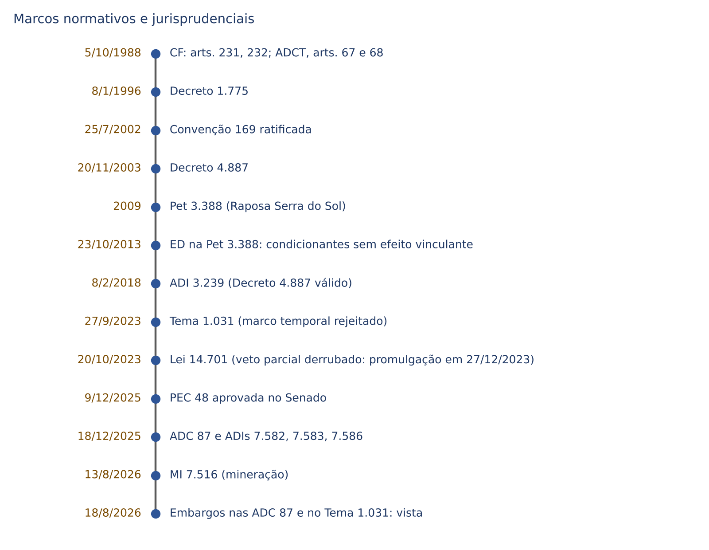
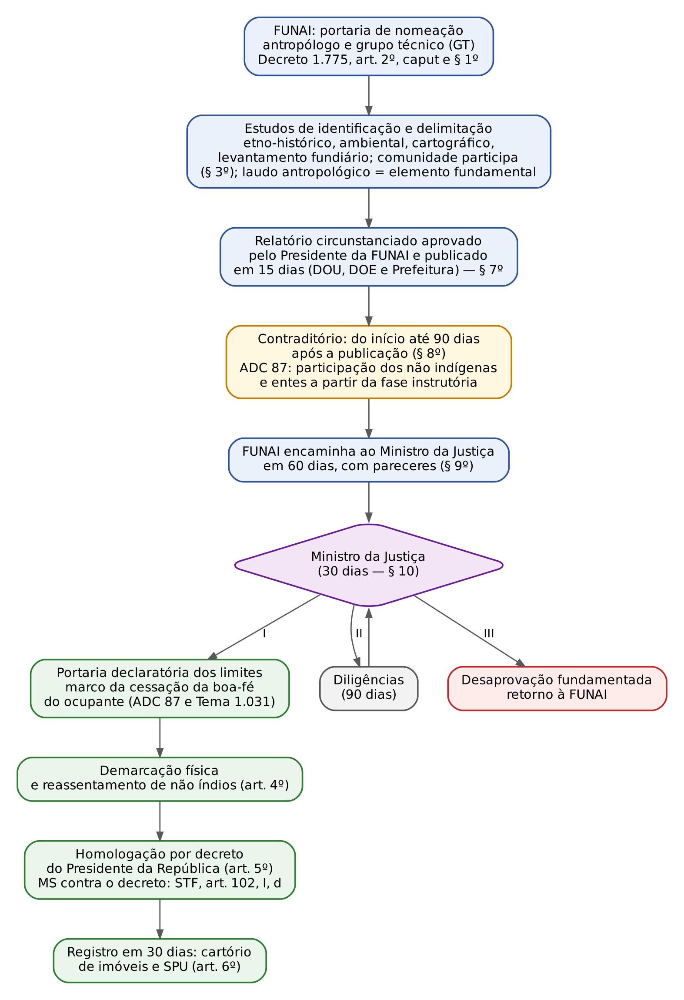
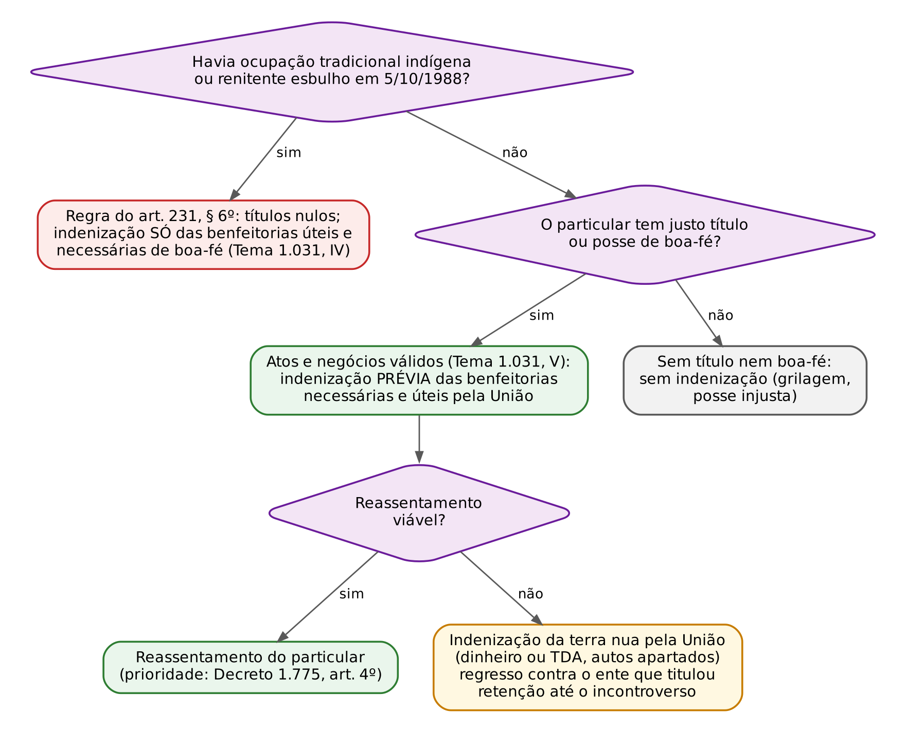
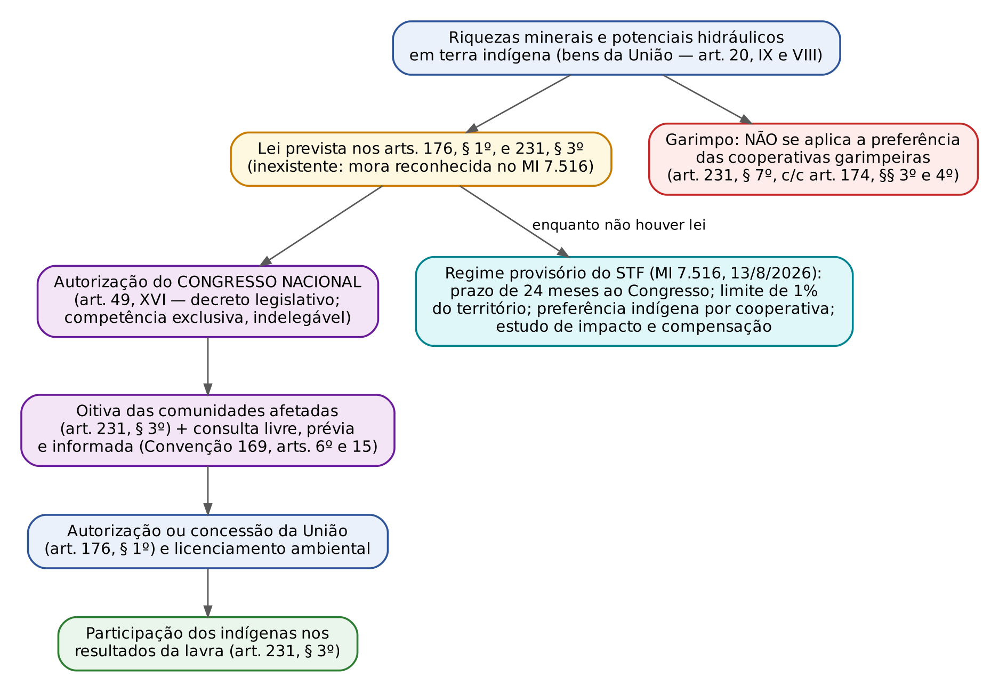
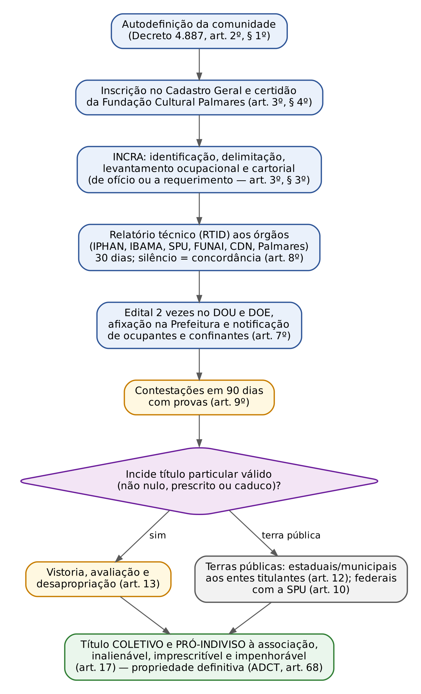
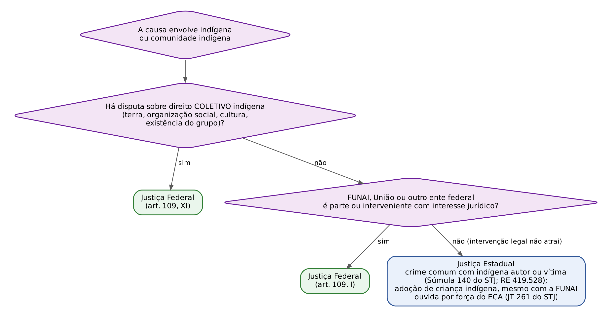

# CAPÍTULO 38 — POVOS INDÍGENAS, QUILOMBOLAS E COMUNIDADES TRADICIONAIS

:::INCIDENCIA
Pontos: TRF5 p. 16; TJRS p. 12; TJSC p. 18.
Nível A+. Lote: 15 questões (FGV 12, FCC 3), três de provas de juiz (TRF1 2025, TJ-SE 2025, TJ-PE 2024), mais 9 correlatas classificadas em outros capítulos.
O que mais cai: posse indígena x posse civil e natureza declaratória da demarcação (com caso prático), marco temporal (Tema 1.031, Lei 14.701/2023 e o julgamento da ADC 87), letra do art. 231 (§§ 3º, 5º e 6º), lavra em terra indígena e propriedade quilombola (art. 68 do ADCT e Decreto 4.887/2003).
:::

| Subtema | FGV | FCC | Padrão de cobrança |
|---|---|---|---|
| Posse tradicional, indigenato e demarcação declaratória | 4 | 1 | Caso de comunidade fora da área há décadas; "posse idêntica à civil"; incompatibilidade com reserva ambiental; demarcação constitutiva |
| Marco temporal (Tema 1.031 e Lei 14.701/2023) | 1 | 1 | O que a LEI diz x o que o STF decidiu; indenização da terra nua ao possuidor de boa-fé |
| Procedimento demarcatório | 1 | 0 | Contraditório na fase de identificação; quem conduz; portaria x decreto |
| Recursos minerais e hídricos | 1 | 0 | Autorização do Congresso; "ouvidas" as comunidades; participação nos resultados |
| Letra do art. 231 e Convenção 169 | 2 | 0 | Bens da União; remoção *ad referendum*; consulta "deverão" x "poderão"; retorno quando cessar a causa |
| Quilombolas | 3 | 0 | Propriedade (não bem da União); título coletivo e pró-indiviso; autoatribuição; peças técnicas "facultadas" |
| Pluralismo jurídico e interculturalidade | 0 | 1 | Estado plurinacional x leitura intercultural limitada pelos direitos fundamentais |

Remissões de fronteira. O constitucionalismo latino-americano e a tese do Estado plurinacional estão no Cap. 1; os bens da União (art. 20, XI) e a Súmula 650, no Cap. 21; a competência legislativa privativa sobre "populações indígenas" (art. 22, XIV), no Cap. 22; o mandado de injunção como instrumento, no Cap. 16; a hierarquia dos tratados de direitos humanos, no Cap. 11; o art. 109 em geral, no Cap. 30; as funções do Ministério Público, no Cap. 31; a cultura e o patrimônio cultural (arts. 215 e 216), no Cap. 36. Fora desta apostila: o procedimento administrativo e a regularização fundiária (Apostila de Direito Administrativo, Cap. 23, 23.6), as regras processuais das causas indígenas — interditos, liminares, intervenção da FUNAI e do MPF (Apostila de Processo Civil, Cap. 35, 35.5), o licenciamento ambiental em terras indígenas e quilombolas, inclusive a Lei 15.190/2025 (Apostila de Direito Ambiental, Cap. 4), e a criança indígena ou quilombola em família substituta (Apostila de Direito da Criança e do Adolescente, Cap. 5). Aqui se desenvolve o regime CONSTITUCIONAL completo, com a jurisprudência do STF até o segundo semestre de 2026.

## 38.1 Fundamentos constitucionais: do paradigma integracionista ao direito à diferença

### 38.1.1 A ruptura de 1988

As Constituições anteriores tratavam o indígena como sujeito em transição: a de 1967, com a EC 1/1969, falava em "incorporação dos silvícolas à comunhão nacional", e a Lei 6.001/1973 (Estatuto do Índio) classificou os indígenas em isolados, em vias de integração e integrados (art. 4º), submetendo os não integrados ao regime tutelar. A CF/1988 abandonou o paradigma assimilacionista (ou integracionista): o art. 231 RECONHECE (não concede) a organização social, os costumes, as línguas, as crenças e as tradições, e os direitos ORIGINÁRIOS sobre as terras tradicionalmente ocupadas. O verbo "reconhecer" e o adjetivo "originários" são as duas chaves de todo o capítulo: o direito preexiste ao Estado e ao título, e o ato estatal apenas o declara.

Consequências cobradas:

- A classificação do art. 4º da Lei 6.001 e a lógica tutelar não se compatibilizam com a CF/1988 no que pressupõem a integração como objetivo; a doutrina majoritária as tem por não recepcionadas nessa parte, e o Tema 1.031 (item XIII) reconheceu aos povos indígenas capacidade civil e postulatória. O Código Civil remete a capacidade dos indígenas à "legislação especial" (art. 4º, parágrafo único), regra que deve ser lida à luz do art. 232 da CF.
- O direito à diferença convive com a igualdade: o indígena não perde a condição étnica por morar fora da aldeia, falar português, votar ou exercer profissão urbana. O STJ considerou ilegal e discriminatória a política federal que restringia a assistência à saúde aos indígenas residentes na Aldeia Xapecó, em Santa Catarina, porque "o status de índio não depende do local em que se vive" (STJ, REsp n. 1.064.009, Relator Ministro Herman Benjamin, Segunda Turma, j. 4/8/2009).
- O critério de pertencimento é a AUTOIDENTIFICAÇÃO (consciência da identidade indígena ou tribal), "critério fundamental" segundo o art. 1º, item 2, da Convenção 169 da OIT, aliado ao reconhecimento pelo grupo. Não cabe ao Estado atestar quem é indígena por laudo de "grau de integração".

:::DOUTRINA INDIGENATO
A teoria do indigenato, formulada por João Mendes Júnior no início do século XX e retomada por José Afonso da Silva, sustenta que a posse indígena é título congênito, originário, que não depende de legitimação, ao contrário da ocupação, título adquirido. A CF/1988 a acolheu ao falar em direitos "originários" (art. 231, *caput*); o STF o afirmou expressamente no Tema 1.031 (RE 1.017.365, julgado em 27/9/2023), ao rejeitar a teoria do fato indígena (marco temporal). Ver 38.4.
:::

### 38.1.2 Pluralismo jurídico e interculturalidade

A Convenção 169 manda considerar, na aplicação da legislação nacional, os costumes e o direito consuetudinário dos povos interessados (art. 8º, item 1), assegurando-lhes conservar instituições próprias "desde que eles não sejam incompatíveis com os direitos fundamentais definidos pelo sistema jurídico nacional nem com os direitos humanos internacionalmente reconhecidos" (art. 8º, item 2); manda respeitar, na medida do compatível, os métodos tradicionais de repressão de delitos (art. 9º) e preferir sanções diversas do encarceramento (art. 10). O modelo brasileiro é, portanto, de pluralismo jurídico MITIGADO: há abertura intercultural, mas não há jurisdição indígena autônoma equiparada à estatal nem Estado plurinacional (a comparação com Bolívia e Equador está no Cap. 1).

:::QUESTAO FCC 2026 — DPE-MA — DEFENSOR PÚBLICO (Q4012563)
Comunidade quilombola pede que procedimentos administrativos locais considerem suas formas próprias de organização e de solução comunitária de conflitos. Gabarito: C (a CF não instituiu Estado plurinacional, mas admite leitura intercultural baseada no pluralismo jurídico e na proteção diferenciada, desde que compatível com os direitos fundamentais e a unidade constitucional).
Passos: (1) o pedido não é de jurisdição própria nem de autonomia política, mas de consideração das formas próprias de organização em procedimentos estatais, o que a Convenção 169 manda fazer (art. 8º, item 1), inclusive em favor de povos TRIBAIS, categoria em que se incluem os quilombolas (38.8.1); (2) o limite vem do próprio art. 8º, item 2: as instituições próprias valem "desde que" compatíveis com os direitos fundamentais e os direitos humanos; (3) a CF/1988 protege a diversidade (arts. 215, 216, § 5º, 231 e ADCT, art. 68), mas mantém a forma federativa e a unidade do ordenamento, sem paridade entre jurisdição comunitária e estatal — é o pluralismo MITIGADO do 38.1.2.
Armadilhas: A (afastar normas municipais por mera invocação de autonomia cultural, sem controle judicial: a interculturalidade opera dentro do sistema, não o suspende); B (exigir emenda que altere a forma de Estado: a leitura intercultural dispensa reforma, porque decorre da CF e da Convenção 169 vigentes; e a forma federativa é cláusula pétrea, art. 60, § 4º, I); D (prevalência de costumes sobre normas constitucionais expressas: inverte a hierarquia e contraria o art. 8º, item 2, da Convenção); E (proteção quilombola "programática": o art. 68 do ADCT tem eficácia plena, ADI 3.239). Lição: a FCC separa três ideias que os candidatos confundem — Estado plurinacional (Bolívia e Equador, Cap. 1), que o Brasil NÃO adotou; pluralismo jurídico mitigado e interculturalidade, que a CF admite; e prevalência irrestrita do direito consuetudinário, que nenhum desses modelos sustenta contra direitos fundamentais.
:::

### 38.1.3 O mapa constitucional

A disciplina não se esgota nos arts. 231 e 232. As provas costumam embaralhar a competência e o verbo de cada dispositivo:

| Dispositivo | Conteúdo literal | Pegadinha usual |
|---|---|---|
| Art. 20, XI | São bens da União "as terras tradicionalmente ocupadas pelos índios" | Bem da União não é "propriedade dos índios"; terras de quilombo NÃO são bens da União |
| Art. 22, XIV | Compete PRIVATIVAMENTE à União legislar sobre "populações indígenas" | Não é concorrente (Cap. 22) |
| Art. 49, XVI | Competência EXCLUSIVA do Congresso: "autorizar, em terras indígenas, a exploração e o aproveitamento de recursos hídricos e a pesquisa e lavra de riquezas minerais" | Atribuir ao Presidente (Q4338745) |
| Art. 109, XI | Juízes federais: "a disputa sobre direitos indígenas" | Todo crime com indígena seria federal |
| Art. 129, V | Função institucional do MP: "defender judicialmente os direitos e interesses das populações indígenas" | O MP não "representa" os indígenas, que têm legitimidade própria (art. 232) |
| Art. 176, § 1º | Lei estabelecerá condições específicas quando a pesquisa e a lavra se desenvolverem em faixa de fronteira ou terras indígenas | Lei inexistente: mora reconhecida no MI 7.516 |
| Art. 210, § 2º | Ensino fundamental em língua portuguesa, "assegurada às comunidades indígenas também a utilização de suas línguas maternas e processos próprios de aprendizagem" | "também": não exclui o português |
| Art. 215, § 1º | O Estado protegerá as manifestações das culturas populares, indígenas e afro-brasileiras | — |
| Art. 216, § 5º | "Ficam tombados todos os documentos e os sítios detentores de reminiscências históricas dos antigos quilombos" | Tombamento constitucional direto, sem procedimento |
| Art. 231, §§ 1º a 7º | Conceito, posse, usufruto, recursos, inalienabilidade, remoção, nulidade, garimpo | Ver 38.2 e 38.6 |
| Art. 232 | Índios, comunidades e organizações são partes legítimas; MP intervém em todos os atos | "Incapacidade processual" (Q2512007) |
| ADCT, art. 67 | União concluirá a demarcação em cinco anos | Prazo descumprido: omissão inconstitucional declarada na ADC 87 |
| ADCT, art. 68 | Aos remanescentes de quilombos que estejam ocupando suas terras, "propriedade definitiva" | Não é posse nem bem da União |

:::QUESTAO FGV 2024 — CÂMARA DOS DEPUTADOS — CONSULTOR LEGISLATIVO (Q2512006)
Quatro afirmações: terras indígenas como bens da União (I); reconhecimento da organização social, costumes, línguas, crenças e tradições e dos direitos originários (II); vedação de remoção com as exceções do § 5º (III); ratificação da Convenção 169 em 2002, com consulta livre, prévia e informada (IV). Gabarito: E (todas corretas). Pontos de atenção: a ratificação (depósito do instrumento em 25/7/2002, após aprovação pelo Decreto Legislativo 143/2002) é diferente da vigência para o Brasil e da promulgação interna (hoje consolidada no Decreto 10.088/2019, Anexo LXXII); a afirmação III é transcrição do § 5º, cuja estrutura dupla (catástrofe ou epidemia: *ad referendum*; soberania: APÓS deliberação) é cobrada isoladamente (ver 38.7).
:::

## 38.2 Terras tradicionalmente ocupadas: conceito e regime

### 38.2.1 Texto

:::LEI CONSTITUIÇÃO FEDERAL, ART. 231
Art. 231. São reconhecidos aos índios sua organização social, costumes, línguas, crenças e tradições, e os direitos originários sobre as terras que tradicionalmente ocupam, competindo à União demarcá-las, proteger e fazer respeitar todos os seus bens.
§ 1º São terras tradicionalmente ocupadas pelos índios as por eles habitadas em caráter permanente, as utilizadas para suas atividades produtivas, as imprescindíveis à preservação dos recursos ambientais necessários a seu bem-estar e as necessárias a sua reprodução física e cultural, segundo seus usos, costumes e tradições.
§ 2º As terras tradicionalmente ocupadas pelos índios destinam-se a sua posse permanente, cabendo-lhes o usufruto exclusivo das riquezas do solo, dos rios e dos lagos nelas existentes.
§ 3º O aproveitamento dos recursos hídricos, incluídos os potenciais energéticos, a pesquisa e a lavra das riquezas minerais em terras indígenas só podem ser efetivados com autorização do Congresso Nacional, ouvidas as comunidades afetadas, ficando-lhes assegurada participação nos resultados da lavra, na forma da lei.
§ 4º As terras de que trata este artigo são inalienáveis e indisponíveis, e os direitos sobre elas, imprescritíveis.
§ 5º É vedada a remoção dos grupos indígenas de suas terras, salvo, "ad referendum" do Congresso Nacional, em caso de catástrofe ou epidemia que ponha em risco sua população, ou no interesse da soberania do País, após deliberação do Congresso Nacional, garantido, em qualquer hipótese, o retorno imediato logo que cesse o risco.
§ 6º São nulos e extintos, não produzindo efeitos jurídicos, os atos que tenham por objeto a ocupação, o domínio e a posse das terras a que se refere este artigo, ou a exploração das riquezas naturais do solo, dos rios e dos lagos nelas existentes, ressalvado relevante interesse público da União, segundo o que dispuser lei complementar, não gerando a nulidade e a extinção direito a indenização ou a ações contra a União, salvo, na forma da lei, quanto às benfeitorias derivadas da ocupação de boa fé.
§ 7º Não se aplica às terras indígenas o disposto no art. 174, § 3º e § 4º.
:::

### 38.2.2 Os quatro elementos do § 1º e a tradicionalidade

O § 1º define a terra tradicionalmente ocupada por QUATRO elementos ligados pela conjunção "e": habitação permanente, atividades produtivas, preservação dos recursos ambientais necessários ao bem-estar e reprodução física e cultural, todos aferidos "segundo seus usos, costumes e tradições". Três consequências:

- "Tradicionalmente" qualifica o MODO de ocupar (segundo a cultura do povo), e não a antiguidade cronológica da ocupação. Por isso o critério é antropológico, e o laudo antropológico é "um dos elementos fundamentais" da demonstração (Tema 1.031, item IX).
- A terra indígena não se limita à área das casas: abrange as áreas de caça, pesca, coleta, roça, cemitérios, locais sagrados e as de reserva ambiental necessárias ao modo de vida. A área de "atividades produtivas, de viés essencialmente econômico" integra a tradicionalidade (Q3425363, abaixo).
- A Lei 14.701/2023 (art. 4º, *caput*) reproduziu os quatro elementos, mas acrescentou "na data da promulgação da Constituição Federal" e "simultaneamente"; a expressão temporal foi declarada inconstitucional (ver 38.4.4).

### 38.2.3 Posse tradicional x posse civil

| Aspecto | Posse civil (CC, art. 1.196) | Posse indígena (art. 231) |
|---|---|---|
| Fundamento | Fato da exteriorização de poder inerente à propriedade | Direito originário de matriz constitucional e étnica |
| Sujeito | Pessoa natural ou jurídica, individual | Comunidade (posse coletiva e permanente) |
| Objeto | Coisa individualizada | Território necessário à reprodução física e cultural |
| Prova | Atos materiais de uso, *corpus* e *animus* conforme a teoria adotada | Tradicionalidade segundo usos, costumes e tradições (laudo antropológico) |
| Interrupção | Perde-se a posse com o abandono ou o esbulho não repelido | Esbulho e expulsão não desconstituem a tradicionalidade; independe de marco temporal ou de renitente esbulho (Tema 1.031, III) |
| Efeitos aquisitivos | Usucapião | Nenhum: terra da União, inalienável e insuscetível de usucapião |
| Proteção | Interditos possessórios | Ação da comunidade, da FUNAI, da União e do MPF; interdito do particular contra demarcação é vedado (Lei 6.001, art. 19, § 2º; Apostila de Processo Civil, Cap. 35) |

:::QUESTAO FGV 2025 — TRF1 — JUIZ FEDERAL SUBSTITUTO (Q3425363)
Audiência pública sobre balizas da demarcação. Ana: a demarcação seria CONSTITUTIVA quando a área tivesse título particular registrado, transferindo-se a propriedade à União. Maria: a ocupação tradicional caracterizaria posse IDÊNTICA à civil. Joana: a tradicionalidade se estende às áreas de atividades produtivas, de viés essencialmente econômico. Gabarito: C (somente Joana). Resolução em passos: (1) a demarcação é declaratória de direito originário (Tema 1.031, I), e o título particular sobre terra tradicional é nulo (art. 231, § 6º) — não há "transferência" à União, cujo domínio decorre do art. 20, XI; (2) a posse tradicional é distinta da posse civil (Tema 1.031, II); (3) o § 1º inclui expressamente as terras "utilizadas para suas atividades produtivas". Armadilha: a ideia de que o título registrado converteria a demarcação em desapropriação, o que confunde terra tradicional (art. 231) com área reservada adquirida por desapropriação (Lei 14.701, art. 16, § 1º, III).
:::

### 38.2.4 Titularidade e posse: a dissociação

O regime é de dissociação entre DOMÍNIO e POSSE: o domínio é da União (art. 20, XI), bem público de uso especial vinculado a uma finalidade constitucional; a posse permanente e o usufruto exclusivo são da comunidade (art. 231, § 2º). A União não pode dar outra destinação à terra, nem aliená-la, nem desafetá-la por ato próprio: a vinculação é constitucional. O usufruto é EXCLUSIVO e PERMANENTE (não é "vitalício", como insinuam alternativas que transpõem a figura do Código Civil), e incide sobre as riquezas do SOLO, dos RIOS e dos LAGOS. O subsolo e os potenciais hidráulicos seguem regime próprio (arts. 20, VIII e IX, e 231, § 3º; ver 38.6).

:::PEGADINHA USUFRUTO DE QUEM?
A FCC (Q3304051, alternativa A) inverteu o § 2º: "cabendo à União o usufruto exclusivo das riquezas". O usufruto é dos indígenas; a União tem o domínio. Na mesma questão, a alternativa correta reproduzia o item II do Tema 1.031 (posse tradicional distinta da posse civil). Note ainda que o enunciado pedia o que o STF decidiu "em tese de repercussão geral": a alternativa D (plano de ação para povos isolados) reflete processo estrutural em ADPF, não tese de repercussão geral (ver 38.7), e a E distorce o item VII do Tema 1.031, que só admite áreas reservadas diante da "absoluta impossibilidade" de demarcar.
:::

### 38.2.5 Inalienabilidade, indisponibilidade, imprescritibilidade e nulidade dos títulos

O § 4º torna as terras inalienáveis e indisponíveis e os direitos sobre elas imprescritíveis (Tema 1.031, item XI). Daí:

- Não correm prazos de usucapião, de prescrição aquisitiva ou extintiva contra a comunidade; a pretensão de reaver a terra não prescreve.
- O § 6º fulmina de nulidade e extinção os atos que tenham por objeto a ocupação, o domínio e a posse dessas terras ou a exploração de suas riquezas naturais, "não produzindo efeitos jurídicos". Ressalva única: relevante interesse público da União, "segundo o que dispuser lei complementar" — lei NUNCA editada, de modo que a ressalva é norma de eficácia limitada sem aplicação.
- A nulidade não gera direito a indenização nem a ações contra a União, "salvo, na forma da lei, quanto às benfeitorias derivadas da ocupação de boa fé". Esse é o regime-base; o Tema 1.031 e a ADC 87 acrescentaram, para hipóteses específicas, indenização da terra nua fundada em erro do Estado (art. 37, § 6º), sem negar a nulidade do título (ver 38.4.5 e a figura do 38.4).
- O STJ admitiu que o INCRA recuse a certificação de georreferenciamento de imóvel rural sobreposto a área indígena, ainda que a demarcação não esteja concluída, porque os títulos particulares sobre terras indígenas são nulos (STJ, AREsp n. 1.640.785, Relator Ministro Francisco Falcão, Segunda Turma, j. 25/10/2022).

### 38.2.6 Aldeamentos extintos e outras modalidades de terra indígena

A Súmula 650 do STF (aldeamentos extintos, ocupados por indígenas em passado remoto, não são bens da União) afasta a ocupação REMOTA desvinculada do presente, mas, depois do Tema 1.031, não autoriza dizer que a expulsão forçada desconfigura a tradicionalidade de comunidade que mantém vínculo com a área (v. Cap. 21).

A Lei 14.701/2023 (art. 3º) organizou três modalidades:

| Modalidade | Base | Domínio e regime |
|---|---|---|
| Terras tradicionalmente ocupadas | Art. 231, § 1º, da CF | União (art. 20, XI); posse permanente e usufruto exclusivo; demarcação declaratória |
| Áreas indígenas reservadas | Destinação pela União por outras formas (terras devolutas, áreas públicas federais, desapropriação por interesse social — art. 16, § 1º) | Propriedade da União, gestão pela comunidade sob supervisão da FUNAI (art. 16, § 3º); mesmo regime de uso das tradicionais (art. 17) |
| Áreas indígenas adquiridas | Compra e venda, doação (art. 18) | Regime da propriedade privada (art. 18, § 1º), com INTERPRETAÇÃO CONFORME na ADC 87: o regime privado não se aplica quando a área estiver ligada ao reconhecimento da tradicionalidade, à criação de reservas ou a compensações de terras tradicionais, hipóteses em que prevalece o art. 231 |

O Tema 1.031 (item VII) só admite a formação de áreas reservadas "diante da absoluta impossibilidade de concretização da ordem constitucional de demarcação", ouvida em todo caso a comunidade e assegurada compensação proporcional (art. 16.4 da Convenção 169). A área reservada é exceção, não alternativa discricionária à demarcação.

### 38.2.7 Terra indígena e meio ambiente

A ocupação tradicional "é compatível com a tutela constitucional do meio ambiente, sendo assegurado o exercício das atividades tradicionais dos povos indígenas" (Tema 1.031, item XII). O próprio § 1º inclui na terra indígena as áreas imprescindíveis à preservação ambiental. A sobreposição entre terra indígena e unidade de conservação resolve-se por gestão compartilhada, e não pela supressão do direito indígena: a ADC 87 declarou inconstitucionais o *caput* e o § 1º do art. 23 da Lei 14.701, que submetiam o usufruto indígena ao órgão gestor da unidade de conservação (cf-0606, Buscador Dizer o Direito; ver 38.4.4).

:::QUESTAO FGV 2024 — TJ-PE — JUIZ SUBSTITUTO (Q3117567)
Indígenas ocupam reserva biológica estadual. De um lado, Portaria do Ministério da Justiça abrange a área, sem demarcação concluída; de outro, não há ocupação indígena há quatro décadas nem resistência a esbulho. Gabarito: D (a ausência de demarcação, ato meramente declaratório, não impede o reconhecimento do vínculo, se demonstrado no laudo antropológico). Passos: (1) o direito é originário e a demarcação apenas o declara — a falta dela não afasta o direito (erra A); (2) a posse indígena não se confunde com a civil, e o hiato de ocupação não desconstitui a tradicionalidade, que independe de marco temporal e de renitente esbulho (erra B; Tema 1.031, II e III); (3) a proteção ambiental é compatível com a ocupação tradicional (erra C; Tema 1.031, XII); (4) a CF/1988 não é assimilacionista, e não é a portaria que "assegura" a ocupação, mas o direito originário comprovado (erra E). O caso espelha o próprio RE 1.017.365, originado de reintegração de posse ajuizada pelo órgão ambiental de Santa Catarina em área da Reserva Biológica do Sassafrás ocupada pelo povo Xokleng.
:::

:::QUESTAO FGV 2025 — TJ-SE — JUIZ SUBSTITUTO (Q3301282)
Processo de individualização de terras indígenas com três argumentos: I, posse civil não se identifica com a tradicional; II, a individualização deve partir do reconhecimento pela CF/1988; III, a ocupação tradicional é incompatível com a tutela ambiental. Gabarito: A (apenas I). O II é a armadilha sofisticada: sugere que o direito nasce com a Constituição de 1988, quando ela apenas o RECONHECE como originário e anterior (e insinua o marco temporal); o III contraria o item XII do Tema 1.031.
:::

:::QUESTAO FGV 2024 — CÂMARA DOS DEPUTADOS — CONSULTOR LEGISLATIVO (Q2512007)
Gabarito: D (reprodução do § 2º: posse permanente e usufruto exclusivo das riquezas do solo, dos rios e dos lagos). Erradas: A (perda da posse com a colonização e aquisição pelo possuidor de boa-fé — nega o indigenato e a imprescritibilidade); B (o STF não fixou "dez anos após a promulgação"; rejeitou qualquer marco temporal no Tema 1.031); C (juízo de conveniência econômica, estranho à Constituição); E (o MP não atua "em nome" dos indígenas por incapacidade processual: eles têm legitimidade própria, art. 232).
:::

## 38.3 Demarcação: natureza, dever da União e procedimento

### 38.3.1 Natureza declaratória e dever de demarcar

A demarcação "consiste em procedimento declaratório do direito originário territorial à posse das terras ocupadas tradicionalmente por comunidade indígena" (Tema 1.031, item I). Não cria, não transfere e não extingue direitos; delimita e dá publicidade a direito preexistente. Efeitos práticos que decidem casos:

- A falta de demarcação NÃO afasta o direito nem a proteção estatal. O STF, na ADPF 709, determinou que a União e a FUNAI executem a proteção territorial nas terras indígenas independentemente de sua homologação, porque a não homologação decorre de inércia estatal e a retirada da proteção funciona como convite à invasão (STF, ADPF 709 MC-segunda-Ref, Relator Ministro Roberto Barroso, Plenário, j. 25/2/2022, Informativo 1045, segundo a ficha cf-0636 do Drive).
- O título particular sobre a área é nulo desde sempre (§ 6º), não "a partir" da portaria ou do decreto; o que a ADC 87 fixou como marco foi a cessação da BOA-FÉ do ocupante para fins de indenização de benfeitorias: a portaria declaratória do Ministro da Justiça (ver 38.4.4).
- A demarcação é DEVER (art. 231, *caput*: "competindo à União demarcá-las"), e não juízo de conveniência; o art. 67 do ADCT fixou cinco anos a partir de 5/10/1988 para concluí-la. Esse prazo, durante muito tempo tido por programático, foi o fundamento da declaração de inconstitucionalidade POR OMISSÃO no julgamento conjunto da ADC 87 e das ADIs 7.582, 7.583 e 7.586 (ver 38.4.4), com fixação de medidas transitórias.
- O Judiciário pode, diante de inércia injustificável, ordenar ao Executivo a conclusão do procedimento em prazo certo, sem ofensa à separação de poderes (STJ, REsp n. 1.623.873, Relator Ministro Gurgel de Faria, Primeira Turma, j. 26/4/2022, em ação civil pública do MPF para a comunidade Fulkaxó). E pode, inversamente, escalonar a desintrusão: o caráter declaratório não impõe a retirada imediata e desordenada dos não indígenas, admitindo-se prazo razoável e medidas progressivas para a imissão da comunidade na posse (STJ, REsp n. 1.637.991, Relator Ministro Afrânio Vilela, Segunda Turma, j. 20/5/2025, Informativo 852).

### 38.3.2 Procedimento do Decreto 1.775/1996

O art. 231 não regula o procedimento; a Lei 6.001 (art. 19) prevê demarcação administrativa por iniciativa e orientação do órgão federal de assistência ao índio, e o Decreto 1.775/1996 a disciplina. Etapas:

| Fase | Quem | Regra e prazo |
|---|---|---|
| Identificação e delimitação | FUNAI nomeia antropólogo e grupo técnico (GT) multidisciplinar | Estudos etno-históricos, sociológicos, jurídicos, cartográficos, ambientais e levantamento fundiário (art. 2º, § 1º); o grupo indígena participa de todas as fases (§ 3º); órgãos públicos DEVEM e entidades civis PODEM prestar informações em 30 dias (§ 5º) |
| Relatório | GT ao Presidente da FUNAI | Aprovado, resumo publicado em 15 dias no DOU e no DOE, com memorial e mapa, afixado na Prefeitura (§ 7º) |
| Contraditório | Estados, Municípios e demais interessados | "Desde o início do procedimento demarcatório até noventa dias após a publicação", com razões e provas, para pleitear indenização ou apontar vícios (§ 8º) |
| Remessa | FUNAI ao Ministro da Justiça | 60 dias após o prazo do § 8º, com pareceres (§ 9º) |
| Decisão | Ministro da Justiça | Em 30 dias: portaria declaratória dos limites; diligências (90 dias); ou desaprovação fundamentada "circunscrita ao não atendimento do disposto no § 1º do art. 231" (§ 10) |
| Demarcação física e reassentamento | FUNAI; órgão fundiário federal | Prioridade ao reassentamento de ocupantes não indígenas (art. 4º) |
| Homologação | Presidente da República | Decreto (art. 5º) |
| Registro | FUNAI | Em 30 dias, no cartório imobiliário e na SPU (art. 6º) |

Pontos de prova:

- A FUNAI CONDUZ (não o Ministério da Justiça); o Ministro decide sobre o relatório por PORTARIA DECLARATÓRIA; o Presidente HOMOLOGA por DECRETO. Contra o decreto presidencial, o mandado de segurança é originário do STF (art. 102, I, d); contra a portaria do Ministro de Estado, do STJ (art. 105, I, b).
- O levantamento fundiário é etapa imprescindível, ainda que a identificação esteja avançada; sua omissão viola o devido processo legal administrativo e nulifica a demarcação (STJ, REsp n. 1.551.033, Relator Ministro Humberto Martins, Segunda Turma, j. 6/10/2015).
- O procedimento é PÚBLICO: a Lei 14.701 (art. 4º, §§ 5º e 6º) assegura divulgação dos atos decisórios e acesso de qualquer cidadão aos estudos e laudos, ressalvados os dados pessoais (LGPD). Não há fase "sigilosa" ou "inquisitorial".
- A Lei 14.701 exigiu que informações orais só tenham efeito probatório se colhidas em audiência pública ou registradas em "áudio e vídeo" (art. 4º, § 7º); a ADC 87 deu interpretação conforme para que o registro seja ALTERNATIVO (áudio OU vídeo), por respeito às restrições culturais à veiculação de imagens, e vedou a retroação sobre laudos já concluídos (cf-0606).
- O art. 10 da Lei 14.701, que mandava aplicar aos antropólogos e peritos as hipóteses de impedimento e suspeição do art. 148 do CPC, foi declarado INCONSTITUCIONAL: bastam as regras gerais da Lei 9.784/1999 (cf-0606; Informativo 1203).
- O art. 14 (adequação dos processos em curso à nova lei) foi declarado inconstitucional: as mudanças procedimentais valem só para o futuro, preservados os atos praticados (proteção da confiança).

:::QUESTAO FGV 2024 — PREFEITURA DE MACAÉ — PROCURADOR (Q3049913)
Primeira etapa da demarcação (identificação e delimitação), "à luz da sistemática vigente". Gabarito: B (assegura-se a todos os interessados o contraditório, com razões instruídas com todas as provas pertinentes — Decreto 1.775, art. 2º, § 8º, e Lei 14.701, art. 6º). Erradas: A (a demarcação física é posterior à portaria e não é "temporária", nem os estudos são de "ambientalistas e historiadores", mas de antropólogo e GT); C (quem conduz é a FUNAI; o Ministro só decide ao final); D (não há avaliação "sigilosa": o procedimento é público); E (não é inquisitorial, pois há contraditório). Atualização: a ADC 87 manteve o contraditório, mas deu interpretação conforme às expressões "desde o início do procedimento" e "desde o início do processo administrativo demarcatório" (arts. 5º e 6º), situando a participação dos não indígenas e dos entes a partir da abertura da fase instrutória (identificação e delimitação), e não em momento anterior; o gabarito permanece correto.
:::

### 38.3.3 Participação de Estados e Municípios

A Lei 14.701 tornou "obrigatória" a participação dos Estados e Municípios onde se localize a área, e de todas as comunidades interessadas, "desde o início do processo administrativo demarcatório, a partir da reivindicação" (art. 5º), e assegurou contraditório e ampla defesa em todas as fases, "inclusive nos estudos preliminares", com intimação obrigatória e indicação de peritos auxiliares (art. 6º). O STF não suprimiu a participação; ajustou seu momento (fase instrutória) e afirmou que a participação deve ser "efetiva e tempestiva", sob pena de esvaziar o contraditório se só se viabilizar depois dos estudos técnicos; e que exigências formais não podem inviabilizar retroativamente trabalhos técnicos já entregues à FUNAI (Informativo 1203). As notícias do julgamento registram, ainda, a possibilidade de entes e proprietários indicarem técnicos para acompanhar os estudos.

:::DICA DEMARCAÇÃO NÃO É DESAPROPRIAÇÃO
Distratores frequentes: "a União desapropria a terra para demarcá-la", "a demarcação transfere a propriedade à União", "a portaria constitui a terra indígena". Sobre terra tradicionalmente ocupada não há desapropriação, porque o título particular é nulo (§ 6º) e o domínio já é da União (art. 20, XI). A desapropriação por interesse social só aparece na formação de ÁREAS RESERVADAS (Lei 14.701, art. 16, § 1º, III) e na TITULAÇÃO QUILOMBOLA (Decreto 4.887, art. 13), em que o título particular é válido.
:::

### 38.3.4 Revisão, ampliação e redimensionamento

O Tema 1.031 (item VIII) admite o redimensionamento de terra já demarcada em caso de descumprimento do art. 231, por pedido de revisão apresentado "até o prazo de cinco anos da demarcação anterior", comprovado "grave e insanável erro" no procedimento ou na definição dos limites, ressalvadas as ações em curso e os pedidos já instaurados até o fim do julgamento. A Lei 14.701 vedou de forma absoluta a ampliação de terras já demarcadas (art. 13); a ADC 87 declarou o dispositivo inconstitucional, mantendo a revisão excepcional nos moldes do Tema 1.031, com indenização ao particular nos termos fixados pelo STF (cf-0606). Na Pet 3.388 (Raposa Serra do Sol), uma das salvaguardas fixadas era justamente a vedação de ampliação; como o STF, nos embargos de declaração julgados em 23/10/2013, afirmou que as condicionantes não vinculam outros processos, a vedação não se generalizou.

## 38.4 Marco temporal: da Pet 3.388 à ADC 87

### 38.4.1 As duas teorias

|  | Indigenato | Fato indígena (marco temporal) |
|---|---|---|
| Fonte do direito | Ocupação tradicional como título originário, anterior ao Estado | Ocupação de fato numa data de corte |
| Data de referência | Nenhuma | 5/10/1988 |
| Ausência em 1988 | Irrelevante se demonstrada a tradicionalidade (expulsão, esbulho) | Desconfigura a terra, salvo "renitente esbulho" (conflito físico ou judicial persistente em 1988) |
| Prova | Laudo antropológico | Documental da presença ou do conflito em 1988 |
| Situação | Adotada pelo STF (Tema 1.031; ADC 87) | Rejeitada pelo STF; positivada na Lei 14.701 (art. 4º) e invalidada; PEC 48/2023 pretende constitucionalizá-la |

### 38.4.2 A origem: Pet 3.388 (Raposa Serra do Sol)

Ao julgar a ação popular contra a demarcação contínua da Terra Indígena Raposa Serra do Sol (Roraima), em 2009, o STF manteve a demarcação contínua e, em voto-vista do Ministro Menezes Direito, fixou dezenove salvaguardas institucionais (condicionantes) e referiu o marco temporal da ocupação (5/10/1988) e o renitente esbulho como critérios. Nos embargos de declaração (j. 23/10/2013), o Tribunal esclareceu que a decisão não tinha efeito vinculante nem se estendia automaticamente a outras demarcações: as condicionantes valiam para aquele caso. A partir daí, a tese do marco temporal passou a ser aplicada por órgãos administrativos e por tribunais em outras terras, até ser submetida à repercussão geral.

:::ATENCAO PET 3.388 NÃO É PRECEDENTE VINCULANTE SOBRE MARCO TEMPORAL
Alternativa que diga que o STF "firmou o marco temporal com efeito vinculante no caso Raposa Serra do Sol" está errada duas vezes: a decisão de 2009, em ação popular, não tinha eficácia *erga omnes* nem vinculante (o que os embargos de 2013 explicitaram), e o Tema 1.031 (2023) rejeitou a tese.
:::

### 38.4.3 Tema 1.031 (RE 1.017.365)

O caso: reintegração de posse ajuizada pelo órgão ambiental de Santa Catarina contra a FUNAI e indígenas Xokleng, em área da Reserva Biológica do Sassafrás reivindicada como terra tradicional (Terra Indígena Ibirama-Laklãnõ). O Plenário, relator o Ministro Edson Fachin, julgado em 27/9/2023 (Informativo 1110), rejeitou o marco temporal e fixou treze itens de tese:

:::JURIS STF, TEMA 1.031 (RG) — RE 1.017.365, RELATOR MINISTRO EDSON FACHIN, J. 27/9/2023
I — demarcação declaratória do direito originário; II — posse tradicional distinta da posse civil (conceito do § 1º); III — proteção independente "da existência de um marco temporal em 05 de outubro de 1988 ou da configuração do renitente esbulho, como conflito físico ou controvérsia judicial persistente à data da promulgação"; IV — havendo ocupação tradicional ou renitente esbulho contemporâneo à CF, indenizam-se só as benfeitorias úteis e necessárias (§ 6º); V — ausentes ocupação tradicional ou renitente esbulho em 1988, são válidos os atos e negócios perfeitos e a coisa julgada relativos a justo título ou posse de boa-fé, com justa e prévia indenização das benfeitorias pela União e, inviável o reassentamento, indenização da terra nua pela União (com regresso contra o ente que titulou a área), em dinheiro ou TDA, em autos apartados, pagamento imediato do incontroverso e retenção até esse pagamento, admitidos a autocomposição e o regime do art. 37, § 6º; VI — sem indenização nos casos já pacificados (terras reconhecidas e declaradas), ressalvados os judicializados e em andamento; VII — áreas reservadas só diante de absoluta impossibilidade, ouvida a comunidade, com compensação proporcional (art. 16.4 da Convenção 169); VIII — redimensionamento em até cinco anos por grave e insanável erro; IX — laudo antropológico como elemento fundamental; X — posse permanente e usufruto exclusivo; XI — inalienabilidade, indisponibilidade e imprescritibilidade; XII — compatibilidade com o meio ambiente; XIII — capacidade civil e postulatória dos povos indígenas, sem prejuízo da legitimidade concorrente da FUNAI e da intervenção do MP como fiscal da lei.
:::

Leitura técnica do item V. O STF não ressuscitou o marco temporal pela porta da indenização. A data de 5/10/1988 deixou de ser critério de EXISTÊNCIA do direito indígena e passou a ser critério de VALIDADE E EFICÁCIA dos atos dos particulares e de definição do regime INDENIZATÓRIO: se a terra estava ocupada tradicionalmente (ou em renitente esbulho) em 1988, o particular sabia ou devia saber da ocupação, e o regime é o do § 6º (só benfeitorias de boa-fé); se não estava, o Estado errou ao titular ou ao tolerar a posse, e responde objetivamente (art. 37, § 6º), inclusive pela terra nua quando inviável o reassentamento.

:::QUESTAO FCC 2026 — DPE-MA — DEFENSOR PÚBLICO (Q4012607)
Regime constitucional de terras indígenas, quilombos e reforma agrária. Gabarito: E (sem presença indígena nem conflito na data da promulgação, o possuidor ou proprietário não indígena de boa-fé deve ser reassentado ou indenizado pela terra nua, além das benfeitorias necessárias e úteis — Tema 1.031, V). Erradas: A (a isenção do art. 184, § 5º, abrange impostos federais, estaduais E municipais); B (aos indígenas não se reconhece propriedade, mas posse permanente: a propriedade definitiva é dos QUILOMBOLAS, art. 68 do ADCT); C (a indenização da desapropriação agrária é em títulos da dívida AGRÁRIA, art. 184, *caput*); D (o marco temporal foi rejeitado).
:::

### 38.4.4 Lei 14.701/2023 e o julgamento conjunto (ADC 87 e ADIs 7.582, 7.583 e 7.586)

Menos de um mês depois do Tema 1.031, o Congresso aprovou o projeto que se converteu na Lei 14.701, de 20/10/2023. O Presidente vetou o núcleo do marco temporal e outros dispositivos; o Congresso derrubou parte dos vetos, e as partes restabelecidas foram promulgadas pelo Presidente do Senado em 27/12/2023 (art. 66, § 7º; o texto compilado no Planalto registra a promulgação das partes vetadas). O art. 4º passou a definir as terras tradicionais pelas ocupadas "na data da promulgação da Constituição Federal", com os §§ 2º a 4º (ausência em 5/10/1988 descaracteriza; renitente esbulho como conflito persistente até aquela data; cessação anterior da posse, "independentemente da causa", inviabiliza o reconhecimento).

Vieram a ADC 87 (pela constitucionalidade) e as ADIs 7.582, 7.583 e 7.586 (pela inconstitucionalidade), relator o Ministro Gilmar Mendes. O relator instalou Comissão Especial de conciliação, cujo produto foi homologado no julgamento. O julgamento virtual foi finalizado na noite de 18/12/2025 (Informativo 1203, de 2/2/2026, e notícia do ISA; a data de 19/12/2025, que aparece em algumas fontes, é a das reportagens). Síntese do resultado, por maioria:

:::JURIS STF, ADC 87 E ADIS 7.582, 7.583 E 7.586 — RELATOR MINISTRO GILMAR MENDES, PLENÁRIO, J. 18/12/2025 (INFORMATIVO 1203)
São inconstitucionais dispositivos da Lei 14.701/2023 que condicionam o conceito de terra tradicionalmente ocupada à "data da promulgação da Constituição Federal" e que reproduzem, direta ou indiretamente, a lógica do marco temporal. Há omissão inconstitucional quanto ao dever de concluir as demarcações (ADCT, art. 67), com prazo de até 180 dias para o cumprimento das determinações transitórias, que subsistem até lei compatível com os parâmetros da decisão. Procedimento: participação efetiva e tempestiva dos interessados; exigências formais não podem inviabilizar retroativamente estudos concluídos; até a portaria declaratória, a incerteza quanto aos limites justifica tratar como de boa-fé as benfeitorias dos não indígenas; interferência estatal no usufruto exige motivação proporcional e consulta prévia, livre e informada. Dispositivo: homologação do produto da Comissão Especial e envio ao Congresso; procedência parcial quanto a dispositivos e expressões dos arts. 4º (*caput* e §§ 2º a 4º), 5º, 6º, 9º (§§ 1º e 2º), 10, 13, 14, 18 (§§ 1º e 2º), 20 (*caput* e parágrafo único), 22, 23 (*caput* e §§ 1º e 2º), 26, 27, 31 e 32 da Lei 14.701, do art. 2º, IX, da Lei 4.132/1962 e do art. 2º, IX, da Lei 6.001/1973.
:::

O Informativo agrupa declarações de inconstitucionalidade e interpretações conformes sob a mesma rubrica ("dispositivos e expressões"). O detalhamento por dispositivo, segundo a ficha do Buscador Dizer o Direito (cf-0606) e as notícias oficiais:

| Dispositivo da Lei 14.701 | Conteúdo | Resultado |
|---|---|---|
| Art. 4º, *caput* (expressão temporal) e §§ 2º a 4º | Marco temporal e renitente esbulho restritivo | INCONSTITUCIONAIS |
| Art. 4º, § 7º | Registro em "áudio e vídeo" | Interpretação conforme: áudio OU vídeo; sem retroagir a laudos concluídos |
| Arts. 5º e 6º | Participação de entes e contraditório "desde o início" | Interpretação conforme: a partir da fase instrutória (identificação e delimitação) |
| Art. 9º, §§ 1º e 2º | Boa-fé das benfeitorias até a conclusão do procedimento | INCONSTITUCIONAIS: a boa-fé cessa com a PORTARIA DECLARATÓRIA; mantido o *caput* (permanência do ocupante até a conclusão e indenização) |
| Art. 10 | Impedimento e suspeição do CPC para antropólogos | INCONSTITUCIONAL (bastam as regras da Lei 9.784/1999) |
| Art. 11 | Indenização por erro do Estado ao justo título ou posse legítima | Mantido, nos parâmetros do Tema 1.031 |
| Art. 13 | Vedação de ampliação | INCONSTITUCIONAL |
| Art. 14 | Adequação dos processos em curso | INCONSTITUCIONAL (alterações procedimentais só para o futuro) |
| Art. 18, §§ 1º e 2º | Áreas adquiridas sob regime privado | Interpretação conforme (prevalece o art. 231 quando ligadas a tradicionalidade, reserva ou compensação) |
| Art. 20, *caput* e parágrafo único | Usufruto não se sobrepõe à defesa; obras e intervenções estratégicas "independentemente de consulta" | Parágrafo único INCONSTITUCIONAL; *caput* com interpretação conforme (consulta obrigatória) |
| Art. 22 | Instalação de equipamentos e serviços públicos | Interpretação conforme (consulta prévia) |
| Art. 23, *caput* e § 1º | Usufruto em sobreposição com UC sob responsabilidade do órgão gestor | INCONSTITUCIONAIS; fixadas hipóteses de trânsito de terceiros |
| Arts. 26 e 27 | Atividades econômicas e turismo com terceiros | Interpretação conforme (benefício de toda a comunidade; posse direta preservada; vedado o arrendamento) |
| Arts. 31 e 32 (Leis 4.132 e 6.001) | Expressão "em 5 de outubro de 1988" | INCONSTITUCIONAIS |

Medidas transitórias e estruturais (segundo as notícias oficiais e de entidades acompanhantes; o inteiro teor deve ser conferido no acórdão, publicado em 2026):

- Prazo de DEZ ANOS para a União concluir todos os processos demarcatórios pendentes, com responsabilização em caso de descumprimento; prazo de 180 dias para os Poderes Públicos cumprirem as determinações transitórias; obrigação da FUNAI de disponibilizar em meio eletrônico a lista de reivindicações e procedimentos em curso, em ordem cronológica.
- Regime indenizatório: além das benfeitorias, indenização da terra nua (ou reassentamento) a quem tiver título válido ou comprovar posse direta não indígena anterior a 5/10/1988, se inviável o reassentamento, com base no valor da terra nua apurado segundo critérios fixados pelo Tribunal e pagamento admitido em dinheiro, precatório, TDA ou permuta; direito de retenção até o pagamento do incontroverso.
- Retomadas: vedação de ocupações por indígenas de áreas cuja demarcação não foi concluída, com protocolos de desocupação humanizada; a comunidade que fizer retomada após o julgamento iria para o fim da fila da FUNAI.
- Reivindicações apresentadas mais de um ano após o trânsito em julgado seriam tratadas por desapropriação por interesse social, e não por demarcação (ressalvada a descoberta de povos isolados).

:::ATENCAO SITUAÇÃO EM NOVEMBRO DE 2026: EMBARGOS PENDENTES
Foram opostos embargos de declaração no julgamento conjunto (pela AGU, pela APIB e por partidos) e também no Tema 1.031 (pela União e pela FUNAI). No julgamento conjunto, o relator Gilmar Mendes votou em junho de 2026 por manter o julgado, com acolhimento parcial do pedido da AGU sobre o prazo de 180 dias, que contaria da publicação da ata (7/1/2026), acompanhado pelo Ministro Alexandre de Moraes; o Ministro Cristiano Zanin divergiu em parte quanto à indenização (terra nua como exceção, nos critérios do Tema 1.031); o Ministro Edson Fachin pediu vista e, na sessão virtual iniciada em 7/8/2026, divergiu em sete pontos, entre eles o prazo de um ano para novas reivindicações (que qualificou como "novo marco temporal"), a fila cronológica, a punição das retomadas e o termo inicial dos 180 dias (que contaria do trânsito em julgado), acompanhado em parte pela Ministra Cármen Lúcia. No Tema 1.031, Fachin votou pelo acolhimento parcial (esclarecimento do renitente esbulho), com Cármen Lúcia, e Gilmar Mendes divergiu pela rejeição, propondo leitura em harmonia com o julgamento da Lei 14.701. Em agosto de 2026, antes do fim da sessão prevista para 18/8, o Ministro Dias Toffoli pediu vista dos dois julgamentos (notícias de 15/8 e 18/8/2026). Até 12/11/2026, não se localizou notícia de devolução da vista nem de resultado. Para a prova: o núcleo (inconstitucionalidade do marco temporal, natureza declaratória, indigenato) é estável; os pontos de transição (prazo de um ano, retomadas, extensão da indenização da terra nua) estão sob embargos.
:::

### 38.4.5 A PEC 48/2023 e os limites ao poder de reforma

A reação legislativa prosseguiu por emenda constitucional: a PEC 48/2023, que insere o marco temporal no texto constitucional, foi aprovada em dois turnos no Senado em 9/12/2025 e remetida à Câmara dos Deputados, onde recebeu despacho à Comissão de Constituição e Justiça e de Cidadania em 4/5/2026 (recebida pela comissão em 7/5/2026) e, segundo a ficha de tramitação, aguarda a designação de relator para o exame de admissibilidade; não há comissão especial instalada nem votação em plenário. Se promulgada, o debate se deslocará para o controle de constitucionalidade de emenda (Cap. 3): a questão é se os direitos originários dos povos indígenas, como direitos fundamentais de minoria e expressão da dignidade e do direito à cultura, integram as cláusulas pétreas (art. 60, § 4º, IV), e se a emenda retroativa violaria a vedação de retrocesso e a proteção do núcleo essencial. No julgamento da ADC 87, o Ministro Flávio Dino registrou que emenda que introduza o marco temporal seria materialmente inconstitucional — afirmação de voto, NÃO tese da maioria.

:::QUESTAO FGV 2025 — BANCA FGV (Q3754747)
"A lei do Marco Temporal estabelece que" — Gabarito: C (os povos indígenas têm direito apenas às terras que ocupavam ou já disputavam na data da promulgação da CF/1988). Atenção ao comando: a questão pergunta o que a LEI diz (art. 4º, *caput* e §§ 2º a 4º), não o que é constitucional; desde 18/12/2025, essas normas foram declaradas inconstitucionais na ADC 87. Erradas: A, sobre casamento de mulheres indígenas (tema estranho à lei); B, mineração "após a vigência" (a lei não trata do tema nesses termos); D, ano de 1500; E, registro posterior à lei.
:::

:::PEGADINHA O QUE A LEI DIZ X O QUE O STF DECIDIU X O QUE A PEC PROPÕE
Três camadas que a FGV e a FCC misturam: (1) a Lei 14.701 positivou o marco temporal (verdadeiro como descrição da lei); (2) o STF rejeitou o marco temporal no Tema 1.031 (2023) e declarou inconstitucionais os dispositivos da lei que o reproduzem (ADC 87, 2025) — afirmar que "a tese do marco temporal sagrou-se vencedora no STF" é falso (Q4012607, D); (3) a PEC 48/2023 tramita, sem promulgação conferida até a data desta apostila. Leia o comando: "segundo a lei", "segundo o STF" ou "segundo a Constituição".
:::

:::SENTENCA REINTEGRAÇÃO DE POSSE AJUIZADA POR PARTICULAR CONTRA COMUNIDADE INDÍGENA (JUSTIÇA FEDERAL)
"A área objeto da ação integra procedimento demarcatório com relatório circunstanciado publicado e portaria declaratória expedida. A demarcação tem natureza declaratória do direito originário à posse tradicional (CF, art. 231, *caput* e § 1º; Tema 1.031, item I), cuja proteção independe de marco temporal ou de renitente esbulho (item III; ADC 87). Os títulos que tenham por objeto o domínio e a posse de terra tradicionalmente ocupada são nulos e extintos (art. 231, § 6º), não havendo posse civil oponível à comunidade. Ressalvo ao autor, em ação própria e em face da União, a indenização das benfeitorias úteis e necessárias realizadas de boa-fé até a portaria declaratória e, se comprovados os requisitos do item V do Tema 1.031, a da terra nua. Julgo improcedente o pedido possessório." Antes da decisão liminar, observe a prévia audiência da União e da FUNAI e a intervenção do MPF (Lei 6.001, art. 63; CF, art. 232; Apostila de Processo Civil, Cap. 35).
:::

## 38.5 Usufruto exclusivo, gestão territorial e atividades econômicas

### 38.5.1 Conteúdo e limites do usufruto

O usufruto do § 2º recai sobre as riquezas do SOLO, dos RIOS e dos LAGOS: caça, pesca, coleta, extrativismo, agricultura e demais utilidades da superfície. Não abrange o subsolo nem os potenciais de energia hidráulica, que pertencem à União como propriedade distinta da do solo (arts. 20, VIII e IX, e 176) e se submetem ao § 3º. Cabe às comunidades, "mediante suas próprias formas de tomada de decisão e solução de divergências", escolher a forma de uso e ocupação de suas terras (Lei 14.701, art. 19).

Atividades econômicas e cooperação com terceiros. A Lei 14.701 facultou atividades econômicas "pela própria comunidade indígena, admitidas a cooperação e a contratação de terceiros não indígenas" (art. 26), vedou o arrendamento e qualquer negócio "que elimine a posse direta pela comunidade" (§ 1º) e admitiu contratos de cooperação, inclusive agrossilvipastoris, desde que os frutos beneficiem toda a comunidade, a posse indígena seja mantida, a comunidade aprove pelos próprios meios e o contrato seja registrado na FUNAI (§ 2º); permitiu o turismo organizado pela comunidade (art. 27). O STF deu interpretação conforme a esses dispositivos para exigir que os resultados se voltem ao benefício de toda a comunidade, preservada a posse direta e vedado o arrendamento (ADC 87; cf-0606). Para atividades exploradas pelo próprio Estado, as notícias do julgamento registram que não se exige consentimento, mas consulta livre, prévia e informada, estudo de impacto e repartição de benefícios.

Concessões a particulares de áreas tradicionalmente ocupadas. Duas decisões recentes formam um padrão:

- ADI 7.008: é constitucional lei estadual (Lei paulista 16.260/2016) que autoriza conceder à iniciativa privada serviços ou uso de áreas para ecoturismo e exploração madeireira, desde que observada a legislação ambiental federal e precedida de consulta prévia às comunidades indígenas e tradicionais diretamente atingidas; a concessão não pode recair sobre áreas tradicionalmente ocupadas por povos indígenas, remanescentes quilombolas e demais comunidades tradicionais (STF, ADI n. 7.008, Relator Ministro Luís Roberto Barroso, Plenário, j. 19/5/2023, Informativo 1095, interpretação conforme por unanimidade).
- ADI 7.394: a concessão florestal da Lei 11.284/2006 (redação da Lei 14.590/2023) não pode incidir sobre florestas em áreas ocupadas por povos indígenas, quilombolas ou outras comunidades tradicionais (STF, ADI n. 7.394, Relator Ministro Dias Toffoli, Plenário, sessão virtual encerrada em 20/3/2026, Informativo 1209), com ressalva do Ministro Gilmar Mendes quanto aos contratos de cooperação com salvaguardas.

:::QUESTAO FGV 2024 — CÂMARA DOS DEPUTADOS — CONSULTOR LEGISLATIVO (Q2512020, ITEM II)
Afirmação: é inconstitucional lei estadual que autoriza concessão de ecoturismo e exploração madeireira, "mesmo que respeite a legislação ambiental federal e não incida sobre áreas tradicionalmente ocupadas". FALSA: é exatamente a hipótese que a ADI 7.008 julgou CONSTITUCIONAL (com consulta prévia às comunidades diretamente atingidas). Os itens I e III da questão (quilombolas) estão no 38.9.
:::

### 38.5.2 Defesa nacional, Forças Armadas e serviços públicos

A Lei 14.701 afirmou que o usufruto "não se sobrepõe ao interesse da política de defesa e soberania nacional" (art. 20, *caput*), dispensou a consulta para bases militares, expansão viária, exploração energética e resguardo de riquezas estratégicas (parágrafo único), assegurou a atuação das Forças Armadas e da Polícia Federal independentemente de consulta (art. 21) e permitiu ao poder público instalar equipamentos, redes, estradas e construções para serviços públicos (art. 22). O STF declarou inconstitucional o parágrafo único do art. 20 (dispensa de consulta) e deu interpretação conforme ao *caput* do art. 20 e ao art. 22 para exigir consulta prévia, livre e informada sempre que houver interferência no uso e gozo da posse coletiva (Informativo 1203; cf-0606). O art. 21 não figura no rol do Informativo. Raciocínio de prova: a atuação ordinária de polícia e defesa em terra indígena (bem da União, frequentemente em faixa de fronteira) é legítima; o que não se admite é a intervenção que afete o modo de vida sem consulta. A remoção do grupo é outra coisa e tem regime próprio no § 5º (ver 38.7).

Ingresso de terceiros. O art. 24 da Lei 14.701 lista quem pode ingressar: particulares autorizados pela comunidade; agentes públicos a serviço (comunicado à FUNAI); prestadores de serviços e obras públicas; pesquisadores autorizados pela FUNAI e pela comunidade (por prazo determinado); pessoas em trânsito por rodovias. O STF, ao invalidar o art. 23, fixou hipóteses de trânsito de terceiros nas sobreposições com unidades de conservação nessa mesma linha (cf-0606).

Tributação. O art. 29 da Lei 14.701 (promulgado após a derrubada do veto) declara a "plena isenção tributária" das terras e do usufruto indígenas e da renda indígena. O dispositivo não consta do rol do Informativo 1203; seu alcance sobre tributos estaduais e municipais, à luz da vedação de isenção heterônoma (art. 151, III), é questão aberta (ver Apostila de Direito Tributário).

## 38.6 Recursos hídricos, potenciais energéticos e riquezas minerais

### 38.6.1 Requisitos cumulativos do § 3º

O aproveitamento de recursos hídricos, incluídos os potenciais energéticos, e a pesquisa e lavra de riquezas minerais em terra indígena exigem, cumulativamente:

| Requisito | Fonte | Observação |
|---|---|---|
| Lei específica | Arts. 176, § 1º, e 231, § 3º ("na forma da lei") | Nunca editada; mora reconhecida pelo STF no MI 7.516 |
| Autorização do Congresso Nacional | Arts. 49, XVI, e 231, § 3º | Competência EXCLUSIVA (decreto legislativo, sem sanção), indelegável (art. 68, § 1º); caso a caso |
| Oitiva das comunidades afetadas | Art. 231, § 3º | A CF diz "ouvidas", não "com autorização"; a consulta da Convenção 169 (arts. 6º e 15) qualifica essa oitiva: livre, prévia, informada, de boa-fé, visando acordo |
| Participação nos resultados da lavra | Art. 231, § 3º | "Na forma da lei"; a CF não fixa percentual |
| Autorização ou concessão da União | Art. 176, § 1º | A brasileiros ou empresa constituída sob as leis brasileiras, com sede e administração no País |

O garimpo merece regra própria: o § 7º afasta das terras indígenas o art. 174, §§ 3º e 4º, isto é, o favorecimento estatal à organização da atividade garimpeira em cooperativas e a PRIORIDADE das cooperativas de garimpeiros na autorização ou concessão para pesquisa e lavra nas áreas onde estejam atuando. Não há garimpo "tradicional" de não indígenas que gere preferência em terra indígena; a atividade de terceiros sem autorização do Congresso é ilícita, e o § 6º declara nulos os atos que tenham por objeto a exploração das riquezas naturais dessas terras.

### 38.6.2 MI 7.516: mora legislativa e regime provisório

A associação que representa o povo Cinta Larga (PATJAMAAJ) impetrou mandado de injunção contra a União e o Congresso Nacional, alegando que a ausência da lei do art. 231, § 3º, impedia a comunidade de explorar as riquezas minerais de suas terras e de receber participação nos resultados. O relator, Ministro Flávio Dino, concedeu cautelar em fevereiro de 2026, referendada pelo Plenário em 13/8/2026 (Informativo 1225, segundo a ficha cf-0591 do Drive; notícia oficial do STF da mesma data):

:::JURIS STF, MI 7.516 REF — RELATOR MINISTRO FLÁVIO DINO, PLENÁRIO, J. 13/8/2026
É inconstitucional a mora do Congresso Nacional em regulamentar a pesquisa e a lavra de recursos minerais em terras indígenas (arts. 176, § 1º, e 231, § 3º), cabendo ao STF fixar regime jurídico provisório e prazo de 24 meses para a edição da lei, prazo que não se cumpre com a mera apresentação de projeto. Até a lei: autorização do Congresso e consulta livre, prévia e informada às comunidades (Convenção 169); estudo prévio dos impactos sobre o modo de vida, compensação justa, licenciamento, prevenção e poluidor-pagador; área explorada limitada a 1% do território demarcado; preferência dos próprios indígenas, por cooperativa; não exercida a preferência, participação financeira em favor da comunidade, com destinação vinculada e prestação de contas. No caso Cinta Larga: desintrusão e cessação imediata do garimpo ilegal, inclusive com uso da força, e conclusão da escuta territorial. A decisão não autoriza, por si só, a mineração. Vencido o Ministro Edson Fachin quanto às determinações específicas para a Terra Indígena Cinta Larga.
:::

Leitura de prova. O MI 7.516 é exemplo da posição concretista intermediária (prazo para o legislador e regime provisório até a lei; teorias do MI no Cap. 16). Não transfere ao STF a competência do Congresso: a autorização congressual continua exigida caso a caso. A notícia oficial registra que, se o povo não exercer a preferência mas autorizar o empreendimento, terá direito a 50% do valor devido a Estados, DF, Municípios e órgãos da União; a ficha do Buscador descreve a mesma regra como aplicação, em favor da comunidade, da participação devida ao proprietário do solo (art. 176, § 2º). Na dúvida, a assertiva segura é a do texto constitucional: participação "na forma da lei", sem percentual fixado na CF.

:::QUESTAO FGV 2025 — PREFEITURA DE CANAÃ DOS CARAJÁS — PROCURADOR MUNICIPAL (Q3265463)
Riquezas minerais descobertas na reserva indígena Alfa; sociedades empresárias e os próprios indígenas querem a lavra. Gabarito: A (só pode ser efetivada com autorização do Congresso Nacional). Erradas: B (a CF exige que as comunidades sejam OUVIDAS, não que AUTORIZEM a lavra por empresas — embora o regime provisório do MI 7.516 tenha reforçado a consulta e a preferência indígena, a assertiva constitucional segura é a oitiva); C (não há "desafetação": a vinculação é constitucional e a lavra convive com a terra indígena); D (os recursos minerais são bens da União, propriedade distinta do solo — art. 20, IX, e 176 —, e o usufruto indígena não alcança o subsolo; a regra "o acessório segue o principal" não se aplica); E (a CF assegura participação nos resultados "na forma da lei", sem o mínimo de cinquenta por cento). No mesmo sentido: Q3627586 (FCC 2025, TRT2: correta a lavra autorizada pelo Congresso, ouvidas as comunidades, com participação nos resultados — D; comentada no Cap. 21); Q4338745 (FCC 2026, PGM Manaus: autorizar exploração hídrica e mineral em terras indígenas NÃO é competência privativa do Presidente, mas exclusiva do Congresso — a alternativa A, que a atribuía ao Presidente, está errada; classificada no Cap. 28); Q3290884 (FCC 2025, Prefeitura de São Paulo: correta a afirmação de que a prioridade das cooperativas garimpeiras não se aplica às terras indígenas — art. 231, § 7º; gabarito E).
:::

:::PEGADINHA OS VERBOS DO § 3º
"Ouvidas" (não "mediante consentimento"); "autorização do Congresso Nacional" (não do Presidente, do Senado, da FUNAI ou do Ministério de Minas e Energia); "participação nos resultados da LAVRA" (o texto fala da lavra, não do aproveitamento hídrico); "na forma da lei" (não há percentual constitucional). E o § 3º inclui "os potenciais energéticos": usina hidrelétrica que alague terra indígena também depende de autorização do Congresso.
:::

O licenciamento ambiental de empreendimentos que afetem terras indígenas e quilombolas, inclusive a restrição da manifestação da FUNAI e da Fundação Palmares a terras homologadas e quilombos titulados pela Lei 15.190/2025 (arts. 43 e 44, restabelecidos com a derrubada de vetos) e as ações que a impugnam no STF (ADIs 7.913, 7.916 e 7.919 e ADC 102), está na Apostila de Direito Ambiental, Cap. 4. Do ponto de vista constitucional, a crítica central é a mesma do marco temporal: vincular a proteção à conclusão da demarcação contraria a natureza declaratória do ato.

## 38.7 Vedação de remoção, proteção territorial e povos isolados

### 38.7.1 O § 5º

A regra é a VEDAÇÃO da remoção. Duas exceções, com controle parlamentar diferente:

| Hipótese | Momento do controle pelo Congresso | Garantia |
|---|---|---|
| Catástrofe ou epidemia que ponha em risco a população | *Ad referendum* (remove-se e o Congresso referenda depois) | Retorno imediato logo que cesse o risco, "em qualquer hipótese" |
| Interesse da soberania do País | APÓS deliberação do Congresso (controle prévio) | Idem |

A Convenção 169 (art. 16) é compatível e mais detalhada: o translado excepcional exige consentimento livre e informado; se impossível obtê-lo, só após procedimentos adequados da legislação nacional, com representação efetiva dos povos (item 2); "sempre que for possível", os povos têm direito de voltar às terras tradicionais "assim que deixarem de existir as causas que motivaram seu translado e reassentamento" (item 3); não sendo possível o retorno, recebem terras de qualidade e estatuto jurídico pelo menos iguais ou, se preferirem, indenização (item 4), além de indenização plena por perdas e danos (item 5).

:::QUESTAO FGV 2025 — TRF3 — JUIZ FEDERAL SUBSTITUTO (Q3179582)
Questão de alternativas independentes. Gabarito: E (segundo o STF, é constitucionalmente legítima a indissociabilidade entre direitos territoriais e direito de existir como comunidade tradicional: pela íntima relação entre posse coletiva e reprodução física e cultural, os direitos territoriais são abrangidos pelo direito fundamental à cultura, art. 215). Erradas: B (o direito de voltar existe quando DEIXAREM de existir as causas do translado, não "ainda que persistam" — art. 16, item 3, da Convenção 169); C (os governos DEVERÃO, e não "poderão", consultar os povos cada vez que sejam previstas medidas legislativas ou administrativas suscetíveis de afetá-los diretamente — art. 6º, item 1, a); A e D tratam do pagamento por serviços ambientais (Lei 14.119/2021) e da repartição de benefícios da Lei 13.123/2015 (Apostila de Direito Ambiental).
:::

### 38.7.2 Proteção territorial como dever positivo: ADPF 709 e povos isolados

A ADPF 709, ajuizada pela Articulação dos Povos Indígenas do Brasil (APIB) e por partidos políticos durante a pandemia de Covid-19, foi o principal processo estrutural sobre o tema. No referendo da primeira cautelar, o Plenário determinou barreiras sanitárias para povos isolados e de recente contato, sala de situação com participação indígena, acesso dos aldeados em terras não homologadas ao Subsistema de Saúde Indígena e plano de enfrentamento elaborado com as comunidades, com fundamento na precaução, na prevenção e no diálogo intercultural; a retirada imediata dos invasores foi substituída por contenção e plano de desintrusão (STF, ADPF 709 MC-Ref, Relator Ministro Roberto Barroso, Plenário, j. 5/8/2020, Informativo 985). Em 2022, determinou proteção territorial independentemente da homologação (ver 38.3.1). Em 2025, o Plenário extinguiu o processo, considerando superado o quadro mais grave, e manteve a Pet 9.585 para as desintrusões pendentes.

O processo também é lembrado pela admissão da APIB como autora, leitura que valoriza a representação dos povos indígenas por suas próprias organizações, coerente com o art. 232 (o debate sobre a legitimidade das entidades de classe está no Cap. 18).

A ADPF 991, relator o Ministro Edson Fachin, trata dos povos indígenas isolados e de recente contato: determinou à União plano de ação para sanar omissões em proteção territorial, saúde, vacinação, cadastro e censo, com acompanhamento estrutural. É a origem da alternativa D da Q3304051 (ver 38.2.4), que NÃO é tese de repercussão geral.

:::DICA POVOS ISOLADOS
Para os isolados, a política constitucionalmente adequada é a do NÃO CONTATO: proteção do território e restrição de ingresso (o Decreto 1.775, art. 7º, autoriza a FUNAI a disciplinar o ingresso e trânsito de terceiros onde se constate a presença de isolados). Nas notícias do julgamento da ADC 87, a descoberta posterior de povos isolados foi ressalvada da regra transitória sobre reivindicações tardias.
:::

## 38.8 Consulta prévia, livre e informada (Convenção 169 da OIT)

### 38.8.1 Incorporação e hierarquia

A Convenção 169 sobre Povos Indígenas e Tribais (Genebra, 27/6/1989) foi aprovada pelo Decreto Legislativo 143/2002, ratificada com depósito em 25/7/2002 e promulgada internamente (texto hoje consolidado no Decreto 10.088/2019, Anexo LXXII). Como tratado de direitos humanos aprovado sem o rito do art. 5º, § 3º, tem status SUPRALEGAL segundo a orientação do STF desde o RE 466.343 (Cap. 11): está abaixo da Constituição e acima das leis, o que permite controle de convencionalidade de leis como a 14.701. Aplica-se a povos indígenas E a povos TRIBAIS — categoria em que a jurisprudência e a doutrina incluem quilombolas e outras comunidades tradicionais —, e o critério de pertencimento é a autoidentificação (art. 1º, item 2).

### 38.8.2 Conteúdo do direito de consulta

:::LEI CONVENÇÃO 169 DA OIT, ART. 6º (DECRETO 10.088/2019, ANEXO LXXII)
1. Ao aplicar as disposições da presente Convenção, os governos deverão: a) consultar os povos interessados, mediante procedimentos apropriados e, particularmente, através de suas instituições representativas, cada vez que sejam previstas medidas legislativas ou administrativas suscetíveis de afetá-los diretamente; (...)
2. As consultas realizadas na aplicação desta Convenção deverão ser efetuadas com boa fé e de maneira apropriada às circunstâncias, com o objetivo de se chegar a um acordo e conseguir o consentimento acerca das medidas propostas.
:::

Atributos que a doutrina e a jurisprudência extraem dos arts. 6º, 7º e 15:

| Atributo | Conteúdo |
|---|---|
| Prévia | Antes da decisão (da edição da medida, da autorização, da licença), e não depois de tomada |
| Livre | Sem coação, cooptação ou pressão de prazo |
| Informada | Com acesso a estudos e dados em linguagem compreensível (intérpretes: art. 12) |
| De boa-fé | Objetivo de chegar a acordo e obter consentimento (art. 6º, item 2) |
| Por instituições representativas e procedimentos apropriados | Respeito às formas próprias de decisão; protocolos autônomos de consulta elaborados pelas comunidades são referência |
| Objeto | Medidas legislativas OU administrativas suscetíveis de afetar diretamente; prospecção e exploração de recursos do subsolo (art. 15, item 2), com participação nos benefícios e indenização por danos |

Consulta não é veto. O dever é de consultar de boa-fé visando o consentimento; a Convenção só exige CONSENTIMENTO no translado (art. 16, item 2), e mesmo aí admite procedimento substitutivo. Mas a consulta não é formalidade: medida adotada sem consulta, quando exigível, é inválida, e o STF a tem exigido como condição de validade de concessões (ADI 7.008), de intervenções estatais no usufruto (ADC 87, arts. 20 e 22) e de qualquer lavra (MI 7.516).

Consulta x oitiva do § 3º. A oitiva constitucional das "comunidades afetadas" é etapa do procedimento de autorização congressual de recursos hídricos e minerais; a consulta da Convenção 169 é mais ampla (qualquer medida legislativa ou administrativa que afete diretamente) e qualifica a oitiva do § 3º. Questão discursiva clássica: a consulta prévia sobre PROJETO DE LEI que afete povos indígenas é exigível? O texto do art. 6º fala em "medidas legislativas"; a forma de realizá-la no processo legislativo brasileiro (audiências, participação de organizações representativas) não está regulamentada, e o STF não a converteu em requisito formal de validade de leis em geral — o tema aparece como fundamento material (vedação de retrocesso, proteção insuficiente) nas ADIs contra a Lei 14.701.

:::QUESTAO FGV 2025 — TRF3 — JUIZ FEDERAL SUBSTITUTO (Q3179582, ALTERNATIVA C)
A alternativa trocou "deverão" por "poderão consultar". O dever é cogente. No mesmo sentido, a Q2512006 (item IV, correto) descreve a consulta livre, prévia e informada "sempre que medidas administrativas ou legislativas possam afetá-los diretamente".
:::

## 38.9 Comunidades quilombolas e demais comunidades tradicionais

### 38.9.1 Art. 68 do ADCT: propriedade definitiva

:::LEI ADCT, ART. 68
Art. 68. Aos remanescentes das comunidades dos quilombos que estejam ocupando suas terras é reconhecida a propriedade definitiva, devendo o Estado emitir-lhes os títulos respectivos.
:::

Quatro pontos de letra: "remanescentes das comunidades dos quilombos" (sujeito coletivo, definido por autoatribuição); "que estejam ocupando suas terras" (ocupação atual, sem marco temporal fixado pelo STF — ver 38.9.3); "propriedade definitiva" (domínio, não posse nem usufruto); "devendo o Estado emitir-lhes os títulos" (Estado em sentido amplo: União, por meio do INCRA, e também Estados, DF e Municípios, quando as terras forem de seu domínio — Decreto 4.887, arts. 3º e 12). Embora situado no ADCT, o dispositivo não é transitório no sentido de exaurível: veicula direito fundamental de eficácia PLENA e aplicabilidade imediata (ADI 3.239). Completa-o o art. 216, § 5º, que tomba diretamente os documentos e sítios detentores de reminiscências históricas dos antigos quilombos (Cap. 36).

| Aspecto | Terra indígena (art. 231) | Território quilombola (ADCT, art. 68) |
|---|---|---|
| Titularidade | União (bem público, art. 20, XI) | Comunidade (propriedade privada coletiva) |
| Direito da comunidade | Posse permanente e usufruto exclusivo | Propriedade definitiva |
| Ato estatal | Demarcação (declaratória) e homologação por decreto | Titulação (Decreto 4.887): título coletivo e pró-indiviso em nome da associação |
| Órgão | FUNAI (identificação), Ministro da Justiça (portaria), Presidente (decreto) | Fundação Cultural Palmares (certidão de autodefinição) e INCRA (identificação, demarcação e titulação), sem prejuízo dos entes estaduais e municipais |
| Títulos particulares incidentes | Nulos (art. 231, § 6º); só benfeitorias de boa-fé (ressalvas do Tema 1.031) | Se válidos, DESAPROPRIAÇÃO (Decreto 4.887, art. 13) |
| Cláusulas | Inalienável, indisponível, imprescritível (CF) | Inalienável, imprescritível, impenhorável (Decreto 4.887, art. 17) |
| Recursos minerais | Autorização do Congresso (art. 231, § 3º) | Regime geral (art. 176); sem regra constitucional específica |
| Legitimidade processual específica | Art. 232 da CF | Sem regra equivalente; associações, MP, Defensoria |
| Competência | Art. 109, XI, quando houver disputa sobre direitos indígenas | Sem inciso próprio; federal quando INCRA ou União intervêm (art. 109, I) |

:::QUESTAO FGV 2024 — PREFEITURA DE MACAÉ — PROCURADOR (Q3049912)
Comunidade formada por cativos fugidos no século XIX, hoje ocupada por descendentes; área contígua fornece matéria-prima para o artesanato. Gabarito: B (só a área da comunidade é de propriedade coletiva, gravada com inalienabilidade, imprescritibilidade e impenhorabilidade). Passos: (1) o art. 68 reconhece propriedade (afasta D, que fala em propriedade da União e usufruto vitalício, e E, propriedade individual); (2) o art. 68 é de eficácia plena (afasta C); (3) a área contígua, apenas fonte de matéria-prima, não está "ocupada" pela comunidade (afasta A). Ressalva de banca: o Decreto 4.887 considera terras quilombolas as "utilizadas para a garantia de sua reprodução física, social, econômica e cultural" (art. 2º, § 2º) e manda considerar os critérios de territorialidade da própria comunidade (§ 3º); numa questão discursiva, a inclusão de áreas de uso tradicional dependeria da prova antropológica, e não da simples proximidade.
:::

:::QUESTAO FCC 2025 — TRT2 — ANALISTA JUDICIÁRIO (Q3627586, ALTERNATIVA C)
"As áreas ocupadas por remanescentes das comunidades dos quilombos pertencem à União, garantida aos ocupantes a posse permanente" — FALSA: transpõe o regime indígena ao quilombola. Comentário completo no Cap. 21.
:::

### 38.9.2 Decreto 4.887/2003

:::LEI DECRETO 4.887/2003, ART. 2º
Art. 2º Consideram-se remanescentes das comunidades dos quilombos, para os fins deste Decreto, os grupos étnico-raciais, segundo critérios de auto-atribuição, com trajetória histórica própria, dotados de relações territoriais específicas, com presunção de ancestralidade negra relacionada com a resistência à opressão histórica sofrida.
§ 1º Para os fins deste Decreto, a caracterização dos remanescentes das comunidades dos quilombos será atestada mediante autodefinição da própria comunidade.
§ 2º São terras ocupadas por remanescentes das comunidades dos quilombos as utilizadas para a garantia de sua reprodução física, social, econômica e cultural.
§ 3º Para a medição e demarcação das terras, serão levados em consideração critérios de territorialidade indicados pelos remanescentes das comunidades dos quilombos, sendo facultado à comunidade interessada apresentar as peças técnicas para a instrução procedimental.
:::

Pontos de prova do decreto: o procedimento começa de ofício pelo INCRA ou a requerimento de qualquer interessado (art. 3º, § 3º); a comunidade participa de todas as fases, diretamente ou por representantes (art. 6º); o relatório técnico vai a IPHAN, IBAMA, SPU, FUNAI, Secretaria Executiva do Conselho de Defesa Nacional e Fundação Palmares, que opinam em 30 dias, valendo o silêncio como concordância tácita (art. 8º); edital publicado duas vezes consecutivas no DOU e no DOE, afixado na Prefeitura, com notificação de ocupantes e confinantes (art. 7º); contestações em 90 dias (art. 9º); sobreposição com unidades de conservação, segurança nacional, faixa de fronteira e terras indígenas resolve-se por medidas conciliatórias entre os órgãos (art. 11); título particular válido incidente leva à vistoria e à desapropriação, com prévio estudo da cadeia dominial (art. 13); ocupantes da clientela da reforma agrária são reassentados, e as benfeitorias de boa-fé indenizadas (art. 14); título coletivo e pró-indiviso, em nome da associação legalmente constituída, com cláusulas de inalienabilidade, imprescritibilidade e impenhorabilidade (art. 17); expedição e registro sem ônus (art. 22).

:::QUESTAO FGV 2024 — CÂMARA DOS DEPUTADOS — CONSULTOR LEGISLATIVO (Q2512020)
Gabarito: A (só I). I: reprodução literal do art. 2º, *caput*. II: falsa (ver 38.5.1, ADI 7.008). III: falsa por uma palavra — apresentar as peças técnicas é FACULTADO à comunidade, não "obrigatório" (art. 2º, § 3º).
:::

:::QUESTAO FGV 2025 — BANCA FGV (Q3641472)
Comunidade quilombola rural e políticas federais (Programa Aquilomba Brasil). Gabarito: E (direitos territoriais reconhecidos por titulação das terras tradicionalmente ocupadas, a partir da certificação pela Fundação Cultural Palmares e posterior atuação do INCRA). Erradas: A (não se exige vínculo com entidade cultural reconhecida pelo Ministério da Cultura); B (o acesso à educação escolar quilombola não depende da regularização fundiária); C (as políticas não são de "assimilação", paradigma incompatível com a CF); D (há diretrizes federais de saúde voltadas à população quilombola no SUS). A questão cobra a lógica do sistema: certidão de autodefinição (Palmares) e titulação (INCRA) são atos sucessivos e distintos.
:::

### 38.9.3 ADI 3.239

O antigo PFL (hoje União Brasil) impugnou o Decreto 4.887 alegando, entre outros vícios, decreto autônomo, autoatribuição como critério arbitrário, desapropriação não prevista no art. 68 e amplitude excessiva do conceito de terras. O Plenário julgou a ação IMPROCEDENTE em 8/2/2018 (Informativo 890; relator originário o Ministro Cezar Peluso, vencido):

- Conhecimento: o decreto tem densidade normativa, generalidade e abstração suficientes para o controle concentrado (vencidos os Ministros Marco Aurélio e Ricardo Lewandowski).
- Eficácia plena do art. 68 do ADCT: aplicação direta e imediata, sem necessidade de lei; o decreto apenas organiza a atuação administrativa (não é decreto autônomo inválido).
- Autoatribuição: critério respaldado na Convenção 169, comprovado por certidão da Fundação Palmares, que identifica os destinatários do art. 68, sem ampliá-los; exige-se também ocupação continuada do espaço.
- Desapropriação: legítima quando há título particular válido; considerar os critérios de territorialidade indicados pela comunidade assegura o devido processo.
- Marco temporal: os Ministros Dias Toffoli e Gilmar Mendes propunham interpretação conforme para fixar 5/10/1988 como data de referência, salvo perda da posse por ato ilícito de terceiros; a proposta não prevaleceu. Fachin, Celso de Mello e Barroso afastaram expressamente o marco; a redatora para o acórdão, Ministra Rosa Weber, suprimiu do voto referências ao tema. Leitura segura: a maioria NÃO impôs marco temporal à titulação quilombola, mas também não fixou tese explícita sobre isso.

:::JURIS STF, ADI 3.239 — PLENÁRIO, J. 8/2/2018 (INFORMATIVO 890)
Constitucionalidade do Decreto 4.887/2003. O art. 68 do ADCT é norma de eficácia plena; a autodefinição, prevista na Convenção 169 da OIT e certificada pela Fundação Cultural Palmares, é critério legítimo de identificação; o título é coletivo e pró-indiviso, admitida a desapropriação de títulos particulares válidos.
:::

O STJ tem reconhecido responsabilidade por mora irrazoável na titulação (dano moral coletivo pela inércia da União e do INCRA): ver Apostila de Direito Administrativo, Cap. 23, 23.6.2.

### 38.9.4 Povos e comunidades tradicionais

A CF não emprega a expressão "comunidades tradicionais", mas a protege pelos arts. 215 e 216 (grupos formadores da sociedade brasileira, modos de criar, fazer e viver) e pelo art. 225 (sustentabilidade), e a Convenção 169 os alcança como povos tribais. O Decreto 6.040/2007 (Política Nacional de Desenvolvimento Sustentável dos Povos e Comunidades Tradicionais) define:

- Povos e comunidades tradicionais: "grupos culturalmente diferenciados e que se reconhecem como tais, que possuem formas próprias de organização social, que ocupam e usam territórios e recursos naturais como condição para sua reprodução cultural, social, religiosa, ancestral e econômica, utilizando conhecimentos, inovações e práticas gerados e transmitidos pela tradição" (art. 3º, I) — ribeirinhos, pescadores artesanais, quebradeiras de coco, seringueiros, caiçaras, ciganos, povos de terreiro, entre outros.
- Territórios tradicionais: os espaços necessários à reprodução cultural, social e econômica, "utilizados de forma permanente ou temporária", observados, quanto a indígenas e quilombolas, o art. 231 da CF e o art. 68 do ADCT (art. 3º, II).

A ideia-chave, cobrada no TRF3 (Q3179582, gabarito E), é a INDISSOCIABILIDADE entre território e identidade: sem a terra coletiva não há reprodução física e cultural, de modo que os direitos territoriais são abrangidos pelo direito fundamental à cultura (art. 215). Daí a extensão das garantias de consulta e de exclusão de concessões às comunidades tradicionais (ADI 7.008; ADI 7.394). A proteção não se restringe a áreas rurais ou tituladas: a FCC (Q4012568, DPE-MA 2026, gabarito A; classificada no Cap. 10) considerou correto, em possessória contra comunidade pesqueira tradicional em área urbana litorânea, interpretar a propriedade conforme a função social e a proteção a grupos tradicionais, com análise contextualizada e medidas estruturais; e, em política educacional para comunidades de quebradeiras de coco, ribeirinhos e pescadores, admitiu provimento estrutural com plano, metas e monitoramento (Q4012621, gabarito E; Cap. 12).

## 38.10 Tutela jurisdicional: legitimidade, Ministério Público e competência

### 38.10.1 Art. 232: legitimidade e capacidade

:::LEI CONSTITUIÇÃO FEDERAL, ART. 232
Art. 232. Os índios, suas comunidades e organizações são partes legítimas para ingressar em juízo em defesa de seus direitos e interesses, intervindo o Ministério Público em todos os atos do processo.
:::

- Legitimados: o indígena individualmente, a COMUNIDADE (mesmo sem personalidade jurídica formal) e as ORGANIZAÇÕES indígenas. Atuam em nome próprio, com advogado (capacidade postulatória técnica), sem necessidade de representação pela FUNAI ou pelo MP. O Tema 1.031 (item XIII) reafirmou a capacidade civil e postulatória, "sem prejuízo, nos termos da lei, da legitimidade concorrente da FUNAI e da intervenção do Ministério Público como fiscal da lei".
- Ministério Público: intervenção obrigatória "em todos os atos do processo" (art. 232) e legitimidade para defender judicialmente os direitos e interesses das populações indígenas (art. 129, V). Para o STJ, essa legitimidade em ação civil pública de proteção à saúde indígena é "a mais ampla possível" (art. 129, V, e art. 6º da LC 75/1993), e o MPF é legítimo para pleitear danos morais coletivos e individuais pelo óbito de criança indígena por falha no serviço médico (Jurisprudência em Teses do STJ, edição 233, teses 6 e 7).
- FUNAI: legitimidade concorrente para a defesa judicial dos direitos indígenas (Lei 6.001, art. 35); intervenção obrigatória em ação de destituição do poder familiar envolvendo criança de pais indígenas (Jurisprudência em Teses, edição 233, tese 4) e, por força do ECA, nos procedimentos de colocação em família substituta de criança indígena (art. 28, § 6º, III; Apostila de Direito da Criança e do Adolescente, Cap. 5).
- Regras processuais (prévia audiência da União e da FUNAI antes de liminar, vedação de interdito contra demarcação, nulidade pela falta de intimação do MPF): Apostila de Processo Civil, Cap. 35, 35.5.3.

:::QUESTAO FGV 2025 — TRF3 — JUIZ FEDERAL SUBSTITUTO (Q3179502, ALTERNATIVA D)
"Os índios, suas comunidades e organizações não são partes legítimas (...), devendo ser representados ou substituídos pelo Ministério Público ou pela FUNAI" — FALSA: inverte o art. 232. O gabarito da questão (A, Tema 858, coisa julgada em desapropriação e ACP sobre dominialidade) está fora deste capítulo (Cap. 34). Na mesma linha, a Q2512007 (alternativa E) errou ao falar em "incapacidade processual".
:::

### 38.10.2 Competência

O art. 109, XI, atribui aos juízes federais "a disputa sobre direitos indígenas". O critério é MATERIAL, não pessoal: não há foro *ratione personae* do indígena.

- Matéria cível: é federal a causa que envolva direitos COLETIVOS dos povos indígenas — terras (demarcação, posse tradicional, possessórias em área indígena ou em demarcação), organização social, cultura, existência do grupo. Também é federal, pelo inciso I, a causa em que a FUNAI ou a União sejam partes ou intervenham com interesse jurídico.
- Matéria criminal: "Compete à Justiça Comum Estadual processar e julgar crime em que o indígena figure como autor ou vítima" (Súmula 140 do STJ; no mesmo sentido, Jurisprudência em Teses do STJ, edição 233, tese 8). O STF, no RE 419.528 (j. 3/8/2006, Informativo 434, com divergência vencedora aberta pelo Ministro Cezar Peluso), afirmou que a competência federal do inciso XI exige questão ligada à cultura indígena ou aos direitos sobre terras; crime comum, sem relação com a condição indígena, é estadual. Excepcionam-se os crimes que atentem contra a existência do grupo ou tenham motivação em disputa de terras ou outros direitos coletivos indígenas (federais).
- Adoção de criança indígena: competência ESTADUAL, porque na adoção se discute direito privado e o melhor interesse da criança; nem a presença da FUNAI (cuja intervenção é determinada pelo ECA) nem a condição indígena da criança atraem a competência federal (Jurisprudência em Teses do STJ, edição 261, tese 4).
- Quilombolas: não há inciso próprio. A competência é federal quando INCRA ou União integram a lide (art. 109, I); se a titulação couber a ente estadual ou municipal, pode ser estadual (Apostila de Processo Civil, Cap. 35, 35.5.2).
- STF e STJ originários: mandado de segurança contra decreto presidencial homologatório (STF, art. 102, I, d) e contra portaria declaratória do Ministro da Justiça (STJ, art. 105, I, b); conflito federativo entre Estado e União sobre demarcação pode configurar causa do art. 102, I, f (ACO), conforme a gravidade do conflito (Cap. 30).

:::QUESTAO FGV 2025 — TRF6 — JUIZ FEDERAL SUBSTITUTO (Q3742394)
Ação de adoção de criança indígena na Vara da Infância; o juiz determinou a oitiva da FUNAI perante a equipe interprofissional (ECA); o MP suscitou conflito, sustentando competência federal. Gabarito: D (competência ESTADUAL: a intervenção da FUNAI é determinada por lei para subsidiar a equipe técnica, não se confunde com interesse jurídico na lide, e a Vara da Infância tem estrutura mais adequada ao melhor interesse). Erradas: A (presença da FUNAI não basta para o inciso I); B e E (adoção não é "disputa sobre direitos indígenas" e não há foro pela condição pessoal); C (a intervenção não é facultativa: é obrigatória). Questão classificada no Cap. 30.
:::

:::SENTENCA DECLÍNIO DE COMPETÊNCIA EM AÇÃO POSSESSÓRIA ENTRE PARTICULARES (JUSTIÇA ESTADUAL)
"A área disputada está abrangida por estudo de identificação e delimitação publicado pela FUNAI, e a comunidade indígena requereu seu ingresso no feito. A controvérsia passa a envolver disputa sobre direitos indígenas e o interesse da União sobre bem de seu domínio (CF, arts. 20, XI, e 109, I e XI), o que desloca a competência para a Justiça Federal, a quem cabe decidir sobre o interesse jurídico dos entes federais (Súmula 150 do STJ). Declino da competência e determino a remessa dos autos à Subseção Judiciária competente, preservados os efeitos das decisões até nova deliberação do juízo federal (CPC, art. 64, § 4º)."
:::

## 38.11 Resumo para revisão pré-prova

| Instituto | Regra | Exceções e detalhes | Fundamento |
|---|---|---|---|
| Paradigma constitucional | Reconhecimento da organização social e dos direitos originários; direito à diferença | Fim do integracionismo; autoidentificação; pluralismo jurídico mitigado, sem Estado plurinacional | Art. 231, *caput*; Convenção 169, arts. 1º e 8º |
| Terras tradicionalmente ocupadas | Quatro elementos (habitação, produção, ambiente, reprodução física e cultural) segundo usos e costumes | Inclui áreas produtivas e ambientais; laudo antropológico fundamental | Art. 231, § 1º; Tema 1.031, II e IX |
| Domínio x posse | Domínio da União; posse permanente e usufruto exclusivo (solo, rios, lagos) | Usufruto não alcança subsolo e potenciais hidráulicos | Arts. 20, XI, e 231, § 2º |
| Regime | Inalienáveis, indisponíveis, imprescritíveis; atos sobre elas nulos | Ressalva de relevante interesse público da União depende de LC inexistente; indenização só de benfeitorias de boa-fé | Art. 231, §§ 4º e 6º |
| Posse indígena | Distinta da posse civil | Não depende de ocupação em 1988 nem de renitente esbulho | Tema 1.031, II e III |
| Demarcação | Declaratória; dever da União | Omissão inconstitucional quanto ao prazo do art. 67 do ADCT (ADC 87); proteção territorial independe de homologação | Art. 231, *caput*; Tema 1.031, I; ADPF 709 |
| Procedimento | FUNAI identifica; Ministro da Justiça declara (portaria); Presidente homologa (decreto); registro em 30 dias | Contraditório até 90 dias após a publicação do relatório; participação a partir da fase instrutória; art. 10 da Lei 14.701 inválido | Decreto 1.775, art. 2º; ADC 87 |
| Indenização do ocupante | Benfeitorias úteis e necessárias de boa-fé (até a portaria declaratória) | Sem ocupação ou esbulho em 1988 e com justo título ou posse de boa-fé: benfeitorias prévias e terra nua se inviável o reassentamento, com regresso e retenção | Art. 231, § 6º; Tema 1.031, IV e V; ADC 87 |
| Ampliação | Admitida revisão em cinco anos por erro grave e insanável | Art. 13 da Lei 14.701 (vedação absoluta) inconstitucional | Tema 1.031, VIII; ADC 87 |
| Marco temporal | Rejeitado | Lei 14.701 o positivou; declarado inconstitucional; embargos pendentes; PEC 48/2023 no Congresso | Tema 1.031; ADC 87 e ADIs 7.582, 7.583, 7.586 |
| Áreas reservadas e adquiridas | Reservadas: União, só na absoluta impossibilidade de demarcar; adquiridas: regime privado | Interpretação conforme do art. 18 da Lei 14.701 | Lei 14.701, arts. 16 a 18; Tema 1.031, VII |
| Atividades econômicas | Pela comunidade, com cooperação de terceiros em benefício de todos | Vedado arrendamento; concessão a particulares de áreas tradicionais vedada | Lei 14.701, art. 26 (interpretação conforme); ADI 7.008; ADI 7.394 |
| Recursos hídricos e minerais | Lei + autorização do Congresso + oitiva + participação nos resultados | Mora reconhecida; regime provisório e prazo de 24 meses; garimpo sem preferência das cooperativas | Arts. 49, XVI, 176, § 1º, 231, §§ 3º e 7º; MI 7.516 |
| Remoção | Vedada | Catástrofe ou epidemia: *ad referendum* do Congresso; soberania: após deliberação; retorno imediato | Art. 231, § 5º; Convenção 169, art. 16 |
| Consulta prévia | Dever ("deverão") diante de medidas legislativas ou administrativas que afetem diretamente | Livre, prévia, informada, de boa-fé, visando acordo; não é veto; consentimento só no translado | Convenção 169, arts. 6º, 15 e 16 |
| Quilombolas | Propriedade definitiva, título coletivo e pró-indiviso | Autodefinição certificada pela Palmares; INCRA titula; desapropriação de títulos válidos; contestação em 90 dias | ADCT, art. 68; Decreto 4.887; ADI 3.239 |
| Comunidades tradicionais | Proteção territorial ligada ao direito à cultura | Autorreconhecimento; territórios de uso permanente ou temporário | Arts. 215 e 216; Decreto 6.040, art. 3º |
| Legitimidade | Índios, comunidades e organizações; MP intervém em todos os atos | FUNAI concorrente; MP com legitimidade ampla para ACP | Arts. 129, V, e 232; Tema 1.031, XIII |
| Competência | Federal na disputa sobre direitos indígenas coletivos | Crime comum com indígena: estadual (Súmula 140 do STJ); adoção: estadual | Art. 109, I e XI; RE 419.528 |

## 38.12 Artigos de lei incidentes

- Constituição Federal: arts. 20, VIII, IX e XI; 22, XIV; 49, XVI; 102, I, d e f; 105, I, b; 109, I e XI; 129, V; 174, §§ 3º e 4º; 176, §§ 1º e 2º; 210, § 2º; 215, § 1º; 216, § 5º; 231; 232.
- ADCT: arts. 67 e 68.
- Convenção 169 da OIT (Decreto 10.088/2019, Anexo LXXII): arts. 1º, 6º, 7º, 8º, 9º, 10, 12, 13 a 16.
- Lei 14.701/2023: arts. 3º, 4º, 5º, 6º, 9º, 10, 11, 13, 14, 16 a 18, 19 a 27, 29, 31 e 32.
- Decreto 1.775/1996: arts. 1º a 7º.
- Decreto 4.887/2003: arts. 2º, 3º, 6º a 14 e 17.
- Decreto 6.040/2007: art. 3º.
- Lei 6.001/1973 (Estatuto do Índio): arts. 2º, IX, 4º, 19, 35 e 63.
- Código Civil: art. 4º, parágrafo único.

## 38.13 Julgados, temas e súmulas do capítulo

- STF, Tema 1.031 (RE 1.017.365, j. 27/9/2023): rejeição do marco temporal; treze itens de tese, inclusive o regime indenizatório.
- STF, ADC 87 e ADIs 7.582, 7.583 e 7.586 (j. 18/12/2025, Informativo 1203): inconstitucionalidade do marco temporal da Lei 14.701 e omissão quanto ao art. 67 do ADCT; embargos com vista do Ministro Dias Toffoli desde agosto de 2026.
- STF, Pet 3.388 (Raposa Serra do Sol, 2009; ED em 23/10/2013): condicionantes sem efeito vinculante para outras demarcações.
- STF, MI 7.516 Ref (j. 13/8/2026): mora na lei de mineração em terras indígenas; regime provisório e prazo de 24 meses.
- STF, ADPF 709 (MC-Ref j. 5/8/2020; MC-segunda-Ref j. 25/2/2022): proteção sanitária e territorial, inclusive de terras não homologadas.
- STF, ADPF 991: plano de proteção dos povos isolados e de recente contato.
- STF, ADI 3.239 (j. 8/2/2018): constitucionalidade do Decreto 4.887/2003.
- STF, ADI 7.008 (j. 19/5/2023): concessões estaduais vedadas sobre áreas tradicionalmente ocupadas; consulta prévia.
- STF, ADI 7.394 (2026): concessão florestal vedada em áreas de povos e comunidades tradicionais.
- STF, RE 419.528 (j. 3/8/2006): art. 109, XI, exige disputa sobre direitos indígenas; crime comum é estadual.
- Súmula 140 do STJ: crime com indígena autor ou vítima é da Justiça Estadual.
- STJ, REsp n. 1.064.009 (2009): ilegal a distinção entre aldeados e não aldeados na saúde.
- STJ, REsp n. 1.551.033 (2015): levantamento fundiário é etapa imprescindível da demarcação.
- STJ, REsp n. 1.623.873 (2022): Judiciário pode ordenar a conclusão de demarcação diante de inércia.
- STJ, AREsp n. 1.640.785 (2022): recusa de georreferenciamento de imóvel sobreposto a área indígena.
- STJ, REsp n. 1.637.991 (2025): imissão da comunidade com prazo razoável e medidas progressivas.
- STJ, Jurisprudência em Teses 233 (teses 4, 6, 7 e 8) e 261 (tese 4): FUNAI na destituição do poder familiar, legitimidade do MP, competência criminal e da adoção.

Remissões a outros capítulos: Cap. 1 (Estado plurinacional); Cap. 3 (controle de emenda: PEC 48/2023); Cap. 11 (supralegalidade da Convenção 169); Cap. 16 (mandado de injunção); Cap. 18 (legitimidade em ADI e ADPF); Cap. 21 (art. 20, XI, e Súmula 650, titular); Cap. 1 (Q4012563 recebe remissão; comentário completo aqui); Cap. 22 (art. 22, XIV); Cap. 30 (art. 109); Cap. 31 (art. 129, V); Cap. 36 (arts. 215 e 216).

:::NOTA NOTAS DE VERIFICAÇÃO
Conferidos no Planalto nesta tarefa: arts. 49, XVI, 109, XI, 129, V, 176, § 1º, 210, § 2º, 215, § 1º, 216, § 5º, 231 e 232 da CF; arts. 67 e 68 do ADCT; texto compilado da Lei 14.701/2023 (com as anotações "Vide ADC 87"); Decretos 1.775/1996, 4.887/2003 e 6.040/2007; Convenção 169 no Decreto 10.088/2019 (dados de aprovação e ratificação no rol do decreto). Julgamento conjunto da ADC 87: dados do Informativo 1203 do STF (lido no portal); o detalhamento por dispositivo (interpretação conforme x inconstitucionalidade) vem da ficha cf-0606 do Buscador Dizer o Direito e de notícias (STF, ISA, Mayer Brown), não do acórdão — CONFERIR no inteiro teor, sobretudo o prazo de dez anos, a fila cronológica, as retomadas, a regra do um ano e os critérios da terra nua. Data: conferida na limpeza (12/11/2026) a conclusão em 18/12/2025 (Informativo 1203 e notícia do ISA de 19/12/2025, que também confirma o prazo de dez anos, os 180 dias para a lista da FUNAI, a regra do um ano, as retomadas, a fila e a terra nua pela tabela do ITR — ainda dados de notícia, não do acórdão, cujo inteiro teor não foi aberto). Embargos: conferidos na limpeza em Conjur (18/8/2026), Brasil de Fato (15/8/2026) e Migalhas (votos de Gilmar Mendes, Moraes, Zanin, Fachin e Cármen Lúcia; ata de 7/1/2026); o dia exato do pedido de vista do Ministro Dias Toffoli não foi confirmado (entre 14 e 18/8/2026); nenhuma notícia de devolução ou resultado localizada até 12/11/2026. PEC 48/2023: aprovação no Senado em 9/12/2025 (Agência Senado); na Câmara, ficha de tramitação conferida na limpeza (despacho à CCJC em 4/5/2026, recebimento em 7/5/2026, aguardando relator; REQ 3.220/2026, de 27/5/2026, pede inclusão na Ordem do Dia). MI 7.516: notícia do STF de 13/8/2026 e ficha cf-0591 (Informativo 1225); há divergência de descrição entre as fontes quanto à participação de 50%. ADI 7.394: notícia do STF (sessão encerrada em 20/3/2026) e ficha cf-0602 (Informativo 1209, data 23/3/2026). Pet 3.388: data do julgamento de mérito (2009) e autoria das salvaguardas (Ministro Menezes Direito) de memória, com alta segurança; data dos embargos (23/10/2013) confirmada por notícias. ADI 3.239: Informativo 890 (resumo de terceiro); a redação para o acórdão pela Ministra Rosa Weber é de memória. ADPF 709: Informativos 985 e 1045 e notícia de extinção em 2025; legitimidade da APIB não conferida em fonte. ADPF 991: relatoria e objeto conferidos em notícias; sem data de decisão. A fonte da alternativa E da Q3179582 (indissociabilidade entre território e direito à cultura) não foi localizada com número de processo; descrita sem número. Gabaritos (crítica de mérito avaliada; gabaritos oficiais mantidos): Q3049913 (B) permanece correto após a interpretação conforme dos arts. 5º e 6º; Q3754747 (C) descreve a lei, hoje parcialmente invalidada; Q3049912 (B) é defensável, mas o art. 2º, § 2º, do Decreto 4.887 permitiria discutir áreas de uso tradicional; Q3265463 (A) reflete a CF, embora o regime provisório do MI 7.516 tenha reforçado a consulta e a preferência indígena. Deduplicação (limpeza de 12/11/2026): Súmula 650 reduzida a frase e retirada da lista (titular Cap. 21); Q4012563 com comentário completo aqui (o Cap. 1 remete). Mantidos aqui como titulares: MI 7.516 (o Cap. 16 remete), Súmula 140 (o Cap. 30 só a menciona), ADI 3.239 (o Cap. 18 a usa pelo ângulo processual), ADPF 709 e Tema 1.031. Atualização: as ECs 135 a 141 não alteraram os arts. 231 e 232 nem os arts. 67 e 68 do ADCT (conferido no Planalto em 12/11/2026); o capítulo não menciona a EC 134/2024 (ADI 7.751). Lei 15.190, de 8/8/2025: data e restabelecimento do art. 43, I, a e c (terras homologadas e quilombos titulados), conferidos no Planalto. Não conferidos em fonte primária: Súmula 140 do STJ (texto de alta segurança; a tese 8 da Jurisprudência em Teses 233 do STJ foi vista); art. 4º, parágrafo único, do Código Civil e arts. 19, 35 e 63 da Lei 6.001 (transcrição de memória e remissão à Apostila de Processo Civil). As obras extensas do Drive indicadas no briefing (Gilmar Mendes, Lenza, Sinopse TJSC, Graal TRF6, Caderno Dizer o Direito) não foram abertas; usaram-se as fichas cf do Drive sobre o tema e o dodrg.json local.
:::
