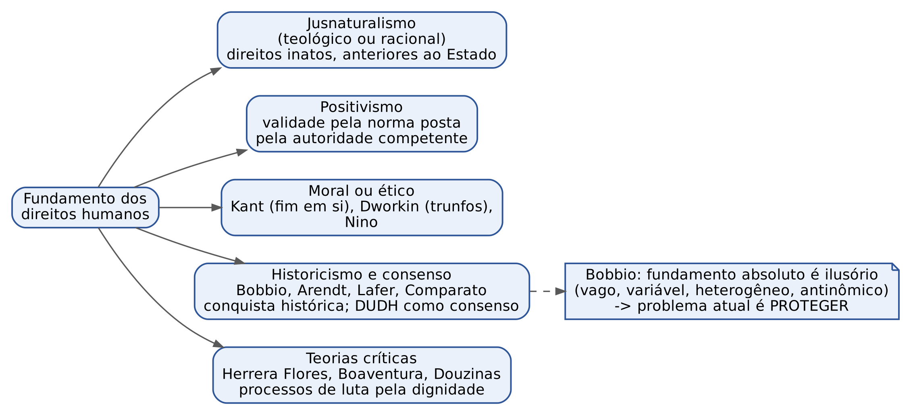
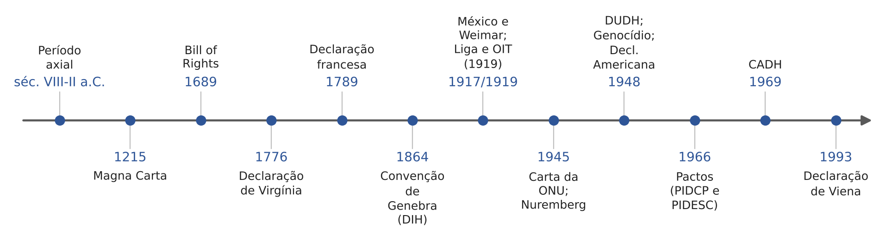
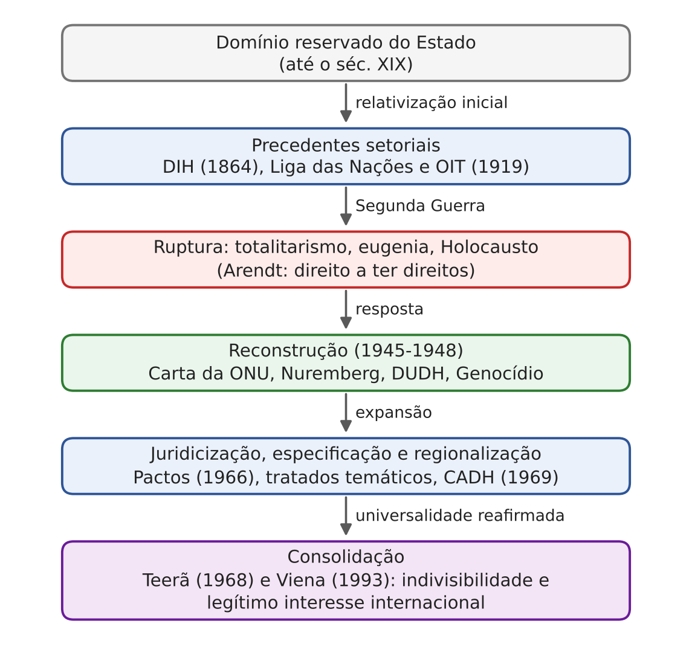
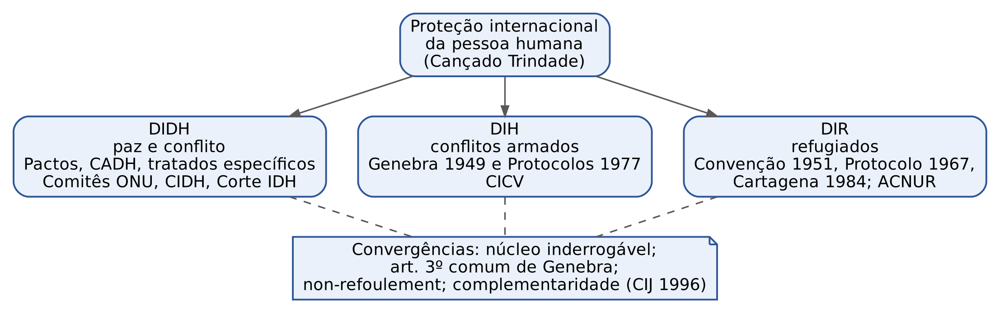
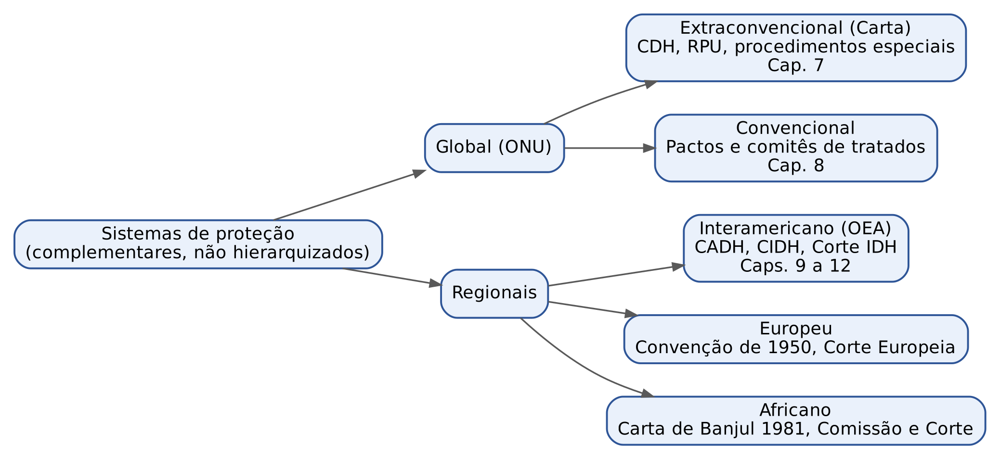

# CAPÍTULO 01 — TEORIA GERAL DOS DIREITOS HUMANOS I: CONCEITO, FUNDAMENTOS, HISTÓRIA, DIMENSÕES E DIDH

:::INCIDENCIA
Pontos: TRF5 p. 1; TJRS p. 1; TJSC p. 1. Nível A. Lote: 12 questões (FGV 11, FCC 1).
O que mais cai: gerações e suas críticas (com "pegadinha" de enquadramento), fundamentos (jusnaturalismo x positivismo x historicismo) e teorias críticas, precedentes da internacionalização (Direito Humanitário, Liga das Nações, OIT) e documentos históricos (Jellinek, Comparato).
:::

| Subtema | FGV | FCC | Padrão de cobrança |
|---|---|---|---|
| Terminologia (direitos humanos x fundamentais) | 1 | 0 | não coincidência: há direito humano que não é fundamental e vice-versa |
| Fundamentos e teorias críticas | 2 | 1 | positivismo = validade pela norma posta; teoria crítica = direitos como processos de luta; Douzinas não é "positivação" |
| Evolução histórica e internacionalização | 4 | 0 | documentos de afirmação histórica (Comparato); Jellinek e a liberdade religiosa; precedentes (DIH, Liga, OIT); eugenia |
| Gerações ou dimensões, cidadania | 4 | 0 | enquadramento de direito em espécie; quarta geração (Bonavides); cidadania plena (Marshall) |

Este capítulo trata da teoria geral sob o ângulo do Direito Internacional dos Direitos Humanos (DIDH). Já estão desenvolvidos em outras apostilas, e aqui só aparecem por remissão: a distinção terminológica na perspectiva constitucional, a formação histórica dos direitos fundamentais, o quadro completo das dimensões e a teoria dos *status* de Jellinek (Apostila de Direito Constitucional, Cap. 7); a DUDH, Bobbio e o debate universalismo x relativismo (Apostila de Formação Humanística, Cap. 27); racismo científico e eugenia (Apostila de Formação Humanística, Cap. 28). Características, interpretação, *jus cogens*, obrigações *erga omnes*, vedação de retrocesso, dignidade e igualdade são do Cap. 2 desta apostila.

## 01.1 Conceito e terminologia

### 01.1.1 Conceito

Não há conceito legal de "direitos humanos": nem a Carta da ONU, nem a DUDH, nem a Convenção Americana os definem. A doutrina oferece conceitos de três tipos, e a banca cobra a diferença entre eles:

| Tipo de conceito | Formulação | Autor de referência | O que enfatiza |
|---|---|---|---|
| Material ou finalístico | conjunto de direitos considerado indispensável para uma vida humana pautada na liberdade, igualdade e dignidade | André de Carvalho Ramos (*Curso de Direitos Humanos*) | o conteúdo mínimo necessário à vida digna; não depende de rol fechado |
| Histórico-axiológico | conjunto de faculdades e instituições que, em cada momento histórico, concretizam as exigências de dignidade, liberdade e igualdade humanas, as quais devem ser reconhecidas positivamente pelos ordenamentos jurídicos nos planos nacional e internacional | Antonio-Enrique Pérez Luño (*Derechos humanos, Estado de Derecho y Constitución*) | historicidade e exigência de positivação nos dois planos |
| Construtivista | os direitos humanos não são um dado, mas um construído, uma invenção humana em constante processo de construção e reconstrução | Hannah Arendt, na leitura de Celso Lafer e de Flávia Piovesan | historicidade e caráter de conquista; rejeição do fundamento metafísico |
| Crítico | processos institucionais e sociais que abrem e consolidam espaços de luta pela dignidade humana | Joaquín Herrera Flores (*A (re)invenção dos direitos humanos*) | luta social concreta; contra o "código fechado" imposto de cima (ver 01.2.3) |

Os conceitos convergem em três elementos que a prova costuma exigir juntos: (i) titularidade universal (a pessoa humana, pelo só fato de sê-lo; ver Cap. 2); (ii) núcleo ético na dignidade, liberdade e igualdade; (iii) proteção que transcende o Estado, porque a tutela não se esgota no ordenamento interno e pode ser exigida perante instâncias internacionais. Este terceiro elemento é o que distingue o estudo de "Direitos Humanos" como disciplina autônoma do estudo dos direitos fundamentais no Direito Constitucional.

### 01.1.2 Terminologia

A distinção clássica entre direitos do homem (plano jusnaturalista, pré-positivo), direitos humanos (positivação internacional) e direitos fundamentais (positivação constitucional), na síntese de Ingo Sarlet, está na Apostila de Direito Constitucional, Cap. 7 (07.1.1), com o uso que a CF faz de cada expressão (Título II e art. 5º, § 1º, x art. 4º, II; art. 5º, § 3º; art. 109, V-A; art. 7º do ADCT). Aqui interessam as expressões concorrentes e o uso nos tratados.

| Expressão | Sentido técnico | Onde aparece | Crítica ou observação |
|---|---|---|---|
| Direitos naturais | direitos inatos, anteriores e superiores ao Estado, deduzidos da natureza humana ou da razão | Declaração de Virgínia (1776); Declaração francesa (1789): "direitos naturais, inalienáveis e sagrados do homem" | pressupõe o fundamento jusnaturalista; a historicidade os desmente |
| Direitos do homem | equivalente, na tradição francesa, a direitos naturais | Declaração de 1789; título oficial da Convenção Europeia ("Convenção para a Proteção dos Direitos do Homem e das Liberdades Fundamentais", 1950) | crítica de gênero à expressão "homem"; em Portugal ainda é corrente |
| Liberdades públicas | direitos de defesa reconhecidos e regulados pelo Estado (*libertés publiques*) | doutrina francesa | restritiva: não abrange direitos sociais nem difusos |
| Direitos individuais | direitos titularizados pelo indivíduo isoladamente | CF, art. 60, § 4º, IV | restritiva: não alcança direitos coletivos, sociais e difusos |
| Direitos públicos subjetivos | posição jurídica do indivíduo oponível ao Estado | Jellinek, positivismo estatalista alemão | depende da concessão estatal; não explica a eficácia entre particulares |
| Direitos humanos | direitos inerentes à pessoa humana reconhecidos na ordem internacional | Carta da ONU ("direitos humanos e liberdades fundamentais"), DUDH, Pactos de 1966, CADH | é a expressão do DIDH |
| Direitos fundamentais | direitos humanos positivados na Constituição | CF, Título II; Lei Fundamental de Bonn | conceito vinculado a um ordenamento estatal |
| Direitos humanos fundamentais | fórmula de síntese que destaca a convergência de conteúdo | parte da doutrina brasileira | útil para enfatizar que a diferença é de plano de positivação, não de essência |

Ramos registra uma tendência de APROXIMAÇÃO das expressões: com a incorporação dos tratados (inclusive com equivalência de emenda, art. 5º, § 3º; ver Cap. 4) e com o controle de convencionalidade (Cap. 5), os direitos humanos de fonte internacional passam a ser aplicados internamente pelo juiz, e o direito fundamental de fonte constitucional passa a ser lido à luz da interpretação internacional. A distinção continua útil para a prova: o critério é a FONTE e o PLANO de positivação, não o conteúdo.

:::PEGADINHA Coincidência de conteúdo não é sinonímia
Há direitos humanos que não são fundamentais no Brasil (por exemplo, a abolição da pena de morte em quaisquer circunstâncias, objetivo dos protocolos abolicionistas ao PIDCP e à CADH, enquanto a CF a admite em caso de guerra declarada, art. 5º, XLVII, "a"; esses protocolos permitem reserva para o tempo de guerra, e é nesse limite que o Brasil se vinculou, ver Caps. 8 e 9) e direitos fundamentais que não constam de tratado algum (por exemplo, a garantia de que a lei não prejudicará o direito adquirido, o ato jurídico perfeito e a coisa julgada, art. 5º, XXXVI, ou a gratuidade do registro civil de nascimento para os reconhecidamente pobres, art. 5º, LXXVI). Logo, os conjuntos se sobrepõem em grande parte, mas não coincidem.
:::

:::QUESTAO FGV 2024 — Câmara de Fortaleza — Consultor Legislativo, Direitos Humanos (Q2474094)
Cobrado: relação entre direito fundamental e direito humano. Gabarito B: não coincidem, pois pode haver direito humano que não seja fundamental e vice-versa.
Armadilhas: A (sinônimos porque ambos protegem a dignidade: confunde finalidade comum com identidade de conceito); C (o direito humano só valeria se convertido em fundamental: nega a vinculação internacional autônoma; o tratado obriga o Estado no plano internacional independentemente de previsão constitucional, CVDT, art. 27); D (fundamental seria o de tratado ratificado: inverte os planos); E (conceitos excludentes e hierarquizados: o mesmo direito pode ser, ao mesmo tempo, humano e fundamental).
No mesmo sentido, como distrator: Q3203637 (FGV 2025, PC-MG, alternativa B, errada por afirmar sinonímia; questão do Cap. 2).
:::

## 01.2 Fundamentos

### 01.2.1 O problema do fundamento

"Fundamento" é a razão de validade dos direitos humanos: por que obrigam, inclusive o Estado que não os reconhece. A banca cobra as correntes clássicas, a crítica de Bobbio ao fundamento absoluto e as teorias críticas.

| Corrente | Razão de validade | Autores de referência | Força | Crítica clássica |
|---|---|---|---|---|
| Jusnaturalismo teológico | vontade ou lei divina; a pessoa como imagem de Deus | Tomás de Aquino (lei eterna, lei natural, lei humana) | explica a dignidade como valor intrínseco | depende de fé; não serve a sociedade plural e laica |
| Jusnaturalismo racional (moderno) | razão humana e natureza do homem; direitos inatos anteriores ao pacto social | Grotius, Locke, Pufendorf; declarações do século XVIII | limite ao poder; base das revoluções liberais | a "natureza humana" é indeterminada; direitos "naturais" variaram no tempo (propriedade absoluta, escravidão admitida) |
| Positivismo | norma posta pela autoridade competente, segundo o procedimento válido | Kelsen, Hart (no plano geral da teoria do direito) | segurança, exigibilidade, sanção | o que o legislador dá o legislador tira; o positivismo estatalista não explicou a "legalidade" do nazismo |
| Moral ou ético | exigências morais básicas, prévias ao direito positivo, que o direito deve reconhecer | Kant (dignidade: o homem como fim, nunca só como meio), Dworkin (direitos como trunfos contra a maioria), Carlos Santiago Nino | fundamento racional laico | divergência sobre qual moral; risco de subjetivismo |
| Histórico ou historicista | os direitos são produto de lutas e consensos de cada época | Bobbio, Arendt, Lafer, Comparato | explica a ampliação do catálogo | se é histórico, pode regredir; precisa de reforço (vedação de retrocesso, Cap. 2) |
| Consensual | consenso dos Estados, materializado nas declarações e tratados | Bobbio: a DUDH como prova de *consensus omnium gentium* | dispensa discussão metafísica | o consenso é formal e pode ser seletivo |

#### Bobbio: a impossibilidade de um fundamento absoluto

Em *A Era dos Direitos* (ensaio "Sobre o fundamento dos direitos do homem"), Bobbio sustenta que é ILUSÓRIA a busca de um fundamento absoluto, por quatro razões cobráveis: (i) a expressão "direitos do homem" é muito vaga, e as definições são tautológicas ou remetem a valores controvertidos; (ii) os direitos do homem constituem classe VARIÁVEL historicamente (a propriedade "sagrada e inviolável" de 1789 foi relativizada; surgiram direitos sociais); (iii) a classe é HETEROGÊNEA (há direitos que valem em qualquer situação, como não ser escravizado e não ser torturado, e outros que admitem restrição); (iv) há direitos ANTINÔMICOS (liberdades individuais x poderes sociais: a realização de uns restringe os outros). Daí a conclusão, já desenvolvida na Apostila de Formação Humanística, Cap. 27: o problema de hoje não é filosófico (fundamentá-los), mas político (protegê-los), e a DUDH é a prova do consenso geral sobre valores.

:::ATENCAO Bobbio não é positivista nesse ponto
Bobbio, teórico do positivismo jurídico em outras obras, aqui adota fundamento HISTÓRICO e consensual. Alternativa que o enquadre como jusnaturalista ou que atribua a ele a tese de que o problema central é o da fundamentação está errada. Também não diz que os direitos são "desnecessários de fundamentar": diz que o fundamento absoluto é impossível e que bastam fundamentos históricos, plurais e relativos.
:::

#### Arendt e a "reconstrução"

Hannah Arendt (*Origens do Totalitarismo*, 1951) observou que os apátridas e as minorias desnacionalizadas do entreguerras, despojados da cidadania, perderam com ela toda proteção: os supostos direitos "inalienáveis" do homem mostraram-se inexequíveis justamente quando não havia Estado que os garantisse. O primeiro direito humano é, por isso, o "direito a ter direitos", isto é, o direito de pertencer a uma comunidade política organizada. Celso Lafer (*A reconstrução dos direitos humanos: um diálogo com o pensamento de Hannah Arendt*, 1988) e Flávia Piovesan extraem daí a leitura de que o pós-guerra representa a RECONSTRUÇÃO dos direitos humanos após a ruptura totalitária (ver 01.4.2), e a nacionalidade passa a ser direito humano (DUDH, art. 15; CADH, art. 20; ver Apostila de Direito Constitucional, Cap. 13, e Cap. 21 desta apostila, sobre apatridia).

:::QUESTAO FGV 2024 — Câmara de Fortaleza — Consultor Legislativo, Direitos Humanos (Q2474095)
Cobrado: fundamentos dos direitos humanos. Gabarito C: a fundamentação positivista afirma que a validade dos direitos humanos decorre de sua previsão em norma posta, editada segundo as regras estabelecidas na Constituição.
Armadilhas: A (jusnaturalismo vinculado a "respeitar o próximo para ser respeitado": é reciprocidade moral, não natureza humana como fonte); B (atribui ao jusnaturalismo o "mandamento do soberano", que é a marca do positivismo voluntarista); D (a banca tratou a fundamentação RELIGIOSA como categoria autônoma, e não como espécie de jusnaturalismo com validade "nas escrituras"); E (prevalência atual da fundamentação religiosa: errada, os Estados são em grande parte laicos e o fundamento contemporâneo é laico e plural).
Observação: a alternativa D é discutível, porque a doutrina clássica chama de "jusnaturalismo teológico" a fundamentação na lei divina. O erro, na lógica da banca, está em reduzir o jusnaturalismo ao mandamento divino e em situar a validade "nas escrituras", ignorando o jusnaturalismo racional, que é o das declarações modernas.
:::

### 01.2.2 Fundamentos na ordem jurídica brasileira e internacional

No direito positivo, o fundamento declarado é a DIGNIDADE: o preâmbulo da DUDH ("reconhecimento da dignidade inerente a todos os membros da família humana"), o preâmbulo comum dos Pactos de 1966 ("esses direitos decorrem da dignidade inerente à pessoa humana"), o preâmbulo da CADH (os direitos essenciais "não derivam do fato de ser ela nacional de determinado Estado, mas sim do fato de ter como fundamento os atributos da pessoa humana") e o art. 1º, III, da CF. O conteúdo jurídico da dignidade é do Cap. 2.

:::DICA Como reconhecer a corrente pela frase
"Inerentes", "inatos", "anteriores ao Estado", "natureza humana", "razão": jusnaturalismo. "Norma posta", "autoridade competente", "procedimento", "positivação": positivismo. "Conquista", "lutas", "momento histórico", "construído": historicismo (ou teoria crítica, se a frase falar em resistência à opressão e hegemonia). "Imperativo categórico", "fim em si mesmo", "trunfos": fundamento moral. O preâmbulo da CADH, ao falar em "atributos da pessoa humana", tem linguagem de matriz jusnaturalista, mas a positivação em tratado é que gera a obrigação internacional.
:::

### 01.2.3 Teorias críticas

As teorias críticas não negam os direitos humanos, mas questionam a narrativa hegemônica (liberal, ocidental, individualista e eurocêntrica) de sua origem e de sua universalidade abstrata. Três autores concentram a cobrança.

| Autor e obra | Tese central | Expressão-chave |
|---|---|---|
| Joaquín Herrera Flores, *A (re)invenção dos direitos humanos* (2009) e *Teoria crítica dos direitos humanos* | direitos humanos não são dados, mas produtos culturais: processos de luta pela dignidade, em contextos concretos; contra o universalismo "de partida" (abstrato, imposto), propõe o universalismo "de chegada" ou "de confluência" | "processos", "lutas", "diamante ético" (figura que articula teorias, posições, espaços, valores, narrações, instituições, forças produtivas, disposições, desenvolvimento, práticas sociais, historicidade e relações sociais) |
| Boaventura de Sousa Santos, *Por uma concepção multicultural de direitos humanos* | os direitos humanos, como globalismo localizado de origem ocidental, só serão emancipatórios se reconstruídos de modo multicultural; hermenêutica diatópica entre culturas incompletas | "hermenêutica diatópica", "incompletude cultural", "concepção mestiça" (ver Apostila de Formação Humanística, Cap. 27) |
| Costas Douzinas, *O Fim dos Direitos Humanos* (2000; trad. bras. 2009) | os direitos humanos nasceram como discurso de resistência e utopia contra a opressão; seu "fim" (no duplo sentido de finalidade e de término) ocorre quando perdem esse fim utópico e se convertem em ideologia do poder, instrumento de governos e de intervenções, discurso oficial esvaziado | "o fim dos direitos humanos chega quando perdem seu fim utópico" |

Outras linhas aparecem como distratores ou complementos: a crítica marxista clássica (*A questão judaica*, 1843: os "direitos do homem" de 1789 seriam direitos do homem egoísta, separado da comunidade, isto é, do burguês); a crítica decolonial (a modernidade e seus direitos têm um lado oculto, a colonialidade); e a crítica feminista (o sujeito abstrato dos direitos é o homem branco proprietário; ver Cap. 16 e Apostila de Formação Humanística, Cap. 28). Também é posição crítica a rejeição da metáfora geracional (ver 01.5.2), porque ela naturaliza uma história linear e eurocêntrica.

:::QUESTAO FGV 2025 — DPE-PE — Defensor Público (Q3390897)
Cobrado: identificar a alternativa que NÃO trata da teoria crítica dos direitos humanos. Gabarito B: "a teoria do Fim dos Direitos Humanos sustenta que a defesa desses depende da sua positivação".
Por que B é a exceção: Douzinas sustenta o contrário; a institucionalização e a apropriação oficial dos direitos pelo poder é que ameaçam seu fim emancipatório. Positivação como condição de defesa é tese positivista.
As demais foram tomadas como teses críticas: alvo no pensamento hegemônico (A), revisão do conceito para incluir o multiculturalismo (D, Boaventura) e rejeição das gerações por sugerirem sucessão quando há concomitância (E).
Ponto discutível: a alternativa C ("a dignidade é a essência dos direitos humanos e por isso não se admitem valorações diversas para a dignidade") soa mais essencialista e universalista do que crítica; a banca a considerou compatível com a teoria crítica (a dignidade como fim das lutas, em Herrera Flores). Na dúvida em prova, procure a alternativa que contradiz frontalmente a tese de autor nomeado: aqui, o "Fim dos Direitos Humanos".
:::

:::QUESTAO FCC 2025 — DPE-AM — Defensor Público (Q3531566)
Cobrado: ideia que as perspectivas críticas das últimas décadas colocam em destaque. Gabarito A: os direitos humanos não devem ser um código fechado imposto de cima para baixo, mas um campo aberto e vivo, construído a partir das lutas concretas de quem resiste à opressão (Herrera Flores).
Armadilhas: B (multiplicação de tratados e fortalecimento das agências multilaterais: agenda institucionalista, não crítica); C (retorno ao indivíduo autônomo e racional: é justamente o sujeito abstrato que a crítica questiona); D (a indivisibilidade como causa de "inflação de direitos": tese conservadora, contrária à de Viena); E (construção de instrumentos processuais a partir do direito internacional: preocupação com efetividade, típica da doutrina institucional, inclusive de Bobbio, mas não o traço distintivo das teorias críticas).
:::

## 01.3 Evolução histórica até 1945

A formação histórica dos direitos fundamentais no constitucionalismo (documentos ingleses, Virgínia, 1789, constitucionalismo social, Bonn) está na Apostila de Direito Constitucional, Cap. 7 (07.2). Aqui se agregam o que a FGV cobra em Direitos Humanos: a periodização doutrinária, o debate sobre a origem das declarações e a leitura de Comparato.

### 01.3.1 Antecedentes remotos e período axial

Fábio Konder Comparato (*A afirmação histórica dos direitos humanos*) situa no "período axial" (expressão de Karl Jaspers, entre os séculos VIII e II a.C.) o surgimento da ideia de igualdade essencial entre os seres humanos: nas mesmas gerações aparecem Zaratustra, Buda, Lao-Tsé, Confúcio, os profetas de Israel e os filósofos gregos, e o ser humano passa a ser considerado, pela primeira vez, em sua igualdade essencial, como ser dotado de liberdade e razão, apesar das diferenças de sexo, raça, religião ou costumes. A tese é útil contra o argumento de que os direitos humanos seriam invenção exclusivamente ocidental do século XVIII.

Outros antecedentes cobrados como "precursores", sem que configurem direitos humanos em sentido moderno: o Código de Hamurabi (Babilônia, c. século XVIII a.C.), por fixar regras escritas e limites à vingança; o chamado Cilindro de Ciro (século VI a.C.), por vezes apresentado como primeira declaração de tolerância religiosa; a *Antígona* de Sófocles, como emblema da lei não escrita superior à lei do governante; o estoicismo e o cristianismo, pela igualdade de todos perante a lei natural ou perante Deus; e a escolástica (Tomás de Aquino), pela hierarquia lei eterna, lei natural e lei humana.

| Período | Característica dos "direitos" | Limite em relação ao conceito moderno |
|---|---|---|
| Antiguidade | limites ao poder com base em leis escritas, costume ou religião | não há titularidade universal; escravidão admitida |
| Idade Média | pactos e forais que reconhecem privilégios a estamentos (Magna Carta, 1215) | direitos de grupos (barões, clero, cidades), não do ser humano |
| Século XVII inglês | Petition of Right (1628), Habeas Corpus Act (1679), Bill of Rights (1689): limitação do poder real em favor do Parlamento e dos súditos | não vinculam o legislador; supremacia do Parlamento |
| Século XVIII | Declarações de Virgínia (1776) e francesa (1789): direitos naturais, universais, oponíveis ao Estado | universalidade abstrata; exclusão real de mulheres, escravizados, não proprietários |
| Séculos XIX e XX (até 1945) | constitucionalismo social (México, 1917; Weimar, 1919); primeiros precedentes internacionais (Direito Humanitário, Liga das Nações, OIT) | proteção ainda dependente do Estado e sem sistema internacional geral |

### 01.3.2 A origem das declarações: o debate Jellinek x Boutmy

Georg Jellinek (*A Declaração dos Direitos do Homem e do Cidadão*, 1895) sustentou que a Declaração francesa de 1789 não decorreu do *Contrato Social* de Rousseau, mas das declarações de direitos das colônias norte-americanas (sobretudo Virgínia), e que estas tiveram por raiz a LIBERDADE RELIGIOSA. Seus argumentos centrais:

- O contrato social de Rousseau implica alienação TOTAL dos direitos de cada associado à comunidade; dele não se extrai uma esfera de direitos oponíveis ao corpo político. Logo, não pode ser a fonte de uma declaração de direitos individuais.
- O modelo de 1789 foram os *bills of rights* americanos, que o Marquês de La Fayette e outros conheciam diretamente.
- Nas colônias, os direitos nasceram das seitas protestantes perseguidas na Inglaterra (puritanos, brownistas, depois congregacionalistas ou "independentes"), que defendiam a separação entre Igreja e Estado e a autonomia de cada congregação. A liberdade de consciência era, para elas, direito inato, NÃO concedido pelo Estado e por isso não restringível por ele; esse individualismo absoluto em matéria religiosa estendeu-se depois ao domínio político (o "independentismo"), originando a ideia de direitos que o Estado reconhece, mas não cria. A experiência de Roger Williams em Rhode Island é o exemplo de liberdade religiosa plena.

Émile Boutmy respondeu (1902), defendendo a originalidade francesa e a influência do iluminismo e de Rousseau. Para prova, basta saber: Jellinek liga a origem da positivação dos direitos à liberdade religiosa e às declarações americanas; Boutmy, à filosofia política francesa.

:::QUESTAO FGV 2025 — TJ-CE — Juiz Substituto (Q3505854)
Caso: trecho de Jellinek sobre o brownismo, refugiado na Holanda e convertido em congregacionalismo (separação Igreja-Estado e autonomia de cada comunidade). Pergunta: relação entre essa separação e a consagração dos direitos. Gabarito D: configura individualismo absoluto em matéria religiosa, que redunda em liberdade de consciência não concedida e impassível de restrição, e faz a doutrina "independentista" estender-se ao domínio político.
Passos: (1) identificar o autor e sua tese (origem religiosa, não rousseauniana); (2) descartar B e C, que puxam para o contrato social: em B, a afirmação de que a alienação à comunidade "não abrange a liberdade de consciência" é exatamente o que Jellinek nega existir em Rousseau (a alienação é total); C desvincula o Estado da liberdade de consciência inata; (3) descartar A (separação como obstáculo: é a causa, não o obstáculo) e E (historicismo com limites traçados pelo Estado: contraria a ideia de direito inato não concedido).
:::

:::QUESTAO FGV 2025 — DPE-PE — Defensor Público (Q3390898)
Cobrado: documento que NÃO integra a afirmação histórica dos direitos humanos por meio de normas declaratórias. Gabarito C: a Convenção de Viena sobre o Direito dos Tratados (1969).
Fundamento: o título remete à obra de Comparato, que examina, entre outros, a Magna Carta (1215), a Constituição de Weimar (1919), a DUDH (1948) e o Estatuto do Tribunal Penal Internacional (1998). A CVDT é tratado sobre tratados (celebração, validade, interpretação, extinção), sem catálogo de direitos.
Armadilha: a CVDT tem dispositivos relevantes para o DIDH (art. 53, *jus cogens*; art. 60, § 5º, ver 01.6.2), mas isso não a torna "documento normativo de afirmação" de direitos. E a Constituição alemã de 1919 (Weimar) é marco do constitucionalismo social, ao lado da mexicana de 1917.
:::

### 01.3.3 Do constitucionalismo social ao entreguerras

A Constituição mexicana de 1917 (primeira a atribuir aos direitos trabalhistas a qualidade de direitos fundamentais, com limitação da jornada, proteção da maternidade e função social da propriedade) e a Constituição de Weimar de 1919 (segunda parte dedicada aos direitos e deveres fundamentais dos alemães, com a fórmula de que a propriedade obriga) inauguram o constitucionalismo social. Comparato inclui também a Declaração dos Direitos do Povo Trabalhador e Explorado (Rússia, 1918). No Brasil, a Constituição de 1934 é o marco correspondente.

O entreguerras é também o período de ascensão do racismo científico e da eugenia, convertidos em política de Estado (esterilizações compulsórias, leis de "higiene racial"), que desembocarão no Holocausto. O tema é tratado com profundidade na Apostila de Formação Humanística, Cap. 28 (28.3.2).

:::QUESTAO FGV 2024 — Prefeitura de Macaé — Procurador (Q3049911)
Cobrado: debate sobre a eugenia no início do século XX. Gabarito C: só Antônio está certo; no Brasil, a eugenia, embora estreitamente correlacionada com a higiene e a medicina social, polemizava com os efeitos da miscigenação.
Armadilhas: Pedro (eugenia "refratária ao racismo científico") e Maria (eugenia "separada das ideologias políticas") estão errados: a eugenia foi expressão do racismo científico e foi apropriada por projetos políticos, inclusive estatais. Desenvolvimento na Apostila de Formação Humanística, Cap. 28.
:::

## 01.4 Internacionalização dos direitos humanos

### 01.4.1 Os precedentes: Direito Humanitário, Liga das Nações e OIT

Até o século XIX, o modo como o Estado tratava seus nacionais era assunto de jurisdição doméstica (*domaine réservé*). Flávia Piovesan (*Direitos Humanos e o Direito Constitucional Internacional*) aponta três precedentes que romperam esse dogma e prepararam a internacionalização:

| Precedente | Origem | Conteúdo | Contribuição |
|---|---|---|---|
| Direito Humanitário | Comitê Internacional da Cruz Vermelha (1863, Henry Dunant, após a batalha de Solferino); Convenção de Genebra de 1864 | aplica-se em caso de GUERRA; limita a atuação do Estado e assegura direitos fundamentais a militares fora de combate (feridos, doentes, náufragos, prisioneiros) e à população civil | primeira expressão de limite internacional à liberdade do Estado, mesmo em conflito armado |
| Liga das Nações | Pacto da Sociedade das Nações, parte I do Tratado de Versalhes (1919), em vigor em 1920; criada APÓS a Primeira Guerra | promover a cooperação, a paz e a segurança internacionais; previsões genéricas de direitos humanos: condições equitativas e humanas de trabalho para homens, mulheres e crianças e tratamento justo das populações nativas dos territórios sob controle (art. 23, a e b), supervisão dos acordos sobre tráfico de mulheres e crianças (art. 23, c), sistema de mandatos como "missão sagrada de civilização" (art. 22), proteção de minorias (por tratados específicos) | relativizou a soberania: previa sanções econômicas e militares contra Estados que violassem suas obrigações |
| Organização Internacional do Trabalho | parte XIII do Tratado de Versalhes (1919); também criada APÓS a Primeira Guerra | promover padrões internacionais de condições de trabalho e bem-estar, por CONVENÇÕES multilaterais | os Estados assumem obrigações internacionais em favor de seus próprios trabalhadores; até a Segunda Guerra, dezenas de convenções |

Para Piovesan, esses precedentes assinalam o fim de uma época em que o Direito Internacional se limitava a regular relações entre Estados no âmbito estritamente governamental: deixou-se de visar apenas à salvaguarda de arranjos e concessões recíprocos entre os Estados e passou-se a visar a obrigações internacionais garantidas em favor dos indivíduos. O indivíduo começa a aparecer como sujeito (ainda que reflexo) do Direito Internacional.

Outros antecedentes por vezes mencionados: a abolição do tráfico de escravos (Declaração do Congresso de Viena, 1815; Ato Geral da Conferência de Bruxelas, 1890; Convenção sobre a Escravatura, 1926) e a proteção de minorias nos tratados de paz de 1919-1920, com petições à Liga.

:::QUESTAO FGV 2024 — TRF1 — Técnico Judiciário, Polícia Judicial (Q3029936)
Cobrado: precedentes históricos da internacionalização. Gabarito A: o Direito Humanitário é o direito aplicável em caso de guerra, que fixa limites à atuação do Estado para assegurar direitos fundamentais a militares fora de combate e a civis (definição de Piovesan).
Armadilhas: B situa a Liga ANTES da Primeira Guerra e nega que tenha atingido a soberania absoluta; C põe a OIT antes da guerra, com "acordos bilaterais" sobre saúde, educação e meio ambiente (três erros: criação em 1919, convenções multilaterais, objeto trabalhista); D inverte a lição de Piovesan (a intenção passou a ser a tutela de obrigações em favor dos indivíduos, e não os arranjos recíprocos); E nega a própria internacionalização.
:::

### 01.4.2 Ruptura e reconstrução

A internacionalização em sentido próprio é fenômeno do pós-Segunda Guerra. A leitura dominante na doutrina brasileira (Piovesan, Lafer, a partir de Arendt) é a da "ruptura e reconstrução": o totalitarismo tratou o ser humano como descartável, por meio do próprio Estado e de sua legalidade, e a conclusão foi que a proteção dos direitos humanos não pode ficar confinada ao domínio reservado do Estado. Se a lógica do totalitarismo era a da descartabilidade da pessoa, a da reconstrução é a da dignidade como valor-fonte da ordem internacional.

Três consequências estruturais, cobradas como "características do processo de internacionalização":

- Relativização da soberania: o tratamento dispensado pelo Estado a quem está sob sua jurisdição passa a ser tema de legítimo interesse internacional; o Estado se submete a monitoramento e a responsabilização internacionais.
- Reconhecimento do indivíduo como sujeito de Direito Internacional: titular de direitos oponíveis ao próprio Estado, com capacidade de peticionar a órgãos internacionais (ver Caps. 8 e 10) e, de outro lado, responsável penalmente no plano internacional (Tribunal de Nuremberg, 1945-1946; Estatuto de Roma; ver Cap. 22).
- Institucionalização: criação de organização internacional com propósito expresso de promover os direitos humanos (ONU, 1945) e de órgãos de supervisão.

Os julgamentos de Nuremberg (Tribunal Militar Internacional, instituído pelo Acordo de Londres de 8/8/1945) firmaram a responsabilidade penal individual por crimes contra a paz, crimes de guerra e crimes contra a humanidade e a irrelevância da obediência hierárquica como excludente. O desenvolvimento está no Cap. 22.

### 01.4.3 O marco de 1945 a 1948 e a expansão normativa

A Carta da ONU (São Francisco, 26/6/1945; no Brasil, Decreto 19.841/1945) inscreve a promoção dos direitos humanos entre os propósitos da Organização (art. 1º, 3) e compromete os membros a agir para realizá-los (arts. 55, "c", e 56), mas não os define. A DUDH (10/12/1948) supre essa lacuna; natureza jurídica, votação e conteúdo estão na Apostila de Formação Humanística, Cap. 27, e os órgãos da ONU no Cap. 7 desta apostila. Na véspera da DUDH, em 9/12/1948, a Assembleia Geral adotou a Convenção para a Prevenção e a Repressão do Crime de Genocídio, primeiro tratado de direitos humanos do sistema da ONU.

A partir daí, a doutrina descreve um processo de expansão em três frentes:

| Frente | Conteúdo | Exemplos |
|---|---|---|
| Juridicização (do *soft law* ao *hard law*) | conversão dos princípios da DUDH em tratados vinculantes com órgãos de monitoramento | Pactos de 1966 (PIDCP e PIDESC, em vigor em 1976; Brasil, Decretos 592 e 591/1992) |
| Especificação do sujeito | proteção de pessoas ou grupos em situação de vulnerabilidade, para além do sujeito abstrato | ICERD (1965), CEDAW (1979), CAT (1984), CDC (1989), CMW (1990), CDPD (2006), CED (2006); ver Cap. 8 |
| Regionalização | sistemas regionais com tribunais próprios | europeu (Convenção de 1950; Corte Europeia), interamericano (Declaração Americana, 1948; CADH, 1969, em vigor em 1978), africano (Carta de Banjul, 1981) |

Bobbio descreve o mesmo movimento como passagem da positivação à GENERALIZAÇÃO (extensão a todos), à INTERNACIONALIZAÇÃO e à ESPECIFICAÇÃO (do homem genérico ao homem em suas diversas maneiras de ser em sociedade: criança, idoso, mulher, pessoa com deficiência).

As Conferências Mundiais de Teerã (1968) e de Viena (1993) consolidam a indivisibilidade e a legitimidade da preocupação internacional com os direitos humanos (Declaração de Viena, par. 4: a promoção e a proteção de todos os direitos humanos é preocupação legítima da comunidade internacional); ver Cap. 7.

### 01.4.4 A internacionalização no Brasil

O Brasil só se integrou efetivamente ao sistema após a redemocratização. A CF de 1988 adotou a prevalência dos direitos humanos como princípio das relações internacionais (art. 4º, II) e a cláusula de abertura (art. 5º, § 2º); seguiram-se as ratificações da Convenção Interamericana para Prevenir e Punir a Tortura (Decreto 98.386/1989), da CAT (Decreto 40/1991), da Convenção sobre os Direitos da Criança (Decreto 99.710/1990), dos Pactos de 1966 e da CADH (Decreto 678/1992). O reconhecimento da competência contenciosa da Corte IDH ocorreu em 10/12/1998 (Decreto 4.463/2002). Desenvolvimento: Cap. 3 (CF), Cap. 4 (incorporação e hierarquia) e Cap. 11 (Corte IDH).

:::ESQUEMA Por que 1945, e não 1919
Antes de 1945, os precedentes eram SETORIAIS (guerra, trabalho, minorias) e não alcançavam o núcleo da relação Estado-indivíduo em tempo de paz. Depois de 1945, há (i) organização universal com propósito expresso de promover os direitos humanos, (ii) catálogo universal (DUDH), (iii) tratados gerais com órgãos de supervisão e (iv) responsabilização penal individual. A banca usa o "1919" como distrator para "início da internacionalização"; a resposta é "precedente", não "marco".
:::

## 01.5 Gerações ou dimensões e suas críticas

### 01.5.1 O esquema e sua correspondência normativa internacional

A classificação geracional foi proposta por Karel Vasak, jurista tcheco-francês, que a apresentou em 1979, no Instituto Internacional de Direitos Humanos de Estrasburgo (já usava a ideia ao menos desde 1977), associando cada geração a um dos ideais da Revolução Francesa. No Brasil, foi difundida por Paulo Bonavides. O quadro completo, com conteúdo, posição do Estado e titularidade, e a ressalva de que primeira dimensão não é sinônimo de abstenção nem segunda de prestação, estão na Apostila de Direito Constitucional, Cap. 7 (07.3). Aqui importa a correspondência com os instrumentos internacionais, que é o ângulo do DIDH:

| Dimensão | Ideal | Marcos internacionais | Exemplos de direitos |
|---|---|---|---|
| Primeira | liberdade | PIDCP (1966); CADH, arts. 3º a 25; Convenção Europeia (1950) | vida, integridade, liberdade pessoal, devido processo e presunção de inocência, liberdade de expressão, de consciência e de religião, privacidade, nacionalidade, participação política |
| Segunda | igualdade | OIT (1919); PIDESC (1966); Protocolo de San Salvador (1988); CADH, art. 26 | trabalho e condições justas, sindicalização, seguridade social, saúde, educação, moradia, alimentação, cultura |
| Terceira | fraternidade ou solidariedade | Declaração de Estocolmo (1972); Carta Africana (1981, "direitos dos povos"); Declaração sobre o Direito ao Desenvolvimento (AG, Res. 41/128, 1986); OC-23/17 | paz, desenvolvimento, meio ambiente sadio, autodeterminação dos povos, patrimônio comum da humanidade, comunicação |
| Quarta (controvertida) | variável | sem instrumento específico; Declaração Universal sobre o Genoma Humano e os Direitos Humanos (UNESCO, 1997) para a vertente biotecnológica | Bonavides: democracia direta, informação e pluralismo (globalização política); Bobbio: direitos ligados à manipulação genética e à bioética |
| Quinta (controvertida) | variável | — | Bonavides: direito à paz, deslocado da terceira; outros: direitos do mundo digital |

:::QUESTAO FGV 2026 — HU Brasil — Residência Multiprofissional, Serviço Social (Q4314525)
Cobrado: enquadramento geracional com justificativa. Gabarito A: só I (liberdade de expressão, primeira geração, porque protege a autonomia individual contra interferências estatais).
Armadilhas: II põe a educação na primeira geração, embora a justificativa ("prestações estatais indispensáveis à igualdade social") seja exatamente a da segunda; III põe o meio ambiente na segunda, embora a justificativa ("interesses humanos comuns") seja a da terceira. A técnica da banca é dar a justificativa certa com a geração errada: confira se rótulo e justificativa conversam.
No mesmo sentido: Q2474101 (FGV 2024, Câmara de Fortaleza; direito civil e político: presunção de inocência, D; moradia, saúde, educação e condições justas de trabalho são DESC, todos do PIDESC, arts. 7º, 11, 12 e 13).
:::

:::QUESTAO FGV 2024 — Câmara de Fortaleza — Consultor Legislativo, Direitos Humanos (Q2474096)
Cobrado: rol das quatro gerações. Gabarito E: I, II, III e IV corretos, inclusive a quarta geração como direitos de participação democrática, pluralismo e bioética.
Fundamento: a banca somou as duas leituras da quarta geração (Bonavides: democracia, informação, pluralismo; Bobbio: bioética e patrimônio genético). Em prova, não marque como errada a quarta geração só porque a doutrina diverge sobre ela; marque errada a afirmação de que ela é consenso doutrinário ou de que está positivada em tratado específico.
:::

### 01.5.2 As críticas

A crítica é a parte mais cobrada em prova de juiz. São seis linhas, que se somam:

| Crítica | Conteúdo | Autor ou fonte |
|---|---|---|
| Sucessão x acumulação | "geração" sugere que a nova substitui a anterior; na verdade há acumulação e complementaridade; daí a preferência por "dimensões" | Sarlet; Bonavides em edições posteriores; Cançado Trindade |
| Inversão histórica no plano internacional | no DIDH, a ordem foi inversa à de Vasak: os direitos sociais vieram ANTES (convenções da OIT, desde 1919) dos direitos civis e políticos em tratados gerais (PIDCP, 1966) | Antônio Augusto Cançado Trindade, que chamou a teoria das gerações de "fantasia" e de visão atomizada e fragmentadora |
| Indivisibilidade | todas as categorias são indivisíveis, interdependentes e inter-relacionadas; não há hierarquia entre elas | Proclamação de Teerã (1968), par. 13; Declaração de Viena (1993), par. 5; preâmbulo dos Pactos de 1966; ver Cap. 2 |
| Custo de todos os direitos | todos os direitos dependem de ação e gasto público (o devido processo exige Judiciário, a propriedade exige registro e polícia, o voto exige eleições); a distinção "negativo-barato x positivo-caro" é falsa | Stephen Holmes e Cass Sunstein, *The Cost of Rights* (1999) |
| Tipologia de obrigações | cada direito gera obrigações de RESPEITAR, PROTEGER e REALIZAR (promover e prover), seja civil ou social; a classificação por direitos é substituída por classificação por obrigações | Asbjørn Eide; adotada pelo Comitê DESC em comentários gerais (ver Caps. 8 e 19) |
| Eurocentrismo e linearidade | a sequência reproduz a história europeia (especialmente francesa e inglesa) e não serve a outras realidades; no Brasil, os direitos sociais foram outorgados (Vargas) em período de restrição dos direitos civis e políticos | José Murilo de Carvalho, *Cidadania no Brasil: o longo caminho*, sobre a inversão da sequência de Marshall |

Na jurisprudência interamericana, a crítica tem consequência prática: a Corte IDH afirma a interdependência e a indivisibilidade entre direitos civis e políticos e DESCA, sem hierarquia, e a justiciabilidade direta do art. 26 da CADH (Lagos del Campo vs. Peru, 2017, e seguintes; ver Cap. 19).

:::DOUTRINA Antônio Augusto Cançado Trindade
A teoria das gerações é historicamente imprecisa e juridicamente perigosa: imprecisa porque, no plano internacional, os direitos econômicos e sociais (OIT) precederam os civis e políticos em convenções; perigosa porque a fragmentação em gerações serviu para justificar a negação ou o adiamento dos direitos sociais, como se fossem de "segunda" categoria. A preferência pela visão integral dos direitos humanos é coerente com a indivisibilidade de Teerã e de Viena.
:::

:::PEGADINHA Três enquadramentos que derrubam candidatos
1. Direitos políticos são de PRIMEIRA dimensão (liberdade-participação), embora o sufrágio universal tenha vindo depois.
2. Liberdade sindical e direito de greve são de SEGUNDA dimensão (direitos dos trabalhadores, PIDESC, art. 8º), embora funcionem como direitos de defesa; a liberdade de associação em geral é de primeira (PIDCP, art. 22).
3. Direito ao desenvolvimento e autodeterminação dos povos são de TERCEIRA dimensão, mas a autodeterminação está no art. 1º comum aos dois Pactos de 1966, que são, por sua vez, os tratados-modelo da primeira e da segunda dimensões.
:::

### 01.5.3 Cidadania: a sequência de Marshall

Thomas Humphrey Marshall (*Cidadania, classe social e status*, conferências de 1949 publicadas em 1950) decompôs a cidadania em três elementos, conquistados na Inglaterra em sequência: CIVIL (liberdade individual, propriedade, contratos, justiça; século XVIII), POLÍTICO (participação no exercício do poder, sufrágio; século XIX) e SOCIAL (bem-estar econômico mínimo, segurança, educação, participação na herança social; século XX). A cidadania plena exige a combinação dos três; o *status* de cidadão iguala os membros da comunidade em direitos e deveres, em tensão com a desigualdade de classe. A sequência de Marshall antecede e inspira a narrativa geracional, e a crítica de José Murilo de Carvalho (ver 01.5.2) é a de que, no Brasil, a "pirâmide" foi invertida: primeiro os direitos sociais, depois os políticos e, por último e ainda incompletos, os civis.

:::QUESTAO FGV 2025 — Prefeitura de Canaã dos Carajás — Procurador Municipal (Q3265464)
Cobrado: sentido da expressão "cidadania plena" para ativistas que associam a completude da personalidade à integração sociopolítica. Gabarito B: devem ser assegurados ao indivíduo níveis adequados de satisfação dos direitos civis, políticos e sociais.
Armadilhas: A ("sufrágio parcial" é contradição com cidadania plena); C (sobreposição necessária entre capacidade eleitoral ativa e passiva: não é requisito de cidadania plena, e a CF mesmo as distingue, arts. 14, § 3º e § 4º); D (direitos sociais "conforme o mérito individual": nega a universalidade); E (só direitos de defesa como condição de todos os demais: visão liberal, que ignora a interdependência).
:::

:::PRATIQUE Exercício elaborado para esta apostila (não é questão de banca)
1. Certo ou errado: "Segundo Cançado Trindade, a teoria das gerações descreve com fidelidade a evolução do Direito Internacional dos Direitos Humanos, no qual os direitos civis e políticos foram positivados em tratados antes dos direitos sociais."
2. Certo ou errado: "Para Holmes e Sunstein, apenas os direitos sociais geram custos ao Estado, razão pela qual estão submetidos à reserva do possível."
3. Certo ou errado: "O direito de greve, embora exercido como direito de defesa contra o empregador e o Estado, integra a segunda dimensão e está previsto no PIDESC."
Resolução: 1. Errado: no plano internacional a ordem foi inversa (OIT, 1919, antes do PIDCP, 1966); Cançado Trindade é crítico da teoria. 2. Errado: a tese é a de que TODOS os direitos custam. 3. Certo: PIDESC, art. 8º, 1, "d".
:::

## 01.6 O Direito Internacional dos Direitos Humanos como ramo

### 01.6.1 Conceito, objeto e autonomia

O DIDH é o ramo do Direito Internacional Público que reúne as normas, os princípios e os mecanismos destinados a proteger a pessoa humana em face do Estado (e, por meio dos deveres de proteção, em face de particulares), em tempo de paz e de conflito, independentemente de nacionalidade. É um direito de PROTEÇÃO, e não de coordenação de interesses estatais: seu destinatário final é o ser humano, e o Estado figura como devedor das obrigações. Cançado Trindade o define pelo propósito de proteção da pessoa humana e pela orientação a favor da vítima; Piovesan cunhou a expressão "Direito Constitucional Internacional" para designar o espaço de interação entre o DIDH e as Constituições que, como a de 1988, se abrem a ele (art. 4º, II; art. 5º, §§ 2º e 3º).

A autonomia do ramo se sustenta em quatro elementos: objeto próprio (a proteção da pessoa), princípios próprios (ver 01.6.2), fontes e instrumentos próprios (tratados de direitos humanos e *soft law* específico) e órgãos próprios de supervisão (comitês da ONU, Comissão e Corte Interamericanas, Corte Europeia, Corte Africana).

### 01.6.2 Princípios estruturais que distinguem o DIDH do Direito Internacional clássico

| Princípio | DIDH | Direito Internacional clássico | Fonte |
|---|---|---|---|
| Natureza das obrigações | OBJETIVAS: assumidas em relação aos indivíduos sob a jurisdição, não em relação aos demais Estados | sinalagmáticas, de troca recíproca de vantagens | Corte IDH, OC-2/82, par. 29; CIJ, parecer sobre reservas à Convenção do Genocídio (1951) |
| Reciprocidade | NÃO se aplica: a violação por um Estado não autoriza os demais a descumprir | *exceptio non adimpleti contractus*: a violação substancial autoriza extinção ou suspensão | CVDT, art. 60, § 5º |
| Sujeitos | o indivíduo é titular de direitos e pode acionar órgãos internacionais | Estados e organizações internacionais | Protocolo Facultativo ao PIDCP; CADH, art. 44 |
| Interpretação | *pro persona* (norma mais favorável), evolutiva, efeito útil | intenção comum das partes, interpretação restritiva de limitações à soberania | CADH, art. 29; PIDCP, art. 5º; ver Cap. 2 |
| Direito interno | não pode ser invocado para justificar o descumprimento; o Estado responde por atos de QUALQUER órgão, inclusive do Judiciário e do constituinte | mesma regra geral, mas com menor alcance prático | CVDT, art. 27; Artigos da CDI sobre Responsabilidade do Estado (2001), art. 4º; ver Cap. 6 |
| Subsidiariedade | a proteção internacional é coadjuvante e complementar à nacional; exige esgotamento dos recursos internos, com exceções | proteção diplomática, a critério do Estado da nacionalidade | CADH, art. 46; ver Cap. 10 |
| Soberania | o modo como o Estado trata as pessoas sob sua jurisdição é questão de legítimo interesse internacional | domínio reservado (*domaine réservé*) | Declaração de Viena (1993), par. 4 |

A fórmula de referência é a da Corte IDH na OC-2/82 (24/9/1982, par. 29): os tratados de direitos humanos "não são tratados multilaterais de tipo tradicional", e por eles os Estados assumem obrigações "não em relação com outros Estados, mas para com os indivíduos sob sua jurisdição" (efeito das reservas e demais conclusões: v. Cap. 4).

:::LEI Convenção de Viena sobre o Direito dos Tratados (Decreto 7.030/2009), art. 60, § 5º
"Os parágrafos 1 a 3 não se aplicam às disposições sobre a proteção da pessoa humana contidas em tratados de caráter humanitário, especialmente às disposições que proíbem qualquer forma de represália contra pessoas protegidas por tais tratados."
:::

Os §§ 1º a 3º do art. 60 autorizam a parte prejudicada a extinguir ou suspender o tratado em razão de violação substancial pela outra parte. O § 5º afasta esse mecanismo de reciprocidade nos tratados de "caráter humanitário" (expressão que a doutrina estende aos tratados de direitos humanos). A CVDT foi promulgada pelo Decreto 7.030, de 14/12/2009, com reserva aos arts. 25 (aplicação provisória) e 66 (solução judicial e arbitral de controvérsias).

:::PEGADINHA Reciprocidade e reservas
Afirmação típica: "Se o Estado A viola a CADH em relação aos nacionais do Estado B, este pode suspender, em relação aos nacionais de A, a aplicação da Convenção." Errado: as obrigações são objetivas (OC-2/82) e a CVDT, art. 60, § 5º, exclui a represália. Reservas à CADH e aceitação dos demais Estados: v. Cap. 4 (04.8).
:::

### 01.6.3 Fontes

As fontes do DIDH são as do Direito Internacional geral (Estatuto da Corte Internacional de Justiça, art. 38: tratados, costume, princípios gerais de direito e, como meios auxiliares, decisões judiciais e doutrina), com peculiaridades:

- Tratados: gerais (Pactos de 1966, CADH) e específicos por tema ou sujeito (CAT, CEDAW, CDC, CDPD); a maioria cria órgão de monitoramento.
- Costume: boa parte da DUDH tem valor consuetudinário (Apostila de Formação Humanística, Cap. 27).
- *Jus cogens*: normas imperativas que não admitem derrogação (CVDT, art. 53); proibição da tortura, da escravidão, do genocídio, da discriminação racial, *non-refoulement* e, para a Corte IDH, igualdade e não discriminação (OC-18/03); ver Cap. 2.
- *Soft law*: declarações, resoluções, princípios e diretrizes sem força vinculante formal, com função interpretativa e de cristalização de costume (DUDH na origem; Princípios de Yogyakarta; Regras de Mandela; Declaração da ONU sobre Povos Indígenas de 2007).
- Interpretação autorizada dos órgãos de supervisão: comentários e recomendações gerais dos comitês; jurisprudência e opiniões consultivas da Corte IDH, que integram o parâmetro do controle de convencionalidade (Cap. 5).

### 01.6.4 As três vertentes da proteção internacional da pessoa humana

Cançado Trindade sistematizou o DIDH, o Direito Internacional Humanitário (DIH) e o Direito Internacional dos Refugiados (DIR) como as três VERTENTES da proteção internacional da pessoa humana: ramos distintos na origem e no âmbito, mas convergentes no propósito e aplicáveis simultaneamente.

| Critério | DIDH | DIH | DIR |
|---|---|---|---|
| Âmbito | tempo de paz e de conflito (com possibilidade de suspensão de alguns direitos em emergência, observado o núcleo inderrogável) | conflitos armados internacionais e não internacionais | pessoas forçadas a deixar seu país por fundado temor de perseguição ou grave e generalizada violação de direitos humanos |
| Destinatários | toda pessoa sob a jurisdição do Estado | combatentes fora de combate, prisioneiros de guerra, população civil | refugiados e solicitantes de refúgio |
| Instrumentos centrais | DUDH, Pactos, tratados específicos, CADH | Convenções de Genebra de 1949 e Protocolos Adicionais de 1977; Convenções da Haia | Convenção de 1951 e Protocolo de 1967; Declaração de Cartagena (1984); Lei 9.474/1997 |
| Órgão de referência | comitês da ONU; CIDH e Corte IDH | Comitê Internacional da Cruz Vermelha | ACNUR |
| Petição individual | sim, se o Estado aceitar | não há mecanismo de petição individual próprio | não há tribunal próprio; tutela por órgãos de DIDH |
| Ponto de convergência | núcleo inderrogável (PIDCP, art. 4º; CADH, art. 27) | art. 3º comum às Convenções de Genebra (garantias mínimas) | *non-refoulement* (Convenção de 1951, art. 33; CADH, art. 22.8) |

A relação entre DIDH e DIH em conflito armado é de COMPLEMENTARIDADE, e não de exclusão: a Corte Internacional de Justiça afirmou, no parecer sobre a licitude da ameaça ou do uso de armas nucleares (1996), que a proteção do PIDCP não cessa em tempo de guerra, salvo pela suspensão do art. 4º, e que o que é privação "arbitrária" da vida em combate se determina pelo DIH, como *lex specialis*. A Corte IDH, por sua vez, aplica o DIH como critério interpretativo da CADH em casos de conflito armado (ver Cap. 11).

:::DICA Não confundir DIH com DIDH
Direito HUMANITÁRIO é o direito da guerra (*jus in bello*): limita meios e métodos de combate e protege quem não participa ou deixou de participar das hostilidades. Direitos HUMANOS valem sempre. O Direito Humanitário foi o primeiro PRECEDENTE da internacionalização (01.4.1), mas não é sinônimo de DIDH, e sua violação grave pode configurar crime de guerra (Estatuto de Roma, art. 8º; ver Cap. 22).
:::

### 01.6.5 Sistemas de proteção e sua coexistência

O DIDH opera em sistemas que coexistem: o GLOBAL (ONU), com mecanismos convencionais (comitês de tratados) e extraconvencionais (Conselho de Direitos Humanos, Revisão Periódica Universal, procedimentos especiais), e os REGIONAIS (europeu, interamericano e africano; há ainda a Carta Árabe de Direitos Humanos, de 2004, e a Declaração de Direitos Humanos da ASEAN, de 2012, sem tribunal). Os sistemas são complementares, não hierarquizados: o indivíduo pode escolher o mais favorável, com o limite da vedação de litispendência e de duplicidade de procedimentos (CADH, art. 46, 1, "c", e art. 47, "d"; ver Cap. 10). O Brasil integra o global e o interamericano.

A relação entre o DIDH e o direito interno (monismo x dualismo, incorporação, hierarquia) é do Cap. 4 e da Apostila de Direito Constitucional, Cap. 11; o controle de convencionalidade, do Cap. 5; o cumprimento das decisões internacionais, do Cap. 6.

:::EXEMPLO Caso resolvido: Estado que alega reciprocidade e direito interno
Situação: o Estado X, parte da CADH, deixa de cumprir medidas em favor de nacionais do Estado Y, alegando que Y descumpre a Convenção em relação aos nacionais de X; alega também que a sua Constituição proíbe o cumprimento.
Solução: (1) as obrigações da CADH são objetivas e devidas às pessoas sob a jurisdição de X, não a Y (OC-2/82, par. 29); (2) a represália está excluída (CVDT, art. 60, § 5º); (3) o direito interno, inclusive constitucional, não justifica o inadimplemento (CVDT, art. 27), e o Estado responde pelos atos de qualquer órgão, inclusive do constituinte (Artigos da CDI, art. 4º); (4) a via de Y seria a comunicação interestatal (CADH, art. 45, se ambos aceitarem essa competência da CIDH), não o descumprimento recíproco.
:::

:::PRATIQUE Exercício elaborado para esta apostila (não é questão de banca)
1. Certo ou errado: "Por integrar o Direito Internacional Público, o DIDH rege-se pelo princípio da reciprocidade, de modo que a violação substancial de um tratado de direitos humanos por um Estado autoriza os demais a suspenderem sua execução."
2. Certo ou errado: "O Direito Internacional Humanitário afasta a aplicação do PIDCP durante conflito armado, por ser *lex specialis*."
3. Certo ou errado: "O Direito Internacional dos Refugiados e o DIDH convergem no princípio do *non-refoulement*, previsto tanto na Convenção de 1951 quanto na CADH."
Resolução: 1. Errado: CVDT, art. 60, § 5º; obrigações objetivas (OC-2/82). 2. Errado: há complementaridade; o PIDCP continua aplicável, salvo suspensão do art. 4º, e o DIH serve para interpretar o que é "arbitrário" (CIJ, parecer de 1996). 3. Certo: Convenção de 1951, art. 33; CADH, art. 22.8.
:::

## 01.7 Resumo para revisão pré-prova

| Conceito, autor ou instituto | Ideia ou regra | Detalhes e pegadinhas | Fonte |
|---|---|---|---|
| Conceito de direitos humanos | conjunto mínimo de direitos indispensável a uma vida pautada na liberdade, igualdade e dignidade | não há conceito legal; Pérez Luño acrescenta historicidade e positivação nos planos nacional e internacional | Ramos; Pérez Luño |
| Direitos humanos x fundamentais | diferença de plano de positivação (internacional x constitucional), não de conteúdo | não são sinônimos nem excludentes; há direito humano que não é fundamental e vice-versa | Sarlet; Q2474094 |
| Outras expressões | direitos naturais, do homem, liberdades públicas, individuais, públicos subjetivos | Convenção Europeia usa "Direitos do Homem"; CF, art. 60, § 4º, IV, usa "individuais" | 01.1.2 |
| Jusnaturalismo | direitos inatos, anteriores ao Estado (teológico ou racional) | a banca separou "fundamentação religiosa" de jusnaturalismo; "mandamento do soberano" é positivismo | Q2474095 |
| Positivismo | validade pela norma posta segundo o procedimento válido | crítica: a legalidade do totalitarismo | Q2474095 (gabarito) |
| Historicismo e Bobbio | fundamento absoluto é ilusório (vago, variável, heterogêneo, antinômico); o problema é proteger | Bobbio não adota aqui o positivismo; processo: positivação, generalização, internacionalização, especificação | *A Era dos Direitos* |
| Arendt e Lafer | direito a ter direitos; ruptura totalitária e reconstrução | base da leitura do pós-1945 e da nacionalidade como direito humano | *Origens do Totalitarismo*; *A reconstrução dos direitos humanos* |
| Herrera Flores | direitos como processos de luta pela dignidade; universalismo de chegada; diamante ético | "código fechado imposto de cima" é o alvo da crítica | Q3531566 |
| Douzinas | o "fim" dos direitos humanos ocorre quando perdem o fim utópico e viram ideologia do poder | NÃO sustenta que a defesa depende da positivação | Q3390897 |
| Período axial | igualdade essencial do ser humano surge entre os séculos VIII e II a.C. | contra a tese de invenção exclusivamente ocidental | Comparato |
| Jellinek x Boutmy | origem das declarações na liberdade religiosa das colônias americanas, não em Rousseau | Rousseau: alienação total ao corpo social; congregacionalismo: liberdade de consciência não concedida e irrestringível | Q3505854 |
| Afirmação histórica (Comparato) | Magna Carta, Weimar, DUDH, Estatuto de Roma, entre outros | a CVDT (1969) não é documento declaratório de direitos | Q3390898 |
| Precedentes da internacionalização | Direito Humanitário (1864), Liga das Nações (1919) e OIT (1919) | Liga e OIT são POSTERIORES à Primeira Guerra; OIT atua por convenções multilaterais | Piovesan; Q3029936 |
| Marco da internacionalização | pós-1945: ONU, Nuremberg, DUDH, Convenção do Genocídio | relativização da soberania; indivíduo como sujeito; 1919 é precedente, não marco | 01.4.2 |
| Eugenia | expressão do racismo científico, com projetos políticos; no Brasil, ligada à higiene e polemizando com a miscigenação | não era "refratária ao racismo" nem "apolítica" | Q3049911; Formação Humanística, Cap. 28 |
| Gerações (Vasak, 1979) | liberdade, igualdade, fraternidade | quarta (Bonavides: democracia, informação, pluralismo; Bobbio: bioética); quinta (Bonavides: paz) | Q2474096; Q4314525; Q2474101 |
| Críticas às gerações | acumulação, inversão histórica internacional (OIT antes do PIDCP), indivisibilidade, custo de todos os direitos, tipologia de obrigações, eurocentrismo | Cançado Trindade: "fantasia"; Holmes e Sunstein; José Murilo de Carvalho | 01.5.2 |
| Marshall | cidadania civil (XVIII), política (XIX) e social (XX); cidadania plena = os três | no Brasil, sequência invertida | Q3265464 |
| DIDH como ramo | direito de proteção da pessoa; obrigações objetivas | indivíduo como sujeito; subsidiariedade; *pro persona* | 01.6 |
| OC-2/82 | tratados de direitos humanos não são multilaterais tradicionais; obrigações para com os indivíduos | efeito das reservas: Cap. 4 | Corte IDH, 24/9/1982, par. 29 |
| CVDT, art. 60, § 5º | não se aplica a extinção ou suspensão por violação a disposições de proteção da pessoa em tratados humanitários | veda represália; reforça a não reciprocidade | Decreto 7.030/2009 |
| Três vertentes | DIDH, DIH e DIR: distintos e convergentes | DIH como *lex specialis* para interpretar "arbitrário" em conflito armado, sem afastar o PIDCP | Cançado Trindade; CIJ, parecer de 1996 |
| Sistemas | global e regionais, complementares e não hierarquizados | vedação de litispendência internacional na CIDH | CADH, arts. 46 e 47 |

## 01.8 Artigos de lei e atos normativos incidentes

- Constituição Federal: art. 1º, III; art. 4º, II; art. 5º, §§ 2º e 3º; art. 5º, XXXVI, XLVII, "a", e LXXVI (exemplos de não coincidência); art. 14, §§ 3º e 4º; art. 60, § 4º, IV.
- Carta das Nações Unidas (Decreto 19.841/1945): art. 1º, 3; arts. 55, "c", e 56.
- Declaração Universal dos Direitos Humanos (Resolução 217 A (III) da Assembleia Geral, 10/12/1948): preâmbulo; art. 15.
- Convenção para a Prevenção e a Repressão do Crime de Genocídio (9/12/1948).
- Pacto Internacional sobre Direitos Civis e Políticos (Decreto 592/1992): art. 1º; art. 4º; art. 5º; art. 22.
- Pacto Internacional sobre Direitos Econômicos, Sociais e Culturais (Decreto 591/1992): art. 1º; arts. 7º, 8º, 1, "d", 11, 12 e 13.
- Convenção Americana sobre Direitos Humanos (Decreto 678/1992): preâmbulo; art. 20; art. 22.8; art. 26; art. 27; art. 29; arts. 44 a 47; art. 75.
- Convenção de Viena sobre o Direito dos Tratados (Decreto 7.030/2009, com reserva aos arts. 25 e 66): arts. 19, "c", 27, 53 e 60, § 5º.
- Estatuto da Corte Internacional de Justiça: art. 38.
- Artigos da Comissão de Direito Internacional sobre Responsabilidade do Estado por Atos Internacionalmente Ilícitos (2001): art. 4º.
- Convenção relativa ao Estatuto dos Refugiados (Decreto 50.215/1961): art. 33.
- Convenções de Genebra de 1949: art. 3º comum.
- Pacto da Sociedade das Nações (parte I do Tratado de Versalhes, 1919): art. 23.
- Proclamação de Teerã (1968): par. 13. Declaração e Programa de Ação de Viena (1993): pars. 4 e 5.
- Decreto 4.463/2002 (reconhecimento da competência contenciosa da Corte IDH).

## 01.9 Julgados, temas e súmulas do capítulo

- CIJ, parecer consultivo sobre reservas à Convenção do Genocídio (1951): em tratados dessa natureza, os Estados não têm interesses próprios, mas um interesse comum na realização dos propósitos da convenção.
- CIJ, parecer consultivo sobre a licitude da ameaça ou do uso de armas nucleares (1996): o PIDCP continua aplicável em conflito armado, ressalvada a suspensão do art. 4º; o DIH como *lex specialis* para definir a privação arbitrária da vida.

Remissões a outros capítulos: OC-2/82 e reservas (Cap. 4); características, interpretação, *jus cogens*, obrigações *erga omnes*, vedação de retrocesso, dignidade e igualdade (Cap. 2); direitos humanos na CF (Cap. 3); incorporação e hierarquia dos tratados (Cap. 4; Apostila de Direito Constitucional, Cap. 11); controle de convencionalidade (Cap. 5); cumprimento de decisões e responsabilidade internacional (Cap. 6); ONU, DUDH (órgãos), Teerã e Viena (Cap. 7); Pactos e comitês (Cap. 8); sistema interamericano (Caps. 9 a 12); DESCA e art. 26 da CADH (Cap. 19); refugiados e apátridas (Cap. 21); Nuremberg e TPI (Cap. 22); terminologia constitucional, formação histórica, quadro das dimensões e teoria dos *status* (Apostila de Direito Constitucional, Cap. 7); DUDH, Bobbio, universalismo x relativismo (Apostila de Formação Humanística, Cap. 27); racismo científico e eugenia (Apostila de Formação Humanística, Cap. 28).

:::NOTA Notas de verificação
Conferidos em fonte nesta tarefa: CVDT no Planalto (Decreto 7.030, de 14/12/2009; reserva aos arts. 25 e 66; ratificação depositada em 25/9/2009; texto literal dos arts. 53 e 60, § 5º); OC-2/82 (data de 24/9/1982, solicitante CIDH, par. 29, em texto publicado da opinião); Vasak (proposta em 1979 no Instituto Internacional de Direitos Humanos de Estrasburgo, com uso do termo desde 1977, em fonte enciclopédica secundária); conceito de Ramos (frase localizada em resultados de busca, não no livro).
Conferidos na limpeza (13/11/2026): arts. 22 e 23 do Pacto da Sociedade das Nações (texto em inglês do Avalon Project, Yale); Decretos 98.386/1989, 40/1991, 99.710/1990, 591, 592 e 678/1992 e 4.463/2002 (reconhecimento em 10/12/1998), conferidos no Planalto na tarefa do Cap. 4 (quadro 04.10). Não conferido em fonte primária, afirmado com alta segurança: datas da Cruz Vermelha (1863) e da Convenção de Genebra (1864); Acordo de Londres (8/8/1945); Convenção do Genocídio (9/12/1948); Decreto 19.841/1945; parecer da CIJ de 1996 (par. 25) e de 1951; teses de Jellinek, Boutmy, Bobbio, Arendt, Lafer, Comparato, Herrera Flores, Douzinas, Marshall, Holmes e Sunstein, Eide e José Murilo de Carvalho, de memória; o qualificativo "fantasia" atribuído a Cançado Trindade, corrente na doutrina, sem conferência da obra.
Gabaritos: todos os boxes QUESTAO conferidos com o gabarito oficial do banco reconferido em 13/11/2026; a divergência antes registrada em Q3029936 era erro de coleta (gabarito oficial A, coincidente com a doutrina). Discutíveis no mérito: Q3390897 (a alternativa C também é dificilmente atribuível à teoria crítica); Q2474095 (alternativa D: a doutrina chama de jusnaturalismo teológico a fundamentação divina).
Drive: localizados o Curso de Direitos Humanos de André de Carvalho Ramos (PDF 2020 e EPUB 2023), *A Era dos Direitos* de Bobbio e o PDF Rápido PMSE; não lidos, por tamanho (o conector devolve o arquivo inteiro) ou formato (EPUB não suportado).
:::
