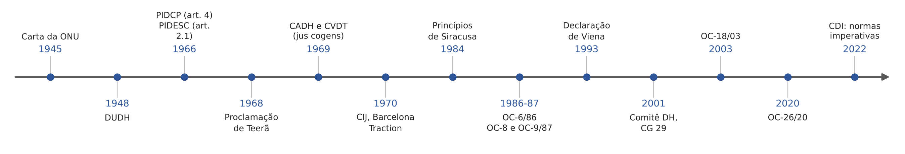
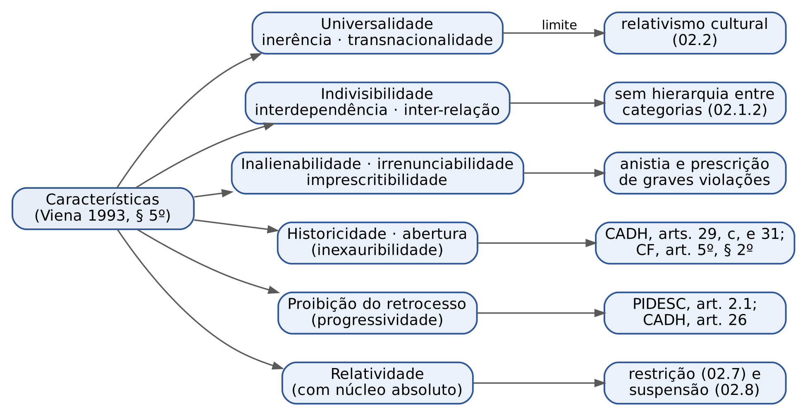
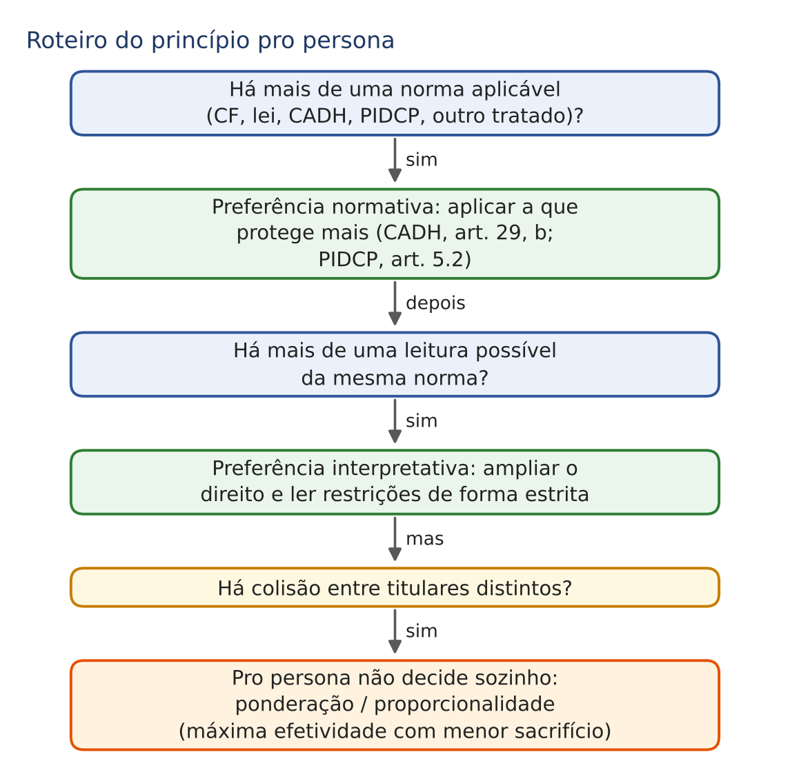
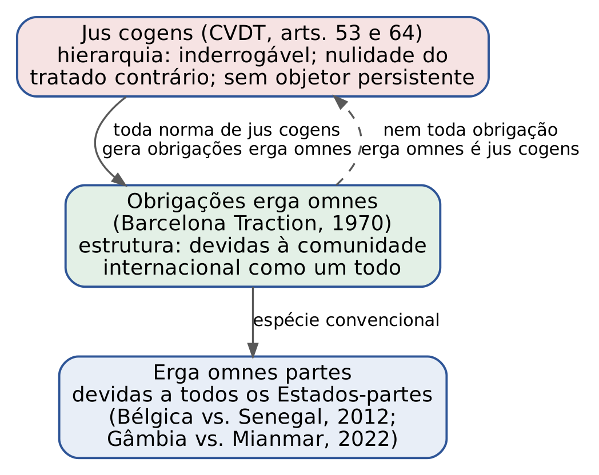
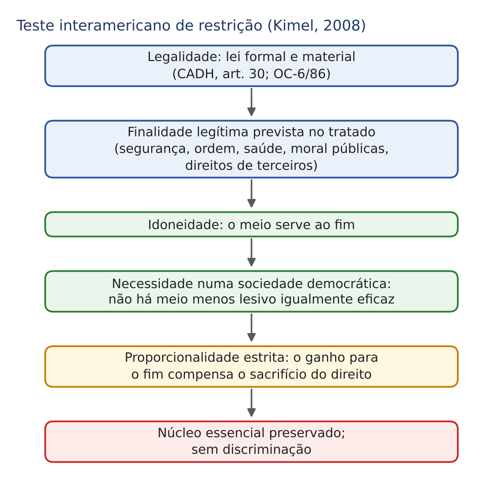
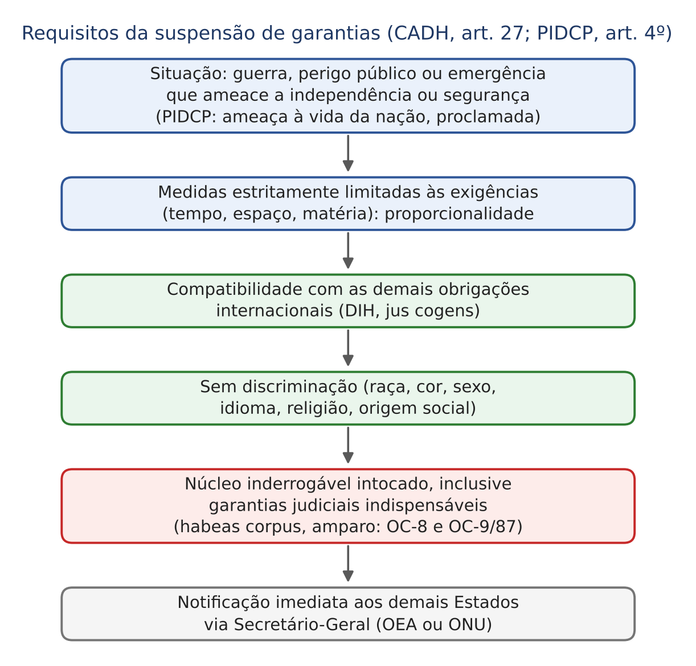
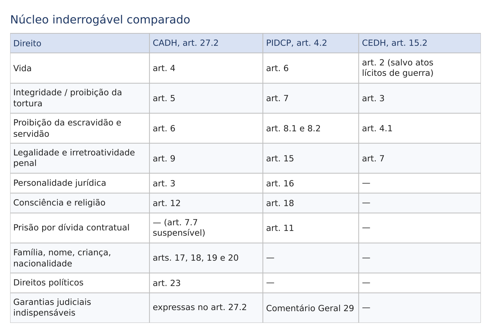

# CAPÍTULO 02 — TEORIA GERAL II: CARACTERÍSTICAS, INTERPRETAÇÃO, JUS COGENS, RESTRIÇÃO E SUSPENSÃO

:::INCIDENCIA
Pontos: TRF5 p. 1; TJRS p. 1; TJSC p. 1. Nível A+. Lote: 17 questões (FGV 14, FCC 3).
Mais cobrado: características (indivisibilidade, interdependência, universalidade, inalienabilidade), universalismo x relativismo, princípio *pro persona* e máxima efetividade, núcleo inderrogável do art. 27 da CADH.
:::

| Subtema | FGV | FCC | Padrão de cobrança |
|---|---|---|---|
| Características (universalidade, indivisibilidade, interdependência, inalienabilidade, historicidade, abertura) | 6 | 0 | alternativa que "define" a característica pelo avesso (alienável por indenização, divisível por gerações, universal só para cidadãos regulares) |
| Universalismo x relativismo cultural | 3 | 1 | relativismo radical x fraco; universalismo de confluência; contexto cultural considerado sem afastar o núcleo do direito |
| Interpretação: *pro persona*, máxima efetividade, competência e alcance da Corte IDH | 4 | 1 | norma mais favorável (CADH, art. 29, b) contra *lex posterior*, *lex superior* e margem de apreciação; insuficiência do *pro persona* em colisão entre titulares |
| Restrições a direitos | 1 | 0 | liberdade de reunião, previsão na DUDH, natureza instrumental, reserva de lei |
| Suspensão de garantias | 0 | 1 | rol do art. 27.2 da CADH (direitos políticos e vida) |

Este capítulo trata do REGIME JURÍDICO dos direitos humanos no plano internacional: como se comportam (características), como se interpretam, que normas estão no topo (*jus cogens*) e quem pode exigi-las (*erga omnes*), quando e como podem ser restringidos ou suspensos. Conceito, terminologia, fundamentos, gerações e a natureza objetiva das obrigações (OC-2/82) estão no Cap. 1; a perspectiva constitucional das mesmas categorias (características dos direitos fundamentais, teorias interna e externa, núcleo essencial, proporcionalidade, vedação do retrocesso no STF) está na Apostila de Direito Constitucional, Cap. 7; a dimensão humanística das características e do debate universalismo x relativismo, com a DUDH e a Agenda 2030, está na Apostila de Formação Humanística, Cap. 27. Aqui não se repete o que lá está: o foco é a LETRA dos tratados, os órgãos internacionais e a jurisprudência da Corte IDH e da CIJ.

## 02.1 Características dos direitos humanos

### 02.1.1 Fonte normativa e mapa

As características não são invenção doutrinária solta: a maior parte tem base textual. A fórmula de referência é o § 5º da Declaração e Programa de Ação de Viena (Conferência Mundial de 1993): todos os direitos humanos são universais, indivisíveis, interdependentes e inter-relacionados; a comunidade internacional deve tratá-los de forma global, justa e equitativa, em pé de igualdade e com a mesma ênfase; as particularidades nacionais e regionais devem ser levadas em conta, mas é dever dos Estados, independentemente de seus sistemas políticos, econômicos e culturais, promover e proteger todos os direitos. O § 1º da mesma Declaração afirma que a natureza universal desses direitos "está fora de questão". A Proclamação de Teerã (1968), § 13, já afirmara a indivisibilidade (ver Cap. 1, 01.5.2).

A doutrina brasileira mais usada pela FGV (André de Carvalho Ramos, *Curso de Direitos Humanos*) organiza as características em blocos, que convém conhecer pela nomenclatura, porque a banca usa os rótulos:

| Bloco | Características | Base normativa |
|---|---|---|
| Titularidade | universalidade, inerência, transnacionalidade | DUDH, preâmbulo e arts. 1º e 2º; CADH, art. 1.2 ("pessoa é todo ser humano"); PIDCP, art. 2.1 |
| Relação entre direitos | indivisibilidade, interdependência, inter-relação, unidade, complementaridade | Teerã, § 13; Viena, § 5º; preâmbulos dos Pactos de 1966 e da CADH; Protocolo de San Salvador, preâmbulo |
| Regime do direito | inalienabilidade, indisponibilidade ou irrenunciabilidade, imprescritibilidade | DUDH, preâmbulo ("direitos iguais e inalienáveis"); construção jurisprudencial (02.1.4) |
| Dinâmica | historicidade, abertura ou inexauribilidade (não tipicidade), proibição do retrocesso | CADH, arts. 29, "c", e 31; CF, art. 5º, § 2º; PIDESC, art. 2.1 (02.6) |
| Força normativa | superioridade normativa (preferenciabilidade), centralidade, aplicabilidade imediata, dimensão objetiva | CF, art. 4º, II, e art. 5º, § 1º (Apostila de Direito Constitucional, Cap. 7) |
| Limites | relatividade ou limitabilidade, com núcleo absoluto | CADH, arts. 30 e 32.2; DUDH, art. 29.2; ver 02.7 e 02.8 |

### 02.1.2 Universalidade, inerência e transnacionalidade

Universalidade é a titularidade por TODA pessoa, pelo simples fato de ser humana, sem condicionamento a nacionalidade, cidadania, situação migratória, conduta ou mérito. Três desdobramentos com nome próprio:

- Inerência: os direitos pertencem à pessoa por sua condição humana, não por concessão estatal; o Estado os RECONHECE (a CADH, no preâmbulo, fala em direitos que "têm como fundamento os atributos da pessoa humana" e que não derivam da nacionalidade).
- Transnacionalidade: os direitos acompanham a pessoa onde quer que esteja; a nacionalidade é irrelevante para a titularidade, o que se projeta no refúgio, na migração e na proteção de apátridas (Cap. 21). A OC-18/03 levou essa ideia ao limite: o dever de respeitar e garantir independe da situação migratória regular ou irregular (02.4.5).
- Universalidade não é uniformidade: os modos de realização podem variar conforme o contexto (Viena, § 5º), e há direitos cuja titularidade depende de uma qualidade jurídica (direitos políticos do nacional, direitos do trabalhador), o que não ofende a universalidade porque a distinção é imposta pela natureza do direito, não pela pessoa.

:::QUESTAO FGV 2024 — Câmara de Fortaleza — Consultor Legislativo, Direitos Humanos (Q2474121)
Cobrado: o sentido da universalidade. Gabarito E: os direitos humanos valem em todos os lugares, validade alcançada por uma perspectiva comunitária (internacional), com a elaboração de documentos internacionais de proteção.
Armadilhas: A restringe a titularidade a quem está em "situação regular" no país (contraria a OC-18/03 e a transnacionalidade); B faz da realidade cultural argumento suficiente para afastar o direito (relativismo radical, 02.2); C sugere que a multiculturalidade autoriza "compatibilizar" o direito em descompasso com a cultura caso a caso, com a cultura como fonte de validade; D confunde universalidade (titularidade) com reconhecimento por todos os países (que é o processo de internacionalização, Cap. 1).
:::

### 02.1.3 Indivisibilidade, interdependência e inter-relação

As três palavras de Viena não são sinônimos perfeitos:

| Termo | Ideia | Consequência jurídica |
|---|---|---|
| Indivisibilidade | os direitos formam um todo único; não se protege uma categoria e se nega outra | vedação de hierarquia entre categorias e de realização seletiva legítima; crítica à teoria das gerações (Cap. 1, 01.5.2) |
| Interdependência | a efetivação de um direito condiciona o exercício dos demais (voto sem educação; liberdade de expressão sem acesso à informação; vida sem saúde) | leitura conjunta de dispositivos: a Corte IDH extrai do direito à vida (CADH, art. 4º) obrigações prestacionais (vida digna) e julga diretamente DESCA pelo art. 26 (Cap. 19) |
| Inter-relação e complementaridade | os direitos se reforçam e se interpretam uns à luz dos outros | interpretação sistemática do *corpus juris* (02.3.6) |

O argumento textual da indivisibilidade é a própria DUDH, que reúne direitos civis, políticos, econômicos, sociais e culturais no mesmo texto; a cisão em dois Pactos (1966) foi opção política e de técnica de monitoramento (aplicação imediata x progressiva), não de hierarquia. Os preâmbulos dos dois Pactos repetem que o ideal do ser humano livre, liberto do temor e da miséria, só se realiza se forem criadas condições para que cada um goze de TODOS os direitos.

Indivisibilidade não impede priorização administrativa ou orçamentária num dado momento; impede tratar uma categoria como juridicamente inferior ou não exigível.

:::QUESTAO FGV 2026 — HU Brasil — Residência Multiprofissional, Serviço Social (Q4314527)
Cobrado: relação entre categorias de direitos. Gabarito A: a efetivação de uma categoria influencia o exercício de todas as demais (interdependência).
Armadilhas: B e D estabelecem precedência cronológica ou lógica entre categorias (políticos antes de sociais; sociais válidos só após civis): é exatamente a leitura hierárquica que a indivisibilidade rejeita. C afirma que novos direitos substituem os anteriores (a crítica clássica à palavra "geração": há acumulação, não sucessão). E faz das prioridades estatais o critério da proteção obrigatória (nega a universalidade e a indivisibilidade).
:::

:::QUESTAO FGV 2025 — PC-MG — Médico Legista (Q3203637)
Cobrado: características em afirmações isoladas. Gabarito C: a indivisibilidade decorre do reconhecimento de que os direitos têm a mesma proteção jurídica e são todos essenciais à vida digna.
Armadilhas: A (alienáveis, por terem valor de venda: é o oposto da inalienabilidade, 02.1.4); B (sinonímia entre direitos humanos e fundamentais: ver Cap. 1, 01.1.2); D (universalidade "mesmo em detrimento de outrem": confunde titularidade universal com exercício ilimitado; os direitos são limitados pelos direitos dos demais, CADH, art. 32.2); E (atribui ao jusnaturalismo a tese positivista).
:::

:::QUESTAO FGV 2024 — Câmara dos Deputados — Consultor Legislativo, Área XIX, reaplicação (Q2511986)
Cobrado: qual qualificativo se aplica aos "princípios dos direitos humanos". Gabarito D: interdependentes, porque um direito complementa o outro (Viena, § 5º).
Armadilhas: A (alienáveis por serem quantificáveis em indenização: a indenização é reparação da violação, não alienação, 02.1.4); B (disponíveis e transferíveis a terceiro: avesso da indisponibilidade); C (limitados pelo "dever de responsabilidade para o seu gozo": sedutora porque os direitos são relativos e há correlação entre direitos e deveres, DUDH, art. 29.1, e CADH, art. 32, mas o gozo dos direitos não é condicionado ao cumprimento de deveres; a titularidade é universal e incondicionada); E (divisíveis por serem partilhados por todos: confunde universalidade com divisibilidade).
:::

### 02.1.4 Inalienabilidade, irrenunciabilidade e imprescritibilidade

- Inalienabilidade: os direitos não têm conteúdo de troca; não se transferem a terceiro, a título oneroso ou gratuito. A indenização pela violação não é "alienação" do direito: é reparação (CADH, art. 63.1), que pressupõe a violação e não a converte em lícita.
- Irrenunciabilidade (indisponibilidade): o titular não pode renunciar à TITULARIDADE nem autorizar validamente sua violação; pode, em certos limites, deixar de exercer o direito ou limitar temporariamente o exercício, sem atingir a dignidade (Apostila de Direito Constitucional, Cap. 7, 07.4, com os Temas 952 e 1.069 do STF). O caso do "arremesso de anões" (Comitê de Direitos Humanos da ONU, Wackenheim vs. França, 2002) é o exemplo internacional clássico: o consentimento do próprio interessado não afastou a proibição fundada na dignidade, e a medida não foi considerada discriminatória.
- Imprescritibilidade: o direito não se perde pelo não uso. No plano internacional, a característica ganhou dimensão própria em relação às GRAVES violações: a Corte IDH considera inadmissíveis disposições de anistia, prescrição e excludentes de responsabilidade que impeçam investigar e punir graves violações (Barrios Altos vs. Peru, 2001), orientação aplicada ao Brasil em Gomes Lund (2010) e Herzog (2018), este com a qualificação dos fatos como crime contra a humanidade, imprescritível (Caps. 12 e 22). O Estatuto de Roma, art. 29, declara imprescritíveis os crimes de competência do TPI. No direito interno, a Súmula 647 do STJ declara imprescritíveis as ações indenizatórias por danos morais e materiais decorrentes de atos de perseguição política com violação de direitos fundamentais durante o regime militar.

:::PEGADINHA Imprescritibilidade x irrenunciabilidade
No ENAM 2024 (Q2459880, abaixo), a alternativa C chamou de "imprescritibilidade" a impossibilidade de o titular renunciar à proteção e permitir a violação: o nome correto é irrenunciabilidade (ou indisponibilidade). Imprescritibilidade diz respeito ao TEMPO (perda pelo não uso; prescrição da pretensão), não à vontade do titular.
:::

:::QUESTAO FGV 2024 — Câmara de Fortaleza — Consultor Legislativo, Direitos Humanos (Q2474093)
Cobrado: características em afirmações isoladas. Gabarito D: os direitos humanos são fruto do processo histórico, reconhecidos gradativamente (historicidade, 02.1.5).
Armadilhas: A condiciona a universalidade ao cumprimento das normas vigentes; B admite renúncia quando não houver risco à vida (irrenunciabilidade não tem essa exceção); C fala em "alienar" os direitos pela fixação de pena pecuniária ao transgressor (pena e indenização são consequências da violação, não negócio sobre o direito: inalienabilidade, 02.1.4); E converte a indivisibilidade em "divisibilidade" pela diversidade de bens tutelados.
:::

### 02.1.5 Historicidade e abertura (inexauribilidade)

Historicidade: os direitos são conquistas históricas, ampliadas por novas demandas e lutas (Bobbio: nascem em certas circunstâncias, gradualmente, "não todos de uma vez e nem de uma vez por todas"); a historicidade não equivale a relativismo cultural (não diz que a validade depende da cultura, mas que o catálogo se expande no tempo).

Abertura, inexauribilidade ou não tipicidade: o rol é exemplificativo e se expande tanto no plano internacional quanto no interno. Bases:

- CADH, art. 29, "c": nenhuma disposição pode ser interpretada no sentido de "excluir outros direitos e garantias que são inerentes ao ser humano ou que decorrem da forma democrática representativa de governo".
- CADH, art. 31: outros direitos podem ser incluídos no regime de proteção pelos processos de emenda (art. 76) e de protocolos adicionais (art. 77). A remissão do texto oficial aos "artigos 69 e 70" é erro material reproduzido na versão promulgada; a doutrina lê os processos dos arts. 76 e 77.
- CF, art. 5º, § 2º: cláusula de abertura material do catálogo constitucional aos direitos decorrentes do regime, dos princípios e dos tratados (Apostila de Direito Constitucional, Caps. 7 e 11; Cap. 3 desta apostila).

:::QUESTAO FGV 2024 — ENAM — 1º Exame Nacional da Magistratura (Q2459880)
Cobrado: características e especificidades. Gabarito E. Elimine primeiro as três claramente falsas:
- A: diz que a universalidade não consta expressamente de tratados e declarações. Falsa: DUDH, preâmbulo e art. 2º; Viena, §§ 1º e 5º.
- B: restringe a abertura ao plano internacional, vedada inovação interna. Falsa: a abertura é também interna (o próprio art. 5º, § 2º, fala em direitos decorrentes "do regime e dos princípios" adotados pela Constituição).
- C: chama de imprescritibilidade a irrenunciabilidade (PEGADINHA acima). Falsa.
Restam D e E. D toma a cláusula de abertura do art. 5º, § 2º, como "exemplo de universalidade": só se sustenta na leitura de que a cláusula projeta internamente o catálogo universal dos tratados; tecnicamente, o dispositivo é o exemplo clássico da ABERTURA (inexauribilidade), não da universalidade. E afirma a relevância atual da transnacionalidade (titularidade independente da nacionalidade, que acompanha a pessoa onde estiver) diante do fluxo de refugiados: descreve característica reconhecida por Carvalho Ramos e sua aplicação mais evidente (02.1.2).
Conclusão: E, gabarito oficial, é a afirmação tecnicamente precisa. Para a prova, guarde as duas associações: art. 5º, § 2º = abertura; transnacionalidade = refúgio e migração.
:::

### 02.1.6 Relatividade e núcleo absoluto

Não há, como regra, direitos absolutos: os direitos são limitados pelos direitos dos demais, pela segurança de todos e pelas justas exigências do bem comum (CADH, art. 32.2; DUDH, art. 29.2). A exceção é um núcleo de proibições que não admite ponderação nem suspensão: proibição da tortura e de penas ou tratamentos cruéis, desumanos ou degradantes, proibição da escravidão e da servidão, legalidade penal e irretroatividade da lei penal mais grave. São, ao mesmo tempo, normas de *jus cogens* (02.4) e integrantes do núcleo inderrogável do art. 27.2 da CADH e do art. 4.2 do PIDCP (02.8). A Convenção contra a Tortura da ONU, art. 2.2, é expressa: nenhuma circunstância excepcional (guerra, ameaça de guerra, instabilidade política interna ou outra emergência) pode ser invocada como justificativa (Cap. 20).

## 02.2 Universalismo x relativismo cultural

### 02.2.1 O que já está desenvolvido e o que acrescentar

As posições (relativismo radical, forte e fraco; universalismo radical a fraco, na escala de Jack Donnelly), o universalismo de confluência de Joaquín Herrera Flores e a hermenêutica diatópica de Boaventura de Sousa Santos estão na Apostila de Formação Humanística, Cap. 27, 27.1.3, com as Q2507018 e Q4037417 comentadas. As teorias críticas estão no Cap. 1 desta apostila (01.2.3). Aqui interessam os PARÂMETROS NORMATIVOS internacionais que resolvem o conflito em casos concretos e as questões do lote ainda não comentadas.

### 02.2.2 A solução normativa internacional

| Instrumento | O que diz sobre cultura x direitos | Uso em prova |
|---|---|---|
| Declaração de Viena (1993), § 5º | particularidades nacionais, regionais, históricas, culturais e religiosas devem ser "levadas em conta", mas é dever do Estado proteger todos os direitos, independentemente do sistema cultural | é a fórmula do "universalismo temperado": contexto considerado, núcleo preservado |
| Declaração Universal sobre a Diversidade Cultural (UNESCO, 2001), art. 4º | ninguém pode invocar a diversidade cultural para violar os direitos humanos garantidos pelo direito internacional nem para limitar seu alcance | a diversidade cultural é ela mesma protegida, mas não serve de escudo contra direitos |
| Convenção da UNESCO sobre a Proteção e Promoção da Diversidade das Expressões Culturais (2005), art. 2.1 (princípio do respeito aos direitos humanos) | a diversidade cultural só pode ser protegida se garantidos os direitos humanos; ninguém pode invocar a Convenção para violá-los ou limitar seu alcance | ver Cap. 14 |
| CEDAW, arts. 2º, "f", e 5º, "a" | os Estados devem modificar ou abolir costumes e práticas discriminatórios e alterar padrões socioculturais baseados na ideia de inferioridade de qualquer dos sexos | a cultura é OBJETO de transformação quando discriminatória (Cap. 16) |
| Convenção 169 da OIT, art. 8º.2 | povos indígenas têm direito de conservar costumes e instituições próprios, "desde que não sejam incompatíveis" com os direitos fundamentais definidos pelo sistema jurídico nacional e com os direitos humanos internacionalmente reconhecidos | limite expresso à autonomia cultural (Cap. 14) |
| PIDCP, art. 27, e CADH, interpretada pela Corte IDH | direito das minorias à própria vida cultural; identidade cultural como fator de interpretação dos direitos (propriedade comunal, vida digna dos povos indígenas) | a cultura também AMPLIA direitos, não só os limita (Cap. 14) |

Daí a síntese que resolve as questões de caso: o contexto cultural pode ser considerado na INTERPRETAÇÃO e na escolha dos meios de realização, mas não afasta a proteção essencial do direito nem o controle internacional; a cultura nunca é fonte exclusiva de validade (isso é relativismo radical). Em sentido inverso, o universalismo compatível com os tratados não exige uniformidade cultural nem a adoção de valores culturais comuns: exige direitos comuns, realizáveis por formas culturais diversas.

:::QUESTAO FGV 2026 — HU Brasil — Residência Multiprofissional, Serviço Social (Q4314545)
Cobrado: caracterização correta de universalismo e relativismo diante de práticas culturais que colidem com pretensões normativas universais. Gabarito C: o universalismo afirma direitos comuns, compatíveis com diferentes formas culturais de realização.
Armadilhas: A (universalismo exigiria valores culturais comuns: é uniformização, não universalidade); B (o relativismo faria da tolerância o fundamento dos direitos: o relativismo funda a validade na cultura, não na tolerância); D (validade vinculada às decisões soberanas de cada Estado: é voluntarismo estatal, posição que nem o relativismo cultural sustenta como tal, já que a fonte é a cultura, não o Estado); E (validade condicionada ao consenso entre nações: confunde a validade com o processo político de positivação).
:::

:::QUESTAO FGV 2025 — DPE-PE — Defensor Público (Q3390896)
Cobrado: embate entre relativistas e universalistas. Gabarito B: para os universalistas, os direitos humanos decorrem da dignidade humana (por isso valem para todos, independentemente da cultura).
Armadilhas: A (relativistas "só aceitam os direitos positivados": o relativismo não é positivismo; o critério é cultural); C (existência dependente da "instrumentalidade": formulação sem correspondência com nenhuma das correntes); D (negar o caráter geracional para ambas: a discussão das gerações é outra e não define as correntes); E (universalismo exigiria idêntico status em todos os ordenamentos: a universalidade é de titularidade e de núcleo, não de hierarquia formal idêntica no direito interno de cada Estado).
:::

:::QUESTAO FGV 2024 — ENAM — 1º Exame Nacional da Magistratura, reaplicação (Q2507018) e FCC 2026 — DPE-BA — Defensor Público (Q4037417)
Comentadas na Apostila de Formação Humanística, Cap. 27, 27.1.3. Gabaritos: Q2507018, B (universalismo de confluência como ponto de CHEGADA de processo conflitivo e dialógico; a armadilha C atribui ao relativismo radical a cultura como fonte apenas "relevante", quando nele é a ÚNICA); Q4037417, B (o contexto cultural pode ser considerado na interpretação, sem afastar a proteção essencial do direito).
:::

:::EXEMPLO Caso resolvido: costume que restringe direito de meninas à educação
Comunidade invoca tradição para retirar meninas da escola após a puberdade; o Estado, parte da CEDAW e da Convenção sobre os Direitos da Criança, tolera a prática alegando respeito cultural.
Passos: (1) identificar o direito e o tratado: educação sem discriminação (CEDAW, art. 10; PIDESC, art. 13); (2) aplicar a regra de Viena: a particularidade cultural é considerada, mas não exonera o Estado; (3) aplicar a regra específica: a CEDAW (art. 5º, "a") obriga a modificar padrões socioculturais discriminatórios, e a Declaração da UNESCO de 2001 (art. 4º) proíbe invocar a diversidade cultural para limitar direitos; (4) espaço legítimo da cultura: formas de realização (calendário escolar adaptado, educação intercultural e bilíngue, participação da comunidade na política educacional); (5) conclusão: a tolerância estatal viola o dever de garantir (CADH, art. 1.1; PIDCP, art. 2.1) e o dever de devida diligência quanto a atos de particulares.
:::

:::PRATIQUE Exercícios elaborados para esta apostila (não são questões de banca)
1. Certo ou errado: "Para o relativismo cultural fraco, a cultura é a única fonte de validade de um direito, admitindo-se a crítica externa apenas em casos extremos."
2. Certo ou errado: "A Convenção 169 da OIT assegura aos povos indígenas o direito de conservar seus costumes e instituições, desde que não sejam incompatíveis com os direitos fundamentais e com os direitos humanos internacionalmente reconhecidos."
3. Certo ou errado: "Por força da universalidade, a diversidade cultural não é protegida pelo direito internacional, que adota padrão único de realização dos direitos."
Resolução: 1. Errado: "única fonte" é o relativismo RADICAL; no fraco, a cultura é fonte secundária e a universalidade é a regra. 2. Certo: art. 8º.2 da Convenção 169. 3. Errado: a diversidade cultural é protegida (Declaração da UNESCO de 2001; Convenção de 2005; PIDCP, art. 27), e a universalidade admite formas culturais diversas de realização.
:::

## 02.3 Interpretação dos direitos humanos

### 02.3.1 Ponto de partida: as regras gerais da CVDT e suas especificidades

Os tratados de direitos humanos são tratados e se interpretam, em primeiro lugar, pela regra geral da Convenção de Viena sobre o Direito dos Tratados (Decreto 7.030/2009). O art. 31.1 manda interpretar "de boa fé segundo o sentido comum atribuível aos termos do tratado em seu contexto e à luz de seu objetivo e finalidade"; o art. 31.3, "c", manda levar em consideração "quaisquer regras pertinentes de Direito Internacional aplicáveis às relações entre as partes" (base da interpretação sistemática pelo *corpus juris*); o art. 32 admite os meios suplementares, entre eles os *travaux préparatoires*.

A especificidade está no "objetivo e finalidade": como o objeto dos tratados de direitos humanos é a proteção da pessoa, e não o intercâmbio de vantagens entre Estados (OC-2/82; ver Cap. 1, 01.6.2), a interpretação teleológica conduz a critérios próprios, que a Corte IDH e os comitês da ONU aplicam de modo sistemático: *pro persona*, máxima efetividade (*effet utile*), interpretação evolutiva, interpretação autônoma e interpretação sistemática pelo *corpus juris*. A margem de apreciação é o contrapeso, de uso restrito no sistema interamericano. O art. 29 da CADH é a norma convencional de interpretação; o art. 5º dos dois Pactos de 1966 tem função equivalente.

:::LEI Convenção Americana sobre Direitos Humanos (Decreto 678/1992), art. 29 — Normas de Interpretação
Nenhuma disposição desta Convenção pode ser interpretada no sentido de:
a) permitir a qualquer dos Estados-Partes, grupo ou pessoa, suprimir o gozo e exercício dos direitos e liberdades reconhecidos na Convenção ou limitá-los em maior medida do que a nela prevista;
b) limitar o gozo e exercício de qualquer direito ou liberdade que possam ser reconhecidos de acordo com as leis de qualquer dos Estados-Partes ou de acordo com outra convenção em que seja parte um dos referidos Estados;
c) excluir outros direitos e garantias que são inerentes ao ser humano ou que decorrem da forma democrática representativa de governo; e
d) excluir ou limitar o efeito que possam produzir a Declaração Americana dos Direitos e Deveres do Homem e outros atos internacionais da mesma natureza.
:::

Cada alínea tem rótulo próprio, e a banca troca os rótulos:

| Alínea | Rótulo doutrinário | Função |
|---|---|---|
| "a" | proibição do abuso (cláusula contra a supressão) e interpretação restritiva das restrições | impede usar a Convenção para destruir direitos ou restringi-los além do permitido; paralelo: PIDCP e PIDESC, art. 5.1; DUDH, art. 30 |
| "b" | primazia da norma mais favorável (*pro persona* em sentido normativo); cláusula de salvaguarda | a CADH é piso, não teto: prevalece a lei interna ou o tratado que proteja mais; paralelo: PIDCP e PIDESC, art. 5.2 |
| "c" | abertura ou não exaustividade dos direitos; direitos inerentes e democráticos | base da inexauribilidade (02.1.5) e das garantias judiciais indispensáveis na suspensão (OC-9/87, 02.8.4) |
| "d" | preservação dos efeitos da Declaração Americana | a Declaração de 1948 gera obrigações para os membros da OEA (OC-10/89; Cap. 9) |

:::LEI Pacto Internacional sobre Direitos Civis e Políticos (Decreto 592/1992), art. 5.2
"Não se admitirá qualquer restrição ou suspensão dos direitos humanos fundamentais reconhecidos ou vigentes em qualquer Estado Parte do presente Pacto em virtude de leis, convenções, regulamentos ou costumes, sob pretexto de que o presente Pacto não os reconheça ou os reconheça em menor grau."
:::

O art. 5.2 do PIDESC (Decreto 591/1992) tem redação idêntica, falando em "qualquer país". Cláusulas de salvaguarda equivalentes: CEDAW, art. 23; Convenção sobre os Direitos da Criança, art. 41; Convenção contra a Tortura, art. 1.2 (o conceito convencional de tortura não prejudica instrumento ou lei nacional de alcance mais amplo); CDPD, art. 4.4.

### 02.3.2 Princípio *pro persona* (*pro homine*)

Conceito: entre várias normas aplicáveis, ou entre vários sentidos possíveis da mesma norma, o intérprete deve escolher a que confira maior proteção à pessoa; e, tratando-se de restrição, a que menos a restrinja. Tem duas dimensões, que a doutrina latino-americana (Mónica Pinto) e Carvalho Ramos sistematizam:

- Preferência NORMATIVA: diante de normas de fontes diversas (constituição, lei, tratado A, tratado B), aplica-se a mais protetiva, qualquer que seja a fonte ou a hierarquia formal. Base: CADH, art. 29, "b"; Pactos, art. 5.2. A Corte IDH afirmou, na OC-5/85 (13/11/1985, sobre a colegiação obrigatória de jornalistas, a pedido da Costa Rica), que, se a uma mesma situação são aplicáveis a CADH e outro tratado, deve prevalecer a norma mais favorável à pessoa humana.
- Preferência INTERPRETATIVA: diante de vários sentidos da mesma norma, adota-se o que amplia o direito; as restrições se interpretam restritivamente; as exceções não se presumem. Base: CADH, art. 29, "a"; art. 30 (restrições só por lei e com o propósito para o qual foram estabelecidas).

Três consequências que a banca cobra:

1. O *pro persona* afasta os critérios clássicos de solução de antinomias (*lex posterior*, *lex superior*, *lex specialis*) quando o conflito envolve proteção de direitos: não importa se a norma mais protetiva é interna ou internacional, anterior ou posterior. Por isso a CADH, sendo supralegal (RE 466.343), não impede que lei interna mais protetiva prevaleça (Cap. 4).
2. Reservas e declarações interpretativas se interpretam RESTRITIVAMENTE (sempre a favor da integridade do tratado e do direito), nunca de modo ampliativo.
3. O *pro persona* tem limite: quando a colisão é entre direitos de titulares DISTINTOS (liberdade de imprensa x honra; liberdade religiosa x igualdade), "a interpretação mais favorável à pessoa" é favorável a uma e desfavorável a outra. A resposta, então, vem da ponderação (proporcionalidade) e da máxima efetividade com o menor sacrifício (02.3.3), não do *pro persona* isolado. É o ponto da Q3692392 (ENAM 2025.2).

:::QUESTAO FGV 2025 — TRF 6ª Região — Juiz Federal Substituto (Q3742441)
Cobrado: critério de solução da coexistência entre normas internas e convencionais. Gabarito D: o intérprete deve aplicar a norma mais protetiva à pessoa, de origem interna ou internacional (princípio *pro homine*).
Armadilhas: A (critério cronológico, *lex posterior*: é exatamente o que o *pro persona* afasta); B (normas que passaram pelo "duplo crivo" ficariam imunes a tratado superveniente mais protetivo, com base na margem de apreciação: a margem não imuniza norma alguma e não prevalece sobre a norma mais favorável; o duplo controle é dinâmico, Cap. 5); C (só tratados do rito do art. 5º, § 3º, serviriam de parâmetro para ampliar a proteção: tratados supralegais também são parâmetro de convencionalidade e de densificação, Caps. 4 e 5); E (a jurisprudência da Corte IDH vincularia todos os Estados como *res judicata*: coisa julgada só entre as partes do caso, CADH, art. 68.1; para os demais Estados fala-se em coisa interpretada, *res interpretata*, Cap. 5).
:::

:::QUESTAO FGV 2024 — TJ-MT — Juiz Substituto (Q3087008)
Cobrado: aplicação do *pro homine*. Gabarito E: deve prevalecer a interpretação que favoreça a norma mais próxima à garantia dos direitos humanos.
Armadilhas: A (prevalência dos interesses humanos sobre os "direitos da natureza": o *pro persona* não é critério de hierarquia entre bens ambientais e humanos, e a Corte IDH reconhece o meio ambiente como direito autônomo, Cap. 19); B (reservas interpretadas ampliativamente: é o contrário); C (autonomia do Estado para escolher os dispositivos aplicáveis: viola *pacta sunt servanda*, CVDT, art. 26, e a vedação de invocar o direito interno, art. 27); D (cláusulas de direitos interpretadas para não prejudicar ordem pública e interesse coletivo: inverte a lógica; ordem pública é fundamento de RESTRIÇÃO, que se interpreta estritamente, 02.7).
:::

:::QUESTAO FGV 2025 — TRF 3ª Região — Juiz Federal Substituto (Q3179593)
Cobrado: competências da Corte IDH e critério de interpretação. Gabarito B: diante da multiplicidade de instrumentos de proteção, um dos critérios de interpretação é a primazia da norma mais favorável à vítima.
Armadilhas: A (competência contenciosa sobre qualquer membro da OEA, parte ou não da CADH: só Estados-partes que reconheceram a competência, CADH, art. 62); C (competência consultiva limitada aos Estados-partes: qualquer Estado-membro da OEA e os órgãos do art. 64.1 podem consultar); D (tribunais internacionais "substituem" os internos: a jurisdição internacional é subsidiária e complementar, e a Corte não é quarta instância); E (qualquer indivíduo poderia submeter caso à Corte: só os Estados-partes e a Comissão, art. 61.1; o indivíduo peticiona à CIDH, art. 44). Competências da Corte no Cap. 11.
:::

:::QUESTAO FCC 2024 — TRT 11ª Região — Analista Judiciário, Área Administrativa (Q2400738)
Cobrado: rótulo do princípio expresso no art. 29, "b", da CADH (nenhuma disposição limita direito reconhecido pelas leis do Estado ou por outra convenção). Gabarito D: primazia da norma mais favorável (*pro persona* normativo).
Armadilhas: B (não exaustividade dos fatores de discriminação) designa outra coisa: o caráter exemplificativo dos critérios proibidos do art. 1.1 ("ou de qualquer outra natureza", "qualquer outra condição social"), que permitiu à Corte IDH incluir orientação sexual e identidade de gênero (02.3.4). Universalidade (C), imprescritibilidade (A) e transnacionalidade (E) são características, não normas de interpretação.
:::

### 02.3.3 Máxima efetividade e efeito útil (*effet utile*)

Máxima efetividade: entre os sentidos possíveis, adota-se o que dê ao direito a maior eficácia prática; no plano constitucional, liga-se à aplicabilidade imediata (CF, art. 5º, § 1º). Na colisão, exige o maior proveito ao titular com o MENOR sacrifício dos titulares dos demais direitos (concordância prática). Efeito útil: o tratado deve ser interpretado de modo a produzir efeitos práticos e não a ser esvaziado; as obrigações devem ser cumpridas de forma a garantir sua eficácia real, não meramente formal.

Aplicações na Corte IDH:

- Art. 2º da CADH como cláusula de efeito útil: o dever de adotar disposições de direito interno abrange suprimir normas e práticas que violem a Convenção e expedir normas que garantam os direitos; é um dos fundamentos do controle de convencionalidade (Cap. 5).
- Competência contenciosa: um Estado não pode retirar-se da competência da Corte por simples declaração com efeito imediato, nem limitar a aceitação de modo a esvaziar o sistema; a aceitação se interpreta à luz do efeito útil da Convenção (Ivcher Bronstein e Tribunal Constitucional vs. Peru, competência, 1999; Cap. 11).
- Leis de anistia: leis que impedem a investigação de graves violações "carecem de efeitos jurídicos" porque frustram o efeito útil da Convenção (Barrios Altos; Gomes Lund; Caps. 5, 12 e 13).

:::QUESTAO FGV 2025 — ENAM — Exame Nacional da Magistratura 2025.2 (Q3692392)
Cobrado: regras de interpretação dos direitos humanos, redigidos com conceitos abertos e sujeitos a colisão. Gabarito E: a máxima efetividade exige que a interpretação conduza ao maior proveito do titular, com o menor sacrifício dos titulares dos demais direitos em colisão, e conduz à aplicabilidade imediata.
Armadilhas: A (corpo dogmático fechado e verdade abstrata única: contraria a abertura e o caráter dialógico da interpretação); B (audiências públicas no STF como ÚNICA forma de interação com a sociedade civil e com órgãos internacionais: há *amicus curiae*, petições aos sistemas internacionais, relatórios-sombra); C (*pro persona* como critério "mais apto e eficaz" notadamente nas colisões entre titulares distintos: é justamente onde ele se mostra insuficiente, porque a solução mais favorável a um é desfavorável ao outro; a alternativa é sedutora porque a primeira frase está certa); D (interpretação meramente declaratória: a interpretação de direitos é construtiva, concretizadora).
:::

### 02.3.4 Interpretação evolutiva (os tratados como "instrumentos vivos")

Os tratados de direitos humanos são "instrumentos vivos", cuja interpretação acompanha a evolução dos tempos e as condições de vida atuais. A fórmula vem da Corte Europeia (Tyrer vs. Reino Unido, 1978: castigo corporal judicial avaliado pelos padrões contemporâneos) e foi adotada pela Corte IDH, que a fundamenta tanto no art. 29 da CADH quanto na CVDT (OC-16/99, sobre o direito à informação sobre a assistência consular; Comunidade Mayagna (Sumo) Awas Tingni vs. Nicarágua, 2001, em que "propriedade" do art. 21 passou a abranger a propriedade comunal indígena).

Exemplos que caem:

| Tema | Leitura evolutiva | Fonte |
|---|---|---|
| Propriedade (art. 21) | inclui a propriedade comunal dos povos indígenas e tribais | Awas Tingni (2001); Cap. 14 |
| "Qualquer outra condição social" (art. 1.1) | inclui orientação sexual, identidade e expressão de gênero | Atala Riffo e crianças vs. Chile (2012); OC-24/17; Cap. 17 |
| Vida (art. 4º) | inclui condições de vida digna (dimensão positiva) | Villagrán Morales e outros, "Meninos de Rua" vs. Guatemala (1999) |
| Art. 26 | justiciabilidade direta dos DESCA | Lagos del Campo vs. Peru (2017) e seguintes; Cap. 19 |
| Meio ambiente | direito autônomo e obrigações estatais diante da emergência climática | OC-23/17; OC-32/25; Cap. 19 |
| Família (art. 17) | não há modelo único de família | Atala Riffo; OC-24/17 |

A interpretação evolutiva tem limites: não pode criar obrigação manifestamente contrária ao texto, e a doutrina aponta o risco de ativismo e de déficit de legitimidade, que a Corte procura compensar com o diálogo com cortes nacionais e com a fundamentação no *corpus juris*.

:::PEGADINHA Interpretação evolutiva x intenção originária
Afirmação típica: "Na interpretação da CADH, prevalece o sentido que as partes atribuíam aos termos no momento da celebração, consultados os trabalhos preparatórios." Errado como regra: os *travaux préparatoires* são meio SUPLEMENTAR (CVDT, art. 32), e a Corte IDH adota interpretação evolutiva (art. 29 da CADH e art. 31 da CVDT). Também é errado dizer que a interpretação evolutiva só se aplica a direitos sociais: Awas Tingni (propriedade) e Atala Riffo (igualdade) são direitos civis.
:::

### 02.3.5 Interpretação autônoma

Os termos dos tratados têm sentido próprio, internacional, que não depende da qualificação dada pelo direito interno de cada Estado; do contrário, cada Estado moldaria o alcance de suas obrigações pela própria legislação. Exemplos: "propriedade" (art. 21) não se limita ao conceito civilista; "acusação penal" e "pena" se aferem pela natureza da sanção, e não pelo rótulo legal, o que estende garantias do art. 8º a processos administrativos sancionadores (Corte IDH, Baena Ricardo vs. Panamá, 2001; Cap. 9). A Corte Europeia chama a técnica de "noções autônomas".

### 02.3.6 Interpretação sistemática: o *corpus juris* do DIDH

O *corpus juris* é o conjunto de instrumentos internacionais de conteúdo e efeitos jurídicos variados (tratados, convenções, resoluções e declarações) que se interpretam uns à luz dos outros (OC-16/99). Fundamento: CVDT, art. 31.3, "c", e CADH, art. 29, "b" e "d". Aplicações: o art. 19 da CADH (direitos da criança) é lido com a Convenção sobre os Direitos da Criança ("Meninos de Rua"); o art. 5º com a Convenção contra a Tortura e a Convenção Interamericana para Prevenir e Punir a Tortura; a igualdade de gênero com a CEDAW e a Convenção de Belém do Pará; os povos indígenas com a Convenção 169 da OIT. O *corpus juris* também é a base do parâmetro do controle de convencionalidade (Cap. 5).

### 02.3.7 Margem de apreciação

Conceito: espaço de discricionariedade reconhecido ao Estado na aplicação e na restrição de direitos, fundado na proximidade das autoridades nacionais com a realidade local, na diversidade cultural e moral e na subsidiariedade da jurisdição internacional. Origem: Corte Europeia de Direitos Humanos, especialmente Handyside vs. Reino Unido (7/12/1976), sobre a apreensão de livro considerado obsceno: na falta de consenso europeu sobre a moral, as autoridades nacionais estão em melhor posição para avaliar a necessidade da restrição, sob supervisão europeia. O Protocolo 15 à Convenção Europeia (em vigor desde 2021) inseriu a subsidiariedade e a margem de apreciação no preâmbulo da Convenção.

No sistema interamericano, o uso é escasso e restritivo. A Corte IDH reconheceu margem na fixação de requisitos para naturalização (OC-4/84, a pedido da Costa Rica, 19/1/1984) e na regulação de recursos internos, mas a recusa quando estão em jogo direitos inderrogáveis, discriminação por categorias suspeitas ou graves violações. A doutrina (Carvalho Ramos) critica a margem como risco de relativização e de "dupla moral", aceitando-a apenas como deferência controlada.

| Critério | Margem mais AMPLA | Margem mais ESTREITA ou inexistente |
|---|---|---|
| Consenso entre Estados | ausência de consenso (moral, religião, bioética) | consenso consolidado |
| Natureza do direito | direitos econômicos, urbanísticos, tributários; organização de recursos | direitos inderrogáveis; núcleo da vida privada; participação política |
| Critério de distinção | critérios neutros | categorias suspeitas (raça, sexo, orientação sexual, origem) |
| Gravidade | restrição leve | grave violação ou padrão sistemático |

:::ATENCAO Margem de apreciação no controle de convencionalidade
A margem de apreciação NÃO é fundamento para o juiz nacional deixar de aplicar a norma mais favorável nem para tornar imune ao controle de convencionalidade norma já examinada (Q3742441, alternativa B). Ela é técnica de autocontenção do tribunal INTERNACIONAL ao revisar o Estado; no plano interno, o juiz aplica a norma mais protetiva e controla de ofício a convencionalidade (Cap. 5). A relação entre margem de apreciação, diálogo entre cortes e duplo controle está no Cap. 5.
:::

:::PRATIQUE Exercícios elaborados para esta apostila (não são questões de banca)
1. Certo ou errado: "O art. 29, 'b', da CADH consagra a primazia da norma mais favorável, de modo que lei interna mais protetiva prevalece sobre a Convenção, embora esta tenha status supralegal."
2. Certo ou errado: "A margem de apreciação nacional, construída pela Corte Europeia em Handyside vs. Reino Unido, é amplamente aplicada pela Corte IDH em casos de discriminação por orientação sexual, em razão da ausência de consenso regional."
3. Certo ou errado: "Pela interpretação autônoma, a qualificação de uma sanção como administrativa pelo direito interno não afasta, por si só, a incidência das garantias do art. 8º da CADH."
Resolução: 1. Certo (art. 29, "b"; Pactos, art. 5.2). 2. Errado: orientação sexual é categoria protegida pelo art. 1.1 (Atala Riffo; OC-24/17), o que estreita ou elimina a margem; a Corte IDH usa a margem de forma escassa. 3. Certo (Baena Ricardo; noções autônomas).
:::

## 02.4 *Jus cogens* e obrigações *erga omnes*

### 02.4.1 Conceito e regime na CVDT

:::LEI Convenção de Viena sobre o Direito dos Tratados (Decreto 7.030/2009), arts. 53 e 64
Art. 53. "É nulo um tratado que, no momento de sua conclusão, conflite com uma norma imperativa de Direito Internacional geral. Para os fins da presente Convenção, uma norma imperativa de Direito Internacional geral é uma norma aceita e reconhecida pela comunidade internacional dos Estados como um todo, como norma da qual nenhuma derrogação é permitida e que só pode ser modificada por norma ulterior de Direito Internacional geral da mesma natureza."
Art. 64. "Se sobrevier uma nova norma imperativa de Direito Internacional geral, qualquer tratado existente que estiver em conflito com essa norma torna-se nulo e extingue-se."
:::

Os elementos da definição são cobrados um a um:

| Elemento | Sentido | Erro típico de alternativa |
|---|---|---|
| Norma de Direito Internacional GERAL | vale para todos os Estados (em regra, de origem costumeira), não só para os partes de um tratado | "norma imperativa é a prevista em tratado ratificado pelo Estado" |
| Aceita e reconhecida pela comunidade internacional dos Estados "como um todo" | basta aceitação por grande maioria representativa; não exige unanimidade | "exige o consentimento de cada Estado" |
| Nenhuma derrogação permitida | não pode ser afastada por acordo entre Estados nem por reserva | "pode ser afastada por tratado bilateral posterior" |
| Só se modifica por norma da mesma natureza | a mudança exige nova norma imperativa | "modifica-se por costume regional" |

Consequências do regime:

- Nulidade ABSOLUTA do tratado contrário, contemporâneo (art. 53, *ab initio*) ou superveniente (art. 64, *ex nunc*, com extinção); a nulidade por *jus cogens* atinge o tratado como um todo, sem divisibilidade (art. 44.5); o art. 71 regula as consequências (eliminar os efeitos do ato contrário; adaptar as relações à norma imperativa).
- Reserva contrária a *jus cogens* é incompatível com o objeto e o fim do tratado (Comitê de Direitos Humanos, Comentário Geral 24, de 1994; CVDT, art. 19, "c").
- Não se admite o objetor persistente: o Estado que se opôs desde a formação do costume não se exime da norma imperativa, diferença estrutural em relação ao costume comum.
- Brasil: a CVDT foi promulgada pelo Decreto 7.030, de 14/12/2009, com reserva aos arts. 25 (aplicação provisória) e 66. O art. 66, "a", atribui à Corte Internacional de Justiça as controvérsias sobre os arts. 53 e 64; com a reserva, o Brasil não aceita essa jurisdição compulsória, embora esteja vinculado às normas imperativas (que, sendo direito geral, independem do tratado).

### 02.4.2 O rol: CDI (2022) x Corte IDH (OC-26/20)

Nenhum tratado lista as normas imperativas. Dois róis não exaustivos são cobrados e NÃO coincidem:

| Comissão de Direito Internacional da ONU, conclusões sobre identificação e consequências jurídicas das normas imperativas (adotadas em segunda leitura em 2022), anexo | Corte IDH, OC-26/20 (9/11/2020, a pedido da Colômbia, sobre denúncia da CADH e da Carta da OEA), par. 106 |
|---|---|
| proibição da agressão | — |
| proibição do genocídio | (alcançada pelos crimes contra a humanidade e pelas graves violações em padrão sistemático) |
| proibição dos crimes contra a humanidade | proibição de cometer crimes contra a humanidade, com a obrigação conexa de investigar e punir |
| regras básicas do direito internacional humanitário | — |
| proibição da discriminação racial e do *apartheid* | princípio de igualdade e proibição de discriminação (amplo, OC-18/03) |
| proibição da escravidão | proibição da escravidão e de práticas análogas |
| proibição da tortura | proibição absoluta de todas as formas de tortura, física ou psicológica; proibição de tratos ou penas cruéis, desumanos ou degradantes |
| direito à autodeterminação | — |
| — | proibição do desaparecimento forçado de pessoas |
| — | princípio de não devolução (*non-refoulement*), incluindo a não rejeição na fronteira e a devolução indireta |
| — | proibição de cometer ou tolerar graves violações de direitos humanos em padrão massivo ou sistemático |

Duas leituras de prova: (i) a Corte IDH tem rol MAIS AMPLO que o da CDI em matéria de direitos humanos (igualdade em geral, desaparecimento forçado, *non-refoulement*), o que é criticado como expansão do *jus cogens* por tribunal regional; (ii) a CDI inclui normas de direito internacional geral alheias ao núcleo dos direitos humanos estrito (agressão, autodeterminação, DIH). Na OC-26/20, a Corte afirmou ainda que, denunciada a CADH, as obrigações já vigentes permanecem durante o período de transição, a denúncia não tem efeito retroativo, e as normas consuetudinárias, os princípios gerais e as normas de *jus cogens* continuam a obrigar o Estado; e que a garantia coletiva impõe aos demais Estados da OEA atuar para que o denunciante cumpra suas obrigações (denúncia de tratados de DH no Brasil: Cap. 4).

### 02.4.3 Obrigações *erga omnes*

Conceito: obrigações devidas à comunidade internacional como um todo, em cujo cumprimento TODOS os Estados têm interesse jurídico. A formulação clássica é o *obiter dictum* da Corte Internacional de Justiça em Barcelona Traction (Bélgica vs. Espanha, 5/2/1970), que distinguiu as obrigações de um Estado em relação à comunidade internacional das que surgem em face de outro Estado no campo da proteção diplomática, e deu como exemplos a proscrição dos atos de agressão e do genocídio e os princípios e regras relativos aos direitos básicos da pessoa humana, incluindo a proteção contra a escravidão e a discriminação racial.

Espécie convencional: obrigações *erga omnes partes*, devidas a todos os Estados-partes de um tratado, cada um com interesse jurídico em seu cumprimento. A CIJ reconheceu a qualquer Estado-parte legitimidade para invocar a responsabilidade de outro sem ser vítima direta: Bélgica vs. Senegal (caso Hissène Habré, 2012), quanto à Convenção contra a Tortura (obrigação de processar ou extraditar); Gâmbia vs. Mianmar (exceções preliminares, 2022), quanto à Convenção sobre Genocídio (proteção dos Rohingya).

Projeção no regime da responsabilidade internacional (Artigos da CDI sobre Responsabilidade do Estado por Atos Internacionalmente Ilícitos, 2001): violação grave de norma imperativa gera dever de todos os Estados de cooperar para pôr fim a ela e de não reconhecer como lícita a situação criada nem prestar auxílio para mantê-la (arts. 40 e 41); qualquer Estado além do lesado pode invocar a responsabilidade quando a obrigação é devida à comunidade internacional como um todo ou a um grupo de Estados para proteção de interesse coletivo (art. 48).

| | *Jus cogens* | *Erga omnes* |
|---|---|---|
| Plano | hierarquia normativa (validade) | estrutura da obrigação e legitimidade para exigir (oponibilidade) |
| Pergunta que responde | a norma pode ser derrogada? | quem pode exigir o cumprimento? |
| Fonte | CVDT, arts. 53 e 64 | CIJ, Barcelona Traction; CDI, art. 48 |
| Relação | toda norma de *jus cogens* gera obrigações *erga omnes* | nem toda obrigação *erga omnes* é de *jus cogens* (ex.: obrigações *erga omnes partes* de tratado sem caráter imperativo) |
| Consequência típica | nulidade de tratado; inadmissibilidade de reserva, anistia ou derrogação | legitimidade de qualquer Estado para reclamar; dever de não reconhecimento |

No sistema interamericano, a feição *erga omnes* tem dois desdobramentos próprios: (i) a obrigação de respeitar e garantir (CADH, art. 1.1) tem caráter *erga omnes* e projeta efeitos sobre relações entre particulares (eficácia horizontal; OC-18/03, par. 140); (ii) a garantia coletiva fundamenta a supervisão de cumprimento e a atuação da Assembleia Geral da OEA (art. 65 da CADH; Cap. 11). Não confundir com a eficácia *erga omnes* de decisões judiciais internas (controle concentrado no STF) nem com a coisa interpretada das sentenças da Corte IDH (Cap. 5).

### 02.4.4 Consequências práticas do *jus cogens* em direitos humanos

| Consequência | Exemplo | Remissão |
|---|---|---|
| Inderrogabilidade mesmo em emergência | tortura, escravidão, legalidade penal (núcleo do art. 27.2 da CADH e do art. 4.2 do PIDCP) | 02.8 |
| Imprescritibilidade e vedação de anistia para graves violações | Barrios Altos; Gomes Lund; Herzog | Caps. 12 e 13 |
| Jurisdição universal e dever de processar ou extraditar (*aut dedere aut judicare*) | Convenção contra a Tortura, arts. 5º a 7º; Bélgica vs. Senegal | Caps. 20 e 22 |
| Inadmissibilidade de prova obtida sob tortura | Convenção contra a Tortura, art. 15 | Cap. 20 |
| *Non-refoulement* como limite à extradição, deportação e expulsão | Lei 9.474/1997, art. 7º; OC-21/14 | Cap. 21 |
| Igualdade e não discriminação vinculando o Estado independentemente de tratado e alcançando particulares | OC-18/03 | 02.4.5 |
| Irrelevância da função oficial e responsabilidade penal individual | Estatuto de Roma, art. 27 | Cap. 22 |

:::PEGADINHA Imunidade de jurisdição x *jus cogens*
A CIJ, em Imunidades Jurisdicionais do Estado (Alemanha vs. Itália, 2012), entendeu que não há conflito entre a norma imperativa violada (crimes nazistas) e a regra costumeira de imunidade do Estado estrangeiro, porque esta é processual: a natureza imperativa da norma material violada não afasta, por si só, a imunidade. Afirmação "o *jus cogens* derroga automaticamente a imunidade de jurisdição do Estado estrangeiro" é falsa à luz da CIJ (o STF adotou solução diversa no Tema 944 da repercussão geral, ARE 954.858, Relator Ministro Edson Fachin, 2021: "os atos ilícitos praticados por Estados estrangeiros em violação a direitos humanos não gozam de imunidade de jurisdição"; ver Apostila de Direito Constitucional, Cap. 30).
:::

### 02.4.5 Igualdade e não discriminação como *jus cogens*: a OC-18/03

:::JURIS Corte IDH, OC-18/03 (Condição jurídica e direitos dos migrantes indocumentados)
Opinião consultiva de 17/9/2003, solicitada pelo México, adotada por unanimidade (Série A n. 18). Conclusões que a banca cobra:
- o princípio de igualdade perante a lei, igual proteção da lei e não discriminação pertence ao *jus cogens* (par. 101), porque sobre ele repousa toda a estrutura jurídica da ordem pública nacional e internacional;
- por isso vincula TODOS os Estados, sejam ou não partes de determinado tratado (par. 100), e gera obrigações *erga omnes* de proteção (pars. 109 e 110);
- produz efeitos em relação a terceiros, inclusive particulares (par. 140): o Estado deve impedir que empregadores privados violem direitos de trabalhadores migrantes e não pode tolerar relações de trabalho abaixo dos padrões mínimos internacionais;
- o dever de respeitar e garantir independe da situação migratória; a condição migratória não justifica privar a pessoa de direitos humanos, inclusive trabalhistas, e o devido processo é garantia mínima de todo migrante;
- os Estados não podem subordinar ou condicionar a observância da igualdade e da não discriminação à consecução de objetivos de política pública, inclusive migratória.
:::

Pontos de aprofundamento:

- Igualdade x distinção: nem toda diferença de tratamento é discriminatória; é discriminatória a distinção sem justificativa objetiva e razoável, isto é, sem finalidade legítima e sem proporcionalidade entre meio e fim (OC-4/84; OC-18/03). Os critérios do art. 1.1 da CADH ("raça, cor, sexo, idioma, religião, opiniões políticas ou de qualquer outra natureza, origem nacional ou social, posição econômica, nascimento ou qualquer outra condição social") são EXEMPLIFICATIVOS (não exaustividade dos fatores de discriminação), e as categorias ali listadas ou a elas assimiladas são "suspeitas": invertem o ônus e exigem escrutínio estrito (Atala Riffo; OC-24/17).
- Duas cláusulas na CADH: art. 1.1 (subordinada: discriminação no gozo dos direitos convencionais) e art. 24 (autônoma: igual proteção da LEI interna, qualquer que seja o direito). O PIDCP tem a mesma estrutura (arts. 2.1 e 26). O regime das duas cláusulas, a discriminação indireta e o impacto desproporcional estão na Apostila de Formação Humanística, Caps. 39 e 40; os tratados específicos (ICERD, CEDAW, Convenção Interamericana contra o Racismo) nos Caps. 16 a 18 desta apostila.
- Dimensões: igualdade formal (perante a lei), material (deveres de adotar medidas positivas para reverter situações discriminatórias, inclusive ações afirmativas) e como reconhecimento.
- Proibição de discriminação na suspensão de garantias: mesmo no estado de emergência, as medidas não podem encerrar discriminação fundada em raça, cor, sexo, idioma, religião ou origem social (CADH, art. 27.1; PIDCP, art. 4.1).

:::DICA Como a OC-18/03 aparece em prova
Três afirmações certas, decoráveis: (i) igualdade e não discriminação são *jus cogens* (pela Corte IDH, não pela CDI, que só lista a discriminação RACIAL); (ii) obrigam todo Estado, mesmo sem tratado; (iii) produzem efeitos entre particulares. Três erradas, frequentes: "a OC-18/03 condicionou os direitos trabalhistas à regularidade migratória"; "a igualdade só é *jus cogens* para os Estados-partes da CADH"; "por ser consultiva, a OC-18/03 não integra o parâmetro de convencionalidade" (as opiniões consultivas integram o parâmetro, Cap. 5).
:::

:::PRATIQUE Exercícios elaborados para esta apostila (não são questões de banca)
1. Certo ou errado: "Segundo a Convenção de Viena sobre o Direito dos Tratados, a norma imperativa de direito internacional geral só pode ser modificada por norma ulterior da mesma natureza, e o tratado que, no momento de sua conclusão, conflite com ela é nulo."
2. Certo ou errado: "Toda obrigação erga omnes é norma de jus cogens, porque ambas exprimem interesses da comunidade internacional como um todo."
3. Certo ou errado: "Na OC-26/20, a Corte IDH incluiu o princípio de não devolução, inclusive a não rejeição na fronteira e a devolução indireta, entre as normas de jus cogens por ela reconhecidas."
4. Certo ou errado: "O Brasil, ao promulgar a CVDT, fez reserva ao art. 53, razão pela qual não está vinculado às normas de jus cogens não previstas em tratados por ele ratificados."
Resolução: 1. Certo (art. 53). 2. Errado: todo *jus cogens* gera obrigações *erga omnes*, mas não o inverso. 3. Certo (OC-26/20, par. 106). 4. Errado: a reserva foi aos arts. 25 e 66 (este, sobre a solução judicial das controvérsias relativas aos arts. 53 e 64); e o *jus cogens* vincula como direito internacional geral, independentemente de tratado.
:::

## 02.5 Dignidade da pessoa humana no Direito Internacional dos Direitos Humanos

### 02.5.1 Base normativa

A dignidade é o fundamento declarado de todo o sistema:

- Carta da ONU (1945), preâmbulo: fé "na dignidade e no valor do ser humano".
- DUDH, preâmbulo ("reconhecimento da dignidade inerente a todos os membros da família humana e dos seus direitos iguais e inalienáveis") e art. 1º ("Todos os seres humanos nascem livres e iguais em dignidade e em direitos").
- PIDCP e PIDESC, preâmbulos: os direitos "decorrem da dignidade inerente à pessoa humana".
- CADH: art. 5.2 (toda pessoa privada da liberdade deve ser tratada com o respeito devido à dignidade inerente ao ser humano); art. 6.2 (o trabalho forçado não deve afetar a dignidade); art. 11.1 (direito ao respeito da honra e ao reconhecimento da dignidade).
- CDPD, art. 3º, "a" (respeito pela dignidade inerente como princípio geral); Convenção contra a Tortura, preâmbulo.
- CF, art. 1º, III (fundamento da República; Apostila de Direito Constitucional, Caps. 1 e 7; Cap. 3 desta apostila).

### 02.5.2 Funções jurídicas

| Função | Conteúdo | Exemplo |
|---|---|---|
| Fundamento | justifica a titularidade universal (inerência) e a inalienabilidade | DUDH, art. 1º; Q3390896 (02.2) |
| Critério interpretativo | orienta a escolha do sentido mais protetivo e a interpretação evolutiva | vida digna (art. 4º da CADH) em "Meninos de Rua" |
| Limite ao poder e à autonomia | veda tratamento do ser humano como objeto (fórmula kantiana do ser humano como fim em si mesmo), inclusive com o consentimento do titular | Wackenheim vs. França (Comitê DH, 2002), 02.1.4 |
| Núcleo de direitos inderrogáveis | conteúdo mínimo que nenhuma emergência afasta | tortura, tratamento desumano, escravidão (02.8) |
| Parâmetro de reparação | projeto de vida e dano imaterial | Loayza Tamayo vs. Peru (reparações, 1998); Cap. 11 |

A dignidade, no plano internacional, não é em regra direito autônomo justiciável isoladamente (salvo a honra e dignidade do art. 11 da CADH), mas valor-fonte que qualifica os demais direitos. A objeção clássica é sua indeterminação; por isso a Corte IDH a concretiza por meio de direitos específicos (vida digna, integridade, condições de detenção).

### 02.5.3 Vida digna e dimensão positiva

Em Villagrán Morales e outros ("Meninos de Rua") vs. Guatemala (1999), a Corte IDH afirmou que o direito à vida compreende não só o direito de não ser privado arbitrariamente da vida, mas também o de não ser impedido de ter acesso às condições que garantam existência digna; daí deveres positivos do Estado, especialmente diante de pessoas em situação de vulnerabilidade. A noção foi aplicada a comunidades indígenas privadas de território (Yakye Axa e Sawhoyamaxa vs. Paraguai; Cap. 14) e a pessoas privadas de liberdade (Caps. 12 e 20). É a dignidade como ponte entre direitos civis e DESCA (interdependência, 02.1.3).

:::PRATIQUE Exercício elaborado para esta apostila (não é questão de banca)
Certo ou errado: "No caso do arremesso de anões, o Comitê de Direitos Humanos da ONU entendeu que a proibição da atividade pelo Estado francês violava o PIDCP, porque o consentimento livre do interessado afasta a ofensa à dignidade."
Resolução: Errado. O Comitê (Wackenheim vs. França, 2002) considerou a proibição compatível com o Pacto: a medida tinha fundamento objetivo e razoável (proteção da dignidade humana) e não era discriminatória; o consentimento não afasta a ofensa à dignidade (irrenunciabilidade, 02.1.4).
:::

## 02.6 Proibição do retrocesso (não regressividade)

### 02.6.1 Fundamento internacional

No plano constitucional, a vedação do retrocesso (efeito *cliquet*, Canotilho, ADC 42, ADI 6.955) está na Apostila de Direito Constitucional, Cap. 7, 07.13. No plano internacional, a ideia deriva da obrigação de realização PROGRESSIVA:

:::LEI Pacto Internacional sobre Direitos Econômicos, Sociais e Culturais (Decreto 591/1992), art. 2.1
"Cada Estado Parte do presente Pacto compromete-se a adotar medidas, tanto por esforço próprio como pela assistência e cooperação internacionais, principalmente nos planos econômico e técnico, até o máximo de seus recursos disponíveis, que visem a assegurar, progressivamente, por todos os meios apropriados, o pleno exercício dos direitos reconhecidos no presente Pacto, incluindo, em particular, a adoção de medidas legislativas."
:::

Bases equivalentes: CADH, art. 26 ("a fim de conseguir progressivamente a plena efetividade dos direitos"); Protocolo de San Salvador, art. 1º. O texto do PIDESC NÃO prevê expressamente a não regressividade: ela foi construída pelo Comitê DESC.

### 02.6.2 O padrão do Comitê DESC

- Comentário Geral 3 (1990), sobre a natureza das obrigações, par. 9: progressividade não esvazia a obrigação; impõe avançar da forma mais rápida e eficaz possível, e quaisquer medidas deliberadamente regressivas exigem a mais cuidadosa consideração e devem ser plenamente justificadas por referência à totalidade dos direitos do Pacto e no contexto do pleno aproveitamento do máximo de recursos disponíveis. O mesmo comentário fixa o núcleo mínimo (*minimum core obligations*) e as obrigações de efeito imediato (não discriminação, art. 2.2; adotar medidas).
- Comentários gerais posteriores (direito à seguridade social, à água, à saúde) detalham os critérios de avaliação de medida regressiva: justificativa razoável, exame exaustivo de alternativas, participação dos afetados, ausência de discriminação, impacto não desproporcional, preservação do núcleo mínimo, revisão independente (Cap. 19).

Resultado: a regressividade não é proibida de modo absoluto; gera PRESUNÇÃO de incompatibilidade, com ônus argumentativo do Estado. É exatamente o que a FCC cobrou na Q3531569 (DPE-AM 2025, Cap. 19): correta a alternativa que reproduz o Comentário Geral 3, par. 9; errada a que diz haver previsão expressa no texto do PIDESC.

### 02.6.3 Corte IDH

A Corte IDH reconhece a dimensão de não regressividade no art. 26 da CADH e sua justiciabilidade (Acevedo Buendía e outros, "Demitidos e Aposentados da Controladoria", vs. Peru, 2009). Em Cuscul Pivaral e outros vs. Guatemala (23/8/2018, Série C n. 359), distinguiu obrigações de exigibilidade imediata e de realização progressiva, afirmou que a progressividade "proíbe a inatividade do Estado" e declarou violado o art. 26 pela omissão na atenção à saúde de pessoas vivendo com HIV. Desenvolvimento no Cap. 19.

A mesma régua aparece no plano interno: a FGV considerou correta, no ENAM 2026.1 (Q4102393, comentada na Apostila de Direito Constitucional, Cap. 4), a afirmação de que a proibição do retrocesso impede afastar a eficácia de norma constitucional já integrada pela alteração da norma integradora. Regra comum aos dois planos: o retrocesso vedado é o que atinge o núcleo essencial já concretizado, sem justificativa e sem compensação.

:::PRATIQUE Exercícios elaborados para esta apostila (não são questões de banca)
1. Certo ou errado: "O PIDESC proíbe expressamente, em seu art. 2.1, a adoção de medidas regressivas, que são nulas de pleno direito."
2. Certo ou errado: "Segundo o Comitê DESC, a obrigação de não discriminação no gozo dos direitos econômicos, sociais e culturais é de efeito imediato, não se sujeitando à realização progressiva."
Resolução: 1. Errado: o texto prevê a realização progressiva; a não regressividade foi construída pelo Comitê (Comentário Geral 3, par. 9) como presunção de incompatibilidade que o Estado pode afastar com justificativa plena. 2. Certo (art. 2.2 e Comentário Geral 3).
:::

## 02.7 Restrições a direitos

### 02.7.1 Restrição x suspensão: a distinção que organiza o tema

| | Restrição (limitação) | Suspensão (derrogação) |
|---|---|---|
| Situação | normalidade institucional | emergência excepcional (guerra, perigo público, ameaça à vida da nação) |
| Base | cláusulas específicas de cada direito e cláusulas gerais (CADH, arts. 30 e 32.2; PIDESC, art. 4º; DUDH, art. 29.2) | cláusula de derrogação (CADH, art. 27; PIDCP, art. 4º; CEDH, art. 15) |
| Natureza | permanente, integra o desenho do direito | temporária, pelo tempo estritamente necessário |
| Requisitos | legalidade, finalidade legítima, necessidade numa sociedade democrática, proporcionalidade | os da restrição e mais: situação qualificada, proclamação, notificação internacional, intangibilidade do núcleo |
| Direitos alcançados | os que têm cláusula de restrição (circulação, expressão, reunião, associação, religião na manifestação, propriedade) | todos, salvo o núcleo inderrogável e as garantias indispensáveis |
| PIDESC | admite limitações (art. 4º) | não tem cláusula de derrogação |

Direitos sem cláusula de restrição e inderrogáveis (tortura, escravidão) são absolutos: não se restringem nem se suspendem (02.1.6).

### 02.7.2 Cláusulas de restrição

Os tratados adotam duas técnicas: (i) cláusulas ESPECÍFICAS, no próprio dispositivo do direito, que enumeram as finalidades admissíveis; (ii) cláusulas GERAIS, aplicáveis a todos.

| Direito | CADH | PIDCP | Finalidades legítimas enumeradas |
|---|---|---|---|
| Liberdade de consciência e religião (manifestação) | art. 12.3 | art. 18.3 | segurança, ordem, saúde ou moral públicas, direitos ou liberdades das demais pessoas |
| Expressão | art. 13.2 (responsabilidade ulterior, vedada a censura prévia, salvo espetáculos públicos para proteção da infância e adolescência, art. 13.4) | art. 19.3 | respeito aos direitos ou à reputação das demais pessoas; segurança nacional, ordem, saúde ou moral públicas |
| Reunião | art. 15 | art. 21 | segurança ou ordem públicas, saúde ou moral públicas, direitos e liberdades das demais pessoas (só por lei e necessárias numa sociedade democrática) |
| Associação | art. 16.2 (e 16.3: restrições e até privação para forças armadas e polícia) | art. 22.2 | idem |
| Circulação e residência | art. 22.3 e 22.4 | art. 12.3 | idem; e, no art. 22.4 da CADH, interesse público em zonas determinadas |
| Propriedade | art. 21.1 e 21.2 | — | interesse social; desapropriação por utilidade pública ou interesse social, mediante indenização justa |

Cláusulas gerais:

:::LEI CADH (Decreto 678/1992), arts. 30 e 32.2
Art. 30. "As restrições permitidas, de acordo com esta Convenção, ao gozo e exercício dos direitos e liberdades nela reconhecidos, não podem ser aplicadas senão de acordo com leis que forem promulgadas por motivo de interesse geral e com o propósito para o qual houverem sido estabelecidas."
Art. 32.2. "Os direitos de cada pessoa são limitados pelos direitos dos demais, pela segurança de todos e pelas justas exigências do bem comum, numa sociedade democrática."
:::

O PIDESC, art. 4º, admite limitações "unicamente" estabelecidas em lei, "somente na medida compatível com a natureza desses direitos e exclusivamente com o objetivo de favorecer o bem-estar geral em uma sociedade democrática". A DUDH, art. 29.2, sujeita o exercício dos direitos às limitações determinadas por lei para assegurar o reconhecimento e o respeito dos direitos alheios e satisfazer as justas exigências da moral, da ordem pública e do bem-estar numa sociedade democrática.

### 02.7.3 Requisitos: o teste interamericano

:::JURIS Corte IDH, OC-6/86 (A expressão "leis" no art. 30 da CADH)
Opinião consultiva de 9/5/1986, solicitada pelo Uruguai, unânime. A palavra "leis" no art. 30 significa norma jurídica de caráter geral, ceñida ao bem comum, emanada dos órgãos legislativos constitucionalmente previstos e democraticamente eleitos, e elaborada segundo o procedimento estabelecido pelas constituições dos Estados-partes. Consequência: restrição a direito convencional exige LEI FORMAL e material; decreto, portaria ou ato infralegal não restringem por si, salvo como regulamentação dentro dos limites fixados pela lei (a OC admite delegação desde que autorizada pela Constituição, exercida nos limites dela e da lei delegante, e sujeita a controle).
:::

O roteiro consolidado em Kimel vs. Argentina (2/5/2008, Série C n. 177), a partir da liberdade de expressão, e depois generalizado:

1. Legalidade estrita: previsão em lei formal e material, clara e precisa (em matéria penal, tipicidade estrita; Kimel declarou violada a legalidade pela vagueza dos tipos de calúnia e injúria).
2. Finalidade legítima: um dos fins enumerados pelo tratado para aquele direito.
3. Idoneidade: aptidão do meio para alcançar o fim.
4. Necessidade numa sociedade democrática: inexistência de meio menos lesivo igualmente eficaz; necessidade social imperiosa.
5. Proporcionalidade em sentido estrito: o grau de satisfação do fim compensa o grau de afetação do direito.

Somam-se: não discriminação e preservação do núcleo essencial; interpretação restritiva das restrições (CADH, art. 29, "a"; 02.3.2). No plano interno, o mesmo roteiro corresponde à teoria externa, à reserva legal, ao núcleo essencial e à proporcionalidade (Apostila de Direito Constitucional, Cap. 7, 07.9 e 07.10).

:::QUESTAO FGV 2024 — TRF 1ª Região — Analista Judiciário, Área Judiciária (Q3028412)
Caso: ato INFRALEGAL que densifica lei proíbe, em locais públicos da União, manifestação com carros de som ou assemelhados; a magistrada pede pesquisa sobre direitos fundamentais e a DUDH. Gabarito B. Resolução em passos:
(1) Qual direito? Liberdade de reunião, direito CIVIL e político (não social), previsto na DUDH, art. 20.1 ("Todo ser humano tem direito à liberdade de reunião e associação pacíficas"), na CADH, art. 15, no PIDCP, art. 21, e na CF, art. 5º, XVI. Logo, a alternativa C (direito social, sem previsão na DUDH) é FALSA em suas duas premissas.
(2) Natureza: a liberdade de reunião tem caráter instrumental e duplo alcance: viabiliza a expressão coletiva do pensamento (liberdade individual) e assegura a espontaneidade da atuação dos grupos sociais. É a fórmula da alternativa B, extraída do precedente do STF que declarou inconstitucional, por unanimidade, o decreto distrital de 1999 que proibia manifestações com carros de som na Praça dos Três Poderes e na Esplanada (STF, ADI 1.969, Relator Ministro Ricardo Lewandowski, Plenário, decisão noticiada em 28/6/2007).
(3) Restrição: exige lei (CADH, art. 30; OC-6/86) e finalidade legítima, necessidade e proporcionalidade (02.7.3); por isso estão erradas A (restrição sem tutela de bem jurídico específico), D (direito incondicionado: a própria CF exige reunião pacífica, sem armas, com prévio aviso) e E (vedar o meio de amplificação "não seria restrição": é restrição, que precisa ser justificada).
Conclusão: B.
:::

:::SENTENCA Redação-modelo: restrição a direito convencional por ato infralegal
"A restrição ao exercício da liberdade de reunião (CF, art. 5º, XVI; CADH, art. 15; PIDCP, art. 21) somente é admissível se prevista em lei formal, voltada a finalidade legítima e necessária numa sociedade democrática (CADH, art. 30; Corte IDH, OC-6/86). O ato impugnado, de natureza infralegal, institui vedação genérica e abstrata, não amparada em lei que a autorize, sem demonstração de que medida menos gravosa (limites de horário ou de intensidade sonora) não atenderia ao fim de ordem pública invocado. Exercendo de ofício o controle de convencionalidade, afasto a aplicação do ato ao caso concreto."
:::

### 02.7.4 Proibição do abuso de direito

A restrição convive com a cláusula de proibição do abuso: nenhuma disposição pode ser interpretada como autorização para destruir os direitos ou liberdades reconhecidos (DUDH, art. 30; PIDCP e PIDESC, art. 5.1; CADH, art. 29, "a"; CEDH, art. 17). Serve para negar proteção convencional a discurso de ódio que incite à violência, à apologia da guerra e ao ódio nacional, racial ou religioso que constitua incitação à discriminação (CADH, art. 13.5; PIDCP, art. 20), e a projetos de destruição da democracia. Não autoriza "perda" ou "suspensão" de direitos por decisão judicial fora das hipóteses legais (Apostila de Direito Constitucional, Cap. 7, 07.11).

## 02.8 Suspensão de garantias em estados de emergência

### 02.8.1 Texto e requisitos

:::LEI CADH (Decreto 678/1992), art. 27 — Suspensão de Garantias
1. Em caso de guerra, de perigo público, ou de outra emergência que ameace a independência ou segurança do Estado-Parte, este poderá adotar disposições que, na medida e pelo tempo estritamente limitados às exigências da situação, suspendam as obrigações contraídas em virtude desta Convenção, desde que tais disposições não sejam incompatíveis com as demais obrigações que lhe impõe o Direito Internacional e não encerrem discriminação alguma fundada em motivos de raça, cor, sexo, idioma, religião ou origem social.
2. A disposição precedente não autoriza a suspensão dos direitos determinados nos seguintes artigos: 3 (Direito ao Reconhecimento da Personalidade Jurídica), 4 (Direito à vida), 5 (Direito à Integridade Pessoal), 6 (Proibição da Escravidão e Servidão), 9 (Princípio da Legalidade e da Retroatividade), 12 (Liberdade de Consciência e de Religião), 17 (Proteção da Família), 18 (Direito ao Nome), 19 (Direitos da Criança), 20 (Direito à Nacionalidade) e 23 (Direitos Políticos), nem das garantias indispensáveis para a proteção de tais direitos.
3. Todo Estado-Parte que fizer uso do direito de suspensão deverá informar imediatamente os outros Estados-Partes na presente Convenção, por intermédio do Secretário-Geral da Organização dos Estados Americanos, das disposições cuja aplicação haja suspendido, dos motivos determinantes da suspensão e da data em que haja dado por terminada tal suspensão.
:::

:::LEI PIDCP (Decreto 592/1992), art. 4º
1. Quando situações excepcionais ameacem a existência da nação e sejam proclamadas oficialmente, os Estados Partes do presente Pacto podem adotar, na estrita medida exigida pela situação, medidas que suspendam as obrigações decorrentes do presente Pacto, desde que tais medidas não sejam incompatíveis com as demais obrigações que lhes sejam impostas pelo Direito Internacional e não acarretem discriminação alguma apenas por motivo de raça, cor, sexo, língua, religião ou origem social.
2. A disposição precedente não autoriza qualquer suspensão dos artigos 6, 7, 8 (parágrafos 1 e 2), 11, 15, 16, e 18.
3. Os Estados Partes do presente Pacto que fizerem uso do direito de suspensão devem comunicar imediatamente aos outros Estados Partes do presente Pacto, por intermédio do Secretário-Geral da Organização das Nações Unidas, as disposições que tenham suspenso, bem como os motivos de tal suspensão. Os Estados partes deverão fazer uma nova comunicação, igualmente por intermédio do Secretário-Geral da Organização das Nações Unidas, na data em que terminar tal suspensão.
:::

Requisitos, com as diferenças de redação que a banca explora:

| Requisito | CADH, art. 27 | PIDCP, art. 4º |
|---|---|---|
| Situação | guerra, perigo público ou outra emergência que ameace a INDEPENDÊNCIA ou SEGURANÇA do Estado | situações excepcionais que ameacem a EXISTÊNCIA DA NAÇÃO |
| Proclamação oficial | não exigida expressamente no texto (a Corte IDH exige ato formal e publicidade no direito interno) | exigida expressamente ("proclamadas oficialmente") |
| Proporcionalidade | "na medida e pelo tempo estritamente limitados às exigências da situação" | "na estrita medida exigida pela situação" |
| Compatibilidade | com as demais obrigações de Direito Internacional | idem |
| Não discriminação | raça, cor, sexo, idioma, religião ou origem social | idem ("apenas por motivo de") |
| Notificação | imediata, aos demais Estados-partes, via Secretário-Geral da OEA: disposições suspensas, motivos e data do término | imediata, via Secretário-Geral da ONU: disposições e motivos; nova comunicação no término |
| Núcleo inderrogável | 11 artigos + garantias judiciais indispensáveis (texto expresso) | 7 artigos (garantias judiciais por construção do Comentário Geral 29) |

### 02.8.2 O núcleo inderrogável comparado

Leituras de prova:

- A CADH tem o núcleo MAIS AMPLO entre os tratados gerais: além do núcleo comum (vida, integridade, escravidão, legalidade penal, personalidade jurídica, consciência e religião), protege família, nome, criança, nacionalidade e DIREITOS POLÍTICOS, e expressamente as garantias judiciais indispensáveis.
- O PIDCP tem um item que a CADH não lista: a proibição de prisão por inadimplemento de obrigação contratual (art. 11). Na CADH, a vedação equivalente (art. 7.7, prisão por dívidas, ressalvado o inadimplemento de alimentos) não está no art. 27.2.
- Suspensíveis pela letra da CADH (cai como distrator): liberdade pessoal (art. 7º), garantias judiciais (art. 8º, ressalvadas as indispensáveis), honra e vida privada (art. 11), expressão (art. 13), retificação (art. 14), reunião (art. 15), associação (art. 16), propriedade (art. 21), circulação e residência (art. 22), igualdade perante a lei (art. 24, ressalvada a vedação de discriminação do próprio art. 27.1), proteção judicial (art. 25, ressalvadas as indispensáveis) e DESCA (art. 26).
- O PIDESC não tem cláusula de derrogação; a resposta à crise vem da limitação do art. 4º e do núcleo mínimo (02.6.2).

:::QUESTAO FCC 2026 — DPE-MA — Defensor Público (Q4012652)
Cobrado: direitos que o art. 27 da CADH não autoriza suspender. Gabarito D: direitos políticos (art. 23) e direito à vida (art. 4º).
Armadilhas, uma a uma pelo rol do art. 27.2: A (ir e vir, art. 22, e devido processo, art. 8º: ambos fora do rol; a ressalva das garantias INDISPENSÁVEIS não torna o art. 8º inteiro insuspensível); B (propriedade, art. 21, suspensível, embora a personalidade jurídica, art. 3º, esteja no rol: alternativa "meio certa" é errada); C (igualdade perante a lei, art. 24, e circulação, art. 22: fora do rol); E (expressão, art. 13, e reunião, art. 15: fora do rol).
Técnica: memorize o rol por blocos: "pessoa" (3 personalidade, 4 vida, 5 integridade, 6 escravidão), "lei penal" (9), "consciência" (12), "família" (17 família, 18 nome, 19 criança, 20 nacionalidade) e "cidadania" (23 direitos políticos).
:::

### 02.8.3 Garantias judiciais indispensáveis: OC-8/87 e OC-9/87

:::JURIS Corte IDH, OC-8/87 (O habeas corpus sob suspensão de garantias)
Opinião consultiva de 30/1/1987, solicitada pela CIDH, unânime. Os procedimentos jurídicos dos arts. 25.1 (amparo) e 7.6 (habeas corpus) da CADH não podem ser suspensos conforme o art. 27.2, porque constituem garantias judiciais indispensáveis para proteger direitos e liberdades que tampouco podem ser suspensos. Fundamentos: a suspensão de garantias não significa suspensão temporária do Estado de Direito (par. 24); o que se suspende não é o direito, inerente à pessoa, mas o seu pleno e efetivo exercício (par. 18); o habeas corpus é meio de controlar o respeito à vida e à integridade e de impedir o desaparecimento e a tortura.
:::

:::JURIS Corte IDH, OC-9/87 (Garantias judiciais em estados de emergência)
Opinião consultiva de 6/10/1987, solicitada pelo Uruguai. São garantias judiciais indispensáveis, insuscetíveis de suspensão: o habeas corpus, o amparo e qualquer outro recurso efetivo perante juízes ou tribunais competentes destinado a garantir os direitos cuja suspensão a Convenção não autoriza; os procedimentos judiciais inerentes à forma democrática representativa de governo (art. 29, "c"), previstos no direito interno, idôneos para garantir a plenitude desses direitos; e tais garantias devem ser exercidas no marco e segundo os princípios do devido processo legal (art. 8º). A lista não é exaustiva: depende de cada ordenamento, dos direitos envolvidos e dos fatos.
:::

Consequência para o juiz: mesmo sob estado de exceção, o Judiciário mantém o controle de legalidade, de proporcionalidade e de convencionalidade das medidas concretas, e o habeas corpus permanece cabível para proteger a vida e a integridade do detido.

### 02.8.4 Comentário Geral 29 do Comitê de Direitos Humanos (2001) e Princípios de Siracusa (1984)

O Comentário Geral 29 (estados de emergência, art. 4º do PIDCP), que substituiu o Comentário Geral 5, fixou:

- dois requisitos prévios: emergência que ameace a vida da nação e proclamação oficial conforme a Constituição e a lei (par. 2); nem toda perturbação ou catástrofe qualifica (par. 3);
- proporcionalidade quanto à duração, ao âmbito geográfico e ao alcance material, devendo ser justificada cada medida concreta, não só a decisão de derrogar (par. 4);
- o rol do art. 4.2 coincide só em parte com as normas imperativas, cuja categoria é mais ampla; o Estado não pode invocar o art. 4º para violar o direito humanitário ou normas imperativas, por exemplo com tomada de reféns, punições coletivas, privações arbitrárias de liberdade ou afastamento dos princípios fundamentais do julgamento justo, inclusive a presunção de inocência (par. 11);
- elementos inderrogáveis embora não listados: tratamento humano dos detidos (art. 10), proibição de tomada de reféns, sequestros e detenções não reconhecidas, proteção das minorias, proibição de deportação ou transferência forçada de populações e de propaganda de guerra e apologia do ódio (par. 13);
- o direito a recurso efetivo (art. 2.3) não consta do rol, mas é inerente ao Pacto e deve ser mantido (par. 14); as garantias processuais que protegem direitos inderrogáveis, inclusive o controle judicial da detenção, não podem ser suprimidas (pars. 15 e 16);
- notificação imediata, com novas comunicações a cada prorrogação e no término (par. 17).

Os Princípios de Siracusa sobre as disposições de limitação e derrogação do PIDCP (1984), documento de *soft law* elaborado por especialistas e difundido pela ONU, antecederam e inspiraram o Comentário Geral 29 (estrita necessidade, temporariedade, proporcionalidade, revisão periódica).

### 02.8.5 Jurisprudência contenciosa e prática

- Corte IDH, Zambrano Vélez e outros vs. Equador (4/7/2007, Série C n. 166): execuções durante operação militar em estado de emergência; a Corte reafirmou que o decreto de suspensão deve fixar duração, âmbito geográfico e alcance material das medidas, que a suspensão não autoriza uso da força desproporcional nem exonera o Estado do dever de investigar, e que a falta de notificação adequada afasta a invocação do art. 27 (uso da força por agentes estatais: Cap. 20).
- Pandemia de covid-19: diversos Estados americanos notificaram suspensões com base no art. 27; o Brasil não notificou suspensão de obrigações convencionais, e as medidas sanitárias foram tratadas como RESTRIÇÕES (02.7), não como derrogações, sem decretação de estado de defesa ou de sítio.
- Direito interno: a correspondência brasileira são o estado de defesa e o estado de sítio (CF, arts. 136 a 139; Apostila de Direito Constitucional, Cap. 32). Ponto de convencionalidade: as medidas constitucionalmente admitidas devem ser lidas junto com o art. 27 da CADH, que veda suspender, por exemplo, os direitos políticos, a liberdade religiosa e o habeas corpus enquanto garantia indispensável, e exige notificação à OEA.

:::SENTENCA Redação-modelo: habeas corpus em estado de exceção
"A decretação de medida excepcional não suspende o Estado de Direito nem o controle jurisdicional dos atos dela decorrentes. O habeas corpus e os recursos judiciais efetivos destinados a proteger a vida e a integridade pessoal são garantias judiciais indispensáveis, insuscetíveis de suspensão (CADH, art. 27.2; Corte IDH, OC-8/87 e OC-9/87). Cabe, portanto, examinar a legalidade da prisão do paciente e a proporcionalidade concreta da medida, à luz do âmbito temporal, territorial e material fixado no ato de decretação."
:::

:::PEGADINHA Três distratores frequentes
1. "Na suspensão de garantias, os direitos são temporariamente extintos." Errado: suspende-se o pleno exercício; os direitos, inerentes à pessoa, permanecem (OC-8/87, par. 18).
2. "A notificação da suspensão pela CADH é feita ao Secretário-Geral da ONU." Errado: Secretário-Geral da OEA (art. 27.3); ao da ONU no PIDCP (art. 4.3).
3. "A liberdade de consciência e de religião pode ser suspensa em caso de guerra." Errado em ambos os tratados (CADH, art. 12; PIDCP, art. 18); a suspensão também não alcança as restrições normais do art. 18.3 do PIDCP, que continuam valendo.
:::

:::PRATIQUE Exercícios elaborados para esta apostila (não são questões de banca)
1. Certo ou errado: "O PIDCP admite a suspensão da proibição de prisão por descumprimento de obrigação contratual em situação excepcional que ameace a existência da nação."
2. Certo ou errado: "Segundo a CADH, o direito à nacionalidade e os direitos da criança integram o núcleo inderrogável."
3. Certo ou errado: "Como o PIDESC não contém cláusula de derrogação, os direitos sociais nele previstos não admitem qualquer limitação, nem mesmo por lei."
Resolução: 1. Errado: o art. 11 integra o rol do art. 4.2 do PIDCP. 2. Certo (arts. 19 e 20 no art. 27.2). 3. Errado: o art. 4º do PIDESC admite limitações estabelecidas em lei, compatíveis com a natureza dos direitos e voltadas ao bem-estar geral numa sociedade democrática.
:::

## 02.9 Resumo para revisão pré-prova

| Instituto | Regra | Detalhes e pegadinhas | Fonte |
|---|---|---|---|
| Características (Viena) | universais, indivisíveis, interdependentes e inter-relacionados | particularidades culturais "levadas em conta", sem exonerar o Estado | Viena, §§ 1º e 5º; Teerã, § 13 |
| Universalidade | titularidade por toda pessoa (inerência, transnacionalidade) | não depende de situação migratória regular; não é uniformidade | DUDH, arts. 1º e 2º; CADH, art. 1.2; OC-18/03 |
| Indivisibilidade x interdependência | sem hierarquia entre categorias x efetivação de um condiciona os demais | priorização administrativa não viola; negar exigibilidade viola | Pactos, preâmbulos; Q4314527, Q3203637 |
| Inalienabilidade e irrenunciabilidade | sem troca; sem renúncia à titularidade | indenização não é alienação; renúncia à proteção é "irrenunciabilidade", não "imprescritibilidade" | Wackenheim (2002); Q2474093, Q2459880, Q2511986 |
| Imprescritibilidade | direito não se perde pelo não uso | graves violações: vedação de anistia e prescrição | Barrios Altos; Herzog; Estatuto de Roma, art. 29; Súmula 647 do STJ |
| Abertura | rol exemplificativo | CADH, art. 29, "c", e art. 31 (processos dos arts. 76 e 77); art. 5º, § 2º, da CF = abertura; transnacionalidade = refúgio | Q2459880 (E) |
| Relatividade | limitação pelos direitos dos demais e bem comum | núcleo absoluto: tortura, escravidão, legalidade penal | CADH, art. 32.2; DUDH, art. 29.2 |
| Universalismo x relativismo | contexto cultural considerado na interpretação, sem afastar o núcleo | relativismo radical: cultura como ÚNICA fonte; universalismo de confluência: ponto de chegada | Viena; UNESCO 2001, art. 4º; Convenção 169, art. 8º.2; Q4314545, Q3390896 |
| *Pro persona* | norma mais favorável (normativo) e sentido mais protetivo (interpretativo) | afasta *lex posterior* e *lex superior*; reservas e restrições interpretadas restritivamente; insuficiente em colisão entre titulares | CADH, art. 29, "b"; Pactos, art. 5.2; OC-5/85; Q3742441, Q3087008, Q3179593 |
| Art. 29 da CADH | a: proibição do abuso; b: norma mais favorável; c: abertura; d: Declaração Americana | Q2400738 (D: norma mais favorável) | Decreto 678/1992 |
| Máxima efetividade / efeito útil | maior proveito com menor sacrifício; tratado não pode ser esvaziado | ENAM 2025.2 premiou a máxima efetividade | Q3692392; Ivcher Bronstein (1999) |
| Interpretação evolutiva | tratados como instrumentos vivos | propriedade comunal; orientação sexual como categoria protegida; vida digna | Tyrer (1978); OC-16/99; Awas Tingni; Atala Riffo; OC-24/17 |
| Interpretação autônoma e *corpus juris* | sentido internacional dos termos; leitura sistemática | garantias do art. 8º em sanções administrativas | CVDT, art. 31.3, "c"; Baena Ricardo; OC-16/99 |
| Margem de apreciação | deferência ao Estado sob supervisão | origem europeia; escassa na Corte IDH; não imuniza norma interna | Handyside (1976); OC-4/84; Protocolo 15 à CEDH |
| *Jus cogens* | norma imperativa de DI geral, inderrogável, só modificável por norma da mesma natureza | nulidade do tratado (arts. 53 e 64); sem objetor persistente; Brasil reservou os arts. 25 e 66 da CVDT | Decreto 7.030/2009 |
| Rol de *jus cogens* | CDI (2022): agressão, genocídio, crimes contra a humanidade, DIH básico, discriminação racial e *apartheid*, escravidão, tortura, autodeterminação | Corte IDH (OC-26/20, par. 106): igualdade em geral, desaparecimento forçado, *non-refoulement*, graves violações sistemáticas | CDI; OC-26/20 |
| *Erga omnes* | obrigação devida à comunidade internacional como um todo | todo *jus cogens* é *erga omnes*, não o inverso; *erga omnes partes* | Barcelona Traction (1970); Bélgica vs. Senegal (2012); Gâmbia vs. Mianmar (2022); CDI 2001, arts. 40, 41 e 48 |
| OC-18/03 | igualdade e não discriminação são *jus cogens* | vinculam todo Estado; efeitos entre particulares; independentes da situação migratória | Corte IDH, 17/9/2003 |
| Dignidade | fundamento, critério interpretativo, limite (inclusive ao consentimento), núcleo inderrogável | vida digna (dimensão positiva) | DUDH, art. 1º; CADH, arts. 5.2 e 11; "Meninos de Rua" (1999) |
| Não regressividade | presunção de incompatibilidade de medida deliberadamente regressiva | não está no texto do PIDESC; construída pelo Comitê DESC | PIDESC, art. 2.1; CG 3, par. 9; Cuscul Pivaral (2018) |
| Restrição | lei formal (OC-6/86), fim legítimo, necessidade, proporcionalidade | ato infralegal não restringe por si; reunião é direito civil, na DUDH (art. 20) | CADH, arts. 30 e 32.2; Kimel (2008); Q3028412 |
| Suspensão (CADH) | guerra, perigo público ou emergência; estritamente limitada; sem discriminação; notificação via SG da OEA | núcleo: arts. 3, 4, 5, 6, 9, 12, 17, 18, 19, 20 e 23 + garantias indispensáveis | art. 27; Q4012652 |
| Suspensão (PIDCP) | ameaça à existência da nação, proclamada; notificação via SG da ONU | núcleo: arts. 6, 7, 8.1-2, 11, 15, 16 e 18; CG 29 amplia | art. 4º |
| Garantias indispensáveis | habeas corpus, amparo, recursos efetivos e devido processo | suspensão de garantias não suspende o Estado de Direito | OC-8/87; OC-9/87 |

## 02.10 Artigos de lei e atos normativos incidentes

- Constituição Federal: art. 1º, III; art. 5º, XVI e §§ 1º e 2º; arts. 136 a 139 (remissão).
- Convenção Americana sobre Direitos Humanos (Decreto 678/1992): arts. 1º, 2º, 4º, 5.2, 7.6, 7.7, 11, 12, 13, 15, 16, 21, 22, 23, 24, 25.1, 26, 27, 29, 30, 31, 32, 61.1, 62, 64, 68.1.
- Pacto Internacional sobre Direitos Civis e Políticos (Decreto 592/1992): arts. 2º, 4º, 5º, 11, 18.3, 19.3, 20, 21, 22.2, 26, 27.
- Pacto Internacional sobre Direitos Econômicos, Sociais e Culturais (Decreto 591/1992): arts. 2º, 4º, 5º.
- Convenção de Viena sobre o Direito dos Tratados (Decreto 7.030/2009, com reserva aos arts. 25 e 66): arts. 19, 26, 27, 31, 32, 44.5, 53, 60.5, 64, 66, 71.
- Declaração Universal dos Direitos Humanos (1948): preâmbulo, arts. 1º, 2º, 20, 29 e 30.
- Declaração e Programa de Ação de Viena (1993): §§ 1º e 5º. Proclamação de Teerã (1968): § 13.
- Convenção contra a Tortura (Decreto 40/1991): arts. 1.2, 2.2, 5º a 7º, 15.
- CEDAW (Decreto 4.377/2002): arts. 2º, "f", 5º, "a", e 23. Convenção 169 da OIT (Decreto 10.088/2019): art. 8º.2.
- Estatuto de Roma (Decreto 4.388/2002): arts. 27 e 29.
- Declaração Universal sobre a Diversidade Cultural (UNESCO, 2001), art. 4º; Convenção da UNESCO sobre a Diversidade das Expressões Culturais (2005), art. 2.1.
- Comitê de Direitos Humanos: Comentários Gerais 24 (1994) e 29 (2001). Comitê DESC: Comentário Geral 3 (1990). Princípios de Siracusa (1984). CDI: Artigos sobre Responsabilidade do Estado (2001), arts. 40, 41 e 48; conclusões sobre normas imperativas (2022).
- STJ: Súmula 647.

## 02.11 Julgados, temas e súmulas do capítulo

- Corte IDH, OC-18/03 (17/9/2003): igualdade e não discriminação como *jus cogens*, *erga omnes*, eficácia entre particulares, migrantes.
- Corte IDH, OC-26/20 (9/11/2020): rol não exaustivo de *jus cogens* (par. 106); a parte sobre denúncia da CADH e da Carta da OEA é do Cap. 11.
- Corte IDH, OC-6/86 (9/5/1986): "leis" do art. 30 = lei formal de órgão legislativo democraticamente eleito.
- Corte IDH, OC-8/87 (30/1/1987) e OC-9/87 (6/10/1987): habeas corpus, amparo e devido processo como garantias insuscetíveis de suspensão.
- Corte IDH, Kimel vs. Argentina (2/5/2008): teste de restrição (legalidade, finalidade, idoneidade, necessidade, proporcionalidade).
- Corte IDH, Zambrano Vélez vs. Equador (4/7/2007): limites do estado de emergência.
- Corte IDH, Cuscul Pivaral vs. Guatemala (23/8/2018): progressividade proíbe a inatividade estatal.
- CIJ, Barcelona Traction (5/2/1970): obrigações *erga omnes*.
- Comitê de Direitos Humanos, Comentário Geral 29 (2001): estados de emergência; Wackenheim vs. França (2002): dignidade e consentimento.
- STJ, Súmula 647: imprescritibilidade das ações indenizatórias por perseguição política no regime militar.

Remissões a outros capítulos: natureza objetiva e gerações (Cap. 1); OC-2/82 (Cap. 4); OC-5/85, liberdade de expressão (Cap. 9); art. 5º, § 2º, da CF (Cap. 3); RE 466.343 e denúncia de tratados (Cap. 4); controle de convencionalidade, coisa interpretada, margem de apreciação e duplo controle (Cap. 5); Declaração Americana e OC-10/89 (Cap. 9); competências da Corte IDH, Ivcher Bronstein e reparações (Cap. 11); Gomes Lund, Herzog e Barrios Altos (Caps. 12 e 13); Awas Tingni, Yakye Axa e Convenção 169 (Cap. 14); OC-24/17 e Atala Riffo (Cap. 17); DESCA, Lagos del Campo, Acevedo Buendía, OC-23/17 e OC-32/25 (Cap. 19); tortura e uso da força (Cap. 20); *non-refoulement* e OC-21/14 (Cap. 21); Estatuto de Roma (Cap. 22); características dos direitos fundamentais, restrições, proporcionalidade e vedação do retrocesso no STF (Apostila de Direito Constitucional, Cap. 7); estado de defesa e de sítio (Apostila de Direito Constitucional, Cap. 32); universalismo x relativismo e DUDH (Apostila de Formação Humanística, Cap. 27); antidiscriminação (Apostila de Formação Humanística, Caps. 39 e 40).

:::NOTA Notas de verificação
Conferido em fonte (13/11/2026): CADH, arts. 1º, 2º, 24, 27, 29, 30, 31 e 32 (Planalto, Decreto 678/1992); PIDCP, arts. 2º, 4º, 5º e 26 (Decreto 592/1992); PIDESC, arts. 2º, 4º e 5º (Decreto 591/1992); CVDT, arts. 26, 27, 31, 53, 60, 64 e 71 e reserva aos arts. 25 e 66 (Decreto 7.030/2009); OC-18/03 (data, solicitante, pars. 100, 101, 109, 110 e 140 e as 11 conclusões unânimes); OC-26/20 (data, Colômbia, par. 106 e conclusões sobre denúncia); OC-6/86, OC-8/87 e OC-9/87 (datas, solicitantes, conclusões); OC-5/85 (data e solicitante); Comentário Geral 29 (conteúdo dos pars. 2 a 17); Cuscul Pivaral (data e conteúdo do resumo oficial); Kimel (Série C 177, 2/5/2008) e Zambrano Vélez (Série C 166, 4/7/2007) por resultados de busca; Súmula 647 do STJ; Handyside (7/12/1976) em material do Drive.
De memória, com alta segurança, não conferido nesta tarefa: datas e conteúdo de Barcelona Traction, Bélgica vs. Senegal, Gâmbia vs. Mianmar, Alemanha vs. Itália, Tyrer, Wackenheim, OC-4/84, OC-16/99, Awas Tingni, "Meninos de Rua", Baena Ricardo, Ivcher Bronstein, Acevedo Buendía, Loayza Tamayo; anexo das conclusões da CDI de 2022; Comentário Geral 3, par. 9; Comentário Geral 24; Princípios de Siracusa; Protocolo 15 à CEDH; ausência de notificação de suspensão pelo Brasil na pandemia; art. 4º da Declaração da UNESCO de 2001 e art. 2.1 da Convenção de 2005; art. 8º.2 da Convenção 169. O erro material do art. 31 da CADH (texto promulgado remete aos "artigos 69 e 70"; o original remete aos arts. 76 e 77) foi constatado no texto do Planalto; a correspondência com o original é de memória. Conferidos em notícia (STF e ConJur), sem acesso ao acórdão: ADI 1.969 (relator, resultado unânime; data exata da sessão não vista) e ARE 954.858/Tema 944 (relator e tese literal; data de conclusão não vista).
Gabaritos: todos os boxes QUESTAO conferidos com o gabarito oficial do banco reconferido em 13/11/2026 (Q2474093, D; Q2459880, E; Q2400738, D; Q3028412, B; Q2511986, D); as ressalvas de "gabarito não confiável" eram efeito do erro de coleta e foram retiradas.
Drive: consultado o "graal_trf6_direitos_humanos_compilado.pdf" (busca por palavra-chave, só como roteiro; indicou a OC-26/20, conferida na Corte IDH); o livro de Carvalho Ramos (epub) não abriu no conector.
Passada final (13/11/2026): remissão interna corrigida (02.4.6 inexistente → 02.4.5).
:::
