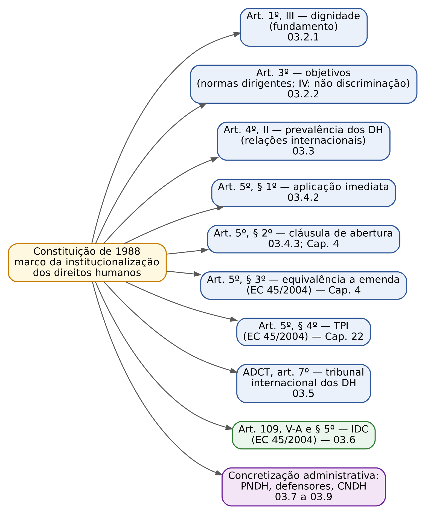
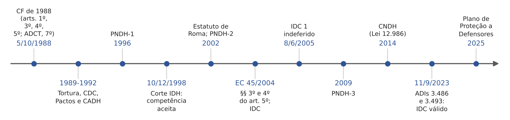
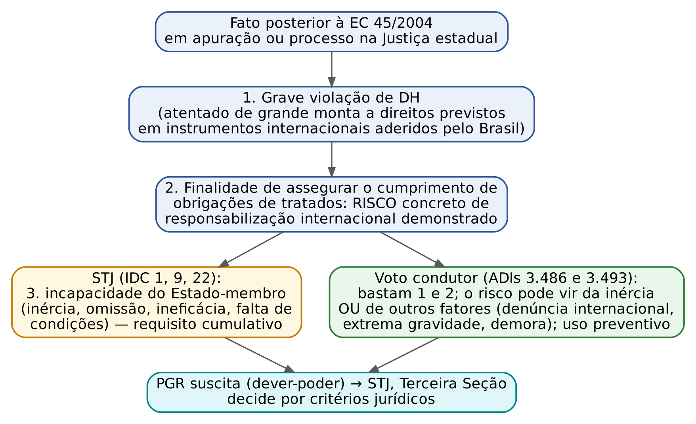
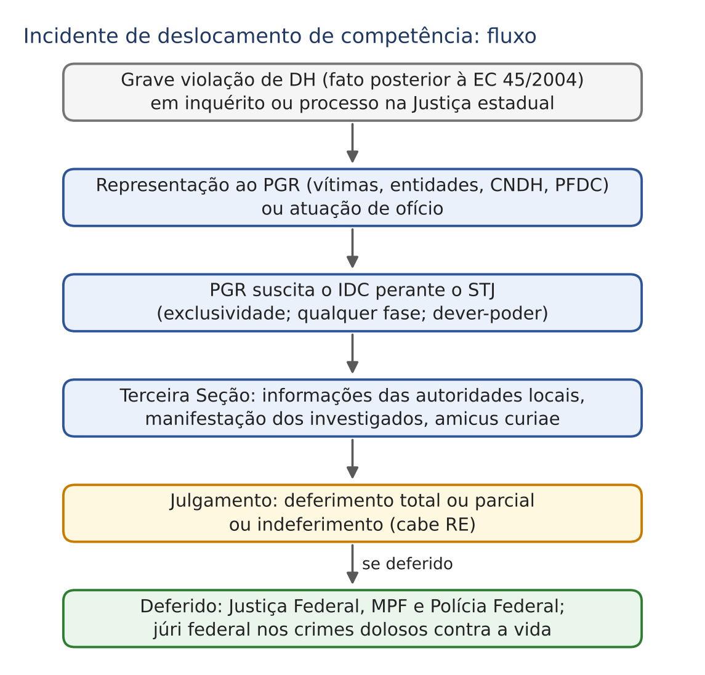
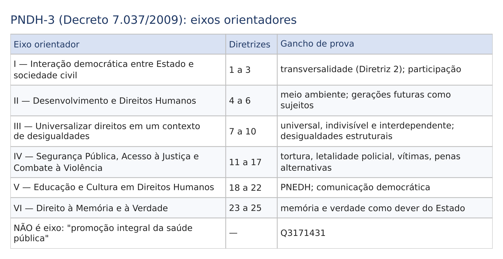
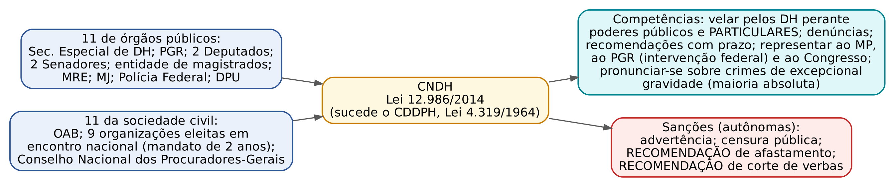

# CAPÍTULO 03 — OS DIREITOS HUMANOS NA CONSTITUIÇÃO DE 1988

:::INCIDENCIA
TRF5 p. 2; TJRS p. 5, 6; TJSC p. 5, 6. Nível A.
Lote: 13 questões (FGV 11, FCC 2), com correlatas de outros capítulos.
Mais cobrado: IDC (legitimidade do PGR, STJ, qualquer fase, requisitos e o que o STF decidiu nas ADIs 3.486 e 3.493); eixos e natureza do PNDH-3; cláusula de abertura e dignidade como marcos da CF/1988.
:::

| Subtema | FGV | FCC | Padrão de cobrança |
|---|---|---|---|
| IDC (art. 109, V-A e § 5º) | 3 | 0 | letra do § 5º; teses das ADIs 3.486 e 3.493 (crivo jurídico, autoaplicabilidade, "dever-poder", fatos anteriores à EC 45, participação do investigado) |
| PNDH (1996, 2002, 2009) e educação em DH | 5 | 0 | PNDH-3 como terceira versão, política de Estado e transversalidade; eixo inexistente ("saúde pública"); PNEDH e abordagem transversal |
| CF/1988 como marco e cláusula de abertura | 1 | 0 | dignidade, fundamentalidade dos direitos sociais, cláusula pétrea dos direitos individuais, abertura ao DIDH |
| Memória, verdade e reparação | 1 | 1 | Lei 9.140/1995 (Comissão Especial: localização de corpos; suicídio incluído; piso de R$ 100.000,00 (cem mil reais)); finalidades da reparação histórica |
| Defensores de direitos humanos | 0 | 1 | proteção coletiva e articulação interinstitucional (Decretos 9.937/2019 e 12.710/2025) |
| Conselhos de direitos e pessoa idosa | 2 | 0 | conselho permanente, paritário e deliberativo (Lei 8.842/1994); art. 230 da CF |

## 03.1 A Constituição de 1988 como marco da institucionalização dos direitos humanos

### 03.1.1 A leitura de Piovesan e o que a FGV extrai dela

A fórmula que a banca reproduz é de Flávia Piovesan (*Direitos Humanos e o Direito Constitucional Internacional*): a Constituição de 1988 é o marco jurídico da transição democrática e da institucionalização dos direitos humanos no Brasil. A tese tem quatro apoios textuais, todos cobrados:

- Topografia: os direitos e garantias fundamentais (Título II) vêm ANTES da organização do Estado (Título III), inversão em relação às Cartas anteriores que exprime a primazia da pessoa (Apostila de Direito Constitucional, Cap. 7, 07.2).
- Valor-fonte: a dignidade da pessoa humana como fundamento da República (art. 1º, III), lida como núcleo informador de todo o sistema (03.2).
- Ampliação e reforço: o catálogo incorpora direitos sociais como fundamentais (Título II, Capítulo II) e os direitos e garantias individuais passam a ser cláusula pétrea (art. 60, § 4º, IV), novidade em relação a 1967/1969.
- Abertura internacional: prevalência dos direitos humanos nas relações internacionais (art. 4º, II), cláusula de abertura (art. 5º, § 2º) e, depois da EC 45/2004, rito de equivalência a emenda (§ 3º), submissão ao TPI (§ 4º) e federalização das graves violações (art. 109, V-A e § 5º). Somem-se a aplicabilidade imediata (§ 1º) e o compromisso do ADCT com um tribunal internacional de direitos humanos (art. 7º).

Na síntese de Piovesan, a CF/1988 inaugura um "Direito Constitucional Internacional": a Constituição não só recebe o DIDH, como se reconstrói a partir dele. A consequência prática foi a onda de ratificações que se seguiu a 1988 e que encerrou o isolamento do período autoritário (linha do tempo abaixo; quadro completo dos decretos em 04.10).

:::QUESTAO FGV 2024 — ENAM (2024.2) (Q3058642)
Pediu os elementos com que a CF/1988, "marco jurídico da transição democrática e da institucionalização dos Direitos Humanos", confere ênfase aos DH. Gabarito: C (dignidade humana, regime de fundamentalidade dos direitos sociais, cláusula pétrea dos direitos e garantias individuais e cláusula de abertura que permite a interação com o DIDH, expandindo o bloco de constitucionalidade).
Armadilhas, uma por alternativa: "soberania popular" ou "soberania do Estado" no lugar da dignidade (A e E: são fundamentos ou princípios, mas não o vetor da ênfase); "relativismo cultural" (B e D: a CF adota a universalidade, art. 4º, II, e art. 5º, § 2º); fundamentalidade "exclusivamente" dos direitos políticos ou de solidariedade (A, B e D); cláusula pétrea dos direitos "coletivos" (o texto do art. 60, § 4º, IV, fala em direitos e garantias INDIVIDUAIS); negação da cláusula de abertura (D e E). A expressão "expandindo o bloco de constitucionalidade" está em sentido material; para o sentido restrito adotado pelo STF como parâmetro de controle, ver 04.6.
:::

### 03.1.2 Cláusulas pétreas e direitos humanos

O art. 60, § 4º, IV, protege "os direitos e garantias individuais". Três pontos interessam ao DIDH:

- Extensão: prevalece no STF e na doutrina majoritária (Sarlet) leitura ampliativa, que alcança direitos individuais fora do art. 5º (o STF já tratou a anterioridade tributária, art. 150, III, b, como garantia individual protegida contra emenda, no julgamento do IPMF em 1993) e o núcleo dos direitos sociais. A literalidade, porém, é a pegadinha da FGV (Q3058642: "coletivos" está errado).
- Tratados do § 3º: por serem equivalentes a emenda, os direitos que veiculam integram o bloco protegido contra reforma tendente a aboli-los, e a denúncia desses tratados é tema controvertido (ver 04.9.3; Apostila de Direito Constitucional, Cap. 11, 11.3.5).
- Federalização: a EC 45/2004 retirou parcela de competência da Justiça estadual; o STF afirmou que isso não ofende cláusula pétrea nem o pacto federativo (03.6.4).

## 03.2 Dignidade da pessoa humana e objetivos fundamentais (arts. 1º, III, e 3º)

### 03.2.1 Dignidade como fundamento

:::LEI CF, ART. 1º, III
Art. 1º A República Federativa do Brasil, formada pela união indissolúvel dos Estados e Municípios e do Distrito Federal, constitui-se em Estado Democrático de Direito e tem como fundamentos: (...) III - a dignidade da pessoa humana;
:::

A dignidade não figura no art. 1º como direito, mas como FUNDAMENTO do Estado: o Estado existe em função da pessoa, e não o contrário. O desenvolvimento dogmático (conceito, funções, dimensão negativa e positiva, Kant e a fórmula do objeto) está na Apostila de Direito Constitucional, Cap. 6, 06.3.3, e na Apostila de Formação Humanística; a dignidade no plano internacional (DUDH, art. 1º; preâmbulos dos Pactos; CADH, art. 11; "vida digna" na Corte IDH) está em 02.5. Para este capítulo, três usos práticos:

- Ponte entre ordens: a dignidade é o valor comum ao DIDH e à CF; é ela que justifica a leitura dos tratados como fonte de direitos fundamentais materiais (§ 2º) e a regra de prevalência da norma mais protetiva (*pro persona*, 02.3.2).
- Parâmetro de interpretação: o STF a invoca para densificar direitos não expressos e para afastar soluções que reduzam a pessoa a meio (ex.: estado de coisas inconstitucional do sistema prisional, Cap. 13).
- Limite ao legislador e ao intérprete: cláusulas abertas como "grave violação de direitos humanos" (art. 109, § 5º) se interpretam à luz dela e dos tratados.

### 03.2.2 Objetivos fundamentais

:::LEI CF, ART. 3º
Art. 3º Constituem objetivos fundamentais da República Federativa do Brasil: I - construir uma sociedade livre, justa e solidária; II - garantir o desenvolvimento nacional; III - erradicar a pobreza e a marginalização e reduzir as desigualdades sociais e regionais; IV - promover o bem de todos, sem preconceitos de origem, raça, sexo, cor, idade e quaisquer outras formas de discriminação.
:::

Leitura de DIDH do art. 3º:

- Os verbos (construir, garantir, erradicar, reduzir, promover) indicam normas-programa de caráter DIRIGENTE: vinculam os Poderes a agir, o que dá base constitucional aos programas e planos de direitos humanos (PNDH, 03.7) e às ações afirmativas (Apostila de Formação Humanística, Cap. 41; Cap. 18 desta apostila).
- O inciso IV é cláusula ABERTA de não discriminação ("quaisquer outras formas"), simétrica às cláusulas internacionais ("qualquer outra condição social": PIDCP, arts. 2.1 e 26; CADH, art. 1.1). Foi a partir dela, combinada com a dignidade, que o STF reconheceu a união homoafetiva como entidade familiar (2011) e afirmou a proteção contra discriminação por orientação sexual e identidade de gênero (Caps. 13 e 17).
- O inciso III corresponde ao núcleo dos DESC (PIDESC, art. 11) e dialoga com a Agenda 2030 (ODS 1 e 10; Apostila de Formação Humanística, Cap. 27).

:::PEGADINHA
Trocas clássicas entre arts. 1º, 3º e 4º: dignidade, cidadania, soberania, pluralismo político e valores sociais do trabalho e da livre iniciativa são FUNDAMENTOS (art. 1º); construir, garantir, erradicar e promover são OBJETIVOS (art. 3º); prevalência dos direitos humanos, autodeterminação, não intervenção e asilo político são PRINCÍPIOS DAS RELAÇÕES INTERNACIONAIS (art. 4º). "Prevalência dos direitos humanos" como fundamento da República está ERRADO. Técnica de prova (substantivo x verbo x princípio externo) na Apostila de Direito Constitucional, Cap. 6, 06.1.1.
:::

## 03.3 Prevalência dos direitos humanos nas relações internacionais (art. 4º, II)

### 03.3.1 Texto e lugar no sistema

:::LEI CF, ART. 4º, CAPUT E INCISOS II, VIII E X
Art. 4º A República Federativa do Brasil rege-se nas suas relações internacionais pelos seguintes princípios: (...) II - prevalência dos direitos humanos; (...) VIII - repúdio ao terrorismo e ao racismo; (...) X - concessão de asilo político.
:::

O quadro dos dez incisos e do parágrafo único está na Apostila de Direito Constitucional, Cap. 6, 06.6. Aqui interessa o conteúdo jurídico do inciso II, que a doutrina de DIDH desdobra em três efeitos:

| Efeito | Conteúdo | Manifestações normativas |
|---|---|---|
| Abertura | a ordem interna se abre ao sistema internacional de proteção: o Brasil deve aderir aos tratados e aceitar a fiscalização internacional | ratificações pós-1988; aceitação da competência da Corte IDH (1998); Protocolos facultativos com comunicações individuais (Cap. 8) |
| Relativização da soberania | o modo como o Estado trata as pessoas sob sua jurisdição deixa de ser assunto de domínio reservado; a soberania não pode ser oposta à fiscalização internacional | Declaração de Viena (1993), par. 4 (ver 01.6.2); art. 5º, § 4º (TPI) |
| Vetor da política externa e da interpretação | condiciona a atuação externa (votos em organismos, cooperação, extradição, asilo, refúgio) e orienta a interpretação dos tratados e das leis internas | Lei 9.474/1997 e Lei 13.445/2017 (Cap. 21); vedações à extradição com risco de tortura ou de pena proibida (Apostila de Direito Constitucional, Cap. 13) |

Piovesan sustenta que o inciso II rompe com a concepção tradicional de soberania estatal absoluta e impõe ao Brasil o engajamento no esforço de integração das normas internacionais de proteção à ordem interna; a prevalência dos direitos humanos, nessa leitura, também se projeta sobre a política interna, pois seria incoerente defender lá fora o que não se cumpre aqui dentro.

### 03.3.2 Tensões com outros princípios do art. 4º

- Não intervenção (IV) e autodeterminação (III) x prevalência (II): a doutrina resolve pela concordância prática; a crítica internacional a violações, as sanções multilaterais e a jurisdição de órgãos de tratados NÃO são intervenção vedada, porque o tema deixou de ser de domínio reservado. Intervenção armada continua regida pela Carta da ONU (Cap. 7).
- Asilo político (X) e repúdio ao terrorismo (VIII): o asilo é ato discricionário de soberania, mas o repúdio ao terrorismo e a prevalência dos DH limitam sua concessão a autores de crimes graves; a distinção asilo x refúgio está no Cap. 21.
- Cooperação entre os povos (IX) e prevalência (II): fundamentam a cooperação jurídica penal, mas também as barreiras de direitos humanos à extradição e à entrega (Cap. 22, entrega ao TPI x extradição).

:::DICA
Em discursiva sobre "relação entre o DIDH e o direito brasileiro" (TJRS e TJSC, ponto 5), estruture assim: (1) art. 4º, II, como princípio de abertura e relativização da soberania; (2) art. 5º, § 2º, como cláusula de abertura material do catálogo; (3) hierarquia (supralegal x equivalente a emenda, Cap. 4); (4) controle de convencionalidade como técnica de aplicação (Cap. 5); (5) cumprimento das decisões internacionais (Cap. 6); (6) IDC como mecanismo interno de prevenção da responsabilidade internacional (03.6). Fechar com a dignidade como valor comum às duas ordens.
:::

## 03.4 O art. 5º, §§ 1º a 4º: aplicabilidade, abertura, equivalência e TPI

### 03.4.1 Os quatro parágrafos em um quadro

:::LEI CF, ART. 5º, §§ 1º A 4º
§ 1º As normas definidoras dos direitos e garantias fundamentais têm aplicação imediata.
§ 2º Os direitos e garantias expressos nesta Constituição não excluem outros decorrentes do regime e dos princípios por ela adotados, ou dos tratados internacionais em que a República Federativa do Brasil seja parte.
§ 3º Os tratados e convenções internacionais sobre direitos humanos que forem aprovados, em cada Casa do Congresso Nacional, em dois turnos, por três quintos dos votos dos respectivos membros, serão equivalentes às emendas constitucionais.
§ 4º O Brasil se submete à jurisdição de Tribunal Penal Internacional a cuja criação tenha manifestado adesão.
:::

| Parágrafo | Origem | Função | Onde está desenvolvido |
|---|---|---|---|
| § 1º aplicação imediata | texto originário | eficácia e vinculação dos três Poderes; dever de otimização | 03.4.2 |
| § 2º cláusula de abertura | texto originário | fundamentalidade material; direitos fora do catálogo; porta de entrada dos tratados | 03.4.3; Apostila de Direito Constitucional, Cap. 7, 07.1.3 |
| § 3º equivalência a emenda | EC 45/2004 | rito qualificado e facultativo; três tratados aprovados (CDPD e Protocolo, Marraqueche, Convenção Interamericana contra o Racismo) | 04.5 |
| § 4º TPI | EC 45/2004 | submissão à jurisdição do TPI; compatibilização com entrega e prisão perpétua | Cap. 22 |

### 03.4.2 Aplicação imediata (§ 1º)

O § 1º não significa que todo direito fundamental produza, sem lei, todos os efeitos possíveis; significa, na leitura de Ingo Sarlet, que as normas de direitos fundamentais são dotadas de um mandado de otimização: os órgãos estatais devem reconhecer-lhes a maior eficácia possível, e a falta de lei não pode servir de pretexto para negar o direito. Consequências cobradas:

- Alcance: aplica-se a TODOS os direitos e garantias fundamentais, inclusive sociais e os de fonte internacional incorporados (a expressão "normas definidoras dos direitos e garantias fundamentais" não se limita ao art. 5º).
- Vinculação do Judiciário: o juiz aplica diretamente o direito e dispõe de instrumentos para suprir omissões (mandado de injunção, ADO), o que dialoga com o controle de convencionalidade de ofício (Cap. 5) e com o exemplo da audiência de custódia, implantada antes da disciplina legal com base na CADH e no PIDCP (05.7.2).
- Autoaplicabilidade de mecanismos de proteção: nas ADIs 3.486 e 3.493 (03.6.4), o STF invocou a aplicabilidade imediata para afirmar que o IDC NÃO depende de lei regulamentadora, porque o próprio § 5º do art. 109 contém todos os elementos para incidir.
- Tese de Piovesan sobre incorporação automática dos tratados de DH com base no § 1º: doutrina, não adotada pelo STF (04.3.4).

### 03.4.3 Cláusula de abertura (§ 2º)

O § 2º consagra o conceito materialmente aberto de direitos fundamentais: o catálogo expresso não é exaustivo. Para o DIDH, a parte final ("tratados internacionais em que a República Federativa do Brasil seja parte") é a ponte que faz dos direitos previstos em tratados direitos fundamentais em sentido material. As teses de hierarquia que dela se extraíram (constitucional, para Piovesan e Cançado Trindade; supralegal, no RE 466.343) e o bloco de constitucionalidade estão em 04.4 e 04.6; a classificação dos direitos fora do catálogo, em Apostila de Direito Constitucional, Cap. 7, 07.1.3. O essencial para a prova:

- "Seja parte": exige tratado vinculante para o Brasil e incorporado; tratado não ratificado ou sem decreto de promulgação não é fonte interna de direitos (04.3.4; Q3058639, alternativa E).
- A abertura é para MAIS direitos: o § 2º só opera para ampliar a proteção, nunca para restringir direitos expressos (critério *pro persona*, 02.3.2; CADH, art. 29, b).
- A abertura não se confunde com hierarquia: o § 2º diz que os tratados são FONTE de direitos fundamentais; não diz, sozinho, que têm status constitucional (é o erro das alternativas que atribuem ao STF a tese da constitucionalidade pelo § 2º; ver 04.4).

:::PEGADINHA
Em questões sobre os §§ 2º e 3º, a FGV mistura quatro afirmações falsas: (1) tratados de DH ratificados integram "automaticamente" o bloco de constitucionalidade, qualquer que seja o rito; (2) o § 2º "limita-se" à incorporação formal, sem repercussão hierárquica ou interpretativa; (3) direitos fundamentais "não admitem ampliação" por tratados; (4) só normas expressamente incorporadas ao texto constitucional servem de parâmetro. Todas caíram na prova do TJ-PR (FGV 2026, Q3898989, gabarito D: rito do § 3º = emenda; demais = supralegais), comentada em 04.6. A versão do quórum ("maioria dos votos" no lugar de três quintos) apareceu na prova da PC-MG (Q3171432, alternativa C, comentada em 03.6.6).
:::

### 03.4.4 TPI (§ 4º)

O § 4º constitucionaliza a submissão do Brasil a TPI "a cuja criação tenha manifestado adesão": a referência é o Estatuto de Roma (Decreto 4.388/2002). Nota de prova: o § 4º é posterior à ratificação do Estatuto (2002) e veio com a EC 45/2004, para afastar dúvidas sobre a compatibilidade da entrega de nacionais e da prisão perpétua com o art. 5º, LI e XLVII, b. Desenvolvimento no Cap. 22.

## 03.5 Art. 7º do ADCT: o compromisso com um tribunal internacional de direitos humanos

:::LEI ADCT, ART. 7º
Art. 7º O Brasil propugnará pela formação de um tribunal internacional dos direitos humanos.
:::

Pontos de prova:

- Natureza: norma de política externa de conteúdo programático, com a mesma hierarquia das normas da parte permanente (o ADCT é Constituição). "Propugnar" é lutar em favor, defender: o dispositivo VINCULA a atuação diplomática do Estado brasileiro (em conjunto com o art. 4º, II), mas não submete, por si, o Brasil a jurisdição alguma.
- Cumprimento: lê-se como compromisso de apoio à jurisdicionalização da proteção internacional dos direitos humanos. A Corte IDH já existia (instalada em 1979), e o Brasil só reconheceu sua competência contenciosa em 10/12/1998 (Decreto 4.463/2002; Cap. 11); o Estatuto de Roma criou um tribunal PENAL internacional, cuja jurisdição foi constitucionalizada pelo § 4º do art. 5º. Não existe tribunal mundial de direitos humanos; a proposta de uma "Corte Mundial de Direitos Humanos" segue no plano do debate doutrinário.
- Diferenças de redação que a banca explora:

| Dispositivo | Verbo | Objeto | Efeito |
|---|---|---|---|
| ADCT, art. 7º | "propugnará" | formação de tribunal internacional DOS DIREITOS HUMANOS | diretriz de política externa |
| CF, art. 5º, § 4º | "se submete" | jurisdição de Tribunal PENAL Internacional a cuja criação tenha manifestado adesão | submissão jurisdicional |
| Decreto 4.463/2002 | "reconhece como obrigatória, de pleno direito e por prazo indeterminado" | competência contenciosa da Corte IDH (fatos posteriores a 10/12/1998) | submissão jurisdicional, sob reciprocidade |

:::ATENCAO
O ADCT não diz que o Brasil "se submete" a tribunal internacional de direitos humanos; quem "se submete" é o § 4º do art. 5º, e ao TPI. A submissão à Corte IDH decorre de declaração unilateral do Estado, nos termos do art. 62 da CADH, aprovada pelo Decreto Legislativo 89/1998 e promulgada pelo Decreto 4.463/2002 (dados conferidos em 04.10).
:::

:::PRATIQUE Exercícios elaborados para esta apostila (não são questões de banca)
1. Certo ou errado: o art. 7º do ADCT impõe ao Brasil a submissão à jurisdição da Corte Interamericana desde a promulgação da Constituição. Resolução: ERRADO. O art. 7º é diretriz ("propugnará pela formação"); a competência contenciosa da Corte IDH só foi aceita em 10/12/1998, para fatos posteriores, por declaração do art. 62 da CADH.
2. Certo ou errado: a prevalência dos direitos humanos é fundamento da República. Resolução: ERRADO. É princípio das relações internacionais (art. 4º, II); fundamento é a dignidade (art. 1º, III).
3. Certo ou errado: o § 2º do art. 5º permite aplicar, como direito fundamental, direito previsto em tratado assinado, mas ainda não aprovado pelo Congresso. Resolução: ERRADO. Exige tratado "em que a República Federativa do Brasil seja parte" e incorporado (04.3).
:::

## 03.6 Federalização das graves violações de direitos humanos: o incidente de deslocamento de competência (IDC)

A Apostila de Direito Constitucional (Cap. 11, 11.7, e Cap. 30, 30.5.5) e a de Processo Penal (Cap. 10, 10.2.6) trazem o esquema básico. Aqui o IDC é tratado como mecanismo de implementação interna das obrigações internacionais, com o que a FGV passou a cobrar depois de 2023: os fundamentos e as teses do STF nas ADIs 3.486 e 3.493 e a casuística do STJ.

### 03.6.1 Fundamento: quem responde lá fora deve poder agir aqui dentro

No Direito Internacional, o Estado responde como unidade por atos de qualquer de seus órgãos ou entes, inclusive estaduais e municipais, e não pode invocar sua estrutura federal para justificar o descumprimento (CVDT, art. 27; CADH, art. 28, cláusula federal; ver Cap. 9). No Brasil, quem representa o Estado perante a CIDH e a Corte IDH, apresenta a defesa e paga as indenizações é a União (Cap. 6); a persecução de homicídios, tortura e violência policial, porém, é em regra da Justiça estadual. O IDC resolve essa assimetria: permite à União, por seu Ministério Público e sua Justiça, assumir a persecução de caso concreto quando houver grave violação e risco de descumprimento das obrigações internacionais.

Antecedentes: a federalização constava das propostas do PNDH-1 (1996) e da PEC 368/1996, que atribuía de plano à Justiça Federal os crimes contra os direitos humanos; o constituinte reformador preferiu a fórmula do incidente, caso a caso, aprovada na Reforma do Judiciário (EC 45/2004). Pesaram as primeiras condenações e denúncias internacionais por falta de investigação de violações praticadas por agentes estaduais.

:::LEI CF, ART. 109, V-A E § 5º (EC 45/2004)
Art. 109. Aos juízes federais compete processar e julgar: (...) V-A as causas relativas a direitos humanos a que se refere o § 5º deste artigo;
§ 5º Nas hipóteses de grave violação de direitos humanos, o Procurador-Geral da República, com a finalidade de assegurar o cumprimento de obrigações decorrentes de tratados internacionais de direitos humanos dos quais o Brasil seja parte, poderá suscitar, perante o Superior Tribunal de Justiça, em qualquer fase do inquérito ou processo, incidente de deslocamento de competência para a Justiça Federal.
:::

### 03.6.2 Elementos do instituto

| Elemento | Regra | Observação de prova |
|---|---|---|
| Legitimidade ativa | EXCLUSIVA do Procurador-Geral da República | não suscitam vítima, familiares, Defensoria, OAB, PGJ, juiz ou o CNDH (o STJ rejeitou IDC proposto por pessoa física, IDC 11); o CNDH pode deliberar que um crime é violação de excepcional gravidade e representar ao PGR (Lei 12.986/2014, art. 4º, XIV e XVI; 03.9) |
| Natureza da atuação do PGR | "dever-poder", não faculdade discricionária | o "poderá" do texto não autoriza escolha por conveniência; presentes os requisitos, deve suscitar (ADI 3.486, ementa, item 13) |
| Órgão julgador | STJ, Terceira Seção | nunca o STF; nunca "qualquer Tribunal Superior" |
| Momento | "em qualquer fase do inquérito ou processo" | inclusive na fase pré-processual; não há preclusão pelo recebimento da denúncia ou pela sentença |
| Objeto | "causas relativas a direitos humanos" | cíveis e criminais, inquéritos policiais e civis (voto do relator nas ADIs 3.486 e 3.493); a prática concentra-se em homicídios, chacinas e tortura |
| Parâmetro | obrigações decorrentes de TRATADOS de que o Brasil seja parte | a "grave violação" se mede pelos direitos previstos em instrumentos internacionais, inclusive normas consuetudinárias (ementa, item 14) |
| Limite temporal | fatos posteriores à EC 45/2004 | investigações e processos sobre delitos anteriores à emenda não podem ser deslocados (ementa, item 10) |
| Efeito | competência da Justiça Federal (art. 109, V-A), com atribuição do MPF e da Polícia Federal | o deslocamento pode ser PARCIAL (IDC 3: três de nove casos); júri federal nos crimes dolosos contra a vida |

:::PEGADINHA
O IDC não depende de o Brasil já ter sido denunciado à CIDH ou condenado pela Corte IDH: basta o RISCO de responsabilização, e o STF admite uso preventivo. Também a recíproca: o IDC NÃO é requisito nem obstáculo para a petição à CIDH, cujos requisitos são os do art. 46 da CADH (esgotamento, seis meses, ausência de litispendência internacional). Foi a armadilha da alternativa B da Q3453313 (FGV 2025, TJ-TO, comentada em 10).
:::

### 03.6.3 Requisitos: a construção do STJ e a correção do STF

Desde o IDC 1 (2005), o STJ exige três requisitos CUMULATIVOS, reafirmados em julgados recentes (IDC 9, 2022; IDC 22, 2023):

1. grave violação de direitos humanos;
2. necessidade de assegurar o cumprimento, pelo Brasil, de obrigações decorrentes de tratados internacionais, com demonstração do risco de responsabilização internacional;
3. incapacidade do Estado-membro (inércia, omissão, ineficácia, negligência, falta de vontade política ou de condições pessoais ou materiais) de levar a cabo a persecução, com observância da proporcionalidade, para não banalizar a medida nem ferir o juiz natural.

Nas ADIs 3.486 e 3.493 (2023), o relator, Ministro Dias Toffoli, rejeitou expressamente o terceiro requisito como pressuposto autônomo: o texto constitucional exige apenas (1) a grave violação e (2) a finalidade de assegurar o cumprimento das obrigações internacionais. O risco de descumprimento continua precisando ser demonstrado, mas pode decorrer de inércia estadual OU de outros fatores: o fato de o Brasil já ter sido denunciado ou estar em vias de sê-lo, a extrema gravidade da violação, a lentidão da apuração mesmo com empenho das autoridades locais. O IDC deixa de se apoiar numa suposta debilidade da Justiça estadual e passa a se fundar na posição da União como garante das obrigações internacionais.

| Ponto | STJ (IDC 1 em diante) | STF (voto condutor nas ADIs 3.486 e 3.493) |
|---|---|---|
| Requisitos | três, cumulativos | dois, extraídos do texto |
| Incapacidade estadual | requisito autônomo e indispensável | um dos modos (o mais frequente) de demonstrar o risco, mas não pressuposto |
| Fundamento do instituto | ineficiência local e subsidiariedade | responsabilidade internacional da União; garante interno e externo |
| Uso preventivo | admitido, desde que demonstrada a incapacidade | admitido para EVITAR o descumprimento, sem aguardar a demanda internacional |
| Natureza | excepcional e subsidiária | excepcional e subsidiária (ementa, item 5) |

:::ATENCAO
A dispensa do terceiro requisito é fundamento do VOTO DO RELATOR; segundo André de Carvalho Ramos (ConJur, 18/9/2023), a Ministra Rosa Weber divergiu nesse ponto, e a ementa não o enuncia como tese: ela mantém a excepcionalidade e a subsidiariedade e alude à ineficiência do aparato estatal como problema enfrentado pelo instituto (item 5). O IDC 22 (Rondônia, 23/8/2023), julgado semanas antes da conclusão das ADIs, ainda aplicou os três requisitos. Até 13/11/2026 não foi localizado julgado do STJ que tenha declaradamente abandonado o terceiro requisito. Na prova objetiva: se a pergunta for "segundo o STJ", três requisitos cumulativos; se for "segundo o STF", dois requisitos constitucionais, com risco de descumprimento a ser demonstrado. Em discursiva, exponha as duas posições.
:::

### 03.6.4 As ADIs 3.486 e 3.493: constitucionalidade do IDC

:::JURIS STF, ADI 3.486 e ADI 3.493, Plenário, sessão virtual de 1/9/2023 a 11/9/2023 (Informativo 1107)
Ações da AMB e da ANAMAGES contra o art. 1º da EC 45/2004, na parte que incluiu o inciso V-A e o § 5º no art. 109. Pedidos julgados IMPROCEDENTES, por unanimidade; relator, Ministro Dias Toffoli. Teses da ementa, na ordem em que a banca as cobra:
- O constituinte reformador escolheu o INCIDENTE de deslocamento, e não uma competência geral e aberta da Justiça Federal para causas de direitos humanos (item 4).
- O IDC é medida excepcional e subsidiária; a União é garante, interna e externamente, dos compromissos internacionais e pode agir internamente em cumprimento ao art. 28 da CADH (itens 5 e 6).
- Não há ofensa a cláusula pétrea, ao pacto federativo nem à autonomia dos órgãos judiciários locais: o Judiciário é uno e nacional, e a competência estadual é residual (itens 7 a 9).
- Não há ofensa ao juiz natural: a regra é abstrata e anterior ao fato; o elemento variável é o suporte fático ("grave violação"). Por isso, NÃO podem ser deslocados investigações e processos sobre delitos cometidos antes da EC 45/2004 (itens 10 a 12).
- O PGR tem o "dever-poder" de suscitar o incidente quando preenchidos os requisitos; não há discricionariedade, e sua decisão se submete ao crivo do colegiado do STJ, que decide por critérios JURÍDICOS, e não políticos (item 13).
- "Grave violação de direitos humanos" é todo atentado de grande monta aos direitos humanos previstos em instrumentos normativos internacionais de proteção (convencionais ou consuetudinários) a cuja aplicabilidade o Brasil tenha aderido; não há rol taxativo, mas o conceito é identificável no caso concreto (item 14).
- A norma é AUTOAPLICÁVEL: dispensa lei regulamentadora (item 15; CF, art. 5º, § 1º).
- Investigados e acusados participam do incidente e podem expor suas razões; as garantias processuais valem igualmente na Justiça estadual e na federal; o júri é preservado (júri federal) (item 16).
:::

:::DOUTRINA André de Carvalho Ramos, comentário às ADIs 3.486 e 3.493 (ConJur, 2023)
O Estado federal é uno para o Direito Internacional; antes da EC 45/2004 não havia como agir ANTES da responsabilização internacional, o que era incoerente. Carvalho Ramos critica a "Doutrina Stang" do STJ (exigência de provar inércia ou desídia estadual), que não consta do texto constitucional e, pela demora, gera casos de prova difícil (*cold cases*); propõe que o PGR apresente prognose razoável do risco, sem aguardar anos. O foco é o cumprimento dos deveres de investigar, processar e punir com a devida diligência (CADH, arts. 1.1, 8 e 25). As críticas tradicionais (juiz natural, pacto federativo, vagueza de "grave violação", concentração do poder de iniciativa no PGR) foram todas enfrentadas e rejeitadas nas ADIs 3.486 e 3.493.
:::

### 03.6.5 Procedimento

:::PROCESSO
1. Fato posterior à EC 45/2004, em apuração ou julgamento na Justiça estadual, que configure, em tese, grave violação de direitos humanos previstos em tratado.
2. Provocação do PGR (de ofício ou por representação de vítimas, entidades, CNDH, PFDC, comissões parlamentares); a decisão de suscitar é vinculada aos requisitos ("dever-poder").
3. Petição ao STJ, distribuída à Terceira Seção; requisição de informações às autoridades estaduais (Polícia Civil, MP estadual, juízo), manifestação dos investigados ou acusados; admissão de *amicus curiae* (admitida desde o IDC 2, sem previsão legal).
4. Julgamento colegiado por critérios jurídicos: deferimento total ou parcial (o STJ delimita quais inquéritos ou ações se deslocam) ou indeferimento.
5. Deferido: os autos vão à Justiça Federal da seção judiciária competente; a investigação passa à Polícia Federal e ao MPF; crimes dolosos contra a vida seguem ao júri federal. Contra o acórdão do STJ cabe recurso extraordinário, se houver questão constitucional.
:::

### 03.6.6 Casos julgados pelo STJ

| IDC | Fatos | Resultado | Fundamento decisivo |
|---|---|---|---|
| 1 (PA) | homicídio da missionária Dorothy Stang (Anapu, 2005) | INDEFERIDO, unânime (relator Ministro Arnaldo Esteves Lima, j. 8/6/2005) | autoridades estaduais empenhadas; deslocar atrasaria o processo; fixou os três requisitos |
| 2 (PB/PE) | homicídio do advogado e ex-vereador Manoel Mattos (2009), que denunciava grupos de extermínio com participação de policiais | DEFERIDO (relatora Ministra Laurita Vaz, j. 27/10/2010) | grupos de extermínio, ameaças, incapacidade local; primeiro IDC deferido; admitiu *amicus curiae* |
| 3 (GO) | nove investigações sobre crimes atribuídos a policiais militares de unidades de elite | DEFERIDO EM PARTE (relator Ministro Jorge Mussi): três de nove casos | exigência de demonstração inequívoca da incapacidade local em cada caso |
| 5 (PE) | homicídio do promotor de justiça Thiago Faria Soares, vítima de grupos de extermínio no "Triângulo da Pistolagem" | DEFERIDO (relator Ministro Rogerio Schietti Cruz, 2014) | situação excepcionalíssima; conflito entre instituições locais comprometia a apuração |
| 9 (SP) | Chacina do Parque Bristol, no contexto dos "Crimes de Maio" de 2006 | DEFERIDO (relator Ministro João Otávio de Noronha, Terceira Seção, j. 10/8/2022, Informativo 744) | incapacidade dos agentes públicos na condução das investigações, mesmo após longo tempo |
| 10 (BA) | Chacina do Cabula (Salvador, 2015): 12 mortos em operação policial | INDEFERIDO, unânime (relator Ministro Reynaldo Soares da Fonseca, 2018) | ausência de deficiência de funcionamento ou comprometimento do Judiciário estadual |
| 14 (ES) | condutas de policiais militares na greve de 2017 (único oriundo da Justiça Militar) | INDEFERIDO, por maioria (relatora Ministra Maria Thereza de Assis Moura, 2018) | o IDC não é alternativa "meramente conveniente" de substituição de competência |
| 22 (RO) | homicídios e torturas em conflitos agrários contra integrantes de ligas camponesas (2009 a 2016) | DEFERIDO (relator Ministro Messod Azulay Neto, j. 23/8/2023, Informativo 790): seis inquéritos não solucionados | três requisitos presentes; risco de responsabilização demonstrado |
| 24 (RJ) | homicídios de Marielle Franco e Anderson Gomes (2018) | INDEFERIDO, unânime (relatora Ministra Laurita Vaz, j. 27/5/2020) | sem descaso ou falta de condições; deslocar causaria mais atraso |

Padrão: deferimentos em casos de grupos de extermínio com participação de agentes estatais, conflitos agrários e inércia prolongada; indeferimentos quando a apuração local avança, ainda que lenta, ou quando o pedido busca mera troca de competência. Pós-ADIs, o argumento "as autoridades estaduais estão empenhadas" deixa de bastar, sozinho, para indeferir (03.6.3).

:::QUESTAO FGV 2026 — TJ-BA — JUIZ SUBSTITUTO (Q4083806)
Três afirmativas "considerando a jurisprudência do STF sobre o IDC". Gabarito: C (somente III).
- I, ERRADA: o crivo do STJ é JURÍDICO, e não "político e jurídico" (ementa, item 13). A excepcionalidade da medida não a transforma em juízo de conveniência.
- II, ERRADA: não há necessidade de norma regulamentadora (item 15, com apoio no art. 5º, § 1º); muito menos cabe ao PGR "definir as regras aplicáveis".
- III, CERTA: o foco são os direitos humanos previstos em instrumentos normativos internacionais a cuja aplicabilidade o Brasil aderiu (item 14).
Armadilha: a combinação "D (I e III)" atrai quem lembra que o IDC é excepcional e imagina juízo político; o STF disse o contrário.
:::

:::QUESTAO FGV 2025 — TJ-SC — JUIZ SUBSTITUTO (Q3324319)
Pediu a assertiva correta sobre o deslocamento de competência à luz da CF, do STF e da CADH. Gabarito: C (grave violação = atentado de grande monta aos direitos previstos em normas internacionais de proteção, consuetudinárias ou convencionais, a cuja aplicabilidade o Brasil tenha aderido).
Resolução em passos, alternativa por alternativa, com o item da ementa:
1. A: três erros — o IDC NÃO é "competência geral e aberta" (item 4); não se exige "violação contínua"; e NÃO dispensa a participação dos investigados (item 16). Não é processo objetivo.
2. B: inverte o item 6 — a CADH (art. 28, cláusula federal) é justamente o fundamento da responsabilidade da União de agir internamente.
3. D: dois erros — o parâmetro são os direitos de fonte internacional, e não os "positivados na Constituição"; e o marco temporal é a EC 45/2004, não 5/10/1988 (item 10).
4. E: o PGR não tem "poder-faculdade", mas DEVER-PODER (item 13); a fixação de critérios jurídicos decorre dos requisitos constitucionais e do crivo do STJ, não de um juízo federativo.
:::

:::QUESTAO FGV 2025 — PC-MG — DELEGADO DE POLÍCIA SUBSTITUTO (Q3171432)
Mecanismos constitucionais de proteção. Gabarito: D (literalidade do art. 109, § 5º: PGR, grave violação, finalidade de cumprir obrigações de tratados, IDC para a Justiça Federal).
Erradas: A (direito líquido e certo não amparado por HC ou HD é objeto de MANDADO DE SEGURANÇA, não de ação civil pública); B (conhecimento de informações pessoais em bancos de dados públicos é HABEAS DATA, não mandado de injunção); C (o § 3º exige TRÊS QUINTOS, não "maioria dos votos"); E (liberdade de locomoção é HABEAS CORPUS, não mandado de segurança). Remédios constitucionais: Apostila de Direito Constitucional, Cap. 10.
No mesmo sentido, sobre a constitucionalidade do IDC: FGV 2024 — TJ-SC — Juiz Substituto (Q3049428), alternativa A, errada por afirmar que o deslocamento viola o pacto federativo e a autonomia dos órgãos judiciários locais (comentada em 04.4).
:::

:::EXEMPLO Caso resolvido
Liderança quilombola é assassinada em 2024, após anos de ameaças registradas e de medidas do programa de proteção a defensores. Passados dois anos, o inquérito estadual segue sem autoria definida, embora a Polícia Civil tenha realizado diligências regulares; a CIDH já recebeu petição dos familiares. Associação de direitos humanos pede ao juízo estadual que "remeta os autos à Justiça Federal".
Solução: (1) o juiz estadual não pode deslocar a competência nem a associação pode suscitar o IDC: a legitimidade é exclusiva do PGR, perante o STJ; a associação deve representar ao PGR (ou ao CNDH, que pode deliberar sobre a excepcional gravidade e representar). (2) Fato posterior à EC 45/2004: cabível. (3) Grave violação: homicídio de defensor de direitos humanos em contexto de ameaças, com dever estatal reforçado de proteção e de investigação diligente (CADH, arts. 4º, 8º e 25; Declaração da ONU sobre Defensores de 1998). (4) Risco de responsabilização: petição já apresentada à CIDH e demora na identificação de autoria. (5) Pelo STJ, seria preciso demonstrar a incapacidade estadual; na linha do voto condutor das ADIs, o risco concreto basta, ainda que as autoridades locais atuem, de modo que o "empenho" estadual não fecha a questão. (6) Deferido, o inquérito passa à Polícia Federal e ao MPF, e eventual júri será federal.
:::

:::PASSO Roteiro de discursiva sobre o IDC
1. Conceito e previsão (art. 109, V-A e § 5º; EC 45/2004).
2. Fundamento: responsabilidade internacional una do Estado, representada pela União; cláusula federal (art. 28 da CADH); art. 27 da CVDT.
3. Características: legitimidade exclusiva do PGR (dever-poder), STJ (Terceira Seção), qualquer fase, causas cíveis e criminais, fatos posteriores à EC 45, participação dos investigados, júri federal.
4. Requisitos: os três do STJ (IDC 1) x os dois do voto condutor das ADIs 3.486 e 3.493, com o risco de descumprimento a demonstrar; registrar a divergência da Ministra Rosa Weber nesse ponto.
5. Constitucionalidade: juiz natural, pacto federativo, cláusula pétrea, autoaplicabilidade.
6. Casuística: IDC 1 e 24 (indeferidos), IDC 2, 5, 9 e 22 (deferidos), IDC 3 (parcial).
7. Fecho: o IDC como instrumento de prevenção da responsabilidade internacional e de efetividade do dever de investigar (remissão aos casos brasileiros na Corte IDH, Cap. 12).
:::

## 03.7 Programa Nacional de Direitos Humanos (PNDH)

### 03.7.1 Origem internacional e as três versões

A ideia de um programa nacional vem da Conferência Mundial de Viena (1993): o Programa de Ação recomendou que cada Estado considerasse a elaboração de um plano nacional de ação identificando as medidas para melhorar a promoção e a proteção dos direitos humanos (Cap. 7). O Brasil respondeu com três programas, todos aprovados por DECRETO do Presidente da República:

| Versão | Ato | Ênfase | Observações |
|---|---|---|---|
| PNDH-1 | Decreto 1.904, de 13/5/1996 | direitos civis e políticos: combate à impunidade, à violência policial e à tortura; proteção a testemunhas | propôs, entre outras medidas, a federalização dos crimes contra os direitos humanos, que viria com a EC 45/2004 (03.6.1) |
| PNDH-2 | Decreto 4.229, de 13/5/2002 | incorporou os direitos econômicos, sociais e culturais, afirmando a indivisibilidade | revogado pelo Decreto 7.037/2009 (art. 7º) |
| PNDH-3 | Decreto 7.037, de 21/12/2009 | transversalidade: os direitos humanos como eixo de todas as políticas públicas; seis eixos orientadores e 25 diretrizes | resultou de processo participativo que culminou na 11ª Conferência Nacional de Direitos Humanos (2008); ações programáticas no Anexo |

Natureza jurídica: o PNDH-3 foi editado com base no art. 84, VI, a, da CF (decreto sobre organização e funcionamento da administração federal). É instrumento de POLÍTICA DE ESTADO, com diretrizes, objetivos estratégicos e ações programáticas que orientam planos, programas e ações governamentais; não cria direitos nem obrigações para particulares e não vincula os demais entes e Poderes, que são "convidados a aderir" (art. 5º). As metas, os prazos e os recursos são definidos em Planos de Ação de Direitos Humanos bianuais (art. 3º). O Comitê de Acompanhamento e Monitoramento previsto no art. 4º foi revogado pelo Decreto 10.087/2019. Em 13/11/2026 o PNDH-3 segue vigente, sem edição de um PNDH-4; a Comissão de Direitos Humanos do Senado aprovou, em 10/12/2025, relatório de avaliação que o considera implementado no núcleo, mas superado, e recomenda sua atualização.

### 03.7.2 Eixos orientadores do PNDH-3

:::LEI Decreto 7.037/2009, art. 2º (eixos orientadores)
I - Interação democrática entre Estado e sociedade civil; II - Desenvolvimento e Direitos Humanos; III - Universalizar direitos em um contexto de desigualdades; IV - Segurança Pública, Acesso à Justiça e Combate à Violência; V - Educação e Cultura em Direitos Humanos; VI - Direito à Memória e à Verdade.
:::

Diretrizes que a banca usa como gancho (todas do art. 2º):

- Eixo I, Diretriz 2: "Fortalecimento dos Direitos Humanos como instrumento transversal das políticas públicas e de interação democrática" (a base textual da TRANSVERSALIDADE).
- Eixo II, Diretriz 6: direitos ambientais como direitos humanos, "incluindo as gerações futuras como sujeitos de direitos".
- Eixo III, Diretriz 7: garantia dos direitos humanos "de forma universal, indivisível e interdependente"; Diretrizes 9 e 10: combate às desigualdades estruturais e igualdade na diversidade (raça, gênero, geração, orientação sexual, pessoa com deficiência).
- Eixo IV, Diretriz 14: combate à violência institucional, "com ênfase na erradicação da tortura e na redução da letalidade policial e carcerária"; Diretriz 16: penas alternativas.
- Eixo V, Diretriz 18: efetivação da política nacional de educação em direitos humanos (03.7.4).
- Eixo VI, Diretriz 23: memória e verdade como "Direito Humano da cidadania e dever do Estado" (03.7.3).

:::QUESTAO FGV 2024 — CÂMARA DE FORTALEZA — CONSULTOR LEGISLATIVO, DIREITOS HUMANOS (Q2474097)
Sobre o PNDH-3 (Decreto 7.037/2009). Gabarito: B (terceira versão; bases de uma política de Estado, com diretrizes, objetivos estratégicos e ações programáticas).
Erradas: A (os destinatários não são "restritos aos cidadãos": universalidade, Diretriz 7); C (o programa não foi elaborado pelo Congresso: é decreto do Executivo, precedido de conferências com participação social); D (transversalidade significa integrar os direitos humanos a TODAS as políticas públicas, não a uma coletividade previamente definida); E (a Constituição não torna o programa desnecessário; ele é instrumento de concretização dos arts. 1º, III, e 3º).
:::

:::QUESTAO FGV 2025 — PC-MG — DELEGADO DE POLÍCIA SUBSTITUTO (Q3171431)
Pediu o eixo que NÃO integra o PNDH-3. Gabarito: D ("promoção integral da saúde pública"). A, B, C e E reproduzem os eixos VI, III, I e IV.
Técnica: a saúde aparece nas diretrizes e ações do Eixo III (universalizar direitos), mas não é eixo autônomo. Decore os seis pela sigla mental "Interação, Desenvolvimento, Universalizar, Segurança, Educação, Memória".
:::

:::QUESTAO FGV 2025 — PREFEITURA DO RIO DE JANEIRO — GESTOR DE SEGURANÇA MUNICIPAL (Q3782940)
O enunciado chama o programa de "Política Nacional de Direitos Humanos (PNDH)", impropriedade terminológica sem efeito no gabarito. Gabarito: C (o PNDH-3, de 2009, consolidou a transversalidade, integrando os direitos humanos à saúde, à educação, à segurança e à assistência social).
Erradas: A (não é puramente declaratório; orienta planos e ações e se concretiza nos planos bianuais); B (não é plano único de 1996: houve três versões); D (a participação social é eixo do próprio programa); E (desigualdades raciais, de gênero e geracionais estão no Eixo III).
:::

### 03.7.3 Memória e verdade: o eixo VI e a legislação de justiça de transição

O Eixo VI liga o PNDH-3 à justiça de transição, cujas dimensões usuais são: direito à verdade, direito à memória, reparação das vítimas, responsabilização (justiça) dos agentes e reforma das instituições. A responsabilização esbarra na Lei de Anistia (Lei 6.683/1979), validada pelo STF e confrontada pela Corte IDH (Gomes Lund e Herzog, Cap. 12; ADPF 153 e ADPF 320, Cap. 13; controle de convencionalidade, 05.7.4). No plano interno, três leis formam o núcleo da reparação e da verdade:

| Lei | Objeto | Pontos de prova |
|---|---|---|
| Lei 9.140/1995 | reconhece como mortas as pessoas desaparecidas em razão de participação, ou acusação de participação, em atividades políticas (período hoje fixado de 2/9/1961 a 5/10/1988, redação da Lei 10.536/2002); cria a Comissão Especial sobre Mortos e Desaparecidos Políticos | Comissão de 7 membros designados pelo Presidente; reconhece desaparecidos não listados no Anexo I e mortes por causas não naturais em dependências policiais, por repressão em manifestações ou conflitos e por SUICÍDIO na iminência da prisão ou por sequelas de tortura (art. 4º, I, com a Lei 10.875/2004); envida esforços para localizar corpos (art. 4º, II); indenização de R$ 3.000,00 (três mil reais) por ano de expectativa de sobrevida, com PISO de R$ 100.000,00 (cem mil reais) (art. 11) |
| Lei 10.559/2002 | regime do anistiado político (art. 8º do ADCT); Comissão de Anistia | reparação econômica em prestação única ou mensal; contagem de tempo; reintegração |
| Lei 12.528/2011 | Comissão Nacional da Verdade, para examinar e esclarecer as graves violações praticadas entre 1946 e 1988 | sem caráter jurisdicional ou persecutório; relatório final em 2014 |

:::LEI Lei 9.140/1995, arts. 4º, II, 11, § 1º, e 12
Art. 4º (...) II - envidar esforços para a localização dos corpos de pessoas desaparecidas no caso de existência de indícios quanto ao local em que possam estar depositados;
Art. 11, § 1º Em nenhuma hipótese o valor da indenização será inferior a R$ 100.000,00 (cem mil reais).
Art. 12. No caso de localização, com vida, de pessoa desaparecida, ou de existência de provas contrárias às apresentadas, serão revogados os respectivos atos decorrentes da aplicação desta Lei, não cabendo ação regressiva para o ressarcimento do pagamento já efetuado, salvo na hipótese de comprovada má-fé.
:::

:::QUESTAO FCC 2025 — DPE-AM — DEFENSOR PÚBLICO (Q3531577)
Comissão Especial da Lei 9.140/1995. Gabarito: D (envidar esforços para localizar corpos quando houver indícios do local; art. 4º, II).
Erradas: A (localizada a pessoa com vida, os atos são REVOGADOS, sem regresso salvo má-fé, art. 12; não há "conversão em pensão vitalícia"); B (o Anexo I não é ampliado por decreto: a própria Comissão reconhece desaparecidos não relacionados no anexo, art. 4º, I, a); C (o suicídio na iminência da prisão ou por sequelas de tortura ESTÁ incluído, art. 4º, I, d); E (R$ 100.000,00 (cem mil reais) é PISO, não teto, art. 11, § 1º).
:::

:::QUESTAO FGV 2025 — CNU — BLOCOS TEMÁTICOS 1 A 7 (Q3641456)
Enunciado sobre reparação de violações históricas decorrentes de rupturas democráticas e de perseguições a minorias, chamada de "justiça restaurativa" (a rigor, justiça de transição). Gabarito: B (recompor a esfera jurídica individual, estabilizar o ambiente sociopolítico e efetivar o direito à memória).
Armadilhas: A (não se busca "apagar as marcas do passado", mas preservá-las); C (não é programa de justiça social distributiva); D (há dimensão coletiva essencial: memória e não repetição); E (o direito ao ESQUECIMENTO é o oposto do direito à memória e à verdade; reconciliação não é anistia das responsabilidades).
:::

### 03.7.4 Educação em direitos humanos

O Plano Nacional de Educação em Direitos Humanos (PNEDH) foi elaborado pelo Comitê Nacional de Educação em Direitos Humanos (versão inicial de 2003, versão definitiva de 2006, publicada em 2007) e se organiza em cinco eixos: educação básica; educação superior; educação não formal; educação dos profissionais dos sistemas de justiça e segurança; educação e mídia. No plano internacional, alinha-se ao Programa Mundial para a Educação em Direitos Humanos (ONU) e à Declaração das Nações Unidas sobre Educação e Formação em Direitos Humanos (2011); no plano normativo interno, foi densificado pelas Diretrizes Nacionais para a Educação em Direitos Humanos do Conselho Nacional de Educação (2012), que adotam a abordagem transversal, interdisciplinar e participativa. O PNDH-3 o incorpora no Eixo V.

:::QUESTAO FGV 2025 — SEDUC-MT — PROFESSOR DE EDUCAÇÃO FÍSICA (Q3439889)
Qual ação concretiza política pública de educação em DH no ambiente escolar segundo o PNEDH? Gabarito: C (abordagem transversal, reflexão crítica, participação dos estudantes e parcerias com a sociedade civil).
Armadilhas: A, B, D e E descrevem ações pontuais ou informativas (palestras, projeto voluntário extracurricular, campanha, conselho isolado), que não traduzem a transversalidade exigida pelo plano. É o mesmo conceito-chave das questões sobre o PNDH-3.
:::

## 03.8 Proteção a defensores de direitos humanos: Política, Programa e Plano

O tema entrou no lote pela FCC (DPE-BA 2026) e tem conexão direta com a condenação do Brasil no Caso Sales Pimenta (Cap. 12) e com o IDC (03.6.6, IDC 2 e IDC 22). Base internacional: Declaração da ONU sobre o Direito e a Responsabilidade dos Indivíduos, Grupos e Órgãos da Sociedade de Promover e Proteger os Direitos Humanos (Declaração sobre Defensores, 1998); na Corte IDH, o dever estatal reforçado de proteger defensores e de investigar com devida diligência os ataques contra eles.

| Instrumento | Ato | Conteúdo central |
|---|---|---|
| Política Nacional de Proteção aos Defensores dos Direitos Humanos | Decreto 6.044, de 12/2/2007 | princípios e diretrizes de proteção e assistência a pessoas físicas e jurídicas, grupos e instituições que atuam na defesa dos direitos humanos |
| Programa de Proteção aos Defensores dos Direitos Humanos, Comunicadores e Ambientalistas (PPDDH) | Decreto 9.937/2019, alterado pelos Decretos 10.815/2021 e 11.867/2023 | articula medidas para proteger "pessoas, grupos e comunidades" em risco em razão de sua atuação; execução prioritariamente por cooperação voluntária entre União, Estados e DF; Conselho Deliberativo paritário (7 governo e 7 sociedade civil), que delibera sobre inclusão, desligamento, permanência, auxílio financeiro em acolhimento provisório e custeio de equipamentos de segurança |
| Plano Nacional de Proteção a Defensoras e Defensores de Direitos Humanos | Decreto 12.710, de 5/11/2025 | articula e coordena políticas, programas e ações para proteção INTEGRAL; medidas individuais, coletivas, populares e territoriais conforme o contexto de risco; proteção coletiva e popular PRIORITÁRIA, com atenção a indígenas, quilombolas, povos tradicionais, comunicadores, ambientalistas, defensores do campo e das periferias; atribuições setoriais de vários ministérios; comitê paritário de monitoramento |

:::LEI Decreto 12.710/2025, arts. 1º, parágrafo único, 9º e 10, caput
Art. 1º (...) Parágrafo único. Para os fins do disposto neste Decreto, consideram-se defensoras e defensores de direitos humanos as pessoas, os grupos, as comunidades, os comunicadores e os ambientalistas que promovem e defendem os direitos humanos.
Art. 9º As medidas protetivas abrangem ações individuais, coletivas, populares e territoriais, de modo a garantir a proteção integral de defensoras e defensores de direitos humanos, conforme o contexto de risco.
Art. 10. A proteção coletiva e popular é prioritária no Plano Nacional de Proteção a Defensoras e Defensores de Direitos Humanos (...).
:::

:::QUESTAO FCC 2026 — DPE-BA — DEFENSOR PÚBLICO (Q4037511)
Liderança de comunidade tradicional ameaçada por resistir ao garimpo ilegal. Gabarito: E (o plano de proteção deve contemplar a articulação interinstitucional para medidas de proteção coletiva, visando modificar o contexto que gera o risco).
Erradas: A (o programa não repassa recursos para "autoproteção" escolhida pelos protegidos; o auxílio financeiro é restrito a acolhimento provisório ou situações excepcionais, e o custeio de equipamentos depende de deliberação do Conselho, Decreto 9.937/2019, art. 4º, V e X); B (a avaliação de risco não é feita pela autoridade policial local em cinco dias); C (a retirada do território não é medida prioritária "em qualquer caso": é excepcional, e o objetivo do programa é manter a atuação do defensor, art. 2º, II, do Decreto 9.937/2019); D (comunidades e grupos são destinatários expressos da proteção, e a proteção coletiva é prioritária, Decreto 12.710/2025, arts. 1º e 10).
:::

## 03.9 Conselho Nacional dos Direitos Humanos (Lei 12.986/2014) e conselhos de direitos

### 03.9.1 Origem e natureza

A Lei 12.986, de 2/6/2014, transformou o Conselho de Defesa dos Direitos da Pessoa Humana (CDDPH), criado pela Lei 4.319/1964, em Conselho Nacional dos Direitos Humanos (CNDH). O CDDPH, criado semanas antes do golpe de 1964, teve atuação esvaziada durante o regime militar; a reforma de 2014 buscou aproximá-lo do modelo de instituição nacional de direitos humanos dos Princípios de Paris (Resolução 48/134 da Assembleia Geral da ONU, 1993): composição plural, mandato amplo e poderes de investigação. O CNDH é órgão colegiado da União, sem personalidade jurídica, com dotação própria no orçamento da União (art. 14).

:::LEI Lei 12.986/2014, art. 2º
Art. 2º O CNDH tem por finalidade a promoção e a defesa dos direitos humanos, mediante ações preventivas, protetivas, reparadoras e sancionadoras das condutas e situações de ameaça ou violação desses direitos.
§ 1º Constituem direitos humanos sob a proteção do CNDH os direitos e garantias fundamentais, individuais, coletivos ou sociais previstos na Constituição Federal ou nos tratados e atos internacionais celebrados pela República Federativa do Brasil.
§ 2º A defesa dos direitos humanos pelo CNDH independe de provocação das pessoas ou das coletividades ofendidas.
:::

### 03.9.2 Composição, competências, prerrogativas e sanções

| Tema | Regra (Lei 12.986/2014) |
|---|---|
| Composição (art. 3º) | 22 membros: 11 de órgãos públicos (Secretário Especial dos Direitos Humanos; PGR; 2 Deputados Federais; 2 Senadores; 1 de entidade de magistrados; 1 do MRE; 1 do Ministério da Justiça; 1 da Polícia Federal; 1 da DPU) e 11 da "sociedade civil" (1 da OAB, indicado pelo Conselho Federal; 9 de organizações da sociedade civil de abrangência nacional; 1 do Conselho Nacional dos Procuradores-Gerais do MP dos Estados e da União) |
| Escolha e mandato | os 9 representantes de organizações são ELEITOS em encontro nacional, mandato de 2 anos (§ 2º); parlamentares designados pelos Presidentes das Casas no início de cada legislatura, com paridade entre situação e oposição (§ 4º) |
| Competência geral (art. 4º, caput) | velar pelo efetivo respeito aos direitos humanos por parte dos poderes públicos, dos serviços de relevância pública e dos PARTICULARES |
| Competências de destaque | fiscalizar a política nacional de direitos humanos (II); receber representações e denúncias (III); expedir recomendações com prazo para atendimento ou justificativa (IV); acompanhar o cumprimento das obrigações internacionais e colaborar com o MRE (VIII); representar à autoridade policial, ao MP, ao PGR "para fins de intervenção federal" (art. 34, VII, b, da CF) e ao Congresso (XIV); realizar procedimentos apuratórios e aplicar sanções (XV); pronunciar-se, por MAIORIA ABSOLUTA, sobre crimes que devam ser considerados violações de excepcional gravidade, para acompanhamento da apuração (XVI) |
| Prerrogativas (art. 5º) | requisitar informações, documentos e provas; requisitar auxílio da Polícia Federal ou de força policial; requerer serviços e acesso a bancos de dados públicos |
| Sanções (art. 6º) | advertência; censura pública; recomendação de afastamento de cargo, função ou emprego; recomendação de não concessão de verbas, auxílios ou subvenções a entidades responsáveis. Aplicação isolada ou cumulativa, proporcional, com caráter AUTÔNOMO em relação às sanções penais, civis, administrativas e políticas |
| Deliberação (art. 8º) | resoluções por maioria absoluta dos conselheiros; empate resolvido pelo voto de qualidade do Presidente; reunião extraordinária por iniciativa do Presidente ou de 1/3 dos titulares |
| Estrutura (art. 7º) | Plenário, Comissões, Subcomissões e Secretaria Executiva; Comissões e Subcomissões têm as prerrogativas do art. 5º |
| Função | não remunerada; serviço de relevante interesse público (art. 13) |

:::PEGADINHA
1. O CNDH não "afasta" servidor nem "corta" verbas: RECOMENDA o afastamento e RECOMENDA a não concessão (art. 6º, III e IV). Advertência e censura pública são as sanções diretas.
2. O CNDH não suscita IDC nem decreta intervenção: REPRESENTA ao PGR (art. 4º, XIV, c) e pode pronunciar-se, por maioria absoluta, sobre a excepcional gravidade de um crime (XVI), o que alimenta o juízo do PGR no IDC.
3. A atuação independe de provocação (art. 2º, § 2º) e alcança PARTICULARES (art. 4º, caput).
4. O representante do Conselho Nacional dos Procuradores-Gerais está, por opção legislativa, no inciso dos representantes da sociedade civil (art. 3º, II, c).
:::

As resoluções do CNDH são atos de *soft law* interno que orientam o Poder Público; exemplo cobrado em outro capítulo: a Resolução CNDH 10/2018, sobre soluções garantidoras de direitos em conflitos fundiários, remoções e despejos (Cap. 19).

### 03.9.3 Conselhos de direitos setoriais: o exemplo da pessoa idosa

O modelo dos conselhos de direitos (paritários, com participação da sociedade civil) se repete nos sistemas setoriais (criança e adolescente, pessoa idosa, pessoa com deficiência, igualdade racial) e concretiza a "interação democrática entre Estado e sociedade civil" do Eixo I do PNDH-3.

:::LEI Lei 8.842/1994 (Política Nacional do Idoso), arts. 6º e 7º
Art. 6º Os conselhos nacional, estaduais, do Distrito Federal e municipais do idoso serão órgãos permanentes, paritários e deliberativos, compostos por igual número de representantes dos órgãos e entidades públicas e de organizações representativas da sociedade civil ligadas à área.
Art. 7º Compete aos Conselhos de que trata o art. 6º desta Lei a supervisão, o acompanhamento, a fiscalização e a avaliação da política nacional do idoso, no âmbito das respectivas instâncias político-administrativas.
:::

:::QUESTAO FGV 2024 — PREFEITURA DE MACAÉ — PROCURADOR (Q3049914)
Influência do Conselho Municipal dos Direitos da Pessoa Idosa nas decisões do Prefeito. Gabarito: C (órgão permanente e deliberativo que, entre outras competências, avalia a política nacional do idoso na instância municipal; arts. 6º e 7º da Lei 8.842/1994).
Erradas: A (não é mero fórum consultivo de debates: é DELIBERATIVO); B (não segue determinações do Prefeito: é paritário e tem função de fiscalização); D (não é *longa manus* do Conselho Nacional: cada conselho atua na sua instância); E (o conselho não "define" sozinho a política a ser observada nas atividades privativas do Executivo; supervisiona, acompanha, fiscaliza e avalia).
:::

:::QUESTAO FGV 2024 — CÂMARA DE FORTALEZA — CONSULTOR LEGISLATIVO, DIREITOS HUMANOS (Q2474118)
Direitos da pessoa idosa. Gabarito: A (letra do art. 230 da CF: a família, a sociedade e o Estado têm o dever de amparar as pessoas idosas, assegurando sua participação na comunidade, defendendo sua dignidade e bem-estar e garantindo-lhes o direito à vida).
Erradas: B (a gratuidade constitucional dos transportes coletivos urbanos é para os maiores de SESSENTA E CINCO anos, art. 230, § 2º, não de 60); C (a Política Nacional do Idoso faz do idoso o "principal agente e o destinatário" das transformações, art. 3º, IV, e prevê sua participação, art. 4º, II: não há atuação "em substituição"); D (pessoa idosa é a de 60 anos ou mais, mas a prioridade especial do Estatuto é para os maiores de OITENTA anos, não de 75: art. 3º, § 2º, incluído pela Lei 13.466/2017); E (o Ministério Público não intervém em todo processo de que a pessoa idosa seja parte; a intervenção obrigatória está ligada à defesa de direitos e às situações de risco previstas no Estatuto da Pessoa Idosa — Apostila de Direito Civil).
:::

:::PRATIQUE Exercícios elaborados para esta apostila (não são questões de banca)
1. Certo ou errado: o CNDH pode aplicar a servidor estadual a pena de afastamento do cargo por violação de direitos humanos. Resolução: ERRADO. Pode RECOMENDAR o afastamento (Lei 12.986/2014, art. 6º, III); a sanção disciplinar cabe ao órgão competente.
2. Certo ou errado: o PNDH-3 vincula os Estados, o Distrito Federal e os Municípios desde a sua publicação. Resolução: ERRADO. Os demais entes e os Poderes Legislativo e Judiciário e o MP são "convidados a aderir" (Decreto 7.037/2009, art. 5º).
3. Certo ou errado: o Plano Nacional de Proteção a Defensoras e Defensores (2025) prioriza a proteção individual, com retirada do defensor do território de risco. Resolução: ERRADO. A proteção coletiva e popular é prioritária (Decreto 12.710/2025, art. 10), e o objetivo é manter a atuação do defensor.
:::

## 03.10 Resumo para revisão pré-prova

| Conceito / instituto | Ideia ou regra | Detalhes e pegadinhas | Fonte |
|---|---|---|---|
| CF/1988 como marco | marco jurídico da transição democrática e da institucionalização dos DH (Piovesan) | dignidade, direitos sociais fundamentais, cláusula pétrea dos direitos INDIVIDUAIS, cláusula de abertura; não "relativismo cultural" nem "direitos coletivos" | Q3058642 |
| Dignidade (art. 1º, III) | FUNDAMENTO da República, valor-fonte | ponte com o DIDH; não é "princípio das relações internacionais" | 03.2.1; 02.5 |
| Objetivos (art. 3º) | verbos de ação; normas dirigentes | inciso IV: cláusula aberta de não discriminação ("quaisquer outras formas") | 03.2.2 |
| Prevalência dos DH (art. 4º, II) | princípio das relações internacionais | abertura, relativização da soberania, vetor da política externa e da interpretação; convive com não intervenção | 03.3 |
| Art. 5º, § 1º | aplicação imediata; mandado de otimização (Sarlet) | vale para todos os direitos fundamentais; base da autoaplicabilidade do IDC | 03.4.2 |
| Art. 5º, § 2º | cláusula de abertura material | tratado precisa estar incorporado ("seja parte"); abre para MAIS direitos; não define hierarquia sozinho | 03.4.3; 04.4 |
| Art. 5º, §§ 3º e 4º | emenda (três quintos, dois turnos, cada Casa); submissão ao TPI | EC 45/2004; três tratados com o rito; rito facultativo | 04.5; Cap. 22 |
| ADCT, art. 7º | Brasil "propugnará" pela formação de tribunal internacional dos DH | diretriz de política externa; não submete a jurisdição; Corte IDH aceita em 10/12/1998 | 03.5 |
| IDC: legitimidade e órgão | PGR (exclusivo), perante o STJ (Terceira Seção) | "dever-poder", não faculdade; vítima, DP, juiz e CNDH não suscitam | art. 109, § 5º; ADI 3.486 |
| IDC: momento e objeto | qualquer fase do inquérito ou processo; causas cíveis e criminais | fatos POSTERIORES à EC 45/2004; investigados participam | ADI 3.486, itens 10 e 16 |
| IDC: requisitos | STJ: grave violação + obrigação internacional (risco) + incapacidade estadual, cumulativos | voto condutor no STF: só os dois primeiros, com risco demonstrado por qualquer causa; Rosa Weber divergiu | IDC 1; IDC 22; ADIs 3.486 e 3.493 |
| IDC: constitucionalidade | constitucional, unânime (2023) | sem ofensa a pacto federativo, juiz natural, júri, cláusula pétrea; crivo JURÍDICO do STJ; autoaplicável | Informativo 1107 |
| "Grave violação" | atentado de grande monta a DH previstos em instrumentos internacionais (convencionais ou consuetudinários) aderidos pelo Brasil | rol não taxativo, mas identificável | Q3324319; Q4083806 |
| IDCs julgados | deferidos: 2, 5, 9, 22 (e 3, em parte); indeferidos: 1, 10, 14, 24 | Dorothy Stang (1, indeferido) e Marielle (24, indeferido) são as pegadinhas | 03.6.6 |
| PNDH | três versões por decreto: 1996, 2002, 2009 | origem em Viena (1993); PNDH-2 incorporou DESC; PNDH-3 = transversalidade | 03.7.1 |
| PNDH-3 | Decreto 7.037/2009; seis eixos, 25 diretrizes | política de Estado; não vincula outros entes (adesão, art. 5º); planos bianuais; comitê do art. 4º revogado | Q2474097; Q3171431; Q3782940 |
| Memória e verdade | Eixo VI; Leis 9.140/1995, 10.559/2002 e 12.528/2011 | Comissão Especial localiza corpos; suicídio incluído; piso de R$ 100.000,00 (cem mil reais); revogação se a pessoa aparecer viva | Q3531577; Q3641456 |
| Educação em DH | PNEDH (2006/2007), cinco eixos | abordagem TRANSVERSAL e participativa | Q3439889 |
| Defensores de DH | Política (Decreto 6.044/2007), Programa (Decreto 9.937/2019), Plano (Decreto 12.710/2025) | pessoas, grupos e comunidades; proteção coletiva prioritária; articulação interinstitucional | Q4037511 |
| CNDH | Lei 12.986/2014; sucede o CDDPH (1964) | 22 membros (11 + 11); age de ofício e também perante particulares; sanções: advertência, censura pública e duas RECOMENDAÇÕES | 03.9 |
| Conselhos de direitos | permanentes, paritários e deliberativos | do idoso: supervisão, acompanhamento, fiscalização e avaliação da política (Lei 8.842/1994, arts. 6º e 7º) | Q3049914; Q2474118 |

## 03.11 Artigos de lei e atos normativos incidentes

- Constituição Federal: arts. 1º, III; 3º; 4º, II, VIII e X; 5º, §§ 1º a 4º; 34, VII, b; 60, § 4º, IV; 84, VI, a; 109, V-A e § 5º; 230, caput e § 2º.
- ADCT: arts. 7º e 8º.
- Emenda Constitucional 45/2004 (art. 5º, §§ 3º e 4º; art. 109, V-A e § 5º).
- Convenção Americana sobre Direitos Humanos (Decreto 678/1992): arts. 1.1, 8, 25, 28, 29, b, 46 e 62.
- Convenção de Viena sobre o Direito dos Tratados (Decreto 7.030/2009): art. 27.
- Decreto 4.463/2002 (reconhecimento da competência contenciosa da Corte IDH).
- Estatuto de Roma (Decreto 4.388/2002).
- Lei 12.986/2014 (CNDH): arts. 1º a 8º, 13 e 14; Lei 4.319/1964 (CDDPH, revogada).
- Decreto 1.904/1996 (PNDH-1); Decreto 4.229/2002 (PNDH-2, revogado); Decreto 7.037/2009 (PNDH-3): arts. 1º a 3º, 5º e 7º; Decreto 10.087/2019 (revogou o art. 4º do Decreto 7.037/2009).
- Lei 9.140/1995 (mortos e desaparecidos políticos), com as Leis 10.536/2002 e 10.875/2004: arts. 1º, 4º, 5º, 10, 11 e 12; Lei 10.559/2002 (anistiado político); Lei 12.528/2011 (Comissão Nacional da Verdade); Lei 6.683/1979 (Anistia).
- Decreto 6.044/2007 (Política Nacional de Proteção aos Defensores); Decreto 9.937/2019, com os Decretos 10.815/2021 e 11.867/2023 (PPDDH): arts. 1º, 2º, 4º e 5º; Decreto 12.710/2025 (Plano Nacional de Proteção a Defensoras e Defensores): arts. 1º, 3º, 9º e 10.
- Lei 8.842/1994 (Política Nacional do Idoso): arts. 3º, 4º, 6º e 7º; Lei 10.741/2003 (Estatuto da Pessoa Idosa).
- Resolução CNDH 10/2018 (remoções e despejos; Cap. 19).
- *Soft law* internacional: Declaração e Programa de Ação de Viena (1993); Princípios de Paris (Resolução AG 48/134, 1993); Declaração da ONU sobre Defensores de Direitos Humanos (1998); Declaração da ONU sobre Educação e Formação em Direitos Humanos (2011).

## 03.12 Julgados, temas e súmulas do capítulo

- STF, ADI 3.486 e ADI 3.493 (Plenário, sessão virtual encerrada em 11/9/2023, Informativo 1107) — constitucionalidade do IDC; crivo jurídico do STJ; dever-poder do PGR; autoaplicabilidade; fatos anteriores à EC 45 excluídos; conceito de grave violação.
- STJ, IDC 1 (PA, j. 8/6/2005) — Dorothy Stang; indeferido; fixação dos três requisitos.
- STJ, IDC 2 (j. 27/10/2010) — Manoel Mattos; primeiro deferimento; *amicus curiae*.
- STJ, IDC 3 (GO) — deferimento parcial (três de nove investigações).
- STJ, IDC 5 (PE, 2014) — promotor Thiago Faria Soares; deferido.
- STJ, IDC 9 (SP, j. 10/8/2022, Informativo 744) — Chacina do Parque Bristol; deferido.
- STJ, IDC 10 (BA) — Chacina do Cabula; indeferido.
- STJ, IDC 14 (ES) — greve da PM; indeferido.
- STJ, IDC 22 (RO, j. 23/8/2023, Informativo 790) — conflitos agrários; deferido.
- STJ, IDC 24 (RJ, j. 27/5/2020) — Marielle Franco e Anderson Gomes; indeferido.

Remissões a outros capítulos: dignidade no DIDH e *pro persona* (Cap. 2); hierarquia, bloco de constitucionalidade, RE 466.343 e rito do § 3º (Cap. 4); controle de convencionalidade, audiência de custódia e Lei de Anistia (Cap. 5); pagamento de indenizações pela União e cumprimento de decisões (Cap. 6); Conferência de Viena (Cap. 7); cláusula federal e deveres dos Estados (Cap. 9); requisitos de petição à CIDH (Cap. 10); competência contenciosa da Corte IDH (Cap. 11); Gomes Lund, Herzog e Sales Pimenta (Cap. 12); ADPF 153, ADPF 320 e uniões homoafetivas (Cap. 13); não discriminação por orientação sexual (Cap. 17); moradia e despejos (Cap. 19); asilo e refúgio (Cap. 21); TPI (Cap. 22); princípios fundamentais e art. 4º (Apostila de Direito Constitucional, Cap. 6); cláusula de abertura e fundamentalidade material (Apostila de Direito Constitucional, Cap. 7); IDC no quadro da competência federal (Apostila de Direito Constitucional, Caps. 11 e 30; Apostila de Processo Penal, Cap. 10).

:::NOTA Notas de verificação
Conferido no Planalto (13/11/2026), via navegador: CF, arts. 1º, 3º, 4º, 5º, §§ 1º a 4º, 109, V-A, e 230; ADCT, art. 7º; Lei 12.986/2014 (íntegra); Decreto 7.037/2009 (arts. 1º a 7º; art. 4º revogado pelo Decreto 10.087/2019); Decreto 9.937/2019 (texto compilado, com os Decretos 10.815/2021 e 11.867/2023); Decreto 12.710/2025 (íntegra); Lei 9.140/1995 (compilada); Lei 8.842/1994 (arts. 3º, 4º, 6º e 7º). Ementa das ADIs 3.486 e 3.493 conferida na publicação do acórdão no portal do Senado (sessão virtual de 1/9 a 11/9/2023; itens 4, 6, 10, 13, 14, 15 e 16); relator, unanimidade e Informativo 1107 em repositório de jurisprudência; o material do Drive do usuário ("Direitos Humanos — Incidente de Deslocamento de Competência", Treinando a Escrita, atualizado até 8/5/2026) indica 12/9/2023 como data; adotada a data final da sessão virtual (11/9/2023). Divergência da Ministra Rosa Weber quanto à dispensa do requisito da incapacidade estadual: conforme comentário de André de Carvalho Ramos (ConJur, 18/9/2023), não conferida nos votos.
IDCs: IDC 9 e IDC 22 conferidos em repositório de informativos (relator, data, informativo); IDC 24 em notícia (data, relatora, unanimidade); IDC 1 (data e relator) e IDC 2 (data) no material do Drive; IDCs 3, 5, 10 e 14 conforme notícia do STJ ("Federalização exige prova de incapacidade das autoridades locais e risco de impunidade") e Migalhas (2019), sem data de julgamento conferida; a Migalhas registra, por erro, a admissão do IDC 1. Não localizado julgado do STJ posterior às ADIs que tenha abandonado o terceiro requisito.
Conferidos na limpeza (13/11/2026): datas dos Decretos 1.904 (13/5/1996), 4.229 (13/5/2002) e 6.044 (12/2/2007), pelas fichas de publicação original da Câmara; art. 3º, § 2º, da Lei 10.741/2003 (prioridade especial aos maiores de 80 anos, incluído pela Lei 13.466/2017), em repositório de legislação; relatório da CDH do Senado sobre o PNDH-3 (notícia da Agência Senado de 10/12/2025). Não conferidos na fonte primária e usados só como descrição: PEC 368/1996; datas e eixos do PNEDH; recomendação de planos nacionais no Programa de Ação de Viena; Princípios de Paris e Declaração sobre Defensores (números das resoluções da AG citados de memória com alta segurança); regra de intervenção do MP no Estatuto da Pessoa Idosa (art. 75 da Lei 10.741/2003, não aberto); julgamento das uniões homoafetivas (2011) e do IPMF (1993), citados sem número. Art. 109, § 5º, transcrito da Apostila de Direito Constitucional (texto idêntico ao do Planalto quanto ao inciso V-A conferido).
Gabaritos: todos os boxes QUESTAO reconferidos com o gabarito oficial do banco corrigido em 13/11/2026, sem divergência. Q3782940 usa "Política Nacional de Direitos Humanos" para o Programa e Q3641456 usa "justiça restaurativa" para justiça de transição: impropriedades terminológicas sem efeito no gabarito. Q3049914 e Q2474118 (pessoa idosa) foram atribuídas a este capítulo pela classificação do banco; tratadas em 03.9.3 pelo vínculo com os conselhos de direitos.
:::
