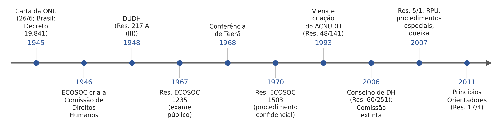
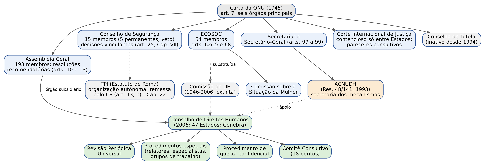
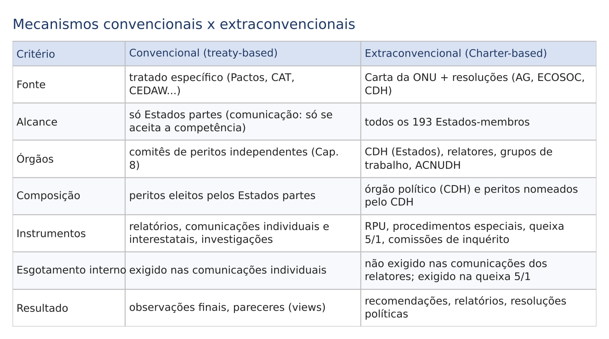
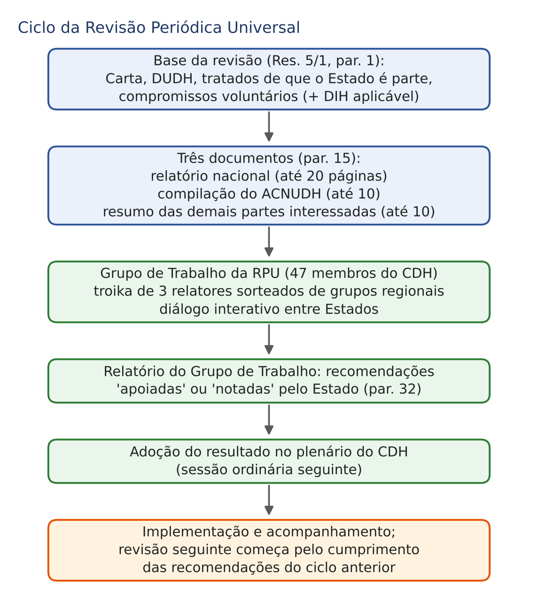
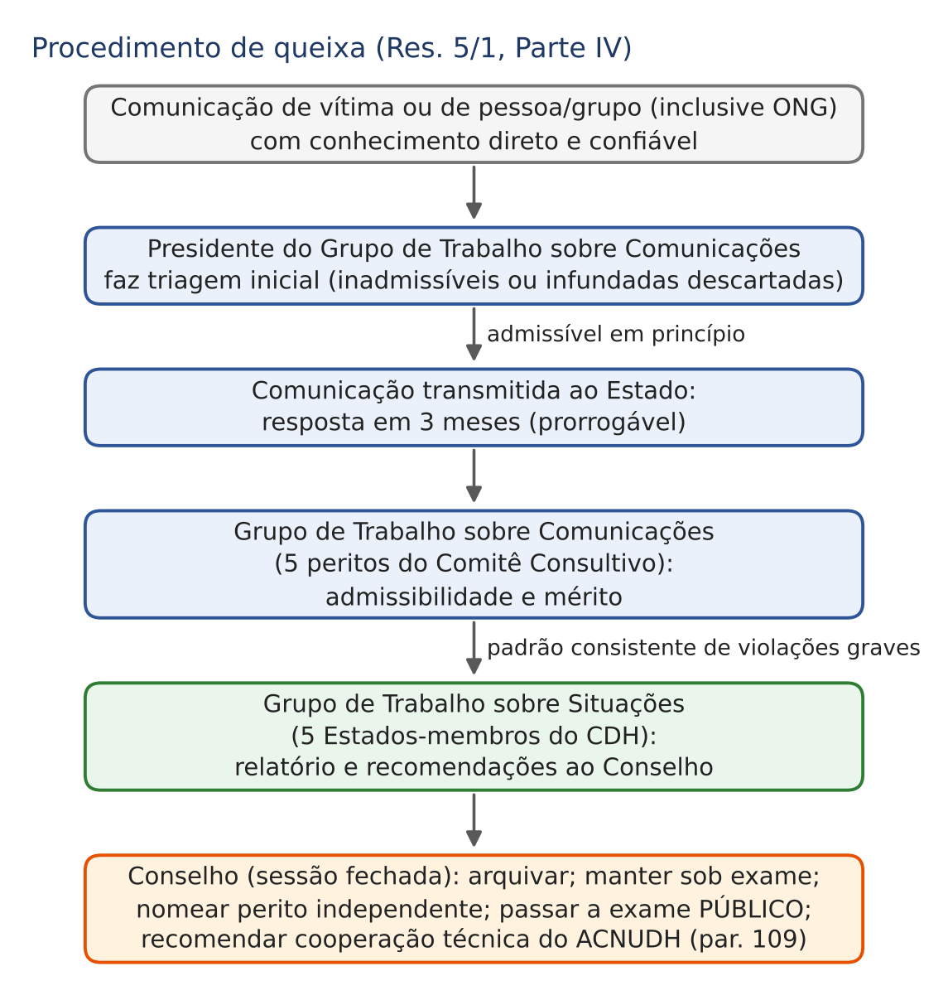

# CAPÍTULO 07 — SISTEMA GLOBAL I: CARTA DA ONU, CONSELHO DE DIREITOS HUMANOS E MECANISMOS EXTRACONVENCIONAIS

:::INCIDENCIA
Pontos: TRF5 p. 3; TJRS p. 2; TJSC p. 2. Nível A. Lote: 32 questões (FGV 29, FCC 3).
O que mais cai: natureza e letra da DUDH; Conselho de Direitos Humanos x Comissão extinta; base e lógica da Revisão Periódica Universal; o que relatores especiais podem e não podem fazer; mecanismos convencionais x extraconvencionais; Princípios Orientadores sobre Empresas e Direitos Humanos (Ruggie); Viena (1993).
:::

| Subtema | FGV | FCC | Padrão de cobrança |
|---|---|---|---|
| DUDH: natureza jurídica, adoção e letra | 16 | 2 | resolução (não tratado), sem sanção, inspiração de tratados e Constituições; letra dos arts. 2º, 13, 14, 16, 17, 20, 21, 26 e 29 |
| Conselho de DH, RPU, procedimentos especiais, mecanismos extraconvencionais | 5 | 0 | base da RPU (compromissos voluntários), *peer review*, visitas *in loco* dos relatores, confidencialidade da 1503, mandatos herdados da Comissão |
| Conferência de Viena | 1 | 0 | universalidade, indivisibilidade, interdependência e inter-relação |
| Empresas e direitos humanos | 4 | 1 | três pilares (proteger, respeitar, reparar); *soft law*; Pacto Global; dever estatal extraterritorial |
| Agenda 2030 como resolução da AG | 3 | 0 | *soft law*, metas nacionais, ODS 18 brasileiro |

Este capítulo trata do chamado sistema da Carta (*Charter-based*): a ONU, seus órgãos e os mecanismos criados por resolução, que alcançam todos os Estados-membros independentemente de ratificação de tratado específico. O sistema convencional (*treaty-based*) — Pactos de 1966, demais tratados centrais e seus comitês — é do Cap. 8. A gênese da internacionalização (1945 a 1948) está no Cap. 1 (01.4); as características extraídas de Viena (universalidade, indivisibilidade), no Cap. 2 (02.1).

## 07.1 A Carta das Nações Unidas e os direitos humanos

### 07.1.1 Adoção, vigência e o Brasil

A Carta foi assinada em São Francisco em 26/6/1945, ao fim da Conferência das Nações Unidas sobre Organização Internacional, e entrou em vigor em 24/10/1945 (Dia das Nações Unidas). O Brasil é membro originário; a Carta foi promulgada pelo Decreto 19.841, de 22/10/1945, que a publica com o Estatuto da Corte Internacional de Justiça (parte integrante da Carta, art. 92). A ONU tem 193 Estados-membros. A admissão de novo membro depende de decisão da Assembleia Geral mediante recomendação do Conselho de Segurança (art. 4º, 2).

A Carta é tratado, vincula juridicamente e tem cláusula de prevalência: em conflito entre obrigações dela decorrentes e obrigações de qualquer outro acordo internacional, prevalecem as da Carta (art. 103). Mas ela não define nem enumera direitos humanos: menciona "direitos humanos e liberdades fundamentais" sete vezes, sem catálogo. Esse vazio explica a DUDH (07.3).

### 07.1.2 Os dispositivos de direitos humanos

| Dispositivo | Conteúdo | Uso em prova |
|---|---|---|
| Preâmbulo | fé "nos direitos fundamentais do homem, na dignidade e no valor do ser humano, na igualdade de direito dos homens e das mulheres" | igualdade de gênero já em 1945 |
| Art. 1º, 3 | propósito: cooperação internacional para "promover e estimular o respeito aos direitos humanos e às liberdades fundamentais para todos, sem distinção de raça, sexo, língua ou religião" | direitos humanos como PROPÓSITO da Organização |
| Art. 2º, 7 | nenhum dispositivo autoriza a ONU a intervir em assuntos essencialmente da jurisdição interna, ressalvadas as medidas coercitivas do Capítulo VII | domínio reservado; relativizado por Viena, par. 4 (07.10) |
| Art. 13, 1, b | a Assembleia Geral inicia estudos e faz recomendações para "favorecer o pleno gozo dos direitos humanos" | base das resoluções declaratórias (DUDH) |
| Art. 55, c | a ONU favorecerá "o respeito universal e efetivo dos direitos humanos e das liberdades fundamentais para todos" | o dever da Organização |
| Art. 56 | os membros se comprometem a agir em cooperação com a Organização para realizar os propósitos do art. 55 | o dever dos ESTADOS: fundamento da obrigação jurídica geral |
| Art. 62, 2 | o ECOSOC pode fazer recomendações destinadas a promover o respeito e a observância dos direitos humanos | origem da competência do ECOSOC |
| Art. 68 | o ECOSOC criará comissões "para a proteção dos direitos humanos" | base da extinta Comissão de Direitos Humanos (1946) |
| Art. 76, c | o regime de tutela deve estimular o respeito aos direitos humanos | descolonização |

A obrigação dos arts. 55 e 56 é vaga, mas não é retórica. A Corte Internacional de Justiça, no parecer consultivo sobre a Namíbia (1971), afirmou que estabelecer e impor distinções, exclusões e restrições baseadas exclusivamente em raça constitui violação flagrante dos propósitos e princípios da Carta. É o argumento para sustentar que há, na própria Carta, obrigação jurídica de não discriminar e de cooperar, oponível a todos os membros, mesmo os que não ratificaram tratado algum de direitos humanos. É também a base jurídica de todo o sistema extraconvencional: o Conselho de Direitos Humanos, a RPU e os procedimentos especiais monitoram Estados com fundamento na Carta, e não em tratado específico.

:::PEGADINHA Domínio reservado
O art. 2º, 7, não impede o exame internacional de direitos humanos: a Declaração de Viena (1993, par. 4) afirma que a promoção e a proteção de todos os direitos humanos são "preocupação legítima da comunidade internacional". O dispositivo veda a INTERVENÇÃO em sentido próprio (coerção), não o monitoramento, a crítica ou a recomendação. Alternativa que diga que relatórios, RPU ou visitas violam a soberania ou o domínio reservado está errada.
:::

## 07.2 Órgãos principais e ACNUDH

O art. 7º da Carta institui seis órgãos principais: Assembleia Geral, Conselho de Segurança, Conselho Econômico e Social, Conselho de Tutela, Corte Internacional de Justiça e Secretariado. A Carta admite órgãos subsidiários (art. 7º, 2; art. 22 para a AG; art. 29 para o CS; art. 68 para o ECOSOC). O Conselho de Direitos Humanos é órgão SUBSIDIÁRIO da Assembleia Geral (07.6); o ACNUDH integra o SECRETARIADO.

### 07.2.1 Assembleia Geral

Composta por todos os membros, cada um com um voto (art. 18, 1). Decisões sobre "questões importantes" (recomendações sobre paz e segurança, eleição dos membros não permanentes do CS e dos membros do ECOSOC, admissão, suspensão e expulsão de membros, questões orçamentárias) exigem dois terços dos membros presentes e votantes (art. 18, 2); as demais, maioria simples (art. 18, 3).

Em direitos humanos, a AG atua por três vias:

- Resoluções declaratórias e programáticas (arts. 10 e 13): DUDH (1948), Declaração sobre o Direito ao Desenvolvimento (1986), Declaração sobre os Defensores de Direitos Humanos (1998), Declaração sobre os Direitos dos Povos Indígenas (2007; Cap. 14), Agenda 2030 (2015). São recomendações; sua força, quando existe, vem do costume, da interpretação da Carta ou da incorporação posterior em tratado.
- Adoção de tratados abertos à assinatura (Pactos de 1966, CEDAW, CAT, CDC, CDPD etc.; Cap. 8). A AG adota o texto; quem se obriga é o Estado que ratifica.
- Criação de órgãos e mecanismos: ACNUDH (Res. 48/141, 1993) e Conselho de Direitos Humanos (Res. 60/251, 2006), com poder de suspender membro deste último.

A Terceira Comissão (Assuntos Sociais, Humanitários e Culturais) é a comissão da AG em que tramitam os temas de direitos humanos e onde muitos relatores especiais apresentam relatórios anuais.

### 07.2.2 Conselho de Segurança

Quinze membros: cinco permanentes (China, França, Rússia, Reino Unido e Estados Unidos) e dez não permanentes eleitos pela AG por dois anos, sem reeleição imediata (art. 23). Decisões sobre questões não processuais exigem nove votos, incluídos os votos afirmativos de todos os permanentes (art. 27, 3): é o veto. Suas DECISÕES vinculam os membros (art. 25), e no Capítulo VII (ameaça à paz, ruptura da paz, ato de agressão) pode adotar medidas coercitivas sem e com uso da força (arts. 41 e 42).

O CS não é órgão de direitos humanos, mas atua em graves violações quando as qualifica como ameaça à paz:

- Criou os tribunais penais internacionais *ad hoc* para a ex-Iugoslávia (1993) e Ruanda (1994), com base no Capítulo VII (Cap. 22).
- Pode remeter situação ao Procurador do TPI (Estatuto de Roma, art. 13, b; Darfur em 2005 e Líbia em 2011) e suspender investigação por doze meses renováveis (art. 16) (Cap. 22).
- Responsabilidade de proteger (R2P): o Documento Final da Cúpula Mundial de 2005 (pars. 138 e 139) afirma a responsabilidade de cada Estado de proteger sua população contra genocídio, crimes de guerra, limpeza étnica e crimes contra a humanidade, e a disposição da comunidade internacional de agir coletivamente, por meio do CS e de acordo com a Carta, quando as autoridades nacionais manifestamente falharem.

:::PEGADINHA Quem faz o quê
O Conselho de SEGURANÇA não adotou a DUDH (Q3786425, item III), não integra a RPU como base de revisão (Q3742428, C), não elege nem suspende membros do Conselho de DIREITOS HUMANOS (quem suspende é a AG, por dois terços) e não supervisiona os relatores especiais. Ele aparece nas questões de direitos humanos como DISTRATOR.
:::

### 07.2.3 Conselho Econômico e Social (ECOSOC)

Cinquenta e quatro membros eleitos pela AG para mandatos de três anos (art. 61). Faz recomendações para promover o respeito aos direitos humanos (art. 62, 2), pode preparar projetos de convenção (art. 62, 3) e cria comissões (art. 68). Foi o órgão-matriz do sistema de direitos humanos até 2006:

- Criou a Comissão de Direitos Humanos (1946), a Comissão sobre a Situação da Mulher (1946) e, por resolução de 1985, o Comitê de Direitos Econômicos, Sociais e Culturais, que monitora o PIDESC em seu nome (o PIDESC não criou comitê próprio; Cap. 8).
- Editou as Resoluções 1235 (1967) e 1503 (1970), que abriram o exame de violações graves (07.9).
- Confere status consultivo a ONGs (art. 71; Resolução ECOSOC 1996/31), requisito para credenciamento e participação nas sessões do Conselho de Direitos Humanos (Res. 60/251, par. 11).

### 07.2.4 Secretariado e Secretário-Geral

O Secretário-Geral é nomeado pela AG mediante recomendação do CS (art. 97) e pode chamar a atenção do CS para qualquer assunto que possa ameaçar a paz (art. 99). Em direitos humanos, o Secretariado é o depositário dos tratados da ONU (destinatário das ratificações, reservas e notificações de suspensão de direitos, como no art. 4º, 3, do PIDCP) e abriga o ACNUDH.

### 07.2.5 Corte Internacional de Justiça e Conselho de Tutela

A CIJ (Haia; quinze juízes; Estatuto anexo à Carta) só julga litígios entre ESTADOS (Estatuto, art. 34, 1); indivíduos não têm acesso. Emite pareceres consultivos a pedido da AG, do CS ou de órgãos e agências autorizados (Carta, art. 96). Embora não seja tribunal de direitos humanos, decidiu casos centrais do tema: obrigações *erga omnes* (Barcelona Traction, 1970; Cap. 2), genocídio (Bósnia x Sérvia, 2007; Gâmbia x Mianmar, em curso), *aut dedere aut judicare* na CAT (Bélgica x Senegal, 2012), muro na Palestina (parecer, 2004), Chagos (parecer, 2019) e mudança climática (parecer de 23/7/2025, Cap. 19). Suas decisões vinculam as partes do caso (Estatuto, art. 59); os pareceres não são vinculantes.

O Conselho de Tutela suspendeu as atividades em 1994, depois da independência de Palau, último território sob tutela.

### 07.2.6 Alto Comissariado das Nações Unidas para os Direitos Humanos (ACNUDH)

A criação do cargo de Alto Comissário foi recomendada pela Conferência de Viena (Programa de Ação, Parte II, par. 18) e efetivada pela Resolução 48/141 da AG, de 20/12/1993. O regime é este:

| Elemento | Regra (Res. 48/141) |
|---|---|
| Nomeação | pelo Secretário-Geral, com APROVAÇÃO da Assembleia Geral, observada a rotação geográfica (par. 2, a) |
| Mandato | quatro anos, renovável uma vez (par. 2, b) |
| Posição | Subsecretário-Geral; principal responsável pelas atividades de direitos humanos da ONU, sob a direção e autoridade do Secretário-Geral (pars. 2, b, e 4) |
| Funções | promover e proteger o gozo efetivo de todos os direitos civis, culturais, econômicos, políticos e sociais, inclusive o direito ao desenvolvimento; prestar serviços de assessoria e assistência técnica a pedido do Estado; coordenar a educação em direitos humanos; dialogar com governos; coordenar as atividades da ONU no tema; racionalizar o mecanismo de direitos humanos (par. 4) |
| Natureza | órgão do SECRETARIADO, não colegiado de Estados nem de peritos: não julga, não vota resoluções, não decide sobre violações |

O ACNUDH (sede em Genebra) é a secretaria técnica do Conselho de Direitos Humanos, da RPU, dos procedimentos especiais e dos comitês de tratados; prepara a compilação de informações da ONU e o resumo das partes interessadas na RPU (07.7); mantém presença de campo (o Escritório Regional para a América do Sul fica em Santiago). O brasileiro Sérgio Vieira de Mello foi Alto Comissário (2002-2003) e morreu no atentado à sede da ONU em Bagdá, em 19/8/2003. O atual titular, Volker Türk, foi reconduzido pela AG em 24/7/2026 (144 votos a favor, 10 contra e 13 abstenções), para segundo mandato de quatro anos a partir de outubro de 2026.

Não confundir com o ALTO COMISSARIADO para REFUGIADOS (ACNUR, criado pela AG em 1950, Genebra; Cap. 21).

:::ESQUEMA Quatro "comissões" e "conselhos" que a banca troca
| Órgão | Natureza | Composição | Base |
|---|---|---|---|
| Comissão de Direitos Humanos (1946-2006) | órgão subsidiário do ECOSOC, político | Estados (53 na fase final) | Carta, art. 68 |
| Conselho de Direitos Humanos (2006-) | órgão subsidiário da AG, político | 47 Estados eleitos pela AG | Res. 60/251 |
| Comitê de Direitos Humanos | órgão do PIDCP, técnico (quase judicial) | 18 peritos independentes | PIDCP, art. 28 (Cap. 8) |
| ACNUDH | parte do Secretariado | Alto Comissário e funcionários | Res. 48/141 |
:::

## 07.3 A Declaração Universal de 1948 no sistema global

O histórico, a votação, o preâmbulo, o conteúdo artigo por artigo e a comparação com a CF de 1988 estão na Apostila de Formação Humanística, Cap. 27 (27.2), onde as questões sobre a letra da DUDH são resolvidas uma a uma. Aqui interessa o enfoque do DIDH: a natureza jurídica e o papel da Declaração dentro do sistema da ONU, e a consolidação do lote para revisão.

### 07.3.1 Forma e força

Dados essenciais: adotada pela Assembleia Geral em Paris, em 10/12/1948, pela Resolução 217 A (III), com 48 votos a favor, nenhum contra e 8 abstenções; o Brasil votou a favor. É RESOLUÇÃO, não tratado: não há assinatura, ratificação, reservas, órgão de monitoramento próprio nem sanções. A fórmula do preâmbulo é de proclamação de um "ideal comum a ser atingido por todos os povos e todas as nações".

A força MATERIAL da Declaração (interpretação autorizada dos arts. 55 e 56 da Carta; costume internacional, com a invocação de seus princípios pela CIJ no caso do Pessoal Diplomático e Consular dos EUA em Teerã, 1980; *jus cogens* de alguns preceitos, como a proibição da tortura, da escravidão e da discriminação racial) está desenvolvida na Apostila de Formação Humanística, Cap. 27 (27.2.2). Do ângulo do sistema global, dois acréscimos: a Proclamação de Teerã (1968, par. 2) foi a primeira afirmação intergovernamental de que a DUDH "constitui uma obrigação para os membros da comunidade internacional" (07.10); e a Res. 5/1 (Anexo, par. 1) inclui a DUDH entre os parâmetros da Revisão Periódica Universal de TODOS os Estados (07.7), o que lhe dá, hoje, mecanismo de monitoramento extraconvencional.

Para prova objetiva, a síntese que a FGV premia é dupla: (1) formalmente, a DUDH "não tem força vinculante" e não prevê sanções (Q2474099, A; Q2511990, A errada); (2) materialmente, apresenta ideais e princípios que norteiam os instrumentos internacionais posteriores e inspiram Constituições (Q2511990, B), influenciou a formação de costume (Q3782937, item I) e mantém função interpretativa mesmo em tempos de crise do multilateralismo (Q3898991, A errada). As duas afirmações convivem; a alternativa errada é a que nega uma delas ("é tratado", "tem sanções", "só valor histórico-simbólico").

A Declaração é a primeira das três peças da Carta Internacional de Direitos Humanos (*International Bill of Human Rights*): DUDH + PIDCP (e seus dois Protocolos) + PIDESC (e seu Protocolo). A juridicização da Declaração em dois Pactos, e a razão da cisão, estão no Cap. 8. Os Pactos não revogaram a DUDH (Q2511990, E).

:::QUESTAO FGV 2025 — TJ-MS — Juiz Substituto (Q3786425)
Caso: em ação para implementar direito de segunda dimensão, o autor sustenta que a DUDH (I) é deontológica porque foi "ratificada" pelo Brasil; (II) integra direitos de primeira e segunda dimensão e "veda expressamente" o não reconhecimento de alguns; (III) resultou da convergência entre AG e Conselho de Segurança. Gabarito E: os três argumentos estão errados.
Passos: (1) natureza: resolução não se ratifica, logo I cai; (2) conteúdo: a DUDH reúne as duas categorias (arts. 3º a 21 e 22 a 27), mas não contém "vedação expressa" — o erro de II está no advérbio; (3) autoria: só a AG, por resolução; o CS não participou, logo III cai.
Armadilha: o item II parece certo por começar com a indivisibilidade.
:::

:::QUESTAO FGV 2026 — TJ-PR — Juiz Substituto (Q3898991)
Cobrado: o sistema global em contexto de "crise" do Direito Internacional (enfraquecimento do multilateralismo, soberanismo). Gabarito B: apesar das crises, o sistema global permanece fundado em tratados universais ratificados pelo Brasil, como os Pactos de 1966, e em mecanismos de monitoramento e supervisão.
Armadilhas: A (DUDH reduzida a valor histórico-simbólico, sem função interpretativa); C (Agenda 2030 vinculante e substitutiva dos tratados); D (afastamento unilateral de tratados sem denúncia: viola *pacta sunt servanda* e o regime de denúncia, Cap. 4, 04.9); E (sistema global restrito a direitos civis e políticos: ignora o PIDESC e a indivisibilidade de Viena).
:::

### 07.3.2 Letra da DUDH: consolidação das questões do lote

As questões abaixo estão resolvidas, com os dispositivos transcritos, na Apostila de Formação Humanística, Cap. 27 (27.2.3 a 27.2.7). O quadro serve para conferir o gabarito e a armadilha de cada uma.

:::QUESTAO Lote DUDH — FGV e FCC, 2024 a 2026
| Questão | Dispositivo | Gabarito | Armadilha |
|---|---|---|---|
| FGV 2025 — ENAM 2025.2 (Q3692389) | art. 26 | A: gratuidade ao menos nos graus elementares e fundamentais | instrução superior "obrigatória" (é acessível, pelo mérito); pais sem prioridade (o § 3º lhes dá prioridade); técnico-profissional não acessível a todos |
| FGV 2026 — PC-PI — Delegado (Q3849008) | art. 26, 3 | A: pais têm prioridade na escolha do gênero de instrução | "melhor interesse" afastando os pais; tema só no PIDESC |
| FGV 2026 — PC-PI — Oficial Investigador (Q3846862) | arts. 1º, 2º e 7º | C: igualdade em sentido lato, sem a dicotomia formal x material | ações afirmativas "determinadas" pela DUDH; igualdade não autônoma |
| FGV 2025 — EBSERH (Q3730509) | art. 2º, 2 | D: direitos de qualquer pessoa, a despeito da situação político-territorial | prioridade a "Estados signatários", cidadãos ou nações independentes |
| FGV 2025 — EBSERH (Q3730506) | preâmbulo | A (é a que NÃO é justificativa): "direito à rebelião" | o preâmbulo menciona a rebelião como último recurso que se quer EVITAR |
| FGV 2025 — EBSERH (Q3730514) | art. 13 | B: locomoção e residência dentro das fronteiras de cada Estado | locomoção "para além das fronteiras"; freios legislativos ao direito de sair |
| FGV 2025 — EBSERH (Q3730523) | art. 16 | D (incompatível): fundação da família condicionada ao contexto jurídico de cada Estado | o art. 16 veda restrição de raça, nacionalidade ou religião |
| FCC 2026 — MPE-SE (Q3964501) | art. 17 | E: propriedade coletiva ("só ou em sociedade com outros") | associação obrigatória (art. 20, 2, veda); remuneração diversa por instrução (art. 23, 2) |
| FCC 2025 — TRT1 (Q3445894) | arts. 14, 18 e 19 | C: II e III corretos | o item I inverte o art. 14, 2: o asilo NÃO pode ser invocado em perseguição legitimamente motivada por crimes de direito comum |
| FGV 2024 — TRF1 — Analista (Q3028413) | arts. 20 e 21 | E: eleições periódicas e legítimas, sufrágio universal, voto secreto ou equivalente | negar participação direta (art. 21, 1, a prevê) e a liberdade de não se associar (art. 20, 2) |
| FGV 2024 — TRF1 — Polícia Judicial (Q3037187) | arts. 19 e 29, 2 | B: a DUDH prevê limites às liberdades e a CF exige acomodar honra e imagem | liberdade de expressão absoluta; censura autorizada; DUDH sem liberdade de informação |
| FGV 2024 — TRF1 — Polícia Judicial (Q3037186) | arts. 11, 12 e 17 x CF | D: proteção da casa menos explicativa na DUDH do que no art. 5º, XI, da CF | função social na DUDH (só na CF); DUDH omissa sobre presunção de inocência (art. 11, 1, a prevê) |
| FGV 2024 — TRF1 — Agente (Q3029937) | natureza e preâmbulo | D: resolução da AG cujo preâmbulo visa ao reconhecimento universal dos direitos | particularismo ocidental; divisibilidade "estratégica"; ausência de inter-relação com a Carta |
| FGV 2024 — Câmara dos Deputados (Q2511990) | natureza | B: ideais que norteiam instrumentos posteriores e inspiram Constituições | "tratado"; "Carta Interamericana"; revogação pelos Pactos; sanções |
| FGV 2024 — Câmara de Fortaleza (Q2474099) | natureza | A: sem força vinculante | hierarquia entre categorias; sanções; "consenso de todos os países" |
| FGV 2025 — Prefeitura do Rio (Q3782937) | natureza + sistemas | C: I, III e IV corretos | II: a competência contenciosa da Corte IDH NÃO é automática (CADH, art. 62; Cap. 11) |
| FGV 2025 — PC-MG — Médico Legista (Q3203640) | data | D: proclamada pela AG em 10/12/1948, marco teórico | CIDH como órgão jurisdicional; TPI "integrante do sistema interamericano"; Protocolo de Minnesota "obrigatório" (é *soft law*, Cap. 20) |
:::

### 07.3.3 Resoluções da Assembleia Geral como *soft law*: a Agenda 2030

A Agenda 2030 (Resolução 70/1 da AG, de 25/9/2015: 17 ODS e 169 metas) é o exemplo contemporâneo de resolução programática do sistema global. Natureza, princípios, ODS e institucionalização no Judiciário estão na Apostila de Formação Humanística, Cap. 27 (27.3 a 27.7). O ponto do DIDH é a natureza: compromisso político, de metas globais e aspiracionais, sem sanção e sem força de tratado; reforça a interpretação, mas não é parâmetro autônomo de controle de convencionalidade (Cap. 5, 05.5.1).

:::QUESTAO FGV 2026 — PC-PR — Delegado de Polícia (Q4378333)
Cobrado: natureza e implementação dos ODS. Gabarito B: as metas são globais e aspiracionais; cada governo fixa metas nacionais, orientado pela ambição global e por suas circunstâncias, sem afastar o caráter integrado e indivisível dos Objetivos nem a responsabilidade primária de cada Estado por seu desenvolvimento.
Armadilhas: A (países desenvolvidos vinculados só aos meios de implementação: a Agenda é universal para todos); C (indivisibilidade como proibição de políticas focadas); D (169 metas como parâmetro autônomo de controle de convencionalidade); E ("não deixar ninguém para trás" como regra internacional que prevalece sobre o orçamento nacional).
No mesmo sentido: Q3203638 (FGV 2025, PC-MG; D: corretos I, II e IV — 17 ODS, 18º ODS proposto pelo Brasil sobre igualdade étnico-racial e compatibilidade com o art. 3º da CF; errado III, pois não há sanção da ONU); Q3028406 (FGV 2024, TRF1; A: lei que limita e isenta taxa de concurso realiza o objetivo de igualdade de oportunidades e redução das desigualdades, ODS 10).
:::

## 07.4 Mecanismos convencionais x extraconvencionais

O sistema global de monitoramento tem duas vertentes, e quase toda questão sobre órgãos da ONU se resolve identificando de qual delas se trata.

- CONVENCIONAIS (*treaty-based*): nascem de tratado e só alcançam os Estados partes; as comunicações individuais e interestatais dependem, em regra, de aceitação adicional (protocolo facultativo ou declaração). Operam por comitês de peritos independentes. Desenvolvimento: Cap. 8.
- EXTRACONVENCIONAIS ou NÃO CONVENCIONAIS (*Charter-based*): nascem da Carta e de resoluções de órgãos da ONU (AG, ECOSOC, Comissão e Conselho de Direitos Humanos) e alcançam todos os Estados-membros, mesmo os que não ratificaram nenhum tratado específico. São eles: o Conselho de Direitos Humanos como foro, a RPU, os procedimentos especiais, o procedimento de queixa (sucessor da 1503), as comissões de inquérito e missões de investigação, e a atuação do ACNUDH.

André de Carvalho Ramos chama essa vertente de "mecanismo coletivo extraconvencional" ou "sistema onusiano não convencional", fundado na interpretação de que a Carta, ao fazer da promoção dos direitos humanos um propósito da Organização, autoriza seus órgãos a fiscalizar a conduta de todos os membros.

:::QUESTAO FGV 2024 — ENAM (Reaplicação) (Q2507015)
Cobrado: mecanismos NÃO convencionais. Gabarito C: o *peer review* (revisão por pares) é a Revisão Periódica Universal, mecanismo não convencional do Conselho de Direitos Humanos.
Armadilhas: A (menor efetividade por não derivar de tratado: afirmação valorativa sem base; o alcance é até MAIOR, porque universal); B (a 1503 teria excluído o procedimento confidencial: ela o CRIOU, e o sucessor da Res. 5/1 continua confidencial, 07.9); D (resoluções da AG e do ECOSOC não autorizariam monitorar quem não é parte de tratados: é exatamente o que os mecanismos extraconvencionais fazem com todos os membros); E (o Conselho teria substituído relatorias e grupos de trabalho por novos mecanismos: a Res. 60/251, par. 6, mandou ASSUMIR, revisar e, se necessário, aperfeiçoar os mandatos da Comissão, que continuaram).
:::

## 07.5 A extinta Comissão de Direitos Humanos (1946-2006)

### 07.5.1 Criação e fases

A Comissão foi criada pelo ECOSOC em 1946, com base no art. 68 da Carta, como órgão subsidiário do ECOSOC, integrado por representantes de Estados (18 na origem, 53 na fase final), com sessão anual de seis semanas em Genebra. Sua história costuma ser dividida em três fases:

| Fase | Período | Marca |
|---|---|---|
| Elaboração de normas (*standard-setting*) | 1946-1966 | redigiu a DUDH (presidida por Eleanor Roosevelt) e os Pactos; em 1947 declarou não ter poder para tomar qualquer providência sobre queixas individuais (doutrina da "impotência", confirmada pelo ECOSOC) |
| Abertura ao exame de violações | 1967-1980 | Res. ECOSOC 1235 (1967): exame de informações sobre violações graves (apartheid, Rodésia do Sul) e estudos aprofundados de situações; Res. ECOSOC 1503 (1970): procedimento confidencial de comunicações; Grupo de Trabalho *ad hoc* sobre o Chile (1975) |
| Procedimentos especiais | a partir de 1980 | primeiro mandato temático: Grupo de Trabalho sobre Desaparecimentos Forçados ou Involuntários (1980); seguiram-se os relatores sobre execuções sumárias (1982) e tortura (1985) |

### 07.5.2 Crise e extinção

A Comissão perdeu legitimidade por três críticas: SELETIVIDADE e politização (blocos protegendo aliados e mirando adversários), eleição de Estados com graves registros de violação (que buscavam assento para se blindar) e baixa efetividade. O Secretário-Geral Kofi Annan, no relatório *In Larger Freedom* (2005), falou em "déficit de credibilidade" e propôs substituí-la por conselho menor, permanente e com revisão de todos os Estados. A Res. 60/251 recomendou ao ECOSOC encerrar os trabalhos da Comissão em sua 62ª sessão e extingui-la em 16/6/2006 (par. 13).

O que foi HERDADO pelo Conselho (par. 6): todos os mandatos, mecanismos, funções e responsabilidades da Comissão, inclusive os procedimentos especiais, a Subcomissão de Promoção e Proteção (substituída pelo Comitê Consultivo) e o procedimento de queixa, com dever de revisá-los e aperfeiçoá-los no prazo de um ano. O que é NOVO: a Revisão Periódica Universal.

## 07.6 Conselho de Direitos Humanos

### 07.6.1 Criação e natureza

O Conselho foi criado pela Resolução 60/251 da Assembleia Geral, de 15/3/2006, aprovada por 170 votos a favor, 4 contra (Estados Unidos, Israel, Ilhas Marshall e Palau) e 3 abstenções (Belarus, Irã e Venezuela). É órgão SUBSIDIÁRIO da Assembleia Geral, com sede em Genebra (par. 1). A primeira eleição ocorreu em 9/5/2006 e a primeira sessão em 19/6/2006 (par. 15). A revisão de status prevista para cinco anos (pars. 1 e 16) concluiu-se em 2011 sem alteração: o Conselho continua órgão subsidiário da AG, não órgão principal da Carta (a mudança exigiria emenda à Carta).

| Elemento | Comissão de DH (extinta) | Conselho de DH |
|---|---|---|
| Vinculação | órgão subsidiário do ECOSOC | órgão subsidiário da AG |
| Base | Carta, art. 68; resoluções do ECOSOC | Res. 60/251 (AG); Res. 5/1 (construção institucional) |
| Membros | 53 Estados | 47 Estados |
| Eleição | pelo ECOSOC, em listas regionais frequentemente sem disputa | pela AG, individualmente, por voto secreto e maioria absoluta dos membros da AG (97 votos) |
| Sessões | uma sessão anual de seis semanas | pelo menos três sessões por ano, no mínimo dez semanas; sessões especiais a pedido de um terço dos membros |
| Suspensão de membro | não havia | pela AG, por dois terços dos presentes e votantes, por violações graves e sistemáticas |
| Exame universal | não havia | Revisão Periódica Universal |

### 07.6.2 Composição, eleição e suspensão

:::LEI Resolução 60/251 da AG, pars. 7 a 10 (síntese fiel)
Par. 7: 47 Estados-membros eleitos direta e individualmente, por voto secreto, pela maioria dos membros da AG; distribuição geográfica equitativa: África 13, Ásia 13, Europa Oriental 6, América Latina e Caribe 8, Europa Ocidental e outros 7; mandato de três anos; NÃO há reeleição imediata após dois mandatos consecutivos.
Par. 8: a participação é aberta a todos os membros da ONU; na eleição, os Estados levam em conta a contribuição dos candidatos à promoção e proteção dos direitos humanos e as promessas e compromissos voluntários assumidos; a AG, por maioria de dois terços dos membros presentes e votantes, pode suspender os direitos de membro do Conselho que cometa violações graves e sistemáticas de direitos humanos.
Par. 9: os membros devem observar os mais altos padrões na promoção e proteção dos direitos humanos, cooperar plenamente com o Conselho e ser revisados pela RPU durante o mandato.
Par. 10: o Conselho se reúne regularmente, em pelo menos três sessões por ano, incluindo uma principal, com duração total não inferior a dez semanas, e realiza sessões especiais quando necessário, a pedido de um membro com o apoio de um terço dos membros.
:::

A suspensão foi aplicada duas vezes: à Líbia, em 1/3/2011 (Res. 65/265, por consenso; restabelecida em novembro de 2011), e à Rússia, em 7/4/2022 (Res. ES-11/3, da 11ª sessão especial de emergência, por 93 votos a 24, com 58 abstenções, após a invasão da Ucrânia; no mesmo dia, a Rússia declarou deixar o Conselho antes do fim do mandato).

O Brasil foi eleito para o mandato 2024-2026 e, em 13/10/2026, reeleito para 2027-2029, com 170 votos (o mínimo era 97), no grupo da América Latina e Caribe. O segundo mandato consecutivo é permitido; um terceiro consecutivo, não.

:::PEGADINHA Quem elege, quem suspende, quem preside
Elege e suspende: a Assembleia Geral (nunca o Conselho de Segurança, nunca o próprio Conselho). Maiorias: eleição por maioria ABSOLUTA dos membros da AG; suspensão por DOIS TERÇOS dos presentes e votantes. O Conselho é presidido por um Presidente eleito entre os membros para ciclo anual, com rotação regional; é o Presidente quem nomeia os titulares de procedimentos especiais, mas a nomeação só se completa com a aprovação do Conselho (07.8).
:::

### 07.6.3 Princípios e funções

Princípios (par. 4): universalidade, imparcialidade, objetividade, não seletividade, diálogo construtivo e cooperação. Funções (par. 5), em síntese:

- promover a educação e o aprendizado em direitos humanos, bem como serviços de assessoria, assistência técnica e capacitação, em consulta com o Estado e com seu consentimento (a);
- servir de foro de diálogo sobre questões temáticas (b);
- fazer recomendações à AG para o desenvolvimento do direito internacional dos direitos humanos (c) — foi o Conselho que adotou e encaminhou à AG a Convenção sobre Desaparecimentos Forçados e a Declaração sobre os Direitos dos Povos Indígenas (2006);
- promover o cumprimento das obrigações e compromissos assumidos pelos Estados (d);
- realizar a REVISÃO PERIÓDICA UNIVERSAL (e);
- contribuir, por diálogo e cooperação, para a prevenção de violações e responder prontamente a emergências (f);
- assumir o papel e as responsabilidades da Comissão relativos ao trabalho do ACNUDH (g);
- cooperar com governos, organizações regionais, instituições nacionais de direitos humanos e sociedade civil (h);
- fazer recomendações sobre promoção e proteção (i) e apresentar relatório anual à AG (j).

O Conselho NÃO é tribunal: não profere sentença, não condena Estado, não fixa reparação e não aplica sanções. Seus instrumentos são RESOLUÇÕES (votadas pelos 47), a criação de mandatos (relatores, comissões de inquérito, missões de investigação, como as da Síria em 2011 e da Venezuela em 2019) e as recomendações da RPU.

A Res. 5/1, de 18/6/2007 (pacote de construção institucional), estruturou o Conselho: RPU (Parte I), procedimentos especiais (Parte II), Comitê Consultivo (Parte III), procedimento de queixa (Parte IV), agenda e programa de trabalho (Parte V; dez itens permanentes, entre eles o item 6, RPU, e o polêmico item 7, sobre a situação na Palestina e outros territórios árabes ocupados) e métodos de trabalho.

O Comitê Consultivo, sucessor da Subcomissão, é composto de 18 peritos que atuam a título pessoal (África 5, Ásia 5, Europa Oriental 2, América Latina e Caribe 3, Europa Ocidental e outros 3), com mandato de três anos e uma reeleição; funciona como *think tank* do Conselho, por estudos e pareceres a pedido deste, sem poder de adotar resoluções. Há ainda mecanismos subsidiários temáticos, como o Mecanismo de Peritos sobre os Direitos dos Povos Indígenas (Cap. 14), o Fórum sobre Questões de Minorias e o Fórum sobre Empresas e Direitos Humanos (07.11).

:::PRATIQUE Conselho, Comissão e Comitê — exercícios elaborados para esta apostila (não são questões de banca)
1. Certo ou errado: "O Conselho de Direitos Humanos, órgão vinculado ao Conselho de Segurança, pode ter membro suspenso por decisão deste em caso de violações graves e sistemáticas."
2. Certo ou errado: "O Estado que exerceu dois mandatos consecutivos no Conselho de Direitos Humanos pode ser reeleito para o período imediatamente seguinte, desde que obtenha maioria absoluta na Assembleia Geral."
3. Certo ou errado: "Os mandatos temáticos instituídos pela extinta Comissão de Direitos Humanos foram assumidos pelo Conselho, que os revisou e aperfeiçoou."
Resolução: 1. Errado: órgão subsidiário da AG; suspensão pela AG por dois terços dos presentes e votantes (Res. 60/251, pars. 1 e 8). 2. Errado: vedada a reeleição imediata após dois mandatos consecutivos (par. 7). 3. Certo (par. 6).
:::

## 07.7 Revisão Periódica Universal (RPU)

### 07.7.1 Base, princípios e periodicidade

A RPU foi prevista na Res. 60/251 (par. 5, e: revisão "baseada em informações objetivas e confiáveis", do cumprimento por CADA Estado de suas obrigações e compromissos, "de maneira que assegure a universalidade da cobertura e a igualdade de tratamento", por mecanismo cooperativo e de diálogo interativo, com plena participação do Estado e que complemente, e não duplique, o trabalho dos órgãos de tratados) e regulada na Res. 5/1, Anexo, Parte I.

:::LEI Resolução 5/1 do CDH (2007), Anexo, pars. 1 e 2 (síntese fiel)
1. A base da revisão é: (a) a Carta das Nações Unidas; (b) a Declaração Universal dos Direitos Humanos; (c) os instrumentos de direitos humanos de que o Estado é parte; (d) as promessas e compromissos voluntários assumidos pelos Estados, inclusive os assumidos ao apresentar candidatura ao Conselho.
2. Além disso, considerando a natureza complementar e inter-relacionada do direito internacional dos direitos humanos e do direito internacional humanitário, a revisão levará em conta o direito internacional humanitário aplicável.
:::

Princípios (par. 3, em síntese): promover a universalidade, interdependência, indivisibilidade e inter-relação de todos os direitos; ser mecanismo cooperativo, baseado em informação objetiva e confiável e em diálogo interativo; assegurar cobertura universal e igualdade de tratamento de todos os Estados; ser processo intergovernamental, dirigido pelos membros da ONU e orientado à ação; envolver plenamente o Estado revisado; complementar e não duplicar outros mecanismos; ser conduzido de modo objetivo, transparente, não seletivo, construtivo, não confrontacional e não politizado; integrar a perspectiva de gênero; e assegurar a participação de todos os interessados, inclusive ONGs e instituições nacionais de direitos humanos.

Periodicidade: o primeiro ciclo durou quatro anos (2008-2011), com 48 Estados por ano (par. 14); a partir do segundo ciclo, a periodicidade passou a quatro anos e meio. Ciclos: 1º (2008-2011), 2º (2012-2016), 3º (2017-2022), 4º (2022-2027).

### 07.7.2 Procedimento

- Documentos (par. 15): (a) relatório nacional do Estado, até 20 páginas, preparado preferencialmente com ampla consulta interna; (b) compilação, pelo ACNUDH, das informações dos órgãos de tratados, procedimentos especiais e demais documentos da ONU, até 10 páginas; (c) resumo, pelo ACNUDH, das informações "críveis e confiáveis" das demais partes interessadas (ONGs, instituições nacionais de direitos humanos, defensorias, academia), até 10 páginas.
- Grupo de Trabalho (par. 18): presidido pelo Presidente do Conselho e composto pelos 47 membros; qualquer Estado-membro da ONU (inclusive não membro do Conselho) pode participar do diálogo. Uma *troika* de três relatores, sorteados entre membros do Conselho de diferentes grupos regionais, facilita cada revisão e prepara o relatório. O Estado revisado pode pedir que um dos relatores seja de seu grupo regional e pode recusar um relator uma vez.
- Diálogo interativo: originalmente três horas por país no Grupo de Trabalho (par. 22), prazo depois ampliado; ONGs podem assistir, mas não falam no Grupo de Trabalho; falam na adoção em plenário.
- Resultado (pars. 26 a 32): relatório com resumo dos debates, conclusões e/ou recomendações e os compromissos voluntários do Estado. O Estado indica quais recomendações APOIA; as demais são "notadas", com os comentários do Estado. O relatório é adotado no plenário do Conselho.
- Acompanhamento: a implementação é responsabilidade primária do Estado; a revisão seguinte deve concentrar-se na implementação do resultado anterior. Não há sanção: em caso de não cooperação persistente, o Conselho apenas "tratará" da questão (par. 38).

### 07.7.3 O Brasil na RPU

O Brasil foi revisado em todos os ciclos (2008, 2012, 2017 e 2022). Na quarta revisão (Grupo de Trabalho em 14/11/2022; resultado adotado na 52ª sessão do Conselho, em 2023), recebeu 306 recomendações e apoiou 304; notou apenas duas, por adotarem definição restrita de família incompatível com o direito e as decisões judiciais brasileiras. As recomendações da RPU dialogam com a atuação de órgãos internos: a Resolução 10/2018 do Conselho Nacional dos Direitos Humanos (despejos e remoções), por exemplo, invoca recomendações da RPU sobre moradia (Q2512027, FGV 2024, Câmara dos Deputados, gabarito E, comentada no Cap. 19).

:::QUESTAO FGV 2025 — TRF6 — Juiz Federal Substituto (Q3742428)
Cobrado: elementos que servem de BASE da revisão na RPU. Gabarito E: os compromissos voluntários assumidos pelos Estados avaliados (Res. 5/1, par. 1, d).
Armadilhas: decisões da CIJ (A), resoluções da AG (B) e resoluções do Conselho de Segurança (C) não constam da base (que é Carta, DUDH, tratados de que o Estado é parte e compromissos voluntários, mais o DIH aplicável). D confunde a BASE da revisão com uma das FONTES de informação: as contribuições da sociedade civil entram no resumo do ACNUDH (par. 15, c), não como parâmetro normativo, e não há "organizações da sociedade civil do CDH".
:::

:::DICA RPU x comitês de tratados
A RPU é exame POLÍTICO entre PARES (Estados examinam Estados), universal e baseado também em tratados não ratificados? NÃO: os tratados só entram como parâmetro se o Estado for parte; para os demais, valem a Carta, a DUDH e os compromissos voluntários. O exame pelos comitês é TÉCNICO, feito por PERITOS, restrito aos Estados partes do tratado (Cap. 8). Os dois se complementam: a compilação do ACNUDH usa as observações finais dos comitês, e uma recomendação frequente da RPU é ratificar tratados e protocolos pendentes.
:::

## 07.8 Procedimentos especiais

### 07.8.1 Conceito e espécies

Procedimentos especiais são mandatos conferidos pelo Conselho de Direitos Humanos a peritos independentes para examinar, monitorar, aconselhar e relatar publicamente sobre um TEMA (mandatos temáticos) ou sobre a situação de um PAÍS (mandatos por país). Em novembro de 2024 havia 46 mandatos temáticos e 14 por país, segundo o ACNUDH. Espécies:

| Espécie | Composição | Exemplos |
|---|---|---|
| Relator Especial | uma pessoa | tortura; execuções extrajudiciais; liberdade de expressão; moradia adequada; povos indígenas; defensores de direitos humanos |
| Especialista Independente | uma pessoa | orientação sexual e identidade de gênero; pessoas idosas; ordem internacional democrática e equitativa |
| Grupo de Trabalho | cinco membros, um de cada grupo regional | detenção arbitrária; desaparecimentos forçados ou involuntários; empresas e direitos humanos; pessoas afrodescendentes (grupo de peritos) |

Os titulares (*mandate holders*) atuam a título pessoal, NÃO são remunerados, não são funcionários da ONU e têm mandato de até seis anos na mesma função (Res. 5/1, par. 45: dois mandatos de três anos nos temáticos). Contam com o apoio do ACNUDH e observam o Código de Conduta (Res. 5/2 do Conselho, 2007).

Seleção (Res. 5/1, pars. 39 a 53): critérios de perícia, experiência, independência, imparcialidade, integridade pessoal e objetividade; excluídas pessoas em funções decisórias governamentais que gerem conflito de interesses (par. 46). Os candidatos figuram em lista pública mantida pelo ACNUDH; um Grupo Consultivo de cinco membros (um por grupo regional) propõe nomes ao Presidente do Conselho; o Presidente, após amplas consultas, apresenta a lista; a nomeação se completa com a APROVAÇÃO do Conselho.

### 07.8.2 Métodos de trabalho

- Visitas a países (*country visits*): dependem de CONVITE ou consentimento do Estado. Muitos Estados emitem "convite permanente" (*standing invitation*), pelo qual se declaram dispostos a receber qualquer titular temático; o Brasil o fez em 2001. Ao fim, o titular apresenta relatório com conclusões e recomendações ao Conselho.
- Comunicações: cartas de alegação e apelos urgentes enviados ao Estado (e a outros atores, como empresas) sobre casos individuais ou situações gerais, inclusive sobre projetos de lei. NÃO exigem esgotamento dos recursos internos, não dependem de o Estado ser parte de tratado e não resultam em decisão vinculante: são pedidos de esclarecimento e de providências, publicados periodicamente em relatório conjunto. Alguns mandatos têm métodos próprios mais próximos do quase judicial (o Grupo de Trabalho sobre Detenção Arbitrária emite "opiniões" sobre o caráter arbitrário da privação de liberdade).
- Relatórios temáticos anuais ao Conselho e, em vários mandatos, à AG; estudos que contribuem para o desenvolvimento de padrões (por exemplo, princípios e diretrizes), advocacia, conscientização e aconselhamento para cooperação técnica.

O Brasil recebeu numerosas visitas temáticas, entre elas a do Relator Especial sobre Tortura (2000), a do Relator Especial sobre Execuções Extrajudiciais (2007) e a da Relatora Especial sobre os Direitos dos Povos Indígenas (2016).

:::QUESTAO FGV 2025 — TRF1 — Juiz Federal Substituto (Q3425358)
Cobrado: atuação dos titulares de procedimentos especiais. Gabarito C: realizam visitas *in loco* para avaliar a situação de direitos humanos no plano nacional e emitem recomendações.
Armadilhas: A (só casos individuais e com esgotamento interno: atuam também em situações gerais e as comunicações não exigem esgotamento); B (dependem de aprovação do país para se manifestar: dependem de consentimento só para VISITAR; podem emitir comunicações e relatórios sem ele); D (suspender país do Conselho: só a AG, por dois terços); E (reunião anual em Genebra para definir a agenda do Conselho: há reunião anual dos titulares, mas a agenda do Conselho é definida pela Res. 5/1 e pelos Estados).
:::

:::QUESTAO FGV 2024 — TJ-SC — Juiz Substituto (Q2387045)
Cobrado: quem são os relatores especiais da ONU. Gabarito B: especialistas independentes nomeados pelo Conselho de Direitos Humanos que integram os Procedimentos Especiais, cabendo-lhes, entre outros, visitas a países, atuação em casos individuais de denúncias, contribuição para padrões internacionais e aconselhamento para a cooperação técnica.
Armadilhas: A (membros do Conselho nomeados pelo Secretário-Geral que "fixam prioridades de políticas públicas" do Estado); C (juristas recrutados pelo Conselho de Segurança para analisar relatórios anuais: mistura RPU, comitês e CS); D (diplomatas dos Estados em força-tarefa: os titulares NÃO representam Estados); E (ex-juízes que revisam processos nacionais: não há função revisora de decisões judiciais).
Observação: "nomeados pelo Conselho" é correto no sentido de que a nomeação pelo Presidente só se completa com a aprovação do Conselho.
:::

:::PEGADINHA Três "relatores" diferentes
(1) Relator especial da ONU: titular de procedimento especial do Conselho de Direitos Humanos (extraconvencional). (2) Relator da CIDH (relatorias temáticas, como a Relatoria Especial para a Liberdade de Expressão e a REDESCA; Cap. 10, 10.9.3): órgão do sistema interamericano. (3) Relator de comitê de tratado (relator de país ou para comunicações novas): membro do comitê, mecanismo convencional (Cap. 8). E a *troika* da RPU são Estados, não peritos.
:::

## 07.9 Procedimento de queixa: da Resolução 1503 à Resolução 5/1

### 07.9.1 Evolução

- Resolução ECOSOC 1235, de 6/6/1967: autorizou a Comissão e a Subcomissão a examinar informações sobre violações flagrantes de direitos humanos (citando o apartheid e a discriminação racial na Rodésia do Sul) e, em casos apropriados, a fazer estudo aprofundado de situações que revelassem um padrão consistente de violações. Base do debate PÚBLICO de situações de países e, depois, dos mandatos por país.
- Resolução ECOSOC 1503, de 27/5/1970: criou procedimento CONFIDENCIAL para comunicações que pareçam revelar "um padrão consistente de violações graves e confiavelmente atestadas de direitos humanos e liberdades fundamentais". Todas as medidas permaneciam confidenciais até que a Comissão decidisse fazer recomendações ao ECOSOC (par. 8). Reformada pela Resolução ECOSOC 2000/3.
- Resolução 5/1 do Conselho (2007), Parte IV: substituiu a 1503 pelo atual procedimento de queixa, mantendo a confidencialidade e o foco em situações, mas com prazos, orientação para a vítima e dois grupos de trabalho.

### 07.9.2 O procedimento atual (Res. 5/1, pars. 85 a 109)

Objeto (par. 85): padrões consistentes de violações graves e confiavelmente atestadas de TODOS os direitos humanos e liberdades fundamentais, ocorridas em qualquer parte do mundo e em quaisquer circunstâncias. Não se destina a obter reparação individual: a queixa individual é porta de entrada para o exame de uma SITUAÇÃO.

Natureza (par. 86): imparcial, objetivo, eficiente, orientado à vítima e CONFIDENCIAL, conduzido em tempo razoável.

:::LEI Resolução 5/1 do CDH, Anexo, par. 87 (síntese fiel dos requisitos de admissibilidade)
A comunicação é admissível desde que: (a) não seja manifestamente politizada e seu objeto seja compatível com a Carta, a DUDH e os demais instrumentos aplicáveis; (b) contenha descrição factual das violações alegadas, incluídos os direitos violados; (c) não use linguagem abusiva; (d) seja apresentada por pessoa ou grupo que alegue ser vítima, ou por qualquer pessoa ou grupo, inclusive ONG, que aja de boa-fé e afirme ter conhecimento direto e confiável das violações (informações de segunda mão não são excluídas se acompanhadas de prova clara); (e) não se baseie EXCLUSIVAMENTE em notícias da mídia; (f) não se refira a caso que pareça revelar padrão consistente de violações já tratado por procedimento especial, órgão de tratado ou outro procedimento de queixa da ONU ou regional similar; (g) os recursos internos tenham sido esgotados, salvo se parecerem ineficazes ou excessivamente prolongados.
:::

- Grupo de Trabalho sobre Comunicações (pars. 91 a 95): cinco membros do Comitê Consultivo, um por grupo regional; seu presidente faz a triagem inicial, e o grupo decide sobre admissibilidade e avalia o mérito, transmitindo ao segundo grupo as que revelem padrão consistente.
- Grupo de Trabalho sobre Situações (pars. 96 a 99): cinco representantes de Estados-membros do Conselho, um por grupo regional; relata ao Conselho e recomenda medidas.
- Estado: deve responder em três meses, prorrogáveis a seu pedido (par. 101).
- Prazo: em regra, o intervalo entre a transmissão ao Estado e o exame pelo Conselho não deve exceder 24 meses (par. 105).
- Autor e Estado são informados das etapas principais (par. 106).
- Medidas do Conselho (par. 109): (a) encerrar o exame; (b) manter a situação sob exame e pedir mais informações; (c) manter sob exame e nomear perito independente para monitorar e relatar; (d) encerrar o exame no procedimento confidencial para passar ao exame PÚBLICO; (e) recomendar ao ACNUDH cooperação técnica ou serviços de assessoria.

:::DICA Queixa 5/1 x comunicação individual a comitê
| | Queixa 5/1 (extraconvencional) | Comunicação individual (convencional, Cap. 8) |
|---|---|---|
| Estados alcançados | todos os membros da ONU | só os que aceitaram a competência do comitê |
| Objeto | padrão consistente de violações graves (situação) | violação de direito do tratado em caso concreto |
| Legitimidade | vítima ou terceiro com conhecimento direto e confiável, inclusive ONG | vítima (ou representante); anonimato vedado |
| Publicidade | confidencial (salvo decisão de exame público) | decisão final (*views*) publicada |
| Resultado | medidas políticas do Conselho | parecer com recomendações de reparação ao Estado |
| Requisitos comuns | esgotamento interno (salvo ineficácia ou demora); vedação de duplicidade | idem |
:::

## 07.10 Conferências Mundiais de Teerã (1968) e de Viena (1993)

### 07.10.1 Teerã (1968)

A I Conferência Internacional de Direitos Humanos reuniu-se em Teerã de 22/4 a 13/5/1968, no Ano Internacional dos Direitos Humanos (vigésimo aniversário da DUDH), e adotou a Proclamação de Teerã. Pontos cobráveis:

- Par. 2: a DUDH enuncia uma concepção comum dos povos do mundo sobre os direitos inalienáveis e invioláveis de todos os membros da família humana e "constitui uma obrigação para os membros da comunidade internacional" (argumento da força jurídica da Declaração, 07.3.1).
- Par. 13: como os direitos humanos e as liberdades fundamentais são indivisíveis, a plena realização dos direitos civis e políticos sem o gozo dos direitos econômicos, sociais e culturais é impossível. É a primeira afirmação intergovernamental da INDIVISIBILIDADE, em pleno contexto da cisão dos Pactos (1966).
- Contexto: condenação do apartheid e da discriminação racial, descolonização, desigualdade entre países desenvolvidos e em desenvolvimento (par. 12).

### 07.10.2 Viena (1993)

A Conferência Mundial sobre Direitos Humanos reuniu-se em Viena de 14 a 25/6/1993 e adotou, por consenso, a Declaração e Programa de Ação de Viena. Ao contrário de Teerã, ocorreu depois da Guerra Fria e com participação intensa de ONGs; por isso é tida como o momento de consenso universal sobre os fundamentos do DIDH, superando a dicotomia ideológica entre categorias de direitos. O Brasil teve papel de destaque: o embaixador Gilberto Saboia presidiu o Comitê de Redação.

| Parágrafo (Parte I) | Conteúdo | Uso em prova |
|---|---|---|
| 1 | a natureza universal dos direitos e liberdades está "fora de questão"; sua proteção é responsabilidade primordial dos governos | universalidade |
| 4 | a promoção e a proteção de todos os direitos humanos são preocupação LEGÍTIMA da comunidade internacional | relativização do domínio reservado (07.1.2) |
| 5 | todos os direitos humanos são universais, indivisíveis, interdependentes e inter-relacionados; tratamento global, justo e equitativo, com a mesma ênfase; particularidades nacionais, regionais, culturais e religiosas devem ser levadas em conta, mas é dever dos Estados promover e proteger todos os direitos, independentemente de seus sistemas | fórmula das características (Cap. 2, 02.1) e solução do relativismo |
| 8 | democracia, desenvolvimento e respeito aos direitos humanos são interdependentes e se reforçam mutuamente | tríade de Viena |
| 10 | o direito ao desenvolvimento é universal e inalienável e parte integrante dos direitos fundamentais; a pessoa é o sujeito central; a falta de desenvolvimento não justifica a limitação de direitos | direito ao desenvolvimento (Cap. 19) |
| 18 | os direitos humanos das mulheres e das meninas são parte inalienável, integral e indivisível dos direitos humanos universais; eliminação da violência de gênero | marco do reconhecimento da violência contra a mulher como violação de direitos humanos (Cap. 16) |
| 26 e 36 | ratificação universal dos tratados, com o mínimo de reservas; fortalecimento das instituições nacionais de direitos humanos | ratificação universal; INDH (Princípios de Paris, AG Res. 48/134, de 20/12/1993) |

Programa de Ação (Parte II), três consequências institucionais: (a) recomendação de criar o Alto Comissário (par. 18), efetivada em 20/12/1993 (07.2.6); (b) recomendação de que cada Estado considere elaborar um PLANO NACIONAL DE AÇÃO em direitos humanos (par. 71), origem do Programa Nacional de Direitos Humanos de 1996 (Cap. 3); (c) estímulo ao protocolo facultativo do PIDESC (par. 75), adotado em 2008 (Cap. 8), e ao trabalho da Comissão de Direito Internacional sobre um tribunal penal internacional (par. 92; Cap. 22).

Depois de Viena vieram outras conferências temáticas: Cairo (População e Desenvolvimento, 1994), Pequim (IV Conferência Mundial sobre a Mulher, 1995; Cap. 16) e Durban (contra o Racismo, 2001; Cap. 17).

:::QUESTAO FGV 2024 — EBSERH — Residência, Serviço Social (Q3346468)
Cobrado: por que a Declaração e Programa de Ação de Viena representa avanço. Gabarito E: afirma que todos os direitos humanos são universais, indivisíveis, interdependentes e inter-relacionados (par. 5).
Armadilhas: oposição histórica entre direitos humanos e sociais (A: é o contrário); "direitos humanos para humanos direitos" (B: negação da universalidade); incorporação de modelos neoliberais (C) e abandono de influências socialistas (D): leituras ideológicas estranhas ao texto, que trata as categorias com "a mesma ênfase".
:::

:::DICA Teerã x Viena
TEERÃ (1968): DUDH como "obrigação" da comunidade internacional; indivisibilidade (par. 13); Guerra Fria. VIENA (1993): universalidade "fora de questão"; quatro qualificativos (par. 5); preocupação legítima (par. 4); criação do Alto Comissário; planos nacionais; pós-Guerra Fria e consenso. Se a alternativa fala em "interdependentes e inter-relacionados" ou em Alto Comissário, é Viena.
:::

## 07.11 Empresas e direitos humanos no sistema global

O tema nasceu e se desenvolveu nos órgãos extraconvencionais da ONU (Comissão, Conselho, Secretário-Geral) e é cobrado com frequência crescente em provas de juiz.

### 07.11.1 Evolução

| Marco | Data | Natureza e conteúdo |
|---|---|---|
| Pacto Global (*Global Compact*) | lançado por Kofi Annan, 1999-2000 | iniciativa VOLUNTÁRIA de adesão corporativa a dez princípios (direitos humanos, trabalho, meio ambiente e anticorrupção); sem mecanismos de exigibilidade ou sanção |
| Normas sobre as Responsabilidades das Empresas Transnacionais | aprovadas pela Subcomissão em 2003 | pretendiam impor obrigações diretas às empresas em sua "esfera de influência"; a Comissão NÃO as adotou (2004) |
| Representante Especial do Secretário-Geral (John Ruggie) | 2005-2011 | mandato para identificar e esclarecer padrões; Marco "Proteger, Respeitar e Reparar" (2008), acolhido pelo Conselho |
| Princípios Orientadores sobre Empresas e Direitos Humanos | endossados pelo Conselho em 16/6/2011 (Res. 17/4) | 31 princípios em três pilares; *soft law*; criou-se o Grupo de Trabalho sobre empresas e direitos humanos e o Fórum anual |
| Grupo de Trabalho intergovernamental para tratado vinculante | Res. 26/9 do Conselho, de 26/6/2014 | negociação de instrumento juridicamente vinculante sobre empresas transnacionais e outras empresas; ainda NÃO há tratado em vigor |
| Diretrizes da OCDE para Empresas Multinacionais | revistas em 2011 e 2023 | recomendações dos governos às empresas; voluntárias para as empresas; Pontos de Contato Nacionais (mediação) |

### 07.11.2 Os três pilares dos Princípios Orientadores

| Pilar | Titular | Conteúdo |
|---|---|---|
| I — PROTEGER | Estado (dever jurídico já existente) | proteger contra abusos cometidos por terceiros, inclusive empresas, em seu território e/ou jurisdição, por políticas, legislação, regulação e acesso à justiça; os Estados "devem estabelecer claramente a expectativa" de que empresas domiciliadas em seu território respeitem os direitos humanos em todas as suas operações, inclusive no exterior (Princípio 2) |
| II — RESPEITAR | empresa (responsabilidade, não obrigação jurídica internacional) | abster-se de infringir direitos e enfrentar os impactos adversos com que se envolvam, por AÇÃO ou OMISSÃO (Princípio 13 e comentário: "atividades" abrangem ações e omissões); política de compromisso, devida diligência (*due diligence*) e processos de reparação |
| III — REPARAR | Estado (e empresas) | acesso a mecanismos de reparação eficazes, judiciais e não judiciais, estatais e não estatais |

Extraterritorialidade e dever de regular: o Comitê DESC, no Comentário Geral 24 (2017), afirma que os Estados partes do PIDESC têm obrigações extraterritoriais de proteger em relação a atividades de empresas domiciliadas sob sua jurisdição que atuam no exterior; a Corte IDH reconhece, na OC-23/17, jurisdição do Estado por danos transfronteiriços originados em atividades sob seu controle (Cap. 19); e a CIDH, por sua Relatoria Especial sobre DESCA (REDESCA), publicou o informe *Empresas y Derechos Humanos: Estándares Interamericanos* (2019), que afirma deveres de regulação, supervisão e investigação inclusive extraterritoriais do Estado de origem. Na Corte IDH, pessoas jurídicas não são titulares de direitos convencionais, ressalvadas situações específicas em que o exercício de direito da pessoa natural se dá por meio delas (OC-22/16; Cap. 11).

No Brasil, o Decreto 9.571/2018 (Diretrizes Nacionais sobre Empresas e Direitos Humanos, de adesão voluntária pelas empresas) foi REVOGADO pelo Decreto 11.772, de 9/11/2023, que instituiu Grupo de Trabalho Interministerial para elaborar proposta de Política Nacional de Direitos Humanos e Empresas. Tramita na Câmara o PL 572/2022 (apresentado em 14/3/2022 pelo Deputado Helder Salomão e outros), que cria a lei marco nacional sobre direitos humanos e empresas; em novembro de 2026, aguardava parecer do relator na Comissão de Desenvolvimento Econômico.

:::QUESTAO FGV 2024 — ENAM — 1º Exame Nacional da Magistratura (Reaplicação) (Q2507016)
Cobrado: proteção de direitos humanos em face de empresas. Gabarito D: um dos pilares dos Princípios Orientadores é o dever de o Estado garantir meios eficazes de reparação às vítimas (pilar III).
Armadilhas: A (Diretrizes da OCDE "vinculantes" para as empresas: são recomendações); B (Pacto Global com "mecanismos de densificação e exigibilidade": é voluntário); C (os Princípios não incluiriam omissões nas atividades da empresa: o comentário ao Princípio 13 inclui ações E omissões); E (empresas não poderiam promover direitos, só se abster: os Princípios não vedam atuação promocional; a responsabilidade mínima é a de respeitar).
:::

:::QUESTAO FGV 2024 — ENAM 2024.2 (Q3058638)
Gabarito C: por considerar que comunidades afrodescendentes e povos indígenas são particularmente afetados pelas indústrias extrativas, a CIDH emitiu informe específico sobre o tema (relatório temático; Cap. 10, 10.9.2).
Armadilhas: A (empresas como titulares de direitos perante a Corte IDH tal qual pessoas físicas: contraria a OC-22/16); B (Princípios Orientadores como *hard law*); D (dever estatal restrito ao território: contraria os padrões interamericanos e o Comentário Geral 24); E (Princípios "suficientes", tornando prescindível um tratado: afirmação contrária à própria negociação aberta pela Res. 26/9).
:::

:::QUESTAO FCC 2026 — DPE-BA — Defensor Público (Q4037413)
Caso: empresa com matriz no Brasil, por subsidiária, é acusada de violar direitos humanos em país estrangeiro. Gabarito C: a responsabilização no Brasil pode fundar-se em deveres estatais de regulação e controle, ainda que a conduta tenha ocorrido fora do território.
Passos: (1) o dever de PROTEGER inclui regular empresas domiciliadas no território quanto a operações no exterior (Princípio 2; Comentário Geral 24 do Comitê DESC); (2) a extraterritorialidade decorre da jurisdição do Estado de origem sobre a matriz, não do território do fato; (3) a ausência de tratado específico não afasta deveres já existentes nos tratados gerais.
Armadilhas: A e D (limitação ao direito internacional privado ou ao território); B (inexistência de deveres estatais); E (exigência de tratado específico).
:::

:::QUESTAO FGV 2025 — MPU — Analista do MPU, Direito (Q3339825)
Cobrado: os pilares de Ruggie. Gabarito C: proteção estatal, respeito corporativo e reparação.
No mesmo sentido: Q3179597 (FGV 2025, TRF3, Juiz Federal; C: Ruggie desenvolveu pesquisa abrangente sobre empresas transnacionais e propôs marco normativo de responsabilidades em direitos humanos, o Marco Ruggie, "ainda sem força normativa"). Armadilhas da Q3179597: "Tratado de Chicago" de 2023 (não existe; as Normas de 2003 eram da Subcomissão e não foram adotadas); Marco Ruggie como "Protocolo" da CIDH (é produto da ONU e *soft law*); vedação de obrigações positivas às empresas pela *lex mercatoria* (E).
:::

:::SENTENCA Princípios Orientadores na fundamentação
"Os Princípios Orientadores sobre Empresas e Direitos Humanos, endossados pelo Conselho de Direitos Humanos da ONU em 16/6/2011 (Resolução 17/4), embora desprovidos de força vinculante, sistematizam o dever estatal de proteger contra abusos praticados por empresas e de assegurar às vítimas acesso a reparação efetiva (Princípios 1, 2 e 25). Reforçam, assim, a interpretação dos arts. 1º, III, 170, VI, e 225 da Constituição e do art. 2º, 1, do PIDESC no sentido de que a responsabilidade da ré, sociedade empresária domiciliada no país, abrange os impactos de sua cadeia de operações, inclusive por omissão no dever de devida diligência."
Observação: os Princípios entram como reforço; o fundamento decisório é a norma interna ou o tratado incorporado.
:::

## 07.12 Resumo para revisão pré-prova

| Instituto | Regra | Detalhes e pegadinhas | Fonte |
|---|---|---|---|
| Carta da ONU | tratado; direitos humanos como propósito (art. 1º, 3) e dever de cooperação dos membros (arts. 55, c, e 56) | não define direitos; prevalece sobre outros tratados (art. 103); Brasil: Decreto 19.841/1945 | Carta |
| Domínio reservado | art. 2º, 7, veda intervenção, não monitoramento | Viena, par. 4: preocupação legítima | Carta; Viena |
| Órgãos principais | AG, CS, ECOSOC, Conselho de Tutela, CIJ, Secretariado | CDH é subsidiário da AG; ACNUDH é do Secretariado; Tutela inativo desde 1994 | Carta, art. 7º |
| CS | 15 membros, 5 com veto; decisões vinculantes (art. 25) | tribunais *ad hoc*, remessa ao TPI; não adotou a DUDH; não suspende membros do CDH | Carta, arts. 23, 25, 27 |
| ECOSOC | 54 membros; arts. 62, 2, e 68 | criou a Comissão de DH (1946) e o Comitê DESC (1985); Res. 1235 e 1503; status consultivo de ONGs | Carta |
| ACNUDH | Res. 48/141 (20/12/1993) | nomeado pelo SG com aprovação da AG; 4 anos, renovável uma vez; não julga | Res. 48/141 |
| DUDH | resolução da AG (217 A (III), 10/12/1948; 48-0-8) | sem força vinculante formal nem sanções; costume, interpretação da Carta, base da RPU; não revogada pelos Pactos | Formação Humanística, Cap. 27 |
| Carta Internacional | DUDH + PIDCP (e 2 protocolos) + PIDESC (e protocolo) | não é "Carta Interamericana" | doutrina |
| Convencional x extraconvencional | tratado e Estados partes x Carta, resoluções e todos os membros | *peer review* = RPU (extraconvencional) | Q2507015 |
| Comissão de DH | 1946-2006, subsidiária do ECOSOC, 53 Estados | extinta em 16/6/2006; mandatos HERDADOS pelo Conselho | Res. 60/251, pars. 6 e 13 |
| Conselho de DH | Res. 60/251 (15/3/2006; 170-4-3); subsidiário da AG; Genebra | 47 Estados (13-13-6-8-7), eleição por maioria absoluta da AG; 3 anos; sem reeleição após dois mandatos seguidos; suspensão pela AG por 2/3 (Líbia 2011, Rússia 2022); 3 sessões e 10 semanas/ano | Res. 60/251 |
| Brasil no CDH | mandato 2024-2026; reeleito em 13/10/2026 para 2027-2029 (170 votos) | terceiro mandato consecutivo seria vedado | AG |
| Res. 5/1 | 18/6/2007, construção institucional | RPU, procedimentos especiais, Comitê Consultivo (18 peritos), queixa, agenda | CDH |
| RPU | base: Carta, DUDH, tratados de que o Estado é parte, compromissos voluntários (+ DIH) | 3 documentos (20/10/10 páginas); *troika*; recomendações apoiadas ou notadas; sem sanção; Brasil 2022: 306 recomendações, 304 apoiadas | Res. 5/1, pars. 1, 15, 18, 32 |
| Procedimentos especiais | relatores, especialistas independentes, grupos de trabalho (5) | 46 temáticos e 14 por país (nov. 2024); não remunerados; até 6 anos; visita depende de consentimento; comunicações sem esgotamento interno | Res. 5/1; ACNUDH |
| Seleção de titulares | lista pública, Grupo Consultivo, Presidente, aprovação do Conselho | não são nomeados pelo SG nem pelo CS | Res. 5/1, pars. 39 a 53 |
| Res. 1235 (1967) e 1503 (1970) | exame público x procedimento confidencial | 1503: "padrão consistente de violações graves e confiavelmente atestadas" | ECOSOC |
| Queixa 5/1 | confidencial, orientada à vítima, por situações | admissibilidade do par. 87 (inclui esgotamento interno e vedação de duplicidade); GT Comunicações (peritos) e GT Situações (Estados); resposta em 3 meses; até 24 meses; medidas do par. 109 | Res. 5/1 |
| Teerã (1968) | DUDH como obrigação; indivisibilidade | pars. 2 e 13 | Proclamação |
| Viena (1993) | universais, indivisíveis, interdependentes e inter-relacionados | preocupação legítima; Alto Comissário; planos nacionais; direitos das mulheres; INDH | Declaração e Programa de Ação |
| Empresas e DH | Princípios Orientadores (Res. 17/4, 2011): proteger, respeitar, reparar | *soft law*; ações e omissões; Pacto Global voluntário; tratado em negociação (Res. 26/9, 2014); dever estatal extraterritorial (CG 24); Decreto 9.571/2018 revogado pelo Decreto 11.772/2023 | CDH; Comitê DESC |
| Agenda 2030 | Res. 70/1 da AG; 17 ODS e 169 metas | *soft law*; metas nacionais; não é parâmetro autônomo de convencionalidade | Formação Humanística, Cap. 27 |

## 07.13 Artigos de lei e atos normativos incidentes

- Carta das Nações Unidas (Decreto 19.841/1945): preâmbulo; arts. 1º, 3; 2º, 7; 4º; 7º; 10; 13, 1, b; 18; 22; 23; 25; 27; 55, c; 56; 61; 62, 2; 68; 71; 76, c; 92; 96; 97; 99; 103. Estatuto da CIJ: arts. 34 e 59.
- Declaração Universal dos Direitos Humanos (Res. 217 A (III) da AG, 10/12/1948): preâmbulo; arts. 1º, 2º, 7º, 11 a 14, 16, 17, 19 a 21, 26 e 29.
- Resolução 48/141 da AG (20/12/1993): pars. 2 e 4 (Alto Comissário).
- Resolução 48/134 da AG (20/12/1993): Princípios de Paris (instituições nacionais).
- Resolução 60/251 da AG (15/3/2006): pars. 1, 4 a 10, 13 e 16.
- Resolução 65/265 da AG (2011) e Resolução ES-11/3 da AG (2022): suspensão de membros do CDH.
- Resolução 70/1 da AG (25/9/2015): Agenda 2030.
- Resoluções do ECOSOC 1235 (6/6/1967), 1503 (27/5/1970), 2000/3 e 1996/31.
- Resolução 5/1 do CDH (18/6/2007), Anexo: pars. 1 a 3, 14, 15, 18, 22, 26 a 32, 38, 39 a 53, 65 a 74, 85 a 109. Resolução 5/2 do CDH (Código de Conduta). Resolução 17/4 do CDH (16/6/2011). Resolução 26/9 do CDH (26/6/2014).
- Proclamação de Teerã (13/5/1968): pars. 2, 12 e 13.
- Declaração e Programa de Ação de Viena (25/6/1993): Parte I, pars. 1, 4, 5, 8, 10, 18, 26 e 36; Parte II, pars. 18, 71, 75 e 92.
- Princípios Orientadores sobre Empresas e Direitos Humanos (2011): Princípios 1, 2, 13 e 25. Comitê DESC, Comentário Geral 24 (2017).
- Decreto 11.772/2023 (GT Interministerial; revogou o Decreto 9.571/2018).

## 07.14 Julgados, temas e súmulas do capítulo

- CIJ, parecer consultivo sobre a Namíbia (1971): distinções baseadas exclusivamente em raça violam flagrantemente os propósitos e princípios da Carta.
- CIJ, caso do Pessoal Diplomático e Consular dos EUA em Teerã (1980): invocação dos princípios fundamentais da DUDH.

Remissões a outros capítulos: internacionalização e marco de 1945-1948 (Cap. 1); características de Viena, *jus cogens*, Barcelona Traction (Cap. 2); PNDH e CNDH (Cap. 3); denúncia de tratados (Cap. 4); *soft law* como parâmetro e Q4378333 (Cap. 5); Pactos, comitês, comentários gerais e comunicações individuais (Cap. 8); relatórios temáticos e relatorias da CIDH (Cap. 10); competência contenciosa da Corte IDH (Cap. 11); OC-22/16 (Cap. 9); povos indígenas e EMRIP (Cap. 14); Pequim e direitos das mulheres (Cap. 16); Durban (Cap. 17); direito ao desenvolvimento, OC-23/17 e Q2512027 (Cap. 19); Protocolo de Minnesota (Cap. 20); ACNUR (Cap. 21); CS, tribunais *ad hoc* e TPI (Cap. 22); DUDH artigo por artigo e Agenda 2030 (Apostila de Formação Humanística, Cap. 27).

:::NOTA Notas de verificação
Conferido em fonte nesta tarefa: Res. 60/251 (pars. 1 a 16, inclusive composição 13-13-6-8-7, maiorias, sessões e data de extinção da Comissão) e votação 170-4-3 (UN News); Res. 5/1, Anexo (pars. 1, 2, 14, 15, 18, 22, 26, 27, 32, 39 a 53, 65 a 74, 85 a 109); número de mandatos de procedimentos especiais, não remuneração e limite de seis anos (página do ACNUDH, posição de novembro de 2024); Res. 48/141 (data e pars. 2 e 4); Proclamação de Teerã (datas e pars. 2, 12 e 13); Declaração e Programa de Ação de Viena (pars. citados); Res. ECOSOC 1235 e 1503 (ano, objeto e confidencialidade do par. 8 da 1503); eleição do Brasil ao CDH em 13/10/2026 para 2027-2029, com 170 votos e mínimo de 97 (imprensa); recondução de Volker Türk em 24/7/2026 (144-10-13; imprensa e KAS); quarta RPU do Brasil (306 recomendações, 304 apoiadas; ONU Genebra) e data de 14/11/2022; revogação do Decreto 9.571/2018 pelo art. 10 do Decreto 11.772/2023 (texto compilado da Câmara).
Conferido na limpeza (13/11/2026): Res. ECOSOC 1503 (27/5/1970; pars. 1 e 8); Res. 17/4 (16/6/2011, sem votação) e 26/9 (26/6/2014) do CDH; Res. 65/265 da AG (1/3/2011, sem votação) e ES-11/3 (7/4/2022, 93-24-58); Decreto 19.841, de 22/10/1945 (Planalto); convite permanente do Brasil "desde 2001" (compromissos voluntários do Brasil para a eleição ao CDH de 2023); visitas de 2000 (Rodley), 2007 (Alston) e 2016 (Tauli-Corpuz) pelos relatórios de missão; PL 572/2022 (ficha da Câmara: autoria, apresentação e situação). Afirmado com alta segurança, sem conferência: adoção de Viena por consenso e presidência do Comitê de Redação pelo embaixador Gilberto Saboia; data de início do segundo mandato de Türk (outubro de 2026); atribuição terminológica a André de Carvalho Ramos.
Gabaritos: todos reconferidos em 13/11/2026 com o banco corrigido (inclusive Q2507015, Q2507016, Q2511990, Q3028406, Q3028413, Q3029937 e Q3037186, atingidas pelo erro de coleta) e coincidentes com os usados. Q3742428: a alternativa D é discutível apenas na redação ("organizações da sociedade civil do CDH"), e o gabarito E é inequívoco. As questões sobre a letra da DUDH e sobre a Agenda 2030 foram resolvidas de forma consolidada, com remissão à Apostila de Formação Humanística, Cap. 27, para evitar repetição.
Passada final (13/11/2026): OC-22/16 e OC-23/17 retiradas da lista (titulares: Caps. 9 e 19).
:::
