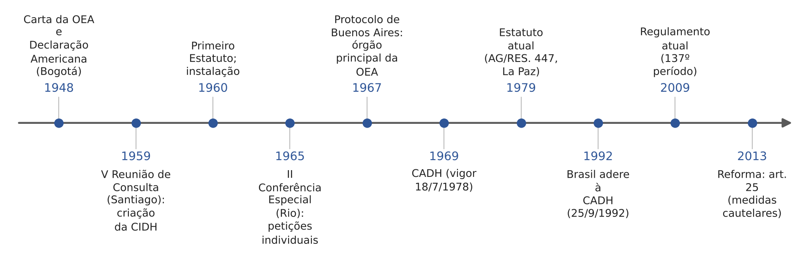
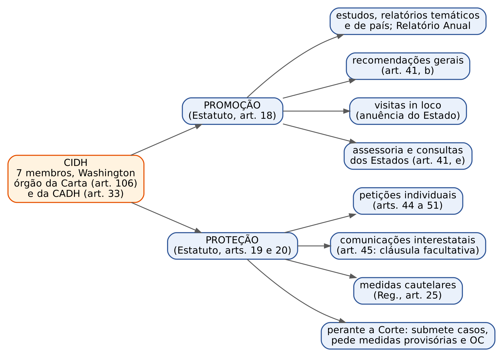
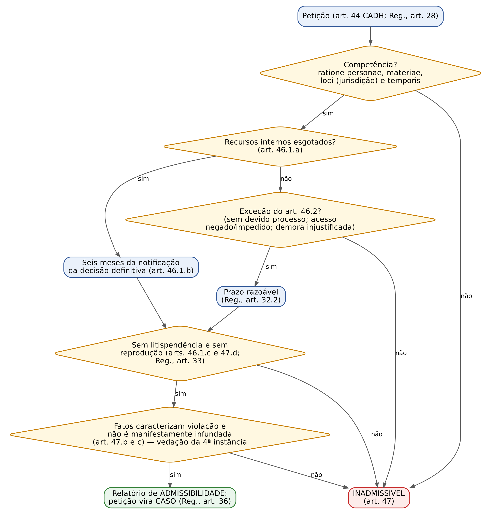
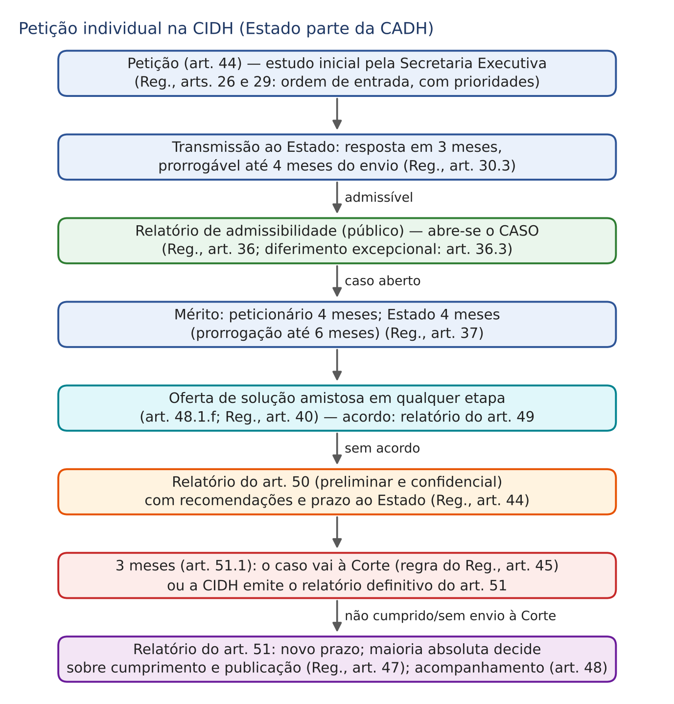
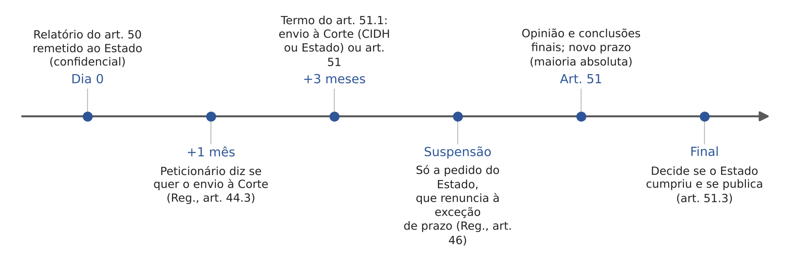
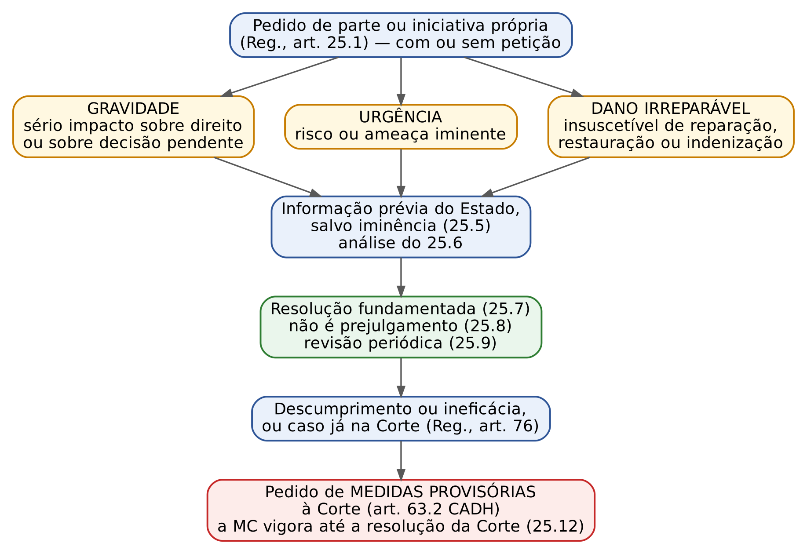
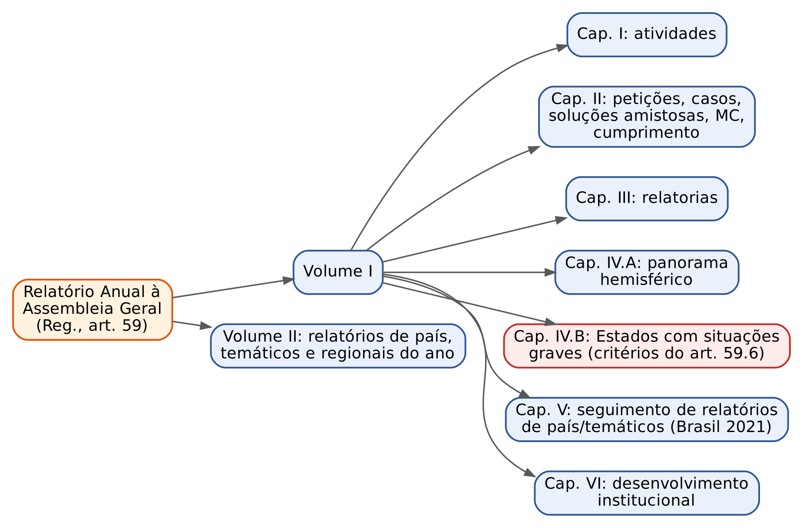

# CAPÍTULO 10 — SISTEMA INTERAMERICANO II: A COMISSÃO INTERAMERICANA DE DIREITOS HUMANOS

:::INCIDENCIA
TRF5 p. 4; TJRS p. 3; TJSC p. 3. Nível A+. Lote: 10 questões (FGV 9, FCC 1), quase todas de provas de juiz e delegado de 2024 a 2026.
O que mais cai: legitimidade para peticionar (qualquer pessoa ou ONG reconhecida em QUALQUER Estado membro da OEA, sem vínculo com a vítima), requisitos do art. 46 com as exceções do esgotamento, litispendência internacional, composição e eleição (sete membros, Assembleia Geral, até três candidatos) e natureza recomendatória dos relatórios.
:::

| Subtema | FGV | FCC | Padrão de cobrança |
|---|---|---|---|
| Composição, eleição, mandato, vacância | 3 | 0 | número de membros (sete, não nove nem onze); quem elege (Assembleia Geral, não Conselho Permanente); até três candidatos; mandato de quatro anos com uma reeleição; vacância pelo Conselho Permanente |
| Legitimidade ativa e passiva | 3 | 1 | ONG estrangeira peticiona diretamente; não precisa de filial no Brasil nem de intermediação estatal; indivíduo não acessa a Corte; jurisdição extraterritorial do Estado demandado |
| Admissibilidade (art. 46) | 4 | 0 | esgotamento e suas três exceções; seis meses da notificação da decisão definitiva (não do fato); litispendência; momento de arguir a falta de esgotamento; petição é à Comissão, não à Corte |
| Natureza dos atos | 1 | 0 | recomendações, não "determinações vinculantes"; dever de boa-fé |

## 10.1 Natureza, origem e base normativa

### 10.1.1 Dupla base: Carta da OEA e Convenção Americana

A CIDH é, ao mesmo tempo, órgão principal da OEA (art. 106 da Carta, introduzido pelo Protocolo de Buenos Aires) e órgão da Convenção Americana (art. 33 da CADH). Essa dupla natureza explica a pergunta que a banca adora: a CIDH atua em relação a TODOS os 35 Estados membros da OEA, inclusive os que não ratificaram a CADH (Estados Unidos e Canadá, por exemplo), aplicando-lhes a Declaração Americana dos Direitos e Deveres do Homem; a Corte IDH, ao contrário, só julga Estados partes da CADH que tenham aceito sua competência contenciosa (art. 62; ver Cap. 11). O valor jurídico da Declaração Americana (OC-10/89) e a estrutura da OEA são tratados no Cap. 9.

Origem: a CIDH foi criada em 1959, pela Resolução VI da V Reunião de Consulta dos Ministros das Relações Exteriores (Santiago), como entidade autônoma de promoção; seu primeiro Estatuto foi aprovado pelo então Conselho da OEA em 25/5/1960, e ela se reuniu pela primeira vez nesse ano. Em 1965, a II Conferência Interamericana Extraordinária (Rio de Janeiro) emendou o Estatuto e a autorizou expressamente a examinar comunicações individuais. O Protocolo de Buenos Aires (1967, em vigor em 1970) a elevou a órgão principal da OEA. Com a CADH (1969, em vigor internacional em 18/7/1978), ganhou o perfil atual de órgão quase judicial do sistema convencional. O Estatuto vigente foi aprovado pela Assembleia Geral (AG/RES. 447, La Paz, 1979), e o Regulamento atual foi aprovado no 137º período de sessões (2009), com reforma relevante no 147º período (março de 2013) e vigência a partir de 1/8/2013.

O art. 106 da Carta (CIDH com a função principal de promover o respeito e a defesa dos direitos humanos e de servir como órgão consultivo da OEA; estrutura e competência remetidas a convenção interamericana) está transcrito no Cap. 9, 9.1.2.

:::LEI CADH (Decreto 678/1992), art. 33
São competentes para conhecer dos assuntos relacionados com o cumprimento dos compromissos assumidos pelos Estados Partes nesta Convenção: a) a Comissão Interamericana de Direitos Humanos, doravante denominada a Comissão; e b) a Corte Interamericana de Direitos Humanos, doravante denominada a Corte.
:::

### 10.1.2 Hierarquia das fontes

| Fonte | Quem aprova | Conteúdo cobrado |
|---|---|---|
| Carta da OEA (art. 106) | Estados (tratado) | existência e função da CIDH como órgão principal e consultivo da OEA |
| CADH (arts. 33 a 51) | Estados (tratado) | composição (34 a 40), funções (41 a 43), competência (44 a 47), processo (48 a 51) |
| Estatuto (AG/RES. 447/1979) | Assembleia Geral da OEA (art. 39 da CADH: a Comissão ELABORA e submete à AG) | eleição, impedimentos, atribuições perante Estados partes (art. 19) e não partes (art. 20) |
| Regulamento (2009, reformado em 2013) | a própria Comissão (art. 39 da CADH: "expedirá seu próprio regulamento"), por maioria absoluta e com consulta pública prévia (Reg., art. 79) | procedimento das petições, medidas cautelares (art. 25), relatórios, audiências, relação com a Corte |

:::PEGADINHA
Estatuto x Regulamento. A Comissão ELABORA o Estatuto, mas quem o APROVA é a Assembleia Geral; o Regulamento, ela mesma expede (art. 39 da CADH). As medidas cautelares NÃO estão na CADH: estão no Regulamento (art. 25), que invoca como fundamento o art. 106 da Carta, o art. 41, b, da CADH, o art. 18, b, do Estatuto e o art. XIII da Convenção Interamericana sobre o Desaparecimento Forçado de Pessoas.
:::

:::ATENCAO
Material desatualizado circula com o texto de 2009 do Regulamento (ex.: art. 25 com redação "para prevenir danos irreparáveis às pessoas ou ao objeto do processo" e art. 46 sem a exigência de demonstrar a "capacidade" de cumprir). A reforma de 2013 alterou os arts. 25, 28, 29, 30, 36, 37, 42, 44, 46, 59, 72, 76 e 79. Use a numeração e a redação vigentes, reproduzidas neste capítulo.
:::

### 10.1.3 Âmbito de atuação: Estados partes x Estados não partes da CADH

| Aspecto | Estado parte da CADH | Estado membro da OEA não parte |
|---|---|---|
| Parâmetro | CADH e protocolos/convenções que atribuam competência à CIDH (Reg., art. 23) | Declaração Americana (Estatuto, art. 1.2, b; Reg., art. 51) |
| Atribuições | as do art. 18 do Estatuto + as do art. 19 (petições dos arts. 44 a 51, comparecer à Corte, pedir medidas provisórias e opiniões consultivas) | as do art. 18 + as do art. 20 (atenção especial aos arts. I, II, III, IV, XVIII, XXV e XXVI da Declaração; exame de comunicações após verificar o esgotamento) |
| Procedimento | Reg., arts. 26 a 50 | Reg., art. 52 (aplica os arts. 28 a 44 e 47 a 49) |
| Desfecho possível | relatório do art. 51 ou envio à Corte | só relatório final da CIDH; NÃO há envio à Corte |

## 10.2 Composição e funcionamento

### 10.2.1 Membros: número, eleição e mandato

:::LEI CADH, arts. 34 a 38
Art. 34. A Comissão Interamericana de Direitos Humanos compor-se-á de sete membros, que deverão ser pessoas de alta autoridade moral e de reconhecido saber em matéria de direitos humanos.
Art. 35. A Comissão representa todos os membros da Organização dos Estados Americanos.
Art. 36. 1. Os membros da Comissão serão eleitos a título pessoal, pela Assembléia Geral da Organização, de uma lista de candidatos propostos pelos governos dos Estados membros. 2. Cada um dos referidos governos pode propor até três candidatos, nacionais do Estado que os propuser ou de qualquer outro Estado membro da Organização dos Estados Americanos. Quando for proposta uma lista de três candidatos, pelo menos um deles deverá ser nacional de Estado diferente do proponente.
Art. 37. 1. Os membros da Comissão serão eleitos por quatro anos e só poderão ser reeleitos uma vez, porém o mandato de três dos membros designados na primeira eleição expirará ao cabo de dois anos. Logo depois da referida eleição, serão determinados por sorteio, na Assembléia Geral, os nomes desses três membros. 2. Não pode fazer parte da Comissão mais de um nacional de um mesmo Estado.
Art. 38. As vagas que ocorrerem na Comissão, que não se devam à expiração normal do mandato, serão preenchidas pelo Conselho Permanente da Organização, de acordo com o que dispuser o Estatuto da Comissão.
:::

Pormenores do Estatuto que completam a letra da CADH:

- Eleição pela Assembleia Geral em votação secreta, exigindo-se maior número de votos E maioria absoluta dos Estados membros (Estatuto, art. 5º); mandatos contados de 1º de janeiro do ano seguinte ao da eleição (art. 6º).
- Calendário: seis meses antes da AG, o Secretário-Geral pede os candidatos, que os Estados apresentam em 90 dias; a lista alfabética segue aos Estados pelo menos 30 dias antes da AG (art. 4º).
- Vacância não decorrente de término de mandato: cada governo pode apresentar UM candidato em 30 dias; o Conselho Permanente preenche a vaga; se o mandato expirar nos seis meses seguintes à vaga, ela não é preenchida (art. 11).
- Incompatibilidade com atividades que afetem independência, imparcialidade, dignidade ou prestígio do cargo: a CIDH, com pelo menos CINCO votos, submete o caso à AG, que declara a incompatibilidade por DOIS TERÇOS dos Estados membros, com separação imediata do cargo, sem invalidar os atos de que o membro participou (art. 8º). Falta grave aos deveres do art. 9º segue rito análogo (art. 10).
- Quarentena: ao assumir, o membro se compromete a não representar vítimas, familiares ou Estados perante a CIDH por dois anos após o mandato (Reg., art. 4.1); o mesmo vale para o Secretário Executivo (Reg., art. 12.3).
- Imunidades: nos Estados partes da CADH, as dos agentes diplomáticos, desde a eleição (Estatuto, art. 12).

:::ESQUEMA CIDH x Corte IDH: composição (detalhes da Corte no Cap. 11)
| Aspecto | CIDH | Corte IDH |
|---|---|---|
| Número | 7 membros (art. 34) | 7 juízes (art. 52) |
| Perfil | alta autoridade moral e reconhecido saber em DH (não precisa ser jurista) | juristas da mais alta autoridade moral, com condições para as mais elevadas funções judiciais |
| Quem elege | Assembleia Geral da OEA, todos os Estados MEMBROS votam | Estados PARTES da CADH, na Assembleia Geral |
| Lista | até 3 candidatos por governo; se 3, um de outro Estado | idem (art. 53.2) |
| Mandato | 4 anos, uma reeleição | 6 anos, uma reeleição |
| Vaga extraordinária | Conselho Permanente (art. 38) | eleição para o restante do mandato; juiz ad hoc é outra figura |
| Representação | representa TODOS os membros da OEA (art. 35) | órgão judicial autônomo |
| Sede | Washington (Estatuto, art. 16) | San José da Costa Rica |
:::

:::QUESTAO FGV 2026 — TJ-PA — Juiz Substituto (Q3951816)
Cobrou como são escolhidos os sete membros da CIDH. Gabarito: D — eleição pela Assembleia Geral da OEA a partir de lista de candidatos apresentada pelos países membros (art. 36.1 da CADH; Estatuto, art. 3º).
Armadilhas: lista tríplice elaborada pela própria Comissão e eleição pelo Conselho Permanente (alternativa C) misturam o rito da vacância (art. 38: Conselho Permanente) com o da eleição ordinária; indicação por grupos regionais em rodízio e escolha pela Secretaria-Geral não existem no sistema.
:::

:::QUESTAO FGV 2025 — PC-MG — Delegado de Polícia Substituto (Q3171425)
Afirmativas sobre a CIDH. Gabarito: D — mandato de quatro anos, uma reeleição, e o mandato de três dos membros da primeira eleição expirou em dois anos (letra do art. 37.1).
Erros das demais: vagas extraordinárias são preenchidas pelo Conselho Permanente, não por indicação do Presidente da Comissão (art. 38); não pode haver mais de um nacional do mesmo Estado (art. 37.2), ainda que indicado por governos diferentes; são sete membros, não onze (art. 34); cada governo propõe até TRÊS candidatos, não cinco (art. 36.2).
:::

:::PEGADINHA
O candidato pode ser nacional de QUALQUER Estado membro da OEA, não só do proponente (art. 36.2): o Brasil pode indicar um argentino. Mas, se a lista for de três nomes, ao menos um deve ser estrangeiro em relação ao proponente. E a nacionalidade do membro gera impedimento: o comissário não participa da discussão, investigação, deliberação ou decisão de assunto relativo ao Estado de que é cidadão (Reg., art. 17.2, a) nem de observação *in loco* nesse Estado (Reg., art. 54). A CIDH também já estendeu, por interpretação do art. 17, a abstenção de comissário em relação ao Estado que o indicou para novo mandato (Resolução 1/25, de 15/7/2025, com votos dissidentes que a viram como reforma regulamentar disfarçada).
:::

### 10.2.2 Funcionamento interno

- Diretoria: Presidente, Primeiro e Segundo Vice-Presidentes, eleitos por maioria absoluta para um ano, reeleição apenas uma vez a cada quatro anos (Estatuto, art. 14; Reg., arts. 6º a 8º).
- Sede em Washington; pode reunir-se em qualquer Estado americano por maioria absoluta e com anuência ou a convite do governo (Estatuto, art. 16). Pelo menos dois períodos ordinários de sessões por ano; sessões privadas, salvo decisão em contrário (Reg., art. 14).
- Quórum: maioria absoluta dos membros, isto é, quatro (Estatuto, art. 17.1; Reg., art. 16). Decisões, em regra, pela maioria dos presentes; exigem maioria ABSOLUTA dos membros: eleição da Diretoria, interpretação do Regulamento, aprovação de relatório sobre a situação de um Estado e os casos previstos na CADH, no Estatuto ou no Regulamento (Reg., art. 18) — por exemplo, a decisão de NÃO enviar um caso à Corte (Reg., art. 45.1), a emissão do relatório do art. 51 e a decisão de publicá-lo (art. 51.1 e 51.3 da CADH), a criação de relatorias temáticas (Reg., art. 15.3) e a reforma do Regulamento (Reg., art. 79).
- Voto fundamentado, concordante ou dissidente, em 30 dias após o período de sessões (Reg., art. 19.4).
- Secretaria Executiva: unidade funcional da Secretaria-Geral da OEA (art. 40 da CADH); o Secretário Executivo é nomeado pelo Secretário-Geral da OEA, após concurso público conduzido pela Comissão, para quatro anos, renováveis uma vez (Reg., art. 11). Faz o estudo inicial e a tramitação das petições (Reg., arts. 13 e 26).
- Idiomas oficiais: espanhol, francês, inglês e português (Reg., art. 22).

## 10.3 Funções

### 10.3.1 O art. 41 e a distinção promoção x proteção

:::LEI CADH, art. 41
A Comissão tem a função principal de promover a observância e a defesa dos direitos humanos e, no exercício do seu mandato, tem as seguintes funções e atribuições: a. estimular a consciência dos direitos humanos nos povos da América; b. formular recomendações aos governos dos Estados membros, quando o considerar conveniente, no sentido de que adotem medidas progressivas em prol dos direitos humanos no âmbito de suas leis internas e seus preceitos constitucionais, bem como disposições apropriadas para promover o devido respeito a esses direitos; c. preparar os estudos ou relatórios que considerar convenientes para o desempenho de suas funções; d. solicitar aos governos dos Estados membros que lhe proporcionem informações sobre as medidas que adotarem em matéria de direitos humanos; e. atender às consultas que, por meio da Secretaria-Geral da Organização dos Estados Americanos, lhe formularem os Estados membros sobre questões relacionadas com os direitos humanos e, dentro de suas possibilidades, prestar-lhes o assessoramento que eles lhe solicitarem; f. atuar com respeito às petições e outras comunicações, no exercício de sua autoridade, de conformidade com o disposto nos artigos 44 a 51 desta Convenção; e g. apresentar um relatório anual à Assembléia Geral da Organização dos Estados Americanos.
:::

Observe que o art. 41 se refere a Estados MEMBROS (da OEA), não apenas a Estados partes: as funções de promoção alcançam toda a Organização. Somam-se os deveres dos Estados partes de remeter à CIDH cópia dos relatórios anuais apresentados aos conselhos econômico-social e de educação da OEA (art. 42) e de informar como o direito interno assegura a aplicação da Convenção (art. 43).

| Função | Fundamento | Natureza do ato | Destinatário |
|---|---|---|---|
| Recomendações gerais | art. 41, b; Estatuto, art. 18, b | recomendação (não vinculante em sentido estrito) | qualquer Estado membro |
| Estudos e relatórios (temáticos, de país, anual) | art. 41, c e g; Reg., arts. 58 a 60 | relatório | Estados e Assembleia Geral |
| Pedido de informações | art. 41, d; art. 43 | requisição; dever de informar nos Estados partes | Estados membros |
| Visita *in loco* | Estatuto, art. 18, g; Reg., arts. 53 a 57 | atividade de monitoramento, com anuência ou convite | Estado visitado |
| Consultas e assessoria | art. 41, e | assessoramento | Estado consulente |
| Petições individuais e comunicações interestatais | arts. 41, f, 44 a 51 | relatórios de admissibilidade, de mérito (art. 50) e final (art. 51) | Estado demandado |
| Medidas cautelares | Reg., art. 25 | solicitação de medidas urgentes | Estado membro (parte ou não) |
| Atuação perante a Corte | arts. 61, 63.2 e 64; Estatuto, art. 19, b a d | parte processual sui generis; requerente de medidas provisórias e de OC | Corte IDH |
| Órgão consultivo da OEA | Carta, art. 106 | parecer | órgãos da OEA |

:::QUESTAO FGV 2026 — TRF2 — Juiz Federal Substituto (Q3996910)
Enunciado sobre petições à CIDH, pedindo a opção correta à luz da CADH. Gabarito oficial: E — para a admissibilidade, é necessário que tenham sido interpostos e esgotados os recursos da jurisdição interna, de acordo com os princípios de direito internacional (art. 46.1, a).
Erros: a CADH NÃO pode ser interpretada para permitir ao Estado limitar direitos em confronto com sua Constituição (art. 29, a, e art. 27 da Convenção de Viena: o direito interno não justifica o descumprimento; ver Cap. 2); a CIDH tem SETE membros, não nove; a CIDH formula RECOMENDAÇÕES para medidas progressivas "no âmbito de suas leis internas e seus preceitos constitucionais" (art. 41, b), não "determinações vinculantes" — a alternativa D trocou só o substantivo.
Ponto discutível: a alternativa B (a Corte é competente para examinar o cumprimento das obrigações dos Estados partes) reproduz, em substância, o art. 33. A leitura da banca só se sustenta porque a competência contenciosa da Corte é facultativa (art. 62) e não alcança automaticamente todo Estado parte. Em prova, prefira a alternativa que copia a letra do art. 46.1, a, sem ressalva.
:::

### 10.3.2 Visitas *in loco* e a declaração interpretativa do Brasil

A visita *in loco* (observação *in loco*) depende de anuência ou convite do Estado (Estatuto, art. 18, g). É feita por Comissão Especial; o comissário nacional do Estado ou nele residente fica impedido (Reg., arts. 53 e 54). O Estado garante liberdade de entrevista em privado, livre trânsito, acesso a cárceres e locais de detenção e interrogatório, documentos e proibição de represálias contra colaboradores (Reg., arts. 56 e 57). Distinga-se a "investigação *in loco*" no curso de um caso (art. 48.1, d, e 48.2 da CADH; Reg., art. 39): em casos graves e urgentes, pode ser feita mediante prévio consentimento do Estado, com a só apresentação de petição que reúna os requisitos formais de admissibilidade.

:::LEI Decreto 678/1992, art. 2º (declaração interpretativa do Brasil)
Ao depositar a Carta de Adesão a esse ato internacional, em 25 de setembro de 1992, o Governo brasileiro fez a seguinte declaração interpretativa: "O Governo do Brasil entende que os artigos 43 e 48, alínea "d", não incluem o direito automático de visitas e inspeções in loco da Comissão Interamericana de Direitos Humanos, as quais dependerão da anuência expressa do Estado".
:::

As datas da CADH e da adesão brasileira (22/11/1969; 18/7/1978; 25/9/1992; Decreto de 6/11/1992) estão no Cap. 9, 9.3.1; o reconhecimento da competência da Corte (10/12/1998; Decreto 4.463/2002), no Cap. 11.

### 10.3.3 Audiências

A CIDH realiza audiências por iniciativa própria ou a pedido (Reg., art. 61), sobre petições e casos (admissibilidade, solução amistosa, prova, mérito, acompanhamento) ou de caráter geral, sobre a situação de direitos em um ou mais Estados (Reg., arts. 62, 64 e 66). Pedidos de audiência devem ser feitos por escrito com antecedência mínima de 50 dias do período de sessões; as partes são informadas com pelo menos um mês (Reg., arts. 64.2, 64.4, 66.1 e 66.5). As audiências são públicas, salvo circunstâncias excepcionais (Reg., art. 68), e o Estado não pode processar testemunhas e peritos nem exercer represálias por suas declarações (Reg., art. 63). Quem propõe a prova custeia sua produção (Reg., art. 69).

## 10.4 Sistema de petições individuais: legitimidade e competência

### 10.4.1 Legitimidade ativa: o direito de petição mais aberto do mundo

:::LEI CADH, arts. 44 e 45
Art. 44. Qualquer pessoa ou grupo de pessoas, ou entidade não-governamental legalmente reconhecida em um ou mais Estados membros da Organização, pode apresentar à Comissão petições que contenham denúncias ou queixas de violação desta Convenção por um Estado Parte.
Art. 45. 1. Todo Estado Parte pode, no momento do depósito do seu instrumento de ratificação desta Convenção ou de adesão a ela, ou em qualquer momento posterior, declarar que reconhece a competência da Comissão para receber e examinar as comunicações em que um Estado Parte alegue haver outro Estado Parte incorrido em violações dos direitos humanos estabelecidos nesta Convenção. 2. As comunicações feitas em virtude deste artigo só podem ser admitidas e examinadas se forem apresentadas por um Estado Parte que haja feito uma declaração pela qual reconheça a referida competência da Comissão. A Comissão não admitirá nenhuma comunicação contra um Estado Parte que não haja feito tal declaração. 3. As declarações sobre reconhecimento de competência podem ser feitas para que esta vigore por tempo indefinido, por período determinado ou para casos específicos. [...]
:::

Cinco consequências que resolvem a maioria das questões:

1. Não se exige vínculo entre peticionário e vítima. O Regulamento é expresso: as petições podem ser apresentadas "em seu próprio nome ou no de terceiras pessoas" (Reg., art. 23). Daí falar-se em legitimação próxima de uma *actio popularis* — mais ampla que a do sistema europeu, que exige a condição de vítima, e que a dos comitês da ONU, que exigem, em regra, a vítima ou seu representante (ver Cap. 8). Não há necessidade de consentimento da vítima para peticionar (diferentemente do que ocorre, como elemento de análise, nas medidas cautelares: Reg., art. 25.6, c).
2. A ONG precisa estar legalmente reconhecida em QUALQUER Estado membro da OEA — não necessariamente no Estado demandado nem em Estado parte da CADH. Uma ONG chilena, uruguaia ou norte-americana denuncia o Brasil diretamente.
3. Não há intermediação estatal: a petição individual é automática com a ratificação (cláusula obrigatória), ao passo que a comunicação interestatal depende de declaração facultativa de AMBOS os Estados (art. 45) — inversão em relação ao modelo europeu original e ao PIDCP, em que a queixa individual é que era facultativa.
4. Não se exige advogado nem procuração: o peticionário "poderá designar" representante (Reg., art. 23, parte final).
5. A vítima deve ser pessoa natural ("pessoa é todo ser humano", art. 1.2 da CADH). Pessoa jurídica pode PETICIONAR (como ONG), mas não é, em regra, VÍTIMA titular de direitos convencionais. A OC-22/16 admite exceções (comunidades indígenas e tribais, e sindicatos, federações e confederações quanto aos direitos do art. 8.1, a, do Protocolo de San Salvador) e reconhece que a violação de direitos de pessoa natural pode se dar por meio da pessoa jurídica de que participa (ver Cap. 9).

| Quem | Peticiona à CIDH? | Submete caso à Corte? |
|---|---|---|
| Vítima, familiar, qualquer pessoa ou grupo | sim (art. 44) | NÃO (art. 61.1) |
| ONG reconhecida em qualquer Estado membro da OEA | sim (art. 44) | NÃO |
| Estado parte | só comunicação interestatal, se ambos fizeram a declaração do art. 45 | sim, se aceitou a competência da Corte (arts. 61 e 62) |
| Comissão | inicia tramitação *motu proprio* (Reg., art. 24) | sim (art. 61.1) |
| Defensoria Pública, MP, OAB | sim, como "qualquer pessoa" ou entidade | NÃO; atuam como representantes das vítimas perante a Corte, depois do envio |

:::QUESTAO FGV 2026 — TJ-MS — Outorga de Delegações (Q3914347)
ONG com sede e atuação no Chile, informada de violações massivas a grupo historicamente discriminado no Brasil, avalia levar o caso a órgão da CADH. Gabarito: A — a ONG pode dirigir-se diretamente à CIDH.
Resolução em passos: (1) o órgão de entrada é a Comissão, não a Corte; (2) art. 44: entidade não governamental legalmente reconhecida em "um ou mais Estados membros da Organização" — o Chile basta; (3) não há exigência de sede no Brasil, de atuação conjunta com entidade nacional, de vínculo com as vítimas nem de intermediação do Estado chileno (que só poderia comunicar violação se Brasil e Chile tivessem feito a declaração do art. 45).
No mesmo sentido: FGV 2026 — PC-PI — Delegado (Q3849009), com ONG uruguaia que denuncia agentes de delegacia no Nordeste; gabarito B (pode dirigir-se à CIDH). As alternativas falsas exigiam filial no Brasil, intermediação do Uruguai ou inventavam órgão inexistente ("Comissão de Ideologia Participativa").
:::

:::QUESTAO FCC 2024 — TRT11 — Analista Judiciário (Q2400477)
Pergunta a quem compete receber petições com denúncias de violação da CADH. Gabarito: C — compete à Comissão, podendo a petição ser formulada por pessoa ou grupo de pessoas ou por ONG legalmente reconhecida em um ou mais Estados membros da OEA (letra do art. 44).
Armadilhas: B começa certo, mas acrescenta que os peticionários ficam "legitimados a submeter o caso à decisão da Corte", o que contraria o art. 61.1 ("Somente os Estados Partes e a Comissão têm direito de submeter caso à decisão da Corte"); o peticionário apenas manifesta, em um mês, sua posição sobre o envio (Reg., art. 44.3), sem poder de decisão. A, D e E repartem a competência de recebimento entre Corte e Comissão conforme o tipo de peticionário, distinção que não existe: toda petição individual entra pela Comissão.
:::

### 10.4.2 Legitimidade passiva e as quatro competências

A petição é dirigida contra ESTADO (nunca contra particulares, empresas, agentes ou organizações internacionais), que responde por ação ou omissão de qualquer de seus Poderes e entes federativos (cláusula federal, art. 28; ver Cap. 9). A CIDH verifica, antes dos requisitos do art. 46, sua competência:

| Competência | Pergunta | Exemplo de prova |
|---|---|---|
| *Ratione personae* | Peticionário legitimado (art. 44)? Vítima pessoa natural? Estado demandado é membro da OEA (e parte, se a base é a CADH)? | ONG estrangeira pode peticionar; empresa não é vítima |
| *Ratione materiae* | O direito alegado está em instrumento cuja aplicação compete à CIDH (Reg., art. 23)? | CADH, Declaração Americana, Protocolo de San Salvador (só arts. 8º, a, e 13, por petição — art. 19.6; ver Cap. 19), Protocolo sobre Pena de Morte, Convenção contra a Tortura, sobre Desaparecimento Forçado, Belém do Pará (art. 7º, por força do art. 12), e Convenção contra o Racismo (art. 15, i) |
| *Ratione temporis* | Os fatos ocorreram quando a obrigação já vigorava para o Estado? | violações anteriores a 25/9/1992 podem ser examinadas à luz da Declaração Americana (o Brasil já era membro da OEA); violações continuadas permanecem |
| *Ratione loci* | A vítima estava sob a JURISDIÇÃO do Estado (art. 1.1)? | jurisdição não é território: abrange pessoas sob autoridade e controle efetivo de agentes do Estado no exterior |

:::QUESTAO FGV 2025 — TRF6 — Juiz Federal Substituto (Q3742442)
Ana, nacional do país Alfa (parte da CADH), ativista de minorias, é capturada e torturada no território do país Beta (também parte) por agentes de Alfa que cumpriam ordens oficiais; Beta passa a apurar os fatos; Ana vai para Sigma (parte) e relata tudo, por videoconferência, a ONG com sede no Brasil, que submete o caso contra Alfa à CIDH. Gabarito: A — a narrativa não tem nenhuma incorreção.
Resolução em passos:
- Legitimidade ativa: ONG reconhecida em Estado membro da OEA (Brasil) peticiona em nome de terceiro; não importa que Ana não seja brasileira nem esteja no Brasil (art. 44; Reg., art. 23).
- Legitimidade passiva e jurisdição: a obrigação do art. 1.1 alcança toda pessoa "sujeita à sua jurisdição", e a jurisdição é exercida quando agentes do Estado submetem a pessoa a sua autoridade e controle, mesmo fora do território. Alfa responde pelos atos de seus agentes em Beta.
- Beta não precisava figurar como demandado: a petição é contra o Estado ao qual se atribui a violação; Beta, pelo enunciado, não a praticou e está investigando (o que, se houver, será discutido em petição própria por eventual omissão).
- O fato de a vítima ter deixado Beta e estar em Sigma é irrelevante; a admissibilidade dependerá, depois, do esgotamento em Alfa ou de exceção do art. 46.2 (a perseguição oficial pode caracterizar ausência de recursos efetivos).
:::

:::QUESTAO FGV 2025 — TRF6 — Juiz Federal Substituto (Q3742439)
Afirmativas sobre as normas estruturantes do sistema. Gabarito: A — a CADH concebe a proteção internacional como complementar ao direito interno e adota o esgotamento como requisito de admissibilidade, com exceções para inexistência de devido processo legal, impedimento de acesso às instâncias nacionais ou demora injustificada (preâmbulo, segundo considerando; art. 46.1, a, e 46.2).
Erros: a Declaração Americana NÃO perdeu relevância (é parâmetro para os Estados não partes e fonte de obrigações para todos os membros da OEA; OC-10/89, Cap. 9); o art. 1.1 protege toda pessoa sob a jurisdição, sem distinção entre nacionais, residentes, migrantes, apátridas ou refugiados; o art. 26 não é tratado como norma meramente programática (justiciabilidade direta desde Lagos del Campo, Cap. 19); a CADH NÃO reconhece pessoas jurídicas como titulares de direitos em igualdade com pessoas naturais (art. 1.2; OC-22/16).
:::

### 10.4.3 Comunicações interestatais

O mecanismo do art. 45 é facultativo e exige reciprocidade: só se admite comunicação de Estado que fez a declaração contra Estado que também a fez; a declaração pode ser por prazo indeterminado, determinado ou para caso específico (art. 45.3). O Regulamento manda transmitir a comunicação mesmo ao Estado que não fez a declaração, para que possa aceitar a competência para o caso concreto (Reg., art. 50). Na prática, o mecanismo foi pouquíssimo usado; os precedentes conhecidos são Nicarágua x Costa Rica (Caso Interestatal 01/06, declarado inadmissível pelo Relatório 11/07, de 8/3/2007, por falta de esgotamento, sem demonstração de prática generalizada de discriminação contra migrantes nicaraguenses que tornasse inúteis os recursos internos) e Equador x Colômbia (Petição Interestatal IP-02, Franklin Guillermo Aisalla Molina, morto no bombardeio de 2008 em território equatoriano; admitida pelo Relatório 112/10, de 21/10/2010). Para prova, basta a regra: petição individual é automática; comunicação interestatal depende de declaração dos dois Estados.

:::PEGADINHA
No sistema global, a lógica é a mesma para o PIDCP (art. 41: comunicações interestatais dependem de declaração), mas a queixa INDIVIDUAL depende de ratificação ou adesão ao Primeiro Protocolo Facultativo (o Brasil ADERIU em 25/9/2009; ver Cap. 8). No interamericano, a queixa individual à CIDH é automática; o que é facultativo é a competência contenciosa da CORTE (art. 62).
:::

## 10.5 Requisitos de admissibilidade

:::LEI CADH, arts. 46 e 47
Art. 46. 1. Para que uma petição ou comunicação apresentada de acordo com os artigos 44 ou 45 seja admitida pela Comissão, será necessário: a. que hajam sido interpostos e esgotados os recursos da jurisdição interna, de acordo com os princípios de direito internacional geralmente reconhecidos; b. que seja apresentada dentro do prazo de seis meses, a partir da data em que o presumido prejudicado em seus direitos tenha sido notificado da decisão definitiva; c. que a matéria da petição ou comunicação não esteja pendente de outro processo de solução internacional; e d. que, no caso do artigo 44, a petição contenha o nome, a nacionalidade, a profissão, o domicílio e a assinatura da pessoa ou pessoas ou do representante legal da entidade que submeter a petição.
2. As disposições das alíneas a e b do inciso 1 deste artigo não se aplicarão quando: a. não existir, na legislação interna do Estado de que se tratar, o devido processo legal para a proteção do direito ou direitos que se alegue tenham sido violados; b. não se houver permitido ao presumido prejudicado em seus direitos o acesso aos recursos da jurisdição interna, ou houver sido ele impedido de esgotá-los; e c. houver demora injustificada na decisão sobre os mencionados recursos.
Art. 47. A Comissão declarará inadmissível toda petição ou comunicação apresentada de acordo com os artigos 44 ou 45 quando: a. não preencher algum dos requisitos estabelecidos no artigo 46; b. não expuser fatos que caracterizem violação dos direitos garantidos por esta Convenção; c. pela exposição do próprio peticionário ou do Estado, for manifestamente infundada a petição ou comunicação ou for evidente sua total improcedência; ou d. for substancialmente reprodução de petição ou comunicação anterior, já examinada pela Comissão ou por outro organismo internacional.
:::

| Requisito | Fonte | Regra | Exceção ou detalhe |
|---|---|---|---|
| Esgotamento dos recursos internos | art. 46.1, a; Reg., art. 31 | recursos adequados e efetivos, interpostos e esgotados | art. 46.2, a a c; ônus do Estado de indicar recursos (Reg., art. 31.3) |
| Prazo | art. 46.1, b; Reg., art. 32 | seis meses da NOTIFICAÇÃO da decisão definitiva | aplicada exceção ao esgotamento: prazo razoável (Reg., art. 32.2) |
| Ausência de litispendência | art. 46.1, c; Reg., art. 33.1, a | matéria não pendente em outro processo internacional | Reg., art. 33.2 (exame geral; peticionário terceiro sem mandato) |
| Ausência de coisa julgada internacional | art. 47, d; Reg., art. 33.1, b | não reproduzir petição já examinada pela CIDH ou outro organismo | idem |
| Requisitos formais | art. 46.1, d; Reg., art. 28 | identificação do peticionário, relato, Estado, providências de esgotamento | sigilo da identidade perante o Estado (Reg., art. 28.2); não é preciso indicar o artigo violado (Reg., art. 28.6) |
| Caracterização de violação | art. 47, b e c; Reg., art. 34 | fatos que, se provados, caracterizem violação; não manifestamente infundada | base da "fórmula da quarta instância" |

### 10.5.1 Esgotamento dos recursos internos

Fundamento: o caráter "coadjuvante ou complementar" da proteção internacional, enunciado no preâmbulo da CADH. O Estado tem a primeira oportunidade de reparar a violação por seus próprios meios (subsidiariedade). A regra é de direito internacional geral ("de acordo com os princípios de direito internacional geralmente reconhecidos") e, por isso, sua aplicação é flexível e orientada à efetividade.

Regras construídas pela Corte IDH e pela CIDH que a banca transforma em alternativas:

- Só se exige o esgotamento de recursos ADEQUADOS (idôneos para proteger a situação jurídica violada) e EFETIVOS (capazes de produzir o resultado). Recursos meramente formais, ilusórios ou de êxito impossível não precisam ser esgotados.
- Ônus da prova: o Estado que alega a falta de esgotamento deve indicar quais recursos estão pendentes e demonstrar sua efetividade (Corte IDH, Caso Velásquez Rodríguez vs. Honduras, Exceções Preliminares, sentença de 26/6/1987, Série C n. 1, § 88; Reg., art. 31.3).
- Oportunidade: a exceção deve ser arguida nas primeiras etapas do procedimento perante a CIDH, isto é, na fase de admissibilidade; se não o for, presume-se a renúncia TÁCITA do Estado (Velásquez Rodríguez, § 88). O Regulamento manda apresentar os questionamentos à admissibilidade desde o envio da petição ao Estado e antes da decisão de admissibilidade (Reg., art. 30.6). A exceção é renunciável porque existe em benefício do Estado.
- Em casos de desaparecimento forçado e similares, a questão dos recursos pode estar indissoluvelmente ligada ao mérito (Velásquez Rodríguez, §§ 94 a 96), hipótese em que a CIDH pode abrir o caso e diferir a admissibilidade para a decisão de mérito (Reg., art. 36.3, a).
- O requisito é verificado no momento da DECISÃO de admissibilidade, não no da apresentação da petição: recursos esgotados no curso da tramitação suprem a exigência (prática constante da CIDH).
- Indigência e temor generalizado: a Corte entendeu que, se o indigente não consegue assistência jurídica necessária para proteger direito convencional, ou se há temor generalizado na comunidade jurídica que impede obter advogado, aplica-se a exceção do art. 46.2 (Corte IDH, OC-11/90, de 10/8/1990, Exceções ao esgotamento dos recursos internos).

:::JURIS Corte IDH, Caso Gomes Lund e outros (Guerrilha do Araguaia) vs. Brasil, sentença de 24/11/2010 (Série C n. 219)
O Brasil arguiu falta de esgotamento apontando a ADPF 153, a ação civil pública, a ação penal subsidiária e iniciativas de reparação. A Corte considerou extemporâneos os argumentos não apresentados na fase de admissibilidade perante a CIDH (§ 40) e, quanto à ação ordinária efetivamente invocada a tempo, entendeu que a demora era injustificada, dispensando o esgotamento (§§ 32 a 42). Rejeitou também a exceção de "falta de interesse processual", afirmando que a decisão da CIDH de submeter o caso é discricionária e não se sujeita a exceção preliminar salvo erro grave que afete o direito de defesa (§§ 20 a 31). Fatos e reparações: Cap. 12.
:::

:::QUESTAO FGV 2024 — TJ-SC — Juiz Substituto (Q3049427)
Afirmativas sobre o sistema interamericano. Gabarito: D — o esgotamento pode ser dispensado se constatadas barreiras de acesso à justiça, com dificuldade de acesso da vítima aos recursos internos (art. 46.2, b; OC-11/90).
Erros, um por alternativa:
- A: a petição da vítima é endereçada à COMISSÃO, não à Corte; a vítima não peticiona à Corte (art. 61.1).
- B: os seis meses contam da NOTIFICAÇÃO da decisão definitiva ao presumido prejudicado (art. 46.1, b), não "da data do fato ou de sua ciência pelo poder público".
- C: a exceção de não esgotamento não pode ser arguida "a qualquer tempo, desde que antes da sentença": deve sê-lo na fase de admissibilidade perante a CIDH, sob pena de renúncia tácita (Velásquez Rodríguez; Gomes Lund).
- E: o acionamento simultâneo de mais de um mecanismo internacional sobre a mesma matéria é VEDADO (litispendência, art. 46.1, c).
:::

:::PEGADINHA
O art. 46.2 afasta as alíneas a E b do art. 46.1: nas hipóteses de exceção, não se exigem nem o esgotamento nem os seis meses contados da decisão definitiva — que, afinal, não existe. Mas continua havendo prazo: o "prazo razoável", fixado a critério da CIDH à luz da data da violação e das circunstâncias (Reg., art. 32.2). As exceções NÃO afastam a litispendência (alínea c) nem os requisitos formais (alínea d).
:::

### 10.5.2 Prazo de seis meses

O termo inicial é a data em que o presumido prejudicado foi NOTIFICADO da decisão que esgota os recursos internos (art. 46.1, b; Reg., art. 32.1) — não a data do fato, nem a do trânsito em julgado em abstrato, nem a da ciência pelo Estado. Recursos extraordinários sem aptidão para reparar a violação não reabrem o prazo. Em violações continuadas (desaparecimento forçado, privação continuada de liberdade), a contagem leva em conta a permanência da situação. Prazos do Regulamento contados em dias seguem o calendário civil (Reg., art. 77).

:::DICA
Os prazos do capítulo, de uma vez:
| Prazo | Fonte |
|---|---|
| 6 meses para peticionar (da notificação da decisão definitiva) | art. 46.1, b; Reg., art. 32.1 |
| 3 meses para o Estado responder à petição; prorrogações até 4 meses do envio | Reg., art. 30.3 |
| 4 meses para observações de mérito de cada parte; prorrogações até 6 meses | Reg., art. 37.1 e 37.2 |
| 1 mês para o peticionário dizer se quer o envio à Corte | Reg., art. 44.3 |
| 3 meses após a remessa do relatório do art. 50 para o envio à Corte | art. 51.1; Reg., art. 47.1 |
| 50 dias de antecedência para pedir audiência | Reg., arts. 64.2 e 66.1 |
| 30 dias para o voto fundamentado | Reg., art. 19.4 |
| 1 mês para o Estado responder ao rascunho dos Capítulos IV.B e V | Reg., art. 59.10 |
| 2 anos de quarentena de ex-comissários | Reg., art. 4.1 |
| 90 dias para pedido de interpretação de sentença da Corte (não é prazo da CIDH) | art. 67 |
:::

### 10.5.3 Litispendência e coisa julgada internacional

A CIDH não considera petição cuja matéria esteja pendente de outro processo de solução perante organização internacional governamental de que seja parte o Estado, ou que reproduza substancialmente petição pendente ou já examinada por ela ou por outro organismo internacional governamental (art. 46.1, c, e 47, d; Reg., art. 33.1). A vedação exige identidade substancial de partes, fatos e pretensões.

O Regulamento traz duas exceções em que a CIDH NÃO se abstém (Reg., art. 33.2):

- o procedimento no outro organismo se limita ao EXAME GERAL dos direitos humanos no Estado (relatórios periódicos a comitês, Revisão Periódica Universal, relatorias especiais da ONU), sem decisão sobre os fatos específicos ou sem conduzir a solução efetiva;
- o peticionário perante a CIDH é a vítima ou familiar, e o peticionário perante o outro organismo é terceiro ou ONG sem mandato deles.

:::QUESTAO FGV 2025 — TJ-TO — Juiz Substituto (Q3453313)
À luz da Convenção Interamericana contra o Racismo, pergunta a condição para que brasileiro vítima de violação apresente denúncia à CIDH. Gabarito: C — a matéria não pode estar pendente de outro processo de solução internacional.
Fundamento: o art. 15, i, da Convenção (Decreto 10.932/2022) reproduz a legitimidade do art. 44 da CADH e manda aplicar "todas as normas de procedimento pertinentes" da CADH, do Estatuto e do Regulamento — logo, os requisitos do art. 46, entre eles a ausência de litispendência.
Armadilhas: não há parecer prévio da PGR, nem exigência de advogado inscrito na OAB ou defensor (Reg., art. 23: a representação é faculdade); o IDC (art. 109, § 5º, da CF; Cap. 3) é instituto interno, cuja suscitação ou não é irrelevante para a admissibilidade internacional; não há prazo de inércia de ministério como condição.
Observação: o enunciado diz que o Brasil ratificou em 2021 seguindo o rito do art. 5º, § 3º; correto — Decreto Legislativo 1, de 18/2/2021, depósito em 28/5/2021, vigência para o Brasil em 27/6/2021, promulgação pelo Decreto 10.932, de 10/1/2022 (equivalência de emenda; ver Caps. 4 e 17).
:::

:::EXEMPLO Litispendência ou não?
Situação 1: a mãe de pessoa morta em operação policial comunica o fato ao Comitê de Direitos Humanos da ONU (Brasil é parte do Primeiro Protocolo Facultativo ao PIDCP; ver Cap. 8) e, meses depois, à CIDH, pelos mesmos fatos. Inadmissível na CIDH enquanto pendente a comunicação no Comitê (art. 46.1, c); se o Comitê já decidiu, há reprodução (art. 47, d).
Situação 2: o mesmo episódio foi citado pelo Brasil em seu relatório periódico ao Comitê e mencionado em comunicado de relator especial da ONU. Admissível: exame geral, sem decisão sobre os fatos específicos (Reg., art. 33.2, a).
Situação 3: ONG sem mandato da família levou o caso ao Comitê; a mãe peticiona à CIDH. Admissível (Reg., art. 33.2, b).
:::

### 10.5.4 Requisitos formais e "quarta instância"

Requisitos formais (Reg., art. 28): nome do denunciante ou, sendo ONG, seu representante e o Estado em que é reconhecida; se deseja SIGILO de sua identidade perante o Estado, e por quê; e-mail; relato com lugar e data; se possível, nome da vítima e da autoridade que conheceu o fato; o Estado responsável, "embora sem referência específica ao(s) artigo(s) supostamente violado(s)"; cumprimento do prazo; providências de esgotamento ou sua impossibilidade; e se a denúncia foi submetida a outro procedimento internacional. A Secretaria Executiva pode pedir que o peticionário complete a petição (Reg., art. 26.2). O anonimato perante a CIDH não é admitido; o sigilo é perante o Estado.

Fórmula da quarta instância: a CIDH e a Corte não são tribunais de apelação das decisões internas e não revisam a valoração da prova ou a interpretação do direito interno pelo juiz nacional, salvo quando a decisão, em si, configure violação de direito convencional (por exemplo, falta de garantias judiciais, discriminação, arbitrariedade manifesta). A petição que apenas reivindica a "injustiça" da sentença interna, sem apontar violação autônoma da CADH, é inadmissível por não caracterizar violação ou ser manifestamente infundada (art. 47, b e c; Reg., art. 34).

:::JURIS Corte IDH, Caso Gomes Lund (Guerrilha do Araguaia) vs. Brasil, sentença de 24/11/2010 (Série C n. 219), §§ 43 a 49
O Brasil invocou a "regra da quarta instância" porque o STF, em 29/4/2010, julgara improcedente a ADPF 153, declarando válida a Lei de Anistia. A Corte rejeitou a exceção: não se pretendia revisar a decisão do STF, mas examinar a compatibilidade da conduta estatal — inclusive a aplicação da Lei 6.683/1979 — com a CADH, o que é questão de mérito, sujeita ao controle de convencionalidade (ver Caps. 5 e 13).
:::

:::PRATIQUE Exercício elaborado para esta apostila (não é questão de banca)
Julgue os itens.
1. Familiares de vítima de homicídio praticado por policiais, absolvidos em decisão definitiva notificada aos familiares em 10/1, protocolam petição na CIDH em 15/9 do mesmo ano, sem alegar nenhuma exceção ao esgotamento. A petição é intempestiva.
2. O Estado que, na fase de admissibilidade, nada alegou sobre recursos internos pode arguir a falta de esgotamento como exceção preliminar perante a Corte.
3. A CIDH pode admitir petição que não indique os artigos da CADH violados.
Resolução: 1. CERTO: mais de seis meses desde a notificação da decisão definitiva (art. 46.1, b); só a invocação e o reconhecimento de exceção do art. 46.2 deslocariam a análise para o prazo razoável (Reg., art. 32.2). 2. ERRADO: renúncia tácita (Velásquez Rodríguez, § 88; Gomes Lund, § 40). 3. CERTO (Reg., art. 28.6).
:::

## 10.6 Procedimento das petições e casos

### 10.6.1 Tramitação inicial e prioridades

A Secretaria Executiva registra a petição, faz o estudo inicial e, se faltarem requisitos, pede complementação (Reg., arts. 26 e 29). A regra é a ordem de entrada, mas a CIDH pode antecipar a avaliação (Reg., art. 29.2) quando:

- o decurso do tempo privaria a petição de utilidade: vítima idosa ou criança, doente terminal, sujeita à pena de morte, ou objeto conexo com medida cautelar ou provisória vigente;
- as vítimas estão privadas de liberdade;
- o Estado manifesta formalmente a intenção de entrar em solução amistosa;
- a decisão pode remediar situações estruturais graves ou promover mudanças legislativas ou de prática estatal, evitando múltiplas petições sobre o mesmo tema.

A CIDH pode desmembrar petições com fatos sem conexão ou reunir as que versem fatos semelhantes, mesmas pessoas ou mesmo padrão de conduta (Reg., art. 29.4 e 29.5). Pode também iniciar a tramitação *motu proprio* (Reg., art. 24).

### 10.6.2 Fase de admissibilidade

- A CIDH transmite as partes pertinentes da petição ao Estado; o pedido de informação não é prejulgamento (Reg., art. 30.2).
- Resposta do Estado em TRÊS meses; prorrogações fundamentadas, nunca além de QUATRO meses do envio da primeira comunicação (Reg., art. 30.3). Em gravidade e urgência, resposta com a máxima presteza (art. 30.4), podendo pedir-se, já aí, manifestação sobre admissibilidade e mérito conjuntamente (art. 30.7).
- O relatório de admissibilidade ou de inadmissibilidade é PÚBLICO e integra o Relatório Anual; com o relatório de admissibilidade, a petição é registrada como CASO e começa o mérito; a admissibilidade não é prejulgamento do mérito (Reg., art. 36.1 e 36.2).
- Diferimento excepcional (Reg., art. 36.3): a CIDH pode abrir o caso e deixar a admissibilidade para a decisão de mérito, por resolução fundamentada, quando a exceção ao esgotamento está inextricavelmente ligada ao mérito, em casos de gravidade e urgência com perigo iminente à vida ou integridade, ou quando o decurso do tempo pode impedir o efeito útil da decisão.
- Um grupo de trabalho de três ou mais membros estuda a admissibilidade entre as sessões (Reg., art. 35).

:::NOTA Leitura do art. 48.1, a, da CADH
O texto do art. 48.1, a, diz que a CIDH, "se reconhecer a admissibilidade", pede informações ao Estado. A prática (e o Regulamento) inverteu a ordem: primeiro transmite a petição e ouve o Estado, depois decide a admissibilidade. A Corte, em Velásquez Rodríguez (Exceções Preliminares, 26/6/1987, § 41), afirmou que a declaração FORMAL de admissibilidade não era requisito indispensável do procedimento convencional; hoje, porém, o relatório de admissibilidade é etapa regulamentar, salvo o diferimento do art. 36.3.
:::

### 10.6.3 Fase de mérito

- Aberto o caso, o peticionário tem QUATRO meses para observações adicionais de mérito; o Estado, outros QUATRO meses; prorrogações até SEIS meses do primeiro pedido a cada parte (Reg., art. 37.1 e 37.2).
- Antes de decidir o mérito, a CIDH fixa prazo para as partes manifestarem interesse em solução amistosa (Reg., art. 37.4).
- Presunção de veracidade: presumem-se verdadeiros os fatos da petição se o Estado não prestar a informação no prazo fixado, desde que outros elementos de convicção não levem a conclusão diversa (Reg., art. 38). É presunção RELATIVA, ligada à inércia estatal.
- Investigação *in loco* (Reg., art. 39) e audiências (Reg., arts. 64 e 65) são instrumentos de prova.
- As deliberações são privadas e confidenciais (Reg., art. 43.2); a CIDH pode levar em conta informação de conhecimento público (art. 43.1).
- Desistência: o peticionário pode desistir a qualquer tempo, por escrito; a CIDH pode arquivar ou PROSSEGUIR no interesse de proteger determinado direito (Reg., art. 41) — a desistência não vincula a Comissão.
- Arquivamento (Reg., art. 42): quando não existem ou não subsistem os motivos da petição (art. 48.1, b, da CADH), quando não se obtêm as informações necessárias ou quando a inatividade injustificada do peticionário indica desinteresse; antes, o peticionário é instado a se manifestar. A decisão é definitiva, salvo erro material, fatos supervenientes, informação nova que teria alterado a decisão ou fraude.

### 10.6.4 Solução amistosa

:::LEI CADH, arts. 48.1, f, e 49
Art. 48.1. f. [A Comissão] pôr-se-á à disposição das partes interessadas, a fim de chegar a uma solução amistosa do assunto, fundada no respeito aos direitos humanos reconhecidos nesta Convenção.
Art. 49. Se se houver chegado a uma solução amistosa de acordo com as disposições do inciso 1, f, do artigo 48, a Comissão redigirá um relatório que será encaminhado ao peticionário e aos Estados Partes nesta Convenção e, posteriormente, transmitido, para sua publicação, ao Secretário-Geral da Organização dos Estados Americanos. O referido relatório conterá uma breve exposição dos fatos e da solução alcançada. [...]
:::

Pontos de prova (Reg., art. 40):

- Cabe em QUALQUER etapa do exame da petição ou do caso — inclusive antes da admissibilidade —, por iniciativa da CIDH ou a pedido das partes.
- Depende do CONSENTIMENTO das partes para iniciar e continuar; a CIDH pode encerrar sua intervenção se o assunto não for suscetível dessa via ou se alguma parte se retirar.
- A CIDH verifica o consentimento da vítima ou de seus beneficiários antes de aprovar o relatório, e o acordo deve ter por base o RESPEITO aos direitos humanos: não é transação livre; a CIDH não homologa acordo que viole direitos.
- O relatório do art. 49 é PUBLICADO; seu cumprimento é acompanhado (Reg., art. 48). Documentos da tentativa frustrada de solução amistosa não são remetidos à Corte (Reg., art. 75).
- Velásquez Rodríguez (§ 46): a tentativa de solução amistosa não é obrigatória em todos os casos; a CIDH pode dispensá-la quando a natureza das violações a torna inviável.
- Exemplo brasileiro clássico: o caso José Pereira (trabalho escravo no Pará), encerrado por solução amistosa com compromissos de reparação e de políticas de erradicação do trabalho escravo (ver Cap. 12).

### 10.6.5 O relatório do art. 50 (relatório preliminar ou de mérito)

:::LEI CADH, art. 50
1. Se não se chegar a uma solução, e dentro do prazo que for fixado pelo Estatuto da Comissão, esta redigirá um relatório no qual exporá os fatos e suas conclusões. Se o relatório não representar, no todo ou em parte, o acordo unânime dos membros da Comissão, qualquer deles poderá agregar ao referido relatório seu voto em separado. Também se agregarão ao relatório as exposições verbais ou escritas que houverem sido feitas pelos interessados em virtude do inciso 1, e, do artigo 48. 2. O relatório será encaminhado aos Estados interessados, aos quais não será facultado publicá-lo. 3. Ao encaminhar o relatório, a Comissão pode formular as proposições e recomendações que julgar adequadas.
:::

No Regulamento (art. 44): se a CIDH concluir que NÃO houve violação, o relatório de mérito é transmitido às partes, publicado e incluído no Relatório Anual (art. 44.1). Se concluir que HOUVE violação, prepara relatório preliminar com proposições e recomendações, fixa prazo para o Estado informar as medidas adotadas e o transmite ao Estado, que NÃO pode publicá-lo enquanto a CIDH não decidir a respeito (art. 44.2). Notifica-se o peticionário, que tem UM MÊS para dizer se deseja o envio à Corte, indicando a posição da vítima, os fundamentos e as pretensões de reparação e custas (art. 44.3).

### 10.6.6 Os três meses do art. 51 e a escolha do caminho

:::LEI CADH, art. 51
1. Se no prazo de três meses, a partir da remessa aos Estados interessados do relatório da Comissão, o assunto não houver sido solucionado ou submetido à decisão da Corte pela Comissão ou pelo Estado interessado, aceitando sua competência, a Comissão poderá emitir, pelo voto da maioria absoluta dos seus membros, sua opinião e conclusões sobre a questão submetida à sua consideração. 2. A Comissão fará as recomendações pertinentes e fixará um prazo dentro do qual o Estado deve tomar as medidas que lhe competirem para remediar a situação examinada. 3. Transcorrido o prazo fixado, a Comissão decidirá, pelo voto da maioria absoluta dos seus membros, se o Estado tomou ou não medidas adequadas e se publica ou não seu relatório.
:::

Nos três meses seguintes à remessa do relatório do art. 50, abre-se a alternativa:

- se o Estado aceitou a competência contenciosa e não cumpriu as recomendações, a CIDH SUBMETE o caso à Corte, "salvo por decisão fundamentada da maioria absoluta dos seus membros" (Reg., art. 45.1) — o envio é a REGRA, não ato puramente discricionário; os critérios são a obtenção de justiça no caso, ponderando a posição do peticionário, a natureza e gravidade da violação, a necessidade de desenvolver a jurisprudência e o efeito eventual da decisão nos ordenamentos dos Estados (art. 45.2);
- o próprio Estado pode submeter o caso à Corte (art. 51.1 e art. 61.1);
- não havendo envio, a CIDH pode emitir o relatório DEFINITIVO do art. 51, por maioria absoluta, com novo prazo, e depois decidir, também por maioria absoluta, se o Estado cumpriu e se publica (art. 51; Reg., art. 47).

Suspensão do prazo (Reg., art. 46): a pedido do Estado, desde que (a) demonstre vontade e CAPACIDADE de cumprir as recomendações por ações concretas e idôneas (a CIDH pode considerar leis internas que criem mecanismo de cumprimento) e (b) aceite, de forma expressa e IRREVOGÁVEL, a suspensão, renunciando a arguir perante a Corte exceção preliminar de intempestividade do envio. A CIDH pondera a complexidade das medidas (inclusive coordenação entre governo central e entes regionais), o que o Estado já fez e a posição do peticionário.

:::ESQUEMA Relatório do art. 50 x relatório do art. 51
| Aspecto | Art. 50 | Art. 51 |
|---|---|---|
| Momento | após o mérito, sem solução amistosa | após três meses sem solução e sem envio à Corte |
| Natureza | preliminar; com proposições e recomendações | definitivo; "opinião e conclusões" com recomendações e prazo |
| Publicidade | CONFIDENCIAL; o Estado não pode publicá-lo | a CIDH decide, por maioria absoluta, se publica |
| Quórum | maioria (votos em separado admitidos) | maioria absoluta para emitir e para publicar |
| Destino | Estado (o peticionário é notificado da adoção) | partes; Relatório Anual ou outro meio |
| Se o caso vai à Corte | acompanha a demanda (Reg., art. 74.1) e é publicado após o envio (Reg., art. 74.3) | NÃO é emitido: o envio à Corte encerra a via do art. 51 |
:::

:::JURIS Corte IDH, OC-13/93, de 16/7/1993, e OC-15/97, de 14/11/1997
OC-13/93 (Certas atribuições da CIDH, arts. 41, 42, 44, 46, 47, 50 e 51): os relatórios dos arts. 50 e 51 são DOIS documentos distintos, com regimes próprios; a CIDH é competente para qualificar qualquer norma interna de Estado parte como violadora das obrigações da CADH, mas não para dizer se ela contraria o próprio ordenamento interno (não é corte constitucional nacional). OC-15/97 (Relatórios da CIDH, art. 51): a CIDH não pode, em regra, modificar o relatório do art. 51 depois de transmitido, salvo em circunstâncias excepcionais (cumprimento parcial ou total, erro material, fatos novos), e jamais a pedido do Estado para atenuar conclusões.
:::

:::PEGADINHA
Depois que o caso é submetido à Corte, NÃO há relatório do art. 51: a submissão encerra a via do art. 51 (Velásquez Rodríguez, Exceções Preliminares, §§ 63, 75 e 76). O relatório do art. 50 é publicado pela CIDH com a nota de envio (Reg., art. 74.3). E a Corte não reabre o juízo de oportunidade do envio: a decisão de submeter é da CIDH e só se discute se houver erro grave que prejudique o direito de defesa do Estado (Gomes Lund, §§ 20 a 31).
:::

### 10.6.7 Natureza jurídica das recomendações

As recomendações da CIDH, inclusive as dos relatórios dos arts. 50 e 51, NÃO têm a força de sentença: a Corte, ao interpretar o termo "recomendações" em seu sentido ordinário (art. 31.1 da Convenção de Viena), afirmou que não têm caráter de decisão jurisdicional obrigatória cujo descumprimento gere, por si, responsabilidade do Estado (Corte IDH, Caso Caballero Delgado e Santana vs. Colômbia, sentença de 8/12/1995, Série C n. 22, § 67). Mas isso não as torna irrelevantes. Pelo princípio da BOA-FÉ, o Estado que ratificou a CADH tem a obrigação de envidar seus MELHORES ESFORÇOS para aplicar as recomendações de um órgão de proteção que, além disso, é órgão principal da OEA; e, pelo art. 33, a competência da CIDH envolve o cumprimento dos compromissos dos Estados partes (Corte IDH, Caso Loayza Tamayo vs. Peru, sentença de 17/9/1997, Série C n. 33, §§ 79 a 81).

:::DOUTRINA André de Carvalho Ramos, Processo internacional de direitos humanos; Flávia Piovesan, Direitos humanos e o direito constitucional internacional
A doutrina de direito internacional dos direitos humanos sintetiza o ponto assim: as deliberações da CIDH são juridicamente "recomendações", mas o Estado não pode ignorá-las sem violar a boa-fé e o dever de cooperação com os órgãos de supervisão; a "sanção" do descumprimento é sobretudo o envio do caso à Corte (para Estados que aceitaram sua competência), a publicação do relatório e a exposição política perante a Assembleia Geral (o chamado *power of embarrassment* ou mobilização da vergonha). É a linha seguida, entre outros, por André de Carvalho Ramos (Processo internacional de direitos humanos) e Flávia Piovesan (Direitos humanos e o direito constitucional internacional); as sentenças da Corte, ao contrário, são vinculantes (art. 68.1; Cap. 6).
:::

No mesmo sentido, sobre o valor interno das manifestações da CIDH: Q3752800 (FGV 2025, MPE-ES, Promotor de Justiça Substituto; gabarito C — priorizar a análise da manifestação, respeitada a independência funcional), resolvida no Cap. 6 (06.5.1).

:::SENTENCA Recomendação da CIDH invocada em processo interno
"A parte autora invoca o relatório de mérito da Comissão Interamericana de Direitos Humanos no caso [nome], em que se recomendou ao Estado brasileiro [medida]. Embora as recomendações da Comissão não tenham a força executiva das sentenças da Corte Interamericana (art. 68 da Convenção Americana), o Estado brasileiro, por todos os seus Poderes, deve envidar os melhores esforços para cumpri-las, por força da boa-fé que rege o cumprimento dos tratados (Convenção de Viena, art. 26) e do art. 33 da Convenção Americana, conforme reconhecido pela Corte Interamericana (Caso Loayza Tamayo vs. Peru, 1997, §§ 79 a 81). Considero, assim, o referido relatório como vetor interpretativo relevante na análise de [ponto], sem prejuízo do controle de convencionalidade de ofício (Recomendação CNJ 123/2022)."
:::

### 10.6.8 Petições contra Estados não partes da CADH

Contra os Estados membros da OEA que não ratificaram a CADH, a CIDH recebe petições com base na Declaração Americana (Reg., art. 51), aplica o procedimento dos arts. 28 a 44 e 47 a 49 do Regulamento (art. 52) e verifica previamente o esgotamento (Estatuto, art. 20, c). O desfecho é sempre relatório da própria CIDH: não há submissão à Corte, porque o Estado não aceitou a competência do art. 62.

:::PRATIQUE Exercício elaborado para esta apostila (não é questão de banca)
Julgue os itens.
1. Concluindo pela existência de violação, a CIDH publica imediatamente o relatório do art. 50, para pressionar o Estado.
2. Se o Brasil pedir a suspensão do prazo do art. 51.1, deverá renunciar à exceção de intempestividade do envio do caso à Corte.
3. Se o peticionário, consultado, se opuser ao envio do caso à Corte, a CIDH fica impedida de submetê-lo.
4. A desistência da petição pelo peticionário obriga a CIDH a arquivá-la.
Resolução: 1. ERRADO: o relatório do art. 50 é confidencial para o Estado (art. 50.2; Reg., art. 44.2); só é publicado após o envio à Corte (Reg., art. 74.3) ou substituído pelo relatório do art. 51. 2. CERTO (Reg., art. 46.1, b). 3. ERRADO: a posição do peticionário é um dos critérios (Reg., art. 45.2, a), não veto. 4. ERRADO: a CIDH pode prosseguir no interesse de proteger determinado direito (Reg., art. 41).
:::

## 10.7 A CIDH perante a Corte

| Ato | Fundamento | Observação |
|---|---|---|
| Submeter caso contencioso | art. 61.1; Reg., arts. 45 e 74 | envia o relatório do art. 50, os autos (salvo documentos internos) e nota de envio; publica o relatório e a nota |
| Comparecer em todos os casos | art. 57 da CADH; Estatuto, art. 19, b | atua por delegados (comissários e Secretário Executivo) e assessores (Reg., art. 71); pode pedir peritos (Reg., art. 72) |
| Pedir medidas provisórias | art. 63.2; Estatuto, art. 19, c; Reg., art. 76 | em assuntos ainda não submetidos à Corte, só a CIDH pode pedi-las (ver 10.8.4) |
| Solicitar opinião consultiva | art. 64.1 (órgãos do Capítulo X da Carta); Estatuto, art. 19, d | sem prejuízo dos Estados membros |

Desde a reforma dos Regulamentos de 2009, as supostas vítimas e seus representantes atuam autonomamente perante a Corte (escrito de petições, argumentos e provas), e a CIDH deixou de ser a "parte autora" em sentido processual, assumindo papel de órgão do sistema que defende a ordem pública interamericana. O procedimento na Corte, a legitimidade das vítimas para pedir medidas provisórias em casos já submetidos e a figura do juiz *ad hoc* estão no Cap. 11.

:::JURIS Corte IDH, OC-19/05, de 28/11/2005 (controle de legalidade das atuações da CIDH)
A pedido da Venezuela, a Corte afirmou que a CIDH goza de plena autonomia e independência no exercício de seu mandato e que o controle da legalidade de suas atuações, em matérias sob a competência da Corte, é exercido pela própria Corte, nos casos que lhe são submetidos — não existe um "órgão revisor" das atividades da Comissão.
:::

## 10.8 Medidas cautelares (Regulamento, art. 25)

### 10.8.1 Fundamento e requisitos

:::LEI Regulamento da CIDH, art. 25.1 a 25.3 (redação de 2013)
1. Com fundamento nos artigos 106 da Carta da Organização dos Estados Americanos, 41.b da Convenção Americana sobre Direitos Humanos, 18.b do Estatuto da Comissão e XIII da Convenção Interamericana sobre o Desaparecimento Forçado de Pessoas, a Comissão poderá, por iniciativa própria ou a pedido de parte, solicitar que um Estado adote medidas cautelares. Essas medidas, tenham elas ou não conexão com uma petição ou caso, deverão estar relacionadas a situações de gravidade e urgência que apresentem risco de dano irreparável às pessoas ou ao objeto de uma petição ou caso pendente nos órgãos do Sistema Interamericano.
2. Nas tomadas de decisão a que se refere o parágrafo 1, a Comissão considerará que: a. "gravidade da situação" significa o sério impacto que uma ação ou omissão pode ter sobre um direito protegido ou sobre o efeito eventual de uma decisão pendente em um caso ou petição nos órgãos do Sistema Interamericano; b. a "urgência da situação" é determinada pelas informações que indicam que o risco ou a ameaça são iminentes e podem materializar-se, requerendo dessa maneira ação preventiva ou tutelar; e c. "dano irreparável" significa os efeitos sobre direitos que, por sua natureza, não são suscetíveis de reparação, restauração ou indenização adequada.
3. As medidas cautelares poderão proteger pessoas ou grupos de pessoas, sempre que o beneficiário ou os beneficiários puderem ser identificados ou forem identificáveis por sua localização geográfica ou seu pertencimento ou vínculo a um grupo, povo, comunidade ou organização.
:::

O que a banca extrai do art. 25:

- Três requisitos CUMULATIVOS: gravidade, urgência e dano irreparável, cada um com definição regulamentar. Gravidade NÃO é sinônimo de "violação grave já consumada": é o sério impacto sobre um direito ou sobre o efeito útil de decisão pendente. Não se exige "extrema" gravidade — adjetivo que é da medida provisória da Corte (art. 63.2).
- Dupla finalidade: tutelar (proteger pessoas) e cautelar em sentido estrito (preservar o objeto de petição ou caso pendente).
- Independem de petição: podem ser outorgadas "tenham elas ou não conexão com uma petição ou caso".
- Iniciativa própria ou a pedido de parte.
- Destinatário: qualquer Estado MEMBRO da OEA, parte ou não da CADH (o fundamento inclui o art. 106 da Carta e o Estatuto).
- Beneficiários individuais ou COLETIVOS, desde que identificados ou identificáveis (comunidade indígena, pessoas privadas de liberdade em determinada unidade, integrantes de organização).
- Esgotamento dos recursos internos NÃO é requisito; mas a CIDH considera se a situação foi denunciada às autoridades internas ou por que não pôde sê-lo (art. 25.6, a).

### 10.8.2 Procedimento

| Etapa | Regra (Reg., art. 25) |
|---|---|
| Pedido | dados dos beneficiários (ou que permitam identificá-los), descrição detalhada e cronológica dos fatos, medidas pedidas (25.4) |
| Contraditório prévio | a CIDH pede informações ao Estado, SALVO quando a iminência do dano não admita demora; nesse caso, revisa a decisão o quanto antes ou, no máximo, no período de sessões seguinte (25.5) |
| Elementos de análise | denúncia às autoridades ou motivo para não fazê-la; identificação dos beneficiários ou do grupo; conformidade expressa dos potenciais beneficiários quando o pedido vier de terceiros, salvo justificativa (25.6) |
| Decisão | RESOLUÇÃO FUNDAMENTADA (concessão, ampliação, modificação, suspensão), com descrição da situação, informação do Estado, análise dos requisitos, prazo de vigência se aplicável e votos dos membros (25.7) |
| Efeito sobre o mérito | concessão e adoção NÃO constituem prejulgamento de violação (25.8) |
| Revisão | periódica, de ofício ou a pedido; o Estado pode pedir o levantamento, ouvindo-se os beneficiários; o pedido NÃO suspende a vigência (25.9) |
| Acompanhamento | pedidos de informação, cronogramas, audiências, reuniões de trabalho, visitas (25.10) |
| Inércia dos beneficiários | a CIDH pode suspender ou revisar se os beneficiários, injustificadamente, não responderem sobre requisitos de implementação (25.11) |

:::PEGADINHA
Material antigo (texto de 2009) dizia que a CIDH pedia informações ao Estado "a menos que a urgência da situação justifique o outorgamento imediato". A redação vigente fala em "iminência do dano potencial" que "não admita demora" e acrescenta o dever de REVISAR a decisão adotada sem oitiva "o quanto antes possível ou, o mais tardar, no período de sessões seguinte". Outra mudança de 2013: as decisões passaram a ser resoluções FUNDAMENTADAS e públicas, com os votos dos membros — antes, eram comunicações por carta ao Estado.
:::

### 10.8.3 Natureza jurídica e o episódio de Belo Monte

As medidas cautelares não estão previstas na CADH e, por isso, alguns Estados sustentam que não seriam obrigatórias. A CIDH e a doutrina majoritária respondem que (i) decorrem de seus poderes de proteção previstos na Carta e na CADH (art. 41, b), interpretados à luz do *effet utile*; (ii) os Estados se comprometeram de boa-fé a cooperar com os órgãos de proteção; e (iii) o descumprimento pode levar ao pedido de medidas provisórias à Corte, estas sim inequivocamente vinculantes (art. 63.2). Em prova: medida cautelar da CIDH é "solicitação" de proteção imediata que gera obrigação internacional de boa-fé de cumprimento; medida provisória da Corte é ordem judicial obrigatória.

:::EXEMPLO Belo Monte (MC 382/10)
Em abril de 2011, a CIDH outorgou medidas cautelares em favor de comunidades indígenas da bacia do rio Xingu e pediu ao Brasil a suspensão do licenciamento e das obras da Usina Hidrelétrica de Belo Monte até a realização de consulta prévia, livre e informada, com estudos de impacto acessíveis e traduzidos. O governo brasileiro qualificou as medidas como "precipitadas e injustificáveis", chamou seu representante junto à OEA e suspendeu temporariamente contribuições à Comissão. Em 29/7/2011, a CIDH modificou as medidas: retirou o pedido de suspensão das obras (considerando que o debate sobre consulta e licenciamento excedia o âmbito cautelar) e manteve a proteção da vida, da integridade e da saúde das comunidades, inclusive de povos em isolamento voluntário. O episódio abriu o "processo de fortalecimento" do sistema, que culminou na reforma regulamentar de 2013 (critérios explícitos, resoluções fundamentadas, revisão periódica). Consulta prévia: Cap. 14.
:::

Medidas cautelares e provisórias diante de ameaça a testemunhas de letalidade policial já foram cobradas sob o ângulo da eficácia interna (FCC 2026, DPE-MT, Q3954678: obrigação internacional imediata de proteção, sem regulamentação nem "validação" do STJ) — resolução no Cap. 6.

### 10.8.4 Medida cautelar x medida provisória

| Aspecto | Medida cautelar (CIDH) | Medida provisória (Corte IDH) |
|---|---|---|
| Base | Regulamento, art. 25 (com apoio na Carta, art. 41, b, da CADH e Estatuto) | CADH, art. 63.2 (tratado) |
| Requisitos | gravidade, urgência e dano irreparável | EXTREMA gravidade e urgência, e necessidade de evitar danos irreparáveis às pessoas |
| Quem pede | qualquer pessoa ou organização (a pedido de parte) ou de ofício | casos em trâmite na Corte: de ofício ou a pedido das partes (inclusive vítimas e representantes); assuntos NÃO submetidos à Corte: SOMENTE a pedido da CIDH |
| Destinatário | qualquer Estado membro da OEA | Estado parte que aceitou a competência contenciosa |
| Vínculo com petição | dispensável | dispensável quando pedida pela CIDH em assunto não submetido |
| Força | "solicitação" com dever de boa-fé (debatida) | ordem judicial obrigatória (art. 68 e jurisprudência da Corte) |
| Relação | se descumprida ou ineficaz, a CIDH pode pedir medida provisória; a cautelar vigora até a Corte decidir (25.12) | se a Corte indeferir, a CIDH só concede nova cautelar diante de fatos novos (25.13) |

Critérios para a CIDH pedir medidas provisórias (Reg., art. 76.2): o Estado não implementou as cautelares; as cautelares não foram eficazes; existe cautelar associada a caso já submetido à Corte; ou outra razão fundamentada de melhor efeito. Ao decidir, a CIDH considera a posição dos beneficiários (art. 76.1). Exemplos brasileiros de medidas que migraram da CIDH para a Corte — unidades prisionais (Urso Branco, Curado, Pedrinhas, Plácido de Sá Carvalho), unidade socioeducativa no Espírito Santo, povos Yanomami, Ye'kwana e Munduruku — estão no Cap. 12; o regime das medidas provisórias, no Cap. 11.

:::SENTENCA Juiz da execução penal diante de unidade sob medida cautelar ou provisória
"Consta dos autos que a unidade prisional [nome] é objeto de medidas cautelares outorgadas pela Comissão Interamericana de Direitos Humanos (MC [número]) [ou: de medidas provisórias da Corte Interamericana]. Embora a decisão sobre a execução da pena seja deste Juízo, o Estado brasileiro, aí incluído o Poder Judiciário, está internacionalmente obrigado a adotar as medidas de proteção solicitadas, que independem de regulamentação interna e de homologação, e cujo descumprimento pode ensejar responsabilidade internacional do Estado. Assim, considero a situação de risco reconhecida no plano internacional na análise do pedido de [transferência/prisão domiciliar/cômputo diferenciado], determino a comunicação desta decisão ao Grupo de Monitoramento e Fiscalização do Sistema Carcerário do Tribunal e à Unidade de Monitoramento e Fiscalização de decisões do sistema interamericano do CNJ (Resolução CNJ 364/2021), e [providências]."
Fundamento das remissões: cumprimento interno e UMF, Cap. 6; cômputo em dobro no caso Plácido de Sá Carvalho, Caps. 12 e 13.
:::

## 10.9 Monitoramento geral: relatórios, visitas e relatorias

### 10.9.1 Relatório Anual e o Capítulo IV.B

A CIDH apresenta relatório anual à Assembleia Geral (art. 41, g, da CADH; Estatuto, art. 18, f; Reg., arts. 58 e 59). Desde 2013 ele tem dois volumes: o primeiro com seis capítulos; o segundo com os relatórios de país, temáticos e regionais do ano.

O Capítulo IV.B é a "lista" de Estados com situações especialmente graves. Critérios (Reg., art. 59.6):

- violação grave dos elementos fundamentais e instituições da democracia representativa previstos na Carta Democrática Interamericana (acesso discriminatório ou exercício abusivo do poder, violação sistemática da independência judicial, alteração da ordem constitucional, derrubada de governo pela força ou acesso ao poder por meios distintos de eleições livres);
- suspensão ilegítima, total ou parcial, de direitos por medidas excepcionais (estado de emergência, estado de sítio, suspensão de garantias);
- violações massivas, graves e sistemáticas pelo Estado;
- outras situações estruturais graves: crises institucionais, descumprimento sistemático do dever de combater a impunidade, omissões graves em tornar efetivos direitos ou cumprir decisões da CIDH e da Corte, violações sistemáticas em conflito armado interno.

A inclusão é decidida anualmente por maioria absoluta (Reg., arts. 18 e 59.7); não há presunção de reinclusão; Estado que recebeu visita *in loco* no ano não é incluído no IV.B daquele ano, sendo monitorado no relatório de país (art. 59.8). O Estado recebe cópia preliminar e pode responder em UM MÊS (art. 59.10). O Capítulo V acompanha o cumprimento das recomendações de relatórios de país, temáticos ou do IV.B (art. 59.9). Fontes admitidas: atos oficiais, informações de casos e medidas, visitas, audiências, conclusões de órgãos da ONU, relatórios de governos, da sociedade civil e informação pública amplamente disseminada (art. 59.5).

### 10.9.2 Relatórios de país e relatórios temáticos

Relatório sobre a situação de um Estado: aprovado por maioria absoluta (Reg., art. 18.1, c), com projeto enviado ao governo para observações no prazo fixado; recebidas ou não, a CIDH decide sobre a publicação e o transmite aos Estados e à Assembleia Geral (Reg., art. 60). Relatórios temáticos são estudos sobre problemas transversais (povos indígenas e indústrias extrativas, pessoas privadas de liberdade, violência contra pessoas LGBTI, mobilidade humana, empresas e direitos humanos, discriminação racial e afrodescendentes, entre muitos outros) e funcionam como *soft law* interpretativa usada pela própria Corte e por juízes nacionais.

O relatório temático da CIDH sobre povos indígenas, comunidades afrodescendentes e indústrias extrativas foi o gabarito do ENAM 2024.2 (FGV, Q3058638), resolvida no Cap. 7.

### 10.9.3 Relatorias

O Regulamento prevê três tipos (Reg., art. 15):

| Tipo | Quem exerce | Regras |
|---|---|---|
| Relatorias de país | um comissário para cada Estado membro | designadas na primeira sessão do ano; informam ao plenário ao menos uma vez por ano (art. 15.2) |
| Relatorias temáticas | um comissário | criadas por resolução de maioria absoluta, com mandato revisto ao menos a cada três anos (art. 15.3 e 15.4) |
| Relatorias especiais | pessoa externa escolhida por concurso aberto | eleição por maioria absoluta; mandato de três anos, renovável uma vez; dever de revelar conflitos de interesse (art. 15.4) |

As duas relatorias ESPECIAIS são a Relatoria Especial para a Liberdade de Expressão (RELE) e a Relatoria Especial sobre Direitos Econômicos, Sociais, Culturais e Ambientais (REDESCA). As relatorias TEMÁTICAS atribuídas aos comissários em 2026 são onze: pessoas defensoras de direitos humanos e operadores de justiça; pessoas LGBTI; memória, verdade e justiça; mobilidade humana; pessoas privadas de liberdade e prevenção e combate à tortura; pessoas com deficiência; pessoas afrodescendentes e contra a discriminação racial; pessoas idosas; povos indígenas; mulheres; e crianças e adolescentes. Em 2026, o relator para o Brasil é o comissário José Luis Caballero Ochoa.

:::DICA
"Relatoria especial" x "relator especial". As relatorias especiais da CIDH (RELE, REDESCA) não se confundem com os relatores especiais do Conselho de Direitos Humanos da ONU (procedimentos especiais; Cap. 7). Ambos fazem visitas e relatórios, mas os da ONU dependem de convite ou aceitação do Estado e não decidem petições.
:::

## 10.10 O Brasil perante a Comissão

### 10.10.1 Pontos institucionais

- O Brasil é membro fundador da OEA e está sob a competência da CIDH desde sua criação; até 25/9/1992 (adesão à CADH), as petições contra o Brasil eram examinadas à luz da Declaração Americana; depois, sobretudo à luz da CADH.
- Declaração interpretativa sobre visitas *in loco*: dependem de anuência expressa do Estado (Decreto 678/1992, art. 2º).
- Responsabilidade internacional é sempre da República Federativa do Brasil (União), ainda que o fato seja de Estado-membro, Município ou Poder Judiciário (art. 28 da CADH; IDC, Cap. 3). A defesa do Estado perante a CIDH é articulada pelo Executivo federal (Ministério das Relações Exteriores e Ministério dos Direitos Humanos e da Cidadania, com apoio da AGU); a representação das vítimas cabe a peticionários (ONGs, Defensorias, advogados).
- A tramitação na CIDH NÃO depende de prévio IDC nem impede sua instauração; são planos distintos (interno e internacional).

### 10.10.2 Visita *in loco* de 2018 e relatório de país de 2021

A CIDH visitou o Brasil de 5 a 12/11/2018, vinte anos depois de sua primeira visita ao país, e aprovou em 12/2/2021 o relatório "Situação dos direitos humanos no Brasil" (OEA/Ser.L/V/II, Doc. 9/21). Eixos: discriminação histórica e estrutural (afrodescendentes, quilombolas, povos indígenas, mulheres, trabalhadores rurais, pessoas em situação de rua e moradores de favelas, vítimas de trabalho forçado e tráfico), pessoas privadas de liberdade e sistema socioeducativo, comunidades terapêuticas, migrantes, pessoas LGBTI, segurança cidadã (violência policial, militarização, controle de armas), impunidade (inclusive pelas graves violações da ditadura), institucionalidade democrática e liberdade de expressão. Desde então, o seguimento das recomendações aparece no Capítulo V do Relatório Anual.

### 10.10.3 Petições e casos brasileiros na CIDH (remissão)

Os casos brasileiros decididos pela própria CIDH e mais cobrados — Maria da Penha (primeira aplicação da Convenção de Belém do Pará, com responsabilidade por omissão e tolerância estatal diante de violência doméstica), José Pereira (solução amistosa sobre trabalho escravo), Simone André Diniz (discriminação racial no emprego e omissão na persecução do racismo) e Wallace de Almeida (letalidade policial e racismo) — estão desenvolvidos no Cap. 12, com fatos, recomendações e desdobramentos. Os casos que passaram pela CIDH e foram submetidos à Corte (Ximenes Lopes, Gomes Lund, Favela Nova Brasília, Herzog, Fábrica de Fogos, Barbosa de Souza, Tavares Pereira, Hernández Norambuena e outros) também estão lá; aqui, importam como ilustração do procedimento: todos começaram por petição de ONG ou familiares, passaram pela admissibilidade, pelo relatório do art. 50 e pela decisão de envio do Reg., art. 45.

:::ATENCAO
Maria da Penha é caso da COMISSÃO (relatório de mérito com recomendações, entre elas a de concluir o processo penal e adotar medidas contra a tolerância estatal à violência doméstica), não da Corte. A FGV costuma oferecer alternativa dizendo que "a Corte IDH condenou o Brasil" no caso Maria da Penha: é falsa (ver Q4375166, no Cap. 12).
:::

## 10.11 Resumo para revisão pré-prova

| Instituto | Regra | Detalhes e pegadinhas | Fonte |
|---|---|---|---|
| Natureza | órgão principal e autônomo da OEA e órgão da CADH | atua sobre os 35 membros; Declaração Americana para não partes | Carta, art. 106; CADH, art. 33; Estatuto, arts. 1º, 19 e 20 |
| Estatuto x Regulamento | Estatuto aprovado pela AG; Regulamento expedido pela CIDH | Regulamento de 2009, reforma de 2013 (art. 25 e outros) | CADH, art. 39; Reg., art. 79 |
| Composição | 7 membros, alta autoridade moral e saber em DH, a título pessoal | não precisam ser juristas; representam todos os membros da OEA | CADH, arts. 34 a 36 |
| Eleição | Assembleia Geral, de lista dos governos | até 3 candidatos; se 3, um de outro Estado; maioria absoluta dos Estados membros | CADH, art. 36; Estatuto, arts. 3º a 5º |
| Mandato | 4 anos, uma reeleição | três da primeira eleição com 2 anos, por sorteio; um nacional por Estado | CADH, art. 37 |
| Vacância | Conselho Permanente | um candidato por governo em 30 dias; não se preenche se faltarem 6 meses | CADH, art. 38; Estatuto, art. 11 |
| Incompatibilidade | 5 votos na CIDH; 2/3 na AG | separação sem invalidar atos | Estatuto, art. 8º |
| Impedimento | nacional do Estado não participa | também nas visitas *in loco*; Resolução 1/25 | Reg., arts. 17 e 54 |
| Quórum | maioria absoluta (4) | maioria absoluta para Diretoria, relatório de país, art. 51, não envio à Corte | Reg., arts. 16 e 18; Estatuto, art. 17 |
| Funções | promoção e proteção | recomendações (não determinações vinculantes) | CADH, art. 41; Estatuto, art. 18 |
| Visitas *in loco* | anuência ou convite | declaração interpretativa do Brasil | Estatuto, art. 18, g; Decreto 678/1992, art. 2º |
| Legitimidade ativa | qualquer pessoa, grupo ou ONG reconhecida em qualquer Estado membro | em nome próprio ou de terceiros; sem advogado; sem consentimento da vítima | CADH, art. 44; Reg., art. 23 |
| Vítima | pessoa natural | exceções da OC-22/16 (comunidades indígenas, sindicatos) | CADH, art. 1.2 |
| Comunicação interestatal | depende de declaração de ambos os Estados | indefinida, por prazo ou caso específico | CADH, art. 45; Reg., art. 50 |
| Jurisdição | autoridade e controle efetivo, não território | ato de agentes no exterior (Q3742442) | CADH, art. 1.1 |
| Esgotamento | recursos adequados e efetivos | ônus do Estado; arguição na admissibilidade, sob pena de renúncia tácita | CADH, art. 46.1, a; Reg., art. 31; Velásquez Rodríguez, § 88 |
| Exceções ao esgotamento | sem devido processo; acesso negado ou impedido; demora injustificada | indigência e temor generalizado (OC-11/90); afastam também os 6 meses | CADH, art. 46.2 |
| Prazo | 6 meses da NOTIFICAÇÃO da decisão definitiva | com exceção: prazo razoável | CADH, art. 46.1, b; Reg., art. 32 |
| Litispendência e coisa julgada | vedadas | não impedem: exame geral; peticionário terceiro sem mandato | CADH, arts. 46.1, c, e 47, d; Reg., art. 33 |
| Quarta instância | CIDH não revisa decisão interna | salvo violação convencional autônoma; Gomes Lund, §§ 43 a 49 | CADH, art. 47, b e c |
| Requisitos formais | identificação, relato, Estado | sigilo perante o Estado; não precisa indicar artigos | CADH, art. 46.1, d; Reg., art. 28 |
| Prioridades | ordem de entrada, com exceções | idosos, crianças, doença terminal, pena de morte, privados de liberdade, situações estruturais | Reg., art. 29.2 |
| Admissibilidade | Estado responde em 3 meses (até 4) | relatório público; petição vira caso; diferimento excepcional | Reg., arts. 30 e 36 |
| Mérito | 4 + 4 meses (até 6) | presunção relativa de veracidade; desistência não vincula | Reg., arts. 37, 38 e 41 |
| Solução amistosa | qualquer etapa; consensual; baseada nos DH | relatório do art. 49 publicado; consentimento da vítima | CADH, arts. 48.1, f, e 49; Reg., art. 40 |
| Relatório do art. 50 | preliminar, confidencial, com recomendações | peticionário: 1 mês para posição sobre envio | CADH, art. 50; Reg., art. 44 |
| Envio à Corte | regra, salvo decisão fundamentada da maioria absoluta | só CIDH e Estados submetem casos; 3 meses | CADH, arts. 51.1 e 61.1; Reg., art. 45 |
| Suspensão do prazo | a pedido do Estado | vontade e capacidade de cumprir; renúncia irrevogável à exceção | Reg., art. 46 |
| Relatório do art. 51 | definitivo; publicação por maioria absoluta | não existe se o caso foi à Corte (OC-13/93; OC-15/97) | CADH, art. 51; Reg., art. 47 |
| Recomendações | não vinculantes como sentença | dever de boa-fé e melhores esforços | Caballero Delgado e Santana, § 67; Loayza Tamayo, §§ 79 a 81 |
| Estados não partes | petição com base na Declaração | sem envio à Corte | Reg., arts. 51 e 52 |
| Medidas cautelares | gravidade, urgência, dano irreparável | com ou sem petição; beneficiários identificáveis; resolução fundamentada; não prejulgam | Reg., art. 25 |
| Cautelar x provisória | cautelar: CIDH, Regulamento; provisória: Corte, art. 63.2 | assunto não submetido à Corte: só a CIDH pede provisória | Reg., art. 76; CADH, art. 63.2 |
| Relatório Anual | dois volumes; Cap. IV.B e V | critérios do art. 59.6; resposta do Estado em 1 mês | Reg., art. 59 |
| Relatorias | de país, temáticas e especiais (RELE e REDESCA) | especiais: concurso, 3 anos renováveis uma vez | Reg., art. 15 |
| Brasil | adesão à CADH em 25/9/1992 | visita em 5 a 12/11/2018; relatório de país em 12/2/2021; Belo Monte (2011) | Decreto 678/1992 |
| Controle da CIDH | feito pela Corte nos casos que lhe são submetidos | não há órgão revisor autônomo | OC-19/05 |

## 10.12 Artigos de lei e atos normativos incidentes

- Carta da Organização dos Estados Americanos (Decreto 30.544/1952, com reformas): art. 106.
- Convenção Americana sobre Direitos Humanos (Decreto 678/1992): preâmbulo; arts. 1º, 1.2, 28, 29, 33 a 51, 57, 61, 62, 63.2, 64, 67 e 68; Decreto 678/1992, art. 2º (declaração interpretativa).
- Estatuto da CIDH (AG/RES. 447, 1979): arts. 1º a 20.
- Regulamento da CIDH (2009, reformado em 2013): arts. 1º, 2º, 4º, 11, 14 a 19, 22 a 52, 53 a 60, 61 a 70, 71 a 77 e 79.
- Convenção de Belém do Pará (Decreto 1.973/1996): art. 12.
- Convenção Interamericana contra o Racismo, a Discriminação Racial e Formas Correlatas de Intolerância (Decreto 10.932/2022; Decreto Legislativo 1/2021, rito do art. 5º, § 3º, da CF): art. 15.
- Convenção Interamericana sobre o Desaparecimento Forçado de Pessoas: art. XIII (fundamento invocado no Reg., art. 25.1).
- Convenção de Viena sobre o Direito dos Tratados: arts. 26, 27 e 31.1 (boa-fé; direito interno; interpretação).
- Constituição Federal: art. 109, V-A e § 5º (IDC, remissão), art. 105, I, i (homologação de sentença estrangeira, inaplicável).
- Decreto 4.463/2002 (reconhecimento da competência contenciosa da Corte IDH; remissão).
- Resolução CNJ 364/2021 (Unidade de Monitoramento e Fiscalização de decisões do sistema interamericano; remissão ao Cap. 6) e Recomendação CNJ 123/2022, alterada pela Recomendação CNJ 168/2026 (remissão ao Cap. 5).

## 10.13 Julgados, temas e súmulas do capítulo

- Corte IDH, Caso Velásquez Rodríguez vs. Honduras, Exceções Preliminares, sentença de 26/6/1987 (Série C n. 1): ônus do Estado e renúncia tácita da exceção de não esgotamento (§ 88); procedimento dos arts. 48 a 50 sem etapas obrigatórias de admissibilidade formal, solução amistosa, in loco e audiência; após o envio à Corte não há relatório do art. 51.
- Corte IDH, OC-11/90, de 10/8/1990: indigência e temor generalizado como exceções ao esgotamento.
- Corte IDH, OC-13/93, de 16/7/1993: atribuições da CIDH; relatórios dos arts. 50 e 51 distintos.
- Corte IDH, OC-15/97, de 14/11/1997: imutabilidade, em regra, do relatório do art. 51.
- Corte IDH, Caso Caballero Delgado e Santana vs. Colômbia, sentença de 8/12/1995 (Série C n. 22, § 67): recomendações não são decisão jurisdicional obrigatória.
- Corte IDH, Caso Loayza Tamayo vs. Peru, sentença de 17/9/1997 (Série C n. 33), §§ 79 a 81: boa-fé e melhores esforços no cumprimento das recomendações.
- Corte IDH, OC-19/05, de 28/11/2005: controle de legalidade das atuações da CIDH pela própria Corte.
- Corte IDH, Caso Gomes Lund (Guerrilha do Araguaia) vs. Brasil, sentença de 24/11/2010 (Série C n. 219): exceções de falta de interesse processual (§§ 20 a 31), de não esgotamento (§§ 32 a 42) e de quarta instância (§§ 43 a 49) rejeitadas.
- CIDH, MC 382/10 (Belo Monte), abril e 29/7/2011: medidas cautelares e reação do Estado brasileiro.
- CIDH, Resolução 1/25, de 15/7/2025: abstenção de comissário por interpretação do art. 17 do Regulamento.
- CIDH, relatório "Situação dos direitos humanos no Brasil", de 12/2/2021 (Doc. 9/21).

Remissões a outros capítulos: Declaração Americana, OC-10/89 e OC-22/16 (Cap. 9); Corte IDH, medidas provisórias, juiz *ad hoc* e procedimento contencioso (Cap. 11); casos brasileiros na CIDH e na Corte, incluindo Maria da Penha, José Pereira, Simone André Diniz e Wallace de Almeida (Cap. 12); cumprimento interno, UMF e Resolução CNJ 364/2021 (Cap. 6); controle de convencionalidade e Recomendação CNJ 123/2022 (Cap. 5); comitês da ONU e comunicações individuais (Cap. 8); ver também Apostila de Direito Constitucional, Cap. 11 (quadro CIDH x Corte e incorporação dos tratados).

:::NOTA Notas de verificação
Conferido em fonte: texto vigente do Regulamento da CIDH (PDF oficial da OEA, versão com as modificações de 2011 e 2013, arts. 1º a 80), Estatuto da CIDH (arts. 1º a 20), CADH em português (arts. 34 a 51, texto da OEA), Decreto 678/1992 (preâmbulo e declaração interpretativa, Planalto), Decreto 10.932/2022 (art. 15, Planalto), Decreto 1.973/1996 (art. 12, Planalto), datas das OC-11/90, OC-13/93 e OC-15/97 (índice da Série A), OC-19/05 (Relatório Anual da CIDH 2005), Velásquez Rodríguez, Exceções Preliminares (texto da sentença, §§ 41, 46, 63, 75, 76, 88 e 94 a 96), Loayza Tamayo (§§ 79 a 82, com a remissão a Caballero Delgado e Santana, § 67), Gomes Lund (exceções preliminares, §§ 12 a 49), Belo Monte (datas e reação do Estado, por fonte secundária de ONG peticionária), relatório de país sobre o Brasil (2021) e lista de relatorias de 2026 (comunicado da CIDH reproduzido por terceiro). Não localizei reforma do Regulamento posterior a 2013; a Resolução 1/25 é interpretação, não reforma. Conferido em 13/11/2026: marcos de 1959 (Resolução VI da V Reunião de Consulta), 25/5/1960 (Estatuto) e 1965 (Conferência do Rio) no Relatório Anual da CIDH de 1994, cap. I, e na página institucional da CIDH; Relatório 11/07 (Nicarágua x Costa Rica, inadmissível, 8/3/2007) e Relatório 112/10 (Equador x Colômbia, IP-02, admissível) em repositório da Universidade de Minnesota; Série C n. 22 de Caballero Delgado (endereço oficial da sentença no sítio da Corte). Gabaritos de todos os boxes QUESTAO conferidos com o banco corrigido em 13/11/2026 (Q2400477: gabarito C confirmado; ressalva de erro de coleta retirada).
Não conferido em fonte primária: vigência do Protocolo de Buenos Aires em 1970 (a fonte vista menciona só a assinatura em 1967); o ano em que o Regulamento passou a tratar o envio à Corte como regra (atribuído pela doutrina à reforma de 2001; não localizado, por isso omitido no texto; o art. 45 vigente foi conferido).
Gabarito discutível de mérito: Q3996910 — a alternativa B reproduz o art. 33 e só se torna incorreta pela leitura de que a competência contenciosa da Corte é facultativa; gabarito oficial E mantido. Material do Drive lido: arquivo "Regulamento da Comissão Interamericana de Direitos Humanos" (anotado com questões), que reproduz o texto de 2009, já desatualizado em vários artigos; usado só como roteiro de incidência.
Passada final (13/11/2026): box de Q3752800 reduzido a remissão (titular: Cap. 6); adesão ao 1º PF do PIDCP em 25/9/2009.
:::
