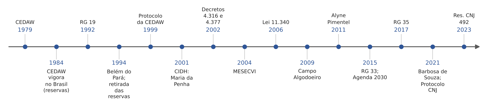
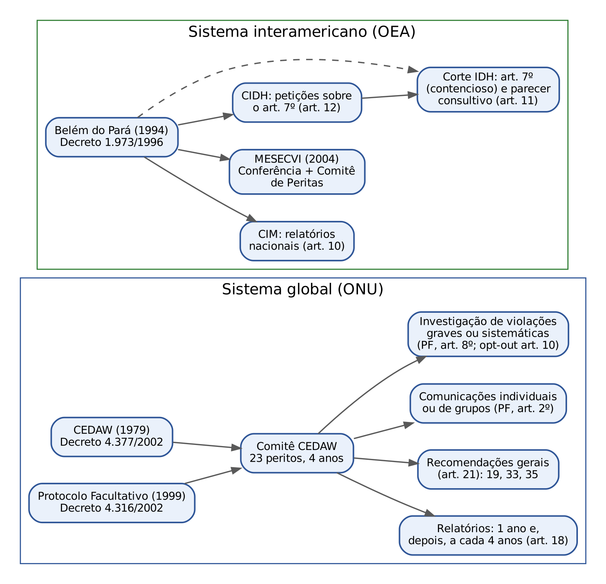
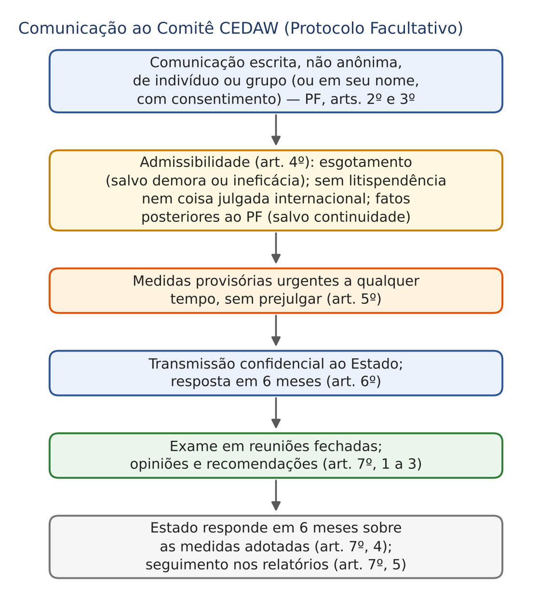
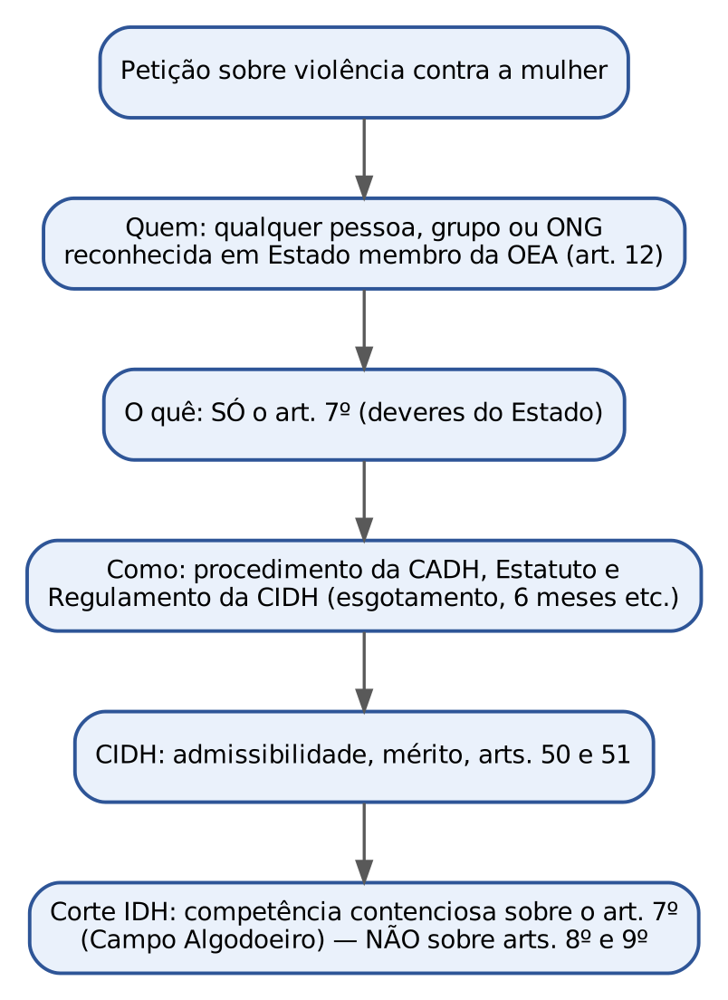
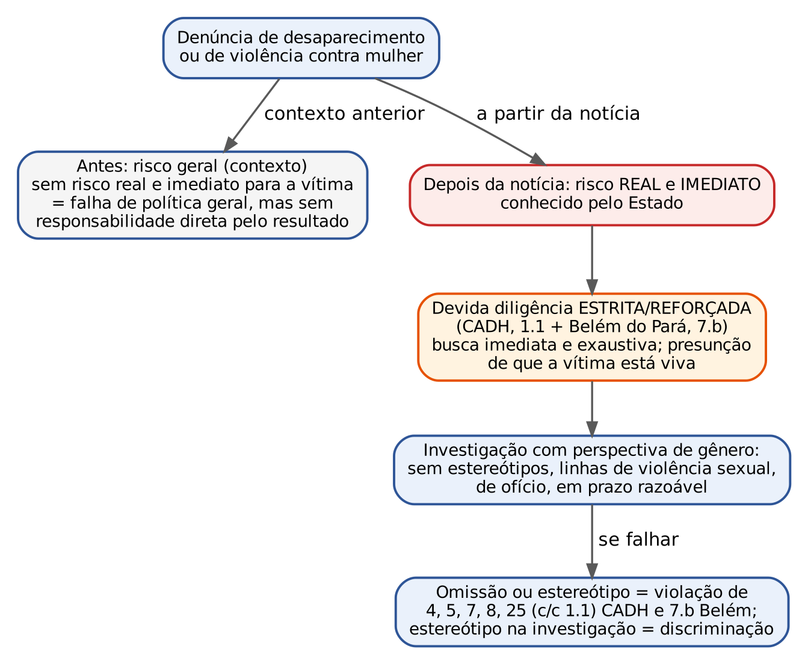

# CAPÍTULO 16 — DIREITOS DAS MULHERES: CEDAW, BELÉM DO PARÁ, DEVIDA DILIGÊNCIA E PERSPECTIVA DE GÊNERO

:::INCIDENCIA
TRF5 p. 7; TJRS p. 2, 3; TJSC p. 2, 3. Nível A. Lote: 20 questões (FGV 15, FCC 5), duas do ENAM e uma de juiz (TJ-CE).
O que mais cai: letra da CEDAW (arts. 4º, 10, 11, 12 e 17) e do Protocolo Facultativo (art. 4º), caso Alyne Pimentel e controle de convencionalidade com decisões do Comitê, devida diligência e perspectiva de gênero nas investigações (Corte IDH e STF), formas de violência da Lei Maria da Penha e Protocolo do CNJ.
:::

| Subtema | FGV | FCC | Padrão de cobrança |
|---|---|---|---|
| Letra da CEDAW (definição, educação, emprego, saúde, família, medidas temporárias) | 3 | 1 | troca de "inclusive" por "exceto"; direito inexistente ("licença de lactação"); medida temporária que "implicará" normas desiguais |
| Comitê CEDAW e Protocolo Facultativo | 0 | 2 | remuneração pela ONU; reunião anual; comunicação de grupos, não anônima; inadmissibilidade *ratione temporis* com ressalva da continuidade |
| Alyne Pimentel e eficácia das decisões do Comitê | 1 | 0 | controle de convencionalidade difuso pela Defensoria; responsabilidade do Estado por prestador privado (art. 2º, e) |
| Corte IDH, STF e perspectiva de gênero (feminicídio, legítima defesa da honra, Protocolo, Res. 492) | 4 | 1 | "privilégios" x igualdade; nulidade da tese da honra; Protocolo como método contra estereótipos; composição do Comitê da Res. 492 |
| Igualdade na CADH e no direito interno (vestuário, história legislativa, violência política) | 3 | 0 | proibição de discriminação por sexo (arts. 1.1 e 24); Estatuto da Mulher Casada; Lei 14.192/2021 não restrita a candidatas |
| Lei Maria da Penha como concretização dos tratados (formas de violência, prevenção, rede) | 5 | 0 | violência sexual inclui impedir contracepção; casal de mulheres e mulher trans; currículos escolares; ONG complementar ao poder público |
| Agenda 2030 e dados de violência | 2 | 0 | gênero como eixo transversal dos ODS; violência majoritariamente doméstica; interseccionalidade sem variável única |

Por remissão: comitês da ONU e comunicações (Cap. 8), petição na CIDH (Cap. 10), competência *ratione materiae* da Corte (Cap. 11, 11.3.3), fichas dos casos brasileiros (Cap. 12), gênero, patriarcado, interseccionalidade, Protocolo do CNJ e Res. CNJ 492/2023 (Formação Humanística, Cap. 28), Agenda 2030 (Formação Humanística, Cap. 27) e dogmática da Lei 11.340/2006 (Direito Penal, Caps. 27 e 38).

## 16.1 Arquitetura da proteção internacional

### 16.1.1 Da igualdade formal à especificação do sujeito

A proteção internacional da mulher passou por três momentos, que a banca usa para montar alternativas sobre a "evolução" do tema:

| Momento | Instrumentos | Lógica |
|---|---|---|
| Igualdade formal e direitos civis e políticos (1945-1967) | Carta da ONU; DUDH, art. 2º; Comissão sobre a Situação da Mulher (ECOSOC, 1946); Convenções sobre os Direitos Políticos da Mulher (1953), a Nacionalidade da Mulher Casada (1957) e o Consentimento para o Casamento (1962); Declaração de 1967; na OEA, CIM (1928) e Convenções de 1948 sobre direitos políticos e civis da mulher | não discriminação "por sexo" em direitos específicos; tratados setoriais |
| Especificação: tratado geral sobre discriminação contra a mulher (1979) | CEDAW e Comitê CEDAW | igualdade substantiva; obrigação de eliminar a discriminação também na esfera privada e nos padrões culturais |
| Violência de gênero como violação de direitos humanos (1992-1995) | RG 19 do Comitê CEDAW (1992); Declaração e Programa de Ação de Viena, par. 18 (1993; Cap. 7, 07.10.2); Declaração sobre a Eliminação da Violência contra a Mulher (Assembleia Geral, 1993); Relatora Especial da ONU sobre violência contra a mulher (1994); Convenção de Belém do Pará (1994); Declaração e Plataforma de Ação de Pequim (1995) | o público e o privado deixam de ser fronteira da responsabilidade estatal: a omissão diante do agressor particular é ilícito do Estado |

Completam o quadro a ONU Mulheres (2010) e, na CIDH, a Relatoria sobre os Direitos das Mulheres (1994; Cap. 10).

### 16.1.2 Os dois sistemas lado a lado

| Aspecto | CEDAW (ONU) | Belém do Pará (OEA) |
|---|---|---|
| Objeto | DISCRIMINAÇÃO contra a mulher, em todos os campos | VIOLÊNCIA contra a mulher baseada no gênero, pública ou privada |
| Adoção e vigor internacional | 18/12/1979; vigor em 3/9/1981 | 9/6/1994; vigor em 3/3/1995 |
| Brasil | assinatura em 31/3/1981; DL 93/1983 (com reservas); vigor em 2/3/1984; reservas retiradas em 20/12/1994; Decreto 4.377, de 13/9/2002 (revogou o Decreto 89.460/1984) | DL 107, de 31/8/1995; ratificação em 27/11/1995; vigor em 27/12/1995; Decreto 1.973, de 1/8/1996 |
| Hierarquia interna | supralegal (não aprovada pelo rito do art. 5º, § 3º; Cap. 4) | supralegal (idem) |
| Órgão de supervisão | Comitê CEDAW (23 peritos) | MESECVI (Conferência dos Estados Partes e Comitê de Peritas); CIM recebe relatórios |
| Mecanismo quase judicial | Protocolo Facultativo de 1999 (comunicações e investigação); Brasil: Decreto 4.316/2002 | petição à CIDH sobre o art. 7º (art. 12), com possível submissão à Corte IDH |
| Opinião consultiva | não há (o Comitê emite recomendações gerais) | Estados partes e CIM podem pedir parecer à Corte IDH (art. 11) |
| Reservas | proibidas as incompatíveis com objeto e propósito (art. 28.2); PF não admite reservas (art. 17) | admitidas se compatíveis e não gerais (art. 18) |
| Denúncia | não prevista na Convenção; o PF admite denúncia com efeito em seis meses (art. 19) | admitida, com efeito um ano após o depósito (art. 24) |

:::PEGADINHA
Nenhum tratado sobre direitos das mulheres tem status de emenda constitucional no Brasil. A FGV lista CEDAW e Belém do Pará como distratores em questões sobre o art. 5º, § 3º (Q3171433 e Q2474132, comentadas no Cap. 4, 04.5.2): os equivalentes a emenda são só a CDPD com seu Protocolo, o Tratado de Marraqueche e a Convenção Interamericana contra o Racismo.
:::

## 16.2 A Convenção sobre a Eliminação de Todas as Formas de Discriminação contra a Mulher (CEDAW)

### 16.2.1 Incorporação e reservas brasileiras

O Decreto Legislativo 93/1983 aprovou a Convenção com reservas aos arts. 15, § 4º (escolha de domicílio), e 16, § 1º, a, c, g e h (igualdade no casamento, sobrenome, profissão e bens), porque o Código Civil de 1916 fazia do marido o chefe da sociedade conjugal. Após a CF/1988 (art. 226, § 5º), o Decreto Legislativo 26/1994 aprovou o texto sem elas, retiradas em 20/12/1994, e o Decreto 4.377/2002 o promulgou de novo, revogando o Decreto 89.460/1984. Persiste UMA reserva: a facultada pelo art. 29, § 2º (o Brasil não se obriga à arbitragem e à jurisdição da CIJ para controvérsias entre Estados sobre a Convenção), expressamente mencionada no art. 1º do Decreto 4.377.

:::DICA
Duas datas de vigor para o Brasil confundem: a CEDAW vigora para o Brasil desde 2/3/1984 (considerando do Decreto 4.377), mas o Protocolo Facultativo só desde 28/9/2002 (Decreto 4.316). Isso importa para a admissibilidade *ratione temporis* das comunicações (16.3.3): fatos anteriores a 28/9/2002 só são examináveis se tiverem continuidade depois dessa data — Alyne Pimentel morreu em 16/11/2002.
:::

Sobre a possibilidade de o Estado limitar suas obrigações depois de ratificar (reserva tardia ou denúncia), ver Cap. 4, 04.8 e 04.9: a FCC (Q3954680, DPE-MT 2026, gabarito D) considerou correto que reservas incompatíveis com o objeto e a finalidade da CEDAW são incabíveis e que o Estado não pode aderir apenas formalmente e se eximir das obrigações (art. 28.2).

### 16.2.2 Estrutura e conceito de discriminação

A Convenção tem 30 artigos em seis partes (I, arts. 1º a 6º; II, 7º a 9º; III, 10 a 14; IV, 15 e 16; V, Comitê, 17 a 22; VI, 23 a 30).

:::LEI CEDAW (Decreto 4.377/2002), art. 1º
Para os fins da presente Convenção, a expressão "discriminação contra a mulher" significará toda a distinção, exclusão ou restrição baseada no sexo e que tenha por objeto ou resultado prejudicar ou anular o reconhecimento, gozo ou exercício pela mulher, independentemente de seu estado civil, com base na igualdade do homem e da mulher, dos direitos humanos e liberdades fundamentais nos campos político, econômico, social, cultural e civil ou em qualquer outro campo.
:::

Quatro elementos da definição sustentam quase todas as questões e todos os desenvolvimentos posteriores:

- "por objeto OU resultado": alcança a discriminação direta (intencional) e a INDIRETA (norma neutra com impacto desproporcional). É a base da teoria do impacto desproporcional nas relações de gênero (Formação Humanística, Cap. 39).
- "independentemente de seu estado civil": a Convenção nasceu contra a tutela marital; a mulher casada é titular plena.
- "em qualquer outro campo": a enumeração é exemplificativa; inclui a esfera privada.
- a definição não menciona VIOLÊNCIA. A lacuna foi suprida pela RG 19 (1992), que interpretou a violência baseada no gênero como forma de discriminação do art. 1º (16.4.1).

### 16.2.3 Obrigações gerais (arts. 2º a 6º)

| Dispositivo | Conteúdo | Uso em prova e na jurisdição |
|---|---|---|
| Art. 2º, a e b | consagrar a igualdade na Constituição ou na lei e proibir, com sanções, toda discriminação | CF, art. 5º, I, e art. 226, § 5º |
| Art. 2º, c | proteção jurídica efetiva "por meio dos tribunais nacionais competentes" | fundamento do dever de acesso à justiça (Alyne; RG 33) |
| Art. 2º, d | abstenção de discriminar pelas autoridades públicas | obrigação de respeitar |
| Art. 2º, e | eliminar a discriminação "praticada por qualquer pessoa, organização ou empresa" | EFICÁCIA HORIZONTAL e devida diligência quanto a particulares; base da condenação no caso Alyne (prestador privado de saúde) |
| Art. 2º, f e g | modificar ou derrogar leis, usos e práticas discriminatórios; derrogar disposições penais discriminatórias | fundamento de controle de convencionalidade de normas internas (ex.: escusas absolutórias, Formação Humanística, 28.6.4) |
| Art. 3º | medidas em todas as esferas para o pleno desenvolvimento da mulher | cláusula geral de promoção |
| Art. 4º, 1 | medidas especiais de caráter TEMPORÁRIO para acelerar a igualdade de fato não são discriminação; não podem implicar normas desiguais ou separadas; cessam alcançados os objetivos | base internacional das ações afirmativas de gênero (cotas de candidaturas, paridade); RG 25 (2004) |
| Art. 4º, 2 | medidas especiais para proteger a MATERNIDADE não são discriminatórias | diferentemente das do item 1, não são temporárias |
| Art. 5º, a | modificar padrões socioculturais baseados na inferioridade ou superioridade de qualquer dos sexos ou em funções estereotipadas | fundamento convencional do combate a estereótipos, inclusive judiciais (Protocolo do CNJ) |
| Art. 5º, b | educação familiar com compreensão da maternidade como FUNÇÃO SOCIAL e responsabilidade comum de homens e mulheres pelos filhos; interesse dos filhos como consideração primordial | literalidade cobrada pela FCC |
| Art. 6º | suprimir o tráfico de mulheres e a exploração da prostituição | conexão com o Protocolo de Palermo |

:::QUESTAO FCC 2025 — DPE-SP — Analista de Defensoria (Q3304076)
Pedia a alternativa que NÃO corresponde à Convenção. Gabarito: B. A alternativa adulterou o art. 4º, 1: afirmou que as medidas especiais temporárias "implicará, como consequência, a manutenção de normas desiguais ou separadas"; o texto diz o contrário ("de nenhuma maneira implicará").
Armadilha: as demais reproduzem a letra dos arts. 10, c, 5º, b, 5º, a, e 7º, a e b. A FCC inverte UMA palavra de dispositivo longo; leia o verbo.
:::

### 16.2.4 Direitos em espécie: o que a banca cobra (arts. 7º a 16)

| Artigo | Esfera | Letra que vira pegadinha |
|---|---|---|
| 7º | vida política e pública | votar e ser elegível; participar da formulação e execução de políticas; ocupar cargos e exercer funções públicas "em todos os planos governamentais"; participar de ONGs |
| 8º | representação internacional | oportunidade de representar o governo e participar de organizações internacionais |
| 9º | nacionalidade | casamento com estrangeiro ou mudança de nacionalidade do marido não altera automaticamente a da esposa nem a torna apátrida; iguais direitos quanto à nacionalidade dos FILHOS |
| 10 | educação | acesso "tanto em zonas rurais como urbanas"; eliminação de estereótipos com educação MISTA; "redução da taxa de abandono feminino dos estudos"; informação sobre planejamento da família |
| 11.1 | emprego | direito ao trabalho como "inalienável"; mesmas oportunidades, "INCLUSIVE a aplicação dos mesmos critérios de seleção"; igual remuneração por trabalho de igual VALOR; seguridade social; proteção da função de reprodução |
| 11.2 | casamento e maternidade no trabalho | (a) proibir, sob sanções, demissão por gravidez ou licença-maternidade e discriminação por estado civil; (b) licença-maternidade remunerada sem perda do emprego, antiguidade ou benefícios; (c) estimular serviços sociais de apoio, especialmente rede de cuidado das crianças, para que "os pais" conciliem família, trabalho e vida pública; (d) proteção especial na gravidez em trabalhos comprovadamente prejudiciais. NÃO há "licença de lactação" |
| 11.3 | revisão | a legislação protetora é revista periodicamente à luz do conhecimento científico e tecnológico |
| 12 | saúde | acesso a serviços médicos, "INCLUSIVE os referentes ao planejamento familiar"; assistência apropriada na gravidez, no parto e no pós-parto, gratuita quando necessário, e nutrição adequada na gravidez e na lactância |
| 13 e 14 | vida econômica; mulher rural | crédito; trabalho em setores não monetários; reforma agrária; condições de vida adequadas |
| 15 | igualdade perante a lei | capacidade civil idêntica; tratamento igual "em todas as etapas do processo nas cortes de justiça"; escolha de domicílio (§ 4º, antes reservado) |
| 16 | casamento e família | livre escolha do cônjuge; mesmos direitos no casamento, na dissolução e como pais; número e espaçamento dos filhos; sobrenome e profissão; § 2º: casamento de criança sem efeito legal |

:::QUESTAO FGV 2026 — ALERJ — Procurador Legislativo (Q3880854)
Três itens sobre a CEDAW. Gabarito: C (só III). Item III reproduz o art. 10, f (redução da taxa de abandono feminino dos estudos e programas para jovens e mulheres que deixaram os estudos prematuramente).
Armadilhas: o item I trocou "INCLUSIVE a aplicação dos mesmos critérios de seleção" (art. 11.1, b) por "EXCETO nos casos de aplicação dos mesmos critérios"; o item II trocou "INCLUSIVE os referentes ao planejamento familiar" (art. 12.1) por "EXCETO". Técnica: inversão inclusive/exceto; o planejamento familiar aparece TRÊS vezes (arts. 10, h, 12.1 e 14.2, b), nunca como exceção.
:::

:::QUESTAO FGV 2025 — PC-MG — Delegado de Polícia Substituto (Q3171426)
Pedia a medida que NÃO consta do art. 11.2. Gabarito: E — "licença de lactação após a licença-maternidade". A Convenção prevê nutrição adequada na lactância (art. 12.2), não licença específica de lactação. As alternativas A a D reproduzem as alíneas a a d do art. 11.2.
:::

:::QUESTAO FGV 2024 — Câmara de Fortaleza — Consultor Legislativo (Q2474112)
Quatro tópicos, todos corretos. Gabarito: E. I reproduz o preâmbulo (participação máxima da mulher, em igualdade de condições, é indispensável ao desenvolvimento pleno do país, ao bem-estar do mundo e à causa da paz); II, o art. 16.1, b; III, o art. 11.2, c; IV, o art. 10, c. Lição: o preâmbulo também cai.
:::

### 16.2.5 Natureza das obrigações

A CEDAW combina obrigações de efeito imediato ("sem dilações", art. 2º, caput) e de realização progressiva (art. 24: medidas necessárias "para alcançar a plena realização"), e não distingue direitos civis de sociais: protege, no mesmo texto, voto, emprego, saúde, crédito e família, o que a torna exemplo de indivisibilidade (Cap. 2, 02.1.3). Há cláusula de norma mais favorável (art. 23: prevalece a disposição da lei interna ou de outro tratado mais propícia à igualdade), que é aplicação do princípio *pro persona* (Cap. 2, 02.3.2). O Comitê, na RG 28 (2010), sistematizou as três camadas de obrigação — respeitar, proteger e realizar — e afirmou que o art. 2º é o núcleo da Convenção.

## 16.3 O Comitê CEDAW e o Protocolo Facultativo

### 16.3.1 Composição e funcionamento (arts. 17 a 22)

:::LEI CEDAW (Decreto 4.377/2002), art. 17, §§ 1º, 4º, 5º, 7º e 8º, e art. 20, § 1º
Art. 17. 1. [...] será estabelecido um Comitê sobre a Eliminação da Discriminação contra a Mulher [...] composto, no momento da entrada em vigor da Convenção, de dezoito e, após sua ratificação ou adesão pelo trigésimo-quinto Estado-Parte, de vinte e três peritos de grande prestígio moral e competência na área abarcada pela Convenção. Os peritos serão eleitos pelos Estados-Partes entre seus nacionais e exercerão suas funções a título pessoal [...]
4. [...] Nessa reunião, em que o quorum será alcançado com dois terços dos Estados-Partes, serão eleitos membros do Comitê os candidatos que obtiverem o maior número de votos e a maioria absoluta de votos dos representantes dos Estados-Partes presentes e votantes;
5. Os membros do Comitê serão eleitos para um mandato de quatro anos. [...]
7. Para preencher as vagas fortuitas, o Estado-Parte cujo perito tenha deixado de exercer suas funções de membro do Comitê nomeará outro perito entre seus nacionais, sob reserva da aprovação do Comitê;
8. Os membros do Comitê, mediante aprovação da Assembléia Geral, receberão remuneração dos recursos das Nações Unidas, na forma e condições que a Assembléia Geral decidir, tendo em vista a importância das funções do Comitê;
Art. 20. 1. O Comitê se reunirá normalmente todos os anos por um período não superior a duas semanas para examinar os relatórios que lhe sejam submetidos [...]
:::

Outros dados: escrutínio secreto; relatório anual à AG por intermédio do ECOSOC, com recomendações gerais (art. 21); relatórios estatais em um ano do vigor e, depois, ao menos a cada quatro anos (art. 18). A prática de várias sessões anuais decorre de autorizações da AG e de emenda ao art. 20 ainda pendente de aceitação; para a prova objetiva, vale a letra do art. 20.

:::QUESTAO FCC 2026 — MPE-SE — Analista, Psicologia (Q3964497)
Pedia o que há de previsão EXPRESSA sobre o Comitê. Gabarito: C — os membros recebem remuneração de recursos das Nações Unidas, tendo em vista a importância de suas funções (art. 17.8).
Armadilhas: A (mandato de cinco anos: são QUATRO, art. 17.5); B ("metade mais um": quórum de DOIS TERÇOS, art. 17.4); D ("duas vezes por ano": reunião anual, art. 20.1); E (vaga por "Estado ainda não participante": o próprio Estado nomeia outro nacional, art. 17.7).
:::

### 16.3.2 Funções: o que o Comitê pode e não pode fazer

| Função | Base | Vínculo do Brasil |
|---|---|---|
| Exame de relatórios periódicos e observações finais | art. 18 | sim, desde 1984 |
| Recomendações gerais | art. 21 | interpretação autorizada; *soft law* (Cap. 8, 08.7.1) |
| Comunicações individuais ou de grupos | PF, arts. 1º a 7º | sim, desde 28/9/2002 |
| Investigação de violações graves ou sistemáticas | PF, arts. 8º e 9º (cláusula de exclusão no art. 10) | sim: o Brasil não fez a declaração de exclusão |
| Controvérsias interestatais | não há mecanismo no Comitê; art. 29: arbitragem e CIJ | NÃO: reserva facultada pelo art. 29.2 (não vinculação ao art. 29.1) |

### 16.3.3 Protocolo Facultativo (1999)

Adotado pela Assembleia Geral em 6/10/1999, em vigor internacional em 22/12/2000 (três meses após a décima ratificação, art. 16.1). No Brasil: Decreto Legislativo 107, de 6/6/2002; Decreto 4.316, de 30/7/2002; vigor em 28/9/2002.

:::LEI Protocolo Facultativo à CEDAW (Decreto 4.316/2002), arts. 2º, 3º e 4º
Art. 2. As comunicações podem ser apresentadas por indivíduos ou grupos de indivíduos, que se encontrem sob a jurisdição do Estado Parte e aleguem ser vítimas de violação de quaisquer dos direitos estabelecidos na Convenção por aquele Estado Parte, ou em nome desses indivíduos ou grupos de indivíduos. Sempre que for apresentada em nome de indivíduos ou grupos de indivíduos, a comunicação deverá contar com seu consentimento, a menos que o autor possa justificar estar agindo em nome deles sem o seu consentimento.
Art. 3. As comunicações deverão ser feitas por escrito e não poderão ser anônimas. Nenhuma comunicação relacionada a um Estado Parte da Convenção que não seja parte do presente Protocolo será recebida pelo Comitê.
Art. 4. 1. O Comitê não considerará a comunicação, exceto se tiver reconhecido que todos os recursos da jurisdição interna foram esgotados ou que a utilização desses recursos estaria sendo protelada além do razoável ou deixaria dúvida quanto a produzir o efetivo amparo.
2. O Comitê declarará inadmissível toda comunicação que: (a) se referir a assunto que já tiver sido examinado pelo Comitê ou tiver sido ou estiver sendo examinado sob outro procedimento internacional de investigação ou solução de controvérsias; (b) for incompatível com as disposições da Convenção; (c) estiver manifestamente mal fundamentada ou não suficientemente consubstanciada; (d) constituir abuso do direito de submeter comunicação; (e) tiver como objeto fatos que tenham ocorrido antes da entrada em vigor do presente Protocolo para o Estado Parte em questão, a não ser no caso de tais fatos terem tido continuidade após aquela data.
:::

Pontos que diferenciam o PF-CEDAW de outros procedimentos (comparação completa no Cap. 8, 08.6.3):

- NÃO há prazo para apresentar a comunicação (diferentemente dos seis meses da CIDH, Cap. 10, 10.5.2).
- A litispendência e a coisa julgada internacionais são ambas causas de inadmissibilidade, e a regra é absoluta: escolhida a CIDH, não se vai ao Comitê com o mesmo assunto, nem depois.
- Seis meses para o Estado explicar-se (art. 6.2) e para informar o seguimento (art. 7.4); medidas provisórias "a qualquer momento" antes do mérito (art. 5º); proteção do comunicante (art. 11).
- Proibidas as reservas (art. 17); denúncia com efeito em seis meses (art. 19).
- Investigação (art. 8º) de violações graves ou sistemáticas, confidencial, com visita só com consentimento; afastável por declaração na ratificação (art. 10).

:::QUESTAO FCC 2025 — TRT6 — Analista Judiciário (Q3214702)
Gabarito: E — inadmissível a comunicação sobre fatos anteriores à entrada em vigor do Protocolo para o Estado, salvo se tiverem continuidade após aquela data (art. 4.2, e).
Armadilhas: A (comunicação "sempre considerada" sem esgotamento: o art. 4.1 exige esgotamento, salvo demora excessiva ou ineficácia); B ("não poderão ser declaradas inadmissíveis" se já examinadas em outro procedimento: é exatamente causa de inadmissibilidade, art. 4.2, a); C ("vedada a apresentação por grupos": o art. 2º admite grupos de indivíduos); D ("podendo ser anônimas": o art. 3º as proíbe — a segunda parte da alternativa, sobre Estado não parte do PF, é verdadeira, o que torna a alternativa perigosa).
:::

:::ESQUEMA Onde levar um caso de discriminação ou violência contra mulher brasileira
| Pergunta | CIDH (Belém do Pará, art. 12, e CADH) | Comitê CEDAW (PF) |
|---|---|---|
| Quem apresenta | qualquer pessoa, grupo ou ONG reconhecida em Estado da OEA, sem vínculo com a vítima nem consentimento | vítima, grupo ou terceiro EM NOME dela, com consentimento (ou justificativa) |
| Direitos examináveis | art. 7º de Belém do Pará e direitos da CADH (8, 24, 25, 4, 5) | todos os direitos da CEDAW, inclusive saúde, emprego, família |
| Prazo | seis meses da decisão definitiva | não há |
| Resultado | relatório com recomendações e, se o caso for à Corte, SENTENÇA vinculante | opiniões e recomendações (não vinculantes, mas com dever de boa-fé e seguimento) |
| Litispendência | inadmissível se pendente em outro órgão internacional (CADH, art. 46.1, c) | inadmissível se pendente OU já examinado (PF, art. 4.2, a) |
:::

## 16.4 Recomendações Gerais 19, 33 e 35

As recomendações gerais têm natureza de interpretação autorizada da Convenção, sem força vinculante própria (Cap. 8, 08.7.1). As três que o edital nomeia formam uma sequência: a 19 incluiu a violência na Convenção, a 33 tratou do acesso à justiça e a 35 atualizou a 19.

### 16.4.1 RG 19 (1992): a violência como discriminação

Adotada na 11ª sessão (1992), a RG 19 afirmou que a definição do art. 1º inclui a violência baseada no gênero, isto é, a violência dirigida contra a mulher PORQUE é mulher ou que a afeta desproporcionalmente (física, mental ou sexual, ameaças, coerção e privação de liberdade). Três consequências:

- a violência de gênero viola direitos protegidos em outros tratados (vida, integridade, liberdade, igualdade na família, saúde, condições justas de trabalho) e, por isso, é discriminação ainda que a Convenção não use a palavra "violência";
- a responsabilidade do Estado alcança atos de PARTICULARES quando ele falha na devida diligência para prevenir, investigar e punir (art. 2º, e);
- os relatórios periódicos devem informar dados e medidas sobre violência (familiar, sexual, no trabalho, tráfico).

### 16.4.2 RG 33 (2015): acesso das mulheres à justiça

A RG 33 organiza o acesso à justiça em seis componentes inter-relacionados: justiciabilidade, disponibilidade, acessibilidade, boa qualidade dos sistemas de justiça, provisão de remédios e prestação de contas (*accountability*). Os pontos usados pela magistratura brasileira:

- estereótipos e preconceitos de gênero no sistema de justiça distorcem a percepção dos fatos, levam a decisões baseadas em crenças e não em fatos e comprometem a imparcialidade; a recomendação do item 29, a — tomar medidas para eliminar estereótipos, inclusive quanto à credibilidade e ao peso dado às vozes, argumentos e depoimentos das mulheres — está nos considerandos da Resolução CNJ 492/2023;
- capacitação de juízes, promotores e defensores em perspectiva de gênero;
- remédios que vão além da indenização: restituição, reabilitação e garantias de não repetição;
- cautela com meios alternativos de solução de conflitos em casos de violência (não devem ser obrigatórios nem reproduzir a assimetria de poder).

### 16.4.3 RG 35 (2017): atualização da RG 19

Datada de 14/7/2017 (CEDAW/C/GC/35), a RG 35 adotou a expressão "violência de gênero contra as mulheres" (*gender-based violence against women*), mais precisa porque explicita as causas e efeitos de gênero, e tratou-a como problema social, não individual. Teses centrais:

- a proibição da violência de gênero contra as mulheres EVOLUIU PARA PRINCÍPIO DE DIREITO INTERNACIONAL CONSUETUDINÁRIO, com a RG 19 como catalisadora (par. 2) — portanto vincula também Estados que não ratificaram a CEDAW;
- interseccionalidade: a violência afeta de modo diferente mulheres em razão de etnia, raça, deficiência, condição socioeconômica, migração, orientação sexual e identidade de gênero, exigindo respostas específicas;
- violações de saúde e direitos sexuais e reprodutivos — esterilização forçada, aborto forçado, gravidez forçada, negação de aborto seguro, criminalização — podem, conforme as circunstâncias, constituir tortura ou tratamento cruel, desumano ou degradante;
- responsabilidade por atos de agentes dos três Poderes (o Judiciário deve evitar estereótipos na análise de fatos e provas) e por atos de particulares, quando faltar devida diligência;
- mediação ou conciliação nunca obrigatórias, só após avaliação especializada e com consentimento livre e informado.

| | RG 19 (1992) | RG 33 (2015) | RG 35 (2017) |
|---|---|---|---|
| Tema | violência como discriminação | acesso à justiça | violência de gênero (atualiza a 19) |
| Tese-chave | art. 1º abrange a violência; devida diligência quanto a particulares | seis componentes; estereótipos judiciais; credibilidade da palavra da mulher | proibição como norma COSTUMEIRA; interseccionalidade; direitos reprodutivos e tortura |
| Uso pelo juiz | base convencional da LMP e da responsabilidade por omissão | fundamento do Protocolo do CNJ e da Res. 492 | parâmetro para investigação, medidas protetivas e vedação de mediação compulsória |

:::PEGADINHA
"A RG 35 tornou a CEDAW vinculante para os Estados que não a ratificaram": errado. O que a RG 35 afirma é que a PROIBIÇÃO da violência de gênero é norma de direito internacional costumeiro (fonte autônoma); a Convenção continua obrigando só os Estados partes. E a recomendação, em si, não é tratado nem tem força vinculante.
:::

Outras recomendações citadas em julgados e decisões: RG 24 (1999, mulher e saúde; usada no caso Alyne), RG 25 (2004, medidas especiais temporárias do art. 4º, 1), RG 28 (2010, obrigações do art. 2º; usada no caso Alyne), e a recomendação geral conjunta com o Comitê dos Direitos da Criança sobre práticas nocivas (Cap. 8, 08.7.1).

## 16.5 Caso Alyne da Silva Pimentel Teixeira vs. Brasil (Comitê CEDAW, 2011)

### 16.5.1 Fatos e procedimento

:::JURIS Comitê CEDAW, Comunicação n. 17/2008, Alyne da Silva Pimentel Teixeira (falecida) vs. Brasil, opiniões adotadas em 25/7/2011 (CEDAW/C/49/D/17/2008)
Fatos: Alyne, 28 anos, afrodescendente, de baixa renda, de Belford Roxo (RJ), grávida de seis meses, foi mal atendida em clínica PRIVADA conveniada ao SUS (feto morto, curetagem cerca de 14 horas depois do parto induzido), esperou cerca de oito horas por transporte para hospital público, ficou no corredor da emergência sem prontuário e morreu em 16/11/2002; o Comitê, rejeitando a tese do Estado, tratou a morte como obstétrica.
Procedimento: comunicação de 30/11/2007, apresentada pela mãe. O Comitê afastou a alegação de não esgotamento: a ação de indenização, ajuizada em 11/2/2003, estava pendente havia cerca de oito anos sem decisão, demora injustificada (art. 4.1).
Violações: art. 12 (acesso à saúde, em especial à assistência na gravidez e no parto), em conexão com o art. 2º; art. 2º, c (proteção judicial efetiva); art. 2º, e (dever de devida diligência na regulação e fiscalização de prestadores PRIVADOS de saúde), lidos com o art. 1º. O Comitê reconheceu DISCRIMINAÇÃO MÚLTIPLA, por ser mulher, afrodescendente e de baixa condição socioeconômica.
Recomendações individuais: reparação adequada, inclusive financeira, à mãe e à filha de Alyne.
Recomendações gerais: maternidade segura e atendimento obstétrico de emergência acessível (RG 24); capacitação de profissionais de saúde e do Judiciário; remédios efetivos; fiscalização dos serviços privados; sanções a profissionais; redução de mortes maternas evitáveis pelo Pacto Nacional e por comitês de mortalidade materna.
:::

### 16.5.2 Por que o caso é paradigma

- É a PRIMEIRA decisão de um órgão de tratado da ONU contra o Brasil em comunicação individual e a primeira do Comitê CEDAW sobre MORTALIDADE MATERNA: a morte materna evitável foi tratada como discriminação contra a mulher, e não como mero "erro médico".
- O Estado responde pela falha de prestador privado que executa serviço público de saúde: "o Estado é diretamente responsável pela ação de instituições privadas quando terceiriza seus serviços médicos" e mantém o dever de regulá-las e fiscalizá-las. Não há responsabilidade "exclusiva" do ente privado no plano internacional.
- Interseccionalidade aplicada: sexo, raça e classe como fatores combinados.
- Acesso à justiça: a demora do processo civil interno foi, ao mesmo tempo, exceção ao esgotamento e violação autônoma (art. 2º, c).

:::QUESTAO FGV 2026 — DPE-RJ — Defensor Público (Q4289403)
Caso: Maria, negra, 28 anos, moradora da Baixada Fluminense, grávida de seis meses, é mal atendida em UPA gerida por Organização Social; o feto morre, ela fica horas sem supervisão no pós-parto, a transferência demora por falta de ambulância e ela morre de choque hemorrágico; quatro anos e 11 meses depois, sem investigação, o filho procura a Defensoria. (O enunciado reproduz quase literalmente os fatos de Alyne.)
Gabarito: B (só II).
Passos: (1) Item I ERRADO: gestão por Organização Social não afasta a responsabilidade do Estado (CF, art. 37, § 6º; Alyne: dever de regular e fiscalizar, CEDAW, art. 2º, e). (2) Item II CERTO: o defensor pode fazer controle de convencionalidade difuso na inicial, invocando o art. 12 da CEDAW e a eficácia interpretativa da decisão do Comitê (Cap. 5, 05.4.2; Cap. 6, 06.5.3; Cap. 8, 08.8.3). (3) Item III ERRADO: discriminação interseccional não exige pluralidade de vítimas (Alyne é caso de UMA vítima).
Armadilha: "quatro anos e 11 meses" é isca de prescrição quinquenal; não é o que se pergunta.
:::

:::SENTENCA Fundamentação convencional em ação de indenização por morte materna
"A morte da gestante decorreu de sucessivas falhas no atendimento obstétrico prestado por entidade privada que executa, por contrato de gestão, serviço público de saúde. A circunstância não afasta a responsabilidade do ente público (CF, art. 37, § 6º), que, além disso, tem o dever convencional de assegurar à mulher assistência apropriada na gravidez, no parto e no pós-parto (CEDAW, art. 12.2) e de regular e fiscalizar os prestadores privados (art. 2º, e). O Comitê CEDAW, ao examinar fatos análogos ocorridos no Estado do Rio de Janeiro (Alyne da Silva Pimentel Teixeira vs. Brasil, 2011), reconheceu que a morte materna evitável de mulher negra e pobre configura discriminação múltipla e recomendou ao Estado brasileiro garantir maternidade segura e acesso a atendimento obstétrico de emergência. Essa interpretação autorizada do tratado, embora não vincule como sentença, orienta o controle de convencionalidade que incumbe a este juízo (Recomendação CNJ 123/2022) e reforça a conclusão de que houve falha estrutural do serviço."
:::

## 16.6 A Convenção de Belém do Pará

### 16.6.1 Dados e originalidade

Primeiro tratado dedicado especificamente à violência contra a mulher, concluído em Belém (PA) em 9/6/1994; vigor internacional em 3/3/1995 (art. 21); Brasil: Decreto Legislativo 107/1995, ratificação em 27/11/1995, vigor em 27/12/1995, Decreto 1.973/1996. É a convenção interamericana com mais ratificações; o português é língua autêntica (art. 25). Estrutura: definição (arts. 1º e 2º), direitos (3º a 6º), deveres (7º a 9º), mecanismos (10 a 12) e disposições gerais (13 a 25).

### 16.6.2 Conceito e âmbito (arts. 1º e 2º)

:::LEI Convenção de Belém do Pará (Decreto 1.973/1996), arts. 1º e 2º
Artigo 1. Para os efeitos desta Convenção, entender-se-á por violência contra a mulher qualquer ato ou conduta baseada no gênero, que cause morte, dano ou sofrimento físico, sexual ou psicológico à mulher, tanto na esfera pública como na esfera privada.
Artigo 2. Entende-se que a violência contra a mulher abrange a violência física, sexual e psicológica: a) ocorrida no âmbito da família ou unidade doméstica ou em qualquer relação interpessoal, quer o agressor compartilhe, tenha compartilhado ou não a sua residência, incluindo-se, entre outras formas, o estupro, maus-tratos e abuso sexual; b) ocorrida na comunidade e cometida por qualquer pessoa, incluindo, entre outras formas, o estupro, abuso sexual, tortura, tráfico de mulheres, prostituição forçada, sequestro e assédio sexual no local de trabalho, bem como em instituições educacionais, serviços de saúde ou qualquer outro local; e c) perpetrada ou tolerada pelo Estado ou seus agentes, onde quer que ocorra.
:::

| Elemento | Belém do Pará | Lei 11.340/2006 |
|---|---|---|
| Núcleo | ato ou conduta "baseada no gênero" | ação ou omissão "baseada no gênero" (art. 5º) |
| Resultado | morte, dano ou sofrimento físico, sexual ou psicológico | morte, lesão, sofrimento físico, sexual ou psicológico E dano moral ou patrimonial |
| Espaços | família ou unidade doméstica, relação interpessoal (com ou sem coabitação), comunidade, Estado | unidade doméstica, família, relação íntima de afeto (com ou sem coabitação) — só o âmbito doméstico e familiar |
| Formas | física, sexual, psicológica | física, psicológica, sexual, patrimonial, moral e, desde a Lei 15.384/2026, vicária (art. 7º) |

A Convenção é mais AMPLA quanto aos espaços (inclui comunidade e Estado) e mais ESTREITA quanto às formas (não nomeia a patrimonial e a moral). A Lei Maria da Penha fez o inverso: recortou o âmbito doméstico, familiar e afetivo, e ampliou as formas. A extensão das medidas protetivas a violências de gênero fora do âmbito do art. 5º (STF, Tema 1.412, 2026) é leitura que aproxima a lei do art. 2º, b, da Convenção (Apostila de Direito Penal, 38.2.4).

### 16.6.3 Direitos protegidos (arts. 3º a 6º)

- Art. 3º: direito a uma vida livre de violência, "tanto na esfera pública como na esfera privada".
- Art. 4º: catálogo de direitos já previstos em outros instrumentos (vida, integridade, liberdade, recurso simples e rápido, acesso às funções públicas etc.).
- Art. 5º: a violência "impede e anula" o exercício dos direitos civis, políticos, econômicos, sociais e culturais.
- Art. 6º: o direito a ser livre de violência abrange (a) ser livre de todas as formas de discriminação e (b) ser valorizada e educada livre de padrões estereotipados de comportamento e costumes baseados em inferioridade ou subordinação. É o elo normativo entre violência e discriminação e a base convencional do combate a estereótipos.

### 16.6.4 Deveres dos Estados: art. 7º (imediatos) x art. 8º (progressivos) x art. 9º (vulnerabilidades)

:::LEI Convenção de Belém do Pará (Decreto 1.973/1996), art. 7º
Os Estados Partes condenam todas as formas de violência contra a mulher e convêm em adotar, por todos os meios apropriados e sem demora, políticas destinadas a prevenir, punir e erradicar tal violência e a empenhar-se em:
a) abster-se de qualquer ato ou prática de violência contra a mulher e velar por que as autoridades, seus funcionários e pessoal, bem como agentes e instituições públicos ajam de conformidade com essa obrigação;
b) agir com o devido zelo para prevenir, investigar e punir a violência contra a mulher;
c) incorporar na sua legislação interna normas penais, civis, administrativas e de outra natureza, que sejam necessárias para prevenir, punir e erradicar a violência contra a mulher, bem como adotar as medidas administrativas adequadas que forem aplicáveis;
d) adotar medidas jurídicas que exijam do agressor que se abstenha de perseguir, intimidar e ameaçar a mulher ou de fazer uso de qualquer método que danifique ou ponha em perigo sua vida ou integridade ou danifique sua propriedade;
e) tomar todas as medidas adequadas, inclusive legislativas, para modificar ou abolir leis e regulamentos vigentes ou modificar práticas jurídicas ou consuetudinárias que respaldem a persistência e a tolerância da violência contra a mulher;
f) estabelecer procedimentos jurídicos justos e eficazes para a mulher sujeitada a violência, inclusive, entre outros, medidas de proteção, juízo oportuno e efetivo acesso a tais processos;
g) estabelecer mecanismos judiciais e administrativos necessários para assegurar que a mulher sujeitada a violência tenha efetivo acesso a restituição, reparação do dano e outros meios de compensação justos e eficazes;
h) adotar as medidas legislativas ou de outra natureza necessárias à vigência desta Convenção.
:::

O "devido zelo" do art. 7º, b, é a tradução oficial de "debida diligencia" (*due diligence*): na prova, as duas expressões são sinônimas. O art. 7º, d, é o fundamento convencional das MEDIDAS PROTETIVAS DE URGÊNCIA da Lei Maria da Penha; o art. 7º, f, o do "juízo oportuno" (prazo razoável); o art. 7º, g, o da reparação (inclusive o valor mínimo fixado na sentença penal; Apostila de Direito Penal, 38.8.2).

| | Art. 7º | Art. 8º |
|---|---|---|
| Natureza | deveres de efeito imediato ("sem demora") | medidas a adotar "progressivamente" (programas) |
| Conteúdo | abster-se; devida diligência; legislar; medidas protetivas; abolir práticas que toleram a violência; procedimentos eficazes; reparação | conscientização; mudança de padrões socioculturais e educação; capacitação do PESSOAL JUDICIÁRIO e policial (c); serviços especializados, abrigos e atendimento dos filhos (d); campanhas; recuperação e treinamento (f); diretrizes para meios de comunicação (g); estatísticas (h); cooperação internacional (i) |
| Justiciabilidade | SIM: objeto de petição à CIDH (art. 12) e de competência contenciosa da Corte IDH | NÃO por petição individual; supervisão pelo MESECVI e relatórios à CIM; usado pela Corte como critério interpretativo |
| Uso interno | controle de convencionalidade de omissões e de normas que toleram a violência | considerandos da Res. CNJ 492/2023 (art. 8º, c e g); Lei Maria da Penha, art. 8º |

O art. 9º manda considerar especialmente a mulher vulnerável à violência por raça, origem étnica, condição de migrante, refugiada ou deslocada, e também a gestante, a mulher com deficiência, a criança e a adolescente ("menor", na tradução oficial), a idosa, a em situação socioeconômica desfavorável, afetada por conflito armado ou privada de liberdade. É a cláusula INTERSECCIONAL da Convenção, invocada pela Corte IDH em casos de meninas (Veliz Franco) e de mulheres negras e pobres (Barbosa de Souza).

### 16.6.5 Mecanismos de proteção (arts. 10 a 12) e o MESECVI

| Mecanismo | Dispositivo | Quem atua | Observação |
|---|---|---|---|
| Relatórios nacionais | art. 10 | Estados, à Comissão Interamericana de MULHERES (CIM) | sobre medidas, dificuldades e fatores da violência |
| Parecer consultivo | art. 11 | Estados partes e a CIM podem solicitá-lo à Corte IDH | legitimidade consultiva específica da CIM |
| Petição | art. 12 | qualquer pessoa ou grupo de pessoas, ou ONG juridicamente reconhecida em um ou mais Estados membros da OEA, à CIDH | só por violação do ART. 7º; procedimento da CADH e do Estatuto e Regulamento da CIDH |
| MESECVI | Estatuto aprovado em 26/10/2004, na Primeira Conferência dos Estados Partes (Washington) | Conferência dos Estados Partes (política) e Comitê de Peritas (técnico, a título pessoal); secretaria na CIM | rodadas de avaliação multilateral; recomendações sem força vinculante |

:::LEI Convenção de Belém do Pará (Decreto 1.973/1996), art. 12
Qualquer pessoa ou grupo de pessoas, ou qualquer entidade não-governamental juridicamente reconhecida em um ou mais Estados membros da Organização, poderá apresentar à Comissão Interamericana de Direitos Humanos petições referentes a denúncias ou queixas de violação do Artigo 7 desta Convenção por um Estado Parte, devendo a Comissão considerar tais petições de acordo com as normas e procedimentos estabelecidos na Convenção Americana sobre Direitos Humanos e no Estatuto e Regulamento da Comissão Interamericana de Direitos Humanos, para a apresentação e consideração de petições.
:::

:::PEGADINHA
Cinco erros clássicos sobre Belém do Pará: (1) "a vítima pode peticionar diretamente à Corte IDH" — não: a petição é à CIDH; à Corte só a Comissão e os Estados submetem casos (Cap. 11, 11.3.4). (2) "a petição pode alegar violação de qualquer artigo da Convenção" — só do art. 7º. (3) "a Corte IDH julga violação dos arts. 8º e 9º" — não: Campo Algodoeiro (2009) fixou a competência contenciosa apenas sobre o art. 7º. (4) "o MESECVI recebe petições individuais" — não: avalia Estados em rodadas; quem recebe petições é a CIDH. (5) "a ONG precisa ser reconhecida no Estado demandado" — basta reconhecimento em QUALQUER Estado membro da OEA.
:::

Demais disposições: cláusulas de norma mais favorável (art. 13, quanto à lei interna; art. 14, quanto à CADH e a outras convenções); reservas admitidas desde que compatíveis com objeto e propósito e não gerais (art. 18); emendas propostas à Assembleia Geral por intermédio da CIM (art. 19); cláusula federal sobre unidades territoriais (art. 20); denúncia com efeito UM ANO após o depósito (art. 24).

:::PRATIQUE Exercícios elaborados para esta apostila (não são questões de banca)
1. Uma associação feminista registrada apenas na Argentina pode apresentar petição contra o Brasil por violação do art. 8º, c, da Convenção de Belém do Pará (falta de capacitação de juízes)?
2. A CIM pode solicitar opinião consultiva à Corte IDH sobre a interpretação de Belém do Pará? E a CIDH?
3. O Brasil pode denunciar a Convenção de Belém do Pará? Com que efeito no tempo?
Resolução: 1. A legitimidade existe (ONG reconhecida em qualquer Estado membro, art. 12), mas o objeto não: a petição só pode versar sobre o art. 7º; a falta de capacitação pode ser reconduzida, no caso concreto, a falha de devida diligência (art. 7º, b) ou de procedimento eficaz (art. 7º, f), e assim deve ser formulada. 2. Sim, a CIM, por força do art. 11; a CIDH também pode, mas pela via geral do art. 64.1 da CADH, como órgão da OEA (Cap. 11, 11.9.1). 3. Sim, com efeito um ano após o depósito (art. 24); internamente, exige-se aprovação congressual (ADC 39; Cap. 4, 04.9).
:::

## 16.7 Devida diligência reforçada e a jurisprudência interamericana

### 16.7.1 A construção do standard

A responsabilidade internacional do Estado por violência praticada por PARTICULAR não decorre do ato privado em si, mas da falta de devida diligência para preveni-lo, investigá-lo, puni-lo e repará-lo (Velásquez Rodríguez, 1988; Cap. 9, 9.4.1). Em matéria de violência contra a mulher, esse dever geral, extraído do art. 1.1 da CADH, é REFORÇADO pelo art. 7º, b, de Belém do Pará: em Campo Algodoeiro, a Corte afirmou que os Estados têm, além das obrigações genéricas da CADH, "uma obrigação reforçada" a partir da Convenção de Belém do Pará (par. 258), e que, diante de notícia de desaparecimento de mulher em contexto de violência de gênero conhecido, surge um dever de "devida diligência estrita" na busca (par. 283). A expressão "devida diligência reforçada" passou a ser usada nos casos de feminicídio, inclusive em Barbosa de Souza.

Conteúdo do dever reforçado, em síntese operacional:

- Prevenção em dois momentos: (1) política geral em contexto de risco conhecido (sua falta, sozinha, não gera responsabilidade pelo resultado); (2) conhecido risco real e imediato para vítima determinada, ação rápida e exaustiva nas primeiras horas.
- Investigação de ofício, séria, imparcial, em prazo razoável, com linha de gênero e sem estereótipos.
- Punição e reparação: a impunidade transmite tolerância; reparação com vocação transformadora.
- Estereótipos: quando agentes estatais desqualificam a vítima ("andava com namorados", "estava na rua à noite"), a omissão converte-se em DISCRIMINAÇÃO (art. 1.1 e art. 24 da CADH), porque os estereótipos são "causa e consequência" da violência de gênero.

### 16.7.2 Maria da Penha Maia Fernandes vs. Brasil (CIDH, 2001)

Ficha completa (fatos, procedimento, conclusões e recomendações) no Cap. 12, 12.11.1. Para o regime de Belém do Pará, três pontos (Relatório 54/01, Caso 12.051, 16/4/2001):

- Primeira aplicação da Convenção pela CIDH e primeira responsabilização do Brasil por violência doméstica; competência *ratione temporis* pela OMISSÃO judicial continuada depois de 27/12/1995.
- Conclusões de mérito (§ 60): violação dos arts. 8º e 25 c/c 1.1 da CADH e descumprimento do art. 7º de Belém do Pará (alíneas b, d, e, f e g, segundo o § 58), por integrar a ineficácia judicial um PADRÃO DE TOLERÂNCIA estatal. O art. 24 da CADH e os arts. II e XVIII da Declaração Americana aparecem só no exame de competência e admissibilidade.
- As recomendações estruturais (capacitação, simplificação de procedimentos, delegacias especializadas, conteúdo escolar) estão refletidas na Lei 11.340/2006 (o art. 8º, IX, ecoa a recomendação 4.e).

:::PEGADINHA
O caso Maria da Penha nunca foi à Corte IDH: o Brasil só reconheceu a competência contenciosa da Corte em 10/12/1998, e a CIDH resolveu o caso com relatório de mérito e recomendações. Alternativa que fale em "sentença", "condenação pela Corte" ou "Corte determinou a edição da Lei Maria da Penha" está errada (Q4375166, FGV 2026, PC-PR, comentada no Cap. 12). Também está errada a que diga que a CIDH afastou a responsabilidade "por se tratar de relação privada".
:::

### 16.7.3 Campo Algodoeiro: o *leading case* da Corte IDH

:::JURIS Corte IDH, Caso González e outras ("Campo Algodoeiro") vs. México, sentença de 16/11/2009 (Série C n. 205)
Fatos: em Ciudad Juárez, em contexto de homicídios de mulheres desde 1993, três jovens (duas adolescentes) desapareceram em 2001 e foram achadas mortas num campo algodoeiro, com sinais de violência sexual; as autoridades limitaram-se a registros formais, e funcionários minimizaram as denúncias com comentários sobre a conduta das vítimas.
Competência: a Corte afirmou competência contenciosa sobre o art. 7º de Belém do Pará (via art. 12) e a negou quanto aos arts. 8º e 9º (Cap. 11, 11.3.3).
Declarou: violação dos arts. 4.1, 5.1 e 5.2 e 7.1 da CADH (pelo dever de GARANTIA, não de respeito — não se provou participação de agentes estatais), 8.1 e 25.1, 19 (quanto às duas adolescentes), 5.1 dos familiares, todos c/c 1.1 e 2, e dos arts. 7º, b e c, de Belém do Pará; discriminação (art. 1.1) pela violência e pela resposta estatal impregnada de estereótipos. Não houve violação do art. 11.
Reparações: investigação com perspectiva de gênero; MONUMENTO às vítimas; padronização de protocolos de investigação de crimes sexuais e homicídios de mulheres; Protocolo Alba (busca imediata); banco de dados de desaparecidas; capacitação em gênero; indenizações.
:::

O que o caso deixou:

- a consolidação do conceito de "homicídio de mulher por razões de gênero, também conhecido como feminicídio" no vocabulário interamericano;
- reparações com VOCAÇÃO TRANSFORMADORA: em contexto de discriminação estrutural, não basta restituir a situação anterior, que era ela mesma discriminatória (Cap. 11, 11.6.1);
- o dever de protocolos de investigação com perspectiva de gênero — origem remota do Protocolo do CNJ, que se inspirou no protocolo mexicano editado após as condenações do México (Formação Humanística, 28.6.1).

### 16.7.4 Barbosa de Souza e outros vs. Brasil (2021)

Ficha completa no Cap. 12, 12.8.2. Pontos de gênero:

- Fato-base: feminicídio de jovem negra e pobre (1998) por deputado estadual cujo processo dependeu de licença negada duas vezes pela Assembleia Legislativa; a imunidade parlamentar, garantia institucional, não pode converter-se em instrumento de impunidade.
- ESTEREÓTIPOS: a investigação e o processo exploraram a sexualidade e o comportamento da vítima — discriminação por gênero (arts. 24 e 1.1) e falta de perspectiva de gênero.
- Garantias de não repetição: sistema nacional de dados sobre violência contra mulheres; formação com perspectiva de gênero e RAÇA; PROTOCOLO NACIONAL para investigação de feminicídios.
- Repercussão interna: está nos considerandos da Resolução CNJ 492/2023.

### 16.7.5 Outros precedentes que estruturam o tema

| Caso (Corte IDH) | Data | Tese de gênero |
|---|---|---|
| Penal Miguel Castro Castro vs. Peru | 25/11/2006 (Série C n. 160) | primeira aplicação de Belém do Pará pela Corte; violência sexual contra presas; nudez forçada como violência sexual |
| Fernández Ortega e outros vs. México; Rosendo Cantú e outra vs. México | 30/8/2010 (Série C n. 215); 31/8/2010 (Série C n. 216) | estupro de mulheres indígenas por militares como TORTURA; jurisdição militar incompatível; interseccionalidade (gênero, etnia, pobreza) |
| Atala Riffo e Crianças vs. Chile | 24/2/2012 (Série C n. 239) | estereótipos sobre o papel da mãe (perda da guarda por orientação sexual) como discriminação (Cap. 17) |
| Artavia Murillo e outros vs. Costa Rica | 28/11/2012 (Série C n. 257) | proibição de fertilização *in vitro*: impacto desproporcional sobre mulheres; estereótipo da maternidade |
| Veliz Franco e outros vs. Guatemala | 19/5/2014 (Série C n. 277) | dever de garantia de "especial intensidade" quanto a MENINAS; estrita diligência; estereótipos na investigação |
| Espinoza Gonzáles vs. Peru | 20/11/2014 (Série C n. 289) | violência sexual na detenção como tortura; discriminação individualizada por ser mulher |
| Velásquez Paiz e outros vs. Guatemala | 19/11/2015 (Série C n. 307) | falta de busca imediata e investigação com estereótipos em homicídio de mulher |
| I.V. vs. Bolívia | 30/11/2016 (Série C n. 329) | esterilização sem consentimento informado; proteção ESTRITA do art. 1.1 por sexo e gênero; inversão do ônus da prova |
| V.R.P., V.P.C. e outros vs. Nicarágua | 8/3/2018 (Série C n. 350) | violência sexual contra menina; dever de investigação reforçado e não revitimização no processo penal |
| Favela Nova Brasília vs. Brasil | 16/2/2017 (Série C n. 333) | estupro de três mulheres por policiais a ser investigado como possível tortura; aplicação do art. 7º de Belém do Pará (Cap. 12, 12.5.1) |
| Barbosa de Souza e outros vs. Brasil | 7/9/2021 (Série C n. 435) | feminicídio; imunidade parlamentar; estereótipos; protocolo nacional (16.7.4) |

No Comitê CEDAW, além de Alyne, a referência clássica é a comunicação A.T. vs. Hungria (2005), sobre a falta de medidas protetivas contra companheiro violento — mesma lógica de devida diligência que inspirou as medidas protetivas de urgência.

:::QUESTAO FGV 2026 — DPE-RJ — Defensor Público (Q4289406)
Três afirmativas sobre feminicídio à luz da Corte IDH e do STF. Gabarito: D (II e III).
Item I ERRADO por uma palavra: o Brasil deve investigar feminicídios com diligência, efetividade e perspectiva de gênero e combatendo estereótipos (Barbosa de Souza), mas isso assegura IGUALDADE e não "privilégios" às mulheres. Item II CERTO: a assistência qualificada da Defensoria à mulher em situação de violência (Lei 11.340/2006, arts. 27 e 28) é protetiva e ampla e não se confunde com assistência à acusação. Item III CERTO: a "legítima defesa da honra" é inconstitucional e não pode ser veiculada no processo penal, sob pena de nulidade (STF, ADPF 779; detalhes na Formação Humanística, 28.5.4).
Fio condutor: ADPF 779 e Barbosa de Souza censuram o mesmo deslocamento do julgamento para a conduta da vítima.
:::

:::QUESTAO FGV 2024 — TRF1 — Técnico Judiciário, Agente da Polícia Judicial (Q3029934)
Caso: ordem interna do tribunal obriga agentes mulheres a usar saia abaixo do joelho, proibindo calças, apesar do frio. Gabarito: B — o tratamento discriminatório com base no sexo é vedado e a igualdade visa salvaguardar a mulher; se a calça a protege melhor, não pode ser proibida.
Fundamento: CADH, art. 1.1 (obrigação de respeitar e garantir sem discriminação por motivo de sexo) e art. 24 (igualdade perante a lei), lidos com a CEDAW, art. 5º, a (padrões baseados em funções estereotipadas) e art. 11.1, f (proteção da saúde e da segurança nas condições de trabalho).
Armadilhas: A e C (igualdade que "autoriza" discriminar); D (ato infralegal fora do controle de convencionalidade, Cap. 5); E (CADH sem norma de igualdade: arts. 1.1 e 24).
:::

:::SENTENCA Decisão de recebimento de denúncia por feminicídio, com diretriz de instrução
"Recebo a denúncia. Considerando o dever estatal de devida diligência reforçada na investigação e no processamento de mortes violentas de mulheres (Convenção de Belém do Pará, art. 7º, b e f; Corte IDH, Barbosa de Souza e outros vs. Brasil, 2021) e as diretrizes do Protocolo para Julgamento com Perspectiva de Gênero (Resolução CNJ 492/2023), fica desde já vedada, a qualquer das partes, a produção de prova ou a formulação de perguntas sobre a vida sexual pregressa ou o comportamento moral da vítima sem pertinência com os fatos, bem como a invocação, direta ou indireta, da tese de legítima defesa da honra (STF, ADPF 779), sob pena de nulidade. Intimem-se os familiares da vítima para, querendo, acompanharem o processo, assegurado o acesso aos autos."
:::

## 16.8 A concretização interna: Lei Maria da Penha e legislação correlata

### 16.8.1 A Lei 11.340/2006 como cumprimento de tratados

A Lei Maria da Penha declara-se, no art. 1º, editada "nos termos do § 8º do art. 226 da Constituição Federal, da Convenção sobre a Eliminação de Todas as Formas de Violência contra a Mulher, da Convenção Interamericana para Prevenir, Punir e Erradicar a Violência contra a Mulher e de outros tratados internacionais ratificados". A referência à CEDAW saiu com erro material no próprio texto oficial ("Violência" no lugar de "Discriminação"); em prova, a remissão é à CEDAW. O art. 6º qualifica a violência doméstica e familiar contra a mulher como "uma das formas de violação dos direitos humanos" — tradução direta da RG 19 e do preâmbulo de Belém do Pará — e o art. 2º reproduz a cláusula do art. 9º da Convenção ("independentemente de classe, raça, etnia, orientação sexual, renda, cultura, nível educacional, idade e religião").

| Dever convencional | Concretização na Lei 11.340/2006 |
|---|---|
| Belém do Pará, art. 7º, c (legislar) | a própria lei; tipos penais correlatos (feminicídio autônomo no art. 121-A do CP; Apostila de Direito Penal, Cap. 27) |
| art. 7º, d (exigir do agressor que se abstenha) | medidas protetivas de urgência (arts. 18 a 24) |
| art. 7º, f (procedimentos eficazes, juízo oportuno) | Juizados de Violência Doméstica e Familiar; afastamento da Lei 9.099 (art. 41) |
| art. 8º, c (capacitação de pessoal policial e judiciário) | art. 8º, VII (capacitação permanente das polícias, guardas e demais órgãos quanto a gênero e raça) |
| art. 8º, d (serviços especializados, abrigos) | arts. 8º, IV, 9º e 35 (delegacias especializadas, casas-abrigo, centros de referência) |
| art. 8º, h (estatísticas) | art. 8º, II (estudos e estatísticas com perspectiva de gênero e de raça ou etnia, unificados nacionalmente) |
| CIDH, Maria da Penha, recomendação 4.e (planos pedagógicos) | art. 8º, V e IX (campanhas no público escolar; destaque nos currículos de todos os níveis) |

A dogmática da lei — âmbitos do art. 5º, medidas protetivas, Temas 1.249 do STJ e 1.412 do STF, regime penal e processual — está na Apostila de Direito Penal, Cap. 38. As questões do lote cobram a letra dos arts. 5º, 7º e 8º.

:::LEI Lei 11.340/2006, art. 7º, III
III - a violência sexual, entendida como qualquer conduta que a constranja a presenciar, a manter ou a participar de relação sexual não desejada, mediante intimidação, ameaça, coação ou uso da força; que a induza a comercializar ou a utilizar, de qualquer modo, a sua sexualidade, que a impeça de usar qualquer método contraceptivo ou que a force ao matrimônio, à gravidez, ao aborto ou à prostituição, mediante coação, chantagem, suborno ou manipulação; ou que limite ou anule o exercício de seus direitos sexuais e reprodutivos;
:::

:::QUESTAO FGV 2025 — Prefeitura de Canaã dos Carajás — Psicólogo (Q3265276)
Pedia a situação de violência SEXUAL. Gabarito: A — o marido proíbe a esposa de usar qualquer método contraceptivo (art. 7º, III: impedir o uso de contraceptivo é violência sexual, porque limita direitos sexuais e reprodutivos).
Armadilhas: humilhar e comparar com outras mulheres (B) e vigiar no trabalho (E) são violência PSICOLÓGICA (art. 7º, II: humilhação, vigilância constante); apagar contatos do celular (C) é psicológica (controle) e, quanto aos dados de trabalho, patrimonial; difamar nas redes como "adúltera e promíscua" (D) é violência MORAL (art. 7º, V).
:::

:::QUESTAO FGV 2025 — CNU — Blocos Temáticos 1 a 7 (Q3641474)
Caso: Gabriela e Flávia (mulher trans) em união estável; Gabriela empurra e arremessa objetos, zomba da aparência e da condição trans de Flávia, ameaça expulsá-la de casa, controla o cartão, retém o saldo da conta conjunta e transfere recursos à própria família. Gabarito: C — violência física, psicológica e patrimonial reconhecidas como violência doméstica.
Fundamentos: relações entre mulheres estão abrangidas (art. 5º, parágrafo único); a mulher trans é protegida porque o critério é o gênero (STJ, REsp n. 1.977.124/SP, Relator Ministro Rogerio Schietti Cruz, Sexta Turma, j. 5/4/2022, conforme Formação Humanística, 28.5.4); violência psicológica não exige diagnóstico (art. 7º, II); retenção de recursos é violência patrimonial (art. 7º, IV).
:::

:::QUESTAO FGV 2025 — AL-AM — Analista Legislativo, Psicólogo (Q3779573)
Professoras montam painel sobre violência doméstica para turmas do 6º e 7º anos; pais reclamam. Gabarito: B — os currículos escolares devem destacar conteúdos relativos aos direitos humanos, como a violência contra a mulher (art. 8º, IX: destaque "nos currículos escolares de TODOS os níveis de ensino"). Não há exigência de consentimento dos pais nem restrição ao ensino médio. A raiz é convencional: Belém do Pará, art. 8º, b (programas educacionais formais e não formais em todos os níveis) e CEDAW, art. 10, c.
:::

:::QUESTAO FGV 2025 — Prefeitura do Rio de Janeiro — Gestor de Segurança Municipal (Q3782878)
Papel de ONG especializada no atendimento à mulher em violência doméstica, em articulação com o setor público. Gabarito: B — atua de maneira COMPLEMENTAR ao setor público, observando as normas vigentes, mobilizando defensores da causa e fortalecendo a proteção.
Fundamento: "conjunto articulado de ações" estatais "e de ações não-governamentais" (art. 8º, caput e VI); Belém do Pará, art. 8º, d. Armadilhas: a ONG não substitui o Estado nem interfere no processo criminal.
:::

### 16.8.2 Violência política de gênero (Lei 14.192/2021)

A Lei 14.192, de 4/8/2021, concretiza a CEDAW, art. 7º, e Belém do Pará, art. 4º, j. Conceito amplo (art. 3º): "toda ação, conduta ou omissão com a finalidade de impedir, obstaculizar ou restringir os direitos políticos da mulher", e também qualquer distinção, exclusão ou restrição no exercício de direitos e liberdades políticas em virtude do sexo (parágrafo único) — fórmula decalcada no art. 1º da CEDAW. A proteção alcança "os espaços e atividades relacionados ao exercício de seus direitos políticos e de suas funções públicas" (art. 1º), não só a candidata em período eleitoral; o tipo penal do art. 326-B do Código Eleitoral, por sua vez, protege a candidata a cargo eletivo OU a detentora de mandato (pena de reclusão de 1 a 4 anos e multa, aumentada de 1/3 se a vítima é gestante, maior de 60 anos ou com deficiência). Regra probatória: as autoridades conferirão "especial importância às declarações da vítima e aos elementos indiciários" (art. 2º, parágrafo único).

:::QUESTAO FGV 2024 — Câmara dos Deputados — Consultor Legislativo (Q2512011)
Pedia a afirmativa INCORRETA. Gabarito: C — dizer que a violência política contra a mulher "só poderá ser caracterizada quando as mulheres são candidatas no período eleitoral" contraria os arts. 1º e 3º (espaços de exercício de direitos políticos e funções públicas) e o próprio art. 326-B (detentora de mandato). As demais são corretas: conceito amplo (A), sub-representação agravada para mulheres negras (B), propaganda que estimule discriminação por sexo, cor, raça ou etnia (D; Código Eleitoral, art. 243, X) e especial atenção às declarações da vítima (E; art. 2º, parágrafo único).
:::

### 16.8.3 Evolução legislativa e jurisprudência do STF (panorama)

A trajetória interna serve de pano de fundo às questões sobre "evolução dos direitos das mulheres":

- voto feminino: Código Eleitoral de 1932 e Constituição de 1934 (não a de 1988);
- Estatuto da Mulher Casada (Lei 4.121/1962): retirou a mulher casada do rol dos relativamente incapazes do Código Civil de 1916 e ampliou sua autonomia (trabalho, bens, guarda), sem mais depender de autorização marital para diversos atos;
- Constituição de 1988: igualdade entre homens e mulheres (art. 5º, I), igualdade na sociedade conjugal (art. 226, § 5º) e dever de coibir a violência no âmbito das relações familiares (art. 226, § 8º);
- Código Civil de 2002: suprimiu a anulação do casamento por "defloramento" da mulher ignorado pelo marido, que existia no Código de 1916;
- Lei 11.106/2005: suprimiu do Código Penal a expressão "mulher honesta";
- Lei 11.340/2006, Lei 13.104/2015 (feminicídio como qualificadora), Lei 14.192/2021 e Lei 14.994/2024 (feminicídio como crime autônomo).

:::QUESTAO FGV 2024 — Câmara de Fortaleza — Consultor Legislativo (Q2474113)
Gabarito: B — o Estatuto da Mulher Casada foi um avanço que ampliou a capacidade da mulher casada, dispensando autorização marital para atos que antes a exigiam (a questão menciona receber herança).
Armadilhas: A (voto feminino só em 1988: é de 1932/1934); C (anulação do casamento por falta de virgindade no Código Civil vigente: a hipótese era do Código de 1916, suprimida em 2002); D (exigência de "mulher honesta" nos crimes sexuais: suprimida em 2005); E ("dever de cuidado dos filhos" como direito da mulher, de caráter dúplice: o poder familiar é exercido por AMBOS os pais em igualdade — CF, art. 226, § 5º; CEDAW, arts. 5º, b, e 16.1, d).
:::

Jurisprudência do STF diretamente ligada às convenções (desenvolvimento em Formação Humanística, 28.5.4, e no Cap. 13 desta apostila): ADC 19 (constitucionalidade da Lei Maria da Penha); ADI 4.424 (ação penal pública incondicionada na lesão corporal doméstica); ADI 6.138 (afastamento do agressor pela autoridade policial no Município sem sede de comarca — LMP, art. 12-C); ADPF 779 (legítima defesa da honra); Tema 973 (remarcação do teste físico de candidata gestante); Tema 782 (licença-adotante igual à gestante); ADI 7.491 (inconstitucionalidade da limitação de vagas para mulheres nos concursos das polícias e bombeiros militares, 2024).

:::QUESTAO FGV 2024 — ENAM 2024.2 (Q3058640)
Jurisprudência do STF sobre direitos das mulheres. Gabarito: A — verificado risco atual ou iminente à vida ou à integridade física ou psicológica da mulher ou de seus dependentes, e não sendo o Município sede de comarca, a autoridade policial pode afastar imediatamente o agressor (LMP, art. 12-C, validado na ADI 6.138). Comentário completo, com as armadilhas de cada alternativa (restrição de vagas na PM, legítima defesa da honra, prazos de licença, teste físico da gestante), na Formação Humanística, 28.5.4. Ligação com este capítulo: o art. 12-C é concretização do art. 7º, d, de Belém do Pará (medida jurídica que exija do agressor que se afaste e se abstenha).
:::

:::QUESTAO FGV 2025 — CNU — Bloco 7, Justiça e Defesa (Q3645135)
Dados de violência contra a mulher (21 milhões de vítimas em 2024, segundo pesquisa Datafolha e Fórum Brasileiro de Segurança Pública). Gabarito: A (só I) — há padrões regionais distintos de letalidade e vitimização.
Armadilhas: II (violência majoritária em via pública): as pesquisas apontam a CASA e parceiros ou ex-parceiros; III (vulnerabilidade socioeconômica como "variável central"): a interseccionalidade recusa hierarquizar um único eixo (Formação Humanística, 28.4).
:::

## 16.9 Julgamento com perspectiva de gênero

### 16.9.1 Fundamento internacional

O Protocolo para Julgamento com Perspectiva de Gênero (CNJ, 2021) e a Resolução CNJ 492/2023, que tornou suas diretrizes obrigatórias, são a resposta do Judiciário brasileiro a deveres convencionais específicos. A tabela organiza o fundamento — conteúdo, passo a passo e letra da resolução estão na Formação Humanística, 28.6:

| Fonte internacional | Dever | Reflexo no Protocolo e na Res. 492 |
|---|---|---|
| CEDAW, arts. 2º, c, e 5º, a | proteção judicial efetiva; eliminar padrões baseados em funções estereotipadas | identificação e superação de estereótipos como método |
| Belém do Pará, art. 8º, c e g | capacitação do pessoal judiciário; diretrizes que contribuam para a erradicação | formação obrigatória e anual (Res. 492, art. 2º); considerandos |
| RG 33, item 29, a | eliminar estereótipos e cuidar da credibilidade e do peso das vozes e depoimentos das mulheres | valoração da palavra da vítima; instrução sem revitimização |
| RG 35 | Judiciário responde por estereótipos na apreciação de fatos e provas; vedação de mediação compulsória | passos 4 e 5 (instrução e valoração da prova) |
| Corte IDH: Campo Algodoeiro, Barbosa de Souza | protocolos de investigação com perspectiva de gênero; capacitação | inspiração no protocolo mexicano; Barbosa de Souza nos considerandos |

A natureza do método é o ponto mais cobrado: julgar com perspectiva de gênero é "método interpretativo-dogmático" complementar, que interpreta o direito de maneira não abstrata, atenta à realidade e às desigualdades estruturais; não predetermina o resultado em favor da mulher, e a imparcialidade exige justamente a superação dos vieses (Formação Humanística, 28.6.1 e 28.6.2). O próprio Protocolo indica o controle de convencionalidade como ferramenta do método (Cap. 5 desta apostila).

:::QUESTAO FGV 2025 — ENAM 2025.2 (Q3692386)
Gabarito: D — o Protocolo orienta magistradas e magistrados a identificar estereótipos e padrões discriminatórios, garantindo decisões mais justas e sensíveis às desigualdades estruturais de gênero.
Armadilhas: A (patriarcado como organização em que mulheres "sempre ocuparam" liderança, "superado" em 1988); B (perspectiva de gênero como "observância formal da igualdade", sem interseccionalidade: o Protocolo adota igualdade substantiva e interseccional); C (discriminação "restrita ao mercado de trabalho"); E (desigualdades "conjunturais e episódicas", sem caráter estrutural). Em todas, o erro é negar o caráter ESTRUTURAL e transversal da desigualdade — premissa comum ao Protocolo, à CEDAW (art. 5º, a) e a Belém do Pará (preâmbulo: "relações de poder historicamente desiguais").
:::

:::QUESTAO FCC 2025 — TRT6 — Analista Judiciário, Oficial de Justiça (Q3215710)
Composição e atribuições do Comitê de Acompanhamento e Capacitação sobre Julgamento com Perspectiva de Gênero (Res. CNJ 492/2023). Gabarito: C (II e III). O item I estava errado porque o art. 5º ASSEGURA, e não veda, a participação de representantes da academia e da sociedade civil; II reproduz o parágrafo do art. 5º (pluralidade de gênero e raça e diversidade); III, o art. 4º, II (estudos e medidas sobre direitos humanos, gênero, raça e etnia, em perspectiva interseccional). Letra completa e demais pegadinhas: Formação Humanística, 28.6.5.
:::

:::EXEMPLO Medida protetiva negada por "falta de prova" e convencionalidade
Situação: mulher pede medidas protetivas relatando ameaças do ex-companheiro por mensagens apagadas; o juízo indefere por "ausência de prova além da palavra da requerente".
Solução: (1) a medida protetiva é tutela de urgência orientada pelo risco (LMP, art. 19, §§ 4º e 5º; Apostila de Direito Penal, 38.4.1), não exige prova plena; (2) Belém do Pará, art. 7º, d e f, impõe medidas jurídicas que exijam do agressor abstenção e procedimentos eficazes e oportunos; (3) a RG 33 e o Protocolo mandam atribuir peso adequado ao depoimento da mulher em violências praticadas na clandestinidade; (4) indeferir sem avaliação de risco, diante de relato verossímil, expõe o Estado à responsabilidade internacional por falta de devida diligência (Campo Algodoeiro: risco real e imediato conhecido pelo Estado). Decisão adequada: deferimento com base no relato e no formulário de avaliação de risco, com reavaliação em contraditório.
:::

## 16.10 Igualdade de gênero e Agenda 2030

A Agenda 2030 (Resolução A/RES/70/1, 2015; Formação Humanística, Cap. 27) trata a igualdade de gênero de dois modos: como OBJETIVO específico — ODS 5, "alcançar a igualdade de gênero e empoderar todas as mulheres e meninas" — e como EIXO TRANSVERSAL de todos os objetivos (preâmbulo e parágrafo 20, que exige a integração sistemática da perspectiva de gênero). As metas do ODS 5 espelham a CEDAW e Belém do Pará:

| Meta | Conteúdo | Correspondência convencional |
|---|---|---|
| 5.1 | acabar com todas as formas de discriminação contra mulheres e meninas | CEDAW, arts. 1º e 2º |
| 5.2 | eliminar todas as formas de violência nas esferas pública e privada, incluindo tráfico e exploração sexual | Belém do Pará, arts. 1º a 3º; CEDAW, art. 6º; RG 35 |
| 5.3 | eliminar práticas nocivas (casamento infantil, precoce e forçado; mutilação genital feminina) | CEDAW, art. 16.2; recomendação conjunta CEDAW-CRC |
| 5.4 | reconhecer e valorizar o trabalho de cuidado e doméstico não remunerado | CEDAW, arts. 5º, b, e 11.2, c; OC-31/25 (direito ao cuidado; Cap. 11) |
| 5.5 | participação plena e efetiva e igualdade de oportunidades de liderança na vida política, econômica e pública | CEDAW, arts. 7º e 8º; Lei 14.192/2021 |
| 5.6 | acesso universal à saúde sexual e reprodutiva e aos direitos reprodutivos | CEDAW, arts. 12 e 16.1, e; Alyne |
| 5.a a 5.c | recursos econômicos e propriedade; tecnologia; políticas e legislação aplicáveis | CEDAW, arts. 13, 14 e 2º |

:::QUESTAO FGV 2025 — TJ-CE — Juiz Substituto (Q3505849)
Gabarito: B — política pública comprometida com a Agenda 2030 concretiza a igualdade de gênero e o empoderamento de mulheres e meninas, que deve nortear todos os objetivos e metas. A resposta explora a transversalidade do gênero na Agenda. Armadilhas (ODM "instituídos" pela Agenda 2030; metas em vigor "em 2020"; fio comum que apaga as especificidades nacionais) e fundamento literal: Formação Humanística, Cap. 27.
:::

A estratégia de *gender mainstreaming* da Plataforma de Pequim (1995) é a matriz do eixo transversal da Agenda 2030 e do Protocolo do CNJ, que se apresenta como instrumento do ODS 5.

## 16.11 Resumo para revisão pré-prova

| Instituto | Regra | Detalhes e pegadinhas | Fonte |
|---|---|---|---|
| CEDAW: dados | 18/12/1979; vigor 3/9/1981; Brasil desde 2/3/1984 | reservas aos arts. 15.4 e 16.1 retiradas em 20/12/1994; mantida a do art. 29.2; supralegal | Decreto 4.377/2002 |
| Discriminação contra a mulher | distinção, exclusão ou restrição baseada no sexo, por objeto OU resultado, independentemente do estado civil | inclui discriminação indireta; violência incluída pela RG 19 | CEDAW, art. 1º |
| Obrigações gerais | art. 2º, e: discriminação por qualquer pessoa, organização ou empresa | eficácia horizontal; prestador privado (Alyne) | CEDAW, art. 2º |
| Medidas especiais | temporárias para acelerar igualdade de fato; não implicam normas desiguais; cessam alcançados os objetivos | proteção da maternidade não é temporária (art. 4º, 2) | CEDAW, art. 4º |
| Letra que cai | emprego "inclusive" mesmos critérios de seleção; saúde "inclusive" planejamento familiar; redução do abandono escolar feminino | não existe "licença de lactação" | CEDAW, arts. 10, 11, 12 |
| Comitê CEDAW | 23 peritos (18 na origem), 4 anos, a título pessoal, remunerados pela ONU | quórum de 2/3 dos Estados; vaga: o próprio Estado indica nacional com aprovação do Comitê; reunião anual de até 2 semanas | CEDAW, arts. 17 a 21 |
| Protocolo Facultativo | comunicações de indivíduos ou grupos; escrito; não anônimo | sem prazo; inadmissível se já examinado ou pendente em outro procedimento; fatos anteriores ao PF só se contínuos; sem reservas; investigação com *opt-out* | PF, arts. 2º a 10, 17 |
| RG 19, 33, 35 | violência como discriminação; acesso à justiça; atualização da 19 | RG 35: proibição como norma COSTUMEIRA; mediação não obrigatória | Comitê CEDAW |
| Alyne Pimentel | 2011; morte materna evitável; arts. 12, 2º, c e e | primeira decisão de comitê da ONU contra o Brasil; discriminação múltipla; responsabilidade por prestador privado | CEDAW/C/49/D/17/2008 |
| Belém do Pará: dados | 9/6/1994; vigor 3/3/1995; Brasil 27/12/1995 | primeiro tratado sobre violência contra a mulher; supralegal | Decreto 1.973/1996 |
| Conceito de violência | conduta baseada no gênero; física, sexual, psicológica; pública ou privada | família, comunidade e Estado (art. 2º) | Belém, arts. 1º e 2º |
| Deveres | art. 7º imediatos (devido zelo = devida diligência); art. 8º progressivos; art. 9º vulnerabilidades | só o art. 7º é peticionável | Belém, arts. 7º a 9º |
| Mecanismos | relatórios à CIM (10); parecer consultivo pedido por Estados e CIM (11); petição à CIDH sobre o art. 7º (12) | qualquer pessoa, grupo ou ONG reconhecida em Estado da OEA; Corte só julga o art. 7º (Campo Algodoeiro) | Belém, arts. 10 a 12 |
| MESECVI | Estatuto de 26/10/2004; Conferência + Comitê de Peritas | avaliação multilateral; não recebe petições | Estatuto do MESECVI |
| Maria da Penha | CIDH, Relatório 54/01, 16/4/2001 | omissão continuada; padrão de tolerância; NÃO foi à Corte | Cap. 12 |
| Campo Algodoeiro | Corte IDH, 16/11/2009 | obrigação reforçada; diligência estrita; estereótipos = discriminação; reparação transformadora | Série C n. 205 |
| Barbosa de Souza | Corte IDH, 7/9/2021 | imunidade parlamentar; estereótipos; protocolo nacional de feminicídio; dados nacionais | Série C n. 435 |
| Devida diligência reforçada | CADH, 1.1 + Belém, 7.b | risco real e imediato conhecido; busca imediata; investigação sem estereótipos | Campo Algodoeiro, pars. 258 e 283 |
| Lei Maria da Penha | art. 1º invoca CEDAW e Belém; art. 6º: violação de direitos humanos | impedir contracepção = violência sexual; casal de mulheres e mulher trans abrangidos; currículos de todos os níveis | Lei 11.340/2006 |
| Violência política | ação, conduta ou omissão que impeça, obstaculize ou restrinja direitos políticos da mulher | não restrita a candidatas; especial importância à palavra da vítima | Lei 14.192/2021 |
| Perspectiva de gênero | método interpretativo complementar contra estereótipos; obrigatório (Res. 492) | não significa decidir sempre a favor da mulher; Comitê com academia e sociedade civil | Protocolo CNJ; Formação Humanística, 28.6 |
| Agenda 2030 | ODS 5 e transversalidade do gênero | metas 5.1 a 5.6 espelham CEDAW e Belém | A/RES/70/1 |

## 16.12 Artigos de lei e atos normativos incidentes

- Convenção sobre a Eliminação de Todas as Formas de Discriminação contra a Mulher (Decreto 4.377/2002, que revogou o Decreto 89.460/1984): preâmbulo; arts. 1º a 7º, 9º a 12, 14 a 18, 20, 21, 23, 24, 28 e 29.
- Protocolo Facultativo à CEDAW (Decreto 4.316/2002): arts. 1º a 11, 16, 17 e 19.
- Convenção de Belém do Pará (Decreto 1.973/1996): preâmbulo; arts. 1º a 14, 18, 21 e 24.
- Estatuto do MESECVI (2004): arts. 1º, 5º, 7º e 8º.
- Convenção Americana sobre Direitos Humanos (Decreto 678/1992): arts. 1.1, 2, 4, 5, 7, 8, 19, 24, 25 e 46.2, c.
- Constituição Federal: arts. 5º, I, 37, § 6º, e 226, §§ 5º e 8º.
- Lei 11.340/2006: arts. 1º, 2º, 5º, 6º, 7º, 8º, 12-C, 27 e 28.
- Lei 14.192/2021: arts. 1º a 3º; Código Eleitoral, arts. 243, X, e 326-B.
- Lei 4.121/1962 (Estatuto da Mulher Casada); Lei 11.106/2005.
- Resolução CNJ 492/2023 (Protocolo para Julgamento com Perspectiva de Gênero): arts. 2º a 5º (remissão à Formação Humanística, 28.6.5); Recomendação CNJ 123/2022 (remissão ao Cap. 5).
- Resolução A/RES/70/1 da Assembleia Geral (Agenda 2030): ODS 5, metas 5.1 a 5.6 e 5.a a 5.c.

## 16.13 Julgados, temas e súmulas do capítulo

- Comitê CEDAW, Alyne da Silva Pimentel Teixeira vs. Brasil, Comunicação n. 17/2008, opiniões de 25/7/2011: morte materna evitável; responsabilidade por prestador privado; discriminação múltipla.
- CIDH, Relatório n. 54/01, Caso 12.051, Maria da Penha Maia Fernandes vs. Brasil, 16/4/2001: omissão continuada e padrão de tolerância (aspectos de Belém do Pará).
- Corte IDH, Caso González e outras ("Campo Algodoeiro") vs. México, sentença de 16/11/2009 (Série C n. 205): obrigação reforçada, devida diligência estrita, estereótipos, reparação transformadora.
- Corte IDH, Caso Barbosa de Souza e outros vs. Brasil, sentença de 7/9/2021 (Série C n. 435): imunidade parlamentar e feminicídio; estereótipos; protocolo nacional (aspectos de gênero).
- Corte IDH, casos Penal Miguel Castro Castro vs. Peru (25/11/2006, Série C n. 160), I.V. vs. Bolívia (30/11/2016, Série C n. 329) e V.R.P., V.P.C. e outros vs. Nicarágua (8/3/2018, Série C n. 350): violência sexual, esterilização forçada e investigação não revitimizante.
- Comitê CEDAW, Recomendações Gerais 19 (1992), 33 (2015) e 35 (2017).

Remissões a outros capítulos: comitês da ONU e comunicações individuais (Cap. 8); deveres de respeitar e garantir e Velásquez Rodríguez (Cap. 9); petição na CIDH (Cap. 10); competência *ratione materiae* da Corte e OC-31/25 (Cap. 11); fichas de Maria da Penha, Barbosa de Souza e Favela Nova Brasília e Q4375166 (Cap. 12); ADC 19, ADI 4.424, ADI 6.138, ADPF 779 e MI 7.452 (Cap. 13; Formação Humanística, 28.5.4); Atala Riffo e orientação sexual (Cap. 17); hierarquia, reservas e denúncia (Cap. 4); Protocolo do CNJ e Res. 492/2023 (Formação Humanística, 28.6); Agenda 2030 (Formação Humanística, Cap. 27); Lei Maria da Penha (Apostila de Direito Penal, Cap. 38).

:::NOTA Notas de verificação
Conferido em fonte primária na redação (Planalto): Decreto 4.377/2002 e texto da CEDAW (assinatura, DL 93/1983, DL 26/1994, retirada das reservas em 20/12/1994, vigor em 2/3/1984, reserva do art. 29.2 mantida); Decreto 4.316/2002 e Protocolo (vigor para o Brasil em 28/9/2002); Decreto 1.973/1996 e Belém do Pará; Lei 11.340/2006 (com o inciso VI do art. 7º da Lei 15.384/2026); Lei 14.192/2021. Em fonte oficial ou documental: opiniões no caso Alyne (versão da PFDC/MPF); resumo oficial de Barbosa de Souza; ficha de Campo Algodoeiro e Cuadernillo n. 4 da Corte IDH (pars. 258 e 283); RG 35 (CEDAW/C/GC/35, 14/7/2017); Estatuto do MESECVI (26/10/2004).
Conferido na limpeza (13/11/2026): Resolução CNJ 492/2023 na página do CNJ (situação "vigente", sem alteração registrada; arts. 2º, 4º e 5º conforme o texto); números de Série C de Fernández Ortega (215), Rosendo Cantú (216), Atala Riffo (239), Artavia Murillo (257), Veliz Franco (277), Espinoza Gonzáles (289) e Velásquez Paiz (307), com as datas, na lista oficial de sentenças da Corte IDH; Relatório 54/01 da CIDH, § 60 (texto da Universidade de Minnesota): conclusões de mérito pelos arts. 8º e 25 c/c 1.1 da CADH e pelo art. 7º de Belém do Pará; uniformizado com o Cap. 12.
De memória, com alta segurança, sem conferência: vigor internacional da CEDAW (3/9/1981) e do PF (22/12/2000); instrumentos da ONU anteriores a 1979 e de 1993 a 1995; ONU Mulheres (2010) e Relatoria da CIDH (1994); conteúdo da RG 19 e da RG 33; anos das RG 24, 25 e 28; A.T. vs. Hungria (2005); emenda ao art. 20 da CEDAW; teses dos precedentes da tabela 16.7.5; Lei 4.121/1962, Lei 11.106/2005, EC 35/2001 e marcos do voto feminino. Alyne como "primeira decisão de comitê da ONU contra o Brasil" segue a doutrina corrente; STF, Tema 1.412, conforme a Apostila de Direito Penal.
Gabaritos: os 20 boxes conferem com o g atual do banco, inclusive a Q3029934, corrigida em 13/11/2026; não havia ressalva de gabarito a retirar.
Passada final (13/11/2026): reserva do art. 29.2 uniformizada com o Decreto 4.377/2002.
:::
