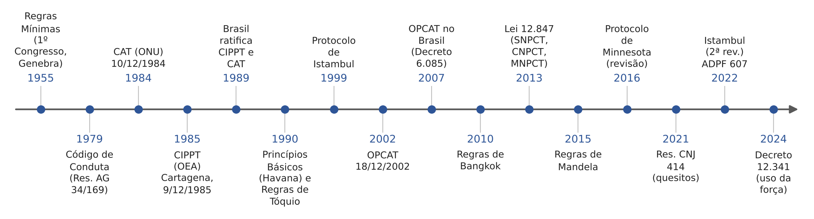
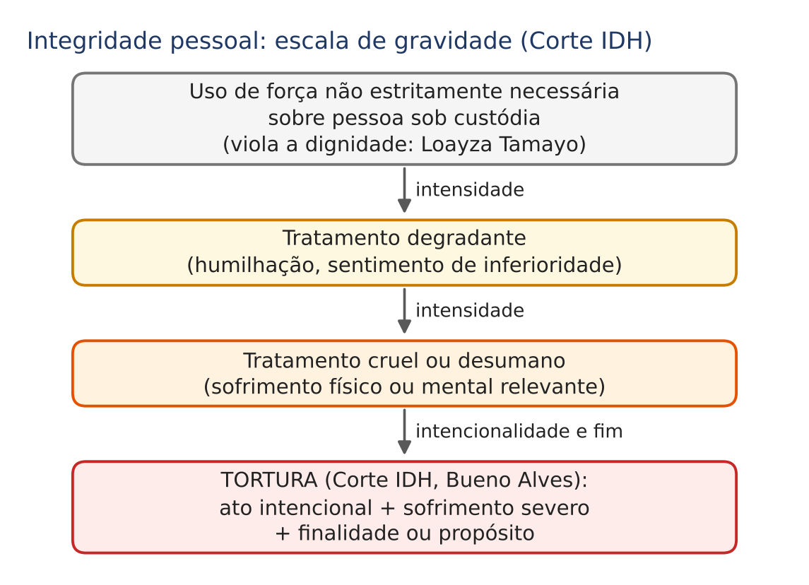
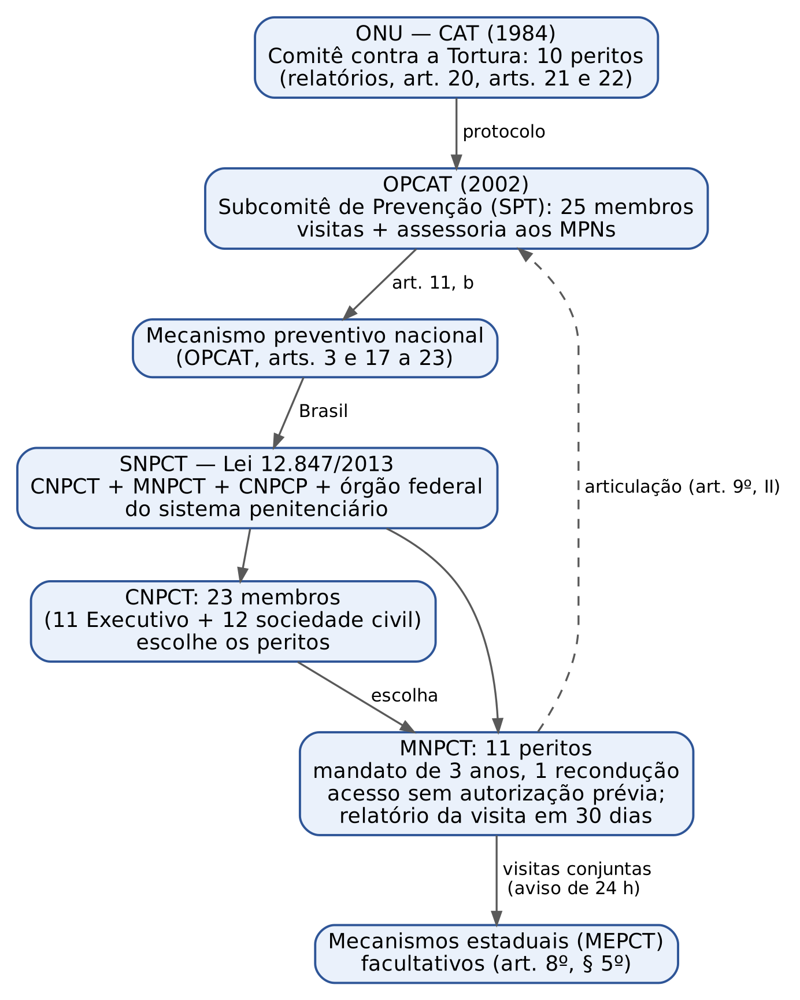
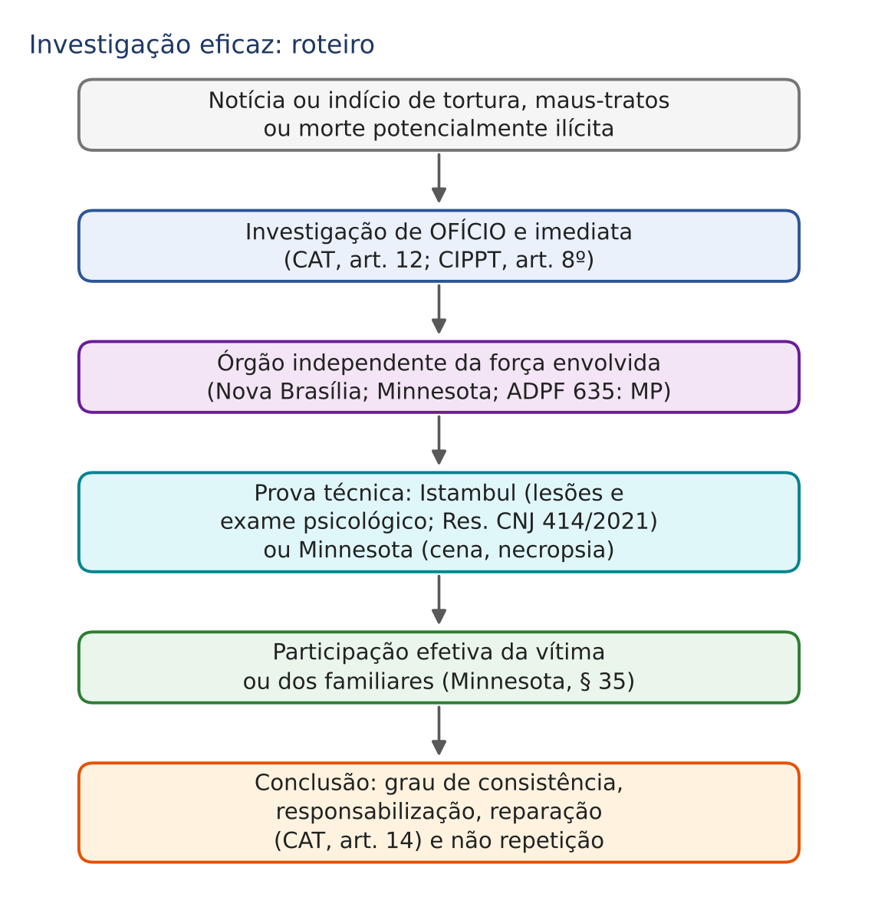
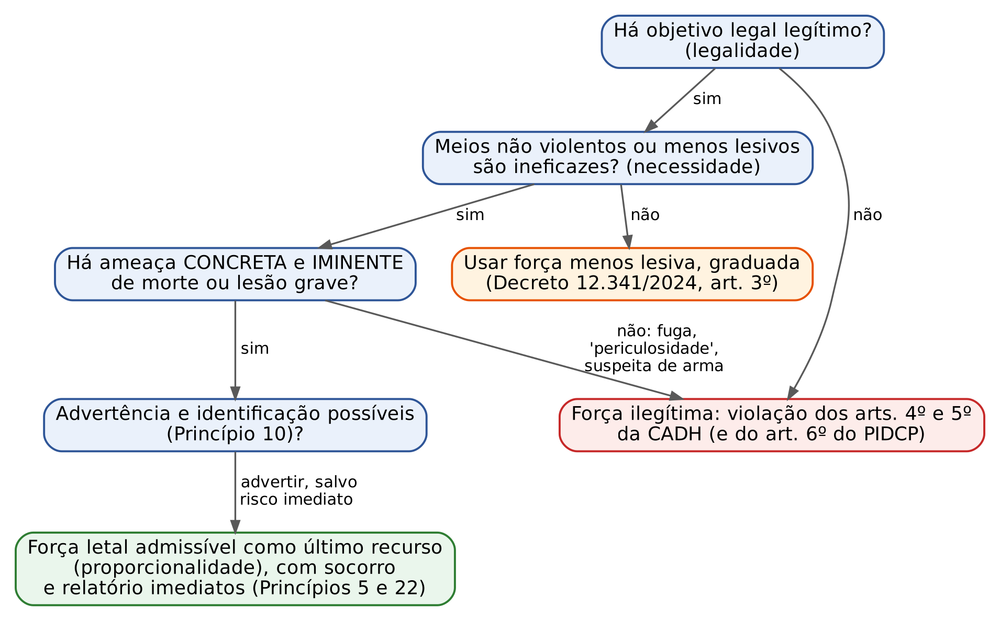

# CAPÍTULO 20 — PROIBIÇÃO DA TORTURA, INTEGRIDADE PESSOAL, USO DA FORÇA E PESSOAS PRESAS

:::INCIDENCIA
TRF5 p. 10; TJRS p. 2, 3; TJSC p. 2, 3. Nível A. Lote: 13 questões (FGV 11, FCC 2), além de 3 correlatas classificadas em outros capítulos.
O que mais cai: caráter absoluto da proibição (a falsa exceção da "bomba-relógio"), definição de tortura na CAT x na Convenção Interamericana, *non-refoulement* do art. 3º da CAT, força letal (ameaça concreta e iminente) e a letra das Regras de Mandela e de Bangkok.
:::

| Subtema | FGV | FCC | Padrão |
|---|---|---|---|
| Caráter absoluto, *jus cogens*, emergência | 1 (+1 correlata) | 0 | alternativa que admite tortura por proporcionalidade, ordem judicial ou finalidade de salvar vidas |
| Definição: CAT x CIPPT | 1 (TJ-PE, juiz) | 0 | agente público, "agudos", métodos que anulam a personalidade |
| *Non-refoulement* e extradição | 1 | 0 | "razões substanciais para crer" x exigência de condenação prévia ou de garantias formais |
| Uso da força por agentes estatais | 2 | 0 | fuga, periculosidade e suspeita de arma não bastam; força após cessada a resistência |
| Investigação (Istambul, Minnesota) | 0 (+2 correlatas) | 0 | natureza de *soft law* tratada como "facultativa" ou "obrigatória" |
| Regras de Mandela | 2 | 1 | individualização, confinamento solitário, devido processo disciplinar, natureza jurídica |
| Regras de Bangkok | 4 | 1 | gestantes e lactantes, contenção no parto, saúde preventiva, visitas, testagem de HIV |
| Prisão degradante e remédios | 1 (DPE-RJ) | 0 | o déficit estrutural não pode ser suportado pela pessoa presa |

Fora deste capítulo: tipos penais da Lei 9.455/1997 (Apostila de Direito Penal, Cap. 40); audiência de custódia, uso de algemas e prisão domiciliar (Apostila de Processo Penal, Caps. 18 e 19); Comitê contra a Tortura como órgão de tratado (Cap. 8, 08.5.3); *jus cogens* em geral (Cap. 2, 02.4); fichas de Favela Nova Brasília e demais casos brasileiros (Cap. 12); ADPF 635 e ADPF 347 (Cap. 13).

## 20.1 Integridade pessoal e proibição da tortura: estrutura normativa

### 20.1.1 Mapa normativo

| Plano | Instrumento | Dispositivo | O que acrescenta |
|---|---|---|---|
| Global, declaratório | DUDH (1948) | art. 5º | fórmula matriz: tortura e tratamento ou castigo cruel, desumano ou degradante |
| Global, convencional geral | PIDCP (Decreto 592/1992) | arts. 7º e 10 | proibição absoluta e inderrogável (art. 4.2); vedação de experiências médicas sem consentimento; tratamento humano do preso, separação de processados e adolescentes |
| Global, especial | CAT (Decreto 40/1991) | arts. 1º a 16 | definição, criminalização, jurisdição universal, *non-refoulement*, exclusão de prova, Comitê contra a Tortura |
| Global, preventivo | OPCAT (Decreto 6.085/2007) | arts. 1º a 37 | sistema de visitas: Subcomitê de Prevenção e mecanismos preventivos nacionais |
| Global, setorial | CRC, art. 37; CDPD, art. 15; CED | — | proteção reforçada de crianças, pessoas com deficiência, desaparecidos |
| Regional, geral | CADH (Decreto 678/1992) | art. 5º | integridade física, PSÍQUICA e MORAL; tratamento do preso (5.2 a 5.6); inderrogável (27.2) |
| Regional, especial | CIPPT (Decreto 98.386/1989) | arts. 1º a 17 | conceito mais amplo de tortura; investigação de ofício; supervisão pela CIDH |
| *Soft law* | Código de Conduta (1979); Princípios Básicos (1990); Regras de Mandela, Bangkok e Tóquio; Protocolos de Istambul e Minnesota | — | padrões técnicos que densificam os tratados e são usados como parâmetro pela Corte IDH e pelo STF |
| Interno | CF, art. 5º, III, XLIII, XLIX e L; Lei 9.455/1997; Lei 12.847/2013; Lei 13.060/2014 e Decreto 12.341/2024 | — | proibição constitucional, tipificação penal, sistema preventivo, uso diferenciado da força |

A letra do art. 5º da CADH é cobrada sobretudo nos incisos 1 e 2 e no núcleo prisional (5.4 a 5.6), já transcritos no Cap. 9 (9.5.2); a do art. 5º, III, XLIII e XLIX, da CF, na Apostila de Direito Constitucional, Cap. 8 (08.3).

### 20.1.2 Caráter absoluto, inderrogável e de *jus cogens*

A proibição da tortura é o exemplo mais citado de norma imperativa (Cap. 2, 02.4.2: consta do rol da CDI de 2022 e da jurisprudência interamericana). Para a prova, o que importa são as consequências operacionais, todas positivadas:

| Consequência | Fonte expressa |
|---|---|
| Nenhuma circunstância excepcional justifica a tortura: guerra, ameaça de guerra, instabilidade política interna ou "qualquer outra emergência pública" | CAT, art. 2.2 |
| Rol ainda mais extenso: estado de sítio ou emergência, comoção ou conflito interno, suspensão das garantias constitucionais, calamidades | CIPPT, art. 5º, primeira parte |
| Nem a PERICULOSIDADE do detido ou condenado nem a INSEGURANÇA do estabelecimento justificam a tortura | CIPPT, art. 5º, segunda parte |
| Ordem de superior ou de autoridade pública não justifica (CAT) nem exime de responsabilidade penal (CIPPT) | CAT, art. 2.3; CIPPT, art. 4º |
| Inderrogabilidade na suspensão de garantias | CADH, art. 27.2; PIDCP, art. 4.2 (Cap. 2, 02.8) |
| Proibição "absoluta e inderrogável" também dos tratamentos cruéis, desumanos ou degradantes | Corte IDH, Espinoza Gonzáles vs. Peru, sentença de 20/11/2014 (Série C n. 289), § 141 |

A proibição não se submete a ponderação: o cenário da "bomba-relógio" (*ticking bomb*), em que se argumenta com a vida de muitas pessoas, é precisamente o caso que os tratados excluem ao vedar justificação por "qualquer outra emergência pública". Não há autorização judicial prévia capaz de legitimar a tortura, e a finalidade de obter informação é ELEMENTO do conceito (CAT, art. 1º: "a fim de obter (...) informações ou confissões"), não excludente.

:::QUESTAO FGV 2026 — PC-PR — Agente de Polícia Judiciária (Q4375165)
Caso: preso se recusa a revelar onde está um explosivo prestes a detonar em local movimentado; discute-se infligir sofrimento intenso, "ponderando" com o interesse coletivo. Gabarito: C — a proibição é absoluta e não é afastada nem por guerra, instabilidade política interna ou emergência pública.
Armadilhas: A (proporcionalidade para salvar número expressivo de vidas) e D (ponderação com a vida de terceiros) tratam a vedação como princípio ponderável; B inventa autorização judicial prévia; E inverte o art. 1º da CAT — obter informações é justamente uma das finalidades que caracterizam a tortura. Fundamento: CAT, art. 2.2; CIPPT, art. 5º; CF, art. 5º, III.
No mesmo sentido: FGV 2024 — Câmara de Fortaleza — Consultor Legislativo (Q2474102, classificada no Cap. 8; a alternativa B, "tortura para a defesa da coletividade" como exceção do PIDCP, é falsa; gabarito C).
:::

### 20.1.3 Gradação: tortura x tratamento cruel, desumano ou degradante

A Corte IDH trata a violação da integridade como de "diversas conotações de grau", que vão da tortura a outros tratamentos cruéis, desumanos ou degradantes, cujos efeitos físicos e psíquicos variam segundo fatores endógenos e exógenos a demonstrar em cada caso (Loayza Tamayo vs. Peru, sentença de 17/9/1997, Série C n. 33, § 57). No mesmo precedente, a Corte fixou que todo uso de força que não seja estritamente necessário pelo próprio comportamento da pessoa detida atenta contra a dignidade humana e viola o art. 5º.

Os elementos da tortura no sistema interamericano foram sistematizados a partir de Bueno Alves vs. Argentina (sentença de 11/5/2007, Série C n. 164): (i) ato INTENCIONAL; (ii) que cause severos sofrimentos físicos ou mentais; (iii) cometido com determinado FIM ou propósito. Note-se que a Corte não exige, para a tortura, a qualidade de agente público como elemento definitório (o que importa é a atribuição ao Estado, por ação, aquiescência ou falta de devida diligência), e que o critério da severidade é examinado à luz das características da vítima (idade, sexo, saúde, condição de vulnerabilidade).

| Linha jurisprudencial | Caso e dados | Tese |
|---|---|---|
| Tortura psicológica | Maritza Urrutia vs. Guatemala, sentença de 27/11/2003 (Série C n. 103); Cantoral Benavides vs. Peru, sentença de 18/8/2000 (Série C n. 69) | ameaças e sofrimento mental, sem lesão física, podem configurar tortura; o regime internacional de proibição é absoluto |
| Isolamento e incomunicabilidade | Suárez Rosero vs. Equador, 12/11/1997 (Série C n. 35); Bámaca Velásquez vs. Guatemala, 25/11/2000 (Série C n. 70); Lori Berenson Mejía vs. Peru, 25/11/2004 (Série C n. 119) | isolamento prolongado e incomunicabilidade coativa são, por si, tratamentos cruéis e desumanos |
| Violência sexual como tortura | Penal Miguel Castro Castro vs. Peru, 25/11/2006 (Série C n. 160); Fernández Ortega e outros vs. México, 30/8/2010 (Série C n. 215); Rosendo Cantú e outra vs. México, 31/8/2010 (Série C n. 216); Mulheres Vítimas de Tortura Sexual em Atenco vs. México, 28/11/2018 (Série C n. 371) | o estupro por agente estatal pode configurar tortura; o sofrimento severo é inerente à violação sexual, ainda sem lesões físicas |
| Prova da tortura sob custódia | J. vs. Peru, 27/11/2013 (Série C n. 275); Espinoza Gonzáles (2014) | não se exige prova além da dúvida razoável nem identificação dos agentes; a ausência de sinais físicos não exclui maus-tratos; exame médico tardio ou deficiente não desacredita a vítima |
| Discriminação por orientação sexual | Azul Rojas Marín e outra vs. Peru, 12/3/2020 (Série C n. 402) | tortura com finalidade discriminatória; deveres reforçados de investigar (CIPPT, arts. 1º, 6º e 8º) |
| Familiares como vítimas | jurisprudência constante (Cap. 9, 9.5.2) | o sofrimento dos familiares de vítimas de graves violações viola o art. 5.1 |

Brasil: em Favela Nova Brasília vs. Brasil (sentença de 16/2/2017, Série C n. 333), a Corte declarou a violação dos arts. 1º, 6º e 8º da CIPST porque a violência sexual praticada por policiais contra três mulheres deveria ter sido investigada como possível tortura (ficha no Cap. 12, 12.5.1). Em Hernández Norambuena vs. Brasil (2025), o isolamento prolongado em RDD foi tratado como violação da integridade, sem declaração de tortura (Cap. 12, 12.9).

:::PEGADINHA Escala não é tipologia fechada
A ordem "degradante, desumano, tortura" é ferramenta didática de gravidade. A Corte IDH não exige que o examinador "classifique" primeiro o tratamento para declarar a violação do art. 5º: basta demonstrar a afetação da integridade. E a tortura não depende de lesão física (tortura psicológica), nem de dor "aguda" na Convenção Interamericana (20.3.2).
:::

## 20.2 Convenção da ONU contra a Tortura (CAT)

### 20.2.1 Dados de incorporação

Adotada pela Assembleia Geral em 10/12/1984; em vigor internacional em 26/6/1987. Brasil: Decreto Legislativo 4, de 23/5/1989; ratificação depositada em 28/9/1989; vigência para o Brasil em 28/10/1989 (art. 27.2); promulgação pelo Decreto 40, de 15/2/1991. Hierarquia supralegal (Cap. 4). Estrutura: Parte I (arts. 1º a 16: obrigações materiais), Parte II (arts. 17 a 24: Comitê contra a Tortura), Parte III (disposições finais). O órgão, seus mecanismos (relatórios, investigação confidencial do art. 20 com *opt-out* do art. 28, comunicações interestatais do art. 21 e individuais do art. 22) e a promulgação da declaração brasileira ao art. 22 pelo Decreto 13.040, de 29/6/2026, estão no Cap. 8 (08.5.3).

### 20.2.2 Definição (art. 1º)

:::LEI CAT, art. 1º (Decreto 40/1991)
1. Para os fins da presente Convenção, o termo "tortura" designa qualquer ato pelo qual dores ou sofrimentos agudos, físicos ou mentais, são infligidos intencionalmente a uma pessoa a fim de obter, dela ou de uma terceira pessoa, informações ou confissões; de castigá-la por ato que ela ou uma terceira pessoa tenha cometido ou seja suspeita de ter cometido; de intimidar ou coagir esta pessoa ou outras pessoas; ou por qualquer motivo baseado em discriminação de qualquer natureza; quando tais dores ou sofrimentos são infligidos por um funcionário público ou outra pessoa no exercício de funções públicas, ou por sua instigação, ou com o seu consentimento ou aquiescência. Não se considerará como tortura as dores ou sofrimentos que sejam conseqüência unicamente de sanções legítimas, ou que sejam inerentes a tais sanções ou delas decorram.
2. O presente Artigo não será interpretado de maneira a restringir qualquer instrumento internacional ou legislação nacional que contenha ou possa conter dispositivos de alcance mais amplo.
:::

Quatro elementos: (1) dor ou sofrimento AGUDO (em inglês, *severe*), físico ou mental; (2) intencionalidade; (3) finalidade — obter informação ou confissão, castigar, intimidar ou coagir, ou motivo discriminatório; (4) envolvimento estatal — funcionário público ou pessoa no exercício de funções públicas, diretamente ou por instigação, consentimento ou AQUIESCÊNCIA. Cláusula de exclusão: sofrimento decorrente "unicamente" de sanções legítimas. O § 2º é cláusula de norma mais favorável: autoriza o conceito mais amplo da CIPPT e da Lei 9.455/1997 (crime comum).

### 20.2.3 Obrigações materiais

| Artigo | Obrigação | Ponto de prova |
|---|---|---|
| 2.1 | medidas legislativas, administrativas, judiciais ou outras para impedir a tortura em território sob sua jurisdição | dever de prevenção, base do OPCAT |
| 2.2 e 2.3 | nenhuma emergência; nenhuma ordem superior justifica | 20.1.2 |
| 3 | *non-refoulement* | 20.2.4 |
| 4 | tipificar como crime a tortura, a TENTATIVA e a cumplicidade ou participação, com penas adequadas à gravidade | cumprido pela Lei 9.455/1997 |
| 5 | jurisdição: territorial e de pavilhão (a), nacionalidade ativa (b), nacionalidade passiva "se o considerar apropriado" (c) e, no § 2º, presença do suspeito no território sem extradição (jurisdição universal) | a nacionalidade passiva é FACULTATIVA; a do § 2º, obrigatória |
| 6 | detenção do suspeito presente, investigação preliminar imediata, comunicação aos Estados do art. 5.1 e assistência consular | — |
| 7 | *aut dedere aut judicare*: não extraditando, submeter o caso às autoridades competentes para processo | CIJ, Bélgica vs. Senegal (Cap. 2, 02.4.4) |
| 8 | tortura é crime extraditável; a Convenção pode servir de base legal para extradição | — |
| 10 e 11 | educação e treinamento de policiais, militares, pessoal médico e de custódia; revisão sistemática de métodos de interrogatório e custódia | — |
| 12 | investigação IMEDIATA e IMPARCIAL sempre que houver motivos razoáveis para crer que houve tortura (de ofício, independentemente de queixa) | 20.5.1 |
| 13 | direito de queixa e proteção do queixoso e das testemunhas | — |
| 14 | reparação e indenização justa e adequada, com meios para a mais completa REABILITAÇÃO; dependentes da vítima morta também | — |
| 15 | regra de exclusão: declaração prestada sob tortura não pode ser invocada como prova, SALVO contra o acusado de tortura, como prova de que a declaração foi prestada | a única "utilização" admitida é contra o torturador |
| 16 | tratamentos cruéis, desumanos ou degradantes: proibição e aplicação dos arts. 10 a 13 | os arts. 3º, 4º, 5º, 14 e 15 NÃO são estendidos pela letra do art. 16 |

:::DICA Arts. 15 da CAT e 10 da CIPPT
As duas regras de exclusão têm a mesma estrutura: prova obtida sob tortura é inadmissível, e a única exceção é seu uso no processo contra o acusado de tortura, para demonstrar que a declaração foi obtida daquele modo. No direito interno, a consequência é a ilicitude da prova (CF, art. 5º, LVI; CPP, art. 157). A Corte IDH estende a exclusão a toda prova obtida mediante coação (Cabrera García e Montiel Flores vs. México, sentença de 26/11/2010, Série C n. 220; Cap. 5, 05.2.3).
:::

### 20.2.4 *Non-refoulement* (art. 3º)

:::LEI CAT, art. 3º
1. Nenhum Estado Parte procederá à expulsão, devolução ou extradição de uma pessoa para outro Estado quando houver razões substanciais para crer que a mesma corre perigo de ali ser submetida a tortura.
2. A fim de determinar a existência de tais razões, as autoridades competentes levarão em conta todas as considerações pertinentes, inclusive, quando for o caso, a existência, no Estado em questão, de um quadro de violações sistemáticas, graves e maciças de direitos humanos.
:::

Traços cobráveis: (i) alcança expulsão, devolução E extradição, e qualquer pessoa (não só refugiados; não admite as exceções do art. 33.2 da Convenção de 1951, que é a sede do Cap. 21); (ii) o padrão probatório é o de "razões substanciais para crer" — risco real, pessoal e previsível, não certeza nem condenação prévia dos agentes do Estado requerente; (iii) o quadro de violações sistemáticas é elemento a considerar, não requisito suficiente nem necessário; (iv) a maior parte da jurisprudência do Comitê contra a Tortura versa sobre o art. 3º (Comentário Geral 4, de 2017; Cap. 8). A CIPPT é mais ampla: no art. 13, última parte, veda a extradição e a devolução quando houver "suspeita fundada" de perigo para a vida, de tortura ou tratamento cruel, desumano ou degradante, ou de julgamento por tribunais de exceção ou *ad hoc*. No STF, o filtro de direitos humanos na extradição é desenvolvido no Cap. 13 (13.10.1).

:::QUESTAO FGV 2026 — PC-PI — Oficial Investigador (Q3846861)
Caso: extraditando alega, no processo de extradição, que os réus em geral são torturados no Estado requerente. Gabarito: A — a extradição não deve ser concedida se houver razões substanciais para crer que ele corre perigo de tortura (CAT, art. 3.1).
Passos: (1) a CAT foi ratificada e promulgada (Decreto 40/1991): erra a C; (2) o padrão é de "razões substanciais", e o quadro de violações sistemáticas é considerado (art. 3.2): erra a B, que opõe a "presunção de legalidade" dos atos estatais; (3) não se exige condenação prévia dos agentes estrangeiros pela tortura do próprio extraditando: erra a D; (4) a E é sedutora, mas inventa a "valorização da palavra" e condiciona a extradição a garantias formais do Estado requerente — o texto não prevê esse mecanismo, e garantias diplomáticas não afastam, por si, risco real.
:::

## 20.3 Convenção Interamericana para Prevenir e Punir a Tortura (CIPPT)

### 20.3.1 Dados de incorporação

Concluída em Cartagena das Índias em 9/12/1985 (OEA). Brasil: Decreto Legislativo 5, de 31/5/1989; ratificação em 20/7/1989; promulgação pelo Decreto 98.386, de 9/11/1989. Vigência internacional em 28/2/1987, no 30º dia após o depósito do SEGUNDO instrumento de ratificação (art. 22). Admite reservas específicas compatíveis com objeto e fim (art. 21); denúncia com efeito após um ano (art. 23). Não tem órgão próprio: os Estados informam a CIDH, que analisa a situação em seu relatório anual (art. 17); esgotados os recursos internos, o caso pode ser submetido a instâncias internacionais cuja competência o Estado tenha aceitado (art. 8º, terceira parte), e a Corte IDH aplica a CIPPT nos casos contenciosos com base nessa cláusula. Hierarquia: supralegal; NÃO foi aprovada pelo rito do art. 5º, § 3º, da CF (Q3171433, Cap. 4).

### 20.3.2 Definição (art. 2º) e comparação com a CAT

:::LEI CIPPT, art. 2º (Decreto 98.386/1989)
Para os efeitos desta Convenção, entender-se-á por tortura todo ato pelo qual são infligidos intencionalmente a uma pessoa penas ou sofrimentos físicos ou mentais, com fins de investigação criminal, como meio de intimidação, como castigo pessoal, como medida preventiva, como pena ou com qualquer outro fim. Entender-se-á também como tortura a aplicação, sobre uma pessoa, de métodos tendentes a anular a personalidade da vítima, ou a diminuir sua capacidade física ou mental, embora não causem dor física ou angústia psíquica.
Não estarão compreendidos no conceito de tortura as penas ou sofrimentos físicos ou mentais que sejam unicamente conseqüência de medidas legais ou inerentes a elas, contato que não incluam a realização dos atos ou aplicação dos métodos a que se refere este Artigo.
:::

| Elemento | CAT (ONU, art. 1º) | CIPPT (OEA, arts. 2º e 3º) | Lei 9.455/1997 |
|---|---|---|---|
| Intensidade | sofrimento "AGUDO" | não qualifica a intensidade | "sofrimento físico ou mental" (intenso, na modalidade castigo) |
| Finalidade | rol: informação ou confissão, castigo, intimidação ou coação, discriminação | rol aberto: "ou com qualquer outro fim" | finalidades típicas (prova, crime, discriminação, castigo) |
| Sem dor | não prevê | SIM: métodos que anulem a personalidade ou diminuam a capacidade física ou mental, ainda que sem dor ou angústia | não prevê como tal |
| Sujeito ativo | funcionário público ou pessoa no exercício de funções públicas, ou por sua instigação, consentimento ou aquiescência | empregados ou funcionários públicos (inclusive por omissão de quem podia impedir) e particulares instigados por eles (art. 3º) | CRIME COMUM, com causa de aumento para agente público |
| Excludente | sanções legítimas | medidas legais, desde que não incluam os métodos do art. 2º | — |
| Órgão | Comitê contra a Tortura | CIDH (art. 17); Corte IDH por meio do art. 8º | — |

:::QUESTAO FGV 2026 — TJ-PE — Juiz Substituto (Q4349560)
Três afirmativas sobre a CAT e a CIPPT. Gabarito: C (I e III).
Passos: (1) item I CERTO — apenas a CAT exige, na definição, a participação de funcionário público ou de quem exerce funções públicas (direta, por instigação, consentimento ou aquiescência); a CIPPT define a tortura pelo ato e trata da autoria no art. 3º, alcançando também particulares instigados por funcionários; (2) item II ERRADO — apenas a CIPPT inclui os métodos que diminuem a capacidade física ou mental sem causar dor; (3) item III CERTO — a CIPPT não exige que o sofrimento seja "agudo".
Ressalva de mérito (procedente): o item I é discutível, porque a CIPPT também exige vínculo estatal na autoria — art. 3º: funcionários públicos que ordenem, instiguem, induzam, cometam ou, podendo impedir, não impeçam, e particulares que atuem por instigação deles —, assim como a CAT admite instigação, consentimento ou aquiescência. A banca o deu como certo comparando apenas as DEFINIÇÕES (art. 1º da CAT x art. 2º da CIPPT). Memorize a fórmula da banca: "só a CAT exige agente público; só a CIPPT dispensa dor e intensidade".
:::

### 20.3.3 Demais obrigações da CIPPT

- Art. 4º: ordens superiores não eximem de responsabilidade penal.
- Art. 5º: rol de circunstâncias que não justificam a tortura, com o acréscimo singular da periculosidade do detido e da insegurança do estabelecimento (20.1.2).
- Art. 6º: tipificação da tortura e da TENTATIVA com penas severas; prevenção e punição também dos tratamentos cruéis, desumanos ou degradantes.
- Art. 7º: treinamento de policiais e custodiadores.
- Art. 8º: direito a exame imparcial do caso; havendo denúncia OU razão fundada, as autoridades procedem DE OFÍCIO e imediatamente à investigação e, se cabível, ao processo penal; esgotados os recursos internos, acesso às instâncias internacionais.
- Art. 9º: compensação adequada às vítimas.
- Art. 10: regra de exclusão (20.2.3).
- Arts. 11 a 14: extradição e *aut dedere aut judicare*; o art. 13, última parte, contém o *non-refoulement* ampliado (20.2.4).
- Art. 15: a Convenção não limita o direito de asilo.

:::PEGADINHA Lei 9.455/1997 e as convenções
A Lei 9.455/1997 tipifica a tortura como crime COMUM, opção legítima porque ambas as convenções ressalvam normas de alcance mais amplo (CAT, art. 1.2) e porque o art. 3º, I, da Lei 12.847/2013 define tortura, para o sistema preventivo, como os tipos da Lei 9.455, "respeitada a definição" do art. 1º da CAT. A banca pode afirmar que a lei brasileira "contraria a CAT por não exigir agente público": é falso. Tipos, perda do cargo e extraterritorialidade (art. 2º da Lei 9.455): Apostila de Direito Penal, Cap. 40.
:::

:::PRATIQUE Exercícios elaborados para esta apostila (não são questões de banca)
1. Certo ou errado: "Segundo a Convenção da ONU contra a Tortura, o Estado deve estabelecer sua jurisdição sobre o crime quando a vítima for sua nacional."
2. Certo ou errado: "A Convenção Interamericana para Prevenir e Punir a Tortura admite que a periculosidade do preso seja ponderada na avaliação da legitimidade de métodos coercitivos de interrogatório."
3. Certo ou errado: "Pelo art. 16 da CAT, a regra de exclusão de provas do art. 15 aplica-se expressamente aos tratamentos cruéis, desumanos ou degradantes."
Respostas: 1. ERRADO — a jurisdição pela nacionalidade passiva é facultativa ("se o considerar apropriado", art. 5.1, c). 2. ERRADO — o art. 5º, segunda parte, veda expressamente essa justificação. 3. ERRADO — o art. 16 estende apenas os arts. 10 a 13; a extensão da regra de exclusão a provas obtidas por coação vem da jurisprudência (Comitê e Corte IDH), não da letra.
:::

## 20.4 Prevenção: Protocolo Facultativo, Subcomitê e mecanismos preventivos

### 20.4.1 OPCAT: a lógica preventiva

Adotado em Nova York em 18/12/2002; em vigor internacional em 22/6/2006, no 30º dia após o 20º instrumento (art. 28). Brasil: Decreto Legislativo 483, de 20/12/2006; ratificação em 11/1/2007; vigência para o Brasil em 11/2/2007; Decreto 6.085, de 19/4/2007. O preâmbulo invoca a Conferência de Viena (1993), segundo a qual os esforços para erradicar a tortura devem concentrar-se primeiro na prevenção, por meio de visitas regulares a centros de detenção.

| Tema | Regra (artigo do OPCAT) |
|---|---|
| Objetivo | sistema de VISITAS REGULARES por órgãos nacionais e internacionais independentes a lugares de privação de liberdade (1) |
| Princípios do SPT | confidencialidade, imparcialidade, não seletividade, universalidade e objetividade (2.3) |
| Lugar de detenção | qualquer lugar sob jurisdição e controle do Estado onde pessoas são ou podem ser privadas de liberdade por ordem de autoridade pública ou com seu incitamento, permissão ou concordância; inclui estabelecimentos públicos ou PRIVADOS (4) |
| Composição | 10 membros; 25 após a 50ª ratificação ou adesão (5.1); não pode haver dois nacionais do mesmo Estado (5.5) |
| Mandato | quatro anos, uma reeleição (9) |
| Funções | visitar e recomendar; aconselhar, assistir e treinar os mecanismos preventivos nacionais; cooperar com outros órgãos (11) |
| Visitas | programa por sorteio inicial; ao menos dois membros; visita de seguimento (13) |
| Acesso | irrestrito a informações, lugares, instalações; entrevistas privadas sem testemunhas; livre escolha de locais e pessoas (14.1) |
| Objeção do Estado | só por motivos urgentes e imperiosos de defesa nacional, segurança pública, desastre natural ou séria desordem no local, TEMPORARIAMENTE; o estado de emergência declarado NÃO é motivo (14.2) |
| Represálias | vedada sanção a quem comunicar informação, "verdadeira ou falsa" (15 e 21.1) |
| Relatórios | recomendações confidenciais; publicação a pedido do Estado; relatório anual público ao Comitê contra a Tortura; se o Estado não coopera, o Comitê pode, por maioria, fazer declaração pública ou publicar o relatório (16) |
| Mecanismo nacional | manter, designar ou estabelecer em UM ANO um ou mais mecanismos preventivos independentes; admitem-se unidades descentralizadas (17) |
| Garantias do mecanismo | independência funcional; recursos necessários; equilíbrio de gênero e representação étnica; observância dos Princípios de Paris (18) |
| Competências mínimas | exame regular, recomendações, propostas legislativas (19) |
| Prerrogativas | as mesmas do SPT, mais o direito de contato com o Subcomitê (20) |
| Adiamento | declaração na ratificação adia a Parte III ou a IV por até 3 anos, prorrogáveis por 2 (24) |
| Estados federais | aplicação a todas as partes, sem limitações (29) |
| Reservas | NÃO admitidas (30) |

:::PEGADINHA SPT x Comitê contra a Tortura x mecanismo nacional
O Subcomitê NÃO recebe comunicações individuais nem julga casos: visita e recomenda. Quem recebe comunicações é o Comitê contra a Tortura (art. 22 da CAT; Cap. 8). O mecanismo preventivo nacional é OBRIGATÓRIO para o Estado-parte do OPCAT (art. 17), e não "facultativo"; facultativo é o próprio Protocolo. Por fim, o OPCAT não admite reservas, mas admite a declaração de adiamento do art. 24.
:::

### 20.4.2 Brasil: Lei 12.847/2013

A Lei 12.847, de 2/8/2013, instituiu o Sistema Nacional de Prevenção e Combate à Tortura (SNPCT) e criou o Comitê Nacional (CNPCT) e o Mecanismo Nacional (MNPCT), regulamentada pelo Decreto 8.154/2013.

| Órgão | Composição e regime | Funções-chave |
|---|---|---|
| SNPCT (arts. 1º a 5º) | integrado obrigatoriamente pelo CNPCT, MNPCT, Conselho Nacional de Política Criminal e Penitenciária e órgão do Ministério da Justiça responsável pelo sistema penitenciário (§ 1º); facultativamente por comitês e mecanismos estaduais, órgãos do Judiciário (infância, juventude, militar, execução penal), MP, Defensorias, conselhos da comunidade, corregedorias, ouvidorias, conselhos tutelares e ONGs (§ 2º) | articulação e intercâmbio; princípios: dignidade, universalidade, objetividade, igualdade, imparcialidade, não seletividade e não discriminação (art. 4º) |
| CNPCT (arts. 6º e 7º) | 23 membros designados pelo Presidente da República: 11 do Executivo federal e 12 de conselhos de classe e sociedade civil, com consulta pública prévia; presidido pelo Ministro da área de direitos humanos; vice eleito, mandato de um ano, alternância; MP, Judiciário e Defensoria como CONVIDADOS PERMANENTES, com voz; participação não remunerada | acompanhar e propor políticas; acompanhar procedimentos de apuração; cadastro de alegações, denúncias e decisões; apoiar comitês estaduais; ESCOLHER os peritos do MNPCT |
| MNPCT (arts. 8º a 11) | 11 PERITOS escolhidos pelo CNPCT e nomeados pelo Presidente da República; mandato FIXO de 3 anos, UMA recondução; destituição só por condenação penal transitada em julgado ou processo disciplinar; afastamento cautelar por decisão do CNPCT; vedados dirigentes partidários | visitas periódicas e regulares em todas as unidades da Federação; requerer instauração de procedimento criminal e administrativo; relatório de cada visita em até 30 DIAS ao CNPCT, à PGR e às autoridades; relatório anual; recomendações; propostas legislativas |
| Mecanismos estaduais (art. 8º, §§ 5º a 7º) | criação FACULTATIVA pelos Estados | visitas do MNPCT feitas em conjunto, com aviso ao mecanismo estadual de 24 horas; a ausência do estadual não impede a visita |

Prerrogativas do MNPCT (art. 10): autonomia; acesso, INDEPENDENTEMENTE DE AUTORIZAÇÃO, a informações e registros sobre número, identidade, condições de detenção e tratamento; acesso a todos os locais de privação de liberdade, públicos e privados; entrevistas reservadas e sem testemunhas; livre escolha de locais e pessoas, com registros audiovisuais; requisição de perícias oficiais (CPP, art. 159). Os relatórios das visitas PODEM PRODUZIR PROVA EM JUÍZO (art. 10, § 3º). O conceito de pessoa privada de liberdade (art. 3º, II) é amplo: abrange locais de internação de longa permanência, hospitais psiquiátricos, casas de custódia, unidades socioeducativas e centros de detenção disciplinar militar. As recomendações do MNPCT devem ser consideradas na seleção de projetos financiados pelo FUNPEN, pelo Fundo Nacional de Segurança Pública, pelo Fundo do Idoso e pelo Fundo da Criança e do Adolescente (art. 9º, § 3º).

:::JURIS STF, ADPF 607, Relator Ministro Dias Toffoli, Plenário, j. 25/3/2022 (Informativo 1.048)
O Decreto 9.831/2019 remanejou para o Ministério da Economia os 11 cargos em comissão dos peritos do MNPCT, exonerou seus ocupantes e transformou a participação no Mecanismo em "prestação de serviço público relevante, não remunerada". O Plenário declarou inconstitucionais os arts. 1º, 3º e 4º do decreto e, por arrastamento, o art. 2º; declarou também inconstitucional a expressão "designados" do art. 10 do Decreto 8.154/2013, com interpretação conforme para que os peritos sejam NOMEADOS para cargo em comissão, restabelecendo os cargos e a remuneração.
Fundamentos: abuso do poder regulamentar (o decreto esvaziou política pública instituída pela Lei 12.847/2013), ofensa à separação de Poderes, risco de desmonte do órgão e descumprimento do compromisso internacional do art. 18.3 do OPCAT (dever de tornar disponíveis os recursos necessários ao funcionamento dos mecanismos preventivos).
:::

:::DICA Ligação com a magistratura
O juiz da execução e o juiz da custódia integram, facultativamente, o SNPCT (art. 2º, § 2º, II). Na prática: (i) relatórios do MNPCT e dos mecanismos estaduais servem de prova em incidentes de execução, ações civis públicas e ações indenizatórias (art. 10, § 3º); (ii) a inspeção mensal dos estabelecimentos penais pelo juiz da execução é atribuição da LEP, mas o padrão técnico da inspeção vem das Regras de Mandela (regras 83 e 84; 20.7.2).
:::

:::PRATIQUE Exercícios elaborados para esta apostila (não são questões de banca)
1. Certo ou errado: "Os peritos do MNPCT são escolhidos pelo Presidente da República entre nomes indicados pelo Conselho Nacional de Política Criminal e Penitenciária."
2. Certo ou errado: "O Estado-parte do OPCAT pode objetar a visita do Subcomitê de Prevenção a determinado estabelecimento invocando a vigência de estado de emergência."
3. Certo ou errado: "A visita periódica do MNPCT a presídio estadual depende da presença do mecanismo estadual de prevenção, quando existente."
Respostas: 1. ERRADO — escolhidos pelo CNPCT e nomeados pelo Presidente da República (art. 8º, § 1º). 2. ERRADO — o estado de emergência não pode ser invocado (art. 14.2); a objeção é temporária e limitada a razões urgentes e imperiosas. 3. ERRADO — a visita é feita em conjunto, com aviso de 24 horas, mas a recusa ou impossibilidade do mecanismo estadual não impede a atuação do MNPCT (art. 8º, §§ 6º e 7º).
:::

## 20.5 Investigação eficaz: dever de investigar, Protocolo de Istambul e Protocolo de Minnesota

### 20.5.1 O dever de investigar

Base convencional: CAT, arts. 12 e 13 (investigação imediata e imparcial sempre que houver motivos razoáveis, independentemente de queixa); CIPPT, art. 8º (investigação DE OFÍCIO e imediata diante de denúncia ou razão fundada); CADH, arts. 1.1, 8º e 25. Na Corte IDH, a obrigação de investigar a tortura é reforçada pelos arts. 1º, 6º e 8º da CIPPT e é de MEIO, mas deve ser séria, imparcial, efetiva e conduzida em prazo razoável; as excludentes que impeçam a investigação de graves violações são inadmissíveis (Cap. 6). Quando a pessoa está sob custódia, o Estado é garante: lesões sofridas sob custódia geram presunção de responsabilidade estatal, cabendo ao Estado explicação satisfatória e convincente (Cap. 9, 9.5.2).

### 20.5.2 Protocolo de Istambul

| Ponto | Conteúdo |
|---|---|
| Nome | Manual para a Investigação e Documentação Eficazes da Tortura e Outros Tratamentos ou Penas Cruéis, Desumanos ou Degradantes |
| Origem | elaborado por 75 especialistas em direito, saúde e direitos humanos, de 40 organizações de 15 países; entregue à Alta Comissária da ONU para os Direitos Humanos em 9/8/1999; publicado na Série de Capacitação Profissional da ONU (n. 8) em 2001 e revisado em 2004 |
| Princípios de Istambul | padrões mínimos de investigação e documentação, anexados à Resolução 55/89 da Assembleia Geral e encorajados pela Resolução 2000/43 da Comissão de Direitos Humanos |
| Edição de 2022 | segunda revisão (Série n. 8/Rev. 2), com novos capítulos sobre o papel dos profissionais de saúde na documentação e sobre a implementação do Protocolo, enfoque na vítima e perspectiva de gênero; tradução publicada pelo CNJ em 2024 |
| Natureza | *soft law*: diretrizes técnicas, não tratado; mas densifica obrigações convencionais (CAT, arts. 12 e 13; CIPPT, art. 8º), e é usado como padrão por comitês, relatores e pela Corte IDH para aferir se uma investigação foi eficaz |
| Método | exame físico e psicológico; relato da vítima, idealmente em suas palavras; fotografias e diagramas; avaliação da CONSISTÊNCIA entre achados e relato (não "prova" da tortura, mas grau de compatibilidade) |

No Brasil, a Resolução CNJ 414, de 2/9/2021, estabelece diretrizes e quesitos periciais para os exames de corpo de delito quando houver indícios de tortura e outros tratamentos cruéis, desumanos ou degradantes, conforme o Protocolo de Istambul, e revogou a Recomendação CNJ 49/2014:

- o juiz deve observar a aparência da pessoa presa, as circunstâncias da prisão e o tratamento recebido, aplicando também o Protocolo II da Resolução CNJ 213/2015 (audiência de custódia e inspeções);
- o laudo deve ser juntado antes da audiência de custódia;
- o laudo registra quem estava presente no exame e eventuais instrumentos de contenção, o consentimento informado, o relato da vítima, os achados físicos e psicológicos, FOTOGRAFIAS coloridas com escala métrica e metadados, diagramas corporais e a conclusão sobre a consistência; preferência por equipe multiprofissional (medicina e psicologia);
- o Protocolo de Minnesota pode ser considerado para os laudos de necropsia (art. 4º, § 3º);
- graus de consistência do anexo: pouco consistente, consistente, altamente consistente, consistência típica e diagnóstico de;
- a Resolução acrescentou à Resolução 213/2015 a hipótese de exame realizado na presença de agente policial, que deve ser identificado e justificado.

Ponto de atualidade: a Lei 15.358, de 24/3/2026, deu nova redação ao art. 310 do CPP para que a audiência de custódia se realize, em regra, por videoconferência, admitida a presencial em situações excepcionais de força maior, e assegurou entrevista prévia e reservada com o defensor e a privacidade do preso na sala, devendo permanecer sozinho durante a oitiva (salvo presença física do defensor). A função de prevenção e detecção da tortura da audiência continua exigindo do juiz o exame da integridade do custodiado; procedimento e controvérsias: Apostila de Processo Penal, Cap. 18.

:::QUESTAO FGV 2025 — PC-MG — Perito Criminal (Q3171978, classificada no Cap. 4; ângulo do Protocolo de Istambul)
Pediu a afirmativa correta sobre a ratificação de tratados de direitos humanos pelo Brasil. Gabarito: B — tratados de direitos humanos podem equivaler a emendas constitucionais se aprovados por quórum qualificado em cada Casa (art. 5º, § 3º).
Armadilha deste capítulo: a alternativa A afirma que a prevenção e o combate à tortura são "relativos" porque a adoção do Protocolo de Istambul seria facultativa. Dois erros: a proibição da tortura é absoluta e independe do Protocolo; e o Protocolo, embora seja diretriz técnica sem natureza de tratado, densifica deveres convencionais de investigar (CAT, art. 12; CIPPT, art. 8º) e foi incorporado à prática judiciária pela Resolução CNJ 414/2021.
:::

### 20.5.3 Protocolo de Minnesota

| Ponto | Conteúdo |
|---|---|
| Nome atual | Protocolo de Minnesota sobre a Investigação de Mortes Potencialmente Ilícitas (2016); a tradução do CNJ (2024) usa "mortes potencialmente ilegais" |
| Origem | Manual sobre a Prevenção e Investigação Eficazes de Execuções Extralegais, Arbitrárias e Sumárias (1991), concebido para dar efetividade aos Princípios da ONU de 1989 (Resolução ECOSOC 1989/65, de 24/5/1989, endossada pela Resolução 44/162 da Assembleia Geral, de 15/12/1989); o nome vem do Comitê de Advogados de Minnesota que coordenou o trabalho |
| Revisão | processo de dois anos conduzido pelo Relator Especial sobre execuções extrajudiciais, sumárias ou arbitrárias e pelo ACNUDH; texto apresentado em 2016 e publicado em 2017 |
| Âmbito (§ 2º) | morte que (a) pode ter sido causada por atos ou omissões do Estado, seus órgãos ou agentes, ou lhe ser imputável; (b) ocorreu quando a pessoa estava detida ou sob custódia do Estado; ou (c) ocorreu quando o Estado pode ter falhado em seu dever de proteger a vida |
| Elementos da investigação (§ 22 e seguintes) | diligente (célere, sem demora injustificada); eficaz e completa; independente e imparcial; transparente |
| Família (§ 35) | o Estado deve permitir que os parentes próximos participem efetivamente da investigação, mantê-los informados e, se necessário, custear-lhes advogado; restrições só se estritamente necessárias à integridade da investigação |
| Custódia (§ 17) | comunicação sem demora a autoridade independente da instituição de detenção; presunção geral de responsabilidade do Estado |
| Natureza | *soft law* técnico, que concretiza o dever convencional de investigar decorrente do direito à vida (PIDCP, art. 6º; CADH, art. 4º) |

:::QUESTAO FGV 2025 — PC-MG — Médico Legista (Q3203640, classificada no Cap. 7; ângulo do Protocolo de Minnesota)
Gabarito: D — a DUDH foi proclamada pela Assembleia Geral em 10/12/1948.
Armadilha deste capítulo: a alternativa E define o Protocolo de Minnesota como diretrizes para investigar mortes suspeitas "cuja observância é obrigatória" para os Estados do sistema global. O Protocolo é instrumento de *soft law*: obrigatório é o dever de investigar, que decorre dos tratados (direito à vida); o Protocolo é o padrão técnico de como cumpri-lo. Note o par de armadilhas com Q3171978: num caso a banca chama o padrão de "facultativo" para relativizar a proibição; no outro, de "obrigatório" como se fosse tratado. Ambas as afirmações estão erradas.
:::

### 20.5.4 Minnesota, Nova Brasília e ADPF 635: a mesma exigência em três planos

| Exigência | Protocolo de Minnesota | Corte IDH, Favela Nova Brasília (2017) | STF, ADPF 635 (mérito, 2025) |
|---|---|---|---|
| Independência | investigadores independentes da instituição envolvida | delegar a investigação, desde a *notitia criminis*, a órgão independente e diferente da força envolvida (judicial ou MP) | investigação pelo Ministério Público quando houver suspeita de crime doloso contra a vida por agente de segurança |
| Participação da família | § 35 | medidas legislativas para participação formal e efetiva das vítimas ou familiares | comitê de monitoramento com participação da sociedade civil |
| Prova técnica | preservação da cena, necropsia, documentação | investigação diligente e em prazo razoável | preservação do local, perícia com documentação fotográfica e autópsia; câmeras corporais |
| Linguagem | — | abolir "auto de resistência" e "resistência"; usar "lesão corporal ou homicídio decorrente de intervenção policial" | — |

Fichas completas e questões (Q4116941, Q3752717, Q3386978, Q3692388, Q3645141): Caps. 12 (12.5.1) e 13 (13.6).

:::SENTENCA Audiência de custódia: relato de agressão e requisição de exame segundo o Protocolo de Istambul
"O custodiado relatou ter sido agredido com socos e chutes no momento da abordagem e apresenta escoriações na face e no antebraço, registradas por imagem nesta audiência. O laudo juntado aos autos foi elaborado na presença de agente policial, sem justificativa, e não descreve o relato da vítima nem avalia a consistência dos achados. A proibição da tortura e dos tratamentos cruéis, desumanos ou degradantes é absoluta (CF, art. 5º, III; Convenção contra a Tortura, arts. 2º e 16; Convenção Interamericana para Prevenir e Punir a Tortura, arts. 5º e 8º), e impõe ao Estado, inclusive a este juízo, o dever de providenciar investigação imediata e imparcial, de ofício. Determino: (i) novo exame de corpo de delito, sem a presença de agentes da força envolvida, com os quesitos do anexo da Resolução CNJ 414/2021 e documentação fotográfica; (ii) a remessa de cópia ao Ministério Público, para investigação independente, e à corregedoria do órgão policial; (iii) a comunicação ao mecanismo estadual de prevenção e combate à tortura e à Defensoria Pública; (iv) medidas de proteção ao custodiado e às testemunhas (CAT, art. 13). A apreciação da legalidade da prisão segue abaixo, sem prejuízo do disposto."
:::

## 20.6 Uso da força por agentes estatais

### 20.6.1 Instrumentos da ONU

| Instrumento | Dados | Núcleo cobrável |
|---|---|---|
| Código de Conduta para os Funcionários Responsáveis pela Aplicação da Lei | Resolução 34/169 da Assembleia Geral, de 17/12/1979, sem votação; 8 artigos com comentários | art. 1º: conceito amplo de "funcionário responsável pela aplicação da lei", incluindo militares e forças de segurança que exerçam poderes de polícia; art. 2º: respeito à dignidade; art. 3º: força só quando ESTRITAMENTE NECESSÁRIA e na medida exigida para o dever (o comentário qualifica a arma de fogo como "medida extrema" e exige comunicação imediata de cada disparo); art. 5º: proibição de tortura sem exceção por ordem superior ou emergência; art. 6º: proteção da saúde do custodiado; art. 8º: dever de prevenir e comunicar violações |
| Princípios Básicos sobre o Uso da Força e de Armas de Fogo pelos Funcionários Responsáveis pela Aplicação da Lei | adotados pelo 8º Congresso das Nações Unidas para a Prevenção do Crime e o Tratamento dos Delinquentes, Havana, 27/8 a 7/9/1990 | princípios 4, 5, 9, 10, 13, 14, 22 a 26 (abaixo) |

Os Princípios Básicos em cinco blocos:

- Meios não violentos primeiro (princípio 4): a força e as armas de fogo só são usadas se os outros meios se revelarem ineficazes ou sem perspectiva de resultado.
- Moderação e proporcionalidade (princípio 5): quando o uso for inevitável, agir com moderação e em proporção à gravidade da infração e ao objetivo legítimo; reduzir danos; garantir socorro médico aos feridos o mais cedo possível; avisar familiares.
- Arma de fogo contra pessoas (princípio 9): só em legítima defesa ou defesa de terceiros contra ameaça IMINENTE de morte ou ferimento grave; para impedir crime particularmente grave que envolva séria ameaça à vida; para deter quem represente essa ameaça e resista à autoridade, ou para impedir sua fuga; e somente quando medidas menos extremas forem insuficientes. O uso INTENCIONALMENTE letal só é admitido quando estritamente inevitável para proteger a vida. Repare: a fuga só autoriza a arma de fogo se o fugitivo representar aquele perigo à vida.
- Advertência (princípio 10): identificar-se e advertir claramente, com tempo para que a advertência seja observada, salvo se isso criar risco indevido ou for claramente inadequado.
- Reuniões (princípios 12 a 14): reuniões ilegais mas não violentas — evitar a força ou limitá-la ao mínimo; reuniões violentas — armas de fogo só se impossível usar meios menos perigosos, e apenas nos termos do princípio 9.
- Responsabilização (princípios 22 a 26): relatório imediato em caso de morte ou ferimento; acesso das vítimas a processo independente, inclusive judicial; responsabilidade dos SUPERIORES que sabiam ou deviam saber e não agiram; nenhuma sanção ao agente que recusa ordem ilegal; a obediência a ordem superior não é defesa quando a ordem era manifestamente ilegal.

### 20.6.2 Corte IDH: legalidade, finalidade legítima, absoluta necessidade e proporcionalidade

A Corte IDH incorporou esses padrões aos arts. 4º e 5º da CADH. Em Montero Aranguren e outros (Retén de Catia) vs. Venezuela (sentença de 5/7/2006, Série C n. 150), fixou o caráter excepcional da força letal, que deve ser planejada e limitada proporcionalmente pelas autoridades. Em Nadege Dorzema e outros vs. República Dominicana (sentença de 24/10/2012, Série C n. 251; militares atiraram contra caminhão com migrantes haitianos que não parou em posto de controle, com sete mortos), sistematizou a análise em TRÊS MOMENTOS:

| Momento | Exigências | Aplicação no caso |
|---|---|---|
| Preventivo | marco legal adequado sobre uso da força; capacitação dos agentes; planejamento | ausência de legislação e de treinamento: violação do dever de garantia (arts. 1.1 e 2) |
| Concomitante | LEGALIDADE (objetivo legítimo e marco normativo); ABSOLUTA NECESSIDADE (inexistência de meios menos lesivos; ameaça real); PROPORCIONALIDADE (nível de força compatível com a resistência e o perigo) | pessoas desarmadas, sem ameaça aos agentes; havia meios menos lesivos (barreiras, furar pneus); força "extremamente desproporcional"; execuções extrajudiciais de pessoas em fuga |
| Posterior | socorro aos feridos; devida diligência na investigação (independência; justiça comum, não militar); tratamento digno dos mortos e dos restos mortais | investigação na jurisdição militar, com absolvição: violação dos arts. 8º e 25 |

Aplicação a casos brasileiros, com protesto social, Justiça Militar e chacinas: Tavares Pereira, Honorato (Castelinho) e Cley Mendes (Tapanã), Cap. 12 (12.5).

### 20.6.3 Direito interno: Lei 13.060/2014, Decreto 12.341/2024 e ADPF 635

| Norma | Conteúdo |
|---|---|
| CPP, art. 292 | contra a resistência à prisão, o executor pode usar dos "meios necessários" para defender-se ou vencê-la, lavrando-se auto; parágrafo único (Lei 13.434/2017): VEDADO o uso de algemas em mulheres grávidas durante os atos médico-hospitalares preparatórios do parto, durante o trabalho de parto e no puerpério imediato |
| Lei 13.060, de 22/12/2014 | os órgãos de segurança pública devem PRIORIZAR instrumentos de menor potencial ofensivo, desde que não ponham em risco a integridade do agente, observados legalidade, necessidade, razoabilidade e proporcionalidade (art. 2º); NÃO é legítimo o uso de arma de fogo contra pessoa em fuga desarmada ou sem risco imediato de morte ou lesão, nem contra veículo que desrespeite bloqueio policial, salvo risco de morte ou lesão (art. 2º, parágrafo único); socorro aos feridos e comunicação à família (art. 6º) |
| Decreto 12.341, de 23/12/2024 (regulamenta a Lei 13.060/2014) | princípios: legalidade, PRECAUÇÃO, necessidade, proporcionalidade, razoabilidade, responsabilização e não discriminação (art. 2º); uso DIFERENCIADO da força, com prioridade à comunicação, à negociação e à desescalada (art. 3º, § 1º); arma de fogo como ÚLTIMO RECURSO (§ 2º); repete as vedações do parágrafo único do art. 2º da lei (§ 3º); relatório circunstanciado sempre que houver ferimento ou morte (§ 5º); capacitação anual obrigatória no horário de serviço (art. 4º); ao menos dois instrumentos de menor potencial ofensivo por profissional em serviço (art. 6º, III); Comitê Nacional de Monitoramento do Uso da Força (art. 8º); repasses do FNSP e do FUNPEN condicionados ao cumprimento (art. 9º) |
| ADPF 635 (embargos na cautelar, j. 3/2/2022, e mérito, j. 3/4/2025) | com apoio nos Princípios Básicos de 1990, a força letal só se justifica em casos extremos, exauridos os demais meios, quando necessária para proteger a vida ou prevenir dano sério decorrente de ameaça concreta e iminente; mérito: investigação pelo MP, câmeras corporais, perícia documentada (Cap. 13, 13.6) |
| Súmula Vinculante 11 | uso excepcional e justificado por escrito de algemas (Apostila de Processo Penal, Cap. 18) |

:::QUESTAO FGV 2026 — PC-PR — Delegado de Polícia (Q4378335)
Caso: investigado reputado armado e violento desobedece à ordem de parada e foge a pé levando a mão à cintura; sem visualizar arma, o policial atira e justifica o disparo pelo "risco potencial". Gabarito: C — força potencialmente letal exige necessidade e proporcionalidade estritas e ameaça CONCRETA e IMINENTE à vida ou à integridade; fuga, periculosidade atribuída e mera suspeita de arma não bastam, isoladamente.
Passos: (1) objetivo legítimo existe (prisão), mas não basta; (2) a ameaça deve ser atual e concreta (princípio 9; ADPF 635 MC-ED; Lei 13.060/2014, art. 2º, parágrafo único, I); (3) informações prévias e gesto ambíguo não substituem a percepção de perigo iminente.
Armadilhas: A e B transformam elementos abstratos (periculosidade prévia, fuga) em autorização, e B ainda atribui ao agente discricionariedade sobre a intensidade da força; D nega que os tratados tenham parâmetros (a Corte IDH os extrai dos arts. 4º e 5º); E é a armadilha do excesso inverso: diante de ameaça atual e potencialmente letal, NÃO se exige esgotamento efetivo e comprovado de todos os meios não violentos — o princípio 4 fala em meios "ineficazes ou sem perspectiva", e o 10 dispensa a advertência quando ela criar risco.
:::

:::QUESTAO FGV 2025 — Prefeitura do Rio de Janeiro — Gestor de Segurança Municipal (Q3782938)
Caso: guardas municipais imobilizam ambulante que apenas discutia verbalmente e continuam com golpes, torções e humilhações públicas, filmadas. Gabarito: D — a conduta configura tratamento cruel, desumano ou degradante, pois a força continuada após cessada a resistência viola a proporcionalidade, e pode gerar responsabilidade internacional do Estado perante a Corte IDH.
Armadilhas: A (resistência verbal não autoriza força continuada); B (o art. 16 da CAT proíbe tratamentos cruéis, desumanos ou degradantes sem exigir a finalidade de obter confissão, que é elemento da tortura, não dos maus-tratos); C (o Estado responde por atos de QUALQUER agente, inclusive municipal: unidade do Estado no plano internacional, Cap. 3); E (não há "infração disciplinar sem repercussão internacional" quando há violação de integridade). A "teoria tripartida" da alternativa correta remete à tríade legalidade, necessidade e proporcionalidade.
:::

:::SENTENCA Morte decorrente de intervenção policial: parâmetros na decisão sobre arquivamento
"O pedido de arquivamento funda-se na versão dos policiais de que a vítima, em fuga, teria levado a mão à cintura. Nenhuma arma foi apreendida, não houve perícia de local nem exame residuográfico, e os familiares não foram ouvidos. O emprego de força letal por agentes do Estado só é legítimo diante de ameaça concreta e iminente à vida ou à integridade física, como último recurso, nos termos dos Princípios Básicos da ONU sobre o Uso da Força e de Armas de Fogo (1990), dos arts. 4º e 5º da Convenção Americana, da jurisprudência da Corte Interamericana (Nadege Dorzema vs. República Dominicana; Favela Nova Brasília vs. Brasil) e do Decreto 12.341/2024, art. 3º, § 3º, que expressamente não legitima o disparo contra pessoa em fuga que não represente risco imediato. A investigação de morte potencialmente ilícita deve ser diligente, completa, independente e transparente, com participação efetiva dos familiares (Protocolo de Minnesota). Não estando esgotadas as diligências, deixo de homologar o arquivamento e determino a remessa dos autos na forma da lei processual, com indicação das diligências faltantes."
:::

:::PEGADINHA Os dois extremos
A FGV erra a alternativa ora por permissividade (fuga, periculosidade, suspeita bastariam), ora por rigidez irreal (sempre esgotar comprovadamente todos os meios não violentos, mesmo sob ameaça letal atual). O padrão é o do meio-termo técnico: ameaça concreta e iminente + insuficiência dos meios menos lesivos + proporcionalidade + advertência quando possível + socorro e relatório depois.
:::

## 20.7 Pessoas privadas de liberdade: Regras de Mandela, de Bangkok e de Tóquio

### 20.7.1 Natureza jurídica e uso pelo juiz

| Conjunto | Ato | Objeto |
|---|---|---|
| Regras de Mandela (Regras Mínimas das Nações Unidas para o Tratamento de Reclusos) | Resolução 70/175 da Assembleia Geral, de 17/12/2015; revisam as Regras Mínimas de 1955 (1º Congresso da ONU sobre Prevenção do Crime, Genebra) | padrão mínimo de tratamento de todas as pessoas presas |
| Regras de Bangkok (Regras das Nações Unidas para o Tratamento de Mulheres Presas e Medidas Não Privativas de Liberdade para Mulheres Infratoras) | Resolução 65/229 da Assembleia Geral, de 21/12/2010 | complementam Mandela e Tóquio com enfoque de gênero |
| Regras de Tóquio (Regras Mínimas Padrão das Nações Unidas para a Elaboração de Medidas Não Privativas de Liberdade) | Resolução 45/110 da Assembleia Geral, de 14/12/1990 | alternativas penais em todas as fases |

São resoluções da Assembleia Geral: *soft law*, sem força vinculante de tratado. Não são "meras recomendações irrelevantes", porém: (i) densificam obrigações convencionais (PIDCP, art. 10; CADH, art. 5º; CAT, arts. 11 e 16), e por isso são usadas como parâmetro interpretativo pela Corte IDH e pelos comitês; (ii) o STF as invoca como fundamento (HC 143.641, Regras de Bangkok; Cap. 13, 13.5.3); (iii) o CNJ publicou suas traduções oficiais na Série Tratados Internacionais de Direitos Humanos (2016), com as Regras de Pequim e as Regras de Tóquio. A Corte IDH as sistematizou para grupos vulneráveis na OC-29/22 (Cap. 11).

:::QUESTAO FGV 2025 — CNU — Bloco 7: Justiça e Defesa (Q3645140)
Natureza das Regras de Mandela e de Bangkok. Gabarito: B — conjuntos de regras da ONU, sem caráter obrigatório, que fornecem padrões e princípios para o tratamento de pessoas privadas de liberdade.
Armadilhas: A (não são tratados); C (não são normas da OMS); D (Regras Mínimas de 1955 são o antecedente das Regras de MANDELA, não de Bangkok); E (exclusividade feminina e prioridade a alternativas para gestantes e mães são marcas de BANGKOK, não de Mandela).
:::

### 20.7.2 Regras de Mandela

Observações preliminares 1 e 2 — sempre cobradas: as Regras não descrevem um sistema penitenciário modelo; enunciam princípios e práticas geralmente aceitos. Diante da variedade de condições jurídicas, sociais, econômicas e geográficas, NEM TODAS as regras podem ser aplicadas em todos os lugares e em todos os momentos; representam condições mínimas aceitas pela ONU e devem estimular o esforço para superar as dificuldades práticas, admitida a experimentação compatível com seus princípios.

| Regra | Conteúdo |
|---|---|
| 1 | todos os presos tratados com respeito à dignidade inerente; proibição de tortura e maus-tratos, sem justificativa possível; segurança de presos, servidores, prestadores e visitantes |
| 2 | aplicação imparcial, sem discriminação; respeito a crenças religiosas e preceitos morais; as administrações devem levar em conta as NECESSIDADES INDIVIDUAIS dos presos, em especial das categorias mais vulneráveis; medidas para atender a necessidades especiais não são discriminatórias |
| 4 | finalidades da pena: proteger a sociedade e reduzir a reincidência, pela reintegração (educação, formação profissional, trabalho) |
| 7 | registro de ingresso com identidade, respeitado o gênero autopercebido; lesões e maus-tratos prévios; filhos e contatos |
| 11 | separação por sexo, condição de processado ou condenado, natureza civil ou criminal da prisão, e idade |
| 36 a 38 | disciplina limitada ao necessário; infrações, sanções e autoridades previstas em lei ou regulamento; incentivo à MEDIAÇÃO e a meios alternativos de prevenção e solução de conflitos |
| 39 | sanção só conforme a lei, com equidade e devido processo; *ne bis in idem*; proporcionalidade; consideração de doença mental ou deficiência |
| 41 | investigação imediata; ciência da acusação em língua compreensível; tempo para defesa; defesa pessoal ou assistência jurídica quando o interesse da justiça exigir; intérprete gratuito; revisão judicial; se a infração for processada como crime, TODAS as garantias do devido processo penal |
| 42 | condições gerais de vida (luz, ventilação, saneamento, alimentação, água, exercício, higiene, saúde, espaço) aplicam-se a todos, sem exceção, inclusive aos punidos |
| 43.1 | PROIBIDOS: confinamento solitário INDEFINIDO; confinamento solitário PROLONGADO; cela escura ou permanentemente iluminada; castigos corporais ou redução de alimentação ou água; castigos coletivos |
| 43.2 e 43.3 | instrumentos de contenção nunca como sanção disciplinar; contato com a família não pode ser proibido como sanção, só restringido por tempo limitado e quando estritamente necessário |
| 44 | confinamento solitário: confinamento por 22 HORAS ou mais por dia sem contato humano significativo; PROLONGADO: mais de 15 DIAS consecutivos |
| 45 | solitário só em casos excepcionais, como último recurso, pelo menor tempo possível, com revisão independente e autorização; não pode ser imposto em virtude da sentença; vedado a pessoas com deficiência mental ou física quando agravar sua condição; continua vedado a mulheres e crianças nos casos previstos em outros padrões da ONU |
| 47 e 48 | proibidos instrumentos de contenção inerentemente degradantes ou dolorosos; os demais, como último recurso, menos intrusivos e pelo menor tempo; NUNCA em mulheres durante o trabalho de parto, o parto e imediatamente após |
| 58 | contato regular com família e amigos, por correspondência, meios eletrônicos e visitas; visitas íntimas, onde permitidas, sem discriminação e com acesso igual para mulheres |
| 61 | assistência jurídica confidencial, sem censura, à vista mas fora do alcance auditivo dos agentes |
| 71 | morte, desaparecimento ou lesão grave sob custódia e motivos razoáveis para crer em tortura: comunicação imediata a autoridade INDEPENDENTE, com afastamento dos envolvidos da investigação |
| 76 | capacitação mínima: direito interno e internacional, proibição da tortura, limites do uso da força, segurança dinâmica e técnicas de desescalada, primeiros socorros, saúde mental |
| 83 e 84 | dupla inspeção: interna ou administrativa e EXTERNA independente; inspetores com acesso a informações, visitas SEM AVISO PRÉVIO, escolha livre de entrevistados, entrevistas confidenciais e recomendações |

A Resolução 70/175 aprovou o nome "Regras de Nelson Mandela", em homenagem a quem passou 27 anos preso, e estendeu o Dia Internacional Nelson Mandela (18 de julho) à promoção de condições humanas de encarceramento.

:::QUESTAO FGV 2026 — PC-PI — Delegado de Polícia (Q3849011)
Preso alega que sua situação individual é desconsiderada. Gabarito: B — devem ser levadas em conta as necessidades individuais dos presos, em especial dos mais vulneráveis (regra 2.2).
Armadilhas: A e D (igualdade formal e preso como grupo uniforme: o oposto da regra 2); C (o dever é da ADMINISTRAÇÃO penitenciária, não "essencialmente" do Judiciário); E (as Regras não exigem consulta prévia aos presos sobre medidas penitenciárias).
:::

:::QUESTAO FCC 2025 — DPE-AM — Defensor Público (Q3531604)
Direito do preso segundo as Regras de Mandela. Gabarito: A — na apuração de falta disciplinar, o preso teria "todo" direito previsto no processo penal ordinário.
Ressalva de mérito (procedente): a letra da regra 41 é mais restrita — garante ciência da acusação, tempo e meios de defesa, assistência jurídica quando o interesse da justiça exigir, intérprete e revisão judicial, e só estende TODAS as garantias do processo penal quando a infração for processada como crime (41.5); a alternativa A generaliza. O gabarito se explica por eliminação.
Armadilhas: B (telefone e internet ininterruptos: as Regras falam em contato regular e supervisionado, regra 58); C (as Regras mandam respeitar o gênero autopercebido no REGISTRO, regra 7, mas não consagram "nome social" como direito autônomo na letra — a alternativa é tecnicamente imprecisa); D (remição por esporte é instituto do direito interno); E (confinamento solitário prolongado é PROIBIDO, regra 43.1, b).
:::

:::QUESTAO FGV 2025 — DPE-PE — Defensor Público (Q3390879)
Pediu a afirmativa correta sobre normas da execução penal (CF, tratados e regras da ONU). Gabarito: E — as autoridades devem incentivar e facilitar visitas às mulheres presas, pré-requisito do bem-estar mental e da reintegração, e, dada a probabilidade desproporcional de violência doméstica, elas devem ser consultadas sobre quem pode visitá-las (Regras de Bangkok, regras 43 e 44).
Armadilhas: A (o art. 5º, XLVII, da CF ressalva a pena de morte em guerra declarada; "em qualquer caso" é falso); B (contraria a observação preliminar 2 das Regras de Mandela: nem todas as regras se aplicam em todos os lugares e momentos); C (a regra 38 INCENTIVA a mediação e meios alternativos); D (a primeira frase está certa, mas o confinamento solitário não é "permitido desde que não seja indefinido": também o PROLONGADO, acima de 15 dias, é proibido, e mesmo o breve é excepcional).
:::

### 20.7.3 Regras de Bangkok

Ponto de partida (regra 1): considerar as necessidades específicas das mulheres não é discriminação; é condição de igualdade substantiva. Mapa das regras cobradas:

| Bloco | Regras | Conteúdo |
|---|---|---|
| Ingresso | 2 e 4 | acesso a familiares, assistência jurídica e informação; mulheres responsáveis por crianças podem tomar providências para elas antes ou no ingresso, inclusive com suspensão razoável da detenção; alocação perto de casa |
| Higiene | 5 | instalações e materiais para necessidades de higiene próprias das mulheres, incluindo ABSORVENTES higiênicos GRATUITOS e suprimento regular de água para cuidados pessoais, em especial de gestantes, lactantes e mulheres menstruadas |
| Saúde | 6, 10, 11 e 18 | exame de ingresso amplo, inclusive saúde reprodutiva, doenças sexualmente transmissíveis e violência sofrida; testagem de HIV OFERECIDA conforme fatores de risco, com aconselhamento antes e depois (não obrigatória); atenção à saúde específica de gênero no mínimo equivalente à da comunidade; direito de pedir médica ou enfermeira; preventivos EM IGUALDADE com as mulheres de mesma idade em liberdade: Papanicolau, câncer de mama e ginecológico |
| Revistas | 19 e 20 | revista pessoal só por servidoras treinadas; métodos alternativos (scanners) em vez de revistas íntimas |
| Disciplina | 22 e 23 | NÃO se aplicam isolamento ou segregação disciplinar a gestantes, mulheres com filhos e lactantes; a sanção não pode incluir proibição de contato familiar, especialmente com os filhos |
| Contenção | 24 | instrumentos de contenção JAMAIS em mulheres em trabalho de parto, durante o parto e imediatamente após |
| Contato com o mundo exterior | 26, 43 e 44 | contato com familiares, filhos e representantes legais incentivado por todos os meios razoáveis; visitas incentivadas e facilitadas; consulta à presa sobre quem pode visitá-la |
| Servidores | 33 | capacitação sobre gênero, discriminação e assédio sexual; onde houver crianças, sensibilização sobre desenvolvimento infantil e treinamento básico em saúde da criança |
| Classificação | 40 e 41 | avaliação de risco sensível ao gênero: menor risco geral das mulheres, efeitos nocivos de alta segurança e isolamento, histórico de violência, saúde mental, drogas e responsabilidades de cuidado; presas com necessidade de saúde mental em locais não restritivos e no menor nível de segurança possível |
| Gestantes, lactantes e crianças | 48 a 52 | orientação de saúde e dieta por programa elaborado e supervisionado por profissional; alimentação adequada e gratuita; mulheres presas não devem ser DESESTIMULADAS a amamentar, salvo razões de saúde específicas (48.3); criança com a mãe só no seu melhor interesse e nunca tratada como presa; separação com avaliação individual e alternativas de cuidado |
| Alternativas | 57 a 64 | aplicação das Regras de Tóquio com enfoque de gênero; preferência por penas não privativas de liberdade para gestantes e mulheres com filhos dependentes, reservada a prisão a crimes graves ou violentos ou a perigo contínuo, considerado o interesse superior da criança (64) |

:::QUESTAO FGV 2026 — TJ-GO — Juiz Substituto (Q3966729)
Três direitos de gestantes e lactantes. Gabarito: E (I, II e III).
Fundamentos: I — não se aplicam isolamento ou segregação disciplinar a gestantes e lactantes (regra 22); II — contenção jamais no trabalho de parto (regra 24; no direito interno, CPP, art. 292, parágrafo único); III — não desestimular a amamentação, salvo razões médicas específicas (regra 48.3).
Armadilha: o advérbio "jamais" do item II parece exagero, mas é literal.
:::

:::QUESTAO FGV 2025 — DPE-PE — Defensor Público (Q3390874)
Três afirmativas extensas sobre as Regras de Bangkok. Gabarito: B (I e II).
Passos: (1) item I CERTO — capacitação das servidoras e de todo o pessoal (regra 33); (2) item II CERTO — classificação sensível ao gênero e alocação de presas com necessidades de saúde mental em locais não restritivos e de menor segurança (regra 41); (3) item III ERRADO — o exame de ingresso inclui a investigação de doenças sexualmente transmissíveis, mas a testagem de HIV é OFERECIDA, com aconselhamento, e não obrigatória (regra 6, a).
Armadilha: a palavra "obrigatoriedade" escondida no meio de um item longo e quase todo literal.
:::

:::QUESTAO FCC 2026 — DPE-MA — Defensor(a) Público(a) (Q4012651)
Inspeção em unidade feminina com falta de absorventes, racionamento de água, insetos, má alimentação e falta de assistência médica especializada. Gabarito: A — acesso a medidas preventivas de saúde equivalentes às das mulheres em liberdade, inclusive Papanicolau e exames de câncer de mama e ginecológico (regra 18).
Armadilhas: B (há orientação nutricional e programa alimentar para gestantes e lactantes, regra 48); C (há previsão EXPRESSA de absorventes gratuitos, regra 5); D (a regra 5 exige suprimento regular de água; não há autorização de racionamento); E (não há regra de controle de pragas "a cada seis meses": dado inventado).
:::

### 20.7.4 Regras de Tóquio

- Princípios gerais (1.5): os Estados devem introduzir medidas não privativas de liberdade para reduzir o encarceramento e racionalizar a política criminal, com respeito aos direitos humanos, à justiça social e à reabilitação.
- Abrangência (2.3): ampla variedade de medidas, da fase anterior ao julgamento à posterior à sentença, compatíveis com a gravidade da infração, a personalidade e os antecedentes do infrator e a proteção da sociedade.
- Garantias (3): previsão legal; critérios definidos; CONSENTIMENTO do infrator para obrigações impostas antes ou durante o processo; revisão judicial; proibição de experimentos médicos ou psicológicos; dignidade e confidencialidade.
- Fase pré-processual (5): polícia, Ministério Público ou outros órgãos podem arquivar o procedimento quando não for necessário levá-lo a juízo; em infrações menores, o Ministério Público pode impor medidas não privativas de liberdade.
- Sentença (8.2): rol exemplificativo — sanções verbais, liberdade condicional antes do julgamento, penas restritivas de direitos, sanções pecuniárias, confisco, restituição ou indenização à vítima, suspensão da pena, regime de prova, serviços à comunidade, estabelecimento aberto, prisão domiciliar e combinações.

No Brasil, o espírito de Tóquio e de Bangkok aparece no art. 318-A do CPP (Lei 13.769/2018: substituição da preventiva por domiciliar para gestante ou mãe ou responsável por criança ou pessoa com deficiência, salvo crime com violência ou grave ameaça ou contra o próprio filho ou dependente) e no HC 143.641 (Cap. 13). Procedimento: Apostila de Processo Penal, Cap. 19.

### 20.7.5 Prisão em condições degradantes: os remédios

| Remédio | Fonte | Desenvolvimento |
|---|---|---|
| Cômputo em DOBRO do tempo cumprido em unidade degradante | Corte IDH, medidas provisórias no Instituto Penal Plácido de Sá Carvalho (22/11/2018) e no Complexo do Curado (28/11/2018); STJ, RHC 136.961; STF, HC 208.337 | Cap. 12 (12.10.2) |
| Proibição de manter o condenado em regime mais gravoso por falta de vaga | Súmula Vinculante 56 e RE 641.320: parâmetros de saída antecipada, monitoração, penas restritivas — não soltura automática | Cap. 13 (13.5.3) |
| Indenização por dano moral | STF, Tema 365 | Cap. 13 (13.5.3) |
| Obras emergenciais | STF, Tema 220 | Cap. 13 (13.5.3) |
| Medidas estruturais | ADPF 347 (estado de coisas inconstitucional; plano Pena Justa) | Cap. 13 (13.5.1) |
| Alternativas para mães e gestantes | Regras de Bangkok (57 a 64); CPP, art. 318-A; HC 143.641 | 20.7.3 |

:::QUESTAO FGV 2026 — DPE-RJ — Defensor Público (Q4289371)
Caso: condenada em regime fechado, mãe de criança de três anos, em unidade feminina com ocupação de quase 200%, sem separação adequada, com precariedade sanitária e sem berçário; não há vaga em estabelecimento adequado. Gabarito: E — a deficiência estrutural não pode ser suportada pela presa mediante tratamento desumano ou degradante; cabe postular medidas que afastem o cárcere degradante, como alternativas não privativas adequadas à mulher com filho pequeno (Regras de Bangkok) e, na linha da Corte IDH, compensação pelo período cumprido em condições degradantes.
Passos: (1) superlotação não é questão "meramente administrativa": afeta a integridade (CADH, art. 5º; Tema 365) — erra a A; (2) a SV 56 não impõe soltura automática, mas medidas segundo os parâmetros do RE 641.320 — erra a B; (3) lei interna não prevalece sobre tratado supralegal nem legitima tratamento degradante — erra a C, que invoca a Lei 15.358/2026; (4) as Regras de Mandela e de Bangkok são *soft law*, mas servem de fundamento jurídico, e a jurisprudência da Corte IDH vincula o Estado nos casos e orienta o controle de convencionalidade — erra a D.
:::

:::SENTENCA Execução penal: mãe de criança em unidade sem berçário
"A sentenciada, mãe de criança de três anos, cumpre pena em unidade com ocupação próxima de 200% da capacidade, sem berçário e com precariedade sanitária atestada em relatório de inspeção deste juízo e do mecanismo estadual de prevenção e combate à tortura. O Estado não pode transferir à pessoa presa o ônus de sua deficiência estrutural mediante tratamento desumano ou degradante (CF, art. 5º, III e XLIX; CADH, art. 5º, 1, 2 e 6). As Regras de Bangkok, que o Supremo Tribunal Federal adotou como parâmetro no HC 143.641, orientam a preferência por medidas não privativas de liberdade para mulheres com filhos dependentes (regras 57 a 64) e vedam a submissão da criança a condições incompatíveis com seu melhor interesse (regras 49 e 52). Ausente vaga em estabelecimento adequado, e observados os parâmetros da Súmula Vinculante 56 e do RE 641.320, defiro a prisão domiciliar com monitoração eletrônica, sem prejuízo do exame do pedido de cômputo diferenciado do período já cumprido, que será apreciado após manifestação do Ministério Público."
:::

## 20.8 Resumo para revisão pré-prova

| Conceito ou instituto | Regra | Detalhes e pegadinhas | Fonte |
|---|---|---|---|
| Caráter da proibição | absoluta, inderrogável, *jus cogens* | nenhuma emergência, ordem superior, autorização judicial ou "bomba-relógio" justifica; a periculosidade do preso e a insegurança do presídio também não (só a CIPPT diz isso expressamente) | CAT, art. 2º; CIPPT, arts. 4º e 5º; CADH, art. 27.2 |
| Gradação | tortura > tratamento cruel ou desumano > degradante | força não estritamente necessária sobre custodiado já viola a dignidade; tortura dispensa lesão física | Loayza Tamayo (1997) |
| Elementos (Corte IDH) | intenção + sofrimento severo + fim | estupro por agente estatal pode ser tortura | Bueno Alves (2007); Fernández Ortega e Rosendo Cantú (2010) |
| Definição CAT | sofrimento AGUDO, intencional, fins enumerados, agente público (ou aquiescência) | exclui sanções legítimas; cláusula de norma mais ampla (1.2) | CAT, art. 1º |
| Definição CIPPT | sem "agudo"; "qualquer outro fim"; métodos que anulem a personalidade ou diminuam a capacidade, mesmo sem dor | autoria: funcionários e particulares por eles instigados (art. 3º) | CIPPT, arts. 2º e 3º |
| Lei 9.455/1997 | crime comum | compatível com as convenções (cláusula de alcance mais amplo) | Apostila de Penal, Cap. 40 |
| *Non-refoulement* | razões substanciais para crer no risco de tortura | expulsão, devolução e extradição; quadro de violações sistemáticas é elemento; CIPPT, art. 13, é mais amplo (vida, maus-tratos, tribunal de exceção) | CAT, art. 3º |
| Jurisdição | territorial, nacionalidade ativa (obrigatórias), passiva (facultativa), universal (art. 5.2) | *aut dedere aut judicare* (art. 7º) | CAT, arts. 5º a 8º |
| Regra de exclusão | prova obtida sob tortura inadmissível, salvo contra o torturador | CAT, art. 15; CIPPT, art. 10 | — |
| Comitê contra a Tortura | 10 peritos; art. 20 automático com *opt-out*; arts. 21 e 22 facultativos | Brasil promulgou a declaração ao art. 22 pelo Decreto 13.040/2026 | Cap. 8 |
| OPCAT | visitas preventivas; SPT com 25 membros; mecanismo nacional em um ano | sem reservas; adiamento de até 3 + 2 anos; emergência não autoriza objeção | Decreto 6.085/2007 |
| Lei 12.847/2013 | SNPCT, CNPCT (23), MNPCT (11 peritos, 3 anos, uma recondução) | peritos escolhidos pelo CNPCT; relatório em 30 dias; relatórios podem ser prova em juízo; MEPCT facultativo | arts. 2º a 10 |
| ADPF 607 | decreto não pode esvaziar o MNPCT | abuso do poder regulamentar; art. 18.3 do OPCAT | STF, 2022 |
| Protocolo de Istambul | diretrizes de investigação e documentação da tortura | *soft law* (1999; rev. 2004 e 2022); Princípios anexos à Res. AG 55/89; graus de consistência | Res. CNJ 414/2021 |
| Protocolo de Minnesota | investigação de mortes potencialmente ilícitas | diligente, eficaz e completa, independente e imparcial, transparente; participação da família; presunção na custódia | revisão de 2016 |
| Código de Conduta (1979) | força só quando estritamente necessária | arma de fogo é medida extrema | Res. AG 34/169 |
| Princípios Básicos (1990) | arma de fogo só contra ameaça iminente de morte ou lesão grave; letal só se estritamente inevitável para proteger a vida | advertência; relatório; responsabilidade de superiores; ordem ilegal não é defesa | Havana, 1990 |
| Corte IDH e força | legalidade, absoluta necessidade, proporcionalidade, em três momentos | preventivo, concomitante, posterior | Montero Aranguren (2006); Nadege Dorzema (2012) |
| Lei 13.060/2014 e Decreto 12.341/2024 | arma de fogo é último recurso | ilegítimo contra fugitivo desarmado sem risco imediato e contra veículo que fura bloqueio sem risco | art. 3º |
| Regras de Mandela | Res. AG 70/175 (17/12/2015) | nem todas aplicáveis em todo lugar e momento (obs. 2); necessidades individuais (2); solitário = 22 h ou mais; prolongado = mais de 15 dias, proibido (43 e 44); mediação incentivada (38); garantias penais quando a falta for processada como crime (41) | — |
| Regras de Bangkok | Res. AG 65/229 (21/12/2010) | absorventes gratuitos (5); HIV oferecido, não obrigatório (6); Papanicolau (18); sem isolamento para gestantes e lactantes (22); sem contenção no parto (24); consulta sobre visitas (44); amamentação (48.3); preferência por alternativas (64) | — |
| Regras de Tóquio | Res. AG 45/110 (1990) | consentimento para obrigações pré-processuais; arquivamento e medidas pelo MP em infrações menores; rol de alternativas (8.2) | — |
| Natureza das Regras | *soft law* | não são tratados nem normas da OMS, mas fundamentam pedidos e decisões | Q3645140 |
| Cárcere degradante | ônus não pode recair sobre o preso | cômputo em dobro; SV 56 sem soltura automática; Tema 365 | Caps. 12 e 13 |

## 20.9 Artigos de lei e atos normativos incidentes

- Constituição Federal: art. 5º, III, XLIII, XLVII, XLIX, L e LVI.
- Convenção contra a Tortura e Outros Tratamentos ou Penas Cruéis, Desumanos ou Degradantes (Decreto 40/1991): arts. 1º a 16; arts. 17 a 22 e 28 (Cap. 8).
- Protocolo Facultativo à Convenção contra a Tortura (Decreto 6.085/2007): arts. 1º a 5º, 9º, 11 a 24, 28 a 30.
- Decreto 13.040/2026: declaração do Brasil ao art. 22 da CAT (Cap. 8).
- Convenção Interamericana para Prevenir e Punir a Tortura (Decreto 98.386/1989): arts. 1º a 17, 21 a 23.
- Convenção Americana sobre Direitos Humanos (Decreto 678/1992): arts. 1.1, 2, 4º, 5º, 8º, 25 e 27.2.
- Pacto Internacional sobre Direitos Civis e Políticos (Decreto 592/1992): arts. 4.2, 6º, 7º e 10.
- Lei 9.455/1997 (crimes de tortura): remissão à Apostila de Direito Penal, Cap. 40.
- Lei 12.847/2013: arts. 1º a 14; Decreto 8.154/2013 (art. 10, com a interpretação conforme da ADPF 607).
- Lei 13.060/2014 e Decreto 12.341/2024: arts. 2º a 9º.
- Código de Processo Penal: arts. 157, 292 e parágrafo único (Lei 13.434/2017), 310 (Lei 15.358/2026) e 318-A (Lei 13.769/2018).
- Resolução CNJ 213/2015 (Protocolo II) e Resolução CNJ 414/2021.
- *Soft law* da ONU: Código de Conduta (Res. AG 34/169, 1979); Princípios Básicos sobre o Uso da Força e de Armas de Fogo (1990); Regras de Mandela (Res. AG 70/175, 2015); Regras de Bangkok (Res. AG 65/229, 2010); Regras de Tóquio (Res. AG 45/110, 1990); Protocolo de Istambul (1999, rev. 2022; Princípios anexos à Res. AG 55/89); Protocolo de Minnesota (2016; Princípios de 1989, Res. ECOSOC 1989/65 e Res. AG 44/162).

## 20.10 Julgados, temas e súmulas do capítulo

- STF, ADPF 607 (Relator Ministro Dias Toffoli, Plenário, j. 25/3/2022): inconstitucionalidade do Decreto 9.831/2019, que esvaziava o MNPCT.
- Corte IDH, Loayza Tamayo vs. Peru (17/9/1997, Série C n. 33): gradação das violações da integridade; força desnecessária sobre o detido.
- Corte IDH, Bueno Alves vs. Argentina (11/5/2007, Série C n. 164): elementos da tortura.
- Corte IDH, Maritza Urrutia vs. Guatemala (27/11/2003, Série C n. 103) e Cantoral Benavides vs. Peru (18/8/2000, Série C n. 69): tortura psicológica.
- Corte IDH, Penal Miguel Castro Castro vs. Peru (25/11/2006, Série C n. 160), Fernández Ortega (30/8/2010, n. 215), Rosendo Cantú (31/8/2010, n. 216) e Atenco (28/11/2018, n. 371): violência sexual como tortura.
- Corte IDH, J. vs. Peru (27/11/2013, n. 275) e Espinoza Gonzáles vs. Peru (20/11/2014, n. 289): prova de maus-tratos sob custódia; proibição absoluta.
- Corte IDH, Azul Rojas Marín vs. Peru (12/3/2020, n. 402): tortura discriminatória; CIPPT, arts. 1º, 6º e 8º.
- Corte IDH, Montero Aranguren (Retén de Catia) vs. Venezuela (5/7/2006, n. 150) e Nadege Dorzema vs. República Dominicana (24/10/2012, n. 251): uso da força; três momentos.

Remissões a outros capítulos: *jus cogens* e Bélgica vs. Senegal (Cap. 2); Cabrera García e regra de exclusão (Cap. 5); Comitê contra a Tortura, art. 22 e Decreto 13.040/2026 (Cap. 8); art. 5º da CADH (Cap. 9); OC-29/22 (Cap. 11); Favela Nova Brasília, Tavares Pereira, Honorato, Cley Mendes, Hernández Norambuena, medidas provisórias e cômputo em dobro (Cap. 12); ADPF 635, ADPF 347, HC 143.641, SV 56, Temas 220 e 365, extradição (Cap. 13); *non-refoulement* na Convenção de 1951 (Cap. 21); Lei 9.455/1997 (Apostila de Direito Penal, Cap. 40); audiência de custódia e algemas (Apostila de Processo Penal, Cap. 18); prisão domiciliar (Apostila de Processo Penal, Cap. 19).

:::NOTA Notas de verificação
Conferido no Planalto: Decretos 40/1991, 98.386/1989 e 6.085/2007, Lei 12.847/2013, Decreto 12.341/2024 e CPP, arts. 292, 310 e 318-A. Em fonte oficial não legislativa: ADPF 607 (Informativo 1.048); Resolução CNJ 414/2021; Protocolos de Istambul e Minnesota (traduções do CNJ, 2024); Princípios Básicos de 1990; Regras de Mandela (A/RES/70/175), Bangkok (UNODC) e Tóquio (CNJ); casos da Corte IDH pelo Cuadernillo n. 10 e pela sentença de Nadege Dorzema; Lei 15.358/2026 (notícia do TJSC).
Conferido na limpeza final (13/11/2026): data do Decreto 98.386 — 9/11/1989 (publicação original no portal da Câmara; o cabeçalho do Planalto que diz "9 de dezembro" é erro); vigência internacional da CIPPT em 28/2/1987 (CIDH, quadro de ratificações); Resolução 34/169, de 17/12/1979, sem votação, e Resolução 45/110, de 14/12/1990, sem votação (Biblioteca Digital da ONU); Lei 13.060, de 22/12/2014, arts. 1º a 8º (publicação original); Decreto 13.040/2026 mantido com remissão ao Cap. 8 (sede). A vigência internacional da CAT (26/6/1987) segue o Cap. 8.
Não conferido: data da Lei 13.434/2017.
Questões: todas conferidas com o banco corrigido em 13/11/2026 e coincidentes com os usados. Ressalvas de mérito procedentes e redigidas nos boxes: Q4349560 (item I discutível, porque o art. 3º da CIPPT também exige vínculo com funcionário público; gabarito sustentado só pela comparação das definições) e Q3531604 (a alternativa A generaliza a regra 41, que só estende todas as garantias do processo penal quando a falta é processada como crime; a C tem apoio parcial na regra 7).
:::
