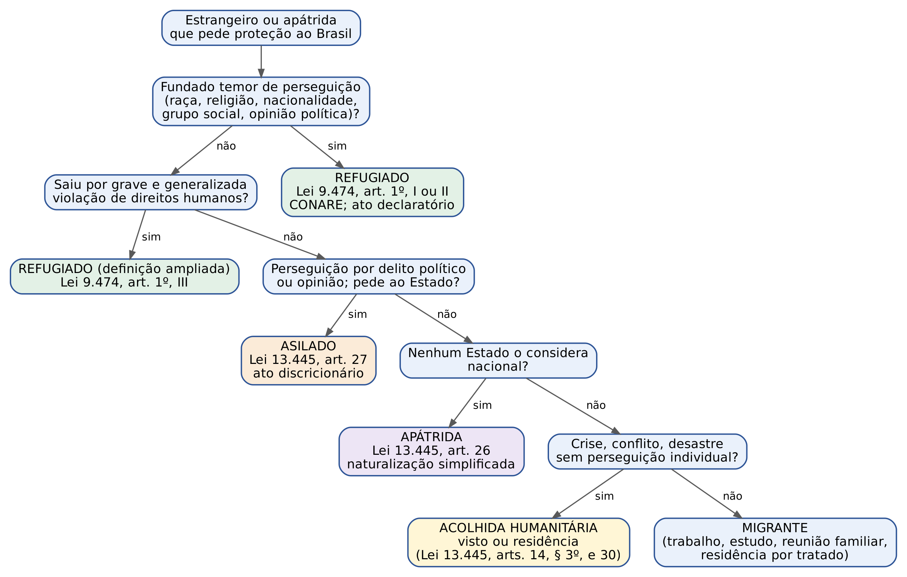
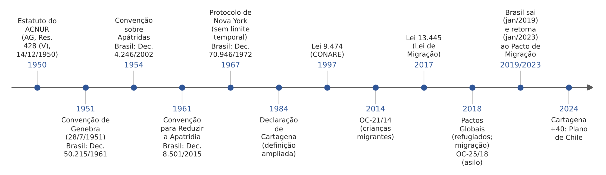
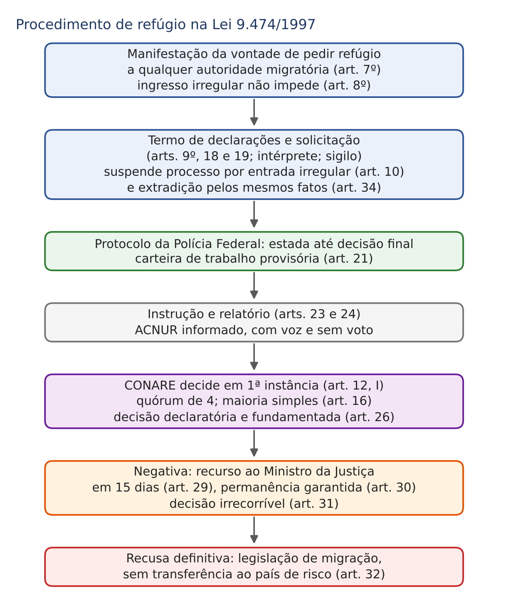
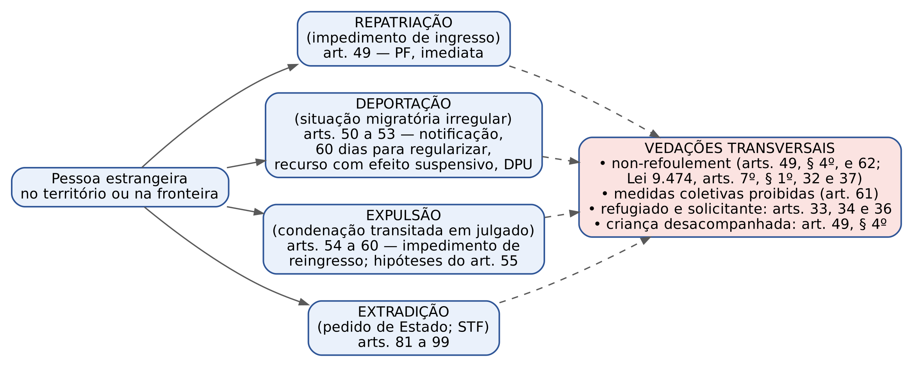
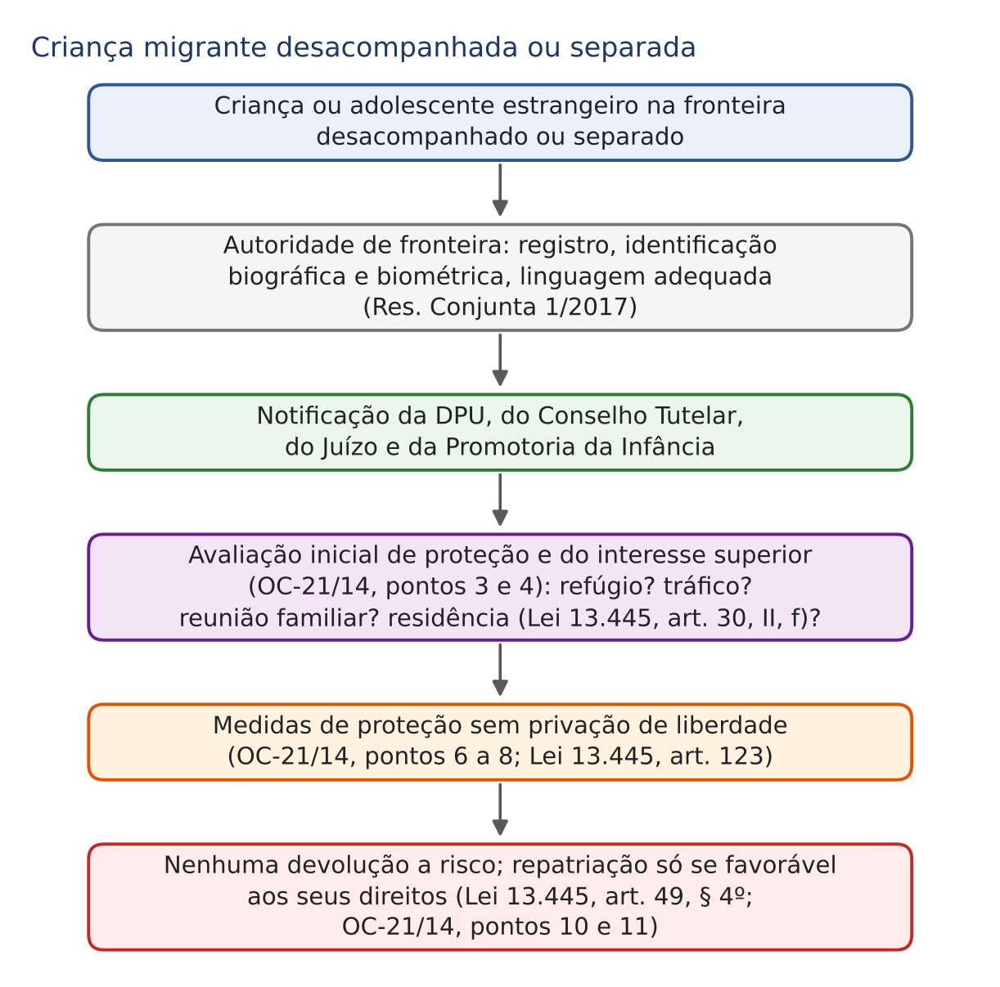
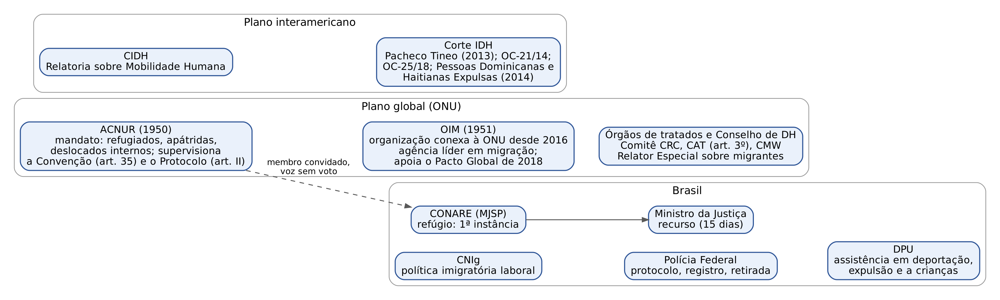

# CAPÍTULO 21 — REFUGIADOS, MIGRANTES E APÁTRIDAS: PROTEÇÃO INTERNACIONAL E DIREITO BRASILEIRO

:::INCIDENCIA
TRF5 p. 11; TJRS p. 2; TJSC p. 2. Nível A. Lote: 7 questões (FGV 6, FCC 1), mais correlatas de outros capítulos.
O que mais cai: LETRA da Lei 9.474/1997 (extensão, exclusão, competências do CONARE, recurso ao Ministro da Justiça, documentos do refugiado), asilo x refúgio (inclusive vedação do art. 28 da Lei 13.445), OC-21/14 (crianças migrantes) e garantias do procedimento de refúgio em Pacheco Tineo.
:::

Este capítulo trata a pessoa em mobilidade sob o ângulo do DIDH e de sua recepção no direito brasileiro. Ficam por remissão: as três vertentes da proteção (Cap. 1); *jus cogens* e OC-18/03 (Cap. 2); hierarquia da Convenção de 1951 (Cap. 4); CMW e CAT (Cap. 8); CADH, art. 22 (Cap. 9, 9.5.13); quadro das opiniões consultivas (Cap. 11); extradição e refúgio no STF, Ext 1.085 e Temas 173, 373 e 988 (Cap. 13, 13.10); deslocamento climático e OC-32/25 (Cap. 19); e, na Apostila de Direito Constitucional, asilo x refúgio (Cap. 6, 06.7.1) e retirada compulsória e condição do estrangeiro (Cap. 13, 13.7 e 13.8).

## 21.1 Arquitetura da proteção da pessoa em mobilidade

### 21.1.1 Categorias e regimes

Não há um estatuto único do "estrangeiro necessitado de proteção". O direito internacional construiu regimes distintos, com fontes, órgãos e efeitos próprios, que se sobrepõem parcialmente. A prova cobra justamente a fronteira entre eles:

| Categoria | Fonte central | Pressuposto | Natureza do ato no Brasil | Órgão |
|---|---|---|---|---|
| Refugiado | Convenção de 1951 e Protocolo de 1967; Lei 9.474/1997 | fundado temor de perseguição por cinco motivos; ou grave e generalizada violação de direitos humanos | ato DECLARATÓRIO e vinculado (Lei 9.474, art. 26) | CONARE; recurso ao Ministro da Justiça |
| Asilado político | CF, art. 4º, X; Convenções de Caracas (1954); Lei 13.445, arts. 27 a 29 | perseguição por delito político ou opinião, atual e individualizada | ato DISCRICIONÁRIO e constitutivo (Lei 13.445, art. 27) | Presidente da República, por meio do Ministério das Relações Exteriores (regulamento) |
| Apátrida | Convenções de 1954 e 1961; Lei 13.445, art. 26 | nenhum Estado o considera nacional segundo sua legislação | reconhecimento, seguido de naturalização simplificada ou residência definitiva | Ministério da Justiça e Segurança Pública |
| Migrante (imigrante, visitante, residente fronteiriço) | Lei 13.445/2017; tratados de residência (Mercosul) | deslocamento voluntário, por qualquer razão | visto e autorização de residência | MRE (vistos) e Polícia Federal (registro); CNIg |
| Acolhida humanitária | Lei 13.445, arts. 14, § 3º, e 30, I, c; Portaria Interministerial MJSP/MRE 60/2025 | instabilidade institucional, conflito, calamidade, desastre ambiental, grave violação de DH ou de DIH no país de origem | visto temporário ou autorização de residência; países designados por ato conjunto | MJSP e MRE |
| Deslocado interno | Princípios Orientadores da ONU (1998), *soft law* | não cruzou fronteira internacional | não há estatuto interno específico | Estado territorial; ACNUR por extensão de mandato |

Três ideias estruturam a matéria. Primeiro, a proteção internacional é SUBSIDIÁRIA: só existe porque o Estado de nacionalidade não pode ou não quer proteger; por isso o refugiado perde a condição quando volta a valer-se dessa proteção (cessação, 21.4.6). Segundo, o *non-refoulement* é o denominador comum de todos os regimes (21.3), e no sistema interamericano protege qualquer estrangeiro, não só o refugiado (CADH, art. 22.8). Terceiro, o migrante em situação irregular continua titular de direitos humanos: a situação migratória não é critério legítimo para negar direitos (Corte IDH, OC-18/03, Cap. 2; Lei 13.445, art. 4º, § 1º).

:::PEGADINHA
Refugiado não é "asilado com outro nome": refúgio é proteção humanitária vinculada e declaratória; asilo, ato político discricionário (21.5). Refugiado também não perde a nacionalidade por fugir: a família que deixa o país em guerra não se torna apátrida (Q3645150, em 21.4.2). Apatridia é ausência de vínculo jurídico de nacionalidade, não ausência de proteção de fato.
:::

### 21.1.2 Linha do tempo

| Instrumento | Adoção e vigência internacional | Brasil |
|---|---|---|
| Estatuto do ACNUR | AG, Res. 428 (V), 14/12/1950 | — |
| Convenção relativa ao Estatuto dos Refugiados | Genebra, 28/7/1951; em vigor em 22/4/1954 | assinatura em 15/7/1952; DL 11/1960; ratificação em 15/11/1960; Decreto 50.215, de 28/1/1961 (redação dos Decretos 98.602/1989 e 99.757/1990) |
| Protocolo sobre o Estatuto dos Refugiados | Nova York, 31/1/1967; em vigor em 4/10/1967 | DL 93/1971; adesão e vigência em 7/4/1972; Decreto 70.946, de 7/8/1972 |
| Convenção sobre o Estatuto dos Apátridas | Nova York, 28/9/1954 | DL 38/1995; vigência para o Brasil em 13/11/1996; Decreto 4.246, de 22/5/2002 |
| Convenção para a Redução dos Casos de Apatridia | Nova York, 30/8/1961 | DL 274/2007; ratificação em 25/10/2007; vigência em 23/1/2008; Decreto 8.501, de 18/8/2015 (com a reserva do art. 8.3, a, ii) |
| Declaração de Cartagena | Colóquio de Cartagena, 22/11/1984 (*soft law*) | definição ampliada incorporada na Lei 9.474, art. 1º, III |
| Lei 9.474 (Estatuto dos Refugiados) | 22/7/1997 | — |
| Lei 13.445 (Lei de Migração) | 24/5/2017; regulamentada pelo Decreto 9.199/2017 | revogou a Lei 6.815/1980 (Estatuto do Estrangeiro) |

:::ATENCAO Reservas brasileiras à Convenção de 1951
O DL 11/1960 aprovou a Convenção "com exclusão" dos arts. 15 (direito de associação) e 17 (trabalho assalariado), e o Brasil a ratificou com essa ressalva e com a declaração da Seção B.1 (a) (só acontecimentos ocorridos na Europa). Dois atos posteriores mudaram o quadro: (i) o Decreto 98.602/1989 passou a aplicar a Seção B.1 (b) — acontecimentos ocorridos "na Europa ou alhures" —, abandonando a reserva geográfica; (ii) o Decreto 99.757/1990 registrou que, ao aderir ao Protocolo de 1967 (7/4/1972), o Governo brasileiro RETIROU as reservas aos arts. 15 e 17, e determinou que a Convenção seja cumprida "tão inteiramente como nela se contém". Hoje, portanto, a Convenção vige integralmente, sem reserva geográfica nem exclusão de artigos. Questão que afirme vigência "com exclusão dos arts. 15 e 17" reproduz o texto histórico do decreto de 1961.
:::

## 21.2 A Convenção de 1951 e o Protocolo de 1967

### 21.2.1 Definição clássica e o papel do Protocolo

A Convenção define refugiado (art. 1º, A, 2) como a pessoa que, em consequência de acontecimentos ocorridos antes de 1º/1/1951 e temendo ser perseguida por motivos de raça, religião, nacionalidade, grupo social ou opiniões políticas, se encontra fora do país de sua nacionalidade e não pode ou, em virtude desse temor, não quer valer-se da proteção desse país; ou que, se não tem nacionalidade, se encontra fora do país de residência habitual e não pode ou não quer voltar a ele. Os elementos são cumulativos:

- estar FORA do país de nacionalidade ou residência habitual (quem não cruzou a fronteira é deslocado interno, não refugiado);
- FUNDADO TEMOR, com elemento subjetivo (o temor) e objetivo (a plausibilidade, aferida pela situação do país de origem);
- PERSEGUIÇÃO, isto é, violação grave de direitos humanos, por agente estatal ou por particulares que o Estado não pode ou não quer conter;
- NEXO com um dos cinco motivos (raça, religião, nacionalidade, grupo social, opinião política) — rol taxativo na Convenção;
- AUSÊNCIA de proteção do Estado de origem.

O texto original tinha DUAS limitações: a temporal (acontecimentos anteriores a 1º/1/1951) e a geográfica facultativa (Seção B: o Estado podia declarar que só aplicaria a Convenção a acontecimentos ocorridos "na Europa"). O Protocolo de 1967 eliminou a limitação TEMPORAL (art. I.2) e determinou sua aplicação "sem nenhuma limitação geográfica", ressalvadas as declarações já feitas sob a Seção B.1 (a) (art. I.3). O Protocolo é tratado AUTÔNOMO: o Estado pode aderir a ele sem ser parte da Convenção, obrigando-se a aplicar os arts. 2 a 34 desta (art. I.1).

:::DICA Grupo social
"Grupo social" é a cláusula aberta da definição: o ACNUR a lê como grupo definido por característica inata, imutável ou fundamental à identidade (orientação sexual, identidade de gênero, gênero em contextos de violência sistemática contra mulheres) ou percebido socialmente como distinto.
:::

### 21.2.2 Cláusulas de cessação, de exclusão e de não aplicação

| Cláusula | Convenção de 1951 | Lei 9.474/1997 |
|---|---|---|
| Inclusão | art. 1º, A | art. 1º, I a III (com a definição ampliada) |
| Cessação (a proteção deixa de ser necessária) | art. 1º, C: seis hipóteses, com ressalva das razões imperiosas decorrentes de perseguição anterior | art. 38: as mesmas seis hipóteses, sem a ressalva expressa |
| Não aplicação por outra proteção da ONU | art. 1º, D (pessoas assistidas por outro órgão da ONU, como a UNRWA para refugiados palestinos) | art. 3º, I |
| Não aplicação por equiparação a nacional | art. 1º, E | art. 3º, II |
| Exclusão (indignidade) | art. 1º, F: crime contra a paz, de guerra ou contra a humanidade; crime GRAVE DE DIREITO COMUM fora do país de refúgio antes da admissão; atos contrários aos fins e princípios da ONU | art. 3º, III e IV: crime contra a paz, de guerra, contra a humanidade, CRIME HEDIONDO, atos terroristas ou TRÁFICO DE DROGAS; atos contrários aos fins e princípios da ONU |

A lei brasileira foi além da Convenção nas exclusões: substituiu o "crime grave de direito comum" por categorias do direito interno (hediondo, terrorismo, tráfico). O ponto é cobrado na letra (21.4.2).

### 21.2.3 Estatuto do refugiado e garantias centrais

A Convenção assegura padrões escalonados de tratamento e documentos de identidade e de viagem (arts. 27 e 28). As garantias mais cobradas:

- Art. 31: os Estados não aplicarão SANÇÕES PENAIS por entrada ou permanência irregular aos refugiados que, chegando DIRETAMENTE de território onde sua vida ou liberdade estava ameaçada, se apresentem sem demora às autoridades e exponham razões aceitáveis; as restrições à circulação limitam-se ao necessário. A Lei 9.474 vai além: o ingresso irregular não impede o pedido (art. 8º) e a solicitação SUSPENDE qualquer procedimento administrativo ou criminal pela entrada irregular, contra o solicitante e o grupo familiar que o acompanhe; reconhecido o refúgio, o procedimento é arquivado se a infração decorreu dos mesmos fatos (art. 10).
- Art. 32: o refugiado que se encontre REGULARMENTE no território só pode ser expulso por motivos de segurança nacional ou ordem pública, mediante decisão conforme a lei, com direito de apresentar provas, recorrer e fazer-se representar (salvo razões imperiosas de segurança), e com prazo razoável para buscar admissão em outro país. Reprodução interna: Lei 9.474, arts. 36 e 37.
- Art. 33: *non-refoulement* (21.3).
- Art. 35: os Estados cooperam com o ACNUR e facilitam sua tarefa de SUPERVISIONAR a aplicação da Convenção (Protocolo, art. II). Não há comitê de peritos nem petição individual; as violações chegam aos órgãos de DIDH por via reflexa (CADH, art. 22.7 e 22.8; CAT, art. 3º; PIDCP, arts. 6º e 7º).
- Art. 42: não se admitem reservas aos arts. 1º, 3º (não discriminação), 4º (religião), 16.1 (acesso aos tribunais), 33 e 36 a 46.
- Controvérsias entre Estados sobre interpretação ou aplicação: Corte Internacional de Justiça (Convenção, art. 38; Protocolo, art. IV).

## 21.3 O princípio do *non-refoulement*

### 21.3.1 Fontes e conteúdo

O *non-refoulement* (não devolução) proíbe o Estado de remover a pessoa, por qualquer meio, para território onde sua vida, integridade ou liberdade corram risco. Está em várias fontes, com alcances diferentes — e a prova explora essas diferenças:

| Fonte | Quem protege | Risco relevante | Exceções |
|---|---|---|---|
| Convenção de 1951, art. 33.1 | refugiado (e, pelo efeito declaratório, o solicitante) | vida ou liberdade ameaçadas por raça, religião, nacionalidade, grupo social ou opiniões políticas | art. 33.2: perigo para a segurança do país ou condenação definitiva por crime ou delito particularmente grave que constitua ameaça para a comunidade |
| CAT, art. 3º (Cap. 8 e Cap. 20) | QUALQUER pessoa | razões substanciais para crer que estaria em perigo de ser submetida a TORTURA | nenhuma: proibição ABSOLUTA |
| PIDCP, arts. 6º e 7º (interpretação do Comitê de DH) | qualquer pessoa | risco real de dano irreparável (morte, tortura, tratamento cruel) | nenhuma quanto à tortura |
| CADH, art. 22.8 | qualquer ESTRANGEIRO, refugiado ou não | direito à vida ou à liberdade pessoal em risco por raça, nacionalidade, religião, condição social ou opiniões políticas; o país de destino pode ser ou não o de origem | o texto não traz exceções |
| Convenção Interamericana para Prevenir e Punir a Tortura, art. 13, parágrafo 4º | qualquer pessoa reclamada em extradição | tortura, tratamento cruel ou julgamento por tribunal de exceção | nenhuma |
| Lei 9.474, art. 7º, § 1º, e arts. 32 e 37 | solicitante e refugiado; também o recusado definitivamente, enquanto persistir o risco | vida ou liberdade ameaçadas pelos cinco motivos; vida, integridade física e liberdade (art. 32) | art. 7º, § 2º (refugiado perigoso para a segurança do Brasil); art. 32 ressalva os excluídos do art. 3º, III e IV |
| Lei 13.445, arts. 49, § 4º, e 62 | qualquer pessoa sujeita a repatriação, deportação ou expulsão | risco à vida, à integridade pessoal ou à liberdade | nenhuma: "em qualquer caso" (art. 49, § 4º) |

:::LEI Convenção de 1951, art. 33 (Decreto 50.215/1961)
1. Nenhum dos Estados Contratantes expulsará ou rechaçará, de maneira alguma, um refugiado para as fronteiras dos territórios em que a sua vida ou a sua liberdade seja ameaçada em virtude da sua raça, da sua religião, da sua nacionalidade, do grupo social a que pertence ou das suas opiniões políticas.
2. O benefício da presente disposição não poderá, todavia, ser invocado por um refugiado que por motivos sérios seja considerado um perigo para a segurança do país no qual ele se encontre ou que, tendo sido condenado definitivamente por um crime ou delito particularmente grave, constitui ameaça para a comunidade do referido país.
:::

Pela prática do ACNUR e pela jurisprudência, o princípio alcança a REJEIÇÃO NA FRONTEIRA e a não admissão; a devolução INDIRETA (via terceiro Estado); o SOLICITANTE (o reconhecimento é declaratório); situações EXTRATERRITORIAIS sob controle efetivo do Estado (alto-mar, fronteira, sedes diplomáticas — OC-25/18); e proíbe expulsões COLETIVAS (CADH, art. 22.9; Lei 13.445, art. 61).

### 21.3.2 Natureza: costume e *jus cogens*

O *non-refoulement* é norma CONSUETUDINÁRIA, que vincula inclusive Estados não partes da Convenção. A natureza de *jus cogens* tem fontes regionais: Declaração de Cartagena (conclusão quinta) e Corte IDH, OC-26/20 (§ 106: "incluindo a não rejeição na fronteira e a devolução indireta"); a lista ilustrativa da Comissão de Direito Internacional (2022) não o inclui (rol e quadro comparativo no Cap. 2, 02.4.2). Na prova, "o *non-refoulement* é considerado norma de *jus cogens*" deve ser tido como CERTO, especialmente se a questão o vincular à Declaração de Cartagena ou ao sistema interamericano; e "princípio absoluto" exige cuidado: é absoluto no art. 3º da CAT e no art. 22.8 da CADH, mas admite as exceções do art. 33.2 da Convenção de 1951.

:::JURIS Corte IDH, Caso Família Pacheco Tineo vs. Bolívia, sentença de 25/11/2013 (Série C n. 272)
Fatos: família peruana (casal e três filhos), com refúgio anteriormente reconhecido no Chile, ingressou na Bolívia e pediu refúgio; o pedido foi rejeitado sumariamente, sem entrevista nem oportunidade de defesa, e a família foi expulsa para o Peru em poucos dias.
Ratio: o *non-refoulement* é a "pedra angular" da proteção, norma também consuetudinária, de alcance mais amplo no sistema interamericano (§ 151), que protege independentemente do *status* migratório (§ 152); quem busca asilo não pode ser rechaçado na fronteira nem expulso sem análise individualizada do pedido, vedada a devolução indireta (§ 153).
Garantias mínimas do procedimento de determinação da condição de refugiado (§ 159): (a) orientação sobre o procedimento, com intérprete competente e acesso a assistência jurídica; (b) exame objetivo por autoridade competente e claramente identificada, mediante ENTREVISTA PESSOAL; (c) decisão devida e expressamente fundamentada; (d) confidencialidade dos dados e do pedido em todas as etapas; (e) informação sobre como recorrer da negativa, com prazo razoável; (f) recurso com EFEITO SUSPENSIVO, permitindo a permanência até a decisão, salvo pedido manifestamente infundado.
Dispositivo: violação dos arts. 8º, 22.7, 22.8, 25, 5.1, 19 e 17, em relação ao art. 1.1. Reparações: indenizações, publicação e capacitação permanente de agentes migratórios e do CONARE boliviano.
:::

:::QUESTAO FCC 2026 — DPE-MA — Defensor Público (Q4012657)
Cobrado: o que Pacheco Tineo proclamou EXPRESSAMENTE quanto ao procedimento de refúgio. Gabarito: C — direito do solicitante a uma entrevista pessoal no procedimento de determinação da condição de refugiado (§ 159, b).
Armadilhas: A inverte a lógica da confidencialidade — o Estado receptor NÃO deve pedir informações ao Estado de origem sobre o solicitante, o que poderia expô-lo (§ 159, d); B (conversão de refúgio em asilo "em qualquer etapa") não consta; D (dever de prover sustento e abrigo até a decisão) é obrigação de outras fontes, não proclamada na sentença; E (revisão judicial obrigatória da negativa a crianças) não foi afirmada — a Corte exige recurso com efeito suspensivo, não revisão judicial automática.
:::

:::JURIS Corte IDH, OC-25/18, de 30/5/2018 (solicitada pelo Equador)
O asilo em sentido estrito (político) compreende o TERRITORIAL e o DIPLOMÁTICO; o refúgio abrange a definição tradicional e a ampliada de Cartagena. O direito de "buscar e receber asilo" (CADH, art. 22.7; Declaração Americana, art. XXVII) protege a proteção em TERRITÓRIO estrangeiro — refúgio e asilo territorial —, mas NÃO o asilo diplomático, que se rege pelas convenções interestatais e pelo direito interno e pode ser concedido como expressão de soberania (não há costume regional, por falta de *opinio juris*). O *non-refoulement*, porém, aplica-se também em legações diplomáticas, sempre que o Estado exerça autoridade ou controle efetivo sobre a pessoa, e abrange expulsão, extradição, rechaço na fronteira, não admissão, interceptação em águas internacionais e traslado informal; o Estado deve avaliar individualmente o risco e buscar meios diplomáticos (salvo-conduto), sem dever de conceder asilo diplomático.
:::

### 21.3.3 *Non-refoulement* e o juiz brasileiro

O princípio aparece na jurisdição brasileira em quatro situações típicas: (i) extradição de solicitante ou refugiado (Lei 9.474, arts. 33 e 34; Cap. 13, 13.10.2); (ii) deportação, expulsão ou repatriação com risco no destino (Lei 13.445, arts. 49, § 4º, e 62), matéria da Justiça Federal (CF, art. 109, X, quanto a crimes de ingresso ou permanência irregular, e art. 109, I, nas ações contra a União); (iii) *habeas corpus* contra retirada sumária ou impedimento de ingresso de quem manifesta intenção de pedir refúgio (Lei 9.474, art. 7º); (iv) medidas gerais de fechamento de fronteira.

Neste último ponto, o STF, na ACO 3.121 (Relatora Ministra Rosa Weber, decisão monocrática de agosto de 2018), indeferiu o pedido do Estado de Roraima de fechamento temporário da fronteira com a Venezuela ou de limitação do ingresso de venezuelanos: o fechamento de fronteira é ato do Chefe de Estado, sujeito aos tratados e à Lei de Migração, e a restrição indiscriminada impediria o acesso ao procedimento de refúgio, violando o dever internacional de proteção e o devido processo (CF, art. 5º, LIV) (fonte: notícia do STF e do Migalhas de agosto de 2018; data exata da decisão não conferida).

:::SENTENCA Decisão-modelo (tutela em *habeas corpus* contra repatriação na fronteira)
"O paciente, nacional de país em grave e generalizada violação de direitos humanos, foi impedido de ingressar e teve a repatriação determinada, embora tenha manifestado, perante a autoridade migratória, a intenção de solicitar refúgio. A Lei 9.474/1997 assegura a quem chega ao território nacional o direito de expressar essa vontade a qualquer autoridade migratória na fronteira (art. 7º), afasta o ingresso irregular como óbice (art. 8º) e proíbe, em qualquer hipótese, a deportação para território onde sua vida ou liberdade esteja ameaçada (art. 7º, § 1º). A Lei 13.445/2017 veda a repatriação de pessoa em situação de refúgio, de fato ou de direito (art. 49, § 4º), e a Corte Interamericana, em controle de convencionalidade que este juízo deve exercer de ofício, assentou que o solicitante não pode ser rechaçado na fronteira sem análise individualizada do pedido (Caso Família Pacheco Tineo vs. Bolívia, 2013, § 153). Defiro a liminar para suspender a repatriação e determinar à Polícia Federal que receba a solicitação e emita o protocolo do art. 21 da Lei 9.474/1997."
:::

## 21.4 Definição ampliada e Lei 9.474/1997

### 21.4.1 A Declaração de Cartagena e o processo de Cartagena

A Declaração de Cartagena sobre Refugiados foi adotada em 22/11/1984 por colóquio de especialistas e representantes de governos da América Central, do México e do Panamá, diante dos deslocamentos maciços causados pelos conflitos centro-americanos. Não é tratado: é *soft law*, que se consolidou como padrão regional pela incorporação às legislações nacionais e pela prática da OEA e do ACNUR.

Sua conclusão terceira recomenda que a definição de refugiado, além dos elementos da Convenção de 1951 e do Protocolo de 1967, considere também refugiadas as pessoas que fugiram de seus países porque sua vida, segurança ou liberdade foram ameaçadas pela VIOLÊNCIA GENERALIZADA, AGRESSÃO ESTRANGEIRA, CONFLITOS INTERNOS, VIOLAÇÃO MACIÇA DOS DIREITOS HUMANOS ou OUTRAS CIRCUNSTÂNCIAS QUE TENHAM PERTURBADO GRAVEMENTE A ORDEM PÚBLICA. A conclusão quinta reafirma o *non-refoulement*, inclusive a proibição de rejeição na fronteira, como princípio de *jus cogens* (21.3.2).

A diferença em relação à definição clássica é de FOCO: a Convenção exige perseguição INDIVIDUALIZADA ligada a um dos cinco motivos; Cartagena parte da situação OBJETIVA do país de origem, que ameaça indistintamente a população, e dispensa o nexo com motivo convencional. Daí a possibilidade de reconhecimento *prima facie* ou por procedimento simplificado, a partir de um juízo prévio sobre o país.

:::ATENCAO A definição brasileira é MAIS ESTREITA que a de Cartagena
A Lei 9.474 incorporou apenas uma das cinco hipóteses de Cartagena: "grave e generalizada violação de direitos humanos" (art. 1º, III). Não há, na lei, menção autônoma a violência generalizada, agressão estrangeira, conflitos internos ou perturbação grave da ordem pública. Na prática, o CONARE interpreta a "grave e generalizada violação" a partir dessas situações, e quem não se enquadra pode receber acolhida humanitária (Lei 13.445, art. 14, § 3º), que não é refúgio. Questão que atribua à lei brasileira a reprodução integral da conclusão terceira está errada.
:::

O "processo de Cartagena" consiste nas revisões decenais promovidas pelo ACNUR com os Estados da região: San José (1994, deslocados internos); México (2004, "cidades", "fronteiras" e "reassentamento" solidários); Brasil (Brasília, dezembro de 2014, meta de erradicar a apatridia em dez anos); e Chile 2024-2034 (Santiago, dezembro de 2024), que incorpora o deslocamento associado a desastres e à mudança do clima.

:::EXEMPLO A aplicação da definição ampliada aos venezuelanos
Em 14/6/2019, o CONARE reconheceu formalmente, com base em estudo de país de origem, situação objetiva de grave e generalizada violação de direitos humanos na Venezuela e passou a decidir os pedidos de venezuelanos pelo art. 1º, III, da Lei 9.474, em procedimento simplificado (com dispensa de entrevista quando preenchidos requisitos objetivos). Em julho de 2019 foram reconhecidos os primeiros 174 venezuelanos por essa via (ONU News). É o exemplo de manual da definição ampliada aplicada em escala.
:::

### 21.4.2 Conceito na Lei 9.474

:::LEI Lei 9.474/1997, arts. 1º a 3º
Art. 1º Será reconhecido como refugiado todo indivíduo que:
I - devido a fundados temores de perseguição por motivos de raça, religião, nacionalidade, grupo social ou opiniões políticas encontre-se fora de seu país de nacionalidade e não possa ou não queira acolher-se à proteção de tal país;
II - não tendo nacionalidade e estando fora do país onde antes teve sua residência habitual, não possa ou não queira regressar a ele, em função das circunstâncias descritas no inciso anterior;
III - devido a grave e generalizada violação de direitos humanos, é obrigado a deixar seu país de nacionalidade para buscar refúgio em outro país.
Art. 2º Os efeitos da condição dos refugiados serão extensivos ao cônjuge, aos ascendentes e descendentes, assim como aos demais membros do grupo familiar que do refugiado dependerem economicamente, desde que se encontrem em território nacional.
Art. 3º Não se beneficiarão da condição de refugiado os indivíduos que:
I - já desfrutem de proteção ou assistência por parte de organismo ou instituição das Nações Unidas que não o Alto Comissariado das Nações Unidas para os Refugiados - ACNUR;
II - sejam residentes no território nacional e tenham direitos e obrigações relacionados com a condição de nacional brasileiro;
III - tenham cometido crime contra a paz, crime de guerra, crime contra a humanidade, crime hediondo, participado de atos terroristas ou tráfico de drogas;
IV - sejam considerados culpados de atos contrários aos fins e princípios das Nações Unidas.
:::

Observações de prova sobre os incisos:

- O inciso II cuida do APÁTRIDA que é refugiado: a apatridia não basta (para isso há a Lei 13.445, art. 26); é preciso o fundado temor ligado aos cinco motivos.
- O inciso III fala em "país de NACIONALIDADE": a literalidade não cobre o apátrida na hipótese da grave e generalizada violação.
- O art. 2º exige, para a extensão, que o familiar esteja em TERRITÓRIO NACIONAL; quem está no exterior depende de reunião familiar (Lei 13.445, arts. 4º, III, e 30, I, i; Lei 9.474 não prevê visto de reunião). O rol é aberto quanto aos "demais membros do grupo familiar", desde que haja dependência econômica.
- Os incisos do art. 3º reproduzem as cláusulas D, E e F da Convenção (21.2.2), com a troca do "crime grave de direito comum" por crime hediondo, terrorismo e tráfico de drogas.

:::QUESTAO FGV 2025 — PC-MG — Delegado de Polícia Substituto (Q3171429)
Cobrado: quem pode beneficiar-se da condição de refugiado, partindo da definição ampliada (art. 1º, III). Gabarito: A — cônjuge, ascendentes, descendentes e demais membros do grupo familiar que dependam economicamente do refugiado reconhecido, desde que se encontrem em território nacional (art. 2º).
Armadilhas: B, C, D e E transcrevem as quatro cláusulas de EXCLUSÃO do art. 3º (proteção de outro órgão da ONU; residente equiparado a nacional; crimes graves, hediondo, terrorismo, tráfico; atos contrários aos fins da ONU). A questão é de leitura da lei: decorar que o art. 2º é EXTENSÃO e o art. 3º é EXCLUSÃO resolve.
:::

:::QUESTAO FGV 2025 — CNU — Bloco 7: Justiça e Defesa (Q3645150)
Caso: o país A, invadido pelo país B, sofreu genocídio orquestrado pelo governante de B e reconhecido pelo TPI; família de A (pai, mãe e dois filhos) fugiu para o Brasil; o governante de B, deposto, pede asilo ao Brasil.
Passos: (1) a família fugiu de genocídio e guerra — perseguição por nacionalidade ou etnia (art. 1º, I) ou, ao menos, grave e generalizada violação de direitos humanos (art. 1º, III): é REFUGIADA, não apátrida (D erra: a fuga não extingue a nacionalidade); (2) reconhecida a condição, o refugiado tem direito a cédula de identidade, CARTEIRA DE TRABALHO e documento de viagem (art. 6º) — e mesmo o solicitante já recebe carteira de trabalho provisória (art. 21, § 1º); (3) o cessar-fogo não faz perder "imediatamente" a proteção (B erra): a cessação do art. 38, V, exige que as circunstâncias tenham DEIXADO DE EXISTIR, decisão do CONARE e recurso (art. 40), e não impede novo pedido; (4) o governante acusado de genocídio NÃO pode receber asilo, qualquer que seja a autoridade (Lei 13.445, art. 28: VEDAÇÃO ABSOLUTA, alinhada ao art. 1º, F, da Convenção de 1951) — erram A (anuência do Presidente) e C (maioria absoluta do Congresso, competência inexistente).
Gabarito: E — a família tornou-se refugiada e o pai tem direito a carteira de trabalho, reconhecida a condição.
:::

### 21.4.3 Condição jurídica do refugiado

O refugiado tem os direitos e deveres dos estrangeiros no Brasil, os da Lei 9.474 e os da Convenção e do Protocolo (art. 5º), com direito a cédula de identidade comprobatória da condição, carteira de trabalho e documento de viagem (art. 6º). O reconhecimento autoriza residência (Lei 13.445, art. 30, II, e). A lei manda considerar a "condição atípica" do refugiado quando se exigirem documentos do país de origem (arts. 43 e 44) — base da flexibilização da prova documental; os processos são GRATUITOS e URGENTES (art. 47), e a lei se interpreta em harmonia com a DUDH, a Convenção, o Protocolo e os demais instrumentos de direitos humanos (art. 48; Cap. 5).

### 21.4.4 O CONARE

O Comitê Nacional para os Refugiados é órgão de deliberação coletiva no âmbito do Ministério da Justiça (hoje, Ministério da Justiça e Segurança Pública).

| Ponto | Regra (Lei 9.474) |
|---|---|
| Competência (art. 12) | I — analisar o pedido e declarar o reconhecimento, em 1ª instância; II — decidir a CESSAÇÃO, em 1ª instância, de ofício ou a requerimento; III — determinar a PERDA, em 1ª instância; IV — orientar e coordenar as ações de proteção, assistência e apoio jurídico; V — aprovar instruções normativas esclarecedoras à execução da lei |
| Composição (art. 14) | um representante de cada: Ministério da Justiça (preside), Relações Exteriores, Trabalho, Saúde, Educação, Polícia Federal, e de uma ONG dedicada à assistência e proteção de refugiados; o ACNUR é SEMPRE membro convidado, com VOZ e SEM VOTO (§ 1º); membros designados pelo Presidente da República (§ 2º) |
| Funcionamento | quórum de quatro membros com direito a voto e maioria simples; empate resolvido pelo voto do Presidente do CONARE (art. 16); participação é serviço relevante, não remunerado (art. 15); regimento aprovado pelo Ministro da Justiça (art. 13) |
| Recurso | da negativa de reconhecimento e das decisões de cessação ou perda: ao MINISTRO DA JUSTIÇA, em 15 dias da notificação (arts. 29 e 40); a decisão do Ministro é IRRECORRÍVEL na via administrativa (arts. 31 e 41) |

:::QUESTAO FGV 2026 — TJ-GO — Juiz Substituto (Q3966727)
Cobrado: competência legal do CONARE. Gabarito: A — determinar a perda, em primeira instância, da condição de refugiado (art. 12, III).
Armadilhas: B (emissão de documento de identidade é ato de registro da Polícia Federal — arts. 21 e 28); C (o CONARE aprova INSTRUÇÕES NORMATIVAS, não alterações de decreto regulamentador — art. 12, V); D (os recursos contra a negativa são julgados pelo MINISTRO DA JUSTIÇA, não pelo próprio CONARE — art. 29); E (extradição é decidida pelo STF; o pedido de refúgio apenas SUSPENDE o processo extradicional — art. 34).
:::

### 21.4.5 Procedimento

:::PROCESSO Refúgio na Lei 9.474/1997 (arts. 7º a 32)
- Ingresso: o estrangeiro pode expressar a vontade de pedir refúgio a QUALQUER autoridade migratória na fronteira (art. 7º); o ingresso irregular não impede o pedido (art. 8º); a autoridade ouve o interessado e lavra termo de declaração sobre a entrada e as razões da saída do país de origem (art. 9º).
- Efeitos imediatos da solicitação: suspende procedimento administrativo ou criminal pela entrada irregular contra o solicitante e o grupo familiar que o acompanhe (art. 10) e suspende, até decisão definitiva, processo de extradição baseado nos mesmos fatos (art. 34), devendo ser comunicada ao órgão onde tramitar a extradição (art. 35).
- Abertura: notificação para prestar declarações, que marca a abertura dos procedimentos; o ACNUR é informado e pode oferecer sugestões (art. 18); declarações com intérprete e formulário com relato e provas (arts. 19 e 20).
- Residência provisória: a Polícia Federal emite PROTOCOLO em favor do solicitante e do grupo familiar no território, que autoriza a estada até a decisão final e permite expedir carteira de trabalho provisória (art. 21; Lei 13.445, art. 31, § 4º); enquanto pende o pedido, aplica-se a legislação de migração, respeitadas as disposições da Lei 9.474 (art. 22).
- Instrução: diligências, confidencialidade e relatório ao CONARE (arts. 23 a 25).
- Decisão: ato DECLARATÓRIO e fundamentado (art. 26); notificação ao solicitante e à Polícia Federal (art. 27); se positiva, registro na Polícia Federal, termo de responsabilidade e cédula de identidade (art. 28).
- Recurso: negativa fundamentada, com recurso ao Ministro da Justiça em 15 dias (art. 29); permanência no território durante o recurso, com protocolo e trabalho (art. 30); decisão ministerial irrecorrível (art. 31).
- Recusa definitiva: sujeição à legislação de migração, mas sem transferência para o país de nacionalidade ou residência habitual enquanto persistirem as circunstâncias de risco à vida, integridade física e liberdade, salvo os excluídos do art. 3º, III e IV (art. 32).
:::

Para o juiz: (i) o CONARE não "concede" refúgio, RECONHECE situação preexistente (art. 26), e o solicitante já está protegido pelo *non-refoulement*; (ii) a irrecorribilidade dos arts. 31 e 41 é administrativa e não afasta o controle judicial de LEGALIDADE (CF, art. 5º, XXXV) sobre competência, motivação e garantias mínimas (Pacheco Tineo, § 159), sem substituição do juízo técnico de mérito; (iii) o STF exerceu esse controle no caso Battisti (Ext 1.085; Cap. 13, 13.10.2).

:::PEGADINHA
Prazo de recurso: 15 DIAS, para o MINISTRO DA JUSTIÇA, tanto contra a negativa de reconhecimento (art. 29) quanto contra cessação ou perda (art. 40). Não é o CONARE em segunda instância, nem o Presidente da República, nem o Judiciário. Não confunda com o pedido de RECONSIDERAÇÃO da expulsão, de 10 dias (Lei 13.445, art. 58, § 2º), nem com a deportação, em que o recurso tem efeito suspensivo (art. 51).
:::

### 21.4.6 Cessação x perda

| Critério | Cessação (art. 38) | Perda (art. 39) |
|---|---|---|
| Fundamento | a proteção deixou de ser NECESSÁRIA | conduta do refugiado ou vício do reconhecimento |
| Hipóteses | I — voltar a valer-se da proteção do país de nacionalidade; II — recuperar voluntariamente a nacionalidade perdida; III — adquirir nova nacionalidade e gozar da proteção do novo país; IV — estabelecer-se novamente, de modo voluntário, no país que abandonou; V — cessação das circunstâncias que justificaram o reconhecimento; VI — sendo apátrida, poder voltar ao país de residência habitual por terem cessado as circunstâncias | I — renúncia; II — prova da falsidade dos fundamentos ou fatos que, conhecidos, teriam levado à negativa; III — atividades contrárias à segurança nacional ou à ordem pública; IV — saída do território sem prévia autorização do Governo brasileiro |
| Efeito | o estrangeiro passa ao regime migratório comum | incisos I e IV: regime geral de permanência de estrangeiros; incisos II e III: sujeição às medidas compulsórias (o parágrafo único remete à Lei 6.815/1980, revogada — leia-se Lei 13.445, arts. 46 a 62) |
| Órgão | CONARE em 1ª instância, de ofício ou a requerimento; recurso ao Ministro da Justiça em 15 dias (art. 40) | idem |

:::DICA
Memorize por pares: CESSAÇÃO = refugiado "não precisa mais" (voltou a proteger-se no país de origem, ganhou nacionalidade, risco acabou); PERDA = refugiado "não merece mais" ou "nunca mereceu" (renúncia, fraude, atentado à ordem pública, saída sem autorização). A saída SEM AUTORIZAÇÃO é PERDA (art. 39, IV); o estabelecimento voluntário no país de origem é CESSAÇÃO (art. 38, IV). Paralelo: o asilado que sai do País sem prévia comunicação RENUNCIA ao asilo (Lei 13.445, art. 29).
:::

### 21.4.7 Efeitos sobre extradição e expulsão; soluções duráveis

- Extradição: o reconhecimento OBSTA o seguimento de pedido baseado nos fatos que fundamentaram o refúgio (art. 33); a solicitação SUSPENDE o processo extradicional pendente, em fase administrativa ou judicial (art. 34). A Lei 13.445 repete a vedação para o beneficiário de refúgio ou asilo territorial (art. 82, IX). Evolução no STF (Oliverio Medina, 2007; Battisti, 2009): Cap. 13, 13.10.2.
- Expulsão: o refugiado regularmente registrado não é expulso, salvo por segurança nacional ou ordem pública (art. 36); a expulsão não o remeterá a país de risco e só se efetiva com a certeza de admissão em país sem risco de perseguição (art. 37).
- Soluções duráveis: REPATRIAÇÃO voluntária, salvo quando o refugiado não puder mais recusar a proteção do país de origem por terem cessado as circunstâncias (art. 42); INTEGRAÇÃO LOCAL (arts. 43 e 44); REASSENTAMENTO em outro país, sempre que possível voluntário (art. 45), e no Brasil de forma planificada e coordenada, com participação de ONGs (art. 46).

:::PRATIQUE Exercício elaborado para esta apostila (não é questão de banca)
1) Refugiado colombiano reconhecido em 2015 viaja à Colômbia em 2026, sem autorização, para o enterro da mãe, e retorna ao Brasil. O CONARE instaura procedimento. Qual o enquadramento e qual a consequência?
2) Solicitante de refúgio tem o pedido negado pelo CONARE e, no prazo, recorre. A Polícia Federal o notifica para deixar o País em 60 dias, sob pena de deportação. É legítimo?
3) Certo ou errado: "Por força da Lei 9.474, o estrangeiro que pratica tráfico de drogas no Brasil depois de reconhecido como refugiado perde automaticamente a condição."
Resolução: 1) A saída sem prévia autorização do Governo é hipótese de PERDA (art. 39, IV), não de cessação; perdida a condição por esse fundamento, o estrangeiro é enquadrado no regime geral de permanência (parágrafo único), e não nas medidas compulsórias; a decisão é do CONARE em 1ª instância, com recurso ao Ministro da Justiça em 15 dias (art. 40). A viagem isolada e o retorno, porém, não configuram "estabelecer-se novamente" no país de origem (art. 38, IV). 2) Não: durante o recurso, o solicitante e os familiares podem permanecer no território, com protocolo e carteira de trabalho (art. 30); e, mesmo após a recusa definitiva, não podem ser transferidos ao país de risco (art. 32). 3) Errado: o tráfico é causa de EXCLUSÃO quando praticado antes (art. 3º, III); o fato posterior pode configurar atividade contrária à ordem pública, hipótese de PERDA (art. 39, III), que depende de decisão do CONARE com recurso — não é automática — e cuja consequência é a sujeição às medidas compulsórias, respeitado o art. 37.
:::

## 21.5 Asilo político x refúgio

O asilo é instituto de tradição latino-americana, regido por tratados regionais (Convenção de Havana de 1928, Convenção de Montevidéu de 1933, Convenções de Caracas de 1954 sobre asilo diplomático e sobre asilo territorial) e, no Brasil, pela Constituição (art. 4º, X) e pela Lei 13.445 (arts. 27 a 29), que o define como ato DISCRICIONÁRIO, diplomático ou territorial, outorgado como instrumento de proteção à pessoa. O quadro constitucional asilo x refúgio e a transcrição dos arts. 27 a 29 estão na Apostila de Direito Constitucional, Cap. 6 (06.7.1). Aqui, a comparação com o enfoque internacional:

| Critério | Asilo político | Refúgio |
|---|---|---|
| Âmbito | regional (América Latina); prática interestatal | universal (Convenção de 1951 e Protocolo de 1967), com ampliação regional (Cartagena) |
| Pressuposto | perseguição ATUAL e efetiva por delitos políticos ou opinião | fundado TEMOR de perseguição (cinco motivos) ou grave e generalizada violação de DH |
| Natureza do ato | constitutivo e discricionário | declaratório e vinculado |
| Modalidades | diplomático (embaixada, navio ou aeronave militar, no território do Estado perseguidor) e territorial | só no território do Estado de acolhida (ou na fronteira) |
| Cláusulas de exclusão | Lei 13.445, art. 28: genocídio, crime contra a humanidade, de guerra ou de agressão (Estatuto de Roma) | Lei 9.474, art. 3º, III e IV (rol mais amplo: inclui hediondo, terrorismo, tráfico) |
| Extinção | renúncia, inclusive pela saída do País sem prévia comunicação (Lei 13.445, art. 29) | cessação e perda (Lei 9.474, arts. 38 e 39) |
| Efeito na extradição | o asilo territorial impede (Lei 13.445, art. 82, IX) | o reconhecimento impede pelos mesmos fatos; a solicitação suspende (Lei 9.474, arts. 33 e 34) |
| Direito subjetivo do estrangeiro? | no Brasil, não: ato de soberania (a CADH, art. 22.7, assegura "buscar e receber" asilo "de acordo com a legislação de cada Estado") | sim, à luz da Convenção e do art. 26 da Lei 9.474, preenchidos os requisitos |

Dois acréscimos internacionais. Primeiro, a DUDH (art. 14) assegura o direito de "procurar e de gozar" asilo, mas não o invocável em caso de perseguição legitimamente motivada por crimes de direito comum ou por atos contrários aos objetivos e princípios da ONU — a FCC inverteu essa ressalva no item I da Q3445894 (TRT1, 2025, desenvolvida no Cap. 7). Segundo, a OC-25/18 (21.3.2) afastou o asilo diplomático do art. 22.7 da CADH, mas estendeu o *non-refoulement* às sedes diplomáticas.

## 21.6 Lei de Migração (Lei 13.445/2017)

### 21.6.1 Mudança de paradigma

A Lei 13.445/2017 (regulamentada pelo Decreto 9.199/2017) revogou a Lei 6.815/1980 (Estatuto do Estrangeiro), editada sob a doutrina da segurança nacional, e adotou o paradigma dos DIREITOS HUMANOS do migrante: não criminalização da migração, direitos "independentemente da situação migratória" (art. 4º, § 1º) e institutos de regularização. O Brasil não é parte da CMW (Cap. 8), mas a lei incorporou boa parte de seus padrões.

Conceitos legais (art. 1º, § 1º): IMIGRANTE, EMIGRANTE, RESIDENTE FRONTEIRIÇO, VISITANTE (curta duração, sem pretensão de se estabelecer) e APÁTRIDA; o inciso I, que definia "migrante", foi vetado, e o termo é usado como gênero.

### 21.6.2 Princípios e direitos

O art. 3º lista 22 princípios e diretrizes da política migratória. Os mais cobrados, porque reproduzem padrões internacionais:

- universalidade, indivisibilidade e interdependência dos direitos humanos (I); repúdio à xenofobia, ao racismo e a qualquer discriminação (II);
- NÃO CRIMINALIZAÇÃO DA MIGRAÇÃO (III), com o correlato do art. 123: ninguém será privado de liberdade por razões migratórias, exceto nos casos previstos na lei;
- ACOLHIDA HUMANITÁRIA (VI) e REUNIÃO FAMILIAR (VIII);
- igualdade de tratamento (IX) e acesso igualitário a serviços, benefícios sociais, educação, assistência jurídica integral pública, trabalho, moradia e seguridade social (XI);
- SUPERIOR INTERESSE DA CRIANÇA E DO ADOLESCENTE migrante (XVII);
- REPÚDIO A EXPULSÃO OU DEPORTAÇÃO COLETIVAS (XXII), com o correlato do art. 61.

O art. 4º garante ao migrante, "em condição de igualdade com os nacionais", a inviolabilidade dos direitos à vida, à liberdade, à igualdade, à segurança e à propriedade — fórmula que corrige a literalidade do *caput* do art. 5º da CF (titularidade do estrangeiro não residente: Apostila de Direito Constitucional, Cap. 13, 13.8.1) — e enumera direitos civis, sociais, de reunião familiar, de acesso à justiça e à assistência jurídica gratuita, de isenção de taxas por hipossuficiência (Tema 988, Cap. 13), entre outros, exercidos "independentemente da situação migratória" (§ 1º).

:::QUESTAO FGV 2025 — SEDUC-MT — Professor de Sociologia (Q3816771)
Cobrado: relação entre a política norte-americana de deportação em massa e os arts. 6º (personalidade jurídica) e 15 (nacionalidade) da DUDH. Gabarito oficial: E — as deportações em massa, ao ignorar os contextos sociais, econômicos e humanitários, violariam os princípios do art. 15, ao privar milhares de pessoas do direito de permanecer ou buscar nova nacionalidade.
Comentário: a crítica de mérito procede; o gabarito é DISCUTÍVEL na técnica do DIDH. O art. 15 trata de nacionalidade (direito a ter uma e a não ser dela privado arbitrariamente); a deportação de migrante irregular não o priva da nacionalidade de origem, como afirma, com mais precisão, a alternativa C. O vício das deportações em massa está em outro lugar: proibição de expulsões COLETIVAS (CADH, art. 22.9; Lei 13.445, arts. 3º, XXII, e 61), garantias do PIDCP, art. 13 (expulsão só por decisão conforme a lei, com direito de expor razões e ter o caso revisto), *non-refoulement* e proteção da unidade familiar. A banca, em prova para professor de Sociologia, premiou a leitura "humanitária". Para a magistratura, guarde o fundamento correto.
:::

:::QUESTAO FGV 2025 — CNU — Bloco 7: Justiça e Defesa (Q3645102)
Cobrado: relação entre precarização do trabalho, discriminação e inserção social do migrante. Gabarito: E — a exposição à precarização e à discriminação no trabalho intensifica a percepção de desigualdade racial e étnica e dificulta a inserção social.
Armadilhas: A (a proteção legal não garantiu igualdade efetiva); B, C e D invertem a relação (vínculo precário e discriminação AGRAVAM a exclusão). Fundamento normativo: Lei 13.445, arts. 3º, II e IX, e 4º; OC-18/03 (direitos trabalhistas do migrante independem da situação migratória — Cap. 2, 02.4.5).
:::

### 21.6.3 Vistos, autorização de residência e acolhida humanitária

Os vistos são de visita, temporário, diplomático, oficial e de cortesia (art. 12). O visto TEMPORÁRIO (art. 14) destina-se a quem venha estabelecer residência por tempo determinado e tem finalidades taxativas no inciso I (pesquisa, ensino ou extensão acadêmica; tratamento de saúde; ACOLHIDA HUMANITÁRIA; estudo; trabalho; férias-trabalho; atividade religiosa ou voluntariado; investimento; REUNIÃO FAMILIAR; atividades artísticas ou desportivas), além de beneficiário de tratado e hipóteses regulamentares.

:::LEI Lei 13.445/2017, art. 14, § 3º
§ 3º O visto temporário para acolhida humanitária poderá ser concedido ao apátrida ou ao nacional de qualquer país em situação de grave ou iminente instabilidade institucional, de conflito armado, de calamidade de grande proporção, de desastre ambiental ou de grave violação de direitos humanos ou de direito internacional humanitário, ou em outras hipóteses, na forma de regulamento.
:::

A AUTORIZAÇÃO DE RESIDÊNCIA (art. 30) é o instituto que permite a regularização de quem JÁ está no território, inclusive "independentemente da situação migratória" (§ 5º). Hipóteses de proteção mais cobradas: acolhida humanitária (I, c); reunião familiar (I, i); beneficiário de refúgio, de asilo ou de proteção ao apátrida (II, e); criança ou adolescente nacional de outro país ou apátrida, DESACOMPANHADO ou abandonado, na fronteira ou no território (II, f); vítima de TRÁFICO DE PESSOAS, de TRABALHO ESCRAVO ou de violação de direito agravada pela condição migratória (II, g); pessoa em liberdade provisória ou em cumprimento de pena no Brasil (II, h). A condenação criminal transitada em julgado impede a residência, salvo infração de menor potencial ofensivo e algumas finalidades (§ 1º), mas não obsta a progressão de regime (§ 2º). O solicitante de refúgio, asilo ou proteção ao apátrida tem autorização PROVISÓRIA até a resposta (art. 31, § 4º).

| Instituto | Refúgio | Acolhida humanitária |
|---|---|---|
| Fonte | Convenção de 1951; Lei 9.474 | Lei 13.445, arts. 14, § 3º, e 30, I, c; portarias interministeriais MJSP/MRE |
| Pressuposto | perseguição individual (cinco motivos) ou grave e generalizada violação de DH | situação do país: instabilidade institucional, conflito armado, calamidade, desastre ambiental, grave violação de DH ou DIH |
| Decisão | CONARE, ato declaratório e vinculado | visto (consulado) ou residência (Polícia Federal), conforme portaria; política discricionária quanto às nacionalidades contempladas |
| Proteção internacional | sim; *non-refoulement* da Convenção; ACNUR | migratória; o *non-refoulement* decorre da CADH, art. 22.8, e da Lei 13.445, arts. 49, § 4º, e 62 |
| Extradição | impedida pelo reconhecimento | não há impedimento específico |
| Documento de viagem | do refugiado (Convenção, art. 28) | passaporte nacional ou documento de viagem para estrangeiro |

A acolhida humanitária nasceu na prática brasileira com os haitianos após o terremoto de 2010 (resoluções do CNIg, quando o refúgio não cabia porque desastre natural não é perseguição) e foi positivada pela Lei 13.445. Até 2025 vigoravam portarias interministeriais por nacionalidade (Síria, Afeganistão, Haiti, Ucrânia). A Portaria Interministerial MJSP/MRE 60, de 30/12/2025 (em vigor em 1/1/2026), unificou o regime: disciplina o visto temporário e a autorização de residência para nacionais de países nas situações do art. 14, § 3º, e para apátridas a eles vinculados, deixando a ATO CONJUNTO dos dois Ministros a designação dos países e dos postos consulares (art. 1º, parágrafo único); o visto vale 180 dias, para uma entrada, e depende de capacidade de abrigamento por organização da sociedade civil conveniada (arts. 2º e 3º); a residência é de dois anos, convertível em prazo indeterminado (arts. 5º e 6º); o portador pode optar, no registro, por pedir refúgio (art. 5º, § 2º); quem já estava no território até 31/12/2025, beneficiário das portarias revogadas (9/2019, 49/2024, 50/2024 e 51/2024), pode pedir residência independentemente da condição migratória (arts. 7º e 13). Primeira designação conferida: Portaria Interministerial MJSP/MRE 66, de 30/7/2026 (afegãos e apátridas no Irã, no Paquistão ou na Turquia que deixaram o Afeganistão a partir de 15/8/2021; vigência até 30/6/2027). A resposta ao fluxo venezuelano combinou refúgio (definição ampliada), autorização de residência para nacionais de países fronteiriços e a Operação Acolhida, apoiada na Lei 13.684/2018 (medidas de assistência emergencial a pessoas em situação de vulnerabilidade decorrente de fluxo migratório provocado por crise humanitária), com interiorização voluntária.

:::DICA Acolhida humanitária x refúgio na prova
Desastre ambiental, terremoto, calamidade e instabilidade institucional SEM perseguição = ACOLHIDA HUMANITÁRIA (Lei 13.445). Perseguição pelos cinco motivos ou grave e generalizada violação de DH = REFÚGIO (Lei 9.474). "Refugiado ambiental" não é categoria jurídica da Convenção de 1951 nem da Lei 9.474; o deslocamento por clima e desastres é tratado como acolhida humanitária no Brasil e, no plano interamericano, pela OC-32/25 e pelo Plano de Ação de Chile (Cap. 19, 19.6.4).
:::

### 21.6.4 Medidas de retirada compulsória

As medidas de retirada compulsória (repatriação, deportação e expulsão) são administrativas e se distinguem da extradição, que é cooperação penal internacional. O regime completo — pressupostos, autoridades, causas impeditivas da expulsão do art. 55, Súmula 421 do STF e Tema 373 — está na Apostila de Direito Constitucional, Cap. 13 (13.7.3 e 13.8.3). Aqui interessa o filtro de direitos humanos que atravessa todas elas.

| Medida | Pressuposto | Garantias de DH na Lei 13.445 |
|---|---|---|
| Repatriação (art. 49) | pessoa em situação de IMPEDIMENTO de ingresso, devolvida ao país de procedência ou nacionalidade | ato fundamentado; DPU notificada quando a repatriação imediata não for possível ou no caso do § 4º; NÃO se aplica a pessoa em situação de refúgio ou de apatridia, de fato ou de direito, a criança ou adolescente desacompanhado ou separado (salvo se favorável a seus direitos ou à reintegração familiar), nem a quem necessite de acolhimento humanitário; em nenhum caso devolução a risco (§ 4º); ninguém é impedido de ingressar por raça, religião, nacionalidade, grupo social ou opinião política (art. 45, parágrafo único) |
| Deportação (arts. 50 a 53) | situação migratória IRREGULAR | notificação pessoal com prazo NÃO INFERIOR A 60 DIAS para regularizar, prorrogável (art. 50, § 1º), sem prejuízo da livre circulação; contraditório, ampla defesa e recurso com EFEITO SUSPENSIVO; DPU notificada (art. 51); vedada se configurar extradição inadmitida (art. 53); saída voluntária equivale ao cumprimento (art. 50, § 5º) |
| Expulsão (arts. 54 a 60) | condenação transitada em julgado por crimes do Estatuto de Roma ou crime comum doloso passível de pena privativa de liberdade | impedimento de reingresso proporcional à pena, nunca superior ao dobro (art. 54, § 4º); causas impeditivas do art. 55 (Apostila de Direito Constitucional, Cap. 13, 13.7.3); contraditório, ampla defesa, DPU, reconsideração em 10 dias (art. 58) |
| Vedações gerais | — | proibidas repatriação, deportação ou expulsão COLETIVAS, entendidas como as que não individualizam a situação de cada pessoa (art. 61); proibida qualquer delas quando houver razões para crer que a medida põe em risco a vida ou a integridade pessoal (art. 62); aplicação conforme a Lei 9.474 e as normas sobre apátridas e situações humanitárias (art. 46) |

:::PEGADINHA
1) Deportação NÃO é expulsão: deportação pressupõe irregularidade migratória e não impede o retorno regular; expulsão pressupõe condenação definitiva e impõe impedimento de reingresso. 2) O prazo de 60 dias para regularização é MÍNIMO ("não inferior"), não máximo. 3) O vínculo familiar com brasileiro impede a EXPULSÃO (art. 55, II), não a extradição (Súmula 421). 4) A vedação de devolução a risco dos arts. 49, § 4º, e 62 vale para QUALQUER pessoa, não só para refugiados — é a projeção legal do art. 22.8 da CADH.
:::

### 21.6.5 Migrante no processo penal: Resolução CNJ 405/2021

A Resolução CNJ 405, de 6/7/2021, estabelece procedimentos para o tratamento das pessoas migrantes custodiadas, acusadas, rés, condenadas ou privadas de liberdade, inclusive em prisão domiciliar, meio aberto, alternativas penais ou monitoração eletrônica. Considera migrante quem está fora do território de que é nacional, independentemente da situação migratória, da intenção ou da duração da estada, incluídos os apátridas (art. 2º). Pontos operacionais:

- intérprete em todas as etapas, inclusive na audiência de custódia (art. 4º);
- havendo indícios de necessidade de proteção, o juiz pode perguntar sobre o interesse em solicitar refúgio e encaminhar o pedido por ofício; comunicação consular só a pedido expresso do solicitante (art. 6º);
- informação sobre o direito à comunicação CONSULAR antes de qualquer depoimento, feita só se a pessoa quiser (art. 7º; OC-16/99, Cap. 11);
- na custódia, verificar idioma e assistência consular e encaminhar quem não tem residência a programas de acolhimento, sem que a falta de endereço fundamente a prisão (art. 8º);
- a situação migratória não impede prisão domiciliar nem progressão (art. 10);
- documentação civil e regularização migratória mesmo durante a pena (arts. 13 e 15); comunicação da sentença ao Ministério da Justiça nos crimes que podem ensejar expulsão, sem prejuízo da progressão (art. 14).

:::SENTENCA Audiência de custódia de migrante (trecho de ata)
"O custodiado, nacional venezuelano, comunica-se em espanhol e foi assistido por intérprete nomeado, nos termos do art. 4º da Resolução CNJ 405/2021. Informado do direito à assistência consular (Convenção de Viena sobre Relações Consulares, art. 36; Resolução CNJ 405/2021, art. 7º), declarou não desejar a comunicação ao consulado, o que se respeita, já que manifestou temor de perseguição no país de origem. Determino a expedição de ofício à Polícia Federal para registro da solicitação de refúgio, que suspende procedimentos fundados na entrada irregular (Lei 9.474/1997, arts. 8º e 10). A ausência de residência fixa, decorrente da condição migratória, não constitui fundamento idôneo para a prisão preventiva (Lei 13.445/2017, arts. 3º, III, e 123); concedo liberdade provisória com comparecimento periódico, indicando como endereço o abrigo da rede de acolhimento a que o custodiado será encaminhado (Resolução CNJ 405/2021, art. 8º, §§ 1º e 2º)."
:::

## 21.7 Apatridia

### 21.7.1 Conceito e causas

Apátrida é a pessoa que não é considerada nacional por nenhum Estado, conforme sua legislação (Convenção de 1954, art. 1.1; Lei 13.445, art. 1º, § 1º, VI). O conceito é JURÍDICO e se verifica pela lei e pela prática dos Estados com que a pessoa tem vínculo (apatridia *de jure*); a doutrina e o ACNUR falam também em apatridia *de facto* para quem tem nacionalidade formal mas não consegue prová-la ou exercê-la. Causas típicas: conflito entre *jus soli* e *jus sanguinis* (filho de nacionais de Estado de *jus soli* nascido em Estado de *jus sanguinis*), discriminação de gênero na transmissão da nacionalidade, sucessão de Estados, privação arbitrária, falta de registro de nascimento.

A proteção contra a apatridia tem base em normas gerais de direitos humanos: DUDH, art. 15 (direito a uma nacionalidade; ninguém será arbitrariamente privado dela nem do direito de mudá-la); PIDCP, art. 24.3 (toda criança tem direito a adquirir uma nacionalidade); CDC, art. 7º; e, de modo mais forte, CADH, art. 20: direito à nacionalidade (20.1), direito à nacionalidade do Estado em cujo território houver nascido, SE NÃO TIVER DIREITO A OUTRA (20.2 — regra anti-apatridia de *jus soli* subsidiário), e vedação de privação arbitrária (20.3). A Corte IDH aplicou o art. 20 em Meninas Yean e Bosico vs. República Dominicana (2005: recusa de registro tardio de crianças de ascendência haitiana nascidas no país, com risco de apatridia; o *status* migratório dos pais não se transmite aos filhos) e em Pessoas Dominicanas e Haitianas Expulsas vs. República Dominicana (2014: privação arbitrária de nacionalidade e expulsões coletivas).

### 21.7.2 As Convenções de 1954 e 1961

| Ponto | Convenção sobre o Estatuto dos Apátridas (1954) | Convenção para a Redução dos Casos de Apatridia (1961) |
|---|---|---|
| Objeto | PROTEGER quem já é apátrida: estatuto jurídico mínimo | PREVENIR e reduzir novos casos |
| Conteúdo central | definição (art. 1.1); exclusões paralelas às da Convenção de 1951 (art. 1.2); não discriminação (art. 3º); documentos de identidade e de viagem; facilitação da naturalização (art. 32) | nacionalidade a quem nasce no território e de outro modo seria apátrida (art. 1º); criança abandonada presume-se nascida no território, de pais nacionais (art. 2º); navio ou aeronave (art. 3º); transmissão pelos pais a quem nasce no exterior (art. 4º); perda ou renúncia só com outra nacionalidade (arts. 5º a 7º); vedação de privação que torne apátrida, salvo art. 8º |
| Brasil | Decreto 4.246/2002; vigência para o Brasil em 13/11/1996 | Decreto 8.501/2015; vigência para o Brasil em 23/1/2008; reserva do art. 8.3, a, ii (conserva a possibilidade de privar da nacionalidade por conduta gravemente prejudicial aos interesses vitais do Estado, se prevista em lei ao tempo da adesão) |
| Diferença essencial | o apátrida reconhecido NÃO recebe nacionalidade automaticamente; recebe estatuto | obriga a CONCEDER nacionalidade em hipóteses definidas |

O órgão de referência é o ACNUR, com mandato sobre apatridia conferido pela AG.

### 21.7.3 Reconhecimento da apatridia no Brasil

A Lei 13.445 criou "instituto protetivo especial do apátrida, consolidado em processo simplificado de naturalização" (art. 26), em duas etapas:

1. Reconhecimento da condição de apátrida: o processo verifica se o solicitante é considerado nacional pela legislação de algum Estado, podendo valer-se de informações, documentos e declarações do próprio solicitante e de órgãos e organismos nacionais e internacionais (§ 5º). Durante a tramitação incidem todas as garantias da Convenção de 1954, da Convenção de 1951 e da Lei 9.474 (§ 2º); o solicitante tem autorização provisória de residência (art. 31, § 4º). Da decisão negativa cabe recurso (§ 9º) e, subsistindo a denegação, é vedada a devolução a país onde a vida, a integridade pessoal ou a liberdade estejam em risco (§ 10).
2. Opção: reconhecida a apatridia, o solicitante é consultado sobre o desejo de adquirir a nacionalidade brasileira (§ 6º). Se optar pela naturalização, a decisão é encaminhada para publicação dos atos de naturalização em 30 dias (§ 7º). Se não optar, recebe autorização de residência por prazo INDETERMINADO, "em caráter definitivo" (§ 8º).

Efeitos e extinção: o apátrida residente tem todos os direitos do art. 4º (§ 3º) e os da Convenção de 1954 (§ 4º); reunião familiar a partir do reconhecimento (§ 11). Perde a proteção por renúncia, prova de falsidade dos fundamentos ou fatos que, conhecidos, levariam à negativa (§ 12) — note a SIMETRIA com a perda do refúgio (Lei 9.474, art. 39, I e II), sem as hipóteses de segurança nacional e saída sem autorização.

No plano constitucional (EC 54/2007, que corrigiu os "brasileirinhos apátridas", e EC 131/2023, que ressalva a apatridia na perda a pedido): Apostila de Direito Constitucional, Cap. 13 (13.2.3 e 13.6).

## 21.8 Pactos Globais e governança da migração

Em 19/9/2016, a Assembleia Geral adotou a Declaração de Nova York para Refugiados e Migrantes, que lançou dois processos paralelos concluídos em dezembro de 2018:

| Ponto | Pacto Global para Migração Segura, Ordenada e Regular | Pacto Global sobre Refugiados |
|---|---|---|
| Adoção | Conferência intergovernamental de Marraqueche (10 e 11/12/2018), endossado pela AG em 19/12/2018 | afirmado pela AG em 17/12/2018, com base em proposta do Alto Comissário |
| Natureza | *soft law*: não vinculante; reafirma a soberania dos Estados para definir a política migratória | *soft law*: não cria obrigações novas; operacionaliza a repartição de responsabilidades |
| Conteúdo | 23 objetivos (vias regulares, documentação, detenção só como último recurso, combate ao tráfico, assistência consular, acesso a serviços, retorno digno) | quatro objetivos: aliviar países de acolhida, autossuficiência dos refugiados, reassentamento, retorno seguro e digno |
| Acompanhamento | Fórum Internacional de Revisão da Migração (a cada quatro anos); Rede da ONU sobre Migração, coordenada pela OIM | ACNUR; Fórum Global quadrienal |

O Brasil aderiu ao Pacto de Migração em 2018, retirou-se em janeiro de 2019 e anunciou o retorno em 5/1/2023, sempre por ato do Executivo, sem o Congresso: não há tratado a denunciar (contraste com a ADI 1.625 e a ADC 39, Cap. 4).

:::PEGADINHA
"Pacto" aqui não é tratado: o Pacto Global para Migração é *soft law*, não promulgado por decreto e não é, sozinho, parâmetro de controle de convencionalidade em sentido estrito, embora oriente a interpretação. Não o confunda com os Pactos de 1966.
:::

## 21.9 Crianças e adolescentes migrantes

### 21.9.1 O padrão interamericano: OC-21/14

A OC-21/14, de 19/8/2014, foi solicitada por Argentina, Brasil, Paraguai e Uruguai, que pediram à Corte que determinasse com precisão as obrigações dos Estados em relação a crianças migrantes, associadas à sua condição migratória ou à de seus pais. A Corte interpretou os arts. 1.1, 2º, 4.1, 5º, 7º, 8º, 11, 17, 19, 22.7, 22.8, 25 e 29 da CADH e os arts. 1º, 6º, 8º, 25 e 27 da Declaração Americana, além do art. 13 da Convenção Interamericana para Prevenir e Punir a Tortura, e afirmou que suas opiniões consultivas integram o parâmetro do controle de convencionalidade de todos os órgãos do Estado (§ 31; Cap. 5). O resumo dos pontos da opinião:

| Ponto | Conteúdo |
|---|---|
| 1 a 3 | criança é toda pessoa menor de 18 anos; seus direitos PREVALECEM sobre nacionalidade ou situação migratória; a proteção alcança TODA criança no contexto da migração; identificação inicial das que necessitem de proteção internacional |
| 4 e 5 | procedimentos adaptados, com o interesse superior como consideração primordial: funcionário ou juiz especializado; direito de ser ouvida; intérprete gratuito; assistência consular; representação legal; TUTOR para a desacompanhada ou separada; decisão fundamentada; recurso com EFEITO SUSPENSIVO |
| 6 e 7 | é PROIBIDO privar de liberdade crianças por razões migratórias, por estarem desacompanhadas ou para preservar a unidade familiar; dever de criar medidas NÃO privativas de liberdade |
| 8 e 9 | alojamentos com SEPARAÇÃO (desacompanhadas longe de adultos) e UNIDADE FAMILIAR (acompanhadas com a família, salvo interesse superior contrário); restrição equivalente a privação exige as garantias correspondentes |
| 10 a 12 | *non-refoulement* da criança, inclusive indireto; retorno só com base no interesse superior; determinação da condição de refugiado individualizada e com participação da criança |
| 13 | separação familiar por expulsão dos pais exige ponderação caso a caso; se a criança tem direito à nacionalidade do país ou cumpre as condições para nele residir permanentemente, os pais NÃO podem ser expulsos por infrações migratórias ADMINISTRATIVAS (§ 280) |

:::QUESTAO FGV 2025 — TRF 5ª Região — Juiz Federal Substituto (Q3373936)
Cobrado: conteúdo da OC-21/14 e legislação correlata. Gabarito: B — se a criança tem direito à nacionalidade do país do qual um ou ambos os genitores podem ser expulsos, ou cumpre as condições para nele residir permanentemente, o Estado não pode expulsar os genitores por infrações migratórias administrativas, pois sacrificaria de modo irrazoável ou desmedido a vida familiar da criança (§ 280; ponto 13).
Armadilhas: A começa certa (desacompanhada: separação de adultos) mas erra ao impor o alojamento com a família "em qualquer hipótese" — a unidade familiar cede ao interesse superior (ponto 8); C inverte a hierarquia: os direitos da criança prevalecem sobre nacionalidade e *status* migratório (ponto 2); D é a pegadinha central — NÃO há hipótese excepcional de detenção de criança por motivos migratórios, nem para preservar a unidade familiar (ponto 6; no Brasil, Lei 13.445, art. 123); E restringe indevidamente o alcance: a OC protege TODA criança no contexto da migração, e não só refugiadas ou fugitivas de violência generalizada.
Ligação brasileira: o ponto 13 converge com o Tema 373 e com o art. 55, II, a, da Lei 13.445, mas com fundamento diverso (proporcionalidade diante de infração ADMINISTRATIVA, e não vínculo familiar) — Apostila de Direito Constitucional, Cap. 13 (13.8.3).
:::

Quanto a adultos, Vélez Loor vs. Panamá (2010) já admitira a detenção migratória só como medida excepcional, necessária e proporcional, nunca punitiva, separada dos presos por crimes.

### 21.9.2 Crianças desacompanhadas e separadas no Brasil

A Resolução Conjunta CONANDA/CONARE/CNIg/DPU n. 1, de 9/8/2017, estabelece procedimentos de identificação preliminar, atenção e proteção para criança e adolescente de outra nacionalidade ou apátrida desacompanhados ou separados que chegam ao Brasil (art. 1º). As categorias seguem os conceitos do ACNUR e do Comitê dos Direitos da Criança: DESACOMPANHADA é a criança separada de ambos os genitores e de outros parentes, sem adulto responsável por lei ou costume; SEPARADA é a criança separada de ambos os genitores ou do responsável legal ou costumeiro, mas não necessariamente de outros parentes. Pontos da resolução:

- os procedimentos tramitam com absoluta prioridade e agilidade (art. 3º), e a criança deve participar, ser consultada e mantida informada (art. 6º);
- a autoridade de fronteira que receber criança com indícios de estar desacompanhada ou separada registra a ocorrência, faz a identificação biográfica e biométrica e notifica a DPU, o Conselho Tutelar e o Juízo e a Promotoria da Infância e Juventude (art. 9º), com processo sensível à idade e ao gênero e benefício da dúvida quanto à idade;
- vedação de retirada compulsória para território de risco, com respeito ao *non-refoulement* e à convivência familiar.

A DPU realiza entrevista individual e preenche formulário de análise de proteção, com base no qual pode requerer, em nome da criança, a regularização migratória adequada (refúgio, residência como criança desacompanhada, reunião familiar) e as medidas de proteção do ECA. A Lei 13.445 complementa o quadro: autorização de residência para a criança desacompanhada ou abandonada (art. 30, II, f), vedação de repatriação salvo quando favorável a seus direitos ou à reintegração familiar (art. 49, § 4º), princípio do superior interesse (art. 3º, XVII).

:::SENTENCA Decisão-modelo (Vara da Infância, criança venezuelana separada)
"A adolescente, venezuelana de 15 anos, ingressou no País acompanhada de tia que não detém sua guarda, caracterizando-se como criança SEPARADA (Resolução Conjunta CONANDA/CONARE/CNIg/DPU n. 1/2017). Aplicam-se, com prioridade absoluta (CF, art. 227), a proteção integral do ECA e o princípio do superior interesse da criança migrante (Lei 13.445/2017, art. 3º, XVII). Nos termos da OC-21/14 da Corte Interamericana, parâmetro de controle de convencionalidade a ser observado de ofício, os direitos da criança prevalecem sobre considerações de condição migratória e é vedada a privação de liberdade por razões migratórias, impondo-se medidas de proteção em meio não restritivo, preferencialmente junto a familiar. Defiro a guarda provisória à tia, com acompanhamento pela rede de proteção, e determino a comunicação à DPU para o requerimento de regularização migratória (Lei 13.445, art. 30, II, f) ou de refúgio, conforme a avaliação de proteção."
:::

:::PRATIQUE Exercício elaborado para esta apostila (não é questão de banca)
1) Família estrangeira em situação irregular, com filho de 4 anos, é flagrada em posto de fronteira; o agente propõe mantê-los juntos em alojamento fechado até a deportação, "para preservar a unidade familiar". É compatível com a OC-21/14?
2) Certo ou errado: "Segundo a Lei 13.445, a criança desacompanhada pode ser repatriada se isso for favorável à garantia de seus direitos ou à reintegração à família de origem."
Resolução: 1) Não. A OC-21/14 proíbe a privação de liberdade de crianças por razões migratórias, inclusive para preservar a unidade familiar, e impõe medidas alternativas não privativas de liberdade para toda a família (pontos 6 a 8); no Brasil, além disso, a deportação exige notificação com prazo mínimo de 60 dias para regularizar, sem prejuízo da livre circulação (Lei 13.445, art. 50, §§ 1º e 2º), e ninguém é preso por razões migratórias fora dos casos legais (art. 123). 2) Certo: é a exceção expressa do art. 49, § 4º, que de resto veda, em qualquer caso, devolução a país ou região de risco.
:::

## 21.10 Sistemas de proteção e monitoramento

### 21.10.1 Plano global

- ACNUR: órgão subsidiário da AG (Estatuto anexo à Res. 428 (V), de 14/12/1950), sede em Genebra. Mandato: proteção internacional dos refugiados e soluções duráveis, ampliado para apátridas, retornados e, em certas situações, deslocados internos; supervisiona a Convenção (art. 35) e o Protocolo (art. II); no CONARE, voz sem voto. Não confundir com o ACNUDH, de 1993 (Cap. 7).
- OIM: criada em 1951 fora da ONU; organização CONEXA à ONU desde 2016; coordena a Rede da ONU sobre Migração (Pacto Global de 2018); no Brasil, atua na interiorização da Operação Acolhida. Diferença: o ACNUR tem mandato de PROTEÇÃO fundado em tratado; a OIM não tem tratado de proteção a supervisionar.
- Órgãos de tratados (Cap. 8): Comitê contra a Tortura (art. 3º da CAT; comunicações individuais contra o Brasil admitidas desde o Decreto 13.040/2026); Comitê de Direitos Humanos (PIDCP, arts. 6º, 7º e 13); Comitê dos Direitos da Criança (CG 6, de 2005, sobre crianças desacompanhadas e separadas); Comitê da CMW, sem competência sobre o Brasil. Procedimento especial: Relator Especial sobre os direitos humanos dos migrantes.

### 21.10.2 Plano interamericano

A CIDH atua por relatoria temática sobre mobilidade humana, medidas cautelares (art. 25 do Regulamento; Cap. 10) e petições individuais. A Corte IDH atua pela via contenciosa e consultiva (OC-16/99, OC-18/03, OC-21/14, OC-25/18). Não há caso contencioso contra o Brasil centrado em refúgio ou migração (os 22 casos brasileiros: Cap. 12).

### 21.10.3 Plano interno

CONARE e Ministro da Justiça (refúgio, 21.4.4); Polícia Federal (protocolo, registro, repatriação e deportação); CNIg (política imigratória laboral); MRE (vistos e asilo diplomático); DPU (retiradas compulsórias e crianças desacompanhadas); Justiça Federal (CF, art. 109, I e X); CNJ (Resolução 405/2021; Recomendação 123/2022 e monitoramento de decisões internacionais, Caps. 5 e 6). A Política Nacional de Migrações, Refúgio e Apatridia está prevista no art. 120 da Lei 13.445.

## 21.11 Resumo para revisão pré-prova

| Instituto | Regra | Detalhes e pegadinhas | Fonte |
|---|---|---|---|
| Refugiado (clássico) | fora do país, fundado temor, perseguição, cinco motivos, ausência de proteção | Protocolo de 1967 tirou o limite temporal e o geográfico (salvo declarações anteriores); Brasil abandonou a reserva geográfica em 1989 e retirou reservas aos arts. 15 e 17 em 1972 | Convenção, art. 1º; Protocolo, art. I; Decretos 50.215/1961, 98.602/1989, 99.757/1990 |
| Definição ampliada | Cartagena: violência generalizada, agressão estrangeira, conflitos internos, violação maciça de DH, perturbação grave da ordem pública | Lei 9.474 só incorporou "grave e generalizada violação de DH"; venezuelanos (CONARE, 14/6/2019) | Cartagena, conclusão 3ª; Lei 9.474, art. 1º, III |
| Extensão | cônjuge, ascendentes, descendentes e grupo familiar economicamente dependente | só se estiverem em território nacional | Lei 9.474, art. 2º |
| Exclusão | outra proteção da ONU; equiparado a nacional; crimes contra a paz, guerra, humanidade, hediondo, terrorismo, tráfico; atos contrários à ONU | lei brasileira trocou "crime grave de direito comum" por hediondo, terrorismo e tráfico | Lei 9.474, art. 3º; Convenção, art. 1º, D, E e F |
| CONARE | reconhece, decide cessação e perda em 1ª instância; orienta; aprova instruções normativas | ACNUR com voz e sem voto; quórum de 4, maioria simples; não julga recurso nem extradição | Lei 9.474, arts. 11 a 16 |
| Recurso | ao Ministro da Justiça, 15 dias; irrecorrível administrativamente | permanência durante o recurso; controle judicial de legalidade subsiste | arts. 29 a 31, 40 e 41 |
| Cessação x perda | cessação: proteção desnecessária; perda: renúncia, fraude, ordem pública, saída sem autorização | perda por fraude ou ordem pública sujeita a medidas compulsórias | arts. 38 e 39 |
| Extradição | reconhecimento obsta; solicitação suspende | pelos mesmos fatos; Battisti: controle de legalidade do ato | arts. 33 e 34; Lei 13.445, art. 82, IX |
| *Non-refoulement* | proibição de devolver a risco | absoluto na CAT e na CADH (22.8, qualquer estrangeiro); exceções do art. 33.2 da Convenção; *jus cogens* (Cartagena; OC-26/20); inclui fronteira e devolução indireta | Convenção, art. 33; Lei 9.474, arts. 7º, 32, 37; Lei 13.445, arts. 49, § 4º, 62 |
| Pacheco Tineo (2013) | garantias mínimas do procedimento de refúgio | entrevista pessoal, intérprete, assistência jurídica, fundamentação, confidencialidade, recurso com efeito suspensivo | Corte IDH, Série C n. 272, § 159 |
| OC-25/18 | asilo territorial e refúgio protegidos pelo art. 22.7; asilo diplomático não | *non-refoulement* vale em embaixadas sob controle efetivo | Corte IDH, 30/5/2018 |
| Asilo x refúgio | asilo: discricionário, constitutivo, diplomático ou territorial; refúgio: declaratório, vinculado | asilo vedado a autor de genocídio e crimes do Estatuto de Roma; saída sem comunicação = renúncia | Lei 13.445, arts. 27 a 29 |
| Lei de Migração | paradigma de direitos humanos; não criminalização; direitos independentemente da situação migratória | ninguém preso por razões migratórias fora dos casos legais; vedadas medidas coletivas | Lei 13.445, arts. 3º, 4º, 61, 62, 123 |
| Acolhida humanitária | visto temporário ou residência para crise, conflito, calamidade, desastre ambiental, grave violação de DH ou DIH | não é refúgio; regime geral desde 1/1/2026, com países designados por ato conjunto (afegãos: Portaria 66/2026) | Lei 13.445, arts. 14, § 3º, 30, I, c; Portaria Interministerial MJSP/MRE 60/2025 |
| Retirada compulsória | repatriação (impedimento), deportação (irregularidade; 60 dias mínimos; recurso suspensivo), expulsão (condenação definitiva) | vínculo familiar impede expulsão, não extradição; DPU notificada | Lei 13.445, arts. 46 a 62; Apostila de Constitucional, Cap. 13 |
| Res. CNJ 405/2021 | migrante no processo penal | intérprete; consulado só a pedido; refúgio na custódia; falta de endereço não justifica prisão | arts. 4º a 8º, 10, 14, 15 |
| Apatridia | não ser considerado nacional por nenhum Estado | 1954 protege; 1961 previne; Brasil: reconhecimento, depois opção por naturalização simplificada ou residência definitiva | Decretos 4.246/2002 e 8.501/2015; Lei 13.445, art. 26; CADH, art. 20.2 |
| Pacto Global de Migração | *soft law*, 23 objetivos | Brasil saiu em jan/2019 e voltou em jan/2023, sem Congresso | AG, dezembro de 2018 |
| OC-21/14 | direitos da criança prevalecem sobre *status*; proibida detenção migratória de crianças; *non-refoulement*; pais não expulsos por infração administrativa se a criança tem direito à nacionalidade ou residência | solicitada por Argentina, Brasil, Paraguai e Uruguai; parâmetro de controle de convencionalidade | Corte IDH, 19/8/2014 |
| Criança desacompanhada x separada | sem qualquer adulto responsável x com adulto que não é o responsável legal | DPU, Conselho Tutelar, Juízo e MP notificados; residência (art. 30, II, f); repatriação só se favorável | Res. Conjunta 1/2017; Lei 13.445, art. 49, § 4º |

## 21.12 Artigos de lei e atos normativos incidentes

- Constituição Federal: art. 4º, II e X; art. 5º, caput, XXXV, LI, LII e LIV; art. 12, I, c, e § 4º; art. 109, I e X.
- Convenção relativa ao Estatuto dos Refugiados de 1951 (DL 11/1960; Decreto 50.215/1961, com redação dos Decretos 98.602/1989 e 99.757/1990): arts. 1º, 15, 17, 27, 28, 31, 32, 33, 35, 38 e 42.
- Protocolo sobre o Estatuto dos Refugiados de 1967 (DL 93/1971; Decreto 70.946/1972): arts. I, II e IV.
- Convenção sobre o Estatuto dos Apátridas de 1954 (DL 38/1995; Decreto 4.246/2002): arts. 1º, 3º e 32.
- Convenção para a Redução dos Casos de Apatridia de 1961 (DL 274/2007; Decreto 8.501/2015): arts. 1º a 4º e 8º.
- DUDH: arts. 6º, 13, 14 e 15.
- PIDCP (Decreto 592/1992): arts. 6º, 7º, 13 e 24.3.
- CAT (Decreto 40/1991): art. 3º; Decreto 13.040/2026 (declaração do art. 22).
- CADH (Decreto 678/1992): arts. 1.1, 8º, 17, 19, 20, 22.6 a 22.9 e 25.
- Convenção Interamericana para Prevenir e Punir a Tortura (Decreto 98.386/1989): art. 13.
- Lei 9.474/1997: arts. 1º a 49.
- Lei 13.445/2017: arts. 1º, 3º, 4º, 12, 14, 26 a 31, 45 a 62, 82, IX, 120 a 123; Decreto 9.199/2017.
- Lei 13.684/2018 (assistência emergencial em fluxo migratório decorrente de crise humanitária).
- Portarias Interministeriais MJSP/MRE 60/2025 (regime geral de acolhida humanitária, em vigor em 1/1/2026: arts. 1º a 7º e 13) e 66/2026 (afegãos e apátridas).
- Resolução CNJ 405/2021: arts. 2º, 4º, 6º a 10, 13 a 15.
- Resolução Conjunta CONANDA/CONARE/CNIg/DPU n. 1/2017.
- *Soft law*: Declaração de Cartagena (1984) e Declarações e Planos de San José (1994), México (2004), Brasil (2014) e Chile (2024); Declaração de Nova York (2016); Pacto Global para Migração Segura, Ordenada e Regular e Pacto Global sobre Refugiados (2018); Princípios Orientadores sobre Deslocamentos Internos (1998); Estatuto do ACNUR (AG, Res. 428 (V), 1950).

## 21.13 Julgados, temas e súmulas do capítulo

- Corte IDH, Caso Família Pacheco Tineo vs. Bolívia (25/11/2013, Série C n. 272): *non-refoulement* e garantias mínimas do procedimento de refúgio (§§ 151 a 153 e 159).
- Corte IDH, OC-21/14 (19/8/2014): crianças no contexto da migração; proibição de detenção; expulsão dos pais.
- Corte IDH, OC-25/18 (30/5/2018): asilo como direito humano; asilo diplomático fora do art. 22.7; *non-refoulement* em sedes diplomáticas.
- Corte IDH, Vélez Loor vs. Panamá (2010), Meninas Yean e Bosico vs. República Dominicana (2005) e Pessoas Dominicanas e Haitianas Expulsas vs. República Dominicana (2014): ganchos em 21.7.1 e 21.9.1.
- STF, ACO 3.121 (decisão monocrática, Relatora Ministra Rosa Weber, agosto de 2018): indeferimento do fechamento da fronteira com a Venezuela.
- CONARE: reconhecimento da grave e generalizada violação de direitos humanos na Venezuela (14/6/2019).

Remissões a outros capítulos: vertentes da proteção internacional (Cap. 1); OC-18/03, OC-26/20 e rol de *jus cogens* (Cap. 2); hierarquia e incorporação da Convenção de 1951, ADI 1.625 e ADC 39 (Cap. 4); controle de convencionalidade com base em OCs (Cap. 5); ACNUDH (Cap. 7); CAT, CRC e CMW (Cap. 8); CADH, art. 22 (Cap. 9); CIDH e medidas cautelares (Cap. 10); OC-16/99 e quadro das OCs (Cap. 11); casos brasileiros (Cap. 12); Ext 1.085, caso Oliverio Medina, Temas 173, 373 e 988 e Tema 1.476 (Cap. 13); Fazenda Brasil Verde e OC-32/25 (Cap. 19); Apostila de Direito Constitucional, Caps. 6 (06.7.1) e 13 (13.2.3, 13.6, 13.7 e 13.8).

:::NOTA Notas de verificação
Conferido em fonte (13/11/2026): texto vigente da Lei 9.474/1997 e dos dispositivos citados da Lei 13.445/2017 (Planalto); Decretos 50.215/1961, 98.602/1989, 99.757/1990 (retirada das reservas aos arts. 15 e 17 em 7/4/1972 e Seção B.1 (b)), 70.946/1972, 4.246/2002 e 8.501/2015; arts. 1º, 31, 32 e 33 da Convenção de 1951; Pacheco Tineo (data, série, §§ 151 a 153 e 159, dispositivo e reparações); pontos e § 280 da OC-21/14; resumo oficial da OC-25/18; Resolução CNJ 405/2021; saída do Pacto Global (janeiro de 2019) e retorno (5/1/2023); CONARE e Venezuela (14/6/2019; 174 reconhecimentos, ONU News); ACO 3.121 (notícia de 7/8/2018); Cartagena+40 (Chancelaria chilena, 12/12/2024). Nesta limpeza: Portaria Interministerial MJSP/MRE 60, de 30/12/2025 (DOU de 31/12/2025; texto integral: regime geral, revogação das Portarias 9/2019, 49, 50 e 51/2024, vigência em 1/1/2026) e Portaria Interministerial MJSP/MRE 66, de 30/7/2026 (DOU de 3/8/2026, edição extra; afegãos; vigência até 30/6/2027), ambas no DOU (in.gov.br); arts. 1º, 3º, 6º e 9º da Resolução Conjunta n. 1/2017 por transcrições em materiais da Escola Superior do MPU.
Não conferido: texto integral oficial da Resolução Conjunta n. 1/2017 (as definições de desacompanhada e separada vêm dos conceitos do ACNUR e do Comitê dos Direitos da Criança, não de transcrição da resolução); a Portaria Interministerial 55/2025 (reunião familiar de haitianos, segundo fonte secundária) não abriu; não se localizou, além da Portaria 66/2026, outro ato de designação de países sob a Portaria 60/2025 (Haiti e Ucrânia: conferir antes de citar); requisitos da nota técnica do CONARE sobre venezuelanos.
Afirmado de memória, com alta segurança: vigência internacional da Convenção de 1951 (22/4/1954) e do Protocolo (4/10/1967); Estatuto do ACNUR (Res. 428 (V)); OIM conexa à ONU em 2016; Declaração de Nova York (19/9/2016) e Pactos Globais (dezembro de 2018); conclusões terceira e quinta de Cartagena e revisões de 1994, 2004 e 2014; arts. 27, 28, 35, 38 e 42 da Convenção de 1951; Vélez Loor (2010), Yean e Bosico (2005) e Pessoas Dominicanas e Haitianas Expulsas (2014), citados sem série; CG 6 do Comitê CRC.
Gabaritos: os sete boxes conferem com o gabarito atual do banco (nenhum afetado pela correção de coleta de 13/11/2026). Q3816771: mantida a ressalva de mérito (art. 15 da DUDH). Q4012657: alternativa A afastada pela lógica da confidencialidade (§ 159, d).
Passada final (13/11/2026): contagem uniformizada (22 sentenças de mérito contra o Brasil, Cap. 12).
:::
