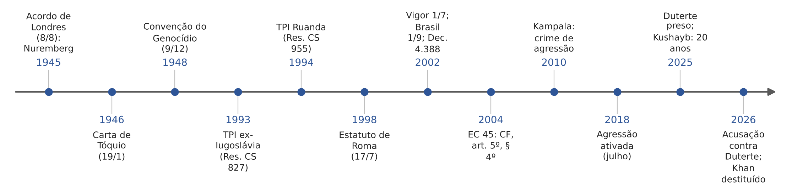
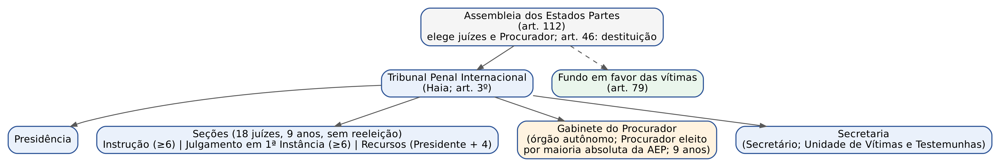
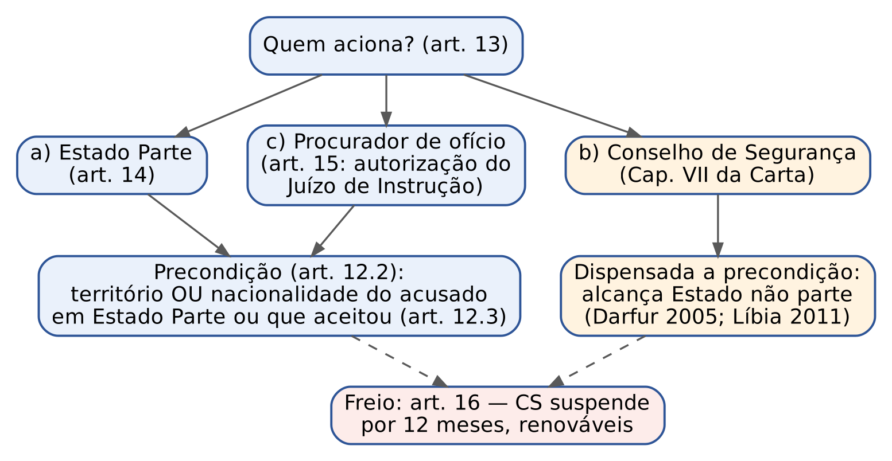
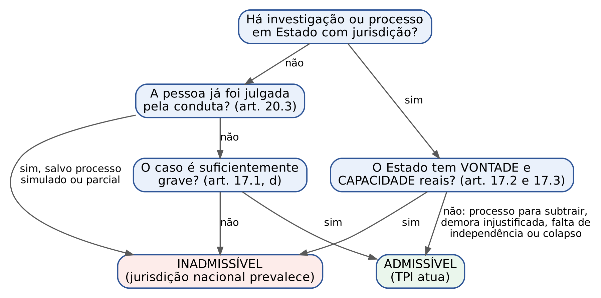
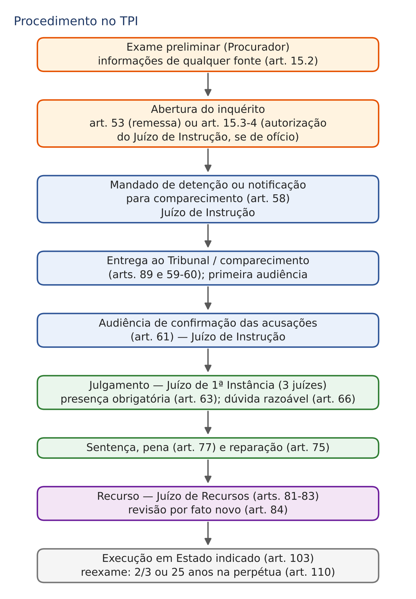
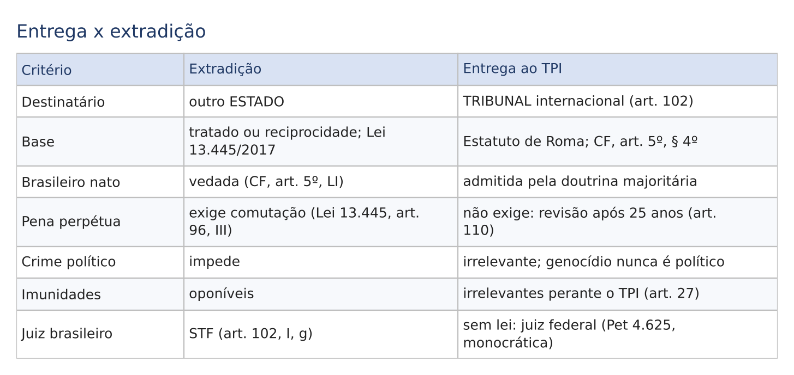

# CAPÍTULO 22 — TRIBUNAL PENAL INTERNACIONAL: HISTÓRIA, ESTATUTO DE ROMA, CRIMES, PROCEDIMENTO E ENTREGA

:::INCIDENCIA
TRF5 p. 12; TJRS p. 2; TJSC p. 2. Nível A. Lote: 6 questões (FGV 4, FCC 2), mais 5 correlatas de outros capítulos.
O que mais cai: rol fechado dos quatro crimes (art. 5º) e LETRA do art. 7º (crimes contra a humanidade), imprescritibilidade (art. 29), só pessoas físicas (art. 25), *ne bis in idem* e irretroatividade (arts. 20 e 24), Nuremberg como marco da responsabilidade penal individual, Convenção do Genocídio e entrega x extradição.
:::

Este capítulo é a sede do Tribunal Penal Internacional (TPI) na apostila. Ficam por remissão: o art. 5º, § 4º, da CF e o art. 7º do ADCT no quadro constitucional (Cap. 3, 03.4.4 e 03.5); hierarquia supralegal do Estatuto, vedação de reservas e regime de denúncia na teoria dos tratados (Cap. 4); o caso Riocentro e os limites internos da imprescritibilidade (Cap. 5, JURIS do REsp 1.798.903); o Conselho de Segurança como órgão (Cap. 7); a irrelevância da qualidade oficial como característica geral (Cap. 2); tortura como crime autônomo e Lei 9.455/1997 (Cap. 20); cláusulas de exclusão do refúgio e vedação de asilo (Cap. 21). Nas outras apostilas: compatibilidade do Estatuto com a CF (Apostila de Direito Constitucional, Cap. 11, 11.8), regime penal resumido e genocídio na Lei 2.889/1956 (Apostila de Direito Penal, Caps. 47, 47.7.4, e 40, 40.7) e rito da entrega com a Pet 4.625 (Apostila de Processo Penal, Cap. 32, 32.8). Aqui o enfoque é o do Direito Internacional Penal como braço repressivo do Direito Internacional dos Direitos Humanos: letra do Estatuto, órgãos, procedimento e prática do Tribunal até 2026.

## 22.1 Evolução histórica: de Nuremberg aos tribunais híbridos

### 22.1.1 Antecedentes e a justiça dos vencedores

O Direito Internacional Penal nasce da convergência de três vertentes que já existiam no fim da Primeira Guerra: o Direito Humanitário (Convenções de Haia de 1899 e 1907 e de Genebra), a ideia de que certos atos ofendem a humanidade como um todo e a pretensão de punir INDIVÍDUOS, e não apenas responsabilizar Estados. O Tratado de Versalhes (1919, art. 227) previu o julgamento do Kaiser Guilherme II por "ofensa suprema contra a moral internacional", que não ocorreu (a Holanda recusou a entrega), e os julgamentos de Leipzig (1921), conduzidos pela própria Alemanha, resultaram em penas irrisórias. A lição ficou: sem tribunal internacional e sem cooperação estatal, a responsabilidade penal internacional é retórica.

### 22.1.2 Tribunal Militar Internacional de Nuremberg (1945-1946)

Criado pelo Acordo de Londres de 8/8/1945, firmado por Estados Unidos, Reino Unido, França e União Soviética, com a Carta (Estatuto) anexa. Competência material (art. 6º da Carta): crimes contra a paz (planejar, preparar, iniciar ou travar guerra de agressão), crimes de guerra e crimes contra a humanidade, além da conspiração para cometê-los. Os crimes contra a humanidade estavam VINCULADOS à guerra (praticados "em execução ou em conexão" com os demais crimes), vínculo que o Direito Internacional abandonou depois e que o Estatuto de Roma não exige.

O julgamento principal terminou em 30/9 e 1/10/1946: dos 22 acusados julgados, 12 foram condenados à morte (um deles, Bormann, à revelia), 7 a penas de prisão e 3 absolvidos. Os três legados que a banca cobra:

- Responsabilidade penal INDIVIDUAL no plano internacional: "crimes contra o direito internacional são cometidos por homens, não por entidades abstratas", na fórmula célebre da sentença. Por isso Nuremberg é tratado como o ponto de partida da justicialização internacional dos direitos humanos (Q3179594, abaixo).
- Irrelevância da posição oficial (Carta, art. 7º) e da ordem superior como excludente, admitida no máximo como atenuante (art. 8º).
- Princípios de Nuremberg: confirmados pela Assembleia Geral da ONU em 11/12/1946 e formulados pela Comissão de Direito Internacional em 1950.

Críticas clássicas (prova oral): tribunal *ex post facto*, justiça dos vencedores, tipificação retroativa dos crimes contra a paz, *tu quoque* rejeitado. Resposta: os crimes já eram ilícitos pelo costume internacional e pelo Pacto Briand-Kellogg (1928).

### 22.1.3 Tribunal Militar Internacional para o Extremo Oriente (Tóquio, 1946-1948)

Não nasceu de tratado: foi instituído por proclamação do Comandante Supremo das Forças Aliadas, general MacArthur, em 19/1/1946, com Carta própria. Onze juízes de onze países; 28 acusados (25 sentenciados, com 7 condenações à morte). O Imperador Hirohito não foi processado, por decisão política. O voto divergente do juiz indiano Radhabinod Pal, que absolvia todos os réus por considerar o tribunal instrumento dos vencedores, é a referência crítica clássica.

### 22.1.4 Tribunais *ad hoc* do Conselho de Segurança: ex-Iugoslávia e Ruanda

Depois da Guerra Fria, o Conselho de Segurança usou o Capítulo VII da Carta da ONU (ameaça à paz) para criar tribunais por RESOLUÇÃO, órgãos subsidiários seus, sem tratado e sem consentimento dos Estados envolvidos (Cap. 7):

| | TPII (ex-Iugoslávia) | TPIR (Ruanda) |
|---|---|---|
| Criação | Resolução 827, de 25/5/1993 | Resolução 955, de 8/11/1994 |
| Sede | Haia | Arusha (Tanzânia) |
| Competência | violações graves das Convenções de Genebra, violações das leis ou costumes da guerra, genocídio e crimes contra a humanidade, no território da ex-Iugoslávia desde 1991 | genocídio, crimes contra a humanidade e violações do art. 3º comum e do Protocolo II, em Ruanda (e por ruandeses em Estados vizinhos) em 1994 |
| Relação com a jurisdição nacional | PRIMAZIA: o tribunal pode avocar o caso | PRIMAZIA |
| Marcos | Milošević (morreu em 2006, antes da sentença); Karadžić e Mladić (prisão perpétua) | Akayesu (1998): primeira condenação por genocídio por tribunal internacional e reconhecimento do estupro como ato de genocídio; Kambanda: primeiro chefe de governo condenado por genocídio |
| Encerramento | 31/12/2017 | 31/12/2015 |

As funções residuais passaram ao Mecanismo Residual Internacional para os Tribunais Penais (Resolução 1966/2010). Penas: prisão, inclusive perpétua; nunca morte.

:::PEGADINHA
PRIMAZIA x COMPLEMENTARIDADE. Os tribunais *ad hoc* tinham primazia sobre as jurisdições nacionais (podiam pedir que o juiz nacional declinasse). O TPI é o oposto: COMPLEMENTAR, só atua se o Estado não quiser ou não puder processar (22.4.1). Também a fonte muda: resolução do Conselho de Segurança (*ad hoc*) x tratado multilateral (Estatuto de Roma). E a jurisdição temporal: os *ad hoc* julgaram fatos ANTERIORES à sua criação; o TPI só julga fatos posteriores à sua entrada em vigor (art. 11).
:::

### 22.1.5 Tribunais híbridos (internacionalizados)

Combinam elementos nacionais e internacionais (juízes, promotores e direito aplicável mistos), em regra por acordo entre a ONU e o Estado ou por iniciativa regional:

| Tribunal | Base | O que cobrar |
|---|---|---|
| Tribunal Especial para Serra Leoa (2002) | acordo ONU–Serra Leoa | Charles Taylor, ex-presidente da Libéria, condenado a 50 anos em 30/5/2012; recrutamento de crianças-soldado |
| Câmaras Extraordinárias nas Cortes do Camboja | acordo ONU–Camboja (2003) e lei cambojana | crimes do Khmer Vermelho; tribunal inserido no Judiciário nacional |
| Tribunal Especial para o Líbano | Resolução 1757/2007 do Conselho de Segurança | único com competência para TERRORISMO (atentado contra Rafik Hariri), aplicando o direito penal libanês |
| Painéis Especiais de Díli (Timor-Leste) | administração transitória da ONU (UNTAET) | crimes de 1999 |
| Câmaras Especializadas do Kosovo | lei kosovar e acordo com a União Europeia; sede em Haia | crimes do Exército de Libertação do Kosovo |
| Câmaras Africanas Extraordinárias (Senegal) | acordo União Africana–Senegal | Hissène Habré, ex-presidente do Chade, condenado à prisão perpétua em 30/5/2016: exemplo de jurisdição universal regionalizada |

Em 25/6/2025, a Ucrânia e o Conselho da Europa firmaram o acordo para um Tribunal Especial para o Crime de Agressão contra a Ucrânia, destinado a suprir a lacuna de jurisdição do TPI sobre agressão praticada por nacionais de Estado não parte (22.5.4).

:::QUESTAO FGV 2025 — TRF 3ª Região — Juiz Federal Substituto (Q3179594)
O que foi cobrado: afirmações sobre a justiciabilidade internacional dos direitos humanos. Gabarito: C — Nuremberg foi o ponto de partida da justicialização dos direitos humanos, inovando ao afirmar a responsabilidade penal internacional do indivíduo.
Armadilhas: A troca o nome do tratado (o TPI foi criado pelo Estatuto de ROMA, 1998; Londres é o Acordo de 1945, de Nuremberg); B inverte (Nuremberg foi regulado pelo Acordo de LONDRES); D erra a fonte: o TPI aplica em primeiro lugar o Estatuto, os Elementos dos Crimes e o Regulamento Processual (art. 21), e a tipificação é escrita e sem analogia (art. 22), não costumeira; E erra a legitimidade: vítimas não "denunciam" ao TPI; acionam o Tribunal o Estado Parte, o Conselho de Segurança e o Procurador de ofício (art. 13), embora qualquer pessoa possa enviar informações ao Procurador (art. 15.2).
:::

No mesmo sentido, como correlata: FGV 2025 — DPE-PE (Q3390898, Cap. 1): o Estatuto do TPI (1998) é documento da afirmação histórica dos direitos humanos; a CVDT (1969) não é.

## 22.2 O Estatuto de Roma e o Brasil

### 22.2.1 Adoção, vigência e incorporação

| Dado | Conteúdo |
|---|---|
| Adoção | 17/7/1998, Conferência Diplomática de Plenipotenciários em Roma (120 votos a favor, 7 contra, 21 abstenções) |
| Vigência internacional | 1/7/2002, primeiro dia do mês seguinte ao termo de 60 dias após o 60º instrumento (art. 126.1) |
| Brasil | assinatura em 7/2/2000; aprovação pelo Decreto Legislativo 112, de 6/6/2002; depósito da ratificação em 20/6/2002; vigência para o Brasil em 1/9/2002 (art. 126.2); promulgação pelo Decreto 4.388, de 25/9/2002 |
| Constituição | EC 45/2004 inseriu o art. 5º, § 4º: "O Brasil se submete à jurisdição de Tribunal Penal Internacional a cuja criação tenha manifestado adesão" (Cap. 3) |
| Hierarquia | aprovado antes da EC 45 e sem o rito do § 3º: supralegal pela tese do RE 466.343 (Cap. 4), com o reforço da submissão constitucional do § 4º |
| Reservas | VEDADAS (art. 120) |
| Retirada | notificação ao Secretário-Geral da ONU; efeito um ano depois; não apaga obrigações, cooperação e processos em curso (art. 127) |
| Emendas | após sete anos; adoção por consenso ou dois terços; vigor geral quando ratificadas por sete oitavos, mas emendas aos arts. 5º a 8º só para quem as aceitar (art. 121) |
| Estados Partes | 125 desde a adesão da Ucrânia (vigência em 1/1/2025) |

O decreto de promulgação ressalva, como de praxe, que atos que possam resultar em revisão do Estatuto dependem de aprovação do Congresso (art. 2º do Decreto 4.388), razão pela qual as emendas de Kampala (22.5.4) exigem novo procedimento de incorporação, não concluído (o Brasil não as ratificou).

### 22.2.2 Natureza e relação com a ONU

O TPI é ORGANIZAÇÃO INTERNACIONAL autônoma, com personalidade jurídica internacional (art. 4º), sede em Haia (art. 3º), criada por tratado. NÃO é órgão da ONU: a relação com as Nações Unidas é regida por acordo (art. 2º), o que explica dois traços que a banca explora: (a) o Conselho de Segurança tem papel de acionamento e de suspensão (arts. 13, b, e 16), mas não comanda o Tribunal; (b) a Corte Internacional de Justiça, ela sim órgão judicial principal da ONU, julga ESTADOS, não pessoas.

:::ESQUEMA Três tribunais em Haia ou na América que a banca confunde
| | TPI | CIJ | Corte IDH |
|---|---|---|---|
| Natureza | organização internacional autônoma (Estatuto de Roma) | órgão judicial principal da ONU (Carta, art. 92) | órgão da Convenção Americana (OEA) |
| Quem é julgado | PESSOA FÍSICA maior de 18 anos | ESTADOS (consentimento) | ESTADO, por violação da CADH |
| Consequência | pena (prisão, multa, perda de bens) e reparação às vítimas | sentença entre Estados; pareceres consultivos | responsabilidade internacional e reparação integral |
| Brasil | Estado Parte desde 2002 | membro da ONU; sem declaração de aceitação geral da jurisdição | competência contenciosa aceita em 10/12/1998 |
:::

Por isso está errado dizer que o TPI "integra o sistema interamericano" (FGV 2025 — PC-MG, Q3203640, Cap. 7, alternativa C). O TPI é peça do sistema GLOBAL em sentido amplo, mas fora da estrutura da ONU e distinto dos mecanismos de responsabilidade do Estado.

### 22.2.3 Órgãos e composição

| Órgão | Composição e regras | Artigo |
|---|---|---|
| Presidência | Presidente e dois Vice-Presidentes, eleitos pelos juízes | 38 |
| Seções judiciais | Instrução (ao menos 6 juízes), Julgamento em Primeira Instância (ao menos 6) e Recursos (Presidente e mais 4); funções exercidas por JUÍZOS: Juízo de Instrução com 3 juízes ou juiz singular; Juízo de Primeira Instância com 3; Juízo de Recursos com todos os da Seção | 34, 39 |
| Juízes | 18 (número ampliável por proposta da Presidência aprovada por dois terços da Assembleia); mandato de NOVE anos, sem reeleição | 36 |
| Gabinete do Procurador | órgão AUTÔNOMO e independente; Procurador eleito pela Assembleia dos Estados Partes por escrutínio secreto e maioria absoluta; mandato de nove anos, sem reeleição; Procuradores-Adjuntos de nacionalidade diferente | 42 |
| Secretaria | aspectos não judiciais; abriga a Unidade de Apoio às Vítimas e Testemunhas | 43 |
| Assembleia dos Estados Partes | um representante por Estado; elege juízes e Procurador, aprova orçamento, decide sobre destituição | 112 |
| Fundo em favor das vítimas | criado por decisão da Assembleia; recebe multas e bens perdidos | 79 |

:::DICA
Dados de composição para prova oral: a brasileira Sylvia Steiner foi juíza do TPI de 2003 a 2016. O primeiro Procurador foi Luis Moreno Ocampo (2003-2012), seguido por Fatou Bensouda (2012-2021) e Karim Khan (eleito em 2021). Khan afastou-se em maio de 2025 em razão de investigação por má conduta e foi DESTITUÍDO pela Assembleia dos Estados Partes em 24/7/2026, em sessão especial, por maioria absoluta em votação secreta, com base no art. 46 do Estatuto; o Gabinete é conduzido pelos dois Procuradores-Adjuntos. É o primeiro caso de destituição de Procurador do TPI.
:::

### 22.2.4 Compatibilidade com a Constituição (síntese)

Os quatro pontos de atrito (entrega de nacional, prisão perpétua, imunidades e coisa julgada) estão resolvidos na Apostila de Direito Constitucional, Cap. 11 (11.8), a favor da compatibilidade. Aqui interessam os fundamentos internacionais que sustentam essa leitura, desenvolvidos adiante: a distinção ENTREGA x EXTRADIÇÃO do art. 102 (22.7.2), a cláusula de não interferência do art. 80 e a revisão obrigatória da pena perpétua do art. 110 (22.6.6), a irrelevância da qualidade oficial do art. 27 (22.4.5) e o *ne bis in idem* mitigado do art. 20 (22.4.3).

## 22.3 Competência (jurisdição) do TPI

O Estatuto organiza a jurisdição em quatro dimensões e em dois filtros sucessivos: primeiro, se o Tribunal TEM jurisdição (arts. 5º, 11, 12, 13, 25 e 26); depois, se o caso é ADMISSÍVEL (art. 17). A banca mistura os dois planos.

### 22.3.1 Material (*ratione materiae*)

:::LEI Estatuto de Roma (Decreto 4.388/2002), art. 5º, 1
1. A competência do Tribunal restringir-se-á aos crimes mais graves, que afetam a comunidade internacional no seu conjunto. Nos termos do presente Estatuto, o Tribunal terá competência para julgar os seguintes crimes: a) O crime de genocídio; b) Crimes contra a humanidade; c) Crimes de guerra; d) O crime de agressão.
:::

O rol é TAXATIVO. Não estão nele: terrorismo, tráfico internacional de drogas, crimes ambientais autônomos, lavagem, corrupção, pirataria e tráfico de pessoas como tipo próprio (embora a escravidão, inclusive no âmbito do tráfico de pessoas, integre o art. 7º, 2, c). Dano ambiental só aparece como elemento do crime de guerra do art. 8º, 2, b, iv (ataque que cause prejuízos extensos, duradouros e graves ao meio ambiente, claramente excessivos em relação à vantagem militar). A proposta de incluir o "ecocídio" como quinto crime tramita na Assembleia dos Estados Partes desde 2024, sem aprovação.

O § 2º do art. 5º condicionou o exercício da competência sobre a agressão à aprovação de definição e de condições (arts. 121 e 123), o que só ocorreu em Kampala (2010) e foi ativado em 2018 (22.5.4).

### 22.3.2 Temporal (*ratione temporis*)

:::LEI Estatuto de Roma, art. 11
1. O Tribunal só terá competência relativamente aos crimes cometidos após a entrada em vigor do presente Estatuto.
2. Se um Estado se tornar Parte no presente Estatuto depois da sua entrada em vigor, o Tribunal só poderá exercer a sua competência em relação a crimes cometidos depois da entrada em vigor do presente Estatuto relativamente a esse Estado, a menos que este tenha feito uma declaração nos termos do parágrafo 3o do artigo 12.
:::

Consequências: (a) nenhum fato anterior a 1/7/2002 é julgável; (b) para o Brasil, o marco é 1/9/2002; (c) o Estado não parte pode aceitar a jurisdição ad hoc, inclusive retroativamente até 1/7/2002, por declaração do art. 12, 3 (foi o caminho da Ucrânia em 2014 e 2015, antes de aderir, e da Palestina em 2015); (d) a irretroatividade se repete no plano pessoal (art. 24, 1: ninguém responde por conduta anterior à entrada em vigor do Estatuto). O art. 124 permitia ao novo Estado Parte excluir os crimes de guerra por sete anos (cláusula transitória usada pela França e pela Colômbia); a Assembleia aprovou em 2015 emenda que suprime o art. 124, cuja vigência depende das ratificações do art. 121, 4.

### 22.3.3 Pessoal (*ratione personae*)

- Só PESSOAS FÍSICAS (art. 25, 1). Não se julgam Estados, pessoas jurídicas, empresas ou organizações internacionais; a responsabilidade penal individual "em nada afetará a responsabilidade do Estado" (art. 25, 4).
- Maiores de 18 anos na data do fato (art. 26): é exclusão de JURISDIÇÃO, não excludente de culpabilidade.
- Sem distinção pela qualidade oficial (art. 27; 22.4.5).

### 22.3.4 Territorial e pela nacionalidade: as precondições do art. 12

Quando o caso chega por Estado Parte ou pelo Procurador de ofício, o Tribunal só exerce jurisdição se for Parte (ou tiver aceitado a jurisdição) ao menos UM dos Estados: (a) do TERRITÓRIO da conduta, incluindo o Estado de matrícula do navio ou da aeronave; ou (b) da NACIONALIDADE do acusado (art. 12, 2). Não há, portanto, jurisdição universal do TPI: a nacionalidade da VÍTIMA não basta.

Daí a relevância de dois pontos de prática: (a) nacionais de Estados não partes podem ser processados por crimes cometidos no território de Estado Parte (fundamento dos mandados contra Putin, por fatos na Ucrânia, e contra Netanyahu e Gallant, por fatos em Gaza, território da Palestina); (b) basta que PARTE da conduta ocorra no território de Estado Parte: na situação Bangladesh/Mianmar, o Juízo de Instrução admitiu jurisdição sobre a deportação dos rohingya porque o crime se consumou em Bangladesh, Estado Parte, embora Mianmar não o seja (2018-2019).

Quando quem aciona é o CONSELHO DE SEGURANÇA, as precondições do art. 12, 2 não se aplicam: a remessa alcança Estado não parte (Darfur, Sudão, Resolução 1593/2005; Líbia, Resolução 1970/2011).

### 22.3.5 Acionamento (*trigger mechanisms*): art. 13

:::LEI Estatuto de Roma, art. 13
O Tribunal poderá exercer a sua jurisdição em relação a qualquer um dos crimes a que se refere o artigo 5o, de acordo com o disposto no presente Estatuto, se: a) Um Estado Parte denunciar ao Procurador, nos termos do artigo 14, qualquer situação em que haja indícios de ter ocorrido a prática de um ou vários desses crimes; b) O Conselho de Segurança, agindo nos termos do Capítulo VII da Carta das Nações Unidas, denunciar ao Procurador qualquer situação em que haja indícios de ter ocorrido a prática de um ou vários desses crimes; ou c) O Procurador tiver dado início a um inquérito sobre tal crime, nos termos do disposto no artigo 15.
:::

| Mecanismo | Particularidades | Exemplos |
|---|---|---|
| Estado Parte (art. 14) | remete uma SITUAÇÃO, não um acusado; inclui a autorremessa (o próprio Estado do território) | Uganda (2003-2004), RDC, República Centro-Africana, Mali; Venezuela I (2018) e Ucrânia (2022, dezenas de Estados) como remessas coletivas por terceiros Estados |
| Conselho de Segurança (Cap. VII) | dispensa as precondições do art. 12; sujeito ao veto | Darfur (2005), Líbia (2011) |
| Procurador *proprio motu* (art. 15) | depende de AUTORIZAÇÃO do Juízo de Instrução; vítimas podem apresentar representações | Quênia (2010, primeira autorização), Costa do Marfim, Geórgia, Burundi, Bangladesh/Mianmar, Afeganistão, Filipinas |

Freio político: o art. 16 permite ao Conselho de Segurança, por resolução do Capítulo VII, impedir o início ou o prosseguimento de inquérito ou processo por DOZE meses, renováveis nas mesmas condições (Resoluções 1422/2002 e 1487/2003 foram usadas para proteger integrantes de missões de paz de Estados não partes).

:::PEGADINHA
Vítima, ONG ou indivíduo NÃO acionam o TPI. Podem enviar comunicações ao Procurador (art. 15, 2: informações de "outras fontes fidedignas") e participar do processo (art. 68, 3), mas o exame preliminar é discricionário. Compare com o sistema interamericano, em que qualquer pessoa, grupo ou ONG peticiona à CIDH (Cap. 10). Também não aciona o TPI a Assembleia Geral da ONU, o Secretário-Geral ou a CIJ.
:::

## 22.4 Princípios do Estatuto

### 22.4.1 Complementaridade e admissibilidade

A complementaridade está no preâmbulo (10º considerando: o TPI "será complementar às jurisdições penais nacionais"), no art. 1º e, operacionalmente, no art. 17. O preâmbulo também lembra que é dever de cada Estado exercer a jurisdição penal sobre os responsáveis por crimes internacionais: a jurisdição nacional é a PRIMÁRIA.

:::LEI Estatuto de Roma, art. 17, 1
1. Tendo em consideração o décimo parágrafo do preâmbulo e o artigo 1o, o Tribunal decidirá sobre a não admissibilidade de um caso se: a) O caso for objeto de inquérito ou de procedimento criminal por parte de um Estado que tenha jurisdição sobre o mesmo, salvo se este não tiver vontade de levar a cabo o inquérito ou o procedimento ou, não tenha capacidade para o fazer; b) O caso tiver sido objeto de inquérito por um Estado com jurisdição sobre ele e tal Estado tenha decidido não dar seguimento ao procedimento criminal contra a pessoa em causa, a menos que esta decisão resulte do fato de esse Estado não ter vontade de proceder criminalmente ou da sua incapacidade real para o fazer; c) A pessoa em causa já tiver sido julgada pela conduta a que se refere a denúncia, e não puder ser julgada pelo Tribunal em virtude do disposto no parágrafo 3o do artigo 20; d) O caso não for suficientemente grave para justificar a ulterior intervenção do Tribunal.
:::

Critérios de aferição:

- FALTA DE VONTADE (art. 17, 2): processo instaurado ou decisão proferida para SUBTRAIR a pessoa à responsabilidade; DEMORA injustificada incompatível com a intenção de fazê-la responder; processo sem INDEPENDÊNCIA ou IMPARCIALIDADE, conduzido de modo incompatível com essa intenção.
- INCAPACIDADE (art. 17, 3): COLAPSO total ou substancial da administração da justiça, ou indisponibilidade, que impeça o Estado de fazer comparecer o acusado, reunir provas ou concluir o processo.
- GRAVIDADE (art. 17, 1, d): filtro autônomo, quantitativo e qualitativo (escala, natureza, modo de execução, impacto).

Na prática do Tribunal, o teste é do "mesmo caso": a inadmissibilidade exige que o Estado investigue a mesma PESSOA por substancialmente a mesma CONDUTA. Investigar genericamente a situação, ou outros réus, não basta (entendimento firmado nos casos do Quênia e da Líbia). Inversamente, a INAÇÃO do Estado torna o caso admissível sem necessidade de discutir vontade ou capacidade.

A admissibilidade pode ser examinada de ofício e impugnada pelo acusado, pelo Estado com jurisdição e pelo Estado cuja aceitação é exigida, UMA única vez e antes ou no início do julgamento, salvo autorização excepcional (art. 19, 1, 2 e 4).

:::DICA
Complementaridade POSITIVA: o Gabinete do Procurador e a Assembleia estimulam os Estados a investigar e processar (cooperação técnica, leis de implementação). Para o Brasil, a falta de lei que tipifique os crimes contra a humanidade e os crimes de guerra (o PL 4.038/2008 não foi aprovado) enfraquece a jurisdição primária: o juiz brasileiro não pode aplicar diretamente os tipos do Estatuto, por força da legalidade estrita (art. 5º, XXXIX, da CF), como afirmou o STJ no caso Riocentro (Cap. 5).
:::

### 22.4.2 Legalidade: *nullum crimen*, *nulla poena* e irretroatividade

| Artigo | Regra | Pegadinha |
|---|---|---|
| 22 (*nullum crimen sine lege*) | só responde quem pratica conduta que, no momento do fato, seja crime da competência do Tribunal; previsão precisa; VEDADA a analogia; ambiguidade interpretada a favor do investigado ou acusado | o § 3º ressalva que o art. 22 não afeta a tipificação pelo direito internacional fora do Estatuto |
| 23 (*nulla poena sine lege*) | o condenado só será punido conforme o Estatuto | penas do art. 77 |
| 24, 1 | ninguém responde por conduta ANTERIOR à entrada em vigor do Estatuto | não há aplicação retroativa |
| 24, 2 | se o direito aplicável for modificado ANTES de proferida sentença definitiva, aplica-se o direito MAIS FAVORÁVEL | não é "antes ou depois" da sentença, nem "sempre a nova regra" |

### 22.4.3 *Ne bis in idem*

:::LEI Estatuto de Roma, art. 20
1. Salvo disposição contrária do presente Estatuto, nenhuma pessoa poderá ser julgada pelo Tribunal por atos constitutivos de crimes pelos quais este já a tenha condenado ou absolvido.
2. Nenhuma pessoa poderá ser julgada por outro tribunal por um crime mencionado no artigo 5°, relativamente ao qual já tenha sido condenada ou absolvida pelo Tribunal.
3. O Tribunal não poderá julgar uma pessoa que já tenha sido julgada por outro tribunal, por atos também punidos pelos artigos 6o, 7o ou 8o, a menos que o processo nesse outro tribunal: a) Tenha tido por objetivo subtrair o acusado à sua responsabilidade criminal por crimes da competência do Tribunal; ou b) Não tenha sido conduzido de forma independente ou imparcial, em conformidade com as garantias de um processo eqüitativo reconhecidas pelo direito internacional, ou tenha sido conduzido de uma maneira que, no caso concreto, se revele incompatível com a intenção de submeter a pessoa à ação da justiça.
:::

Três dimensões: TPI x TPI (§ 1º, absoluta salvo revisão do art. 84, que só favorece o condenado); TPI x outro tribunal (§ 2º, absoluta para os crimes do art. 5º); outro tribunal x TPI (§ 3º, RELATIVA: cede diante de processo simulado ou parcial, a chamada coisa julgada fraudulenta). A ressalva do § 3º não alcança o crime de agressão (art. 8 *bis*), que não consta da lista "6, 7 ou 8".

:::QUESTAO FCC 2025 — TRT 1ª Região (RJ) — Analista Judiciário, Área Judiciária (Q3445891)
O que foi cobrado: letra do Estatuto. Gabarito: B — salvo disposição contrária, ninguém será julgado pelo Tribunal por atos constitutivos de crimes pelos quais este já o tenha condenado ou absolvido (art. 20, 1).
Armadilhas: A diz "exclusivamente" três crimes e omite a AGRESSÃO (art. 5º, 1, d); C contraria o art. 24, 1 (conduta anterior à vigência não gera responsabilidade); D troca "antes de proferida sentença definitiva" por "antes ou depois" e "direito mais favorável" por "sempre a nova regra" (art. 24, 2); E nega o óbvio: o TPI julga justamente pessoas físicas (art. 25, 1 e 2).
:::

### 22.4.4 Responsabilidade penal individual e formas de participação (art. 25)

O art. 25, 3 adota modelo diferenciador de autoria e participação: comete o crime quem o pratica individualmente, em conjunto (coautoria) ou POR INTERMÉDIO DE OUTREM, "quer essa pessoa seja, ou não, criminalmente responsável" (alínea a: base da autoria mediata, inclusive por domínio de aparato organizado de poder, aplicada em Katanga e em Ongwen); ordena, solicita ou instiga (b); auxilia, inclusive fornecendo meios (c); contribui intencionalmente para crime de GRUPO com objetivo comum (d); INCITA direta e publicamente ao GENOCÍDIO (e: única incitação punida como forma autônoma); tenta, com desistência voluntária isenta de pena (f).

O elemento subjetivo padrão é DOLO, com vontade e conhecimento dos elementos materiais (art. 30), "salvo disposição em contrário" (é o caso do art. 28). Excludentes do art. 31: doença ou deficiência mental, intoxicação involuntária, legítima defesa (inclusive, nos crimes de guerra, de bens essenciais à sobrevivência ou à missão militar) e coação por ameaça iminente de morte ou lesão grave. Erro de fato e de direito: art. 32.

### 22.4.5 Irrelevância da qualidade oficial e imunidades (art. 27)

:::LEI Estatuto de Roma, art. 27
1. O presente Estatuto será aplicável de forma igual a todas as pessoas sem distinção alguma baseada na qualidade oficial. Em particular, a qualidade oficial de Chefe de Estado ou de Governo, de membro de Governo ou do Parlamento, de representante eleito ou de funcionário público, em caso algum eximirá a pessoa em causa de responsabilidade criminal nos termos do presente Estatuto, nem constituirá de per se motivo de redução da pena.
2. As imunidades ou normas de procedimento especiais decorrentes da qualidade oficial de uma pessoa; nos termos do direito interno ou do direito internacional, não deverão obstar a que o Tribunal exerça a sua jurisdição sobre essa pessoa.
:::

O § 1º afasta a qualidade oficial como excludente (irrelevância SUBSTANTIVA) e como atenuante automática; o § 2º afasta as imunidades processuais (irrelevância PROCESSUAL). A tensão está no art. 98, 1: o Tribunal pode não dar seguimento a pedido de entrega que obrigue o Estado requerido a violar imunidade de Estado TERCEIRO, salvo se obtiver antes a cooperação desse terceiro. No caso al-Bashir, o Juízo de Recursos decidiu (2019, recurso da Jordânia) que não há imunidade de chefe de Estado oponível a tribunal penal internacional no direito consuetudinário e que a remessa do Conselho de Segurança colocou o Sudão em posição análoga à de Estado Parte; Estados que receberam al-Bashir sem prendê-lo (Jordânia, África do Sul) e a Mongólia, que recebeu Putin em setembro de 2024, tiveram declarado o descumprimento do dever de cooperar (art. 87, 7; no caso da Mongólia, decisão do Juízo de Instrução II de 24/10/2024).

### 22.4.6 Responsabilidade do superior hierárquico (art. 28) e ordens superiores (art. 33)

| | Chefe militar (art. 28, a) | Superior civil (art. 28, b) |
|---|---|---|
| Relação | comando e controle EFETIVOS (inclusive chefe militar de fato) | autoridade e controle efetivos |
| Elemento cognitivo | sabia OU, pelas circunstâncias, DEVERIA SABER | sabia OU deliberadamente desconsiderou informação que indicava claramente |
| Requisito adicional | — | crimes relacionados a atividades sob sua responsabilidade e controle efetivos |
| Omissão | não adotar medidas necessárias e razoáveis para prevenir, reprimir ou comunicar às autoridades | idem |

É responsabilidade por OMISSÃO no controle, distinta da participação do art. 25. O padrão do militar é mais rigoroso (negligência qualificada). Em Bemba, condenado em 2016 com base no art. 28, o Juízo de Recursos o absolveu em 8/6/2018 por entender que não se demonstrou que ele deixou de adotar as medidas necessárias e razoáveis ao seu alcance, sobretudo por comandar à distância.

Ordem superior (art. 33): não isenta, salvo se, cumulativamente, o agente estava obrigado por lei a obedecer, não sabia da ilegalidade e a ordem não era manifestamente ilegal; ordem para cometer GENOCÍDIO ou crime CONTRA A HUMANIDADE é SEMPRE manifestamente ilegal (art. 33, 2). Logo, a exculpação só é concebível em crimes de guerra.

:::DICA
Compare: o art. 22 do CP isenta quem cumpre ordem não manifestamente ilegal; o Estatuto é mais restritivo (três requisitos cumulativos e ilegalidade manifesta presumida para genocídio e crimes contra a humanidade), e em Nuremberg a ordem superior nunca excluía a responsabilidade.
:::

### 22.4.7 Imprescritibilidade (art. 29)

"Os crimes da competência do Tribunal não prescrevem." A regra vale para o TPI. No plano interno, o Brasil não ratificou a Convenção da ONU sobre a Imprescritibilidade dos Crimes de Guerra e dos Crimes contra a Humanidade (1968), e o STJ, no caso Riocentro, recusou importar a imprescritibilidade para crimes comuns praticados por agentes da ditadura, por falta de lei formal (Cap. 5). A Corte IDH, ao contrário, considera inadmissível a prescrição de graves violações (Barrios Altos; Herzog vs. Brasil, Cap. 12). Constitucionalmente, só o racismo e a ação de grupos armados contra a ordem constitucional são imprescritíveis (art. 5º, XLII e XLIV).

:::QUESTAO FGV 2026 — ENAM — Exame Nacional da Magistratura 2026.1 (Q4102423)
O que foi cobrado: três afirmações sobre competência e características do TPI. Gabarito: D — corretas II (os crimes da competência do TPI são imprescritíveis, art. 29) e III (competência restrita aos crimes mais graves, que afetam a comunidade internacional no conjunto: genocídio, contra a humanidade, de guerra e agressão, art. 5º).
Armadilha: o item I inventa exceção para "crimes ambientais" que permitiria julgar pessoas jurídicas, Estados, empresas e organizações internacionais. Não há crime ambiental autônomo no Estatuto nem exceção ao art. 25, 1: o TPI julga SOMENTE pessoas físicas, e a responsabilidade do Estado segue no plano do direito internacional geral (art. 25, 4).
:::

:::PRATIQUE Exercícios elaborados para esta apostila (não são questões de banca)
1) Um general de Estado não parte comanda tropas que, no território de Estado Parte, executam prisioneiros. O Estado do general abre processo, mas o arquiva em dez dias, sem ouvir testemunhas. O TPI pode julgar?
2) Um Estado Parte, cujo sistema judicial colapsou depois de guerra civil, investiga o ex-ministro A por massacres. O TPI emite mandado contra B, comandante subordinado, pelos mesmos massacres. Há inadmissibilidade?
3) Verdadeiro ou falso: "O cumprimento de ordem do Presidente da República para executar membros de grupo religioso, com o fim de destruí-lo, pode excluir a responsabilidade do executor que ignorava a ilicitude."
Resolução: 1) Sim. Precondição satisfeita pelo TERRITÓRIO (art. 12, 2, a), ainda que o Estado da nacionalidade não seja parte; o arquivamento sumário indica falta de vontade (processo para subtrair o acusado e sem intenção real de justiça, art. 17, 2, a e c), e o arquivamento não gera *ne bis in idem* (art. 20, 3). 2) Não quanto a B: a inadmissibilidade exige o "mesmo caso" (mesma pessoa e substancialmente a mesma conduta); além disso, o colapso da justiça caracteriza incapacidade (art. 17, 3). 3) Falso: é ordem de genocídio, sempre manifestamente ilegal (art. 33, 2), e a qualidade oficial de quem ordena é irrelevante (art. 27); responde também o Presidente, por ordenar (art. 25, 3, b).
:::

## 22.5 Os crimes da competência do Tribunal

Os tipos estão nos arts. 6º a 8º *bis*, complementados pelos ELEMENTOS DOS CRIMES (adotados pela Assembleia dos Estados Partes; art. 9º), que auxiliam a interpretação e integram o direito aplicável em primeiro grau (art. 21, 1, a). Fora do Estatuto, o crime de genocídio tem tratado próprio (Convenção de 1948) e lei brasileira (Lei 2.889/1956); os crimes contra a humanidade e de guerra ainda não têm tipificação interna.

| Crime | Elemento de contexto | Elemento subjetivo especial | Artigo |
|---|---|---|---|
| Genocídio | não exige ataque nem conflito (paz ou guerra) | intenção de DESTRUIR, no todo ou em parte, grupo nacional, étnico, racial ou religioso, ENQUANTO TAL (*dolus specialis*) | 6º |
| Contra a humanidade | ATAQUE generalizado OU sistemático contra POPULAÇÃO CIVIL, conforme política de Estado ou organização, com CONHECIMENTO do ataque | dolo + conhecimento do ataque (perseguição exige motivo discriminatório) | 7º |
| De guerra | CONFLITO ARMADO (internacional ou não internacional) e nexo com ele | dolo; não exige ataque à população | 8º |
| Agressão | ato de agressão de um ESTADO que, por características, gravidade e escala, constitua violação MANIFESTA da Carta | crime de LIDERANÇA: só quem controla ou dirige a ação política ou militar do Estado | 8º *bis* |

### 22.5.1 Genocídio (art. 6º) e a Convenção de 1948

O termo foi cunhado por Raphael Lemkin (1944). A Assembleia Geral declarou o genocídio crime de direito internacional pela Resolução 96 (I), de 11/12/1946, e adotou a Convenção para a Prevenção e a Repressão do Crime de Genocídio em 9/12/1948, véspera da DUDH. O Brasil a assinou em 11/12/1948, aprovou-a pelo Decreto Legislativo 2, de 11/4/1951, depositou a ratificação em 15/4/1952 e a promulgou pelo Decreto 30.822, de 6/5/1952.

O art. 6º do Estatuto reproduz a definição do art. II da Convenção. Os cinco atos: (a) homicídio de membros do grupo; (b) ofensas graves à integridade física ou mental; (c) sujeição intencional a condições de vida destinadas à destruição física, total ou parcial; (d) medidas destinadas a impedir nascimentos; (e) transferência forçada de CRIANÇAS do grupo para outro grupo.

Pontos de prova:

- Grupos protegidos: QUATRO (nacional, étnico, racial, religioso). Grupos POLÍTICOS, sociais, econômicos ou de gênero ficam fora; a perseguição política ou de gênero pode ser crime CONTRA A HUMANIDADE (art. 7º, 1, h).
- Dolo específico: a intenção de destruir o grupo "enquanto tal" é o que distingue o genocídio da perseguição e do extermínio. A destruição deve ser física ou biológica; a destruição cultural isolada não basta, segundo a jurisprudência dos tribunais internacionais e da CIJ (Bósnia vs. Sérvia, 2007), embora sirva como indício da intenção.
- O número de vítimas não é elementar: um só homicídio com a intenção específica basta, ainda que a gravidade importe para a admissibilidade.
- Convenção, art. I: genocídio é crime "quer cometido em tempo de paz, quer em tempo de guerra"; art. III: punem-se genocídio, associação, incitação direta e pública, tentativa e coautoria; art. IV: punição "sejam governantes, funcionários ou particulares"; art. VI: julgamento pelos tribunais do Estado do TERRITÓRIO ou por corte penal internacional competente; art. VII: genocídio NÃO é crime político para fins de extradição, e as partes se comprometem a concedê-la conforme sua legislação e os tratados; art. IX: controvérsias entre Estados, inclusive sobre a responsabilidade ESTATAL por genocídio, vão à CIJ.
- Responsabilidade do Estado x do indivíduo: a CIJ afirmou que a Convenção obriga o Estado a não cometer genocídio, além de preveni-lo e puni-lo (Bósnia vs. Sérvia, 2007: violação do dever de prevenir em Srebrenica). Estão em curso na CIJ, entre outros, Gâmbia vs. Mianmar e África do Sul vs. Israel, este com medidas provisórias desde 2024.

:::QUESTAO FGV 2024 — Câmara dos Deputados — Consultor Legislativo, Área XIX (reaplicação) (Q2512026)
O que foi cobrado: Convenção do Genocídio. Gabarito: E — só o item III está correto: o genocídio não será considerado crime político para efeitos de extradição, e as partes se comprometem a concedê-la conforme sua legislação e os tratados em vigor (art. VII).
Armadilhas: I — a Convenção foi aprovada (DL 2/1951) E promulgada (Decreto 30.822/1952); II — inverte o art. IV: governantes são punidos como funcionários e particulares, sem procedimento especial (no Estatuto, art. 27).
:::

#### O genocídio no direito brasileiro

A Lei 2.889/1956 internalizou a Convenção com tipo praticamente idêntico ao art. 6º do Estatuto, punindo também a associação (art. 2º), a incitação direta e pública (art. 3º) e a tentativa com pena fixa de 2/3 (art. 5º), com agravação de 1/3 para governante ou funcionário público (art. 4º, espelho do art. IV da Convenção) e a regra de que não é crime político para fins de extradição (art. 6º). É hediondo (Lei 8.072/1990, art. 1º, parágrafo único, I) e sujeito à extraterritorialidade incondicionada (CP, art. 7º, I, d). No caso Haximu (STF, RE 351.487, Plenário, j. 3/8/2006), o STF assentou que o bem jurídico é a EXISTÊNCIA DO GRUPO, de modo que o genocídio não é crime doloso contra a vida (juiz singular, salvo homicídios conexos). Tipo, penas, concurso com homicídios e competência: Apostila de Direito Penal, Cap. 40 (40.7).

### 22.5.2 Crimes contra a humanidade (art. 7º)

:::LEI Estatuto de Roma, art. 7º, 1 (caput e atos)
1. Para os efeitos do presente Estatuto, entende-se por "crime contra a humanidade", qualquer um dos atos seguintes, quando cometido no quadro de um ataque, generalizado ou sistemático, contra qualquer população civil, havendo conhecimento desse ataque: a) Homicídio; b) Extermínio; c) Escravidão; d) Deportação ou transferência forçada de uma população; e) Prisão ou outra forma de privação da liberdade física grave, em violação das normas fundamentais de direito internacional; f) Tortura; g) Agressão sexual, escravatura sexual, prostituição forçada, gravidez forçada, esterilização forçada ou qualquer outra forma de violência no campo sexual de gravidade comparável; h) Perseguição de um grupo ou coletividade que possa ser identificado, por motivos políticos, raciais, nacionais, étnicos, culturais, religiosos ou de gênero, tal como definido no parágrafo 3o, ou em função de outros critérios universalmente reconhecidos como inaceitáveis no direito internacional, relacionados com qualquer ato referido neste parágrafo ou com qualquer crime da competência do Tribunal; i) Desaparecimento forçado de pessoas; j) Crime de apartheid; k) Outros atos desumanos de caráter semelhante, que causem intencionalmente grande sofrimento, ou afetem gravemente a integridade física ou a saúde física ou mental.
:::

Elementos de contexto e definições (art. 7º, 2):

- "Ataque contra uma população civil": prática MÚLTIPLA de atos do § 1º, de acordo com a POLÍTICA de um Estado OU de uma ORGANIZAÇÃO (não precisa ser estatal) de praticá-los. Não exige conflito armado nem ataque militar: é o grande avanço em relação a Nuremberg.
- Generalizado (escala, número de vítimas) OU sistemático (organização, padrão): requisitos ALTERNATIVOS.
- Conhecimento do ataque: o agente deve saber que sua conduta integra o ataque; não precisa conhecer todos os detalhes da política.
- TORTURA no Estatuto (art. 7º, 2, e): dor ou sofrimento agudos, físicos ou mentais, intencionalmente causados a pessoa sob custódia ou controle do acusado; NÃO exige finalidade específica nem agente público, diferentemente da CAT (art. 1º) e da Convenção Interamericana (Cap. 20).
- DESAPARECIMENTO FORÇADO (art. 7º, 2, i): detenção, prisão ou sequestro por Estado OU organização política, ou com sua autorização, apoio ou concordância, seguidos de recusa em reconhecer a privação de liberdade ou informar o paradeiro, com o propósito de negar a proteção da lei por prolongado período.
- APARTHEID (art. 7º, 2, h): atos desumanos no contexto de regime institucionalizado de opressão e domínio sistemático de um grupo racial sobre outros, com a intenção de manter esse regime.
- GRAVIDEZ À FORÇA (art. 7º, 2, f): exige o propósito de alterar a composição étnica de uma população ou de cometer outras violações graves; ressalva expressa ao direito interno sobre gravidez.
- GÊNERO (art. 7º, 3): "abrange os sexos masculino e feminino, dentro do contexto da sociedade", fórmula de compromisso criticada; o Gabinete do Procurador adota leitura sociológica (política sobre perseguição de gênero, 2022) e o mandado de 2025 contra líderes do Talibã é o primeiro por perseguição de gênero.

:::QUESTAO FGV 2026 — MPE-MT — Promotor de Justiça Substituto (Q4116987)
O que foi cobrado: atos que podem configurar crime contra a humanidade segundo o Decreto 4.388/2002. Gabarito: B — tortura e desaparecimento forçado de pessoas (art. 7º, 1, f e i).
Armadilhas: cada alternativa errada mistura um ato do rol com um crime comum ou transnacional: tergiversação, tráfico internacional de drogas, lavagem de capitais e concussão não constam do art. 7º nem de nenhum tipo do Estatuto (rol taxativo, 22.3.1). Homicídio (A, C, E) e desaparecimento forçado (A) estão no rol, mas a alternativa só é correta se os DOIS atos estiverem.
:::

:::PEGADINHA
Crime contra a humanidade x genocídio: o primeiro exige ATAQUE contra população civil e protege a pessoa humana; o segundo exige a intenção de destruir um dos quatro GRUPOS e dispensa ataque generalizado. Crime contra a humanidade x crime de guerra: o primeiro dispensa conflito armado; o segundo dispensa ataque generalizado ou sistemático (o art. 8º, 1 diz que o Tribunal julgará os crimes de guerra "em particular" quando parte de plano, política ou prática em larga escala: é critério de PRIORIDADE, não elementar).
:::

### 22.5.3 Crimes de guerra (art. 8º) e Direito Internacional Humanitário

O art. 8º, 2 tem quatro blocos, que a banca cobra pela fonte:

| Alínea | Conflito | Fonte | Exemplos |
|---|---|---|---|
| a | internacional | violações GRAVES das quatro Convenções de Genebra de 12/8/1949, contra pessoas ou bens protegidos | homicídio doloso, tortura e experiências biológicas, tomada de reféns, privação do julgamento justo, deportação ilegal |
| b | internacional | outras violações graves das leis e costumes de guerra (Haia e Protocolo I) | ataque intencional à população civil e a bens civis, a missões de paz ou humanitárias; ataque desproporcional, inclusive com dano ambiental extenso, duradouro e grave; matar ou ferir À TRAIÇÃO (perfídia, art. 8º, 2, b, xi); declarar que não será dado quartel; recrutar crianças com menos de 15 anos; usar armas proibidas |
| c | não internacional | violações graves do ART. 3º COMUM às Convenções de Genebra | violência contra a vida, tratamentos cruéis e tortura, ultrajes à dignidade, reféns, execuções sem julgamento regular |
| e | não internacional | outras violações graves das leis e costumes aplicáveis | ataques a civis, saques, violência sexual, recrutamento de crianças com menos de 15 anos |

Limites (art. 8º, 2, d e f): as alíneas c e e NÃO se aplicam a distúrbios e tensões internas (motins, atos esporádicos ou isolados de violência); a alínea e exige conflito armado PROLONGADO entre autoridades governamentais e grupos armados organizados ou entre estes. O § 3º ressalva o dever do governo de manter ou restabelecer a ordem por meios legítimos.

O Direito Internacional Humanitário (*jus in bello*: Direito de Haia, sobre meios e métodos, e Direito de Genebra, sobre proteção das vítimas, com as quatro Convenções de 1949 e os Protocolos Adicionais de 1977 e 2005) é *lex specialis* em conflito armado, mas não suspende os direitos humanos (CIJ, parecer sobre o Muro, 2004); conceito, fontes e relação com o DIDH e o Direito dos Refugiados: Cap. 1.

:::QUESTAO FCC 2025 — DPE-AM — Defensor Público (Q3531562)
O que foi cobrado: exemplo de PERFÍDIA na proibição de matar, ferir ou capturar adversário por meios pérfidos. Gabarito: D — simular a condição de pessoa civil, não combatente.
Fundamento e armadilhas: perfídia é o ato que, abusando da boa-fé do adversário, o leva a crer que tem direito a proteção, ou o dever de concedê-la, segundo o DIH (Protocolo Adicional I, art. 37, que dá como exemplos simular intenção de negociar sob bandeira de trégua, simular incapacidade por ferimento ou doença, simular status de civil e simular status protegido com emblemas da ONU, de Estados neutros ou da Cruz Vermelha). As demais alternativas descrevem ARDIS DE GUERRA, lícitos porque não invocam proteção do DIH: camuflagem (C), operações simuladas (B), informações falsas (A). E (omitir informações sobre prisioneiros) viola deveres de registro e comunicação da III Convenção, mas não é perfídia. No Estatuto, a conduta corresponde ao crime de guerra de matar ou ferir à traição (art. 8º, 2, b, xi) e ao uso indevido de bandeira, insígnias ou emblema (art. 8º, 2, b, vii).
:::

No mesmo sentido, como correlata: FGV 2024 — TRF1 — Técnico Judiciário (Q3029936, Cap. 1): o DIH se aplica na guerra e protege tanto militares fora de combate quanto civis.

Emendas posteriores ao art. 8º (em vigor só para os Estados que as aceitaram, art. 121, 5): Kampala (2010) estendeu aos conflitos não internacionais o uso de veneno, gases asfixiantes e balas que se expandem; em 2017 vieram armas biológicas, armas com fragmentos não detectáveis e lasers cegantes; em 2019, a fome de civis como método de guerra em conflito não internacional.

### 22.5.4 Crime de agressão (art. 8º *bis*) e Kampala

A Conferência de Revisão de Kampala (Uganda, 2010) aprovou a definição e as condições de exercício da jurisdição sobre a agressão, preenchendo a cláusula de espera do art. 5º, 2. A ativação foi decidida pela Assembleia dos Estados Partes em dezembro de 2017 e produziu efeitos em julho de 2018.

- Crime (art. 8º *bis*, 1): planejamento, preparação, início ou execução de ATO DE AGRESSÃO por pessoa em posição de efetivamente exercer controle ou dirigir a ação política ou militar de um Estado, ato que, por suas características, gravidade e escala, constitua violação MANIFESTA da Carta da ONU. É crime de LIDERANÇA (soldados e oficiais intermediários não respondem).
- Ato de agressão (§ 2º): uso da força armada por um Estado contra a soberania, integridade territorial ou independência política de outro, com rol extraído da Resolução 3314 (XXIX) da Assembleia Geral, de 1974 (invasão, ocupação, bombardeio, bloqueio de portos, envio de grupos armados).
- Remessa por Estado ou Procurador de ofício (art. 15 *bis*): o Procurador verifica se o Conselho de Segurança constatou o ato de agressão; sem constatação em SEIS meses, pode prosseguir com autorização da SEÇÃO de Instrução (e não de um Juízo). Estado Parte pode declarar que não aceita a jurisdição (*opt-out*), e o Tribunal NÃO tem jurisdição sobre agressão cometida por nacionais de Estado NÃO PARTE ou em seu território.
- Remessa pelo Conselho de Segurança (art. 15 *ter*): sem essas restrições.

Consequência prática: o TPI não pode julgar a liderança russa por agressão contra a Ucrânia (Rússia não é parte e o veto impede a remessa), daí o tribunal especial do Conselho da Europa (22.1.5). A sessão especial da Assembleia de 7 a 9/7/2025, convocada para harmonizar o regime da agressão com o dos demais crimes, não aprovou a mudança e adiou a discussão para nova sessão especial em 2029. As emendas de agressão tinham 49 ratificações em setembro de 2025, e o Brasil não consta da lista (Global Campaign for the Prevention of Aggression); sem aprovação congressual nem decreto de promulgação, não vigoram para o Brasil.

## 22.6 Procedimento perante o TPI

### 22.6.1 Exame preliminar e inquérito

O Procurador recebe informações de qualquer fonte e faz exame preliminar (art. 15, 1 e 2). Se o caso veio por Estado Parte ou pelo Conselho de Segurança, ABRE o inquérito, salvo se não houver fundamento razoável (art. 53, 1), considerando: (a) base razoável para crer na prática de crime; (b) admissibilidade (art. 17); (c) interesses da justiça, diante da gravidade e dos interesses das vítimas. Se a recusa se basear só nos interesses da justiça, informa o Juízo de Instrução, que pode revê-la de ofício (art. 53, 3, b). A pedido do Estado remetente ou do Conselho, o Juízo pode pedir que o Procurador reconsidere (art. 53, 3, a).

Se o Procurador age de ofício, precisa de AUTORIZAÇÃO do Juízo de Instrução para abrir o inquérito (art. 15, 3 e 4); a recusa não impede novo pedido com fatos ou provas novos (art. 15, 5).

No inquérito, o Procurador deve investigar igualmente as circunstâncias que interessam à acusação e à defesa (art. 54, 1, a), e a pessoa investigada tem direitos expressos (art. 55): não ser obrigada a depor contra si ou confessar, não sofrer coação ou tortura, intérprete, não ser presa arbitrariamente, silêncio, defensor e informação prévia de que há motivos para crer que cometeu crime.

### 22.6.2 Mandado de detenção, entrega e primeira comparência

A pedido do Procurador, o Juízo de Instrução emite mandado de detenção se houver motivos suficientes para crer que a pessoa cometeu o crime e a detenção for necessária para garantir o comparecimento, evitar obstrução ou impedir a continuidade delitiva (art. 58, 1); alternativamente, expede notificação para comparecimento. O Estado em que a pessoa se encontra procede à detenção e a um procedimento interno sumário perante a autoridade judicial competente, que verifica identidade, regularidade e respeito aos direitos, podendo apreciar liberdade provisória, sem rediscutir o mérito do mandado (art. 59). Entregue, a pessoa comparece perante o Juízo de Instrução (art. 60).

### 22.6.3 Confirmação das acusações

Em prazo razoável após a entrega, o Juízo de Instrução realiza AUDIÊNCIA DE CONFIRMAÇÃO das acusações, na presença do Procurador, do acusado e do defensor (art. 61, 1). Pode realizá-la na AUSÊNCIA do acusado se ele tiver renunciado a estar presente ou tiver fugido ou não for encontrado (art. 61, 2): é o único ato relevante possível sem o acusado. O Juízo confirma, rejeita ou pede que o Procurador apresente provas adicionais ou altere a acusação; o padrão é o de "motivos substanciais para crer" (art. 61, 7).

### 22.6.4 Julgamento

- Juízo de Julgamento em Primeira Instância, com três juízes (art. 39, 2, b, ii).
- Presença OBRIGATÓRIA do acusado (art. 63, 1): NÃO há julgamento à revelia; a remoção da sala por perturbação é excepcional e com acompanhamento a distância (art. 63, 2).
- Presunção de inocência, ônus da prova do Procurador e condenação só se o Tribunal estiver convencido da culpa "além de qualquer dúvida razoável" (art. 66).
- Direitos do acusado (art. 67): audiência pública e equitativa, informação da acusação, tempo e meios para a defesa, julgamento sem atraso indevido, defensor, inquirir testemunhas, intérprete, não depor contra si e fazer declaração não juramentada sem inversão do ônus.
- Vítimas: proteção (art. 68, 1) e PARTICIPAÇÃO, apresentando opiniões e preocupações quando seus interesses pessoais forem afetados (art. 68, 3). É inovação marcante em relação aos tribunais *ad hoc*, onde a vítima era só testemunha.
- Decisão fundamentada, por unanimidade ou maioria, em sessão pública (art. 74).

### 22.6.5 Reparação às vítimas e Fundo

O Tribunal estabelece princípios de reparação (restituição, indenização, reabilitação) e pode ordenar a reparação contra o CONDENADO, inclusive por intermédio do Fundo em favor das vítimas (arts. 75 e 79). O Fundo tem dupla vertente: executa as reparações ordenadas e mantém programas de assistência independentes de condenação. Em Al Mahdi (destruição de mausoléus em Timbuktu), a reparação incluiu dano ao patrimônio cultural e um euro simbólico à UNESCO e ao Estado do Mali.

### 22.6.6 Penas

:::LEI Estatuto de Roma, art. 77
1. Sem prejuízo do disposto no artigo 110, o Tribunal pode impor à pessoa condenada por um dos crimes previstos no artigo 5o do presente Estatuto uma das seguintes penas: a) Pena de prisão por um número determinado de anos, até ao limite máximo de 30 anos; ou b) Pena de prisão perpétua, se o elevado grau de ilicitude do fato e as condições pessoais do condenado o justificarem,
2. Além da pena de prisão, o Tribunal poderá aplicar: a) Uma multa, de acordo com os critérios previstos no Regulamento Processual; b) A perda de produtos, bens e haveres provenientes, direta ou indiretamente, do crime, sem prejuízo dos direitos de terceiros que tenham agido de boa fé.
:::

- NÃO há pena de morte nem penas restritivas de direitos.
- Detração obrigatória do tempo de detenção ordenada pelo Tribunal (art. 78, 2); no concurso, penas parcelares e pena única, não inferior à maior parcelar nem superior a 30 anos ou à perpétua (art. 78, 3).
- Cláusula de NÃO INTERFERÊNCIA (art. 80): nada no capítulo de penas prejudica a aplicação, pelos Estados, das penas do direito interno, nem a legislação de Estados que não as prevejam. É o argumento textual de que a prisão perpétua do TPI não se impõe ao legislador brasileiro.
- Execução (arts. 103 a 106): em Estado indicado pelo Tribunal a partir de lista de Estados que manifestaram disponibilidade; a pena é vinculante e o Estado da execução não pode modificá-la; o controle é do Tribunal; as condições de detenção seguem a lei local e os padrões internacionais.
- Redução (art. 110): só o TRIBUNAL decide; o Estado não pode libertar antes do fim da pena; reexame obrigatório após DOIS TERÇOS da pena ou VINTE E CINCO anos na perpétua, considerando cooperação, auxílio na localização de bens para as vítimas e mudança clara e significativa de circunstâncias; não havendo redução, novos reexames periódicos.

:::ATENCAO
Penas aplicadas pelo TPI até 2026 (todas de prisão temporária): Lubanga, 14 anos (2012, recrutamento de crianças-soldado, primeira sentença do Tribunal); Katanga, 12 anos; Al Mahdi, 9 anos (2016, ataque a patrimônio cultural, após confissão); Ntaganda, 30 anos (2019, máximo temporário); Ongwen, 25 anos (2021, ex-criança-soldado convertido em comandante); Al Hassan (2024, Timbuktu); Ali Kushayb, 20 anos (sentença de 9/12/2025, após condenação por 31 acusações em outubro de 2025: primeira condenação na situação de Darfur, remetida pelo Conselho de Segurança). Nenhuma pena perpétua foi aplicada até hoje.
:::

### 22.6.7 Recursos e revisão

| Meio | Legitimidade | Fundamentos | Artigo |
|---|---|---|---|
| Recurso da sentença | Procurador: vício processual, erro de fato, erro de direito. Condenado (ou Procurador no interesse dele): os mesmos e "qualquer outro motivo" que afete a equidade ou a regularidade | — | 81, 1 |
| Recurso da pena | Procurador ou condenado | desproporção entre pena e crime | 81, 2 |
| Recurso de outras decisões | qualquer das partes | competência ou admissibilidade; liberdade; atuação de ofício do Juízo de Instrução; questão que afete significativamente o processo, se o juízo de origem certificar | 82 |
| Revisão | condenado; após a morte, cônjuge, filhos, pais ou pessoa com incumbência escrita; ou o Procurador no interesse do condenado | prova nova decisiva e não disponível sem culpa do requerente; prova falsa; falta grave de juiz | 84 |

O recurso de outras decisões só tem efeito suspensivo se o Juízo de Recursos o ordenar (art. 82, 3). A revisão é exclusivamente *pro reo*: não existe revisão contra o absolvido.

## 22.7 Cooperação internacional e entrega

### 22.7.1 Dever de cooperar

Os Estados Partes devem cooperar PLENAMENTE com o Tribunal no inquérito e no procedimento (art. 86) e assegurar que o direito interno preveja procedimentos para todas as formas de cooperação (art. 88). O TPI não tem polícia: depende dos Estados para prender, entregar, colher provas, proteger testemunhas, congelar bens e executar penas. Descumprido o pedido, o Tribunal pode constatar o fato e remeter a questão à Assembleia dos Estados Partes ou, se a situação veio dele, ao Conselho de Segurança (art. 87, 7). Não há sanção jurídica direta: o custo é político, o que explica a impunidade prática de acusados protegidos por seus Estados.

O Estado não parte não tem dever de cooperar, salvo se aceitar a jurisdição (art. 12, 3, que o obriga a colaborar "sem qualquer demora ou exceção") ou se houver obrigação decorrente de resolução do Conselho de Segurança.

### 22.7.2 Entrega x extradição

:::LEI Estatuto de Roma, art. 102
Para os fins do presente Estatuto: a) Por "entrega", entende-se a entrega de uma pessoa por um Estado ao Tribunal nos termos do presente Estatuto. b) Por "extradição", entende-se a entrega de uma pessoa por um Estado a outro Estado conforme previsto em um tratado, em uma convenção ou no direito interno.
:::

A distinção é a chave da compatibilidade com o art. 5º, LI, da CF: a vedação protege o nacional contra a submissão a soberania estrangeira; na entrega, o Brasil remete a pessoa a tribunal internacional a cuja jurisdição se submeteu (art. 5º, § 4º). É a posição majoritária na doutrina (Mazzuoli, Piovesan, Carvalho Ramos), acolhida no STF desde o despacho inicial da Pet 4.625 (abaixo).

Regras do Estatuto sobre a entrega:

- Pedido de detenção e entrega instruído (arts. 89, 1, e 91), cumprido conforme o Estatuto "e com os procedimentos previstos nos respectivos direitos internos".
- *Ne bis in idem* alegado perante o juiz nacional: o Estado consulta o Tribunal sobre a admissibilidade; se o caso foi declarado admissível, dá seguimento; se a decisão está pendente, pode adiar (art. 89, 2).
- Pedidos concorrentes do TPI e de Estado (extradição): em regra prevalece o TPI se o caso já foi declarado admissível e o Estado requerente é Parte; com Estado não parte, ponderam-se obrigações internacionais (art. 90).
- Especialidade (art. 101): o entregue não pode ser processado por conduta anterior diversa da que fundamentou a entrega, salvo derrogação concedida pelo Estado.
- Trânsito por território de outro Estado Parte: autorizado conforme a lei nacional (art. 89, 3).
- Imunidades de Estado terceiro e acordos de *status* de forças (art. 98): limites que o Tribunal deve considerar ANTES de formular o pedido. Os Estados Unidos celebraram dezenas de acordos bilaterais de não entrega com base no art. 98, 2, e, em 6/2/2025, editaram ordem executiva de sanções contra o Tribunal, aplicadas ao Procurador e, ao longo de 2025, a juízes.

No plano interno, o pedido do TPI de detenção e entrega de Omar al-Bashir, caso ingressasse no Brasil, chegou ao STF na Pet 4.625 (despacho inicial do Ministro Celso de Mello em 17/7/2009, que já distinguia entrega e extradição) e foi julgado prejudicado pela Relatora, Ministra Rosa Weber, em decisão monocrática de 22/6/2020, com a ressalva de que o pedido pode ser renovado se mudar a situação de fato; os fundamentos sobre competência (não é originária do STF nem há *exequatur* no STJ; juiz federal, CF, art. 109, III) estão na Apostila de Processo Penal, Cap. 32 (32.8). Sem lei de implementação, o rito segue em aberto.

### 22.7.3 Prisão perpétua e art. 5º, XLVII, b, da CF

Na EXTRADIÇÃO exige-se o compromisso de comutar a perpétua (Lei 13.445/2017, art. 96, III); na entrega, não. O quadro constitucional da compatibilidade está na Apostila de Direito Constitucional, Cap. 11 (11.8). Os fundamentos internacionais da resposta majoritária: (1) a vedação do art. 5º, XLVII, b, dirige-se ao legislador e ao juiz BRASILEIROS, e o TPI pune por jurisdição própria; (2) o § 4º do art. 5º aceitou o Tribunal tal como criado, e o Estatuto ressalva os sistemas nacionais (art. 80); (3) a perpétua é REVISÁVEL após 25 anos (art. 110, 3); (4) o Estatuto VEDA reservas (art. 120), e exigir comutação seria reserva disfarçada. A corrente minoritária estende a cláusula pétrea a qualquer ato brasileiro que concorra para a pena; na prova, adote a compatibilidade, mencionando a controvérsia.

:::SENTENCA Pedido de entrega ao TPI de pessoa sujeita a prisão perpétua (modelo de fundamentação, juiz federal)
"O pedido não se confunde com extradição. Nos termos do art. 102 do Estatuto de Roma (Decreto 4.388/2002), entrega é a remessa de pessoa pelo Estado ao Tribunal Penal Internacional, jurisdição internacional a que o Brasil se submeteu expressamente (CF, art. 5º, § 4º), ao passo que extradição é a remessa a outro Estado soberano. Por isso não incidem o art. 5º, LI, da CF nem a exigência de comutação do art. 96, III, da Lei 13.445/2017, própria da extradição. A prisão perpétua prevista no art. 77, 1, b, do Estatuto é revisável após 25 anos (art. 110, 3), e o Estatuto não admite reservas (art. 120). Compete a este juízo apenas verificar a identidade da pessoa, a regularidade do mandado e o respeito a seus direitos (art. 59, 2), sem reexame do mérito da acusação. Defiro a detenção para fins de entrega, com comunicação imediata ao Ministério da Justiça e Segurança Pública e ao Tribunal."
:::

No mesmo sentido, como correlata: FGV 2025 — CNU (Q3645150, box no Cap. 21, 21.4.2; gabarito E): não se concede asilo ao autor de genocídio ou de outro crime do Estatuto (Lei 13.445, art. 28), qualquer que seja a autoridade; o Brasil deveria, ao contrário, cooperar para a entrega (art. 89), e tais autores estão excluídos do refúgio (Lei 9.474, art. 3º, III).

No mesmo sentido, como correlata: FGV 2026 — TJ-BA — Juiz Substituto (Q4083807, Cap. 8): o Segundo Protocolo ao PIDCP só admite reserva para crime MILITAR gravíssimo em tempo de guerra; não há reserva para "crimes da competência do TPI" (alternativa D) — e, de todo modo, o TPI não aplica pena de morte.

## 22.8 O TPI em funcionamento: situações relevantes até 2026

| Situação | Origem | Pontos de prova |
|---|---|---|
| Uganda | autorremessa (2003-2004) | Ongwen condenado (2021, 25 anos); Kony foragido; audiência de confirmação de acusações na ausência de Kony (2025), aplicação do art. 61, 2 |
| RDC | autorremessa | Lubanga (2012): primeira sentença do TPI; Katanga; Ntaganda (2019) |
| República Centro-Africana | autorremessa | Bemba: condenação (2016) e absolvição em recurso (2018) quanto à responsabilidade do superior; também condenação por crimes contra a administração da justiça (art. 70) |
| Darfur (Sudão) | Conselho de Segurança, Resolução 1593/2005 | primeira remessa do Conselho; mandados contra o presidente al-Bashir (2009 e 2010, este por genocídio): primeiro chefe de Estado em exercício com mandado do TPI; Ali Kushayb condenado (2025, 20 anos) |
| Quênia | Procurador de ofício (2010) | primeira autorização *proprio motu*; acusações contra Kenyatta e Ruto retiradas ou encerradas por falta de cooperação e interferência em testemunhas |
| Líbia | Conselho de Segurança, Resolução 1970/2011 | Gaddafi (processo extinto pela morte); disputa de admissibilidade sobre Saif al-Islam e Al-Senussi: teste do "mesmo caso" |
| Costa do Marfim | aceitação (art. 12, 3) e depois ratificação | Laurent Gbagbo, primeiro ex-chefe de Estado entregue ao TPI, absolvido (2019, confirmada em 2021) |
| Mali | autorremessa | Al Mahdi (2016): patrimônio cultural como crime de guerra; Al Hassan (2024) |
| Bangladesh/Mianmar | Procurador de ofício (2019) | jurisdição por consumação parcial em Estado Parte (deportação dos rohingya) |
| Palestina | adesão (2015) e remessa | decisão de 2021 sobre jurisdição territorial (Gaza, Cisjordânia e Jerusalém Oriental); mandados de 21/11/2024 contra Netanyahu e Gallant (fome como método de guerra; crimes contra a humanidade) e contra líder do Hamas |
| Ucrânia | declarações do art. 12, 3 (2014 e 2015), remessa de dezenas de Estados (2022) e adesão (vigência em 1/1/2025) | mandado de 17/3/2023 contra Vladimir Putin e Maria Lvova-Belova pela deportação ilegal de crianças (art. 8º, 2, a, vii, e b, viii); Mongolia declarada em descumprimento (2024); agressão fora do alcance do TPI (22.5.4) |
| Filipinas | Procurador de ofício; retirada do Estatuto com efeito em 17/3/2019 | jurisdição mantida para fatos anteriores à retirada (art. 127, 2), confirmada pelo Juízo de Recursos em 22/4/2026; Rodrigo Duterte preso em Manila e entregue em 11/3/2025; acusações de homicídio e tentativa de homicídio como crimes contra a humanidade confirmadas em 23/4/2026, com remessa a julgamento |
| Afeganistão | Procurador de ofício | autorização em 2020 pelo Juízo de Recursos; mandados de 2025 contra líderes do Talibã por perseguição de gênero |

Tendências que a banca de 2026 pode explorar:

- Retiradas: Burundi (efeito em 27/10/2017) e Filipinas (2019) saíram; África do Sul e Gâmbia revogaram anúncios de retirada; a Hungria notificou a retirada em 2025, com efeito previsto para 2/6/2026, mas o Parlamento húngaro aprovou a revogação em 27/5/2026, e o país permanece Parte; Burkina Faso, Mali e Níger anunciaram a saída em setembro de 2025 e depositaram as notificações em junho de 2026, com efeito previsto para junho de 2027. Em todos os casos, a retirada não apaga a jurisdição sobre fatos anteriores nem os deveres de cooperação já surgidos (art. 127, 2).
- Pressões externas: sanções dos Estados Unidos (2025) e mandados russos contra o Procurador e juízes do TPI (2023).
- Crise institucional do Gabinete do Procurador (destituição de Karim Khan em 24/7/2026; ver DICA em 22.2.3).

:::DICA
"Situação" x "caso": a remessa e o inquérito recaem sobre uma SITUAÇÃO (contexto territorial e temporal de crimes); o "caso" nasce com o mandado de detenção ou a notificação contra pessoa determinada. Por isso o Estado não "denuncia uma pessoa" ao TPI (art. 14, 1: denuncia uma situação e pede que se determine se pessoas identificadas devem ser acusadas).
:::

:::PRATIQUE Exercícios elaborados para esta apostila (não são questões de banca)
1) Chefe de Estado em exercício de país não parte, com mandado do TPI por crimes cometidos em Estado Parte, visita o Brasil para cúpula multilateral. Pode o Brasil invocar sua imunidade pessoal para não cumprir o pedido de detenção?
2) O Conselho de Segurança aprova resolução que suspende por doze meses inquérito em curso. O Procurador pode continuar colhendo provas?
3) Estado Parte notifica sua retirada em 1/3/2026. Em 1/1/2027, o Procurador pede mandado por crime de 2025 praticado em seu território. Há jurisdição?
Resolução: 1) A posição do Tribunal (Juízo de Recursos, caso al-Bashir, 2019; decisão sobre a Mongólia, 2024) é que não: a imunidade não é oponível ao TPI (art. 27, 2) e o Estado Parte que recebe o procurado deve detê-lo (arts. 86 e 89); a recusa pode ser declarada descumprimento (art. 87, 7). A controvérsia doutrinária gira em torno do art. 98, 1. Internamente, a providência caberia a juiz federal (Pet 4.625). 2) Não: o art. 16 impede que inquérito ou procedimento tenha início "ou prosseguir" pelo prazo de doze meses, renovável. 3) Sim: a retirada só produz efeitos um ano após a notificação (art. 127, 1), e, de todo modo, não afeta a jurisdição sobre fatos ocorridos enquanto o Estado era Parte (art. 127, 2; Filipinas).
:::

## 22.9 Resumo para revisão pré-prova

| Instituto | Regra | Detalhes e pegadinhas | Fonte |
|---|---|---|---|
| Nuremberg | Acordo de LONDRES (8/8/1945); crimes contra a paz, de guerra e contra a humanidade | marco da responsabilidade penal individual; crítica: justiça dos vencedores e *ex post facto* | Carta do TMI |
| Tóquio | proclamação de MacArthur (19/1/1946) | não nasceu de tratado; Hirohito não processado | Carta do TMIEO |
| Tribunais *ad hoc* | resoluções do CS (827/1993; 955/1994), Capítulo VII | PRIMAZIA sobre a jurisdição nacional; fatos anteriores à criação | 22.1.4 |
| Híbridos | acordo ONU–Estado ou base regional | Serra Leoa (Taylor), Camboja, Líbano (terrorismo), Habré | 22.1.5 |
| Estatuto de Roma | adotado em 17/7/1998; vigor em 1/7/2002 (Brasil: 1/9/2002) | DL 112/2002; Decreto 4.388/2002; EC 45/2004 (art. 5º, § 4º); 125 Estados Partes | arts. 125 e 126 |
| Natureza | organização internacional autônoma, permanente, em Haia | não é órgão da ONU (acordo, art. 2º); não integra o sistema interamericano | arts. 1º a 4º |
| Órgãos | Presidência; Seções; Procurador; Secretaria | 18 juízes, 9 anos, sem reeleição; Procurador eleito por maioria absoluta da AEP | arts. 34, 36, 39, 42 |
| Reservas e retirada | reservas vedadas; retirada com efeito em 1 ano | retirada não afeta fatos e deveres anteriores (Filipinas) | arts. 120 e 127 |
| Competência material | genocídio, contra a humanidade, de guerra, agressão | rol taxativo; sem terrorismo, drogas, lavagem, crimes ambientais autônomos | art. 5º |
| Temporal | só fatos posteriores à vigência (para o Estado) | aceitação ad hoc do art. 12, 3 pode retroagir até 1/7/2002 | arts. 11 e 24 |
| Pessoal | pessoas físicas, maiores de 18 anos na data do fato | Estado responde no plano do direito internacional geral | arts. 25 e 26 |
| Precondições | território OU nacionalidade do acusado | nacionalidade da vítima não basta; dispensadas na remessa do CS | art. 12 |
| Acionamento | Estado Parte, CS (Cap. VII) e Procurador de ofício | Procurador de ofício precisa de autorização do Juízo de Instrução; vítima não aciona | arts. 13 a 15 |
| Suspensão | CS por 12 meses, renováveis | impede início ou prosseguimento | art. 16 |
| Complementaridade | inadmissível se o Estado investiga ou processa de verdade | falta de vontade (subtrair, demora, parcialidade) ou incapacidade (colapso); gravidade; teste do "mesmo caso" | preâmbulo, arts. 1º e 17 |
| Impugnação | uma vez, antes ou no início do julgamento | acusado, Estado com jurisdição, Estado cuja aceitação é exigida | art. 19 |
| *Ne bis in idem* | absoluto entre TPI e outros tribunais quanto ao julgado pelo TPI | relativo quanto ao julgado por outro tribunal: cede a processo simulado ou parcial | art. 20 |
| Legalidade | sem analogia; ambiguidade *pro reo* | lei mais favorável se mudar ANTES da sentença definitiva | arts. 22 a 24 |
| Qualidade oficial | irrelevante; imunidades não obstam | tensão com art. 98; al-Bashir (2019) e Mongólia (2024) | art. 27 |
| Superior hierárquico | militar: sabia ou deveria saber; civil: sabia ou desconsiderou deliberadamente | Bemba absolvido em recurso (2018) | art. 28 |
| Imprescritibilidade | crimes do TPI não prescrevem | não se transpõe automaticamente ao direito interno (Riocentro, Cap. 5) | art. 29 |
| Ordem superior | só exclui com três requisitos cumulativos | genocídio e contra a humanidade: ordem sempre manifestamente ilegal | art. 33 |
| Genocídio | intenção de destruir grupo nacional, étnico, racial ou religioso | grupo político fora; Convenção de 1948 (Decreto 30.822/1952): não é crime político para extradição; governantes punidos; CIJ para Estados | art. 6º; Lei 2.889/1956 |
| Genocídio no Brasil | Lei 2.889/1956: tentativa com 2/3 da pena; agravação para governante | Haximu: existência do grupo; juiz singular (Apostila de Direito Penal, Cap. 40) | RE 351.487 |
| Crimes contra a humanidade | ataque generalizado OU sistemático contra população civil, com conhecimento | política de Estado ou organização; sem conflito armado; tortura sem finalidade específica | art. 7º |
| Crimes de guerra | violações graves de Genebra e leis e costumes da guerra; conflito internacional e não internacional | não alcança distúrbios internos; perfídia x ardil | art. 8º |
| Agressão | crime de liderança; violação manifesta da Carta | Kampala (2010); ativação em 2018; não alcança nacionais de não partes salvo remessa do CS; revisão adiada para 2029 | arts. 8º *bis*, 15 *bis* e *ter* |
| Procedimento | exame preliminar, inquérito, mandado, entrega, confirmação, julgamento, recurso | sem julgamento à revelia; confirmação pode ser na ausência; dúvida razoável | arts. 53 a 84 |
| Vítimas | participam e recebem reparação | Fundo em favor das vítimas | arts. 68, 75, 79 |
| Penas | até 30 anos ou perpétua; multa; perda de bens | sem pena de morte; revisão após 2/3 ou 25 anos; não interferência nos direitos internos | arts. 77, 80, 110 |
| Recursos | Procurador e condenado | revisão só *pro reo* | arts. 81 a 84 |
| Entrega x extradição | entrega a tribunal; extradição a Estado | nato pode ser entregue (majoritária); perpétua sem comutação; juiz federal (Pet 4.625) | art. 102; CF, art. 5º, LI e § 4º |
| Asilo e refúgio | vedados aos autores dos crimes do Estatuto | Lei 13.445, art. 28; Lei 9.474, art. 3º, III | Cap. 21 |

## 22.10 Artigos de lei e atos normativos incidentes

- Constituição Federal: art. 4º, II e IX; art. 5º, XXXIX, XLII, XLIV, XLVII, b, LI e § 4º (EC 45/2004); art. 102, I, g; art. 109, III e XI; ADCT, art. 7º.
- Estatuto de Roma do Tribunal Penal Internacional (Decreto Legislativo 112/2002; Decreto 4.388/2002): preâmbulo; arts. 1º a 3º, 5º a 8º, 11 a 17, 19 a 31, 33, 34, 36, 39, 42, 46, 53 a 55, 58 a 61, 63, 66 a 68, 74, 75, 77 a 84, 86 a 91, 98, 101 a 106, 110, 112, 120, 121, 124, 126 e 127. Emendas de Kampala (2010): arts. 8º *bis*, 15 *bis* e 15 *ter* (não incorporadas ao direito brasileiro).
- Convenção para a Prevenção e a Repressão do Crime de Genocídio (1948; Decreto Legislativo 2/1951; Decreto 30.822/1952): arts. I a IX.
- Lei 2.889/1956 (genocídio): arts. 1º a 6º (desenvolvimento na Apostila de Direito Penal, Cap. 40).
- Lei 8.072/1990: art. 1º, parágrafo único (genocídio como hediondo).
- Código Penal: art. 7º, I, d (extraterritorialidade incondicionada do genocídio); art. 22 (obediência hierárquica).
- Lei 13.445/2017 (Migração): art. 28 (vedação de asilo) e art. 96, III (comutação na extradição).
- Lei 9.474/1997: art. 3º, III (exclusão do refúgio).
- Convenções de Genebra de 1949 e Protocolos Adicionais de 1977: art. 3º comum; Protocolo I, art. 37 (perfídia).
- Carta da ONU: Capítulo VII; Resoluções do Conselho de Segurança 827/1993, 955/1994, 1593/2005, 1757/2007, 1966/2010 e 1970/2011; Resolução 3314 (XXIX) da Assembleia Geral (definição de agressão, 1974).

## 22.11 Julgados, temas e súmulas do capítulo

- CIJ, Bósnia e Herzegovina vs. Sérvia e Montenegro (2007): responsabilidade do Estado pela Convenção do Genocídio; violação do dever de prevenir em Srebrenica.
- TPI, Juízo de Recursos, al-Bashir (recurso da Jordânia, 2019): imunidade de chefe de Estado inoponível ao TPI; Juízo de Instrução II, Mongólia (24/10/2024): descumprimento do dever de cooperar.
- TPI, Bemba (Juízo de Recursos, 8/6/2018): absolvição na responsabilidade do superior; Lubanga (2012), Al Mahdi (2016), Ntaganda (2019), Ongwen (2021), Abd-Al-Rahman (Kushayb; sentença de 9/12/2025); Duterte (confirmação das acusações em 23/4/2026; jurisdição pós-retirada confirmada em 22/4/2026).
- TPIR, Akayesu (1998): primeira condenação internacional por genocídio; estupro como ato de genocídio.

Remissões a outros capítulos: art. 5º, § 4º, e art. 7º do ADCT (Cap. 3); hierarquia, reservas e denúncia de tratados (Cap. 4); REsp 1.798.903 (Riocentro) e Ext 1.362 sobre imprescritibilidade (Cap. 5); Conselho de Segurança e órgãos da ONU (Cap. 7); Segundo Protocolo ao PIDCP (Cap. 8); Herzog e Gomes Lund (Cap. 12); tortura e Convenções contra a Tortura (Cap. 20); refúgio, asilo e exclusões (Cap. 21); Apostila de Direito Constitucional, Cap. 11 (11.8); Apostila de Direito Penal, Caps. 40 (40.7: Lei 2.889/1956 e RE 351.487, Haximu) e 47 (47.7.4); Apostila de Processo Penal, Cap. 32 (32.8: Pet 4.625).

:::NOTA Notas de verificação
Conferido em fonte (13/11/2026): Decreto 4.388/2002 no Planalto (preâmbulo e artigos transcritos ou parafraseados; DL 112/2002; vigências de 1/7/2002 e 1/9/2002); Decreto 30.822/1952 e Convenção do Genocídio (DL 2/1951; depósito em 15/4/1952); Lei 2.889/1956; dados do Brasil na PGA (assinatura em 7/2/2000; depósito em 20/6/2002; PL 4.038/2008); Hungria (retirada e revogação em 27/5/2026); Burkina Faso, Mali e Níger (notificações de junho de 2026); Duterte (11/3/2025; 22/4/2026; 23/4/2026); Kushayb (9/12/2025); destituição de Karim Khan (24/7/2026); sessão especial sobre agressão (7 a 9/7/2025); Mongólia (24/10/2024). Nesta limpeza: Pet 4.625 no portal do STF (Relatora Ministra Rosa Weber; prejudicado em decisão de 22/6/2020, com base no art. 21, IX, do RISTF, e ressalva de renovação; trânsito em 22/9/2020) e despacho inicial do Ministro Celso de Mello de 17/7/2009 (notícia do STF de 30/7/2009) — os fundamentos de competência foram conferidos pela Apostila de Processo Penal, que leu a íntegra; mandados contra Putin e Lvova-Belova (17/3/2023) e contra Netanyahu e Gallant (21/11/2024) pelos comunicados do TPI; 49 ratificações das emendas de agressão, sem o Brasil (crimeofaggression.info, posição de 7/9/2025); Nuremberg (22 julgados: 12 condenações à morte, Bormann à revelia, 7 à prisão, 3 absolvições; veredito de 1/10/1946) e Tóquio (proclamação de 19/1/1946; 11 juízes de 11 países; 28 acusados, 25 condenados, 7 à morte; voto de Pal; Hirohito não processado) em fontes secundárias; Taylor (30/5/2012) e Habré (30/5/2016); acordo do Tribunal Especial de agressão (25/6/2025).
Afirmado de memória, com alta segurança: votação de Roma (120-7-21); datas das Resoluções 827, 955, 1593, 1970, 1757, 1966 e 3314; Akayesu, Kambanda; mandatos de Steiner, Ocampo e Bensouda; arts. 4º, 9º, 32, 38, 43, 46, 54, 55, 59 a 61, 67, 70, 88, 90 e 91 do Estatuto; texto de Kampala (arts. 8º *bis*, 15 *bis* e *ter*, não promulgados no Brasil) e emendas de 2017 e 2019 ao art. 8º; Protocolo I, art. 37; mandados contra líderes do Talibã (2025); sanções dos EUA (6/2/2025); confirmação de acusações contra Kony (2025); emenda de 2015 que suprime o art. 124; Ucrânia como 125º Estado Parte. Não se cita número de decreto de promulgação dos Protocolos de Genebra.
Deduplicação: Lei 2.889/1956 e RE 351.487 reduzidos a síntese com remissão à Apostila de Direito Penal, Cap. 40 (40.7); Pet 4.625 reduzida a parágrafo com remissão à Apostila de Processo Penal, Cap. 32 (32.8); Q3645150 mantida em box só no Cap. 21. A Apostila de Direito Penal, Cap. 47 (47.7.4), traz apenas quadro-resumo do TPI; o desenvolvimento permanece aqui.
Gabaritos: os seis boxes conferem com o gabarito atual do banco; Q2512026 consta da lista de correção de coleta de 13/11/2026 e o box já registra o gabarito correto (E), sem ressalva a retirar; nenhum gabarito discutível.
:::
