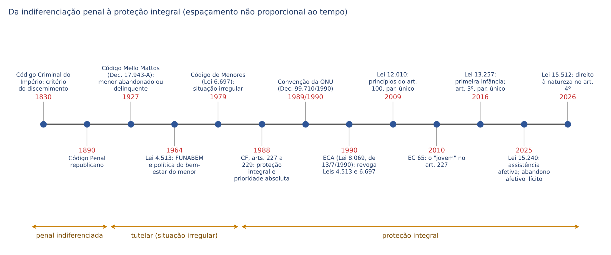
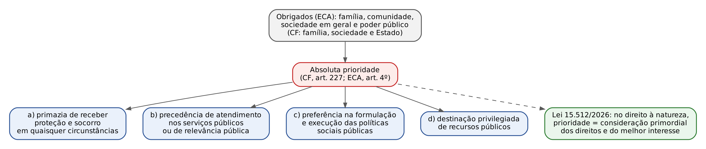
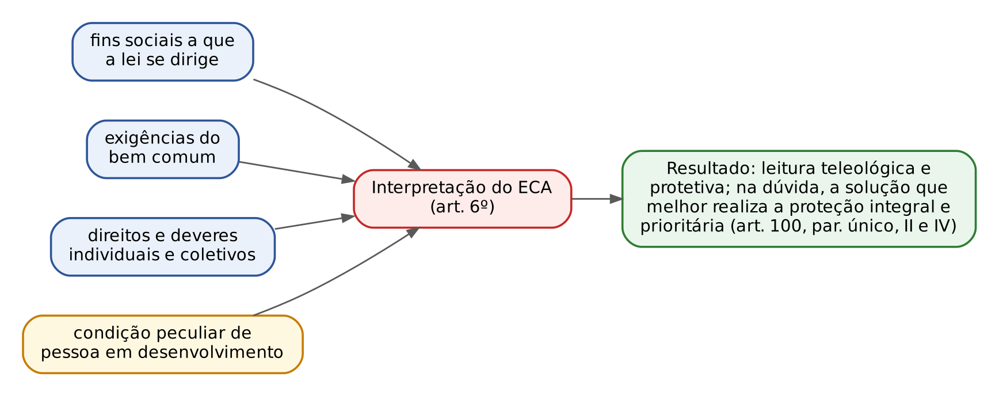
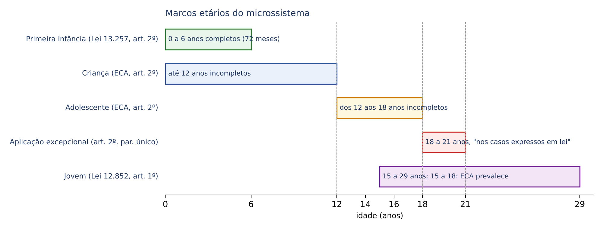
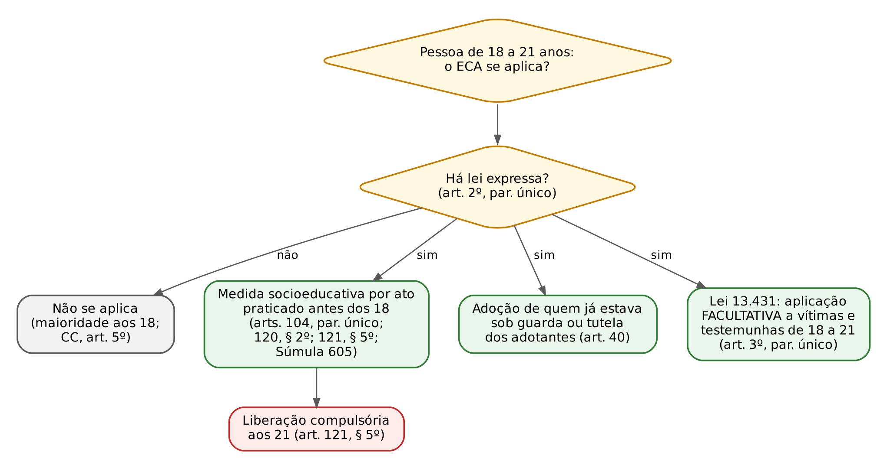
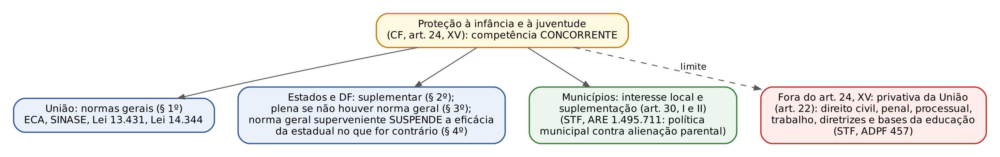

# CAPÍTULO 01 — FUNDAMENTOS: PROTEÇÃO INTEGRAL, PRIORIDADE ABSOLUTA, PRINCÍPIOS E CONCEITOS DO ECA

:::INCIDENCIA
TJRS p. 1; TJSC p. 1, 2. Nível A+. Lote: 7 questões (FGV 5, FCC 2), mais 6 correlatas de outros capítulos (inclusive TJ-PR, ENAM e DPE-PE).
O que mais cai: literalidade dos arts. 2º a 6º do ECA (idades, rol do art. 3º, parágrafo único, alíneas da prioridade), contraste situação irregular x proteção integral, aplicação entre 18 e 21 anos (Súmula 605) e, a partir de 2026, as novidades das Leis 15.240/2025 e 15.512/2026 no art. 4º.
:::

## 01.1 Da indiferenciação penal à proteção integral

A história só interessa na medida em que é cobrada, e ela é cobrada de três modos: (i) pela identificação das fases e dos diplomas que as marcam; (ii) pelas características da doutrina da situação irregular, quase sempre em contraste com a proteção integral; (iii) pela terminologia ("menor", "comissário de menores", "menor em situação irregular"), que as bancas usam como isca.

### 01.1.1 As três fases

A doutrina costuma dividir a evolução em três etapas (alguns manuais acrescentam uma fase anterior de "absoluta indiferença", quando a criança sequer era objeto de tratamento jurídico próprio).

| Fase | Marco normativo | Traço essencial | O que a banca explora |
|---|---|---|---|
| Penal indiferenciada | Código Criminal do Império (1830) e Código Penal de 1890 | A criança e o adolescente só aparecem quando delinquem; responsabilização com base no critério do discernimento, cumprimento junto a adultos | "Etapa penal indiferenciada é sucedida pela situação irregular" está CERTO como sequência; o erro costuma estar no conteúdo atribuído à fase seguinte |
| Tutelar (situação irregular) | Código Mello Mattos (Decreto 17.943-A, de 12/10/1927); Lei 4.513/1964 (FUNABEM e política nacional do bem-estar do menor); Código de Menores (Lei 6.697, de 10/10/1979) | O "menor" é objeto de intervenção estatal quando está em situação patológica (abandono, delinquência, perigo moral); juiz de menores com poderes amplíssimos e discricionários | Atribuir à fase tutelar a desjudicialização, os conselhos, o direito subjetivo a políticas públicas ou a oitiva (tudo isso é da proteção integral) |
| Proteção integral | CF, art. 227 (1988); Convenção da ONU sobre os Direitos da Criança (1989, Decreto 99.710/1990); ECA (Lei 8.069, de 13/7/1990) | Toda criança e todo adolescente são sujeitos de direitos, titulares de direitos fundamentais gerais e especiais, com prioridade absoluta e responsabilidade compartilhada | Confundir com a situação irregular ou dizer que esta é "desdobramento" daquela |

O Código Mello Mattos já se aplicava ao "menor, de um ou outro sexo, abandonado ou delinquente, que tiver menos de 18 annos de idade" (art. 1º). A Lei 6.697/1979 sistematizou a categoria "situação irregular". O ECA revogou expressamente as Leis 4.513/1964 e 6.697/1979 (art. 267) e entrou em vigor noventa dias após a publicação (art. 266), período em que deveriam ser promovidas campanhas de divulgação (art. 266, parágrafo único).

### 01.1.2 A doutrina da situação irregular

O art. 2º do Código de Menores enumerava seis hipóteses de "situação irregular": I — privação de condições essenciais à subsistência, saúde e instrução obrigatória, "ainda que eventualmente", por falta, ação ou omissão dos pais ou por manifesta impossibilidade de provê-las; II — vítima de maus-tratos ou castigos imoderados; III — perigo moral (ambiente contrário aos bons costumes ou exploração em atividade contrária aos bons costumes); IV — privação de representação ou assistência legal; V — desvio de conduta por grave inadaptação familiar ou comunitária; VI — autoria de infração penal.

Os traços que a banca espera que o candidato reconheça:

- Destinatário seletivo: o Código não se dirigia a todas as crianças, mas ao "menor em situação irregular" (art. 1º, I); as medidas preventivas, porém, alcançavam todo menor de 18 anos (art. 1º, parágrafo único).
- Indistinção entre carência e delinquência: o pobre, o abandonado, a vítima de maus-tratos e o autor de infração penal recebiam o mesmo rótulo e, em larga medida, as mesmas medidas, inclusive a institucionalização.
- Criminalização da pobreza: a "falta" de condições materiais, mesmo eventual e mesmo por "manifesta impossibilidade" dos pais, já era situação irregular. O ECA inverte a lógica: a falta ou carência de recursos materiais não constitui motivo suficiente para a perda ou suspensão do poder familiar (art. 23; ver Cap. 4).
- O "menor" como objeto de tutela, não como sujeito de direitos: sem direito de ser ouvido, sem garantias processuais, sem defesa técnica.
- Juiz de menores com função quase administrativa, de assistência e "vigilância", poderes normativos amplos e decisões fundadas em juízo de conveniência.
- Centralização das políticas na União (FUNABEM e congêneres estaduais) e ausência de participação da sociedade.
- Aplicação a pessoas de 18 a 21 anos "nos casos expressos em lei" (art. 1º, II) — fórmula que o ECA herdou literalmente no art. 2º, parágrafo único (ver 1.9).

:::PEGADINHA FÓRMULA HERDADA
"A previsão de aplicação do Estatuto a pessoas entre 18 e 21 anos é inovação do ECA." ERRADO: o art. 1º, II, do Código de Menores de 1979 já previa a aplicação do Código "entre dezoito e vinte e um anos, nos casos expressos em lei". O ECA manteve a fórmula, agora sob o paradigma da proteção integral.
:::

### 01.1.3 A doutrina da proteção integral

A proteção integral é a matriz do sistema inaugurado pelo art. 227 da CF e pela Convenção de 1989, e o ECA a declara já no art. 1º ("Esta Lei dispõe sobre a proteção integral à criança e ao adolescente"). Seus elementos estruturais, todos cobráveis:

- Universalidade: destina-se a TODAS as crianças e adolescentes, sem discriminação (art. 3º, parágrafo único).
- Sujeitos de direitos: titulares de todos os direitos fundamentais da pessoa humana e de direitos especiais decorrentes da condição peculiar de pessoa em desenvolvimento (art. 3º; art. 100, parágrafo único, I).
- Prioridade absoluta (CF, art. 227; ECA, art. 4º).
- Corresponsabilidade (cogestão) de família, comunidade, sociedade e poder público, com responsabilidade primária e solidária das três esferas de governo (art. 100, parágrafo único, III).
- Descentralização político-administrativa e municipalização do atendimento, com participação popular por meio de conselhos paritários (CF, art. 227, § 7º, c/c art. 204; ECA, art. 88; ver Cap. 11).
- Desjudicialização: as questões sociais saem do juiz e vão para a rede (Conselho Tutelar — ver Cap. 12 —, políticas setoriais); o juiz volta à função jurisdicional, com contraditório.
- Distinção entre situação de risco (medidas de proteção, art. 98) e ato infracional (medidas socioeducativas, com devido processo legal), e responsabilização do adolescente por meio de garantias processuais (CF, art. 227, § 3º, IV e V; ECA, arts. 110 e 111).
- Participação e oitiva da criança e do adolescente, conforme o estágio de desenvolvimento (art. 100, parágrafo único, XII; Convenção, art. 12).

| Critério | Situação irregular (Código de Menores) | Proteção integral (CF/ECA) |
|---|---|---|
| Destinatários | "Menor em situação irregular" | Todas as crianças e adolescentes |
| Status | Objeto de tutela e vigilância | Sujeito de direitos |
| Fundamento da intervenção | Patologia social do menor ou da família | Ameaça ou violação de direitos (por ação ou omissão da sociedade, do Estado, dos pais ou da própria conduta — art. 98) |
| Pobreza | Causa de intervenção e de perda do pátrio poder | Não autoriza, por si, perda ou suspensão do poder familiar (art. 23) |
| Papel do juiz | Assistencial e discricionário, com poderes normativos amplos | Jurisdicional, vinculado ao devido processo; portarias e alvarás só nas hipóteses do art. 149 (Cap. 18) |
| Infrator | Sem distinção do abandonado; internação por tempo indeterminado | Ato infracional apurado com garantias; medidas socioeducativas; internação breve e excepcional |
| Políticas | Centralizadas (FUNABEM) | Descentralizadas, municipalizadas, com conselhos paritários e participação popular |
| Voz da criança | Inexistente | Oitiva obrigatória e participação (art. 100, parágrafo único, XII) |

:::QUESTAO FGV 2026 — TJ-RJ — ANALISTA JUDICIÁRIO, COMISSÁRIO DE JUSTIÇA DA INFÂNCIA, DA JUVENTUDE E DO IDOSO (Q3870706)
Caso: a mãe de candidata aprovada diz que a filha será "comissária de menores"; a filha explica por que a expressão está superada. Pediu-se a afirmação correta sobre a evolução doutrinária.
Gabarito: D — o direito de oitiva e participação substituiu a lógica tutelar, de modo a melhor efetivar o superior interesse da criança e do adolescente.
Armadilhas: (A) inverte o paradigma (na proteção integral, crianças são SUJEITOS, não objeto); (B) atribui à situação irregular o reconhecimento de direito subjetivo a políticas públicas, conquista da proteção integral; (C) a proteção integral não se organiza por hierarquia, mas por rede descentralizada e corresponsável; (E) atribui ao Código Mello Mattos a desjudicialização e os conselhos, que são marcas do ECA. Fundamento: 1.1.2 e 1.1.3.
:::

:::QUESTAO FGV 2024 — ENAM — 1º EXAME NACIONAL DA MAGISTRATURA (Q2459873, ITEM IV)
Item: "a doutrina da proteção integral tem, como um de seus desdobramentos, a doutrina da situação irregular, ambas albergadas pelo ECA". Item ERRADO; gabarito A (só o item I, sobre o art. 7º, XXXIII, da CF, estava correto).
Armadilha: as duas doutrinas são antagônicas e sucessivas; o ECA rompe com a situação irregular. Os demais itens (trabalho infantil e Convenções 138 e 182 da OIT) são do Cap. 8.
:::

:::DICA TERMINOLOGIA
"Menor" carrega a carga da situação irregular; use "criança" e "adolescente". O próprio ECA, porém, conservou o termo em alguns dispositivos (por exemplo, art. 104: "São penalmente inimputáveis os menores de dezoito anos"; art. 22: "filhos menores"), assim como a CF (art. 228 e 229). Em prova, a expressão "comissário de menores" é sinal de enunciado sobre ruptura de paradigma.
:::

:::QUESTAO FGV 2026 — TJ-RJ — ANALISTA JUDICIÁRIO, ASSISTENTE SOCIAL (Q3869534)
Pediu-se o que o princípio da proteção integral implica para crianças e adolescentes.
Gabarito: D — são pessoas em condição peculiar de desenvolvimento, e a garantia de seus direitos é dever da família, da sociedade e do Estado.
Armadilhas: (A) "dependem da atuação da família para efetivá-los" desloca a responsabilidade, que é compartilhada e, quanto às políticas, primária e solidária do poder público; (B) a convivência com pai ou mãe privado de liberdade é assegurada por visitas periódicas promovidas pelo responsável ou, nas hipóteses de acolhimento, pela entidade, "independentemente de autorização judicial" (art. 19, § 4º; ver Cap. 4); (C) a prioridade absoluta não depende do local de nascimento (art. 3º, parágrafo único); (E) a ressalva de compatibilidade com direitos reconhecidos refere-se a criança indígena ou quilombola em colocação familiar (art. 28, § 6º; ver Cap. 5) e não define a proteção integral.
:::

## 01.2 Fundamentos constitucionais: arts. 227, 228 e 229

### 01.2.1 Art. 227, caput

:::LEI CONSTITUIÇÃO FEDERAL, ART. 227, CAPUT (REDAÇÃO DA EC 65/2010)
É dever da família, da sociedade e do Estado assegurar à criança, ao adolescente e ao jovem, com absoluta prioridade, o direito à vida, à saúde, à alimentação, à educação, ao lazer, à profissionalização, à cultura, à dignidade, ao respeito, à liberdade e à convivência familiar e comunitária, além de colocá-los a salvo de toda forma de negligência, discriminação, exploração, violência, crueldade e opressão.
:::

Três observações decidem questões:

- A EC 65/2010 incluiu o "jovem" no caput e nos §§ 1º e 3º, III e VII, e acrescentou o § 8º (estatuto da juventude e plano nacional de juventude, de duração decenal). A prioridade absoluta constitucional, portanto, abrange textualmente o jovem; o ECA continua a disciplinar apenas crianças e adolescentes (o jovem tem estatuto próprio, a Lei 12.852/2013 — ver 1.8.3). A Lei 13.257/2016 (art. 3º) reproduz a fórmula: "prioridade absoluta em assegurar os direitos da criança, do adolescente e do jovem".
- A CF fala em "família, sociedade e Estado"; o ECA desdobra em "família, comunidade, sociedade em geral e poder público" (art. 4º). Nenhum dos dois textos atribui o dever apenas ao Estado ou apenas à família.
- O rol de direitos da CF NÃO contém "esporte" nem "natureza"; o art. 4º do ECA contém ambos (o esporte desde a redação original; a natureza desde a Lei 15.512/2026). A FGV gosta de trocar os róis.

| Ponto | CF, art. 227, caput | ECA, art. 4º, caput |
|---|---|---|
| Obrigados | Família, sociedade e Estado | Família, comunidade, sociedade em geral e poder público |
| Beneficiários | Criança, adolescente e jovem | Criança e adolescente |
| Direitos | Vida, saúde, alimentação, educação, lazer, profissionalização, cultura, dignidade, respeito, liberdade, convivência familiar e comunitária | Os mesmos + ESPORTE + NATUREZA (Lei 15.512/2026) |
| Cláusula negativa | "colocá-los a salvo de toda forma de negligência, discriminação, exploração, violência, crueldade e opressão" | Transferida para o art. 5º ("Nenhuma criança ou adolescente será objeto de qualquer forma de negligência...") |
| Conteúdo da prioridade | Não detalhado | Detalhado no § 1º (alíneas a a d) |

### 01.2.2 Os parágrafos do art. 227 que caem

O § 3º (direito a proteção especial) é o mais cobrado, porque reúne regras que o ECA desenvolve em outros títulos:

| Inciso do § 3º | Conteúdo | Desenvolvimento |
|---|---|---|
| I | Idade mínima de 14 anos para admissão ao trabalho, observado o art. 7º, XXXIII (proibição de trabalho noturno, perigoso ou insalubre a quem tem menos de 18 e de qualquer trabalho a quem tem menos de 16, salvo aprendiz a partir de 14) | Cap. 8 |
| II | Garantia de direitos previdenciários e trabalhistas | Cap. 8 |
| III | Acesso do trabalhador adolescente e jovem à escola | Cap. 8 |
| IV | Pleno e formal conhecimento da atribuição de ato infracional, igualdade na relação processual e defesa técnica por profissional habilitado, "segundo dispuser a legislação tutelar específica" | Caps. 14 e 16 |
| V | Brevidade, excepcionalidade e respeito à condição peculiar de pessoa em desenvolvimento na aplicação de qualquer medida privativa da liberdade | Cap. 15 (ECA, art. 121) |
| VI | Estímulo do poder público, por assistência jurídica, incentivos fiscais e subsídios, ao acolhimento sob a forma de GUARDA de órfão ou abandonado | Cap. 5 (guarda subsidiada, art. 34) |
| VII | Programas de prevenção e atendimento especializado à criança, ao adolescente e ao jovem dependente de entorpecentes | Cap. 26 |

Os demais parágrafos, em uma linha cada: § 1º — programas de assistência integral à saúde, admitida a participação de entidades não governamentais, com aplicação de percentual dos recursos da saúde na assistência materno-infantil e programas para pessoas com deficiência (Cap. 3); § 2º — acessibilidade em logradouros, edifícios e transporte coletivo; § 4º — "A lei punirá severamente o abuso, a violência e a exploração sexual da criança e do adolescente" (mandado constitucional de criminalização; Cap. 21 e Apostila de Direito Penal, Cap. 31); § 5º — adoção assistida pelo poder público, com lei sobre casos e condições de adoção por estrangeiros (Cap. 6); § 6º — igualdade entre filhos, vedadas designações discriminatórias (Cap. 7); § 7º — no atendimento dos direitos considera-se o art. 204 (descentralização político-administrativa e participação da população por organizações representativas; Cap. 11); § 8º — estatuto da juventude e plano nacional de juventude decenal.

:::PEGADINHA PROTEÇÃO ESPECIAL E IDADE MÍNIMA
O art. 227, § 3º, I, fala em idade mínima de QUATORZE anos "para admissão ao trabalho", mas remete ao art. 7º, XXXIII, que só admite trabalho entre 14 e 16 anos na condição de aprendiz. Afirmar que "a CF permite qualquer trabalho a partir dos 14" é errado; o ENAM 2024 (Q2459873, item I) considerou correta a síntese do art. 7º, XXXIII.
:::

### 01.2.3 Art. 229: dever recíproco

"Os pais têm o dever de assistir, criar e educar os filhos menores, e os filhos maiores têm o dever de ajudar e amparar os pais na velhice, carência ou enfermidade." A reciprocidade (pais em relação a filhos menores; filhos maiores em relação a pais idosos, carentes ou enfermos) é o fundamento constitucional da solidariedade familiar que sustenta alimentos (Cap. 7) e, desde a Lei 15.240/2025, do dever legal de assistência afetiva (ECA, art. 4º, §§ 2º e 3º, e art. 22; ver 1.4.4 e Cap. 7).

### 01.2.4 Força normativa e justiciabilidade

Os direitos do art. 227 são direitos fundamentais, com aplicabilidade imediata (CF, art. 5º, § 1º), e a prioridade absoluta é norma vinculante para o legislador, o administrador e o juiz: reduz a margem de discricionariedade na eleição de prioridades orçamentárias e é o principal argumento contra a invocação genérica da reserva do possível. O controle judicial de políticas públicas na área (vagas em creche e pré-escola, acolhimento, sistema socioeducativo) é desenvolvido nos Caps. 8 (Tema 548 do STF) e 20 (processo coletivo e litígios estruturais). Aqui basta fixar a premissa: a prioridade absoluta não é recomendação programática, mas critério jurídico de alocação, e sua violação é sindicável.

A Convenção (art. 4) obriga os Estados Partes, quanto aos direitos econômicos, sociais e culturais, a adotar medidas "utilizando ao máximo os recursos disponíveis". A combinação do art. 4 da Convenção com a alínea d do § 1º do art. 4º do ECA (destinação privilegiada de recursos) é o fundamento normativo usual para afastar a reserva do possível não comprovada.

## 01.3 Proteção integral no ECA: arts. 1º e 3º

:::LEI ECA, ART. 3º E PARÁGRAFO ÚNICO (INCLUÍDO PELA LEI 13.257/2016)
Art. 3º A criança e o adolescente gozam de todos os direitos fundamentais inerentes à pessoa humana, sem prejuízo da proteção integral de que trata esta Lei, assegurando-se-lhes, por lei ou por outros meios, todas as oportunidades e facilidades, a fim de lhes facultar o desenvolvimento físico, mental, moral, espiritual e social, em condições de liberdade e de dignidade.
Parágrafo único. Os direitos enunciados nesta Lei aplicam-se a todas as crianças e adolescentes, sem discriminação de nascimento, situação familiar, idade, sexo, raça, etnia ou cor, religião ou crença, deficiência, condição pessoal de desenvolvimento e aprendizagem, condição econômica, ambiente social, região e local de moradia ou outra condição que diferencie as pessoas, as famílias ou a comunidade em que vivem.
:::

Leitura técnica do caput:

- "Todos os direitos fundamentais inerentes à pessoa humana" + "sem prejuízo da proteção integral": dupla titularidade. Crianças e adolescentes têm os direitos de qualquer pessoa (inclusive os da personalidade) e, além deles, direitos especiais (convivência familiar, prioridade, proteção especial no trabalho, garantias próprias no processo infracional). Por isso, nunca podem receber tratamento mais gravoso que o adulto em situação equivalente — premissa que a jurisprudência do STJ invoca no campo infracional (ver Caps. 14 a 16).
- "Por lei ou por outros meios": as oportunidades não dependem exclusivamente de lei formal; políticas públicas, atos administrativos e decisões judiciais também as asseguram.
- Desenvolvimento "físico, mental, moral, espiritual e social, em condições de liberdade e de dignidade": cinco dimensões, frequentemente cobradas por omissão de uma delas ou troca por "intelectual" ou "econômico".

O parágrafo único (Lei 13.257/2016) é um rol antidiscriminatório exemplificativo ("ou outra condição que diferencie"). Os critérios menos óbvios — e por isso os prediletos das bancas — são "idade", "condição pessoal de desenvolvimento e aprendizagem", "ambiente social" e "região e local de moradia". Note que o rol não fala em "nacionalidade", mas a cláusula aberta a abrange: a prioridade não depende de a criança ter nascido no território nacional (ver Q3869534, alternativa C).

:::JURIS STJ, JURISPRUDÊNCIA EM TESES, ED. 256, TESE 2
"As crianças, mesmo as de mais tenra idade, fazem jus à proteção irrestrita dos direitos da personalidade, assegurada a compensação pelo dano moral decorrente de sua violação" (CF, art. 5º, X; CC, art. 12). É a projeção do art. 3º na responsabilidade civil: a ausência de compreensão do ato ofensivo (bebê, criança pequena) não afasta o dano. Na mesma edição, tese 3: a veiculação de identidade ou imagem de criança ou adolescente sem autorização do responsável configura dano moral *in re ipsa* (art. 17; ver Cap. 3).
:::

:::QUESTAO FCC 2025 — SEDU-ES — AGENTE DE SUPORTE EDUCACIONAL (Q3336207)
Pediu-se a afirmação correta sobre o ECA.
Gabarito: D — a criança e o adolescente gozam de todos os direitos fundamentais inerentes à pessoa humana, sem prejuízo da proteção integral (literalidade do art. 3º).
Armadilhas: (A) restrições ao celular nas escolas e idade mínima para redes sociais não estão no ECA (o tema digital tem diploma próprio; ver Cap. 10); (B) o castigo físico é vedado (art. 18-A; Cap. 3); (C) a imputabilidade penal começa aos 18 anos (CF, art. 228; ECA, art. 104; ver 1.10); (E) a participação em espetáculos é regulada, não proibida (arts. 149 e 75; Caps. 9 e 18), e o aborto não é tema do ECA.
:::

:::QUESTAO FGV 2024 — TJ-RJ — PROGRAMA DE RESIDÊNCIA, PSICÓLOGO (Q2375218)
Três afirmações: I — paráfrase do art. 3º, parágrafo único (com omissões de critérios); II — paráfrase do art. 4º, caput (com omissões de direitos); III — literalidade do art. 5º.
Gabarito: E — I, II e III corretas.
Armadilha: as omissões de itens do rol não tornam a afirmação falsa, porque nenhuma delas diz "apenas" ou "somente". Padrão FGV: paráfrase incompleta, sem palavra restritiva, é CORRETA; a troca de um elemento (por exemplo, "Estado" no lugar de "poder público", "esporte" atribuído à CF) ou a introdução de condição ("desde que", "somente") é que torna errada.
:::

## 01.4 Prioridade absoluta (art. 4º)

### 01.4.1 Texto vigente e as duas leis que o alteraram

O art. 4º foi alterado duas vezes em menos de um ano, e ambas as alterações são candidatas naturais a prova em 2026 e 2027:

- Lei 15.240, de 28/10/2025 (DOU de 29/10/2025, vigência na publicação): transformou o antigo parágrafo único (as quatro alíneas da prioridade) em § 1º e acrescentou os §§ 2º e 3º (assistência afetiva). A mesma lei incluiu o parágrafo único do art. 5º (ilícito civil, inclusive abandono afetivo) e alterou os arts. 22, 56, IV, 58, 129, parágrafo único, e 130.
- Lei 15.512, de 22/9/2026 (DOU de 23/9/2026, vigência na publicação): deu nova redação ao caput para incluir o direito "à natureza" e instituiu princípios e diretrizes de políticas públicas para efetivá-lo com absoluta prioridade.

:::LEI ECA, ART. 4º, CAPUT E § 1º (CAPUT COM REDAÇÃO DA LEI 15.512/2026; § 1º RENUMERADO PELA LEI 15.240/2025)
Art. 4º É dever da família, da comunidade, da sociedade em geral e do poder público assegurar, com absoluta prioridade, a efetivação dos direitos referentes à vida, à saúde, à alimentação, à educação, ao esporte, ao lazer, à profissionalização, à cultura, à dignidade, ao respeito, à liberdade, à natureza e à convivência familiar e comunitária.
§ 1º A garantia de prioridade compreende:
a) primazia de receber proteção e socorro em quaisquer circunstâncias;
b) precedência de atendimento nos serviços públicos ou de relevância pública;
c) preferência na formulação e na execução das políticas sociais públicas;
d) destinação privilegiada de recursos públicos nas áreas relacionadas com a proteção à infância e à juventude.
:::

### 01.4.2 Conteúdo das alíneas

O verbo "compreende" indica conteúdo mínimo, não exaustivo: a doutrina majoritária lê o § 1º como rol exemplificativo das manifestações da prioridade. Na prática forense, cada alínea tem um campo de aplicação típico:

| Alínea | Núcleo | Aplicações típicas | Pegadinha |
|---|---|---|---|
| a) primazia | Receber proteção e socorro "em quaisquer circunstâncias" | Evacuação em desastres, atendimento de urgência, resgate; a Lei 15.512/2026 a especifica para riscos socioambientais e climáticos | "Em situações de calamidade pública" restringe o que a lei diz ("quaisquer circunstâncias") |
| b) precedência | Atendimento nos serviços públicos "ou de relevância pública" | Filas e agendamentos em serviços de saúde, assistência, registro civil; serviços privados de relevância pública também se submetem | Limitar a "serviços públicos estatais" é erro |
| c) preferência | Formulação E execução das políticas sociais públicas | Planejamento (planos plurianuais, planos decenais setoriais) e implementação | Afirmar que abrange só a execução, ou só a formulação |
| d) destinação privilegiada | Recursos públicos "nas áreas relacionadas com a proteção à infância e à juventude" | Leis orçamentárias, fundos (FIA, Cap. 11), controle judicial de omissões | Não significa vinculação de percentual fixo da receita |

A prioridade também se projeta no processo: o ECA assegura prioridade absoluta na tramitação dos processos e procedimentos nele previstos e na execução dos atos e diligências deles decorrentes (art. 152, § 1º; ver Cap. 18), e os prazos dos procedimentos estatutários são contados em dias corridos (art. 152, § 2º), com prazo recursal de 10 dias (art. 198, II; Cap. 19).

:::ATENCAO PRIORIDADE ABSOLUTA X OUTRAS PRIORIDADES LEGAIS
Outros estatutos asseguram prioridades (pessoa idosa, pessoa com deficiência), mas somente quanto a crianças, adolescentes e jovens a Constituição qualifica a prioridade como ABSOLUTA (art. 227). Em conflito concreto de prioridades, o argumento constitucional favorece a criança e o adolescente; a solução, porém, deve ser fundamentada à luz do caso (gravidade, urgência, vulnerabilidade concreta), e não por mera hierarquia abstrata entre estatutos.
:::

### 01.4.3 O direito à natureza (Lei 15.512/2026)

A Lei 15.512/2026 não se limitou ao acréscimo de uma palavra no art. 4º. Ela é diploma autônomo, com densidade suficiente para questões objetivas:

- Conteúdo do direito (art. 2º, § 1º): acesso a áreas naturais saudáveis e ecologicamente equilibradas; convivência familiar e comunitária, manifestações culturais e vínculos socioafetivos com a natureza; brincar livre em contato com a natureza; educação baseada na natureza; defesa, conservação e recuperação da natureza por todos os entes, sociedade, comunidades, famílias, crianças e adolescentes.
- Definição de absoluta prioridade nesse campo (art. 2º, § 2º): "consideração primordial de seus direitos e de seu melhor interesse na tomada de decisões por agentes públicos e privados", compreendendo primazia de proteção e socorro em riscos socioambientais e climáticos, precedência no acesso a áreas naturais, preferência em políticas socioambientais e climáticas, reparação em caso de violação, proteção prioritária de crianças e adolescentes defensores socioambientais e inclusão privilegiada em metas e relatórios de sustentabilidade corporativa.
- Prioridade dentro da prioridade (art. 2º, § 3º): crianças na primeira infância, crianças e adolescentes com deficiência e os que estão em situação de risco ou vulnerabilidade social.
- Princípios (art. 3º): solidariedade ambiental intergeracional e educação ambiental como matrizes; prevenção e precaução.
- Garantias de acesso à justiça: acesso à Defensoria, ao MP e ao Judiciário (art. 26); os órgãos de organização judiciária PODERÃO criar núcleos ou coordenações especializadas (art. 27); denúncias seguem fluxo para o Disque 100, conselhos tutelares, MP e autoridades policiais (art. 29).
- Deslocamentos climáticos (art. 22): direito de permanecer com a família; salvo risco iminente, a manutenção do grupo familiar unido é solução prioritária, "evitando-se ao máximo a perda do poder familiar".
- Alterações em outras leis: Lei 6.938/1981 (Política Nacional do Meio Ambiente), art. 2º, XI (acesso prioritário de crianças e adolescentes à natureza); Lei 12.187/2009 (Política Nacional sobre Mudança do Clima), art. 3º, I (dever de atuar em benefício das crianças e adolescentes, com prioridade).

:::DICA POR QUE A LEI 15.512 IMPORTA PARA O JUIZ
O § 2º do art. 2º é a primeira definição legal, no plano federal, de "absoluta prioridade" como "consideração primordial" do "melhor interesse" — a mesma fórmula do art. 3.1 da Convenção ("considerar, primordialmente, o interesse maior da criança"). Em ação civil pública ambiental ou urbanística que afete crianças (licenciamento de obra no entorno de escola, supressão de área verde, plano de contingência climática), o fundamento da tutela prioritária deixa de ser apenas principiológico e passa a ter base legal expressa (arts. 2º, 8º, 21 e 24 da Lei 15.512/2026; ver Cap. 20).
:::

### 01.4.4 Assistência afetiva (art. 4º, §§ 2º e 3º)

:::LEI ECA, ART. 4º, §§ 2º E 3º (INCLUÍDOS PELA LEI 15.240/2025)
§ 2º Compete aos pais, além de zelar pelos direitos de que trata o art. 3º desta Lei, prestar aos filhos assistência afetiva, por meio de convívio ou de visitação periódica, que permita o acompanhamento da formação psicológica, moral e social da pessoa em desenvolvimento.
§ 3º Para efeitos desta Lei, considera-se assistência afetiva: I – orientação quanto às principais escolhas e oportunidades profissionais, educacionais e culturais; II – solidariedade e apoio nos momentos de intenso sofrimento ou de dificuldade; III – presença física espontaneamente solicitada pela criança ou adolescente quando possível de ser atendida.
:::

Pontos de literalidade: o dever é dos PAIS (não da família extensa); realiza-se "por meio de convívio ou de visitação periódica"; o rol do § 3º tem três incisos; a presença física é a "espontaneamente solicitada" pela criança e "quando possível de ser atendida" (não é dever incondicional de presença). A consequência jurídica do descumprimento (ilícito civil e reparação) está no art. 5º, parágrafo único (1.5). O regime da responsabilidade civil por abandono afetivo — requisitos, nexo, prescrição, quantificação — é do Cap. 7 (e Apostila de Direito Civil, Cap. 38.6); a Lei 15.240 também reescreveu o art. 22 ("dever de sustento, guarda, convivência, assistência material e afetiva e educação"), cuja análise está no Cap. 4.

:::PEGADINHA ONDE ESTÁ A ASSISTÊNCIA AFETIVA?
A banca pode perguntar em qual dispositivo o ECA define assistência afetiva. Resposta: art. 4º, § 3º (e não no art. 22, que apenas a inclui entre os deveres dos pais, nem no art. 5º, que trata da ilicitude). E o antigo "parágrafo único do art. 4º" (alíneas da prioridade) é hoje o § 1º.
:::

:::QUESTAO FGV 2026 — PREFEITURA DE SÃO JOSÉ DOS CAMPOS — PROFESSOR I (Q3997758)
Quatro afirmações (V ou F): I — conceito de criança e adolescente (art. 2º); II — titularidade de todos os direitos fundamentais (art. 3º); III — rol antidiscriminatório (art. 3º, parágrafo único); IV — dever de assegurar com absoluta prioridade (art. 4º, na redação anterior à Lei 15.512, sem "natureza").
Gabarito: A — V, V, V, V.
Observação para provas futuras: mesmo após a Lei 15.512/2026, a afirmação IV continua verdadeira, porque a omissão de um item do rol, sem palavra restritiva, não a falseia. Seria falsa se dissesse que o dever é "exclusivo do poder público" ou se atribuísse a prioridade apenas a "direitos sociais".
:::

:::QUESTAO FGV 2024 — SES-MT — TÉCNICO EM ASSUNTOS CULTURAIS E EDUCACIONAIS (Q2483030)
Quatro afirmações: I — conceito do art. 2º; II — aplicação do ECA a pessoas "entre 22 e 25 anos"; III — acesso a programas de saúde da mulher e planejamento reprodutivo "apenas" para hipossuficientes ou pessoas com deficiência; IV — dever de todos de velar pela dignidade (art. 18).
Gabarito: D — V, F, F, V.
Armadilhas: II troca a faixa excepcional (18 a 21; ver 1.9); III introduz restrição ("apenas") inexistente no art. 8º, que assegura o acesso a TODAS as mulheres (Cap. 3).
:::

## 01.5 Art. 5º: cláusula de proteção e ilícito civil

:::LEI ECA, ART. 5º E PARÁGRAFO ÚNICO (INCLUÍDO PELA LEI 15.240/2025)
Art. 5º Nenhuma criança ou adolescente será objeto de qualquer forma de negligência, discriminação, exploração, violência, crueldade e opressão, punido na forma da lei qualquer atentado, por ação ou omissão, aos seus direitos fundamentais.
Parágrafo único. Considera-se conduta ilícita, sujeita a reparação de danos, sem prejuízo de outras sanções cabíveis, a ação ou a omissão que ofenda direito fundamental de criança ou de adolescente previsto nesta Lei, incluídos os casos de abandono afetivo.
:::

O caput reproduz as seis formas de violação do art. 227 da CF (negligência, discriminação, exploração, violência, crueldade e opressão — memorize como bloco; a FGV acrescenta "abandono" ou "omissão" para testar) e acrescenta a cláusula de punição "na forma da lei" de qualquer atentado, por ação OU omissão. Não é tipo penal: as sanções estão nos crimes e infrações administrativas (Cap. 21), nas medidas aos pais (arts. 129 e 130; Cap. 13) e na responsabilidade civil.

O parágrafo único é cláusula geral de ilicitude civil com quatro elementos: (i) ação ou omissão; (ii) ofensa a direito fundamental de criança ou adolescente "previsto nesta Lei"; (iii) consequência: reparação de danos; (iv) cumulatividade: "sem prejuízo de outras sanções cabíveis". A expressão "incluídos os casos de abandono afetivo" encerra, no plano legal, a discussão sobre se o abandono afetivo seria ilícito indenizável: é, por força de lei, desde 29/10/2025. Permanecem relevantes, porém, as questões de prova do dano, nexo, culpa, prescrição e aplicação intertemporal a fatos anteriores, todas tratadas no Cap. 7.

:::ATENCAO DIREITO INTERTEMPORAL
A Lei 15.240/2025 entrou em vigor na data da publicação e não tem regra de transição. Para fatos anteriores, a responsabilização por abandono afetivo continua possível pela via geral dos arts. 186 e 927 do CC, como já admitia parte da jurisprudência do STJ, mas sem a qualificação legal expressa; a discussão está no Cap. 7.
:::

O parágrafo único também ampliou o conceito de negligência para fins de comunicação obrigatória pela escola: o art. 56, IV, passou a prever comunicação ao Conselho Tutelar de "negligência, abuso ou abandono na forma prevista nos arts. 4º e 5º" (Cap. 8).

## 01.6 Interpretação da norma estatutária (art. 6º)

:::LEI ECA, ART. 6º
Na interpretação desta Lei levar-se-ão em conta os fins sociais a que ela se dirige, as exigências do bem comum, os direitos e deveres individuais e coletivos, e a condição peculiar da criança e do adolescente como pessoas em desenvolvimento.
:::

### 01.6.1 Estrutura do dispositivo

Os dois primeiros vetores (fins sociais e exigências do bem comum) repetem o art. 5º da LINDB; os dois últimos são próprios do microssistema: os "direitos e deveres individuais e coletivos" (o ECA tutela tanto o interesse individual de cada criança quanto interesses difusos e coletivos da infância, com ações próprias — Cap. 20) e a "condição peculiar da criança e do adolescente como pessoas em desenvolvimento". A Lei 13.431/2017 copiou a técnica (art. 3º): na sua aplicação e interpretação consideram-se "os fins sociais a que ela se destina e, especialmente, as condições peculiares da criança e do adolescente como pessoas em desenvolvimento".

O art. 6º é complementado pelo art. 100, parágrafo único, II (incluído pela Lei 12.010/2009), que transforma a proteção integral e prioritária em cânone interpretativo de TODA norma do Estatuto: "a interpretação e aplicação de toda e qualquer norma contida nesta Lei deve ser voltada à proteção integral e prioritária dos direitos de que crianças e adolescentes são titulares". Os demais princípios do art. 100, parágrafo único, regem a aplicação de medidas e são desenvolvidos no Cap. 13.

### 01.6.2 Consequências práticas

- Interpretação teleológica e sistemática: diante de duas leituras possíveis, prevalece a que melhor realiza os direitos da criança e do adolescente concretamente envolvidos. Isso explica por que o STJ relativiza regras aparentemente rígidas quando sua aplicação literal contrariaria a finalidade protetiva (quadro de 1.7.3).
- Especialidade do microssistema: as normas do ECA prevalecem sobre as do CPC nos procedimentos que ele regula. Exemplo atual: é intempestivo o agravo interno interposto após 10 dias corridos, porque o art. 198, II, c/c art. 152, § 2º, prevalece sobre o CPC (STJ, Terceira Turma, processo em segredo de justiça, Relatora Ministra Daniela Teixeira, j. 5/5/2025, Informativo Edição Extraordinária 26). Mas o próprio STJ delimita o alcance: o sistema recursal do ECA só se aplica aos procedimentos especiais dos arts. 155 a 197; nos demais, ainda que afetos à infância, aplicam-se as regras gerais do CPC (Jurisprudência em Teses, ed. 250, tese 6; Cap. 19).
- Especialidade lida com rigor literal: o art. 152, § 2º, veda o prazo em dobro apenas "para a Fazenda Pública e o Ministério Público"; por isso a Defensoria Pública conserva a contagem em dobro nos procedimentos do ECA (silêncio eloquente), conforme tese fixada em recurso repetitivo noticiado no Informativo 870 do STJ (11/11/2025) e reafirmada pela Terceira Turma em ação de destituição do poder familiar cumulada com adoção (Informativo Edição Extraordinária 32, 21/7/2026). Desenvolvimento no Cap. 19.
- Regras de competência: o princípio do juízo imediato (art. 147, I e II), atrelado ao melhor interesse, sobrepõe-se às regras gerais de competência do CPC (Jurisprudência em Teses, ed. 250, tese 5; Cap. 18).
- Limite: a interpretação protetiva NÃO autoriza leitura em prejuízo do adolescente no campo infracional. As hipóteses de internação do art. 122 são taxativas e é vedada interpretação extensiva (Jurisprudência em Teses, ed. 54, tese 4; Cap. 15). Invocar o "bem do adolescente" para impor medida mais gravosa é resquício da lógica tutelar e fundamento inválido.

:::PEGADINHA ESPECIALIDADE NÃO É ABSOLUTA: LEI MARIA DA PENHA
A especialidade do ECA cede à Lei Maria da Penha quando a vítima de violência doméstica é menina: no conflito, prevalece a Lei 11.340/2006 (STJ, Tema 1.186; v. Cap. 23 e Apostila de Direito Penal, Cap. 38).
:::

:::EXEMPLO ART. 6º APLICADO
Pais recusam vacina recomendada pelas autoridades sanitárias a filha de 11 anos, invocando liberdade de consciência e autoridade parental. Lidos à luz dos fins sociais e da condição peculiar de pessoa em desenvolvimento, o art. 14, § 1º, e o art. 249 fazem prevalecer a saúde da criança: a recusa injustificada é negligência punível com a multa do art. 249 (STJ, REsp 2.138.801; v. Caps. 3 e 12).
:::

## 01.7 Melhor interesse e condição peculiar de pessoa em desenvolvimento

### 01.7.1 Melhor interesse (interesse superior): fontes e natureza

O princípio tem três fontes positivas que a banca pode pedir pela redação:

| Fonte | Expressão | Formulação |
|---|---|---|
| Convenção sobre os Direitos da Criança (Decreto 99.710/1990), art. 3.1 | "interesse maior da criança" | Todas as ações relativas às crianças, por instituições públicas ou privadas de bem-estar social, tribunais, autoridades administrativas ou órgãos legislativos, "devem considerar, primordialmente" esse interesse |
| ECA, art. 100, parágrafo único, IV (Lei 12.010/2009) | "interesse superior da criança e do adolescente" | "a intervenção deve atender prioritariamente aos interesses e direitos da criança e do adolescente, sem prejuízo da consideração que for devida a outros interesses legítimos no âmbito da pluralidade dos interesses presentes no caso concreto" |
| Lei 15.512/2026, art. 2º, § 2º | "melhor interesse" | Absoluta prioridade como "consideração primordial de seus direitos e de seu melhor interesse na tomada de decisões por agentes públicos e privados" |

Observe a cláusula final do art. 100, IV: o interesse superior não aniquila outros interesses legítimos (dos pais, da família de origem, dos pretendentes à adoção, da coletividade); ele os precede, mas exige ponderação no caso concreto. A banca costuma dizer que o princípio "afasta qualquer outro interesse" — errado.

No plano internacional, o Comitê dos Direitos da Criança (Comentário Geral n. 14, de 2013) atribui ao interesse superior tríplice natureza: direito substantivo (direito de ter o próprio interesse avaliado e tomado como consideração primordial), princípio interpretativo (entre interpretações possíveis, a que melhor o atenda) e regra de procedimento (a decisão deve explicitar como o interesse foi avaliado). A terceira dimensão é a mais útil ao juiz: invocar o "melhor interesse" sem estudo técnico, sem oitiva e sem explicitar os critérios ponderados é fundamentação deficiente (CPC, art. 489, § 1º, II — conceito jurídico indeterminado sem explicação do motivo concreto de sua incidência).

### 01.7.2 Proteção integral x melhor interesse x prioridade absoluta

| Instituto | Natureza | Função | Fonte |
|---|---|---|---|
| Proteção integral | Doutrina/paradigma; sistema | Define a criança como sujeito de direitos e organiza todo o microssistema | CF, art. 227; ECA, art. 1º; art. 100, parágrafo único, II |
| Prioridade absoluta | Princípio-regra de precedência | Ordena a alocação de atenção, serviços, políticas e recursos | CF, art. 227; ECA, art. 4º, § 1º |
| Melhor interesse | Princípio e critério de decisão | Orienta a escolha, no caso concreto, entre soluções possíveis | Convenção, art. 3.1; ECA, art. 100, parágrafo único, IV |
| Condição peculiar de pessoa em desenvolvimento | Fundamento antropológico e cânone hermenêutico | Justifica direitos especiais e tratamento diferenciado; limita medidas privativas de liberdade | CF, art. 227, § 3º, V; ECA, arts. 6º, 15, 71 e 121 |

### 01.7.3 O melhor interesse como critério de flexibilização de regras

A jurisprudência do STJ usa o melhor interesse para afastar a aplicação literal de regras do ECA ou do CC quando ela frustraria a finalidade protetiva. O quadro abaixo reúne as teses vistas nesta pesquisa; cada uma é desenvolvida no capítulo indicado:

| Regra | Flexibilização | Fonte | Cap. |
|---|---|---|---|
| Ordem cronológica do cadastro de adotantes | Não é absoluta; pode ser excepcionada em prol do melhor interesse | Jurisprudência em Teses, ed. 27, tese 1 | 6 |
| Acolhimento em caso de adoção irregular ou "à brasileira" | Acolhimento temporário não representa o melhor interesse, salvo evidente risco à integridade | Jurisprudência em Teses, ed. 27, tese 3 | 4 e 6 |
| Diferença mínima de 16 anos entre adotante e adotando (art. 42, § 3º) | Admite flexibilização para atender ao melhor interesse | Jurisprudência em Teses, ed. 254, tese 5 | 6 |
| Irrevogabilidade da adoção | Não é absoluta quando a manutenção não traz reais vantagens ao adotado | Jurisprudência em Teses, ed. 251, tese 11 | 6 |
| Retratação do consentimento na entrega para adoção | Não gera direito potestativo dos pais biológicos; é sopesada com o melhor interesse | Jurisprudência em Teses, ed. 251, tese 10 | 4 e 6 |
| Prioridade da família extensa | Não é absoluta quando inexiste vínculo prévio e há laço socioafetivo consistente com a família substituta | Informativo 860 do STJ (Terceira Turma) | 5 |
| Levantamento, pelos pais, de valores depositados em favor do filho (CC, art. 1.689) | Legitimidade dos pais, salvo demonstração de que a medida não atende ao melhor interesse | Jurisprudência em Teses, ed. 253, tese 8 | 4 |
| Competência (CPC) | Juízo imediato (art. 147) sobrepõe-se às regras gerais | Jurisprudência em Teses, ed. 250, tese 5 | 18 |

:::PEGADINHA MELHOR INTERESSE NÃO É CLÁUSULA DE EXCEÇÃO UNIVERSAL
No processo infracional, o melhor interesse não autoriza agravar a situação do adolescente (internação fora do art. 122, interpretação extensiva, supressão de garantias). E, nas questões de família, a flexibilização exige fundamentação concreta e, em regra, prova técnica. A alternativa "o princípio do melhor interesse autoriza o juiz a desconsiderar regras legais sempre que entender conveniente" é ERRADA; a correta fala em afastamento excepcional, fundamentado e vinculado às circunstâncias do caso.
:::

:::QUESTAO FGV 2026 — TJ-RJ — COMISSÁRIO DE JUSTIÇA DA INFÂNCIA (Q3870715) E FGV 2025 — TJ-SE — JUIZ SUBSTITUTO (Q3301257)
Correlatas (donos: Caps. 4 e 6). Em ambas o "superior interesse" aparece como argumento de alternativa errada: na primeira, para justificar entrega direta do recém-nascido a pretendente cadastrado sem avaliação da equipe (gabarito E: sigilo da gestante, inclusive perante o suposto genitor e a família extensa, ressalvado o direito da criança ao conhecimento da origem — arts. 19-A, § 9º, e 48); na segunda, para afirmar caráter ABSOLUTO da ordem do cadastro (gabarito A: o caso é de adoção *intuitu personae*).
Lição para este capítulo: alternativa que usa o melhor interesse para tornar uma regra ABSOLUTA ou para dispensar a avaliação técnica tende a estar errada.
:::

### 01.7.4 Condição peculiar de pessoa em desenvolvimento e autonomia progressiva

A condição peculiar de pessoa em desenvolvimento é o fundamento do tratamento diferenciado: não significa incapacidade para tudo, mas desenvolvimento em curso, a que corresponde autonomia progressiva. A Convenção (art. 5) manda respeitar a orientação dos pais "acordes com a evolução de sua capacidade", e o art. 12 assegura à criança "capacitada a formular seus próprios juízos" o direito de expressar opiniões, levadas em consideração "em função da idade e maturidade", inclusive em processo judicial ou administrativo.

No ECA, a autonomia progressiva se traduz em escalas de participação:

- Oitiva "sempre que possível", por equipe interprofissional, respeitado o estágio de desenvolvimento e o grau de compreensão, com opinião "devidamente considerada" (art. 28, § 1º; art. 100, parágrafo único, XII).
- CONSENTIMENTO, colhido em audiência, do maior de 12 anos na colocação em família substituta (art. 28, § 2º) e na adoção (art. 45, § 2º). Abaixo de 12, oitiva; a partir de 12, consentimento — distinção clássica de prova (Caps. 5 e 6).
- Respeito à "autonomia" como componente do direito ao respeito (art. 17).

:::JURIS STJ, RESP 2.024.140, RELATORA MINISTRA MARIA ISABEL GALLOTTI, QUARTA TURMA, J. 10/3/2026
Exame de gravidez realizado por laboratório em adolescente desacompanhada dos responsáveis não é, em si, ilegal, sobretudo se ela demonstra capacidade de entendimento e autonomia. Quando a examinada tem menos de 14 anos, o laboratório deve notificar a rede de proteção (não necessariamente os pais, porque grande parte da violência sexual provém do ambiente familiar); a omissão de comunicar o resultado aos responsáveis não gera, por si, dano moral indenizável a eles. *Ratio*: a condição de sujeito de direitos e a escuta ativa sustentam esfera própria de privacidade do adolescente, sem eliminar o dever de proteção, que se dirige à rede (Informativo Edição Extraordinária 32).
:::

A mesma condição peculiar fundamenta limites: brevidade e excepcionalidade da privação de liberdade (CF, art. 227, § 3º, V; ECA, art. 121), vedação de identificação compulsória do adolescente civilmente identificado salvo dúvida fundada (art. 109) e regras de prevenção especial (Cap. 9).

## 01.8 Conceitos de criança e adolescente (art. 2º)

:::LEI ECA, ART. 2º
Considera-se criança, para os efeitos desta Lei, a pessoa até doze anos de idade incompletos, e adolescente aquela entre doze e dezoito anos de idade.
Parágrafo único. Nos casos expressos em lei, aplica-se excepcionalmente este Estatuto às pessoas entre dezoito e vinte e um anos de idade.
:::

### 01.8.1 Critério e contagem

O critério é exclusivamente cronológico (etário), objetivo e de presunção absoluta: não se indaga maturidade, discernimento, condição social ou emancipação. Criança é quem ainda não completou 12 anos (até 11 anos, 11 meses e o último dia antes do 12º aniversário); adolescente é quem tem de 12 anos completos até a véspera dos 18. A expressão "entre doze e dezoito" deve ser lida como "dos 12 completos aos 18 incompletos", porque aos 18 a pessoa alcança a maioridade civil (CC, art. 5º) e a imputabilidade penal (CF, art. 228).

"Para os efeitos desta Lei": as faixas do art. 2º valem para o ECA; outros diplomas usam marcos próprios (quadro de 1.8.3).

:::PEGADINHA EMANCIPAÇÃO
A emancipação (CC, art. 5º, parágrafo único) faz cessar a incapacidade civil, mas NÃO retira do adolescente a condição de adolescente para os efeitos do ECA: continua destinatário da proteção integral, inimputável e sujeito às medidas socioeducativas pelo ato infracional que praticar. A afirmação "o adolescente emancipado responde penalmente" é ERRADA.
:::

### 01.8.2 Por que a distinção criança x adolescente importa

| Matéria | Criança (até 12 incompletos) | Adolescente (12 a 18 incompletos) | Cap. |
|---|---|---|---|
| Ato infracional | Só medidas de proteção do art. 101 (art. 105) | Medidas socioeducativas (art. 112), cumuláveis com as de proteção | 14 e 15 |
| Colocação em família substituta e adoção | Oitiva sempre que possível | Consentimento em audiência (arts. 28, § 2º, e 45, § 2º) | 5 e 6 |
| Trabalho | Proibido | Aprendiz a partir de 14; trabalho a partir de 16, vedado o noturno, perigoso ou insalubre até 18 (CF, art. 7º, XXXIII) | 8 |
| Viagem | Regras próprias de autorização (art. 83, com a redação vigente) | Regime diverso conforme a idade | 9 |
| Apreensão | Criança não é "apreendida" por ato infracional; encaminha-se ao Conselho Tutelar | Apreensão em flagrante ou por ordem judicial (art. 106) | 14 e 16 |

### 01.8.3 Outros marcos etários do microssistema

| Diploma | Marco | Observação de prova |
|---|---|---|
| Convenção da ONU, art. 1 | Criança = todo ser humano com menos de 18 anos, salvo maioridade antecipada pela lei aplicável | Não distingue criança e adolescente; o ECA distingue (Cap. 2) |
| Lei 13.257/2016, art. 2º | Primeira infância = primeiros 6 anos completos ou 72 meses de vida | "6 anos completos" (e não "até 6 incompletos"); Cap. 24 |
| Lei 12.852/2013 (Estatuto da Juventude), art. 1º, §§ 1º e 2º | Jovem = 15 a 29 anos; aos de 15 a 18 aplica-se o ECA e, EXCEPCIONALMENTE, o Estatuto da Juventude, quando não conflitar com a proteção integral | Sobreposição 15 a 18: prevalece o ECA |
| CC, arts. 3º e 4º, I | Absolutamente incapaz: quem tem menos de 16; relativamente: entre 16 e 18 | A incapacidade civil não se confunde com o conceito estatutário |
| CF, art. 228; CP, art. 27; ECA, art. 104 | Inimputabilidade penal: pessoas com menos de 18 | Ver 1.10 |
| CP, art. 217-A (estupro de vulnerável) | Vítima menor de 14 | Marco penal, não estatutário (Apostila de Direito Penal, Cap. 31) |
| Lei 13.431/2017, art. 3º, parágrafo único | Aplicação facultativa a vítimas e testemunhas de 18 a 21 | Ver 1.9 |

:::QUESTAO FCC 2026 — TJ-CE — ANALISTA JUDICIÁRIO, PSICOLOGIA (Q4293736)
Pediu-se a faixa etária do adolescente, destinatário do atendimento socioeducativo, segundo o ECA.
Gabarito: E — 12 a 18 anos.
Armadilhas: 10 a 19 é a faixa de "adolescência" da Organização Mundial da Saúde, que não é o critério legal; 14 a 18 confunde com a idade mínima de trabalho; 11 a 17 e 13 a 17 são distratores numéricos. Lembre que a medida socioeducativa pode alcançar quem já tem entre 18 e 21, desde que o ato tenha sido praticado antes dos 18 (1.9).
:::

### 01.8.4 Idade na data do fato e prova da idade

Para os efeitos do ECA, "deve ser considerada a idade do adolescente à data do fato" (art. 104, parágrafo único) — teoria da atividade, em harmonia com o art. 4º do CP. Consequências: (i) quem pratica o ato aos 17 anos responde segundo o ECA ainda que processado ou sentenciado após os 18; (ii) quem pratica o ato aos 11 anos é criança, ainda que a apuração ocorra aos 12, e só recebe medidas de proteção; (iii) nos crimes permanentes, se a permanência se prolonga após os 18 anos, a conduta posterior é penalmente relevante (Apostila de Direito Penal, Cap. 10).

A prova da menoridade, para efeitos penais, exige documento hábil (Súmula 74 do STJ; Apostila de Direito Penal, Cap. 14). No âmbito estatutário, o adolescente civilmente identificado não se submete a identificação compulsória, salvo para confrontação, havendo dúvida fundada (art. 109). Na dúvida razoável e insuperável sobre a idade na data do fato, a solução majoritária na doutrina é a mais favorável ao agente (aplicação do regime estatutário).

## 01.9 Aplicação excepcional a pessoas entre 18 e 21 anos

### 01.9.1 A regra e sua leitura

A aplicação do ECA a pessoas de 18 a 21 anos é: (i) EXCEPCIONAL; (ii) dependente de previsão EXPRESSA em lei — não de decisão judicial, de analogia ou de "situação de vulnerabilidade"; (iii) limitada ao intervalo de 18 a 21 (FGV usa 21 a 25, 22 a 25 ou 18 a 24 como distratores — ver Q2483030).

### 01.9.2 Hipóteses legais

| Hipótese | Base | Conteúdo | Cap. |
|---|---|---|---|
| Execução de medida socioeducativa por ato praticado antes dos 18 | Arts. 104, parágrafo único, 120, § 2º, e 121, § 5º | A maioridade não extingue a medida; a internação (e a semiliberdade, por remissão) cessa compulsoriamente aos 21 | 15 e 17 |
| Apuração de ato infracional após os 18 | Súmula 605 do STJ; Tema 992 | A maioridade não interfere na apuração nem na medida em curso, "inclusive na liberdade assistida", enquanto não atingidos 21 anos | 14 e 16 |
| Adoção de quem, com mais de 18, já estava sob guarda ou tutela dos adotantes | Art. 40 | O adotando deve ter no máximo 18 anos à data do pedido, "salvo se já estiver sob a guarda ou tutela dos adotantes" | 6 |
| Vítimas e testemunhas de violência | Lei 13.431/2017, art. 3º, parágrafo único | Aplicação FACULTATIVA de 18 a 21, com remissão expressa ao art. 2º, parágrafo único, do ECA | 22 |

A adoção de maiores de 18 fora da hipótese do art. 40 rege-se pelo CC, que exige assistência efetiva do poder público e sentença constitutiva, aplicando-se "no que couber" as regras gerais do ECA (CC, art. 1.619). A tutela, por sua vez, só é deferida a pessoa de até 18 anos incompletos (ECA, art. 36, na redação da Lei 12.010/2009, que alinhou o Estatuto à maioridade civil).

A maioridade superveniente não interfere na apuração do ato infracional nem na medida em curso, inclusive na liberdade assistida, até os 21 anos, porque o critério do ECA é a idade na data do fato (Súmula 605 e Tema 992 do STJ; v. Cap. 14).

:::PEGADINHA "LIBERAÇÃO COMPULSÓRIA AOS 21" VALE PARA TODAS AS MEDIDAS?
O art. 121, § 5º, está na seção da internação, e o art. 120, § 2º, manda aplicar à semiliberdade, no que couber, as disposições da internação. Para as medidas em meio aberto, o limite dos 21 decorre da Súmula 605 ("inclusive na liberdade assistida, enquanto não atingida a idade de 21 anos"). Em qualquer caso, completados 21 anos, cessa a jurisdição socioeducativa.
:::

### 01.9.3 Jovem adulto em cumprimento de medida que responde a processo criminal

O cruzamento entre o regime socioeducativo (até 21) e o penal (fatos após os 18) é regulado pelo art. 46 da Lei 12.594/2012 (SINASE), cujo regime completo está no Cap. 17:

- A medida é declarada extinta pela aplicação de pena privativa de liberdade "a ser cumprida em regime fechado ou semiaberto, em execução provisória ou definitiva" (inciso III). Regime aberto ou pena restritiva de direitos não extinguem automaticamente.
- Respondendo a processo-crime o maior de 18 em cumprimento de medida, "caberá à autoridade judiciária decidir sobre eventual extinção da execução, cientificando da decisão o juízo criminal competente" (§ 1º). Decisão fundamentada do juízo da execução socioeducativa, não automática.
- "Em qualquer caso, o tempo de prisão cautelar não convertida em pena privativa de liberdade deve ser descontado do prazo de cumprimento da medida socioeducativa" (§ 2º).

:::QUESTAO FGV 2026 — TJ-PR — JUIZ SUBSTITUTO (Q3898917)
Caso: adolescente de 16 anos e 11 meses recebe internação por ato análogo a latrocínio; após os 18, ainda internado, é preso preventivamente por lesão corporal seguida de morte praticada na unidade; sobrevém condenação em regime semiaberto, mantida a custódia, sem pronunciamento sobre a medida.
Resolução em passos: (1) o fato novo, posterior aos 18, é crime, da competência do juízo criminal; (2) a maioridade não extingue automaticamente a medida (Súmula 605) — afasta A; (3) a extinção não depende de trânsito em julgado — a pena em regime fechado OU semiaberto, em execução provisória ou definitiva, é causa de extinção (art. 46, III) — afasta B e D; (4) não há conversão automática de medida em pena — afasta E; (5) o tempo de prisão cautelar não convertida em pena deve ser descontado da medida (art. 46, § 2º).
Gabarito: C — o período de prisão cautelar deve ser computado no tempo de cumprimento da medida caso Emerson venha a ser absolvido (prisão cautelar "não convertida" em pena).
:::

:::QUESTAO FGV 2025 — DPE-PE — DEFENSOR PÚBLICO (Q3390888)
Jovem nascido em 10/12/2004, preso em flagrante por estelionato em 15/5/2025 e solto na custódia, descumpria internação imposta por sentença transitada em 14/5/2022.
Gabarito: B — o tempo de prisão cautelar não convertida em pena deve ser descontado do prazo da medida "por expressa previsão legal" (art. 46, § 2º, do SINASE).
Armadilhas: (A) a extinção não decorre do simples fato de o crime ser punido com reclusão; (C) a prescrição da medida segue a Súmula 338 do STJ e os prazos do CP reduzidos (Cap. 14), não um prazo fixo de 3 anos do trânsito; (E) a maioridade não suspende a apuração (Súmula 605). Dado de idade: em 15/5/2025 ele tinha 20 anos; a jurisdição socioeducativa cessaria em 10/12/2025.
:::

:::SENTENCA DECISÃO NO JUÍZO DA EXECUÇÃO SOCIOEDUCATIVA: SUPERVENIÊNCIA DE PROCESSO CRIMINAL (ART. 46, § 1º, DO SINASE)
"O socioeducando J. M., nascido em 3/4/2006, cumpre medida de internação por ato infracional praticado aos 17 anos. Completou 18 anos no curso da execução, circunstância que não interfere na medida em curso, cuja liberação compulsória se dará aos 21 anos (art. 121, § 5º, do ECA; Súmula 605 do STJ). Noticia-se que responde a ação penal por fato posterior à maioridade, sem condenação a pena privativa de liberdade em regime fechado ou semiaberto, de modo que não incide a causa extintiva do art. 46, III, da Lei 12.594/2012. Nos termos do § 1º do mesmo artigo, cabe a este juízo decidir sobre a eventual extinção. O último relatório da equipe técnica registra adesão ao PIA, frequência escolar e evolução no cumprimento das metas, de modo que a finalidade pedagógica ainda não se esgotou (art. 46, II). Mantenho a execução da medida, sem prejuízo de reavaliação no prazo legal e de nova análise caso sobrevenha condenação nos termos do inciso III. Eventual período de prisão cautelar não convertida em pena será descontado do prazo de cumprimento (art. 46, § 2º). Cientifique-se o juízo criminal. Intimem-se o socioeducando, a defesa e o Ministério Público."
:::

## 01.10 Idade penal: art. 228 da CF e as propostas de emenda

### 01.10.1 Três dispositivos, uma regra

:::LEI CF, ART. 228; CP, ART. 27; ECA, ART. 104
CF, art. 228. São penalmente inimputáveis os menores de dezoito anos, sujeitos às normas da legislação especial.
CP, art. 27. Os menores de 18 (dezoito) anos são penalmente inimputáveis, ficando sujeitos às normas estabelecidas na legislação especial.
ECA, art. 104. São penalmente inimputáveis os menores de dezoito anos, sujeitos às medidas previstas nesta Lei. Parágrafo único. Para os efeitos desta Lei, deve ser considerada a idade do adolescente à data do fato.
:::

O critério é BIOLÓGICO puro (etário), com presunção absoluta de falta de capacidade de culpabilidade penal: não se examina se o adolescente, no caso concreto, entendia o caráter ilícito do fato (o exame biopsicológico do art. 26 do CP não se aplica à menoridade). A dogmática da culpabilidade está na Apostila de Direito Penal, Cap. 10; aqui interessam os reflexos estatutários:

- Inimputabilidade não é irresponsabilidade. O adolescente responde pelo ato infracional (conduta descrita como crime ou contravenção — art. 103) perante a Justiça da Infância, com medidas socioeducativas que têm dimensão pedagógica e também sancionatória. Parte da doutrina fala, por isso, em "responsabilidade penal juvenil"; a posição oficial do Estatuto é a responsabilização estatutária, distinta da penal (Caps. 14 e 15).
- A criança que pratica ato infracional também é inimputável, mas nem sequer é responsabilizada: recebe apenas medidas de proteção (art. 105).
- Inexiste medida de segurança para adolescente: o adolescente com transtorno mental recebe tratamento individual e especializado em local adequado (art. 112, § 3º; Cap. 26).
- A idade relevante é a da data do fato (art. 104, parágrafo único). O agente torna-se imputável no dia em que completa 18 anos, independentemente da hora do nascimento (posição prevalente na doutrina e na jurisprudência).

### 01.10.2 O art. 228 é cláusula pétrea?

A questão é recorrente em segunda fase e em provas de constitucional. Há duas posições principais:

| Posição | Argumentos | Consequência |
|---|---|---|
| É cláusula pétrea | O art. 228 veicula garantia individual (direito de não ser submetido ao sistema penal comum antes dos 18), e direitos e garantias individuais não se limitam ao art. 5º (CF, art. 60, § 4º, IV; art. 5º, § 2º); a proteção integral e a vedação de retrocesso reforçam a imutabilidade | Emenda que reduza a idade seria tendente a abolir garantia individual e, portanto, inconstitucional |
| Não é cláusula pétrea | A fixação de idade é opção de política criminal, sem núcleo essencial que imponha exatamente 18 anos; o que é intangível é a existência de tratamento diferenciado, não o marco etário; o constituinte derivado poderia ajustá-lo | A redução seria possível, desde que preservado regime especial e cumprimento separado de adultos |

O STF nunca julgou o mérito da questão. Em prova objetiva, a resposta segura é: (i) hoje a imputabilidade penal começa aos 18 anos; (ii) a alteração exigiria emenda constitucional, aprovada em dois turnos em cada Casa, por três quintos dos membros (CF, art. 60, § 2º), sem sanção presidencial; (iii) há controvérsia doutrinária sobre ser o art. 228 cláusula pétrea, ainda não resolvida pelo STF. A Convenção da ONU considera criança "todo ser humano com menos de dezoito anos de idade", salvo maioridade alcançada antes pela lei aplicável (art. 1), mas não fixa idade mínima de responsabilidade penal; as Regras de Beijing recomendam que essa idade não seja fixada em patamar muito baixo, considerada a maturidade emocional, mental e intelectual (regra 4.1; Cap. 2).

### 01.10.3 As propostas de emenda: estado em novembro de 2026

| Proposta | Conteúdo | Tramitação |
|---|---|---|
| PEC 171/1993 (Câmara) | Imputabilidade a partir de 16 anos para crimes hediondos, homicídio doloso e lesão corporal seguida de morte; cumprimento da pena em estabelecimento separado dos adolescentes em medida socioeducativa e dos maiores de 18 | Aprovada pela Câmara em segundo turno em 19/8/2015 (320 a 152); emenda aglutinativa retirou tráfico, tortura, terrorismo, lesão corporal grave e roubo qualificado do texto original |
| PEC 115/2015 (Senado) | Mesma proposta (é a PEC 171/1993 remetida ao Senado) | Apresentada em 21/8/2015; ARQUIVADA ao final da legislatura em 22/12/2022 (art. 332 do Regimento Interno do Senado) |
| PEC 32/2015 (Câmara) | Redução da maioridade penal de 18 para 16 anos, com responsabilização criminal de adolescentes de 16 e 17 anos por crimes graves (homicídio, estupro, latrocínio, conforme noticiado) | CCJ da Câmara aprovou a admissibilidade em 10/6/2026 (44 a 18), com parecer do relator Deputado Coronel Assis, que retirou trechos sobre ampliação da capacidade civil; comissão especial instalada em 12/8/2026; pendentes parecer da comissão, dois turnos no Plenário (308 votos) e dois turnos no Senado |

:::ATENCAO TEMA EM MOVIMENTO
A PEC 32/2015 está em tramitação. Antes da prova, confira se houve votação na comissão especial ou no Plenário. Enquanto não promulgada emenda, toda afirmação de que adolescentes de 16 ou 17 anos respondem criminalmente é ERRADA (ver Q3336207, alternativa C). Mesmo aprovada, eventual emenda só alcançaria fatos posteriores à sua vigência (CF, art. 5º, XL), e sua validade poderia ser questionada no STF à luz do art. 60, § 4º, IV.
:::

:::DICA ALTERNATIVAS INFRACONSTITUCIONAIS
Propostas de endurecimento que não exigem emenda — como a ampliação do prazo máximo de internação (art. 121, § 3º) ou da idade de liberação compulsória — são reguladas por lei ordinária federal (CF, art. 22, I, e art. 228, "legislação especial"). Em prova, distinga: reduzir a idade penal = emenda constitucional; alterar o regime socioeducativo = lei federal.
:::

## 01.11 Competência legislativa

### 01.11.1 O desenho constitucional

A "proteção à infância e à juventude" é matéria de competência legislativa CONCORRENTE da União, dos Estados e do Distrito Federal (CF, art. 24, XV). No condomínio legislativo: a União edita normas gerais (§ 1º); os Estados exercem competência suplementar (§ 2º) e, inexistindo lei federal de normas gerais, competência plena para atender a suas peculiaridades (§ 3º); a superveniência de lei federal sobre normas gerais SUSPENDE a eficácia da lei estadual no que lhe for contrário (§ 4º) — suspende, não revoga. Os Municípios legislam sobre assuntos de interesse local e suplementam a legislação federal e estadual no que couber (art. 30, I e II).

O ponto que decide questões é o limite externo: boa parte do conteúdo do ECA não é "proteção à infância" em sentido estrito, mas matéria de competência PRIVATIVA da União (art. 22, I): direito civil (guarda, tutela, adoção, poder familiar), penal (crimes dos arts. 228 a 244-B), processual (procedimentos, recursos) e do trabalho. Nesses pontos, Estados e Municípios não podem legislar, ainda que a pretexto de proteger crianças; os Estados podem dispor apenas sobre "procedimentos em matéria processual" (art. 24, XI), sem criar ou alterar normas processuais. Educação (art. 24, IX) também é concorrente, mas as diretrizes e bases da educação nacional são privativas da União (art. 22, XXIV).

| Matéria | Competência | Exemplo |
|---|---|---|
| Políticas de proteção, programas, serviços, campanhas | Concorrente (art. 24, XV) e local (art. 30, I) | Lei estadual ou municipal que cria programa de prevenção à violência nas escolas |
| Crimes, infrações penais, medidas socioeducativas e seus prazos | Privativa da União (art. 22, I; CF, art. 228) | Somente lei federal pode alterar o prazo de internação |
| Guarda, tutela, adoção, poder familiar | Privativa da União (direito civil) | Lei estadual não pode criar requisito de adoção |
| Procedimentos judiciais e recursos | Privativa da União (direito processual), ressalvados procedimentos em matéria processual (art. 24, XI) | Prazo recursal de 10 dias só por lei federal |
| Infrações administrativas do ECA | Lei federal (o ECA), sem prejuízo de poder de polícia local em matéria de interesse local | Multas dos arts. 245 a 258-C (Cap. 21) |
| Conselho Tutelar: local, dia, horário, remuneração | Lei municipal, observadas as normas gerais do ECA e resoluções do CONANDA | Cap. 12 |
| Classificação indicativa de diversões e programas | Competência administrativa da União (art. 21, XVI) e lei federal (art. 220, § 3º) | Cap. 9 |

:::JURIS STF, ARE 1.495.711, RELATOR MINISTRO FLÁVIO DINO, PLENÁRIO, J. 29/11/2024 (INFORMATIVO 1161)
Lei municipal de iniciativa parlamentar (Santo André/SP) que institui políticas públicas de combate à alienação parental é constitucional: a proteção à infância e à juventude é competência legislativa concorrente, que o Município exerce para atender ao interesse local; a lei não invade a competência privativa da União sobre direito civil, não usurpa iniciativa do Executivo (a criação de despesa, por si, não gera reserva de iniciativa) e não viola a autonomia do MP.
Lição: política pública de proteção é campo aberto aos entes locais; regra de direito civil (conceito, efeitos e sanções da alienação parental) continua privativa da União (Lei 12.318/2010; Cap. 7).
:::

:::JURIS STF, ADPF 457, RELATOR MINISTRO ALEXANDRE DE MORAES, PLENÁRIO, J. 27/4/2020
Lei do Município de Novo Gama/GO que proibia material escolar com referência a "ideologia de gênero" foi declarada inconstitucional: formalmente, porque usurpou a competência privativa da União para diretrizes e bases da educação (art. 22, XXIV) e extrapolou a competência suplementar municipal (art. 30, II); materialmente, por violar a liberdade de ensinar e o pluralismo de ideias (art. 206, II e III).
Lição: o rótulo "proteção da criança" não converte em concorrente matéria privativa da União.
:::

### 01.11.2 Competência material e responsabilidade solidária

Não confunda competência legislativa com competência administrativa. A efetivação dos direitos de crianças e adolescentes é de "responsabilidade primária e solidária das 3 (três) esferas de governo, sem prejuízo da municipalização do atendimento" (art. 100, parágrafo único, III). Daí a legitimidade passiva de qualquer dos entes em demandas prestacionais (por exemplo, saúde e educação), com as balizas fixadas pelo STF para o SUS e para a educação infantil (Caps. 3, 8 e 20). A Lei 15.512/2026 repete a fórmula: o direito à natureza é "objetivo comum de todos os entes da Federação", em regime de colaboração (art. 4º).

:::PRATIQUE EXERCÍCIOS ELABORADOS PARA ESTA APOSTILA (NÃO SÃO QUESTÕES DE BANCA)
1. Lei estadual de Santa Catarina institui programa de apoio psicológico a crianças vítimas de violência nas escolas da rede estadual e cria comissão intersetorial para acompanhá-lo. É constitucional?
Resolução: sim. É política pública de proteção à infância (art. 24, XV), suplementar às normas gerais do ECA e da Lei 13.431/2017, sem disciplinar direito civil, penal ou processual. Eventual vício de iniciativa (criação de órgão na estrutura do Executivo) é questão distinta, a ser examinada à luz do art. 61, § 1º, II, da CF e da jurisprudência do STF sobre iniciativa parlamentar.
2. Lei estadual estabelece que adolescentes internados que completem 18 anos sejam transferidos para estabelecimentos prisionais. É constitucional?
Resolução: não. Trata de execução de medida socioeducativa e da condição de imputável, matérias de direito penal e de legislação especial federal (arts. 22, I, e 228 da CF); contraria ainda o art. 121, § 5º, do ECA e a Súmula 605 do STJ. A lei estadual seria formal e materialmente inconstitucional.
3. Inexistindo norma federal sobre determinado serviço de proteção, Estado edita lei com normas gerais próprias; depois, sobrevém lei federal em sentido diverso. Qual o efeito?
Resolução: a lei estadual, editada no exercício da competência plena (art. 24, § 3º), tem sua eficácia SUSPENSA no que contrariar a lei federal superveniente (art. 24, § 4º). Não há revogação: se a lei federal for revogada, a eficácia da estadual se restabelece no ponto.
:::

## 01.12 Resumo para revisão pré-prova

| Instituto | Regra | Exceções/detalhes | Fundamento |
|---|---|---|---|
| Fases históricas | Penal indiferenciada → tutelar (situação irregular) → proteção integral | Mello Mattos (1927), Lei 4.513/1964, Código de Menores (1979); ECA revogou as Leis 4.513 e 6.697 | ECA, art. 267 |
| Situação irregular | Menor como objeto; 6 hipóteses (carência, maus-tratos, perigo moral, falta de representação, desvio de conduta, infração penal) | Já previa aplicação de 18 a 21 nos casos expressos em lei | Lei 6.697/1979, arts. 1º e 2º |
| Proteção integral | Todas as crianças e adolescentes, sujeitos de direitos, prioridade absoluta, corresponsabilidade, descentralização, desjudicialização, oitiva | Não convive com a situação irregular (ENAM 2024) | CF, art. 227; ECA, arts. 1º e 100, par. único, I e II |
| CF, art. 227 | Família, sociedade e Estado; criança, adolescente e JOVEM (EC 65/2010) | Rol sem esporte e sem natureza; § 3º proteção especial; § 4º punição severa do abuso sexual; § 7º remete ao art. 204 | CF, art. 227 |
| CF, art. 229 | Pais: assistir, criar e educar filhos menores; filhos maiores: amparar pais na velhice, carência ou enfermidade | Base da assistência afetiva | CF, art. 229 |
| Art. 3º | Todos os direitos fundamentais + proteção integral; desenvolvimento físico, mental, moral, espiritual e social | Par. único: rol antidiscriminatório exemplificativo (idade, condição de desenvolvimento e aprendizagem, local de moradia) | ECA, art. 3º; Lei 13.257/2016 |
| Prioridade absoluta | Família, comunidade, sociedade em geral e poder público; inclui esporte e natureza | § 1º: primazia de socorro; precedência de atendimento; preferência em políticas; destinação privilegiada de recursos | ECA, art. 4º (Leis 15.240/2025 e 15.512/2026) |
| Direito à natureza | Absoluta prioridade = consideração primordial dos direitos e do melhor interesse | Prioridade reforçada: primeira infância, deficiência, risco; núcleos especializados facultativos no Judiciário | Lei 15.512/2026, arts. 2º e 27 |
| Assistência afetiva | Dever dos pais, por convívio ou visitação periódica | 3 incisos: orientação; solidariedade e apoio; presença física espontaneamente solicitada, quando possível | ECA, art. 4º, §§ 2º e 3º |
| Art. 5º | Vedação de negligência, discriminação, exploração, violência, crueldade e opressão | Par. único: ação ou omissão que ofenda direito fundamental = ilícito civil, com reparação, inclusive abandono afetivo | ECA, art. 5º; Lei 15.240/2025 |
| Interpretação | Fins sociais, bem comum, direitos e deveres individuais e coletivos, condição peculiar | Protetiva, mas nunca em prejuízo do adolescente no campo infracional; especialidade do ECA (10 dias corridos) com limites (arts. 155 a 197) | ECA, arts. 6º, 100, par. único, II, 152, § 2º, 198 |
| Melhor interesse | Consideração primordial; não exclui outros interesses legítimos | Flexibiliza cadastro, diferença de 16 anos, irrevogabilidade, família extensa; exige fundamentação concreta | Convenção, art. 3.1; ECA, art. 100, par. único, IV |
| Autonomia progressiva | Oitiva sempre que possível; consentimento do maior de 12 em família substituta e adoção | Adolescente pode realizar exame de gravidez sem responsáveis; examinada com menos de 14: notificação à rede | ECA, arts. 28, §§ 1º e 2º, 45, § 2º; STJ, REsp 2.024.140 |
| Criança e adolescente | Criança: até 12 incompletos; adolescente: 12 a 18 incompletos | Critério etário absoluto; emancipação irrelevante; idade na data do fato | ECA, arts. 2º e 104, par. único |
| Outros marcos | Primeira infância: 6 anos completos ou 72 meses; jovem: 15 a 29 | De 15 a 18 prevalece o ECA; Estatuto da Juventude excepcionalmente | Leis 13.257 e 12.852 |
| 18 a 21 anos | Só nos casos expressos em lei | Socioeducativo (art. 121, § 5º; Súmula 605), adoção do art. 40, Lei 13.431 (facultativa) | ECA, art. 2º, par. único |
| Medida e processo criminal após 18 | Extinção pela pena em regime fechado ou semiaberto (provisória ou definitiva); nos demais casos, o juízo decide | Prisão cautelar não convertida em pena desconta da medida | SINASE, art. 46, III, §§ 1º e 2º |
| Idade penal | 18 anos; critério biológico | Controvérsia sobre cláusula pétrea; PEC 115/2015 arquivada; PEC 32/2015 em comissão especial (2026) | CF, arts. 60, § 4º, IV, e 228 |
| Competência legislativa | Concorrente (art. 24, XV); Municípios: interesse local | Civil, penal, processual, trabalho e diretrizes da educação: privativa da União; lei federal superveniente suspende a estadual | CF, arts. 22, 24, 30; ARE 1.495.711; ADPF 457 |

## 01.13 Artigos de lei incidentes

- Constituição Federal: arts. 5º, § 1º, e XL; 7º, XXXIII; 21, XVI; 22, I e XXIV; 24, IX, XI e XV, §§ 1º a 4º; 30, I e II; 60, §§ 2º e 4º, IV; 204; 206; 227, caput e §§ 1º a 8º; 228; 229.
- ECA (Lei 8.069/1990): arts. 1º a 6º; 8º; 14, § 1º; 17; 18; 18-A; 19, § 4º; 22; 23; 28, §§ 1º, 2º e 6º; 36; 40; 45, § 2º; 56, IV; 98; 100, parágrafo único, I a IV e XII; 103; 104; 105; 109; 112, § 3º; 120, § 2º; 121, §§ 3º e 5º; 147; 152, §§ 1º e 2º; 198, II; 249; 266; 267.
- Lei 15.240/2025: art. 1º (alterações nos arts. 4º, 5º, 22, 56, 58, 129 e 130 do ECA).
- Lei 15.512/2026: arts. 1º a 4º, 8º, 21, 22, 24, 26, 27, 29, 32 a 35.
- Lei 12.594/2012 (SINASE): art. 46.
- Lei 13.431/2017: art. 3º e parágrafo único.
- Lei 13.257/2016: arts. 2º e 3º.
- Lei 12.852/2013 (Estatuto da Juventude): art. 1º, §§ 1º e 2º.
- Código Civil: arts. 3º, 4º, I, 5º, 1.619, 1.689.
- Código Penal: arts. 4º, 27, 217-A.
- LINDB: art. 5º.
- Decreto 99.710/1990 (Convenção sobre os Direitos da Criança): arts. 1, 3, 4, 5 e 12.
- Lei 6.697/1979 (Código de Menores, revogado): arts. 1º e 2º. Decreto 17.943-A/1927 (Código Mello Mattos, revogado): art. 1º.

## 01.14 Julgados, temas e súmulas do capítulo

- STJ, Jurisprudência em Teses, ed. 54, tese 4 — art. 122 taxativo; vedada interpretação extensiva.
- STJ, Jurisprudência em Teses, ed. 256, teses 2 e 3 — direitos da personalidade de crianças de tenra idade; imagem sem autorização gera dano *in re ipsa*.
- STJ, Jurisprudência em Teses, ed. 250, teses 5 e 6 — juízo imediato prevalece sobre o CPC; sistema recursal do ECA só nos procedimentos dos arts. 155 a 197.
- STJ, Jurisprudência em Teses, ed. 27, teses 1 e 3; ed. 251, teses 10 e 11; ed. 253, tese 8; ed. 254, tese 5 — melhor interesse como critério de flexibilização (cadastro, acolhimento, retratação, irrevogabilidade, art. 1.689 do CC, diferença de 16 anos).
- STJ, Informativo Edição Extraordinária 26 (Terceira Turma, j. 5/5/2025) — agravo interno após 10 dias corridos é intempestivo (especialidade).
- STJ, Informativos 870 e Edição Extraordinária 32 — Defensoria mantém prazo em dobro nos procedimentos do ECA.
- STJ, REsp 2.024.140 (Informativo Edição Extraordinária 32) — autonomia progressiva; exame de gravidez; notificação à rede.
- STF, ARE 1.495.711 (Informativo 1161) — lei municipal de política contra alienação parental: competência concorrente.
- STF, ADPF 457 — lei municipal sobre "ideologia de gênero": usurpação da competência da União (art. 22, XXIV).

Remissões a outros capítulos: Súmula 605, Tema 992 e Jurisprudência em Teses, ed. 54, tese 11 (Cap. 14); Tema 1.186 do STJ (Cap. 23); REsp 2.138.801, recusa vacinal e multa do art. 249 (Caps. 3 e 12); Súmula 338 e Súmula 108 do STJ (Caps. 14 e 15); Tema 548 do STF (Cap. 8); Súmula 74 do STJ (Apostila de Direito Penal, Cap. 14); Informativo 860 do STJ, família extensa (Cap. 5); SINASE, regime completo da extinção e da unificação (Cap. 17).

:::NOTA NOTAS DE VERIFICAÇÃO
- Conferidos no Planalto em 6/11/2026: ECA, arts. 1º a 6º, 8º, 14, 17, 18, 18-A, 19, 23, 28, 36, 40, 45, 56, 98, 100, 104, 105, 109, 120, 121, 147, 152, 266 e 267; CF, arts. 22, I, 24, 30, 60, 227, 228 e 229; Leis 15.240/2025 e 15.512/2026 (íntegras); Lei 13.431, art. 3º; Lei 12.852, art. 1º; Lei 13.257, arts. 2º e 3º; SINASE, art. 46; CC, arts. 3º, 4º, 5º e 1.619; CP, art. 27; LINDB, art. 5º; Decreto 99.710, arts. 3, 4 e 12; Lei 6.697/1979, arts. 1º e 2º; Decreto 17.943-A, art. 1º. Confirmado que a Lei 15.512/2026 (art. 33) deu nova redação ao caput do art. 4º do ECA para incluir "à natureza".
- Convenção, arts. 1 e 5: conferidos em 7/11/2026 (Planalto, Decreto 99.710/1990). Regras de Beijing, regra 4.1 (idade de responsabilidade não fixada em patamar muito baixo): conferida em 7/11/2026 (texto em inglês, Human Rights Library da Universidade de Minnesota). PEC 32/2015: mantida a ressalva de tema em movimento.
- CF, art. 22, XXIV ("diretrizes e bases da educação nacional"): conferido em 7/11/2026 (Planalto, texto compilado).
- ECA, arts. 103, 149, 198 e 249: conferidos em 7/11/2026 (Planalto). Paráfrase não conferida: CP, arts. 4º e 217-A, e ECA, art. 112, § 3º.
- PECs: dados da PEC 171/1993 (portal da Câmara), PEC 115/2015 (portal do Senado) e PEC 32/2015 (Congresso em Foco, 10/6/2026; Correio da Manhã, 8/2026). O rol de crimes da PEC 32/2015 foi descrito por fonte jornalística; conferir o texto do substitutivo antes de citar. Tramitação pode ter avançado após 7/11/2026.
- Não localizei número de julgado do STF ou do STJ sobre o art. 228 como cláusula pétrea; a afirmação de que o STF não decidiu o mérito segue a Apostila de Direito Penal, Cap. 10, e a ausência de resultado nas pesquisas.
- Datas do SAM (1941) e o detalhamento histórico além dos diplomas conferidos foram omitidos de propósito. A divisão em três fases é a da doutrina corrente (Cadernos Sistematizados acrescentam a "fase da absoluta indiferença").
- Comentário Geral n. 14 (2013) do Comitê dos Direitos da Criança: existência e tema confirmados por pesquisa; a tríplice natureza é descrita de forma resumida.
- Informativo 870 (Defensoria e prazo em dobro em repetitivo): número do tema não constava da fonte; não citado.
- "Agente imputável no dia em que completa 18 anos" e "na dúvida sobre a idade, regime estatutário" são posições doutrinárias e jurisprudenciais correntes, sem julgado conferido aqui.
- Drive: lidas as fichas eca-0047 (Jurisprudência em Teses, ed. 250, tese 6) e eca-0133 (REsp 2.138.801) e o sumário do Caderno Sistematizado 2020; os PDFs grandes (livro, sinopse de 8,6 MB, Caderno Legislativo) não foram lidos integralmente.
- Gabaritos: nenhum gabarito oficial discutível no lote; observação na Q3997758 sobre a redação nova do art. 4º, que não altera o gabarito.
Atualização de 13/11/2026: relida no Planalto a íntegra da Lei 15.512/2026 (35 artigos; DOU de 23/9/2026): no ECA altera apenas o caput do art. 4º (art. 33); fora dele, só a Lei 6.938/1981 (art. 2º, XI) e a Lei 12.187/2009 (art. 3º, I); não altera a Lei 13.431/2017, a Lei 14.344/2022 nem a Lei 13.257/2016. Transcrição do art. 4º e resumos deste capítulo conferidos e mantidos; corrigidas, nos Caps. 2 e 11, remissões ao antigo parágrafo único do art. 4º (hoje § 1º).
:::
