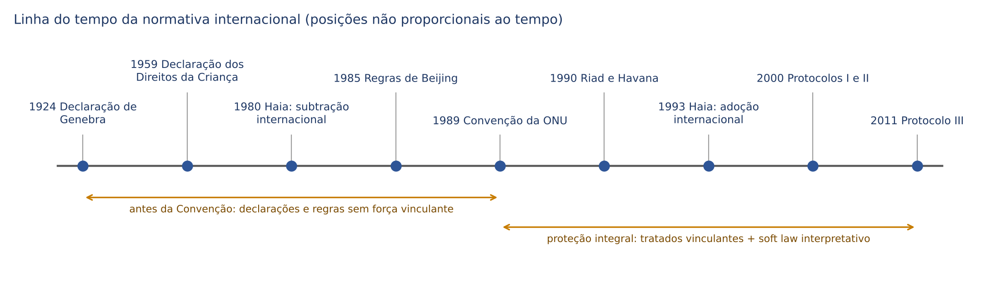
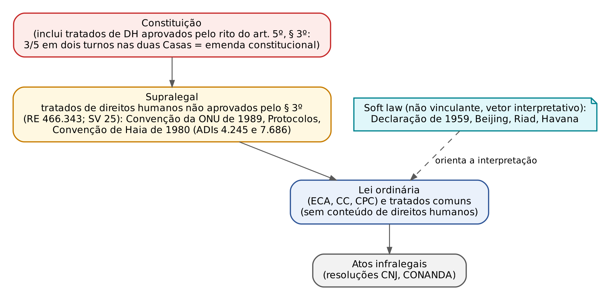
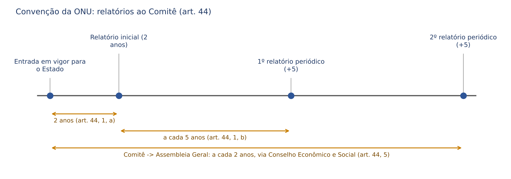
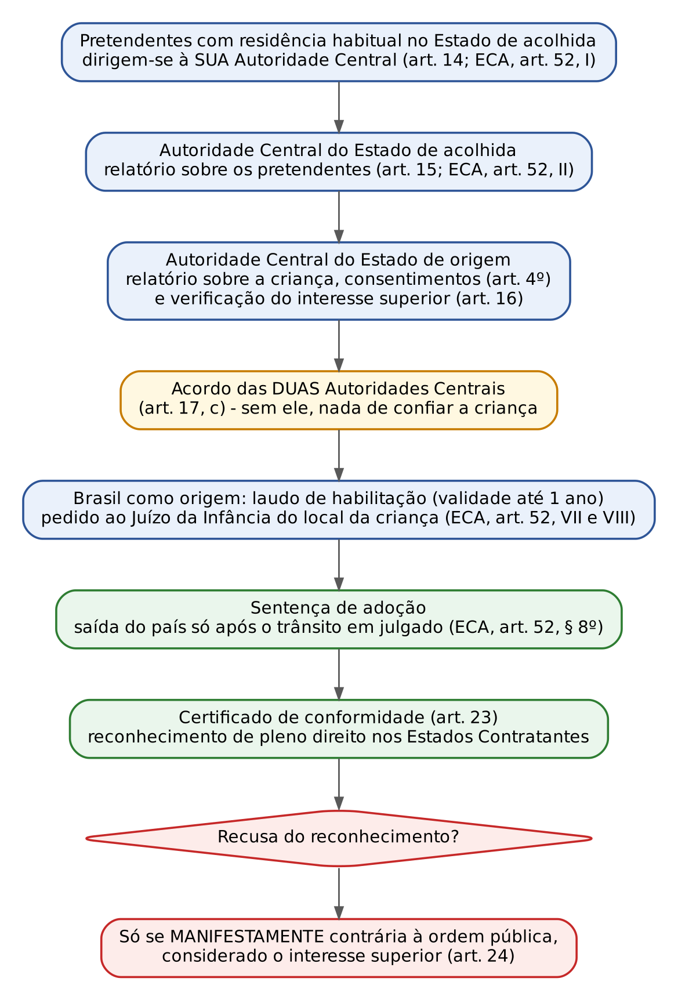
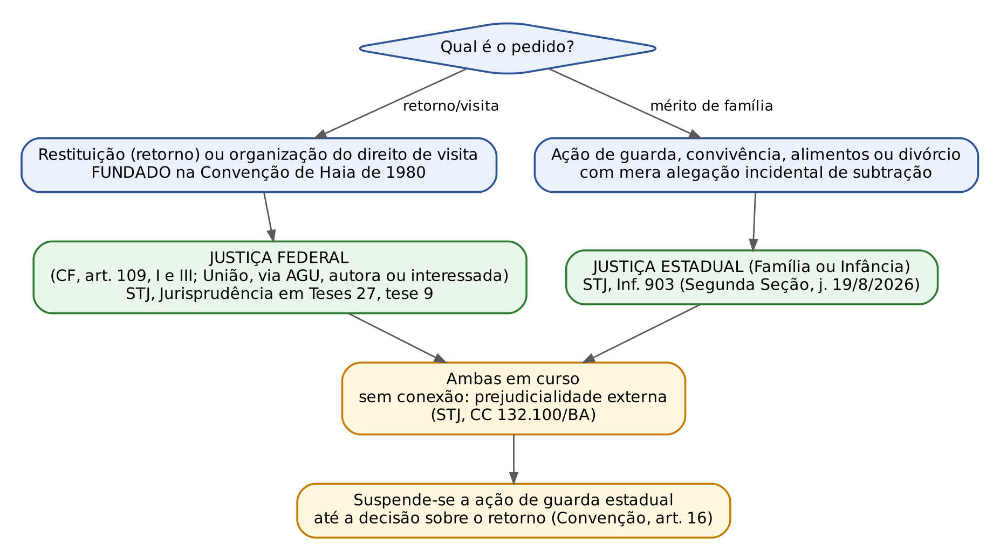

# CAPÍTULO 02 — NORMATIVA INTERNACIONAL: CONVENÇÃO DA ONU, REGRAS DE BEIJING E CONVENÇÕES DE HAIA

:::INCIDENCIA
Pontos: TJSC p. 6 (Declaração de 1959, Convenção da ONU, Haia 1993, Regras de Beijing); interface com TJRS p. 1 (ECA amplo). Nível A. Lote: 6 questões (FGV 4, FCC 2), mais 4 correlatas do banco (FGV, provas de juiz).
O que mais cai: letra da Convenção da ONU (conceito de criança, art. 37, art. 44 e os prazos de relatórios, saúde e educação), Haia 1980 (16 anos, autoridade central, visita, competência da Justiça Federal), Haia 1993 (procedimento entre Autoridades Centrais e residência habitual), Beijing na solução de caso de internação.
:::

## 02.1 Panorama e chaves de leitura

A normativa internacional da infância é cobrada de dois modos: (a) pela LETRA dos instrumentos (idades, prazos, órgãos, "somente", "salvo"); e (b) como vetor de interpretação do ECA em caso prático (internação como último recurso, oitiva da criança, subsidiariedade da adoção internacional). O magistrado precisa, portanto, saber o que é vinculante e o que é *soft law*, qual o nível hierárquico de cada tratado e qual dispositivo interno o concretiza.

| Instrumento | Natureza | Data e ato internacional | Internalização no Brasil |
|---|---|---|---|
| Declaração de Genebra | declaração (Liga das Nações) | 1924 | não se aplica |
| Declaração dos Direitos da Criança | resolução da Assembleia Geral (não vinculante) | 20/11/1959 | não se aplica |
| Convenção de Haia sobre os aspectos civis do sequestro internacional de crianças | tratado (Conferência da Haia) | 25/10/1980; vigor internacional 1/12/1983 | DL 79/1999; adesão 19/10/1999; vigor 1/1/2000; Decreto 3.413/2000, com reserva ao art. 24 |
| Regras de Beijing (Regras Mínimas para a Administração da Justiça da Infância e da Juventude) | resolução da AG (*soft law*) | Res. 40/33, de 29/11/1985 | não se aplica (inspiraram o ECA) |
| Convenção sobre os Direitos da Criança | tratado (ONU) | 20/11/1989; vigor internacional 2/9/1990 | DL 28/1990; ratificação 24/9/1990; vigor 23/10/1990; Decreto 99.710, de 21/11/1990 |
| Diretrizes de Riad (prevenção da delinquência juvenil) | resolução da AG (*soft law*) | Res. 45/112, de 14/12/1990 | não se aplica |
| Regras de Havana (jovens privados de liberdade) | resolução da AG (*soft law*) | Res. 45/113, de 14/12/1990 | não se aplica |
| Convenção de Haia relativa à proteção das crianças e à cooperação em matéria de adoção internacional | tratado (Conferência da Haia) | 29/5/1993; vigor internacional 1/5/1995 | DL 1/1999; ratificação 10/3/1999; vigor 1/7/1999; Decreto 3.087, de 21/6/1999 |
| Protocolo Facultativo relativo ao envolvimento de crianças em conflitos armados | tratado | 25/5/2000 | DL 230/2003; vigor 27/2/2004; Decreto 5.006/2004 |
| Protocolo Facultativo relativo à venda de crianças, prostituição e pornografia infantis | tratado | 25/5/2000 | DL 230/2003; vigor 27/2/2004; Decreto 5.007/2004 |
| Protocolo Facultativo relativo a um procedimento de comunicações | tratado | firmado pelo Brasil em 28/2/2012 | DL 85/2017; ratificação 29/9/2017; vigor 29/12/2017; Decreto 12.313, de 16/12/2024 |

:::PEGADINHA DATAS QUE DERRUBAM CANDIDATOS
- A Convenção da ONU entrou em vigor para o Brasil em 23/10/1990, ANTES do decreto de promulgação (21/11/1990) e depois do ECA (Lei 8.069, de 13/7/1990). O ECA foi elaborado à luz do texto já aprovado pela AG em 1989; por isso a doutrina diz que o Estatuto "antecipou" a Convenção no plano interno.
- A Convenção de Haia de 1980 é ANTERIOR à de 1993, mas o Brasil a incorporou DEPOIS (2000 x 1999).
- Riad e Havana são de 14/12/1990 (resoluções 45/112 e 45/113). Muitos materiais datam Riad de "1988", ano da reunião de especialistas realizada em Riad que preparou o texto; a adoção pela AG é de 1990.
- Beijing é de 29/11/1985 (Res. 40/33). A página de legislação internacional do TJSC indica "20 de novembro de 1984": não use essa data.
:::

:::DICA COMO A BANCA DIFERENCIA OS INSTRUMENTOS
Convenção da ONU = tratado geral de direitos (vinculante, com Comitê de monitoramento). Beijing = administração da justiça juvenil (processo e medidas). Riad = PREVENÇÃO da delinquência. Havana = jovens PRIVADOS DE LIBERDADE (condições da internação). Haia 1993 = COOPERAÇÃO em adoção internacional. Haia 1980 = RETORNO da criança subtraída e direito de visita transfronteiriço.
:::

## 02.2 Incorporação e status hierárquico dos tratados

### 02.2.1 Procedimento de incorporação

O tratado percorre: assinatura pelo Executivo; aprovação pelo Congresso Nacional por decreto legislativo (CF, art. 49, I: compete exclusivamente ao Congresso "resolver definitivamente sobre tratados, acordos ou atos internacionais que acarretem encargos ou compromissos gravosos ao patrimônio nacional"); ratificação ou adesão (depósito do instrumento perante o depositário); e promulgação por decreto presidencial publicado no Diário Oficial, que confere executoriedade interna. A vigência internacional para o Brasil decorre da cláusula do próprio tratado (por exemplo, 30 dias após o depósito na Convenção da ONU, art. 49, 2; três meses no Protocolo de comunicações, art. 19, 2); a eficácia interna, segundo a orientação tradicional do STF, depende do decreto de promulgação. Daí situações curiosas: o Protocolo de comunicações vincula o Brasil no plano externo desde 29/12/2017, mas só foi promulgado pelo Decreto 12.313/2024.

Todos os decretos de promulgação vistos neste capítulo repetem a cláusula padrão: ficam sujeitos à aprovação do Congresso "quaisquer atos que possam resultar em revisão" do tratado ou que acarretem encargos gravosos ao patrimônio nacional (por exemplo, Decreto 5.006/2004, art. 2º; Decreto 12.313/2024, art. 2º).

### 02.2.2 Os três patamares

:::LEI CF, ART. 5º, §§ 2º E 3º
§ 2º Os direitos e garantias expressos nesta Constituição não excluem outros decorrentes do regime e dos princípios por ela adotados, ou dos tratados internacionais em que a República Federativa do Brasil seja parte.
§ 3º Os tratados e convenções internacionais sobre direitos humanos que forem aprovados, em cada Casa do Congresso Nacional, em dois turnos, por três quintos dos votos dos respectivos membros, serão equivalentes às emendas constitucionais. (Incluído pela EC 45/2004)
:::

| Patamar | Quais tratados | Fundamento | Consequência |
|---|---|---|---|
| Equivalente a emenda constitucional | tratados de direitos humanos aprovados pelo rito do art. 5º, § 3º | CF, art. 5º, § 3º (EC 45/2004) | parâmetro de controle de constitucionalidade; cláusula pétrea na leitura majoritária |
| Supralegal | tratados de direitos humanos NÃO aprovados pelo rito do § 3º (inclusive todos os anteriores à EC 45/2004) | RE 466.343 (Plenário, j. 3/12/2008); Súmula Vinculante 25 | abaixo da CF, acima das leis; paralisa a eficácia da legislação infraconstitucional conflitante, anterior ou posterior |
| Legal (lei ordinária) | tratados que não versam sobre direitos humanos | orientação tradicional do STF | conflito resolvido por cronologia e especialidade |

:::JURIS STF, RE 466.343, PLENÁRIO, J. 3/12/2008 (TEMA 60) E SÚMULA VINCULANTE 25
Os tratados de direitos humanos ratificados e não aprovados pelo rito do § 3º situam-se abaixo da Constituição e acima da legislação interna, com o condão de "paralisar a eficácia jurídica" de toda disciplina infraconstitucional com eles conflitante. Daí a Súmula Vinculante 25: "É ilícita a prisão civil de depositário infiel, qualquer que seja a modalidade de depósito." Na ADI 5.240 (Plenário, j. 20/8/2015, audiência de custódia), o voto condutor reafirmou que os tratados de direitos humanos internalizados suprimem os efeitos dos atos infraconstitucionais contrários.
:::

Aplicação aos instrumentos do capítulo:

- Convenção da ONU de 1989 e seus Protocolos: tratados de direitos humanos aprovados por decreto legislativo comum, logo SUPRALEGAIS na jurisprudência do STF. Parte da doutrina (com apoio no § 2º) sustenta hierarquia materialmente constitucional; em prova objetiva, prevalece a tese da supralegalidade.
- Convenção de Haia de 1980: o STF, nas ADIs 4.245 e 7.686 (j. 27/8/2025), declarou-a compatível com a Constituição e afirmou seu status SUPRALEGAL, "por ser tratado de proteção dos direitos da criança" (ver 02.9).
- Convenção de Haia de 1993: não há pronunciamento específico do STF visto nesta tarefa. Por ser tratado de cooperação, mas com finalidade declarada de garantir o interesse superior da criança e prevenir o tráfico (art. 1º), a mesma lógica das ADIs 4.245 e 7.686 conduz à supralegalidade; registre como inferência.
- Declaração de 1959, Regras de Beijing, Diretrizes de Riad e Regras de Havana: NÃO são tratados. São resoluções da Assembleia Geral, sem força vinculante própria (*soft law*). Funcionam como diretriz interpretativa do ECA, do SINASE e da própria Convenção (que, em seu preâmbulo, lembra as "Regras de Pequim"; e as Diretrizes de Riad, item 7, mandam interpretá-las em conjunto com a Convenção e as Regras de Beijing).

:::PEGADINHA "AS REGRAS DE BEIJING TÊM STATUS SUPRALEGAL"
ERRADO. Supralegalidade é atributo de TRATADO de direitos humanos internalizado. Beijing, Riad e Havana são resoluções da AG: orientam a interpretação (e foram invocadas pelo STF e pelo STJ em temas de internação), mas não passam pelo procedimento do art. 49, I, nem pelo decreto de promulgação. O mesmo vale para a Declaração de 1959.
:::

:::ATENCAO ÚNICO TRATADO SOBRE O TEMA DA INFÂNCIA COM STATUS DE EMENDA?
Nenhum dos instrumentos deste capítulo foi aprovado pelo rito do § 3º. Tratados aprovados por esse rito (por exemplo, a Convenção sobre os Direitos das Pessoas com Deficiência, Decreto 6.949/2009) também protegem crianças com deficiência (art. 7º daquela Convenção), mas não são objeto deste ponto do edital.
:::

### 02.2.3 Controle de convencionalidade e cláusula da norma mais favorável

O juiz estadual realiza controle difuso de convencionalidade: afasta, no caso concreto, norma infraconstitucional incompatível com tratado de direitos humanos supralegal. A própria Convenção da ONU contém a regra de prevalência da norma mais favorável:

:::LEI CONVENÇÃO SOBRE OS DIREITOS DA CRIANÇA (DECRETO 99.710/1990), ART. 41
Nada do estipulado na presente Convenção afetará disposições que sejam mais convenientes para a realização dos direitos da criança e que podem constar: a) das leis de um Estado Parte; b) das normas de direito internacional vigentes para esse Estado.
:::

Consequência prática: onde o ECA é mais protetivo (por exemplo, o rol taxativo do art. 122 para a internação, mais estrito que a Convenção, art. 37, b), aplica-se o ECA; onde a Convenção é mais protetiva, ela prevalece sobre a lei. O Protocolo de conflitos armados (art. 5º) repete a cláusula.

Correlatas sobre as Convenções 138 e 182 da OIT e o trabalho do adolescente: FGV 2024, ENAM (Q2459873), gabarito A, e FGV 2024, Câmara dos Deputados (Q2511459), gabarito D — comentário no Cap. 8.

## 02.3 Declaração dos Direitos da Criança (1959)

Proclamada pela Assembleia Geral em 20/11/1959 (data lembrada no preâmbulo da Convenção de 1989), a Declaração é o marco de transição: reconhece a criança como sujeito de direitos próprios, mas, por ser resolução, NÃO vincula juridicamente. Os editais a chamam de "Declaração Universal dos Direitos da Criança"; o título oficial é "Declaração dos Direitos da Criança" (não confundir com a Declaração Universal dos Direitos Humanos, de 1948, que já reconhecia à infância "direito a cuidados e assistência especiais", como recorda o preâmbulo da Convenção). Sua frase mais citada, reproduzida no preâmbulo da Convenção, é a de que a criança, por falta de maturidade física e mental, necessita de proteção e cuidados especiais, inclusive proteção legal, "tanto antes quanto após seu nascimento".

| Princípio | Conteúdo cobrável | Correspondência no ECA ou na CF |
|---|---|---|
| 1º | igualdade, sem discriminação por raça, cor, sexo, língua, religião, opinião, origem, riqueza, nascimento ou outra condição, da criança ou de sua família | ECA, art. 3º, parágrafo único |
| 2º | proteção especial e oportunidades para o desenvolvimento físico, mental, moral, espiritual e social, em liberdade e dignidade; na instituição das LEIS, os melhores interesses da criança serão a consideração fundamental | ECA, arts. 3º e 100, parágrafo único, IV |
| 3º | direito a nome e nacionalidade desde o nascimento | ECA, art. 102; Convenção, art. 7º |
| 4º | previdência social, cuidados pré e pós-natais à criança e à mãe, alimentação, moradia, lazer e serviços médicos | ECA, arts. 7º a 14 |
| 5º | criança com deficiência física, mental ou social: tratamento, educação e cuidados especiais | ECA, art. 11, § 1º; art. 54, III |
| 6º | amor e compreensão; criação, sempre que possível, aos cuidados dos pais; salvo circunstâncias excepcionais, a criança de tenra idade não será apartada da mãe; sociedade e autoridades cuidam das crianças sem família | ECA, arts. 19 e 23 |
| 7º | educação gratuita e compulsória pelo menos no grau primário; o interesse superior guia os responsáveis pela educação, "em primeiro lugar" os pais; direito a brincar e divertir-se | CF, art. 208, I; ECA, art. 53 |
| 8º | a criança figurará, em quaisquer circunstâncias, entre os primeiros a receber proteção e socorro | ECA, art. 4º, § 1º, a (primazia de proteção e socorro) |
| 9º | proteção contra negligência, crueldade e exploração; não será objeto de tráfico; não trabalhará antes de idade mínima adequada nem em ocupação que prejudique saúde, educação ou desenvolvimento | ECA, arts. 5º e 60 a 69 |
| 10 | proteção contra discriminação racial, religiosa ou de outra natureza; educação em espírito de compreensão, tolerância, amizade entre os povos, paz e fraternidade | ECA, art. 58 |

:::DICA GANCHOS DE MEMORIZAÇÃO
Dez princípios, sem órgão de controle e sem obrigação de relatório. O princípio 8 ("primeiros a receber proteção e socorro") é a matriz da alínea a do § 1º (antigo parágrafo único) do art. 4º do ECA. O princípio 2 fala do interesse superior como consideração "fundamental" na elaboração das leis; a Convenção (art. 3º, 1) generaliza para "todas as ações relativas às crianças" como consideração primordial.
:::

## 02.4 Convenção sobre os Direitos da Criança (1989)

### 02.4.1 Natureza, incorporação e estrutura

Tratado de direitos humanos com o maior número de ratificações do sistema ONU, consagra a doutrina da proteção integral no plano internacional. Estrutura: preâmbulo; Parte I (arts. 1º a 41, direitos); Parte II (arts. 42 a 45, implementação e Comitê); Parte III (arts. 46 a 54, disposições finais). Dados de incorporação na tabela de 02.1. Vigência internacional: 30º dia após o depósito do 20º instrumento (art. 49, 1); para os Estados posteriores, 30º dia após o depósito do próprio instrumento (art. 49, 2).

### 02.4.2 Conceito de criança

:::LEI CONVENÇÃO (DECRETO 99.710/1990), ART. 1º
Para efeitos da presente Convenção considera-se como criança todo ser humano com menos de dezoito anos de idade, a não ser que, em conformidade com a lei aplicável à criança, a maioridade seja alcançada antes.
:::

| Critério | Convenção da ONU | ECA |
|---|---|---|
| Faixa protegida | todo ser humano com menos de 18 anos | criança até 12 anos incompletos; adolescente de 12 a 18 anos (art. 2º) |
| Divisão interna | não há (tudo é "criança") | criança x adolescente, com consequências distintas (ex.: ato infracional de criança só gera medida de proteção, art. 105) |
| Ressalva | maioridade alcançada antes, segundo a lei aplicável | aplicação excepcional entre 18 e 21 anos nos casos expressos (art. 2º, parágrafo único; ver Cap. 1) |
| Nascituro | o preâmbulo menciona proteção "antes" do nascimento, mas o art. 1º não fixa o termo inicial (opção deliberada de compromisso) | proteção à gestante e ao nascituro (arts. 7º e 8º) |

:::PEGADINHA EMANCIPAÇÃO E O ART. 1º
A ressalva da maioridade antecipada não faz a Convenção cessar para o adolescente emancipado de 16 anos no Brasil? Para o direito brasileiro, emancipação antecipa a capacidade civil, não a maioridade; e o ECA (lei mais favorável, art. 41 da Convenção) continua a proteger o adolescente emancipado nas matérias que não dependem de capacidade civil. Em prova objetiva, basta a letra: "menos de dezoito anos, a não ser que [...] a maioridade seja alcançada antes".
:::

### 02.4.3 Princípios estruturantes

O Comitê dos Direitos da Criança trata como princípios gerais, que orientam a leitura de todo o tratado, os arts. 2º (não discriminação), 3º (interesse superior), 6º (vida, sobrevivência e desenvolvimento) e 12 (direito de ser ouvido).

:::LEI CONVENÇÃO, ART. 3º, 1, E ART. 12
Art. 3º, 1. Todas as ações relativas às crianças, levadas a efeito por instituições públicas ou privadas de bem estar social, tribunais, autoridades administrativas ou órgãos legislativos, devem considerar, primordialmente, o interesse maior da criança.
Art. 12, 1. Os Estados Partes assegurarão à criança que estiver capacitada a formular seus próprios juízos o direito de expressar suas opiniões livremente sobre todos os assuntos relacionados com a criança, levando-se devidamente em consideração essas opiniões, em função da idade e maturidade da criança.
2. Com tal propósito, se proporcionará à criança, em particular, a oportunidade de ser ouvida em todo processo judicial ou administrativo que afete a mesma, quer diretamente quer por intermédio de um representante ou órgão apropriado, em conformidade com as regras processuais da legislação nacional.
:::

Pontos cobráveis dos princípios:

- Não discriminação (art. 2º): abrange a condição da criança, "de seus pais ou de seus representantes legais"; e o § 2º veda discriminação ou CASTIGO por causa da condição, atividades, opiniões ou crenças dos pais. O ECA incorporou a fórmula no art. 3º, parágrafo único (incluído pela Lei 13.257/2016).
- Interesse superior (art. 3º): a tradução oficial brasileira usa "interesse maior"; o ECA, após a Lei 12.010/2009, usa "interesse superior" (art. 100, parágrafo único, IV). Consideração PRIMORDIAL, não exclusiva. O § 3º obriga o Estado a fiscalizar padrões de instituições e serviços de cuidado (segurança, saúde, número e competência do pessoal, supervisão): matriz da fiscalização das entidades (ECA, arts. 90 a 97; Cap. 11).
- Implementação (art. 4º): para os direitos econômicos, sociais e culturais, medidas "utilizando ao máximo os recursos disponíveis" e, se necessário, com cooperação internacional. É a base convencional da vedação de retrocesso e do argumento contra a "reserva do possível" genérica em ações sobre creche e acolhimento (Cap. 20).
- Evolução das capacidades (art. 5º): os direitos e deveres dos pais, da "família ampliada ou da comunidade, conforme determinem os costumes locais", de orientar a criança "acordes com a evolução de sua capacidade". Fundamento da autonomia progressiva.
- Direito de ser ouvido (art. 12): matriz da oitiva obrigatória na colocação em família substituta (ECA, art. 28, §§ 1º e 2º: criança ouvida sempre que possível; adolescente com consentimento colhido em audiência), do princípio da oitiva obrigatória e participação (art. 100, parágrafo único, XII) e da Lei 13.431/2017, que se declara fundada na Convenção e seus protocolos (art. 1º; ver Cap. 22). Note: ouvir não é obedecer; a opinião é "devidamente considerada em função da idade e maturidade".

### 02.4.4 Direitos de relevo para o juiz da infância (Parte I)

| Artigo | Conteúdo (letra que cai) | Reflexo interno |
|---|---|---|
| 6º | direito inerente à vida; Estados assegurarão "ao máximo" a sobrevivência e o desenvolvimento | ECA, art. 7º |
| 7º e 8º | registro IMEDIATAMENTE após o nascimento; nome, nacionalidade e, "na medida do possível", conhecer os pais e ser cuidada por eles; preservação da identidade e restabelecimento rápido se dela privada ilegalmente | ECA, arts. 10, 48 (conhecimento da origem biológica), 102 |
| 9º | não separação dos pais contra a vontade deles, SALVO decisão das autoridades competentes, "sujeita à revisão judicial", necessária ao interesse maior (exemplos: maus-tratos, descuido, pais separados com decisão sobre residência); participação de todas as partes; direito de manter contato com ambos os pais, salvo se contrário ao interesse maior; informação sobre o paradeiro de familiar detido, preso, exilado, deportado ou morto | ECA, arts. 19, 23, 24 e 101, § 2º (afastamento do convívio familiar é de competência exclusiva da autoridade judiciária) |
| 10 | reunião familiar: pedidos de entrada ou saída atendidos de forma "positiva, humanitária e rápida"; criança com pais em Estados diferentes mantém contato periódico com ambos | Haia 1980, art. 21 (visita transfronteiriça) |
| 11 | combate à transferência ilegal e à retenção ilícita de crianças no exterior, por acordos bilaterais ou multilaterais | fundamento convencional da Haia 1980 |
| 18 | "ambos os pais têm obrigações comuns" na educação e desenvolvimento; responsabilidade primordial dos pais; direito a creches para filhos de pais que trabalham | CC (poder familiar conjunto); ECA, arts. 21, 22 e 54, IV |
| 19 | proteção contra todas as formas de violência física ou mental, abuso, negligência, maus-tratos ou exploração, inclusive abuso sexual, enquanto sob custódia dos pais ou responsáveis; procedimentos de identificação, notificação, investigação e, conforme o caso, intervenção judiciária | ECA, arts. 13, 18-A e 18-B (Lei Menino Bernardo); Lei 13.431/2017; Lei 14.344/2022 |
| 20 | crianças privadas do meio familiar: proteção especial; cuidados alternativos que podem incluir lares de adoção, a *kafalah* do direito islâmico, a adoção ou, "caso necessário", instituições adequadas; atenção à origem étnica, religiosa, cultural e linguística e à continuidade da educação | ECA, arts. 28, § 6º (indígenas e quilombolas), 34, § 1º (preferência do acolhimento familiar) |
| 21 | adoção: interesse maior como consideração "primordial"; autorização apenas por autoridades competentes; adoção em outro país como "outro meio" quando a criança não puder ser colocada no país de origem (SUBSIDIARIEDADE); salvaguardas equivalentes; vedação de benefícios financeiros indevidos | ECA, arts. 39, § 1º, 51, § 1º, II; Haia 1993 |
| 22 | criança refugiada, sozinha ou acompanhada: proteção e assistência humanitária; busca da família | Lei 9.474/1997 (refúgio) |
| 23 | criança "portadora de deficiências" (expressão da tradução oficial): vida plena e decente; assistência gratuita "sempre que possível" | ECA, art. 11, § 1º |
| 24 | melhor padrão possível de saúde; medidas para REDUZIR a mortalidade infantil; cuidados básicos; assistência pré e pós-natal às mães; vantagens da amamentação; "desenvolver a assistência médica preventiva, a orientação aos pais e a educação e serviços de planejamento familiar"; abolir práticas tradicionais prejudiciais | ECA, arts. 7º a 14 (Cap. 3) |
| 25 | criança internada para atendimento, proteção ou tratamento de saúde física ou mental: exame PERIÓDICO do tratamento e da internação | ECA, art. 101, § 2º; Lei 10.216/2001 (Cap. 26) |
| 27 | nível de vida adequado; responsabilidade primordial dos pais; pagamento da pensão alimentícia mesmo se o devedor reside no exterior, com adesão a acordos internacionais | Convenção da Haia de 2007 sobre alimentos (Decreto 9.176/2017; ver Apostila de Direito Civil, Cap. 39) |
| 28 | ensino primário obrigatório e gratuito para todos; secundário acessível; superior acessível "com base na capacidade"; combate à evasão; disciplina escolar compatível com a dignidade | CF, art. 208; ECA, arts. 53 a 56 (Cap. 8) |
| 29 | finalidades da educação: personalidade em todo o potencial; respeito aos direitos humanos; respeito aos pais, à identidade cultural, ao idioma, aos valores nacionais e às civilizações diferentes; vida responsável com compreensão, paz, tolerância, igualdade de sexos e amizade entre povos e pessoas de origem indígena; respeito ao meio ambiente | ECA, art. 53 |
| 30 | criança de minoria étnica, religiosa ou linguística, ou indígena: direito à própria cultura, religião e idioma | ECA, art. 28, § 6º |
| 31 | descanso, lazer, atividades recreativas próprias da idade, vida cultural e artística | ECA, arts. 58 e 59 |
| 32 | proteção contra exploração econômica e trabalho perigoso; Estados fixarão "uma idade ou idades mínimas" para emprego | CF, art. 7º, XXXIII; ECA, arts. 60 a 69 |
| 33 a 36 | drogas; exploração e abuso sexual (incentivo a atividade sexual ilegal, prostituição, espetáculos ou materiais pornográficos); sequestro, venda ou tráfico "para qualquer fim ou sob qualquer forma"; demais formas de exploração | ECA, arts. 240 a 244-B (Cap. 21); Protocolo II |
| 37 | tortura, pena de morte, prisão perpétua; privação de liberdade como último recurso e pelo mais breve período; separação dos adultos (com ressalva); acesso a assistência jurídica e impugnação da privação de liberdade | ECA, arts. 106 a 109, 121, 123 e 185 |
| 38 | conflitos armados: pessoas com menos de 15 anos não participam diretamente de hostilidades nem são recrutados; entre 15 e 18, prioridade aos mais velhos | elevado para 18 pelo Protocolo I (02.5) |
| 39 | recuperação física e psicológica e reintegração social de vítimas de abandono, exploração, abuso, tortura ou conflitos armados | ECA, art. 87, III; Lei 13.431/2017 |
| 40 | justiça juvenil: garantias processuais; idade mínima de imputabilidade; medidas sem recurso a procedimentos judiciais; alternativas à internação | ECA, arts. 104, 110, 111, 126 a 128 (Caps. 14 a 16) |

:::LEI CONVENÇÃO, ART. 37
Os Estados Partes zelarão para que: a) nenhuma criança seja submetida a tortura nem a outros tratamentos ou penas cruéis, desumanos ou degradantes. Não será imposta a pena de morte nem a prisão perpétua sem possibilidade de livramento por delitos cometidos por menores de dezoito anos de idade; b) nenhuma criança seja privada de sua liberdade de forma ilegal ou arbitrária. A detenção, a reclusão ou a prisão de uma criança será efetuada em conformidade com a lei e apenas como último recurso, e durante o mais breve período de tempo que for apropriado; c) [...] Em especial, toda criança privada de sua liberdade ficará separada dos adultos, a não ser que tal fato seja considerado contrário aos melhores interesses da criança, e terá direito a manter contato com sua família por meio de correspondência ou de visitas, salvo em circunstâncias excepcionais; d) toda criança privada de sua liberdade tenha direito a rápido acesso a assistência jurídica e a qualquer outra assistência adequada, bem como direito a impugnar a legalidade da privação de sua liberdade perante um tribunal ou outra autoridade competente, independente e imparcial e a uma rápida decisão a respeito de tal ação.
:::

:::PEGADINHA DUAS ARMADILHAS LITERAIS DO ART. 37
- A Convenção veda a prisão perpétua "sem possibilidade de livramento"; não veda toda e qualquer pena longa. No Brasil, a vedação é ainda mais ampla (CF, art. 5º, XLVII, b, para qualquer pessoa; e o adolescente sequer recebe pena, mas medida socioeducativa com máximo de 3 anos de internação, ECA, art. 121, § 3º).
- A separação dos adultos NÃO é absoluta na Convenção: cede quando contrária aos melhores interesses da criança. As Regras de Havana (regra 29) também admitem convivência com adultos da mesma família ou em programa especial benéfico. No ECA, a regra é mais rígida: internação em entidade exclusiva para adolescentes, em local distinto do abrigo, com separação por idade, compleição física e gravidade da infração (art. 123), e vedação de cumprimento em estabelecimento prisional (art. 185).
:::

:::QUESTAO FGV 2026 — TJ-SC — ASSISTENTE SOCIAL (Q4150481)
Cobrado: três afirmações sobre o art. 37 da Convenção. Gabarito oficial: B (I e II corretas). I: no Brasil é vedada a prisão perpétua por delitos cometidos antes dos 18 anos (correta, ainda mais pela CF). II: detenção como último recurso e pelo mais breve período apropriado (letra do art. 37, b). III: separação dos adultos "em qualquer hipótese" (ERRADA: o art. 37, c, ressalva o interesse da criança). Armadilha: a expressão absoluta "em qualquer hipótese".
:::

:::QUESTAO FCC 2026 — MPE-SE — ANALISTA (Q3884260)
Cobrado: o que os Estados se comprometem a fazer no art. 24 (saúde). Gabarito oficial: D (desenvolver a assistência médica preventiva, a orientação aos pais e a educação e serviços de planejamento familiar, art. 24, 2, f). Armadilhas: "impedir" a mortalidade infantil (a letra é REDUZIR, art. 24, 2, a); parto natural prioritário, limitação de adoção interétnica e limite etário para dirigir não constam do tratado.
:::

:::QUESTAO FGV 2025 — PREFEITURA DE CANAÃ DOS CARAJÁS — PROFESSOR (Q3276781)
Cobrado: leitura do art. 29 (finalidades da educação). Gabarito oficial: D (educação em direitos humanos, senso de identidade, interação com os outros e com o meio ambiente). Armadilhas: reduzir o artigo à dimensão quantitativa do acesso (isso é o art. 28), à "neutralidade" que exclui questões éticas ou à obediência hierárquica aos pais (o respeito aos pais convive com o respeito aos direitos humanos e às civilizações diferentes).
:::

:::EXEMPLO USO DO ART. 9º E DO ART. 12 EM DECISÃO DE ACOLHIMENTO
Conselho Tutelar retira criança de 9 anos da casa da mãe e a leva a acolhimento institucional sem comunicar o juízo. Passos: (1) o afastamento do convívio familiar é de competência EXCLUSIVA da autoridade judiciária (ECA, art. 101, § 2º), o que concretiza a cláusula "sujeita à revisão judicial" do art. 9º, 1, da Convenção; o acolhimento excepcional e de urgência sem prévia determinação judicial obriga a entidade a comunicar o fato ao juiz em até 24 horas (ECA, art. 93), seguindo-se a decisão judicial; (2) a decisão judicial deve assegurar participação dos interessados (art. 9º, 2) e oitiva da criança na medida de sua maturidade (art. 12); (3) mantém-se, salvo prova de prejuízo, o contato da criança com a mãe (art. 9º, 3; ECA, art. 92, § 4º). Detalhamento do acolhimento: Cap. 4 e Cap. 13.
:::

### 02.4.5 Parte II: Comitê dos Direitos da Criança e relatórios

:::LEI CONVENÇÃO, ART. 44, 1 E 5
1. Os Estados Partes se comprometem a apresentar ao comitê, por intermédio do Secretário-Geral das Nações Unidas, relatórios sobre as medidas que tenham adotado com vistas a tornar efetivos os direitos reconhecidos na convenção e sobre os progressos alcançados no desempenho desses direitos: a) num prazo de dois anos a partir da data em que entrou em vigor para cada Estado Parte a presente convenção; b) a partir de então, a cada cinco anos.
5. A cada dois anos, o comitê submeterá relatórios sobre suas atividades à Assembléia Geral das Nações Unidas, por intermédio do Conselho Econômico e Social.
:::

| Tema | Regra (Decreto 99.710/1990) |
|---|---|
| Composição | "dez especialistas" de reconhecida integridade moral e competência, eleitos pelos Estados dentre seus nacionais, atuando a título PESSOAL; distribuição geográfica equitativa e principais sistemas jurídicos (art. 43, 2) |
| Indicação | cada Estado pode indicar UMA pessoa dentre seus cidadãos (art. 43, 3) |
| Eleição | votação secreta; quórum de 2/3 dos Estados Partes; eleitos os que obtiverem o maior número de votos e maioria absoluta dos presentes e votantes (art. 43, 5); eleições a cada 2 anos (art. 43, 4) |
| Mandato | 4 anos, com reeleição; metade da primeira composição com mandato de 2 anos, por sorteio (art. 43, 6) |
| Vaga | o Estado que indicou o membro designa substituto, sujeito à aprovação do Comitê (art. 43, 7) |
| Mesa | eleita por 2 anos (art. 43, 9) |
| Relatórios dos Estados | inicial em 2 anos; depois a cada 5 anos; via Secretário-Geral; tornados amplamente públicos no país (art. 44, 1 e 6) |
| Relatório do Comitê | a cada 2 anos, à Assembleia Geral, via Conselho Econômico e Social (art. 44, 5) |
| Órgãos parceiros | agências especializadas e UNICEF podem ser representados, assessorar e apresentar relatórios (art. 45, a) |
| Produto do Comitê | sugestões e recomendações gerais com base nos relatórios (art. 45, d) |
| Reservas | permitidas, salvo as incompatíveis com o objeto e a finalidade; retiráveis a qualquer tempo (art. 51) |
| Emendas | conferência convocada se 1/3 dos Estados apoiar em 4 meses; vigência quando aprovadas pela AG e aceitas por 2/3 dos Estados; vinculam só quem as aceitou (art. 50) |
| Denúncia | por notificação escrita ao Secretário-Geral; efeito 1 ano após o recebimento (art. 52) |
| Depositário | Secretário-Geral da ONU (art. 53) |

:::ATENCAO DEZ OU DEZOITO MEMBROS?
O texto promulgado (Decreto 99.710/1990) fala em DEZ especialistas, e é ele que as bancas brasileiras costumam reproduzir. Uma emenda ao art. 43, 2, adotada pela Conferência dos Estados Partes em 12/12/1995 e aprovada pela Assembleia Geral (Res. 50/155, de 21/12/1995), ampliou o Comitê para dezoito membros; está em vigor desde 18/11/2002 e foi aceita pelo Brasil em 26/2/1998, mas não aparece no texto do Planalto. Em questão que transcreva o decreto, responda "dez"; se a questão mencionar expressamente a composição atual do Comitê, considere a ampliação.
:::

:::QUESTAO FCC 2024 — TRT 7ª REGIÃO — ANALISTA JUDICIÁRIO (Q3089773)
Cobrado: prazos do art. 44. Gabarito oficial: C (relatório inicial em 2 anos; depois, a cada 5 anos; Comitê relata à AG a cada 2 anos, por intermédio do Conselho Econômico e Social). Armadilhas: inverter 2 e 5; trocar o Conselho Econômico e Social pelo Secretário-Geral (o Secretário-Geral é o canal dos relatórios DOS ESTADOS ao Comitê; o ECOSOC é o canal do Comitê à AG).
:::

## 02.5 Protocolos facultativos à Convenção

São tratados autônomos, abertos apenas aos Estados partes ou signatários da Convenção, que podem ratificá-los ou não ("facultativos"). O Brasil é parte dos três.

| Protocolo | Ato internacional | No Brasil | Núcleo cobrável |
|---|---|---|---|
| I. Envolvimento de crianças em conflitos armados | Nova York, 25/5/2000; vigor internacional 12/2/2002 | DL 230/2003; ratificação 27/1/2004; vigor 27/2/2004; Decreto 5.006, de 8/3/2004 | eleva de 15 para 18 anos a idade para participação DIRETA em hostilidades (art. 1º) e para recrutamento COMPULSÓRIO (art. 2º); recrutamento voluntário: idade mínima acima de 15, fixada em declaração vinculante, com salvaguardas (art. 3º); grupos armados não estatais não devem, em qualquer circunstância, recrutar ou utilizar pessoas com menos de 18 anos (art. 4º) |
| II. Venda de crianças, prostituição infantil e pornografia infantil | Nova York, 25/5/2000; vigor internacional 18/1/2002 | DL 230/2003; ratificação 27/1/2004; vigor 27/2/2004; Decreto 5.007, de 8/3/2004 | definições (art. 2º); dever de criminalização mínima, inclusive tentativa e participação, dentro ou fora das fronteiras (art. 3º); jurisdição territorial obrigatória e extraterritorial facultativa (art. 4º); responsabilidade de pessoas jurídicas criminal, civil ou administrativa (art. 3º, 4); proteção da vítima no processo penal (art. 8º) |
| III. Procedimento de comunicações | adotado em 2011; firmado pelo Brasil em Genebra, 28/2/2012 | DL 85/2017; ratificação 29/9/2017; vigor externo 29/12/2017; Decreto 12.313, de 16/12/2024 | petições individuais ao Comitê, após esgotamento dos recursos internos; procedimento de investigação por violações graves ou sistemáticas |

:::LEI PROTOCOLO II (DECRETO 5.007/2004), ART. 2º
Para os propósitos do presente Protocolo: a) Venda de crianças significa qualquer ato ou transação pela qual uma criança é transferida por qualquer pessoa ou grupo de pessoas a outra pessoa ou grupo de pessoas, em troca de remuneração ou qualquer outra forma de compensação; b) Prostituição infantil significa o uso de uma criança em atividades sexuais em troca de remuneração ou qualquer outra forma de compensação; c) Pornografia infantil significa qualquer representação, por qualquer meio, de uma criança envolvida em atividades sexuais explícitas reais ou simuladas, ou qualquer representação dos órgãos sexuais de uma criança para fins primordialmente sexuais.
:::

Pontos de conexão com o direito interno:

- Protocolo II, art. 3º, 1, a, ii: no contexto da venda, criminalizar "a indução indevida ao consentimento, na qualidade de intermediário, para adoção" em violação dos instrumentos internacionais: diálogo com o ECA, arts. 238 e 239 (promessa ou entrega de filho mediante paga; envio ilegal de criança ao exterior) e com a Haia 1993, art. 32 (vedação de vantagens indevidas). Dogmática penal: Cap. 21 e Apostila de Direito Penal, Cap. 42.
- Protocolo II, art. 2º, c: o conceito amplo ("qualquer representação", inclusive simulada) é o parâmetro convencional do ECA, art. 241-E, que, na redação da Lei 15.487/2026 (vigente desde 7/8/2026), define "material ou conteúdo de violência sexual contra criança ou adolescente" como "qualquer representação, por qualquer meio", envolvendo criança ou adolescente "real ou fictício", inclusive gerada por inteligência artificial, que retrate atividade sexual explícita "real ou simulada" (antes, "cena de sexo explícito ou pornográfica"), e da criminalização da simulação por montagem (art. 241-C). Regime completo no Cap. 21.
- Protocolo II, art. 8º, 2: dúvida sobre a idade real da vítima não impede o início da investigação, inclusive para determiná-la. Art. 8º, 1: adaptação de procedimentos às necessidades da criança como testemunha, informação, privacidade, segurança e celeridade: matriz convencional do depoimento especial (Lei 13.431/2017, que se declara fundada na Convenção e "seus protocolos adicionais"; Cap. 22).
- Protocolo I, art. 4º: grupos armados distintos das forças armadas não devem "em qualquer circunstância" recrutar ou utilizar pessoas com menos de 18 anos; aos Estados cabe criminalizar. Denúncia: efeitos em 1 ano, mas não antes do término de conflito armado em que o Estado esteja envolvido (art. 11, 1).

### 02.5.1 Protocolo III: procedimento de comunicações

| Tema | Regra |
|---|---|
| Legitimidade (art. 5º) | indivíduos ou grupos sob a jurisdição de Estado parte que aleguem violação de direito previsto na Convenção ou nos Protocolos I e II de que o Estado seja parte; em nome de terceiros, com consentimento, salvo justificativa |
| Inadmissibilidade (art. 7º) | comunicação anônima ou não escrita; abuso do direito ou incompatibilidade; mesma questão já examinada ou em exame em outra instância internacional; recursos internos NÃO esgotados (salvo demora injustificada ou ineficácia); manifestamente infundada; fatos anteriores à vigência para o Estado (salvo efeitos continuados); apresentada mais de 1 ANO após o esgotamento dos recursos internos (salvo impossibilidade demonstrada) |
| Medidas provisórias (art. 6º) | em circunstâncias excepcionais, para evitar dano irreparável; não importam juízo de admissibilidade ou mérito |
| Resposta do Estado (art. 8º) | 6 meses, por escrito |
| Solução amigável (art. 9º) | bons ofícios do Comitê; o acordo encerra o exame |
| Exame (art. 10) | sessões fechadas; nos direitos econômicos, sociais e culturais, o Comitê avalia a RAZOABILIDADE das medidas estatais |
| Seguimento (art. 11) | o Estado responde aos pareceres em 6 meses |
| Comunicações interestatais (art. 12) | só entre Estados que tenham feito declaração de reconhecimento |
| Investigação (arts. 13 e 14) | informação fidedigna de violações GRAVES ou SISTEMÁTICAS; visita ao território só com consentimento; resposta do Estado em 6 meses; o Estado pode declarar que não reconhece esse procedimento (art. 13, 7) |
| Proteção (art. 4º) | vedação de represálias; identidade não revelada sem consentimento expresso |
| Vigência (art. 19) | 3 meses após o 10º instrumento; para os demais, 3 meses após o próprio depósito |

:::DICA COMITÊ NÃO É TRIBUNAL
O Comitê emite PARECERES (*views*) e recomendações, sem força executiva interna. A natureza do mecanismo é quase judicial; o esgotamento dos recursos internos (art. 7º, e) mostra o caráter subsidiário em relação à jurisdição nacional. Não confundir com a Corte Interamericana (sistema regional), cujas sentenças vinculam o Brasil.
:::

## 02.6 Regras de Beijing (1985)

### 02.6.1 Natureza e objetivos

Regras Mínimas das Nações Unidas para a Administração da Justiça da Infância e da Juventude, adotadas pela Assembleia Geral (Res. 40/33, de 29/11/1985). *Soft law*: não vinculam por si, mas foram a principal fonte de inspiração da parte infracional do ECA e são referidas no preâmbulo da Convenção de 1989 ("Regras de Pequim") e no art. 40, 2, da Convenção ("de acordo com as disposições pertinentes dos instrumentos internacionais"). Definições (regra 2.2): "jovem" é a criança ou adolescente que, segundo o sistema jurídico, pode responder por infração de forma diferente do adulto; "infração" é a conduta punida por lei; "jovem infrator" é o acusado ou considerado culpado. Âmbito ampliado (regra 3): aplicam-se também a condutas que não seriam puníveis se praticadas por adulto e, tanto quanto possível, aos procedimentos de bem-estar e proteção.

| Regra | Conteúdo | Correspondência no ECA ou no SINASE |
|---|---|---|
| 4.1 | idade de responsabilidade não fixada em nível "muito baixo", considerando maturidade emocional, mental e intelectual | CF, art. 228; ECA, art. 104 (Cap. 1 e Cap. 14) |
| 5.1 | dupla finalidade: BEM-ESTAR do jovem e PROPORCIONALIDADE da resposta às circunstâncias do infrator e da infração | ECA, art. 112, § 1º (capacidade de cumprir, circunstâncias e gravidade); SINASE, art. 35, IV |
| 6 | margem suficiente de discricionariedade em todas as fases, com responsabilidade | individualização da medida |
| 7.1 | garantias básicas: presunção de inocência, informação da acusação, direito de não responder, assistência, presença dos pais, confrontação de testemunhas, recurso | ECA, arts. 110 e 111 |
| 8 | proteção da intimidade em todas as fases; em princípio, não se publica informação que identifique o jovem | ECA, arts. 143 e 247 |
| 10.2 | autoridade examina SEM DEMORA a possibilidade de pôr o jovem em liberdade | ECA, art. 107, parágrafo único (liberação imediata examinada "desde logo e sob pena de responsabilidade") |
| 11 | remissão (*diversion*): atendimento sem recurso a julgamento formal; polícia, MP e outros órgãos podem encerrar casos; encaminhamento a serviços comunitários com consentimento do jovem e dos pais, sujeito a revisão; programas de orientação, restituição e compensação às vítimas | ECA, arts. 126 a 128 e 188 (Cap. 15 e 16) |
| 13 | prisão preventiva só como último recurso e pelo menor prazo; substituição por alternativas; separação dos adultos | ECA, arts. 108 (45 dias), 174, 183 e 185 |
| 14 e 15 | procedimento imparcial e equitativo, compreensível, com participação do jovem; assistência por advogado ou assistência judiciária gratuita | ECA, arts. 111, III, 184 e 207 |
| 16 | investigação social completa antes da decisão, salvo infrações leves | relatório da equipe interprofissional (ECA, arts. 151 e 186) |
| 17.1 | princípios da decisão: (a) resposta proporcional à infração e às necessidades do jovem e da sociedade; (b) restrições à liberdade só após estudo cuidadoso e reduzidas ao mínimo; (c) privação de liberdade SÓ se ato grave com violência contra pessoa, ou reincidência em outras infrações graves, E ausência de outra medida apropriada; (d) bem-estar como fator preponderante | ECA, art. 122, I e II, e § 2º ("em nenhuma hipótese" internação havendo outra medida adequada) |
| 17.2 a 17.4 | sem pena capital; sem castigos corporais; autoridade pode suspender o processo a qualquer tempo | ECA, art. 188 (remissão em qualquer fase antes da sentença) |
| 18 | variedade de medidas (orientação e supervisão, liberdade assistida, serviços à comunidade, multas, indenização e restituição, tratamento, sessões de grupo, colocação em lar substituto ou estabelecimento educativo); ninguém será subtraído à supervisão dos pais, salvo necessidade | ECA, arts. 101 e 112 |
| 19.1 | internação "sempre uma medida de último recurso" e pelo mais breve período possível | ECA, art. 121 (brevidade, excepcionalidade e respeito à condição peculiar) |
| 20 | tramitação expedita | ECA, art. 152, § 1º |
| 21 | registros confidenciais, acessíveis apenas a quem atua no caso ou autorizado; NÃO podem ser usados em processos de adultos posteriores | ECA, arts. 143 e 144 |
| 26 | finalidade educativa da internação; separação dos adultos; atenção às moças | ECA, arts. 123 e 124 |
| 28 | liberdade condicional usada na maior medida possível e concedida o mais cedo possível | ECA, art. 121, §§ 2º a 4º (reavaliação no máximo a cada 6 meses; progressão); SINASE, arts. 42 e 43 |

:::PEGADINHA BEIJING X ECA NA HIPÓTESE DE INTERNAÇÃO
A regra 17.1, c, de Beijing exige violência CONTRA PESSOA ou reincidência em infrações GRAVES, sempre cumulada com a inexistência de outra medida apropriada. O ECA vai além em proteção na forma (rol taxativo do art. 122) e acrescenta a internação-sanção por descumprimento reiterado e injustificável (art. 122, III, com prazo máximo de 3 meses, § 1º), que não está na regra 17.1. Não diga que Beijing "admite resposta mais restritiva" por gravidade abstrata: a gravidade do ato, isoladamente, não sustenta manutenção de internação contra relatório técnico favorável (Cap. 15).
:::

:::QUESTAO FGV 2026 — TJ-PA — JUIZ SUBSTITUTO (Q3951747) — CORRELATA
Caso: adolescente internado há 4 meses por roubo majorado com violência grave; relatório técnico aponta evolução consistente (escola, curso, ausência de faltas, vínculos familiares, aprendizagem condicionada à progressão); defesa pede substituição, MP invoca a extrema violência do ato. Gabarito oficial: E (reavaliar e admitir a substituição por medida menos restritiva, considerando a evolução documentada e a proporcionalidade).
Passos: (1) a internação não tem prazo determinado e é reavaliada no máximo a cada 6 meses, sem impedir reavaliação antecipada (ECA, art. 121, § 2º; SINASE, art. 43); (2) brevidade e último recurso (Convenção, art. 37, b; Beijing, regras 17.1, b, 19.1 e 28.1: liberação condicional o mais cedo possível); (3) bem-estar e proporcionalidade (Beijing, regra 5.1) operam na execução, não só na aplicação; (4) a gravidade do ato, já valorada na sentença, não é fundamento autônomo para manter a internação. Armadilhas: transplantar a lógica de "mérito" e frações da execução penal (alternativa B), esperar o prazo máximo de 3 anos (C) ou ler Beijing como autorizadora de maior rigor por violência (D). Execução e reavaliação: Cap. 17.
:::

## 02.7 Diretrizes de Riad (1990)

Diretrizes das Nações Unidas para a Prevenção da Delinquência Juvenil, adotadas pela Res. 45/112, de 14/12/1990. Enquanto Beijing cuida da resposta ao ato infracional e Havana das condições da privação de liberdade, Riad trata da PREVENÇÃO, com enfoque centrado na criança e na integração social (família, escola, comunidade, meios de comunicação, política social, legislação).

Princípios fundamentais e itens mais cobrados:

- Item 3: interpretação centrada na criança; os jovens devem ter papel ativo e participativo, e não ser tratados como meros OBJETOS de socialização ou de controle.
- Item 5: políticas progressivas que evitem criminalizar e penalizar a criança por conduta que não cause grave dano ao seu desenvolvimento nem prejudique os demais. Alínea e: o comportamento desconforme às normas costuma ser parte do processo de amadurecimento e tende a desaparecer espontaneamente na vida adulta. Alínea f: rotular o jovem como "extraviado", "delinquente" ou "pré-delinquente" frequentemente contribui para padrão permanente de comportamento indesejável (teoria do etiquetamento).
- Item 6: serviços comunitários de prevenção; os órgãos formais de controle social só como ÚLTIMO RECURSO.
- Item 7: interpretação em conjunto com a Declaração Universal, os Pactos, a Declaração de 1959, a Convenção de 1989 e as Regras de Beijing.
- Item 46: a colocação de jovens em instituições deve ser medida de último recurso e pelo período mínimo necessário, com primazia do interesse do jovem; critérios estritos (maus-tratos, abuso sexual, físico ou emocional, negligência, abandono ou exploração pelos pais ou responsáveis; risco físico ou moral pelo comportamento dos pais; grave perigo físico ou psicológico decorrente do próprio comportamento do jovem, quando nem ele, nem a família, nem os serviços comunitários não residenciais puderem enfrentá-lo).
- Item 54: nenhuma criança ou jovem será submetido a medidas de correção ou castigos severos ou degradantes no lar, na escola ou em qualquer instituição.
- Item 56: a conduta que não é considerada infração nem punida quando praticada por adulto não deve ser considerada infração nem punida quando praticada por jovem (vedação das *status offences*).
- Item 57: criação de ouvidoria ou órgão independente (*ombudsman*) para os direitos dos jovens, que também supervisione a aplicação de Riad, Beijing e Havana.

:::DICA RIAD NO ECA
Item 46 = excepcionalidade e provisoriedade do acolhimento (ECA, art. 101, § 1º; Cap. 4 e 13). Item 54 = Lei Menino Bernardo (ECA, arts. 18-A e 18-B; Cap. 3). Item 56 = o adolescente só responde por conduta descrita como crime ou contravenção (ECA, art. 103): "vadiagem", "desvio de conduta" ou fuga de casa não são ato infracional, mas, quando muito, situação de risco do art. 98. Item 5, f = abandono da linguagem estigmatizante do Código de Menores ("menor em situação irregular"; Cap. 1).
:::

## 02.8 Regras de Havana (1990)

Regras das Nações Unidas para a Proteção dos Jovens Privados de Liberdade, adotadas pela Res. 45/113, de 14/12/1990. Aplicam-se a toda forma de privação de liberdade, inclusive cautelar.

| Regra | Conteúdo |
|---|---|
| 1 e 2 | o sistema deve buscar, na medida do possível, abolir a prisão de jovens; privação de liberdade só como último recurso e pelo período mínimo necessário, nos termos das Regras; a duração deve ser determinada pela autoridade judicial, sem excluir a liberação antecipada |
| 11, a | jovem é toda pessoa com menos de 18 anos; a lei deve fixar a idade abaixo da qual não se permite privar a criança de liberdade |
| 11, b | privação de liberdade: qualquer forma de detenção, prisão ou colocação em estabelecimento público ou privado do qual o jovem não possa sair por vontade própria, por ordem de autoridade judicial, administrativa ou outra |
| 14 | autoridade judicial assegura a legalidade; inspeções por órgão independente da administração do centro |
| 17 | detidos sem julgamento: presunção de inocência; detenção antes do julgamento evitada e limitada a circunstâncias excepcionais; separação dos já sentenciados |
| 18 | assessoria jurídica e comunicação confidencial com o defensor; trabalho e estudo oferecidos, mas não obrigatórios, e não justificam a detenção |
| 20 e 21 | ninguém é admitido sem ordem válida; registro completo e confidencial (identidade, motivo, datas, notificações à família, saúde) |
| 29 | separação dos adultos, salvo membros da mesma família; admitida convivência controlada com adultos selecionados em programa especial comprovadamente benéfico |
| 63 e 64 | uso de força e de instrumentos de coerção vedado, salvo casos excepcionais, esgotados os demais meios e na forma da lei |
| 67 | proibidas medidas disciplinares cruéis, desumanas ou degradantes, incluindo castigos corporais, cela escura, confinamento fechado ou solitário; proibidas a redução de alimentação e a restrição ou negação de contato com a família; ninguém punido mais de uma vez pela mesma falta; vedadas sanções coletivas |
| 72 e 73 | inspetores independentes, com visitas sem aviso prévio e acesso irrestrito |

:::PEGADINHA HAVANA E O PRAZO INDETERMINADO DA INTERNAÇÃO
A regra 2 manda que a autoridade judicial determine a DURAÇÃO da privação de liberdade. O ECA adota sistema diverso: a internação "não comporta prazo determinado" (art. 121, § 2º), com teto de 3 anos (§ 3º) e reavaliação no máximo semestral. A compatibilidade se sustenta pelo teto legal, pela reavaliação periódica e pela liberação compulsória aos 21 anos (§ 5º); a doutrina crítica aponta a tensão com Havana. Na prova objetiva, a letra do ECA prevalece; na discursiva, mencione a tensão.
:::

:::ATENCAO HAVANA E O REGIME DISCIPLINAR DO SINASE
A vedação de isolamento e de sanções coletivas (regra 67) é o pano de fundo do regime disciplinar dos arts. 71 a 75 do SINASE e da vedação, como regra, do isolamento do interno (SINASE, art. 48, § 2º, admitido excepcionalmente com comunicação ao defensor, ao MP e ao juiz em 24 horas; transcrição não conferida nesta tarefa). Desenvolvimento no Cap. 17.
:::

| Critério | Beijing (1985) | Riad (1990) | Havana (1990) |
|---|---|---|---|
| Ato | Res. 40/33 (29/11/1985) | Res. 45/112 (14/12/1990) | Res. 45/113 (14/12/1990) |
| Foco | administração da justiça juvenil (processo e medidas) | prevenção da delinquência | jovens privados de liberdade |
| Momento | da apreensão à execução | antes do ato infracional | durante a privação de liberdade (cautelar ou definitiva) |
| Ideia-força | proporcionalidade e bem-estar; remissão; internação como último recurso | enfoque centrado na criança; não etiquetar; controle formal como último recurso; vedação de *status offences* | último recurso e tempo mínimo; separação de adultos; disciplina sem castigos degradantes; inspeções independentes |
| Reflexo principal | ECA, arts. 103 a 128 e 171 a 190 | ECA, arts. 70 a 73, 98 e 101 | ECA, arts. 121 a 125; SINASE |
| Natureza | *soft law* | *soft law* | *soft law* |

## 02.9 Convenção de Haia de 1993 (adoção internacional)

### 02.9.1 Objetivos, âmbito e requisitos de fundo

Convenção Relativa à Proteção das Crianças e à Cooperação em Matéria de Adoção Internacional, concluída na Haia em 29/5/1993 e promulgada pelo Decreto 3.087/1999 (vigor para o Brasil em 1/7/1999). É tratado de COOPERAÇÃO entre Autoridades Centrais, com três objetivos (art. 1º): garantir que as adoções internacionais atendam ao interesse superior da criança e aos seus direitos fundamentais; instaurar sistema de cooperação que previna o sequestro, a venda ou o tráfico de crianças; e assegurar o reconhecimento, nos Estados Contratantes, das adoções feitas segundo a Convenção. O procedimento interno (habilitação, CEJA ou CEJAI, laudo, estágio de convivência) é do Cap. 6; aqui interessa a moldura convencional.

:::LEI DECRETO 3.087/1999, ARTS. 2º E 3º
Artigo 2. 1. A Convenção será aplicada quando uma criança com residência habitual em um Estado Contratante ("o Estado de origem") tiver sido, for, ou deva ser deslocada para outro Estado Contratante ("o Estado de acolhida"), quer após sua adoção no Estado de origem por cônjuges ou por uma pessoa residente habitualmente no Estado de acolhida, quer para que essa adoção seja realizada, no Estado de acolhida ou no Estado de origem. 2. A Convenção somente abrange as Adoções que estabeleçam um vínculo de filiação.
Artigo 3. A Convenção deixará de ser aplicável se as aprovações previstas no artigo 17, alínea "c", não forem concedidas antes que a criança atinja a idade de 18 (dezoito) anos.
:::

O critério de conexão é a RESIDÊNCIA HABITUAL, não a nacionalidade. O ECA o reproduz:

:::LEI ECA, ART. 51, CAPUT (REDAÇÃO DA LEI 13.509/2017)
Considera-se adoção internacional aquela na qual o pretendente possui residência habitual em país-parte da Convenção de Haia, de 29 de maio de 1993, Relativa à Proteção das Crianças e à Cooperação em Matéria de Adoção Internacional, promulgada pelo Decreto nº 3.087, de 21 junho de 1999, e deseja adotar criança em outro país-parte da Convenção.
:::

:::QUESTAO FGV 2024 — TJ-SC — JUIZ SUBSTITUTO (Q2386982) — CORRELATA
Caso: casal brasileiro residente em Paris há quinze anos, com visitas anuais ao Brasil, pede habilitação na comarca dos parentes para adotar criança brasileira. Gabarito oficial: C (adoção INTERNACIONAL, porque a residência habitual é na França). Armadilhas: nacionalidade dos adotantes ou da criança e vínculos afetivos com o Brasil não definem a natureza da adoção; e a preferência dos brasileiros residentes no exterior (ECA, art. 51, § 2º) é sobre ESTRANGEIROS, não sobre habilitados residentes no Brasil (art. 51, § 1º, II). Correlata: Q3301254 (v. Cap. 6). Procedimento e demais requisitos: Cap. 6.
:::

Requisitos de fundo (cumulativos):

- Estado de ORIGEM (art. 4º): (a) declarar a criança adotável; (b) verificar, após examinar adequadamente as possibilidades de colocação no próprio Estado, que a adoção internacional atende ao interesse superior (SUBSIDIARIEDADE, refletida no ECA, art. 51, § 1º, II); (c) assegurar que os consentimentos foram precedidos de orientação sobre os efeitos, inclusive a ruptura dos vínculos, prestados livremente, por escrito, sem pagamento ou compensação de qualquer espécie e não revogados, e que o consentimento da MÃE, quando exigido, foi manifestado APÓS o nascimento; (d) conforme idade e maturidade, orientar a criança, considerar sua vontade e opiniões e colher seu consentimento quando exigido (no Brasil, consentimento do adolescente e preparação atestada por equipe interprofissional, ECA, art. 51, § 1º, III).
- Estado de ACOLHIDA (art. 5º): verificar que os futuros pais estão habilitados e aptos; que foram convenientemente orientados; e que a criança foi ou será autorizada a entrar e residir permanentemente.

:::PEGADINHA CONSENTIMENTO DA MÃE ANTES DO PARTO
A Convenção exige que o consentimento materno, "quando exigido", seja manifestado APÓS o nascimento (art. 4º, c, 4). No direito interno, a entrega voluntária de gestante (ECA, art. 19-A) é procedimento de proteção que admite manifestação de interesse durante a gestação, mas o consentimento eficaz e a extinção do poder familiar só se dão após o nascimento, em audiência, com direito de arrependimento (Cap. 4).
:::

### 02.9.2 Autoridades Centrais e organismos credenciados

- Cada Estado designa uma Autoridade Central; Estado federal pode designar mais de uma, indicando aquela à qual as comunicações podem ser dirigidas (art. 6º). No Brasil: Autoridade Central Federal (ACAF, no Ministério da Justiça e Segurança Pública) e Autoridades Centrais Estaduais (CEJAs ou CEJAIs dos tribunais); a adoção internacional "pressupõe a intervenção das Autoridades Centrais Estaduais e Federal" (ECA, art. 51, § 3º).
- Deveres: cooperar e promover colaboração entre autoridades competentes, prestar informações sobre legislação e estatísticas, remover obstáculos (art. 7º); prevenir benefícios materiais indevidos (art. 8º); reunir e permutar informações, facilitar e acelerar o procedimento, promover serviços de orientação e acompanhamento pós-adoção (art. 9º).
- Organismos credenciados (arts. 10 a 12): fins NÃO lucrativos, direção por pessoas íntegras e qualificadas, supervisão estatal; só atuam em outro Estado se autorizados pelas autoridades de AMBOS. O ECA (art. 52, §§ 1º a 15) detalha: credenciamento pela Autoridade Central Federal, validade de 2 anos, renovação requerida nos 60 dias anteriores, relatórios pós-adotivos semestrais por no mínimo 2 anos, descredenciamento por cobrança abusiva e vedação de contato direto com dirigentes de acolhimento e com crianças adotáveis sem autorização judicial (§ 14).

### 02.9.3 Procedimento entre as Autoridades Centrais

| Convenção de 1993 | ECA, art. 52 |
|---|---|
| pretendentes dirigem-se à Autoridade Central do Estado de SUA residência habitual (art. 14) | pedido de habilitação perante a Autoridade Central do país de acolhida (inciso I) |
| relatório sobre identidade, capacidade, situação pessoal, familiar e médica, meio social, motivos, aptidão e perfil de crianças (art. 15) | relatório com o mesmo conteúdo, enviado à Autoridade Central Estadual com cópia à Federal (incisos II a IV) |
| relatório sobre a criança, consentimentos e verificação de que a colocação atende ao interesse superior DA CRIANÇA (art. 16) | estudo pela Autoridade Central Estadual; laudo de habilitação com validade de até 1 ano (incisos VI e VII; § 13) |
| decisão de confiar a criança só se: concordância dos pais adotivos; aprovação do Estado de acolhida quando exigida; ACORDO de ambas as Autoridades Centrais; verificação do art. 5º (art. 17) | pedido ao Juízo da Infância e da Juventude do local da criança (inciso VIII) |
| deslocamento só satisfeito o art. 17 (art. 19) | saída do território nacional só após o TRÂNSITO EM JULGADO, com alvará e passaporte (§§ 8º e 9º); apelação com efeito suspensivo (art. 199-A) |
| Autoridades Centrais mantêm-se informadas do procedimento e do período probatório, "se este for requerido" (art. 20) | estágio de convivência no território nacional, de 30 a 45 dias, prorrogável uma vez (art. 46, § 3º; Cap. 6) |
| se a colocação no Estado de acolhida fracassar: retirada da criança, nova colocação em consulta com o Estado de origem e, como último recurso, retorno (art. 21) | acompanhamento pós-adotivo (art. 52, § 4º, V) |

:::QUESTAO FGV 2025 — TRF 3ª REGIÃO — JUIZ FEDERAL SUBSTITUTO (Q3179589)
Cobrado: letra da Convenção de 1993. Gabarito oficial: A (art. 7º, 1: as Autoridades Centrais cooperam entre si e promovem a colaboração entre as autoridades competentes para proteger as crianças e alcançar os objetivos da Convenção). Armadilhas: (B) no texto promulgado, o relatório do art. 15 não menciona "meio profissional" nem "condições habitacionais" (enxerto de conteúdo); (C) a verificação do art. 16, 1, d, é do interesse superior da CRIANÇA, não "dos adultos"; (D) a informação sobre o período probatório ocorre "se este for requerido" (art. 20), não "independentemente de requerimento"; (E) inverte o art. 24: o reconhecimento SÓ PODE ser recusado se a adoção for manifestamente contrária à ordem pública.
:::

### 02.9.4 Reconhecimento e efeitos

:::LEI DECRETO 3.087/1999, ARTS. 23, 1, E 24
Artigo 23. 1. Uma adoção certificada em conformidade com a Convenção, pela autoridade competente do Estado onde ocorreu, será reconhecida de pleno direito pelos demais Estados Contratantes. O certificado deverá especificar quando e quem outorgou os assentimentos previstos no artigo 17, alínea "c".
Artigo 24. O reconhecimento de uma adoção só poderá ser recusado em um Estado Contratante se a adoção for manifestamente contrária à sua ordem pública, levando em consideração o interesse superior da criança.
:::

- Efeitos do reconhecimento (art. 26): vínculo de filiação com os adotantes, responsabilidade parental e, se a adoção tiver esse efeito no Estado de origem, ruptura do vínculo anterior; a criança goza de direitos equivalentes aos de adoção com efeito de ruptura. Adoção simples (sem ruptura) pode ser CONVERTIDA no Estado de acolhida se a lei deste permitir e se os consentimentos do art. 4º tiverem sido dados para tanto (art. 27).
- Brasil como acolhida (ECA, art. 52-C): a decisão estrangeira é conhecida pela Autoridade Central Estadual que processou a habilitação, que comunica à Federal e determina o certificado de naturalização provisório; só deixa de reconhecer, ouvido o MP, se manifestamente contrária à ordem pública ou ao interesse superior.
- Brasileiro residente no exterior (ECA, art. 52-B): adoção processada em país ratificante, com observância do art. 17, c, é "automaticamente recepcionada com o reingresso no Brasil"; sem o art. 17, c, ou vinda de país não ratificante, exige homologação pelo STJ (§§ 1º e 2º).
- Brasil como acolhida, sem decisão no país de origem (legislação que delega ao país de acolhida) ou criança oriunda de país não aderente: segue as regras da adoção NACIONAL (ECA, art. 52-D).

Demais regras gerais cobráveis:

- Vedação de contato entre futuros pais adotivos e pais da criança ou guardiões antes de cumpridos os arts. 4º, a a c, e 5º, a, salvo adoção entre membros da mesma família ou condições fixadas pela autoridade de origem (art. 29). Reflexo: ECA, art. 52, § 14.
- Conservação das informações sobre a origem, a identidade dos pais e o histórico médico, com acesso orientado na medida da lei local (art. 30): diálogo com o direito ao conhecimento da origem biológica (ECA, art. 48).
- Ninguém obterá vantagens materiais indevidas; só custos, despesas e honorários razoáveis; remuneração não desproporcional de dirigentes (art. 32).
- Celeridade (art. 35); NENHUMA reserva admitida (art. 40); aplicação às solicitações recebidas após a vigência nos dois Estados (art. 41); acordos bilaterais só podem derrogar os arts. 14 a 16 e 18 a 21 (art. 39, 2).

:::DICA COMPETÊNCIA NA ADOÇÃO INTERNACIONAL
Não há deslocamento para a Justiça Federal: a adoção internacional de criança residente no Brasil é processada pelo Juízo da Infância e da Juventude do local onde se encontra a criança (ECA, art. 52, VIII). A causa é de estado e de família, fundada no ECA; a Convenção atua na fase administrativa de cooperação. O contraste com a Haia de 1980 (Justiça Federal) é pegadinha frequente.
:::

## 02.10 Convenção de Haia de 1980 (subtração internacional): competência e procedimento

O regime material (ilicitude, residência habitual, exceções ao retorno, ADIs 4.245 e 7.686 com perspectiva de gênero) está desenvolvido na Apostila de Direito Civil, Cap. 48 (48.5.1). Aqui, o essencial para o juiz estadual: quando a causa sai de suas mãos e o que fazer com a ação de guarda que tramita perante ele.

### 02.10.1 Dados de incorporação e regras de procedimento que caem

- Concluída na Haia em 25/10/1980; vigor internacional 1/12/1983; adesão brasileira em 19/10/1999 (DL 79/1999); vigor para o Brasil em 1/1/2000; Decreto 3.413/2000, COM RESERVA ao art. 24 (documentos estrangeiros juntados a autos judiciais acompanhados de tradução para o português por tradutor juramentado). A Convenção só admite as reservas dos arts. 24 e 26, terceiro parágrafo (art. 42).
- Objeto (art. 1º): retorno imediato da criança ilicitamente transferida ou retida e respeito efetivo aos direitos de guarda e de VISITA. A Convenção NÃO decide a guarda: a decisão sobre o retorno "não afeta os fundamentos do direito de guarda" (art. 19).
- Idade: aplica-se à criança com residência habitual em Estado Contratante imediatamente antes da violação e CESSA aos 16 anos (art. 4º). Contraste: Haia 1993 deixa de aplicar-se se as aprovações do art. 17, c, não vierem antes dos 18 anos (art. 3º).
- Procedimentos de URGÊNCIA (art. 2º); decisão em 6 semanas, sob pena de pedido de declaração sobre as razões da demora (art. 11).
- Pedido à Autoridade Central da residência habitual ou de qualquer outro Estado Contratante (art. 8º), ou diretamente às autoridades judiciais ou administrativas (art. 29).
- Direito de VISITA transfronteiriço: pedido à Autoridade Central nas mesmas condições do pedido de retorno; as Autoridades Centrais promovem o exercício pacífico da visita e podem iniciar ou favorecer procedimento judicial para organizá-la (art. 21).
- Informadas da subtração, as autoridades do Estado para onde a criança foi levada NÃO decidem o mérito da guarda enquanto não se determinar que não estão reunidas as condições para o retorno ou sem que transcorra período razoável sem pedido (art. 16).
- Aplicação temporal: só às transferências ou retenções ocorridas após a vigência entre os Estados envolvidos (art. 35).
- Autoridade Central brasileira: Autoridade Central Administrativa Federal (ACAF), no Ministério da Justiça e Segurança Pública (Decreto 3.951/2001 e normas posteriores de estrutura; a SNDCA não exerce esse papel).

:::LEI DECRETO 3.413/2000, ARTS. 4º E 21 (PRIMEIRA PARTE)
Artigo 4. A Convenção aplica-se a qualquer criança que tenha residência habitual num Estado Contratante, imediatamente antes da violação do direito de guarda ou de visita. A aplicação da Convenção cessa quando a criança atingir a idade de dezesseis anos.
Artigo 21. O pedido que tenha por objetivo a organização ou a proteção do efetivo exercício do direito de visita poderá ser dirigido à Autoridade Central de um Estado Contratante nas mesmas condições do pedido que vise o retorno da criança.
:::

:::QUESTAO FGV 2025 — TRF 5ª REGIÃO — JUIZ SUBSTITUTO (Q3373926)
Cobrado: letra e operação da Haia de 1980. Gabarito oficial: C (a Autoridade Central pode ser acionada para casos sem subtração, como a regulamentação do direito de visita transfronteiriça, art. 21). Armadilhas: (A) a aplicação cessa aos 16, não aos 14 anos (art. 4º); (B) a Autoridade Central é a ACAF, no Ministério da Justiça, não a Secretaria Nacional dos Direitos da Criança e do Adolescente; (D) por força da reserva brasileira ao art. 24, exige-se tradução para o português por tradutor juramentado, não basta inglês ou francês; (E) a competência é da Justiça Federal, não dos Juizados da Infância.
:::

### 02.10.2 Competência: Justiça Federal para o retorno, Justiça Estadual para o mérito de família

:::LEI CF, ART. 109, I E III
Aos juízes federais compete processar e julgar: I - as causas em que a União, entidade autárquica ou empresa pública federal forem interessadas na condição de autoras, rés, assistentes ou oponentes, exceto as de falência, as de acidentes de trabalho e as sujeitas à Justiça Eleitoral e à Justiça do Trabalho; [...] III - as causas fundadas em tratado ou contrato da União com Estado estrangeiro ou organismo internacional;
:::

:::JURIS STJ, JURISPRUDÊNCIA EM TESES, ED. 27 (ECA: GUARDA E ADOÇÃO), TESE 9
Compete à Justiça Federal o julgamento dos pedidos de busca e apreensão ou de guarda de menores quando fundamentados na Convenção de Haia sobre os Aspectos Civis do Sequestro Internacional de Crianças. Precedentes indicados: CC 100.345/RJ (Segunda Seção, DJe 18/3/2009); CC 118.351/PR (Segunda Seção, DJe 5/10/2011); CC 123.094/MG (Segunda Seção, DJe 14/2/2014); CC 132.100/BA (Segunda Seção, DJe 14/4/2015); REsp 1.905.440/SP (Quarta Turma, DJe 18/11/2024).
:::

:::JURIS STJ, CC 132.100/BA, RELATOR MINISTRO JOÃO OTÁVIO DE NORONHA, SEGUNDA SEÇÃO, DJE 14/4/2015
Não há conexão entre a ação de busca e apreensão fundada na Convenção (Justiça Federal) e a ação de guarda e regulamentação de visitas (Justiça Estadual), "senão, apenas, prejudicialidade externa, a recomendar a suspensão desta última". Admite-se, assim, a segregação das ações: a Justiça Federal julga apenas o pedido de retorno; a estadual, suspensa, aguarda (Convenção, art. 16; CPC, art. 313, V, a).
:::

:::JURIS STJ, INFORMATIVO 903, SEGUNDA SEÇÃO, RELATORA MINISTRA NANCY ANDRIGHI, J. 19/8/2026 (SEGREDO DE JUSTIÇA)
A alegação INCIDENTAL de sequestro internacional de criança no bojo de ação de guarda e convivência não é suficiente, por si só, para atrair a competência da Justiça Federal. No caso, a ação estadual era de divórcio com guarda, convivência e alimentos; o pai pediu, incidentalmente, entrega dos passaportes e restrição de saída do país, e a ACAF oficiou pedindo o sobrestamento; inexistia ação autônoma de restituição ajuizada pelo genitor ou pela União. Competência mantida na Justiça Estadual, inclusive para exoneração de alimentos já fixados (matéria de fundo de família, estranha ao Juízo Federal). Observação: o informativo menciona o inciso II do art. 109; a hipótese de "causas fundadas em tratado" é a do inciso III.
:::

| Situação | Juízo competente | Fundamento |
|---|---|---|
| Ação de restituição (busca, apreensão e retorno) fundada na Convenção, proposta pela União (AGU) ou pelo genitor | Justiça Federal | CF, art. 109, I e III; JT 27, tese 9 |
| Organização do direito de visita fundada na Convenção (art. 21) | Justiça Federal | mesma lógica (causa fundada em tratado) |
| Ação de guarda, convivência, alimentos ou divórcio, com mera alegação incidental de subtração ou medidas acautelatórias (passaporte, restrição de saída) | Justiça Estadual | STJ, Inf. 903 |
| Guarda estadual e retorno federal simultâneos | cada qual no seu juízo, SEM conexão; suspensão da ação estadual por prejudicialidade externa | CC 132.100/BA; Convenção, art. 16 |
| Retorno negado | mérito da guarda decidido pela Justiça Estadual competente | Convenção, arts. 16 e 19 |
| Adoção internacional (Haia 1993) | Justiça Estadual (Infância e Juventude) | ECA, art. 52, VIII |
| Suprimento de autorização para viagem internacional ou passaporte, sem pedido fundado na Convenção | Justiça Estadual (Infância e Juventude, mesmo sem situação de risco) | STJ, REsp 2.062.293/DF, Terceira Turma, j. 16/9/2025 (Inf. 868); ver Cap. 9 |

:::JURIS STF, ADIS 4.245 E 7.686, RELATOR MINISTRO LUÍS ROBERTO BARROSO, PLENÁRIO, J. 27/8/2025 (SÍNTESE, CONFERIDA EM FONTES SECUNDÁRIAS)
Convenção compatível com a Constituição e com status supralegal; exceção de grave risco (art. 13, 1, b) interpretada com perspectiva de gênero, admitindo-se a recusa do retorno diante de indícios objetivos e concretos de violência doméstica, ainda que a criança não seja vítima direta. Medidas estruturais: tramitação preferencial e célere, concentração de competência e núcleos de apoio nos TRFs, fortalecimento da ACAF, protocolo do Executivo (6 meses) para mulheres e crianças vítimas de violência no exterior, proposta de resolução do CNJ (60 dias) e decisão final sobre o retorno em prazo não superior a 1 ano. Desenvolvimento: Apostila de Direito Civil, Cap. 48.
:::

:::SENTENCA DECISÃO DO JUÍZO ESTADUAL DE FAMÍLIA/INFÂNCIA AO RECEBER OFÍCIO DA ACAF
"Vistos. Noticiada pela Autoridade Central Administrativa Federal a instauração de pedido de cooperação para o retorno de A. B. C. (filha) ao Estado de sua alegada residência habitual, e informado o ajuizamento de ação de restituição perante a Justiça Federal, reconheço a prejudicialidade externa entre as demandas, que não são conexas (STJ, CC 132.100/BA), e SUSPENDO o exame do mérito da guarda até a decisão sobre o retorno, nos termos do art. 16 da Convenção da Haia de 1980 (Decreto 3.413/2000) e do art. 313, V, a, do CPC. Mantenho a competência deste juízo para as questões de família não fundadas na Convenção, inclusive alimentos provisórios, cujo pagamento não se suspende. Comunique-se ao Juízo Federal e à ACAF. Ciência ao MP."
Observação: inexistindo ação de restituição ajuizada, a mera alegação incidental não desloca a competência nem impõe, por si, a suspensão (STJ, Inf. 903); avalie medidas de urgência (restrição de saída do país, retenção de passaporte) no próprio juízo estadual.
:::

| Critério | Haia 1980 (subtração) | Haia 1993 (adoção) |
|---|---|---|
| Decreto e vigência no Brasil | Decreto 3.413/2000; 1/1/2000 | Decreto 3.087/1999; 1/7/1999 |
| Forma de vinculação do Brasil | ADESÃO, com reserva ao art. 24 | RATIFICAÇÃO; nenhuma reserva admitida (art. 40) |
| Finalidade | retorno imediato e respeito à guarda e à visita | garantias e cooperação na adoção; prevenção de tráfico; reconhecimento |
| Limite etário | cessa aos 16 anos | inaplicável se as aprovações do art. 17, c, não vierem antes dos 18 |
| Critério de conexão | residência habitual imediatamente antes da violação | residência habitual da criança e dos adotantes |
| Autoridade Central no Brasil | ACAF (federal) | ACAF (federal) e CEJAs ou CEJAIs (estaduais) |
| Juízo competente | Justiça Federal (retorno e visita fundados no tratado) | Justiça Estadual (Infância e Juventude) |
| Decide o mérito de família? | NÃO (art. 19) | SIM: constitui a filiação adotiva |
| Status (STF) | supralegal (ADIs 4.245 e 7.686) | sem pronunciamento específico visto; supralegalidade por inferência |

:::PRATIQUE EXERCÍCIOS ELABORADOS PARA ESTA APOSTILA (NÃO SÃO QUESTÕES DE BANCA)
1. Adolescente de 16 anos e 3 meses, com residência habitual na Argentina, é trazido pela mãe ao Brasil sem consentimento do pai, que pede o retorno pela Convenção de 1980. Resolução: a Convenção cessa quando a criança atinge 16 anos (art. 4º); o pedido de retorno com base nela é inviável, restando ao pai as vias de família ordinárias (guarda, convivência) na Justiça Estadual, com a oitiva do adolescente (Convenção da ONU, art. 12).
2. Casal italiano obtém na Itália, segundo a Convenção de 1993 e com o certificado do art. 23, a adoção de criança de país também contratante; anos depois, fixa residência no Brasil. Resolução: a adoção certificada é reconhecida de pleno direito (art. 23), sem homologação; a recusa só caberia por manifesta contrariedade à ordem pública, considerado o interesse superior (art. 24).
3. Juiz estadual de família recebe, em ação de guarda, petição do pai que alega subtração e pede a remessa dos autos à Justiça Federal, sem que exista ação de restituição. Resolução: competência mantida na Justiça Estadual (STJ, Inf. 903); se sobrevier ação de restituição federal, suspende-se o mérito da guarda por prejudicialidade externa (CC 132.100/BA; art. 16 da Convenção).
:::

## 02.11 Resumo para revisão pré-prova

| Instituto | Regra | Exceções e detalhes | Fundamento |
|---|---|---|---|
| Status dos tratados de direitos humanos | supralegais se não aprovados pelo rito do § 3º | equivalentes a emenda se aprovados por 3/5, em dois turnos, nas duas Casas | CF, art. 5º, §§ 2º e 3º; RE 466.343; SV 25 |
| Convenção da ONU e Protocolos | supralegais | doutrina minoritária: materialmente constitucionais | RE 466.343 |
| Haia 1980 | supralegal | declarada constitucional, com interpretação de gênero do art. 13, 1, b | ADIs 4.245 e 7.686 |
| Declaração de 1959, Beijing, Riad, Havana | *soft law*, sem força vinculante | vetor interpretativo do ECA e do SINASE | resoluções da AG |
| Norma mais favorável | prevalece a disposição mais favorável à criança, interna ou internacional | também no Protocolo I, art. 5º | Convenção, art. 41 |
| Declaração de 1959 | 10 princípios; interesse superior como consideração fundamental das leis; primeiros a receber proteção e socorro | criança de tenra idade não apartada da mãe, salvo circunstâncias excepcionais | princípios 2, 6 e 8 |
| Conceito de criança (Convenção) | menos de 18 anos | salvo maioridade antecipada pela lei aplicável; ECA divide criança (até 12 incompletos) e adolescente | Convenção, art. 1º; ECA, art. 2º |
| Princípios gerais | não discriminação, interesse superior (primordial), vida e desenvolvimento, direito de ser ouvido | oitiva em função da idade e maturidade; não vincula a decisão | arts. 2º, 3º, 6º e 12 |
| Separação dos pais | só por autoridade competente, sujeita à revisão judicial, no interesse maior | contato com ambos os pais, salvo prejuízo | art. 9º; ECA, art. 101, § 2º |
| Adoção (Convenção) | interesse maior como consideração primordial; adoção em outro país é subsidiária | vedados benefícios financeiros indevidos | art. 21 |
| Saúde | reduzir a mortalidade infantil; assistência preventiva, orientação aos pais e planejamento familiar | abolir práticas tradicionais prejudiciais | art. 24 |
| Privação de liberdade | último recurso e mais breve período; sem pena de morte nem prisão perpétua sem livramento | separação dos adultos salvo interesse da criança; contato com a família salvo circunstâncias excepcionais | art. 37 |
| Conflitos armados | Convenção: 15 anos | Protocolo I: 18 para participação direta e recrutamento compulsório; voluntário acima de 15 com declaração e salvaguardas | art. 38; Protocolo I, arts. 1º a 4º |
| Comitê | 10 especialistas no texto promulgado, a título pessoal; mandato de 4 anos; eleições a cada 2 anos; quórum de 2/3 | emenda ao art. 43, 2 (em vigor desde 18/11/2002) ampliou para 18 | art. 43 |
| Relatórios | Estados: 2 anos e depois a cada 5, via Secretário-Geral; Comitê à AG: a cada 2 anos, via ECOSOC | Estado não repete informação básica | art. 44 |
| Reservas e denúncia | reservas admitidas, salvo incompatíveis com o objeto | denúncia produz efeito 1 ano após a notificação | arts. 51 e 52 |
| Protocolo II | define venda, prostituição e pornografia infantil; criminalização mínima | dúvida sobre a idade não impede a investigação | Decreto 5.007/2004, arts. 2º, 3º e 8º |
| Protocolo III | comunicações individuais ao Comitê | esgotamento dos recursos internos; prazo de 1 ano; investigação de violações graves ou sistemáticas, com opção de não reconhecimento | Decreto 12.313/2024 |
| Beijing | bem-estar e proporcionalidade; remissão; internação como último recurso | privação de liberdade só com violência contra pessoa ou reincidência grave e sem outra medida adequada | Res. 40/33; regras 5, 11, 17 e 19 |
| Riad | prevenção; enfoque centrado na criança; controle formal como último recurso | não etiquetar; vedação de *status offences*; institucionalização excepcional | Res. 45/112; itens 5, 6, 46 e 56 |
| Havana | jovem é quem tem menos de 18 anos; privação de liberdade como último recurso e pelo tempo mínimo | separação dos adultos salvo família; vedados isolamento, cela escura, castigos coletivos e restrição de contato familiar | Res. 45/113; regras 2, 11, 29 e 67 |
| Haia 1993: âmbito | residência habitual em Estados Contratantes diversos | só adoções que criem filiação; inaplicável se as aprovações do art. 17, c, não vierem antes dos 18 | arts. 2º e 3º; ECA, art. 51 |
| Haia 1993: requisitos | adotabilidade, subsidiariedade, consentimentos livres, escritos, gratuitos e da mãe após o parto | opinião e consentimento da criança conforme maturidade | arts. 4º e 5º |
| Haia 1993: procedimento | acordo das duas Autoridades Centrais antes de confiar a criança | saída do Brasil só após trânsito em julgado | arts. 14 a 19; ECA, art. 52 |
| Haia 1993: reconhecimento | de pleno direito, com certificado | recusa só por manifesta contrariedade à ordem pública; nenhuma reserva admitida | arts. 23, 24 e 40; ECA, arts. 52-B e 52-C |
| Haia 1980: aplicação | retorno imediato e direito de visita | cessa aos 16 anos; só fatos posteriores à vigência | arts. 1º, 4º, 21 e 35 |
| Haia 1980: procedimento | urgência; decisão em 6 semanas; pedido via Autoridade Central ou direto ao Judiciário | reserva brasileira: tradução juramentada para o português | arts. 2º, 8º, 11, 24 e 29 |
| Haia 1980: competência | Justiça Federal para retorno e visita fundados no tratado | alegação incidental em ação de família fica na Justiça Estadual; ações sem conexão, com suspensão da guarda por prejudicialidade externa | CF, art. 109, I e III; JT 27, tese 9; CC 132.100/BA; Inf. 903 |

## 02.12 Artigos de lei incidentes

- Constituição Federal: arts. 5º, §§ 2º e 3º; 49, I; 109, I e III; 227; 228.
- Convenção sobre os Direitos da Criança (Decreto 99.710/1990): arts. 1º a 6º, 7º a 12, 18 a 25, 27 a 41, 43, 44, 45, 49 a 52.
- Protocolo Facultativo sobre conflitos armados (Decreto 5.006/2004): arts. 1º a 5º, 8º, 10 e 11.
- Protocolo Facultativo sobre venda de crianças, prostituição e pornografia infantis (Decreto 5.007/2004): arts. 1º a 4º e 8º.
- Protocolo Facultativo sobre procedimento de comunicações (Decreto 12.313/2024): arts. 1º, 4º a 14 e 19.
- Convenção de Haia de 1993 (Decreto 3.087/1999): arts. 1º a 9º, 10 a 12, 14 a 24, 26, 27, 29, 30, 32, 35, 39 a 41.
- Convenção de Haia de 1980 (Decreto 3.413/2000): arts. 1º, 2º, 4º, 6º a 8º, 11, 16, 19, 21, 24, 29, 35 e 42.
- ECA (Lei 8.069/1990): arts. 2º, 3º, 4º, 19, 28, 51, 52, 52-B, 52-C, 52-D, 100, parágrafo único, 101, § 2º, 103, 107, 108, 121, 122, 123, 126 a 128, 143, 188 e 199-A.
- CPC: art. 313, V, a.
- Resoluções da Assembleia Geral: Declaração dos Direitos da Criança (1959); 40/33 (Beijing); 45/112 (Riad); 45/113 (Havana).

## 02.13 Julgados, temas e súmulas do capítulo

- STF, RE 466.343 (Plenário, j. 3/12/2008; Tema 60): supralegalidade dos tratados de direitos humanos não aprovados pelo rito do § 3º.
- STF, Súmula Vinculante 25: ilicitude da prisão civil do depositário infiel, decorrência da supralegalidade.
- STF, ADI 5.240 (Plenário, j. 20/8/2015): tratados internalizados suprimem efeitos de atos infraconstitucionais contrários.
- STF, ADIs 4.245 e 7.686 (j. 27/8/2025): Haia 1980 constitucional e supralegal; grave risco lido com perspectiva de gênero.
- STJ, Jurisprudência em Teses, ed. 27, tese 9: Justiça Federal para busca, apreensão ou guarda fundadas na Haia 1980.
- STJ, CC 132.100/BA (Segunda Seção, DJe 14/4/2015): sem conexão entre retorno e guarda; prejudicialidade externa e suspensão da ação estadual.
- STJ, Informativo 903 (Segunda Seção, j. 19/8/2026): alegação incidental de subtração não desloca para a Justiça Federal.

Remissões a outros capítulos: STJ, REsp 2.062.293/DF (Inf. 868, suprimento de autorização de viagem internacional, Cap. 9); adoção internacional no ECA (Cap. 6); internação e reavaliação (Caps. 15 e 17); Haia 1980, regime material (Apostila de Direito Civil, Cap. 48).

:::NOTA NOTAS DE VERIFICAÇÃO
- Conferidos no Planalto (via navegador, nesta tarefa): Decreto 99.710/1990 (texto integral), Decreto 3.087/1999 (arts. 1º a 41), Decreto 3.413/2000 (preâmbulo e arts. 1º, 2º, 4º, 6º a 8º, 11, 16, 19, 21, 24, 29, 35 e 42), Decreto 5.006/2004 (arts. 1º a 13), Decreto 5.007/2004 (considerandos e arts. 1º a 4º e 8º) e ECA, arts. 51, 52, 52-B a 52-D e 199-A.
- Conferidos em fonte secundária: Decreto 12.313/2024 (Câmara dos Deputados, publicação original; texto do Protocolo III lido na versão portuguesa do Ministério Público de Portugal, numeração conferida); Regras de Beijing (tradução publicada pelo TJAM; resolução 40/33 e data confirmadas no preâmbulo das Regras de Havana); Diretrizes de Riad (versão do MP de Portugal); Regras de Havana (texto da CIDH: Res. 45/113, de 14/12/1990); Declaração de 1959 (UNICEF Brasil); RE 466.343, SV 25 e ADI 5.240 (portal do STF); ADIs 4.245 e 7.686 (notícia do MPF e artigo doutrinário; a tese formal não foi lida no portal do STF); JT 27, tese 9, e Inf. 903 (arquivos locais e ficha eca-0010 do Drive).
- CF, art. 5º, §§ 2º e 3º, e art. 109, I e III, e SINASE, art. 48, § 2º: conferidos em 7/11/2026 (Planalto).
- Emenda ao art. 43, 2 (Comitê com 18 membros): datas de adoção, de vigência e da aceitação brasileira conferidas em 7/11/2026 no depositário (UN Treaty Collection, cap. IV-11-a); o número de membros segue a literatura, pois a página do depositário não o reproduz.
- Não conferidos: declaração vinculante do Brasil sobre idade de recrutamento voluntário (Protocolo I, art. 3º, 2); eventual declaração do Brasil de não reconhecimento do procedimento de investigação (Protocolo III, art. 13, 7); número da resolução da AG que adotou a Convenção de 1989 e a Declaração de 1959 (omitidos de propósito); Decreto 3.951/2001 como ato de designação da ACAF (referido como "vide" no Decreto 3.413/2000 e na Apostila de Direito Civil).
- ECA, art. 241-E: redação da Lei 15.487/2026 conforme o Cap. 21 (conferido no Planalto por aquele capítulo).
- Divergências registradas: o Informativo 903 do STJ menciona o art. 109, II, da CF, mas a hipótese de "causas fundadas em tratado" é o inciso III; a página de legislação internacional do TJSC data as Regras de Beijing de 20/11/1984, quando a Res. 40/33 é de 29/11/1985.
- Supralegalidade da Haia 1993: inferência a partir das ADIs 4.245 e 7.686, sem precedente específico visto.
- Gabaritos: nenhum gabarito oficial do lote se mostrou desatualizado. Na Q4150481 (FGV, TJ-SC), a afirmação I fala em vedação "no Brasil"; está correta pela CF, ainda que a Convenção vede apenas a prisão perpétua "sem possibilidade de livramento".
Atualização de 13/11/2026: remissões ao "art. 4º, parágrafo único, a" do ECA (tabela do princípio 8 e comentário à Declaração de 1959) corrigidas para § 1º, a, renumeração feita pela Lei 15.240/2025 (texto compilado do ECA conferido no Planalto).
:::
