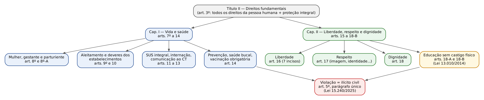
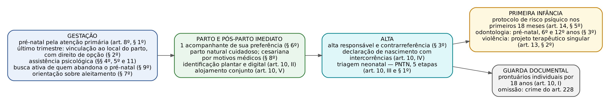
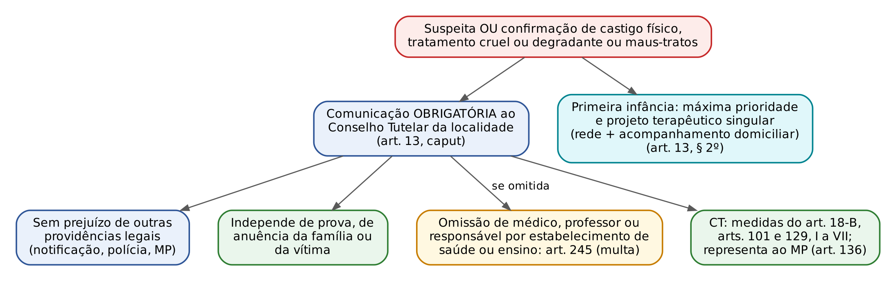
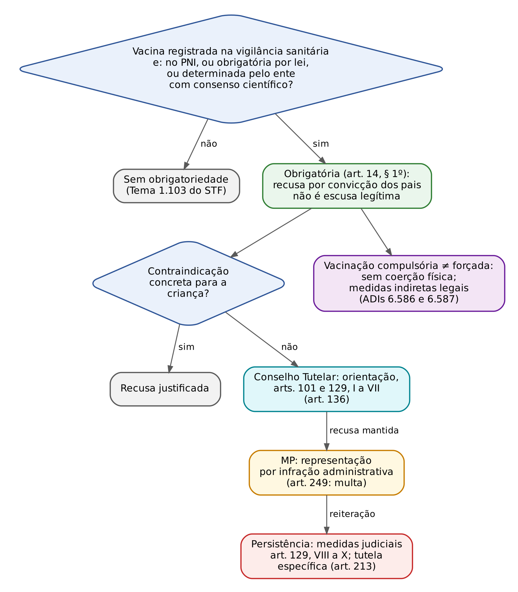
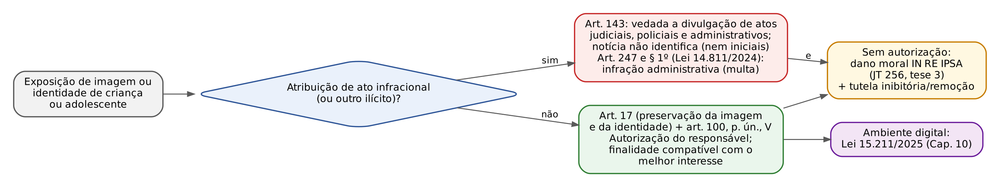
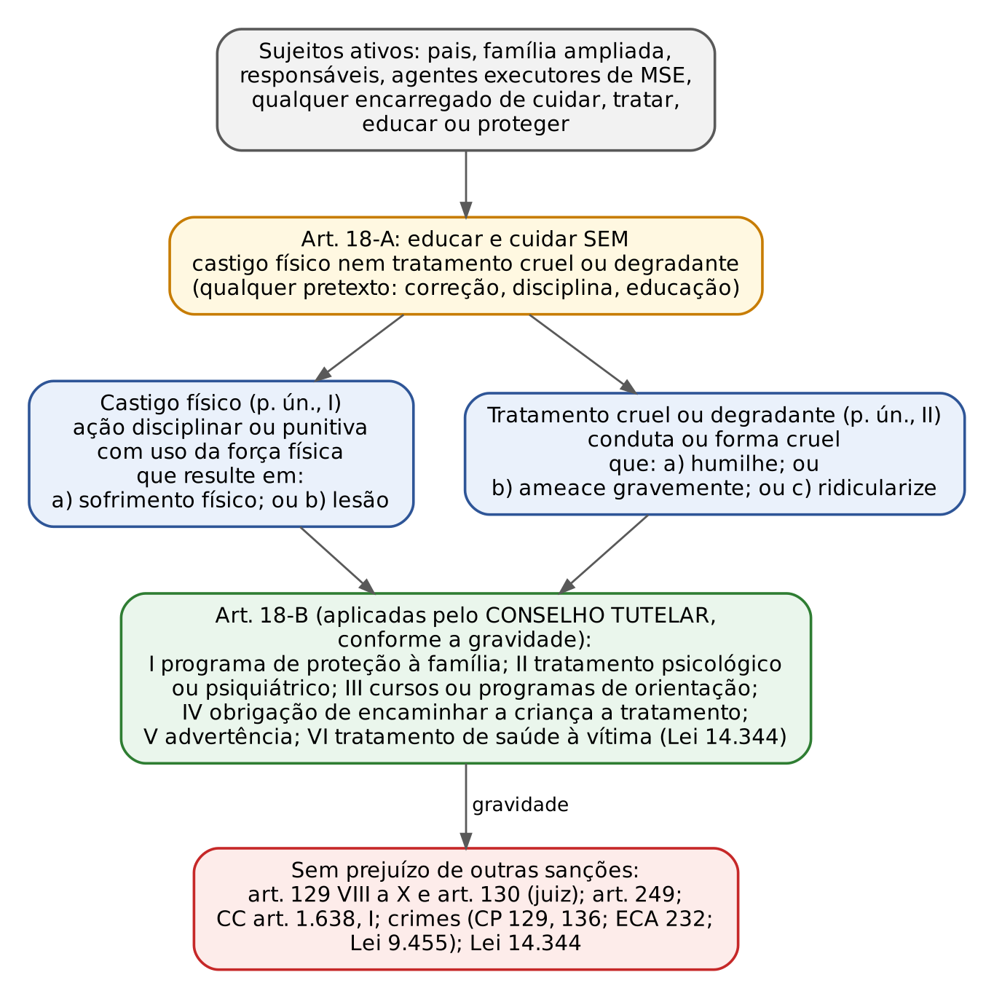

# CAPÍTULO 03 — DIREITOS FUNDAMENTAIS I: VIDA, SAÚDE, LIBERDADE, RESPEITO E DIGNIDADE

:::INCIDENCIA
TJRS p. 1 (direitos fundamentais). Nível A+. Lote: 26 questões (FGV 25, FCC 1), sendo 3 de magistratura (TJ-SC 2024, TJ-MT 2024, TJ-CE 2025).
O que mais cai: comunicação obrigatória ao Conselho Tutelar (art. 13) em casos práticos de saúde; letra dos arts. 8º a 12 (gestante privada de liberdade, prontuário por 18 anos, aleitamento, acompanhante, visita aos pais internados); vacinação obrigatória (Tema 1.103 do STF e art. 249); castigo físico (arts. 18-A e 18-B); imagem e ato infracional (arts. 143 e 247; dano moral *in re ipsa*).
:::

| Subtema | FGV | FCC | Padrão de cobrança |
|---|---|---|---|
| Comunicação ao Conselho Tutelar e notificação de violência (arts. 13, 70-B e 245) | 9 | 0 | caso clínico: notificar mesmo sem confirmação, sem anuência da família; destinatário é o CT |
| Gestante, parturiente, aleitamento e estabelecimentos de saúde (arts. 8º a 10) | 7 | 1 | letra dos parágrafos (privação de liberdade, busca ativa, 18 anos, Semana Nacional, trio do art. 9º) |
| Internação de criança e visita aos pais internados (art. 12) | 3 | 0 | "responsável" inclui guardião; visita aos pais é DIREITO (Lei 14.950/2024) |
| Vacinação obrigatória (art. 14, § 1º) | 1 | 0 | escalada: CT, infração do art. 249, medidas do art. 129 |
| Liberdade, respeito, dignidade e castigo físico (arts. 15 a 18-B) | 3 | 0 | castigo "moderado" também é violação; liberdade de crença não se subordina à autoridade familiar |
| Imagem e identidade (arts. 17, 143 e 247) | 2 | 0 | vedação inclusive de iniciais; art. 247 é infração administrativa, não crime; dano *in re ipsa* |

## 03.1 Estrutura do Título II e chaves de leitura

O Título II do Livro I do ECA ("Dos Direitos Fundamentais") abre com o Capítulo I (vida e saúde, arts. 7º a 14) e o Capítulo II (liberdade, respeito e dignidade, arts. 15 a 18-B). Seguem-se a convivência familiar (arts. 19 a 52-D, Caps. 4 a 6), educação, cultura, esporte e lazer (arts. 53 a 59, Cap. 8) e profissionalização (arts. 60 a 69, Cap. 8). Os fundamentos (proteção integral, prioridade absoluta do art. 4º, art. 3º, interpretação do art. 6º) estão no Cap. 1; aqui se parte deles.

Três chaves atravessam o capítulo e explicam a maior parte das questões:

- Destinatários múltiplos: os deveres dos arts. 7º a 14 recaem sobre o poder público (SUS), sobre estabelecimentos de saúde públicos E particulares (art. 10), sobre "o poder público, as instituições e os empregadores" (art. 9º) e sobre profissionais (art. 13). As bancas trocam o destinatário.
- Proteção que começa antes do nascimento: o ECA disciplina a atenção à mulher, à gestante e à parturiente (art. 8º). É FALSA a afirmação de que o Estatuto só reconhece direitos a partir do nascimento com vida (TJ-SC 2024, ver 03.2.1).
- Eficácia horizontal e reparação: os direitos dos arts. 15 a 18-B vinculam família, escola, hospital e qualquer pessoa ("é dever de todos", art. 18), e a violação é ilícito civil sujeito a reparação (art. 5º, parágrafo único, incluído pela Lei 15.240/2025; ver 03.6).

### 03.1.1 Quadro das leis alteradoras (a data e a lei são a pegadinha)

| Lei | O que introduziu neste capítulo |
|---|---|
| 12.010/2009 | assistência psicológica à gestante e à mãe (art. 8º, § 4º); princípios do art. 100, parágrafo único (privacidade, oitiva obrigatória) |
| 13.010/2014 (Lei Menino Bernardo) | arts. 18-A e 18-B; nova redação do art. 13 (castigo físico e tratamento cruel ou degradante); art. 70-A |
| 13.257/2016 (Marco Legal da Primeira Infância) | reescreveu os arts. 8º, 11, 12 e 14; §§ 1º e 2º do art. 13 (entrega para adoção; projeto terapêutico singular na primeira infância); §§ do art. 9º |
| 13.436/2017 | art. 10, VI (acompanhamento da amamentação na unidade hospitalar) |
| 13.438/2017 | art. 14, § 5º (protocolo de risco psíquico nos primeiros 18 meses) |
| 13.798/2019 | art. 8º-A (Semana Nacional de Prevenção da Gravidez na Adolescência) |
| 14.154/2021 | art. 10, §§ 1º a 4º (teste do pezinho ampliado — PNTN em 5 etapas) |
| 14.344/2022 (Lei Henry Borel) | art. 18-B, VI (tratamento de saúde especializado à vítima); incisos VII a XIII do art. 70-A; nova redação do art. 70-B |
| 14.721/2023 | art. 8º, § 11, e art. 10, VII (saúde mental da gestante e da puérpera) |
| 14.950/2024 | art. 12, parágrafo único (direito de a criança visitar a mãe ou o pai internados) |
| 14.811/2024 | art. 247, § 1º (imagem, vídeo ou transmissão de criança ou adolescente envolvido em ato infracional) |
| 15.240/2025 | art. 5º, parágrafo único (ofensa a direito fundamental como conduta ilícita sujeita a reparação, inclusive abandono afetivo) |
| 15.280/2025 | nova redação do art. 70-A, II (inclui órgãos de segurança pública na integração) e IX |
| 15.243/2025 (28/10/2025; DOU de 29/10/2025; vigência após 120 dias) | art. 14-A (assistência integral e multiprofissional à criança e ao adolescente dependentes químicos ou com problemas decorrentes do uso de drogas) |
| 15.413/2026 (21/5/2026; DOU de 22/5/2026; vigência na publicação) | art. 11-A (direito à saúde mental: programas do SUS de prevenção e tratamento) |
| 15.450/2026 (30/6/2026; DOU de 1/7/2026; vigência após 180 dias) | art. 14, § 6º (prevenção do uso inadequado de psicofármacos nas campanhas de educação sanitária) |
| 15.512/2026 | nova redação do caput do art. 4º (direito à natureza; Cap. 1) |

## 03.2 Direito à vida e à saúde (arts. 7º a 14)

:::LEI ECA, ART. 7º
"A criança e o adolescente têm direito a proteção à vida e à saúde, mediante a efetivação de políticas sociais públicas que permitam o nascimento e o desenvolvimento sadio e harmonioso, em condições dignas de existência."
:::

O art. 7º é norma de conteúdo prestacional: o direito à vida, no ECA, não se esgota na abstenção (não matar), mas exige POLÍTICAS SOCIAIS PÚBLICAS que garantam o nascimento e o desenvolvimento sadio e harmonioso. Daí a densa disciplina do pré-natal, do parto e da primeira infância. Os arts. 7º, 8º, caput, e 11, caput, foram cobrados literalmente pela FGV (Q3996579, V-V-V); as bancas costumam alterar "equidade" (art. 11) por "igualdade" ou "universalidade", "políticas sociais públicas" por "programas assistenciais" e "nascimento e desenvolvimento" por "desenvolvimento" apenas.

### 03.2.1 Atenção à mulher, à gestante e à parturiente (art. 8º)

O caput, na redação da Lei 13.257/2016, assegura a TODAS AS MULHERES acesso aos programas e às políticas de saúde da mulher e de planejamento reprodutivo e, às gestantes, nutrição adequada, atenção humanizada à gravidez, ao parto e ao puerpério e atendimento pré-natal, perinatal e pós-natal integral no âmbito do SUS. Note-se a dupla titularidade: o planejamento reprodutivo é de todas as mulheres; a nutrição e a atenção humanizada, das gestantes.

| Parágrafo | Conteúdo (letra) | Pegadinha usual |
|---|---|---|
| § 1º | pré-natal realizado por profissionais da ATENÇÃO PRIMÁRIA | trocar por "especializada" ou "hospitalar" |
| § 2º | profissionais de referência garantem a vinculação, no ÚLTIMO TRIMESTRE, ao estabelecimento do parto, garantido o direito de opção da mulher | trocar o trimestre; suprimir a opção |
| § 3º | serviços onde o parto ocorre asseguram alta hospitalar responsável, contrarreferência na atenção primária e acesso a grupos de apoio à amamentação | — |
| § 4º | incumbe ao PODER PÚBLICO proporcionar assistência psicológica à gestante e à mãe, no pré e pós-natal, inclusive para prevenir ou minorar as consequências do estado puerperal | "faculdade"; "apenas se houver psicólogo" |
| § 5º | a assistência do § 4º estende-se às gestantes e mães que manifestem interesse em ENTREGAR o filho para adoção e às que estejam em PRIVAÇÃO DE LIBERDADE | excluir a presa ou a que pretende entregar |
| § 6º | gestante e parturiente têm direito a 1 (um) acompanhante DE SUA PREFERÊNCIA no pré-natal, no trabalho de parto e no pós-parto imediato | "indicado pela equipe"; "dois acompanhantes"; "só no parto" |
| § 7º | orientação sobre aleitamento, alimentação complementar saudável, crescimento e desenvolvimento infantil e vínculos afetivos | — |
| § 8º | acompanhamento saudável e parto natural cuidadoso; cesariana e outras intervenções cirúrgicas por MOTIVOS MÉDICOS | "a pedido" como regra |
| § 9º | a atenção primária fará BUSCA ATIVA da gestante que não iniciar ou abandonar o pré-natal e da puérpera que não comparecer às consultas pós-parto | multa, comunicação ao MP, "desligamento" |
| § 10 | incumbe ao poder público garantir à gestante e à mulher com filho na primeira infância sob custódia em unidade de privação de liberdade AMBIÊNCIA que atenda às normas sanitárias e assistenciais do SUS para o acolhimento do filho, em articulação com o sistema de ensino | — |
| § 11 | assistência psicológica à gestante, parturiente e puérpera indicada após avaliação do profissional de saúde, com encaminhamento conforme o prognóstico (Lei 14.721/2023) | — |

:::QUESTAO FGV 2024 — TJ-SC — JUIZ SUBSTITUTO (Q3049368)
Caso: presa grávida de 6 meses preocupada com pré-natal e amamentação; um filho de 8 anos com problemas dentários e outro de 9 anos internado com apendicite. Gabarito: E (o poder público deve garantir à presa, quando o filho nascer, ambiência que atenda às normas sanitárias e assistenciais do SUS para o acolhimento do filho).
Passos: (1) E reproduz o art. 8º, § 10; (2) A é falsa porque o ECA protege a gestante (art. 8º) — a tutela é anterior ao nascimento; (3) B contraria o art. 9º (aleitamento inclusive para filhos de mães privadas de liberdade); (4) C contraria o art. 12 (permanência em tempo integral inclusive em UTI e unidades neonatais); (5) D contraria o art. 11 (acesso INTEGRAL) e o art. 14, §§ 2º a 4º (saúde bucal no SUS).
Armadilha: a alternativa A, que soa técnica ("direitos a partir do nascimento com vida"), confunde a personalidade civil (CC, art. 2º) com o âmbito protetivo do ECA.
:::

:::QUESTAO FGV 2024 — TJ-AP — ANALISTA JUDICIÁRIO — ASSISTENTE SOCIAL (Q2443345)
Gestante presa pede acompanhamento psicológico e ouve que não há obrigatoriedade. Gabarito: C (a informação é incorreta, pois incumbe ao poder público proporcionar assistência psicológica à gestante e à mãe, no pré e no pós-natal, inclusive à privada de liberdade — art. 8º, §§ 4º e 5º). Armadilha: B (a assistente social "supre" o atendimento) — o dever é de assistência psicológica, prestado pelo poder público.
:::

:::QUESTAO FGV 2025 — SEASIC-SE — ASSISTENTE SOCIAL (Q3349814)
Gestante que não inicia ou abandona o pré-natal e puérpera que falta às consultas: segundo o ECA, são objeto de busca ativa pela atenção primária. Gabarito: D (art. 8º, § 9º). Armadilhas: denúncia ao MP, multa, desligamento do SUS — o ECA não sanciona a gestante; impõe dever ativo ao serviço de saúde.
:::

:::DICA GESTANTE PRIVADA DE LIBERDADE: TRÊS CAMADAS
ECA, art. 8º, §§ 5º e 10 (assistência psicológica e ambiência para o filho) e art. 9º (aleitamento); LEP e CPP (prisão domiciliar da gestante e da mãe — HC coletivo 143.641 e art. 318 do CPP, ver Cap. 24); adolescente gestante ou lactante em internação socioeducativa: a internação tem amparo legal desde que assegurados o cuidado integral à saúde e as condições para permanecer com o filho durante a amamentação (JT 263, tese 8; desenvolvimento no Cap. 15).
:::

### 03.2.2 Semana Nacional de Prevenção da Gravidez na Adolescência (art. 8º-A)

Incluída pela Lei 13.798/2019: realizada ANUALMENTE na semana que incluir o dia 1º DE FEVEREIRO, com o objetivo de "disseminar informações sobre medidas preventivas e educativas que contribuam para a redução da incidência da gravidez na adolescência". As ações ficam a cargo do poder público, em conjunto com organizações da sociedade civil, dirigidas prioritariamente ao público adolescente (parágrafo único).

:::QUESTAO FGV 2025 — PREFEITURA DE SÃO JOSÉ DOS CAMPOS — ANALISTA — SERVIÇO SOCIAL (Q3580134)
Objetivo da Semana Nacional. Gabarito: D (disseminar informações sobre medidas preventivas e educativas para reduzir a incidência da gravidez na adolescência). Armadilhas: "controle de natalidade" (C), "métodos contraceptivos do SUS" (B), assistência psicológica à gestante adolescente (A, que mistura com o art. 8º, § 4º) e a cópia do art. 7º (E).
:::

### 03.2.3 Aleitamento materno (art. 9º)

:::LEI ECA, ART. 9º, CAPUT
"O poder público, as instituições e os empregadores propiciarão condições adequadas ao aleitamento materno, inclusive aos filhos de mães submetidas a medida privativa de liberdade."
:::

Trio de destinatários: PODER PÚBLICO, INSTITUIÇÕES e EMPREGADORES (Q2483053, gabarito D; os distratores eram os entes federativos e "empresas, sociedade e poder público"). O § 1º impõe aos profissionais das unidades PRIMÁRIAS ações sistemáticas de promoção, proteção e apoio ao aleitamento e à alimentação complementar saudável, "de forma contínua"; o § 2º obriga as UTIs NEONATAIS a dispor de banco de leite humano OU unidade de coleta de leite humano. Cuidado: a FGV transplantou a expressão "ações sistemáticas, individuais ou coletivas" para a alternativa errada da questão sobre a Semana Nacional (Q3580134, C), atribuindo-a ao "controle de natalidade".

No plano trabalhista, os intervalos para amamentação estão na CLT; a ampliação da licença-maternidade (Programa Empresa Cidadã) é objeto do Cap. 24.

### 03.2.4 Deveres dos hospitais e estabelecimentos de atenção à saúde de gestantes (art. 10)

O art. 10 obriga estabelecimentos PÚBLICOS E PARTICULARES. O descumprimento dos incisos I a IV tem tutela penal específica (arts. 228 e 229; ver Cap. 21).

| Inciso | Dever | Tutela penal |
|---|---|---|
| I | manter registro das atividades, por PRONTUÁRIOS INDIVIDUAIS, pelo prazo de DEZOITO ANOS | art. 228 (deixar de manter registro na forma e prazo do art. 10) |
| II | identificar o recém-nascido pelo registro de sua impressão PLANTAR E DIGITAL e da impressão DIGITAL DA MÃE, sem prejuízo de outras formas normatizadas | art. 229 (deixar de identificar corretamente o neonato e a parturiente) |
| III | exames para diagnóstico e terapêutica de anormalidades no METABOLISMO do recém-nascido e orientação aos pais | art. 229 (deixar de proceder aos exames do art. 10) |
| IV | fornecer declaração de nascimento onde constem NECESSARIAMENTE as intercorrências do parto e do desenvolvimento do neonato | art. 228 (deixar de fornecer, por ocasião da alta, a declaração) |
| V | manter ALOJAMENTO CONJUNTO, possibilitando ao neonato a permanência junto à mãe | — |
| VI | acompanhar a amamentação, orientando quanto à técnica, enquanto a mãe estiver na unidade, utilizando o corpo técnico já existente (Lei 13.436/2017) | — |
| VII | educação e conscientização sobre a saúde mental da mulher na gravidez e no puerpério (Lei 14.721/2023) | — |

Os arts. 228 e 229 punem com detenção de seis meses a dois anos e admitem a forma CULPOSA (detenção de dois a seis meses, ou multa) — são dos poucos crimes culposos do ECA.

:::QUESTAO FGV 2024 — PREFEITURA DE MACAÉ — PROCURADOR (Q3049973)
Diretor de maternidade quer descartar arquivos de partos, parte deles já entregue em cópia às gestantes. Gabarito: B (os registros devem ser mantidos, em prontuários individuais, pelo prazo de dezoito anos — art. 10, I). Armadilhas: descarte autorizado pela gestante (A); descarte do que já foi entregue (C); prazo prescricional de 5 anos da Fazenda (D); guarda sem prazo (E). O prazo do ECA é específico e não se confunde com a prescrição.
No mesmo sentido: FCC 2026 — AL-RR (Q4156348), gabarito A (I e II): o item III erra porque a declaração deve conter "necessariamente as intercorrências do parto e do desenvolvimento do neonato", e o IV erra ao condicionar o alojamento conjunto a "quando possível" e aos recursos humanos.
:::

O § 1º do art. 10 (Lei 14.154/2021) organizou o teste do pezinho ampliado no âmbito do Programa Nacional de Triagem Neonatal (PNTN), com implementação escalonada em CINCO ETAPAS: (1) fenilcetonúria e hiperfenilalaninemias, hipotireoidismo congênito, doença falciforme e hemoglobinopatias, fibrose cística, hiperplasia adrenal congênita, deficiência de biotinidase e toxoplasmose congênita; (2) galactosemias, aminoacidopatias, distúrbios do ciclo da ureia e da betaoxidação dos ácidos graxos; (3) doenças lisossômicas; (4) imunodeficiências primárias; (5) atrofia muscular espinhal. O rol é revisado periodicamente com base em evidências (§ 2º) e pode ser EXPANDIDO pelo poder público (§ 3º); no pré-natal e no puerpério imediato os profissionais devem informar sobre a importância do teste e sobre as diferenças entre as modalidades do SUS e da rede privada (§ 4º).

### 03.2.5 Acesso integral ao SUS, deficiência e fornecimento de medicamentos (art. 11)

O art. 11 assegura acesso INTEGRAL às linhas de cuidado voltadas à saúde da criança e do adolescente, por intermédio do SUS, "observado o princípio da EQUIDADE no acesso a ações e serviços para promoção, proteção e recuperação da saúde". Os parágrafos:

- § 1º: criança e adolescente com deficiência serão atendidos SEM DISCRIMINAÇÃO OU SEGREGAÇÃO, em suas necessidades gerais de saúde e específicas de habilitação e reabilitação.
- § 2º: incumbe ao poder público fornecer GRATUITAMENTE, "àqueles que necessitarem", medicamentos, órteses, próteses e outras tecnologias assistivas relativas ao tratamento, habilitação ou reabilitação, de acordo com as linhas de cuidado.
- § 3º: os profissionais do cuidado diário ou frequente de crianças na primeira infância receberão formação específica e permanente para detectar sinais de risco para o desenvolvimento psíquico.

:::JURIS STJ, JURISPRUDÊNCIA EM TESES, ED. 245, TESE 7
A negativa de fornecimento de medicamento ou tratamento imprescindível à criança, cuja ausência possa gerar risco à vida ou grave risco à saúde, é ato que, por si só, viola a Constituição Federal, pois a vida e a saúde são bens jurídicos constitucionalmente tutelados em primeiro plano (precedentes: AgInt no RMS 38.520/RO, Primeira Turma; REsp 900.487/RS, Segunda Turma).
:::

A prioridade absoluta, porém, não dispensa os requisitos gerais da judicialização da saúde. Em 2026, a Segunda Turma do STJ deixou isso explícito num caso pediátrico extremo:

:::JURIS STJ, RESP 1.860.543-PR, RELATOR MINISTRO MARCO AURÉLIO BELLIZZE, SEGUNDA TURMA, J. 16/6/2026 (INFO 894)
Criança com síndrome do intestino ultracurto pleiteava custeio, pela União, de transplante intestinal em centro estrangeiro de referência. Teses: (1) o custeio de tratamento no exterior é admissível apenas em caráter excepcional, mediante demonstração CUMULATIVA de inexistência de alternativa terapêutica eficaz no país, comprovação científica robusta de eficácia e segurança, imprescindibilidade clínica e incapacidade financeira, com deferência às políticas públicas do SUS; (2) a existência de centros nacionais habilitados afasta, em princípio, o deslocamento, salvo prova de ineficácia ou risco acrescido da alternativa nacional; (3) decisões em saúde devem apoiar-se na medicina baseada em evidências e em pareceres técnicos qualificados, não bastando prescrição ou relatório médico isolado; (4) não há direito subjetivo à melhor tecnologia disponível em centros estrangeiros. O acórdão invoca os Temas 6, 500, 793, 1.161 e 1.234 do STF, a STA 175 e o Tema 106 do STJ.
:::

:::ATENCAO PROTEÇÃO INTEGRAL NÃO É ATALHO PROCESSUAL
A FGV gosta de alternativas que extraem da prioridade absoluta a dispensa de prova técnica ("basta a prescrição do médico assistente da criança"). Pelo Info 894, a prioridade reforça a urgência e o dever estatal, mas os requisitos dos precedentes qualificados de saúde (registro, imprescindibilidade, ineficácia das alternativas do SUS, incapacidade financeira, evidência científica) continuam exigíveis. A legitimidade, a competência (Justiça da Infância x Fazenda Pública x Justiça Federal) e o regime da ação civil pública estão nos Caps. 18 e 20.
:::

:::PASSO ROTEIRO DE DECISÃO: PEDIDO DE MEDICAMENTO OU TRATAMENTO PARA CRIANÇA
1. Identifique se o item está incorporado ao SUS (linhas de cuidado do art. 11 e protocolos clínicos). Incorporado e não fornecido: a omissão é ilegal e a tutela de urgência é a regra (JT 245, tese 7).
2. Não incorporado: exija os requisitos dos precedentes qualificados de saúde (laudo fundamentado, imprescindibilidade, ineficácia das alternativas, registro sanitário, incapacidade financeira), com apoio de nota técnica (NatJus) quando disponível.
3. Tratamento no exterior ou tecnologia de ponta: excepcionalíssimo; alternativa nacional habilitada afasta o pedido (Info 894).
4. Defina o ente e o juízo à luz dos temas de competência e solidariedade (Cap. 20) e module a tutela (prazo, multa, bloqueio de verbas, contracautela).
5. Fundamente com o art. 227 da CF e os arts. 4º, 7º e 11 do ECA, registrando o risco concreto à vida ou à saúde.
:::

Saúde mental (art. 11-A, incluído pela Lei 15.413, de 21/5/2026, DOU de 22/5/2026, vigência na publicação):

:::LEI ECA, ART. 11-A (INCLUÍDO PELA LEI 15.413/2026)
Art. 11-A. É assegurado às crianças e aos adolescentes acesso a programas de saúde mental promovidos pelo Sistema Único de Saúde (SUS) para a prevenção e o tratamento de agravos de saúde mental.
§ 1º Os programas de saúde mental para crianças e adolescentes promoverão a atenção psicossocial básica e especializada, de urgência e emergência, e a atenção hospitalar.
§ 2º Os profissionais que atuam na prevenção e no tratamento de agravos de saúde mental que acometem crianças e adolescentes receberão formação específica e permanente para a detecção de sinais de risco, bem como para o acompanhamento que se fizer necessário.
§ 3º É assegurado às crianças e aos adolescentes em situação de vulnerabilidade que estejam em tratamento de agravos de saúde mental o acesso a todos os recursos terapêuticos, de forma gratuita ou subsidiada, de acordo com as linhas de cuidado voltadas às suas necessidades específicas.
:::

Pontos de literalidade: o § 2º do art. 11-A não se confunde com o § 3º do art. 11 (este trata dos profissionais da PRIMEIRA INFÂNCIA e do risco ao desenvolvimento psíquico; aquele, dos profissionais de saúde mental de crianças e adolescentes em geral); a gratuidade do § 3º é "gratuita OU subsidiada" e se dirige aos que estão "em situação de vulnerabilidade", de acordo com as linhas de cuidado; o § 1º enumera os níveis de atenção (psicossocial básica e especializada, urgência e emergência, hospitalar). O dispositivo dá base estatutária expressa às ações de obrigação de fazer por vagas em CAPSi e leitos de saúde mental infantojuvenil (art. 208, VII; Cap. 20) e dialoga com a Lei 10.216/2001 (Cap. 26).

Dois desdobramentos privados: (i) a criança ou o adolescente sob guarda judicial do titular de plano de saúde deve ser equiparado a filho natural, impondo-se à operadora inscrevê-lo como DEPENDENTE NATURAL, e não como agregado (JT 250, tese 2; ver guarda no Cap. 5); (ii) a responsabilidade de hospitais e operadoras por falhas no atendimento de crianças segue o CDC e o regime geral (ver 03.6).

### 03.2.6 Internação da criança e visita aos pais internados (art. 12)

:::LEI ECA, ART. 12
"Os estabelecimentos de atendimento à saúde, inclusive as unidades neonatais, de terapia intensiva e de cuidados intermediários, deverão proporcionar condições para a permanência em tempo integral de um dos pais ou responsável, nos casos de internação de criança ou adolescente.
Parágrafo único. Será garantido à criança e ao adolescente o direito de visitação à mãe ou ao pai internados em instituição de saúde, nos termos das normas regulamentadoras."
:::

Pontos de prova:

- "Inclusive" UTI e unidades neonatais: não há exceção para terapia intensiva (TJ-SC 2024, alternativa C de Q3049368).
- "Um dos pais OU RESPONSÁVEL": o guardião (inclusive parente com guarda) tem o direito; o hospital não pode exigir a presença da mãe nem autorização judicial (Q3339549, gabarito A: a tia guardiã deve poder permanecer).
- O dever é do estabelecimento ("deverão proporcionar condições"), público ou privado.
- Parágrafo único (Lei 14.950/2024): a visita da criança ao pai ou à mãe internados é DIREITO DA CRIANÇA, exercido "nos termos das normas regulamentadoras". Não há idade mínima no ECA para a visita.

:::JURIS STJ, JURISPRUDÊNCIA EM TESES, ED. 245, TESE 8 (HC 632.992/MG, RELATOR MINISTRO MARCO AURÉLIO BELLIZZE, TERCEIRA TURMA, DJE 4/5/2021)
O ECA (art. 12) e o Estatuto da Pessoa com Deficiência (art. 22) asseguram o acompanhamento pelos pais ou responsáveis em tempo integral durante o tratamento médico-hospitalar; porém, se houver COMPROVADO prejuízo ao melhor interesse, é possível a restrição desse direito.
:::

:::QUESTAO FGV 2025 — PREFEITURA DE SÃO JOSÉ DOS CAMPOS — ANALISTA — SERVIÇO SOCIAL (Q3580135)
A visitação da criança e do adolescente à mãe ou ao pai internados é, segundo o ECA, um direito. Gabarito: B. Armadilhas: "exceção", "benefício", "excepcionalidade".
No mesmo sentido: FGV 2024 — Prefeitura de Abreu e Lima — Assistente Social (Q3005788), gabarito C. Pai infartado quer ver a filha de 5 anos. Distratores: vedação de visita por quem tem menos de 16 anos (A), acesso "após ouvir o médico" (B), obrigação de lugar apropriado (D) e a inversão do caput — permanência em tempo integral de FILHOS nos casos de internação dos PAIS (E). O caput garante a permanência dos pais junto ao filho internado; a recíproca é só visitação.
:::

### 03.2.7 Comunicação obrigatória ao Conselho Tutelar (art. 13)

É o tema mais cobrado do capítulo (9 questões, quase todas de provas da área da saúde, com caso clínico).

:::LEI ECA, ART. 13, CAPUT
"Os casos de suspeita ou confirmação de castigo físico, de tratamento cruel ou degradante e de maus-tratos contra criança ou adolescente serão obrigatoriamente comunicados ao Conselho Tutelar da respectiva localidade, sem prejuízo de outras providências legais."
:::

Elementos:

- Objeto: castigo físico, tratamento cruel ou degradante (conceitos do art. 18-A, ver 03.5.2) e maus-tratos. A redação vem da Lei 13.010/2014.
- Basta a SUSPEITA: não se exige confirmação, prova, laudo ou investigação prévia pela equipe.
- Destinatário: o CONSELHO TUTELAR da localidade (não o MP, a Vara, a delegacia ou o CREAS — Q3349815, gabarito B).
- "Obrigatoriamente": dever jurídico, não faculdade; não depende de autorização da família nem da vítima; o sigilo profissional não o afasta.
- "Sem prejuízo de outras providências legais": a comunicação ao CT não exaure os deveres da equipe (notificação compulsória ao sistema de saúde, registro em prontuário, atendimento, eventual acionamento da polícia ou do MP).
- Sanção pela omissão: infração administrativa do art. 245 (médico, professor ou responsável por estabelecimento de atenção à saúde e de ensino fundamental, pré-escola ou creche que deixa de comunicar à autoridade competente suspeita ou confirmação de maus-tratos; multa de três a vinte salários de referência, em dobro na reincidência). O art. 70-B exige que entidades de saúde e educação tenham pessoas capacitadas para reconhecer e comunicar ao CT suspeitas de crimes e responsabiliza, pelo injustificado retardamento ou omissão, culposos ou dolosos, as pessoas encarregadas do cuidado, assistência ou guarda (parágrafo único). Procedimento da infração: Caps. 19 e 21.

:::QUESTAO FGV 2026 — SES-TO — PESQUISADOR DOCENTE EM SAÚDE PÚBLICA (Q4434388)
Afirmativas sobre suspeita de maus-tratos identificada por profissional de saúde. Gabarito: A (só a I: a suspeita deve ser comunicada ao CT da localidade). A II erra ao exigir confirmação; a III erra ao dizer que a comunicação dispensa outras medidas — o art. 13 diz "sem prejuízo de outras providências legais".
No mesmo sentido (caso clínico, comunicação independe de confirmação): FGV 2026 — SES-TO — Pediatra (Q4436990), gabarito B (lactente com sinais de síndrome do bebê sacudido e irmã de 15 anos com hematomas e queimaduras: mesmo sem confirmação, notifica-se o CT; erradas: esperar o responsável legal para alta, comunicar "em sigilo por mera suspeita" como se fosse dispensável, chamar a polícia contra a irmã); FGV 2024 — EBSERH (Q3489995), gabarito A (adolescente sob guarda informal da avó deprimida que a culpa: a notificação "deverá ser feita", pois há fatos que justificam a suspeita; não depende de localizar a mãe, de concordância ou de prova); FGV 2025 — EBSERH — Hematologia Pediátrica (Q3725736), gabarito E (criança de 5 anos trancada, desnutrida, sem supervisão: notificar formalmente a suspeita de NEGLIGÊNCIA e manter vigilância com a rede; erradas: acolhimento imediato com proibição de contato, alta com termo de vizinhos, "não há violência física").
:::

:::QUESTAO FGV 2024 — EBSERH — RESIDÊNCIA — PSICOLOGIA (Q3348620)
Família que não aceita a notificação: o profissional deve informá-la de que notificará os órgãos competentes, amparado pelo ECA. Gabarito: E. Armadilhas: buscar autorização de outro familiar (A), insistir até a família autorizar (B), condicionar a notificação à continuidade da violência (C), omitir por "ética profissional" (D). A notificação não depende de consentimento; a transparência com a família é recomendada.
No mesmo sentido: FGV 2026 (Q4307522), gabarito C — lesões suspeitas e retraimento relatados pela escola: notificar compulsoriamente aos órgãos de proteção e registrar no prontuário para acompanhamento longitudinal; não se faz "visita surpresa para verificar a veracidade" nem se condiciona a medida a reunião prévia com os pais.
:::

:::QUESTAO FGV 2026 — PREFEITURA DE MACAÉ — MÉDICO PEDIATRA (Q4133585)
Criança de 6 anos com atraso ponderoestatural, faltas escolares e vacinação incompleta, em família em extrema pobreza, sem violência nem recusa deliberada, com pais preocupados mas de baixa compreensão. Gabarito oficial: E (a ausência de intencionalidade exclui a necessidade de notificação, sendo suficientes orientação familiar e seguimento clínico).
Leitura jurídica do gabarito: o art. 13 alcança maus-tratos e castigos; a carência material não é, por si, violação imputável aos pais (art. 23 do ECA: a falta ou carência de recursos materiais não constitui motivo suficiente para a perda ou suspensão do poder familiar; ver Cap. 4), e o caso pede inclusão em programas (arts. 101 e 129, I). A banca rejeitou C ("omissão do cuidar sociocultural obriga a notificar") e as alternativas que identificam violência ou impõem afastamento.
Gabarito DISCUTÍVEL: a vacinação incompleta e as faltas escolares são, em tese, fatos que o CT pode acompanhar (art. 136), e protocolos de saúde costumam recomendar notificar a negligência independentemente de intenção. Em prova de magistratura, prefira o raciocínio: pobreza não é causa de intervenção punitiva; a resposta é a rede de proteção social.
:::

O § 2º do art. 13 (Lei 13.257/2016) cria regime reforçado para a PRIMEIRA INFÂNCIA: os serviços de saúde em suas diferentes portas de entrada, a assistência social especializada, o CREAS e os demais órgãos do SGD conferem MÁXIMA PRIORIDADE ao atendimento de crianças nessa faixa com suspeita ou confirmação de violência de qualquer natureza, formulando PROJETO TERAPÊUTICO SINGULAR que inclua INTERVENÇÃO EM REDE e, se necessário, ACOMPANHAMENTO DOMICILIAR (TJ-SC 2024 — Assistente Social, Q2513210, gabarito B; distratores: família extensa, núcleo biológico, afastamento, acolhimento). Para a escuta e o fluxo de atendimento da vítima, ver Lei 13.431/2017 (Cap. 22) e Lei 14.344/2022 (Cap. 23).

:::NOTA ENTREGA VOLUNTÁRIA NA PERSPECTIVA DA SAÚDE (ART. 13, § 1º, E ART. 8º, § 5º)
"As gestantes ou mães que manifestem interesse em entregar seus filhos para adoção serão obrigatoriamente encaminhadas, sem constrangimento, à Justiça da Infância e da Juventude." Ao serviço de saúde cabem: o encaminhamento obrigatório e sem constrangimento, a assistência psicológica (art. 8º, § 5º) e o respeito ao sigilo. O procedimento do art. 19-A, o sigilo em relação ao suposto pai e à família extensa (STJ, REsp 2.086.404-MG, Info 835) e a Resolução CNJ 485/2023 estão no Cap. 4. O agente que deixa de encaminhar comete a infração do art. 258-B (Cap. 21).
:::

### 03.2.8 Prevenção de enfermidades, saúde bucal e risco psíquico (art. 14)

- Caput: o SUS promoverá programas de assistência médica e ODONTOLÓGICA para a prevenção das enfermidades que ordinariamente afetam a população infantil, e campanhas de educação sanitária para pais, educadores e alunos.
- § 2º: atenção à saúde bucal das crianças E DAS GESTANTES, de forma transversal, integral e intersetorial.
- § 3º: a atenção odontológica tem função educativa protetiva e é prestada inicialmente ANTES DE O BEBÊ NASCER (aconselhamento pré-natal) e, depois, no SEXTO e no DÉCIMO SEGUNDO anos de vida.
- § 4º: criança com necessidade de cuidados odontológicos especiais será atendida pelo SUS.
- § 5º (Lei 13.438/2017): é OBRIGATÓRIA a aplicação a TODAS as crianças, nos primeiros DEZOITO MESES de vida, de protocolo ou instrumento para detectar, em consulta pediátrica de acompanhamento, risco para o desenvolvimento psíquico.
- § 6º (Lei 15.450, de 30/6/2026, DOU de 1/7/2026, vigência após decorridos 180 dias da publicação — pela contagem do art. 8º, § 1º, da LC 95/1998, a partir de 28/12/2026): "A prevenção do uso indiscriminado, desnecessário ou excessivo de psicofármacos em crianças e adolescentes inclui-se entre os temas a serem tratados nas campanhas de educação sanitária previstas no caput deste artigo." Os três adjetivos (indiscriminado, desnecessário, excessivo) e o veículo (campanhas de educação sanitária do caput) são a matéria de prova.

Art. 14-A (Lei 15.243, de 28/10/2025, DOU de 29/10/2025, vigência após decorridos 120 dias da publicação): "Incumbe ao poder público proporcionar assistência integral e multiprofissional à criança e ao adolescente dependentes químicos e/ou com problemas decorrentes do uso de drogas, com vistas à proteção de sua saúde física e mental e de seu bem-estar social, e promover campanhas de prevenção do uso de drogas lícitas e ilícitas." O dever é do PODER PÚBLICO e abrange drogas lícitas E ilícitas; no plano individual, a via continua a ser a medida de proteção do art. 101, VI (tratamento a alcoólatras e toxicômanos), e, quanto à internação, a Lei 10.216/2001 e a Lei 11.343/2006 (Cap. 26).

Logo, é falsa a assertiva de que as linhas de cuidado do SUS não englobam tratamento dentário (TJ-SC 2024, alternativa D de Q3049368).

### 03.2.9 Vacinação obrigatória (art. 14, § 1º)

:::LEI ECA, ART. 14, § 1º
"É obrigatória a vacinação das crianças nos casos recomendados pelas autoridades sanitárias."
:::

A norma é de eficácia plena, mas seu conteúdo é preenchido pelas autoridades sanitárias. O STF fixou os parâmetros em repercussão geral.

:::JURIS STF, TEMA 1.103 (ARE 1.267.879, RELATOR MINISTRO LUÍS ROBERTO BARROSO, PLENÁRIO, J. 17/12/2020)
É constitucional a obrigatoriedade de imunização por meio de vacina que, registrada em órgão de vigilância sanitária, (i) tenha sido incluída no Programa Nacional de Imunizações, ou (ii) tenha sua aplicação obrigatória determinada em lei, ou (iii) seja objeto de determinação da União, Estado, Distrito Federal ou Município, com base em consenso médico-científico. Em tais casos, não se caracteriza violação à liberdade de consciência e de convicção filosófica dos pais ou responsáveis, nem ao poder familiar.
:::

:::JURIS STF, ADIS 6.586 E 6.587, RELATOR MINISTRO RICARDO LEWANDOWSKI, PLENÁRIO, J. 17/12/2020
Vacinação COMPULSÓRIA não significa vacinação FORÇADA: exige-se o consentimento do usuário e é vedada a coerção física, mas o Estado pode impor medidas indiretas previstas em lei ou dela decorrentes (restrição ao exercício de certas atividades ou à frequência de determinados lugares), desde que baseadas em evidências científicas, acompanhadas de ampla informação sobre eficácia, segurança e contraindicações, respeitosas da dignidade e dos direitos fundamentais, razoáveis e proporcionais e com distribuição universal e gratuita das vacinas. As medidas podem ser adotadas pela União, pelos Estados, pelo DF e pelos Municípios, respeitadas as esferas de competência.
:::

:::JURIS STJ, RESP 2.138.801-PR, RELATORA MINISTRA NANCY ANDRIGHI, TERCEIRA TURMA, J. 18/3/2025 (INFO 844)
A recusa dos pais em vacinar filho contra a COVID-19, mesmo advertidos dos riscos pelo Conselho Tutelar e pelo Ministério Público, autoriza a sanção pecuniária do art. 249 do ECA. Fundamentos: a autoridade parental é poder-dever balizado pela paternidade responsável e pela proteção integral (art. 5º do ECA: nenhuma criança será objeto de negligência); salvo risco concreto à integridade psicofísica que contraindique a vacina, a escusa dos pais é NEGLIGÊNCIA PARENTAL; a vacinação infantil é também pacto coletivo de saúde; aplicam-se os requisitos do Tema 1.103.
:::

Consequências da recusa injustificada, em escala:

| Nível | Resposta | Fundamento |
|---|---|---|
| Rede de proteção | orientação, inclusão em programas, advertência, obrigação de encaminhar a tratamento | arts. 101 e 129, I a VII (aplicáveis pelo CT, art. 136, II) |
| Administrativo-judicial | representação do MP ou do CT por infração administrativa; multa de três a vinte salários de referência, em dobro na reincidência | art. 249; procedimento dos arts. 194 a 197 (Cap. 19) |
| Tutela específica | ação de obrigação de fazer para a vacinação, com medidas indiretas | art. 213 (Cap. 20); ADIs 6.586 e 6.587 |
| Poder familiar | perda da guarda, suspensão ou destituição, se a negligência se insere em quadro grave e persistente | art. 129, VIII a X; arts. 22 a 24; CC, arts. 1.637 e 1.638 (Cap. 4) |
| Medidas indiretas legais | restrições previstas em lei (por exemplo, exigências de comprovação vacinal) | Tema 1.103; ADIs 6.586 e 6.587 |

:::QUESTAO FGV 2024 — TJ-MT — JUIZ SUBSTITUTO (Q3086951)
Pais, convencidos por textos antivacina, deixam de vacinar filhos de 2 e 4 anos; orientados pelo CT e pela equipe técnica, permanecem irredutíveis; o caso chega ao MP. Gabarito: E (o poder familiar não é absoluto; os pais responderão por infração administrativa e, condenados, pagarão multa; persistindo o descumprimento, poderão ter o poder familiar suspenso).
Passos: (1) a vacina recomendada é obrigatória (art. 14, § 1º; Tema 1.103) e a convicção filosófica não é escusa; (2) o descumprimento doloso ou culposo dos deveres do poder familiar é a infração do art. 249 (as alternativas mencionam "art. 149", erro material do enunciado: o art. 149 trata de portarias e alvarás); (3) a multa não é a única sanção (D errada), a destituição não é imediata (C errada) e o encaminhamento a curso de orientação não é a resposta exclusiva (A incompleta); (4) persistindo a omissão, cabe suspensão do poder familiar (art. 129, X; art. 24).
Ressalva: a parte final de E ("com o consequente encaminhamento dos filhos para acolhimento") não é consequência automática — o acolhimento é excepcional e provisório (art. 101, § 1º) e a família extensa tem preferência (Cap. 4).
Correlata (Cap. 21): FGV 2025 — TJ-MS — Juiz Substituto (Q3786366), gabarito E — representação do art. 249 por evasão escolar e vacinação incompleta; a criança foi vacinada no curso do processo, mas a omissão escolar persistiu: procedência, com possibilidade de reduzir a multa abaixo do mínimo legal em razão das dificuldades financeiras.
:::

:::SENTENCA PROCEDÊNCIA DE REPRESENTAÇÃO POR INFRAÇÃO ADMINISTRATIVA (RECUSA VACINAL)
"Comprovado que os representados, advertidos pelo Conselho Tutelar e pelo Ministério Público, deixaram de submeter os filhos às vacinas do Programa Nacional de Imunizações sem qualquer contraindicação médica concreta, configura-se o descumprimento dos deveres inerentes ao poder familiar (art. 249 do ECA). A convicção filosófica dos pais não afasta a obrigatoriedade prevista no art. 14, § 1º, do ECA, nos termos do Tema 1.103 do STF. JULGO PROCEDENTE a representação e aplico a cada representado multa de três salários de referência, fixada no mínimo diante da situação econômica comprovada. Encaminhem-se os representados a programa de orientação (art. 129, IV, do ECA) e oficie-se ao Conselho Tutelar para acompanhamento, com comprovação da atualização da caderneta de vacinação em 30 dias; persistindo a omissão, o Ministério Público poderá promover a tutela específica (art. 213 do ECA) e as medidas do art. 129, VIII a X."
:::

### 03.2.10 Recusa de tratamento por convicção religiosa dos pais

Os Temas 952 e 1.069 do STF (2024) admitem a recusa de transfusão e de tratamento por motivos religiosos apenas pelo paciente maior e capaz, com decisão livre, informada e esclarecida; quanto a crianças e adolescentes prevalece o melhor interesse quanto à vida e à saúde, e a liberdade religiosa dos pais não autoriza impedir o tratamento dos filhos (desenvolvimento, inclusive o caso do adolescente emancipado cobrado pela FGV no TJ-MT 2024, na Apostila de Direito Civil, Cap. 4, 04.4.3). Na via estatutária, a recusa dos pais diante de risco à vida é situação de risco do art. 98, II, que autoriza medidas de proteção e, em urgência, a tutela judicial do art. 213; a equipe médica, em iminente perigo de vida, atua para salvar a criança e comunica o fato ao CT e à autoridade judiciária.

## 03.3 Direito à liberdade (arts. 15 e 16)

:::LEI ECA, ART. 15
"A criança e o adolescente têm direito à liberdade, ao respeito e à dignidade como pessoas humanas em processo de desenvolvimento e como sujeitos de direitos civis, humanos e sociais garantidos na Constituição e nas leis."
:::

O art. 15 condensa a virada da proteção integral (Cap. 1): criança e adolescente não são objeto de tutela, mas SUJEITOS de direitos civis, humanos e sociais, cujo exercício se modula pelo "processo de desenvolvimento" (autonomia progressiva). A mesma fórmula reaparece no art. 100, parágrafo único, I (condição de sujeitos de direitos).

:::LEI ECA, ART. 16
"O direito à liberdade compreende os seguintes aspectos: I - ir, vir e estar nos logradouros públicos e espaços comunitários, ressalvadas as restrições legais; II - opinião e expressão; III - crença e culto religioso; IV - brincar, praticar esportes e divertir-se; V - participar da vida familiar e comunitária, sem discriminação; VI - participar da vida política, na forma da lei; VII - buscar refúgio, auxílio e orientação."
:::

| Inciso | Aspecto | Limite expresso ou leitura de prova |
|---|---|---|
| I | ir, vir e estar em logradouros e espaços comunitários | "ressalvadas as RESTRIÇÕES LEGAIS" — só a lei restringe (arts. 75, 80, 82 a 85; Cap. 9); portaria judicial do art. 149 regula situações específicas e não pode instituir restrição genérica de circulação ("toque de recolher" geral é rejeitado pelo STJ; ver Cap. 18) |
| II | opinião e expressão | não é "parcial" nem condicionada à disciplina escolar (Q3706601, A errada) |
| III | crença e culto religioso | não se subordina à "autoridade familiar" (Q3777284: item III errado); compatibiliza-se com o direito dos pais de orientar a educação religiosa (Convenção da ONU, art. 14; Cap. 2) |
| IV | brincar, praticar esportes e divertir-se | o direito ao brincar foi reforçado pela Lei 14.826/2024 (parentalidade positiva e direito ao brincar como estratégia de prevenção à violência; não alterou o ECA, mas a Lei 14.344/2022) |
| V | participar da vida familiar e comunitária, sem discriminação | liga-se à convivência familiar (Cap. 4) |
| VI | participar da vida política, NA FORMA DA LEI | voto facultativo dos 16 aos 18 anos (CF, art. 14, § 1º, II, c); grêmios estudantis |
| VII | buscar refúgio, auxílio e orientação | fundamento do acesso direto ao CT, ao MP, à Defensoria e à Justiça (art. 141) |

:::PEGADINHA "LIBERDADE LIMITADA PELA AUTORIDADE DOS PAIS"
As bancas da área social repetem a fórmula "liberdade de opinião, expressão e crença, desde que não contrariem a autoridade familiar" (FGV 2025 — AL-AM, Q3777284, gabarito E: só o item I, dever de todos de prevenir violações). O ECA não condiciona os incisos II e III à autoridade parental. A autoridade parental é poder-dever funcionalizado ao interesse do filho (art. 21 e art. 22), não título de supressão de liberdades. Da mesma forma, a liberdade "não se limita à escolha de lazer" (Q3706601, alternativa E).
:::

### 03.3.1 Opinião, participação e escuta

O inciso II se completa com o direito de ser ouvido: art. 100, parágrafo único, XI (obrigatoriedade da informação) e XII (OITIVA OBRIGATÓRIA E PARTICIPAÇÃO — a criança e o adolescente, em separado ou acompanhados, têm direito a ser ouvidos e a participar dos atos e da definição da medida, com opinião devidamente considerada pela autoridade judiciária), e art. 28, §§ 1º e 2º (oitiva por equipe interprofissional "sempre que possível" e CONSENTIMENTO, colhido em audiência, do maior de 12 anos na colocação em família substituta). Para a vítima ou testemunha de violência, a fala é protegida pela escuta especializada e pelo depoimento especial (Cap. 22).

:::QUESTAO FGV 2025 — DPE-PE — DEFENSOR PÚBLICO (Q3390893)
Proteção integral, liberdade, respeito e dignidade, à luz também da Resolução CONANDA 169/2014. Gabarito: E (manifestar-se nos processos que os envolvam ou expressar pontos de vista é uma ESCOLHA, não uma obrigação da criança e do adolescente, devendo-se garantir que recebam todas as informações necessárias à decisão).
Armadilhas: A generaliza o consentimento — o art. 28, § 2º, exige consentimento em audiência apenas do MAIOR DE 12 ANOS, e para família substituta; B subordina o acesso à assistência jurídica requerida pela criança à avaliação discricionária do juiz conforme a "fase do processo"; C trata os meios autocompositivos como excepcionais; D dispensa a anuência do adolescente para a remissão cumulada com medida (remissão: Cap. 15).
Lição: ouvir é direito; calar também é. Na sentença, registre que a criança foi informada e que sua opinião, se expressa, foi considerada (art. 100, parágrafo único, XI e XII).
:::

## 03.4 Direito ao respeito: imagem, identidade e nome (art. 17)

:::LEI ECA, ART. 17
"O direito ao respeito consiste na inviolabilidade da integridade física, psíquica e moral da criança e do adolescente, abrangendo a preservação da imagem, da identidade, da autonomia, dos valores, idéias e crenças, dos espaços e objetos pessoais."
:::

O art. 17 é a cláusula estatutária dos direitos da personalidade infantojuvenis. Note-se a amplitude: integridade FÍSICA, PSÍQUICA E MORAL; imagem; identidade; autonomia; valores, ideias e crenças; espaços e objetos pessoais (privacidade de diários, celulares, quartos em entidades de acolhimento ou internação). O princípio da PRIVACIDADE do art. 100, parágrafo único, V, manda que a promoção de direitos e a proteção sejam efetuadas "no respeito pela intimidade, direito à imagem e reserva da sua vida privada" — por isso a privacidade aparece nas questões como princípio de aplicação das medidas de proteção.

Regime civil dos direitos da personalidade (arts. 11 a 21 do CC, tutela inibitória, Súmula 403, nome, identidade de gênero): Apostila de Direito Civil, Cap. 4. Aqui, só o que é estatutário.

### 03.4.1 Imagem fora do contexto infracional

A divulgação da imagem de criança ou adolescente exige autorização do responsável e, mesmo com ela, finalidade compatível com o melhor interesse; a identificação associada a localização (nome completo + escola + foto) agrava o risco e afronta a preservação da identidade. Quem detém o controle atual da publicação responde pela sua manutenção.

:::QUESTAO FGV 2026 — PREFEITURA DE SALVADOR — COORDENADOR PEDAGÓGICO (Q4350669)
Coordenadora assume o perfil institucional da escola e encontra foto antiga de alunos com nomes completos e localização da escola; mantém a postagem por ser anterior à sua gestão e passa a publicar só imagens sem identificação. Gabarito: E (conduta incorreta: a publicação anterior deveria ter sido removida para preservar a identidade das crianças, ainda que a conduta futura esteja adequada).
Armadilhas: "documentação pedagógica" (A); autorização posterior das famílias como solução (B, C); impossibilidade de retirar o que já foi veiculado (D). A violação é continuada enquanto a publicação permanece; o dever de remoção decorre dos arts. 17 e 18. No ambiente digital, os deveres dos fornecedores (configuração mais protetiva por padrão) estão na Lei 15.211/2025 (Cap. 10).
:::

### 03.4.2 Imagem e identidade do adolescente a quem se atribui ato infracional

:::LEI ECA, ART. 143
"É vedada a divulgação de atos judiciais, policiais e administrativos que digam respeito a crianças e adolescentes a que se atribua autoria de ato infracional.
Parágrafo único. Qualquer notícia a respeito do fato não poderá identificar a criança ou adolescente, vedando-se fotografia, referência a nome, apelido, filiação, parentesco, residência e, inclusive, iniciais do nome e sobrenome."
:::

A vedação alcança INCLUSIVE AS INICIAIS (redação da Lei 10.764/2003). A violação é INFRAÇÃO ADMINISTRATIVA (art. 247: divulgar, total ou parcialmente, sem autorização devida, por qualquer meio de comunicação, nome, ato ou documento de procedimento policial, administrativo ou judicial relativo a criança ou adolescente a que se atribua ato infracional; multa de três a vinte salários de referência, em dobro na reincidência), NÃO crime. O § 1º do art. 247, na redação da Lei 14.811/2024, alcança quem exibe ou transmite imagem, VÍDEO OU CORRENTE DE VÍDEO de criança ou adolescente envolvido em ato infracional OU EM OUTRO ATO ILÍCITO que lhe seja atribuído, de forma a permitir sua identificação. No § 2º, a expressão que autorizava a apreensão da publicação foi declarada inconstitucional na ADI 869. Detalhes de procedimento e sujeitos: Cap. 21.

:::JURIS STJ, JURISPRUDÊNCIA EM TESES, ED. 256, TESE 6
Em alinhamento a normas internacionais, o ECA veda a divulgação de qualquer elemento que permita a identificação, direta ou indireta, da criança ou do adolescente a que se atribua ato infracional (art. 247, § 1º). Precedentes: AgInt no REsp 1.830.109/SP, Terceira Turma; REsp 1.820.891/PR, Segunda Turma; AgInt no AREsp 1.018.992/SP, Quarta Turma.
:::

:::QUESTAO FGV 2025 — TJ-CE — JUIZ SUBSTITUTO (Q3505794)
Imagem e identidade de crianças e adolescentes à luz do art. 5º, X, da CF. Gabarito: B (o ECA, alinhado às normas internacionais, veda a divulgação de qualquer elemento que permita a identificação, direta ou indireta, da criança ou do adolescente a que se atribua ato infracional — JT 256, tese 6).
Armadilhas: A nega o dano *in re ipsa* (contraria JT 256, tese 3); C chama de CRIME a divulgação do art. 247, que é infração administrativa; D manda identificar "somente pelas iniciais", quando o art. 143, parágrafo único, veda inclusive as iniciais; E trata a imagem da criança como extensão da personalidade dos pais e condiciona a ação a repercussão patrimonial e à curadoria especial — o direito é da própria criança, titular autônoma (JT 256, tese 2).
:::

:::ATENCAO BASES DE DADOS, SISTEMAS E AUDIÊNCIAS
O sigilo do art. 143 orienta também a atuação judicial: publicidade restrita dos atos da Justiça da Infância, cuidado com nomes em pautas e decisões publicadas (use iniciais apenas em atos processuais internos, nunca em notícia), e identificação pelo número do processo. A FGV pode explorar a diferença: em autos e intimações, a identificação é necessária e protegida pelo segredo; em NOTÍCIA, nem iniciais.
:::

### 03.4.3 Identidade e nome

O direito à identidade (art. 17) desdobra-se, no ECA, em regras de registro e de nome:

- Regularização do registro civil como acompanhamento obrigatório das medidas de proteção (art. 102): inexistindo registro, o assento é feito à vista dos elementos disponíveis, mediante requisição judicial (§ 1º); registros e certidões são ISENTOS de multas, custas e emolumentos, com absoluta prioridade (§ 2º); não definida a paternidade, instaura-se a averiguação da Lei 8.560/1992 (§ 3º), dispensada a investigação pelo MP se a criança for encaminhada para adoção após a recusa ou o não comparecimento do suposto pai (§ 4º); são gratuitas a inclusão do nome do pai e a averbação do reconhecimento (§§ 5º e 6º). Desenvolvimento: Caps. 7 e 13.
- Identificação do neonato (art. 10, II) e declaração de nascimento com intercorrências (art. 10, IV): ver 03.2.4.
- Nome na adoção: a sentença confere ao adotado o nome do adotante e pode modificar o prenome a pedido de qualquer deles; se o pedido de mudança de prenome for do adotante, é OBRIGATÓRIA a oitiva do adotando, observados os §§ 1º e 2º do art. 28 (art. 47, §§ 5º e 6º; Cap. 6).
- Nome afetivo antes da sentença: a antecipação da tutela para uso do nome afetivo pelo adotando é possível quando estudo psicossocial específico demonstrar urgência, segurança e efetivo benefício (JT 254, tese 6; REsp 1.878.298/MG, Terceira Turma).
- Identidade cultural de crianças indígenas e quilombolas na colocação familiar: art. 28, § 6º (Cap. 5).
- Escolha, alteração e retificação de nome e gênero (Lei 6.015/1973 e Código Nacional de Normas): Apostila de Direito Civil, Cap. 4 (para pessoas com menos de 18 anos a via é judicial, com intervenção do MP).

## 03.5 Dignidade e educação sem castigos (arts. 18 a 18-B)

:::LEI ECA, ART. 18
"É dever de todos velar pela dignidade da criança e do adolescente, pondo-os a salvo de qualquer tratamento desumano, violento, aterrorizante, vexatório ou constrangedor."
:::

O art. 18 reproduz o dever do art. 227 da CF ("colocá-los a salvo de toda forma de negligência, discriminação, exploração, violência, crueldade e opressão") com cinco qualificativos de tratamento: DESUMANO, VIOLENTO, ATERRORIZANTE, VEXATÓRIO ou CONSTRANGEDOR. A dignidade inclui o respeito à integridade física e psicológica (Q3706601, gabarito B). Submeter criança ou adolescente sob sua autoridade, guarda ou vigilância a VEXAME ou CONSTRANGIMENTO é crime do art. 232 (detenção de seis meses a dois anos; Cap. 21 e Apostila de Direito Penal, Cap. 42).

### 03.5.1 Lei Menino Bernardo (Lei 13.010/2014) e o art. 18-A

:::LEI ECA, ART. 18-A
"A criança e o adolescente têm o direito de ser educados e cuidados sem o uso de castigo físico ou de tratamento cruel ou degradante, como formas de correção, disciplina, educação ou qualquer outro pretexto, pelos pais, pelos integrantes da família ampliada, pelos responsáveis, pelos agentes públicos executores de medidas socioeducativas ou por qualquer pessoa encarregada de cuidar deles, tratá-los, educá-los ou protegê-los.
Parágrafo único. Para os fins desta Lei, considera-se:
I - castigo físico: ação de natureza disciplinar ou punitiva aplicada com o uso da força física sobre a criança ou o adolescente que resulte em: a) sofrimento físico; ou b) lesão;
II - tratamento cruel ou degradante: conduta ou forma cruel de tratamento em relação à criança ou ao adolescente que: a) humilhe; ou b) ameace gravemente; ou c) ridicularize."
:::

| Elemento | Castigo físico (inciso I) | Tratamento cruel ou degradante (inciso II) |
|---|---|---|
| Natureza da conduta | ação DISCIPLINAR OU PUNITIVA com uso da FORÇA FÍSICA | conduta ou forma CRUEL de tratamento (física ou não) |
| Resultado exigido | SOFRIMENTO FÍSICO ou LESÃO (alternativos) | HUMILHAR, AMEAÇAR GRAVEMENTE ou RIDICULARIZAR (alternativos) |
| Lesão aparente | desnecessária: basta sofrimento físico | irrelevante |
| Finalidade | irrelevante: "correção, disciplina, educação ou qualquer outro pretexto" | idem |
| Exemplos | palmada, beliscão, puxão de orelha que causem dor | xingamentos humilhantes, ameaça grave de abandono ou agressão, exposição vexatória em redes sociais |

Pontos de prova:

- Não existe castigo físico "moderado" lícito no ECA. A finalidade educativa e a ausência de lesão aparente não afastam a violação (FGV 2026 — ALERJ, Q3881075, gabarito A: "castigo físico com finalidade educativa e que não causa lesões aparentes" é violação de direito; as demais alternativas descrevem medidas protetivas legítimas — acompanhamento familiar, acolhimento familiar reavaliado, afastamento por decisão judicial fundamentada, restrição temporária de visitas no melhor interesse). No mesmo sentido, FCC 2025 — SEDU-ES (Q3336207): é falso que o ECA autorize castigos "de forma moderada e com finalidade educativa".
- Sujeitos: não só os pais. Família ampliada, responsáveis, AGENTES PÚBLICOS EXECUTORES DE MEDIDAS SOCIOEDUCATIVAS e "qualquer pessoa encarregada de cuidar, tratar, educar ou proteger" (professores, cuidadores, treinadores, profissionais de acolhimento).
- Interface com o CC: o art. 1.638, I, do CC (perda do poder familiar por castigar IMODERADAMENTE) não autoriza, a contrario sensu, o castigo moderado; após a Lei 13.010/2014, todo castigo físico é ilícito, e o "imoderado" apenas indica a hipótese grave que justifica a destituição (Apostila de Direito Civil, Cap. 38; Cap. 4 desta apostila). O castigo imoderado é hipótese de destituição (FGV 2025 — DPE-RO, Q3401937, gabarito A, correlata).
- Penal: lesão corporal (CP, art. 129, inclusive a forma qualificada pela violência doméstica contra descendente, § 9º), maus-tratos (CP, art. 136, cujo tipo ainda fala em "abuso de meios de correção ou disciplina"), tortura-castigo (Lei 9.455/1997, art. 1º, II) e art. 232 do ECA — Apostila de Direito Penal, Caps. 38 e 42. O art. 18-A não criou tipo penal: a Lei 13.010/2014 tem natureza protetiva e pedagógica.

### 03.5.2 Medidas do art. 18-B

:::LEI ECA, ART. 18-B
"Os pais, os integrantes da família ampliada, os responsáveis, os agentes públicos executores de medidas socioeducativas ou qualquer pessoa encarregada de cuidar de crianças e de adolescentes, tratá-los, educá-los ou protegê-los que utilizarem castigo físico ou tratamento cruel ou degradante como formas de correção, disciplina, educação ou qualquer outro pretexto estarão sujeitos, sem prejuízo de outras sanções cabíveis, às seguintes medidas, que serão aplicadas de acordo com a gravidade do caso: I - encaminhamento a programa oficial ou comunitário de proteção à família; II - encaminhamento a tratamento psicológico ou psiquiátrico; III - encaminhamento a cursos ou programas de orientação; IV - obrigação de encaminhar a criança a tratamento especializado; V - advertência; VI - garantia de tratamento de saúde especializado à vítima.
Parágrafo único. As medidas previstas neste artigo serão aplicadas pelo Conselho Tutelar, sem prejuízo de outras providências legais."
:::

| Aspecto | Art. 18-B | Art. 129 (medidas aos pais ou responsável) |
|---|---|---|
| Destinatários | pais, família ampliada, responsáveis, agentes de MSE, qualquer cuidador ou educador | pais ou responsável |
| Rol | 6 medidas, todas não restritivas de direitos (inciso VI incluído pela Lei 14.344/2022) | 10 medidas, inclusive perda da guarda, destituição da tutela, suspensão ou destituição do poder familiar |
| Quem aplica | CONSELHO TUTELAR (parágrafo único), sem prejuízo de outras providências | CT aplica I a VII (art. 136, II); VIII a X exigem decisão judicial em procedimento contraditório |
| Critério | "de acordo com a gravidade do caso" | princípios do art. 100 |

Observações:

- O inciso VI ("garantia de tratamento de saúde especializado à vítima") é o único que se volta à VÍTIMA, e não ao agressor; veio com a Lei Henry Borel.
- A aplicação pelo CT não exclui a atuação judicial: o juiz, em procedimento próprio, aplica as medidas do art. 129 (inclusive as mais gravosas) e pode determinar, como medida cautelar, o afastamento do agressor da moradia comum (art. 130, com redação da Lei 15.240/2025), além das medidas protetivas de urgência da Lei 14.344/2022 (Cap. 23). Revisão judicial das decisões do CT: art. 137 (Cap. 12).
- Por isso a advertência do art. 18-B, V, não é atribuição EXCLUSIVA do CT na leitura da FGV (MPE-RJ 2025, Q3532429, correlata do Cap. 12: o gabarito apontou como exclusiva do CT outra atribuição).

:::DICA ADVERTÊNCIA: TRÊS "ADVERTÊNCIAS" NO ECA
(1) art. 18-B, V: ao agressor que usa castigo físico, aplicada pelo CT; (2) art. 129, VII: aos pais ou responsável, aplicável pelo CT (art. 136, II) e pelo juiz; (3) art. 115: medida socioeducativa ao adolescente, exclusiva do juiz (Súmula 108 do STJ; Cap. 15). E há ainda a advertência à entidade de atendimento (art. 97; Cap. 11).
:::

:::EXEMPLO CASO RESOLVIDO: PROFESSORA QUE HUMILHA ALUNO
Professora de escola municipal expõe aluno de 9 anos ao ridículo diante da turma, chamando-o de "burro" e obrigando-o a permanecer de pé no canto da sala. (1) Enquadramento: tratamento cruel ou degradante (art. 18-A, parágrafo único, II, a e c), praticado por pessoa encarregada de educar. (2) Comunicação obrigatória ao CT (art. 13). (3) O CT pode aplicar à professora as medidas do art. 18-B (cursos ou programas de orientação, advertência) e assegurar tratamento à vítima (inciso VI). (4) Sem prejuízo: apuração disciplinar administrativa; eventual crime do art. 232 do ECA; responsabilidade civil objetiva do Município (CF, art. 37, § 6º), com dano moral à criança (ver 03.6).
:::

### 03.5.3 Políticas públicas contra o castigo físico (art. 70-A)

A Lei 13.010/2014 também incluiu o art. 70-A, que impõe à União, aos Estados, ao DF e aos Municípios atuação articulada para coibir o castigo físico e o tratamento cruel ou degradante e difundir formas não violentas de educação. O rol de ações (campanhas permanentes, integração entre órgãos, formação continuada de profissionais de saúde, educação e assistência social, resolução pacífica de conflitos, alternativas ao castigo desde o pré-natal, espaços intersetoriais, e os incisos VII a XIII da Lei 14.344/2022) pertence à prevenção (Cap. 9). Atenção à redação atual do inciso II, dada pela Lei 15.280/2025, que passou a incluir os órgãos de SEGURANÇA PÚBLICA na integração — e às inversões típicas: "uso moderado de castigo", "menor uso de castigo", "hierarquização" em vez de "integração", "formação pontual" em vez de "continuada" (FCC 2026 — AL-RR, Q4156354, correlata do Cap. 9, gabarito E: apoio e incentivo às práticas de resolução pacífica de conflitos).

## 03.6 Responsabilidade civil por violação de direitos fundamentais

### 03.6.1 A cláusula do art. 5º, parágrafo único (Lei 15.240/2025)

:::LEI ECA, ART. 5º, PARÁGRAFO ÚNICO (INCLUÍDO PELA LEI 15.240/2025)
"Considera-se conduta ilícita, sujeita a reparação de danos, sem prejuízo de outras sanções cabíveis, a ação ou a omissão que ofenda direito fundamental de criança ou de adolescente previsto nesta Lei, incluídos os casos de abandono afetivo."
:::

A Lei 15.240, de 28/10/2025 (DOU de 29/10/2025, vigência na data da publicação), foi editada para caracterizar o abandono afetivo como ilícito civil, mas o parágrafo único do art. 5º tem alcance GERAL: qualquer ação ou omissão que ofenda direito fundamental previsto no ECA — vida, saúde, liberdade, respeito, dignidade, convivência, educação — é conduta ilícita sujeita a reparação. A mesma lei incluiu no art. 4º os §§ 2º e 3º (dever de assistência afetiva e seu conteúdo), deu nova redação aos arts. 22, 56, IV, 58, 129, parágrafo único, e 130. O regime do abandono afetivo e dos danos nas relações paterno-filiais é do Cap. 7 (e da Apostila de Direito Civil, Cap. 38, 38.6); aqui interessa a leitura da cláusula para as violações dos arts. 7º a 18-B.

Leitura estrutural da cláusula:

- Ilicitude legalmente qualificada: a ofensa a direito fundamental estatutário é, por definição legal, ato ilícito; dispensa-se discutir se a conduta viola "dever jurídico" genérico (CC, art. 186), porque o ECA o nomeia.
- Ação OU omissão: alcança a negligência (falta de vacinação, de tratamento, de matrícula) tanto quanto a agressão.
- "Sem prejuízo de outras sanções cabíveis": cumula-se com as medidas dos arts. 18-B e 129, as infrações administrativas (arts. 245 a 258-C) e os crimes.
- Sujeitos passivos da obrigação: qualquer pessoa — pais, família ampliada, escola, hospital, Estado, imprensa, plataformas digitais (Lei 15.211/2025, Cap. 10).
- Dano e nexo: a lei qualifica a conduta, mas a reparação pressupõe dano e nexo causal; a culpa é exigível segundo o regime de cada responsável (subjetiva para particulares em geral; objetiva para o Estado — CF, art. 37, § 6º — e para fornecedores — CDC, art. 14). Há debate doutrinário sobre se a nova redação induz presunção de dano em toda ofensa a direito fundamental; o STJ ainda não se pronunciou à luz da Lei 15.240/2025 (ver nota de verificação). Para prova: o dano moral é presumido nas hipóteses consolidadas (imagem; ver 03.6.2) e, nas demais, deve ser demonstrado.

### 03.6.2 Dano moral da criança: titularidade e presunção

:::JURIS STJ, JURISPRUDÊNCIA EM TESES, ED. 256, TESES 2 E 3
Tese 2: as crianças, mesmo as de mais tenra idade, fazem jus à proteção irrestrita dos direitos da personalidade, assegurada a compensação pelo dano moral decorrente de sua violação (CF, art. 5º, X; CC, art. 12; precedentes: REsp 1.642.318/MS, Relatora Ministra Nancy Andrighi, Terceira Turma, DJe 13/2/2017; REsp 1.291.247/RJ, Relator Ministro Paulo de Tarso Sanseverino, Terceira Turma, DJe 1/10/2014).
Tese 3: a veiculação de identidade ou de imagem de criança ou adolescente, sem autorização do responsável, configura dano moral presumido (*in re ipsa*) (precedentes: AgInt no AREsp 1.544.938/SP, Quarta Turma; AgInt no AREsp 1.085.507/RJ, Terceira Turma; AgInt no REsp 1.830.109/SP, Terceira Turma).
:::

Consequências:

- A ausência de discernimento para compreender a ofensa (recém-nascido, bebê) NÃO afasta o dano moral: adota-se a concepção do dano como lesão a direito da personalidade, não como dor ou sofrimento sentidos.
- Imagem sem autorização: dano presumido, independentemente de finalidade lucrativa (a Súmula 403 do STJ, sobre publicação não autorizada com fins econômicos ou comerciais, é hipótese mais restrita; regime geral na Apostila de Direito Civil, Caps. 4 e 25).
- Identidade de adolescente a quem se atribui ato infracional: a divulgação identificadora gera, além da multa do art. 247, dever de indenizar (JT 256, teses 3 e 6).
- A vítima é a própria criança: a ação é dela, representada ou assistida; os pais podem ter dano próprio (reflexo), em pedido distinto.

### 03.6.3 Quem responde e por qual regime

| Agente | Situação típica | Regime |
|---|---|---|
| Pais e responsáveis | castigo físico, tratamento degradante, negligência grave em saúde, abandono afetivo | subjetivo; art. 5º, parágrafo único, do ECA; CC, arts. 186 e 927; prescrição suspensa durante o poder familiar (ver 03.6.4); abandono afetivo no Cap. 7 |
| Escola pública e hospital público | agressão ou humilhação por servidor; falha no atendimento; omissão na comunicação do art. 13; instalações inseguras | objetivo (CF, art. 37, § 6º), com direito de regresso; a JT 245, tese 2, afirma que o direito à educação implica garantir segurança e bem-estar, não prejudicados por instalações inadequadas (Cap. 8) |
| Escola e hospital privados; operadoras de saúde | idem; negativa indevida de cobertura | objetivo (CDC, art. 14), salvo responsabilidade pessoal do profissional liberal (culpa) |
| Imprensa, perfis e páginas | divulgação de imagem ou identidade | dano *in re ipsa* (JT 256, tese 3); tutela inibitória e de remoção; art. 247 no contexto infracional |
| Plataformas digitais | exposição, configuração pública por padrão, falha de moderação | Lei 15.211/2025 e Marco Civil da Internet (Cap. 10) |
| Pretendentes à adoção | desistência após o estágio de convivência | dano moral (JT 254, tese 7; Cap. 6) |

:::ATENCAO DANO MORAL COLETIVO E AÇÃO CIVIL PÚBLICA
A tutela coletiva de violações (campanhas publicitárias abusivas, exposição de crianças em programas, omissão estrutural de serviços de saúde) segue os arts. 208 a 224 (Cap. 20). O STJ exige interesse processual concreto: não há interesse na ação civil pública que pretendia condenar em dano moral coletivo e dano social o casal que tentou, sem êxito, uma adoção à brasileira, já tendo a criança sido entregue às autoridades (STJ, REsp 2.126.256/SC; Cap. 6).
:::

### 03.6.4 Aspectos processuais e prescrição

- Representação e conflito de interesses: quando os interesses da criança colidirem com os dos pais (por exemplo, ação contra o próprio genitor agressor) ou faltar representação, nomeia-se curador especial (art. 142, parágrafo único, do ECA; CPC, art. 72, I). O MP intervém (CPC, art. 178, II) e tem legitimidade para a defesa de direitos individuais indisponíveis de crianças e adolescentes (Caps. 19 e 20).
- Prescrição: não corre contra os absolutamente incapazes, isto é, contra quem tem menos de 16 anos (CC, art. 198, I, combinado com o art. 3º), e não corre entre ascendentes e descendentes durante o poder familiar (CC, art. 197, II). Na pretensão contra os pais, o prazo trienal (CC, art. 206, § 3º, V) só começa a correr com a cessação do poder familiar; contra terceiros, a partir dos 16 anos.
- Competência: a ação indenizatória da criança contra terceiro é, em regra, da vara cível; a Justiça da Infância só atrai a causa nas hipóteses do art. 148 (inclusive o parágrafo único, para crianças e adolescentes nas situações do art. 98) — Cap. 18.
- Destino do valor: os pais são administradores e usufrutuários dos bens dos filhos e têm legitimidade para levantar valores depositados em seu favor, salvo se demonstrado que a medida não atende ao melhor interesse (JT 253, tese 8; CC, art. 1.689, I e II); quando houver conflito ou risco, o juiz pode condicionar o levantamento à comprovação de que reverterá em benefício da criança.

:::SENTENCA DANO MORAL POR DIVULGAÇÃO NÃO AUTORIZADA DE IMAGEM
"A autora, criança de 7 anos, teve sua imagem e seu nome completo, associados à escola que frequenta, publicados pela ré em rede social, sem autorização de seus responsáveis. A conduta viola o direito ao respeito, que abrange a preservação da imagem e da identidade (art. 17 do ECA), e constitui conduta ilícita sujeita a reparação (art. 5º, parágrafo único, do ECA). O dano moral decorre do próprio fato (*in re ipsa*), conforme a orientação consolidada do STJ (Jurisprudência em Teses, ed. 256, tese 3), sendo irrelevante a ausência de finalidade lucrativa. JULGO PROCEDENTES os pedidos para (i) confirmar a tutela de urgência que determinou a remoção da publicação; (ii) condenar a ré ao pagamento de 10.000 (dez mil) reais a título de compensação por danos morais, com correção monetária desde esta data e juros desde o evento danoso, valor a ser depositado em conta judicial vinculada, liberável mediante autorização do juízo, ouvido o Ministério Público."
:::

:::PRATIQUE EXERCÍCIOS ELABORADOS PARA ESTA APOSTILA (NÃO SÃO QUESTÕES DE BANCA)
1. Maternidade particular nega à parturiente a presença do companheiro durante o trabalho de parto, alegando falta de espaço, e oferece "uma técnica de enfermagem como acompanhante". Está correta? Resolução: não. O art. 8º, § 6º, assegura 1 (um) acompanhante DE SUA PREFERÊNCIA no pré-natal, no trabalho de parto e no pós-parto imediato; o dever alcança estabelecimentos particulares, e a indicação pela equipe não satisfaz o direito.
2. Avó com guarda judicial do neto de 3 anos é impedida de permanecer na UTI pediátrica à noite, sob o argumento de que "só pai ou mãe" pode acompanhar. Resolução: violação do art. 12 (permanência em tempo integral de um dos pais OU RESPONSÁVEL, inclusive em UTI). Restrição só se houver comprovado prejuízo ao melhor interesse (JT 245, tese 8). Cabe tutela de urgência (art. 213).
3. Adolescente de 15 anos, filha de pais católicos, decide frequentar culto evangélico; o pai a proíbe e confisca seu celular para impedir contato com o grupo. Resolução: o art. 16, III, assegura liberdade de crença e culto, e o art. 17 protege a autonomia, as crenças e os objetos pessoais; a orientação parental é legítima, mas a supressão da liberdade religiosa e o confisco como punição não encontram respaldo; conflito persistente com risco ao desenvolvimento admite atuação do CT (arts. 98, II, e 129, IV) e, se houver humilhação ou ameaça grave, incide o art. 18-A, II.
:::

## 03.7 Resumo para revisão pré-prova

| Instituto | Regra | Exceções e detalhes | Fundamento |
|---|---|---|---|
| Vida e saúde | direito a políticas sociais públicas que permitam nascimento e desenvolvimento sadio e harmonioso | proteção começa na gestação | art. 7º; CF, art. 227 |
| Planejamento reprodutivo | todas as mulheres; às gestantes, nutrição e atenção humanizada | pré, peri e pós-natal integral no SUS | art. 8º, caput |
| Pré-natal | atenção primária; vinculação no último trimestre ao local do parto, com opção da mulher | busca ativa de quem abandona | art. 8º, §§ 1º, 2º e 9º |
| Assistência psicológica | dever do poder público, pré e pós-natal | inclui quem quer entregar o filho e a presa; indicada após avaliação (Lei 14.721/2023) | art. 8º, §§ 4º, 5º e 11 |
| Acompanhante | 1, de preferência da gestante, no pré-natal, trabalho de parto e pós-parto imediato | — | art. 8º, § 6º |
| Presa gestante ou mãe | ambiência sanitária e assistencial do SUS para acolher o filho | aleitamento garantido | art. 8º, § 10; art. 9º |
| Semana Nacional | anual, na semana do dia 1º de fevereiro; disseminar informações preventivas e educativas | poder público + sociedade civil; público adolescente | art. 8º-A |
| Aleitamento | poder público, instituições e empregadores | UTI neonatal: banco ou unidade de coleta de leite | art. 9º |
| Estabelecimentos de saúde de gestantes | públicos e particulares: prontuário 18 anos; identificação plantar e digital + digital da mãe; exames metabólicos; declaração com intercorrências; alojamento conjunto; amamentação; saúde mental | crimes dos arts. 228 e 229 (admitem forma culposa) | art. 10 |
| Triagem neonatal | PNTN em 5 etapas | rol revisável e expansível | art. 10, §§ 1º a 4º |
| SUS | acesso integral; equidade | deficiência sem segregação; medicamentos, órteses e próteses gratuitos | art. 11 |
| Judicialização | negativa de tratamento imprescindível viola a CF | exterior: excepcional, requisitos cumulativos (Info 894) | JT 245, tese 7 |
| Internação da criança | permanência integral de um dos pais ou responsável, inclusive UTI e neonatal | restrição se comprovado prejuízo ao melhor interesse | art. 12; JT 245, tese 8 |
| Visita aos pais internados | direito da criança | nos termos das normas regulamentadoras (Lei 14.950/2024) | art. 12, parágrafo único |
| Comunicação de violência | suspeita ou confirmação de castigo, tratamento cruel ou maus-tratos: ao CT, obrigatoriamente | sem prejuízo de outras providências; omissão: art. 245 | art. 13; art. 70-B |
| Primeira infância e violência | máxima prioridade; projeto terapêutico singular com rede e, se necessário, acompanhamento domiciliar | — | art. 13, § 2º |
| Entrega voluntária (saúde) | encaminhamento obrigatório e sem constrangimento à Justiça da Infância | regime no Cap. 4 | art. 13, § 1º |
| Saúde bucal | antes do nascimento, 6º e 12º anos | necessidades especiais no SUS | art. 14, §§ 2º a 4º |
| Risco psíquico | protocolo obrigatório nos primeiros 18 meses | — | art. 14, § 5º |
| Saúde mental | acesso a programas do SUS de prevenção e tratamento; atenção psicossocial básica e especializada, urgência e emergência, hospitalar | vulneráveis em tratamento: todos os recursos terapêuticos, gratuitos ou subsidiados | art. 11-A (Lei 15.413/2026) |
| Psicofármacos e drogas | prevenção do uso indiscriminado, desnecessário ou excessivo de psicofármacos nas campanhas sanitárias; assistência integral e multiprofissional ao dependente químico | § 6º com vigência diferida (180 dias da publicação de 1/7/2026); art. 14-A com vigência após 120 dias | art. 14, § 6º (Lei 15.450/2026); art. 14-A (Lei 15.243/2025) |
| Vacinação | obrigatória nos casos recomendados pelas autoridades sanitárias | convicção dos pais não é escusa; contraindicação concreta é | art. 14, § 1º; Tema 1.103; ADIs 6.586 e 6.587 |
| Recusa vacinal | negligência parental: multa do art. 249 | medidas do art. 129; suspensão em caso grave | Info 844 |
| Liberdade | 7 aspectos do art. 16 | ir e vir: só restrições legais; política: na forma da lei | arts. 15 e 16 |
| Opinião e participação | direito de ser ouvido e considerado | manifestar-se é escolha; consentimento do maior de 12 na família substituta | art. 100, p. ún., XII; art. 28 |
| Respeito | integridade física, psíquica e moral; imagem, identidade, autonomia, crenças, espaços e objetos | privacidade como princípio | art. 17; art. 100, p. ún., V |
| Ato infracional | vedada divulgação; notícia sem foto, nome, apelido, filiação, parentesco, residência e iniciais | violação = infração administrativa (art. 247), não crime | arts. 143 e 247; JT 256, tese 6 |
| Dignidade | dever de todos de afastar tratamento desumano, violento, aterrorizante, vexatório ou constrangedor | vexame ou constrangimento: crime do art. 232 | art. 18 |
| Castigo físico | ação disciplinar com força física que resulte em sofrimento ou lesão | não há castigo moderado lícito | art. 18-A, p. ún., I |
| Tratamento cruel ou degradante | humilhar, ameaçar gravemente ou ridicularizar | — | art. 18-A, p. ún., II |
| Medidas do art. 18-B | 6 medidas, aplicadas pelo CT conforme a gravidade | VI (tratamento da vítima) pela Lei 14.344/2022 | art. 18-B |
| Responsabilidade civil | ofensa a direito fundamental estatutário = ilícito sujeito a reparação | cumula com outras sanções; abandono afetivo (Cap. 7) | art. 5º, p. ún. (Lei 15.240/2025) |
| Dano moral da criança | devido mesmo em tenra idade | imagem sem autorização: *in re ipsa* | JT 256, teses 2 e 3 |
| Prescrição | não corre contra quem tem menos de 16 anos nem entre pais e filhos durante o poder familiar | — | CC, arts. 197, II, e 198, I |

## 03.8 Artigos de lei incidentes

- CF: arts. 5º, X; 14, § 1º, II, c; 37, § 6º; 227.
- ECA (Lei 8.069/1990): arts. 3º; 4º, §§ 2º e 3º; 5º, parágrafo único; 7º a 18-B (inclusive 11-A e 14-A, e 14, § 6º); 28, §§ 1º, 2º e 6º; 47, §§ 5º e 6º; 70-A; 70-B; 98; 100, parágrafo único, V, XI e XII; 101; 102; 129; 130; 136; 141; 142, parágrafo único; 143; 213; 228; 229; 232; 245; 247; 249; 258-B.
- Leis alteradoras: 12.010/2009; 13.010/2014; 13.257/2016; 13.436/2017; 13.438/2017; 13.798/2019; 14.154/2021; 14.344/2022; 14.721/2023; 14.811/2024; 14.950/2024; 15.240/2025; 15.243/2025; 15.280/2025; 15.413/2026; 15.450/2026.
- Lei 14.826/2024 (parentalidade positiva e direito ao brincar).
- CC: arts. 3º; 12; 197, II; 198, I; 206, § 3º, V; 1.638, I; 1.689, I e II.
- CPC: arts. 72, I; 178, II.
- CDC: art. 14.
- Estatuto da Pessoa com Deficiência: art. 22.

## 03.9 Julgados, temas e súmulas do capítulo

- STF, Tema 1.103 (ARE 1.267.879): vacinação obrigatória; convicção filosófica dos pais não é escusa.
- STF, ADIs 6.586 e 6.587: vacinação compulsória não é forçada; medidas indiretas legais.
- STJ, REsp 2.138.801-PR (Info 844): recusa vacinal é negligência parental punível pelo art. 249.
- STJ, REsp 1.860.543-PR (Info 894): tratamento pediátrico no exterior só excepcionalmente, com requisitos cumulativos.
- STJ, JT 245, tese 7: negativa de medicamento imprescindível à criança viola, por si, a CF.
- STJ, JT 245, tese 8 (HC 632.992/MG): acompanhamento integral na internação, restringível se comprovado prejuízo.
- STJ, JT 250, tese 2: criança sob guarda é dependente natural no plano de saúde.
- STJ, JT 254, tese 6: nome afetivo do adotando por tutela antecipada, com estudo psicossocial.
- STJ, JT 256, tese 2: criança de tenra idade tem direito à compensação por dano moral.
- STJ, JT 256, tese 3: imagem ou identidade sem autorização gera dano *in re ipsa*.
- STJ, JT 256, tese 6: vedada qualquer identificação, direta ou indireta, do adolescente a quem se atribui ato infracional.
- STJ, JT 253, tese 8: pais podem levantar valores dos filhos, salvo prejuízo ao melhor interesse.
- STF, ADI 869: inconstitucional a apreensão da publicação prevista no art. 247, § 2º.

Remissões a outros capítulos: Temas 952 e 1.069 do STF (Apostila de Direito Civil, Cap. 4); REsp 2.086.404-MG e Resolução CNJ 485/2023 (Cap. 4); JT 254, tese 7 (Cap. 6); JT 263, tese 8 (Cap. 15); JT 245, teses 1 e 2 e Tema 548 do STF (Cap. 8); REsp 2.126.256/SC (Cap. 6); Súmula 108 do STJ (Cap. 15); Súmula 403 do STJ (Apostila de Direito Civil, Caps. 4 e 25); HC 143.641 (Cap. 24).

:::NOTA NOTAS DE VERIFICAÇÃO
Conferidos no Planalto (6/11/2026): arts. 3º, 4º, 5º, 7º a 18-B, 28, 47, 70-A, 70-B, 100, 102, 129, 143, 228, 229, 232, 245, 247 e 249 do ECA, na redação vigente; texto integral da Lei 15.240/2025. A redação atual do art. 4º, caput, é dada pela Lei 15.512/2026 (tema do Cap. 1). A Lei 15.280/2025 alterou o art. 70-A, II e IX (texto visto no Planalto; ementa da lei não conferida).
Tema 1.103: número do processo, data (17/12/2020) e conteúdo da tese conferidos em 7/11/2026 no portal de notícias do STF; o box JURIS é síntese fiel, não transcrição literal. ADIs 6.586 e 6.587: conteúdo conferido em fonte secundária. Lei 14.826/2024: conteúdo conferido na Câmara dos Deputados.
Rejeição pelo STJ do "toque de recolher" genérico por portaria: desenvolvida no Cap. 18 (HC 207.720). Art. 258-B (infração por não encaminhar gestante que deseja entregar o filho): conferido no Planalto em 6/11/2026 na redação do Cap. 4.
Ponto aberto: alcance do art. 5º, parágrafo único (Lei 15.240/2025) quanto à presunção de dano — sem jurisprudência do STJ vista.
Gabaritos discutíveis: Q4133585 (FGV 2026 — Macaé): a banca considerou que a ausência de intencionalidade exclui a notificação; protocolos de saúde costumam recomendar notificar a negligência. Q3086951 (FGV 2024 — TJ-MT): alternativas citam "art. 149" por erro material (é o art. 249), e o encaminhamento a acolhimento não é consequência automática da suspensão.
Drive: lidas as fichas eca-0133 (Info 844) e, por títulos e trechos, eca-0040, 0041, 0043, 0075, 0078, 0079 e 0113 (coincidentes com as teses citadas). Não lidos a Sinopse TJSC 2026, o Caderno Buscador Dizer o Direito, o Caderno Legislativo 90D e o livro de doutrina; por isso não se atribuíram posições a autores.
Atualização de 13/11/2026: incluídos o art. 11-A (Lei 15.413, de 21/5/2026, saúde mental), o art. 14, § 6º (Lei 15.450, de 30/6/2026, psicofármacos, vigência após 180 dias) e o art. 14-A (Lei 15.243, de 28/10/2025, dependência química, vigência após 120 dias), no quadro 03.1.1, em 03.2.5, em 03.2.8 e no resumo; textos lidos nas íntegras das três leis e no ECA compilado, no Planalto. As datas de início de vigência das Leis 15.243 e 15.450 foram calculadas pela regra do art. 8º, § 1º, da LC 95/1998 (não constam do Planalto); conferir se for cobrado o dia exato.
:::
