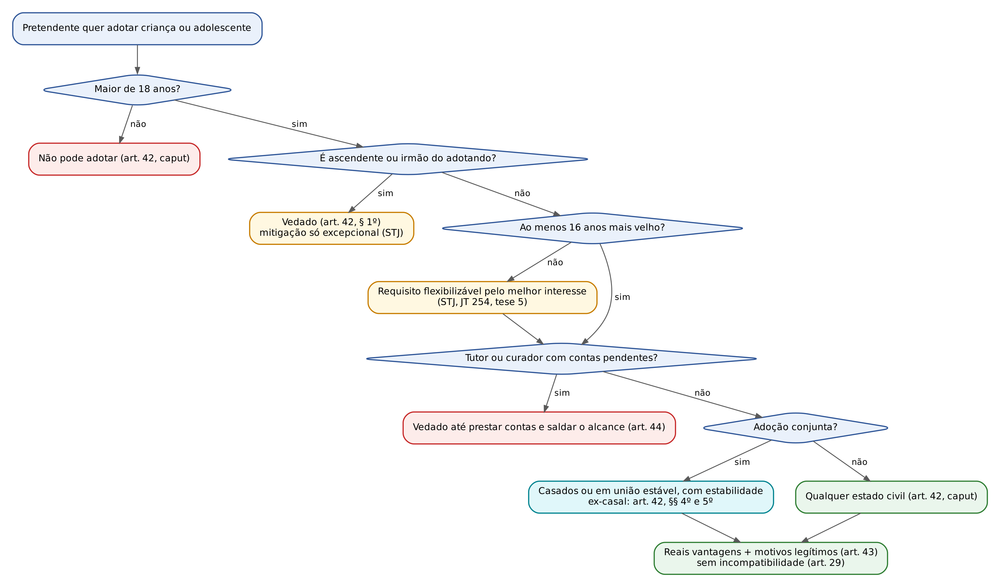
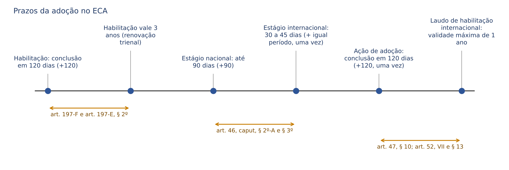
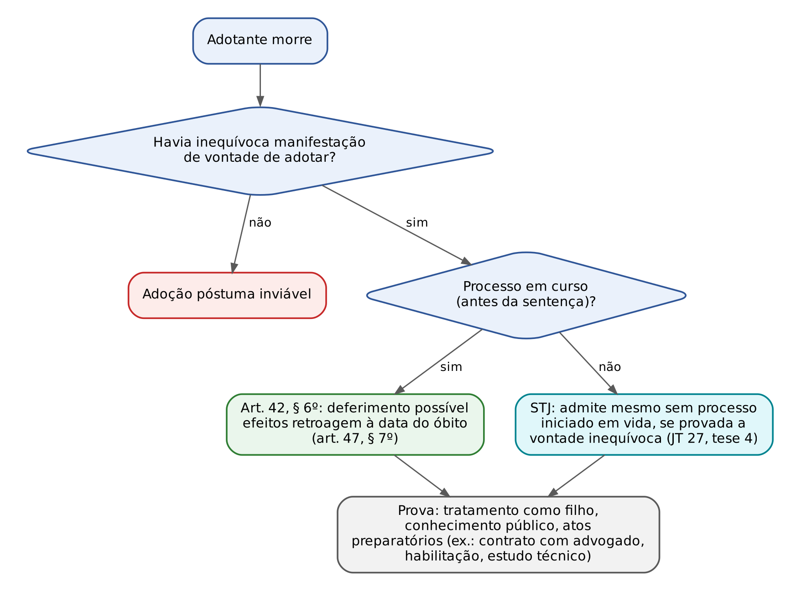
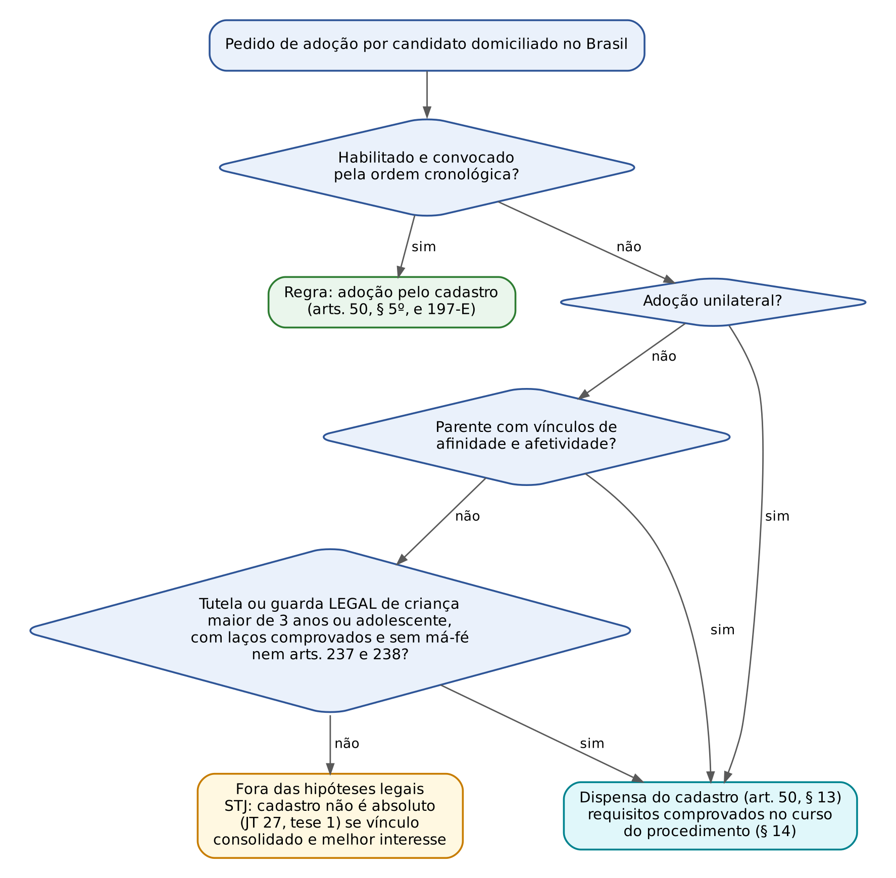
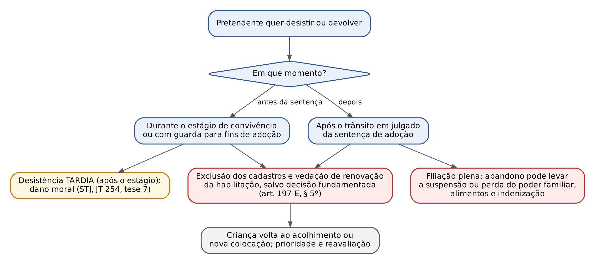
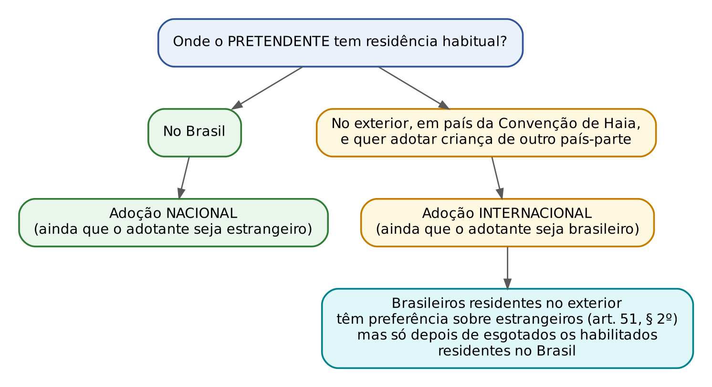
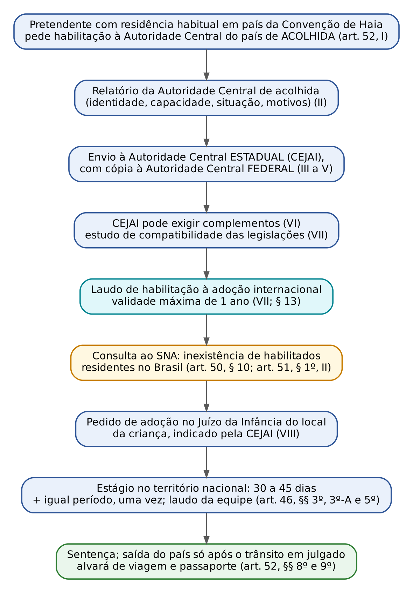

# CAPÍTULO 06 — FAMÍLIA SUBSTITUTA II: ADOÇÃO NACIONAL E INTERNACIONAL

:::INCIDENCIA
TJRS p. 1; TJSC p. 2 e 6. Nível A+. Lote: 30 questões (FGV 24, FCC 6), das quais 10 de provas de juiz (TJ-SC 2024 e 2025, TJ-BA, TJ-GO, TJ-PE, TJ-MS, TJ-SE, TJ-MT e ENAM).
O que mais cai: adoção póstuma (com ou sem processo em curso), desistência e devolução (art. 197-E, § 5º, e dano moral), conhecimento da origem biológica (art. 48), adoção de criança indígena (FUNAI x competência estadual), conceito de adoção internacional (residência habitual) e os prazos dos arts. 46 e 47.
:::

| Subtema | FGV | FCC | Padrão de cobrança |
|---|---|---|---|
| Adoção póstuma | 6 | 1 | caso com morte do adotante no curso do processo ou antes dele; art. 42, § 6º, ampliado pelo STJ |
| Desistência e devolução | 4 | 0 | exclusão dos cadastros (art. 197-E, § 5º), dano moral pela desistência tardia, destituição do poder familiar do adotante |
| Origem biológica (art. 48) | 3 | 1 | adolescente pede acesso ao processo: pode, com orientação jurídica e psicológica |
| Requisitos, impedimentos e consentimento | 3 | 3 | 18 anos, 16 de diferença, ascendentes e irmãos, consentimento dos pais ou destituição |
| Criança indígena | 3 | 0 | FUNAI obrigatória, competência da Justiça Estadual |
| Adoção internacional | 4 | 0 | residência habitual, subsidiariedade, consentimento do adolescente, estágio de 30 a 45 dias |
| Unilateral e conjunta | 2 | 2 | dispensa do cadastro; ex-casal (art. 42, § 4º) |
| Cadastro, intuitu personae, efeitos | 4 | 1 | art. 50, § 13; irmãos; igualdade entre filhos e licença-adotante |

## 06.1 Natureza e regime jurídico

### 06.1.1 Fontes e divisão de competências normativas

A adoção de criança e de adolescente "reger-se-á segundo o disposto nesta Lei" (ECA, art. 39, caput). O Código Civil, depois da Lei 12.010/2009 (Lei Nacional da Adoção), limita-se a remeter ao ECA (art. 1.618) e a disciplinar a adoção de maiores de 18 anos, que depende de "assistência efetiva do poder público e de sentença constitutiva", aplicando-se, no que couber, as regras do ECA (art. 1.619). Os aspectos civis (registro, adoção de maiores, adoção à brasileira na perspectiva da filiação, multiparentalidade) estão na Apostila de Direito Civil, Cap. 37 (37.12); aqui se desenvolve o regime estatutário completo.

Duas leis reescreveram o instituto e explicam quase todas as pegadinhas de "redação antiga x redação vigente":

| Lei | O que mudou (o que a banca cobra) |
|---|---|
| Lei 12.010/2009 | excepcionalidade e irrevogabilidade (art. 39, § 1º); vedação de adoção por procuração; adoção conjunta só por casados ou companheiros; ex-casal (art. 42, §§ 4º e 5º); adoção póstuma no curso do procedimento (art. 42, § 6º); art. 48 (origem biológica); cadastros estaduais, nacional e de estrangeiros; hipóteses de adoção sem cadastro (art. 50, § 13); novo conceito e procedimento da adoção internacional (arts. 51 a 52-D) |
| Lei 13.509/2017 | prevalência dos interesses do adotando (art. 39, § 3º); estágio de convivência com prazo MÁXIMO de 90 dias, prorrogável (art. 46, caput e § 2º-A); estágio internacional de 30 a 45 dias (art. 46, § 3º); estágio no território nacional (§ 5º); prazo de 120 dias para a ação de adoção (art. 47, § 10); prioridade a deficientes, doentes crônicos e grupos de irmãos (art. 50, § 15); conceito de adoção internacional pela residência habitual em país da Convenção (art. 51); renovação trienal da habilitação, 3 recusas e sanção da desistência (art. 197-E, §§ 2º a 5º); entrega voluntária (art. 19-A, ver Cap. 4) |
| Lei 12.955/2014 | prioridade de tramitação de adoção de criança ou adolescente com deficiência ou doença crônica (art. 47, § 9º) |
| Lei 14.979/2024 | art. 50, § 5º: os cadastros devem ser obrigatoriamente consultados, ressalvadas as hipóteses do § 13 e as particularidades das crianças e adolescentes indígenas ou quilombolas (art. 28, § 6º, II) |

### 06.1.2 Características

:::LEI ECA, ART. 39, §§ 1º A 3º
§ 1º A adoção é medida excepcional e irrevogável, à qual se deve recorrer apenas quando esgotados os recursos de manutenção da criança ou adolescente na família natural ou extensa, na forma do parágrafo único do art. 25 desta Lei.
§ 2º É vedada a adoção por procuração.
§ 3º Em caso de conflito entre direitos e interesses do adotando e de outras pessoas, inclusive seus pais biológicos, devem prevalecer os direitos e os interesses do adotando.
:::

- Excepcionalidade: a adoção é a ÚLTIMA das soluções do sistema de convivência familiar. A ordem é: manutenção ou reintegração na família natural; família extensa (art. 25, parágrafo único: parentes próximos com os quais a criança convive e mantém vínculos de afinidade e afetividade); só então família substituta, e dentro desta a adoção é a medida mais drástica porque rompe os vínculos de origem. A prioridade da família extensa, porém, NÃO é absoluta: exige vínculo real e compatibilidade com o melhor interesse (ver Cap. 4 e Cap. 5).
- Irrevogabilidade: a sentença de adoção não se desfaz por arrependimento do adotante, por morte dos adotantes (art. 49) nem por vontade dos pais biológicos. A mitigação jurisprudencial está em 06.9.
- Ato personalíssimo e solene: vedada a procuração (art. 39, § 2º). Não se confunde com a representação processual por advogado: o que se veda é que alguém manifeste, em nome do adotante, a vontade de adotar.
- Natureza jurídica: constituição de vínculo de filiação por SENTENÇA (art. 47); não há adoção por escritura, nem de maiores (Enunciado 272 das Jornadas de Direito Civil, ver Apostila de Direito Civil, Cap. 37).
- Plena (rompe todos os vínculos anteriores, salvo impedimentos matrimoniais e a hipótese da unilateral) e irrestrita quanto aos direitos (art. 41; CF, art. 227, § 6º).
- Requisito material aberto: "reais vantagens para o adotando" e "motivos legítimos" (art. 43), somados à cláusula geral do art. 29 (não se defere colocação a quem revele incompatibilidade com a medida ou não ofereça ambiente familiar adequado).

:::DICA ORDEM DE LEITURA DE QUALQUER CASO PRÁTICO DE ADOÇÃO
(1) A criança é adotável? (pais desconhecidos, falecidos, destituídos ou que consentiram validamente em audiência). (2) O pretendente pode adotar? (18 anos, 16 de diferença, não ascendente nem irmão, art. 44). (3) Precisa estar cadastrado? (art. 50, § 13). (4) Houve consentimento do adolescente maior de 12 anos em audiência? (5) Estágio de convivência: exigível, dispensável ou já cumprido? (6) Há particularidade (indígena, grupo de irmãos, residência no exterior, morte do adotante)? (7) Efeitos e registro.
:::

## 06.2 Requisitos subjetivos: quem adota e quem pode ser adotado

### 06.2.1 O adotante

:::LEI ECA, ART. 42, CAPUT E §§ 1º A 3º
Art. 42. Podem adotar os maiores de 18 (dezoito) anos, independentemente do estado civil.
§ 1º Não podem adotar os ascendentes e os irmãos do adotando.
§ 2º Para adoção conjunta, é indispensável que os adotantes sejam casados civilmente ou mantenham união estável, comprovada a estabilidade da família.
§ 3º O adotante há de ser, pelo menos, dezesseis anos mais velho do que o adotando.
:::

| Requisito | Regra | O que a banca tenta |
|---|---|---|
| Idade | maior de 18 anos | "21 anos", "25 anos", "casado no civil" (redações do Código de Menores e do CC/1916) |
| Estado civil | indiferente para a adoção singular | "pessoas sem cônjuge não podem adotar" |
| Diferença de idade | ao menos 16 anos | "20 anos", "14 anos"; "requisito cogente, inflexível" |
| Impedidos | ascendentes e irmãos do adotando | estender a tios, primos, padrastos (não há vedação) |
| Tutor ou curador | só depois de prestar contas e saldar o alcance (art. 44) | dizer que tutor jamais pode adotar o pupilo |
| Idade máxima | não há | "acima de 70 anos não pode" |
| Orientação sexual | irrelevante | ver 06.5.3 |
| Nacionalidade | irrelevante para a qualificação nacional ou internacional | ver 06.10 (o critério é a residência habitual) |

Diferença de 16 anos. O STJ trata o § 3º como requisito legal que "admite flexibilização para atender ao melhor interesse do adotado" (Jurisprudência em Teses, ed. 254, tese 5, com REsp 1.785.754-RS, REsp 1.717.167-DF e REsp 1.338.616-DF). Os precedentes envolvem, sobretudo, adoção unilateral por padrasto ou madrasta com diferença ligeiramente inferior e vínculo socioafetivo consolidado. A flexibilização é exceção fundamentada, nunca dispensa genérica; afirmar que o requisito é "cogente" e "não admite flexibilização judicial" é a alternativa errada típica (Q3870713, B).

Ascendentes e irmãos. A vedação preserva a identidade familiar (o avô adotante viraria pai da própria mãe biológica do neto; o irmão seria pai do irmão) e evita fraudes, sobretudo previdenciárias e sucessórias. A regra é a proibição (JT ed. 254, tese 3), mas "a norma geral impeditiva do § 1º do artigo 42 do ECA pode ser mitigada, em situações excepcionais, para permitir a adoção de descendentes por ascendentes" (tese 4, com REsp 1.587.477-SC, REsp 1.448.969-SC e REsp 2.067.372-MT, este julgado em 2024). Os requisitos cumulativos apontados nos precedentes estão sistematizados na Apostila de Direito Civil, Cap. 37 (37.8.2), que também trata da via alternativa do reconhecimento judicial de filiação socioafetiva entre avós e neto, à qual o art. 42, § 1º, não se aplica. Tios, primos, padrastos e madrastas NÃO estão impedidos: são colaterais de 3º e 4º graus ou afins, e podem até ser dispensados do cadastro (art. 50, § 13, II, para parentes; inciso I, para a unilateral).

:::PEGADINHA QUEM É IMPEDIDO: SÓ ASCENDENTES E IRMÃOS
A FCC (DPE-SP, Q3304078, correlata) propôs que a tia materna que cria o sobrinho desde os 3 anos estaria impedida porque haveria "vedação de adoção por colaterais até o terceiro grau": ERRADO. Gabarito D: a Justiça da Infância é competente para a adoção mesmo sem situação de risco (art. 148, III, que não se condiciona ao art. 98, diferentemente do parágrafo único do art. 148). Errados também: reconhecimento de maternidade socioafetiva direto no cartório (inviável: a pretensão é de ser registrada como mãe, com exclusão dos pais registrais, o que exige adoção), juízo de família e a exigência de prévia ação de guarda.
:::

:::QUESTAO FGV 2025 — SEASIC-SE — PSICÓLOGO (Q3351811)
Quem NÃO pode adotar. Gabarito: D (os avós maternos ou paternos). Armadilhas: casais homoafetivos (podem: 06.5.3), pessoas sem cônjuge (art. 42, caput), padrasto ou madrasta (podem, inclusive sem cadastro, na unilateral) e pessoas acima de 70 anos (não há limite máximo). Fundamento: art. 42, § 1º; a mitigação jurisprudencial excepcional não torna errada a resposta, porque a pergunta é "de acordo com a Lei".
:::

:::QUESTAO FCC 2026 — MPE-SE — ANALISTA (PSICOLOGIA) (Q3964529)
Requisito do adotante. Gabarito: C (contar com mais de 18 anos, independentemente do estado civil). Erradas: 20 anos mais velho (são 16), 21 anos e casamento civil (direito revogado), ascendente ou irmão em adoção conjunta (são impedidos em qualquer modalidade) e ex-companheiros "em qualquer circunstância" (o art. 42, § 4º, exige requisitos cumulativos: 06.5.1).
:::

### 06.2.2 O adotando

:::LEI ECA, ART. 40
Art. 40. O adotando deve contar com, no máximo, dezoito anos à data do pedido, salvo se já estiver sob a guarda ou tutela dos adotantes.
:::

- O marco é a DATA DO PEDIDO, não a da sentença: completados 18 anos no curso do processo, a adoção prossegue sob o ECA.
- A ressalva (já sob guarda ou tutela dos adotantes) permite aplicar o regime estatutário a quem já tinha 18 anos ao pedir; fora disso, a adoção de maior segue o art. 1.619 do CC, na vara de família.
- Não há idade mínima nem "idade-limite" para a adoção de adolescente. A adoção tardia é estimulada (prioridade do art. 50, § 15, para grupos de irmãos, deficiência e doença crônica; programa de preparação do art. 197-C, § 1º, que deve incluir "estímulo à adoção inter-racial", de crianças ou adolescentes com deficiência ou doença crônica "e de grupos de irmãos").

:::QUESTAO FGV 2026 — TJ-RJ — ANALISTA JUDICIÁRIO (PSICOLOGIA) (Q3870055)
Adolescente de 15 anos, acolhido e já destituído o poder familiar dos pais, pede para ser adotado depois de ver irmãos pequenos saírem para adoção. Gabarito: D (pode ser adotado por processo iniciado na Vara da Infância enquanto não atingir 18 anos). Armadilhas: "adoção só até 12 anos incompletos" (confusão com o marco do consentimento), exigência de concordância da família biológica (destituída, art. 45, § 1º) e as alternativas que mandam a equipe "desestimular" o projeto, contrárias ao art. 197-C, § 1º, e ao direito à convivência familiar.
:::

## 06.3 Consentimento: dos pais e do adotando

### 06.3.1 Consentimento dos pais ou do representante legal

:::LEI ECA, ART. 45
Art. 45. A adoção depende do consentimento dos pais ou do representante legal do adotando.
§ 1º O consentimento será dispensado em relação à criança ou adolescente cujos pais sejam desconhecidos ou tenham sido destituídos do poder familiar.
§ 2º Em se tratando de adotando maior de doze anos de idade, será também necessário o seu consentimento.
:::

A adoção só se defere por uma de três vias: (a) consentimento válido dos pais; (b) pais desconhecidos (ou falecidos, caso em que não há poder familiar a extinguir); (c) destituição do poder familiar, em procedimento contraditório, que é "pressuposto lógico" da adoção e pode ser cumulada com ela (art. 169; ver Cap. 18). A SUSPENSÃO do poder familiar NÃO dispensa o consentimento: o art. 45, § 1º, fala em pais "desconhecidos" ou "destituídos". A alternativa que inclui "suspensos" no rol de dispensa é errada (Q3301254, D). Cuidado com a armadilha cruzada: o art. 166, caput, admite pedido de colocação em família substituta formulado diretamente em cartório se os pais forem falecidos, "destituídos ou suspensos" do poder familiar ou houverem aderido expressamente ao pedido; ali se fala do RITO simplificado (e de todas as modalidades de colocação), não da dispensa do consentimento para adoção.

Forma e momento do consentimento (desenvolvidos no Cap. 18, procedimento, e no Cap. 4, entrega voluntária):

| Ponto | Regra | Dispositivo |
|---|---|---|
| Momento | só vale se dado APÓS o nascimento | art. 166, § 6º |
| Orientação prévia | equipe interprofissional esclarece, em especial, a irrevogabilidade da adoção | art. 166, § 2º |
| Forma | ouvidas as partes, assistidas por advogado ou defensor, na presença do MP, em até 10 dias do protocolo ou da entrega da criança; o juiz declara a extinção do poder familiar | art. 166, § 1º |
| Escrito | sem ratificação na audiência, não vale | art. 166, § 4º |
| Retratação | até a data da audiência | art. 166, § 5º |
| Arrependimento | em 10 dias da prolação da sentença de extinção do poder familiar | art. 166, § 5º |
| Sigilo | garantido o direito ao sigilo das informações | art. 166, § 3º; art. 19-A, § 9º |

A retratação ou o arrependimento tempestivos NÃO geram direito potestativo à restituição da criança. O STJ fixou que a retratação "não gera direito potestativo aos pais biológicos de recuperarem o infante, mas será sopesada com outros elementos para definir o melhor interesse" (JT ed. 251, tese 10, REsp 1.578.913-MG). Em 2026, a Terceira Turma reafirmou: o exercício tempestivo do arrependimento na entrega voluntária "não implica a automática revogação da adoção", podendo ser relativizado diante da consolidação da situação fática (Informativo 886, Rel. Min. Humberto Martins, j. 30/3/2026, processo em segredo de justiça).

:::QUESTAO FCC 2026 — DPE-MA — DEFENSOR PÚBLICO (Q4012629)
Mulher sem parentesco cria criança de 6 anos desde os 4 meses de vida, sem guarda judicial, e procura a Defensoria para adotá-la. Gabarito: C (a adoção é possível, mas dependerá, se vivos os pais, do consentimento deles dado em audiência ou da decretação judicial da perda do poder familiar).
Passos: (1) o art. 45 exige consentimento ou destituição; (2) a guarda judicial prévia NÃO é pressuposto da adoção (A errada), embora a mera guarda de fato não dispense o estágio (art. 46, § 2º) nem o cadastro (art. 50, § 13, III, exige guarda LEGAL); (3) a competência é da Justiça da Infância (art. 148, III), haja ou não situação de risco (B errada); (4) não se exige inscrição prévia no SNA como primeira providência (D errada): a solução passará pelo exame do vínculo consolidado (06.6.3); (5) não é jurisdição voluntária se os pais "não forem localizados" (E errada): pais conhecidos e não localizados são citados por edital no procedimento contraditório de destituição.
:::

### 06.3.2 Consentimento do adotando

Maior de 12 anos: o consentimento é REQUISITO (art. 45, § 2º), colhido EM AUDIÊNCIA (art. 28, § 2º). Criança (até 12 anos incompletos): "sempre que possível", será previamente ouvida pela equipe interprofissional, e sua opinião será "devidamente considerada" (art. 28, § 1º), sem caráter vinculante. A troca de prenome pedida pelo adotante exige oitiva obrigatória do adotando, observados os §§ 1º e 2º do art. 28 (art. 47, § 6º).

| Idade do adotando | Manifestação | Natureza | Fundamento |
|---|---|---|---|
| Criança | oitiva pela equipe, sempre que possível | opinião considerada, não vinculante | art. 28, § 1º |
| Maior de 12 anos | consentimento em audiência | requisito de validade | arts. 28, § 2º, e 45, § 2º |
| Adolescente em adoção internacional | consulta por meios adequados + parecer da equipe atestando preparo + art. 28, §§ 1º e 2º | condição de admissibilidade da adoção internacional | art. 51, § 1º, III |

:::QUESTAO FGV 2026 — TJ-RJ — COMISSÁRIO DE JUSTIÇA DA INFÂNCIA (Q3870707)
Irmãos de 13 e 10 anos, destituído o poder familiar dos pais e frustrada a família extensa, serão inseridos no cadastro. Gabarito: E (é obrigatória a participação dos pretendentes em programa oferecido pela Justiça da Infância que inclua estímulo à adoção de grupos de irmãos: art. 197-C, § 1º).
Armadilhas: A (ambos devem consentir: só o de 13 anos, maior de 12); B (preparação dos acolhidos "pelo prazo mínimo de seis meses": o art. 197-C, § 3º, diz apenas que é RECOMENDÁVEL a preparação, sem prazo); C (adoção "juridicamente inviável" pela idade); D (colocação conjunta "vedado o rompimento": o art. 28, § 4º, admite solução diversa diante de risco de abuso ou situação que a justifique plenamente, e manda apenas EVITAR o rompimento definitivo dos vínculos fraternais).
:::

### 06.3.3 Criança ou adolescente indígena ou quilombola

O art. 28, § 6º, impõe, além das regras gerais: respeito à identidade social e cultural, costumes, tradições e instituições (desde que compatíveis com os direitos fundamentais); colocação PRIORITÁRIA no seio da comunidade ou junto a membros da mesma etnia; e "a intervenção e oitiva de representantes do órgão federal responsável pela política indigenista, no caso de crianças e adolescentes indígenas, e de antropólogos, perante a equipe interprofissional ou multidisciplinar". Desde a Lei 14.979/2024, o art. 50, § 5º, ressalva expressamente as "particularidades" dessas crianças na consulta obrigatória aos cadastros: a prioridade étnico-comunitária vem antes da ordem do SNA.

:::JURIS STJ, CC 209.192-PA, SEGUNDA SEÇÃO, REL. MIN. NANCY ANDRIGHI, J. 3/4/2025 (INFO 848)
"É do melhor interesse de crianças e adolescentes indígenas a competência da Justiça Estadual para processar e julgar ações de adoção, assim sendo, a intervenção da FUNAI em tais situações, ainda que obrigatória, não atrai a competência automática da Justiça Federal." A adoção trata de direito individual da criança, não de "disputa sobre direitos indígenas" (CF, art. 109, XI), que pressupõe interesse coletivo da comunidade; a FUNAI atua com viés consultivo, sem ser autora, ré, assistente ou opoente; as Varas da Infância têm a estrutura técnica adequada.
:::

:::QUESTAO FGV 2025 — TJ-MS — JUIZ SUBSTITUTO (Q3786369)
Casal habilitado propõe adoção de criança indígena; o juiz da Infância declina para a Justiça Federal. Gabarito: E (incorreta a declinação: a FUNAI não exerce direito próprio, não figura como parte e tem participação consultiva; competência da Justiça Estadual).
Armadilhas: A acerta a obrigatoriedade da oitiva mas erra a consequência (Justiça Federal); B nega a obrigatoriedade; C transforma a prioridade da comunidade em vedação absoluta de adoção por não indígenas; D diz que a ausência da FUNAI pode ser dispensada "para maior celeridade".
:::

:::QUESTAO FGV 2025 — TJ-MS — JUIZ SUBSTITUTO (Q3786367)
Criança guarani de 1 ano, órfã por acidente; o bombeiro que a resgatou, não indígena, quer adotá-la. Gabarito: D (a adoção é excepcional e irrevogável, só cabível após a busca da família extensa, observada a prioridade da colocação na comunidade ou junto a membros da mesma etnia).
Armadilhas: A ("sempre que possível": a oitiva da FUNAI é OBRIGATÓRIA, art. 28, § 6º, III); B (Justiça Federal); C (a morte dos pais extingue o poder familiar, mas não autoriza a IMEDIATA inserção no SNA, pois antes vêm família extensa e comunidade); E (a adoção *intuitu personae* não afasta a prioridade étnica, e não há vínculo prévio que a justifique).
:::

:::QUESTAO FGV 2026 — TJ-BA — JUIZ SUBSTITUTO (Q4083745)
Criança Tuxá de 5 anos sob guarda legal do autor há 2 anos; o autor, que já manifestara em audiência a vontade de adotar, morre antes da sentença; a família biológica alega competência federal, primazia da família natural, imprescindibilidade do estágio e perda do objeto. Gabarito oficial: C (competência estadual, intervenção obrigatória da FUNAI, estágio dispensável pela guarda legal).
Passos: (1) competência estadual (CC 209.192); (2) FUNAI obrigatória (art. 28, § 6º, III), o que exclui B, que a tornava dispensável; (3) estágio dispensável quando o adotando já está sob guarda legal por tempo suficiente (art. 46, § 1º), o que exclui E; (4) a morte após inequívoca manifestação de vontade não extingue o processo (art. 42, § 6º). Observação: B também acertava a adoção póstuma, mas foi derrubada pela dispensabilidade da FUNAI; A e D erram ao deslocar a competência.
:::

## 06.4 Estágio de convivência

:::LEI ECA, ART. 46 (REDAÇÃO DA LEI 13.509/2017)
Art. 46. A adoção será precedida de estágio de convivência com a criança ou adolescente, pelo prazo máximo de 90 (noventa) dias, observadas a idade da criança ou adolescente e as peculiaridades do caso.
§ 1º O estágio de convivência poderá ser dispensado se o adotando já estiver sob a tutela ou guarda legal do adotante durante tempo suficiente para que seja possível avaliar a conveniência da constituição do vínculo.
§ 2º A simples guarda de fato não autoriza, por si só, a dispensa da realização do estágio de convivência.
§ 2º-A. O prazo máximo estabelecido no caput deste artigo pode ser prorrogado por até igual período, mediante decisão fundamentada da autoridade judiciária.
§ 3º Em caso de adoção por pessoa ou casal residente ou domiciliado fora do País, o estágio de convivência será de, no mínimo, 30 (trinta) dias e, no máximo, 45 (quarenta e cinco) dias, prorrogável por até igual período, uma única vez, mediante decisão fundamentada da autoridade judiciária.
:::

Os §§ 3º-A a 5º completam o regime: no estágio internacional, ao final do prazo a equipe apresenta "laudo fundamentado" que recomendará ou não o deferimento (§ 3º-A); todo estágio é acompanhado pela equipe interprofissional da Justiça da Infância, que apresentará "relatório minucioso" (§ 4º); e o estágio "será cumprido no território nacional, preferencialmente na comarca de residência da criança ou adolescente, ou, a critério do juiz, em cidade limítrofe, respeitada, em qualquer hipótese, a competência do juízo da comarca de residência da criança" (§ 5º).

| Ponto | Adoção nacional | Adoção por residente no exterior |
|---|---|---|
| Prazo | máximo de 90 dias, sem mínimo legal | mínimo de 30 e máximo de 45 dias |
| Prorrogação | até igual período, decisão fundamentada | até igual período, UMA ÚNICA VEZ, decisão fundamentada |
| Dispensa | possível: tutela ou guarda LEGAL por tempo suficiente (§ 1º) | inviável na prática (o pretendente reside fora); a lei não prevê dispensa específica |
| Guarda de fato | não autoriza, por si só, a dispensa (§ 2º) | idem |
| Local | território nacional, preferencialmente na comarca da criança ou cidade limítrofe | idem; NUNCA no exterior |
| Produto | relatório minucioso da equipe (§ 4º) | laudo fundamentado recomendando ou não (§ 3º-A) |

:::PEGADINHA ESTÁGIO NO ESTRANGEIRO, PRAZO "VEDADA A PRORROGAÇÃO" E DISPENSA PELA GUARDA DE FATO
Três armadilhas recorrentes da FGV, todas na Q3870713 e na Q3301254: (a) "o estágio será cumprido no território nacional OU NO ESTRANGEIRO": errado, só no território nacional (§ 5º); (b) "prazo máximo de 90 dias, vedada a prorrogação": errado, cabe prorrogação por igual período (§ 2º-A); (c) "pode ser dispensado diante de vínculo socioafetivo preexistente": só com tutela ou guarda LEGAL; guarda de fato, por si só, não basta (§ 2º). Também errado dizer que, na adoção nacional, o estágio tem prazo "mínimo" de 30 dias: o mínimo é só da internacional.
:::

A dispensa é faculdade do juiz ("poderá"), não direito do guardião. E o estágio não se confunde com a guarda provisória do art. 167 (deferida no procedimento de colocação em família substituta, com entrega mediante termo de responsabilidade, art. 167, parágrafo único) nem com a guarda provisória para fins de adoção da entrega voluntária (art. 19-A, §§ 4º, 6º e 7º: concluído o estágio, os guardiões têm 15 dias para propor a ação de adoção; ver Cap. 4). A desistência durante o estágio produz as consequências do art. 197-E, § 5º (06.7).

:::QUESTAO FGV 2025 — TJ-SC — JUIZ SUBSTITUTO (Q3324257)
Casal de norte-americanos domiciliados no Brasil, em união estável há 20 anos, habilita-se, recusa injustificadamente duas crianças do perfil, convive com êxito com a terceira (8 anos) e, antes da sentença, desiste alegando agressividade. Gabarito: D (permitida a adoção, pois para a conjunta basta que os adotantes sejam ou tenham sido casados ou mantenham ou tenham mantido união estável).
Passos e armadilhas: (1) domicílio no Brasil = adoção NACIONAL (art. 51): logo, B (esgotamento das famílias brasileiras) e C (estágio de 30 a 45 dias) estão erradas, porque partem da nacionalidade; (2) A: após 3 recusas injustificadas há "reavaliação" da habilitação, não "suspensão" (art. 197-E, § 4º), e no caso foram só duas; (3) E: a desistência gera exclusão dos cadastros e vedação de renovação da habilitação, "salvo decisão judicial fundamentada", SEM prazo de 5 anos (art. 197-E, § 5º). Observação: D é paráfrase ampliada, que soma o art. 42, § 2º, ao § 4º (ex-casal); a banca a tomou como correta porque as demais têm erro literal.
:::

## 06.5 Modalidades de adoção

### 06.5.1 Adoção conjunta e adoção por ex-casal

A adoção conjunta exige casamento civil ou união estável, "comprovada a estabilidade da família" (art. 42, § 2º). A Lei 12.010/2009 acabou com a adoção conjunta por pessoas não casadas nem companheiras (por exemplo, dois irmãos ou dois amigos). A adoção por ex-casal é EXCEÇÃO com quatro requisitos CUMULATIVOS (art. 42, § 4º):

1. acordo sobre a guarda e o regime de visitas;

2. estágio de convivência INICIADO na constância da convivência do casal;

3. comprovação de vínculos de afinidade e afetividade com aquele que não ficará com a guarda;

4. que esses vínculos "justifiquem a excepcionalidade da concessão".

Demonstrado "efetivo benefício ao adotando", será assegurada a guarda compartilhada (art. 42, § 5º, com remissão ao art. 1.584 do CC).

:::PEGADINHA ALIMENTOS NO ART. 42, § 4º
O texto legal fala em acordo "sobre a guarda e o regime de visitas". A FGV acrescentou "alimentos" na alternativa E da Q3301254 (ex-casal que se divorcia no curso da ação). Alternativa com elemento a mais em rol legal deve ser lida com desconfiança; no caso, a questão tinha resposta certa mais evidente (A, adoção internacional).
:::

### 06.5.2 Adoção unilateral

:::LEI ECA, ART. 41, § 1º
§ 1º Se um dos cônjuges ou concubinos adota o filho do outro, mantêm-se os vínculos de filiação entre o adotado e o cônjuge ou concubino do adotante e os respectivos parentes.
:::

Na unilateral, o cônjuge ou companheiro adota o filho do outro: rompe-se o vínculo com o genitor substituído (e seus parentes), e preserva-se o vínculo com o genitor que é cônjuge ou companheiro do adotante. Para o STJ, ela "ocorre quando um dos genitores, ao contrair novo matrimônio ou constituir nova união estável, compartilha o poder familiar com o cônjuge/companheiro(a) adotante" (JT ed. 254, tese 1, REsp 1.545.959-SC), e "a consulta ao grupo familiar do ascendente ausente não é necessária, pois cabe, exclusivamente, ao genitor que permaneceu no exercício do poder familiar decidir sobre a conveniência da adoção" (tese 2). A primeira das exceções ao cadastro é justamente a unilateral (art. 50, § 13, I).

Hipóteses típicas: (a) filho só com a mãe no registro (pai desconhecido): basta o consentimento da mãe; (b) pai registral vivo: consentimento dele ou destituição do poder familiar em procedimento contraditório; (c) pai falecido: não há poder familiar a destituir, mas a adoção apaga o vínculo jurídico com a família paterna, inclusive com os avós, razão pela qual a socioafetividade com multiparentalidade é frequentemente preferível (ver Cap. 7 e Apostila de Direito Civil, Cap. 37). Registro: na unilateral, faz-se averbação no assento original, substituindo-se apenas um dos campos de filiação (ver Apostila de Direito Civil, 37.12.3).

:::QUESTAO FCC 2026 — DPE-BA — DEFENSOR PÚBLICO (Q4037479)
Conceito de adoção unilateral. Gabarito: C (um dos cônjuges ou concubinos adota o filho do outro, dispensado o prévio cadastro como habilitado).
Armadilhas: A (reconhecimento extrajudicial perante o Conselho Tutelar: inexistente); B (confunde unilateral com adoção singular, por adotante único); D (falta de discernimento do adotando: nada tem a ver); E (a unilateral SUPRIME a filiação originária em relação ao genitor substituído; só preserva o vínculo com o cônjuge ou companheiro do adotante).
:::

:::QUESTAO FCC 2026 — AL-RR — ANALISTA LEGISLATIVO (ASSISTENTE SOCIAL) (Q4156353)
Cinco assertivas sobre adoção. Gabarito: D (I, II e V).
Corretas: I (unilateral: art. 41, § 1º), II (sucessão recíproca até o 4º grau colateral: art. 41, § 2º) e V (póstuma: art. 42, § 6º). Erradas: III (para a conjunta é INDISPENSÁVEL casamento ou união estável, não "facultativo") e IV (diferença de 16 anos, não 14).
:::

### 06.5.3 Adoção por casal homoafetivo

O STF, no julgamento conjunto da ADI 4.277 e da ADPF 132 (Plenário, 5/5/2011), reconheceu a união estável entre pessoas do mesmo sexo como entidade familiar, com as mesmas consequências da heteroafetiva; daí decorre a legitimidade para a adoção conjunta (art. 42, § 2º). O STJ consolidou: "É possível adoção por casal homoafetivo" (JT ed. 27, tese 14). No leading case, a Quarta Turma admitiu que a companheira adotasse os dois irmãos já adotados pela outra, com quem vivia em união estável havia anos, porque os estudos especializados não indicam inconveniente na adoção por casais homoafetivos, importando a qualidade do vínculo e do afeto (STJ, REsp 889.852-RS, Rel. Min. Luis Felipe Salomão, Quarta Turma, j. 27/4/2010).

Consequências: ambos constam do registro como pais ou mães, sem distinção de campo (o registro consigna "o nome dos adotantes como pais", art. 47, § 1º); a habilitação não pode impor restrição de sexo ou idade do adotando em razão da orientação sexual dos pretendentes; e a adoção por pessoa solteira homossexual é adoção singular comum (art. 42, caput).

:::QUESTAO FGV 2026 — MPE-ES — AGENTE TÉCNICO (PSICÓLOGO) (Q4219142)
Adolescente de 17 anos, adotado com 1 mês por casal de dois pais, quer conhecer a família biológica, com apoio dos adotantes. Gabarito: B (aos 18 anos terá direito de conhecer o processo de adoção e suas origens biológicas).
Armadilhas: A ("só depois dos 18": o art. 48, parágrafo único, permite acesso antes, a seu pedido, com orientação jurídica e psicológica; por isso B, que apenas descreve a regra do caput sem negar o parágrafo único, é a correta); C (a morte dos adotantes NÃO restabelece o poder familiar dos pais naturais, art. 49); D (na adoção homoafetiva os dois pais constam da certidão); E (autorização escrita dos adotantes: inexistente).
:::

### 06.5.4 Adoção póstuma (*post mortem*)

:::LEI ECA, ART. 42, § 6º, E ART. 47, § 7º
Art. 42, § 6º A adoção poderá ser deferida ao adotante que, após inequívoca manifestação de vontade, vier a falecer no curso do procedimento, antes de prolatada a sentença.
Art. 47, § 7º A adoção produz seus efeitos a partir do trânsito em julgado da sentença constitutiva, exceto na hipótese prevista no § 6º do art. 42 desta Lei, caso em que terá força retroativa à data do óbito.
:::

Pela letra da lei, são três requisitos: (a) inequívoca manifestação de vontade; (b) morte no curso do procedimento; (c) antes da sentença. A jurisprudência do STJ AMPLIOU a hipótese: "É possível a adoção póstuma quando comprovada a anterior manifestação inequívoca do adotante" (JT ed. 27, tese 4), inclusive quando o processo NÃO foi iniciado em vida, desde que a vontade se prove por outros meios. Os precedentes valem-se, por analogia, dos elementos que caracterizam a filiação socioafetiva: tratamento do adotando como filho e conhecimento público dessa condição.

| Situação | Solução | Fonte |
|---|---|---|
| Casal adota; um morre no curso do processo, após manifestar a vontade | procedência para ambos; efeitos retroagem ao óbito quanto ao falecido | art. 42, § 6º; art. 47, § 7º |
| Adotante singular morre no curso do processo | idem: sentença em favor do falecido; a criança passa a ser herdeira | idem |
| Morte ANTES do ajuizamento, com prova inequívoca da vontade (tratamento como filho, atos preparatórios) | admitida pelo STJ | JT ed. 27, tese 4 |
| Herdeiros do falecido querem intervir para impedir a adoção | não há exigência legal de anuência dos herdeiros; o interesse sucessório não se sobrepõe ao melhor interesse | art. 39, § 3º; Q3362366 |
| Morte sem qualquer manifestação de vontade | inviável; resta a guarda ou tutela em favor de outro, ou o reconhecimento de socioafetividade, se houver posse de estado de filho | — |

Distinção com a socioafetividade *post mortem*: a filiação socioafetiva reconhecida após a morte do pai ou mãe socioafetivos é ação declaratória de vínculo preexistente, sem procedimento de adoção (ver Apostila de Direito Civil, 37.8.1). Na prova, quando o enunciado fala em "adoção", resolva pelo art. 42, § 6º, e pela tese 4.

:::QUESTAO FGV 2024 — TJ-SC — JUIZ SUBSTITUTO (Q2386985)
Casal habilitado, estágio exitoso com dois irmãos destituídos, estudos reafirmando o desejo de adotar; o varão morre de infarto antes da audiência de instrução. Gabarito: D (procedência possível em relação a ambos, diante da inequívoca manifestação de vontade).
Armadilhas: A (procedência só para a viúva), B (renovar estudos e habilitação), C (reinício do estágio "por expressa previsão legal"), E (impossibilidade jurídica e nulidade). Fundamento: art. 42, § 6º.
:::

:::QUESTAO FGV 2025 — ENAM — EXAME NACIONAL DA MAGISTRATURA (Q3362366)
Sentença deferiu a adoção ao casal, incluído o varão falecido no curso do processo; os pais dele apelam como terceiros, alegando extinção sem mérito pelo caráter personalíssimo e repercussões sucessórias. Gabarito: D (não lhes assiste razão: o ECA reconhece expressamente a adoção póstuma, com manifestação inequívoca antes da sentença).
Armadilhas: B (a vontade do sobrevivente NÃO "supre" a do falecido: exige-se a vontade inequívoca do próprio falecido); C (o adotado tem direitos sucessórios em relação ao falecido, pois os efeitos retroagem ao óbito); E (anuência dos interessados na herança).
:::

:::QUESTAO FGV 2024 — TJ-MT — JUIZ SUBSTITUTO (Q3086946)
Viúva propõe adoção do adolescente em nome próprio e do falecido marido, provando por testemunhas e pelo contrato de honorários firmado por ele que cuidava do adotando como filho. Gabarito: E (pode prosseguir, pois, embora a ação devesse ter sido proposta em vida, a jurisprudência aceita provas da inequívoca vontade do falecido).
Armadilhas: A e D (citação da mãe ou de todos os herdeiros do falecido para anuírem); B (exigência de ação proposta em vida); C (prova pré-constituída, sem instrução). Ressalva: a alternativa fala em jurisprudência "unânime"; o advérbio é exagerado, mas a orientação está consolidada (JT ed. 27, tese 4). Gabarito mantido.
:::

:::QUESTAO FGV 2026 — TJ-RJ — COMISSÁRIO DE JUSTIÇA DA INFÂNCIA (Q3870713)
Casal requer adoção de criança de 4 anos sem convívio prévio; o varão morre antes do início do estágio; a viúva junta documentos indicando a vontade inequívoca dele; a equipe aponta que o casal não preenche a diferença de 16 anos. Gabarito: A (o STJ admite adoção póstuma com vontade inequívoca, inclusive quando o processo não tenha sido formalmente iniciado em vida).
Armadilhas: B (diferença etária inflexível: o STJ admite flexibilização, 06.2.1); C (prazo de 90 dias "vedada a prorrogação"); D (dispensa do estágio sem convívio prévio nem guarda legal); E (estágio "no estrangeiro").
No mesmo sentido: Q3390889 (FGV 2025, DPE-PE, Defensor Público, gabarito B: tios que criam o sobrinho, com o tio acometido de câncer; a adoção póstuma é admitida excepcionalmente mesmo que o adotante morra antes de iniciado o processo, diante da longa relação de afetividade; erradas a espera pela ação do MP, a suposta vedação de adoção por colaterais, a citação do pai preso por meio da Defensoria e a ressalva sucessória da alternativa E, que contraria o art. 41).
:::

### 06.5.5 Adoção *intuitu personae* (dirigida) e adoção "pronta"

Adoção *intuitu personae* ou dirigida é aquela em que os pais biológicos (em regra, a mãe) escolhem e entregam a criança a pessoa determinada, não cadastrada, para que a adote. Não há previsão legal autorizando-a como modalidade autônoma: o sistema é o do cadastro (art. 50, § 5º) e da entrega voluntária à Justiça da Infância (art. 19-A); a entrega a terceiros fora do Judiciário é, inclusive, causa de perda do poder familiar no CC (art. 1.638, V, incluído pela Lei 13.509/2017; ver Apostila de Direito Civil, Cap. 38). Se houver paga ou recompensa, há crime (art. 238 do ECA, desenvolvido no Cap. 21).

Ainda assim, o STJ não trata a irregularidade como óbice automático: "A observância do cadastro de adotantes não é absoluta e pode ser excepcionada em prol do princípio do melhor interesse da criança" (JT ed. 27, tese 1). O critério decisivo é o tempo e a qualidade do vínculo já formado, avaliados por estudo técnico, e a ausência de má-fé ou de tráfico. Quando o vínculo ainda não se formou (recém-nascido entregue dias antes), a tendência é privilegiar o cadastro; quando já há convivência longa e saudável, a retirada da criança costuma ser vista como violência institucional. A adoção "pronta" é a denominação doutrinária do pedido formulado por quem já está com a criança (por exemplo, a guardiã de fato que a cria há anos) e pede a regularização.

:::QUESTAO FGV 2025 — TJ-SE — JUIZ SUBSTITUTO (Q3301257)
Mãe entrega o recém-nascido a casal de amigos; quatro anos depois, com vínculo afetivo, o casal ajuíza a adoção com anuência da mãe; o MP pede busca e apreensão, acolhimento e consulta ao cadastro, o que o juiz defere. Gabarito oficial: A (cuida-se da denominada adoção *intuitu personae*).
Análise: a banca pediu a QUALIFICAÇÃO do caso. As demais são falsas: B e D validam a busca e apreensão; C afirma que a ordem cronológica é absoluta (o STJ diz o contrário, JT ed. 27, tese 1); E começa bem (acolhimento inadequado diante do vínculo socioafetivo, JT ed. 27, tese 3) mas condiciona a adoção pelo casal a não haver "pretendente interessado", subordinando o vínculo de quatro anos à fila do cadastro.
:::

### 06.5.6 Adoção à brasileira e adoção irregular

É o registro de filho alheio como próprio, sem processo judicial. No plano penal, configura o crime do art. 242 do CP (ver Apostila de Direito Penal); no plano civil, gera filiação socioafetiva registral cuja anulação é restrita (ver Apostila de Direito Civil, 37.12.5). No plano estatutário, interessam quatro orientações:

- Acolhimento: "O acolhimento institucional ou familiar temporário não representa o melhor interesse da criança mesmo nos casos de adoção irregular ou 'à brasileira', exceto quando há evidente risco à integridade física ou psíquica" (JT ed. 27, tese 3). A suspeita de adoção irregular não justifica, por si, o abrigamento de criança bem inserida em ambiente familiar (STJ, HC 878.386-ES, Info 806; v. Cap. 4).
- *Habeas corpus*: em regra não é via para discutir guarda e adoção, "salvo manifesta ilegalidade" (JT ed. 27, tese 2); a ilegalidade flagrante reconhecida nos precedentes é justamente o acolhimento institucional de criança por adoção irregular, sem risco concreto.
- Tutela coletiva: inexiste interesse processual do MP em ação civil pública por dano moral coletivo e dano social contra casal que TENTOU a adoção à brasileira sem consegui-la; a conduta deve ser desestimulada e não convalidada, mas a ACP é inútil e inadequada, e falta significância para dano coletivo (STJ, REsp 2.126.256-SC, Terceira Turma, Rel. p/ acórdão Min. Ricardo Villas Bôas Cueva, j. 21/5/2024).
- Situação consolidada: "Eventuais irregularidades na adoção podem ser superadas em virtude da situação de fato consolidada no tempo, desde que favoráveis ao adotando" (JT ed. 27, tese 6, formada em homologações de sentenças estrangeiras de adoção).

:::QUESTAO FGV 2026 — TJ-SC — ASSISTENTE SOCIAL (Q4150480)
Adolescente registrada como filha biológica por quem sabia não ser (adoção à brasileira) quer conhecer a família de nascimento e encontra dificuldades por inexistir processo formal. Gabarito: A (o conhecimento das origens relaciona-se à construção da identidade pessoal do adotado).
Armadilhas: B (preservação dos vínculos autoriza restringir o acesso), D (a falta de registro formal "impede legalmente" a busca: o direito à identidade genética independe do processo, podendo ser exercido por ação própria) e as alternativas psicologizantes C e E. Fundamento: art. 48 (06.8.3) e direito da personalidade à origem genética.
:::

## 06.6 Cadastros e Sistema Nacional de Adoção e Acolhimento (SNA)

### 06.6.1 Estrutura legal (art. 50)

O art. 50 prevê, em cada comarca ou foro regional, um registro de crianças e adolescentes em condições de serem adotados e outro de pessoas interessadas (caput); cadastros estaduais, distrital e nacional, que "deverão obrigatoriamente ser consultados pela autoridade judiciária em qualquer procedimento de adoção", ressalvadas as hipóteses do § 13 e as particularidades de indígenas e quilombolas (§ 5º, redação da Lei 14.979/2024); e cadastros DISTINTOS para pessoas ou casais residentes fora do País, que "somente serão consultados na inexistência de postulantes nacionais habilitados" (§ 6º).

| Regra | Conteúdo | § do art. 50 |
|---|---|---|
| Inscrição | após consulta aos órgãos técnicos, ouvido o MP; indeferida se não satisfeitos os requisitos ou presente o art. 29 | §§ 1º e 2º |
| Preparação | período de preparação psicossocial e jurídica, sempre que possível com contato com acolhidos | §§ 3º e 4º |
| Prazo de inscrição | 48 horas para inscrever nos cadastros estadual e nacional crianças sem colocação na comarca e pretendentes habilitados, "sob pena de responsabilidade" | § 8º |
| Gestão | Autoridade Central Estadual zela pela alimentação, com comunicação à Federal | § 9º |
| Internacional | só após verificada a ausência de pretendentes residentes no País com perfil compatível | § 10 |
| Enquanto não há adotante | guarda de família cadastrada em programa de acolhimento familiar, sempre que possível | § 11 |
| Fiscalização | o MP fiscaliza a alimentação do cadastro e a convocação criteriosa | § 12 |
| Exceções ao cadastro | unilateral; parente com afinidade e afetividade; tutela ou guarda legal de criança maior de 3 anos ou adolescente | § 13 |
| Prioridade | interessados em adotar criança ou adolescente com deficiência, doença crônica, necessidades específicas de saúde e grupos de irmãos | § 15 |

O cadastro de recém-nascidos e crianças acolhidas "não procuradas por suas famílias no prazo de 30 (trinta) dias, contado a partir do dia do acolhimento" é imposto pelo art. 19-A, § 10 (ver Cap. 4).

:::QUESTAO FGV 2025 — PREFEITURA DE CANAÃ DOS CARAJÁS — PSICÓLOGO (Q3265277)
Recém-nascido abandonado em via pública, acolhido pelo Conselho Tutelar; 30 dias depois, ninguém o procurou. Gabarito: C (encaminhamento para adoção por pretendentes habilitados).
Fundamento: art. 19-A, § 10 (cadastro após 30 dias sem procura) e art. 45, § 1º (pais desconhecidos dispensam o consentimento); o Anexo I da Resolução CNJ 289/2019 (art. 3º) admite a situação "apta para adoção" quando os genitores são desconhecidos. Erradas: curatela pelo Conselho Tutelar, guarda para quem encontrou o bebê (burla ao cadastro), abrigo por tempo indeterminado (contraria a provisoriedade) e adoção por avós (vedada e, aqui, nem conhecidos).
:::

### 06.6.2 SNA (Resolução CNJ 289/2019)

O SNA, implantado pela Resolução CNJ 289, de 14/8/2019, consolida os dados dos Tribunais de Justiça sobre acolhimento institucional e familiar, adoção (inclusive as *intuitu personae*) e outras modalidades de colocação, e sobre pretendentes nacionais e estrangeiros (art. 1º). Substituiu o Cadastro Nacional de Adoção (CNA) e o Cadastro Nacional de Crianças e Adolescentes Acolhidos (CNCA) e integra todos os cadastros municipais, estaduais, nacional e internacionais, dispensada a manutenção de cadastros separados pelos tribunais (art. 5º). Foi alterada pelas Resoluções 390/2021, 451/2022 e 702, de 20/10/2026.

| Ponto | Regra | Fonte |
|---|---|---|
| Administração | Corregedorias ou Coordenadorias da Infância de cada TJ; responsabilidade pelos dados é exclusiva das autoridades judiciárias | Res. 289, art. 2º |
| Pretendentes do exterior | inserção pelas CEJAs/CEJAIs; a ACAF acessa dados de organismos e adoções internacionais | art. 1º, §§ 1º e 2º |
| Dados pessoais | tratamento conforme a legislação de proteção de dados e regras de sigilo | art. 1º, § 4º (Res. 451/2022) |
| Cursos preparatórios | devem abordar educação para as relações étnico-raciais (Convenções contra a discriminação racial, ADPF 973, Protocolo de Julgamento com Perspectiva Racial do CNJ); capacitação contínua das equipes | art. 3º, §§ 1º e 2º (Res. 702/2026) |
| Ordem | inscrição em ordem cronológica a partir da data da SENTENÇA de habilitação; desempate pela data do ajuizamento; mantida em mudança de comarca | Anexo I, art. 1º |
| Validade | 3 anos; vencida, suspensão por 30 dias para renovar; sem renovação, arquivamento e inativação | Anexo I, art. 2º |
| Criança "apta" | após o TRÂNSITO EM JULGADO da destituição ou extinção do poder familiar, ou se órfã ou com ambos os genitores desconhecidos | Anexo I, art. 3º |
| Inclusão cautelar | o juiz pode, no melhor interesse, incluir antes do trânsito, informando o pretendente sobre o RISCO JURÍDICO | Anexo I, art. 4º |
| Vinculação | suspende a habilitação para novas consultas; juízo comunica em 15 dias | Anexo I, arts. 5º e 7º |
| Busca internacional | esgotada a nacional, iniciar em no máximo 5 dias, com ciência à CEJA/CEJAI | Anexo I, art. 8º |
| Guias | guias nacionais de acolhimento e desligamento obrigatórias | Anexo I, art. 9º |
| Pretendente consultado | 2 dias úteis para manifestar interesse; comparecer em 5 dias, prorrogáveis; omissão leva à consulta do próximo | Anexo II, art. 12 |
| Dados desatualizados | impossibilidade de contato equivale a recusa injustificada (art. 197-E, § 4º) | Anexo II, art. 4º, § 2º |
| Suspensão voluntária | o pretendente pode pedir suspensão das consultas por até 6 meses | Anexo II, art. 8º |
| Separação do casal habilitado | renovam-se as avaliações, mantida a data-base da habilitação do casal | Anexo II, art. 6º |

:::JURIS STJ, TERCEIRA TURMA, REL. MIN. HUMBERTO MARTINS, J. 16/10/2025 (INFORMATIVO DE JURISPRUDÊNCIA N. 29, EDIÇÃO EXTRAORDINÁRIA; SEGREDO DE JUSTIÇA)
"A inclusão de menor no Sistema Nacional de Adoção (SNA) antes do trânsito em julgado da decisão de destituição do poder familiar é irregular, devendo ser priorizada a convivência com a família natural ou extensa." No mesmo sentido, a JT ed. 251, tese 9: o encaminhamento para adoção, "em regra", só após o trânsito em julgado da destituição ou extinção do poder familiar. O "em regra" convive com a inclusão cautelar do Anexo I, art. 4º, da Resolução 289, que é excepcional, fundamentada e com ciência do risco jurídico ao pretendente.
:::

A habilitação em si (petição do art. 197-A, estudo psicossocial e programa obrigatório do art. 197-C, prazo de 120 dias do art. 197-F, sentença) é desenvolvida no Cap. 19. Aqui interessam as regras de convocação e as sanções do art. 197-E, que o próprio art. 50 pressupõe:

:::LEI ECA, ART. 197-E, CAPUT E §§ 1º, 4º E 5º
Art. 197-E. Deferida a habilitação, o postulante será inscrito nos cadastros referidos no art. 50 desta Lei, sendo a sua convocação para a adoção feita de acordo com ordem cronológica de habilitação e conforme a disponibilidade de crianças ou adolescentes adotáveis.
§ 1º A ordem cronológica das habilitações somente poderá deixar de ser observada pela autoridade judiciária nas hipóteses previstas no § 13 do art. 50 desta Lei, quando comprovado ser essa a melhor solução no interesse do adotando.
§ 4º Após 3 (três) recusas injustificadas, pelo habilitado, à adoção de crianças ou adolescentes indicados dentro do perfil escolhido, haverá reavaliação da habilitação concedida.
§ 5º A desistência do pretendente em relação à guarda para fins de adoção ou a devolução da criança ou do adolescente depois do trânsito em julgado da sentença de adoção importará na sua exclusão dos cadastros de adoção e na vedação de renovação da habilitação, salvo decisão judicial fundamentada, sem prejuízo das demais sanções previstas na legislação vigente.
:::

### 06.6.3 Adoção sem prévio cadastro (art. 50, § 13)

:::LEI ECA, ART. 50, §§ 13 E 14
§ 13. Somente poderá ser deferida adoção em favor de candidato domiciliado no Brasil não cadastrado previamente nos termos desta Lei quando:
I - se tratar de pedido de adoção unilateral;
II - for formulada por parente com o qual a criança ou adolescente mantenha vínculos de afinidade e afetividade;
III - oriundo o pedido de quem detém a tutela ou guarda legal de criança maior de 3 (três) anos ou adolescente, desde que o lapso de tempo de convivência comprove a fixação de laços de afinidade e afetividade, e não seja constatada a ocorrência de má-fé ou qualquer das situações previstas nos arts. 237 ou 238 desta Lei.
§ 14. Nas hipóteses previstas no § 13 deste artigo, o candidato deverá comprovar, no curso do procedimento, que preenche os requisitos necessários à adoção, conforme previsto nesta Lei.
:::

Leitura de prova:

- "Somente": o rol é TAXATIVO na lei; a flexibilização é jurisprudencial (JT ed. 27, tese 1) e excepcional.
- Inciso II: "parente" com vínculos de afinidade e afetividade; não basta o parentesco (tio sem convivência não se enquadra), e lembre a vedação de ascendentes e irmãos (art. 42, § 1º).
- Inciso III: guarda ou tutela LEGAL (não de fato), criança MAIOR DE 3 ANOS ou adolescente (a lei quis impedir a burla da fila com bebês), lapso de convivência comprovando laços, e ausência de má-fé ou dos crimes dos arts. 237 (subtração para colocação em lar substituto) e 238 (entrega mediante paga).
- § 14: a dispensa é do CADASTRO, não dos requisitos: estudo técnico, idade, diferença etária e consentimento são verificados no curso do processo.
- Só para candidato "domiciliado no Brasil": não há adoção internacional sem habilitação.

## 06.7 Desistência e "devolução"

O sistema distingue dois momentos:

| Momento | Natureza | Consequências |
|---|---|---|
| Durante a guarda para fins de adoção ou o estágio de convivência | desistência juridicamente possível (não há filiação constituída) | exclusão dos cadastros e vedação de renovação da habilitação, salvo decisão judicial fundamentada (art. 197-E, § 5º); se TARDIA (após o encerramento do estágio), dano moral; nova colocação da criança |
| Após o trânsito em julgado da sentença de adoção | não há "devolução": há pai e mãe que abandonam o filho | mesma sanção cadastral (art. 197-E, § 5º); responsabilidade parental plena: medidas do art. 129, suspensão ou perda do poder familiar (a irrevogabilidade da adoção não impede a destituição), alimentos, indenização e, conforme o caso, responsabilidade penal (abandono) |

:::JURIS STJ, RESP 1.981.131-MS, TERCEIRA TURMA, REL. MIN. PAULO DE TARSO SANSEVERINO (JT ED. 254, TESE 7)
"A desistência tardia do processo de adoção, entendida como aquela realizada após o encerramento do estágio de convivência, gera dano moral por abandono afetivo." O estágio existe justamente para testar a adaptação; findo ele com êxito e criada a legítima expectativa de filiação, a desistência viola a boa-fé e a dignidade do adotando. Desistência DURANTE o estágio, por inadaptação real, é o risco normal do instituto e, por si só, não gera indenização, embora a forma da desistência (abrupta, humilhante, imputando culpa à criança) possa ser ilícita.
:::

:::QUESTAO FGV 2026 — TJ-PE — JUIZ SUBSTITUTO (Q4349500)
Adolescente de 12 anos em estágio de convivência por 5 anos (demora na citação dos pais); encerrado o estágio, sentindo-se parte da família, o casal desiste alegando resistência escolar. Gabarito: B (a conduta frustrou legítima expectativa do adotando, caracterizando dano moral indenizável).
Armadilhas: A (reavaliação da habilitação pelo CONSELHO TUTELAR: a sanção é judicial e consiste em exclusão, não reavaliação); C (suspensão dos cadastros "por 2 anos"); D (a homologação da desistência depende do consentimento do adolescente); E (rol legal de "hipóteses de desistência": não existe).
:::

:::QUESTAO FGV 2026 — TJ-GO — JUIZ SUBSTITUTO (Q3966663)
Casal adota adolescente (estágio iniciado aos 8 anos, adoção concluída há 1 ano) e, ao obter a guarda provisória de um bebê, procura a Vara para "devolvê-lo", alegando problemas comportamentais não relatados antes; o adolescente, magoado, pede para voltar ao acolhimento. Gabarito: C (o casal deve ser excluído dos cadastros, vedada a renovação da habilitação).
Armadilhas: A (crime de abandono de incapaz como consequência necessária: não decorre automaticamente do enunciado); B (a irrevogabilidade NÃO afasta a destituição do poder familiar dos adotantes: a adoção gera poder familiar como qualquer filiação); D (o adolescente PODE retornar ao acolhimento, medida de proteção que independe da sentença de adoção); E (o estudo do processo do bebê DEVE considerar a conduta do casal com o adolescente: art. 29 e art. 197-E, § 5º).
No mesmo sentido: Q3401951 (FGV 2025, DPE-RO, Analista em Psicologia, gabarito C: casal que desiste da guarda para fins de adoção da adolescente após fuga de casa não poderá mais adotar nem permanecer no cadastro; a ressalva "salvo decisão judicial fundamentada" não foi explorada).
:::

:::SENTENCA DISPOSITIVO EM PEDIDO DE DESISTÊNCIA APÓS O TRÂNSITO DA ADOÇÃO
"Indefiro o pedido de 'devolução', juridicamente inexistente após o trânsito em julgado da sentença de adoção (ECA, arts. 39, § 1º, e 41). Diante da situação de risco relatada pela equipe interprofissional, aplico ao adolescente a medida de acolhimento institucional (art. 101, VII), em caráter provisório, e determino a abertura de vista ao Ministério Público para as providências do art. 201, III (suspensão ou destituição do poder familiar dos adotantes) e alimentos. Determino a exclusão dos requerentes do Sistema Nacional de Adoção e Acolhimento e a vedação de renovação de sua habilitação (art. 197-E, § 5º), com comunicação ao juízo do processo de adoção do lactente sob sua guarda provisória, para reavaliação imediata da medida (art. 29)."
:::

## 06.8 Efeitos da adoção

### 06.8.1 Efeitos pessoais e patrimoniais (art. 41)

:::LEI ECA, ART. 41, CAPUT E § 2º
Art. 41. A adoção atribui a condição de filho ao adotado, com os mesmos direitos e deveres, inclusive sucessórios, desligando-o de qualquer vínculo com pais e parentes, salvo os impedimentos matrimoniais.
§ 2º É recíproco o direito sucessório entre o adotado, seus descendentes, o adotante, seus ascendentes, descendentes e colaterais até o 4º grau, observada a ordem de vocação hereditária.
:::

- Igualdade plena: CF, art. 227, § 6º ("Os filhos, havidos ou não da relação do casamento, ou por adoção, terão os mesmos direitos e qualificações, proibidas quaisquer designações discriminatórias relativas à filiação").
- Parentesco civil com TODA a família do adotante (avós, tios, irmãos adotivos), não só com o adotante.
- Desligamento total da família de origem, SALVO impedimentos matrimoniais (CC, art. 1.521) e a unilateral (§ 1º).
- Poder familiar: passa ao adotante; a morte dos adotantes NÃO restabelece o poder familiar dos pais naturais (art. 49), abrindo-se tutela ou nova colocação.
- Alimentos e sucessão: plenos e recíprocos; o adotado não herda dos pais biológicos (vínculo extinto), salvo na multiparentalidade reconhecida em hipótese própria (ver Apostila de Direito Civil, Cap. 37).

:::QUESTAO FCC 2025 — SEDU-ES — AGENTE DE SUPORTE EDUCACIONAL (Q3336209)
Irmãos abandonados: a menina está sob guarda judicial de um casal; o menino foi adotado por outro casal; ambos os casais têm filhos biológicos. Gabarito: C (o menino tornou-se, perante a lei, filho do casal, com os mesmos direitos dos demais filhos).
Armadilhas: A (idades inventadas), B (guarda e adoção dão os mesmos direitos), D (a guarda rompe vínculos com os pais biológicos: não rompe; é revogável, art. 35) e E (a adoção exigiu necessariamente comparecimento e concordância dos pais: no abandono, pode ter havido destituição).
No mesmo sentido: Q3882312 (FGV 2026, AL-RO, Analista Legislativo, correlata, gabarito B: adoção excepcional e definitiva rompe o vínculo jurídico com a família biológica; guarda transfere deveres sem alterar a filiação).
:::

Licença-adotante. A igualdade entre filhos projeta-se nos direitos trabalhistas e estatutários dos pais. O STF fixou: "Os prazos da licença adotante não podem ser inferiores aos prazos da licença gestante, o mesmo valendo para as respectivas prorrogações. Em relação à licença adotante, não é possível fixar prazos diversos em função da idade da criança adotada" (RE 778.889, Plenário, Rel. Min. Luís Roberto Barroso, j. 10/3/2016, Tema 782 da repercussão geral).

:::QUESTAO FGV 2025 — AL-AM — ANALISTA LEGISLATIVO (PSICÓLOGO) (Q3779562)
Empregada em aproximação com criança de 6 anos para adoção pergunta sobre licença-maternidade. Gabarito: D (pelo ECA, não pode haver discriminação entre direitos de filhos naturais e adotivos).
Armadilhas: licença reservada a mães biológicas; restrita a crianças de até 1 ano; 30 dias pelo Marco Legal da Primeira Infância; inexistência de licença. Todas contrariam o art. 41, a CF, art. 227, § 6º, e o Tema 782 do STF (sem distinção pela idade do adotado).
:::

### 06.8.2 Constituição, registro, nome e prazo (art. 47)

| Ponto | Regra | Art. 47 |
|---|---|---|
| Constituição | por SENTENÇA judicial, inscrita no registro civil mediante mandado do qual NÃO se fornece certidão | caput |
| Inscrição | nome dos adotantes como pais e de seus ascendentes | § 1º |
| Registro original | cancelado pelo mandado, que é arquivado | § 2º |
| Local do novo registro | a pedido do adotante, no cartório do município de SUA residência | § 3º |
| Sigilo | nenhuma observação sobre a origem do ato nas certidões | § 4º |
| Nome | a sentença confere o nome (sobrenome) do adotante; a pedido de qualquer deles, pode modificar o PRENOME | § 5º |
| Oitiva | se a troca de prenome for pedida pelo adotante, é obrigatória a oitiva do adotando (art. 28, §§ 1º e 2º) | § 6º |
| Efeitos | a partir do trânsito em julgado; na póstuma, retroagem à data do óbito | § 7º |
| Arquivo | processo mantido para consulta a qualquer tempo (microfilme ou outros meios) | § 8º |
| Prioridade | tramitação prioritária se o adotando tiver deficiência ou doença crônica | § 9º |
| Prazo | conclusão da ação em 120 dias, prorrogável UMA ÚNICA VEZ por igual período, decisão fundamentada | § 10 |

Envio do mandado ao registro civil. O Provimento CN 240, de 16/7/2026 (DJe de 17/7/2026; vigência 60 dias após a publicação), incluiu o art. 21-A no Código Nacional de Normas do Foro Judicial e os arts. 511-A a 511-F no do Foro Extrajudicial: a serventia judicial envia o mandado ao registrador civil em até 5 dias úteis da expedição, pelo SNA na adoção de criança ou adolescente e pelo SERP na de maior; na adoção de criança ou adolescente, o mandado cancela o registro primitivo e determina novo assento (possível no RCPN do domicílio dos adotantes), com novo CPF e sigilo sobre a origem biológica; na adoção de maior e na UNILATERAL, faz-se apenas averbação no assento original, sem cancelamento, mantido o CPF.

Nome afetivo. Antes da sentença, o STJ admite tutela antecipada para uso do nome afetivo (o prenome pelo qual a criança passou a ser chamada na família substituta) "quando houver estudo psicossocial específico que forneça ao julgador elementos técnicos que demonstrem a urgência, a segurança e o efetivo benefício da medida" (REsp 1.878.298-MG, JT ed. 254, tese 6).

Natureza dos efeitos: a sentença é CONSTITUTIVA (cria o vínculo), com eficácia *ex nunc* a partir do trânsito em julgado; a única retroatividade legal é a da póstuma, ao óbito. Por isso, o adotando não herda de parente do adotante morto antes do trânsito, salvo na hipótese do § 6º do art. 42 quanto ao próprio adotante falecido.

### 06.8.3 Direito ao conhecimento da origem biológica (art. 48)

:::LEI ECA, ART. 48
Art. 48. O adotado tem direito de conhecer sua origem biológica, bem como de obter acesso irrestrito ao processo no qual a medida foi aplicada e seus eventuais incidentes, após completar 18 (dezoito) anos.
Parágrafo único. O acesso ao processo de adoção poderá ser também deferido ao adotado menor de 18 (dezoito) anos, a seu pedido, assegurada orientação e assistência jurídica e psicológica.
:::

- Maior de 18: acesso IRRESTRITO ao processo e incidentes; não depende de autorização dos adotantes nem dos pais biológicos.
- Adotado com menos de 18 anos: acesso "poderá ser também deferido", a SEU pedido, com orientação e assistência jurídica e psicológica. Não exige emancipação, laudo prévio, motivo de saúde nem anuência dos adotantes.
- O direito ao conhecimento da origem não restabelece parentesco (art. 41), salvo pretensão própria de multiparentalidade, e não se confunde com investigação de paternidade (ver Cap. 7 e Apostila de Direito Civil, 37.11).
- O sigilo garantido à mãe na entrega voluntária é "respeitado o disposto no art. 48" (art. 19-A, § 9º): o sigilo é oponível a terceiros, à família extensa e ao suposto genitor (ver Cap. 4), mas NÃO ao próprio filho adotado. Por isso o art. 47, § 8º, manda conservar o processo "para consulta a qualquer tempo".

:::QUESTAO FCC 2025 — DPE-SP — ANALISTA DE DEFENSORIA (Q3304080)
Adolescente de 17 anos, adotada aos 2, quer informações sobre a origem, o histórico pré-adoção e o processo, contra a vontade dos pais adotivos, e procura sozinha a Defensoria. Gabarito: A (pode postular, com assistência da Defensoria, desde logo, acesso ao processo, além de contar, se quiser, com assistência psicológica).
Armadilhas: B ("expressa disposição legal" de acesso só após a maioridade: o parágrafo único diz o contrário); C (retornar acompanhada dos pais adotivos); D (segredo de justiça impede o acesso); E (ação contra os pais adotivos e biológicos para suprir consentimentos).
No mesmo sentido: Q3870084 (FGV 2026, TJ-RJ, Psicólogo, gabarito D: adolescente de 16 anos poderá ter acesso ao processo, assegurada orientação e assistência jurídica e psicológica; erradas as exigências de laudo prévio, motivo de saúde, emancipação e maioridade) e Q4219142 (06.5.3).
:::

## 06.9 Irrevogabilidade e sua mitigação

A irrevogabilidade (art. 39, § 1º) protege o ADOTADO, não o adotante: impede o arrependimento do adotante e a reivindicação dos pais biológicos; impede que a morte dos adotantes restabeleça o vínculo de origem (art. 49). Mas, por ser garantia instituída em favor da criança, o STJ admite afastá-la quando volta-se contra ela:

:::JURIS STJ, JT ED. 251, TESE 11 (RESP 1.892.782-PR E RESP 1.293.137-BA)
"A irrevogabilidade da adoção não é regra absoluta e pode ser afastada sempre que, no caso concreto, verificar-se que a manutenção da medida não apresenta reais vantagens para o adotado nem é apta a satisfazer os princípios da proteção integral e do melhor interesse da criança e do adolescente." Os precedentes envolvem adoções que, na prática, nunca se concretizaram como filiação (por exemplo, adoção unilateral de enteado com posterior rompimento total e pedido do próprio adotado, já adulto, de restabelecer o vínculo e o nome de origem).
:::

:::DICA COMO RESPONDER "A ADOÇÃO É IRREVOGÁVEL?"
Na letra da lei: SIM (art. 39, § 1º), e a alternativa que diz o contrário sem ressalva está errada. Em questão sobre jurisprudência do STJ: a irrevogabilidade NÃO é absoluta (tese 11), mas só pode ser afastada em favor do adotado. Nunca para atender à desistência do adotante: esta gera as sanções do art. 197-E, § 5º, e, após o trânsito em julgado, eventual destituição do poder familiar do adotante, nunca a "revogação" da adoção a seu pedido.
:::

| Instituto | Vínculo de filiação | Revogabilidade | Poder familiar dos pais | Cadastro |
|---|---|---|---|---|
| Guarda | não | revogável a qualquer tempo (art. 35) | mantido (pode coexistir) | não exige |
| Tutela | não | destituível (art. 38; CC, arts. 1.764 a 1.766) | pressupõe perda ou suspensão (art. 36, parágrafo único) | não exige |
| Adoção | sim, plena | irrevogável (mitigação só em favor do adotado) | extinto (pais desconhecidos, consentimento ou destituição) | exige, salvo art. 50, § 13 |

## 06.10 Adoção internacional (arts. 51 a 52-D)

A Convenção de Haia de 29/5/1993, relativa à Proteção das Crianças e à Cooperação em Matéria de Adoção Internacional (Decreto 3.087/1999), é estudada no Cap. 2 (estrutura, objetivos, status hierárquico, art. 17 e reconhecimento). Aqui, o regime interno do ECA, que a incorporou.

### 06.10.1 Conceito: o critério é a RESIDÊNCIA HABITUAL

:::LEI ECA, ART. 51, CAPUT E §§ 1º A 3º
Art. 51. Considera-se adoção internacional aquela na qual o pretendente possui residência habitual em país-parte da Convenção de Haia, de 29 de maio de 1993, Relativa à Proteção das Crianças e à Cooperação em Matéria de Adoção Internacional, promulgada pelo Decreto nº 3.087, de 21 junho de 1999, e deseja adotar criança em outro país-parte da Convenção.
§ 1º A adoção internacional de criança ou adolescente brasileiro ou domiciliado no Brasil somente terá lugar quando restar comprovado:
I - que a colocação em família adotiva é a solução adequada ao caso concreto;
II - que foram esgotadas todas as possibilidades de colocação da criança ou adolescente em família adotiva brasileira, com a comprovação, certificada nos autos, da inexistência de adotantes habilitados residentes no Brasil com perfil compatível com a criança ou adolescente, após consulta aos cadastros mencionados nesta Lei;
III - que, em se tratando de adoção de adolescente, este foi consultado, por meios adequados ao seu estágio de desenvolvimento, e que se encontra preparado para a medida, mediante parecer elaborado por equipe interprofissional, observado o disposto nos §§ 1º e 2º do art. 28 desta Lei.
§ 2º Os brasileiros residentes no exterior terão preferência aos estrangeiros, nos casos de adoção internacional de criança ou adolescente brasileiro.
§ 3º A adoção internacional pressupõe a intervenção das Autoridades Centrais Estaduais e Federal em matéria de adoção internacional.
:::

| Pretendente | Residência habitual | Natureza | Consequências |
|---|---|---|---|
| Estrangeiro | Brasil | NACIONAL | cadastro nacional, estágio de até 90 dias, sem Autoridade Central |
| Brasileiro | exterior (país da Convenção) | INTERNACIONAL | habilitação via Autoridade Central de acolhida, subsidiariedade, estágio de 30 a 45 dias; preferência sobre estrangeiros |
| Estrangeiro | exterior (país da Convenção) | INTERNACIONAL | idem, sem a preferência do § 2º |
| Pretendente de país NÃO ratificante | exterior | fora do conceito do art. 51 (a lei pressupõe país-parte); a cooperação da Convenção não se aplica | ver nota de verificação |

Ordem de preferência para criança brasileira: (1) família natural ou extensa; (2) adotantes habilitados RESIDENTES NO BRASIL (brasileiros ou estrangeiros); (3) brasileiros residentes no exterior; (4) estrangeiros residentes no exterior. A preferência do § 2º opera DENTRO da adoção internacional; nunca coloca o brasileiro residente no exterior à frente de quem reside no Brasil (art. 50, §§ 6º e 10; art. 51, § 1º, II). A adoção internacional é, assim, duplamente subsidiária: à família de origem e à adoção nacional. E só para ADOÇÃO: a colocação em família substituta estrangeira "constitui medida excepcional, somente admissível na modalidade de adoção" (art. 31, ver Cap. 5); guarda e tutela para estrangeiro residente fora são inviáveis.

:::QUESTAO FGV 2024 — TJ-SC — JUIZ SUBSTITUTO (Q2386982)
Casal brasileiro residente em Paris há 15 anos, que visita o Brasil todo Natal, protocola habilitação na comarca dos parentes para adotar criança de até 10 anos. Gabarito: C (adoção internacional, pois, apesar da nacionalidade brasileira, o casal tem residência habitual na França).
Armadilhas: A e D (nacionalidade dos adotantes ou da criança como critério); B (nacional com preferência sobre estrangeiros: mistura o art. 51, § 2º, com a natureza da adoção); E (internacional, mas com preferência sobre os habilitados RESIDENTES no Brasil: inverte a ordem). Note ainda: a habilitação de quem reside no exterior não se faz na comarca brasileira, mas perante a Autoridade Central do país de acolhida (art. 52, I).
No mesmo sentido: Q3301254 (FGV 2025, TJ-SE, Juiz Substituto, gabarito A: casal brasileiro domiciliado no exterior que adota adolescente com deficiência = adoção internacional; erradas a dispensa do cadastro como adoção nacional, o estágio "no exterior" ou dispensado, a inclusão dos "suspensos" na dispensa do consentimento e o acréscimo de "alimentos" ao art. 42, § 4º).
:::

:::QUESTAO FGV 2025 — MPU — ANALISTA (PSICOLOGIA) (Q3339540)
Afirmações sobre adoção internacional. Gabarito: E (adoção internacional de adolescente só quando comprovado que foi consultado por meios adequados e está preparado, com parecer da equipe, sendo necessário o consentimento em audiência).
Armadilhas: A (critério da nacionalidade "independentemente do local de residência"); B (prioridade da internacional sobre a nacional quando "vantajoso mudar de país"); C (saída do país com guarda provisória: só após o trânsito em julgado, art. 52, § 8º); D (condiciona a adoção no EXTERIOR à inexistência de crianças brasileiras com o perfil: inverte a lógica do art. 51, § 1º, II).
:::

:::QUESTAO FGV 2026 — AL-RO — CONSULTOR LEGISLATIVO (Q3882040) — CORRELATA
Três irmãos (7, 10 e 13 anos); tia materna aceita só os dois menores; o adolescente consente na colocação mas não quer separar-se dos irmãos; casal estrangeiro habilitado quer só o adolescente. Gabarito: C (melhor interesse, grau de parentesco, afinidade e afetividade, preservação do grupo de irmãos; solução diversa só excepcional e fundamentada).
Erradas: o consentimento do maior de 12 "suficiente" para a adoção internacional mesmo com pretendentes nacionais e separação definitiva (A); a separação pela vontade individual (B); a irrelevância da oitiva do adolescente (D); a equiparação da família estrangeira à nacional "inclusive" para guarda ou tutela (E, contra o art. 31).
:::

### 06.10.2 Autoridades centrais

| Autoridade | Quem é | Funções no ECA |
|---|---|---|
| Autoridade Central Federal (Autoridade Central Administrativa Federal, ACAF) | órgão do Ministério da Justiça e Segurança Pública | credenciar organismos nacionais e estrangeiros (art. 52, § 2º); receber cópias dos relatórios; solicitar informações a qualquer momento sobre adotados (§ 10); limitar ou suspender credenciamentos (§ 15); descredenciar por cobranças abusivas (§ 11) |
| Autoridades Centrais Estaduais | Comissões Estaduais Judiciárias de Adoção (CEJA/CEJAI) dos Tribunais de Justiça | receber o relatório da Autoridade de acolhida, estudar a compatibilidade das legislações, expedir o laudo de habilitação (art. 52, III a VIII); zelar pelos cadastros (art. 50, § 9º); conhecer a decisão estrangeira quando o Brasil é país de acolhida (art. 52-C); inserir pretendentes do exterior no SNA (Res. CNJ 289, art. 1º, § 1º) |
| Autoridade Central do país de acolhida | órgão estrangeiro | habilitar o pretendente e emitir o relatório (art. 52, I e II) |

### 06.10.3 Procedimento (Brasil como país de ORIGEM da criança)

O art. 52 manda observar o procedimento dos arts. 165 a 170 (colocação em família substituta, ver Cap. 18) com adaptações:

:::PROCESSO ADOÇÃO INTERNACIONAL: PRAZOS E VEDAÇÕES
| Ponto | Regra | Fonte |
|---|---|---|
| Laudo de habilitação internacional | validade de no máximo 1 ano; habilitação de postulante estrangeiro ou domiciliado fora, renovável | art. 52, VII e § 13 |
| Organismos credenciados | intermediação só se a lei do país de acolhida autorizar; credenciamento por 2 anos; renovação nos 60 dias anteriores ao término | art. 52, §§ 1º, 6º e 7º |
| Requisitos do organismo | país ratificante da Convenção, credenciado lá e no país de acolhida; fins não lucrativos; dirigentes cadastrados pela Polícia Federal | art. 52, §§ 3º e 4º |
| Relatórios pós-adotivos | semestrais, por no mínimo 2 anos, até a juntada do registro que estabelece a cidadania no país de acolhida | art. 52, § 4º, V |
| Vedações | mesma pessoa ou cônjuge representado por mais de uma entidade (§ 12); contato direto de organismos com dirigentes de acolhimento e crianças adotáveis sem autorização judicial (§ 14); repasse de recursos de organismos estrangeiros a organismos nacionais ou pessoas físicas, salvo via Fundo dos Direitos (art. 52-A) | art. 52, §§ 12 e 14; art. 52-A |
| Estágio | no território nacional, 30 a 45 dias, prorrogável uma vez por igual período; laudo fundamentado | art. 46, §§ 3º, 3º-A e 5º |
| Saída do adotando | VEDADA antes do trânsito em julgado | art. 52, § 8º |
| Após o trânsito | alvará de viagem e para passaporte, com características, foto recente e impressão digital do polegar direito | art. 52, § 9º |
| Busca internacional pelo juízo | em até 5 dias após esgotada a nacional, com ciência à CEJAI | Res. CNJ 289, Anexo I, art. 8º |
:::

Crime correlato: promover ou auxiliar ato destinado ao envio de criança ou adolescente para o exterior com inobservância das formalidades legais ou com o fito de lucro (art. 239; ver Cap. 21).

### 06.10.4 Brasil como país de ACOLHIDA e brasileiro que adota no exterior

| Hipótese | Solução | Fonte |
|---|---|---|
| Brasileiro residente em país ratificante adota lá, cumprido o art. 17, "c", da Convenção | recepção AUTOMÁTICA com o reingresso no Brasil | art. 52-B, caput |
| Idem, sem atendimento do art. 17, "c" | homologação da sentença pelo STJ | art. 52-B, § 1º |
| Brasileiro residente em país NÃO ratificante | homologação pelo STJ, uma vez reingressado | art. 52-B, § 2º |
| Brasil país de acolhida, decisão do país de origem | conhecida pela Autoridade Central Estadual que processou a habilitação; Certificado de Naturalização Provisório | art. 52-C, caput |
| Recusa de reconhecimento | só se manifestamente contrária à ordem pública ou ao interesse superior da criança, ouvido o MP, que requer o que for de direito | art. 52-C, §§ 1º e 2º |
| País de origem delega a adoção ao de acolhida, ou criança de país não aderente | processo segue as regras da adoção NACIONAL | art. 52-D |

:::JURIS STJ, CORTE ESPECIAL (JT ED. 27, TESES 6 E 11)
Em homologação de sentença estrangeira de adoção, "a falta da citação do pai biológico no processo de adoção não obsta a homologação da sentença estrangeira nos casos em que se verifica o abandono ou desinteresse do genitor" (tese 11; SEC 9.073, SEC 8.600 e outros), e "eventuais irregularidades na adoção podem ser superadas em virtude da situação de fato consolidada no tempo, desde que favoráveis ao adotando" (tese 6).
:::

## 06.11 Visão processual mínima

O procedimento de colocação em família substituta (arts. 165 a 170), a destituição do poder familiar cumulada (art. 169), os prazos e os recursos estão nos Caps. 18 e 19; aqui, só o que decide questões de adoção.

:::PROCESSO AÇÃO DE ADOÇÃO: PONTOS DECISIVOS
| Ponto | Regra | Fonte |
|---|---|---|
| Competência material | Justiça da Infância: "conhecer de pedidos de adoção e seus incidentes", sem exigir situação de risco (diferentemente da guarda e tutela, art. 148, parágrafo único) | art. 148, III |
| Competência e criança indígena | Justiça Estadual, FUNAI obrigatória | CC 209.192 |
| Rito sem advogado | pais falecidos, destituídos, suspensos ou que aderiram ao pedido: petição em cartório pelos próprios requerentes | art. 166, caput |
| Rito contraditório | se a destituição for pressuposto lógico, observa-se o procedimento dos arts. 155 a 163 | art. 169 |
| Legitimidade do guardião para pedir a destituição cumulada | admitida, pelo legítimo interesse aferido no caso, sem exigência de parentesco (Q4349496, correlata, Cap. 18) | art. 155 |
| MP | não promove a ação de adoção representando o pretendente habilitado (Q3532428, correlata, Cap. 19); fiscaliza o cadastro | art. 50, § 12; art. 201 |
| Estudo técnico | estudo social ou perícia por equipe interprofissional; vista ao MP por 5 dias e decisão em igual prazo | arts. 167 e 168 |
| Prazo da ação | 120 dias, prorrogável uma única vez | art. 47, § 10 |
| *Habeas corpus* | via inadequada, salvo manifesta ilegalidade | JT ed. 27, tese 2 |
| Defensoria | prazo em dobro mantido na destituição cumulada com adoção | STJ, Quarta Turma, j. 22/4/2026 (Informativo n. 32, edição extraordinária) |
:::

:::SENTENCA DISPOSITIVO DE PROCEDÊNCIA EM ADOÇÃO (CASAL, COM MORTE DE UM DOS ADOTANTES)
"Presentes os requisitos dos arts. 39 a 43 do ECA (adotantes maiores de 18 anos, mais de 16 anos mais velhos que o adotando, em união estável comprovadamente estável, reais vantagens atestadas pelo estudo psicossocial e estágio de convivência exitoso, art. 46, § 4º), dispensado o consentimento dos genitores, destituídos do poder familiar por sentença transitada em julgado (art. 45, § 1º), e colhido em audiência o consentimento do adotando, maior de 12 anos (arts. 28, § 2º, e 45, § 2º), JULGO PROCEDENTE o pedido para deferir a adoção de M. S. (criança) a A. B. (adotante) e a C. D. (adotante falecido no curso do procedimento, após inequívoca manifestação de vontade, art. 42, § 6º). A adoção produz efeitos a partir do trânsito em julgado, retroagindo, quanto a C. D., à data do óbito (art. 47, § 7º). Expeça-se mandado, do qual não se fornecerá certidão, para cancelamento do registro original e lavratura de novo assento, com os nomes dos adotantes como pais e de seus ascendentes, sem qualquer observação sobre a origem do ato, alterando-se o nome para (...), ouvido o adotando (art. 47, §§ 1º a 6º). Arquive-se o processo para consulta a qualquer tempo (arts. 47, § 8º, e 48). Atualize-se o SNA."
:::

## 06.12 Resumo para revisão pré-prova

| Instituto | Regra | Exceções e detalhes | Fundamento |
|---|---|---|---|
| Natureza | medida excepcional, irrevogável, por sentença; vedada procuração | prevalecem os interesses do adotando; irrevogabilidade mitigável SÓ em favor do adotado | art. 39; JT 251, tese 11 |
| Adotando | até 18 anos à data do pedido | salvo se já sob guarda ou tutela dos adotantes; maiores: CC, art. 1.619, vara de família | art. 40 |
| Adotante | maior de 18, qualquer estado civil | sem idade máxima; orientação sexual irrelevante | art. 42, caput; JT 27, tese 14 |
| Diferença etária | 16 anos | flexibilizável pelo melhor interesse | art. 42, § 3º; JT 254, tese 5 |
| Impedidos | ascendentes e irmãos | mitigação excepcional para avós; tios e padrastos podem | art. 42, § 1º; JT 254, teses 3 e 4 |
| Tutor e curador | só após prestar contas e saldar o alcance | — | art. 44 |
| Conjunta | casados ou união estável, com estabilidade | ex-casal: acordo de guarda e visitas, estágio iniciado na constância, vínculo com o não guardião; guarda compartilhada se benéfica | art. 42, §§ 2º, 4º e 5º |
| Consentimento dos pais | necessário | dispensado se pais desconhecidos ou DESTITUÍDOS (não "suspensos"); só após o nascimento; ratificado em audiência; retratável até a audiência; arrependimento em 10 dias da sentença | arts. 45 e 166 |
| Retratação | não gera direito potestativo de recuperar a criança | sopesada com o melhor interesse e a situação consolidada | JT 251, tese 10; Info 886 |
| Consentimento do adotando | maior de 12 anos, em audiência | criança: oitiva pela equipe, opinião considerada | arts. 28, §§ 1º e 2º, e 45, § 2º |
| Indígena e quilombola | prioridade na comunidade ou etnia; FUNAI e antropólogos obrigatórios | competência da Justiça Estadual | art. 28, § 6º; art. 50, § 5º; CC 209.192 |
| Estágio nacional | máximo de 90 dias | prorrogável por igual período; dispensável com tutela ou guarda LEGAL por tempo suficiente; guarda de fato não basta | art. 46, caput, §§ 1º, 2º e 2º-A |
| Estágio internacional | 30 a 45 dias | prorrogável uma única vez por igual período; laudo fundamentado | art. 46, §§ 3º e 3º-A |
| Local do estágio | território nacional, preferencialmente comarca da criança ou cidade limítrofe | competência do juízo da residência da criança | art. 46, § 5º |
| Unilateral | adoção do filho do cônjuge ou companheiro | mantém vínculo com este e seus parentes; dispensa cadastro; não precisa consultar a família do ascendente ausente | arts. 41, § 1º, e 50, § 13, I; JT 254, teses 1 e 2 |
| Póstuma | morte no curso do procedimento, antes da sentença, após inequívoca vontade | STJ admite mesmo sem processo iniciado; efeitos retroagem ao óbito; herdeiros não precisam anuir | arts. 42, § 6º, e 47, § 7º; JT 27, tese 4 |
| *Intuitu personae* | não prevista; regra é o cadastro | cadastro não é absoluto; vínculo consolidado e melhor interesse | art. 50; JT 27, tese 1 |
| À brasileira e irregular | crime (CP, art. 242) e causa de perda do poder familiar (CC, art. 1.638, V) | acolhimento só se houver risco; HC excepcional; ACP por dano coletivo sem interesse | JT 27, teses 2 e 3; HC 878.386; REsp 2.126.256 |
| Cadastro | consulta obrigatória; ordem cronológica | exceções do art. 50, § 13 (unilateral; parente com vínculos; guarda ou tutela legal de maior de 3 anos sem má-fé); requisitos provados no processo | arts. 50, §§ 5º, 13 e 14, e 197-E, § 1º |
| SNA | Res. CNJ 289/2019 | criança apta só após trânsito da destituição, salvo inclusão cautelar com ciência do risco; validade da habilitação 3 anos; cursos com educação étnico-racial (Res. 702/2026) | Res. 289, Anexo I, arts. 2º a 4º; Info 29 (2026) |
| Recusas | 3 recusas injustificadas | REAVALIAÇÃO da habilitação (não suspensão) | art. 197-E, § 4º |
| Desistência e devolução | exclusão dos cadastros e vedação de renovação | salvo decisão judicial fundamentada; sem prazo; desistência tardia gera dano moral; após trânsito, destituição do poder familiar possível | art. 197-E, § 5º; JT 254, tese 7 |
| Efeitos | condição de filho, mesmos direitos, inclusive sucessórios; desligamento da família de origem | salvo impedimentos matrimoniais; sucessão recíproca até colaterais de 4º grau; licença-adotante igual à gestante | art. 41; CF, art. 227, § 6º; Tema 782 do STF |
| Morte dos adotantes | não restabelece o poder familiar dos pais naturais | tutela ou nova colocação | art. 49 |
| Registro | mandado sem certidão; cancela o original; sem observação nas certidões; pode ser lavrado no município do adotante | prenome mutável; oitiva obrigatória se o pedido é do adotante; nome afetivo por tutela antecipada com estudo técnico; mandado enviado ao registrador em 5 dias úteis (SNA para criança e adolescente; SERP para maior); unilateral e de maior só por averbação | art. 47, §§ 1º a 6º; JT 254, tese 6; Provimento CN 240/2026 |
| Prazos da ação | 120 dias, prorrogável uma vez | prioridade se deficiência ou doença crônica | art. 47, §§ 9º e 10 |
| Origem biológica | acesso irrestrito após 18 anos | antes, a pedido do adotado, com orientação jurídica e psicológica; sigilo da mãe não é oponível ao filho | arts. 48 e 19-A, § 9º |
| Internacional (conceito) | residência habitual do pretendente em país da Convenção | nacionalidade irrelevante; estrangeiro residente no Brasil = nacional | art. 51 |
| Internacional (requisitos) | adoção adequada; esgotadas as famílias residentes no Brasil; adolescente consultado e preparado | brasileiros no exterior preferem a estrangeiros; só na modalidade adoção | arts. 51, §§ 1º e 2º, e 31 |
| Internacional (procedimento) | Autoridade Central de acolhida, CEJAI, laudo válido por 1 ano, pedido no juízo da criança | saída só após trânsito; organismos credenciados por 2 anos; relatórios semestrais por 2 anos | art. 52 |
| Brasil país de acolhida | recepção automática ou conhecimento pela CEJAI | homologação pelo STJ se não atendido o art. 17, "c", ou país não ratificante; recusa só por ordem pública ou interesse da criança | arts. 52-B a 52-D |
| Autoridades centrais | Federal (ACAF, Ministério da Justiça e Segurança Pública) e Estaduais (CEJA/CEJAI) | credenciamento de organismos é federal | arts. 51, § 3º, e 52 |

## 06.13 Artigos de lei incidentes

- Constituição Federal: art. 227, §§ 5º e 6º (adoção assistida pelo poder público; igualdade entre filhos); art. 109, XI.
- ECA (Lei 8.069/1990): arts. 19-A, §§ 9º e 10; 25, parágrafo único; 28, §§ 1º, 2º, 4º e 6º; 29; 31; 39 a 52-D; 148, III; 155; 165 a 170; 197-C, § 1º; 197-E; 237 a 239.
- Código Civil: arts. 1.618, 1.619 e 1.638, V.
- Código Penal: art. 242 (por remissão).
- Resolução CNJ 289/2019 (SNA), com as alterações das Resoluções 390/2021, 451/2022 e 702/2026: arts. 1º a 5º; Anexo I, arts. 1º a 9º; Anexo II, arts. 4º, 6º, 8º e 12.
- Provimento CN 240/2026: CNN-Jud, art. 21-A; CNN-Extra, arts. 511-A a 511-F.
- Decreto 3.087/1999 (Convenção de Haia de 1993): art. 17, "c" (por remissão ao Cap. 2).
- Leis alteradoras: 12.010/2009, 12.955/2014, 13.509/2017 e 14.979/2024.

## 06.14 Julgados, temas e súmulas do capítulo

- STJ, CC 209.192-PA (Segunda Seção, 2025, Info 848): adoção de criança indígena é da Justiça Estadual; FUNAI obrigatória e consultiva.
- STJ, JT ed. 27, tese 1: o cadastro de adotantes não é absoluto.
- STJ, JT ed. 27, tese 2: HC não é via para guarda e adoção, salvo manifesta ilegalidade.
- STJ, JT ed. 27, tese 3: acolhimento não atende o melhor interesse na adoção irregular, salvo risco evidente.
- STJ, JT ed. 27, tese 4: adoção póstuma com manifestação inequívoca anterior.
- STJ, JT ed. 27, teses 6 e 11: irregularidades superadas pela situação consolidada; homologação sem citação do pai que abandonou.
- STJ, JT ed. 27, tese 14, e REsp 889.852-RS: adoção por casal homoafetivo.
- STF, ADI 4.277 e ADPF 132: união homoafetiva como entidade familiar.
- STJ, JT ed. 251, tese 9, e Informativo n. 29 (edição extraordinária, 2026): inclusão no SNA só após o trânsito da destituição.
- STJ, JT ed. 251, tese 10, e Informativo 886 (2026): retratação ou arrependimento não geram direito potestativo à devolução da criança.
- STJ, JT ed. 251, tese 11: irrevogabilidade mitigável em favor do adotado.
- STJ, JT ed. 254, teses 1 e 2 (REsp 1.545.959-SC): conceito de adoção unilateral; desnecessidade de consultar a família do ascendente ausente.
- STJ, JT ed. 254, teses 3 e 4: vedação de adoção por ascendentes e sua mitigação excepcional.
- STJ, JT ed. 254, tese 5: diferença de 16 anos flexibilizável.
- STJ, JT ed. 254, tese 6 (REsp 1.878.298-MG): tutela antecipada para uso do nome afetivo.
- STJ, JT ed. 254, tese 7 (REsp 1.981.131-MS): desistência tardia gera dano moral.
- STJ, REsp 2.126.256-SC: falta interesse ao MP em ACP por dano moral coletivo contra tentativa de adoção à brasileira.
- STF, RE 778.889 (Tema 782): licença-adotante não inferior à licença-gestante, sem distinção pela idade do adotado.
- STJ, Informativo n. 32 (edição extraordinária, 2026): Defensoria mantém o prazo em dobro na destituição cumulada com adoção.

Remissões a outros capítulos: entrega voluntária, sigilo e família extensa (Cap. 4; Informativo 835, REsp 2.086.404-MG); HC 878.386-ES (Info 806; adoção irregular não justifica, por si, o abrigamento), Cap. 4; guarda, tutela e art. 28 (Cap. 5); socioafetividade, multiparentalidade e abandono afetivo (Cap. 7); procedimento de colocação em família substituta e destituição do poder familiar (Cap. 18); habilitação de pretendentes (Cap. 19); crimes dos arts. 237 a 239 (Cap. 21); Convenção de Haia de 1993 (Cap. 2); aspectos civis e registrais (Apostila de Direito Civil, Cap. 37).

:::NOTA NOTAS DE VERIFICAÇÃO
Conferido no Planalto (compilado, em 6/11/2026): ECA, arts. 19-A, 25, 28, 29, 39 a 52-D, 148, 165 a 170, 197-A, 197-C, 197-E, 197-F, 237 a 239 e 258-B; o art. 50, § 5º, traz redação da Lei 14.979/2024. Conferido em atos.cnj.jus.br: Resolução CNJ 289/2019 compilada, inclusive o art. 3º, §§ 1º e 2º, incluídos pela Resolução 702, de 20/10/2026. ACAF vinculada ao Ministério da Justiça e Segurança Pública conforme página gov.br de serviço. Tema 782 conferido no documento do STF. Julgados do STJ conferidos na Jurisprudência em Teses (eds. 27, 251 e 254), no arquivo de informativos e nas fichas do Drive (eca-0109, eca-0110, eca-0114, eca-0122).
Conferidos em 7/11/2026 (Planalto): ECA, arts. 31, 41 e 155 e CF, art. 227, § 6º (transcrição exata); art. 36, parágrafo único, conferido no Cap. 5 e art. 201, III, no Cap. 7. Data da ADI 4.277 e ADPF 132 (5/5/2011) vista apenas em resultados de busca.
Provimento CN 240/2026: conferido em 7/11/2026 no PDF publicado em atos.cnj.jus.br (16/7/2026; vigência 60 dias após a publicação, art. 3º; arts. 511-A a 511-F do CNN-Extra e 21-A do CNN-Jud), lido em resumo da ferramenta de leitura, não em transcrição literal; data do DJe (17/7/2026) vista em portal de notícias registrais.
Ponto aberto: a natureza da adoção por pretendente residente em país NÃO ratificante da Convenção não está resolvida no art. 51 (que pressupõe país-parte); a doutrina tende a aplicar, por analogia, as cautelas da adoção internacional; tratado como incerto.
Gabaritos discutíveis: Q3324257 (D é paráfrase que funde os §§ 2º e 4º do art. 42); Q3086946 ("jurisprudência unânime" é exagero); Q4083745 (B também acertava a adoção póstuma e a competência, mas errava ao dizer dispensável a FUNAI; mantido C); Q3301257 (pede só a qualificação do caso; E tinha premissa correta e conclusão errada).
:::
