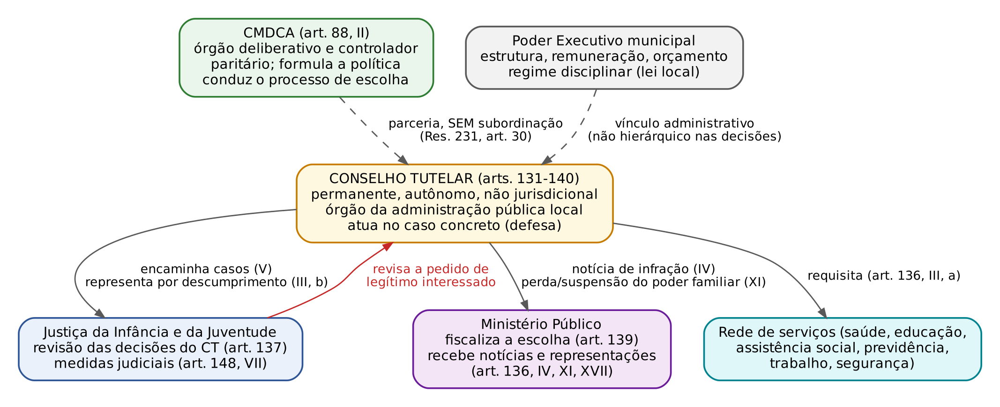
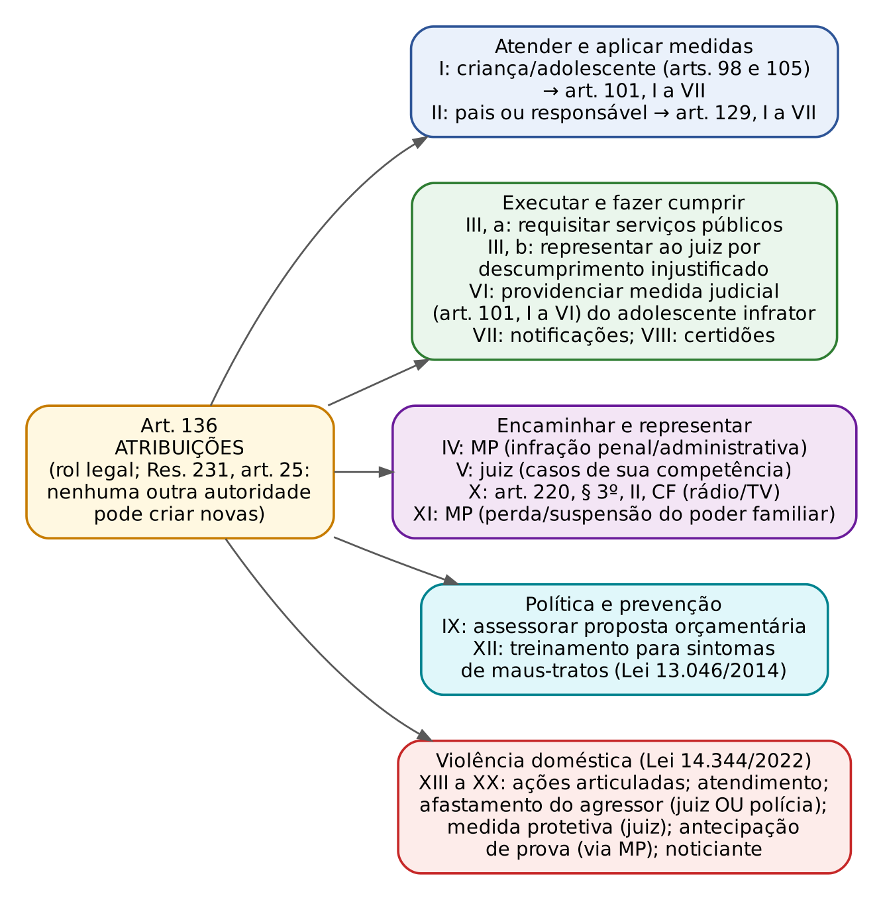
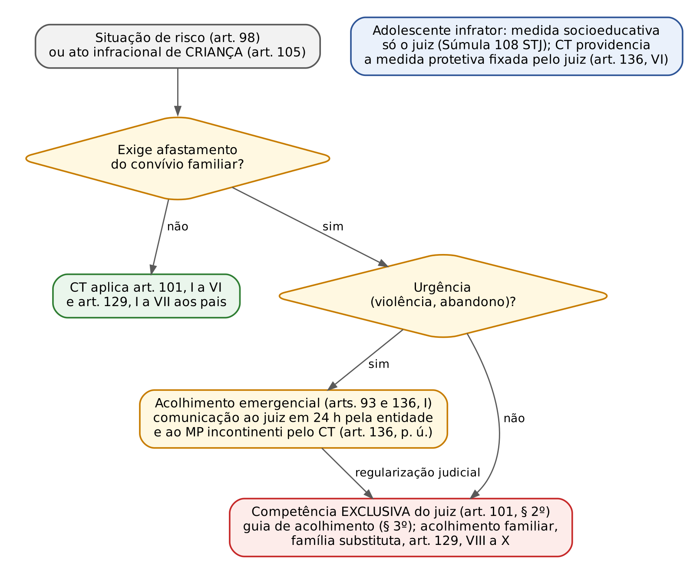
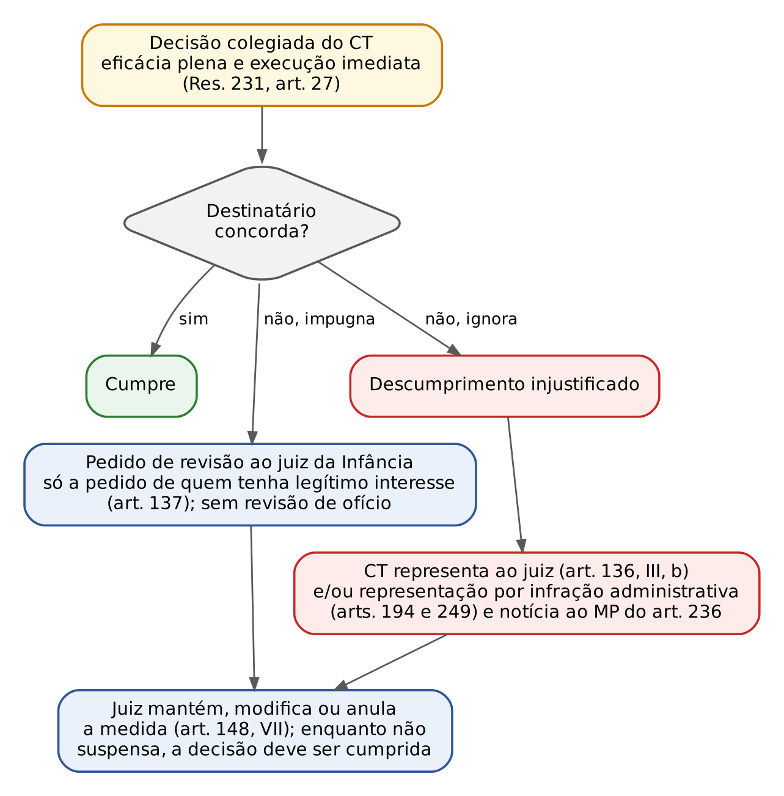
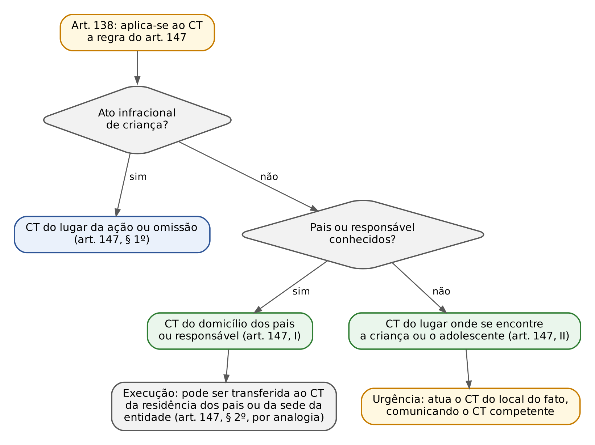
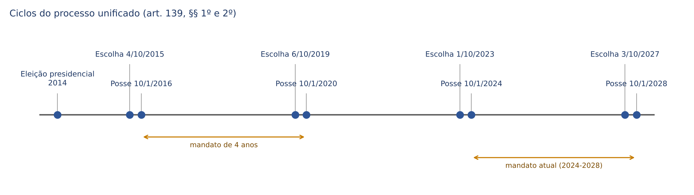
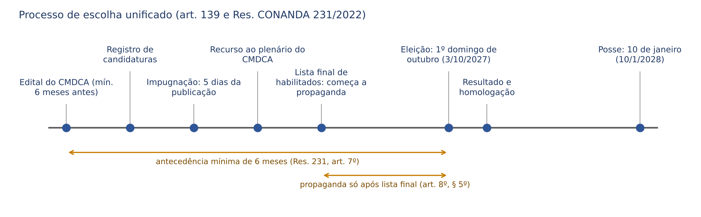

# CAPÍTULO 12 — CONSELHO TUTELAR: NATUREZA, ATRIBUIÇÕES, REVISÃO JUDICIAL E PROCESSO DE ESCOLHA

:::INCIDENCIA
TJSC p. 13 (Resolução CONANDA 231/2022) e ECA amplo do TJRS. Nível A+. Lote: 13 questões (FGV 11, FCC 2), duas delas da magistratura catarinense (2024 e 2025).
O que mais cai: rol do art. 136 (o que o Conselho Tutelar faz e o que NÃO faz), letra dos arts. 131 a 133 e 139, regras de campanha da Res. 231/2022 (internet, camisetas, brindes, chapas) e o impedimento estendido ao juiz e ao promotor da Infância (art. 140, parágrafo único).
:::

| Subtema | FGV | FCC | Padrão de cobrança |
|---|---|---|---|
| Natureza, estrutura e posição no SGD (arts. 131 e 132) | 3 | 0 | "órgão auxiliar do Judiciário" (falso); "mesmos princípios do conselho de direitos, inclusive paridade" (falso); 1 CT por 100 mil habitantes (Res. 231) |
| Requisitos e regime do conselheiro (arts. 133 a 135) | 2 | 0 | idade "superior a 21 anos" (não 18, não 25); sem exigência legal de nível superior; função remunerada |
| Atribuições (art. 136) | 5 | 1 | caso prático: quem aciono? que medida o CT aplica? atribuição "exclusiva" e "expressa" |
| Processo de escolha e Res. 231/2022 | 4 | 1 | data unificada; propaganda na internet permitida; camisetas e brindes vedados; recurso ao CMDCA; prova de conhecimento |
| Impedimentos (art. 140) | 1 | 0 | cônjuge juiz de Família (e não da Infância) não impede |

## 12.1 Natureza jurídica e posição no Sistema de Garantia dos Direitos

### 12.1.1 Os cinco atributos do art. 131

:::LEI ECA, ART. 131
O Conselho Tutelar é órgão permanente e autônomo, não jurisdicional, encarregado pela sociedade de zelar pelo cumprimento dos direitos da criança e do adolescente, definidos nesta Lei.
:::

A definição legal é cobrada palavra por palavra, e cada atributo responde a uma pegadinha recorrente:

| Atributo | Conteúdo | Armadilha típica |
|---|---|---|
| ÓRGÃO | Ente despersonalizado; integra a administração pública local (art. 132, desde a Lei 12.696/2012) | "pessoa jurídica de direito público", "autarquia", "entidade não governamental" |
| PERMANENTE | Uma vez criado por lei municipal, não pode ser extinto nem ter funcionamento interrompido; o mandato é dos membros, não do órgão | "funciona enquanto houver demanda", "pode ser desativado por decreto" |
| AUTÔNOMO | Autonomia FUNCIONAL: decide sem subordinação hierárquica a prefeito, CMDCA, juiz ou promotor; suas decisões só são revistas pelo juiz, a pedido de legítimo interessado (art. 137) | "subordinado ao CMDCA", "órgão auxiliar do Poder Judiciário" |
| NÃO JURISDICIONAL | Exerce função administrativa; não julga lide, não aplica sanção socioeducativa nem afasta, por regra, criança do convívio familiar | "aplica medida socioeducativa", "decide guarda", "destitui o poder familiar" |
| ENCARREGADO PELA SOCIEDADE | Legitimação democrática: os membros são escolhidos pela população (art. 132) | "órgão técnico de provimento por concurso" |

A autonomia é funcional, não administrativa nem financeira. O Conselho Tutelar depende do Executivo municipal para sede, pessoal de apoio, veículo, remuneração e orçamento (art. 134, parágrafo único; Res. CONANDA 231/2022, art. 4º), e seus membros respondem disciplinarmente perante o órgão ao qual estão vinculados (Res. 231/2022, art. 31). A Resolução recomenda que a gestão orçamentária e administrativa fique, "preferencialmente", a cargo do Gabinete do Prefeito (art. 4º, § 3º), justamente para evitar que uma secretaria executora de políticas (assistência social, por exemplo) seja ao mesmo tempo a destinatária das requisições do Conselho e a sua chefia administrativa.

:::PEGADINHA CONSELHO TUTELAR NÃO É ÓRGÃO AUXILIAR DO JUDICIÁRIO
Na prova de Juiz do TJCE (FGV 2025), a alternativa "órgão permanente e auxiliar do Poder Judiciário (...) democratizando-se a prestação jurisdicional" foi dada como ERRADA. O Conselho Tutelar é órgão do Poder Executivo municipal, autônomo e NÃO jurisdicional. Os serviços auxiliares da Justiça da Infância são a equipe interprofissional (arts. 150 e 151 — ver Cap. 18). Também é falso dizer que o juiz "preside" ou "coordena" o Conselho: a redação original do art. 139 previa a presidência do processo eleitoral por "Juiz eleitoral", substituída em 1991 (Lei 8.242/1991) pela responsabilidade do CMDCA.
:::

### 12.1.2 Desjudicialização e controle judicial

O Conselho Tutelar é o instrumento de desjudicialização do atendimento: situações de ameaça ou violação de direitos que antes do ECA iam ao "juiz de menores" passam a ser resolvidas administrativamente, com o Judiciário reservado ao litígio e às medidas que afetam o núcleo do poder familiar. A Res. 231/2022 explicita que a atuação deve ser "voltada à solução efetiva e definitiva dos casos atendidos, com o objetivo de desjudicializar, desburocratizar e agilizar o atendimento", sem impedir que o Judiciário seja informado ou acionado sempre que necessário (art. 26 e parágrafo único).

O STF afirmou a constitucionalidade da atuação do Conselho Tutelar no ato infracional praticado por criança, que não exclui a apreciação judicial (ADI 3.446; v. Cap. 13); daí a convivência da atribuição administrativa (arts. 105 e 136, I) com o controle do art. 137.

Enquanto o Conselho não estiver instalado, as atribuições a ele conferidas "serão exercidas pela autoridade judiciária" (art. 262). A regra é transitória e de alcance restrito: não autoriza o juiz a substituir o Conselho existente que funcione mal, nem a assumir a escolha de conselheiros. Diante de Conselho instalado e omisso, a via é a responsabilização (art. 208 e ação civil pública — ver Cap. 20) e a requisição de providências ao Executivo (Res. 231/2022, arts. 4º, § 2º, e 50), não a avocação.

### 12.1.3 Conselho Tutelar x Conselho de Direitos

A FGV explora a confusão entre os dois colegiados criados pelo ECA. O Conselho de Direitos (municipal, estadual ou nacional) é desenvolvido no Cap. 11; aqui basta o contraste.

| Aspecto | Conselho Tutelar | Conselho Municipal dos Direitos (CMDCA) |
|---|---|---|
| Base legal | Arts. 131 a 140 | Art. 88, II; Lei 8.242/1991 (CONANDA) |
| Nível federativo | Só municipal e distrital | Municipal, estadual, distrital e nacional |
| Natureza | Órgão permanente, autônomo, não jurisdicional | Órgão deliberativo e controlador das ações |
| Composição | 5 membros escolhidos pela população local | PARITÁRIA: governo e sociedade civil (organizações representativas) |
| Atuação | Caso concreto (eixo da defesa: atendimento, medida, requisição) | Política pública (formulação, controle, gestão do Fundo) |
| Investidura | Processo de escolha por sufrágio universal | Indicação do governo e eleição em fórum próprio da sociedade civil |
| Relação recíproca | Não se subordina ao CMDCA (Res. 231/2022, art. 30) | Conduz o processo de escolha do CT e julga recursos (art. 139; Res. 231/2022, arts. 8º, § 13, e 11, § 5º) |
| Remuneração | Função remunerada (art. 134) | Função de interesse público relevante, em regra não remunerada |

:::QUESTAO FGV 2026 — MPE-MT — PROMOTOR DE JUSTIÇA SUBSTITUTO (Q4116976)
Pedia-se a alternativa INCORRETA sobre Conselhos Tutelares, ECA e Res. CONANDA 231/2022. Gabarito oficial: B — é falso que conselhos de direitos e conselhos tutelares "adotam os mesmos princípios", "como o da composição paritária". Paridade governo/sociedade civil é marca do conselho de direitos (art. 88, II); o Conselho Tutelar tem cinco membros escolhidos pela população, sem representação governamental.
As demais estavam corretas: (A) conselheiro pode servir na comarca em que a esposa é juíza da Vara de FAMÍLIA, porque o art. 140, parágrafo único, só alcança o juiz e o promotor "com atuação na Justiça da Infância e da Juventude" (ver 12.10); (C) acolhimento institucional só por guia expedida pela autoridade judiciária (art. 101, § 3º — ver 12.5.2); (D) a lei local pode exigir prova de conhecimento eliminatória e ensino médio (Res. 231/2022, art. 12, §§ 2º e 3º — ver 12.3); (E) proporção mínima de um Conselho para cada cem mil habitantes (Res. 231/2022, art. 3º, § 1º — ver 12.2).
:::

### 12.1.4 Rol legal e vedação de criação de atribuições

O Conselho exerce "exclusivamente as atribuições previstas na Lei nº 8.069, de 1990, não podendo ser criadas novas atribuições por ato de quaisquer outras autoridades do Poder Judiciário, Ministério Público, do Poder Legislativo ou do Poder Executivo" (Res. 231/2022, art. 25). Consequências práticas, de interesse direto do juiz:

- Portaria judicial (art. 149) não pode atribuir ao Conselho fiscalização de bailes, eventos ou estabelecimentos para fins de autuação, nem incumbi-lo de acompanhar oficial de justiça em busca e apreensão; a fiscalização do art. 149 é feita por servidores do Judiciário (comissários de infância e voluntários credenciados — art. 194).
- O Conselho também não executa serviços nem programas: requisita-os (Res. 231/2022, art. 22). Não é ele quem faz o acompanhamento psicossocial, transporta rotineiramente famílias, realiza estudo social para instruir processo judicial ou mantém abrigo.
- Lei municipal não pode criar atribuições incompatíveis com a natureza do órgão, nem retirar as do art. 136 (a competência para legislar sobre proteção à infância é concorrente — CF, art. 24, XV —, e o Município apenas suplementa — art. 30, II).

:::QUESTAO FCC 2026 — DPE-MT — DEFENSOR PÚBLICO (Q3954613)
Perguntou-se qual atribuição do Conselho Tutelar decorre de "disposição legal expressa". Gabarito oficial: C — fiscalizar entidades de atendimento, inclusive as que executam programas socioeducativos de internação (art. 95: as entidades governamentais e não governamentais do art. 90 "serão fiscalizadas pelo Judiciário, pelo Ministério Público e pelos Conselhos Tutelares").
Armadilhas: acompanhar oficiais de justiça em busca e apreensão (A), fiscalizar eventos e bares (B), realizar escuta especializada (D) e conceder autorização de viagem por delegação judicial (E) não constam do ECA como atribuições do Conselho. Autorização judicial de viagem é ato do juiz (arts. 83 e 84 — Cap. 9); a escuta especializada é procedimento dos órgãos da rede, com protocolo próprio da Lei 13.431/2017 (Cap. 22), e o Conselho, ao receber revelação espontânea, deve limitar-se ao estritamente necessário para a proteção.
:::

O dever de fiscalizar entidades foi detalhado pela Res. 231/2022: o Conselho deve apresentar plano de fiscalização e visitar as entidades do art. 90 com periodicidade SEMESTRAL mínima, comunicando ao CMDCA e registrando no SIPIA; constatada irregularidade, comunica ao CMDCA e ao Ministério Público "na forma do art. 191" (art. 34 e parágrafo único). O art. 191, por sua vez, permite que o próprio Conselho deflagre, por representação, o procedimento judicial de apuração de irregularidades em entidade (Cap. 19).

## 12.2 Criação, estrutura e composição

### 12.2.1 O art. 132

:::LEI ECA, ART. 132 (REDAÇÃO DA LEI 13.824/2019)
Em cada Município e em cada Região Administrativa do Distrito Federal haverá, no mínimo, 1 (um) Conselho Tutelar como órgão integrante da administração pública local, composto de 5 (cinco) membros, escolhidos pela população local para mandato de 4 (quatro) anos, permitida recondução por novos processos de escolha.
:::

Cinco elementos cobráveis: (a) "no mínimo" um por Município e por Região Administrativa do DF, sem teto; (b) "órgão integrante da administração pública local" (inserção feita em 2012, que encerrou a discussão sobre a natureza "sui generis" do órgão); (c) composição FIXA de cinco membros titulares, não podendo a lei municipal reduzi-la nem ampliá-la por Conselho (o aumento de capacidade se faz criando novos Conselhos); (d) escolha pela "população local", não por "eleição" partidária; (e) mandato de quatro anos com recondução sem limite numérico, desde que por novo processo de escolha.

| Período | Mandato | Recondução | Fonte |
|---|---|---|---|
| Redação original (1990) | 3 anos | "permitida uma reeleição"; membros "eleitos pelos cidadãos locais" | ECA, art. 132 |
| 1991 a 2012 | 3 anos | "permitida uma recondução"; membros "escolhidos pela comunidade local" | Lei 8.242/1991 |
| 2012 a 2019 | 4 anos | "permitida 1 (uma) recondução, mediante novo processo de escolha" | Lei 12.696/2012 |
| Desde 2019 | 4 anos | "permitida recondução por novos processos de escolha" (sem limite) | Lei 13.824/2019 |

:::PEGADINHA "UMA RECONDUÇÃO"
Alternativas antigas ou maliciosas repetem a redação de 2012 ("permitida uma recondução"). Desde a Lei 13.824/2019 a recondução é ilimitada, sempre condicionada a novo processo de escolha. A Res. 231/2022 reproduz a regra atual (art. 6º, § 1º). Não existe recondução automática nem prorrogação de mandato por lei municipal.
:::

### 12.2.2 Quantos Conselhos? A proporção da Res. 231/2022

O ECA fixa apenas o mínimo de um Conselho. A Res. 231/2022 estabelece que, "para assegurar a equidade de acesso, caberá aos municípios e ao Distrito Federal criar e manter Conselhos Tutelares, observada a proporção mínima de um Conselho para cada cem mil habitantes" (art. 3º, § 1º). Havendo mais de um Conselho, a distribuição considera configuração geográfica e administrativa, população infantojuvenil, incidência de violações e indicadores sociais (§ 2º), e cabe à legislação local definir a área de atuação de cada um, preferencialmente um por região ou circunscrição administrativa (§ 3º).

Município com 350 mil habitantes deve ter, segundo o parâmetro, ao menos quatro Conselhos (três não alcançariam a proporção mínima: 3 × 100.000 = 300.000). O descumprimento do parâmetro é tema típico de ação civil pública estrutural (Cap. 20), em que o juiz examina a vinculação do Município às deliberações do CONANDA: a Res. 231/2022 afirma que elas "são vinculantes e obrigatórias para a Administração Pública" (art. 51), afirmação que a doutrina aceita no plano das normas gerais da política de atendimento (art. 88, II, do ECA; Lei 8.242/1991, art. 2º, I), mas que não supre a necessidade de lei municipal para criar órgão e cargos.

:::QUESTAO FGV 2024 — TCE-PA — AUDITOR DE CONTROLE EXTERNO (Q2570481)
Três afirmações extraídas literalmente dos arts. 131 e 132: órgão permanente e autônomo, não jurisdicional; encarregado pela sociedade de zelar pelos direitos definidos no ECA; no mínimo um Conselho em cada Município e em cada Região Administrativa do DF, como órgão integrante da administração pública local. Gabarito oficial: B (V, V, V). Armadilha: estranhar a expressão "órgão integrante da administração pública local", que é texto legal desde 2012.
:::

### 12.2.3 Lei municipal, orçamento e estrutura

O art. 134 remete à lei municipal ou distrital a disciplina de "local, dia e horário de funcionamento", "inclusive quanto à remuneração", e o parágrafo único exige que a lei orçamentária preveja os recursos para funcionamento, remuneração e formação continuada. A Res. 231/2022 densifica:

- Dotação orçamentária específica, preferencialmente, para implantação, manutenção, funcionamento, processo de escolha, remuneração e formação continuada (art. 4º, caput), abrangendo custeio de mobiliário, água, luz e telefonia, diárias e transporte, sede adequada, transporte "permanente e exclusivo", processo de escolha e equipamentos de informática com acesso à internet suficientes para operar os sistemas e assinar digitalmente documentos (art. 4º, § 1º).
- Equipe administrativa permanente, a cargo do Executivo (art. 4º, § 4º).
- Recursos do Fundo dos Direitos da Criança e do Adolescente (FIA) NÃO podem custear o Conselho, salvo para "formação e qualificação funcional" dos conselheiros (art. 4º, § 6º). Remuneração, sede e veículo saem do orçamento geral do Município (sobre o FIA, ver Cap. 11).
- Sede de fácil acesso, com placa visível, sala de recepção, sala reservada e individualizada com recursos lúdicos, sala administrativa, sala dos conselheiros e computadores com internet de banda larga (art. 17, § 1º); número de salas suficiente para atendimentos simultâneos sem exposição da criança (art. 17, § 2º).
- Funcionamento com atendimento ininterrupto à população (art. 19), o que impõe regime de plantão ou sobreaviso, com a mesma carga horária e os mesmos plantões para todos os membros, vedado tratamento desigual (art. 20).
- Regimento interno elaborado e aprovado pelo próprio Conselho, com proposta enviada ao CMDCA, a quem é facultado sugerir alterações (art. 18). O CMDCA não aprova nem veta o regimento: a autonomia do órgão alcança sua auto-organização.

Na falta de lei local adequada ou de dotação suficiente, o CMDCA, o próprio Conselho Tutelar ou qualquer cidadão pode requerer ao Executivo, ao Legislativo e ao Ministério Público as medidas administrativas e judiciais cabíveis (Res. 231/2022, art. 4º, § 2º, e art. 50, que acrescenta o Tribunal de Contas).

:::DICA REMISSÃO AO SIPIA
O registro de todos os atendimentos, medidas, encaminhamentos e acompanhamentos no Sistema de Informação para a Infância e Adolescência (SIPIA) é OBRIGATÓRIO, "sob pena de falta funcional" (Res. 231/2022, art. 23, § 4º). O SIPIA é instituído e mantido pelo Executivo federal (§ 5º), cabendo ao Município fornecer os meios (caput). O Conselho remete relatório TRIMESTRAL ao CMDCA, ao Ministério Público e ao juiz da Infância com a síntese dos atendimentos e das deficiências das políticas públicas (§ 1º) — documento útil para instruir ações coletivas.
:::

## 12.3 Requisitos para a candidatura

### 12.3.1 Requisitos legais (art. 133)

:::LEI ECA, ART. 133
Para a candidatura a membro do Conselho Tutelar, serão exigidos os seguintes requisitos:
I - reconhecida idoneidade moral;
II - idade superior a vinte e um anos;
III - residir no município.
:::

Três requisitos, todos de verificação no registro da candidatura:

- Idoneidade moral "reconhecida": conceito jurídico indeterminado, comprovado em regra por certidões criminais e declarações; a Res. 231/2022 permite que condutas vedadas na campanha sejam "aptas a gerar inidoneidade moral do candidato" (art. 8º, § 7º — ver 12.9.4). Para quem já exerceu a função, o exercício efetivo "estabelecerá presunção de idoneidade moral" (art. 135), relativa.
- Idade "superior a vinte e um anos": a redação literal ("superior a") leva parte da doutrina a exigir 21 anos completos na data fixada pelo edital; a banca trata o requisito como "idade mínima de 21 anos". Não é 18 (maioridade civil), nem 25, nem 16 com assistência.
- Residência no Município: requisito de vínculo com a comunidade. Havendo mais de um Conselho, a Res. 231/2022 exige que o candidato comprove residência fixa na região de atendimento do Conselho a que concorre, quando a votação respeitar a correspondência entre domicílio eleitoral e região (art. 6º, §§ 2º e 3º). Residir no Município é também DEVER funcional durante o mandato (art. 40, X).

:::QUESTAO FGV 2024 — PREFEITURA DE MACAÉ — PROCURADOR (Q3049972)
Candidato de 20 anos teve a inscrição indeferida e recorreu; pedia-se a conclusão do parecer jurídico. Gabarito oficial: A — o indeferimento foi correto, porque a idade mínima é de 21 anos (art. 133, II).
Armadilhas: invocar a maioridade civil de 18 anos (B), inventar 25 anos (C), aplicar "autonomia progressiva" para candidatura aos 16 (D) ou negar limite etário (E).
:::

### 12.3.2 Requisitos adicionais por lei local (Res. 231/2022, art. 12)

O rol do art. 133 é de requisitos MÍNIMOS. A Res. 231/2022 admite "outros requisitos expressos na legislação local específica" (art. 12, caput), desde que "compatíveis com as atribuições do Conselho Tutelar" (§ 1º), e indica que a lei local deve considerar:

- comprovada experiência na promoção, proteção ou defesa dos direitos da criança e do adolescente em entidades registradas no CMDCA (art. 12, § 2º, I);
- comprovação de, no mínimo, conclusão do ensino médio (art. 12, § 2º, II);
- prova de conhecimento sobre o direito da criança e do adolescente, de caráter ELIMINATÓRIO, formulada por comissão examinadora designada pelo CMDCA, com prazo de recurso à comissão especial a partir da publicação dos resultados — admissível "havendo previsão na legislação local" (art. 12, § 3º).

Dois limites decisivos:

1. O requisito adicional precisa estar em LEI municipal ou distrital. O edital "não poderá estabelecer outros requisitos além daqueles exigidos dos candidatos pela Lei nº 8.069, de 1990, e pela legislação local correlata" (art. 7º, § 2º). Exigência criada só por resolução do CMDCA ou pelo edital é ilegal e pode ser afastada judicialmente (mandado de segurança ou ação do candidato prejudicado).

2. O requisito precisa ser compatível e proporcional: nível superior em área específica, idade mínima maior, tempo excessivo de residência ou filiação a entidade determinada tendem a ser tidos como restrições desarrazoadas ao acesso a função de natureza representativa.

:::QUESTAO FGV 2025 — TJ-CE — JUIZ SUBSTITUTO (Q3505795)
Afirmações sobre o Conselho Tutelar à luz da Res. CONANDA 231/2022. Gabarito oficial: E — as eleições garantem sufrágio universal e direto, voto uninominal, facultativo e secreto dos eleitores do Município ou do DF, em data unificada em todo o território nacional, vedada a composição de chapas (Res. 231/2022, art. 5º, I e II).
Armadilhas: (A) "órgão auxiliar do Poder Judiciário" (ver 12.1.1); (B) nível superior, idade superior a 21 anos e quatro anos de residência — o ECA exige idade superior a 21 anos e residência no Município, sem nível superior nem tempo mínimo de residência; a Res. 231 sugere ENSINO MÉDIO; (C) "serviço público relevante e NÃO remunerado" — a função é remunerada (art. 134; Res. 231/2022, art. 39); (D) decisões tomadas pelo "Presidente", com plantões ratificados por ele — as decisões são do COLEGIADO, e as emergenciais são submetidas ao colegiado no primeiro dia útil (Res. 231/2022, art. 21, § 1º).
:::

## 12.4 Estatuto do conselheiro: mandato, vínculo, direitos e regime disciplinar

### 12.4.1 Natureza do vínculo

A Res. 231/2022 define o conselheiro como "detentor de mandato eletivo, não incluído na categoria de servidor público em sentido estrito, não gerando vínculo empregatício com o Poder Público Municipal, seja de natureza estatutária ou celetista" (art. 38, § 1º). Desdobramentos:

- Não há estabilidade, efetivação, contagem para fins de enquadramento em carreira nem direito a FGTS ou verbas trabalhistas, salvo os direitos assegurados no art. 134 e na lei local.
- É, contudo, AGENTE PÚBLICO em sentido amplo: exerce função pública por eleição, sujeitando-se à Lei de Improbidade (Lei 8.429/1992, art. 2º, que inclui quem exerce mandato ou função por eleição, ainda que transitoriamente ou sem remuneração) e equiparando-se a funcionário público para fins penais (CP, art. 327). Também é sujeito ativo de abuso de autoridade (a Res. 231/2022, art. 41, XI, remete expressamente à Lei 13.869/2019).
- O regime jurídico e disciplinar é o fixado pela lei local; na omissão, aplica-se o do funcionalismo municipal e, subsidiariamente, a Lei 8.112/1990 (Res. 231/2022, art. 47, § 1º).

### 12.4.2 Remuneração e direitos mínimos (art. 134)

A redação original dizia "eventual remuneração". Desde a Lei 12.696/2012, a lei local disporá "inclusive quanto à remuneração dos respectivos membros, aos quais é assegurado o direito a":

| Inciso | Direito assegurado pelo ECA |
|---|---|
| I | cobertura previdenciária |
| II | gozo de férias anuais remuneradas, acrescidas de 1/3 do valor da remuneração mensal |
| III | licença-maternidade |
| IV | licença-paternidade |
| V | gratificação natalina |

A remuneração "deve ser proporcional à relevância e complexidade da atividade desenvolvida", com revisão na forma da lei local (Res. 231/2022, art. 39, parágrafo único). Suplentes convocados recebem remuneração proporcional aos dias de atuação, sem prejuízo da remuneração dos titulares em licença ou férias (art. 16, § 1º).

:::PEGADINHA O QUE O ART. 134 NÃO LISTA
Não constam do art. 134: adicional de insalubridade, horas extras, estabilidade, aposentadoria especial, auxílio-moradia, licença-prêmio. Podem existir por lei local, mas não são garantia federal. Também não há mais "prisão especial": o art. 135, na redação original, assegurava prisão especial em caso de crime comum até o julgamento definitivo; a Lei 12.696/2012 suprimiu a garantia.
:::

### 12.4.3 Serviço público relevante e presunção de idoneidade (art. 135)

"O exercício efetivo da função de conselheiro constituirá serviço público relevante e estabelecerá presunção de idoneidade moral." Dois efeitos: o reconhecimento como serviço público relevante (que leis locais e editais costumam converter em critério de desempate ou título) e a presunção de idoneidade moral, útil sobretudo ao conselheiro que concorre à recondução. A presunção é relativa e não imuniza o candidato que tenha praticado conduta vedada na campanha.

### 12.4.4 Dedicação exclusiva

"A função de membro do Conselho Tutelar exige dedicação exclusiva, vedado o exercício concomitante de qualquer outra atividade pública ou privada" (Res. 231/2022, art. 38). A posse e o exercício em outro cargo, emprego ou função pública ou privada geram VACÂNCIA (art. 43, II). A matéria não está no ECA; a exigência de dedicação exclusiva depende de previsão na lei municipal para ser oposta ao conselheiro, e há leis locais que se limitam a vedar o exercício de outra atividade no horário de funcionamento (o que a própria Resolução também veda — art. 41, parágrafo único, II). Em prova objetiva, prevalece a letra da Resolução.

Candidatura a cargo eletivo diverso: não implica renúncia, mas afastamento durante o período previsto na legislação eleitoral, "assegurada a percepção de remuneração e a convocação do respectivo suplente" (art. 43, parágrafo único). O art. 16, § 4º, por sua vez, fala em afastamento temporário "a partir da homologação da candidatura", com retorno se o conselheiro não assumir o cargo para o qual concorreu. As duas regras convivem: afastamento obrigatório, remunerado, com retorno ao Conselho se não eleito (ou se eleito e não empossado).

### 12.4.5 Deveres, vedações e impedimento para o caso

A Res. 231/2022 lista deveres (art. 40) e vedações (art. 41, parágrafo único), sem prejuízo da lei local. Os mais cobráveis:

| Deveres (art. 40) | Vedações (art. 41, parágrafo único) |
|---|---|
| conduta pública e particular ilibada | receber vantagem pessoal, comissões ou presentes em razão da função |
| fundamentar os pronunciamentos e submetê-los ao colegiado | utilizar o Conselho para propaganda e atividade político-partidária |
| declarar-se suspeito ou impedido | delegar a quem não seja membro do Conselho atribuição própria |
| residir no Município | exceder-se no exercício da função (abuso de autoridade — Lei 13.869/2019) |
| atender os interessados, a qualquer momento, nos casos urgentes | deixar de submeter ao colegiado as decisões individuais de medidas dos arts. 101 e 129 |
| identificar-se nas manifestações funcionais | ausentar-se da sede no expediente, salvo diligência ou necessidade do serviço |

O membro é IMPEDIDO de analisar o caso (art. 42) quando a situação envolver cônjuge, companheiro ou parente em linha reta, colateral ou por afinidade até o terceiro grau; quando for amigo íntimo ou inimigo capital de interessado; quando interessado for seu credor ou devedor (ou de cônjuge, companheiro ou parente até o terceiro grau); ou quando tiver interesse na solução do caso. Pode ainda declarar suspeição por foro íntimo (§ 1º), e o interessado pode requerer ao colegiado o afastamento do conselheiro impedido (§ 2º). Não confundir com o impedimento para SERVIR no mesmo Conselho (art. 140 — ver 12.10).

Vedação importante ligada a 12.1.4: "É vedado o exercício das atribuições inerentes ao Conselho Tutelar por pessoas estranhas ao órgão ou que não tenham sido escolhidas pela comunidade (...), sendo nulos os atos por elas praticados" (Res. 231/2022, art. 28). Suplente só atua quando convocado; servidor de apoio não aplica medida.

### 12.4.6 Regime disciplinar, vacância e cassação

| Tema | Regra (Res. 231/2022) |
|---|---|
| Penalidades | advertência, suspensão do exercício da função e destituição do mandato, além de outras da lei local (art. 44) |
| Dosimetria | natureza e gravidade da infração, danos à sociedade ou ao serviço, antecedentes funcionais e circunstâncias agravantes e atenuantes do Código Penal (art. 45) |
| Hipóteses de suspensão e destituição | descumprimento de atribuições, crime que comprometa a idoneidade moral, conduta incompatível com a confiança outorgada pela comunidade (art. 46) |
| Afastamento liminar | conforme a gravidade ou para garantia da instrução, até a conclusão da investigação (art. 46, parágrafo único) |
| Procedimento | sindicância e processo administrativo, com imparcialidade, contraditório e ampla defesa (art. 47, § 2º), conduzidos por membros do serviço público municipal ou distrital (art. 47, § 4º) |
| Indícios de crime | comunicação ao Ministério Público pelo CMDCA ou pelo órgão apurador (art. 48) |
| Vacância (art. 43) | renúncia; posse e exercício em outro cargo, emprego ou função; destituição; falecimento; condenação transitada em julgado OU proferida por órgão colegiado por crime, em ação cível com reconhecimento de inidoneidade, ou por improbidade |
| Suplência | vacância ou afastamento: convocação IMEDIATA do suplente pelo Executivo, pela ordem de classificação (art. 16); com dois ou menos suplentes disponíveis, o CMDCA inicia imediatamente processo de escolha suplementar (art. 16, § 2º) |
| Escolha suplementar nos dois últimos anos | pode ser INDIRETA, tendo os conselheiros de direitos como colégio eleitoral, com redução de prazos, se a lei municipal previr (art. 16, § 3º) |

:::ATENCAO QUEM PUNE O CONSELHEIRO
A destituição de conselheiro é ato administrativo do Município, em processo disciplinar regido pela lei local, e não decisão do juiz da Infância nem do CMDCA por simples deliberação. O juiz pode intervir pela via jurisdicional (ação civil pública por improbidade, ação do Ministério Público para afastamento cautelar, mandado de segurança do conselheiro contra destituição sem devido processo), mas a sanção disciplinar não se aplica no bojo de procedimento da Infância. A Res. 231/2022 reforça que o exercício da autonomia "não isenta seu membro de responder pelas obrigações funcionais e administrativas junto ao órgão ao qual está vinculado" (art. 31).
:::

## 12.5 Atribuições (art. 136)

O art. 136 tem hoje vinte incisos e um parágrafo único: doze originários ou da década de 2010 (I a XII) e oito acrescidos pela Lei 14.344/2022 (XIII a XX). A alínea "a" do inciso III foi alterada pela Lei 15.268/2025, de 21/11/2025, que trocou "serviço social" por "assistência social". A leitura que a banca exige é dupla: o que o Conselho FAZ (verbo exato de cada inciso) e o que ele NÃO faz (reserva do juiz, do Ministério Público ou da rede executora).

### 12.5.1 Atendimento e aplicação de medidas (incisos I e II)

:::LEI ECA, ART. 136, I E II
I - atender as crianças e adolescentes nas hipóteses previstas nos arts. 98 e 105, aplicando as medidas previstas no art. 101, I a VII;
II - atender e aconselhar os pais ou responsável, aplicando as medidas previstas no art. 129, I a VII;
:::

| Destinatário | O Conselho aplica | Só o juiz aplica |
|---|---|---|
| Criança ou adolescente em situação do art. 98 | art. 101, I a VII (encaminhamento aos pais com termo de responsabilidade; orientação, apoio e acompanhamento temporários; matrícula e frequência obrigatórias; inclusão em programas; requisição de tratamento médico, psicológico ou psiquiátrico; programa para alcoólatras e toxicômanos; acolhimento institucional, este com as restrições de 12.5.2) | art. 101, VIII (acolhimento familiar) e IX (família substituta); afastamento do convívio familiar fora da urgência (art. 101, § 2º); guia de acolhimento (art. 101, § 3º) |
| Criança autora de ato infracional (art. 105) | medidas do art. 101 (a criança NUNCA recebe medida socioeducativa) | — |
| Adolescente autor de ato infracional | apenas providencia a medida do art. 101, I a VI, fixada pelo JUIZ (art. 136, VI) | medidas socioeducativas (art. 112; Súmula 108 do STJ: competência exclusiva do juiz) e medidas protetivas cumuladas (art. 112, VII) |
| Pais ou responsável | art. 129, I a VII (programas de proteção à família; tratamento de alcoolismo e toxicomania; tratamento psicológico ou psiquiátrico; cursos de orientação; obrigação de matricular o filho e acompanhar frequência; obrigação de encaminhar a tratamento especializado; ADVERTÊNCIA) e art. 18-B | art. 129, VIII (perda da guarda), IX (destituição da tutela) e X (suspensão ou destituição do poder familiar) |

O art. 18-B (castigo físico e tratamento cruel ou degradante) prevê medidas análogas às do art. 129, I a VII — inclusive advertência e, desde a Lei 14.344/2022, "garantia de tratamento de saúde especializado à vítima" (inciso VI) — e dispõe que elas "serão aplicadas pelo Conselho Tutelar, sem prejuízo de outras providências legais" (parágrafo único). O destinatário é mais amplo que o do art. 129: pais, família ampliada, responsáveis, agentes públicos executores de medidas socioeducativas e qualquer pessoa encarregada de cuidar, tratar, educar ou proteger crianças e adolescentes.

:::QUESTAO FGV 2024 — TJ-AP — PSICÓLOGO (Q2448372)
Criança de 9 anos encontrada dormindo em banco de praça, fora da escola, vivendo com a mãe alcoolista e três irmãos em casa insalubre: qual medida compete ao Conselho Tutelar? Gabarito oficial: D — requisitar a matrícula da criança em estabelecimento oficial de ensino fundamental (art. 101, III, c/c art. 136, I e III, "a").
Passos: (1) situação do art. 98, II (omissão dos pais); (2) o Conselho aplica medidas do art. 101, I a VII, e do art. 129, I a VII; (3) descartar o que é judicial ou alheio: "passar a guarda" (alteração de guarda é judicial — art. 129, VIII), "determinar a internação" da mãe (internação involuntária ou compulsória segue a Lei 10.216/2001 — Cap. 26), cadastrar a família em programa de renda (execução da política cabe à assistência social; o Conselho requisita), advertir a criança com ameaça de "orfanato" (sem base legal e contrária ao art. 100, parágrafo único).
:::

:::QUESTAO FGV 2026 — MPE-ES — AGENTE TÉCNICO (Q4220024)
Adolescente de 13 anos relata, em unidade de saúde, violência doméstica recorrente, com necessidade de medidas protetivas imediatas e articulação com a rede. Gabarito oficial: C — Conselho Tutelar, para aplicar as medidas protetivas e realizar os encaminhamentos na rede (art. 136, I, XIV e XVIII; art. 13).
Armadilha: a delegacia (A) e o Ministério Público (E) também podem ser acionados, mas o enunciado pede o órgão para medida protetiva administrativa imediata e articulação; o conselho de direitos (B) delibera política, não atende caso. Se a hipótese pedisse medida protetiva de URGÊNCIA da Lei 14.344/2022 (afastamento do agressor, proibição de contato), a decisão seria judicial, e o Conselho atuaria representando (art. 136, XV e XVI — ver 12.5.6 e Cap. 23).
:::

No mesmo sentido, sobre criança autora de ato infracional: Q3660379 (FGV 2025 — AgSUS; gabarito oficial: A): criança de 11 anos que quebra o vidro do carro da professora recebe MEDIDA PROTETIVA aplicada pelo Conselho Tutelar, e não medida socioeducativa (arts. 105 e 136, I).

### 12.5.2 Acolhimento institucional pelo Conselho: o ponto mais sensível

O inciso I remete ao art. 101, I a VII, o que inclui o acolhimento institucional (VII). A Lei 12.010/2009, porém, introduziu três regras que limitam a leitura literal:

1. "Sem prejuízo da tomada de medidas emergenciais para proteção de vítimas de violência ou abuso sexual (...), o afastamento da criança ou adolescente do convívio familiar é de competência exclusiva da autoridade judiciária" e importa procedimento judicial contencioso (art. 101, § 2º).

2. Crianças e adolescentes "somente poderão ser encaminhados às instituições que executam programas de acolhimento institucional (...) por meio de uma Guia de Acolhimento, expedida pela autoridade judiciária" (art. 101, § 3º).

3. Se o Conselho entender necessário o afastamento do convívio familiar, "comunicará incontinenti o fato ao Ministério Público, prestando-lhe informações sobre os motivos de tal entendimento e as providências tomadas para a orientação, o apoio e a promoção social da família" (art. 136, parágrafo único).

Harmonização: o Conselho pode, em caráter EXCEPCIONAL e de URGÊNCIA, encaminhar a criança a entidade de acolhimento institucional, que pode recebê-la "sem prévia determinação da autoridade competente, fazendo comunicação do fato em até 24 (vinte e quatro) horas ao Juiz da Infância e da Juventude, sob pena de responsabilidade" (art. 93). Recebida a comunicação, o juiz, ouvido o Ministério Público e, se necessário, com apoio do Conselho Tutelar, promove a reintegração familiar ou o encaminhamento a acolhimento familiar, institucional ou família substituta (art. 93, parágrafo único). Fora da urgência, o Conselho não acolhe: comunica ao Ministério Público, que requer judicialmente o afastamento. Acolhimento FAMILIAR (art. 101, VIII) e família substituta (IX) nunca são aplicados pelo Conselho. O regime completo das medidas protetivas e do acolhimento está no Cap. 13 e no Cap. 4.

| Comunicação | Quem comunica | A quem | Prazo |
|---|---|---|---|
| Acolhimento emergencial sem ordem judicial | Entidade de acolhimento | Juiz da Infância | até 24 horas (art. 93) |
| Entendimento de que é necessário afastar do convívio familiar | Conselho Tutelar | Ministério Público | "incontinenti" (art. 136, parágrafo único) |
| Medida emergencial tomada no plantão | Conselheiro de plantão | Colegiado do Conselho | primeiro dia útil subsequente, para ratificação ou retificação (Res. 231/2022, art. 21, § 1º) |
| Decisão do Conselho | Conselho Tutelar | Interessados, por escrito | até 48 horas (Res. 231/2022, art. 21, § 2º) |

No mesmo sentido, em provas de magistratura e Ministério Público: Q3786365 (FGV 2025 — TJ-MS — Juiz Substituto; gabarito oficial: D): criança deixada sozinha à noite pode ser acolhida, em caráter excepcional e de urgência, sem prévia decisão judicial, com comunicação ao juízo em 24 horas; é falsa a alternativa de que o acolhimento emergencial "depende de decisão judicial". Q3752750 (FGV 2025 — MPE-ES — Promotor; gabarito oficial: E): adolescente de 14 anos cuja mãe morreu em viagem pode ser acolhida emergencialmente pelo Conselho, "independentemente de decisão judicial", por entidade de acolhimento institucional; é falso que a comunicação seja ao Ministério Público em 48 horas (a comunicação da entidade é ao JUIZ em 24 horas). Q4083746 (FGV 2026 — TJ-BA — Juiz Substituto; gabarito oficial: E): é falso que o Conselho não pudesse aplicar imediatamente o acolhimento por exigir "prévia ordem judicial escrita"; correto é que a escuta do Conselho, após revelação espontânea de abuso, deve limitar-se ao necessário para a finalidade protetiva (Cap. 22).

:::PEGADINHA "EXCLUSIVA DA AUTORIDADE JUDICIÁRIA" NÃO SIGNIFICA "PROIBIDA AO CONSELHO NA URGÊNCIA"
A FGV alterna duas afirmações falsas simétricas: (1) "o Conselho Tutelar não pode acolher sem prévia ordem judicial" e (2) "o Conselho decide livremente sobre o acolhimento, que dispensa controle judicial". O correto é o meio-termo: urgência + entidade comunica ao juiz em 24 horas + Conselho comunica ao MP incontinenti + guia judicial de acolhimento + procedimento contencioso se o afastamento perdurar. E, ao contrário da alternativa da Q3532429, determinar acolhimento NÃO é atribuição exclusiva do Conselho.
:::

### 12.5.3 Execução das próprias decisões (inciso III) e encaminhamentos (IV, V e VI)

:::LEI ECA, ART. 136, III A VI (ALÍNEA "A" NA REDAÇÃO DA LEI 15.268/2025)
III - promover a execução de suas decisões, podendo para tanto:
a) requisitar serviços públicos nas áreas de saúde, educação, assistência social, previdência, trabalho e segurança;
b) representar junto à autoridade judiciária nos casos de descumprimento injustificado de suas deliberações.
IV - encaminhar ao Ministério Público notícia de fato que constitua infração administrativa ou penal contra os direitos da criança ou adolescente;
V - encaminhar à autoridade judiciária os casos de sua competência;
VI - providenciar a medida estabelecida pela autoridade judiciária, dentre as previstas no art. 101, de I a VI, para o adolescente autor de ato infracional;
:::

A requisição (III, "a") é ordem, não pedido: dirige-se ao serviço público, independe de autorização judicial e deve ser cumprida "de forma gratuita e prioritária, respeitando-se os princípios da razoabilidade e legalidade" (Res. 231/2022, art. 37; ver também art. 4º, § 5º, que remete à prioridade absoluta do art. 4º, parágrafo único, do ECA). As seis áreas do rol são: saúde, educação, assistência social, previdência, trabalho e segurança. Não requisita a particulares (a eles expede notificação — inciso VII) nem requisita ao Judiciário ou ao Ministério Público.

O descumprimento injustificado gera três consequências, cumuláveis e de iniciativa distinta:

| Consequência | Fundamento | Iniciativa |
|---|---|---|
| Representação ao juiz para fazer cumprir a deliberação | art. 136, III, "b"; art. 148, VII | Conselho Tutelar |
| Infração administrativa: descumprir "determinação da autoridade judiciária ou Conselho Tutelar" (multa de 3 a 20 salários de referência, dobro na reincidência) | art. 249; procedimento dos arts. 194 a 197 | representação do MP ou do Conselho Tutelar, ou auto de infração (art. 194) |
| Crime: "impedir ou embaraçar a ação de autoridade judiciária, membro do Conselho Tutelar ou representante do Ministério Público no exercício de função prevista nesta Lei" (detenção de 6 meses a 2 anos) | art. 236 | ação penal pública incondicionada (art. 227), por notícia ao MP (art. 136, IV) |

A Res. 231/2022 amarra a lógica: "Enquanto não suspensa ou revista pelo Poder Judiciário, a decisão proferida pelo Conselho Tutelar deve ser imediata e integralmente cumprida pelo seu destinatário, sob pena da prática do crime previsto no art. 236 e da prática da infração administrativa prevista no art. 249" (art. 27, § 2º).

:::JURIS STJ, RESP 1.944.020, J. 22/10/2024 (INFORMATIVO 832)
(STJ, REsp n. 1.944.020-MG, Relator Ministro Antonio Carlos Ferreira, Quarta Turma, j. 22/10/2024): o art. 249 deve ser interpretado de forma abrangente, aplicando-se a QUALQUER pessoa física ou jurídica que descumpra determinação da autoridade judiciária ou do Conselho Tutelar, sem limitar-se à esfera familiar, de guarda ou tutela. No caso, empresa promotora de eventos admitiu adolescentes desacompanhados contra determinação judicial.
Para este capítulo: a deliberação do Conselho dirigida a escola, hospital, entidade ou empresa é coercível pela via do art. 249. O regime geral do art. 249 e das demais infrações administrativas está no Cap. 21.
:::

:::JURIS STJ, RESP 2.138.801, J. 18/3/2025 (INFORMATIVO 844)
(STJ, REsp n. 2.138.801-PR, Relatora Ministra Nancy Andrighi, Terceira Turma, j. 18/3/2025): a recusa dos pais em vacinar o filho contra a COVID-19, "mesmo advertidos dos riscos de sua conduta pelo Conselho Tutelar Municipal e pelo Ministério Público Estadual", autoriza a sanção pecuniária do art. 249. O itinerário do caso é o modelo da escalada: advertência e orientação pelo Conselho (art. 129, IV e VII), encaminhamento ao MP e representação administrativa. Desenvolvimento no Cap. 3 (vacinação) e no Cap. 21 (art. 249).
:::

No mesmo sentido, ilustrando a legitimidade do Conselho para a representação do art. 194: Q3301253 (FGV 2025 — TJ-SE — Juiz Substituto; gabarito oficial: C) partiu de representação administrativa do Conselho Tutelar contra genitor negligente com a frequência escolar (art. 249); e Q3324255 (FGV 2025 — TJ-SC — Juiz Substituto; gabarito oficial: D) partiu de constatação, por conselheiros tutelares em diligência, de adolescentes em casa de shows (art. 258). As teses dessas questões (multa abaixo do mínimo por hipossuficiência; legitimidade passiva do empresário e da pessoa jurídica) são do Cap. 21.

A notícia ao Ministério Público (IV) não exclui a legitimidade própria do Conselho para representar por infração administrativa (art. 194) ou por irregularidade em entidade (art. 191): o inciso IV cobre sobretudo as infrações PENAIS, em que o Conselho não tem legitimidade alguma, e as administrativas em que prefira provocar o MP. Também não lhe cabe investigar crime, identificar autor ou "responsabilizar" agressor (Q3047333, alternativas B e D).

"Encaminhar à autoridade judiciária os casos de sua competência" (V) remete ao art. 148, VII ("conhecer de casos encaminhados pelo Conselho Tutelar, aplicando as medidas cabíveis"): situações que exigem decisão judicial (afastamento do convívio familiar, acolhimento familiar, colocação em família substituta, suprimentos, regularização de registro do art. 102, medidas do art. 129, VIII a X). Não se encaminham "todos os casos" ao juiz.

:::QUESTAO FGV 2024 — PREFEITURA DE CARAGUATATUBA — ASSISTENTE SOCIAL (Q3051869)
Três afirmações sobre atribuições do Conselho. Gabarito oficial: B (V, F, V). Verdadeiras: requisitar serviços públicos nas áreas de saúde, educação, serviço social, previdência, trabalho e segurança (art. 136, III, "a"); promover e incentivar ações de divulgação e treinamento para o reconhecimento de sintomas de maus-tratos (XII). Falsa: "encaminhar TODOS os casos à autoridade judiciária" — o inciso V fala em "casos de sua competência", e a lógica do órgão é a desjudicialização.
Atualização: desde a Lei 15.268/2025, a alínea "a" diz "assistência social" (e não mais "serviço social"); a afirmação continua verdadeira na essência, mas a redação literal mudou.
:::

O inciso VI é o elo com o sistema socioeducativo: aplicada pelo juiz ao adolescente medida protetiva do art. 101, I a VI (isolada ou cumulada, art. 112, VII), cabe ao Conselho "providenciar" sua execução. O Conselho não aplica, não substitui e não revê medida socioeducativa (Caps. 15 a 17).

### 12.5.4 Notificações, certidões, orçamento e comunicação social (incisos VII a X)

- VII — expedir notificações: instrumento de convocação de pais, responsáveis e terceiros. Não tem força coercitiva própria de condução; o desatendimento injustificado pode configurar o art. 249 (se houver determinação) ou o art. 236.
- VIII — requisitar certidões de nascimento e de óbito de criança ou adolescente quando necessário: as certidões do art. 102 são isentas de multas, custas e emolumentos (§ 2º). Registro tardio, retificação e cancelamento continuam judiciais (art. 102, § 1º; art. 148, parágrafo único, "h" — Cap. 13).
- IX — assessorar o Executivo local na elaboração da proposta orçamentária para planos e programas de atendimento: o Conselho conhece, pelo SIPIA e pelo relatório trimestral, as lacunas da rede; o verbo é "assessorar", e não "aprovar" ou "deliberar" (deliberação é do CMDCA).
- X — "representar, em nome da pessoa e da família, contra a violação dos direitos previstos no art. 220, § 3º, inciso II, da Constituição Federal": é o meio legal de defesa contra programas ou programações de rádio e televisão contrários ao art. 221 da CF. Classificação indicativa e ADI 2.404 no Cap. 9.

### 12.5.5 Perda ou suspensão do poder familiar e prevenção de maus-tratos (incisos XI e XII)

:::LEI ECA, ART. 136, XI
XI - representar ao Ministério Público para efeito das ações de perda ou suspensão do poder familiar, após esgotadas as possibilidades de manutenção da criança ou do adolescente junto à família natural.
:::

Duas pegadinhas: (1) o Conselho representa ao MINISTÉRIO PÚBLICO, não propõe a ação (a legitimidade do art. 155 é do MP "ou de quem tenha legítimo interesse", categoria em que a doutrina majoritária não inclui o órgão despersonalizado); (2) a representação pressupõe "esgotadas as possibilidades de manutenção" na família natural, coerente com a prevalência da família (art. 100, parágrafo único, X). Por isso é incorreta a solução de "encaminhar os autos ao Conselho Tutelar e determinar o ajuizamento da ação de destituição" (alternativa E da Q3117537 — FGV 2024 — TJ-PE — Juiz Substituto; gabarito oficial: C, com remessa ao Procurador-Geral por analogia ao art. 28 do CPP diante da inércia do promotor — tema do Cap. 4).

O inciso XII (Lei 13.046/2014) atribui ao Conselho "promover e incentivar, na comunidade e nos grupos profissionais, ações de divulgação e treinamento para o reconhecimento de sintomas de maus-tratos em crianças e adolescentes". Dialoga com o art. 70-B (entidades de saúde e educação devem contar com pessoas capacitadas a reconhecer e comunicar ao Conselho suspeitas de crimes contra crianças e adolescentes, redação da Lei 14.344/2022) e com o art. 245 (infração do médico, professor ou responsável por estabelecimento de saúde ou de ensino que deixa de comunicar maus-tratos).

### 12.5.6 Violência doméstica e familiar: incisos XIII a XX (Lei 14.344/2022)

| Inciso | Atribuição | Observação |
|---|---|---|
| XIII | adotar, na esfera de sua competência, ações articuladas e efetivas para identificação da agressão, agilidade no atendimento da vítima e responsabilização do agressor | "na esfera de sua competência": não investiga nem pune |
| XIV | atender a criança e o adolescente vítima ou testemunha de violência doméstica e familiar, ou submetido a tratamento cruel ou degradante ou a formas violentas de educação, correção ou disciplina, a seus familiares e a testemunhas, para orientação e aconselhamento sobre direitos e encaminhamentos | gabarito da Q3047333 |
| XV | representar à autoridade JUDICIAL ou POLICIAL para requerer o afastamento do agressor do lar, domicílio ou local de convivência com a vítima | única hipótese do art. 136 em que o destinatário pode ser a autoridade policial |
| XVI | representar à autoridade JUDICIAL para requerer medida protetiva de urgência à vítima ou testemunha, bem como a revisão das já concedidas | o Conselho não concede medida protetiva de urgência |
| XVII | representar ao MINISTÉRIO PÚBLICO para requerer ação cautelar de antecipação de produção de prova nas causas de violência contra criança e adolescente | não requer diretamente ao juiz (depoimento especial — Cap. 22) |
| XVIII | tomar as providências cabíveis, na esfera de sua competência, ao receber comunicação de violência doméstica e familiar em local público ou privado | — |
| XIX | receber e encaminhar, quando for o caso, informações reveladas por noticiantes ou denunciantes | proteção do noticiante (Lei 14.344/2022) |
| XX | representar à autoridade judicial ou ao MP para medidas cautelares relacionadas à eficácia da proteção do noticiante ou denunciante | — |

:::QUESTAO FGV 2024 — PREFEITURA DE MACAÉ — ASSISTENTE SOCIAL (Q3047333)
Pedia-se uma atribuição do Conselho Tutelar segundo o ECA. Gabarito oficial: C — atender a criança e o adolescente vítima ou testemunha de violência doméstica e familiar, seus familiares e testemunhas, para orientação, aconselhamento e encaminhamentos (art. 136, XIV).
Armadilhas: alterar a guarda por risco de alienação parental (judicial — Cap. 7); "responsabilizar e criminalizar" pais aplicando penas alternativas (jurisdição penal); identificar o autor de abuso por "técnicas de revelação" e responsabilizá-lo (investigação policial; a escuta segue a Lei 13.431/2017); "fiscalizar as escolas" para identificar risco (não há tal atribuição; as escolas é que comunicam ao Conselho — art. 56).
:::

Procedimento das medidas protetivas de urgência, competência e recursos: Cap. 23 desta apostila e Apostila de Processo Penal, Cap. 25.

### 12.5.7 Atribuição "exclusiva": a porta de entrada das comunicações obrigatórias

O Conselho é o destinatário legal de comunicações obrigatórias, o que explica sua função de porta de entrada da rede:

| Comunicante | Fato | Fundamento |
|---|---|---|
| Qualquer pessoa ou serviço (em especial saúde) | suspeita ou confirmação de castigo físico, tratamento cruel ou degradante e maus-tratos | art. 13 ("obrigatoriamente comunicados ao Conselho Tutelar da respectiva localidade") |
| Dirigentes de estabelecimentos de ensino fundamental | maus-tratos; reiteração de faltas e evasão, esgotados os recursos escolares; elevados níveis de repetência; negligência, abuso ou abandono (arts. 4º e 5º) | art. 56, I a IV (inciso IV pela Lei 15.240/2025) |
| Estabelecimentos de ensino | relação de alunos com faltas acima de 30% do percentual permitido em lei; ocorrências e dados de violência envolvendo alunos, especialmente automutilações, tentativas de suicídio e suicídios | LDB, art. 12, VIII, "a" e "b" (redação da Lei 15.231/2025) |
| Entidades de saúde e educação e pessoas encarregadas do cuidado | suspeitas ou casos de crimes contra criança e adolescente | art. 70-B e parágrafo único |
| Médico, professor, responsável por estabelecimento de saúde ou ensino | omissão de comunicação de maus-tratos = infração administrativa | art. 245 |

:::QUESTAO FGV 2025 — MPE-RJ — PROMOTOR DE JUSTIÇA SUBSTITUTO (Q3532429)
Pedia-se a atribuição EXCLUSIVA do Conselho Tutelar. Gabarito oficial: E — receber a relação de alunos faltosos (LDB, art. 12, VIII) e aplicar as medidas do art. 101, I a VI, e do art. 129, I a VII, comunicando ao MP o descumprimento.
Por que as outras não são exclusivas: apuração de irregularidades em entidade (A) começa por portaria do juiz ou representação do MP ou do Conselho (art. 191); procedimento de infração administrativa (B) começa por representação do MP ou do Conselho ou por auto de infração (art. 194); acolhimento institucional (C) é, fora da urgência, de competência exclusiva do JUIZ (art. 101, § 2º); as medidas do art. 18-B (D) são aplicadas pelo Conselho "sem prejuízo de outras providências legais", e a advertência do art. 129, VII, também pode ser aplicada pelo juiz.
Ressalva: o gabarito é discutível no rigor técnico, porque as medidas do art. 101, I a VI, e do art. 129, I a VII, também podem ser aplicadas pelo juiz (art. 148, VII; art. 129 c/c art. 101: "autoridade competente"). A "exclusividade" está no destinatário da notificação escolar prevista na LDB, não na aplicação das medidas. Em prova, escolha a alternativa que ancora a exclusividade no Conselho como destinatário legal único da comunicação.
:::

No mesmo sentido (comunicações obrigatórias ao Conselho, sem exigir confirmação prévia da violência e sem dispensar outras providências): Q3349815 (FGV 2025 — SEASIC-SE; gabarito oficial: B, art. 13); Q4434388 (FGV 2026 — SES-TO; gabarito oficial: A, a comunicação independe de confirmação e não dispensa outras medidas legais); Q4350661 (FGV 2026 — Prefeitura de Salvador; gabarito oficial: D, art. 56, I, independentemente do esgotamento de recursos internos nos casos de maus-tratos — o "esgotados os recursos escolares" do art. 56 qualifica só o inciso II); Q2494897 (FGV 2024 — TJ-MS; gabarito oficial: C, art. 56, III, repetência); Q3336208 (FCC 2025 — SEDU-ES; gabarito oficial: E, art. 56, I).

:::PEGADINHA "ESGOTADOS OS RECURSOS ESCOLARES"
No art. 56, a cláusula "esgotados os recursos escolares" está só no inciso II (faltas injustificadas e evasão). Maus-tratos (I), repetência elevada (III) e negligência, abuso ou abandono (IV) são comunicados de imediato. A questão que exige "esgotar medidas internas" antes de comunicar maus-tratos está errada.
:::

## 12.6 Funcionamento, deliberação e cautelas no atendimento

### 12.6.1 Colegialidade

"As decisões do Conselho Tutelar serão tomadas pelo seu colegiado, conforme dispuser o Regimento Interno" (Res. 231/2022, art. 21). Não há "presidente" que decida pelo órgão: a figura do coordenador, quando prevista em regimento, é administrativa. A colegialidade é tanto regra de validade quanto dever funcional (o conselheiro não pode deixar de submeter ao colegiado as decisões individuais sobre medidas dos arts. 101 e 129 — art. 41, parágrafo único, XII). A divisão de tarefas (diligências, atendimento descentralizado, fiscalização de entidades) é permitida "sem prejuízo do caráter colegiado das decisões" (art. 20, parágrafo único).

| Regra | Conteúdo (Res. 231/2022, art. 21) |
|---|---|
| Plantão | medidas emergenciais tomadas no plantão são comunicadas ao colegiado no primeiro dia útil subsequente, para ratificação ou retificação (§ 1º) |
| Motivação e ciência | decisões motivadas e comunicadas formalmente aos interessados, por escrito, em até 48 horas, sem prejuízo do registro no SIPIA (§ 2º) |
| Interessado não localizado | intimação por extrato afixado na sede, admitidas outras formas previstas em lei local (§ 3º) |
| Acesso de MP e juiz | acesso IRRESTRITO aos registros do Conselho, inclusive no SIPIA, resguardado o sigilo perante terceiros (§ 4º) |
| Acesso de interessados | atas e registros que lhes digam respeito, ressalvadas informações que ponham em risco a imagem ou a integridade da criança ou a segurança de terceiros (§ 5º) |
| Quem é interessado | pais ou responsável legal, destinatários das medidas aplicadas e das requisições de serviço (§ 6º) |

:::EXEMPLO MEDIDA DE PLANTÃO NÃO RATIFICADA
Sábado à noite, a conselheira de plantão encaminha criança de 6 anos, encontrada sozinha, para entidade de acolhimento (art. 93), e comunica o fato ao MP. Na segunda-feira, o colegiado não ratifica a medida, por entender que a avó materna, localizada no domingo, pode assumir os cuidados mediante termo de responsabilidade (art. 101, I). Solução: o colegiado RETIFICA a medida (Res. 231/2022, art. 21, § 1º); como já houve acolhimento comunicado ao juiz, cabe-lhe informar o juízo e o MP para que a reintegração seja formalizada no procedimento judicial instaurado a partir da comunicação do art. 93, parágrafo único. O Conselho não "desacolhe" sozinho criança cujo acolhimento já está sob controle judicial.
:::

### 12.6.2 Princípios do atendimento

A Res. 231/2022 (art. 32) manda observar a Constituição, o ECA, a Convenção da ONU (Decreto 99.710/1990) e as resoluções do CONANDA, e enumera princípios que reproduzem, quase literalmente, o art. 100, parágrafo único, do ECA (desenvolvido no Cap. 13): sujeitos de direitos, proteção integral e prioritária, responsabilidade compartilhada, municipalização, intimidade e imagem, intervenção precoce, intervenção mínima, proporcionalidade e atualidade, responsabilidade parental, prevalência da família natural ou extensa, obrigatoriedade da informação e oitiva obrigatória e participação da criança e do adolescente.

Para comunidades remanescentes de quilombo e outras comunidades tradicionais, o Conselho deve submeter o caso a organizações reconhecidas pela comunidade e a órgãos públicos especializados e respeitar identidade sociocultural, costumes, tradições e lideranças, nos limites dos direitos fundamentais (art. 33; ver também art. 53 e, para crianças indígenas e quilombolas em família substituta, o art. 28, § 6º, do ECA — Cap. 5).

### 12.6.3 Ingresso em recintos, sigilo e auxílio policial

O conselheiro pode "ingressar e transitar livremente" nas salas de sessões do CMDCA, nas dependências das delegacias e demais órgãos de segurança pública, nas entidades de atendimento e "em qualquer recinto público ou privado no qual se encontrem crianças e adolescentes, ressalvada a garantia constitucional de inviolabilidade de domicílio" (Res. 231/2022, art. 35). Sem consentimento do morador, o Conselho só entra em casa nas hipóteses do art. 5º, XI, da CF (flagrante delito, desastre, prestação de socorro ou ordem judicial durante o dia); fora delas, pede ao juiz mandado de busca e apreensão (ou aciona a polícia em situação de flagrante). Pode requisitar o auxílio dos órgãos locais de segurança pública (art. 35, parágrafo único).

A identidade da criança atendida deve ser preservada em qualquer caso; o conselheiro deve abster-se de pronunciar-se publicamente sobre casos atendidos, em qualquer meio de comunicação, e responde pelo uso indevido das informações e documentos que requisitar, responsabilidade estendida a funcionários e auxiliares (art. 36).

:::ATENCAO ARTICULAÇÃO OBRIGATÓRIA COM A REDE
A Res. 231/2022 impõe ao Conselho, "obrigatoriamente", promover reuniões periódicas com a rede de proteção para articulação de ações e planos de atuação conjunta focados em famílias em situação de violência, com saúde, assistência social, educação e órgãos do sistema de garantia (art. 29, § 2º, remetendo ao art. 136, XII a XIV). No ECA, o art. 88, VI, prevê a integração operacional de Judiciário, Ministério Público, Defensoria, Conselho Tutelar e executores das políticas para agilizar o atendimento de crianças acolhidas. Nas audiências concentradas de reavaliação do acolhimento, o Conselho Tutelar figura entre os participantes (Q3086947 — FGV 2024 — TJ-MT — Juiz Substituto; gabarito oficial: A; regime no Cap. 4).
:::

## 12.7 Revisão judicial das decisões (art. 137)

:::LEI ECA, ART. 137
As decisões do Conselho Tutelar somente poderão ser revistas pela autoridade judiciária a pedido de quem tenha legítimo interesse.
:::

### 12.7.1 Leitura analítica

| Elemento | Conteúdo | Consequência |
|---|---|---|
| "somente" | reserva de revisão ao Judiciário | prefeito, secretário, CMDCA, Ministério Público e Conselho Estadual não revogam nem reformam decisão do Conselho Tutelar; não há recurso administrativo hierárquico |
| "autoridade judiciária" | juiz da Infância e da Juventude (art. 146; competência para "casos encaminhados pelo Conselho Tutelar" — art. 148, VII) | revisão não é atribuição da Vara de Família nem da Fazenda Pública, salvo organização judiciária diversa |
| "a pedido" | princípio da demanda | o juiz NÃO revê de ofício; se tomar conhecimento de decisão teratológica, provoca o MP ou adota medida própria em procedimento regular (art. 153), mas não "casa" a decisão do Conselho sem provocação |
| "de quem tenha legítimo interesse" | legitimidade aberta e casuística | destinatário da medida, pais ou responsável, a própria criança ou adolescente (representada ou por curador especial), o serviço público requisitado e o Ministério Público (função institucional do art. 201) |

A decisão colegiada do Conselho, proferida no âmbito de suas atribuições e com as formalidades legais, tem "eficácia plena" e é "passível de execução imediata" (Res. 231/2022, art. 27, caput). O pedido de revisão não tem efeito suspensivo automático; cabe ao requerente postular tutela provisória (CPC, arts. 294 e seguintes, aplicáveis por força do art. 152 do ECA). Enquanto não suspensa ou revista, a decisão deve ser cumprida (art. 27, § 2º).

### 12.7.2 Via processual

O ECA não tipifica o procedimento de revisão. A prática adota: (a) pedido de providências ou ação autônoma perante a Vara da Infância, em procedimento comum ou nos moldes do art. 153 (procedimento adequado à espécie, com oitiva do MP); (b) mandado de segurança, quando houver ato de autoridade ilegal e direito líquido e certo (a decisão do Conselho é ato administrativo de agente público, e o órgão, embora despersonalizado, tem capacidade judiciária para defender suas prerrogativas e figurar como autoridade coatora); (c) defesa incidental, quando o próprio Conselho representa por descumprimento (art. 136, III, "b") e o destinatário alega a ilegalidade da deliberação.

Não se confundem as duas portas de acesso do juiz ao caso:

|  | Revisão (art. 137) | Representação por descumprimento (art. 136, III, "b") |
|---|---|---|
| Quem provoca | legítimo interessado que discorda da decisão | o próprio Conselho Tutelar |
| Objeto | legalidade e adequação da medida aplicada ou da requisição | efetivação da deliberação descumprida sem justificativa |
| Resultado | manutenção, modificação ou anulação da decisão | ordem judicial de cumprimento, medidas coercitivas e, em procedimento próprio, multa do art. 249 |
| Pressuposto | interesse jurídico do requerente | descumprimento INJUSTIFICADO |

### 12.7.3 Parâmetros de controle

O controle judicial da deliberação do Conselho é de legalidade em sentido amplo: competência (a medida está entre as do art. 136, I e II?), forma (decisão colegiada, motivada, comunicada), proporcionalidade e atualidade (art. 100, parágrafo único, VIII), respeito à oitiva da criança e dos pais (incisos XI e XII) e prevalência da família (inciso X). O juiz não substitui a avaliação técnica do Conselho por mera discordância de conveniência, mas pode — e deve — anular medida aplicada fora das atribuições (por exemplo, "proibição de visitas" imposta a genitor, "transferência de guarda" para avó, "advertência" a particular que não está entre os destinatários do art. 129 ou do art. 18-B) ou sem motivação.

:::SENTENCA REVISÃO DE MEDIDA APLICADA PELO CONSELHO TUTELAR (ART. 137)
Relatório: F. R. S. (genitor) requer a revisão da deliberação do Conselho Tutelar que, além de incluí-lo em programa de orientação (art. 129, IV), determinou que a filha, C. S. (criança, 8 anos), passasse a residir com a avó materna e suspendeu as visitas paternas. O Conselho prestou informações; o Ministério Público opinou pela procedência parcial.
Fundamentação (núcleo): Nos termos do art. 137 do ECA, as decisões do Conselho Tutelar somente podem ser revistas pela autoridade judiciária a pedido de quem tenha legítimo interesse, o que se verifica quanto ao genitor, destinatário da medida. A inclusão em programa de orientação está entre as medidas do art. 129, I a VII, aplicáveis pelo Conselho (art. 136, II), e foi fundamentada em relatos da escola e da rede de saúde, mostrando-se proporcional e atual (art. 100, parágrafo único, VIII). Já a alteração da residência da criança e a suspensão do convívio paterno importam afastamento do convívio familiar e restrição a atributos do poder familiar, matérias de competência exclusiva da autoridade judiciária (art. 101, § 2º, e art. 129, VIII a X), que exigem procedimento contencioso com contraditório. Ausente situação de urgência que justificasse providência emergencial (art. 93), a deliberação extrapolou as atribuições do órgão.
Dispositivo: JULGO PARCIALMENTE PROCEDENTE o pedido para manter a medida do art. 129, IV, e anular a determinação de mudança de residência e de suspensão das visitas. Comunique-se ao Conselho Tutelar e ao Ministério Público, a quem compete avaliar a propositura da ação cabível caso entenda presente risco que justifique o afastamento (art. 136, parágrafo único, e art. 201). Sem custas (art. 141, § 2º).
:::

:::PROCESSO ROTEIRO DO PEDIDO DE REVISÃO
- Competência: Vara da Infância e da Juventude do foro definido pelo art. 147 (art. 148, VII).
- Legitimidade: destinatário da medida, pais ou responsável, criança ou adolescente, órgão requisitado, Ministério Público.
- Petição: indicar a deliberação, o fundamento da ilegalidade ou desproporcionalidade e, se for o caso, pedido de tutela provisória para suspender a eficácia (a decisão do Conselho é de execução imediata).
- Informações do Conselho Tutelar e oitiva do Ministério Público (art. 202 — intervenção obrigatória, sob pena de nulidade, art. 204).
- Instrução: estudo da equipe interprofissional quando necessário (art. 151); oitiva da criança conforme idade e maturidade (art. 100, parágrafo único, XII).
- Decisão: manter, modificar ou anular. Recurso: apelação no prazo de 10 dias (art. 198, II — Cap. 19).
:::

## 12.8 Competência territorial (art. 138)

:::LEI ECA, ARTS. 138 E 147
Art. 138. Aplica-se ao Conselho Tutelar a regra de competência constante do art. 147.
Art. 147. A competência será determinada: I - pelo domicílio dos pais ou responsável; II - pelo lugar onde se encontre a criança ou adolescente, à falta dos pais ou responsável. § 1º Nos casos de ato infracional, será competente a autoridade do lugar da ação ou omissão, observadas as regras de conexão, continência e prevenção.
:::

A remissão importa para o Conselho o critério territorial da Justiça da Infância (Cap. 18): (a) regra, domicílio dos pais ou responsável; (b) à falta deles, lugar onde se encontre a criança ou o adolescente; (c) ato infracional de criança, lugar da ação ou omissão (§ 1º). O § 2º (delegação da execução à autoridade da residência dos pais ou da sede da entidade) aplica-se por analogia ao acompanhamento: o Conselho que aplicou a medida pode transferir o acompanhamento ao Conselho do novo domicílio. O § 3º (infração por transmissão de rádio ou TV) não tem aplicação útil ao Conselho, que não aplica penalidade.

Duas situações práticas resolvidas pela doutrina:

- Urgência fora do domicílio: criança residente em Florianópolis é encontrada em situação de risco em Balneário Camboriú durante viagem. O Conselho do local adota a providência emergencial (atendimento, contato com a família, eventual acolhimento do art. 93) e comunica o Conselho do domicílio dos pais, a quem cabe o acompanhamento. A proteção não espera a definição de competência.
- Municípios com vários Conselhos: a lei municipal define a área de atuação de cada um (Res. 231/2022, art. 3º, § 3º); a divisão é territorial interna e segue o mesmo critério do domicílio.

:::DICA SÚMULA 383 DO STJ E O CONSELHO
A competência para as ações conexas de interesse de criança ou adolescente é, em princípio, do foro do domicílio do detentor de sua guarda (Súmula 383 do STJ, desenvolvida no Cap. 18). Para o Conselho, o "responsável" do art. 147, I, é quem exerce de fato a guarda: se a criança vive com a avó em outro Município, por arranjo familiar, o Conselho competente é o do domicílio da avó.
:::

## 12.9 Processo de escolha unificado (art. 139 e Res. CONANDA 231/2022)

### 12.9.1 Base legal e a Resolução 231/2022

:::LEI ECA, ART. 139
O processo para a escolha dos membros do Conselho Tutelar será estabelecido em lei municipal e realizado sob a responsabilidade do Conselho Municipal dos Direitos da Criança e do Adolescente, e a fiscalização do Ministério Público.
§ 1º O processo de escolha dos membros do Conselho Tutelar ocorrerá em data unificada em todo o território nacional a cada 4 (quatro) anos, no primeiro domingo do mês de outubro do ano subsequente ao da eleição presidencial.
§ 2º A posse dos conselheiros tutelares ocorrerá no dia 10 de janeiro do ano subsequente ao processo de escolha.
§ 3º No processo de escolha dos membros do Conselho Tutelar, é vedado ao candidato doar, oferecer, prometer ou entregar ao eleitor bem ou vantagem pessoal de qualquer natureza, inclusive brindes de pequeno valor.
:::

Quatro atores, cada um com papel próprio (pegadinha frequente: atribuir a condução ao MP, à Justiça Eleitoral ou ao juiz da Infância):

| Ator | Papel |
|---|---|
| Lei municipal ou distrital | estabelece o processo (requisitos adicionais, condutas vedadas e sanções, regras locais) |
| CMDCA | responsável pela realização: edital, comissão especial, julgamento de recursos, publicidade, convocação de servidores, locais de votação |
| Ministério Público | FISCALIZA (notificado com 72 horas de antecedência de todas as reuniões deliberativas da comissão e do CMDCA, e de todas as decisões e incidentes — Res. 231/2022, art. 11, § 7º, segundo dispositivo assim numerado) |
| Justiça Eleitoral | APOIO: empréstimo de urnas eletrônicas (ou comuns), listas de eleitores e software, a ser buscado pelos Conselhos Estaduais e Distrital (Res. 231/2022, arts. 5º, I, e 9º) |

A Res. CONANDA 231, de 28/12/2022 (publicada no DOU de 30/12/2022), apresenta-se na ementa e no art. 1º como norma que "altera a Resolução nº 170, de 10 de dezembro de 2014", mas, na verdade, reescreve integralmente a disciplina dos parâmetros de criação e funcionamento dos Conselhos Tutelares e, em seu art. 55, REVOGA a Resolução 170/2014. Entrou em vigor uma semana após a publicação (art. 54) e regeu o processo de escolha de 1/10/2023. O ponto 13 do edital do TJSC a refere como resolução que "altera" a 170/2014, reproduzindo a ementa; em prova, as duas formulações devem ser lidas como referência ao mesmo regime vigente.

:::QUESTAO FCC 2026 — AL-RR — ANALISTA LEGISLATIVO (Q4156357)
Quando ocorre o processo de escolha dos membros do Conselho Tutelar? Gabarito oficial: A — em data unificada em todo o território nacional, a cada 4 anos, no primeiro domingo de outubro do ano subsequente ao da eleição presidencial (art. 139, § 1º).
Armadilhas: data fixada por lei municipal com mandato de 3 anos (B — regra anterior a 2012); periodicidade de 2 anos definida pelo CMDCA (C); data escolhida pelo Executivo municipal (D); disposição do MP e da Vara da Infância (E).
:::

O primeiro processo unificado ocorreu em 4/10/2015 (ano subsequente à eleição presidencial de 2014), com posse em 10/1/2016; seguiram-se os de 6/10/2019 e 1/10/2023. O próximo será em 3/10/2027 (primeiro domingo de outubro do ano seguinte à eleição presidencial de 2026), com posse em 10/1/2028. A Res. 231/2022 admite, "em casos excepcionais", posse em até 30 dias da homologação do processo de escolha (art. 14, § 2º), ressalva que não consta do ECA e deve ser lida restritivamente (atrasos por impugnações judiciais, por exemplo).

### 12.9.2 Diretrizes do sufrágio (Res. 231/2022, arts. 5º, 6º, 13 e 14)

- Sufrágio universal e direto, voto UNINOMINAL, FACULTATIVO e SECRETO dos eleitores do Município ou do DF, em data unificada (art. 5º, I). Vota o eleitor do Município (alistado na Justiça Eleitoral), não apenas quem tem filhos ou atua na área.
- Candidatura INDIVIDUAL, vedada a composição de chapas (art. 5º, II; art. 8º, § 3º).
- Os cinco mais votados são nomeados e empossados pelo Chefe do Executivo; os demais habilitados são suplentes, em ordem decrescente de votação (art. 6º).
- Mínimo de 10 pretendentes habilitados por colegiado; com menos, o CMDCA pode suspender o trâmite e reabrir prazo para inscrições, sem prejuízo da posse dos novos conselheiros ao fim do mandato em curso (art. 13 e § 1º).
- Votação no mesmo horário fixado pela Justiça Eleitoral para as eleições gerais (art. 14), preferencialmente nos locais e segundo o zoneamento eleitoral (arts. 10, § 2º, e 11, § 7º, V), com acessibilidade.
- Resultado publicado no diário oficial ou meio equivalente e afixado na sede e no sítio do Município e do CMDCA (art. 14, § 1º).

### 12.9.3 Etapas e prazos

| Etapa | Regra | Fonte |
|---|---|---|
| Edital | publicado pelo CMDCA com antecedência MÍNIMA de 6 meses do dia do certame; prevê calendário, documentação, regras de propaganda e sanções, comissão especial, remuneração e jornada, formação dos eleitos e suplentes | Res. 231/2022, art. 7º e § 1º |
| Limite do edital | não pode criar requisitos além do ECA e da lei local | art. 7º, § 2º |
| Comissão especial | constituída pelo CMDCA com composição PARITÁRIA (governo e sociedade civil), observados os impedimentos; conduz o processo | art. 11 e § 1º |
| Registro e impugnação | a comissão analisa os registros e publica a relação; qualquer cidadão pode impugnar em 5 dias da publicação, indicando provas | art. 11, § 2º |
| Defesa | notificação do candidato impugnado, prazo para defesa, reunião de julgamento com possibilidade de ouvir testemunhas e determinar diligências | art. 11, § 3º |
| Recurso | à plenária do CMDCA, reunida extraordinariamente, com celeridade | art. 11, § 5º; art. 8º, § 13 |
| Habilitados | esgotada a fase recursal, a comissão publica a relação dos habilitados, com cópia ao MP | art. 11, § 6º |
| Compromisso | reunião para dar conhecimento formal das regras aos habilitados, que firmam compromisso de respeitá-las | art. 11, § 7º, I |
| Propaganda | só após a publicação, pelo CMDCA, da relação FINAL e oficial dos habilitados | art. 8º, § 5º |
| Prova de conhecimento | se prevista em lei local, eliminatória, com recurso à comissão especial | art. 12, § 3º |
| Dia da votação | incidentes decididos em primeira instância administrativa pela comissão especial | art. 11, § 7º, III |
| Posse | 10 de janeiro do ano seguinte | ECA, art. 139, § 2º |

### 12.9.4 Campanha: o que é permitido e o que é vedado

A Res. 231/2022 manda aplicar, "no que couber", as regras de campanha da Lei 9.504/1997, e lista vedações que "poderão ser consideradas aptas a gerar inidoneidade moral do candidato" (art. 8º, § 7º) — ou seja, a sanção máxima não é multa eleitoral, mas a perda do requisito do art. 133, I, com cassação do registro.

| Permitido | Vedado (art. 8º, § 7º, e § 10) |
|---|---|
| santinhos só com número, nome, foto e currículo (§ 2º) | abuso do poder econômico na propaganda pelos veículos de comunicação social (I) |
| internet: página do candidato ou perfil em rede social com endereço comunicado à comissão especial e hospedado no País (§ 9º, I) | doação, oferta, promessa ou entrega ao eleitor de bem ou vantagem pessoal, inclusive BRINDES de pequeno valor (II; ECA, art. 139, § 3º) |
| mensagem eletrônica para endereços cadastrados GRATUITAMENTE pelo candidato, vedado disparo em massa (§ 9º, II) | anúncios luminosos, faixas, cartazes ou inscrições em local público (III) |
| blogs, redes sociais e mensagens instantâneas com conteúdo gerado pelo candidato ou pessoa natural, sem sítio comercial nem IMPULSIONAMENTO pago (§ 9º, III) | participação em inaugurações de obras públicas nos 3 meses anteriores ao pleito (IV) |
| debates e entrevistas, com igualdade de condições (§ 6º) | abuso do poder político-partidário (estrutura e financiamento de partidos) (V) |
| no dia da eleição, manifestação individual e silenciosa do eleitor por bandeiras, broches, dísticos e adesivos (§ 11) | abuso do poder religioso (financiamento por entidades religiosas e propaganda em templos) (VI) |
| — | favorecimento por autoridade pública ou uso de espaços, equipamentos e serviços da Administração (VII) |
| — | distribuição de CAMISETAS e qualquer divulgação em vestuário (VIII) |
| — | propaganda que perturbe gravemente a ordem, aliciamento por meios insidiosos e propaganda ENGANOSA — prometer resolver demandas alheias às atribuições do Conselho (IX) |
| — | rádio, televisão, outdoors, carro de som, luminosos, faixas, letreiros e banners com fotos ou propaganda de massa (X) |
| — | abuso de propaganda na internet e em redes sociais (XI) |
| — | no dia da eleição: espaço na mídia, transporte de eleitores, alto-falantes, comício ou carreata, distribuição de material, aliciamento, boca de urna (§ 10) |

Responsabilidade: toda propaganda é feita pelos candidatos, que respondem pelos excessos de seus apoiadores (§ 1º). A liberdade de manifestação na internet só é limitada por ofensa à honra de terceiros ou divulgação de fatos sabidamente inverídicos (§ 8º). Compete à comissão especial processar e decidir as denúncias, podendo determinar retirada ou suspensão da propaganda, recolhimento de material e CASSAÇÃO da candidatura, com ampla defesa e contraditório (§ 12); os recursos vão ao CMDCA (§ 13).

:::QUESTAO FGV 2024 — TJ-SC — JUIZ SUBSTITUTO (Q2386986)
Caso Berenice: professora aposentada habilitada publica propaganda em sua rede social (comunicada à comissão), envia vídeo à própria lista de contatos em aplicativo de mensagens e produz mil camisetas para distribuição. A comissão cassa a candidatura pela campanha na internet; ela recorre ao CMDCA. Gabarito oficial: A — a distribuição de camisetas ou brindes de pequeno valor pode gerar a inidoneidade moral da candidata e a consequente cassação.
Passos: (1) rede social do próprio candidato, com endereço comunicado à comissão: PERMITIDA (art. 8º, § 9º, I) — erradas as alternativas que afirmam ser vedada a propaganda em perfil de rede social (C) ou que houve "disparo em massa" (B): mensagem à própria lista de contatos, sem impulsionamento, é a hipótese do § 9º, III; (2) camisetas: vedadas e aptas a gerar inidoneidade (art. 8º, § 7º, VIII; ECA, art. 139, § 3º, para brindes) — correta A; (3) recurso contra decisão da comissão é julgado pelo CMDCA, não pela própria comissão (D errada — § 13 e art. 11, § 5º); (4) propaganda só após a publicação da relação final de habilitados, e não desde o requerimento de inscrição (E errada — § 5º).
Ponto de segunda fase: o motivo invocado pela comissão (internet) era inválido, mas a conduta vedada (camisetas) existia; o CMDCA, no recurso, pode manter a cassação por fundamento diverso desde que garantido o contraditório sobre ele (§ 12).
:::

:::QUESTAO FGV 2025 — TJ-SC — JUIZ SUBSTITUTO (Q3324260)
Três afirmações sobre a campanha à luz da Res. 231/2022. Gabarito oficial: B (I e II corretas). I: campanha individual, sem chapas (art. 8º, § 3º) — correta. II: distribuição de camisetas e divulgação em vestuário é vedada e pode gerar inidoneidade moral (art. 8º, § 7º, VIII) — correta. III: "é vedado aos candidatos a promoção das candidaturas por meio de divulgação na internet" — ERRADA: os candidatos "poderão promover as suas candidaturas por meio de divulgação na internet desde que não causem dano ou perturbem a ordem pública ou particular" (art. 8º, § 4º).
Duas provas seguidas da magistratura catarinense cobraram o mesmo núcleo: internet permitida, camisetas e brindes vedados.
:::

:::PEGADINHA BRINDE DE PEQUENO VALOR
A vedação a brindes está no próprio ECA (art. 139, § 3º), e não só na Resolução: "doar, oferecer, prometer ou entregar ao eleitor bem ou vantagem pessoal de qualquer natureza, INCLUSIVE BRINDES DE PEQUENO VALOR". O valor irrisório não descaracteriza a conduta. A Res. 231/2022 a qualifica, ainda, como "aliciamento de eleitores por meios insidiosos" (art. 8º, § 7º, IX, "b").
:::

### 12.9.5 Controle jurisdicional do processo de escolha

O processo de escolha do Conselho Tutelar não é eleição política: não está sujeito à jurisdição da Justiça Eleitoral, que apenas presta apoio material. Os atos do CMDCA e da comissão especial são administrativos, controláveis pela Justiça Comum Estadual (mandado de segurança, ação civil pública do MP, ação anulatória do candidato), observada a organização judiciária local quanto à vara (Fazenda Pública ou Infância e Juventude, conforme o Código de Divisão e Organização Judiciárias). A Lei 9.504/1997 aplica-se só por empréstimo normativo das regras de campanha ("no que couber" — Res. 231/2022, art. 8º, § 7º), e não atrai crimes eleitorais nem a competência eleitoral.

:::EXEMPLO MANDADO DE SEGURANÇA CONTRA EXIGÊNCIA DO EDITAL
Edital de CMDCA exige, como requisito de inscrição, curso superior em Serviço Social, Psicologia, Pedagogia ou Direito, sem previsão na lei municipal (que exige apenas ensino médio e prova de conhecimento). Candidato com ensino médio impetra mandado de segurança. Solução: concede-se a ordem — o edital não pode criar requisitos além do ECA e da lei local (Res. 231/2022, art. 7º, § 2º; ECA, art. 133); a exigência viola a legalidade e restringe indevidamente o acesso a função de investidura popular. Se a exigência estivesse na LEI municipal, a discussão passaria a ser de compatibilidade e proporcionalidade (art. 12, § 1º).
:::

## 12.10 Impedimentos (art. 140)

:::LEI ECA, ART. 140
São impedidos de servir no mesmo Conselho marido e mulher, ascendentes e descendentes, sogro e genro ou nora, irmãos, cunhados, durante o cunhadio, tio e sobrinho, padrasto ou madrasta e enteado.
Parágrafo único. Estende-se o impedimento do conselheiro, na forma deste artigo, em relação à autoridade judiciária e ao representante do Ministério Público com atuação na Justiça da Infância e da Juventude, em exercício na comarca, foro regional ou distrital.
:::

O rol do ECA é taxativo na literalidade e foi escrito em 1990: menciona "marido e mulher" e não fala em companheiros nem em parentesco até determinado grau. A Res. 231/2022 atualiza e amplia: "São impedidos de servir no mesmo Conselho Tutelar os cônjuges, companheiros, mesmo que em união homoafetiva, ou parentes em linha reta, colateral ou por afinidade, até o terceiro grau, inclusive" (art. 15), e estende o impedimento ao conselheiro em relação ao juiz e ao promotor "com atuação na Justiça da Infância e da Juventude da mesma comarca estadual ou do Distrito Federal" (parágrafo único).

| Relação | ECA, art. 140 | Res. 231/2022, art. 15 |
|---|---|---|
| Cônjuges | "marido e mulher" | cônjuges |
| Companheiros (inclusive união homoafetiva) | não mencionados (a doutrina estende por analogia ao art. 226, § 3º, da CF) | expressos |
| Ascendentes e descendentes | sim, sem limite de grau | linha reta até o 3º grau |
| Irmãos (2º grau colateral) | sim | sim |
| Tio e sobrinho (3º grau colateral) | sim | sim |
| Primos (4º grau colateral) | não | não (acima do 3º grau) |
| Sogro e genro ou nora (afinidade em linha reta) | sim | sim |
| Cunhados | sim, "durante o cunhadio" | afinidade colateral até o 3º grau |
| Padrasto ou madrasta e enteado | sim | afinidade em linha reta |
| Juiz e promotor da Infância da comarca | sim (parágrafo único) | sim |
| Juiz de Família, criminal, cível; promotor de outra área | NÃO | NÃO |

Duas regras de leitura: (1) o impedimento é para "servir no mesmo Conselho" — parentes podem integrar Conselhos DIFERENTES do mesmo Município; (2) a extensão do parágrafo único é restrita ao juiz e ao promotor "com atuação na Justiça da Infância e da Juventude, em exercício na comarca, foro regional ou distrital": não alcança magistrado de Vara de Família, nem de outra comarca, nem defensor público.

Quando o impedimento surge entre candidatos eleitos (dois irmãos entre os cinco mais votados), a solução das leis locais e da doutrina é empossar o mais votado e convocar o suplente seguinte para a vaga do outro. Se o impedimento é superveniente (casamento entre conselheiros, ou juiz parente que assume a Vara da Infância), o conselheiro deve afastar-se, com convocação de suplente; a solução de remover o magistrado não está no ECA, que impõe o impedimento ao conselheiro ("estende-se o impedimento do conselheiro").

Não confundir com o impedimento para ANALISAR um caso concreto (Res. 231/2022, art. 42 — ver 12.4.5) nem com os impedimentos da comissão especial do processo de escolha, que observa "os mesmos impedimentos legais" (art. 11, que remete ao "art. 14" da Resolução, remissão que, pelo conteúdo, corresponde ao art. 15).

:::QUESTAO FGV 2026 — MPE-MT — PROMOTOR DE JUSTIÇA SUBSTITUTO (Q4116976) — ALTERNATIVA A
A afirmação de que o conselheiro pode servir na cidade em que sua esposa é juíza titular da Vara de FAMÍLIA foi dada como correta: o art. 140, parágrafo único, só alcança a autoridade judiciária com atuação na Justiça da Infância e da Juventude. Se a esposa fosse juíza da Infância na mesma comarca, o conselheiro estaria impedido. Gabarito oficial da questão: B (ver 12.1.3).
:::

## 12.11 Proteção penal e administrativa da atuação do Conselho

O ECA protege a função do Conselho por três normas sancionadoras, todas desenvolvidas no Cap. 21 (tipicidade, ação penal, procedimento) e na Apostila de Direito Penal, Cap. 42:

| Norma | Conduta | Sanção |
|---|---|---|
| Art. 236 (crime) | impedir ou embaraçar a ação de membro do Conselho Tutelar no exercício de função prevista no ECA | detenção de 6 meses a 2 anos |
| Art. 249 (infração administrativa) | descumprir, dolosa ou culposamente, determinação do Conselho Tutelar | multa de 3 a 20 salários de referência, dobro na reincidência |
| Art. 245 (infração administrativa) | médico, professor ou responsável por estabelecimento de saúde, ensino fundamental, pré-escola ou creche que deixa de comunicar suspeita ou confirmação de maus-tratos | multa de 3 a 20 salários de referência, dobro na reincidência |

Em sentido inverso, o conselheiro que abusa da função responde por abuso de autoridade (Lei 13.869/2019), improbidade (Lei 8.429/1992) e crimes funcionais (CP, art. 327), além do regime disciplinar (12.4.6).

:::PRATIQUE EXERCÍCIOS ELABORADOS PARA ESTA APOSTILA (NÃO SÃO QUESTÕES DE BANCA)
1. Diretora de escola municipal, após três notificações do Conselho Tutelar para que matricule em turno integral adolescente com deficiência e garanta acompanhante, responde por ofício que "a escola não se subordina ao Conselho". Que providências o Conselho pode adotar?
Resolução: a requisição de serviço público de educação (art. 136, III, "a") é ordem de cumprimento imediato, gratuita e prioritária (Res. 231/2022, art. 37). Diante do descumprimento injustificado, o Conselho pode (a) representar ao juiz da Infância (art. 136, III, "b"; art. 148, VII); (b) representar pela infração do art. 249 (art. 194), que alcança qualquer pessoa que descumpra determinação do Conselho (REsp 1.944.020); (c) noticiar ao MP o possível crime do art. 236 e a omissão estatal, para ação individual ou coletiva (art. 208). Se a escola discordar tecnicamente da medida, o caminho dela é pedir revisão judicial (art. 137), não ignorar a requisição.
2. O prefeito, por decreto, determina que as decisões do Conselho Tutelar sobre acolhimento emergencial sejam previamente submetidas à Secretaria de Assistência Social. Validade?
Resolução: inválido. O Conselho é autônomo (art. 131), e suas decisões "somente poderão ser revistas pela autoridade judiciária a pedido de quem tenha legítimo interesse" (art. 137). Nenhuma autoridade pode criar condicionantes ou novas atribuições (Res. 231/2022, art. 25), e atentado à autonomia deve ser noticiado às autoridades e ao Conselho de Direitos (art. 30, §§ 1º e 2º). Cabe mandado de segurança ou ação civil pública.
3. Na eleição de 2027, o candidato mais votado é sobrinho do promotor da Vara da Infância da comarca. Pode tomar posse?
Resolução: não, enquanto o tio exercer a função na Infância da mesma comarca: o impedimento do art. 140 (tio e sobrinho) estende-se ao conselheiro em relação ao representante do MP com atuação na Justiça da Infância, em exercício na comarca (parágrafo único). Convoca-se o suplente; se o promotor deixar a função, cessa o impedimento para o restante do mandato, conforme dispuser a lei local sobre a reassunção.
:::

## 12.12 Resumo para revisão pré-prova

| Instituto | Regra | Exceções e detalhes | Fundamento |
|---|---|---|---|
| Natureza | órgão permanente, autônomo, não jurisdicional, encarregado pela sociedade; integra a administração pública local | autonomia FUNCIONAL; não é auxiliar do Judiciário nem subordinado ao CMDCA | arts. 131 e 132; Res. 231, art. 30 |
| Instalação | no mínimo 1 por Município e por Região Administrativa do DF | Res. 231: proporção mínima de 1 por 100 mil habitantes; sem CT instalado, o juiz exerce as atribuições | art. 132; Res. 231, art. 3º, § 1º; art. 262 |
| Composição | 5 membros escolhidos pela população local | suplentes: demais habilitados em ordem de votação | art. 132; Res. 231, art. 6º |
| Mandato | 4 anos, recondução ilimitada por novos processos de escolha | 1990: 3 anos e uma reeleição; 2012: uma recondução; 2019: sem limite | art. 132 (Lei 13.824/2019) |
| Requisitos | idoneidade moral reconhecida; idade superior a 21 anos; residência no Município | lei local pode exigir ensino médio, experiência e prova eliminatória; edital não cria requisito | art. 133; Res. 231, arts. 7º, § 2º, e 12 |
| Remuneração e direitos | remuneração por lei local; previdência, férias + 1/3, licenças maternidade e paternidade, 13º | sem prisão especial desde 2012; FIA só para formação | arts. 134 e 135; Res. 231, art. 4º, § 6º |
| Vínculo | mandato eletivo, sem vínculo estatutário ou celetista; dedicação exclusiva | agente público para improbidade e fins penais | Res. 231, art. 38 |
| Disciplina | advertência, suspensão, destituição, por processo administrativo local | afastamento liminar; vacância por condenação colegiada | Res. 231, arts. 43 a 47 |
| Medidas | crianças/adolescentes: art. 101, I a VII; pais: art. 129, I a VII; art. 18-B | acolhimento só emergencial (art. 93); art. 101, VIII e IX, e art. 129, VIII a X, só juiz; socioeducativa só juiz (Súmula 108 STJ) | art. 136, I e II; art. 101, §§ 2º e 3º |
| Execução | requisitar serviços (saúde, educação, assistência social, previdência, trabalho, segurança) | descumprimento: representação ao juiz, art. 249, art. 236 | art. 136, III (Lei 15.268/2025) |
| Encaminhamentos | MP: infrações e perda/suspensão do poder familiar; juiz: casos de sua competência | CT não propõe ação de destituição; representa ao MP após esgotar a família natural | art. 136, IV, V e XI |
| Lei 14.344/2022 | atender vítima; representar ao juiz ou à POLÍCIA pelo afastamento do agressor; ao juiz por MPU; ao MP por antecipação de prova | não concede medida protetiva | art. 136, XIII a XX |
| Comunicações recebidas | maus-tratos (art. 13); escola (art. 56, I a IV); faltas acima de 30% e violência (LDB, art. 12, VIII) | "esgotados os recursos escolares" só no art. 56, II | arts. 13, 56, 70-B e 245 |
| Fiscalização | entidades de atendimento, com o Judiciário e o MP | visitas semestrais; representação do art. 191 | art. 95; Res. 231, art. 34 |
| Deliberação | colegiada; plantão ratificado no 1º dia útil; ciência por escrito em 48 h; SIPIA obrigatório | relatório trimestral a CMDCA, MP e juiz | Res. 231, arts. 21 e 23 |
| Revisão | SOMENTE pelo juiz, a pedido de legítimo interessado | sem revisão de ofício nem recurso hierárquico; decisão de execução imediata | art. 137; Res. 231, art. 27 |
| Competência | domicílio dos pais ou responsável; à falta, local onde está a criança; ato infracional, local da ação ou omissão | urgência: atua o CT do local e comunica o competente | arts. 138 e 147 |
| Escolha | lei municipal; responsabilidade do CMDCA; fiscalização do MP; apoio da Justiça Eleitoral | data unificada: 1º domingo de outubro do ano seguinte à eleição presidencial (3/10/2027); posse 10 de janeiro | art. 139; Res. 231, arts. 5º a 14 |
| Procedimento da escolha | edital 6 meses antes; comissão paritária; impugnação em 5 dias; recurso ao plenário do CMDCA; mínimo 10 habilitados | MP notificado 72 h antes das reuniões; propaganda só após lista final | Res. 231, arts. 7º, 8º, 11 e 13 |
| Campanha | internet permitida (perfil comunicado, sem disparo em massa nem impulsionamento); candidatura individual | vedados brindes, camisetas, outdoors, carro de som, propaganda enganosa; inidoneidade e cassação | art. 139, § 3º; Res. 231, art. 8º |
| Impedimentos | cônjuges, ascendentes e descendentes, sogro e genro/nora, irmãos, cunhados, tio e sobrinho, padrasto/madrasta e enteado | estende-se ao juiz e ao promotor da INFÂNCIA da comarca; Res. 231: companheiros e parentes até o 3º grau | art. 140; Res. 231, art. 15 |
| Proteção da função | crime de embaraço (art. 236); multa por descumprimento (art. 249) | art. 249 alcança qualquer pessoa física ou jurídica | REsp 1.944.020 |

## 12.13 Artigos de lei incidentes

- ECA (Lei 8.069/1990): arts. 13, 18-B, 56, 70-B, 88, II e VI, 93, 95, 100, parágrafo único, 101, §§ 2º, 3º e 12, 102, 105, 112, VII, 129, 131 a 140, 141, § 2º, 146 a 148, 152, 153, 155, 191, 194, 198, II, 201, 202, 204, 236, 245, 249 e 262.
- Lei 12.696/2012 (arts. 132, 134, 135 e 139); Lei 13.824/2019 (art. 132); Lei 13.046/2014 (art. 136, XII); Lei 14.344/2022 (art. 136, XIII a XX); Lei 15.268/2025 (art. 136, III, "a"); Lei 15.240/2025 (art. 56, IV); Lei 8.242/1991 (arts. 132 e 139).
- Res. CONANDA 231/2022: arts. 2º a 55 (em especial 3º, 4º, 5º a 16, 21, 22, 25, 27, 30, 34, 35, 38, 41 a 47, 51 e 55).
- LDB (Lei 9.394/1996): art. 12, VIII (redação da Lei 15.231/2025).
- CF: arts. 5º, XI, 24, XV, 30, II, 220, § 3º, II, e 227.
- Outros: Lei 8.429/1992, art. 2º; CP, art. 327; Lei 13.869/2019; Lei 9.504/1997 (aplicação subsidiária às campanhas).

## 12.14 Julgados, temas e súmulas do capítulo

- STJ, REsp 1.944.020 (j. 22/10/2024, Info 832): art. 249 alcança qualquer pessoa física ou jurídica que descumpra determinação do Conselho Tutelar.
- STJ, REsp 2.138.801 (j. 18/3/2025, Info 844): recusa de vacinar, após advertência do Conselho e do MP, autoriza a multa do art. 249.

Remissões a outros capítulos: STF, ADI 3.446 (atuação do Conselho Tutelar no ato infracional de criança — Cap. 13); Súmula 108 do STJ (medida socioeducativa é de competência exclusiva do juiz — Cap. 15); Súmula 383 do STJ (Cap. 18); acolhimento, guia e audiências concentradas (Caps. 4 e 13); art. 249 e art. 236 (Cap. 21); escuta especializada (Cap. 22); medidas protetivas de urgência da Lei 14.344/2022 (Cap. 23); Conselho de Direitos, Res. CONANDA 113/2006 e FIA (Cap. 11).

:::NOTA NOTAS DE VERIFICAÇÃO
- Conferidos no Planalto (6/11/2026): arts. 13, 18-B, 56, 70-B, 88, 93, 95, 101, 105, 129, 131 a 140 (inclusive redações anteriores dos arts. 132, 134, 135 e 139), 147, 148, 155, 191, 194, 236, 245, 249 e 262 do ECA; Leis 12.696/2012 (art. 2º vetado) e 15.268/2025; LDB, art. 12, VIII (Lei 15.231/2025). Não se encontrou alteração de 2026 nos arts. 131 a 140.
- Res. CONANDA 231/2022: texto integral lido na cópia da publicação no DOU de 30/12/2022 guardada no Drive do usuário (o portal in.gov.br bloqueou a leitura). Não se localizou resolução posterior que a altere; conferir antes do processo de escolha de 2027. Observar que a própria Resolução revoga a 170/2014 (art. 55) e que seu art. 11 remete a "art. 14" para impedimentos (conteúdo no art. 15); há dois §§ 7º no art. 11.
- ADI 3.446 confirmada no portal de notícias do STF; REsp 1.944.020 e REsp 2.138.801 confirmados no Caderno Dizer o Direito e no Informativo 844 (info.json). Não se localizou, em fonte vista, julgado do STJ ou do STF com número sobre: natureza do vínculo do conselheiro, competência para litígios do processo de escolha (Justiça Comum Estadual, afirmada como orientação doutrinária) e via processual do art. 137 — por isso descritos sem número.
- Gabarito discutível: Q3532429 (atribuição "exclusiva"), explicado no box. Q3051869 usa a redação anterior à Lei 15.268/2025 ("serviço social").
- Posições doutrinárias (legitimidade do MP no art. 137; Conselho não legitimado à ação de destituição; idade "superior a 21") apresentadas sem atribuição nominal a autor. O livro do Drive indicado como doutrina contém apenas o texto do ECA; a Sinopse TJSC 2026 foi varrida por palavra-chave, sem julgado específico sobre o Conselho.
:::
