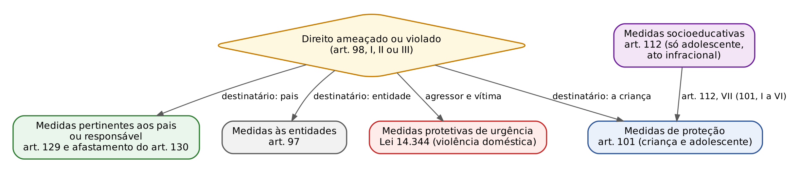
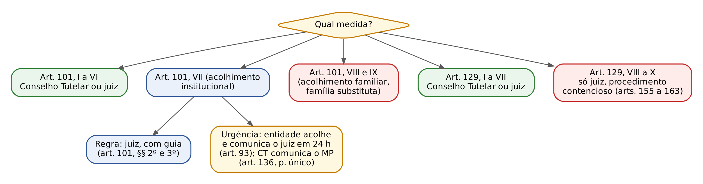
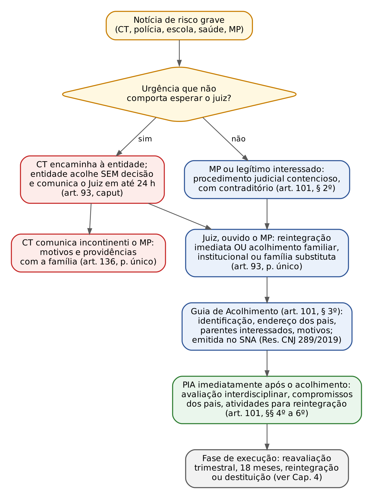
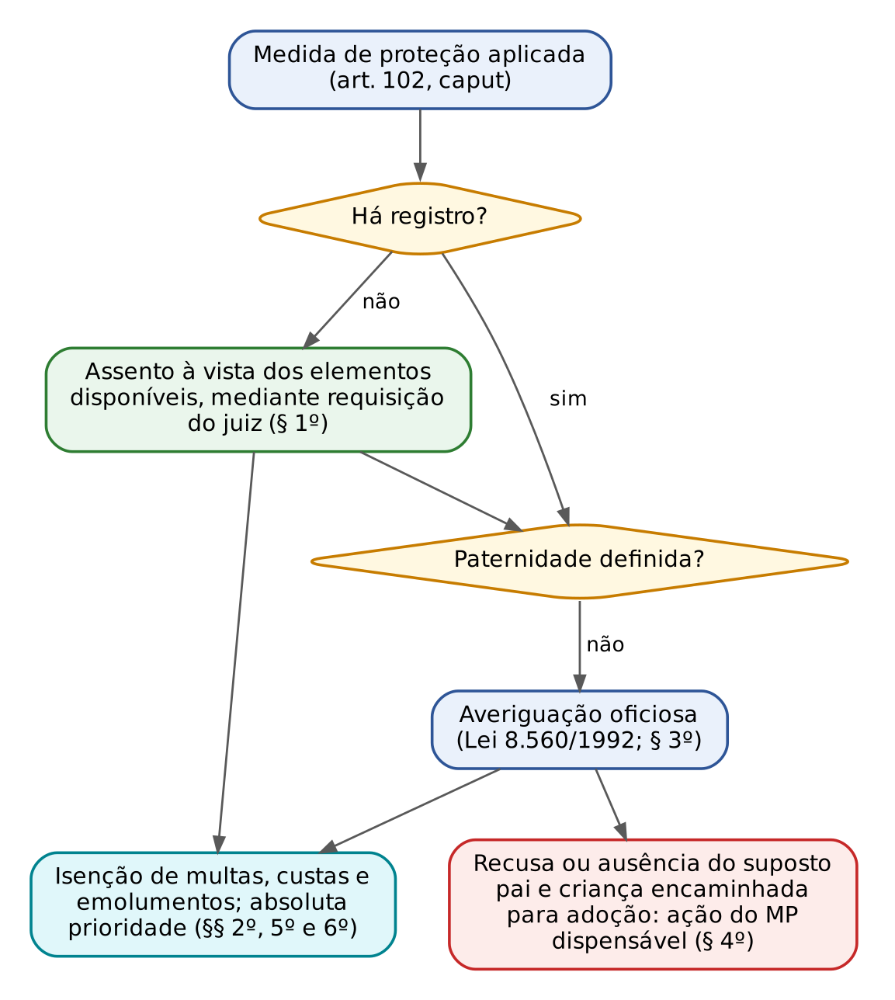
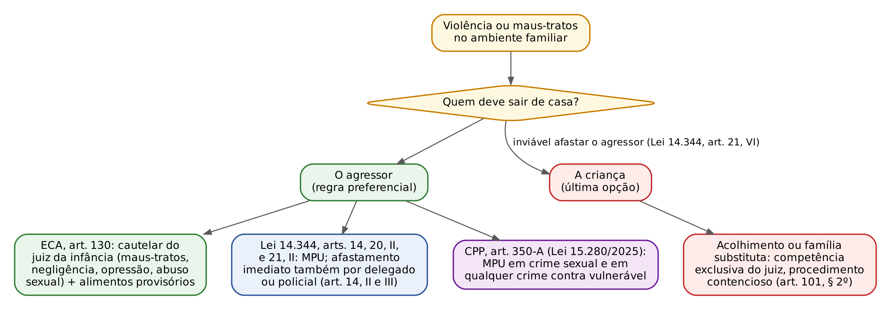

# CAPÍTULO 13 — MEDIDAS DE PROTEÇÃO E MEDIDAS PERTINENTES AOS PAIS OU RESPONSÁVEL

:::INCIDENCIA
TJRS p. 1; TJSC p. 2. Nível A+. Lote: 10 questões (FGV 9, FCC 1), mais 11 correlatas de outros capítulos (FGV 9, FCC 2), com quatro provas de magistratura e Ministério Público.
O que mais cai: quem pode acolher sem ordem judicial (art. 93: entidade, 24 horas ao juiz) e a guia de acolhimento; os doze princípios do art. 100, parágrafo único (literalidade e trocas de nome); o rol do art. 101 em caso prático (dependência química, adolescente infrator); o que o Conselho Tutelar aplica (art. 101, I a VII; art. 129, I a VII) e o que só o juiz aplica; as medidas do art. 129 diante de negligência grave.
:::

| Subtema | FGV | FCC | Padrão de cobrança |
|---|---|---|---|
| Acolhimento emergencial, guia e PIA | 5 | 0 | caso concreto: Conselho Tutelar, entidade, prazo de 24 horas, destinatário da comunicação, conteúdo do PIA |
| Princípios do art. 100 | 1 | 1 | trocar princípio por medida; "intervenção máxima", "extemporânea", "participação exclusiva dos pais" |
| Rol do art. 101 em caso prático | 5 | 1 | dependência química (CAPS), criança autora de ato infracional, cumulação com socioeducativa |
| Competência Conselho Tutelar x juiz | 3 | 0 | atribuição exclusiva, revisão judicial, acolhimento "determinado" pelo Conselho |
| Medidas aos pais (art. 129) e art. 249 | 3 | 1 | separar medidas aos pais de medidas socioeducativas; vacinação; consequência do descumprimento |
| Afastamento do agressor e registro civil | 0 | 0 | não cobrados no lote; alta probabilidade após a Lei 15.240/2025 (negligência no art. 130) |

## 13.1 O sistema de medidas do ECA e o lugar das medidas de proteção

O Livro II do ECA organiza as respostas estatais à violação de direitos em grupos que a prova separa pelo DESTINATÁRIO e pela NATUREZA. As medidas de proteção (Título II, arts. 98 a 102) têm por destinatário a criança ou o adolescente e por finalidade restaurar o direito ameaçado ou violado; não são sanção, não pressupõem culpa de ninguém e não se submetem ao devido processo infracional. As medidas pertinentes aos pais ou responsável (Título IV, arts. 129 e 130) recaem sobre os adultos e vão do encaminhamento a programas até a destituição do poder familiar. As medidas socioeducativas (art. 112) respondem a ato infracional de adolescente e têm conteúdo retributivo e pedagógico (Cap. 15). As medidas aplicáveis às entidades de atendimento (art. 97) estão no Cap. 11, e as medidas protetivas de urgência da Lei 14.344/2022, que recaem sobre o agressor e sobre a vítima, no Cap. 23.

A fronteira entre os grupos é porosa em dois pontos que caem em prova. Primeiro, as medidas de proteção dos incisos I a VI do art. 101 podem ser aplicadas ao adolescente autor de ato infracional COMO medida socioeducativa (art. 112, VII), isoladamente ou com outra socioeducativa (13.9). Segundo, há medidas com o mesmo conteúdo nas duas listas, com destinatários diferentes: "tratamento" é requisitado para a criança (art. 101, V) e imposto como obrigação aos pais (art. 129, III e VI); "programa de auxílio a alcoólatras e toxicômanos" está no art. 101, VI, e no art. 129, II. A alternativa que atribui aos pais medida do art. 101, ou à criança medida do art. 129, costuma ser a errada.

| Critério | Medida de proteção (art. 101) | Medida aos pais (art. 129) | Medida socioeducativa (art. 112) |
|---|---|---|---|
| Destinatário | criança ou adolescente | pais ou responsável | adolescente (12 a 18 anos; excepcionalmente até 21) |
| Pressuposto | qualquer hipótese do art. 98 | falta, omissão ou abuso dos pais (art. 98, II) | ato infracional com prova de autoria e materialidade (salvo remissão) |
| Natureza | protetiva, não sancionatória | protetiva ou restritiva de direitos civis (VIII a X) | sancionatória e pedagógica |
| Quem aplica | Conselho Tutelar (I a VI) e juiz (todas; VII a IX em regra só o juiz) | Conselho Tutelar (I a VII) e juiz (todas; VIII a X só o juiz) | só o juiz (art. 148, I), salvo remissão ministerial sem medida |
| Rol | exemplificativo ("dentre outras") | taxativo no texto, mas cumulável com as do art. 18-B e com outras do ordenamento | taxativo (art. 112, I a VII) |
| Prazo | sem prazo legal, salvo acolhimento (18 meses, Cap. 4) e limite jurisprudencial do tratamento hospitalar imposto a adolescente infrator (13.9) | sem prazo | prazos próprios (internação até 3 anos) |
| Criança autora de ato infracional | SIM (art. 105) | SIM, aos pais | NUNCA |

:::QUESTAO FGV 2025 — MPU — ANALISTA DO MPU — PSICOLOGIA (Q3339551)
Gêmeos de 9 anos nunca matriculados e obrigados a vender balas na rua; perguntava-se quais blocos de medidas podem ser aplicados AOS PAIS. Gabarito: D (I e II). O bloco I reúne advertência, encaminhamento a programas de promoção da família e perda da guarda (art. 129, VII, I e VIII); o bloco II, obrigação de matricular e acompanhar a frequência, suspensão ou destituição do poder familiar e obrigação de encaminhar a tratamento especializado (art. 129, V, X e VI).
Armadilha: o bloco III (reparação do dano, prestação de serviços à comunidade e semiliberdade) é de medidas SOCIOEDUCATIVAS do art. 112, II, III e V, que jamais recaem sobre os pais. O caso também autoriza, para as crianças, as medidas do art. 101 (matrícula, orientação e apoio) e a comunicação do art. 56.
:::

## 13.2 Situações de risco: o art. 98 como pressuposto

:::LEI LEI 8.069/1990 (ECA), ART. 98
Art. 98. As medidas de proteção à criança e ao adolescente são aplicáveis sempre que os direitos reconhecidos nesta Lei forem ameaçados ou violados:
I - por ação ou omissão da sociedade ou do Estado;
II - por falta, omissão ou abuso dos pais ou responsável;
III - em razão de sua conduta.
:::

### 13.2.1 Estrutura e leitura correta

O art. 98 é a cláusula de abertura de todo o sistema protetivo: basta a AMEAÇA (tutela preventiva) ou a VIOLAÇÃO de qualquer direito reconhecido no Estatuto. Não se exige dano consumado, culpa de alguém ou "situação irregular" no sentido do Código de Menores de 1979, que tipificava categorias de crianças (abandonadas, delinquentes, em perigo moral) como objeto de intervenção. Na doutrina da proteção integral (Cap. 1) o foco desloca-se do "menor em situação irregular" para o DIREITO violado e para quem o viola: o Estado e a sociedade (inciso I), a família (inciso II) ou a própria criança ou adolescente (inciso III). A expressão "situação de risco", consagrada na prática forense e usada pelo próprio STJ ao interpretar o art. 98, é apenas atalho verbal para essas hipóteses.

Três consequências práticas decorrem da estrutura do dispositivo:

- A hipótese do inciso I mostra que o violador pode ser o próprio Poder Público (falta de vaga em creche, de tratamento de saúde, de transporte escolar). Aqui a medida de proteção individual convive com a tutela coletiva e com a ação de obrigação de fazer contra o ente (arts. 208 a 224; Cap. 20). A requisição de tratamento (art. 101, V) é, em essência, ordem ao Estado.
- A hipótese do inciso II é a porta das medidas do art. 129 e, quando grave, da suspensão ou destituição do poder familiar (Cap. 4). Não há hierarquia: a mesma situação de negligência admite simultaneamente medida à criança (art. 101) e aos pais (art. 129).
- A hipótese do inciso III ("em razão de sua conduta") abrange a conduta autolesiva (evasão escolar, uso de drogas, exposição a exploração, fuga do lar) e o ato infracional. Para a criança, o ato infracional só gera medidas do art. 101 (art. 105). Para o adolescente, a medida de proteção pode ser aplicada INDEPENDENTEMENTE da responsabilização infracional, porque o pressuposto é a situação de vulnerabilidade, e não a autoria.

:::QUESTAO FGV 2026 — TJ-GO — JUIZ SUBSTITUTO (Q3966665, ATRIBUÍDA AO CAP. 14)
Família de comunidade tradicional flagrada caçando ave silvestre para alimentação: pai de 40 anos, filha de 13 e filho de 11. Gabarito: C (à adolescente pode ser imposta medida de proteção independentemente de sua responsabilidade pelo ato infracional em tese praticado).
Resolução em passos: (1) a filha, com 13 anos, é adolescente e pratica ato infracional (art. 103); (2) independentemente do desfecho da apuração, a situação de vulnerabilidade da família e da própria adolescente enquadra-se no art. 98, II e III, e autoriza as medidas do art. 101 pelo Conselho Tutelar ou pelo juiz; (3) o filho de 11 anos é criança, mas PRATICA ato infracional (o que falta é a responsabilização socioeducativa: art. 105).
Armadilhas: B diz que a criança "não pratica ato infracional" (praticar pratica; só não recebe medida socioeducativa); E manda a adolescente e o pai a "um só processo" (adolescente responde no juízo da infância, pelo rito dos arts. 171 a 190; o adulto, na Justiça comum: Cap. 16).
:::

### 13.2.2 O art. 98 e a competência da Justiça da Infância e da Juventude

O art. 98 tem um segundo papel, processual: delimita a competência da Justiça da Infância e da Juventude para as causas de família do art. 148, parágrafo único (guarda e tutela, destituição do poder familiar, suprimento de consentimento para o casamento, discordância entre os pais quanto ao exercício do poder familiar, emancipação, curador especial, alimentos e registros de nascimento e óbito). Sem a situação do art. 98, essas causas são, em regra, da vara de família. A disciplina completa da competência está no Cap. 18; aqui importam dois desdobramentos jurisprudenciais recentes que tratam o art. 98 com leitura ampla. Primeiro, o STJ afirmou que a ausência de situação de risco não afasta a competência da Justiça da Infância para o suprimento de autorização para passaporte e viagem internacional (REsp 2.062.293-DF, Informativo 868; v. Cap. 9). Segundo, a legitimidade do MP para a ação de alimentos em favor de criança ou adolescente independe da situação de risco do art. 98 (Súmula 594 do STJ; v. Cap. 7).

:::PEGADINHA RISCO NÃO É PRESSUPOSTO DE TODA TUTELA ESTATUTÁRIA
O art. 98 é pressuposto das MEDIDAS DE PROTEÇÃO e critério de competência das causas do art. 148, parágrafo único. Não é requisito para os direitos fundamentais em si, para a legitimidade do MP em alimentos (Súmula 594), para as ações dos arts. 208 e seguintes, nem, segundo o STJ (Informativo 868), para o suprimento de autorização de viagem internacional. Em sentido inverso, a FGV costuma afirmar que a medida de proteção depende de "culpa dos pais": falso, o inciso I responsabiliza o Estado e o inciso III, a própria conduta.
:::

### 13.2.3 Crianças em situação de rua e a ADI 3.446

O Supremo Tribunal Federal, em 8/8/2019, julgou improcedente a ADI 3.446 (Relator Ministro Gilmar Mendes, Plenário, decisão unânime), na qual se pedia a declaração de inconstitucionalidade, entre outros, dos arts. 16, I, 105, 122, II e III, 136, I, 138 e 230 do ECA. A tese do autor era a de que o direito de ir e vir da criança (art. 16, I) impediria o "recolhimento" de crianças em situação de rua e que a atuação do Conselho Tutelar diante do ato infracional de criança (arts. 105 e 136, I) violaria a inafastabilidade da jurisdição. O STF manteve os dispositivos. Quanto ao art. 16, I, afirmou que a liberdade de locomoção admite restrições legítimas, compatíveis com o estágio de desenvolvimento, mas não autoriza a apreensão de crianças fora das hipóteses do art. 5º, LXI, da CF; suprimir o dispositivo ressuscitaria a prática do "recolhimento" do Código de Menores. Quanto aos arts. 105, 136 e 138, o Conselho Tutelar foi descrito como órgão de participação direta da sociedade, cuja atuação não exclui a apreciação judicial (art. 137).

Consequência para este capítulo: a criança em situação de rua é destinatária de medidas de PROTEÇÃO (abordagem social, encaminhamento à família, inclusão em programas, acolhimento se necessário), nunca de apreensão compulsória como resposta à mera presença na rua. A apreensão de adolescente só cabe em flagrante de ato infracional ou por ordem escrita e fundamentada da autoridade judiciária (art. 106; Cap. 14).

## 13.3 Características das medidas específicas de proteção (art. 99)

:::LEI LEI 8.069/1990 (ECA), ART. 99
Art. 99. As medidas previstas neste Capítulo poderão ser aplicadas isolada ou cumulativamente, bem como substituídas a qualquer tempo.
:::

As características cobradas são cinco.

- Aplicação isolada ou cumulativa: a medida de acolhimento costuma vir com a requisição de tratamento e a matrícula escolar; a orientação e o apoio temporários (art. 101, II) acompanham quase sempre o encaminhamento aos pais (inciso I).
- Substituição a qualquer tempo: a decisão protetiva é *rebus sic stantibus*. A Jurisprudência em Teses do STJ (ed. 253, tese 3) registra que a alteração das circunstâncias fáticas que resultaram no afastamento do convívio familiar permite nova apreciação judicial, porque a decisão sobre guarda de criança e adolescente não faz coisa julgada material (art. 504, I, do CPC, referido na tese). O mesmo vale para a medida protetiva.
- Rol exemplificativo: o art. 101 diz "dentre outras". O juiz e o Conselho podem aplicar medida atípica adequada ao caso (por exemplo, inclusão em programa de apadrinhamento afetivo, encaminhamento a serviço de convivência e fortalecimento de vínculos, inclusão em programa de proteção a testemunhas), respeitados os princípios do art. 100 e a reserva de jurisdição do art. 101, § 2º.
- Ausência de prazo legal genérico: as medidas duram enquanto persistir a situação do art. 98, com as exceções do acolhimento (art. 19, §§ 1º e 2º; Cap. 4) e do limite fixado pelo STJ para o tratamento psiquiátrico hospitalar de adolescente infrator (13.9).
- Caráter não sancionatório: por isso a medida de proteção pode recair sobre criança, não exige prova de autoria de ato infracional e não gera antecedentes. Também por isso não se confunde com a "medida protetiva de urgência" da Lei 14.344/2022, que recai principalmente sobre o agressor (art. 20 daquela lei; 13.11).

:::DICA FÓRMULA DO ART. 99 X FÓRMULA DO ART. 113 X FÓRMULA DA LEI 14.344
O art. 99 ("isolada ou cumulativamente, bem como substituídas a qualquer tempo") é repetido para as socioeducativas pelo art. 113, que remete aos arts. 99 e 100. A Lei 14.344/2022, art. 16, § 2º, usa redação parecida, mas com um acréscimo: as medidas protetivas de urgência podem ser substituídas "por outras de maior eficácia". Se a assertiva reproduzir esse acréscimo para o art. 99 do ECA, desconfie da fonte, embora o conteúdo seja compatível.
:::

## 13.4 Princípios de aplicação (art. 100 e parágrafo único)

### 13.4.1 Caput: necessidades pedagógicas e fortalecimento dos vínculos

O caput do art. 100 contém o critério de escolha: "levar-se-ão em conta as necessidades pedagógicas, preferindo-se aquelas que visem ao fortalecimento dos vínculos familiares e comunitários". Na prova, a fórmula aparece como enunciado de abertura (Q4156355) e serve para eliminar alternativas que privilegiem medidas de ruptura. Pela remissão do art. 113, o caput também orienta a escolha das medidas socioeducativas.

### 13.4.2 Os doze princípios do parágrafo único

O parágrafo único foi incluído pela Lei 12.010/2009 e inspira-se na lei portuguesa de proteção de crianças e jovens em perigo (Lei 147/1999). Os nomes dos princípios são a pegadinha: a banca troca "precoce" por "tardia" ou "extemporânea", "mínima" por "máxima", "primária e solidária" por "subsidiária", "oitiva obrigatória e participação" por "participação exclusiva dos pais". O inciso X teve a parte final alterada pela Lei 13.509/2017 ("família adotiva" em lugar da expressão anterior, mais ampla).

:::LEI LEI 8.069/1990 (ECA), ART. 100, PARÁGRAFO ÚNICO (INCISOS MAIS COBRADOS)
III - responsabilidade primária e solidária do poder público: a plena efetivação dos direitos assegurados a crianças e a adolescentes por esta Lei e pela Constituição Federal, salvo nos casos por esta expressamente ressalvados, é de responsabilidade primária e solidária das 3 (três) esferas de governo, sem prejuízo da municipalização do atendimento e da possibilidade da execução de programas por entidades não governamentais;
VI - intervenção precoce: a intervenção das autoridades competentes deve ser efetuada logo que a situação de perigo seja conhecida;
VII - intervenção mínima: a intervenção deve ser exercida exclusivamente pelas autoridades e instituições cuja ação seja indispensável à efetiva promoção dos direitos e à proteção da criança e do adolescente;
VIII - proporcionalidade e atualidade: a intervenção deve ser a necessária e adequada à situação de perigo em que a criança ou o adolescente se encontram no momento em que a decisão é tomada;
X - prevalência da família: na promoção de direitos e na proteção da criança e do adolescente deve ser dada prevalência às medidas que os mantenham ou reintegrem na sua família natural ou extensa ou, se isso não for possível, que promovam a sua integração em família adotiva;
XII - oitiva obrigatória e participação: a criança e o adolescente, em separado ou na companhia dos pais, de responsável ou de pessoa por si indicada, bem como os seus pais ou responsável, têm direito a ser ouvidos e a participar nos atos e na definição da medida de promoção dos direitos e de proteção, sendo sua opinião devidamente considerada pela autoridade judiciária competente, observado o disposto nos §§ 1º e 2º do art. 28 desta Lei.
:::

| Inciso | Princípio | Núcleo cobrável | Troca típica da banca |
|---|---|---|---|
| I | condição de sujeitos de direitos | titulares dos direitos do ECA, de outras leis e da CF | "objeto de proteção" (linguagem do Código de Menores) |
| II | proteção integral e prioritária | interpretação e aplicação de TODA norma do ECA voltada à proteção integral e prioritária | restringir às medidas de proteção |
| III | responsabilidade primária e solidária do poder público | 3 esferas de governo; sem prejuízo da municipalização e da execução por ONGs; ressalvas expressas | "subsidiária", "exclusiva do Município", "da família em primeiro lugar" |
| IV | interesse superior | prioridade aos interesses da criança SEM excluir outros interesses legítimos | "interesse exclusivo", "desconsideração de quaisquer outros interesses" |
| V | privacidade | intimidade, imagem e reserva da vida privada | confundir com o art. 143 (sigilo dos atos judiciais) |
| VI | intervenção precoce | logo que a situação de perigo seja conhecida | "extemporânea", "após esgotadas as vias familiares" |
| VII | intervenção mínima | só autoridades e instituições cuja ação seja INDISPENSÁVEL | "máxima", "todos os órgãos da rede" |
| VIII | proporcionalidade e atualidade | necessária e adequada à situação de perigo NO MOMENTO da decisão | "no momento do fato" |
| IX | responsabilidade parental | intervenção que leve os pais a assumir seus deveres | "substituição dos pais pelo Estado" |
| X | prevalência da família | família natural ou extensa; se impossível, família ADOTIVA | "família substituta em qualquer modalidade" (redação anterior à Lei 13.509/2017) |
| XI | obrigatoriedade da informação | criança (conforme estágio de desenvolvimento) e pais informados dos direitos, motivos e forma da intervenção | "informação apenas aos pais" |
| XII | oitiva obrigatória e participação | criança e pais ouvidos; opinião devidamente considerada; remissão ao art. 28, §§ 1º e 2º | "participação exclusiva dos pais", "oitiva facultativa" |

Observações de aplicação. A proporcionalidade e atualidade (VIII) é o fundamento do controle da medida desatualizada: o acolhimento decretado por fato antigo, sem reavaliação, viola o inciso VIII mesmo que fosse adequado na origem. A intervenção mínima (VII) não significa intervir pouco, mas intervir com poucos atores: é argumento contra a multiplicação de órgãos sobre a mesma família e a favor da atuação do Conselho Tutelar no lugar do juiz quando a medida não exige jurisdição. A responsabilidade parental (IX) e a prevalência da família (X) explicam por que o ECA prefere o afastamento do agressor ao afastamento da criança (13.11). A oitiva obrigatória (XII) remete ao art. 28: oitiva por equipe interprofissional, respeitado o estágio de desenvolvimento, e CONSENTIMENTO do maior de 12 anos, colhido em audiência, para colocação em família substituta (Cap. 5).

:::QUESTAO FCC 2026 — AL-RR — ANALISTA LEGISLATIVO — ASSISTENTE SOCIAL (Q4156355)
Pedia-se, entre cinco pares, quais são princípios de aplicação das medidas protetivas. Gabarito: C (responsabilidade primária e solidária do poder público, art. 100, parágrafo único, III).
Armadilhas: A ("oitiva obrigatória e participação exclusivamente dos pais": o inciso XII inclui a criança e o adolescente); B ("intervenção extemporânea e mínima": é PRECOCE); D ("intimidade e respeito à imagem" é conteúdo do princípio da privacidade, não nome de princípio, e a alternativa omite o rótulo legal); E ("intervenção máxima": é mínima).
:::

:::QUESTAO FGV 2025 — MPU — ANALISTA DO MPU — SERVIÇO SOCIAL (Q3339626)
Três itens rotulados como "princípios" das medidas de proteção. Gabarito: B (apenas II, intervenção precoce, com a definição literal do inciso VI).
Armadilha: o item I ("inclusão em programa oficial ou comunitário de auxílio, orientação e tratamento a alcoólatras e toxicômanos") é MEDIDA (art. 101, VI), não princípio; o item III ("obrigação de escolarização e profissionalização") não existe como princípio no art. 100. A FGV mistura listas vizinhas (arts. 100 e 101) para testar a memória do rótulo.
:::

:::DICA PARA MEMORIZAR
Os doze incisos podem ser agrupados em três blocos: quem é a criança (I sujeito de direitos, II proteção integral e prioritária, IV interesse superior, V privacidade); como o Estado intervém (III responsabilidade primária e solidária, VI precoce, VII mínima, VIII proporcional e atual); e qual é o papel da família e da própria criança (IX responsabilidade parental, X prevalência da família, XI informação, XII oitiva e participação).
:::

## 13.5 O rol do art. 101

:::LEI LEI 8.069/1990 (ECA), ART. 101, CAPUT E INCISOS
Art. 101. Verificada qualquer das hipóteses previstas no art. 98, a autoridade competente poderá determinar, dentre outras, as seguintes medidas:
I - encaminhamento aos pais ou responsável, mediante termo de responsabilidade;
II - orientação, apoio e acompanhamento temporários;
III - matrícula e freqüência obrigatórias em estabelecimento oficial de ensino fundamental;
IV - inclusão em serviços e programas oficiais ou comunitários de proteção, apoio e promoção da família, da criança e do adolescente;
V – requisição de tratamento médico, psicológico ou psiquiátrico, em regime hospitalar ou ambulatorial, extensivo às famílias, se for o caso, especialmente em caso de vitimização em crime contra a dignidade sexual;
VI - inclusão em programa oficial ou comunitário de auxílio, orientação e tratamento a alcoólatras e toxicômanos;
VII - acolhimento institucional;
VIII - inclusão em programa de acolhimento familiar;
IX - colocação em família substituta.
:::

Três leituras do caput são cobradas: "autoridade competente" (expressão neutra, que abrange o Conselho Tutelar e o juiz, com a divisão do art. 136, I, e do art. 101, § 2º: 13.6); "poderá determinar" (discricionariedade técnica orientada pelos princípios do art. 100); "dentre outras" (rol exemplificativo).

### 13.5.1 Medidas em meio familiar e comunitário (incisos I a VI)

| Inciso | Conteúdo e alcance | Observações cobráveis |
|---|---|---|
| I — encaminhamento aos pais ou responsável, mediante termo de responsabilidade | devolução formal da criança a quem detém a guarda, com assunção documentada de compromissos | é a medida típica após a apreensão de criança ou após o acolhimento emergencial; o termo não transfere guarda a terceiro (para terceiro, guarda judicial: Cap. 5). Termo firmado no Conselho Tutelar não "formaliza adoção" (caso do Informativo 806, 13.7.6) |
| II — orientação, apoio e acompanhamento temporários | acompanhamento psicossocial da criança e da família pela rede (CRAS, CREAS, serviços de convivência) | "temporários": a medida se esgota com a superação da situação; foi o gabarito em caso de *bullying* racista entre crianças de 10 e 11 anos (Q3870047) |
| III — matrícula e frequência obrigatórias em estabelecimento oficial de ensino FUNDAMENTAL | ordem dirigida à criança, aos pais e à escola | a letra continua "ensino fundamental", embora a educação básica obrigatória vá dos 4 aos 17 anos (CF, art. 208, I; Cap. 8); a obrigação correspondente aos pais está no art. 129, V; a infração do art. 249 sanciona o descumprimento |
| IV — inclusão em serviços e programas de proteção, apoio e promoção da família, da criança e do adolescente | inclusão no SUAS (PAIF, PAEFI), programas de transferência de renda, apadrinhamento | redação da Lei 13.257/2016, que incluiu "serviços" e a "família"; dialoga com o art. 23, § 1º (a pobreza não autoriza a perda do poder familiar e obriga a inclusão da família em programas) |
| V — requisição de tratamento médico, psicológico ou psiquiátrico, hospitalar ou ambulatorial, extensivo às famílias, especialmente em caso de vitimização em crime contra a dignidade sexual | ordem ao SUS (requisição: não depende de concordância do gestor) | a parte final ("especialmente em caso de vitimização em crime contra a dignidade sexual") foi incluída pela Lei 15.280, de 5/12/2025 (DOU de 8/12/2025, vigente na publicação); internação psiquiátrica segue a Lei 10.216/2001 (Cap. 26) |
| VI — inclusão em programa de auxílio, orientação e tratamento a alcoólatras e toxicômanos | encaminhamento à Rede de Atenção Psicossocial (CAPSi, CAPS AD, unidades de acolhimento) | a mesma providência existe para os pais (art. 129, II); vale a terminologia legal, ainda que antiquada |

:::PEGADINHA LEI 15.280/2025 E O ART. 101, V
A redação vigente do inciso V traz o acréscimo "especialmente em caso de vitimização em crime contra a dignidade sexual", introduzido pela Lei 15.280/2025, a mesma que elevou as penas dos arts. 217-A a 218-C do CP, criou o crime de descumprimento de medidas protetivas (art. 338-A do CP) e as medidas protetivas de urgência dos arts. 350-A e 350-B do CPP. Assertiva que reproduza o inciso sem a parte final não está errada por isso; a que diga que o tratamento "não se estende à família" está errada desde a redação original.
:::

:::QUESTAO FGV 2025 — PREFEITURA DE CANAÃ DOS CARAJÁS — PSICÓLOGO (Q3265271)
Adolescente que, em audiência, admite ato de vandalismo sob efeito de *crack* e pede ajuda; o juiz aplica "também" medida protetiva. Gabarito: C (requisição de atendimento no CAPS AD, que concretiza o art. 101, V e VI).
Armadilhas: E (internação involuntária para tratamento: não é medida do ECA e, pela Lei 10.216/2001, exige laudo médico circunstanciado e é excepcional, Cap. 26); B ("redução de danos" é estratégia de saúde, não medida legal); D ("diminuição da pena socioeducativa" é linguagem estranha ao ECA); A (matrícula escolar é medida, mas não responde à demanda narrada).
No mesmo sentido: FGV 2025 — DPE-RO — Analista em Psicologia (Q3401942): adolescente de 15 anos, usuário de *crack* desde os 12, apreendido furtando cabos; a medida de PROTEÇÃO adequada é o encaminhamento ao CAPSi (B). Liberdade assistida é socioeducativa (A); reparação de danos morais não é medida (C); "internação provisória em entidade de acolhimento" e "acolhimento institucional em unidade socioeducativa" fundem regimes incompatíveis (D e E), porque o acolhimento não implica privação de liberdade (art. 101, § 1º).
:::

:::QUESTAO FGV 2024 — PREFEITURA DE CARAGUATATUBA — PEDAGOGO (Q3345490)
Qual medida está em desacordo com o art. 101. Gabarito: A (destituição do "pátrio poder").
Duas falhas na alternativa: a destituição do poder familiar é medida aplicável AOS PAIS (art. 129, X), privativa do juiz em procedimento contencioso (arts. 155 a 163); e a expressão "pátrio poder" foi substituída por "poder familiar" no ECA pela Lei 12.010/2009 (e no CC/2002). As demais alternativas reproduzem os incisos II, III, V e VI.
:::

### 13.5.2 Medidas de afastamento do convívio familiar (incisos VII a IX)

Os incisos VII (acolhimento institucional), VIII (inclusão em programa de acolhimento familiar) e IX (colocação em família substituta) formam um grupo à parte porque implicam afastamento da criança do convívio familiar e, por isso, submetem-se à reserva de jurisdição do § 2º (13.6.2). O acolhimento institucional e o familiar são, nos termos do § 1º, medidas PROVISÓRIAS e EXCEPCIONAIS, utilizáveis como forma de TRANSIÇÃO para a reintegração familiar ou, não sendo esta possível, para a colocação em família substituta, e NÃO implicam privação de liberdade. A família substituta (guarda, tutela e adoção) tem regime próprio nos arts. 28 a 52-D (Caps. 5 e 6).

| Ponto | Acolhimento institucional (VII) | Acolhimento familiar (VIII) |
|---|---|---|
| Executor | entidade governamental ou não governamental com programa registrado (arts. 90 e 91; Cap. 11) | família cadastrada e capacitada em programa ("família acolhedora"), sem finalidade de adoção |
| Preferência legal | subsidiário | PREFERENCIAL (art. 34, § 1º; Cap. 5) |
| Acolhimento emergencial sem decisão judicial | admitido (art. 93) | não previsto no art. 93, que se refere a entidades com programa de acolhimento INSTITUCIONAL |
| Guarda | o dirigente equipara-se ao guardião para todos os efeitos (art. 92, § 1º) | a família acolhedora recebe a criança mediante guarda (art. 34, § 2º; Cap. 5) |
| Aplicável pelo Conselho Tutelar? | o art. 136, I, menciona o inciso VII; após a Lei 12.010/2009, só em caráter emergencial (13.6) | NÃO (fora do art. 136, I) |
| Prazos | reavaliação a cada 3 meses e permanência máxima de 18 meses no institucional, salvo necessidade fundamentada (art. 19, §§ 1º e 2º; Cap. 4) | reavaliação a cada 3 meses (art. 19, § 1º) |

A excepcionalidade, a provisoriedade, o prazo máximo, a reavaliação trimestral, o apadrinhamento afetivo e a jurisprudência do STJ sobre a primazia do acolhimento familiar e sobre o acolhimento em caso de adoção irregular são desenvolvidos no Cap. 4; este capítulo trata do acolhimento como MEDIDA DE PROTEÇÃO: quem decide, como se ingressa (guia e acolhimento emergencial) e o plano individual (13.7).

## 13.6 Competência: Conselho Tutelar x autoridade judiciária

### 13.6.1 A divisão legal

A aplicação das medidas de proteção é repartida entre um órgão administrativo autônomo, não jurisdicional (Conselho Tutelar, art. 131; Cap. 12), e a autoridade judiciária. O critério é a GRAVIDADE da interferência na esfera familiar: o que não exige afastamento da criança nem restrição ao poder familiar é atribuição do Conselho; o que afasta a criança da família ou atinge a guarda, a tutela ou o poder familiar é reservado ao juiz.

:::LEI LEI 8.069/1990 (ECA), ART. 136, I, II E PARÁGRAFO ÚNICO, E ART. 137
Art. 136. São atribuições do Conselho Tutelar:
I - atender as crianças e adolescentes nas hipóteses previstas nos arts. 98 e 105, aplicando as medidas previstas no art. 101, I a VII;
II - atender e aconselhar os pais ou responsável, aplicando as medidas previstas no art. 129, I a VII;
(...)
Parágrafo único. Se, no exercício de suas atribuições, o Conselho Tutelar entender necessário o afastamento do convívio familiar, comunicará incontinenti o fato ao Ministério Público, prestando-lhe informações sobre os motivos de tal entendimento e as providências tomadas para a orientação, o apoio e a promoção social da família.
Art. 137. As decisões do Conselho Tutelar somente poderão ser revistas pela autoridade judiciária a pedido de quem tenha legítimo interesse.
:::

| Medida | Conselho Tutelar | Autoridade judiciária |
|---|---|---|
| Art. 101, I a VI | SIM (art. 136, I) | SIM, em procedimento próprio ou incidentalmente (arts. 148, VII, e 153) |
| Art. 101, VII (acolhimento institucional) | só providência EMERGENCIAL: encaminha à entidade, que comunica o juiz em 24 horas (art. 93), e comunica incontinenti o MP (art. 136, parágrafo único) | regra: decisão em procedimento contencioso (art. 101, § 2º) e expedição da guia (§ 3º) |
| Art. 101, VIII (acolhimento familiar) | NÃO | SIM, exclusivamente |
| Art. 101, IX (família substituta) | NÃO | SIM, exclusivamente (arts. 165 a 170) |
| Art. 129, I a VII | SIM (art. 136, II) | SIM |
| Art. 129, VIII a X (perda da guarda, destituição da tutela, suspensão ou destituição do poder familiar) | NÃO; o Conselho representa ao MP (art. 136, XI) | SIM, em procedimento contencioso (arts. 155 a 163 e 164) |
| Art. 130 (afastamento do agressor) | NÃO; o Conselho representa ao juiz ou à autoridade policial (art. 136, XV) | SIM, como medida cautelar |
| Medidas socioeducativas | NÃO; apenas "providencia" a medida do art. 101, I a VI, fixada pelo juiz para adolescente infrator (art. 136, VI) | SIM |
| Comarca sem Conselho Tutelar instalado | — | o juiz exerce as atribuições do Conselho (art. 262) |

Quatro regras complementares fecham o quadro. A competência territorial do Conselho segue o art. 147 (art. 138): domicílio dos pais ou responsável e, à falta deles, lugar onde se encontre a criança. As decisões do Conselho são executórias e só podem ser revistas pelo juiz "a pedido de quem tenha legítimo interesse" (art. 137): o juiz não as revê de ofício; o MP e os pais são legitimados típicos (Cap. 12). O descumprimento injustificado das deliberações do Conselho autoriza representação à autoridade judiciária (art. 136, III, b) e configura a infração administrativa do art. 249 (13.10.4). Por fim, o Conselho requisita serviços públicos nas áreas de saúde, educação, assistência social (expressão da Lei 15.268/2025, que substituiu "serviço social"), previdência, trabalho e segurança (art. 136, III, a), o que viabiliza a execução das medidas dos incisos IV a VI do art. 101.

:::QUESTAO FGV 2025 — MPE-RJ — PROMOTOR DE JUSTIÇA SUBSTITUTO (Q3532429, ATRIBUÍDA AO CAP. 12)
Pedia-se a atribuição EXCLUSIVA do Conselho Tutelar. Gabarito: E (receber a relação de alunos com faltas acima do limite legal, nos termos do art. 12, VIII, da LDB, e aplicar as medidas do art. 101, I a VI, e do art. 129, I a VII, comunicando ao MP o descumprimento para as providências judiciais).
Armadilhas: A e B (deflagrar os procedimentos de apuração de irregularidade em entidade e de infração administrativa: há legitimidade concorrente do MP, arts. 191 e 194; Cap. 19); C ("determinar" acolhimento institucional: após a Lei 12.010/2009, o afastamento do convívio familiar é competência exclusiva do juiz, art. 101, § 2º, e a atuação do Conselho limita-se à hipótese emergencial); D (reproduz os destinatários do art. 18-B e a advertência do inciso V, que o parágrafo único do art. 18-B manda o Conselho aplicar "sem prejuízo de outras providências legais"; a banca não a tratou como exclusiva porque a mesma advertência, invocada pela própria alternativa via art. 129, VII, também é aplicável pelo juiz).
Observação: a exclusividade da alternativa E deve ser lida no sentido de atribuição primária conferida por lei ao Conselho; o juiz pode aplicar as mesmas medidas em processo judicial. Ver nota de verificação.
:::

:::QUESTAO FGV 2024 — TJ-PE — JUIZ SUBSTITUTO (Q3117535, ATRIBUÍDA AO CAP. 14)
Criança de 11 anos subtrai joia de colega na escola; a joia é devolvida destruída. Gabarito: B (praticou ato infracional análogo ao furto, e o Conselho Tutelar pode aplicar, por exemplo, orientação, apoio e acompanhamento temporários).
Resolução em passos: (1) conduta descrita como crime praticada por criança é ato infracional (art. 103); (2) à criança só correspondem as medidas do art. 101 (art. 105); (3) o Conselho atende as crianças na hipótese do art. 105 e aplica o art. 101, I a VII (art. 136, I); (4) não há procedimento de apuração de ato infracional para criança (os arts. 171 a 190 são para adolescente).
Armadilhas: A (procedimento de apuração para criança); C (crime); D ("não praticou ato infracional": praticou, mas a resposta é protetiva); E (medida socioeducativa para criança).
:::

:::QUESTAO FCC 2025 — DPE-RS — DEFENSOR PÚBLICO (Q3386983, ATRIBUÍDA AO CAP. 14)
Dois dependentes químicos, de 12 e de 11 anos, acusados de ato infracional análogo ao tráfico. Gabarito: B (ao de 12 anos podem ser impostas medidas socioeducativas e também protetivas; ao de 11 anos, apenas medidas específicas de proteção).
Fundamento: idade na data do fato (art. 104, parágrafo único); art. 105 para a criança; art. 112, VII, e art. 99 para a cumulação no caso do adolescente. Armadilhas: C (a dependência química não impede a socioeducativa); E (as medidas não são "incompatíveis entre si"); A (criança não recebe socioeducativa, nem em meio aberto).
:::

### 13.6.2 A reserva de jurisdição do art. 101, § 2º

:::LEI LEI 8.069/1990 (ECA), ART. 101, § 2º
§ 2º Sem prejuízo da tomada de medidas emergenciais para proteção de vítimas de violência ou abuso sexual e das providências a que alude o art. 130 desta Lei, o afastamento da criança ou adolescente do convívio familiar é de competência exclusiva da autoridade judiciária e importará na deflagração, a pedido do Ministério Público ou de quem tenha legítimo interesse, de procedimento judicial contencioso, no qual se garanta aos pais ou ao responsável legal o exercício do contraditório e da ampla defesa.
:::

O § 2º, introduzido pela Lei 12.010/2009, contém quatro comandos: (i) o afastamento do convívio familiar é de competência EXCLUSIVA da autoridade judiciária; (ii) deflagra procedimento judicial CONTENCIOSO; (iii) a iniciativa é do MP ou de quem tenha legítimo interesse; (iv) aos pais ou responsável garantem-se contraditório e ampla defesa. Ressalvam-se as medidas EMERGENCIAIS para proteção de vítimas de violência ou abuso sexual e o afastamento do AGRESSOR (art. 130).

A antinomia aparente com o art. 136, I, que continua a mencionar o inciso VII do art. 101 entre as medidas aplicáveis pelo Conselho, resolve-se pela especialidade e pela posteridade do § 2º, lido em conjunto com o art. 93 e com o parágrafo único do art. 136 (ambos também da Lei 12.010/2009): o Conselho Tutelar não "determina" acolhimento como medida ordinária; em situação de urgência, providencia o encaminhamento da criança à entidade, que acolhe e comunica o juiz em até 24 horas, e comunica de imediato o MP, que deflagrará o procedimento judicial. É a leitura que a FGV adota (Q3532429, C errada; Q3786365 e Q3752750, gabaritos que exigem comunicação ao juiz). Em comarca sem Conselho Tutelar, o juiz exerce suas atribuições (art. 262).

O art. 153, que autoriza o juiz a investigar os fatos e ordenar de ofício providências quando a medida não corresponder a procedimento previsto em lei, NÃO se aplica ao afastamento da criança da família de origem nem aos procedimentos necessariamente contenciosos (art. 153, parágrafo único). Daí a pegadinha: o juiz não decreta acolhimento "de ofício" em procedimento verificatório sem contraditório; pode, em urgência, determinar medida emergencial, mas o afastamento deve ser submetido a procedimento contencioso, com citação dos pais.

:::PEGADINHA "SOMENTE POR GUIA EXPEDIDA PELA AUTORIDADE JUDICIÁRIA"
O art. 101, § 3º, diz que crianças e adolescentes "somente poderão ser encaminhados" às instituições de acolhimento institucional "por meio de uma Guia de Acolhimento, expedida pela autoridade judiciária". O art. 93 permite à entidade acolher, em caráter excepcional e de urgência, "sem prévia determinação da autoridade competente". As duas normas convivem: no acolhimento emergencial, a guia é expedida DEPOIS, quando o juiz, comunicado em 24 horas, mantiver a medida (art. 93, parágrafo único).
Na FGV 2026 — MPE-MT — Promotor (Q4116976, atribuída ao Cap. 12; questão do tipo "assinale a incorreta", gabarito B), a assertiva que reproduzia o § 3º ("somente poderão ser realizados por meio de uma guia de acolhimento específica, expedida pela autoridade judiciária") foi tratada como CORRETA. A incorreta era a que atribuía a conselhos de direitos e conselhos tutelares os mesmos princípios, inclusive "composição paritária" (o Conselho Tutelar é composto por 5 membros escolhidos pela população, não é paritário; Cap. 12). Moral: diante da literalidade do § 3º, a FGV aceita a regra geral; diante de caso concreto de urgência, aplica o art. 93.
:::

## 13.7 Acolhimento como medida de proteção: ingresso, guia e plano individual

### 13.7.1 As duas portas de entrada

O acolhimento institucional pode começar por duas vias, e a prova costuma oferecer as duas misturadas com regras falsas (prazo de 48 horas, comunicação ao MP em vez do juiz, dependência de concordância do adolescente, decisão prévia sempre obrigatória).

:::LEI LEI 8.069/1990 (ECA), ART. 93
Art. 93. As entidades que mantenham programa de acolhimento institucional poderão, em caráter excepcional e de urgência, acolher crianças e adolescentes sem prévia determinação da autoridade competente, fazendo comunicação do fato em até 24 (vinte e quatro) horas ao Juiz da Infância e da Juventude, sob pena de responsabilidade.
Parágrafo único. Recebida a comunicação, a autoridade judiciária, ouvido o Ministério Público e se necessário com o apoio do Conselho Tutelar local, tomará as medidas necessárias para promover a imediata reintegração familiar da criança ou do adolescente ou, se por qualquer razão não for isso possível ou recomendável, para seu encaminhamento a programa de acolhimento familiar, institucional ou a família substituta, observado o disposto no § 2º do art. 101 desta Lei.
:::

Os elementos do acolhimento emergencial, um a um:

- Quem acolhe: a ENTIDADE que mantenha programa de acolhimento INSTITUCIONAL. O Conselho Tutelar, a polícia ou qualquer pessoa leva a criança; quem a recebe sem ordem judicial é a entidade.
- Pressupostos: caráter EXCEPCIONAL e de URGÊNCIA (o risco não comporta a espera pela decisão judicial).
- Comunicação: em até 24 horas, ao JUIZ da Infância e da Juventude, sob pena de responsabilidade (do dirigente: art. 92, § 6º, e infração administrativa, conforme o caso).
- Comunicação paralela do Conselho Tutelar: se o Conselho entender necessário o afastamento, comunica INCONTINENTI o MP, com os motivos e as providências de orientação, apoio e promoção social da família (art. 136, parágrafo único).
- Decisão judicial: ouvido o MP (e, se necessário, com apoio do Conselho), o juiz promove a imediata reintegração ou, se impossível ou não recomendável, encaminha a acolhimento familiar, institucional ou família substituta, observado o § 2º do art. 101 (procedimento contencioso).

:::QUESTAO FGV 2025 — TJ-MS — JUIZ SUBSTITUTO (Q3786365)
Criança de 7 anos, mãe em situação de rua e em local incerto, família extensa em outro estado; o pai a deixa sozinha à noite e, num sábado, vizinhos acionam o conselheiro de plantão ao encontrá-la sozinha na calçada. Gabarito: D (pode ser acolhida por entidade com programa de acolhimento institucional, em caráter excepcional e de urgência, mesmo sem prévia decisão judicial, devendo a instituição comunicar o juízo em até 24 horas).
Resolução em passos: (1) violação por omissão do pai (art. 98, II); (2) risco atual, fim de semana, sem família extensa próxima: urgência; (3) aplica-se o art. 93, não a regra geral do § 2º do art. 101; (4) depois, o juiz decide pela reintegração ou pela manutenção, com procedimento contencioso.
Armadilhas: A (exige decisão judicial prévia em situação que o art. 93 dispensa); B (reintegração ao pai mediante termo de responsabilidade, em plena situação de risco recorrente, e por decisão "do juízo de plantão" sem procedimento); C ("residência inclusiva" é serviço para jovens e adultos com deficiência, não a modalidade adequada); E (condiciona o acolhimento à falta de vizinhos, como se fossem alternativa legal de guarda).
:::

:::QUESTAO FGV 2025 — MPE-ES — PROMOTOR DE JUSTIÇA SUBSTITUTO (Q3752750)
Adolescente de 14 anos, residente em Minas Gerais, perde a mãe afogada durante férias no Espírito Santo; sem contato com familiares, quer voltar de ônibus sozinha. Gabarito: E (o Conselho Tutelar pode promover o acolhimento emergencial, independentemente de decisão judicial, por meio de entidade com programa de acolhimento institucional, observadas as exigências posteriores do ECA).
Armadilhas: A (não há exigência de concordância do maior de 12 anos para o acolhimento; o consentimento do art. 28, § 2º, refere-se à colocação em família substituta); B (o Conselho não insere em programa de acolhimento FAMILIAR, medida fora do art. 136, I, e fora do art. 93); C (o destinatário da comunicação em 24 horas é o JUIZ, não o MP, e o prazo não é de 48 horas); D (viagem nacional desacompanhada só é livre a partir dos 16 anos, art. 83, na redação da Lei 13.812/2019; Cap. 9).
:::

:::QUESTAO FGV 2025 — AL-AM — ANALISTA LEGISLATIVO — PSICÓLOGO (Q3779578)
Adolescente de 17 anos, grávida, expulsa de casa, procura o Conselho Tutelar para ser acolhida. Gabarito: C (deve ser acolhida pelo Conselho Tutelar em instituição que receba adolescentes, com direito de permanecer na mesma unidade com o bebê após o parto).
Fundamentos: acolhimento emergencial por meio de entidade (art. 93 c/c art. 136, I e parágrafo único); convivência integral da criança com a mãe adolescente acolhida (art. 19, § 5º) e assistência por equipe multidisciplinar (art. 19, § 6º).
Armadilhas: A (só a Vara teria "autoridade para acolher": ignora o art. 93); B e E (MP e Defensoria não "acolhem"); D (o Conselho não "processa" a família; representa ao MP, art. 136, IV e XI).
Nota: a expressão "acolhida pelo Conselho Tutelar" é imprecisa (quem acolhe é a entidade), mas a FGV a emprega no sentido de providência emergencial do Conselho; a alternativa é a única compatível com o art. 19, § 5º.
:::

### 13.7.2 A guia de acolhimento

:::LEI LEI 8.069/1990 (ECA), ART. 101, § 3º
§ 3º Crianças e adolescentes somente poderão ser encaminhados às instituições que executam programas de acolhimento institucional, governamentais ou não, por meio de uma Guia de Acolhimento, expedida pela autoridade judiciária, na qual obrigatoriamente constará, dentre outros:
I - sua identificação e a qualificação completa de seus pais ou de seu responsável, se conhecidos;
II - o endereço de residência dos pais ou do responsável, com pontos de referência;
III - os nomes de parentes ou de terceiros interessados em tê-los sob sua guarda;
IV - os motivos da retirada ou da não reintegração ao convívio familiar.
:::

A guia cumpre três funções: documenta a ordem judicial (controle de legalidade do acolhimento, impedindo o "abrigamento" informal); transmite à entidade as informações necessárias para a reintegração (endereço com pontos de referência, parentes interessados na guarda); e alimenta o cadastro judicial de acolhidos (§ 11). O inciso IV contempla tanto a "retirada" (acolhimento originário) quanto a "não reintegração" (manutenção após o acolhimento emergencial ou após o fracasso de tentativa de retorno). O rol é mínimo ("dentre outros").

No plano normativo do CNJ, a Resolução CNJ 289, de 14/8/2019, que instituiu o Sistema Nacional de Adoção e Acolhimento (SNA), dispõe no art. 9º do Anexo I que a Guia Nacional de Acolhimento e a Guia Nacional de Desligamento de Crianças e Adolescentes Acolhidos devem ser obrigatoriamente emitidas no sistema para todas as crianças e adolescentes cuja medida protetiva de acolhimento tenha sido aplicada; o art. 10 do Anexo I prevê a geração automática, pelo sistema, do relatório das audiências concentradas, com as estatísticas semestrais dos acolhidos. O SNA é desenvolvido nos Caps. 6 e 26.

:::DICA GUIA DE ACOLHIMENTO X GUIA DE EXECUÇÃO
Não confundir a Guia de Acolhimento (medida protetiva, art. 101, § 3º, expedida pelo juiz da infância para a entidade de acolhimento) com a guia de execução de medida socioeducativa (Lei 12.594/2012, SINASE, e atos do CNJ; Cap. 17). E não confundir o Plano Individual de Atendimento do acolhimento (art. 101, §§ 4º a 6º) com o PIA socioeducativo (arts. 52 a 59 da Lei 12.594/2012). A sigla é a mesma; o regime é outro.
:::

### 13.7.3 O plano individual de atendimento (PIA) do acolhimento

:::LEI LEI 8.069/1990 (ECA), ART. 101, §§ 4º A 6º
§ 4º Imediatamente após o acolhimento da criança ou do adolescente, a entidade responsável pelo programa de acolhimento institucional ou familiar elaborará um plano individual de atendimento, visando à reintegração familiar, ressalvada a existência de ordem escrita e fundamentada em contrário de autoridade judiciária competente, caso em que também deverá contemplar sua colocação em família substituta, observadas as regras e princípios desta Lei.
§ 5º O plano individual será elaborado sob a responsabilidade da equipe técnica do respectivo programa de atendimento e levará em consideração a opinião da criança ou do adolescente e a oitiva dos pais ou do responsável.
§ 6º Constarão do plano individual, dentre outros:
I - os resultados da avaliação interdisciplinar;
II - os compromissos assumidos pelos pais ou responsável; e
III - a previsão das atividades a serem desenvolvidas com a criança ou com o adolescente acolhido e seus pais ou responsável, com vista na reintegração familiar ou, caso seja esta vedada por expressa e fundamentada determinação judicial, as providências a serem tomadas para sua colocação em família substituta, sob direta supervisão da autoridade judiciária.
:::

| Elemento | Regra | Pegadinha |
|---|---|---|
| Momento | IMEDIATAMENTE após o acolhimento | "em 30 dias", "após a audiência concentrada" |
| Quem elabora | a entidade, sob responsabilidade da EQUIPE TÉCNICA do programa (institucional OU familiar) | "Conselho Tutelar", "equipe do juízo", "Ministério Público" |
| Finalidade-padrão | reintegração familiar | "colocação em família substituta" como objetivo inicial |
| Exceção | ordem judicial escrita e fundamentada em contrário: o plano contempla TAMBÉM a família substituta | ordem verbal ou da entidade |
| Participação | opinião da criança ou do adolescente e oitiva dos pais | "dispensada a oitiva dos pais" |
| Conteúdo mínimo | resultados da avaliação interdisciplinar; compromissos dos pais; previsão de atividades com vista à reintegração ou, se vedada por decisão judicial, providências para família substituta, sob supervisão do juiz | "diagnóstico psicossocial", "relatório escolar", "parecer do Conselho Tutelar", "prontuário de infrações" |

:::QUESTAO FGV 2024 — TJ-AP — ANALISTA JUDICIÁRIO — ASSISTENTE SOCIAL (Q2443344)
Adolescente em acolhimento institucional; perguntava-se o que deve constar do plano individual de atendimento. Gabarito: C (os compromissos assumidos pelos pais ou responsável, art. 101, § 6º, II).
Armadilhas: A ("diagnóstico psicossocial": a lei fala em "resultados da avaliação interdisciplinar", e a FGV distingue os rótulos); B (relatório de desenvolvimento escolar não está no rol); D (prontuário de infrações: confusão com o PIA socioeducativo, e ainda assim estigmatizante); E (parecer do Conselho Tutelar justificando o acolhimento: o Conselho não elabora o PIA e o acolhimento é justificado na guia, pelo juiz).
:::

### 13.7.4 Demais parágrafos do art. 101: execução do acolhimento (remissão)

Os §§ 7º a 12 regulam a execução do acolhimento e são desenvolvidos no Cap. 4 (acolhimento e reintegração); aqui, só os comandos e prazos para fixação:

| Parágrafo | Regra |
|---|---|
| § 7º | acolhimento no local mais próximo à residência dos pais; inclusão da família em programas; contato facilitado e estimulado |
| § 8º | reintegração possível: comunicação imediata ao juiz, vista ao MP por 5 dias, decisão em igual prazo |
| § 9º | reintegração impossível: relatório fundamentado ao MP, com recomendação expressa de destituição do poder familiar, da tutela ou da guarda |
| § 10 | MP: 15 dias para a ação de destituição (prazo reduzido de 30 para 15 pela Lei 13.509/2017), salvo estudos complementares ou outras providências indispensáveis |
| §§ 11 e 12 | cadastro de acolhidos em cada comarca ou foro regional, com acesso do MP, do Conselho Tutelar, do órgão gestor da assistência social e dos Conselhos Municipais dos Direitos da Criança e do Adolescente e da Assistência Social |

Com eles se articulam o art. 19, § 1º (reavaliação no máximo a cada 3 meses), o art. 19, § 2º (permanência máxima de 18 meses no acolhimento institucional, salvo comprovada necessidade fundamentada), e o art. 92, § 2º (relatório circunstanciado da entidade no máximo a cada 6 meses). Todos no Cap. 4.

### 13.7.5 O procedimento judicial de aplicação da medida de acolhimento

O ECA não prevê rito nominado para a "ação de acolhimento" ou "medida de proteção com afastamento" (na prática, procedimento de aplicação de medida protetiva, autuado como pedido de providências ou ação de medida de proteção). Do § 2º do art. 101 extraem-se as balizas: legitimidade do MP ou de quem tenha legítimo interesse; natureza CONTENCIOSA; citação dos pais ou do responsável; contraditório e ampla defesa. Na falta de rito especial, aplicam-se as disposições gerais dos arts. 152 e seguintes (prioridade absoluta, prazos em dias corridos e vedação do prazo em dobro para a Fazenda e o MP, art. 152, § 2º; Cap. 18) e, subsidiariamente, o CPC; por analogia, usa-se a estrutura do procedimento de perda e suspensão do poder familiar (arts. 155 a 163), especialmente a possibilidade de decisão liminar de afastamento (art. 157).

:::JURIS STJ, JURISPRUDÊNCIA EM TESES, ED. 27, TESE 10
"Nos casos em que o Ministério Público promove ação de destituição do poder familiar ou de acolhimento institucional não é obrigatória a nomeação da Defensoria Pública como curadora especial." Precedentes da Terceira e da Quarta Turmas, entre eles AgInt no REsp 1.963.345-MS (Relator Ministro Moura Ribeiro, Terceira Turma, DJe 29/5/2024).
Razão: quando o MP é autor, atua na defesa dos interesses da criança; a curadoria especial (art. 72 do CPC; art. 142, parágrafo único, do ECA) pressupõe colidência entre os interesses da criança e os de seu representante sem quem os defenda, o que não ocorre. A Defensoria, porém, pode atuar como representante dos PAIS (defesa técnica) e como *custos vulnerabilis*, conforme a orientação de cada tribunal.
:::

:::PROCESSO MEDIDA DE PROTEÇÃO COM AFASTAMENTO DO CONVÍVIO FAMILIAR (ART. 101, VII A IX, E § 2º)
- Início: representação ou pedido do MP (ou de legítimo interessado), em regra após comunicação do Conselho Tutelar (art. 136, parágrafo único) ou da entidade (art. 93).
- Decisão liminar: afastamento cautelar, com fundamentação concreta no risco e na inviabilidade de medida menos gravosa (art. 100, parágrafo único, VII, VIII e X), preferencialmente em família extensa ou acolhimento familiar; expedição da guia (art. 101, § 3º) no SNA.
- Citação dos pais ou do responsável; resposta; estudo psicossocial pela equipe interprofissional (arts. 150 e 151); oitiva da criança ou do adolescente (art. 100, parágrafo único, XII; Lei 13.431/2017 se vítima de violência).
- Elaboração do PIA pela entidade (art. 101, §§ 4º a 6º) e juntada aos autos.
- Audiência, se necessária; manifestação do MP; sentença.
- Execução: reavaliação no máximo a cada 3 meses (art. 19, § 1º); reintegração (§ 8º) ou relatório e ação de destituição (§§ 9º e 10).
- Recurso: sistema recursal do CPC, com prazo de 10 dias (art. 198, II): agravo de instrumento contra a liminar e apelação contra a sentença; efeitos e prioridade no Cap. 19.
:::

:::SENTENCA DECISÃO LIMINAR DE ACOLHIMENTO (REDAÇÃO-MODELO)
Vistos. O Ministério Público noticia que a criança A. B. C., de 7 anos, foi encontrada sozinha na via pública na madrugada de 15/3/2026 e acolhida emergencialmente pela entidade X, que comunicou o fato no dia seguinte (art. 93 do ECA). O relatório do Conselho Tutelar documenta reiteradas situações de abandono noturno pelo genitor, J. C. (pai), apesar de orientação anterior (art. 129, IV), e a genitora encontra-se em local incerto. A situação configura violação de direitos por omissão dos pais (art. 98, II), e as medidas em meio aberto já aplicadas mostraram-se insuficientes. Não há, por ora, membro da família extensa identificado com condições de assumir a guarda, nem vaga imediata em programa de acolhimento familiar, que seria preferencial (art. 34, § 1º). Assim, com fundamento nos arts. 93, parágrafo único, 101, VII e §§ 2º e 3º, e 157 do ECA, MANTENHO o acolhimento institucional da criança, determino a expedição da Guia de Acolhimento no SNA, a elaboração imediata do plano individual de atendimento (art. 101, §§ 4º a 6º), a busca ativa da família extensa e a inclusão do genitor em programa de orientação e apoio (art. 129, I e IV), com visitas assistidas a serem disciplinadas pela equipe técnica. Cite-se o genitor e intime-se a genitora por edital, para resposta em 10 dias, assegurado o contraditório. Reavaliação em no máximo 3 meses (art. 19, § 1º).
:::

### 13.7.6 Acolhimento e orientação do STJ (síntese e remissão)

A orientação consolidada do STJ é de que o acolhimento institucional é medida excepcional, justificável apenas diante de risco concreto, e de que deve ser preferido o acolhimento familiar ou a manutenção com guardiões de fato com vínculo socioafetivo, inclusive em casos de adoção irregular ou "à brasileira", salvo evidente risco à integridade física ou psíquica da criança (Jurisprudência em Teses, ed. 27, tese 3, e ed. 250, tese 7; STJ, HC n. 878.386, Relator Ministro Moura Ribeiro, Terceira Turma, j. 2/4/2024, Informativo 806; manutenção de criança com família acolhedora descadastrada até o julgamento da destituição, Informativo 896, Terceira Turma, Relatora Ministra Nancy Andrighi, j. 4/8/2026). O desenvolvimento desses precedentes, inclusive o cabimento de *habeas corpus* contra o acolhimento, está no Cap. 4. Para este capítulo, a lição é de aplicação: a medida do art. 101, VII, só passa no teste da proporcionalidade e atualidade (art. 100, parágrafo único, VIII) quando as medidas dos incisos I a VI e o acolhimento familiar forem insuficientes.

## 13.8 Regularização do registro civil (art. 102)

:::LEI LEI 8.069/1990 (ECA), ART. 102
Art. 102. As medidas de proteção de que trata este Capítulo serão acompanhadas da regularização do registro civil.
§ 1º Verificada a inexistência de registro anterior, o assento de nascimento da criança ou adolescente será feito à vista dos elementos disponíveis, mediante requisição da autoridade judiciária.
§ 2º Os registros e certidões necessários à regularização de que trata este artigo são isentos de multas, custas e emolumentos, gozando de absoluta prioridade.
§ 3º Caso ainda não definida a paternidade, será deflagrado procedimento específico destinado à sua averiguação, conforme previsto pela Lei nº 8.560, de 29 de dezembro de 1992.
§ 4º Nas hipóteses previstas no § 3º deste artigo, é dispensável o ajuizamento de ação de investigação de paternidade pelo Ministério Público se, após o não comparecimento ou a recusa do suposto pai em assumir a paternidade a ele atribuída, a criança for encaminhada para adoção.
§ 5º Os registros e certidões necessários à inclusão, a qualquer tempo, do nome do pai no assento de nascimento são isentos de multas, custas e emolumentos, gozando de absoluta prioridade.
§ 6º São gratuitas, a qualquer tempo, a averbação requerida do reconhecimento de paternidade no assento de nascimento e a certidão correspondente.
:::

O art. 102 é medida ACESSÓRIA e OBRIGATÓRIA ("serão acompanhadas"): toda aplicação de medida de proteção impõe a verificação da situação registral, porque sem registro a criança não acessa saúde, educação, benefícios assistenciais nem o próprio SNA. Pontos de prova:

- Registro inexistente (§ 1º): o assento é lavrado "à vista dos elementos disponíveis", mediante REQUISIÇÃO da autoridade JUDICIÁRIA (não do Conselho Tutelar, que requisita certidões já existentes, art. 136, VIII). Dispensa-se, assim, o procedimento comum de registro tardio da Lei de Registros Públicos (Lei 6.015/1973, art. 46) e a prova exaustiva de filiação, que pode ser completada depois.
- Gratuidade e prioridade (§§ 2º, 5º e 6º): isenção de multas, custas e emolumentos, com absoluta prioridade, para a regularização (§ 2º) e para a inclusão do nome do pai a qualquer tempo (§ 5º); gratuidade da averbação do reconhecimento de paternidade e da certidão (§ 6º). Os §§ 5º e 6º vieram com a Lei 13.257/2016 (Marco Legal da Primeira Infância; Cap. 24).
- Averiguação oficiosa (§ 3º): se a paternidade não estiver definida, deflagra-se o procedimento da Lei 8.560/1992. O STJ afirmou, em 2026, que esse procedimento tem natureza administrativa, não é condição para a investigatória e pressupõe a indicação de suposto pai, sem dever de intimar judicialmente a mãe que se recusa a indicá-lo (processo em segredo de justiça, Relatora Ministra Maria Isabel Gallotti, Quarta Turma, j. 17/3/2026, Informativo 883); o desenvolvimento está no Cap. 7.
- Dispensa da investigatória (§ 4º): se o suposto pai não comparece ou recusa a paternidade e a criança é encaminhada para ADOÇÃO, é dispensável a ação de investigação de paternidade pelo MP. A lógica é a celeridade da colocação em família substituta; o direito ao conhecimento da origem biológica permanece (art. 48; Cap. 6).
- Competência: quando a criança está em situação do art. 98, a Justiça da Infância é competente para determinar o cancelamento, a retificação e o suprimento dos registros de nascimento e óbito (art. 148, parágrafo único, h; Cap. 18).

:::PEGADINHA QUEM REQUISITA O QUÊ
Juiz: REQUISITA a lavratura do assento inexistente (art. 102, § 1º) e determina cancelamento, retificação e suprimento (art. 148, parágrafo único, h). Conselho Tutelar: REQUISITA certidões de nascimento e de óbito "quando necessário" (art. 136, VIII), isto é, documentos de registros existentes. Alternativa que atribua ao Conselho a requisição do assento de nascimento inexistente está errada.
:::

## 13.9 Medidas de proteção e ato infracional

### 13.9.1 Criança e adolescente: regimes distintos

À CRIANÇA autora de ato infracional correspondem exclusivamente as medidas do art. 101 (art. 105), aplicáveis pelo Conselho Tutelar (art. 136, I) ou pelo juiz, sem procedimento de apuração e sem medida socioeducativa. Ao ADOLESCENTE, a medida de proteção entra por duas vias: como medida socioeducativa propriamente dita (art. 112, VII: "qualquer uma das previstas no art. 101, I a VI"), aplicada pelo juiz na sentença ou na remissão; e como medida protetiva autônoma, pela situação de vulnerabilidade (art. 98, III), cumulável com a socioeducativa (arts. 99 e 113). Na execução, o Conselho Tutelar "providencia" a medida do art. 101, I a VI, estabelecida pelo juiz para o adolescente (art. 136, VI). As medidas dos incisos VII a IX do art. 101 NÃO podem ser aplicadas como socioeducativas: o acolhimento não é sanção e não implica privação de liberdade (art. 101, § 1º).

:::QUESTAO FGV 2025 — SEASIC-SE — PSICÓLOGO (Q3351806, ATRIBUÍDA AO CAP. 15)
Adolescente de 15 anos cumpre medida em meio aberto acompanhada pelo CREAS, "além de outras medidas de proteção"; pedia-se o par medida socioeducativa e medida de proteção. Gabarito: B (prestação de serviços à comunidade e encaminhamento para tratamento psicológico).
Armadilhas: A (semiliberdade não é meio aberto e advertência é socioeducativa, não protetiva); C (acolhimento familiar é protetiva, liberdade assistida é socioeducativa: ordem invertida); D (internação para tratamento não é socioeducativa e remissão não é medida); E (indenização não é medida; acolhimento é protetiva).
:::

:::QUESTAO FGV 2026 — TJ-RJ — ANALISTA JUDICIÁRIO — PSICÓLOGO (Q3870047, ATRIBUÍDA AO CAP. 9)
Ofensas racistas reiteradas, em "diário" escolar, praticadas por três colegas de 10 e 11 anos contra criança de 10. Gabarito: E (autores, vítima e famílias podem receber orientação, apoio e acompanhamento temporários e participar de práticas de resolução pacífica de conflitos).
Fundamentos: autores são crianças (art. 105: só medidas do art. 101, inclusive o inciso II); a vítima e as famílias também são destinatárias de medidas protetivas (art. 98, I a III; art. 101, II e IV; art. 129, I e IV); práticas restaurativas no ambiente escolar (art. 70-A do ECA; Cap. 9). Armadilhas: A e B (medida socioeducativa para criança); C (não há internação a substituir); D (responsabilidade CRIMINAL dos pais por ato dos filhos inexiste; a responsabilidade civil é outra questão).
:::

:::QUESTAO FGV 2026 — TJ-PA — JUIZ SUBSTITUTO (Q3951744, ATRIBUÍDA AO CAP. 15)
Na alternativa C, afirmava-se que a um adolescente de 14 anos, em semiliberdade e sem acesso a tratamento, "deverá ser imposta medida socioeducativa de tratamento médico, psicológico ou psiquiátrico". Errada: o tratamento é medida do art. 101, V, que pode ser aplicada como socioeducativa pela via do art. 112, VII, mas nunca é obrigatória ("deverá"), e o caso tratava de aquisição de droga para uso próprio, conduta análoga ao art. 28 da Lei 11.343/2006. Gabarito: D (vedação de tratamento mais gravoso que o conferido ao adulto, que não sofre pena privativa por posse para uso). Desenvolvimento no Cap. 15.
:::

### 13.9.2 Limite temporal do tratamento hospitalar imposto ao adolescente infrator

:::JURIS STJ, JURISPRUDÊNCIA EM TESES, ED. 262, TESE 10
"A medida protetiva de tratamento psiquiátrico em regime hospitalar imposta a menor infrator não pode ter duração superior ao limite de três anos previsto para a medida socioeducativa de internação." A edição indica, como referência normativa, o art. 121, § 3º, do ECA e o art. 183 da LEP; precedentes: AgRg no REsp 1.938.039-PR (Relator Ministro Rogerio Schietti Cruz, Sexta Turma, DJe 15/3/2024) e REsp 1.956.497-PR (Relator Ministro Ribeiro Dantas, Quinta Turma, DJe 8/4/2022).
Leitura: embora a medida protetiva não tenha prazo legal, quando aplicada em resposta a ato infracional (art. 112, VII) e com efeito de privação de liberdade (internação hospitalar), não pode superar o teto da internação socioeducativa, por isonomia e pela vedação de tratamento mais gravoso. Esgotado o prazo, eventual necessidade terapêutica segue o regime civil da Lei 10.216/2001 (internação involuntária ou compulsória), fora do sistema socioeducativo (Cap. 26).
:::

:::ATENCAO MEDIDA PROTETIVA NÃO É SANÇÃO "DISFARÇADA"
Três erros recorrentes: (i) usar o acolhimento institucional como substituto da internação socioeducativa para criança ou adolescente "perigoso" (o acolhimento não é privação de liberdade: art. 101, § 1º); (ii) manter adolescente em tratamento hospitalar indefinidamente a título de medida protetiva vinculada ao ato infracional (limite de 3 anos, acima); (iii) condicionar a medida protetiva ao reconhecimento da autoria (o pressuposto é o art. 98, não a culpa).
:::

## 13.10 Medidas pertinentes aos pais ou responsável (art. 129)

### 13.10.1 O rol

:::LEI LEI 8.069/1990 (ECA), ART. 129
Art. 129. São medidas aplicáveis aos pais ou responsável:
I - encaminhamento a serviços e programas oficiais ou comunitários de proteção, apoio e promoção da família;
II - inclusão em programa oficial ou comunitário de auxílio, orientação e tratamento a alcoólatras e toxicômanos;
III - encaminhamento a tratamento psicológico ou psiquiátrico;
IV - encaminhamento a cursos ou programas de orientação;
V - obrigação de matricular o filho ou pupilo e acompanhar sua freqüência e aproveitamento escolar;
VI - obrigação de encaminhar a criança ou adolescente a tratamento especializado;
VII - advertência;
VIII - perda da guarda;
IX - destituição da tutela;
X - suspensão ou destituição do poder familiar.
Parágrafo único. Na aplicação das medidas previstas nos incisos IX e X do caput deste artigo, observar-se-á o disposto nos arts. 22, 23 e 24 desta Lei.
:::

O rol tem dois grupos. Os incisos I a VII são medidas de apoio, orientação e obrigação, aplicáveis pelo Conselho Tutelar (art. 136, II) ou pelo juiz, sem contraditório prévio necessário (cabe revisão judicial, art. 137). Os incisos VIII a X atingem a guarda, a tutela e o poder familiar e exigem decisão judicial em procedimento contencioso: perda e suspensão do poder familiar (arts. 155 a 163), destituição da tutela (art. 164) e, para a perda da guarda, procedimento contraditório que respeite os mesmos princípios (Cap. 18). O inciso I recebeu a redação atual da Lei 13.257/2016 ("serviços e programas oficiais ou comunitários de proteção, apoio e promoção da família").

Duas observações de redação: o art. 129 alcança "pais ou responsável" (guardião, tutor, dirigente de entidade equiparado ao guardião, art. 92, § 1º), e não terceiros quaisquer; e o inciso V fala em "filho ou pupilo", abrangendo a tutela.

### 13.10.2 Parágrafo único: a remissão aos arts. 22, 23 e 24 (Lei 15.240/2025)

A Lei 15.240, de 28/10/2025 (DOU de 29/10/2025, vigente na publicação), deu nova redação ao parágrafo único do art. 129 para incluir o art. 22 entre os dispositivos a observar na aplicação dos incisos IX e X. A remissão agora abrange: o art. 22, que, na redação da mesma lei, impõe aos pais o dever de "sustento, guarda, convivência, assistência material e afetiva e educação"; o art. 23, segundo o qual a falta ou carência de recursos materiais NÃO é motivo suficiente para a perda ou a suspensão do poder familiar e a condenação criminal só leva à destituição nas hipóteses do § 2º; e o art. 24, que exige procedimento contraditório e as hipóteses da lei civil ou o descumprimento injustificado dos deveres do art. 22. A consequência prática é que a omissão no dever de convivência e de assistência afetiva passa a constar, expressamente, como fundamento possível de suspensão ou destituição (Cap. 4) e de reparação civil por abandono afetivo (art. 5º, parágrafo único; Cap. 7).

:::PEGADINHA O PARÁGRAFO ÚNICO FALA EM IX E X, NÃO EM VIII
A literalidade remete aos arts. 22, 23 e 24 apenas para a destituição da TUTELA (IX) e a suspensão ou destituição do PODER FAMILIAR (X). A perda da guarda (VIII) não está na remissão, embora também exija decisão judicial e contraditório. Assertiva que inclua o inciso VIII ou omita o art. 22 reproduz texto inexato (a omissão do art. 22 corresponde à redação anterior à Lei 15.240/2025).
:::

### 13.10.3 Comparação com as medidas do art. 18-B

A Lei 13.010/2014 (Lei Menino Bernardo) criou, no art. 18-B, rol específico de medidas para pais, integrantes da família ampliada, responsáveis, agentes públicos executores de medidas socioeducativas ou qualquer pessoa encarregada de cuidar de crianças e adolescentes que utilizarem castigo físico ou tratamento cruel ou degradante: encaminhamento a programa oficial ou comunitário de proteção à família, a tratamento psicológico ou psiquiátrico, a cursos ou programas de orientação, obrigação de encaminhar a criança a tratamento especializado e advertência; a Lei 14.344/2022 acrescentou a garantia de tratamento de saúde especializado à vítima. O parágrafo único atribui a aplicação ao Conselho Tutelar, sem prejuízo de outras providências legais. O desenvolvimento está no Cap. 3.

| Critério | Art. 129 | Art. 18-B |
|---|---|---|
| Destinatários | pais ou responsável | pais, família ampliada, responsáveis, agentes executores de medida socioeducativa e qualquer pessoa encarregada de cuidar, tratar, educar ou proteger |
| Pressuposto | qualquer violação imputável aos pais (art. 98, II) | castigo físico ou tratamento cruel ou degradante como forma de correção, disciplina ou educação |
| Rol | 10 incisos, inclusive restrições ao poder familiar | medidas de apoio e advertência; NÃO inclui perda de guarda nem destituição |
| Quem aplica | Conselho (I a VII) e juiz (todas) | Conselho Tutelar (parágrafo único), sem prejuízo de outras providências |

### 13.10.4 Efetividade: o art. 249 e o papel do juiz

O descumprimento das medidas do art. 129 tem três respostas cumuláveis. Primeira, a infração administrativa do art. 249 (descumprir, dolosa ou culposamente, deveres do poder familiar, da tutela ou da guarda, ou determinação da autoridade judiciária ou do Conselho Tutelar: multa de três a vinte salários de referência, em dobro na reincidência). Segunda, a escalada para as medidas judiciais dos incisos VIII a X. Terceira, a tutela específica das obrigações de fazer (CPC, arts. 497 e 536), quando a medida for imposta em processo judicial. As infrações administrativas são desenvolvidas no Cap. 21; os precedentes abaixo interessam porque mostram o art. 249 como instrumento de efetividade das medidas protetivas.

:::JURIS STJ: ART. 249 COMO GARANTIA DAS MEDIDAS DE PROTEÇÃO
- Recusa dos pais em vacinar o filho contra a COVID-19, mesmo advertidos pelo Conselho Tutelar e pelo MP, autoriza a multa do art. 249 (processo em segredo de justiça, Relatora Ministra Nancy Andrighi, Terceira Turma, j. 18/3/2025, Informativo 844).
- A sanção do art. 249 alcança qualquer pessoa física ou jurídica que descumpra determinação judicial ou do Conselho Tutelar (REsp 1.944.020, Informativo 832; v. Cap. 12).
- Hipossuficiência ou vulnerabilidade da família devem ser consideradas na fixação da multa do art. 249, mas não bastam para afastá-la, dado seu caráter preventivo, coercitivo e disciplinador (Jurisprudência em Teses, ed. 256, tese 4).
:::

:::QUESTAO FGV 2024 — TJ-MT — JUIZ SUBSTITUTO (Q3086951, ATRIBUÍDA AO CAP. 3)
Pais antivacina, irredutíveis mesmo após orientação do Conselho Tutelar e de sua equipe técnica; caso encaminhado ao MP. Gabarito: E (poder familiar não é absoluto; os pais respondem pela infração administrativa do art. 249 e, se persistirem no descumprimento, podem ter o poder familiar suspenso, com eventual acolhimento dos filhos).
Resolução em passos: (1) vacinação recomendada pelas autoridades sanitárias é obrigatória (art. 14, § 1º; Cap. 3); (2) a recusa é violação por omissão dos pais (art. 98, II); (3) medidas do art. 129, I a VII, já tentadas pelo Conselho; (4) resposta sancionatória: art. 249; (5) persistência: suspensão do poder familiar (art. 129, X; arts. 22 a 24 e 155 a 163).
Armadilhas: A (limita a resposta a encaminhamento a cursos, art. 129, IV: medida já esgotada no caso); B (poder familiar absoluto); C (destituição "de imediato": viola a gradação e o contraditório); D (a multa como "única sanção").
Observação: a menção ao "acolhimento" como consequência da suspensão deve ser lida com cautela, pois a suspensão não implica, por si, afastamento institucional; a prioridade é a família extensa (art. 100, parágrafo único, X).
:::

:::QUESTAO FCC 2026 — DPE-MT — DEFENSOR PÚBLICO (Q3954612, ATRIBUÍDA AO CAP. 15)
A "capacidade de cumprimento" é critério expresso do ECA para a decisão que impõe qual medida? Gabarito: A (medida socioeducativa, art. 112, § 1º: "levará em conta a sua capacidade de cumpri-la, as circunstâncias e a gravidade da infração").
Relevância aqui: a alternativa C (medidas pertinentes aos pais) e a E (medida protetiva para situação decorrente da própria conduta) são ERRADAS porque os arts. 100 e 129 não contêm esse critério; o critério legal das medidas protetivas são as necessidades pedagógicas e o fortalecimento dos vínculos (art. 100, caput) e os princípios do parágrafo único.
:::

:::EXEMPLO GRADAÇÃO DE MEDIDAS EM NEGLIGÊNCIA ESCOLAR
Caso: criança de 9 anos com 40 faltas no semestre; a escola comunica o Conselho Tutelar (LDB, art. 12, VIII; ECA, art. 56). Passo 1 (Conselho): matrícula e frequência obrigatórias e orientação e apoio (art. 101, III e II); aos pais, advertência e obrigação de acompanhar a frequência (art. 129, VII e V), com encaminhamento ao CRAS (art. 129, I). Passo 2 (descumprimento): representação ao juiz (art. 136, III, b) e notícia ao MP da infração do art. 249 (art. 136, IV). Passo 3 (juiz): multa do art. 249 e, persistindo a omissão com outros fatores de risco, ação de suspensão do poder familiar pelo MP (art. 129, X; art. 155). A pobreza, isolada, não justifica o passo 3 (art. 23).
:::

## 13.11 Afastamento do agressor da moradia comum (art. 130)

### 13.11.1 Texto e alterações

:::LEI LEI 8.069/1990 (ECA), ART. 130 (REDAÇÃO DA LEI 15.240/2025; PARÁGRAFO ÚNICO DA LEI 12.415/2011)
Art. 130. Verificada a hipótese de maus-tratos, negligência, opressão ou abuso sexual impostos pelos pais ou responsável, a autoridade judiciária poderá determinar, como medida cautelar, o afastamento do agressor da moradia comum.
Parágrafo único. Da medida cautelar constará, ainda, a fixação provisória dos alimentos de que necessitem a criança ou o adolescente dependentes do agressor.
:::

Duas alterações legislativas são a pegadinha. A Lei 12.415, de 9/6/2011, acrescentou o parágrafo único: a cautelar de afastamento DEVE conter ("constará") a fixação provisória dos alimentos de que necessitem a criança ou o adolescente dependentes do agressor, para evitar que a vítima e a família fiquem sem sustento com a saída de quem provê a casa. A Lei 15.240/2025 incluiu a NEGLIGÊNCIA entre as hipóteses do caput, que antes eram apenas maus-tratos, opressão e abuso sexual. A inclusão é coerente com a mesma lei, que redefiniu os deveres parentais (art. 22) e qualificou como ilícito civil a omissão que ofenda direito fundamental, inclusive o abandono afetivo (art. 5º, parágrafo único).

### 13.11.2 Natureza e requisitos

- Natureza: medida CAUTELAR dirigida ao adulto (pais ou responsável), no Título das medidas pertinentes aos pais. Concretiza a responsabilidade parental e a prevalência da família (art. 100, parágrafo único, IX e X): em vez de retirar a vítima do lar (medida de ruptura, sujeita à reserva do art. 101, § 2º), retira-se o agressor. O próprio § 2º do art. 101 ressalva expressamente "as providências a que alude o art. 130".
- Competência: exclusivamente da autoridade JUDICIÁRIA ("a autoridade judiciária poderá"). O Conselho Tutelar não afasta o agressor; representa à autoridade judicial ou policial para requerer o afastamento nos casos de violência doméstica e familiar (art. 136, XV, incluído pela Lei 14.344/2022).
- Hipóteses: maus-tratos, negligência, opressão ou abuso sexual IMPOSTOS PELOS PAIS OU RESPONSÁVEL. Agressor que não seja pai, mãe ou responsável (padrasto sem guarda, companheiro, outro morador) não se enquadra na letra do art. 130, mas pode ser afastado pelas medidas da Lei 14.344/2022, que não exigem essa qualidade (violência doméstica e familiar), ou pelas medidas do CPP (art. 350-A).
- Cautelaridade: pressupõe probabilidade da situação de violência e perigo de sua continuidade; pode ser deferida liminarmente, sem oitiva prévia, quando a urgência o exigir, com contraditório diferido. É revogável e substituível (art. 99, por analogia, e regime geral das tutelas provisórias).
- Legitimidade: MP, Conselho Tutelar por representação, o outro genitor, o guardião ou qualquer interessado; o juiz pode adotá-la incidentalmente em procedimento de medida de proteção ou de suspensão do poder familiar.
- Alimentos: a fixação provisória integra obrigatoriamente a decisão ("constará"), observado o binômio necessidade-possibilidade (regime civil dos alimentos: Cap. 7 e Apostila de Direito Civil, Cap. 39).

### 13.11.3 Concurso com a Lei 14.344/2022 e com o CPP

O afastamento do agressor tem hoje três fontes normativas, com pressupostos, legitimados e autoridades diferentes. A escolha depende do agressor, do tipo de violência e da urgência.

| Critério | ECA, art. 130 | Lei 14.344/2022 (Henry Borel) | CPP, art. 350-A (Lei 15.280/2025) |
|---|---|---|---|
| Hipótese | maus-tratos, negligência, opressão ou abuso sexual impostos pelos pais ou responsável | violência doméstica e familiar contra criança ou adolescente; para o afastamento imediato do art. 14, risco atual ou iminente à vida ou à integridade física da vítima ou de familiares | indícios de crime contra a dignidade sexual (caput) e crimes contra pessoa vulnerável, como crianças e adolescentes, qualquer que seja o crime (§ 6º) |
| Agressor | pais ou responsável | qualquer agressor (não só pais ou responsável) no âmbito do domicílio ou residência, da família ou de relação doméstica e familiar em que conviva ou tenha convivido com a vítima, independentemente de coabitação (art. 2º, I a III; Cap. 23) | autor do crime |
| Autoridade | juiz (da infância) | juiz; delegado, quando o Município não for sede de comarca; policial, quando também não houver delegado disponível (art. 14, I a III); comunicação ao juiz em 24 horas, que decide em igual prazo (art. 14, § 2º) | juiz (criminal) |
| Medida | afastamento da moradia comum + alimentos provisórios | afastamento do lar, domicílio ou local de convivência (arts. 14, 20, II, e 21, II) e outras MPU (proibição de aproximação e contato, restrição de visitas, alimentos provisionais ou provisórios, acompanhamento psicossocial) | afastamento do lar, proibições de aproximação e contato, restrição de visitas, alimentos, programas de reeducação, acompanhamento psicossocial; monitoração eletrônica cumulada (§ 5º) |
| Iniciativa | MP, interessados, representação do Conselho | a requerimento do MP, da autoridade policial, do Conselho Tutelar ou de pessoa que atue em favor da criança (art. 16), com concessão imediata, independentemente de audiência das partes e de manifestação do MP (art. 16, § 1º) | juiz, de imediato (caput); comunicação ao MP (§ 1º) |
| Descumprimento | art. 249 do ECA; crime de desobediência conforme o caso | crime do art. 25 da Lei 14.344/2022 (Cap. 23 e Apostila de Penal) | crime do art. 338-A do CP (Lei 15.280/2025), que independe da competência civil ou criminal do juiz que deferiu a medida |

Se o afastamento do agressor for impossível (ou a prisão não couber), a Lei 14.344/2022 manda remeter o caso ao juízo competente para avaliar acolhimento familiar, institucional ou colocação em família substituta (art. 21, VI): o afastamento da CRIANÇA é a última opção, e permanece sob a reserva de jurisdição do art. 101, § 2º.

Quando a vítima é menina, a Lei Maria da Penha prevalece no conflito com o ECA (STJ, Tema 1.186; v. Cap. 23), de modo que as medidas protetivas e a competência do juízo de violência doméstica concorrem com o art. 130, que continua utilizável no juízo da infância no curso de procedimento de medida de proteção.

:::SENTENCA DECISÃO CAUTELAR DE AFASTAMENTO DO AGRESSOR (REDAÇÃO-MODELO)
Vistos. Os relatórios do Conselho Tutelar e do CREAS e o atendimento médico de 2/2/2026 indicam que o adolescente M. S. P., de 13 anos, sofre agressões físicas reiteradas impostas pelo genitor, R. P. (pai), com quem reside, além de privação de alimentação como forma de castigo. Presentes a probabilidade de maus-tratos e negligência impostos pelo genitor e o perigo da permanência do convívio, DEFIRO liminarmente, com fundamento no art. 130 do ECA, o AFASTAMENTO de R. P. da moradia comum, situada na Rua X, devendo deixá-la em 24 horas, autorizada a retirada de objetos pessoais com acompanhamento policial. Nos termos do parágrafo único do art. 130, FIXO alimentos provisórios em favor de M. S. P. em 30% dos rendimentos líquidos do genitor, ou, na falta de vínculo formal, em 40% do salário mínimo, devidos desde a intimação. Proíbo, ainda, a aproximação do requerido em distância inferior a 200 metros e qualquer contato com o adolescente, salvo visitas assistidas a serem avaliadas pela equipe técnica (art. 99; art. 20, III, IV e VI, da Lei 14.344/2022). Aplico à família as medidas dos arts. 101, II e V, e 129, I e III. Intime-se o requerido, advertido de que o descumprimento sujeita-o às sanções legais. Ciência ao MP. Comunique-se o Conselho Tutelar.
:::

:::PRATIQUE EXERCÍCIOS ELABORADOS PARA ESTA APOSTILA (NÃO SÃO QUESTÕES DE BANCA)
1. Padrasto sem guarda, companheiro da mãe, agride a enteada de 8 anos; a mãe protege a criança. Cabe o art. 130 do ECA? Resolução: não pela letra, pois o agressor não é pai nem responsável; a via adequada é a medida protetiva de urgência da Lei 14.344/2022 (afastamento do lar, art. 20, II), que alcança qualquer agressor no âmbito doméstico, e, havendo crime, o art. 350-A do CPP; à criança, medidas do art. 101, II e V; à mãe, nenhuma medida restritiva, pois não há omissão.
2. Município sem sede de comarca; mãe agride gravemente o filho de 4 anos às 22 horas. Quem pode afastá-la do lar? Resolução: o delegado de polícia (Lei 14.344/2022, art. 14, II) ou, sem delegado disponível, o policial (inciso III), com comunicação ao juiz em até 24 horas, que decide em igual prazo sobre manutenção ou revogação e dá ciência ao MP (§ 2º). O Conselho Tutelar só representa (art. 14, § 1º; ECA, art. 136, XV).
3. Juiz deferiu o afastamento do pai pelo art. 130, mas omitiu os alimentos. Há vício? Resolução: sim, a decisão é incompleta: o parágrafo único impõe que "constará" a fixação provisória dos alimentos de que necessitem os dependentes; cabem embargos de declaração ou o suprimento de ofício.
:::

## 13.12 Resumo para revisão pré-prova

| Instituto | Regra | Exceções e detalhes | Fundamento |
|---|---|---|---|
| Pressuposto das medidas de proteção | direito ameaçado ou violado por sociedade ou Estado, pais ou responsável, ou pela própria conduta | basta ameaça; não exige culpa; não é requisito da legitimidade do MP em alimentos (Súmula 594) nem, segundo o STJ, do suprimento de autorização de viagem internacional (Informativo 868) | art. 98 |
| Características | isoladas ou cumulativas; substituíveis a qualquer tempo; rol exemplificativo | decisão *rebus sic stantibus*, sem coisa julgada material (JT 253, tese 3) | arts. 99 e 101, caput |
| Critério de escolha | necessidades pedagógicas; preferência pelas que fortaleçam vínculos familiares e comunitários | aplica-se também às socioeducativas (art. 113) | art. 100, caput |
| Princípios | 12 incisos: sujeito de direitos, proteção integral e prioritária, responsabilidade primária e solidária das 3 esferas, interesse superior, privacidade, intervenção PRECOCE, intervenção MÍNIMA, proporcionalidade e ATUALIDADE, responsabilidade parental, prevalência da família (natural, extensa; senão, adotiva), informação, oitiva obrigatória e participação | inciso X com redação da Lei 13.509/2017; oitiva remete ao art. 28, §§ 1º e 2º | art. 100, parágrafo único |
| Rol do art. 101 | I termo de responsabilidade; II orientação, apoio e acompanhamento temporários; III matrícula no fundamental; IV programas de promoção da família; V tratamento, extensivo à família, especialmente para vítima de crime sexual; VI programa para alcoólatras e toxicômanos; VII acolhimento institucional; VIII acolhimento familiar; IX família substituta | inciso IV pela Lei 13.257/2016; inciso V pela Lei 15.280/2025 | art. 101 |
| Acolhimento | provisório, excepcional, transição para reintegração ou família substituta; não é privação de liberdade | prazos, reavaliação e jurisprudência no Cap. 4 | art. 101, § 1º |
| Competência do Conselho Tutelar | art. 101, I a VII, e art. 129, I a VII | acolhimento só emergencial; comarca sem Conselho: juiz (art. 262); revisão judicial a pedido de legítimo interessado | arts. 136, I e II, 137 e 262 |
| Reserva de jurisdição | afastamento do convívio familiar é competência EXCLUSIVA do juiz, em procedimento CONTENCIOSO, a pedido do MP ou interessado | ressalvas: medidas emergenciais para vítimas de violência ou abuso sexual e afastamento do agressor (art. 130); art. 153 não se aplica | arts. 101, § 2º, e 153, parágrafo único |
| Acolhimento emergencial | entidade com programa de acolhimento INSTITUCIONAL acolhe sem decisão, em caráter excepcional e de urgência | comunicação ao JUIZ em até 24 h, sob pena de responsabilidade; Conselho comunica incontinenti o MP; juiz decide após ouvir o MP | arts. 93 e 136, parágrafo único |
| Guia de Acolhimento | expedida pela autoridade judiciária; identificação e qualificação dos pais; endereço com referências; parentes ou terceiros interessados na guarda; motivos | emitida obrigatoriamente no SNA (Res. CNJ 289/2019, Anexo I, art. 9º) | art. 101, § 3º |
| PIA do acolhimento | imediatamente após o acolhimento; equipe técnica do programa; opinião da criança e oitiva dos pais | conteúdo: avaliação interdisciplinar, compromissos dos pais, atividades para reintegração ou providências para família substituta se vedada por decisão judicial fundamentada | art. 101, §§ 4º a 6º |
| Execução do acolhimento | local próximo à residência dos pais; reintegração: MP 5 dias e decisão em 5 dias; inviabilidade: relatório e ação do MP em 15 dias | cadastro de acolhidos por comarca (§§ 11 e 12) | art. 101, §§ 7º a 12 |
| Curador especial | não obrigatório quando o MP é autor de destituição ou acolhimento | Defensoria pode atuar na defesa dos pais | JT 27, tese 10 |
| Registro civil | medida acessória obrigatória; assento à vista dos elementos disponíveis, por requisição do JUIZ; isenção e prioridade absoluta | averiguação oficiosa (Lei 8.560/1992); dispensa de investigatória se a criança for para adoção; gratuidade da inclusão do pai (Lei 13.257/2016) | art. 102 |
| Criança autora de ato infracional | só medidas do art. 101 | Conselho Tutelar ou juiz, sem procedimento infracional; constitucionalidade afirmada na ADI 3.446 | arts. 105 e 136, I |
| Adolescente autor de ato infracional | art. 101, I a VI, como socioeducativa ou como protetiva cumulada | tratamento hospitalar imposto a infrator limitado a 3 anos (JT 262, tese 10) | arts. 112, VII, 113 e 136, VI |
| Medidas aos pais | I a VII: apoio, orientação, obrigações e advertência (Conselho ou juiz); VIII a X: perda da guarda, destituição da tutela, suspensão ou destituição do poder familiar (só juiz) | IX e X observam os arts. 22, 23 e 24 (art. 22 incluído pela Lei 15.240/2025) | arts. 129 e 136, II |
| Efetividade | multa do art. 249 para quem descumpre dever parental ou ordem do juiz ou do Conselho | alcança qualquer pessoa física ou jurídica (Informativo 832); recusa de vacina (Informativo 844); pobreza não afasta a multa (JT 256, tese 4) | art. 249 |
| Afastamento do agressor | cautelar judicial contra pais ou responsável por maus-tratos, NEGLIGÊNCIA, opressão ou abuso sexual | alimentos provisórios obrigatórios na decisão (Lei 12.415/2011); negligência incluída pela Lei 15.240/2025; Conselho só representa (art. 136, XV) | art. 130 |
| Concurso de vias | Lei 14.344/2022 (qualquer agressor doméstico; afastamento por delegado ou policial em Município sem comarca, com controle judicial em 24 h); CPP, art. 350-A (Lei 15.280/2025) | inviável o afastamento do agressor: remessa ao juízo para avaliar acolhimento (Lei 14.344, art. 21, VI); menina vítima: Tema 1186 do STJ | Lei 14.344, arts. 14, 16, 20 e 21; CPP, art. 350-A |

## 13.13 Artigos de lei incidentes

- Constituição Federal: arts. 5º, LXI; 208, I; 227.
- Lei 8.069/1990 (ECA): arts. 5º, parágrafo único; 13; 18-B; 19, §§ 1º a 6º; 22; 23; 24; 28, §§ 1º e 2º; 34, §§ 1º e 2º; 56; 83; 92, §§ 1º, 2º e 6º; 93; 98 a 102; 104 e 105; 106; 112, § 1º e VII; 113; 121, § 3º; 129; 130; 136, I a VI, VIII, XI, XV e parágrafo único; 137; 138; 147; 148, VII e parágrafo único; 150 a 153; 155 a 164; 198; 249; 262.
- Lei 12.010/2009 (inclusão do art. 100, parágrafo único, do art. 101, §§ 1º a 12, e dos arts. 93 e 136, parágrafo único); Lei 12.415/2011 (art. 130, parágrafo único); Lei 13.010/2014 (art. 18-B); Lei 13.257/2016 (arts. 101, IV, 102, §§ 5º e 6º, e 129, I); Lei 13.509/2017 (arts. 100, parágrafo único, X, e 101, § 10); Lei 15.240/2025 (arts. 129, parágrafo único, e 130); Lei 15.268/2025 (art. 136, III, a); Lei 15.280/2025 (art. 101, V).
- Lei 14.344/2022: arts. 14, 15, 16, 20, 21 e 25.
- Código de Processo Penal: arts. 350-A e 350-B (Lei 15.280/2025); Código Penal: art. 338-A (Lei 15.280/2025).
- Lei 8.560/1992 (averiguação oficiosa); Lei 6.015/1973, art. 46 (registro tardio); Lei 10.216/2001 (internação psiquiátrica); Lei 9.394/1996, art. 12, VIII.
- Resolução CNJ 289/2019 (SNA), Anexo I, arts. 9º e 10.

## 13.14 Julgados, temas e súmulas do capítulo

- STF, ADI 3.446 (Rel. Min. Gilmar Mendes, Plenário, j. 8/8/2019): constitucionalidade dos arts. 16, I, 105, 122, II e III, 136, I, 138 e 230 do ECA; vedação do "recolhimento" de crianças em situação de rua.
- STJ, Jurisprudência em Teses, ed. 253, tese 3: decisão sobre afastamento do convívio familiar e guarda não faz coisa julgada material.
- STJ, Jurisprudência em Teses, ed. 27, tese 10: curador especial dispensável quando o MP é autor de destituição ou de acolhimento.
- STJ, Jurisprudência em Teses, ed. 262, tese 10: tratamento psiquiátrico hospitalar imposto a adolescente infrator limitado a 3 anos.
- STJ, Informativo 844 (Terceira Turma, j. 18/3/2025): recusa de vacinação gera multa do art. 249.
- STJ, Jurisprudência em Teses, ed. 256, tese 4: hipossuficiência pondera, mas não afasta, a multa do art. 249.

Remissões a outros capítulos: Súmula 594 (legitimidade do MP para alimentos sem situação de risco) no Cap. 7; REsp 2.062.293-DF (Informativo 868, competência da infância para suprimento de autorização de viagem sem risco) no Cap. 9; REsp 1.944.020 (Informativo 832, art. 249 contra qualquer pessoa) no Cap. 12; Tema 1.186 (REsp 2.015.598, prevalência da Lei Maria da Penha para a vítima menina) nos Caps. 23 e 1; acolhimento, excepcionalidade, prazos e STJ sobre adoção irregular e família acolhedora (JT 27, tese 3; JT 250, tese 7; Informativos 806 e 896) no Cap. 4; averiguação oficiosa (Informativo 883) no Cap. 7; competência do art. 148 no Cap. 18; Conselho Tutelar no Cap. 12; medidas protetivas de urgência da Lei 14.344/2022 no Cap. 23.

:::NOTA NOTAS DE VERIFICAÇÃO
- Conferidos no Planalto (Chrome, 6/11/2026): arts. 13, 19, 23, 92, 93, 98 a 102, 105, 129, 130, 136 a 138, 147, 148, 153, 249 e 262 do ECA (redação vigente, com as anotações de alteração); Leis 15.240/2025 (arts. 129, parágrafo único, e 130), 15.268/2025 (art. 136, III, a), 15.280/2025 (art. 101, V; CPP, arts. 350-A e 350-B; CP, art. 338-A), 13.509/2017 (art. 100, X; art. 101, § 10) e 13.257/2016 (arts. 101, IV, 102, §§ 5º e 6º, 129, I); Lei 14.344/2022, arts. 14 a 16, 20 e 21. Res. CNJ 289/2019 (Anexo I, arts. 9º e 10) conferida em cópia publicada pelo TJGO. ADI 3.446 conferida em notícia do STF (relator e data).
- Conferidos em 7/11/2026 (Planalto, Chrome): ECA, arts. 18-B e parágrafo único (inciso VI pela Lei 14.344/2022), 34, §§ 1º e 2º, 83 (redação da Lei 13.812/2019), 112, VII, e § 1º, 113, 132 (5 membros), 152, § 2º, e 157; Lei 14.344/2022, arts. 2º (agressor: domicílio ou residência, família ou relação doméstica e familiar em que conviva ou tenha convivido com a vítima, independentemente de coabitação; a menção anterior a "relação íntima de afeto" foi corrigida em 13.11.3) e 25 (crime de descumprimento de MPU). Nenhuma alteração de 2025-2026 nos arts. 98 a 137 além das Leis 15.240, 15.268 e 15.280, já incorporadas. Segue não conferido: art. 46 da Lei 6.015/1973. A afirmação de que o art. 100, parágrafo único, se inspirou na lei portuguesa 147/1999 é registro doutrinário corrente, sem autor atribuído.
- Q3532429: a "exclusividade" da alternativa E é discutível, porque o juiz também aplica as medidas dos arts. 101 e 129; a alternativa D reproduz o art. 18-B, cujo parágrafo único atribui a aplicação ao Conselho. Gabarito oficial mantido.
- Q4116976: a assertiva sobre a guia (literal do art. 101, § 3º) foi tratada como correta, embora o art. 93 admita acolhimento emergencial sem guia prévia.
- Q3779578: "acolhida pelo Conselho Tutelar" é impreciso (quem acolhe é a entidade); gabarito coerente com o art. 19, § 5º.
- Q3086951: a ligação automática entre suspensão do poder familiar e acolhimento, no gabarito E, merece ressalva (prevalência da família extensa).
- Jurisprudência do TJSC e do TJRS específica sobre os arts. 101 e 130 não foi pesquisada; Sinopse TJSC e cadernos do Drive não foram lidos (apenas as fichas eca-0095, conteúdo da JT 262, tese 10).
- Os valores e percentuais da decisão-modelo do art. 130 são ilustrativos.
:::
