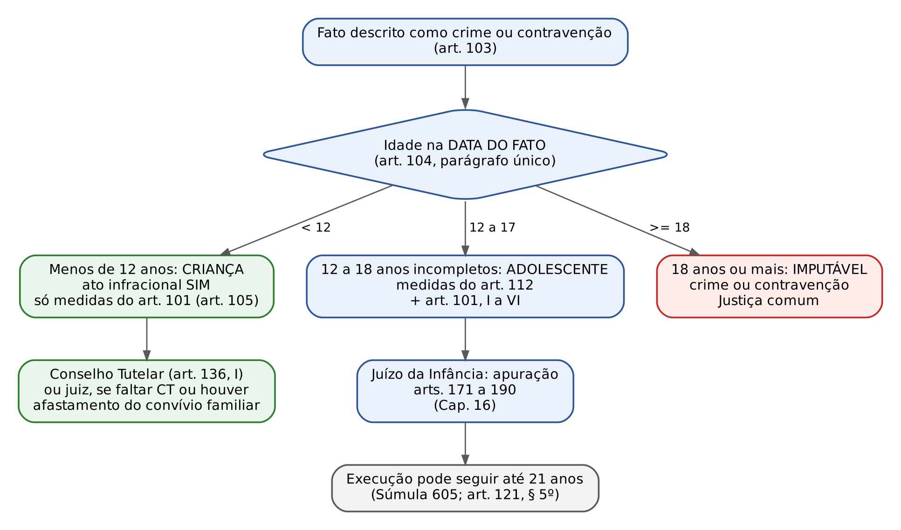
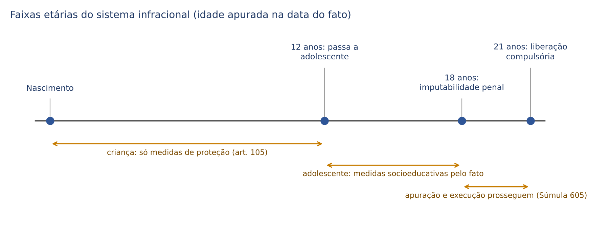
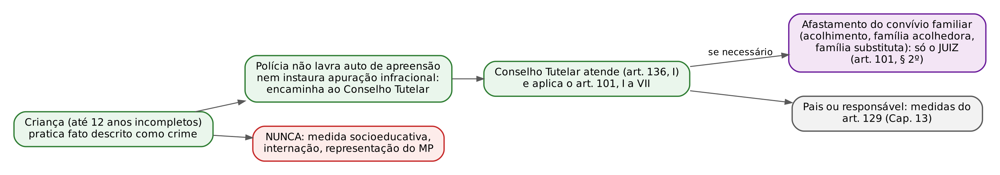
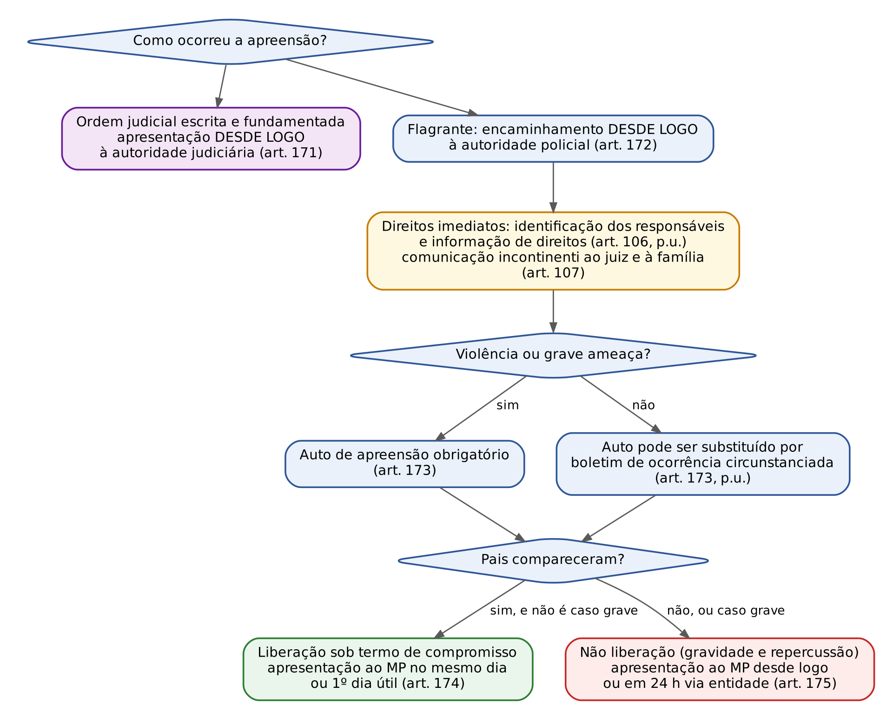
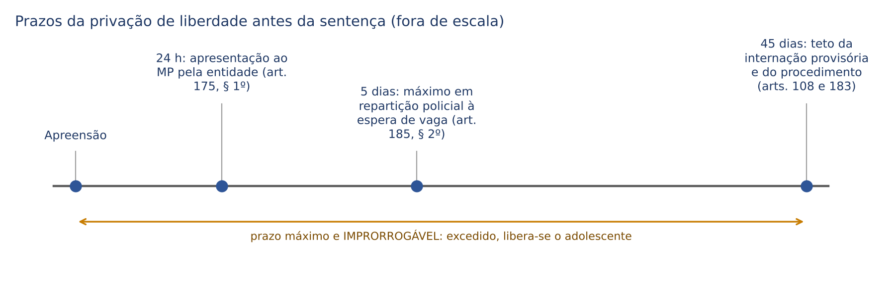
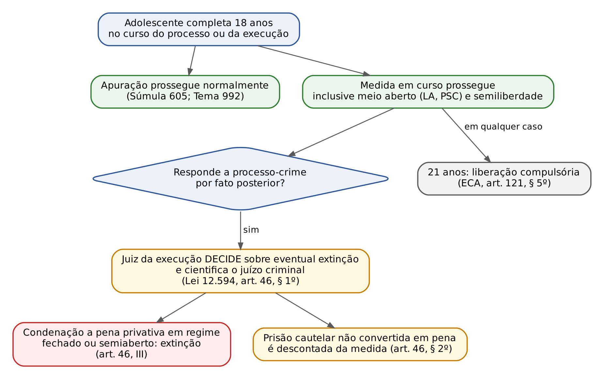
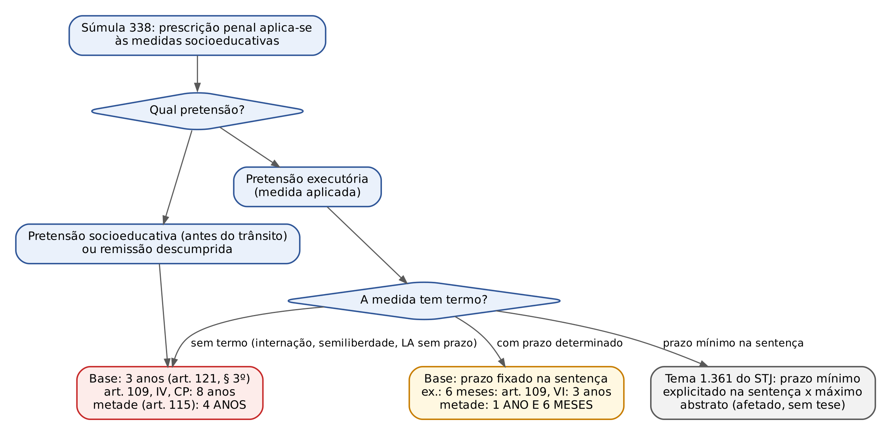

# CAPÍTULO 14 — PRÁTICA DE ATO INFRACIONAL I: CONCEITO, DIREITOS, GARANTIAS E PRESCRIÇÃO

:::INCIDENCIA
TJRS p. 1; TJSC p. 2. Nível A+. Lote: 14 questões (FGV 13, FCC 1), mais 9 correlatas de outros capítulos usadas aqui.
O que mais cai: criança autora de ato infracional (só medidas do art. 101, aplicadas pelo Conselho Tutelar), idade na data do fato, 45 dias improrrogáveis de internação provisória, literalidade do art. 106 (flagrante OU ordem judicial) e prescrição da medida socioeducativa (Súmula 338, base de 3 anos, prazo de 4 anos).
:::

| Subtema | FGV | FCC | Padrão |
|---|---|---|---|
| Criança autora de ato infracional (art. 105) | 7 | 1 | caso prático com criança de 11 anos: quem aplica e qual medida |
| Idade na data do fato (art. 104, parágrafo único) | 2 | 0 | fato aos 11 anos e aniversário de 12 no dia seguinte; "idade na data da sentença" |
| Conceito de ato infracional (art. 103) | 1 | 0 | crime E contravenção |
| Privação de liberdade e internação provisória (arts. 106 e 108) | 3 | 0 | omissão do flagrante no art. 106; 45 dias improrrogáveis; "60 dias" |
| Prescrição (Súmula 338) | 2 | 0 | internação sem termo, 4 anos, réu já maior de 18 e menor de 21 |

## 14.1 O Título III do Livro II: arquitetura e chaves de leitura

O Título III da Parte Especial ("Da Prática de Ato Infracional") reparte-se em cinco capítulos: disposições gerais (arts. 103 a 105), direitos individuais (arts. 106 a 109), garantias processuais (arts. 110 e 111), medidas socioeducativas (arts. 112 a 125) e remissão (arts. 126 a 128). Este capítulo cobre os três primeiros e dois temas transversais que a jurisprudência construiu a partir deles: a superveniência da maioridade e a prescrição das medidas socioeducativas. As medidas em espécie e a remissão estão no Cap. 15; o procedimento de apuração (arts. 171 a 190), no Cap. 16; a execução (Lei 12.594/2012), no Cap. 17.

Três chaves organizam a matéria e resolvem a maior parte das questões:

- Tipicidade emprestada, responsabilização própria. O ECA não cria tipos: toma emprestada a descrição típica da lei penal (art. 103). A consequência, porém, é estatutária: medida socioeducativa para o adolescente, medida de proteção para a criança. Por isso se diz "ato infracional análogo ao crime de roubo", nunca "crime de roubo praticado por adolescente".
- Idade como critério exclusivo e fixado na data do fato. A Constituição (art. 228) e o ECA (art. 104) adotam critério puramente biológico, e o parágrafo único do art. 104 congela a idade no momento da conduta. Tudo o que vem depois (sentença aos 18, execução aos 20) não altera o regime.
- Garantismo em sentido forte. O adolescente é titular de todos os direitos e garantias do acusado adulto e de outros, próprios (art. 3º; CF, art. 227, § 3º, IV e V). A jurisprudência recente do STJ usa uma regra de fechamento que convém memorizar como critério de solução de casos novos: o adolescente não pode receber tratamento processual mais gravoso do que o dispensado ao adulto em situação equivalente (Tema 1.269; Informativo 851; ver 14.6).

## 14.2 Conceito de ato infracional (art. 103)

:::LEI ECA, ART. 103
Art. 103. Considera-se ato infracional a conduta descrita como crime ou contravenção penal.
:::

### 14.2.1 Leitura do dispositivo

O conceito é formal e remissivo. Três consequências imediatas:

- Abrange CRIME e CONTRAVENÇÃO. A alternativa que restringe o ato infracional ao crime está errada; a que diz que ele abrange "crimes e contravenções penais" reproduz o art. 103 (Q2513057, abaixo).
- Fato atípico não é ato infracional. Indisciplina escolar, fuga do lar, desobediência aos pais, evasão escolar, "vadiagem" no sentido do Código de Menores não autorizam medida socioeducativa. Podem caracterizar situação de risco do art. 98, III ("em razão de sua conduta"), e então ensejar medida de proteção (Cap. 13), nunca medida socioeducativa. É o corte com a doutrina da situação irregular, que tratava como "menor em situação irregular" o autor de infração e o carente indistintamente (Cap. 1).
- Legalidade estrita. Porque o tipo é o da lei penal, valem as garantias da legalidade penal: reserva legal, anterioridade, irretroatividade da lei mais gravosa e retroatividade da mais benéfica (CF, art. 5º, XXXIX e XL). A *abolitio criminis* extingue a pretensão socioeducativa e a medida em execução fundada naquele tipo.

### 14.2.2 Teoria do crime aplicada ao ato infracional

O conceito analítico de crime é aproveitado por inteiro na parte objetiva: tipicidade (formal e material), ilicitude e, quanto à culpabilidade, tudo o que não seja a imputabilidade etária. Na prática:

- Excludentes de ilicitude (legítima defesa, estado de necessidade, estrito cumprimento do dever legal, exercício regular de direito) afastam o ato infracional. Inclusive as excludentes previstas em lei especial: o estado de necessidade da Lei de Crimes Ambientais (abate de animal para saciar a fome do agente ou de sua família) aproveita ao adolescente; a alternativa que nega essa aplicação "por força do princípio da especialidade" (Q3966665, alternativa D) está errada, porque o ECA não exclui a teoria do delito, apenas substitui a sanção.
- Erro de tipo e erro de proibição, coação moral irresistível e obediência hierárquica também operam. A inimputabilidade etária, contudo, não é examinada caso a caso: é presunção legal absoluta (14.3).
- Tentativa, concurso de pessoas, crime continuado e concurso de crimes são categorias aproveitáveis para descrever o fato; o que não se transpõe é a DOSIMETRIA. A medida socioeducativa não tem "pena-base", agravantes ou atenuantes: escolhe-se a medida pela capacidade de cumprimento, pelas circunstâncias e pela gravidade da infração (art. 112, § 1º; Cap. 15). Daí a tese do STJ de que a atenuante da confissão espontânea não tem aplicabilidade no procedimento de apuração de ato infracional (Jurisprudência em Teses, ed. 54, tese 8).

:::JURIS STJ, JURISPRUDÊNCIA EM TESES, ED. 54, TESE 3
"É possível a incidência do princípio da insignificância nos procedimentos que apuram a prática de ato infracional." A tipicidade material é requisito do ato infracional tanto quanto do crime; a mesma estrutura de vetores usada para adultos (mínima ofensividade, ausência de periculosidade social, reduzido grau de reprovabilidade, inexpressividade da lesão) se aplica. O argumento de que o processo socioeducativo, por ser pedagógico, dispensaria a análise da insignificância é a armadilha clássica (alternativa B de Q3505791, Cap. 15, errada exatamente por isso). A insignificância, porém, não é automática: reiteração e contexto podem afastá-la, segundo os mesmos critérios aplicados aos imputáveis.
:::

:::PEGADINHA ATO INFRACIONAL NÃO É "CRIME DE MENOR"
- Ato infracional não gera reincidência nem maus antecedentes penais para fins de dosimetria do adulto; a matéria está desenvolvida na Apostila de Direito Penal (Caps. 13 e 14). Pode, contudo, ser considerado para outros fins (por exemplo, fundamentar a necessidade de prisão preventiva), segundo a orientação lá exposta.
- O registro de ato infracional também não se confunde com "antecedentes infracionais" do próprio sistema socioeducativo: para fins do art. 122, II (reiteração), contam atos anteriores reconhecidos, mas a remissão "não implica necessariamente o reconhecimento ou comprovação da responsabilidade, nem prevalece para efeito de antecedentes" (art. 127; Cap. 15).
:::

:::QUESTAO FGV 2024 — CÂMARA DOS DEPUTADOS — CONSULTOR LEGISLATIVO (Q2513057)
Afirmações sobre o ECA; gabarito oficial: A (ato infracional é a conduta descrita como infração penal, abrangendo crimes e contravenções).
Armadilhas das demais: B atribui liberdade assistida à "criança" e a qualifica como subsidiária (a LA é medida socioeducativa, só para adolescente: art. 105); C diz que a liberdade da criança ou do adolescente só pode ser restrita por ordem judicial, omitindo o flagrante e trocando o sujeito (art. 106 fala em ADOLESCENTE e admite o flagrante; 14.5.1); D proíbe internação antes do trânsito em julgado (a internação provisória existe: art. 108); E manda considerar a idade "à data da sentença" (é a data do fato: art. 104, parágrafo único).
:::

## 14.3 Inimputabilidade e momento da conduta (art. 104)

:::LEI ECA, ART. 104
Art. 104. São penalmente inimputáveis os menores de dezoito anos, sujeitos às medidas previstas nesta Lei.
Parágrafo único. Para os efeitos desta Lei, deve ser considerada a idade do adolescente à data do fato.
:::

### 14.3.1 Inimputabilidade penal não é irresponsabilidade

O art. 104 reproduz a regra do art. 228 da CF e do art. 27 do CP, mas a completa com a cláusula decisiva: os menores de 18 anos são inimputáveis PENALMENTE, "sujeitos às medidas previstas nesta Lei". O adolescente é responsabilizado, por um sistema próprio, com medidas que têm conteúdo pedagógico e, ao mesmo tempo, inegável carga retributiva e restritiva (é justamente essa carga que fundamenta a aplicação da prescrição penal: 14.8). A discussão constitucional sobre a idade penal, a natureza de cláusula pétrea do art. 228 e as propostas de emenda está no Cap. 1 (1.10); aqui interessa o regime estatutário.

Pontos de prova:

- Critério biológico puro e presunção absoluta. Não importam maturidade, discernimento, emancipação, casamento ou vida independente. O adolescente emancipado pelos pais aos 16 anos continua penalmente inimputável; a emancipação civil (CC, art. 5º, parágrafo único) não antecipa a imputabilidade penal.
- "Parcialmente imputável" não existe no sistema: a alternativa que fala em imputabilidade parcial do menor de 18 anos (Q3856237, alternativa A) é errada. O ECA também não prevê encaminhamento ao sistema penitenciário comum por gravidade do ato, nem por equiparação a crime hediondo (Q3856237, alternativa C); a internação jamais é cumprida em estabelecimento prisional (art. 185; 14.5.4).
- O adolescente autor de ato infracional com transtorno mental não é "duplamente inimputável" com aplicação de medida de segurança: recebe tratamento individual e especializado, em local adequado (art. 112, § 3º), sob o regime da Lei 10.216/2001 e da execução socioeducativa (Caps. 17 e 26).

### 14.3.2 A data do fato: teoria da atividade

O parágrafo único do art. 104 adota, para o sistema infracional, a teoria da atividade (a mesma do art. 4º do CP): considera-se a idade no momento da AÇÃO OU OMISSÃO, ainda que outro seja o momento do resultado. Consequências:

- Disparo aos 17 anos, morte da vítima depois de o autor completar 18: ato infracional, julgado pelo Juízo da Infância e da Juventude (exemplo também trabalhado na Apostila de Direito Penal, Cap. 3).
- Fato aos 11 anos, aniversário de 12 no dia seguinte: o autor era CRIANÇA; só medidas de proteção (Q3049974, abaixo).
- Fato aos 17 anos, sentença aos 19, execução aos 20: medida socioeducativa normalmente, até os 21 anos (Súmula 605; 14.7).
- Contagem: a pessoa completa 12 ou 18 anos no primeiro instante do dia do aniversário; fato praticado no próprio dia do 18º aniversário já é crime. A prova da idade faz-se por documento; havendo dúvida não superada, a solução deve favorecer o reconhecimento da menoridade, por aplicação do *in dubio pro reo*.

#### Crime permanente e crime continuado que atravessam os 18 anos

A teoria da atividade gera duas situações de fronteira cobradas em segunda fase:

- Crime permanente (extorsão mediante sequestro, cárcere privado, tráfico na modalidade "ter em depósito") iniciado aos 17 anos e mantido após os 18: a conduta continua sendo praticada depois da maioridade, de modo que o agente responde PENALMENTE pelo fato, porque a permanência faz com que a ação se renove a cada momento. A parte executada antes dos 18 anos, se destacável, poderia ensejar apuração infracional, mas a solução predominante é a responsabilização penal pela conduta permanente como um todo.
- Crime continuado com parte das condutas antes e parte depois dos 18 anos: as condutas anteriores são atos infracionais (Juízo da Infância); as posteriores, crimes (Justiça comum). A unidade ficta da continuidade delitiva (CP, art. 71) não transporta para a esfera penal fatos praticados por inimputável.

:::DICA COMO A BANCA FORMULA
A FGV gosta de afirmar que "deve ser considerada a idade do adolescente à data da sentença" ou "à data da representação". Ambas erradas: é a data do FATO (art. 104, parágrafo único). E costuma apresentar a idade do agente em dias próximos ao aniversário para testar exatamente esse marco.
:::

:::QUESTAO FGV 2024 — PREFEITURA DE MACAÉ — PROCURADOR (Q3049974)
Josué, com 11 anos, pratica ato análogo ao latrocínio e completa 12 anos no dia seguinte; o MP representa pedindo internação. Gabarito oficial: E (não pode receber medida socioeducativa; cabem somente medidas protetivas).
Resolução em passos: (1) idade na data do fato: 11 anos (art. 104, parágrafo único); (2) menos de 12 anos é criança (art. 2º); (3) à criança correspondem as medidas do art. 101 (art. 105); (4) a representação do MP, instrumento do procedimento de apuração contra ADOLESCENTE (arts. 180, III, e 182), é inadequada.
Armadilhas: A e B (internação pela gravidade e violência); C e D (medidas de meio aberto "por ter 12 anos"): todas tomam a idade atual, e não a da conduta.
:::

:::QUESTAO FGV 2026 — PC-PI — PERITO MÉDICO LEGISTA (Q3856237)
Afirmações sobre o adolescente a quem se atribui ato infracional. Gabarito oficial: B (pode ser submetido a medidas socioeducativas, incluindo a privação de liberdade).
Armadilhas: A ("parcialmente imputável"); C (sistema penitenciário comum para equiparado a hediondo); D ("não será privado de sua liberdade, senão por ordem escrita e fundamentada da autoridade judiciária competente": a supressão do FLAGRANTE torna a afirmação incorreta diante da literalidade do art. 106); E (internação provisória por até 60 dias: o prazo é de 45).
:::

## 14.4 Ato infracional praticado por criança (art. 105)

:::LEI ECA, ART. 105
Art. 105. Ao ato infracional praticado por criança corresponderão as medidas previstas no art. 101.
:::

### 14.4.1 O que o dispositivo diz e o que ele NÃO diz

O art. 105 é a questão mais repetida do capítulo, sempre sob a forma de caso prático com criança de 10 ou 11 anos que danifica o carro da professora, subtrai um celular ou um objeto de colega. A resposta depende de quatro proposições:

- A criança PRATICA ato infracional. O art. 105 fala literalmente em "ato infracional praticado por criança". A alternativa que afirma que só adolescentes cometem atos infracionais, ou que a criança "não praticou ato infracional ou crime", está errada (Q4219144, alternativa E; Q3117535, alternativa D).
- A resposta é exclusivamente PROTETIVA: medidas do art. 101 (orientação, apoio e acompanhamento temporários; matrícula e frequência escolar; inclusão em programas; requisição de tratamento; acolhimento; família acolhedora; família substituta). Nunca medida socioeducativa, nem em meio aberto, nem multa, nem "pena" de prestação de serviços (Q2448386: "somente medidas protetivas").
- Quem aplica, em regra, é o CONSELHO TUTELAR: atribuição de "atender as crianças e adolescentes nas hipóteses previstas nos arts. 98 e 105, aplicando as medidas previstas no art. 101, I a VII" (art. 136, I). Não é o juiz da infância (salvo onde não houver Conselho instalado, caso em que as atribuições são exercidas pela autoridade judiciária: art. 262), não é o MP, não é a escola, não são os pais, não é o Conselho de Direitos.
- Medidas que impliquem afastamento do convívio familiar (acolhimento institucional, inclusão em programa de acolhimento familiar, colocação em família substituta) dependem de decisão judicial (art. 101, § 2º), ressalvado o acolhimento emergencial do art. 93 com comunicação à autoridade judiciária. A divisão de competências Conselho x juiz está desenvolvida no Cap. 13 (13.6) e no Cap. 12 (12.5.1 e 12.5.2).

Consequências procedimentais:

- Não há procedimento de apuração de ato infracional contra criança. Os arts. 171 a 190 tratam de "adolescente"; o MP não oferece representação em face de criança.
- A criança não é "apreendida" no sentido do art. 106. Surpreendida na prática do fato, deve ser conduzida (ou entregue) ao Conselho Tutelar ou aos pais; a polícia não lavra auto de apreensão nem boletim de ocorrência circunstanciada "em face" da criança, sem prejuízo do registro do fato para apuração da participação de adultos (corrupção de menores, art. 244-B; Cap. 21).
- A constitucionalidade dessa atuação administrativa do Conselho diante do ato infracional de criança foi afirmada pelo STF na ADI 3.446 (Cap. 12, 12.1, e Cap. 13, 13.2.3).
- Cabe ainda, quanto aos pais, a aplicação das medidas do art. 129, I a VII, pelo próprio Conselho (art. 136, II; Cap. 13).

:::QUESTAO FGV 2024 — TJ-PE — JUIZ SUBSTITUTO (Q3117535)
Criança de 11 anos subtrai joia levada à escola por colega; a joia é devolvida destruída. Gabarito oficial: B (praticou ato infracional análogo ao furto, podendo o Conselho Tutelar aplicar, por exemplo, orientação, apoio e acompanhamento temporários). A resolução em passos está no Cap. 13 (13.6). Para fixar: A erra ao submeter criança ao procedimento de apuração; C, ao falar em crime; D, ao negar o ato infracional; E, ao admitir medida socioeducativa.
No mesmo sentido, todas com gabarito pela atribuição do Conselho Tutelar e pela natureza protetiva da resposta: Q4219144 (FGV 2026 — MPE-ES; gabarito C: o conselheiro tutelar poderá avaliar a medida protetiva mais adequada; erradas a internação "psiquiátrica" socioeducativa, a "pena" de PSC sugerida pelo promotor, a oitiva da diretora sobre medida socioeducativa e a negativa de ato infracional por criança); Q3660379 (FGV 2025 — AgSUS; gabarito A: a diretora agiu certo ao chamar o Conselho, que pode aplicar medidas protetivas); Q3401954 (FGV 2025 — DPE-RO; gabarito B: o Conselho escolhe a medida protetiva; erradas a medida socioeducativa judicial, a medida "determinada" pelo MP, pela escola ou pelos pais); Q3339550 (FGV 2025 — MPU; gabarito D: o Conselho Tutelar tem atribuição para aplicar medidas protetivas; erradas as opções que atribuem medidas socioeducativas ao juiz de família ou ao juiz da infância, ou decisão ao MP ou ao Conselho de Direitos); Q2448386 (FGV 2024 — TJ-AP; gabarito B: somente medidas protetivas).
:::

:::QUESTAO FGV 2026 — TJ-GO — JUIZ SUBSTITUTO (Q3966665)
Família de comunidade tradicional caçando ave silvestre para alimentação: pai de 40 anos, filha de 13, filho de 11. Gabarito oficial: C (à adolescente pode ser imposta medida de proteção independentemente de sua responsabilidade pelo ato infracional em tese praticado). A resolução completa está no Cap. 13 (13.2). O que importa neste capítulo: B erra ao dizer que a criança "não pratica ato infracional" (pratica; só não recebe medida socioeducativa); D erra ao negar à adolescente a excludente do estado de necessidade prevista na lei ambiental (14.2.2); A trata a insignificância como automática; E reúne adolescente e adulto em "um só processo" (o adolescente responde perante o Juízo da Infância; o adulto, na Justiça comum, sem *simultaneus processus*).
:::

:::QUESTAO FCC 2025 — DPE-RS — DEFENSOR PÚBLICO (Q3386983)
Dependentes químicos de 12 e de 11 anos acusados de ato análogo ao tráfico. Gabarito oficial: B (ao de 12 anos, medidas socioeducativas e também protetivas; ao de 11, apenas medidas específicas de proteção). Fundamento: art. 104, parágrafo único (idade na data do fato), art. 105 e art. 112, VII, c/c art. 99 (cumulação). Comentário completo no Cap. 13 (13.9). Armadilhas: A (meio aberto para criança), C (dependência química veda a socioeducativa) e E (incompatibilidade entre os dois grupos de medidas).
:::

:::PEGADINHA ADOLESCENTE X CRIANÇA NO ART. 136
O Conselho Tutelar APLICA as medidas do art. 101 à criança autora de ato infracional (art. 136, I). Em relação ao ADOLESCENTE autor de ato infracional, o Conselho apenas PROVIDENCIA a medida do art. 101, I a VI, estabelecida pela autoridade judiciária (art. 136, VI). Medida socioeducativa é sempre aplicada pelo juiz (Súmula 108 do STJ, referida no Cap. 12, 12.5; desenvolvida no Cap. 15). A remissão ministerial cumulada com medida em meio aberto é o ponto sensível dessa regra e está no Cap. 15.
:::

| Situação | Criança (até 11 anos completos) | Adolescente (12 a 17 anos) |
|---|---|---|
| Pratica ato infracional? | SIM (art. 105) | SIM (art. 103) |
| Resposta | só medidas do art. 101 | medidas do art. 112 (I a VII), cumuláveis com as do art. 101, I a VI |
| Quem aplica | Conselho Tutelar (art. 136, I); juiz se faltar Conselho (art. 262) ou para afastamento do convívio (art. 101, § 2º) | juiz da infância (medida socioeducativa); Conselho só providencia a medida protetiva fixada pelo juiz (art. 136, VI) |
| Procedimento | atendimento administrativo; sem representação | apuração judicial (arts. 171 a 190), com representação do MP |
| Privação de liberdade | NUNCA como resposta ao ato | flagrante, ordem judicial, internação provisória (45 dias) e internação definitiva |
| Defesa técnica obrigatória | não há processo infracional | sim (art. 111, III; art. 207) |

## 14.5 Direitos individuais (arts. 106 a 109)

O Capítulo II do Título III ("Dos Direitos Individuais") traduz para o adolescente as garantias do art. 5º, LXI a LXVI, da CF, com dois acréscimos próprios: a comunicação obrigatória à FAMÍLIA e a vedação de identificação compulsória do civilmente identificado. Cada um desses direitos tem um crime correspondente na Seção II do Capítulo I do Título VII (arts. 230, 231, 234 e 235), cuja dogmática está no Cap. 21 e na Apostila de Direito Penal (Cap. 42). A correspondência direito x crime é útil para memorizar:

| Direito (artigo) | Conteúdo | Crime correspondente |
|---|---|---|
| Art. 106, caput | privação de liberdade só em flagrante ou por ordem escrita e fundamentada do juiz | art. 230 (apreensão fora dessas hipóteses ou sem as formalidades legais) |
| Art. 107, caput | comunicação incontinenti ao juiz e à família | art. 231 (omissão da comunicação pela autoridade policial) |
| Art. 107, parágrafo único | exame imediato da liberação | art. 234 (deixar de ordenar a liberação, sabendo da ilegalidade) |
| Art. 108 | internação provisória de no máximo 45 dias | art. 235 (descumprir prazo fixado em benefício de adolescente privado de liberdade) |

### 14.5.1 Hipóteses de privação de liberdade (art. 106, caput)

:::LEI ECA, ART. 106
Art. 106. Nenhum adolescente será privado de sua liberdade senão em flagrante de ato infracional ou por ordem escrita e fundamentada da autoridade judiciária competente.
Parágrafo único. O adolescente tem direito à identificação dos responsáveis pela sua apreensão, devendo ser informado acerca de seus direitos.
:::

As hipóteses são DUAS e alternativas: flagrante de ato infracional OU ordem escrita e fundamentada da autoridade judiciária competente. A banca explora a omissão de uma delas (Q3856237, alternativa D; Q2513057, alternativa C). Observações:

- O sujeito é o ADOLESCENTE. A criança não é privada de liberdade como resposta a ato infracional (14.4); só pode ser afastada do convívio familiar por medida protetiva, com as cautelas do art. 101.
- Flagrante: aplicam-se as hipóteses do art. 302 do CPP (próprio, impróprio e presumido), por força da aplicação subsidiária da legislação processual (art. 152). O terminológico importa: adolescente é "apreendido", não "preso"; lavra-se "auto de apreensão", não "auto de prisão em flagrante" (art. 173).
- Ordem judicial: deve ser ESCRITA e FUNDAMENTADA e emanar da autoridade judiciária COMPETENTE (o Juízo da Infância e da Juventude: art. 148, I; Cap. 18). As formas usuais são o mandado de busca e apreensão expedido no procedimento (art. 184, § 3º, quando o adolescente não é localizado, com sobrestamento do feito) e a decisão que decreta a internação provisória (art. 108) ou aplica medida privativa de liberdade.
- Vedada qualquer "apreensão para averiguação", "recolhimento" de adolescentes em situação de rua ou condução coercitiva sem ordem judicial. Era a prática do Código de Menores que o ECA quis extinguir (Cap. 13, ADI 3.446). Desde a Lei 15.163/2025, o art. 230 do ECA pune também quem "procede à apreensão sem observância das formalidades legais" (§ 1º) e afasta expressamente a Lei 9.099/1995 (§ 2º): o crime deixa de ser tratado como de menor potencial ofensivo para fins de transação e suspensão condicional.
- Do flagrante à apresentação: encaminhamento "desde logo" à autoridade policial (art. 172) ou, se a apreensão foi por ordem judicial, "desde logo" à autoridade judiciária (art. 171); havendo repartição especializada e coautoria com adulto, prevalece a atribuição da especializada, que depois encaminha o adulto à repartição própria (art. 172, parágrafo único). O detalhamento desse trajeto (auto x boletim de ocorrência circunstanciada, liberação aos pais, apresentação ao MP em 24 horas, oitiva informal) pertence ao procedimento (Cap. 16); a figura abaixo serve de mapa.

:::QUESTAO FGV 2026 — PC-PI — DELEGADO DE POLÍCIA (Q3848992)
Três afirmações sobre o encaminhamento do adolescente apreendido em flagrante com um adulto. Gabarito oficial: A (V, V, F).
Verdadeiras: a prevalência da repartição especializada na coautoria com maior (art. 172, parágrafo único) e a liberação aos pais sob termo de compromisso, salvo gravidade e repercussão social (art. 174). Falsa: a terceira afirmação troca o destinatário da apresentação; pelo art. 175, não liberado o adolescente, a autoridade policial o encaminha "ao representante do Ministério Público", e a entidade de atendimento faz a apresentação AO MP em 24 horas, não à autoridade judiciária.
No mesmo sentido, cobrando a literalidade dos arts. 171 a 174: Q2570482 (FGV 2024 — TCE-PA; gabarito E: as quatro afirmações corretas). Desenvolvimento no Cap. 16.
:::

### 14.5.2 Identificação dos responsáveis e informação de direitos (art. 106, parágrafo único)

O parágrafo único espelha o art. 5º, LXIII e LXIV, da CF: o adolescente tem direito de saber QUEM o apreendeu e de ser informado de seus direitos, entre eles o de permanecer calado, o de ter a família comunicada, o de ser assistido por advogado e o de não ser conduzido em compartimento fechado de viatura em condições atentatórias à dignidade (art. 178). Três consequências práticas:

- Confissão informal colhida por policiais sem a advertência sobre o direito ao silêncio tem o mesmo tratamento dado ao adulto: não pode, sozinha, fundamentar a procedência da representação, e sua valoração exige corroboração judicial. A confissão em juízo, por sua vez, não dispensa a produção de outras provas (Súmula 342 do STJ: é nula a desistência de outras provas em face da confissão do adolescente; Jurisprudência em Teses, ed. 262, tese 2; Q3532433, FGV 2025 — MPE-RJ, gabarito B, comentada no Cap. 16).
- Oitiva do adolescente sem defesa, fora do ato processual, é nula: o STJ anulou processo em que o juiz, antes da audiência, ouviu informalmente o adolescente "no corredor do fórum", sem a presença da defesa (STJ, AgRg no HC 924.332, Informativo 830; v. Cap. 16). A oitiva informal pelo MP (art. 179) é outra coisa e também está no Cap. 16.
- O respeito à dignidade e à imagem do adolescente durante a abordagem (arts. 17, 18 e 178) projeta-se também na esfera civil: o STJ reconheceu dano moral pela abordagem excessiva e pública de adolescente por segurança de supermercado, por suspeita infundada de ato infracional análogo ao furto, afirmando que a revista privada difere da busca pessoal (CPP, art. 240), privativa das autoridades e seus agentes (STJ, REsp n. 2.185.387, Relatora Ministra Nancy Andrighi, Terceira Turma, j. 13/5/2025).

### 14.5.3 Comunicação incontinenti e exame imediato da liberação (art. 107)

:::LEI ECA, ART. 107
Art. 107. A apreensão de qualquer adolescente e o local onde se encontra recolhido serão incontinenti comunicados à autoridade judiciária competente e à família do apreendido ou à pessoa por ele indicada.
Parágrafo único. Examinar-se-á, desde logo e sob pena de responsabilidade, a possibilidade de liberação imediata.
:::

Elementos que a banca troca:

- O que se comunica: a APREENSÃO e o LOCAL de recolhimento. Os dois.
- Quando: "incontinenti" (imediatamente), não em 24 horas. O prazo de 24 horas do ECA é outro: o da apresentação ao MP pela entidade de atendimento quando impossível a apresentação imediata (art. 175, § 1º).
- A quem: à AUTORIDADE JUDICIÁRIA competente E à FAMÍLIA do apreendido ou à pessoa por ele indicada. O art. 107 não menciona o MP nem a Defensoria; o MP recebe o próprio adolescente (art. 175). Compare-se com o art. 306 do CPP para o adulto preso em flagrante (juiz, MP, família ou pessoa indicada e, sem advogado, Defensoria).
- Exame da liberação: "desde logo e sob pena de responsabilidade". Quem examina, no momento policial, é a autoridade policial (arts. 107, parágrafo único, e 174); o juiz que toma conhecimento de apreensão ilegal deve ordenar a liberação imediata (art. 234). A regra é a liberação aos pais sob termo de compromisso (art. 174); a não liberação é exceção fundada na "gravidade do ato infracional e sua repercussão social", para garantia da segurança pessoal do adolescente ou manutenção da ordem pública.

:::ATENCAO NÃO CONFUNDA A "PERMANÊNCIA SOB INTERNAÇÃO" DO ART. 174 COM INTERNAÇÃO PROVISÓRIA
A não liberação pela autoridade policial (art. 174, parte final) é uma custódia pré-processual de curtíssima duração, que só se mantém até a apresentação ao MP (no mesmo dia ou em até 24 horas: art. 175). Não é internação provisória. A internação provisória é decisão JUDICIAL, fundamentada, com requisitos próprios (art. 108, parágrafo único), proferida normalmente na audiência de apresentação, após o oferecimento da representação (art. 184). Delegado e promotor não decretam internação provisória.
:::

### 14.5.4 Internação provisória (art. 108)

:::LEI ECA, ART. 108
Art. 108. A internação, antes da sentença, pode ser determinada pelo prazo máximo de quarenta e cinco dias.
Parágrafo único. A decisão deverá ser fundamentada e basear-se em indícios suficientes de autoria e materialidade, demonstrada a necessidade imperiosa da medida.
:::

#### Natureza e requisitos

A internação provisória é a medida cautelar privativa de liberdade do processo infracional, o equivalente funcional da prisão preventiva. Requisitos cumulativos:

- Decisão judicial fundamentada (CF, art. 93, IX; art. 106 do ECA).
- *Fumus commissi delicti*: "indícios suficientes de autoria e materialidade". A materialidade exige prova da existência do fato; para a autoria bastam indícios suficientes.
- *Periculum libertatis*: "necessidade imperiosa da medida". O ECA não enumera as hipóteses de necessidade, mas a referência do art. 174 (segurança pessoal do adolescente, manutenção da ordem pública) e o art. 312 do CPP, aplicado subsidiariamente, orientam a fundamentação. Gravidade abstrata e clamor público, isoladamente, não bastam.
- Compatibilidade com a medida final: segundo a orientação do STJ, é possível a internação provisória quando presentes indícios suficientes de autoria e materialidade e constatada uma das hipóteses autorizadoras da internação definitiva do art. 122 (Jurisprudência em Teses, ed. 263, tese 2). A lógica é a da homogeneidade: se, ao final, a internação seria juridicamente impossível (ato sem violência ou grave ameaça, sem reiteração em infrações graves nem descumprimento de medida anterior), a cautelar privativa de liberdade é desproporcional. Por isso o ato análogo ao tráfico, por si só, não autoriza internação provisória (Súmula 492 do STJ, desenvolvida no Cap. 15).

#### Momento e iniciativa

- O art. 108 diz "antes da sentença"; o art. 184 indica o momento típico: oferecida a representação, o juiz designa audiência de apresentação e decide, "desde logo, sobre a decretação ou manutenção da internação, observado o disposto no art. 108 e parágrafo".
- Não há internação provisória na fase de investigação policial, sem representação: falta a imputação formal que permite aferir os indícios suficientes e a hipótese do art. 122. Não há também "internação temporária" por analogia à Lei 7.960/1989. É o que resolve a questão abaixo.
- O pedido é do MP (na representação ou depois dela). A decretação de ofício pelo juiz é tema controvertido; a doutrina garantista a rejeita por aplicação analógica do art. 311 do CPP (redação dada pela Lei 13.964/2019), que vedou a preventiva de ofício; parte da jurisprudência estadual a admite com base na proteção integral e no art. 184. Em prova objetiva, o enunciado sempre trará o requerimento ministerial.

:::QUESTAO FGV 2025 — MPE-RJ — PROMOTOR DE JUSTIÇA SUBSTITUTO (Q3532432)
Durante diligências preliminares sobre roubo com arma de fogo, boatos apontam o adolescente Michael; não há testemunhas nem elementos concretos. O delegado representa ao juiz pela internação provisória e por mandado de busca e apreensão, para "preservar a ordem pública" e "garantir o sucesso das investigações". Gabarito oficial: D (manifestação pelo indeferimento integral: a internação provisória só pode ser decretada no bojo de representação socioeducativa, dependendo seu oferecimento de indícios suficientes de autoria e materialidade, inexistentes no caso).
Resolução em passos: (1) internação provisória pressupõe indícios suficientes de autoria e materialidade (art. 108, parágrafo único), e boatos não o são; (2) a medida é decidida no procedimento iniciado pela representação (art. 184); (3) o mandado de busca e apreensão do adolescente não é cautelar autônoma para "aprofundar investigação": é ordem judicial de privação de liberdade (art. 106) que exige os mesmos pressupostos.
Armadilhas: A e E (a "ordem pública" e o "êxito das investigações" não suprem a falta de indícios); B (não existe "internação temporária" por analogia à prisão temporária); C (busca e apreensão do adolescente como cautelar autônoma).
:::

#### O prazo de 45 dias: máximo e improrrogável

O ponto mais cobrado. O prazo de 45 dias é:

- Máximo: "pelo prazo máximo de quarenta e cinco dias" (art. 108). Pode ser decretada por prazo menor, e deve ser revogada antes se cessar a necessidade.
- Improrrogável: o art. 183 reforça que "o prazo máximo e improrrogável para a conclusão do procedimento, estando o adolescente internado provisoriamente, será de quarenta e cinco dias". Nem a complexidade da causa, nem a pluralidade de réus, nem a gravidade do fato, nem o comportamento da defesa autorizam a prorrogação.
- Insuscetível de flexibilização pela Súmula 52 do STJ (encerrada a instrução, fica superada a alegação de excesso de prazo): "A internação provisória prevista no art. 108 do ECA não pode exceder o prazo máximo e improrrogável de 45 dias, não havendo que se falar na incidência da Súmula n. 52 do STJ" (Jurisprudência em Teses, ed. 54, tese 6). A razão é que o prazo de 45 dias é LEGAL e peremptório, e não fruto de construção jurisprudencial de razoabilidade, como os prazos da prisão preventiva.
- Consequência do excesso: liberação imediata do adolescente. O processo prossegue com o adolescente em liberdade; não se anula o processo. Descumprir injustificadamente o prazo é crime (art. 235).
- Renovação no mesmo processo: vencido o prazo, não se pode decretar NOVA internação provisória pelo mesmo fato, o que seria prorrogação disfarçada. Fato novo (outro ato infracional, em outro procedimento) autoriza nova cautelar, com prazo próprio.
- Contagem: em dias corridos, incluído o dia da apreensão quando a internação provisória se seguir a ela sem solução de continuidade, porque o prazo protege a liberdade e tem natureza material.

:::QUESTAO FGV 2026 — DPE-RJ — DEFENSOR PÚBLICO (Q4289383)
Rubião, 13 anos, apreendido em flagrante por ato análogo a roubo majorado, teve internação provisória fundamentada. No 45º dia, sem sentença, o juiz prorrogou a medida por 30 dias, invocando a complexidade da instrução (pluralidade de agentes) e a gravidade do ato. Gabarito oficial: A (a prorrogação é ilegal: o prazo é máximo e improrrogável).
Armadilhas: B (a oitiva prévia do MP e da defesa não convalida a prorrogação; o vício é material, não procedimental); C (os 45 dias seriam só para a instrução, podendo a internação perdurar até a sentença: errado, o art. 183 vincula o prazo à "conclusão do procedimento" com o adolescente internado); D (internação antes da sentença seria sempre ilegal: o art. 108 a admite); E (complexidade em decisão fundamentada autorizaria extensão por prazo razoável: é a lógica da preventiva do adulto, inaplicável; ver Jurisprudência em Teses, ed. 54, tese 6).
:::

#### Local de cumprimento e detração

- A internação provisória é cumprida em entidade de atendimento com as características do art. 123 (estabelecimento exclusivo para adolescentes, separação por idade, compleição física e gravidade da infração), nunca em estabelecimento prisional (art. 185, caput).
- Inexistindo na comarca entidade adequada, o adolescente é transferido imediatamente para a localidade mais próxima (art. 185, § 1º). Impossível a pronta transferência, aguarda em repartição policial, em seção isolada dos adultos e com instalações apropriadas, pelo prazo máximo de CINCO dias, sob pena de responsabilidade (art. 185, § 2º).
- O tempo de internação provisória é computado no cumprimento da medida privativa de liberdade aplicada ao final (aplicação analógica do art. 42 do CP e lógica do art. 46, § 2º, da Lei 12.594/2012, que manda descontar até a prisão cautelar do jovem adulto do prazo da medida). A questão da gestão de vagas (central de vagas, Resolução CNJ 367/2021) e a superlotação (HC coletivo 143.988) estão nos Caps. 15 e 17.

| Figura | Quem decide | Requisito | Prazo | Fundamento |
|---|---|---|---|---|
| Apreensão em flagrante | ninguém decide: é ato de constatação; a autoridade policial formaliza | situação do art. 302 do CPP | até a liberação aos pais ou a apresentação ao MP | arts. 106, 172 a 175 |
| Não liberação pela autoridade policial | autoridade policial | gravidade, repercussão social, segurança pessoal ou ordem pública | apresentação ao MP no mesmo dia ou em até 24 h (via entidade) | arts. 174 e 175 |
| Permanência em repartição policial à espera de vaga | consequência de decisão judicial já tomada | inexistência de entidade e impossibilidade de transferência | máximo de 5 dias | art. 185, § 2º |
| Internação provisória | juiz da infância | indícios suficientes de autoria e materialidade + necessidade imperiosa + hipótese do art. 122 | máximo e improrrogável de 45 dias | arts. 108, 183 e 184 |
| Internação (medida socioeducativa) | juiz da infância, na sentença | art. 122 (rol taxativo) | sem prazo determinado; reavaliação no máximo a cada 6 meses; teto de 3 anos; liberação aos 21 | arts. 121 e 122 (Cap. 15) |

:::SENTENCA DECISÃO DE INTERNAÇÃO PROVISÓRIA (REDAÇÃO-MODELO)
Recebo a representação oferecida em face de A. B. C., nascido em 3/2/2010, pela prática, em tese, de ato infracional análogo ao crime do art. 157, § 2º, II, do Código Penal. Há prova da materialidade (auto de apreensão, auto de reconhecimento e depoimentos das vítimas) e indícios suficientes de autoria (reconhecimento pessoal e apreensão do bem subtraído em poder do representado logo após o fato). O ato foi praticado mediante grave ameaça a pessoa, hipótese que, em tese, autoriza a internação (ECA, art. 122, I). A necessidade imperiosa da medida (art. 108, parágrafo único) decorre de elementos concretos: o adolescente evadiu-se de programa de liberdade assistida há duas semanas, não reside com os responsáveis, que declararam não ter condições de supervisioná-lo, e há relato de ameaça dirigida a uma das vítimas. Medidas em meio aberto mostram-se, por ora, insuficientes. Decreto a internação provisória pelo prazo máximo de 45 (quarenta e cinco) dias, contados da apreensão em 10/3/2026, findo o qual o adolescente deverá ser liberado independentemente de nova ordem, salvo sentença anterior (arts. 108 e 183). Cumpra-se em unidade de internação provisória, vedado o recolhimento em estabelecimento prisional (art. 185). Comunique-se a família. Designo audiência em continuação para 7/4/2026.
:::

### 14.5.5 Identificação (art. 109) e sigilo

:::LEI ECA, ART. 109
Art. 109. O adolescente civilmente identificado não será submetido a identificação compulsória pelos órgãos policiais, de proteção e judiciais, salvo para efeito de confrontação, havendo dúvida fundada.
:::

Pontos de prova:

- Regra: o civilmente identificado NÃO é submetido a identificação compulsória (datiloscópica, fotográfica ou genética). Destinatários da vedação: órgãos POLICIAIS, DE PROTEÇÃO (Conselho Tutelar, entidades) e JUDICIAIS.
- Exceção única: "para efeito de confrontação, havendo dúvida fundada". Exige dois elementos cumulativos: finalidade de confrontação e dúvida fundada (sobre a identidade ou sobre a autenticidade do documento).
- Comparação com o adulto: o art. 5º, LVIII, da CF admite a identificação criminal do civilmente identificado "nas hipóteses previstas em lei", e a Lei 12.037/2009 enumera várias (documento rasurado, insuficiente, conflitante, essencial às investigações por decisão judicial, entre outras). O ECA é mais restritivo: só a confrontação por dúvida fundada.
- O adolescente NÃO civilmente identificado pode ser identificado pelos meios ordinários; a vedação protege apenas quem já tem identificação civil.
- O art. 109 é a face individual de uma proteção mais ampla da identidade do adolescente a quem se atribui ato infracional: vedação de divulgação de atos judiciais, policiais e administrativos (art. 143, caput) e de qualquer elemento de identificação na notícia do fato, "inclusive, iniciais do nome e sobrenome" (art. 143, parágrafo único); infração administrativa do art. 247, cujo § 1º, na redação da Lei 14.811/2024, alcança quem exibe ou transmite "imagem, vídeo ou corrente de vídeo" de criança ou adolescente envolvido em ato infracional de forma a permitir sua identificação. Segundo o STJ, o ECA veda a divulgação de qualquer elemento que permita a identificação, direta ou indireta (Jurisprudência em Teses, ed. 256, tese 6). O desenvolvimento está no Cap. 3 (03.4.2) e no Cap. 21.

:::PEGADINHA TRÊS VEZES "IDENTIFICAÇÃO" NO CAPÍTULO II
- Art. 106, parágrafo único: direito do adolescente à identificação dos RESPONSÁVEIS pela apreensão (o adolescente identifica os policiais).
- Art. 109: vedação de identificação COMPULSÓRIA do adolescente civilmente identificado (o Estado não identifica o adolescente).
- Art. 143: vedação de divulgação que permita IDENTIFICAR o adolescente (a imprensa não o identifica).
A banca troca os sujeitos. E o art. 109 não proíbe toda identificação: o adolescente sem documento pode ser identificado, e o documentado pode sê-lo para confrontação, havendo dúvida fundada.
:::

## 14.6 Garantias processuais (arts. 110 e 111)

### 14.6.1 Devido processo legal (art. 110) e a regra da não discriminação negativa

:::LEI ECA, ART. 110
Art. 110. Nenhum adolescente será privado de sua liberdade sem o devido processo legal.
:::

O art. 110 reproduz o art. 5º, LIV, da CF, e o art. 227, § 3º, IV, da CF (garantia de "pleno e formal conhecimento da atribuição de ato infracional, igualdade na relação processual e defesa técnica por profissional habilitado, segundo dispuser a legislação tutelar específica"). Duas leituras são cobradas:

- Literal: o devido processo é exigido para a PRIVAÇÃO de liberdade. Mas o STJ e a doutrina não o restringem às medidas privativas: toda medida socioeducativa aplicada em sentença exige processo com contraditório e ampla defesa. Medidas em meio aberto sem processo só existem no contexto da remissão, com anuência e assistência (Cap. 15).
- Teleológica: o adolescente é sujeito de direitos (art. 100, parágrafo único, I) e não pode ser tratado como "objeto" da atividade sancionadora. Daí a regra de fechamento, extraída de dois precedentes recentes: o adolescente não pode ter tratamento processual mais gravoso do que o adulto. Ela fundamentou:
  - a aplicação subsidiária do art. 400 do CPP, com interrogatório ao final da instrução, além da audiência de apresentação do art. 184 (STJ, REsp n. 2.088.626, Relator Ministro Rogerio Schietti Cruz, Terceira Seção, j. 8/10/2025, Tema 1.269, na linha do HC 769.197, também da Terceira Seção; detalhes no Cap. 16);
  - a aplicação do julgamento ampliado do art. 942 do CPC às apelações infracionais SOMENTE quando a divergência for desfavorável ao adolescente, por simetria com os embargos infringentes do art. 609, parágrafo único, do CPP, que só existem em favor do réu (STJ, AgRg no REsp n. 2.200.245, Relator Ministro Joel Ilan Paciornik, Quinta Turma, j. 20/5/2025, Informativo 851; ver Cap. 19).

No Tema 1.269, a inobservância do interrogatório ao final gera nulidade RELATIVA, que exige alegação do prejuízo na primeira oportunidade (v. Cap. 16, 16.8.3, onde estão as teses, a modulação e a questão FCC sobre o tema).

### 14.6.2 O rol do art. 111

:::LEI ECA, ART. 111
Art. 111. São asseguradas ao adolescente, entre outras, as seguintes garantias:
I - pleno e formal conhecimento da atribuição de ato infracional, mediante citação ou meio equivalente;
II - igualdade na relação processual, podendo confrontar-se com vítimas e testemunhas e produzir todas as provas necessárias à sua defesa;
III - defesa técnica por advogado;
IV - assistência judiciária gratuita e integral aos necessitados, na forma da lei;
V - direito de ser ouvido pessoalmente pela autoridade competente;
VI - direito de solicitar a presença de seus pais ou responsável em qualquer fase do procedimento.
:::

O rol é EXEMPLIFICATIVO ("entre outras"). Somam-se todas as garantias do acusado adulto: presunção de inocência, direito ao silêncio, vedação de provas ilícitas, juiz natural, duplo grau, publicidade restrita (o sigilo protege o adolescente), motivação. O quadro mostra como cada inciso se projeta no procedimento e na jurisprudência:

| Inciso | Garantia | Projeção no procedimento | Jurisprudência e remissões |
|---|---|---|---|
| I | conhecimento pleno e formal da imputação, "mediante citação ou meio equivalente" | cientificação do teor da representação e notificação para a audiência, com advogado (art. 184, § 1º); não localizado o adolescente, busca e apreensão e sobrestamento, sem citação ficta que permita julgamento à revelia (art. 184, § 3º) | Cap. 16 |
| II | igualdade, confronto com vítimas e testemunhas, produção de todas as provas | contraditório pleno; arrolar testemunhas na defesa prévia (art. 186, § 3º) | Súmula 342 do STJ (nulidade da desistência de provas diante da confissão) |
| III | defesa técnica por ADVOGADO | nomeação de defensor quando o fato for grave (art. 186, § 2º); "nenhum adolescente a quem se atribua a prática de ato infracional, ainda que ausente ou foragido, será processado sem defensor" (art. 207) | remissão concedida pelo juiz também exige defesa técnica; Cap. 15 e Cap. 19 |
| IV | assistência judiciária gratuita e integral aos necessitados | Defensoria Pública; advogado dativo onde não houver | prazo em dobro da Defensoria nos procedimentos do ECA: Informativo 870 (Cap. 19) |
| V | ser ouvido pessoalmente pela autoridade competente | audiência de apresentação (art. 186) e interrogatório ao final (Tema 1.269) | oitiva informal sem defesa no corredor do fórum: nulidade (Informativo 830); oitiva antes da regressão (Súmula 265 do STJ; Cap. 17) |
| VI | solicitar a presença dos pais ou responsável em qualquer fase | notificação dos pais (art. 184, § 1º); curador especial se não localizados (art. 184, § 2º) | o direito é de SOLICITAR; a ausência dos pais não impede o ato se houver defensor |

:::PEGADINHA LITERALIDADE DOS INCISOS
- Inciso III: "defesa técnica por ADVOGADO" (o ECA não fala em "profissional habilitado", expressão da CF, art. 227, § 3º, IV).
- Inciso I: "mediante citação OU MEIO EQUIVALENTE" (o ECA não exige citação pessoal formal no sentido do CPP).
- Inciso V: ser ouvido "pessoalmente" pela "autoridade COMPETENTE" (não "pelo juiz e pelo promotor").
- Inciso VI: direito de SOLICITAR a presença dos pais "em qualquer fase do procedimento" (não "obrigatoriedade da presença dos pais em todos os atos").
- "Entre outras": o rol não é taxativo.
:::

:::DICA GARANTIAS QUE O ADOLESCENTE TEM E O ADULTO NÃO
- Comunicação à família da apreensão e do local de recolhimento (art. 107).
- Vedação de identificação compulsória mais ampla que a do adulto (art. 109).
- Prazo máximo e improrrogável da cautelar privativa de liberdade (45 dias: arts. 108 e 183), sem paralelo na prisão preventiva.
- Presença dos pais ou responsável e curador especial (arts. 111, VI, e 184, § 2º).
- Proibição de cumprimento de qualquer internação em estabelecimento prisional (art. 185) e de transporte em compartimento fechado em condições atentatórias à dignidade (art. 178).
- Vedação de divulgação, inclusive das iniciais (art. 143).
:::

## 14.7 Superveniência da maioridade

### 14.7.1 A regra: a maioridade não interrompe nada até os 21 anos

A combinação do art. 104, parágrafo único (idade na data do fato), com o art. 2º, parágrafo único ("Nos casos expressos em lei, aplica-se excepcionalmente este Estatuto às pessoas entre dezoito e vinte e um anos de idade"), e com o art. 121, § 5º ("A liberação será compulsória aos vinte e um anos de idade"), produz o regime cobrado:

:::JURIS STJ, SÚMULA 605 E TEMA 992 (RESP 1.705.149, J. 13/6/2018)
Súmula 605 (Terceira Seção, aprovada em 14/3/2018): "A superveniência da maioridade penal não interfere na apuração de ato infracional nem na aplicabilidade de medida socioeducativa em curso, inclusive na liberdade assistida, enquanto não atingida a idade de 21 anos." A mesma tese foi fixada em recurso repetitivo (STJ, REsp n. 1.705.149, Relator Ministro Sebastião Reis Júnior, Terceira Seção, j. 13/6/2018, Tema 992, Informativo 630). A Jurisprudência em Teses (ed. 54, tese 10) registra a redação anterior, que falava em superveniência da maioridade "penal ou civil", e a atual; e a tese 11 da mesma edição acrescenta: "A maioridade penal não implica a liberação compulsória do menor infrator, fato que somente se dá aos 21 anos nos termos do art. 121, § 5º, do ECA".
:::

Desdobramentos:

- A apuração iniciada antes dos 18 prossegue; a representação pode ser OFERECIDA depois dos 18, por fato praticado antes, desde que o autor ainda não tenha 21 anos e não haja prescrição.
- A medida pode ser APLICADA e EXECUTADA entre 18 e 21 anos, qualquer que seja a espécie: a Súmula 605 diz "inclusive na liberdade assistida", o que derruba a tese de que só a internação, por força da literalidade do art. 121, § 5º, sobreviveria à maioridade. A FGV explorou exatamente isso: no caso Wanderson (Q3532435, FGV 2025 — MPE-RJ, gabarito B, competência do juízo do local da unidade para a progressão: Cap. 17), as alternativas D e E, segundo as quais a semiliberdade e as medidas em meio aberto se extinguiriam aos 18 anos, estão erradas.
- O limite é a idade de 21 anos: atingida, extingue-se qualquer medida (liberação compulsória da internação, art. 121, § 5º, aplicado por extensão a todas as medidas). A liberação aos 21 anos é automática e não depende de prévia decisão judicial para operar, embora a desinternação seja ordinariamente precedida de autorização judicial (art. 121, § 6º).
- O teto de 3 anos de internação (art. 121, § 3º) e a liberação compulsória aos 21 são limites independentes: o que vier primeiro. Caio, internado por fato de janeiro de 2023 e depois sentenciado por fato anterior ao início da execução, não reinicia a contagem (Q3324259, FGV 2025 — TJ-SC, gabarito B, art. 45, § 1º, da Lei 12.594/2012; Cap. 17). A alternativa D daquela questão, embora tenha a frase correta sobre a liberação compulsória aos 21 anos, partia da premissa errada do reinício.

### 14.7.2 Jovem adulto em execução que comete crime

Completados 18 anos, o jovem em cumprimento de medida passa a responder penalmente por fatos novos. A Lei 12.594/2012 disciplina a convivência entre as duas esferas:

:::LEI LEI 12.594/2012, ART. 46
Art. 46. A medida socioeducativa será declarada extinta:
I - pela morte do adolescente;
II - pela realização de sua finalidade;
III - pela aplicação de pena privativa de liberdade, a ser cumprida em regime fechado ou semiaberto, em execução provisória ou definitiva;
IV - pela condição de doença grave, que torne o adolescente incapaz de submeter-se ao cumprimento da medida; e
V - nas demais hipóteses previstas em lei.
§ 1º No caso de o maior de 18 (dezoito) anos, em cumprimento de medida socioeducativa, responder a processo-crime, caberá à autoridade judiciária decidir sobre eventual extinção da execução, cientificando da decisão o juízo criminal competente.
§ 2º Em qualquer caso, o tempo de prisão cautelar não convertida em pena privativa de liberdade deve ser descontado do prazo de cumprimento da medida socioeducativa.
:::

Leitura cobrada:

- A simples instauração de processo-crime NÃO extingue automaticamente a medida: o juiz da execução socioeducativa DECIDE sobre a eventual extinção (§ 1º). Também não há "conversão" da medida em pena, nem suspensão automática.
- A extinção é obrigatória (inciso III) quando aplicada PENA PRIVATIVA DE LIBERDADE em regime FECHADO ou SEMIABERTO, em execução provisória ou definitiva. Pena em regime aberto, restritiva de direitos ou *sursis* não extinguem por força do inciso III; o juiz pode, ainda assim, extinguir com base no § 1º ou na realização da finalidade.
- Prisão cautelar não convertida em pena (absolvição, extinção da punibilidade, pena não privativa) é DESCONTADA do prazo da medida (§ 2º).
- O Cap. 17 desenvolve a execução e a "transferência para hospital de custódia" (Q3301256, FGV 2025 — TJ-SE, gabarito D), tema que lá se resolve.

:::QUESTAO FGV 2026 — TJ-PR — JUIZ SUBSTITUTO (Q3898917)
Emerson, internado por ato análogo ao latrocínio praticado aos 16 anos e 11 meses, completa 18 anos durante a execução e é preso preventivamente por lesão corporal seguida de morte praticada na unidade, já imputável; sobrevém condenação em regime semiaberto, com manutenção da custódia, sem decisão sobre a medida socioeducativa. Gabarito oficial: C (o período de prisão cautelar deve ser computado para abatimento do tempo da medida, caso Emerson venha a ser absolvido).
Resolução em passos: (1) a maioridade não extingue a medida (Súmula 605); (2) o processo-crime por fato posterior não extingue automaticamente a execução: o juiz decide (art. 46, § 1º); (3) a pena em regime semiaberto, em execução provisória ou definitiva, é causa de extinção (art. 46, III), mas é preciso decisão; (4) se a condenação for revertida, a prisão cautelar não convertida em pena é descontada da medida (art. 46, § 2º).
Armadilhas: A (extinção automática pela maioridade e impossibilidade de coexistência); B (extinção só após o trânsito: o inciso III admite execução provisória); D (só o regime fechado extinguiria: o inciso III inclui o semiaberto); E (conversão automática da medida em pena).
:::

:::QUESTAO FGV 2025 — DPE-PE — DEFENSOR PÚBLICO (Q3390888)
Felipe, nascido em 10/12/2004, é preso em flagrante por estelionato em 15/5/2025 e solto em audiência de custódia; descobre-se que não cumpriu internação aplicada em sentença transitada em 14/5/2022. Gabarito oficial: B (o tempo de prisão cautelar não convertida em pena deve ser descontado do prazo da medida, por expressa previsão legal: art. 46, § 2º).
Armadilhas: A (extinção obrigatória porque o crime é punido com reclusão: a lei exige APLICAÇÃO de pena privativa em regime fechado ou semiaberto, ou decisão do juiz no caso do § 1º); C (prescrição por "mais de 3 anos" do trânsito: a base é de 3 anos, mas o prazo prescricional, já reduzido pela metade, é de 4 anos; de 14/5/2022 a 15/5/2025 passaram 3 anos; ver 14.8); D (vigência máxima de 1 ano do mandado de busca e apreensão: a disciplina do mandado está em ato do CNJ, Cap. 17); E (a maioridade não suspende a apuração: Súmula 605). Felipe tinha 20 anos: ainda não alcançara o limite de 21.
:::

## 14.8 Prescrição das medidas socioeducativas

### 14.8.1 Fundamento e alcance da Súmula 338

:::JURIS STJ, SÚMULA 338
"A prescrição penal é aplicável nas medidas socioeducativas." A Jurisprudência em Teses (ed. 54, tese 9) reproduz o enunciado e o vincula a precedentes da Quinta e da Sexta Turmas, vários deles originários de Santa Catarina.
:::

O ECA não regula a prescrição. A extensão do regime penal resulta de duas premissas: a medida socioeducativa tem, ao lado do conteúdo pedagógico, natureza sancionatória e retributiva, e seria incoerente sujeitar o adolescente a uma pretensão estatal imprescritível quando o adulto, pelo mesmo fato, se beneficia da prescrição; além disso, o decurso do tempo esvazia a finalidade pedagógica, que pressupõe resposta próxima ao fato. Aplica-se o Código Penal por analogia *in bonam partem*:

- art. 109 (tabela de prazos);
- art. 115 (redução pela METADE quando o agente era menor de 21 anos na data do fato): como todo autor de ato infracional tinha menos de 18 na data do fato, a redução incide SEMPRE;
- art. 117 (causas interruptivas), em leitura adaptada;
- arts. 112 e 113 (termo inicial da pretensão executória e regra da evasão).

A dogmática geral da prescrição penal (marcos interruptivos, Tema 788 do STF sobre o termo inicial da pretensão executória, prescrição retroativa) está na Apostila de Direito Penal, Cap. 22. Aqui, o que é próprio do sistema socioeducativo: a BASE DE CÁLCULO.

### 14.8.2 Base de cálculo: o teto de 3 anos

A medida socioeducativa não tem "pena cominada". O STJ resolveu a lacuna tomando como referência o limite temporal do próprio ECA:

- Medida aplicada SEM termo final (internação, semiliberdade, liberdade assistida aplicada sem prazo): considera-se o período máximo de 3 anos de internação (art. 121, § 3º), e não o tempo que a medida poderia durar até os 21 anos de idade. "Para medidas socioeducativas sem termo final, deve-se considerar o período máximo de 3 anos para o cálculo do prazo prescricional" (Jurisprudência em Teses, ed. 262, tese 6). Conta: 3 anos → art. 109, IV (superior a 2 e não excedente a 4) → 8 anos → metade (art. 115) → 4 ANOS.
- Pretensão socioeducativa antes da sentença e remissão descumprida: sem medida concreta, a referência é a medida mais severa abstratamente possível, isto é, os 3 anos de internação: "Em caso de descumprimento de condição imposta em remissão pré-processual, a prescrição da pretensão socioeducativa é, em regra, regulada pelo prazo máximo de duração da medida mais severa prevista no ECA, isto é, o período de três anos de internação" (Jurisprudência em Teses, ed. 262, tese 9). Resultado: 4 anos.
- Medida aplicada COM prazo determinado (prestação de serviços à comunidade, que não excede 6 meses; liberdade assistida com prazo fixado): considera-se o prazo efetivamente imposto. Liberdade assistida ou PSC de 6 meses → art. 109, VI (inferior a 1 ano) → 3 anos → metade → 1 ANO E 6 MESES (orientação noticiada no Informativo 672 do STJ, a partir do AgRg no AREsp 1.219.149 e do AgRg no REsp 1.856.028).

| Base de cálculo | Art. 109 do CP | Prazo reduzido (art. 115) | Quando se usa |
|---|---|---|---|
| até 1 ano (ex.: PSC ou LA de 6 meses) | VI: 3 anos | 1 ano e 6 meses | medida com prazo determinado na sentença |
| de 1 a 2 anos (ex.: LA fixada em 1 ano e 6 meses) | V: 4 anos | 2 anos | medida com prazo determinado na sentença |
| mais de 2 até 4 anos (3 anos de internação) | IV: 8 anos | 4 anos | pretensão socioeducativa em abstrato; remissão descumprida; medida sem termo |

:::ATENCAO TEMA 1.361 DO STJ (AFETADO, SEM TESE ATÉ A DATA DESTA REVISÃO)
A Terceira Seção afetou o REsp 2.165.459 (Relator Ministro Antonio Saldanha Palheiro; acórdão de afetação de 6/5/2025, DJEN 17/6/2025, Informativo 855) para "definir se, na apuração da prescrição da pretensão executória de Medida Socioeducativa, deve ser levado em consideração o prazo mínimo eventualmente explicitado na sentença e não o prazo máximo abstratamente possível". Não houve determinação de suspensão dos processos. A controvérsia atinge sentenças que aplicam liberdade assistida ou semiliberdade "pelo prazo mínimo de 6 meses": se prevalecer o prazo mínimo, a base seria inferior a 1 ano e a prescrição, de 1 ano e 6 meses; se prevalecer o máximo abstrato, 4 anos. Até a fixação da tese, a orientação consolidada nas Jurisprudências em Teses é a do teto de 3 anos para medidas sem termo final. Verifique o andamento antes da prova.
:::

### 14.8.3 Termos iniciais, interrupções e evasão

- Pretensão socioeducativa (antes do trânsito em julgado): corre da data do fato (art. 111 do CP), com interrupção pelo recebimento da representação e pela sentença que aplica medida (art. 117, I e IV, por analogia). A sentença que concede remissão e a homologa não equivale, para esse efeito, a sentença de procedência.
- Pretensão executória: corre do trânsito em julgado (o termo inicial segue o regime penal, inclusive o Tema 788 do STF, conforme exposto na Apostila de Direito Penal, Cap. 22) e é interrompida pelo início ou continuação do cumprimento (art. 117, V).
- Evasão: a prescrição volta a correr do dia em que se interrompe a execução (art. 112, II, do CP) e é regulada pelo tempo que resta (art. 113). Na medida sem termo, o tempo restante é referido ao teto de 3 anos; com poucos dias de cumprimento, o prazo continua sendo de 4 anos.
- O mandado de busca e apreensão expedido e não cumprido NÃO interrompe nem suspende a prescrição: não é causa prevista no art. 117 nem no art. 116 do CP, e a analogia *in malam partem* é vedada.
- Reincidência: o ato infracional não gera reincidência; o aumento de um terço do art. 110 do CP não se aplica ao sistema socioeducativo.

### 14.8.4 Prescrição x outras causas de extinção

A prescrição convive com outras causas de extinção da medida, e a banca as mistura:

| Causa | Fundamento | Observação |
|---|---|---|
| Prescrição | Súmula 338; CP, arts. 109, 115 e 117 | 4 anos para medidas sem termo |
| Idade de 21 anos | ECA, art. 121, § 5º; Súmula 605 | independe do tempo de cumprimento |
| Teto de 3 anos de internação | ECA, art. 121, §§ 3º e 4º | atingido, o jovem é liberado ou passa a semiliberdade ou LA |
| Pena privativa em regime fechado ou semiaberto | Lei 12.594, art. 46, III | execução provisória ou definitiva |
| Realização da finalidade, morte, doença grave | Lei 12.594, art. 46, I, II e IV | Cap. 17 |

:::PASSO ROTEIRO PARA VERIFICAR A PRESCRIÇÃO DA MEDIDA
1. Identifique a pretensão: antes do trânsito (socioeducativa) ou depois (executória)? Remissão descumprida segue a regra da pretensão socioeducativa.
2. Fixe a base: medida sem termo ou ainda não aplicada → 3 anos; medida com prazo determinado → prazo da sentença (atenção ao Tema 1.361 se a sentença fixou só prazo mínimo).
3. Converta pelo art. 109 e reduza pela metade (art. 115): 3 anos → 4 anos; 6 meses → 1 ano e 6 meses.
4. Localize o termo inicial e os marcos interruptivos (recebimento da representação, sentença, início ou continuação do cumprimento) ou a evasão.
5. Conte o tempo entre os marcos. Depois, confira as outras causas de extinção: o jovem já completou 21 anos?
:::

:::QUESTAO FGV 2025 — TJ-CE — JUIZ SUBSTITUTO (Q3505792)
Júlio, 15 anos, recebe internação por ato análogo a latrocínio em sentença de maio de 2020, que transita logo em seguida; respondia em liberdade e não é localizado; o mandado de busca e apreensão só é cumprido em abril de 2025, numa blitz. Gabarito oficial: A (a pretensão socioeducativa está extinta pela prescrição).
Resolução em passos: (1) internação não tem termo final: base de 3 anos; (2) art. 109, IV: 8 anos; metade (art. 115): 4 anos; (3) entre o trânsito (maio de 2020) e abril de 2025 passaram quase 5 anos, sem início de cumprimento; (4) o mandado não cumprido não interrompe a prescrição.
Armadilhas: B (liberação por maioridade: Júlio tinha cerca de 20 anos; a maioridade não impede a execução até os 21: Súmula 605); C (conversão em pena privativa de liberdade: não existe); D e E (substituição obrigatória por semiliberdade após 6 meses ou após 3 anos sem início de cumprimento: invenções; a reavaliação semestral do art. 121, § 2º, não impõe substituição).
:::

:::QUESTAO FGV 2026 — TJ-PA — JUIZ SUBSTITUTO (Q3951743)
Henrique, 13 anos, sentenciado em fevereiro de 2021 a semiliberdade por ato análogo ao roubo; inicia o cumprimento em março e evade-se uma semana depois; o mandado de busca e apreensão expedido no dia seguinte nunca é cumprido, por dados de endereço inconsistentes; em junho de 2025 ele procura o juízo com a avó guardiã. Gabarito oficial: A (a medida está prescrita).
Resolução em passos: (1) semiliberdade não comporta prazo determinado (art. 120, § 2º, remete às disposições da internação): base de 3 anos, ou o tempo que resta após a evasão, ainda superior a 2 anos; (2) prazo de 4 anos (art. 109, IV, c/c art. 115); (3) termo inicial: a evasão, em março de 2021 (art. 112, II, do CP); (4) até junho de 2025 passaram mais de 4 anos, sem causa interruptiva.
Armadilhas: B e D (cumprir ou renovar o mandado: a pretensão executória está extinta); C ("caducidade" pela falta de reavaliação semestral: a ausência de reavaliação não extingue a medida, gera ilegalidade sanável); E (reinício do cumprimento, além de prescrito, é vedado como regra pelo art. 45, § 1º, da Lei 12.594/2012).
:::

:::QUESTAO FGV 2026 — TJ-PE — JUIZ SUBSTITUTO (Q4349501, ALTERNATIVA A)
Na questão de Eduardo, cujo gabarito oficial é D (vedação de nova internação por ato anterior a quem já foi transferido para medida menos rigorosa: art. 45, § 2º, da Lei 12.594/2012, Cap. 17), a alternativa A sustentava a extinção, pela prescrição, do processo por furto praticado em maio de 2024 e sentenciado em março de 2026. Errada: a pretensão socioeducativa prescreve em 4 anos, e entre o fato e a sentença decorreram menos de 2 anos.
:::

:::SENTENCA DECLARAÇÃO DE EXTINÇÃO PELA PRESCRIÇÃO (REDAÇÃO-MODELO)
Trata-se de execução de medida socioeducativa de internação aplicada a J. S. por sentença transitada em julgado em 18/5/2020, por ato infracional praticado quando contava 15 anos. O jovem não iniciou o cumprimento e foi apreendido em 2/4/2025. Nos termos da Súmula 338 do STJ, a prescrição penal aplica-se às medidas socioeducativas. Tratando-se de medida sem termo final, toma-se como base o período máximo de três anos de internação (ECA, art. 121, § 3º), que prescreve em oito anos (CP, art. 109, IV), prazo reduzido de metade porque o agente era menor de 21 anos ao tempo do fato (CP, art. 115), resultando em quatro anos. Entre o trânsito em julgado e a apreensão decorreram mais de quatro anos, sem início de cumprimento ou outra causa interruptiva; a expedição de mandado de busca e apreensão não interrompe o prazo. Declaro extinta, pela prescrição da pretensão executória, a medida socioeducativa aplicada, e determino a imediata liberação do jovem, se por outro motivo não estiver privado de liberdade. Ciência ao Ministério Público e à defesa. Baixe-se o mandado.
:::

:::PRATIQUE EXERCÍCIOS ELABORADOS PARA ESTA APOSTILA (NÃO SÃO QUESTÕES DE BANCA)
1. Adolescente recebe, em sentença transitada em 10/2/2024, liberdade assistida "pelo prazo de 6 meses", e nunca comparece ao programa. Em 15/9/2025, o MP requer a regressão para semiliberdade. Resolução: medida com prazo determinado; base de 6 meses → art. 109, VI: 3 anos → metade: 1 ano e 6 meses; de 10/2/2024 a 15/9/2025 decorreram 1 ano e 7 meses: prescrição da pretensão executória. Ressalva: se a sentença tivesse fixado só o prazo "mínimo" de 6 meses, a solução dependeria do Tema 1.361 (14.8.2).
2. Fato em 1/3/2022, aos 16 anos; representação recebida em 20/6/2022; o adolescente não é localizado, e o feito é sobrestado (art. 184, § 3º); localizado em 1/9/2026, já com 20 anos. Resolução: pretensão socioeducativa, base de 3 anos, prazo de 4 anos; do último marco interruptivo (recebimento da representação, 20/6/2022) a 1/9/2026 passaram mais de 4 anos: prescrição. A idade (20 anos) não seria obstáculo, mas a prescrição é.
3. Internação aplicada em 2023 a adolescente de 17 anos; cumprimento iniciado em 1/8/2023; em 1/8/2026 o jovem tem 20 anos e a equipe técnica pede a manutenção. Resolução: não se cuida de prescrição, mas do teto de 3 anos (art. 121, § 3º): atingido em 1/8/2026, o jovem deve ser liberado ou passar a semiliberdade ou liberdade assistida (art. 121, § 4º), que poderão prosseguir até os 21 anos.
:::

## 14.9 Resumo para revisão pré-prova

| Instituto | Regra | Exceções e detalhes | Fundamento |
|---|---|---|---|
| Ato infracional | conduta descrita como crime OU contravenção | fato atípico (indisciplina, fuga do lar) só gera medida de proteção; insignificância aplicável; excludentes aplicáveis; confissão não atenua | art. 103; JT 54, teses 3 e 8 |
| Inimputabilidade | quem tem menos de 18 anos é penalmente inimputável, sujeito às medidas do ECA | critério biológico, presunção absoluta; emancipação irrelevante; não existe imputabilidade parcial | CF, art. 228; art. 104 |
| Momento | idade na DATA DO FATO (teoria da atividade) | não é data do resultado, da representação nem da sentença; crime permanente que alcança os 18 anos: responsabilidade penal | art. 104, parágrafo único |
| Criança autora | pratica ato infracional, mas só recebe medidas do art. 101 | aplica o Conselho Tutelar (art. 136, I); afastamento do convívio familiar só pelo juiz; sem representação, sem socioeducativa | arts. 105, 101, § 2º, 136, I, e 262 |
| Privação de liberdade | só em flagrante OU por ordem escrita e fundamentada do juiz competente | omissão de uma das hipóteses torna a afirmação errada; apreensão ilegal ou sem formalidades: crime do art. 230 (Lei 15.163/2025) | art. 106 |
| Direitos na apreensão | identificação dos responsáveis e informação de direitos | silêncio; condução sem compartimento fechado em condições indignas | art. 106, parágrafo único; art. 178 |
| Comunicação | incontinenti, da apreensão e do local, ao juiz e à família ou pessoa indicada | exame imediato da liberação, sob pena de responsabilidade; regra é a liberação aos pais | arts. 107, 174, 231 e 234 |
| Internação provisória | decisão judicial fundamentada, indícios suficientes de autoria e materialidade, necessidade imperiosa | hipótese do art. 122; só após representação; nunca em estabelecimento prisional (5 dias em repartição policial à espera de vaga) | arts. 108, 184 e 185; JT 263, tese 2 |
| Prazo da internação provisória | 45 dias, máximo e improrrogável | Súmula 52 inaplicável; excesso: liberação; crime do art. 235 | arts. 108 e 183; JT 54, tese 6 |
| Identificação | civilmente identificado não sofre identificação compulsória | exceção: confrontação com dúvida fundada; mais restritivo que a Lei 12.037/2009 | art. 109 |
| Sigilo | vedada divulgação que identifique o adolescente, inclusive iniciais | imagem e vídeo: art. 247, § 1º (Lei 14.811/2024) | arts. 143 e 247 |
| Devido processo | nenhum adolescente privado de liberdade sem devido processo | adolescente não pode ter tratamento mais gravoso que o adulto: interrogatório ao final (Tema 1.269); art. 942 do CPC só contra o adolescente | art. 110; Info 851 |
| Garantias do art. 111 | rol exemplificativo ("entre outras") | citação ou meio equivalente; defesa técnica por advogado; oitiva pessoal; presença dos pais a pedido | art. 111; arts. 184, 186 e 207; Súmula 342 |
| Maioridade superveniente | não interfere na apuração nem na execução, inclusive LA, até 21 anos | liberação compulsória aos 21; teto de 3 anos independente | Súmula 605; Tema 992; art. 121, §§ 3º e 5º |
| Jovem adulto processado criminalmente | juiz da execução decide sobre extinção | extinção obrigatória com pena privativa em regime fechado ou semiaberto; prisão cautelar não convertida em pena é descontada | Lei 12.594, art. 46, III, §§ 1º e 2º |
| Prescrição | aplica-se a prescrição penal | redução pela metade sempre (art. 115) | Súmula 338 |
| Base da prescrição | medida sem termo, pretensão em abstrato e remissão descumprida: 3 anos → 4 anos | prazo determinado: prazo fixado (6 meses → 1 ano e 6 meses); prazo mínimo na sentença: Tema 1.361 pendente | JT 262, teses 6 e 9 |
| Marcos | recebimento da representação, sentença, início ou continuação do cumprimento; evasão reinicia pelo tempo que resta | mandado não cumprido não interrompe; reincidência não aumenta o prazo | CP, arts. 112, 113, 115 e 117 |

## 14.10 Artigos de lei incidentes

- Constituição Federal: arts. 5º, LIV, LVIII, LXI a LXIV; 227, § 3º, IV e V; 228.
- ECA (Lei 8.069/1990): arts. 2º, parágrafo único; 101, § 2º; 103 a 111; 112, § 1º e § 3º; 121, §§ 3º a 6º; 122; 123; 136, I, II e VI; 143; 148, I; 152; 171 a 175; 178; 183 a 186; 207; 230, 231, 234 e 235; 247; 262.
- Lei 12.594/2012 (SINASE): arts. 45, §§ 1º e 2º; 46.
- Código Penal: arts. 4º; 27; 42; 109; 110; 111; 112; 113; 115; 117.
- Código de Processo Penal: arts. 302; 306; 311; 312; 400; 609, parágrafo único.
- Código de Processo Civil: art. 942.
- Lei 12.037/2009 (identificação criminal), por comparação.
- Lei 15.163/2025 (alterou o art. 230 do ECA) e Lei 14.811/2024 (alterou o art. 247, § 1º).

## 14.11 Julgados, temas e súmulas do capítulo

- Súmula 338 do STJ: a prescrição penal aplica-se às medidas socioeducativas.
- Súmula 605 do STJ e Tema 992 (REsp 1.705.149): maioridade não interfere na apuração nem na medida em curso, inclusive LA, até 21 anos.
- Tema 1.361 do STJ (REsp 2.165.459, afetado): prazo mínimo da sentença x máximo abstrato na prescrição executória; pendente.
- Jurisprudência em Teses, ed. 54, tese 3: insignificância aplicável ao ato infracional.
- Jurisprudência em Teses, ed. 54, tese 6: internação provisória de 45 dias improrrogável; Súmula 52 inaplicável.
- Jurisprudência em Teses, ed. 54, tese 8: confissão espontânea não atenua no procedimento infracional.
- Jurisprudência em Teses, ed. 54, tese 11: liberação compulsória só aos 21 anos.
- Jurisprudência em Teses, ed. 262, teses 6 e 9: base de 3 anos para medida sem termo e para remissão descumprida.
- Jurisprudência em Teses, ed. 263, tese 2: internação provisória exige hipótese do art. 122.
- STJ, AgRg no REsp 2.200.245 (Informativo 851): art. 942 do CPC só em divergência desfavorável ao adolescente.
- STJ, REsp 2.185.387 (Informativo 850): dano moral por abordagem vexatória de adolescente por suspeita de ato infracional.

Remissões a outros capítulos: Tema 1.269 do STJ (interrogatório ao final; nulidade relativa) e AgRg no HC 924.332 (Informativo 830, oitiva informal pelo juiz sem defesa) no Cap. 16; Súmulas 108, 265, 342 e 492 do STJ (Caps. 12, 15, 16 e 17); ADI 3.446 (Caps. 12 e 13); Jurisprudência em Teses, ed. 256, tese 6, e art. 247 (Caps. 3 e 21); HC coletivo 143.988 e Resolução CNJ 367/2021 (Caps. 15 e 17); Tema 788 do STF (Apostila de Direito Penal, Cap. 22).

:::NOTA NOTAS DE VERIFICAÇÃO
- Conferidos no Planalto em 6/11/2026: ECA, arts. 2º, 103 a 112, 121, 122, 143, 148, 171 a 175, 183 a 186, 230 a 235 e 247 (inclusive os §§ 1º e 2º do art. 230 incluídos pela Lei 15.163/2025 e o § 1º do art. 247 na redação da Lei 14.811/2024); Lei 12.594/2012, arts. 45 e 46. Arts. 178, 207, 262 e 120, § 2º, do ECA conferidos em 7/11/2026 (Planalto, Chrome), sem divergência. Segue sem conferência na fonte primária: arts. 109 a 117 do CP.
- Súmulas 338 e 605, Tema 992, Teses das edições 54, 256, 262 e 263, Tema 1.269 e Informativos 830, 850, 851 e 855 vistos nas bases do projeto (radar, jt.json, info.json) e em fichas do Google Drive (eca-0024, eca-0094, eca-0115, eca-0135). Os precedentes do Informativo 672 (AgRg no AREsp 1.219.149 e AgRg no REsp 1.856.028) foram vistos em comentário de site jurídico, sem acesso ao inteiro teor.
- Tema 1.361: afetação confirmada (decisão de afetação, NUGEP do TRF3; Informativo 855); um site de terceiros indica movimentação em 10/10/2025, sem tese publicada; outro registra "tese ainda não fixada" em atualização de 5/2/2026. Conferido em 7/11/2026 (Enciclopédia NUGEP do TJMG: afetação em 17/6/2025, sem acórdão de mérito nem tese; quadro de repetitivos penais do TJSC: sem tese, sem suspensão de processos): segue pendente. O portal do STJ não pôde ser acessado (bloqueio de robôs); a data de 10/10/2025 de um site de terceiros não foi confirmada como julgamento.
- Pontos doutrinários sem precedente visto, apresentados como solução majoritária ou mais coerente: crime permanente que atravessa os 18 anos; decretação de internação provisória de ofício; inexistência de interrupção da prescrição pelo mandado de busca e apreensão não cumprido e pelo sobrestamento do art. 184, § 3º; inaplicabilidade do art. 110 do CP; cômputo do tempo de internação provisória na medida final; "tempo que resta" na evasão de medida sem termo. Há também orientação, não verificada aqui, que usa a pena máxima em abstrato do tipo quando inferior ao teto de 3 anos.
- Súmula 52 do STJ e Súmula 108 do STJ citadas a partir da Jurisprudência em Teses e do Cap. 12, respectivamente. A disciplina do mandado de busca e apreensão em ato do CNJ (alternativa D de Q3390888) não foi conferida; remetida ao Cap. 17.
- Gabaritos: todos os oficiais foram mantidos; nenhum parece desatualizado.
:::
