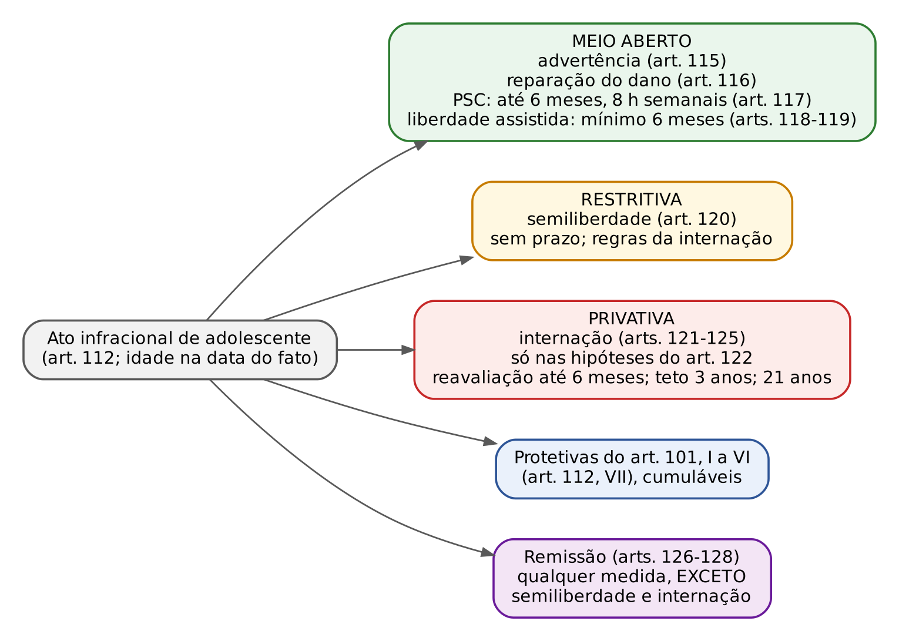
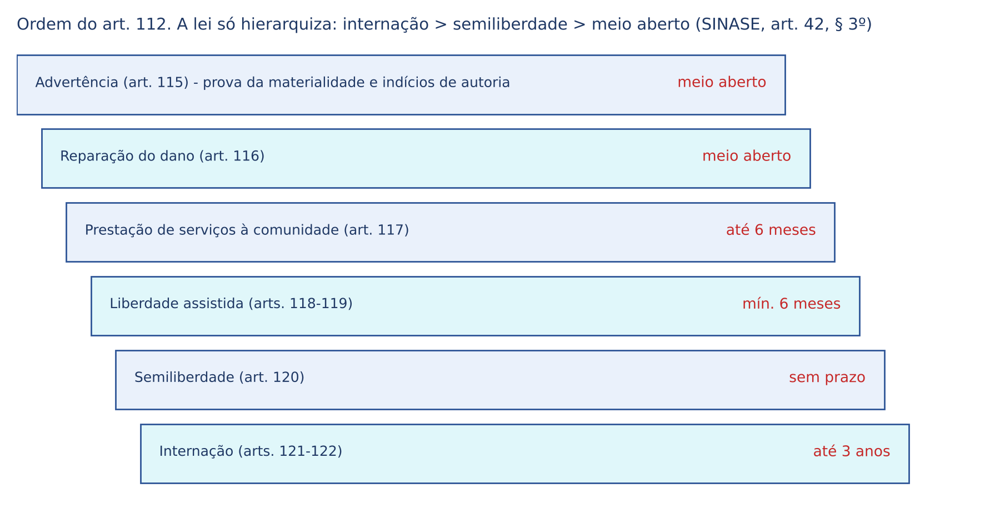
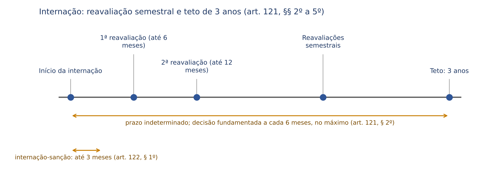
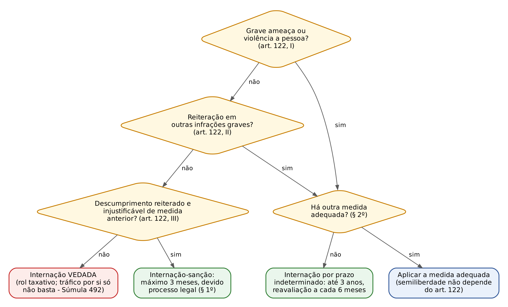
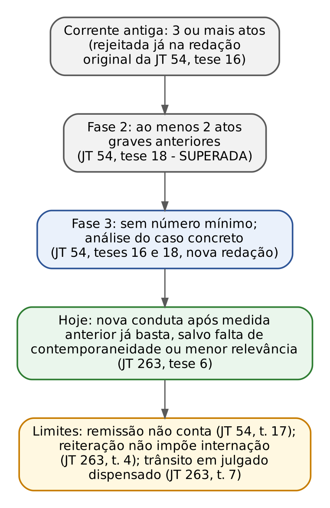
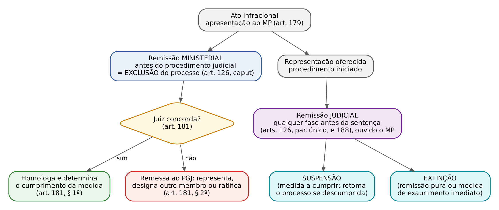

# CAPÍTULO 15 — MEDIDAS SOCIOEDUCATIVAS E REMISSÃO

:::INCIDENCIA
TJRS p. 1; TJSC p. 2. Nível A+; lote de 33 questões (FGV 23, FCC 10), sete delas de provas de juiz (TJSC 2024 e 2025, TJTO, TJCE, TJGO, TJPA, TJPR, TJPE).
O que mais cai: taxatividade do art. 122 e reiteração; Súmula 492 do STJ; prazos da PSC, da LA e da internação; semiliberdade sem prazo e com atividades externas independentes de autorização; remissão ministerial x judicial e o art. 127.
:::

Mapa de cobrança do lote:

| Subtema | FGV | FCC | Padrão |
|---|---|---|---|
| Rol do art. 112 e critérios do § 1º | 5 | 4 | literalidade do rol; "internação em estabelecimento prisional" e "trabalho" como distratores; capacidade de cumprir |
| Meio aberto (advertência, reparação, PSC, LA) | 6 | 2 | 6 meses (teto da PSC) x 6 meses (piso da LA); 8 horas semanais; trabalho forçado |
| Semiliberdade | 2 | 0 | sem prazo; atividades externas SEM autorização judicial; não vinculada ao art. 122 |
| Internação: art. 122 e jurisprudência | 6 | 1 | tráfico (Súmula 492); reiteração sem número mínimo; remissão não gera reiteração; trânsito em julgado dispensado |
| Internação: prazos e direitos (arts. 121, 123 e 124) | 0 | 3 | 3 anos; 3 meses da internação-sanção; visitas semanais |
| Remissão | 8 | 1 | quem concede; exclusão x suspensão/extinção; art. 127; discordância do juiz; homologação |

## 15.1 O sistema das medidas socioeducativas

### 15.1.1 Natureza, finalidades e reserva de jurisdição

A medida socioeducativa é a resposta estatal ao ato infracional praticado por adolescente (pessoa de 12 anos completos a 18 incompletos na data do fato — arts. 2º e 104, parágrafo único; ver Cap. 14). Criança que pratica ato infracional recebe SOMENTE medidas de proteção do art. 101 (art. 105; ver Cap. 14). Embora o discurso legal seja pedagógico, a jurisprudência do STJ e a Lei 12.594/2012 reconhecem a dupla natureza da medida: sancionatória (é imposta coercitivamente, em resposta a fato típico e ilícito) e pedagógica. O art. 1º, § 2º, do SINASE positivou três objetivos:

- I — responsabilização do adolescente pelas consequências lesivas do ato, "sempre que possível incentivando a sua reparação";
- II — integração social e garantia de direitos individuais e sociais, por meio do plano individual de atendimento (PIA — Cap. 17);
- III — desaprovação da conduta infracional, com as disposições da sentença como "parâmetro máximo de privação de liberdade ou restrição de direitos".

Dessa dupla natureza decorrem consequências cobradas: aplica-se a prescrição penal (Súmula 338 do STJ — regime no Cap. 14); incide o princípio da legalidade com a vedação de tratamento mais gravoso que o conferido ao adulto (SINASE, art. 35, I — ver 15.1.4); admite-se a insignificância (JT 54, tese 3); exige-se o devido processo legal (CF, art. 227, § 3º, IV; ECA, arts. 110 e 111 — Cap. 14).

A aplicação da medida socioeducativa é ato jurisdicional: "A aplicação de medidas socio-educativas ao adolescente, pela prática de ato infracional, é da competência exclusiva do juiz" (Súmula 108 do STJ). A súmula convive com a remissão ministerial cumulada com medida em meio aberto, porque a proposta do MP só produz efeitos após homologação judicial (art. 181, § 1º — ver 15.9). O Conselho Tutelar não aplica medida socioeducativa (Cap. 12) e não executa a PSC ou a LA (os programas são municipais — SINASE, art. 5º, III).

### 15.1.2 O rol do art. 112: taxatividade e a ponte com o art. 101

:::LEI ECA, ART. 112
Verificada a prática de ato infracional, a autoridade competente poderá aplicar ao adolescente as seguintes medidas:
I - advertência;
II - obrigação de reparar o dano;
III - prestação de serviços à comunidade;
IV - liberdade assistida;
V - inserção em regime de semi-liberdade;
VI - internação em estabelecimento educacional;
VII - qualquer uma das previstas no art. 101, I a VI.
§ 1º A medida aplicada ao adolescente levará em conta a sua capacidade de cumpri-la, as circunstâncias e a gravidade da infração.
§ 2º Em hipótese alguma e sob pretexto algum, será admitida a prestação de trabalho forçado.
§ 3º Os adolescentes portadores de doença ou deficiência mental receberão tratamento individual e especializado, em local adequado às suas condições.
:::

Pontos de prova:

- O rol dos incisos I a VI é TAXATIVO (legalidade estrita): não há "medida restaurativa", "tornozeleira eletrônica", "colégio interno", "trabalho em experiência" ou multa como medida socioeducativa. Práticas restaurativas são PRINCÍPIO da execução (SINASE, art. 35, III), não espécie autônoma de medida que substitua as do art. 112.
- Internação é "em estabelecimento EDUCACIONAL" (inciso VI). A versão "internação em estabelecimento prisional" é o distrator clássico, e o art. 123 a proíbe (ver 15.8.5).
- Inciso VII: das medidas de proteção do art. 101, só as dos incisos I a VI (encaminhamento aos pais, orientação e apoio, matrícula e frequência escolar, inclusão em programas, requisição de tratamento, programa para dependentes químicos). Ficam FORA o acolhimento institucional, o acolhimento familiar e a colocação em família substituta (incisos VII a IX), que não são resposta a ato infracional e exigem procedimento próprio (Cap. 13).
- A autoridade competente do caput é o juiz (Súmula 108), salvo a medida incluída em remissão ministerial homologada.

:::QUESTAO FCC 2025 — DPE-RS — DEFENSOR PÚBLICO (Q3386980)
Cobrou-se qual afirmação sobre o ECA era correta. Gabarito: A — verificada a prática de ato infracional, a autoridade pode aplicar ao adolescente a matrícula e frequência obrigatórias em estabelecimento oficial de ensino fundamental (art. 112, VII, c/c art. 101, III).
Armadilhas: limitar o ECA aos 18 anos (art. 2º, parágrafo único, e art. 121, § 5º); afastar o ECA por emancipação (a inimputabilidade é etária e constitucional — art. 228 da CF; Cap. 1); permitir que a entidade de acolhimento impeça o contato dos pais sem decisão judicial (Cap. 11).
:::

:::QUESTAO FGV 2024 — PREFEITURA DE CARAGUATATUBA — PEDAGOGO (Q3345491)
Seis medidas listadas, a última "internação em estabelecimento prisional". Gabarito: D — apenas uma está em desacordo com a lei (o inciso VI fala em estabelecimento educacional).
No mesmo sentido, com o rol cobrado em literalidade: Q3964522 (FCC 2026, MPE-SE — completar o rol com a prestação de serviço à comunidade; distratores "colégio interno", "trabalho em experiência"); Q2513212 (FGV 2024, TJSC, Assistente Social — sentenciados cumprem medidas "socioeducativas", não "restritivas de direito" ou "socioassistenciais"); Q3265270 (FGV 2025 — PSC como medida em meio aberto; distratores internação provisória, tornozeleira, indenização por danos morais).
:::

:::QUESTAO FGV 2024 — PC-SC — PSICÓLOGO POLICIAL CIVIL (Q2365442)
João, 13 anos, picha a escola. Gabarito: C — aplicam-se medidas socioeducativas e medidas protetivas.
Passos: (1) 13 anos = adolescente (art. 2º), logo sujeito ao art. 112; (2) o art. 112, VII, permite cumular protetivas; (3) "pena", "multa" e "restritiva de direitos" são categorias do direito penal de adultos e não existem no ECA. Atenção: o enunciado repete a definição do art. 103 acrescentando "quando praticada por criança ou adolescente"; o conceito legal é só "conduta descrita como crime ou contravenção penal".
No mesmo sentido: Q3351806 (FGV 2025 — para adolescente que furtou chocolate, uma socioeducativa e uma protetiva: PSC e encaminhamento a tratamento psicológico; "acolhimento" e "advertência em audiência" como distratores) e Q3336206 (FCC 2025 — quem cumpre LA necessariamente teve atribuída a autoria de ato infracional).
:::

### 15.1.3 Critérios de escolha: capacidade, circunstâncias e gravidade (§ 1º)

O § 1º do art. 112 impõe três vetores, cumulativos: (a) CAPACIDADE de cumprir a medida (dimensão pessoal: idade, saúde, escolaridade, trabalho, estrutura familiar); (b) CIRCUNSTÂNCIAS da infração; (c) GRAVIDADE da infração. A JT 262, tese 1, sintetiza: a gravidade do ato e as condições pessoais do adolescente devem ser observadas, porque a medida visa a ressocialização, a proteção da segurança e da integridade do adolescente e sua retirada da situação de risco social.

O critério da capacidade é exclusivo da aplicação da medida socioeducativa: não aparece como critério expresso nas medidas pertinentes aos pais (arts. 129 e 130), nas medidas de proteção ou nas obrigações do poder público. Daí a Q3954612 (FCC 2026, DPE-MT), gabarito A: a "capacidade de cumprimento" é critério expressamente previsto na decisão que impõe medida socioeducativa.

Desdobramentos da capacidade de cumprir:

- Adolescente com doença ou deficiência mental recebe "tratamento individual e especializado, em local adequado" (§ 3º). Quando a doença impede o cumprimento, a medida é extinta (SINASE, art. 46, IV) ou substituída por medida protetiva (art. 112, VII, c/c art. 101, V). A medida protetiva de tratamento psiquiátrico em regime hospitalar imposta a adolescente infrator não pode durar mais que os 3 anos da internação (JT 262, tese 10). Internação psiquiátrica e Lei 10.216/2001: Cap. 26.
- A medida não pode exigir o impossível: a reparação do dano é substituída "havendo manifesta impossibilidade" (art. 116, parágrafo único); a PSC não pode prejudicar escola ou trabalho (art. 117, parágrafo único).
- Gestante ou lactante pode ser internada, desde que asseguradas a atenção integral à saúde e as condições para permanecer com o filho no período de amamentação (JT 263, tese 8). Nada a ver com o HC 143.641, que trata de prisão preventiva de mulheres adultas (Cap. 24).

As circunstâncias do fato podem ser valoradas negativamente na escolha da medida, desde que concretas. A FGV (Q3390887, DPE-PE 2025, gabarito E) considerou correto valorar negativamente a venda de drogas nas imediações de escola, no horário do intervalo, na escolha da espécie de medida.

:::QUESTAO FGV 2025 — DPE-PE — DEFENSOR PÚBLICO (Q3390887)
Adolescente (17) com passagens por atos graves e adulto (18) primário vendem drogas em frente à escola. Gabarito: E — a prática nas imediações de unidade escolar pode ser valorada negativamente na escolha da medida.
Armadilhas: (A) não há "competência especializada" atraindo o adulto ao Juízo da Infância: o adulto responde na Justiça comum e o adolescente no Juízo da Infância (art. 148, I — Cap. 18); (B) a Súmula 500 do STJ (corrupção de menores é crime formal) NÃO foi superada (Cap. 21); (C) a internação provisória de quem tem reiteração em atos graves é possível, mesmo sem violência (JT 263, tese 2 — Cap. 14); (D) a reiteração autoriza, mas não impõe a internação ("sempre" é o erro — JT 263, tese 4).
:::

### 15.1.4 Legalidade e vedação de tratamento mais gravoso que o do adulto

O art. 35, I, do SINASE consagra a "legalidade, não podendo o adolescente receber tratamento mais gravoso do que o conferido ao adulto". O princípio é parâmetro de validade da própria aplicação da medida, e não só da execução. Consequências cobradas:

- Insignificância: aplica-se ao ato infracional (JT 54, tese 3). O caráter "pedagógico" do processo não afasta a atipicidade material. A FGV (Q3505791, TJCE 2025) marcou como errada a assertiva segundo a qual o princípio não se aplica porque o processo socioeducativo é "eminentemente pedagógico".
- Conduta que, para o adulto, não é infração penal não pode gerar medida socioeducativa. Com o julgamento do Tema 506 da repercussão geral (STF, RE 635.659, Relator Ministro Gilmar Mendes, Plenário, j. 26/6/2024), a posse de maconha para consumo pessoal deixou de ser infração penal (permanece ilícito extrapenal, com sanções administrativas, presumindo-se usuário quem porta até 40 gramas ou seis plantas fêmeas). Logo, o adolescente surpreendido nessa situação não pratica ato infracional (art. 103) e não pode receber medida socioeducativa; cabem, quando for o caso, medidas de proteção.
- Ação penal condicionada: há controvérsia sobre exigir representação da vítima quando o tipo correspondente é de ação penal pública condicionada (lesão leve, por exemplo). O ECA não prevê condição de procedibilidade e a ação socioeducativa é pública incondicionada, sempre de titularidade do MP (art. 201, II). A FGV (Q3505791) considerou errada a afirmação de que a representação socioeducativa deveria ser rejeitada por falta de representação da vítima.
- Atenuantes do CP: a atenuante da confissão espontânea não se aplica no procedimento de apuração de ato infracional (JT 54, tese 8), porque não há dosimetria de pena. A confissão também não autoriza dispensar as demais provas (Súmula 342 do STJ — Cap. 16).
- Gravidade abstrata e hediondez: o ECA não reproduz a lógica da Lei 8.072/1990. Ato análogo a crime hediondo ou equiparado não obriga à internação (Súmula 492 — ver 15.8.3) nem impede a remissão (ver 15.9.2).

:::QUESTAO FGV 2026 — TJ-PA — JUIZ SUBSTITUTO (Q3951744)
Júlio (14), em semiliberdade, recebe de André (17), também em cumprimento de medida, três cigarros de maconha para uso próprio; ambos são apreendidos. Gabarito: D — ao caso de Júlio aplicam-se os princípios da legalidade e da vedação de tratamento mais gravoso que o do adulto, razão pela qual não pode ser imposta nova medida socioeducativa.
Passos: (1) a conduta de Júlio corresponde à posse para consumo pessoal de pequena quantidade de maconha; (2) após o Tema 506 do STF, isso não é infração penal para o adulto; (3) logo, não há ato infracional (art. 103) e nenhuma medida socioeducativa cabe (SINASE, art. 35, I). Erros: (A) advertência é medida socioeducativa; (C) "tratamento médico" é medida de proteção, não socioeducativa; (B) André praticou o ato DURANTE a execução, hipótese em que o art. 45, § 1º, do SINASE admite o reinício (Cap. 17); (E) a Súmula 492 não obriga à semiliberdade.
:::

### 15.1.5 Padrão probatório (art. 114)

:::LEI ECA, ART. 114
A imposição das medidas previstas nos incisos II a VI do art. 112 pressupõe a existência de provas suficientes da autoria e da materialidade da infração, ressalvada a hipótese de remissão, nos termos do art. 127.
Parágrafo único. A advertência poderá ser aplicada sempre que houver prova da materialidade e indícios suficientes da autoria.
:::

São três patamares: (a) medidas dos incisos II a VI: PROVA SUFICIENTE de autoria e de materialidade; (b) advertência: PROVA da materialidade e INDÍCIOS SUFICIENTES de autoria; (c) remissão cumulada com medida: dispensa a comprovação da responsabilidade (art. 127). A pegadinha está em inverter os patamares da advertência (a materialidade é que precisa de prova; a autoria basta em indícios). Se não houver prova da existência do fato ou de que o adolescente concorreu para ele, o juiz não aplica medida alguma (art. 189 — Cap. 16).

## 15.2 Cumulação, substituição e escolha da medida

### 15.2.1 A remissão do art. 113 aos arts. 99 e 100

"Aplica-se a este Capítulo o disposto nos arts. 99 e 100" (art. 113). Daí:

- CUMULAÇÃO: as medidas podem ser aplicadas isolada ou cumulativamente (art. 99). É possível LA cumulada com PSC (Q3453253 parte dessa premissa) e qualquer socioeducativa cumulada com protetivas do art. 101, I a VI. A cumulação deve ser compatível: não se cumula internação com LA na mesma sentença, porque a internação absorve as finalidades das demais (SINASE, art. 42, § 3º; Informativo 882 do STJ — ver 15.8.7).
- SUBSTITUIÇÃO A QUALQUER TEMPO: a medida pode ser substituída (art. 99), e o art. 118, § 2º, repete a regra para a LA. O procedimento de substituição, regressão e reavaliação é da execução (SINASE, arts. 42 e 43; Súmula 265 do STJ — Cap. 17).
- PRINCÍPIOS do art. 100, parágrafo único (desenvolvidos no Cap. 13), com especial relevo, aqui, para a intervenção precoce (VI), a intervenção mínima (VII), a proporcionalidade e atualidade (VIII) e a responsabilidade parental (IX).

A atualidade (art. 100, parágrafo único, VIII) é usada pelo STJ em duas direções. Contra o adolescente: a execução da medida não depende do esgotamento das vias recursais (JT 262, tese 3), e a imediata execução não viola a presunção de não culpabilidade, dada a natureza pedagógica da medida (JT 262, tese 4) — regime recursal e efeitos da apelação no Cap. 19. A favor: medidas privativas de liberdade devem observar a atualidade, avaliando-se, no momento da aplicação, se a intervenção ainda é necessária e adequada (JT 262, tese 5), o que pesa quando a sentença vem anos depois do fato e o adolescente já se reinseriu.

### 15.2.2 Hierarquia entre as medidas

A lei só hierarquiza expressamente três patamares: "Considera-se mais grave a internação, em relação a todas as demais medidas, e mais grave a semiliberdade, em relação às medidas de meio aberto" (SINASE, art. 42, § 3º). Entre as medidas de meio aberto não há escala legal (a LA não é, por lei, "mais grave" que a PSC). A hierarquia importa para: (a) regressão e substituição por medida mais gravosa, que exige parecer técnico e audiência prévia (SINASE, art. 43, § 4º — Cap. 17); (b) a regra de que "a gravidade do ato infracional, os antecedentes e o tempo de duração da medida não são fatores que, por si, justifiquem a não substituição da medida por outra menos grave" (SINASE, art. 42, § 2º); (c) a subsidiariedade da internação (art. 122, § 2º).

:::DICA CLASSIFICAÇÃO ÚTIL PARA AS ALTERNATIVAS
Meio aberto: advertência, reparação do dano, PSC e LA. Restritiva de liberdade: semiliberdade. Privativa de liberdade: internação (art. 121, caput: "medida privativa da liberdade"). Medidas executadas nos próprios autos do processo de conhecimento: proteção, advertência e reparação do dano, quando aplicadas isoladamente; PSC, LA, semiliberdade e internação exigem processo de execução autônomo (SINASE, arts. 38 e 39; Cap. 17).
:::

:::PEGADINHA "LIBERDADE ASSISTIDA PRESSUPÕE VIOLÊNCIA"
Nenhuma medida de meio aberto pressupõe violência ou grave ameaça. A violência só é requisito (alternativo) da INTERNAÇÃO (art. 122, I). A FGV (Q4289384) usou exatamente "a imposição de liberdade assistida pressupõe a comprovação de violência ou grave ameaça" como distrator.
:::

## 15.3 Advertência

"A advertência consistirá em admoestação verbal, que será reduzida a termo e assinada" (art. 115). Três elementos: (a) admoestação VERBAL, feita pelo juiz em audiência (ou, na remissão ministerial, pelo promotor, com homologação posterior); (b) redução a TERMO; (c) ASSINATURA. É a única medida que se contenta com indícios suficientes de autoria (art. 114, parágrafo único) e se executa nos próprios autos (SINASE, art. 38), exaurindo-se no ato. Por isso, a remissão judicial cumulada com advertência costuma extinguir, e não suspender, o processo (ver 15.9.3).

A advertência do art. 115 é medida SOCIOEDUCATIVA dirigida ao adolescente. Não se confunde com a advertência aos pais ou responsável (art. 129, VII — medida pertinente aos pais, Cap. 13) nem com a advertência do art. 28, I, da Lei 11.343/2006. O STF considerou compatível com a Constituição a remissão pré-processual cumulada com advertência proposta pelo MP, porque essa medida não tem caráter de penalidade (STF, RE 248.018, Relator Ministro Joaquim Barbosa, Segunda Turma, j. 6/5/2008).

:::QUESTAO FCC 2026 — TJ-CE — ANALISTA JUDICIÁRIO — PSICOLOGIA (Q4293737)
A admoestação verbal, reduzida a termo e assinada, corresponde a qual medida? Gabarito: D — advertência (art. 115). Distratores: "declaração", "confissão", "confirmação". Literalidade pura.
:::

## 15.4 Obrigação de reparar o dano

:::LEI ECA, ART. 116
Em se tratando de ato infracional com reflexos patrimoniais, a autoridade poderá determinar, se for o caso, que o adolescente restitua a coisa, promova o ressarcimento do dano, ou, por outra forma, compense o prejuízo da vítima.
Parágrafo único. Havendo manifesta impossibilidade, a medida poderá ser substituída por outra adequada.
:::

- Pressuposto: ato infracional "com reflexos patrimoniais" (furto, dano, pichação, apropriação).
- Três modalidades alternativas: RESTITUIR a coisa, RESSARCIR o dano ou, por outra forma, COMPENSAR o prejuízo da vítima (por exemplo, limpar o muro pichado ou consertar o bem — compensação *in natura*).
- A obrigação é do ADOLESCENTE (personalíssima, pedagógica). Se quem paga são os pais, a finalidade pedagógica se perde; por isso a doutrina recomenda aferir se o adolescente tem condições próprias de reparar, e o parágrafo único manda substituir a medida havendo manifesta impossibilidade.
- Não se confunde com a responsabilidade civil dos pais pelos atos dos filhos (CC, arts. 932, I, e 933 — responsabilidade objetiva) nem com a responsabilidade subsidiária e mitigada do incapaz (CC, art. 928), discutidas na Apostila de Direito Civil (Cap. 38). A medida socioeducativa não impede a ação de indenização no juízo cível, nem faz coisa julgada quanto ao valor.
- Execução nos próprios autos quando aplicada isoladamente (SINASE, art. 38). Não é "indenização por danos morais" (distrator da Q3351806 e da Q3265270).

:::QUESTAO FCC 2025 — DPE-AM — DEFENSOR PÚBLICO (Q3531638)
Silas, 14 anos, furta o celular de um professor na escola. Gabarito: E — Silas poderá receber medida que o obrigue a restituir o celular, ressarcir o dano ou, por outra forma, compensar o prejuízo (art. 116).
Armadilhas: (A) boletim de ocorrência não é "arquivado por remissão processual", e a remissão não exige confissão nem reparação prévia (art. 127); (B) advertência aos pais (art. 129, VII) não é aplicada pelo MP por ato infracional do filho; (C) furto sem violência, primário: internação vedada (art. 122), ainda que o motivo seja comprar droga ou falte arrependimento; (D) não há "medida restaurativa" substitutiva no rol taxativo do art. 112.
:::

## 15.5 Prestação de serviços à comunidade (PSC)

:::LEI ECA, ART. 117
A prestação de serviços comunitários consiste na realização de tarefas gratuitas de interesse geral, por período não excedente a seis meses, junto a entidades assistenciais, hospitais, escolas e outros estabelecimentos congêneres, bem como em programas comunitários ou governamentais.
Parágrafo único. As tarefas serão atribuídas conforme as aptidões do adolescente, devendo ser cumpridas durante jornada máxima de oito horas semanais, aos sábados, domingos e feriados ou em dias úteis, de modo a não prejudicar a freqüência à escola ou à jornada normal de trabalho.
:::

Elementos (todos cobrados em literalidade):

| Elemento | Regra | Distrator típico |
|---|---|---|
| Natureza das tarefas | gratuitas, de interesse geral | "bolsa" ou remuneração (Q2386984, E) |
| Prazo | NÃO EXCEDENTE a 6 meses (teto) | "prazo mínimo de 6 meses" (é o da LA); "prorrogável por igual período" |
| Locais | entidades assistenciais, hospitais, escolas, congêneres, programas comunitários OU GOVERNAMENTAIS | "vedadas entidades governamentais" (Q3870710, E) |
| Atribuição | conforme as APTIDÕES do adolescente | — |
| Jornada | máximo 8 horas SEMANAIS | "8 horas diárias" |
| Dias | sábados, domingos e feriados OU dias úteis | "somente dias úteis" (Q3870710, C); "não pode no fim de semana" (Q2570480, D) |
| Limite funcional | não prejudicar a escola nem a jornada normal de trabalho | — |
| Trabalho forçado | vedado "em hipótese alguma e sob pretexto algum" (art. 112, § 2º; CF, art. 5º, XLVII, c) | execução coercitiva da tarefa (Q2386984, A) |

Execução: programa municipal de meio aberto (SINASE, art. 5º, III), em geral operado pelo CREAS (serviço de proteção social a adolescentes em cumprimento de LA e PSC — Cap. 25). Compete à direção do programa selecionar e credenciar orientadores e entidades, conforme o perfil do socioeducando; impugnado o credenciamento pelo MP, ou considerado inadequado pelo juiz, instaura-se incidente com aplicação subsidiária do procedimento de apuração de irregularidade em entidade (SINASE, arts. 13 e 14; Cap. 19). Não é o Conselho Tutelar quem executa a medida (Q3870710, A).

A recusa do adolescente em cumprir a PSC não autoriza compeli-lo fisicamente, o que configuraria trabalho forçado. A resposta é processual: reavaliação e substituição da medida (art. 99; SINASE, art. 43) e, se o descumprimento for reiterado e injustificável, a internação-sanção do art. 122, III, com devido processo legal (ver 15.8.4).

:::QUESTAO FGV 2024 — TJ-SC — JUIZ SUBSTITUTO (Q2386984)
Jefferson, 17 anos, recebe PSC por 3 meses em instituição de longa permanência para idosos e se recusa a desempenhar as tarefas. Gabarito: C — diante da vedação constitucional de trabalho forçado, o juiz poderá substituir a medida por outra em meio aberto.
Passos: (1) a recusa não autoriza execução coercitiva (art. 112, § 2º; CF, art. 5º, XLVII, c); (2) a medida é substituível a qualquer tempo (arts. 99 e 113); (3) os 3 meses são válidos, porque 6 meses é o TETO da PSC (o piso de 6 meses é da LA); (4) instituição asilar não transforma a PSC em meio fechado; (5) a PSC é gratuita (art. 117).
:::

:::QUESTAO FGV 2026 — TJ-RJ — COMISSÁRIO DE JUSTIÇA DA INFÂNCIA (Q3870710)
Remissão judicial com PSC por 6 meses: como será o cumprimento? Gabarito: D — tarefas conforme as aptidões do adolescente, em jornada máxima de 8 horas semanais.
Erros: Conselho Tutelar não executa; não há prorrogação após 6 meses (teto); tarefas também aos sábados, domingos e feriados; entidades governamentais são admitidas.
No mesmo sentido: Q2570480 (FGV 2024, TCE-PA) — a única afirmação incorreta era a de que a PSC não pode ser cumprida no fim de semana (gabarito D).
:::

## 15.6 Liberdade assistida (LA)

:::LEI ECA, ART. 118
A liberdade assistida será adotada sempre que se afigurar a medida mais adequada para o fim de acompanhar, auxiliar e orientar o adolescente.
§ 1º A autoridade designará pessoa capacitada para acompanhar o caso, a qual poderá ser recomendada por entidade ou programa de atendimento.
§ 2º A liberdade assistida será fixada pelo prazo mínimo de seis meses, podendo a qualquer tempo ser prorrogada, revogada ou substituída por outra medida, ouvido o orientador, o Ministério Público e o defensor.
:::

Núcleo: ACOMPANHAR, AUXILIAR e ORIENTAR. O orientador (pessoa capacitada, que pode ser recomendada por entidade ou programa; credenciada pela direção do programa — SINASE, art. 13, I) tem os encargos do art. 119, "entre outros" (rol exemplificativo), sempre "com o apoio e a supervisão da autoridade competente":

- I — promover socialmente o adolescente e sua família, com orientação e inserção, se necessário, em programa oficial ou comunitário de auxílio e assistência social;
- II — supervisionar frequência e aproveitamento escolar, promovendo inclusive a matrícula;
- III — diligenciar a profissionalização e a inserção no mercado de trabalho;
- IV — apresentar relatório do caso.

Prazos e duração:

- MÍNIMO de 6 meses (art. 118, § 2º), contrapondo-se ao TETO de 6 meses da PSC. A sentença que fixa LA por 3 meses contraria a lei; a que fixa PSC por 3 meses é válida.
- Prorrogação, revogação ou substituição a qualquer tempo, OUVIDOS o orientador, o MP e o defensor (oitiva tripla, cobrada em literalidade). A prorrogação é possível se o adolescente não cumpriu plenamente o processo socioeducativo no período inicialmente fixado (JT 262, tese 7).
- MÁXIMO: a lei não fixa, mas o STJ aplica por analogia o teto de 3 anos do art. 121, § 3º (JT 263, tese 9). Para fins de prescrição de medida sem termo final, considera-se o máximo de 3 anos (JT 262, tese 6 — Cap. 14).
- Superveniência dos 18 anos: a LA prossegue até os 21 (Súmula 605 do STJ; Tema 992 — ver Cap. 1).
- Reavaliação obrigatória no máximo a cada 6 meses (SINASE, art. 42 — a LA está entre as medidas sujeitas a reavaliação semestral, ao lado da semiliberdade e da internação).

:::QUESTAO FGV 2024 — TCE-PA — AUDITOR — SERVIÇO SOCIAL (Q2570479)
Quatro afirmações sobre a LA, todas transcrições dos arts. 118 e 119 (finalidade; pessoa capacitada recomendada por entidade; prazo mínimo de 6 meses com prorrogação, revogação ou substituição ouvidos orientador, MP e defensor; encargos do orientador). Gabarito: E — todas corretas. Quem confunde o piso da LA com o teto da PSC erra a III.
:::

| Aspecto | PSC | LA |
|---|---|---|
| Núcleo | tarefas gratuitas de interesse geral | acompanhar, auxiliar e orientar |
| Prazo | até 6 meses (teto) | mínimo 6 meses; máximo de 3 anos por construção do STJ |
| Agente | entidade credenciada; tarefas conforme aptidões | orientador designado (pessoa capacitada) |
| Carga | 8 horas semanais, sem prejuízo da escola e do trabalho | encontros e encargos do art. 119 |
| Alteração | substituição (art. 99) | prorrogação, revogação ou substituição, ouvidos orientador, MP e defensor |
| Reavaliação semestral obrigatória (SINASE, art. 42) | não listada | sim |
| Execução | processo de execução autônomo e PIA (SINASE, art. 39; Cap. 17) | idem |

## 15.7 Semiliberdade

:::LEI ECA, ART. 120
O regime de semi-liberdade pode ser determinado desde o início, ou como forma de transição para o meio aberto, possibilitada a realização de atividades externas, independentemente de autorização judicial.
§ 1º São obrigatórias a escolarização e a profissionalização, devendo, sempre que possível, ser utilizados os recursos existentes na comunidade.
§ 2º A medida não comporta prazo determinado aplicando-se, no que couber, as disposições relativas à internação.
:::

Quatro pontos de prova:

1. Aplicação DESDE O INÍCIO (medida originária, na sentença) ou como TRANSIÇÃO para o meio aberto (progressão a partir da internação).

2. Atividades externas "INDEPENDENTEMENTE de autorização judicial": é a essência da medida (o adolescente sai para estudar e trabalhar e retorna à unidade, em regra, no período noturno e em finais de semana definidos pelo programa). Contraste com a internação, em que as atividades externas dependem do critério da equipe técnica e podem ser vedadas pelo juiz (art. 121, §§ 1º e 7º).

3. Escolarização e profissionalização OBRIGATÓRIAS, preferencialmente com recursos da comunidade.

4. SEM PRAZO DETERMINADO, aplicando-se "no que couber" as regras da internação: reavaliação no máximo semestral, teto de 3 anos e liberação compulsória aos 21 anos (art. 121, §§ 2º, 3º e 5º; SINASE, art. 42).

A remissão ao regime da internação NÃO alcança o art. 122. A semiliberdade não se vincula à taxatividade do art. 122 (JT 54, tese 5): pode ser aplicada a ato sem violência ou grave ameaça e sem reiteração, desde que fundamentada concretamente nos critérios do art. 112, § 1º. Por outro lado, a remissão NUNCA pode incluir semiliberdade (art. 127).

:::QUESTAO FGV 2025 — MPE-RJ — ANALISTA DO MP (Q3362505)
Reinaldo, 16, recebe semiliberdade por ato análogo a roubo; a defesa pede prazo máximo de 6 meses e atividades externas. Gabarito: A — a semiliberdade não comporta prazo determinado, aplicando-se no que couber as regras da internação, e as atividades externas independem de autorização judicial.
Armadilhas: prazo de "6 meses a 1 ano" ou "máximo de 2 anos"; reavaliação "mensal"; exigir autorização judicial porque o ato teve grave ameaça (a lei não faz essa distinção); remeter às regras da PSC.
:::

:::QUESTAO FGV 2025 — TJ-TO — JUIZ SUBSTITUTO (Q3453253)
Representação por ato análogo ao tráfico, julgada procedente com LA e PSC; ambas as partes apelam. Gabarito: B — o juiz só pode aplicar internação nas hipóteses taxativas do art. 122 (JT 54, tese 4).
Armadilhas: (A) inverte a Súmula 492; (C) a semiliberdade dispensa autorização judicial para atividades externas (o enunciado diz "mediante autorização judicial"); (D) exigir duas infrações graves anteriores é a tese SUPERADA (ver 15.8.3); (E) não se admite rescisória contra a coisa julgada absolutória no processo socioeducativo, que segue a lógica do processo penal (sentença absolutória transitada não é rescindível *pro societate*).
:::

| Aspecto | Semiliberdade | Internação |
|---|---|---|
| Natureza | restritiva de liberdade | privativa de liberdade |
| Hipóteses | qualquer ato, com fundamentação concreta (não se vincula ao art. 122) | só as do art. 122, e subsidiariamente (§ 2º) |
| Atividades externas | inerentes; independem de autorização judicial | a critério da equipe técnica, salvo vedação judicial expressa, revisável a qualquer tempo |
| Escolarização e profissionalização | obrigatórias, preferencialmente na comunidade | obrigatórias atividades pedagógicas, inclusive na internação provisória (art. 123, parágrafo único) |
| Prazo | indeterminado; regras da internação no que couber | indeterminado; reavaliação até 6 meses; teto 3 anos; 21 anos |
| Remissão | não pode incluí-la (art. 127) | não pode incluí-la (art. 127) |
| Intimação da sentença | ao adolescente e ao defensor (art. 190, I) | idem |
| Defesa | fato grave passível de semiliberdade ou internação: nomeação de defensor e audiência em continuação (art. 186, § 2º — Cap. 16) | idem |

:::QUESTAO FGV 2026 — TJ-PE — JUIZ SUBSTITUTO (Q4349499)
Lucas, 16, recebeu remissão com LA por ato análogo à colaboração com o tráfico (Lei 11.343, art. 37). Durante a suspensão desse processo, pratica furto qualificado pelo concurso de pessoas; o juízo do segundo processo vai sentenciar. Gabarito: D — o juízo do segundo processo poderá impor semiliberdade, mas não internação.
Passos: (1) furto qualificado por concurso não tem violência nem grave ameaça (art. 122, I, afastado); (2) o único antecedente é ato abrangido por remissão, que não serve para caracterizar reiteração (JT 54, tese 17; art. 127), e não há medida anterior descumprida (inciso III); (3) logo, internação vedada; (4) a semiliberdade não se vincula ao art. 122 (JT 54, tese 5). Erros: (A) e (B) admitem internação; (C) exclui indevidamente a semiliberdade; (E) não se suspende o processo de conhecimento para unificar, e medida de remissão não se unifica com medida de sentença (STJ, AgRg no HC 848.765/SC, Relator Ministro Messod Azulay Neto, Quinta Turma, j. 17/6/2024 — ver 15.9.6).
:::

## 15.8 Internação

### 15.8.1 Princípios e regime temporal (art. 121)

:::LEI ECA, ART. 121
A internação constitui medida privativa da liberdade, sujeita aos princípios de brevidade, excepcionalidade e respeito à condição peculiar de pessoa em desenvolvimento.
§ 1º Será permitida a realização de atividades externas, a critério da equipe técnica da entidade, salvo expressa determinação judicial em contrário.
§ 2º A medida não comporta prazo determinado, devendo sua manutenção ser reavaliada, mediante decisão fundamentada, no máximo a cada seis meses.
§ 3º Em nenhuma hipótese o período máximo de internação excederá a três anos.
§ 4º Atingido o limite estabelecido no parágrafo anterior, o adolescente deverá ser liberado, colocado em regime de semi-liberdade ou de liberdade assistida.
§ 5º A liberação será compulsória aos vinte e um anos de idade.
§ 6º Em qualquer hipótese a desinternação será precedida de autorização judicial, ouvido o Ministério Público.
§ 7º A determinação judicial mencionada no § 1º poderá ser revista a qualquer tempo pela autoridade judiciária.
:::

Os três princípios do caput repetem o art. 227, § 3º, V, da CF (brevidade, excepcionalidade e respeito à condição peculiar de pessoa em desenvolvimento). A brevidade é reforçada pelo SINASE, art. 35, V, que a liga expressamente ao art. 122.

| Regra | Conteúdo | Pegadinha |
|---|---|---|
| Atividades externas (§ 1º) | permitidas, a critério da EQUIPE TÉCNICA, salvo expressa determinação judicial em contrário | não dependem de autorização judicial; a vedação judicial pode ser revista a qualquer tempo (§ 7º, incluído pela Lei 12.594/2012) |
| Prazo (§ 2º) | indeterminado | a sentença NÃO fixa prazo; a fixação de prazo mínimo não tem base legal |
| Reavaliação (§ 2º) | decisão fundamentada, no MÁXIMO a cada 6 meses | pode ocorrer antes, a pedido de qualquer legitimado (SINASE, art. 43); não há "prazo mínimo de 6 meses de cumprimento" para a reavaliação (Cap. 17) |
| Teto (§ 3º) | 3 anos, "em nenhuma hipótese" | a contagem considera a medida unificada (SINASE, art. 45 — Cap. 17) |
| Fim do teto (§ 4º) | liberação, semiliberdade ou LA | não há conversão em pena |
| Idade (§ 5º) | liberação compulsória aos 21 anos | a maioridade (18) não libera (JT 54, tese 11; Súmula 605) |
| Desinternação (§ 6º) | sempre precedida de autorização judicial, ouvido o MP | relatório técnico favorável não vincula o juiz (JT 54, tese 2) |

A internação-sanção (art. 122, III) tem prazo próprio: não pode superar 3 MESES (art. 122, § 1º, na redação da Lei 12.594/2012; JT 54, tese 7). A FCC (Q4293742, TJCE 2026, gabarito E) perguntou o prazo máximo de "internação em estabelecimento educacional, como medida socioeducativa" e deu como correta a opção "3 meses". O gabarito só se sustenta como referência ao art. 122, § 1º; a internação do inciso I ou II tem teto de 3 ANOS. Leia o enunciado procurando a palavra "descumprimento".

:::QUESTAO FCC 2025 — DPE-SP — ANALISTA DE DEFENSORIA (Q3304081)
Adolescente internado provisoriamente é sentenciado à internação. Gabarito: B — a medida não comporta tempo determinado, não pode ultrapassar 3 anos e, findo esse prazo, o adolescente será liberado ou colocado em semiliberdade ou LA (art. 121, §§ 2º a 4º).
Armadilhas: (A) a execução não aguarda o trânsito em julgado (JT 262, teses 3 e 4); (C) a gravidade do ato, os antecedentes e o tempo cumprido não justificam, por si, a manutenção (SINASE, art. 42, § 2º); (D) a execução pode ser deslocada para o juízo do local da unidade (art. 147, § 2º; SINASE, art. 36 — Cap. 17 e Cap. 18); (E) não há direito legal a "finais de semana em família": as atividades externas ficam a critério da equipe técnica (§ 1º).
:::

### 15.8.2 Hipóteses taxativas (art. 122)

:::LEI ECA, ART. 122
A medida de internação só poderá ser aplicada quando:
I - tratar-se de ato infracional cometido mediante grave ameaça ou violência a pessoa;
II - por reiteração no cometimento de outras infrações graves;
III - por descumprimento reiterado e injustificável da medida anteriormente imposta.
§ 1º O prazo de internação na hipótese do inciso III deste artigo não poderá ser superior a 3 (três) meses, devendo ser decretada judicialmente após o devido processo legal.
§ 2º Em nenhuma hipótese será aplicada a internação, havendo outra medida adequada.
:::

"Só poderá": o rol é taxativo, vedada qualquer interpretação extensiva (JT 54, tese 4). E, mesmo presente uma hipótese, a internação é SUBSIDIÁRIA (§ 2º): deve-se demonstrar a inadequação das demais medidas. A estrutura da fundamentação é, portanto, dupla: enquadramento em um dos incisos + inadequação concreta das medidas menos gravosas.

#### Inciso I: grave ameaça ou violência a pessoa

- A violência ou grave ameaça deve ser contra PESSOA e integrar o modo de execução do ato (roubo, homicídio, latrocínio, estupro, extorsão, lesão corporal). Violência contra coisa (dano qualificado, furto com rompimento de obstáculo) não se enquadra.
- Ameaça (CP, art. 147): em regra e por si só, não se subsume à "grave ameaça" exigida pelo inciso I (JT 54, tese 13). A "grave ameaça" do inciso I é meio executório de outro delito, não o próprio crime de ameaça.
- Tráfico de drogas e porte de arma não têm violência ou grave ameaça como elementar; só podem conduzir à internação pelo inciso II (reiteração) ou III.
- A gravidade CONCRETA do ato justifica a internação (JT 263, tese 1), assim como a necessidade de desenvolvimento da consciência crítica do adolescente (JT 263, tese 3). A gravidade ABSTRATA do tipo, não.
- Ato análogo a roubo ou a homicídio não obriga à internação: o § 2º continua exigindo a demonstração da inadequação de outra medida (a semiliberdade, por exemplo, para adolescente primário com bom suporte familiar).

#### Inciso II: reiteração no cometimento de outras infrações graves

A redação exige: (a) reiteração; (b) "outras" infrações, isto é, anteriores ao fato em julgamento; (c) GRAVES. Não se confunde com reincidência (que pressupõe trânsito em julgado). A jurisprudência do STJ evoluiu em três etapas, todas cobradas:

- A antiga exigência de "no mínimo dois atos infracionais graves anteriores" (redação original da JT 54, tese 18) está SUPERADA. Hoje: "As peculiaridades e as circunstâncias do caso concreto definirão se a reiteração estará configurada" (JT 54, tese 18, nova redação), e o ECA não estipulou número mínimo de atos graves (JT 54, tese 16, parcialmente superada na parte que rechaçava apenas o mínimo de três).
- A prática de nova conduta após prévia aplicação de medida socioeducativa basta para configurar a reiteração, salvo falta de contemporaneidade ou menor relevância da infração antecedente (JT 263, tese 6). Em termos práticos, UM ato grave anterior com medida aplicada pode bastar.
- Não se exige trânsito em julgado das medidas anteriores (JT 263, tese 7).
- A reiteração em infrações graves autoriza a internação "independentemente do uso de violência ou grave ameaça" (JT 263, tese 5): é a porta de entrada do tráfico reiterado.
- Mas a reiteração não IMPÕE a internação (JT 263, tese 4): o § 2º continua valendo.
- Os atos abrangidos por REMISSÃO não servem para caracterizar a reiteração (JT 54, tese 17), porque a remissão "não prevalece para efeito de antecedentes" (art. 127).

#### Inciso III: descumprimento reiterado e injustificável de medida anterior

É a chamada internação-sanção (ou regressiva): não é resposta a novo ato infracional, mas meio coercitivo para o cumprimento de medida anteriormente imposta. Requisitos: descumprimento REITERADO (não basta um episódio) e INJUSTIFICÁVEL; prazo máximo de 3 meses; decretação judicial após o devido processo legal (§ 1º), com oitiva prévia do adolescente (Súmula 265 do STJ) e, por se tratar de substituição por medida mais gravosa, parecer técnico e audiência prévia (SINASE, art. 43, § 4º). O procedimento e a jurisprudência da regressão estão no Cap. 17.

### 15.8.3 Tráfico de drogas: a Súmula 492

:::JURIS STJ, SÚMULA 492
"O ato infracional análogo ao tráfico de drogas, por si só, não conduz obrigatoriamente à imposição de medida socioeducativa de internação do adolescente."
*Ratio*: o tráfico, ainda que equiparado a hediondo, não tem violência ou grave ameaça a pessoa como elementar (art. 122, I), e a hediondez não é critério do ECA. A internação por tráfico só é possível pela reiteração em infrações graves (inciso II) ou pelo descumprimento (inciso III), sempre com fundamentação concreta e subsidiariedade (§ 2º). A expressão "por si só" é a chave: a súmula não proíbe a internação de traficante reiterante (JT 263, teses 5 e 6).
:::

:::QUESTAO FGV 2026 — TJ-PR — JUIZ SUBSTITUTO (Q3898919)
L.G.M. (16), com medidas anteriores de LA e internação por tráfico, descumpridas, e R.C.A. (17), primário e confesso, são apreendidos com drogas fracionadas e dinheiro; o MP pede internação para ambos pela gravidade concreta e pela necessidade de resposta mais severa. Gabarito: E — os atos não autorizam, por si sós, a internação, que exige fundamentação concreta quanto à sua necessidade.
Passos: (1) tráfico não está no inciso I e não impõe internação (Súmula 492); (2) para L.G.M., a reiteração dispensa trânsito em julgado das medidas anteriores (JT 263, tese 7) — a alternativa A erra ao exigi-lo; (3) para R.C.A., a confissão não atenua (JT 54, tese 8), mas também não há base no art. 122 para interná-lo (primário, sem violência); (4) "internação impositiva pela natureza hedionda" (C) e "só com violência, irrelevante a reiteração" (D) estão erradas.
:::

:::QUESTAO FGV 2026 — DPE-RJ — DEFENSOR PÚBLICO (Q4289384)
M.A.S. (16), entregador por aplicativo que ajuda a mãe viúva, é representado por tráfico sem violência; tem duas remissões processuais anteriores por tráfico, homologadas. O MP pede internação por reiteração e gravidade. Qual medida a defesa deve pleitear subsidiariamente? Gabarito: E — liberdade assistida, porque os fatos abrangidos por remissão não são antecedentes e o tráfico, por si só, não conduz à internação.
Passos: (1) remissões não geram reiteração (art. 127; JT 54, tese 17); (2) Súmula 492; (3) a LA preserva escola e trabalho e é a medida de acompanhamento (art. 118). Erros: semiliberdade "obrigatória" por hediondez (A); LA "pressupõe violência" (B); reparação do dano sem reflexo patrimonial (C); internação de 3 meses por remissões (D), que confunde o inciso III com o II.
:::

### 15.8.4 Subsidiariedade, falta de vaga e meio aberto

O § 2º do art. 122 ("Em nenhuma hipótese será aplicada a internação, havendo outra medida adequada") é reforçado pelo SINASE:

- Falta de vaga: o adolescente tem direito de ser incluído em programa de meio aberto quando inexistir vaga para a medida privativa, "exceto nos casos de ato infracional cometido mediante grave ameaça ou violência à pessoa, quando o adolescente deverá ser internado em Unidade mais próxima de seu local de residência" (SINASE, art. 49, II).
- Deficiência do meio aberto não justifica internar: "A oferta irregular de programas de atendimento socioeducativo em meio aberto não poderá ser invocada como motivo para aplicação ou manutenção de medida de privação da liberdade" (SINASE, art. 49, § 2º).
- Internação provisória: exige indícios suficientes de autoria e materialidade e uma das hipóteses autorizadoras da internação definitiva (JT 263, tese 2), com prazo improrrogável de 45 dias (art. 108; JT 54, tese 6 — Cap. 14).

### 15.8.5 Local de cumprimento (art. 123)

"A internação deverá ser cumprida em entidade exclusiva para adolescentes, em local distinto daquele destinado ao abrigo, obedecida rigorosa separação por critérios de idade, compleição física e gravidade da infração" (art. 123). Durante a internação, INCLUSIVE PROVISÓRIA, são obrigatórias atividades pedagógicas (parágrafo único).

- Três critérios de separação: idade, compleição física e gravidade da infração (não "sexo", "antecedentes" ou "renda" — distratores frequentes; a separação por sexo decorre de normas de referência, não do art. 123).
- Entidade EXCLUSIVA para adolescentes: o cumprimento em estabelecimento prisional viola o art. 123, ainda que em ala separada dos adultos (JT 54, tese 12). É vedada a construção de unidades contíguas, anexas ou integradas a estabelecimentos penais (SINASE, art. 16, § 1º).
- Local distinto do "abrigo" (acolhimento institucional), que é medida de proteção e não priva de liberdade (art. 101, § 1º).
- Jovem que completa 18 anos durante a internação continua em unidade socioeducativa até a liberação (máximo aos 21 — art. 121, § 5º).

### 15.8.6 Direitos do adolescente privado de liberdade (arts. 124 e 125)

O art. 124 lista 16 direitos, "entre outros" (rol exemplificativo), aplicáveis à internação definitiva e à provisória. Os mais cobrados, na literalidade:

| Inciso | Direito | Distrator |
|---|---|---|
| I | entrevistar-se pessoalmente com o representante do MP | — |
| II | peticionar diretamente a qualquer autoridade | só por meio do defensor |
| III | avistar-se reservadamente com seu defensor | — |
| IV | ser informado de sua situação processual, sempre que solicitada | — |
| VI | permanecer internado na mesma localidade ou naquela mais próxima ao domicílio dos pais ou responsável | direito absoluto |
| VII | receber visitas, ao menos, SEMANALMENTE | "mensalmente" (Q4156356) |
| X | habitar alojamento em condições adequadas de higiene e salubridade | alojamento "individual" (Q4156356) |
| XI | receber escolarização e profissionalização | — |
| XIV | assistência religiosa, segundo sua crença, e desde que assim o deseje | assistência obrigatória |
| XVI | receber, na desinternação, os documentos pessoais indispensáveis | — |

- "Em nenhum caso haverá incomunicabilidade" (§ 1º).
- O juiz pode suspender temporariamente a visita, inclusive dos pais ou responsável, se houver motivos sérios e fundados de sua prejudicialidade aos interesses do adolescente (§ 2º). Só o juiz; a direção da unidade não.
- O direito à proximidade do domicílio (inciso VI) não é absoluto e depende das particularidades do caso (JT 263, tese 10), observado o art. 49, II, do SINASE (unidade mais próxima da residência).
- Dever do Estado de zelar pela integridade física e mental dos internos, adotando medidas adequadas de contenção e segurança (art. 125); a responsabilidade civil do Estado por morte ou lesão de interno é objetiva (CF, art. 37, § 6º). Visita íntima, saúde, regime disciplinar e isolamento: SINASE (Cap. 17).

:::QUESTAO FCC 2026 — AL-RR — ANALISTA LEGISLATIVO — ASSISTENTE SOCIAL (Q4156356)
Quatro afirmações sobre direitos do adolescente privado de liberdade. Gabarito: D — corretas I (permanecer na mesma localidade ou na mais próxima ao domicílio dos pais) e IV (escolarização e profissionalização). Erradas: II (visitas "mensais"; a lei diz semanalmente) e III (alojamento "individual"; a lei exige condições adequadas de higiene e salubridade, sem individualidade).
:::

### 15.8.7 Pluralidade de medidas e absorção pela internação

A unificação é tema de execução (SINASE, art. 45 — Cap. 17), mas a regra de absorção repercute na aplicação. O Informativo 882 do STJ (Quinta Turma, Relator Ministro Messod Azulay Neto, j. 3/3/2026) firmou que a execução admite a unificação de medidas de espécies distintas, inclusive LA e internação, cabendo à internação, por sua abrangência pedagógica, absorver as demais medidas e os atos infracionais anteriores; é ilegal suspender a LA para aguardar o cumprimento da internação. Contraponto: medidas de remissão e de sentença não se unificam (ver 15.9.6).

### 15.8.8 Superlotação: o HC coletivo 143.988

:::JURIS STF, HC 143.988 (SEGUNDA TURMA, RELATOR MINISTRO EDSON FACHIN, SESSÃO VIRTUAL ENCERRADA EM 21/8/2020)
Habeas corpus coletivo impetrado pela Defensoria Pública do Espírito Santo contra a superlotação da unidade de internação de Linhares (Uninorte), com extensões posteriores a Rio de Janeiro, Bahia, Ceará e Pernambuco. No mérito, a Turma concedeu a ordem, por unanimidade, para determinar que as unidades de execução de internação não ultrapassem a CAPACIDADE PROJETADA de cada unidade, propondo critérios e parâmetros aos magistrados das unidades com ocupação superior à capacidade.
Fases: em agosto de 2018, liminar fixou para a Uninorte taxa de ocupação de 119%, com transferência do excedente para unidades não superlotadas; em maio de 2019, a extensão aos quatro estados repetiu o limite provisório de 119% e a escala de providências: (1) transferência do excedente para unidades abaixo da taxa; (2) não sendo possível, inclusão em meio aberto nos termos do art. 49, II, do SINASE (salvo atos com grave ameaça ou violência a pessoa); (3) por fim, conversão em internação domiciliar.
*Ratio*: a internação em unidade superlotada viola os princípios do art. 121 (brevidade, excepcionalidade, condição peculiar) e a proteção integral (CF, art. 227); a capacidade da unidade funciona como *numerus clausus*. O acórdão inspirou a Recomendação CNJ 98/2021 (audiências concentradas para reavaliar internação e semiliberdade, com observância da capacidade projetada) e a Resolução CNJ 367/2021 (central de vagas — Cap. 17).
:::

:::DICA COMO O HC 143.988 APARECE EM PROVA
Em questão de juiz, o caso típico é a falta de vaga ou a unidade lotada: a resposta não é manter o adolescente em delegacia ou presídio (art. 123; JT 54, tese 12) nem aguardar vaga em internação provisória além de 45 dias. A ordem é: transferência para unidade com vaga e próxima da família; não havendo, meio aberto (SINASE, art. 49, II), salvo ato com violência ou grave ameaça; em último caso, internação domiciliar. E a oferta irregular de meio aberto não justifica internar (art. 49, § 2º).
:::

:::SENTENCA APLICAÇÃO DE INTERNAÇÃO (DISPOSITIVO E FUNDAMENTAÇÃO MÍNIMA)
Onde entra: na sentença de procedência da representação (Cap. 16), após o exame de autoria e materialidade.
Roteiro: (1) enquadrar o fato em um inciso do art. 122, indicando o elemento concreto (meio executório violento; atos graves anteriores com medida aplicada e contemporâneos); (2) afastar, uma a uma, as medidas menos gravosas (§ 2º), com base no estudo técnico, no histórico de cumprimento e nas condições pessoais (art. 112, § 1º); (3) não fixar prazo; (4) determinar a reavaliação semestral e a expedição da guia de execução (SINASE, art. 39).
Redação-modelo: "O ato foi praticado mediante grave ameaça exercida com simulacro de arma contra a vítima, o que atrai o art. 122, I, do ECA. As medidas em meio aberto e a semiliberdade revelam-se inadequadas: o adolescente evadiu-se de programa de liberdade assistida anteriormente aplicado (evento X) e o estudo psicossocial indica ausência de referência familiar capaz de sustentar medida em meio aberto (evento Y). Aplico a medida socioeducativa de internação, por prazo indeterminado, com reavaliação no máximo a cada seis meses (art. 121, § 2º), vedado o cumprimento em estabelecimento prisional (art. 123), permitidas atividades externas a critério da equipe técnica."
Erro que a banca pune: fundamentar na gravidade abstrata ou na hediondez do tipo; aplicar internação a tráfico de primário (Súmula 492); fixar prazo determinado; contar remissões como reiteração.
:::

## 15.9 Remissão (arts. 126 a 128)

### 15.9.1 Conceito e espécies

Remissão é o perdão estatal do ato infracional, com afastamento total ou parcial do processo socioeducativo. Inspira-se na *diversion* das Regras de Beijing (regra 11 — Cap. 2): evitar o processo formal quando a resposta não exige julgamento. Combinam-se duas classificações:

| Critério | Espécie | Quem concede | Momento | Efeito sobre o processo | Base |
|---|---|---|---|---|---|
| Momento e titular | ministerial (pré-processual) | MP | antes de iniciado o procedimento judicial (antes da representação) | EXCLUSÃO | art. 126, caput; art. 180, II |
| Momento e titular | judicial (processual) | juiz, ouvido o MP | iniciado o procedimento, em qualquer fase, ANTES DA SENTENÇA | SUSPENSÃO ou EXTINÇÃO | art. 126, parágrafo único; arts. 186, § 1º, e 188 |
| Conteúdo | própria (pura e simples) | MP ou juiz | — | perdão sem medida | art. 126 |
| Conteúdo | imprópria (cumulada) | MP (com homologação) ou juiz | — | perdão + medida, EXCETO semiliberdade e internação | art. 127 |

Critérios do art. 126, caput (aplicáveis às duas modalidades): circunstâncias e consequências do fato, contexto social, personalidade do adolescente e sua maior ou menor participação no ato infracional. A lei não exclui nenhum tipo de ato: a remissão é possível em ato análogo a crime hediondo ou equiparado (Q4088322) e em ato com violência, desde que adequada às circunstâncias.

### 15.9.2 Remissão ministerial (pré-processual)

Recebidos os autos e feita a oitiva informal (art. 179 — Cap. 16), o MP pode arquivar, conceder remissão ou representar (art. 180). Concedida a remissão, "mediante termo fundamentado, que conterá o resumo dos fatos", os autos vão conclusos para HOMOLOGAÇÃO (art. 181). Pontos de prova:

- Toda remissão ministerial depende de homologação judicial, pura ou cumulada, inclusive com advertência (Q3386979). Homologada, o juiz determina o cumprimento da medida (art. 181, § 1º).
- Discordância do juiz: remessa ao Procurador-Geral de Justiça, mediante despacho fundamentado; o PGJ oferece representação, designa outro membro para apresentá-la ou ratifica a remissão, "que só então estará a autoridade judiciária obrigada a homologar" (art. 181, § 2º). É o mecanismo do antigo art. 28 do CPP; o ECA não adotou a revisão interna no MP com mera comunicação ao juiz (Q2457323, E).
- O juiz não pode modificar a proposta do MP: não pode excluir a medida e homologar só a remissão, nem trocar a medida; havendo discordância, ainda que parcial, deve seguir o art. 181, § 2º (STJ, REsp 1.392.888-MS, Relator Ministro Rogerio Schietti Cruz, Sexta Turma, j. 30/6/2016, Informativo 587 — conferido em fonte secundária).
- Cumulação com medida pelo MP: possível, salvo semiliberdade e internação (art. 127). A Súmula 108 do STJ não é violada porque a medida só se torna exigível com a homologação judicial; o STF, no RE 248.018, admitiu a remissão pré-processual com advertência (ver 15.3).
- A remissão ministerial é forma de EXCLUSÃO do processo, não de suspensão: ainda que cumulada com LA, não há processo a suspender (Q2457323). O descumprimento da medida da remissão pré-processual permite ao MP oferecer representação; a prescrição, nesse caso, regula-se em regra pelo prazo máximo da medida mais severa, os 3 anos da internação (JT 262, tese 9).
- Na remissão imprópria, a doutrina exige a concordância do adolescente e de seu responsável e a assistência de defesa técnica, porque a medida é imposta sem processo e sem prova; a remissão própria, que só beneficia, dispensa esses requisitos (Q4088322, C: a cumulação "dispensa a manifestação da defesa técnica" — errado).
- Não se aplicam ao ato infracional a transação penal (Lei 9.099/1995) nem o acordo de não persecução penal (CPP, art. 28-A): o ECA tem sistema próprio de solução consensual, que é a remissão (Q3362506).

:::QUESTAO FGV 2026 — MPE-RJ — PROMOTOR DE JUSTIÇA SUBSTITUTO (Q4088322)
Felipe, 16, apreendido por ato análogo ao art. 37 da Lei 11.343 (colaboração com o tráfico), com circunstâncias pessoais e familiares favoráveis, é apresentado ao promotor. Gabarito: D — o MP poderá conceder remissão pré-processual cumulada com medida em meio aberto, como forma de exclusão do processo.
Armadilhas: (A) remissão pré-processual é do MP, não do juiz; (B) equiparação a hediondo não impede remissão; (C) a cumulação não dispensa a defesa técnica; (E) o MP não concede remissão "processual", e a remissão nunca inclui meio fechado.
No mesmo sentido: Q3055817 (FGV 2024 — João, 12 anos, pichação; a promotora pode conceder remissão como exclusão do processo; 12 anos completos já é adolescente, logo E está errada) e Q3362506 (FGV 2025 — dano, MP entende desnecessário o procedimento: remissão como forma de EXCLUSÃO; "extinção" é efeito da remissão judicial; transação e ANPP não cabem; não há obrigatoriedade de representar).
:::

:::QUESTAO FGV 2024 — AL-TO — PROCURADOR JURÍDICO (Q2457323)
Carlos, 17, furta cosméticos de 300 (trezentos) reais; o promotor concede remissão com LA, aceita pelo adolescente, responsáveis e defesa. Gabarito: D — a remissão do MP é forma de exclusão do processo, e Carlos, mesmo com a medida, não reconhece responsabilidade pelo ato.
Armadilhas: (A) não é suspensão; (B) a insignificância é admitida no ato infracional (JT 54, tese 3); (C) a remissão não macula antecedentes (art. 127); (E) o arquivamento promovido pelo MP vai ao juiz para homologação (art. 181), não à instância de revisão ministerial.
:::

### 15.9.3 Remissão judicial (processual)

Iniciado o procedimento (recebida a representação), "a concessão da remissão pela autoridade judiciária importará na suspensão ou extinção do processo" (art. 126, parágrafo único), podendo ser aplicada "em qualquer fase do procedimento, antes da sentença" (art. 188). A JT 262, tese 8, consolida: a remissão judicial pode ser aplicada em qualquer momento antes da sentença, como forma de suspensão do processo, e admite cumulação com medidas em meio aberto.

- Quem decide é o juiz, OUVIDO o MP (art. 186, § 1º). A oitiva é obrigatória, mas o parecer não vincula: o juiz pode conceder a remissão mesmo contra a vontade do MP (Q3966666). O art. 181, § 2º (remessa ao PGJ), aplica-se à remissão MINISTERIAL que o juiz recusa, não à judicial.
- O MP pode propor remissão no curso do processo (por exemplo, nas alegações finais), mas aí a decisão é judicial; não há remessa ao PGJ se o juiz discordar (Q3505791, E).
- Momento: até a sentença. Depois dela não cabe remissão em primeiro grau (a sentença de procedência impõe medida). A FGV (Q3966666, A) considerou errado dizer que a remissão simples é incabível porque já houve representação.
- Suspensão x extinção: com medida a cumprir ao longo do tempo (PSC, LA), o processo fica SUSPENSO; cumprida a medida, extingue-se; descumprida, retoma-se o processo de apuração (não há "regressão", porque não há sentença). Remissão pura, ou com medida de exaurimento imediato (advertência), EXTINGUE o processo. Por isso a FCC (Q3386979, A) considerou errado afirmar que a remissão judicial cumulada com medida "importará a suspensão do processo, mas não a sua extinção".
- A medida da remissão processual cumulada com PSC ou LA gera processo de execução próprio (SINASE, art. 39, parágrafo único).

:::QUESTAO FGV 2026 — TJ-GO — JUIZ SUBSTITUTO (Q3966666)
Isabela, 15, responde por furto; ao fim da audiência de apresentação, a defesa pede remissão simples; circunstâncias favoráveis; o MP se opõe. Gabarito: B — o juiz poderá conceder a remissão ainda que o MP se oponha.
Passos: (1) já há procedimento: a remissão é judicial (art. 126, parágrafo único); (2) cabe em qualquer fase antes da sentença (art. 188); (3) o MP é ouvido, não consente (art. 186, § 1º); (4) a remessa ao PGJ (alternativas C e D) é o regime da remissão ministerial recusada pelo juiz (art. 181, § 2º); (5) nada no ECA veda remissão simples para furto (E).
:::

:::QUESTAO FGV 2025 — TJ-CE — JUIZ SUBSTITUTO (Q3505791)
João, 16, chuta colega na escola; ambos se desculpam; o MP representa com base em relatório escolar, sem ouvir a vítima; após a confissão em audiência, o promotor postula remissão com LA. Gabarito: D — a remissão não implica necessariamente reconhecimento ou comprovação da responsabilidade, nem prevalece para antecedentes, podendo incluir qualquer medida, exceto semiliberdade e internação (art. 127, literal).
Armadilhas: (A) a ação socioeducativa não depende de representação da vítima; (B) a insignificância se aplica (JT 54, tese 3); (C) a remissão não exige confissão nem limita-se a atos sem violência (requisitos inventados, que lembram o ANPP); (E) a remessa ao PGJ é do art. 181, § 2º, isto é, de remissão ministerial antes da representação, não de proposta feita ao fim da instrução.
:::

### 15.9.4 Efeitos da remissão (art. 127)

:::LEI ECA, ART. 127
A remissão não implica necessariamente o reconhecimento ou comprovação da responsabilidade, nem prevalece para efeito de antecedentes, podendo incluir eventualmente a aplicação de qualquer das medidas previstas em lei, exceto a colocação em regime de semi-liberdade e a internação.
:::

Quatro consequências:

1. Não exige CONFISSÃO nem comprovação da responsabilidade (por isso o art. 114 ressalva a remissão).

2. NÃO GERA ANTECEDENTES: os atos abrangidos não caracterizam reiteração (JT 54, tese 17) e não podem ser usados contra o adolescente em processos futuros. Não há regra de "registro para impedir novo benefício em 5 anos" (Q3386979, D — confusão com a transação penal do art. 76, § 4º, da Lei 9.099/1995).

3. Admite QUALQUER medida prevista em lei, EXCETO semiliberdade e internação. Cabem advertência, reparação, PSC, LA e as protetivas do art. 101, I a VI. A versão "exceto a internação" (só) é o distrator mais frequente (Q3324258, D; Q3386979, C).

4. É revisível judicialmente a qualquer tempo, "mediante pedido expresso do adolescente ou de seu representante legal, ou do Ministério Público" (art. 128). Não há revisão de ofício nem a pedido do Conselho Tutelar.

:::QUESTAO FCC 2025 — DPE-RS — DEFENSOR PÚBLICO (Q3386979)
Afirmações sobre remissão. Gabarito: E — a remissão ministerial cumulada com qualquer medida, mesmo advertência, necessita de homologação judicial (art. 181).
Armadilhas: (A) a remissão judicial com medida pode extinguir o processo, e não apenas suspendê-lo; (B) a confissão não é requisito (art. 127); (C) remissão nunca com semiliberdade; (D) não há registro para impedir novo benefício em 5 anos.
:::

### 15.9.5 Descumprimento da medida da remissão

- Remissão ministerial (exclusão): o descumprimento permite ao MP, após o devido processo, oferecer representação; não se converte a medida em internação-sanção, porque a internação do art. 122, III, pressupõe "medida anteriormente imposta" em processo com contraditório, e a medida da remissão não pode ser restritiva de liberdade (art. 127).
- Remissão judicial suspensiva: o descumprimento leva à retomada do processo de apuração, que poderá terminar em sentença com qualquer medida, inclusive internação, se presente hipótese do art. 122 relativa ao FATO apurado. A natureza distinta das consequências do descumprimento é justamente o fundamento para vedar a unificação com medidas de sentença (ver 15.9.6).
- Prescrição da pretensão socioeducativa na remissão pré-processual descumprida: em regra, prazo máximo da medida mais severa — 3 anos de internação (JT 262, tese 9; regime geral da prescrição no Cap. 14). Está pendente no STJ o Tema 1.361 (afetado em 2025, sem tese até 7/11/2026), sobre considerar, na prescrição da pretensão executória, o prazo mínimo fixado na sentença em vez do máximo abstrato (v. Cap. 14).

### 15.9.6 Remissão e unificação

"Não é possível a unificação de medidas socioeducativas estipuladas em remissão e em sentença que dá procedência à representação" (STJ, AgRg no HC 848.765/SC, Relator Ministro Messod Azulay Neto, Quinta Turma, j. 17/6/2024). Fundamento: natureza e consequências distintas do descumprimento — na remissão, retomada do processo; na sentença, regressão para medida mais gravosa nos termos legais. A medida da remissão segue em execução própria (SINASE, art. 39, parágrafo único).

:::QUESTAO FGV 2025 — TJ-SC — JUIZ SUBSTITUTO (Q3324258)
Pietro, 15, tem três internações por atos análogos a roubo e tráfico, unificadas em uma única internação (teto de 3 anos), e uma PSC oriunda de remissão do MP homologada, não incluída na unificação; a defesa quer unificar tudo. Gabarito oficial: C — a remissão concedida a Pietro poderia ser aplicada em qualquer fase do procedimento, antes da sentença.
Análise: (A) errada — remissão e sentença não se unificam (AgRg no HC 848.765/SC); (B) errada — o juiz não pode afastar a medida e homologar só a remissão; deve remeter ao PGJ (art. 181, § 2º; REsp 1.392.888); (D) errada — a exceção abrange semiliberdade E internação; (E) errada — remissão não caracteriza reiteração (JT 54, tese 17). A alternativa C reproduz o art. 188, mas não se ajusta bem ao caso: a remissão de Pietro foi MINISTERIAL (pré-processual), concedida antes de iniciado o procedimento; "qualquer fase antes da sentença" é regra da remissão judicial. O gabarito é sustentável apenas como afirmação genérica sobre o instituto, por exclusão das demais (ver nota de verificação).
:::

| Aspecto | Remissão ministerial | Remissão judicial |
|---|---|---|
| Quem concede | MP (art. 126, caput; art. 180, II) | juiz, ouvido o MP (arts. 126, parágrafo único, e 186, § 1º) |
| Momento | antes de iniciado o procedimento judicial | após a representação, em qualquer fase antes da sentença (art. 188) |
| Efeito | exclusão do processo | suspensão ou extinção do processo |
| Controle | homologação judicial; discordância: PGJ (art. 181, § 2º) | decisão judicial; MP não tem poder de veto |
| Alteração da proposta pelo juiz | vedada (REsp 1.392.888) | — |
| Medidas cumuláveis | qualquer uma, exceto semiliberdade e internação | idem |
| Descumprimento | MP pode representar | retomada do processo |
| Antecedentes e reiteração | não gera (art. 127; JT 54, tese 17) | idem |
| Revisão da medida | judicial, a qualquer tempo, a pedido do adolescente, do representante legal ou do MP (art. 128) | idem |

:::PASSO ROTEIRO PARA QUESTÃO DE REMISSÃO
1. Há representação recebida? Não: remissão ministerial = exclusão (art. 126, caput). Sim: judicial = suspensão ou extinção (parágrafo único), até a sentença (art. 188).
2. A remissão vem com medida? Conferir se não é semiliberdade nem internação (art. 127).
3. Quem discorda de quem? Juiz discorda do MP na remissão ministerial: PGJ (art. 181, § 2º). MP discorda do juiz na remissão judicial: o juiz decide, ouvido o MP (art. 186, § 1º); cabe recurso (Cap. 19).
4. Exige-se confissão? Não. Gera antecedentes ou reiteração? Não.
5. Remissão e sentença na mesma execução? Não se unificam.
:::

## 15.10 Casos práticos integrados

:::DOUTRINA A NATUREZA JURÍDICA DA MEDIDA SOCIOEDUCATIVA E POR QUE ISSO DECIDE QUESTÕES
Duas leituras convivem. A leitura tutelar-pedagógica enfatiza a medida como intervenção educativa no interesse do adolescente; levada ao extremo, justificaria internar "para proteger", com prazo indefinido, como no Código de Menores. A leitura garantista (por vezes chamada de "direito penal juvenil") enfatiza o caráter sancionatório e, por isso, estende ao adolescente todas as garantias do processo penal e o limite do tratamento do adulto. O ECA e o SINASE adotaram a síntese: a medida tem conteúdo pedagógico, mas é imposta como resposta a fato típico, com as garantias do processo penal, sob legalidade estrita (SINASE, arts. 1º, § 2º, e 35). Na prova, a leitura garantista explica a Súmula 338 (prescrição), a insignificância, o Tema 506 aplicado ao adolescente, a taxatividade do art. 122 e a vedação de internação para "proteger" o adolescente da situação de risco (para isso existem as medidas de proteção, Cap. 13). A leitura pedagógica explica a execução imediata (JT 262, teses 3 e 4), a inaplicabilidade das atenuantes (JT 54, tese 8), a ausência de prazo determinado e a possibilidade de prorrogar a LA (JT 262, tese 7).
:::

:::EXEMPLO CASO 1 — ROUBO COM SIMULACRO, PRIMÁRIO, COM FAMÍLIA ESTRUTURADA
Adolescente de 16 anos, sem passagens, subtrai celular mediante grave ameaça com simulacro de arma; estuda, tem família presente e o estudo técnico é favorável.
Solução: o art. 122, I, está preenchido (grave ameaça a pessoa), mas o § 2º impõe verificar se outra medida é adequada. Com primariedade, vínculo escolar e suporte familiar, a semiliberdade ou a LA cumulada com PSC atendem aos critérios do art. 112, § 1º. Internar exigiria demonstrar concretamente a inadequação dessas medidas; a mera gravidade abstrata do roubo não basta. Se o juiz optar pela internação, a fundamentação deve indicar o dado concreto (planejamento, violência efetiva, vulnerabilidade da vítima) e por que o meio aberto não serve.
:::

:::EXEMPLO CASO 2 — TRÁFICO REITERADO E FALTA DE VAGA
Adolescente de 17 anos, com medida de LA anterior por tráfico (aplicada há 4 meses, ainda sem trânsito em julgado), é novamente apreendido traficando. O juiz entende cabível a internação, mas a unidade regional opera acima da capacidade projetada.
Solução: (1) reiteração configurada: nova conduta após prévia aplicação de medida basta, sem trânsito em julgado (JT 263, teses 6 e 7), e independe de violência (JT 263, tese 5); (2) ainda assim, a internação não é obrigatória (JT 263, tese 4; Súmula 492) e deve ser subsidiária (art. 122, § 2º); (3) aplicada a internação e inexistindo vaga, como o ato não tem violência ou grave ameaça, o adolescente tem direito à inclusão em meio aberto enquanto não houver vaga (SINASE, art. 49, II), observados os parâmetros do HC 143.988 (vedada a superlotação; transferência para unidade com vaga próxima à família; meio aberto; internação domiciliar como última alternativa); (4) jamais custódia em cadeia pública (art. 123; JT 54, tese 12).
:::

:::EXEMPLO CASO 3 — SENTENÇA TARDIA E ATUALIDADE
Ato análogo a roubo praticado aos 15 anos; a sentença sobrevém quando o jovem tem 19 anos, trabalha com carteira assinada e não tem novos registros.
Solução: (1) a maioridade não impede a medida até os 21 anos (Súmula 605 do STJ — Cap. 1); (2) verificar a prescrição da pretensão socioeducativa (Súmula 338; JT 262, tese 6 — Cap. 14); (3) não prescrita, a medida privativa de liberdade deve observar a atualidade (JT 262, tese 5; art. 100, parágrafo único, VIII): se a intervenção já não é necessária, a internação não se justifica, e a medida em meio aberto, ou mesmo a extinção pela realização da finalidade na execução (SINASE, art. 46, II — Cap. 17), é a resposta adequada.
:::

:::EXEMPLO CASO 4 — REMISSÃO MINISTERIAL RECUSADA PELO JUIZ
O MP concede remissão cumulada com semiliberdade a adolescente que praticou lesão corporal grave e remete os autos para homologação.
Solução: a remissão não pode incluir semiliberdade (art. 127). O juiz não pode substituir a medida por outra nem homologar só a remissão (REsp 1.392.888): deve, em despacho fundamentado, remeter os autos ao PGJ (art. 181, § 2º), que oferecerá representação, designará outro membro para fazê-lo ou ratificará a remissão. Como a ratificação de remissão com semiliberdade seria ilegal, a solução esperada é a reformulação (remissão com medida em meio aberto) ou a representação.
:::

:::PRATIQUE EXERCÍCIOS ELABORADOS PARA ESTA APOSTILA (NÃO SÃO QUESTÕES DE BANCA)
1. Certo ou errado: a sentença que aplica liberdade assistida por 4 meses e PSC por 8 meses é válida, porque a lei permite cumulação.
Resolução: errado nas duas partes quanto aos prazos. A LA tem piso de 6 meses (art. 118, § 2º) e a PSC teto de 6 meses (art. 117). A cumulação é lícita (art. 99), mas cada medida observa seu prazo.
2. Certo ou errado: adolescente primário que pratica ato análogo a porte ilegal de arma de fogo de uso permitido pode receber internação com fundamento no art. 122, I, dada a potencialidade lesiva da arma.
Resolução: errado. O porte não tem violência ou grave ameaça a pessoa como meio executório; a interpretação extensiva do inciso I é vedada (JT 54, tese 4). Sem reiteração ou descumprimento, a internação é inviável; a semiliberdade, que não se vincula ao art. 122, é possível com fundamentação concreta (JT 54, tese 5).
3. Certo ou errado: concedida remissão judicial cumulada com advertência após o recebimento da representação, o processo fica suspenso até o cumprimento da medida.
Resolução: errado. A advertência se exaure no ato (art. 115); a remissão, nesse caso, extingue o processo. A suspensão ocorre quando a medida se prolonga no tempo (PSC, LA).
:::

## 15.11 Resumo para revisão pré-prova

| Instituto | Regra | Exceções e detalhes | Fundamento |
|---|---|---|---|
| Aplicação | competência exclusiva do juiz | remissão ministerial com medida, eficaz após homologação | Súmula 108 do STJ; art. 181 |
| Rol | taxativo: advertência, reparação, PSC, LA, semiliberdade, internação em estabelecimento EDUCACIONAL + protetivas do art. 101, I a VI | acolhimento e família substituta não; "medida restaurativa" não existe como espécie | art. 112 |
| Critérios | capacidade de cumprir, circunstâncias e gravidade | trabalho forçado vedado; doente mental: tratamento individual e especializado | art. 112, §§ 1º a 3º |
| Legalidade | adolescente não recebe tratamento mais gravoso que o adulto | insignificância aplicável; posse de maconha para consumo (Tema 506) não é ato infracional; confissão não atenua | SINASE, art. 35, I; JT 54, teses 3 e 8 |
| Prova | II a VI: prova suficiente de autoria e materialidade | advertência: prova da materialidade + indícios de autoria; remissão dispensa | art. 114 |
| Cumulação e substituição | isolada ou cumulativa; substituível a qualquer tempo | princípios do art. 100, parágrafo único; atualidade | arts. 99, 100 e 113; JT 262, teses 1 e 5 |
| Execução imediata | não depende do trânsito em julgado | não viola a não culpabilidade | JT 262, teses 3 e 4 |
| Hierarquia | internação > semiliberdade > meio aberto | entre medidas de meio aberto não há escala legal | SINASE, art. 42, § 3º |
| Advertência | admoestação verbal, reduzida a termo e assinada | executa-se nos próprios autos | art. 115; SINASE, art. 38 |
| Reparação do dano | restituir, ressarcir ou compensar | ato com reflexos patrimoniais; substituível se manifestamente impossível | art. 116 |
| PSC | tarefas gratuitas, até 6 meses, 8 horas semanais, conforme aptidões | sábados, domingos, feriados ou dias úteis; entidades governamentais admitidas; recusa: substituição, não coerção | arts. 112, § 2º, e 117 |
| LA | acompanhar, auxiliar e orientar; mínimo 6 meses | prorrogação, revogação ou substituição ouvidos orientador, MP e defensor; máximo 3 anos; até 21 anos | arts. 118 e 119; JT 262, t. 7; JT 263, t. 9; Súmula 605 |
| Semiliberdade | desde o início ou como transição; atividades externas sem autorização judicial | escolarização e profissionalização obrigatórias; sem prazo; regras da internação; não se vincula ao art. 122 | art. 120; JT 54, tese 5 |
| Internação: princípios e tempo | brevidade, excepcionalidade, condição peculiar; prazo indeterminado; reavaliação no máximo a cada 6 meses; teto 3 anos; 21 anos | atividades externas a critério da equipe técnica, salvo vedação judicial revisável; desinternação com autorização judicial, ouvido o MP | art. 121 |
| Internação: hipóteses | só grave ameaça ou violência a pessoa, reiteração em infrações graves ou descumprimento reiterado e injustificável | subsidiária (§ 2º); vedada interpretação extensiva; ameaça (art. 147) não basta | art. 122; JT 54, teses 4 e 13 |
| Reiteração | sem número mínimo; nova conduta após medida anterior basta | não exige trânsito em julgado; remissão não conta; não impõe internação; independe de violência | JT 54, teses 16 a 18; JT 263, teses 4 a 7 |
| Tráfico | por si só não conduz à internação | possível por reiteração ou descumprimento | Súmula 492 do STJ |
| Internação-sanção | máximo 3 meses, após devido processo legal | oitiva prévia; parecer técnico e audiência | art. 122, § 1º; Súmula 265; SINASE, art. 43, § 4º |
| Local | entidade exclusiva para adolescentes, distinta do abrigo; separação por idade, compleição física e gravidade | nunca estabelecimento prisional; atividades pedagógicas também na internação provisória | art. 123; JT 54, tese 12 |
| Direitos do interno | 16 incisos, rol exemplificativo; visitas ao menos semanais; proximidade da família | sem incomunicabilidade; suspensão de visitas só pelo juiz; proximidade não absoluta | art. 124; JT 263, tese 10 |
| Falta de vaga e superlotação | capacidade projetada como limite | transferência; meio aberto (salvo violência ou grave ameaça); domiciliar | HC 143.988; SINASE, art. 49, II e § 2º |
| Remissão ministerial | MP, antes do procedimento; exclusão; homologação obrigatória | discordância: PGJ; juiz não altera a proposta | arts. 126, 180, 181; REsp 1.392.888 |
| Remissão judicial | juiz, ouvido o MP, até a sentença; suspensão ou extinção | MP não veta | arts. 126, parágrafo único, 186, § 1º, e 188; JT 262, tese 8 |
| Efeitos da remissão | sem reconhecimento de responsabilidade e sem antecedentes; qualquer medida, exceto semiliberdade e internação | revisão a qualquer tempo, a pedido do adolescente, representante legal ou MP | arts. 127 e 128 |
| Remissão x sentença | não se unificam | descumprimento: retomada do processo ou representação; prescrição pela internação (3 anos) | AgRg no HC 848.765; JT 262, tese 9 |

## 15.12 Artigos de lei incidentes

- Constituição Federal: art. 5º, XLVII, c, e LVII; art. 227, § 3º, IV e V; art. 228.
- ECA (Lei 8.069/1990): arts. 2º; 99 a 101; 103 a 105; 112 a 128; 129, VII; 147, § 2º; 179 a 182; 186; 188 a 190; 201, II.
- Lei 12.594/2012 (SINASE): arts. 1º, § 2º; 5º, III; 13; 14; 16, § 1º; 35; 36; 38; 39; 42; 43; 45; 46; 49, II e § 2º.
- Lei 11.343/2006: arts. 28 e 37 (por remissão, nos casos de prova).
- Código Civil: arts. 928, 932, I, e 933 (por remissão).
- Atos do CNJ: Recomendação 98/2021; Resolução 367/2021 (por remissão).

## 15.13 Julgados, temas e súmulas do capítulo

- STJ, Súmula 108 — aplicação de medida socioeducativa é competência exclusiva do juiz.
- STJ, Súmula 492 — tráfico, por si só, não conduz obrigatoriamente à internação.
- STJ, Jurisprudência em Teses, ed. 54 (Medidas Socioeducativas), teses 2, 3, 4, 5, 7, 8, 11, 12, 13, 16, 17 e 18 — relatório técnico não vincula; insignificância; taxatividade do art. 122; semiliberdade fora do art. 122; internação-sanção de 3 meses; confissão não atenua; liberação só aos 21; vedação de estabelecimento prisional; ameaça não é grave ameaça; reiteração sem número mínimo; remissão não gera reiteração.
- STJ, Jurisprudência em Teses, ed. 262 (Medidas Socioeducativas II), teses 1, 3, 4, 5, 7, 8, 9 e 10 — gravidade e condições pessoais; execução imediata; atualidade; prorrogação da LA; remissão judicial até a sentença; prescrição na remissão pré-processual descumprida; tratamento psiquiátrico limitado a 3 anos.
- STJ, Jurisprudência em Teses, ed. 263 (Medidas Socioeducativas III), teses 1 a 10 — gravidade concreta; internação provisória; reiteração sem violência, sem trânsito em julgado e não obrigatória; gestante e lactante; LA até 3 anos; proximidade do domicílio não absoluta.
- STJ, Informativo 882 (Quinta Turma, j. 3/3/2026) — unificação de LA e internação, com absorção pela internação.
- STJ, AgRg no HC 848.765/SC (j. 17/6/2024) — medidas de remissão e de sentença não se unificam.
- STJ, REsp 1.392.888-MS (j. 30/6/2016) — juiz não pode alterar a remissão proposta pelo MP; discordância vai ao PGJ.
- STF, RE 248.018 (j. 6/5/2008) — remissão pré-processual cumulada com advertência pelo MP é constitucional.
- STF, Tema 506 (RE 635.659, j. 26/6/2024) — posse de maconha para consumo pessoal não é infração penal; reflexo no ato infracional.
- STF, HC 143.988 (Segunda Turma, 2020) — HC coletivo: internação limitada à capacidade projetada das unidades.

Remissões a outros capítulos: Súmula 338 do STJ, JT 262, tese 6, e Tema 1.361 do STJ (Cap. 14); Súmula 605 e Tema 992 do STJ (Cap. 1); Súmula 342 do STJ e Tema 1.269 do STJ (Cap. 16); Súmula 265 do STJ, unificação, regressão, PIA e Resolução CNJ 367/2021 (Cap. 17); Súmula 500 do STJ (Cap. 21); HC 143.641 (Cap. 24).

:::NOTA NOTAS DE VERIFICAÇÃO
Conferidos no Planalto (Claude in Chrome) em 7/11/2026: ECA, arts. 2º, 101, 104, 112 a 128, 180 a 182, 186 e 188 a 190 (o art. 101, V, está na redação da Lei 15.280/2025, sem reflexo neste capítulo; os arts. 112 a 128 não têm alteração posterior à Lei 12.594/2012); SINASE, arts. 1º, 5º, 13 a 16, 35 a 43, 45, 46 e 49. Todos os boxes LEI foram transcritos dessas páginas.
Jurisprudência: súmulas e teses da JT (eds. 54, 262 e 263) conferidas no radar do capítulo e em /home/claude/eca/jt.json; Informativo 882 conferido em /home/claude/eca/info.json (a ficha registra "Terceira Turma" no campo órgão, mas o processo indica Quinta Turma — adotada a Quinta Turma); AgRg no HC 848.765/SC conferido na ficha eca-0131 do Drive (relator, turma e data). REsp 1.392.888-MS e RE 248.018 conferidos apenas em fonte secundária (Dizer o Direito). Tema 506: data, relator e conteúdo conferidos em fonte secundária e em notícia do STF (40 gramas); o critério das seis plantas fêmeas não foi visto nesta tarefa. Tema 1.361: conferido em 7/11/2026 (Enciclopédia NUGEP do TJMG e quadro de repetitivos do TJSC): afetado em 17/6/2025, sem tese fixada; desenvolvimento no Cap. 14.
HC 143.988: relator, Turma, unanimidade e encerramento da sessão virtual em 21/8/2020 conferidos em notícia (Migalhas); a Apostila de Processo Penal registra "j. 24/8/2020" (data de publicação da notícia). Os parâmetros de 2018 e 2019 (119%, transferência, meio aberto do art. 49, II, internação domiciliar) foram conferidos em notícias do STF e do CNMP; a lista final de critérios do acórdão de mérito NÃO foi vista (voto do relator inacessível; nova tentativa em 7/11/2026 também sem acesso; a notícia do Migalhas de 24/8/2020 confirma órgão, relator, unanimidade e a tese central da capacidade projetada) — conferir no inteiro teor antes da publicação. Recomendação CNJ 98/2021 vista no Drive.
Pontos doutrinários assumidos: exigência de concordância e de defesa técnica na remissão imprópria; extinção (e não suspensão) na remissão judicial com medida de exaurimento imediato; inviabilidade de internação-sanção por descumprimento de medida de remissão; inaplicabilidade da transação penal e do ANPP ao ato infracional.
Gabaritos discutíveis: Q3324258 (TJSC 2025, gabarito C) — a assertiva reproduz o art. 188, regra da remissão judicial, embora a remissão do caso fosse ministerial; sustentável só por exclusão. Q4293742 (FCC 2026, gabarito E, "3 meses") — só se explica pelo art. 122, § 1º (internação-sanção); a internação ordinária tem teto de 3 anos.
Questões: todas as 33 do lote usadas (box próprio ou "no mesmo sentido"). Correlatas do banco atribuídas a outros capítulos (execução, unificação, regressão, prescrição) ficaram para os Caps. 14, 16 e 17.
Fontes do Drive lidas: fichas eca-0131, eca-0033 e eca-0093 e a Recomendação CNJ 98/2021 (trecho). Livro de doutrina, Cadernos Sistematizados, Sinopse TJSC 2026 e Caderno Legislativo não foram abertos (lei conferida no Planalto; jurisprudência no radar e na JT).
:::
