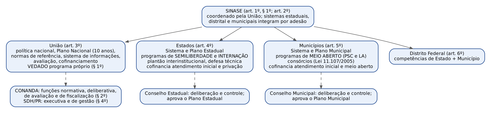
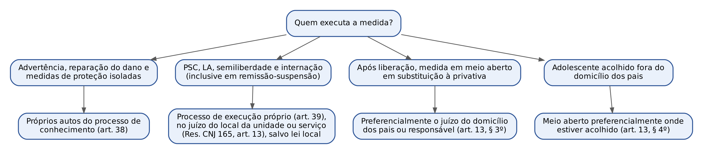
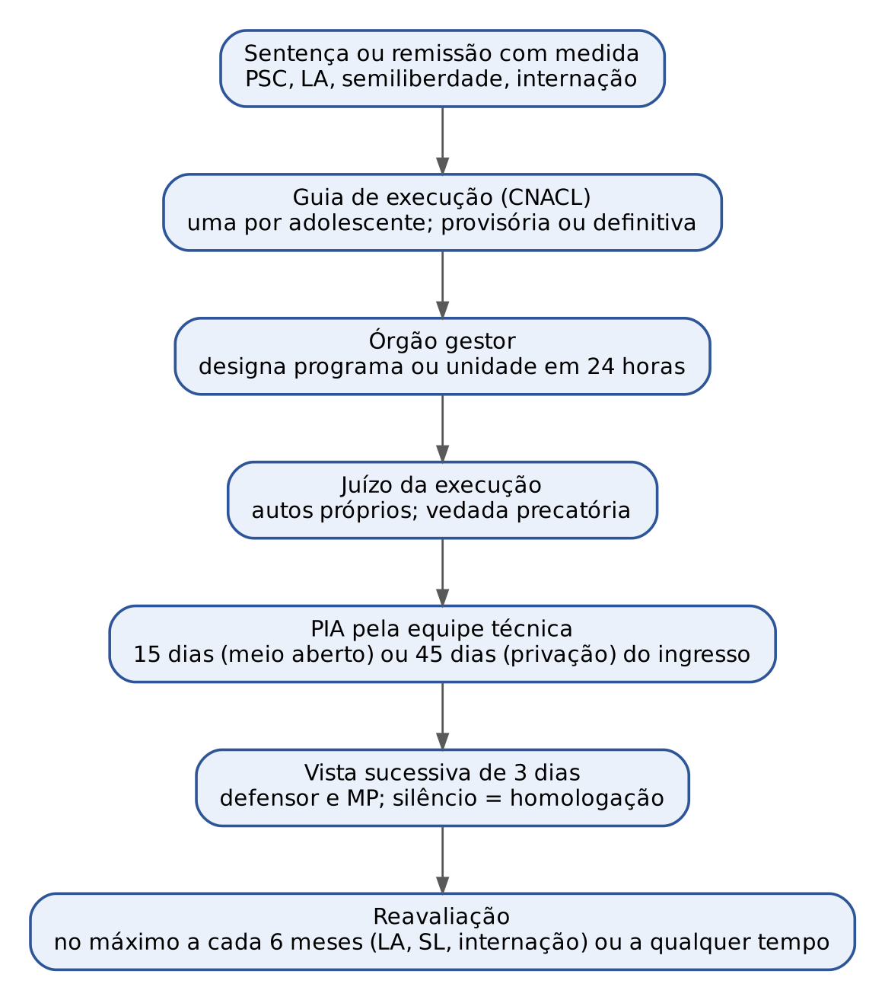
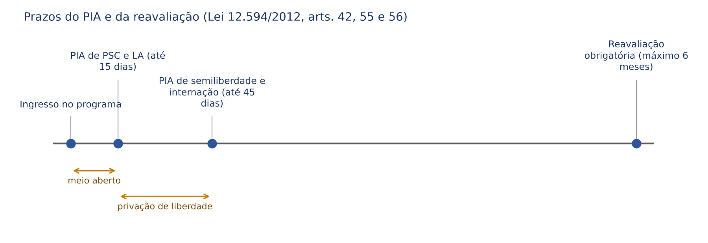
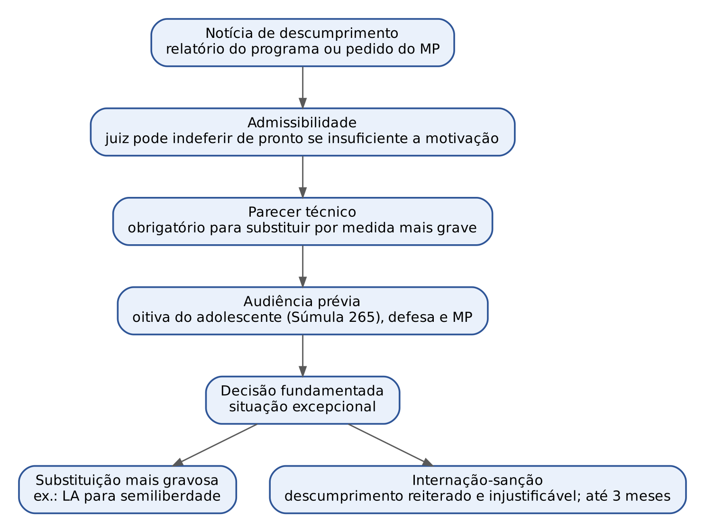
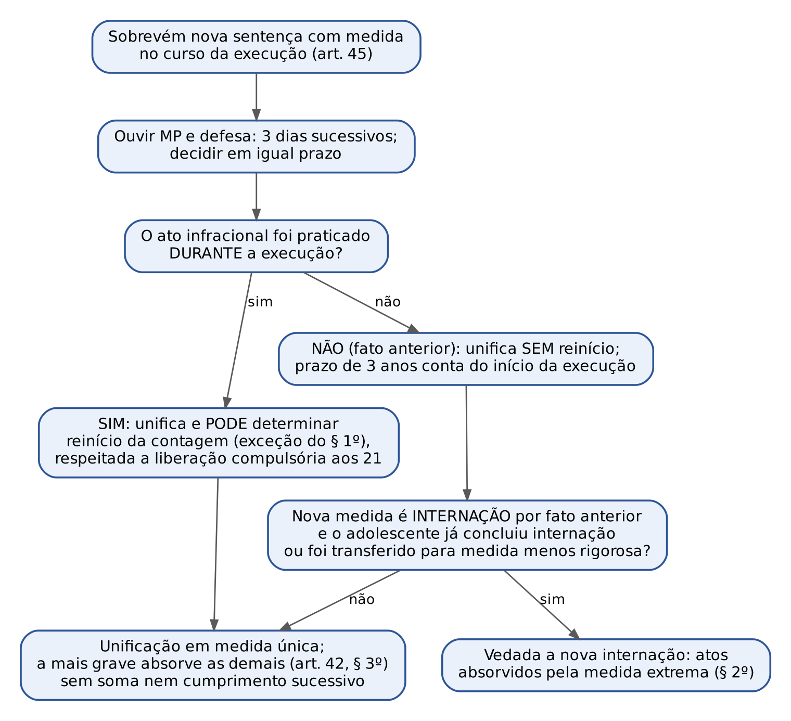
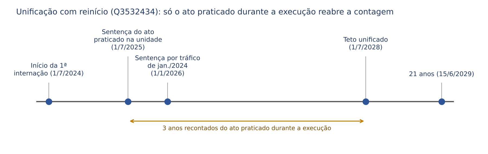
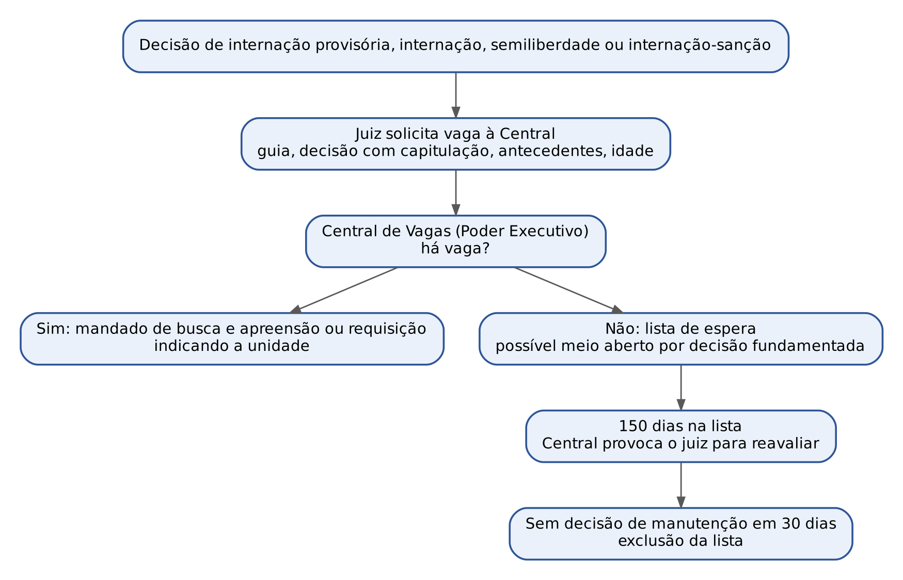

# CAPÍTULO 17 — SINASE E EXECUÇÃO DAS MEDIDAS SOCIOEDUCATIVAS

:::INCIDENCIA
TJSC p. 2 e 5. Nível A+. Lote: 38 questões (FGV 28, FCC 10), com nove provas de Juiz de Direito (TJ-PE, TJ-GO, TJ-PA, TJ-PR, TJ-MS, TJ-SC, TJ-SE, TJ-MT) e quatro de Promotor de Justiça.
O que mais cai: unificação do art. 45 (reinício só por ato praticado durante a execução; absorção pela internação), reavaliação e substituição (art. 42, §§ 2º e 3º; art. 43), prazos e autoria do PIA (15 e 45 dias do ingresso), competência do juízo da execução, extinção (art. 46) e Resoluções CNJ 165/2012 e 367/2021.
:::

| Subtema | FGV | FCC | Padrão de cobrança |
|---|---|---|---|
| Unificação (art. 45) | 7 | 1 | caso com datas: fato anterior x fato durante a execução; reinício; absorção; medidas de espécies distintas; remissão |
| Reavaliação, substituição e regressão (arts. 42 a 44) | 3 | 0 | gravidade do ato não impede substituição; relatório técnico não vincula; reavaliação a qualquer tempo; audiência concentrada |
| PIA (arts. 52 a 59) | 5 | 2 | prazo contado do INGRESSO; quem elabora; quem participa; conteúdo mínimo; acesso aos autos |
| Competência e processo de execução (arts. 36 a 40; Res. CNJ 165) | 3 | 0 | juízo do local da unidade; meio aberto após a liberação; execução nos próprios autos (art. 38) |
| Extinção, maioridade e processo-crime (arts. 46 e 47) | 3 | 0 | pena em regime fechado ou semiaberto; decisão do juiz no § 1º; desconto da prisão cautelar; liberação aos 21 independe de decisão |
| Saúde e transtorno mental (arts. 60 a 65) | 1 | 1 | suspensão do art. 64; reavaliação semestral; tempo de tratamento conta no teto; vedado hospital de custódia |
| Direitos, visitas, disciplina e acolhimento na unidade | 2 | 1 | visita dos filhos de qualquer idade; visita íntima só a casado ou em união estável; Res. CONANDA 252/2024 |
| Estrutura do SINASE (objetivos, competências, avaliação, financiamento) | 3 | 3 | competências do município; objetivos da avaliação de entidades e de resultados; percentual anual do fundo |
| Princípios da execução (art. 35) | 0 | 1 | individualização considerando idade, capacidades e circunstâncias pessoais |
| Atos do CNJ (Res. 367/2021; Rec. 98/2021) | 1 | 1 | quem solicita a vaga; lista de espera e meio aberto; princípios da Central; *numerus clausus* |

## 17.1 O SINASE: conceito, estrutura e objetivos das medidas

A Lei 12.594, de 18/1/2012 (vigência 90 dias após a publicação, art. 90), faz duas coisas distintas, que a prova separa: no Título I institui o Sistema Nacional de Atendimento Socioeducativo (SINASE), isto é, a POLÍTICA PÚBLICA de execução (competências federativas, planos, programas, avaliação, financiamento); no Título II regulamenta o PROCESSO JUDICIAL de execução das medidas socioeducativas, matéria que o ECA praticamente não disciplinava. Antes dela, o SINASE existia como documento aprovado pela Resolução CONANDA 119/2006, que continua sendo a referência das normas técnicas (parâmetros arquitetônicos, de gestão pedagógica e de equipes) e é invocada nos considerandos da Resolução CNJ 367/2021.

:::LEI LEI 12.594/2012, ART. 1º, §§ 1º E 2º
"§ 1º Entende-se por Sinase o conjunto ordenado de princípios, regras e critérios que envolvem a execução de medidas socioeducativas, incluindo-se nele, por adesão, os sistemas estaduais, distrital e municipais, bem como todos os planos, políticas e programas específicos de atendimento a adolescente em conflito com a lei.
§ 2º Entendem-se por medidas socioeducativas as previstas no art. 112 da Lei nº 8.069, de 13 de julho de 1990 (Estatuto da Criança e do Adolescente), as quais têm por objetivos:
I - a responsabilização do adolescente quanto às consequências lesivas do ato infracional, sempre que possível incentivando a sua reparação;
II - a integração social do adolescente e a garantia de seus direitos individuais e sociais, por meio do cumprimento de seu plano individual de atendimento; e
III - a desaprovação da conduta infracional, efetivando as disposições da sentença como parâmetro máximo de privação de liberdade ou restrição de direitos, observados os limites previstos em lei."
:::

Os três objetivos formam a chave de leitura da natureza jurídica da medida: há uma face pedagógica (inciso II, integração social pelo PIA) e uma face sancionatória (incisos I e III, responsabilização e desaprovação). O inciso III tem consequência prática pouco percebida: a sentença é "parâmetro MÁXIMO" de privação ou restrição, de modo que a execução pode abrandar, mas não agravar o que foi decidido, salvo pelos mecanismos legais de substituição mais gravosa (art. 43, § 4º) e de internação-sanção (17.8). O STJ extrai da face sancionatória a incidência de garantias do direito sancionador (REsp 1.956.497-PR, 17.12), e da face pedagógica a execução imediata e o caráter não vinculante dos relatórios (17.5 e 17.8).

Os §§ 3º a 5º do art. 1º fixam o vocabulário que a lei usa em todo o texto e que a FGV troca nas alternativas:

| Termo | Definição legal | Exemplo |
|---|---|---|
| Programa de atendimento (§ 3º) | organização e funcionamento, POR UNIDADE, das condições necessárias para o cumprimento das medidas | programa de internação da unidade X |
| Unidade (§ 4º) | BASE FÍSICA necessária para a organização e o funcionamento do programa | o prédio do centro de atendimento |
| Entidade de atendimento (§ 5º) | PESSOA JURÍDICA de direito público ou privado que instala e mantém a unidade e os recursos humanos e materiais | a autarquia estadual ou a organização social conveniada |

:::QUESTAO FGV 2024 — TJ-MS — TÉCNICO DE NÍVEL SUPERIOR — PSICÓLOGO (Q2499123)
Cobrou-se o "objetivo" do SINASE. Gabarito: C — integração social do adolescente e garantia de seus direitos individuais e sociais, por meio do cumprimento do PIA (art. 1º, § 2º, II).
Armadilhas: as demais alternativas descrevem punição, aprisionamento no sistema prisional, "sentenças duras" e criação municipal de "vagas de prisão", ideias incompatíveis com a lei (o município sequer executa medida privativa, art. 5º, III).
No mesmo sentido, de nível básico: FCC 2026 — TJ-CE — Analista (Psicologia) (Q4293735), que pediu completar a definição do SINASE como política destinada a adolescentes responsabilizados pela prática de ato "infracional" (gabarito C).
:::

## 17.2 Competências dos entes federados (arts. 2º a 6º)

O SINASE é coordenado pela União e integrado pelos sistemas estaduais, distrital e municipais, "com liberdade de organização e funcionamento" (art. 2º). A divisão material é a mais cobrada: ESTADOS executam semiliberdade e internação; MUNICÍPIOS executam o meio aberto (PSC e LA); a UNIÃO não executa nada.

| Ente | Execução direta | Planejamento e normas | Financiamento e informação | Controle social |
|---|---|---|---|---|
| União (art. 3º) | VEDADOS o desenvolvimento e a oferta de programas próprios (§ 1º) | formula e coordena a política nacional; elabora o Plano Nacional em parceria com os demais entes; diretrizes e normas de referência para internação e semiliberdade | assistência técnica e suplementação financeira; Sistema Nacional de Informações; avaliação; publicidade dos repasses | CONANDA: funções normativa, deliberativa, de avaliação e de fiscalização (§ 2º), deliberando sobre o Plano Nacional (§ 3º); SDH/PR: funções executiva e de gestão (§ 4º) |
| Estados (art. 4º) | criar, desenvolver e manter programas de SEMILIBERDADE e INTERNAÇÃO (III) | Sistema e Plano Estadual conforme o Nacional; normas complementares para o seu sistema E para os sistemas municipais (IV) | assessoria técnica e suplementação financeira aos municípios para o meio aberto (VI); cofinanciar atendimento inicial e medidas privativas (X) | Conselho Estadual: funções deliberativas e de controle; delibera sobre o Plano Estadual |
| Municípios (art. 5º) | criar e manter programas de MEIO ABERTO (III) | Sistema e Plano Municipal, conforme o Nacional e o Estadual; normas complementares dos programas do seu sistema | cofinanciar atendimento inicial e meio aberto (VI); consórcios da Lei 11.107/2005 ou outro instrumento (§ 1º) | Conselho Municipal: funções deliberativas e de controle; delibera sobre o Plano Municipal |
| Distrito Federal (art. 6º) | cumulativamente, competências de Estado e de Município | idem | idem | Conselho Distrital |

Pontos de literalidade que a banca explora: (i) cabe ao ESTADO garantir o pleno funcionamento do plantão interinstitucional do art. 88, V, do ECA (art. 4º, VII) e garantir DEFESA TÉCNICA ao adolescente a quem se atribua ato infracional (art. 4º, VIII); (ii) a coordenação do Sistema Municipal é do próprio município ("formular, instituir, coordenar e manter", art. 5º, I); (iii) os consórcios são instrumento do município para o MEIO ABERTO, não para internação.

:::QUESTAO FCC 2026 — MPE-AL — ANALISTA (ASSISTENTE SOCIAL) (Q4104347)
Cinco afirmações sobre competências municipais. Gabarito: D — corretas apenas I (coordenar o Sistema Municipal) e II (instituir e manter o seu sistema).
Armadilhas: III (elaborar o Plano NACIONAL) é da União; IV ("fornecer, via Poder Judiciário, os meios") não existe — e o Judiciário está proibido de manter programas desde o art. 83; V inventa consórcios "intermunicipais e, subsidiariamente, em cooperação com o Estado": a lei fala em consórcios da Lei 11.107/2005 ou outro instrumento para o meio aberto (art. 5º, § 1º), e a cooperação com o Estado está no art. 4º, V e VI.
:::

As disposições transitórias completam o quadro e são boas para assertivas de "certo ou errado": os programas sob responsabilidade do PODER JUDICIÁRIO foram obrigatoriamente transferidos ao Executivo em até 1 ano da publicação (art. 83); os programas de internação e semiliberdade mantidos por MUNICÍPIOS foram transferidos ao Estado no mesmo prazo (art. 84); a não transferência importa interdição do programa e caracteriza improbidade do agente responsável, vedadas despesas do Judiciário e do Executivo municipal para sua manutenção (art. 85). As entidades tiveram 6 meses para adequar a inscrição, sob pena de interdição (art. 81), e os conselhos, 1 ano para garantir a inserção dos socioeducandos na rede pública de ensino "em qualquer fase do período letivo" (art. 82).

:::PEGADINHA JUIZ NÃO ADMINISTRA UNIDADE
Desde 2013 nenhum programa socioeducativo pode estar sob responsabilidade do Judiciário (art. 83). A função judicial é jurisdicional (execução) e fiscalizatória (inspeções da Res. CNJ 77/2009, 17.14). Alternativa que atribua ao juiz "designar a unidade" está errada: quem designa o programa ou a unidade é o ÓRGÃO GESTOR, a pedido do juiz (art. 40; Res. CNJ 165, art. 6º, § 1º), e, havendo Central de Vagas, ela indica a vaga (Res. CNJ 367, art. 2º, parágrafo único).
:::

## 17.3 Planos e programas de atendimento (arts. 7º a 17)

### 17.3.1 Planos decenais

O Plano Nacional inclui diagnóstico, diretrizes, objetivos, metas, prioridades e formas de financiamento e gestão "para os 10 (dez) anos seguintes" (art. 7º); as normas nacionais de referência constituem ANEXO do Plano Nacional (§ 1º). Estados, DF e municípios elaboram seus planos decenais em até 360 dias da aprovação do Plano Nacional (§ 2º). Os planos devem, OBRIGATORIAMENTE, prever ações articuladas em educação, saúde, assistência social, cultura, capacitação para o trabalho e esporte (art. 8º); o acompanhamento da execução cabe aos Poderes LEGISLATIVOS, por suas comissões temáticas (art. 8º, parágrafo único). O plano de cada ente é submetido ao respectivo conselho de direitos (arts. 3º, § 3º; 4º, § 2º; 5º, § 3º).

### 17.3.2 Inscrição e requisitos dos programas

A regra de inscrição foi desenvolvida no Cap. 11 (11.7): Estados e DF inscrevem seus programas no conselho estadual ou distrital (art. 9º); municípios inscrevem programas E entidades executoras no conselho municipal (art. 10). Aqui interessam os requisitos materiais, que servem de parâmetro para a fiscalização judicial e para a ação civil pública estrutural (Cap. 20):

- Requisitos gerais (art. 11): especificação do regime; linhas gerais dos métodos e técnicas pedagógicas; estrutura material, recursos humanos e estratégias de segurança; REGIMENTO INTERNO com atribuições do dirigente e da equipe, condições de disciplina e concessão de benefícios, inclusive "benefícios extraordinários e enaltecimento"; política de formação de pessoal; ações de acompanhamento do adolescente APÓS o cumprimento; equipe técnica conforme normas de referência e conselhos profissionais; adesão efetiva ao Sistema de Informações. O descumprimento sujeita entidades, órgãos gestores e dirigentes às medidas do art. 97 do ECA (parágrafo único).
- Equipe técnica (art. 12): interdisciplinar, com, NO MÍNIMO, profissionais de saúde, educação e assistência social; proibida a sobreposição de atribuições no regimento (§ 2º).
- Programas privativos de liberdade (art. 15): estabelecimento educacional adequado; processo de escolha do dirigente; atividades coletivas; estratégias de gestão de conflitos, VEDADA a previsão de isolamento cautelar; regime disciplinar.
- Estrutura física (art. 16): compatível com as normas de referência; VEDADA a edificação de unidades em espaços contíguos, anexos ou integrados a estabelecimentos penais (§ 1º); medidas excepcionais de proteção do interno em risco, com comunicação imediata ao defensor e ao MP (§ 2º).
- Dirigente de semiliberdade ou internação (art. 17): nível superior compatível, experiência mínima de 2 anos com adolescentes e reputação ilibada.

:::ATENCAO REMISSÕES INTERNAS DEFEITUOSAS DO ART. 15
O art. 15, IV, ressalva o isolamento "nos casos previstos no § 2º do art. 49", e o inciso V remete ao regime disciplinar "do art. 72". Pela numeração final da lei, o isolamento excepcional está no art. 48, § 2º, e os princípios do regime disciplinar no art. 71 (o art. 72 trata da independência entre as esferas). Em prova, prevalece a literalidade do dispositivo cobrado; em questão discursiva, vale indicar o dispositivo correto.
:::

:::DICA ART. 16, § 1º, DA LEI 12.594 X ART. 123 DO ECA
O art. 123 do ECA exige entidade exclusiva para adolescentes, em local distinto do destinado ao abrigo; o SINASE vai além e proíbe a construção contígua ou anexa a estabelecimento penal. Por isso o STJ afirma que o cumprimento de internação em estabelecimento prisional viola o art. 123, "ainda que em local separado dos maiores de idade" (Jurisprudência em Teses, ed. 54, tese 12; o regime da internação é tratado no Cap. 15).
:::

### 17.3.3 Programas de meio aberto (arts. 13 e 14)

À direção do programa de PSC ou LA compete selecionar e credenciar orientadores, designando-os caso a caso; receber o adolescente e os pais; encaminhá-lo ao orientador; supervisionar; e avaliar com o orientador, PROPONDO à autoridade judiciária substituição, suspensão ou extinção (art. 13). O rol de orientadores credenciados é comunicado SEMESTRALMENTE ao juiz e ao MP (parágrafo único). Na PSC, a direção também credencia entidades assistenciais, hospitais, escolas e programas comunitários ou governamentais (art. 14). Se o MP impugnar o credenciamento, ou o juiz o considerar inadequado, instaura-se INCIDENTE DE IMPUGNAÇÃO, com aplicação subsidiária do procedimento de apuração de irregularidade em entidade (arts. 191 a 193 do ECA, Cap. 19), citando-se o dirigente do programa e a direção da entidade credenciada (art. 14, parágrafo único).

## 17.4 Avaliação, responsabilização e financiamento (arts. 18 a 34)

### 17.4.1 Sistema Nacional de Avaliação e Acompanhamento

A União, articulada com os demais entes, avalia periodicamente a implementação dos planos "em intervalos não superiores a 3 (três) anos" (art. 18), com participação de Judiciário, MP, Defensoria e Conselhos Tutelares (§ 2º). O art. 19 institui o Sistema Nacional de Avaliação e Acompanhamento, cujos objetivos (organizar a rede; "assegurar conhecimento rigoroso" sobre as ações e resultados; melhorar a qualidade da gestão e do atendimento; disponibilizar informações) são usados como distratores nas questões sobre as avaliações específicas. A avaliação abrange, NO MÍNIMO, a gestão, as entidades, os programas e os resultados (art. 19, § 1º); o relatório final vai aos Conselhos de Direitos, aos Conselhos Tutelares e ao MP (§ 3º).

Metodologia (art. 20): autoavaliação; avaliação institucional externa; respeito à diversidade de entidades; participação dos funcionários e dos Conselhos Tutelares; caráter PÚBLICO de todos os procedimentos e resultados. A avaliação é coordenada por comissão permanente e realizada por comissões temporárias de, no mínimo, 3 especialistas, vedada a designação de servidores dos órgãos avaliados, de parentes até o 3º grau e de quem responda a processo criminal (art. 21).

A prova pede o objeto de cada avaliação, com troca de incisos entre os artigos:

| Avaliação | Objetivo legal | Conteúdo mínimo ou obrigatório |
|---|---|---|
| Da gestão (art. 22) | compatibilidade do orçamento com as necessidades do sistema | fluxo financeiro; compromissos dos instrumentos jurídicos; articulação interinstitucional e intersetorial |
| Das entidades (art. 23) | "identificar o perfil e o impacto de sua atuação" | OBRIGATORIAMENTE: plano de desenvolvimento institucional; responsabilidade social (inclusão social e desenvolvimento socioeconômico do adolescente e da família); comunicação com a sociedade; política de pessoal; infraestrutura conforme normas de referência; planejamento e autoavaliação do projeto pedagógico; políticas de atendimento às famílias; atenção integral à saúde (art. 60); sustentabilidade financeira |
| Dos programas (art. 24) | verificar, no mínimo, o atendimento aos arts. 94, 100, 117, 119, 120, 123 e 124 do ECA | obrigações das entidades de internação, princípios, PSC, LA, semiliberdade, local da internação e direitos do interno |
| Dos resultados (art. 25) | no mínimo: (I) situação do adolescente APÓS o cumprimento (perspectivas educacionais, sociais, profissionais e familiares); (II) REINCIDÊNCIA | — |

Os resultados servem para planejamento, reestruturação da rede, adequação dos objetivos das entidades, cooperação para corrigir problemas, reforço de financiamento, capacitação e para os efeitos do art. 95 do ECA (fiscalização) (art. 26). As recomendações fixam prazo, findo o qual incidem as medidas do art. 28 (art. 26, parágrafo único).

:::QUESTAO FCC 2026 — MPE-AL — ANALISTA (ASSISTENTE SOCIAL) (Q4104348)
Pediu-se o objetivo mínimo da avaliação dos RESULTADOS da execução. Gabarito: E — verificação da reincidência (art. 25, II).
Armadilha: as alternativas A (plano de desenvolvimento institucional), B (comunicação com a sociedade), C (sustentabilidade financeira) e D (infraestrutura conforme normas de referência) são incisos do art. 23, que trata da avaliação das ENTIDADES.
:::

:::QUESTAO FGV 2024 — TRF-1ª REGIÃO — ANALISTA (SERVIÇO SOCIAL) (Q3035640)
Pediu-se dimensão OBRIGATÓRIA da avaliação das ENTIDADES. Gabarito: E — responsabilidade social, considerada a contribuição para a inclusão social e o desenvolvimento socioeconômico do adolescente e de sua família (art. 23, II).
Armadilhas: A é a avaliação de resultados (art. 25, I); B é o conteúdo do relatório final (art. 19, § 2º); C é um dos usos dos resultados (art. 26, III); D é objetivo do Sistema Nacional de Avaliação (art. 19, II). A FGV montou a questão inteira com dispositivos vizinhos: estudar os arts. 19 a 26 em quadro é indispensável.
:::

### 17.4.2 Responsabilização dos gestores, operadores e entidades

O desrespeito, "mesmo que parcial", às diretrizes da lei sujeita gestores, operadores, prepostos e entidades GOVERNAMENTAIS às medidas do art. 97, I e § 1º, do ECA, e as entidades NÃO governamentais às do art. 97, II e § 1º (art. 28), a partir de relatório circunstanciado elaborado após as avaliações, sem prejuízo da apuração de irregularidades (arts. 191 a 197), dos crimes (arts. 225 a 227 e 230 a 236) e das infrações administrativas (arts. 243 e 245 a 247) do ECA (parágrafo único). O art. 29 estende a quem, mesmo NÃO sendo agente público, induza ou concorra para o descumprimento da lei, no que couber, as penalidades da Lei de Improbidade (Lei 8.429/1992).

### 17.4.3 Financiamento

O SINASE é COFINANCIADO com recursos dos orçamentos fiscal e da seguridade social, "além de outras fontes" (art. 30). Os Conselhos de Direitos, nas três esferas, definem ANUALMENTE o percentual dos Fundos dos Direitos da Criança e do Adolescente a ser aplicado nas ações da lei, "em especial para capacitação, sistemas de informação e de avaliação" (art. 31); quem recebe recursos do fundo presta informações pelo Sistema de Informações sobre Atendimento Socioeducativo, e não diretamente ao Judiciário (parágrafo único). A questão Q2367616 (FGV 2024 — MPE-GO — Promotor, gabarito C) foi resolvida no Cap. 11 (11.5), ao qual se remete. Fontes adicionais criadas pela lei: FUNAD (Lei 7.560/1986, arts. 5º, X, e 5º-A), CODEFAT (Lei 7.998/1990, art. 19-A) e FNDE (Lei 5.537/1968, art. 2º, § 3º), todas condicionadas a plano de atendimento aprovado e à participação na avaliação nacional (arts. 32 a 34).

## 17.5 Princípios da execução (art. 35)

:::LEI LEI 12.594/2012, ART. 35
"A execução das medidas socioeducativas reger-se-á pelos seguintes princípios:
I - legalidade, não podendo o adolescente receber tratamento mais gravoso do que o conferido ao adulto;
II - excepcionalidade da intervenção judicial e da imposição de medidas, favorecendo-se meios de autocomposição de conflitos;
III - prioridade a práticas ou medidas que sejam restaurativas e, sempre que possível, atendam às necessidades das vítimas;
IV - proporcionalidade em relação à ofensa cometida;
V - brevidade da medida em resposta ao ato cometido, em especial o respeito ao que dispõe o art. 122 da Lei nº 8.069, de 13 de julho de 1990 (Estatuto da Criança e do Adolescente);
VI - individualização, considerando-se a idade, capacidades e circunstâncias pessoais do adolescente;
VII - mínima intervenção, restrita ao necessário para a realização dos objetivos da medida;
VIII - não discriminação do adolescente, notadamente em razão de etnia, gênero, nacionalidade, classe social, orientação religiosa, política ou sexual, ou associação ou pertencimento a qualquer minoria ou status; e
IX - fortalecimento dos vínculos familiares e comunitários no processo socioeducativo."
:::

O rol é cobrado em duas frentes: literalidade (qual princípio contém qual expressão) e aplicação jurisprudencial. Quadro de aplicação:

| Princípio | Expressão-chave | Desdobramento cobrado |
|---|---|---|
| Legalidade (I) | vedado tratamento MAIS GRAVOSO que o do adulto | fundamento para aplicar ao adolescente garantias do processo penal mais favoráveis (ex.: interrogatório ao final, art. 400 do CPP, STJ, AgRg no HC 772.228/SC, Sexta Turma, j. 28/2/2023, Informativo 766 — procedimento no Cap. 16) e para limitar o tratamento de saúde mental ao teto de 3 anos (REsp 1.956.497-PR, 17.12) |
| Excepcionalidade (II) | da intervenção JUDICIAL e da imposição de medidas; autocomposição | remissão e práticas consensuais (Cap. 15) |
| Práticas restaurativas (III) | atender às necessidades das VÍTIMAS | a Lei do SINASE é a resposta para "qual diploma prioriza práticas restaurativas" (questão de magistratura de SP, 2023, citada no material do Drive) |
| Proporcionalidade (IV) | em relação à OFENSA cometida | — |
| Brevidade (V) | respeito ao art. 122 do ECA | taxatividade da internação (Cap. 15) |
| Individualização (VI) | IDADE, CAPACIDADES e CIRCUNSTÂNCIAS PESSOAIS | vedada audiência de reavaliação com mais de um socioeducando (Rec. CNJ 98/2021, art. 3º, IV) |
| Mínima intervenção (VII) | restrita ao NECESSÁRIO para os objetivos | extinção quando atingida a finalidade, ainda que antes do teto |
| Não discriminação (VIII) | etnia, gênero, nacionalidade, classe, religião, política, orientação sexual, minoria ou status | condição de saúde não pode agravar a execução (REsp 1.956.497-PR) |
| Vínculos familiares e comunitários (IX) | fortalecimento | proximidade da família (art. 49, II; ECA, art. 124, VI); critério da Central de Vagas (Res. CNJ 367, art. 7º, § 1º) |

:::QUESTAO FCC 2026 — DPE-BA — DEFENSOR PÚBLICO (Q4037477)
Perguntou-se onde aparecem, nesses termos, as "circunstâncias pessoais do adolescente". Gabarito: E — no princípio da individualização da execução (art. 35, VI).
Armadilha: o ECA, ao tratar da APLICAÇÃO da medida, fala em "capacidade de cumpri-la, as circunstâncias e a gravidade da infração" (art. 112, § 1º); a internação provisória exige indícios de autoria e materialidade e necessidade imperiosa (art. 108, parágrafo único), sem a expressão; e não há atenuação ou agravação de sanção disciplinar por "circunstâncias pessoais" (o art. 71, V, fala em "causas ou circunstâncias que eximam, atenuem ou agravem"). Questão de pura literalidade comparada.
:::

:::JURIS STJ, JURISPRUDÊNCIA EM TESES, ED. 262, TESES 3 E 4
"A execução de medida socioeducativa não depende do esgotamento das vias recursais, em atenção ao princípio da intervenção precoce e da atualidade da medida aplicada." E: "Em razão da natureza pedagógica e ressocializadora da medida socioeducativa, sua imediata execução não viola o princípio da não culpabilidade."
É por isso que existem guias de execução PROVISÓRIA (Res. CNJ 165, art. 2º, II e III) e que o art. 39 manda constituir o processo de execução já com a "cópia da sentença ou acórdão". O efeito dos recursos é matéria do Cap. 19.
:::

## 17.6 Competência e processo de execução (arts. 36 a 40)

### 17.6.1 Juízo competente

O art. 36 limita-se a remeter ao art. 146 do ECA (a autoridade judiciária é o Juiz da Infância e da Juventude, ou o que exerce essa função na forma da lei de organização judiciária local). A distribuição territorial da execução vem do art. 147, § 2º, do ECA (a execução das medidas "poderá ser delegada" à autoridade da residência dos pais ou responsável, ou do local onde sediar-se a entidade) e, sobretudo, da Resolução CNJ 165/2012, que transformou a faculdade em regra de organização:

:::LEI RESOLUÇÃO CNJ 165/2012, ART. 13, CAPUT E §§ 3º E 4º
"Art. 13. O acompanhamento da execução das medidas socioeducativas e seus incidentes caberá ao juízo do local onde está sediada a unidade ou serviço de cumprimento, salvo se houver disposição em contrário em lei de organização judiciária local.
[...]
§ 3º Após a liberação do adolescente, o acompanhamento da execução de medida em meio aberto eventualmente aplicada em substituição à medida privativa de liberdade deve, preferencialmente, ficar a cargo do juízo do local do domicílio dos pais ou responsável, ao qual serão encaminhados os autos de execução da medida de que trata esta Resolução.
§ 4º Quando o adolescente em acolhimento institucional ou familiar encontrar-se em local diverso do domicílio dos pais ou responsáveis, as medidas socioeducativas em meio aberto serão preferencialmente executadas perante o juízo onde ele estiver acolhido."
:::

O juízo do CONHECIMENTO não desaparece: comunica ao juízo da execução, em 24 horas, qualquer decisão que interfira na privação de liberdade (art. 13, § 1º), e ele, ou o do domicílio dos pais, presta auxílio à reintegração familiar (§ 2º). Transferido o adolescente ou modificado o programa para outra comarca ou estado, os autos da execução seguem ao novo juízo em 72 horas (art. 12). É VEDADO processar a execução por carta precatória (art. 11, § 1º).

:::QUESTAO FGV 2025 — MPE-RJ — PROMOTOR DE JUSTIÇA SUBSTITUTO (Q3532435)
Caso: adolescente domiciliado e autor do ato em Cabo Frio recebe semiliberdade, cumprida em unidade de Macaé (70 km); a guia provisória foi remetida a Macaé; já com 18 anos, cumpre as metas do PIA e a equipe sugere progressão para LA, a ser acompanhada pelo CREAS de Cabo Frio.
Resolução em passos: (1) o juízo da execução é o do local da unidade (Res. CNJ 165, art. 13, caput) — Macaé decide a substituição; (2) liberado, a LA deve PREFERENCIALMENTE ser acompanhada pelo juízo do domicílio da mãe (art. 13, § 3º), o que afasta a "prevenção" de Macaé (alternativa C); (3) a maioridade não extingue semiliberdade nem LA, que podem ser executadas até os 21 anos (Súmula 605 e Tema 992 do STJ; Cap. 14) — afasta D e E; (4) o prolator da sentença não mantém a execução (afasta A).
Gabarito: B — competência da Vara da Infância de Macaé, local da unidade.
:::

:::QUESTAO FGV 2026 — MPE-RJ — PROMOTOR DE JUSTIÇA SUBSTITUTO (Q4088324)
Caso: adolescente domiciliado em Armação dos Búzios recebe PSC por ato em Cabo Frio; durante o cumprimento, novo ato em Cabo Frio gera semiliberdade transitada em julgado, cumprida no CRIAAD de Macaé.
Resolução em passos: (1) sobrevindo nova medida no curso da execução, há UNIFICAÇÃO (art. 45; 17.9), e não execuções paralelas ou suspensas; (2) a semiliberdade absorve a PSC (art. 42, § 3º); (3) a execução unificada corre no local da unidade.
Gabarito: C — a execução deve correr em Macaé. As alternativas D e E (suspensão da PSC no juízo do domicílio até o fim da semiliberdade) contrariam a unificação e o Informativo 882 do STJ.
:::

:::QUESTAO FGV 2025 — DPE-PE — DEFENSOR PÚBLICO (Q3390890)
Adolescente do município A cumpre semiliberdade no município B; internação provisória foi no município C. Três afirmações.
Gabarito: C — apenas III é correta: a semiliberdade é regida pela incompletude institucional (usa escola, saúde e profissionalização da comunidade; ECA, art. 120, § 1º, "sempre que possível, ser utilizados os recursos existentes na comunidade").
Armadilhas: I — 6 meses é prazo MÁXIMO, não mínimo, para reavaliar (art. 42; a reavaliação pode ocorrer a qualquer tempo, art. 43); II — a execução é do juízo da comarca da UNIDADE (município B), e não do domicílio (A).
:::

:::JURIS STJ, JURISPRUDÊNCIA EM TESES, ED. 263, TESE 10
"O direito do adolescente ao cumprimento de medida socioeducativa na mesma localidade do domicílio de genitores ou responsáveis não é absoluto e depende de análise das particularidades do caso concreto. Art. 124, VI, do ECA e art. 49, II, da Lei n. 12.594/2012."
No mesmo sentido, HC 338.517-SP (Sexta Turma, Rel. Min. Nefi Cordeiro, j. 17/12/2015, Informativo 576), desenvolvido em 17.11.
:::

### 17.6.2 Onde se executa: próprios autos x processo de execução

| Medida | Forma de execução | Fundamento |
|---|---|---|
| Medidas de proteção, ADVERTÊNCIA e REPARAÇÃO DO DANO, aplicadas ISOLADAMENTE | nos próprios autos do processo de conhecimento | art. 38 |
| PSC, LA, semiliberdade e internação | processo de execução PARA CADA ADOLESCENTE, ainda que o juízo seja o mesmo | art. 39; Res. CNJ 165, arts. 5º, parágrafo único, e 11 |
| Medida em meio aberto cumulada com REMISSÃO como forma de suspensão do processo | procedimento idêntico ao do art. 39 | art. 39, parágrafo único; Res. CNJ 165, art. 9º, II e IV |

O processo de execução é autuado com documentos pessoais do adolescente (especialmente os que comprovem a idade) e, OBRIGATORIAMENTE, cópias da representação, da certidão de antecedentes, da sentença ou acórdão e dos estudos técnicos da fase de conhecimento (art. 39, I e II). Autuadas as peças, o juiz envia IMEDIATAMENTE cópia integral ao órgão gestor, solicitando a designação do programa ou unidade (art. 40). A defesa e o MP intervêm "sob pena de nulidade" (art. 37), e toda decisão judicial relativa à execução é proferida após manifestação de ambos (art. 51).

:::PEGADINHA ADVERTÊNCIA NÃO TEM PIA NEM PROCESSO DE EXECUÇÃO
O PIA é exigido para PSC, LA, semiliberdade e internação (art. 52). Advertência e reparação do dano isoladas executam-se nos autos do conhecimento (art. 38). A alternativa B da Q3966667 (PIA como requisito de validade da advertência) e a C (semiliberdade executada nos autos do conhecimento) são erradas exatamente por isso (17.9).
:::

### 17.6.3 Guias de execução (Resolução CNJ 165/2012)

A Resolução 165, alterada pelas Resoluções 191/2014 e 326/2020, padroniza a porta de entrada: nenhum adolescente pode ingressar ou permanecer em unidade de internação ou semiliberdade sem ordem escrita da autoridade judiciária (art. 4º), e o ingresso em qualquer programa (inclusive meio aberto) só ocorre mediante GUIA expedida pelo juízo do conhecimento (arts. 5º e 6º), gerada obrigatoriamente pelo Cadastro Nacional de Adolescentes em Conflito com a Lei (CNACL) (art. 3º). Uma guia por adolescente, qualquer que seja o número de corréus (art. 5º, parágrafo único).

| Guia (art. 2º) | Hipótese |
|---|---|
| De internação provisória | decreto de internação cautelar (art. 183 do ECA) |
| De execução provisória (internação ou semiliberdade; meio aberto) | sentença não transitada em julgado |
| De execução definitiva (internação ou semiliberdade; meio aberto) | sentença ou acórdão transitado em julgado |
| De execução de internação-sanção | decreto do art. 122, III, do ECA |
| Unificadora | expedida pelo juiz da EXECUÇÃO para unificar duas ou mais guias do mesmo adolescente (art. 45 da Lei 12.594) |

Fluxo e prazos: o juízo do conhecimento envia cópia ao órgão gestor; este, em até 24 horas, indica o programa ou unidade ao juízo do conhecimento e ao juízo fiscalizador; definida a unidade, em 24 horas o juízo do conhecimento remete a guia instruída ao juízo da execução (art. 6º, §§ 1º a 3º). Transitada em julgado, a guia provisória converte-se em definitiva por simples comunicação (art. 10, § 1º). Cada adolescente tem suas guias definitivas reunidas em AUTOS ÚNICOS (art. 11, § 2º); unificados os processos, expede-se guia unificadora e arquivam-se os autos unificados (§ 3º); com a guia definitiva, arquiva-se o processo de conhecimento (§ 4º). Os tribunais regulamentam a remessa da guia em prazo não superior a dois dias úteis (art. 25).

## 17.7 Plano Individual de Atendimento — PIA (arts. 52 a 59 e 41)

O PIA é o "instrumento de previsão, registro e gestão das atividades a serem desenvolvidas com o adolescente" (art. 52) e o eixo da execução: é com base nele que se reavalia, substitui ou extingue a medida. Não se confunde com o PIA do acolhimento (art. 101, §§ 4º a 6º, do ECA; Cap. 13), que tem por objeto a reintegração familiar.

:::LEI LEI 12.594/2012, ARTS. 52, 53, 55, PARÁGRAFO ÚNICO, E 56
"Art. 52. O cumprimento das medidas socioeducativas, em regime de prestação de serviços à comunidade, liberdade assistida, semiliberdade ou internação, dependerá de Plano Individual de Atendimento (PIA), instrumento de previsão, registro e gestão das atividades a serem desenvolvidas com o adolescente.
Parágrafo único. O PIA deverá contemplar a participação dos pais ou responsáveis, os quais têm o dever de contribuir com o processo ressocializador do adolescente, sendo esses passíveis de responsabilização administrativa, nos termos do art. 249 da Lei nº 8.069, de 13 de julho de 1990 (Estatuto da Criança e do Adolescente), civil e criminal.
Art. 53. O PIA será elaborado sob a responsabilidade da equipe técnica do respectivo programa de atendimento, com a participação efetiva do adolescente e de sua família, representada por seus pais ou responsável.
[...]
Art. 55. [...] Parágrafo único. O PIA será elaborado no prazo de até 45 (quarenta e cinco) dias da data do ingresso do adolescente no programa de atendimento.
Art. 56. Para o cumprimento das medidas de prestação de serviços à comunidade e de liberdade assistida, o PIA será elaborado no prazo de até 15 (quinze) dias do ingresso do adolescente no programa de atendimento."
:::

Conteúdo mínimo (art. 54), para TODAS as medidas com PIA: (I) resultados da avaliação interdisciplinar; (II) objetivos DECLARADOS PELO ADOLESCENTE; (III) atividades de integração social e/ou capacitação profissional; (IV) atividades de integração e apoio à FAMÍLIA; (V) formas de participação da família; (VI) medidas específicas de atenção à SAÚDE. Na semiliberdade e na internação, acrescem (art. 55): designação do programa mais adequado; definição das atividades internas e externas, individuais ou coletivas; e fixação de METAS para o alcance de atividades externas.

Instrução do PIA: a direção do programa, pessoalmente ou por membro da equipe técnica, tem acesso aos autos do procedimento de apuração do ato E aos de outros atos atribuídos ao mesmo adolescente (art. 57), por funcionário credenciado, preservado o sigilo dos arts. 143 e 144 do ECA (§ 1º); pode requisitar à escola o histórico escolar, os dados de medida anterior cumprida em outro programa e os resultados de acompanhamento especializado anterior (§ 2º). Sigilo: o acesso ao PIA é restrito aos servidores do programa, ao adolescente, aos pais ou responsável, ao MP e ao defensor, "exceto expressa autorização judicial" (art. 59). A participação no PIA é também DIREITO do adolescente (art. 49, VI).

Homologação judicial (art. 41): recebida a proposta da direção, o juiz dá vista ao defensor e ao MP pelo prazo SUCESSIVO de 3 dias; podem requerer, e o juiz pode determinar de ofício, avaliações ou perícias complementares (§ 1º); a impugnação deve ser fundamentada, podendo ser indeferida por motivação insuficiente (§ 2º); admitida, o juiz designa audiência "se necessário" (§ 3º); a impugnação NÃO SUSPENDE a execução do plano, salvo determinação judicial (§ 4º); findo o prazo sem impugnação, o plano considera-se HOMOLOGADO (§ 5º) — homologação tácita.

| Ponto | Regra | Erro típico de alternativa |
|---|---|---|
| Medidas com PIA | PSC, LA, semiliberdade, internação | incluir advertência ou reparação |
| Quem elabora | equipe técnica do PROGRAMA | equipe do Judiciário, juiz, MP, escola, polícia |
| Quem participa | adolescente e família (pais ou responsável) | vítima, Conselho Tutelar, defensor "suprindo" a família |
| Termo inicial | data do INGRESSO no programa | data da sentença ou da decisão |
| Prazo | 15 dias (PSC e LA); 45 dias (semiliberdade e internação) | inverter os prazos; usar 30 ou 90 dias |
| Controle judicial | vista sucessiva de 3 dias; homologação tácita | "homologação obrigatória em audiência"; suspensão automática por impugnação |
| Dispensa | inexistente: o cumprimento "dependerá" de PIA | dispensa quando a sentença já define as atividades |

:::QUESTAO FGV 2026 — TJ-RJ — COMISSÁRIO DE JUSTIÇA DA INFÂNCIA (Q3870714)
Cinco afirmações sobre o PIA. Gabarito: C — para elaborá-lo, a direção do programa, pessoalmente ou por membro da equipe técnica, tem acesso aos autos da apuração e aos de outros atos infracionais atribuídos ao mesmo adolescente (art. 57, caput).
Armadilhas: A conta os 45 dias da DECISÃO (é do ingresso) e exige "homologação" como envio ao juízo; B cria prazo "15 dias anteriores à reavaliação" (é 15 dias do ingresso); D faz o defensor suprir a família (o art. 53 fala em família representada pelos pais ou responsável); E admite dispensa do PIA (o cumprimento "dependerá" dele).
:::

:::QUESTAO FCC 2026 — AL-RR — ANALISTA LEGISLATIVO (ASSISTENTE SOCIAL) (Q4156346)
Prazo do PIA na semiliberdade e na internação, contado do ingresso. Gabarito: D — 45 dias (art. 55, parágrafo único).
No mesmo sentido: FGV 2024 — TJ-AP — Psicólogo (Q2448366): participam da elaboração o adolescente e sua família (gabarito B; art. 53 — vítima, Conselho Tutelar, juiz e MP não elaboram); FCC 2026 — TJ-CE — Analista (Psicologia) (Q4293738): a construção é atribuição da equipe técnica que atenderá o adolescente (gabarito D); FGV 2024 — TRF-1ª Região — Analista (Serviço Social) (Q3035639): consta do plano, no mínimo, "atividades de integração e apoio à família" (gabarito B; art. 54, IV — "objetivos traçados pela equipe" é distrator, pois a lei fala em objetivos DECLARADOS PELO ADOLESCENTE); FGV 2024 — TJ-RR — Analista (Serviço Social) (Q3087412): o PIA é o instrumento de acompanhamento da evolução e das metas pactuadas (gabarito A); FGV 2024 — TJ-MS — Assistente Social (Q2494900): ao receber a adolescente internada, a assistente social deve garantir a preservação dos direitos sociais e estabelecer o PIA (gabarito C, I e II; o monitoramento judicial do cumprimento não é atribuição do estudo social).
:::

:::NOTA PIA E TUTELA COLETIVA
A ausência de PIA para a maioria dos internos é violação estrutural que autoriza ação civil pública com obrigação de fazer contra o Estado, sem invadir a competência do juízo de cada execução (FGV 2026 — MPE-MT — Promotor, Q4117010, gabarito E, desenvolvida no Cap. 20).
:::

## 17.8 Reavaliação, substituição e regressão (arts. 42 a 44)

### 17.8.1 Reavaliação periódica e a qualquer tempo

:::LEI LEI 12.594/2012, ART. 42
"Art. 42. As medidas socioeducativas de liberdade assistida, de semiliberdade e de internação deverão ser reavaliadas no máximo a cada 6 (seis) meses, podendo a autoridade judiciária, se necessário, designar audiência, no prazo máximo de 10 (dez) dias, cientificando o defensor, o Ministério Público, a direção do programa de atendimento, o adolescente e seus pais ou responsável.
§ 1º A audiência será instruída com o relatório da equipe técnica do programa de atendimento sobre a evolução do plano de que trata o art. 52 desta Lei e com qualquer outro parecer técnico requerido pelas partes e deferido pela autoridade judiciária.
§ 2º A gravidade do ato infracional, os antecedentes e o tempo de duração da medida não são fatores que, por si, justifiquem a não substituição da medida por outra menos grave.
§ 3º Considera-se mais grave a internação, em relação a todas as demais medidas, e mais grave a semiliberdade, em relação às medidas de meio aberto."
:::

Observações de literalidade: (i) a reavaliação semestral OBRIGATÓRIA alcança LA, semiliberdade e internação — não a PSC, que tem prazo máximo próprio de 6 meses (ECA, art. 117); (ii) o prazo de 6 meses é TETO, e não carência; (iii) a audiência é facultativa ("se necessário"), mas, designada, deve ocorrer em até 10 dias; (iv) por ocasião da reavaliação, o relatório da equipe sobre a evolução no PIA é OBRIGATÓRIO (art. 58). A Resolução CNJ 165 manda contar o prazo da reavaliação a partir da data da APREENSÃO, computado o tempo de prisão cautelar não convertida em pena, e admite reavaliação imediata ao chegar o relatório (art. 14 e parágrafo único).

A reavaliação "da manutenção, da substituição ou da suspensão" das medidas de meio aberto ou privativas, e do PIA, pode ser pedida A QUALQUER TEMPO pela direção do programa, pelo defensor, pelo MP, pelo adolescente ou por seus pais ou responsável (art. 43). Justificam o pedido, "entre outros motivos": desempenho adequado ANTES do prazo da reavaliação obrigatória; inadaptação e reiterado descumprimento do PIA; necessidade de modificar atividades com maior restrição da liberdade (§ 1º). O juiz pode indeferir de pronto por motivação insuficiente (§ 2º); admitido, designa audiência se necessário (§ 3º). Substituída a medida ou modificado o PIA, o inteiro teor da decisão vai à direção do programa; se a substituição implicar outro programa, o PIA e o histórico acompanham a transferência (art. 44).

:::ATENCAO TRÊS "SEIS MESES" DIFERENTES
Art. 121, § 2º, do ECA: a MEDIDA de internação é reavaliada pelo JUIZ, no máximo a cada 6 meses. Art. 94, XIV, do ECA: a ENTIDADE reavalia periodicamente cada caso, no máximo a cada 6 meses, dando ciência à autoridade (Cap. 11). Art. 64, § 6º, da Lei 12.594: a SUSPENSÃO da execução por transtorno mental é avaliada, no MÍNIMO, a cada 6 meses (17.12). Há ainda os 6 meses de vigência máxima do mandado de busca e apreensão (art. 47) e o prazo máximo da PSC (ECA, art. 117).
:::

### 17.8.2 O que pesa na substituição por medida menos grave

A regra do § 2º do art. 42 é a mais cobrada do capítulo em prova de juiz: gravidade do ato, antecedentes e tempo de duração não justificam, POR SI, a não substituição. A jurisprudência a completa com duas proposições que convivem:

- A gravidade abstrata ou mesmo concreta do ato, dissociada de elementos colhidos NO CURSO DA EXECUÇÃO, não basta para manter a internação (STJ, AgRg no HC 672.213/SC, Sexta Turma, Rel. Min. Laurita Vaz, j. 16/8/2022, Informativo 749). Atingida a finalidade, é inviável manter a execução pela menção genérica à "insuficiência do tempo de acautelamento" (STJ, HC 789.465/MG, Sexta Turma, Rel. Min. Sebastião Reis Júnior, j. 7/2/2023, Informativo 763).
- O relatório técnico favorável à progressão ou à extinção NÃO vincula o juiz (Jurisprudência em Teses, ed. 54, tese 2; no STF, RHC 122.125, Primeira Turma, Rel. Min. Rosa Weber, j. 7/10/2014: o parecer psicossocial é "apenas um elemento informativo"). O juiz pode divergir, mas com fundamentos extraídos da execução (descumprimento do PIA, faltas disciplinares, ausência de suporte familiar), não com a gravidade do ato.

Não há tempo mínimo de cumprimento: a lei de execução socioeducativa não adota frações de progressão do modelo penal (a palavra "progressão", aliás, não aparece na Lei 12.594, que fala em "substituição"). Por isso a reavaliação pode levar à substituição aos 4 meses de internação, como nas questões a seguir.

:::QUESTAO FGV 2026 — TJ-PE — JUIZ SUBSTITUTO (Q4349495)
Caso: internação por três atos graves (homicídio qualificado, ocultação de cadáver e roubo); após 6 meses, a equipe conclui pela desnecessidade da privação; o MP se opõe invocando EXCLUSIVAMENTE a extrema gravidade e pede o prazo máximo.
Resolução: (1) art. 42, § 2º, e Informativo 749: gravidade isolada é fundamento inidôneo — afasta A; (2) não há prazo mínimo de 1 ano (afasta B) nem exigência de consenso entre MP e equipe (afasta E); (3) o relatório não vincula (JT 54, tese 2) — afasta D.
Gabarito: C — o juiz deve deferir se constatar, por elementos concretos da execução, que a medida cumpriu sua finalidade, sendo insuficiente a invocação isolada da gravidade.
:::

:::QUESTAO FGV 2026 — TJ-PA — JUIZ SUBSTITUTO (Q3951747)
Caso: 4 meses de internação por roubo com violência grave; relatório registra escola, curso profissionalizante, ausência de faltas, vínculos familiares e aprendizagem condicionada à progressão; MP invoca a extrema violência.
Gabarito: E — reavaliar e admitir a substituição por medida menos restritiva, considerada a evolução documentada e a proporcionalidade.
Armadilhas: B importa "critérios de progressão da execução penal" e "mérito" (a execução socioeducativa não é regida pela LEP); C e D fazem da gravidade fundamento prevalente; A condiciona a reavaliação à execução integral do PIA, contrariando o art. 43, § 1º, I (desempenho adequado ANTES do prazo justifica o pedido).
:::

### 17.8.3 Audiências concentradas socioeducativas (Recomendação CNJ 98/2021)

A Recomendação CNJ 98, de 26/5/2021, orienta a reavaliação das medidas de internação e semiliberdade em audiências concentradas: preferencialmente a cada 3 meses, nas dependências de cada unidade, em local reservado (art. 3º, I); prioridade às unidades femininas (II); presença do socioeducando, dos pais, da defesa e do MP (III); VEDADA a audiência com mais de um socioeducando, por força da individualização (IV); vedado postergar a reavaliação para a audiência concentrada se isso extrapolar os 6 meses (V); sem prejuízo do pedido de reavaliação a qualquer tempo (VI). Na audiência, o juiz entrevista o adolescente sobre o tratamento recebido, inclusive tortura e tratamento degradante, sua participação no PIA e o devido processo das sanções disciplinares, e pergunta se deseja formular pedido (art. 6º); em seguida, faculta a palavra aos pais (art. 7º); depois, MP e defesa, nessa ordem, fazem reperguntas e requerem manutenção, substituição, suspensão ou extinção (art. 8º). A ata contém decisão fundamentada e as providências diante de indícios de tortura (art. 9º); finda a audiência, a família é encaminhada aos representantes do Executivo presentes (art. 10). A Resolução CNJ 367/2021 incorporou o conceito (art. 4º, III) e determina reavaliar, em audiências concentradas, casos prioritários quando a unidade estiver na capacidade máxima (art. 12, II).

:::QUESTAO FGV 2024 — TJ-PE — JUIZ SUBSTITUTO (Q3117539)
Caso: 4 meses de internação com adesão integral; pareceres técnicos sugerem reavaliação. O que recomenda o CNJ?
Gabarito: D — realizar audiência concentrada com oitiva do adolescente, facultada a palavra aos pais para se manifestarem sobre sua participação no PIA e formularem pedidos, sem prejuízo do processamento do pedido de reavaliação a qualquer tempo (Rec. 98, arts. 3º, VI, 6º e 7º).
Armadilhas: A e B criam carência de 6 meses (o art. 43, § 1º, I, admite reavaliação ANTES do prazo, e a medida pode ser substituída a qualquer tempo); C admite audiência coletiva e nega a individualização (art. 3º, IV, da Recomendação; art. 35, VI, da lei); E nega audiência para "progredir", quando a lei a admite em qualquer reavaliação (arts. 42 e 43, § 3º).
:::

### 17.8.4 Substituição por medida mais gravosa e internação-sanção

:::LEI LEI 12.594/2012, ART. 43, § 4º
"§ 4º A substituição por medida mais gravosa somente ocorrerá em situações excepcionais, após o devido processo legal, inclusive na hipótese do inciso III do art. 122 da Lei nº 8.069, de 13 de julho de 1990 (Estatuto da Criança e do Adolescente), e deve ser:
I - fundamentada em parecer técnico;
II - precedida de prévia audiência, e nos termos do § 1º do art. 42 desta Lei."
:::

O dispositivo positivou a Súmula 265 do STJ ("É necessária a oitiva do menor infrator antes de decretar-se a regressão da medida sócio-educativa"; reiterada como tese 15 da ed. 54 da Jurisprudência em Teses) e foi além: exige PARECER TÉCNICO e AUDIÊNCIA PRÉVIA, não bastando a manifestação escrita da defesa. A internação-sanção é a forma mais drástica de regressão: cabe por "descumprimento reiterado e injustificável da medida anteriormente imposta" (ECA, art. 122, III) e "não poderá ser superior a 3 (três) meses, devendo ser decretada judicialmente após o devido processo legal" (art. 122, § 1º, na redação da própria Lei 12.594, art. 86; Jurisprudência em Teses, ed. 54, tese 7).

A Resolução CNJ 165 densifica o procedimento (art. 15): a internação-sanção sujeita-se à brevidade e à excepcionalidade, devendo-se avaliar primeiro a substituição da medida original por outra MENOS gravosa (caput); a oitiva do adolescente é obrigatória (§ 1º); e é VEDADA a privação de liberdade ANTES da decisão que aprecia a internação-sanção — o adolescente é conduzido imediatamente à audiência especial, com MP e defesa, na qual é ouvido e o juiz decide o cabimento e o prazo (§ 2º). A internação-sanção depende de vaga como as demais privativas e tem guia própria (Res. CNJ 165, art. 2º, VI; Res. CNJ 367, arts. 7º e 8º, VI).

| Aspecto | Substituição mais gravosa (art. 43, § 4º) | Internação-sanção (ECA, art. 122, III) |
|---|---|---|
| Natureza | troca da medida por outra mais grave na escala do art. 42, § 3º | privação temporária como sanção processual do descumprimento |
| Pressuposto | situação excepcional (inadaptação, descumprimento do PIA) | descumprimento REITERADO e INJUSTIFICÁVEL |
| Duração | indeterminada, conforme a nova medida, com reavaliação | até 3 meses |
| Requisitos | parecer técnico + audiência prévia + oitiva | devido processo, oitiva obrigatória, audiência especial; vedada apreensão antes da decisão (Res. 165) |
| Após o prazo | — | retorna-se à medida original (ou a outra, se reavaliada) |

:::PEGADINHA NOVO ATO INFRACIONAL NÃO É DESCUMPRIMENTO
A prática de NOVO ato durante a execução gera nova representação e, se procedente, UNIFICAÇÃO (art. 45), e não internação-sanção, que pressupõe descumprimento de medida. Na Q3966664 (17.9), a alternativa A ("internação-sanção de até 6 meses") erra duas vezes: o fato é ato infracional novo e o teto da internação-sanção é de 3 meses. Na Q4116977, a alternativa D erra ao dar à internação por descumprimento o limite de 3 ANOS.
:::

:::SENTENCA DECISÃO EM AUDIÊNCIA DE REAVALIAÇÃO: SUBSTITUIÇÃO DA INTERNAÇÃO POR SEMILIBERDADE
"Trata-se de reavaliação da medida de internação imposta a L. S., em execução desde 10/2/2026, pela prática de ato infracional análogo ao art. 157, § 2º, II, do Código Penal. O relatório da equipe técnica (art. 42, § 1º, e art. 58 da Lei 12.594/2012) registra frequência escolar regular, conclusão de curso profissionalizante, ausência de sanções disciplinares e retomada dos vínculos com a genitora, que compareceu a esta audiência e se comprometeu com as metas do PIA. O Ministério Público opôs-se à substituição invocando apenas a gravidade do ato. Tal fundamento, isoladamente, não autoriza a manutenção da medida extrema (art. 42, § 2º, da Lei 12.594/2012), e não foi apontado elemento concreto da execução que indique a necessidade de privação plena da liberdade. A medida cumpriu parcela relevante de sua finalidade, e a semiliberdade, com escolarização e profissionalização obrigatórias na comunidade (art. 120, § 1º, do ECA), é a resposta proporcional e suficiente (art. 35, IV e VII). Ante o exposto, ouvidos a defesa e o Ministério Público (art. 51), SUBSTITUO a internação por semiliberdade, a ser cumprida em unidade indicada pelo órgão gestor, preferencialmente próxima ao domicílio da genitora. Remeta-se o inteiro teor desta decisão, o PIA e o histórico de cumprimento à direção do novo programa (art. 44, parágrafo único); atualize-se a guia no CNACL. Nova reavaliação no prazo máximo de seis meses. Saem os presentes intimados."
:::

## 17.9 Unificação de medidas (art. 45)

:::LEI LEI 12.594/2012, ART. 45
"Art. 45. Se, no transcurso da execução, sobrevier sentença de aplicação de nova medida, a autoridade judiciária procederá à unificação, ouvidos, previamente, o Ministério Público e o defensor, no prazo de 3 (três) dias sucessivos, decidindo-se em igual prazo.
§ 1º É vedado à autoridade judiciária determinar reinício de cumprimento de medida socioeducativa, ou deixar de considerar os prazos máximos, e de liberação compulsória previstos na Lei nº 8.069, de 13 de julho de 1990 (Estatuto da Criança e do Adolescente), excetuada a hipótese de medida aplicada por ato infracional praticado durante a execução.
§ 2º É vedado à autoridade judiciária aplicar nova medida de internação, por atos infracionais praticados anteriormente, a adolescente que já tenha concluído cumprimento de medida socioeducativa dessa natureza, ou que tenha sido transferido para cumprimento de medida menos rigorosa, sendo tais atos absorvidos por aqueles aos quais se impôs a medida socioeducativa extrema."
:::

### 17.9.1 A lógica: unificar, não somar

Diferentemente da execução penal (soma ou unificação de penas para o limite do art. 75 do CP), a execução socioeducativa NÃO soma medidas nem as executa sucessivamente: unifica-as em uma medida única, na qual a mais grave (escala do art. 42, § 3º) absorve as demais. O fundamento é pedagógico — o PIA é um só, a intervenção é uma só — e a regra vale para medidas de ESPÉCIES DISTINTAS, inclusive meio aberto e internação.

:::JURIS STJ, HC 1.049.276-SC, QUINTA TURMA, REL. MIN. MESSOD AZULAY NETO, J. 3/3/2026 (INFORMATIVO 882)
"A execução de medidas socioeducativas admite a unificação de medidas de espécies distintas, inclusive liberdade assistida e internação, cabendo à internação, por sua abrangência pedagógica, absorver as demais medidas e os atos infracionais anteriores, nos termos da Lei n. 12.594/2012."
*Ratio decidendi*: (i) não há vedação legal à unificação de espécies distintas; (ii) a internação é mais abrangente e prevalente (art. 42, § 3º); (iii) a execução socioeducativa prevê unificação, e não soma, por sua finalidade pedagógica (art. 45, § 2º); (iv) criar impedimento abstrato e suspender a LA para cumpri-la depois da internação é inovação desfavorável, incompatível com o direito sancionador e com o melhor interesse. O argumento de que a unificação seria "premiação" foi expressamente rejeitado. Caso oriundo de Santa Catarina.
:::

Medida de remissão não se unifica com medida de sentença (STJ, AgRg no HC 848.765/SC; v. Cap. 15): na execução, ela segue guia própria (Res. CNJ 165, art. 9º, II), e os atos compreendidos na remissão não servem para caracterizar a reiteração do art. 122, II (Jurisprudência em Teses, ed. 54, tese 17). No TJSC 2025 (Q3324258, Cap. 15), a FGV considerou correta a não inclusão da PSC de remissão na unificação de três internações.

### 17.9.2 Reinício da contagem: só por ato praticado DURANTE a execução

A regra é a proibição de reiniciar a medida e de desconsiderar o teto de 3 anos e a liberação compulsória aos 21 (ECA, art. 121, §§ 3º e 5º). A exceção é a medida aplicada por ato praticado DURANTE a execução: nesse caso, o juiz pode determinar o reinício, de modo que os 3 anos voltam a contar (da nova medida), mas a liberação aos 21 anos continua intransponível. O critério é a DATA DO FATO, não a data da sentença: sentença nova por fato ANTERIOR ao início da execução não reabre a contagem, ainda que proferida no curso dela.

:::QUESTAO FGV 2025 — MPE-RJ — PROMOTOR DE JUSTIÇA SUBSTITUTO (Q3532434)
Caso: nascido em 15/6/2008, inicia internação em 1/7/2024 (roubo); quase um ano depois, tenta matar um agente dentro da unidade e recebe nova internação por sentença de 1/7/2025; em 1/1/2026, sobrevém internação por tráfico praticado em janeiro de 2024 (antes da execução).
Resolução em passos: (1) as três medidas são unificadas (art. 45, caput); (2) a sentença de 1/7/2025 decorre de ato praticado DURANTE a execução: autoriza reinício (§ 1º, parte final), com teto em 1/7/2028; (3) a sentença por tráfico é de fato ANTERIOR: não reabre a contagem (§ 1º) — afasta D; (4) não há soma de prazos (afasta B) nem tempo mínimo de 18 meses (afasta E); (5) a contagem do primeiro início (C) ignora a exceção do § 1º; (6) aos 21 anos (15/6/2029) a liberação seria compulsória, data posterior ao teto.
Gabarito: A — unificação com recontagem de 3 anos a partir de 1/7/2025, cumprimento máximo até 1/7/2028.
:::

:::QUESTAO FCC 2025 — DPE-RS — DEFENSOR PÚBLICO (Q3386982)
Caso: interno em internação sem atividades externas, envolvido em briga na unidade da qual resulta a morte de outro adolescente, recebe nova internação quando já cumpria 2 anos da anterior.
Gabarito: A — as medidas são unificadas e o juiz PODE determinar o reinício do cumprimento, mesmo já cumpridos 2 anos (art. 45, § 1º, exceção do ato durante a execução).
Armadilhas: C e E aplicam a regra geral (vedação do reinício) a hipótese que é a exceção; B inventa extinção da medida anterior; D cria perda do direito à "progressão", inexistente.
:::

:::QUESTAO FGV 2025 — TJ-SC — JUIZ SUBSTITUTO (Q3324259)
Caso: homicídio em janeiro de 2023 e extorsão em abril de 2023; internação pelo homicídio; após 1 ano e 6 meses, nova internação pela extorsão.
Resolução: os dois fatos são ANTERIORES ao início da execução; a nova medida é unificada sem reinício (§ 1º); o § 2º não incide porque o adolescente ainda está internado (não concluiu nem foi transferido), mas o resultado prático é o mesmo: a contagem prossegue do início.
Gabarito: B — ainda que a nova internação se refira a ato POSTERIOR ao primeiro (posterior ao homicídio, mas anterior à execução), é vedado o reinício.
Armadilhas: C e D determinam reinício (só cabível por ato durante a execução); A cria exceção inexistente para quem progrediu; E nega a internação para extorsão, crime com grave ameaça (art. 122, I, do ECA). Questão de prova de juiz do próprio TJSC: o "anterior" do § 1º é em relação à EXECUÇÃO, não ao primeiro ato.
:::

### 17.9.3 Absorção: vedação de nova internação por fato anterior (§ 2º)

O § 2º protege o adolescente que já saiu da internação, por conclusão ou por substituição por medida menos rigorosa: uma internação posterior por fato ANTERIOR não pode ser executada — os atos anteriores são absorvidos pela medida extrema já imposta. O dispositivo realiza a brevidade e impede que a demora processual reconduza à internação quem já demonstrou evolução.

:::QUESTAO FGV 2026 — TJ-PE — JUIZ SUBSTITUTO (Q4349501)
Caso: em agosto de 2025, aos 16 anos, internação provisória por roubo; respondia em liberdade por dois furtos qualificados (maio de 2024 e junho de 2025); em setembro de 2025, internação pelo roubo; em março de 2026, já em semiliberdade por substituição, sobrevém sentença de internação pelo furto de maio de 2024.
Resolução: (1) fato anterior; (2) o adolescente foi transferido para medida menos rigorosa; (3) incide o art. 45, § 2º: vedada a nova internação, ato absorvido.
Gabarito: D — o juízo da execução não pode determinar o retorno à internação com base na sentença dos fatos de maio de 2024.
Armadilhas: A (prescrição) não se verifica nos prazos do art. 115 do CP reduzidos pela metade (Súmula 338; Cap. 14); B confunde com internação-sanção; C cria "absorção pela violência", critério inexistente; E inventa reinício do prazo de reavaliação.
:::

:::QUESTAO FGV 2026 — TJ-GO — JUIZ SUBSTITUTO (Q3966667)
Caso: adolescente com advertência anterior cumpre semiliberdade; o MP pede medida mais gravosa por descumprimento; simultaneamente, sobrevém internação por ato anterior.
Gabarito: A — sendo a nova sentença por ato anterior ao início da execução, a unificação não permite reiniciar os 3 anos, computando-se o período já cumprido.
Armadilhas: B (PIA para advertência) e C (semiliberdade nos autos do conhecimento) contrariam os arts. 38, 39 e 52; D (cumprimento sucessivo, suspendendo a semiliberdade) contraria a unificação e o Informativo 882; E dispensa a audiência de justificação na substituição mais gravosa, contra o art. 43, § 4º, II, e a Súmula 265.
:::

:::QUESTAO FGV 2026 — MPE-MT — PROMOTOR DE JUSTIÇA SUBSTITUTO (Q4116977)
Caso: o juízo unificou LA e internação; o tribunal afastou a unificação, suspendeu a LA até o fim da internação e falou em "premiação" — exatamente o caso do Informativo 882.
Gabarito: C — se o adolescente fosse submetido a tratamento hospitalar de transtorno bipolar durante a internação, o período seria computado no teto de 3 anos (REsp 1.956.497-PR; 17.12).
Armadilhas: A (soma de sanções) e B (impossibilidade de unificar espécies distintas) contrariam o Informativo 882; D dá à internação por descumprimento o limite de 3 anos (são 3 meses, art. 122, § 1º); E transforma a reavaliação "a qualquer tempo" (art. 43) em pedido semestral.
:::

:::QUESTAO FGV 2026 — TJ-GO — JUIZ SUBSTITUTO (Q3966664)
Caso: 3 meses de semiliberdade por tráfico; ao retornar à unidade, ameaça motorista de ônibus e recebe nova medida.
Gabarito: D — as medidas são unificadas e o adolescente segue em semiliberdade.
Armadilhas: ameaça não é grave ameaça para fins do art. 122, I (Jurisprudência em Teses, ed. 54, tese 13), de modo que não se cogita de retorno à internação (afasta E); o novo ato não é descumprimento que justifique internação-sanção, cujo teto é 3 meses (afasta A); a medida mais branda não fica suspensa para cumprimento sucessivo (afasta C); a prática de novo ato não "interrompe" o prazo de reavaliação (afasta B).
No mesmo sentido: FGV 2024 — TJ-MT — Juiz Substituto (Q3086949): cumprindo LA por fato de 2023, o adolescente recebe semiliberdade por fato de 2022; transitada a sentença, determina-se o cumprimento da semiliberdade com UNIFICAÇÃO das execuções (gabarito D), e não suspensão, cumprimento sucessivo ou simultâneo, nem "regressão" da LA.
:::

:::PASSO ROTEIRO DA UNIFICAÇÃO NO JUÍZO DA EXECUÇÃO
1. Certificar a data do FATO da nova medida em relação ao INÍCIO da execução em curso (e não a data da sentença).
2. Verificar se a nova medida decorre de remissão (não se unifica com medida de sentença: AgRg no HC 848.765/SC).
3. Abrir vista sucessiva de 3 dias ao MP e à defesa; decidir em 3 dias (art. 45, caput).
4. Fato anterior + adolescente já fora da internação (concluída ou substituída) + nova internação: declarar absorvido o ato e afastar a nova internação (§ 2º).
5. Fato anterior nos demais casos: unificar na medida mais grave (art. 42, § 3º), SEM reinício; o teto de 3 anos conta do início da execução, descontada a prisão cautelar (art. 46, § 2º).
6. Fato praticado durante a execução: unificar e decidir, motivadamente, sobre o reinício; anotar a data-limite e a liberação compulsória aos 21 anos.
7. Expedir guia unificadora no CNACL e arquivar os autos unificados (Res. CNJ 165, art. 11, § 3º); comunicar o órgão gestor (art. 10, § 2º); ajustar o PIA.
:::

:::SENTENCA DECISÃO DE UNIFICAÇÃO (ART. 45 DA LEI 12.594/2012)
"Sobreveio, no curso da execução da medida de internação iniciada em 5/3/2025, sentença que aplicou a R. T. nova medida de liberdade assistida por ato infracional praticado em 10/11/2024, anterior ao início da execução. Ouvidos o Ministério Público e a defesa no prazo sucessivo de três dias, decido. A execução socioeducativa não comporta soma nem cumprimento sucessivo de medidas, mas sua unificação, inclusive entre espécies distintas, cabendo à internação, mais grave (art. 42, § 3º), absorver a medida de meio aberto (STJ, Informativo 882). Tratando-se de fato anterior ao início da execução, é vedado o reinício da contagem e mantêm-se o prazo máximo de três anos, contado de 5/3/2025, e a liberação compulsória aos 21 anos (art. 45, § 1º). Ante o exposto, UNIFICO as medidas na internação em curso, sem alteração do termo inicial, determinando a expedição de guia unificadora no CNACL, o arquivamento dos autos unificados e a comunicação ao órgão gestor e à direção da unidade, para eventual adequação do PIA. Intimem-se."
:::

:::NOTA TERMINOLOGIA: O QUE A LEI CHAMA DE UNIFICAÇÃO
A FCC (DPE-MT 2026, Q3954614, Cap. 16) explorou a definição de unificação: a lei a vincula à superveniência de NOVA SENTENÇA no curso da execução (art. 45), e não a um ato do juiz que "define regime único para medidas aplicadas pelo mesmo ato infracional". Também não há, na Lei 12.594, o instituto "progressão" com esse nome: o texto fala em substituição por medida menos grave (art. 42, § 2º) e em substituição por medida mais gravosa (art. 43, § 4º); "regressão" é termo da Súmula 265.
:::

## 17.10 Extinção da medida e mandado de busca e apreensão (arts. 46 e 47)

:::LEI LEI 12.594/2012, ART. 46
"Art. 46. A medida socioeducativa será declarada extinta:
I - pela morte do adolescente;
II - pela realização de sua finalidade;
III - pela aplicação de pena privativa de liberdade, a ser cumprida em regime fechado ou semiaberto, em execução provisória ou definitiva;
IV - pela condição de doença grave, que torne o adolescente incapaz de submeter-se ao cumprimento da medida; e
V - nas demais hipóteses previstas em lei.
§ 1º No caso de o maior de 18 (dezoito) anos, em cumprimento de medida socioeducativa, responder a processo-crime, caberá à autoridade judiciária decidir sobre eventual extinção da execução, cientificando da decisão o juízo criminal competente.
§ 2º Em qualquer caso, o tempo de prisão cautelar não convertida em pena privativa de liberdade deve ser descontado do prazo de cumprimento da medida socioeducativa."
:::

O cruzamento com o processo penal do jovem adulto (incisos III e §§ 1º e 2º) foi desenvolvido no Cap. 1 (1.9.3), com as questões Q3898917 (FGV 2026 — TJ-PR — Juiz, gabarito C: desconto da prisão cautelar se absolvido) e Q3390888 (FGV 2025 — DPE-PE, gabarito B: desconto "por expressa previsão legal") e com decisão-modelo; aqui, só o complemento jurisprudencial e as demais causas:

- Inciso III: só a pena PRIVATIVA em regime FECHADO ou SEMIABERTO, provisória ou definitiva, extingue automaticamente. Regime aberto, restritiva de direitos ou mero processo em curso remetem ao § 1º.
- § 1º: decisão FUNDAMENTADA do juízo da execução socioeducativa, com ciência ao juízo criminal. O STJ admite a extinção quando o juiz entende que, diante do processo-crime após a maioridade, não restam objetivos pedagógicos (HC 551.319-RS, Sexta Turma, Rel. Min. Nefi Cordeiro, j. 12/5/2020, Informativo 672), mas nega a extinção AUTOMÁTICA pelo só ajuizamento da ação penal, porque o réu pode ser absolvido (AgRg no HC 732.634/SC, Quinta Turma, Rel. Min. Reynaldo Soares da Fonseca, j. 13/5/2022).
- Inciso II: finalidade atingida — é a via de extinção antes do teto (17.8.2).
- Inciso IV: doença grave que torne o adolescente INCAPAZ de cumprir — distinta da suspensão por transtorno mental do art. 64 (17.12).
- Inciso V ("demais hipóteses"): liberação compulsória aos 21 anos (ECA, art. 121, § 5º), prescrição (Súmula 338 do STJ; Cap. 14), decurso do prazo da PSC e da LA, cumprimento integral.

Comunicações (Res. CNJ 165): a decisão que extingue internação ou semiliberdade é comunicada NA MESMA DATA ao gestor, para liberação imediata, com baixa da guia no CNACL (art. 18); e "A liberação quando completados os 21 (vinte e um) anos independe de decisão judicial, nos termos do § 5º do art. 121 do Estatuto da Criança e do Adolescente" (art. 19).

O mandado de busca e apreensão do adolescente tem vigência máxima de 6 MESES, renovável fundamentadamente (art. 47). Foi o distrator D da Q3390888 ("1 ano").

:::QUESTAO FGV 2025 — TJ-SE — JUIZ SUBSTITUTO (Q3301256)
Caso: aos 17 anos, roubo armado; completa 18 no curso do processo; responde por estupro posterior; recebe internação; após 2 anos, relatório indica transtorno mental. Pergunta à luz da Lei 12.594 e da Res. CNJ 165.
Gabarito: D — o adolescente em cumprimento de medida não pode ser transferido para hospital de custódia, salvo se responder por infração penal praticada após os 18 anos e por decisão do juízo criminal competente (Res. CNJ 165, art. 20, literal).
Armadilhas: A — a liberação aos 21 independe de decisão (art. 19 da Resolução); B — é vedada a execução por carta precatória (art. 11, § 1º); C — o processo-crime não gera extinção automática (art. 46, § 1º); E — o tempo de tratamento é computado no teto de 3 anos (REsp 1.956.497-PR).
:::

## 17.11 Direitos individuais na execução (arts. 49 a 51)

:::LEI LEI 12.594/2012, ART. 49, II E § 2º
"II - ser incluído em programa de meio aberto quando inexistir vaga para o cumprimento de medida de privação da liberdade, exceto nos casos de ato infracional cometido mediante grave ameaça ou violência à pessoa, quando o adolescente deverá ser internado em Unidade mais próxima de seu local de residência;
[...]
§ 2º A oferta irregular de programas de atendimento socioeducativo em meio aberto não poderá ser invocada como motivo para aplicação ou manutenção de medida de privação da liberdade."
:::

Demais direitos do art. 49, que somam aos do art. 124 do ECA (Cap. 15): ser acompanhado pelos pais e pelo defensor em qualquer fase do procedimento administrativo ou judicial (I); respeito à personalidade, intimidade, liberdade de pensamento e religião e a todos os direitos "não expressamente limitados na sentença" (III); PETICIONAR, por escrito ou verbalmente, diretamente a qualquer autoridade, com resposta obrigatória em até 15 DIAS (IV); ser informado, inclusive por escrito, das normas do programa e das previsões disciplinares (V); receber informações sobre o PIA e participar obrigatoriamente de sua elaboração e reavaliação (VI); assistência integral à saúde (VII); atendimento em CRECHE e PRÉ-ESCOLA aos FILHOS de 0 a 5 anos (VIII). As garantias processuais do ECA aplicam-se integralmente na execução, "inclusive no âmbito administrativo" (§ 1º).

Saída monitorada (art. 50): a DIREÇÃO do programa de privação de liberdade pode autorizar a saída monitorada nos casos de tratamento médico, doença grave ou falecimento, comprovados, de pai, mãe, filho, cônjuge, companheiro ou IRMÃO, com imediata comunicação ao juízo; isso sem prejuízo das atividades externas do art. 121, § 1º, do ECA, que dependem de previsão judicial e podem ser revistas a qualquer tempo (§ 7º, incluído pela Lei 12.594).

O art. 49, II, é o fundamento legal da lista de espera com inclusão em meio aberto (Res. CNJ 367, art. 9º, § 1º; 17.14). O STJ, porém, não o lê como direito automático:

:::JURIS STJ, HC 338.517-SP, SEXTA TURMA, REL. MIN. NEFI CORDEIRO, J. 17/12/2015 (INFORMATIVO 576)
O simples fato de não haver vaga em unidade próxima da residência não impõe a inclusão em programa de meio aberto; a regra do art. 49, II, aplica-se conforme o caso concreto, considerando o adolescente, o ato praticado e os relatórios técnicos ou o PIA. Mesma linha da Jurisprudência em Teses, ed. 263, tese 10 (proximidade do domicílio não é absoluta).
:::

:::QUESTAO FGV 2024 — PC-SC — PSICÓLOGO POLICIAL CIVIL (Q2365429)
Caso: adolescente dependente de cocaína recebe semiliberdade por tráfico e aceita tratamento. Onde cumpre?
Gabarito: A — em unidade que ofereça o programa, a mais próxima de sua residência (ECA, art. 124, VI; Lei 12.594, art. 49, II).
Armadilhas: CAPSi (B) é serviço de saúde mental, que se articula com a medida pela incompletude institucional, sem substituí-la; CREAS (C) executa meio aberto; presídio (E) é vedado (ECA, art. 123; Lei 12.594, art. 16, § 1º).
:::

## 17.12 Atenção integral à saúde e transtorno mental (arts. 60 a 65)

### 17.12.1 Diretrizes e incompletude institucional

A atenção à saúde segue o SUS: promoção, prevenção e recuperação; cuidados especiais em saúde mental, inclusive uso de álcool e drogas, e atenção a adolescentes com deficiência; saúde sexual e reprodutiva; acesso a TODOS os níveis de atenção "por meio de referência e contrarreferência"; capacitação de equipes; dados de saúde nos sistemas de informação; e estruturação das unidades de internação para a Atenção BÁSICA (art. 60). Entidades de meio aberto e semiliberdade ORIENTAM sobre o acesso ao SUS (art. 61); as de privação de liberdade contam com equipe mínima de saúde conforme as normas do SUS (art. 62).

O desenho é o da incompletude institucional: a unidade presta a atenção básica e o restante é obtido na rede pública, fora dela. É também o eixo da PNAISARI, política do Ministério da Saúde para adolescentes em internação, internação provisória e semiliberdade, que define o adolescente em conflito com a lei como o que cumpre medida em situação de privação de liberdade (FCC 2026 — TJ-CE — Analista (Psicologia), Q4293741, gabarito C — "liberdade"; a portaria ministerial não foi conferida nesta tarefa).

O art. 63, caput, foi VETADO, mas seus parágrafos estão em vigor: o filho de adolescente nascido nos estabelecimentos de privação de liberdade não terá essa informação lançada no registro de nascimento (§ 1º); e serão asseguradas as condições para que a adolescente privada de liberdade permaneça com o filho durante a AMAMENTAÇÃO (§ 2º). Daí a orientação do STJ: não há impedimento legal à internação de adolescente gestante ou lactante, desde que assegurados a atenção integral à saúde e o convívio com o filho na amamentação (HC 543.279-SP, Quinta Turma, Rel. Min. Reynaldo Soares da Fonseca, j. 10/3/2020, Informativo 668; Jurisprudência em Teses, ed. 263, tese 8). A Res. CNJ 367 manda reavaliar prioritariamente, em audiência concentrada, gestantes, lactantes e mães de criança de até 12 anos quando a unidade estiver lotada (art. 12, II, b).

### 17.12.2 Transtorno mental e dependência química (arts. 64 e 65)

:::LEI LEI 12.594/2012, ART. 64, CAPUT E §§ 4º A 7º
"Art 64. O adolescente em cumprimento de medida socioeducativa que apresente indícios de transtorno mental, de deficiência mental, ou associadas, deverá ser avaliado por equipe técnica multidisciplinar e multissetorial.
[...]
§ 4º Excepcionalmente, o juiz poderá suspender a execução da medida socioeducativa, ouvidos o defensor e o Ministério Público, com vistas a incluir o adolescente em programa de atenção integral à saúde mental que melhor atenda aos objetivos terapêuticos estabelecidos para o seu caso específico.
§ 5º Suspensa a execução da medida socioeducativa, o juiz designará o responsável por acompanhar e informar sobre a evolução do atendimento ao adolescente.
§ 6º A suspensão da execução da medida socioeducativa será avaliada, no mínimo, a cada 6 (seis) meses.
§ 7º O tratamento a que se submeterá o adolescente deverá observar o previsto na Lei nº 10.216, de 6 de abril de 2001 [...]."
:::

A avaliação multidisciplinar segue as normas do SUS e do SINASE (§ 1º), subsidia a terapêutica, que é INCLUÍDA NO PIA, com ações para a família se necessário (§ 2º), e é SIGILOSA (§ 3º). Enquanto não cessada a jurisdição da infância, o juiz pode remeter cópia dos autos ao MP para eventual interdição (art. 65). O tratamento obedece à Lei 10.216/2001 — internação psiquiátrica só quando os recursos extra-hospitalares forem insuficientes (Cap. 26).

:::JURIS STJ, RESP 1.956.497-PR, QUINTA TURMA, REL. MIN. RIBEIRO DANTAS, J. 5/4/2022 (INFORMATIVO 732)
O período de tratamento médico (art. 64 da Lei 12.594) deve ser computado no prazo máximo de 3 anos da internação (art. 121, § 3º, do ECA). *Ratio*: a medida tem caráter aflitivo; o adolescente não pode ter tratamento mais gravoso que o adulto, cuja medida de segurança substitutiva é limitada pelo restante da pena (art. 183 da LEP) e, em geral, pelo máximo da pena em abstrato (Súmula 527 do STJ); e a condição de saúde não pode agravar a execução (princípio da não discriminação, art. 35, VIII). No mesmo sentido, a medida protetiva de tratamento psiquiátrico em regime hospitalar imposta a adolescente infrator não pode exceder 3 anos (Jurisprudência em Teses, ed. 262, tese 10; Cap. 13).
:::

:::QUESTAO FGV 2025 — TJ-MS — JUIZ SUBSTITUTO (Q3786368)
Caso: meses após o início da internação por homicídio, o adolescente apresenta sofrimento psíquico com ideação suicida; família e equipe procuram a Defensoria.
Gabarito: A — a suspensão da execução será avaliada, no mínimo, a cada seis meses (art. 64, § 6º).
Armadilhas: B — vedada a transferência para hospital de custódia (Res. CNJ 165, art. 20); C — a incompletude institucional significa atenção pela REDE do SUS, fora da unidade, e não "preferencialmente no interior da unidade"; D — a Lei 10.216 aplica-se expressamente (art. 64, § 7º); E — reproduz o § 4º, mas acrescenta a "consequente suspensão do prazo máximo de internação", contrária ao REsp 1.956.497-PR.
:::

:::PEGADINHA MÍNIMO X MÁXIMO
Reavaliação da MEDIDA: no MÁXIMO a cada 6 meses (art. 42). Avaliação da SUSPENSÃO da medida por transtorno mental: no MÍNIMO a cada 6 meses (art. 64, § 6º). A FGV já inverteu os dois.
:::

## 17.13 Visitas, regime disciplinar e acolhimento nas unidades

### 17.13.1 Visitas (arts. 67 a 70)

| Visita | Regra | Fundamento |
|---|---|---|
| Cônjuge, companheiro, pais ou responsável, parentes e amigos | em dias e horários próprios definidos pela DIREÇÃO do programa | art. 67 |
| Íntima | assegurada ao adolescente CASADO ou que viva, COMPROVADAMENTE, em união estável; visitante identificado e registrado, com documento pessoal e intransferível | art. 68 |
| Filhos | garantida, "independentemente da idade desses" | art. 69 |
| Objetos | o regulamento interno define as proibições, vedando o acesso aos portadores | art. 70 |

A regulamentação da visita íntima é responsabilidade do GESTOR do sistema, que assegura ambiente sadio e separado, privacidade e orientação prévia sobre paternidade e maternidade responsáveis e doenças sexualmente transmissíveis, com meios contraceptivos se solicitados (Res. CNJ 165, art. 21, § 4º). O art. 124, VII, do ECA já garantia visita semanal; o art. 124, § 2º, permite ao juiz suspender temporariamente a visita, inclusive dos pais, se houver motivos sérios e fundados de prejuízo aos interesses do adolescente (Cap. 15).

:::QUESTAO FCC 2026 — AL-RR — ANALISTA LEGISLATIVO (ASSISTENTE SOCIAL) (Q4156347)
Gabarito: C — a visita deve ser liberada para os filhos, independentemente da idade deles (art. 69).
Armadilhas: A — parentes e amigos visitam em dias e horários definidos e com controle (art. 67); B — pais não visitam "em qualquer dia e horário"; D — a visita íntima depende de casamento ou união estável comprovada (art. 68), não sendo garantida "independentemente da idade"; E — não há liberação a qualquer pessoa.
:::

### 17.13.2 Regime disciplinar (arts. 71 a 75 e 48)

Todas as entidades (inclusive de meio aberto) preveem em regimento regime disciplinar com os seguintes princípios (art. 71): tipificação EXPLÍCITA das infrações como leves, médias e graves e das sanções correspondentes; instauração formal de processo disciplinar para QUALQUER sanção, com ampla defesa e contraditório; audiência obrigatória do socioeducando quando necessário o processo; sanção de DURAÇÃO DETERMINADA; enumeração das causas que eximam, atenuem ou agravem e dos requisitos de extinção da sanção; enumeração explícita das garantias de defesa; garantia de recurso e de seu rito; apuração por COMISSÃO de, no mínimo, 3 integrantes, sendo 1, obrigatoriamente, da equipe técnica.

Regras complementares: o regime disciplinar é INDEPENDENTE da responsabilidade civil ou penal (art. 72) — a falta pode também constituir ato infracional novo; nenhum socioeducando exerce função de apuração ou aplicação de sanção (art. 73), o que proíbe os "xerifes" de alojamento; legalidade estrita: sem previsão legal ou regulamentar anterior e devido processo, não há sanção (art. 74); não se pune a falta praticada por coação irresistível, força maior ou legítima defesa, própria ou de outrem (art. 75).

Controle judicial (art. 48): o defensor, o MP, o adolescente e seus pais podem postular REVISÃO JUDICIAL de qualquer sanção disciplinar, podendo o juiz suspender a execução da sanção até a decisão final do incidente; havendo provas a produzir, o juiz ouve a autoridade colegiada que aplicou a sanção e procede em audiência (§ 1º). O incidente corre nos próprios autos da execução (Res. CNJ 165, art. 21, § 3º). É VEDADO o isolamento, salvo se IMPRESCINDÍVEL para a segurança de outros internos ou do próprio adolescente, com comunicação ao defensor, ao MP e ao juiz em até 24 HORAS (art. 48, § 2º).

:::PRATIQUE EXERCÍCIO ELABORADO PARA ESTA APOSTILA (NÃO É QUESTÃO DE BANCA)
Julgue: "Aplicada pela direção da unidade, sem processo, sanção de isolamento por 5 dias a interno que agrediu outro em legítima defesa, cabe ao juiz da execução, provocado pela defesa, apenas comunicar a Corregedoria, pois a revisão de sanções disciplinares é matéria administrativa."
Resolução: ERRADO. (1) Toda sanção exige processo disciplinar com comissão de 3 membros, um da equipe técnica (art. 71, II e VIII); (2) a legítima defesa exclui a sanção (art. 75, II); (3) o isolamento só é admitido se imprescindível à segurança, com comunicação em 24 horas (art. 48, § 2º); (4) cabe revisão JUDICIAL de qualquer sanção, com possível suspensão imediata (art. 48, caput).
:::

### 17.13.3 Resolução CONANDA 252/2024: acolhimento na unidade

A Resolução CONANDA 252, de 16/10/2024, fixou diretrizes e critérios mínimos para os fluxos de acolhimento e recepção de adolescentes e jovens nos programas de restrição ou privação de liberdade, com destaque, em notícias oficiais da época, para a vedação de armas letais nas unidades. A resolução é alvo do PDL 384/2024, no Senado, que pretende sustar seus efeitos (aprovado parecer favorável na Comissão de Direitos Humanos em 9/4/2025; no último andamento visto, aguardava relator na CCJ); até sustação, segue vigente. A questão abaixo revela o conteúdo cobrado: proibição de cortes de cabelo e intervenções corporais compulsórias; revista pessoal detalhada e NÃO INVASIVA na presença de mais de um profissional; entrega de material de higiene em quantidade suficiente; conferência não invasiva e guarda protegida dos objetos pessoais.

:::QUESTAO FGV 2025 — MPE-ES — PROMOTOR DE JUSTIÇA SUBSTITUTO (Q3752753)
Pediu-se a opção que NÃO corresponde aos critérios mínimos de acolhimento da Res. CONANDA 252/2024. Gabarito: C — encaminhamento ao setor de saúde da unidade "se" a avaliação prévia do Serviço Médico Legal apontar lesões.
Armadilha: o condicional. A lógica da resolução e da atenção integral (art. 60) é a verificação das condições de saúde de todos no ingresso, não apenas quando o exame pericial registra lesões. As demais alternativas são critérios previstos.
:::

## 17.14 Capacitação para o trabalho (arts. 76 a 80)

A lei alterou os diplomas do Sistema S: as escolas do SENAI e do SENAC "poderão ofertar vagas" aos usuários do SINASE (arts. 76 e 77), assim como os programas do SENAR e do SENAT (arts. 78 e 79), nas condições de instrumentos de cooperação com os gestores locais. Já os estabelecimentos obrigados a contratar aprendizes (art. 429 da CLT) "ofertarão vagas de aprendizes" a adolescentes do SINASE (art. 80, que incluiu o § 2º do art. 429). Distinção literal: Sistema S, faculdade ("poderão"); cota de aprendizagem, dever ("ofertarão"). O trabalho do adolescente e a aprendizagem são tratados no Cap. 8.

## 17.15 Atos do CNJ sobre o sistema socioeducativo

### 17.15.1 Resolução CNJ 165/2012 (normas gerais de execução)

Editada em 16/11/2012 e alterada pelas Resoluções 191/2014 e 326/2020, está VIGENTE e já foi aplicada nas seções anteriores. Síntese para revisão:

| Tema | Regra | Artigo |
|---|---|---|
| Ingresso | nenhum adolescente ingressa ou permanece em internação ou semiliberdade sem ordem escrita; ingresso em qualquer programa só com guia | 4º e 5º |
| Guias | sete espécies; geradas no CNACL; uma por adolescente; expedidas pelo juízo do conhecimento | 2º, 3º, 5º e 6º |
| Prazos de encaminhamento | 24 horas (órgão gestor indica unidade; juízo remete a guia); 72 horas para remessa dos autos em transferência; até 2 dias úteis para a remessa da guia (regulamentação dos tribunais) | 6º, 12 e 25 |
| Execução | autos próprios, ainda que o juízo seja o mesmo; vedada precatória; autos únicos por adolescente; guia unificadora | 11 |
| Competência | juízo do local da unidade ou serviço; meio aberto após liberação, preferencialmente no domicílio dos pais | 13 |
| Reavaliação | prazo contado da apreensão, computada a prisão cautelar | 14 |
| Internação-sanção | brevidade; oitiva obrigatória; vedada a privação antes da decisão; audiência especial | 15 |
| Internação provisória | 45 dias contados da apreensão, improrrogáveis; renovação limitada ao saldo | 16 |
| Liberação | extinção comunicada no mesmo dia; aos 21 anos independe de decisão | 18 e 19 |
| Hospital de custódia | vedada a transferência, salvo infração penal após os 18 e decisão do juízo criminal | 20 |
| Fiscalização | visitas às unidades; verificar regimento disciplinar; revisão de sanções nos autos da execução; visita íntima regulada pelo gestor | 21 |
| Defensoria | entrevista pessoal com os socioeducandos | 22 |

O regime da internação provisória (45 dias, excesso de prazo, contagem da apreensão) é desenvolvido nos Caps. 14 e 16; o art. 16 da Resolução atribui a responsabilidade pelo excesso ao juízo que DECRETOU a internação provisória e veda que a renovação ultrapasse o saldo do prazo legal (§§ 1º e 3º).

### 17.15.2 Resolução CNJ 77/2009 (inspeções e cadastros)

Determina aos juízes com competência para execução socioeducativa inspeção PESSOAL BIMESTRAL nas unidades de internação e semiliberdade e SEMESTRAL nos programas de meio aberto (art. 1º, na redação da Res. 326/2020), com formulário eletrônico no Cadastro Nacional de Inspeções em Unidades e Programas Socioeducativos (CNIUPS) até o dia 10 do mês seguinte (arts. 2º e 2º-A); a inspeção do meio aberto faz-se acionando os gestores municipais de assistência social e por inspeção pessoal por amostragem (art. 2º-A, § 4º). Implantou o Cadastro Nacional de Adolescentes em Conflito com a Lei (CNACL) (art. 5º); o juiz zela pelo preenchimento do CNIUPS e do CNACL e dá baixa imediata da guia ao revogar a internação provisória ou extinguir a medida (art. 7º-A). A fiscalização judicial das entidades (ECA, art. 95) é desenvolvida no Cap. 11.

### 17.15.3 Resolução CNJ 367/2021 (Central de Vagas)

Editada em 19/1/2021 (vigência 120 dias após a publicação), tem por fundamento expresso o HC coletivo 143.988 do STF, que determinou que as unidades socioeducativas não ultrapassem a capacidade projetada e adotou o princípio *numerus clausus* como estratégia de gestão (a decisão e seus parâmetros estão no Cap. 15). A Central de Vagas é serviço de COMPETÊNCIA DO PODER EXECUTIVO que gere as vagas de internação, semiliberdade e internação provisória, recebendo as solicitações do Judiciário e indicando a vaga ou a inclusão em lista de espera (art. 2º e parágrafo único); ao Judiciário cabe atuar cooperativamente e, onde a Central não exista, provocar o Executivo para criá-la, com MP, Defensoria e Conselho Estadual (art. 3º).

:::LEI RESOLUÇÃO CNJ 367/2021, ARTS. 5º, 7º E 9º, § 1º
"Art. 5º São princípios da Central de Vagas: I – dignidade da pessoa humana; II – brevidade e excepcionalidade da medida socioeducativa; III – prioridade absoluta à criança e ao adolescente; IV – convivência familiar e comunitária; e V – temporalidade da medida socioeducativa.
[...]
Art. 7º Proferida decisão de internação provisória ou de internação-sanção ou sentença de medida socioeducativa de internação ou de semiliberdade, caberá ao magistrado solicitar ao Poder Executivo a disponibilização de vaga em unidade socioeducativa.
[...]
Art. 9º [...] § 1º Durante o período em que estiver em lista de espera de medida socioeducativa de internação ou de semiliberdade, o adolescente poderá ser incluído em programa de meio aberto, mediante decisão judicial fundamentada."
:::

Demais regras cobráveis:

- Critérios da solicitação: disponibilidade, proximidade familiar, local do ato, idade, gravidade e reiteração (art. 7º, § 1º); atos com violência ou grave ameaça têm PRIORIDADE nas vagas de meio fechado (§ 3º).
- Instrução: guia de execução; representação e decisão com a capitulação completa; prova da data de apreensão; antecedentes; documentos de idade; termo de audiência da internação-sanção (art. 8º).
- Lista de espera: definida como a relação dos que aguardam vaga quando ultrapassados 100% de ocupação (art. 4º, II); o juiz respeita rigorosamente a ordem de classificação, VEDADA a determinação de admissão sem solicitação e designação pelo órgão gestor (art. 9º, § 3º); após 150 dias na lista, a Central provoca o juiz para reavaliar a medida, ouvidos MP e defesa (§ 4º); revogada a medida ou sem decisão de manutenção em 30 dias, o adolescente é excluído da lista (§ 5º).
- Vaga disponível: mandado de busca e apreensão indicando a unidade, ou requisição de apresentação; para internação provisória de quem já está sob custódia, respeitado o prazo máximo de 5 dias do art. 185, § 2º, do ECA (art. 10); não apresentado no prazo do ato estadual, a vaga passa ao próximo da lista (art. 11).
- Controle da lotação pelo juiz da execução (art. 12): priorizar pedidos de extinção, substituição ou suspensão em unidades lotadas; reavaliar em audiências concentradas os internados só por reiteração sem violência, gestantes, lactantes e mães ou responsáveis por criança de até 12 anos ou pessoa com deficiência, adolescentes com deficiência ou doença grave e os imprescindíveis aos cuidados de criança com menos de 6 anos ou pessoa com deficiência; transferir vagas excedentes para unidades sem lotação, próximas da família.
- Transferências entre unidades (art. 13): excepcionais e fundamentadas no PIA, por gestão de crise (com comunicação ao juiz), a pedido do adolescente ou da família (decisão judicial, ouvidos MP e defesa) ou para adequação à capacidade; não devem ser usadas como sanção disciplinar, "sempre que possível"; sempre respeitando 100% de ocupação.
- Fiscalização da quantidade e da qualidade das vagas pelo GMF ou pela Coordenadoria da Infância do tribunal (art. 15).

:::QUESTAO FGV 2025 — DPE-PE — DEFENSOR PÚBLICO (Q3390886)
Três afirmações sobre a Res. CNJ 367. Gabarito: C — corretas I (princípios do art. 5º, literalmente) e III (a resolução decorre do HC 143.988, que adotou o *numerus clausus*, conforme seus considerandos).
Armadilha: II troca o sujeito — quem solicita a vaga ao Executivo é o MAGISTRADO (art. 7º), não o diretor da unidade.
:::

:::QUESTAO FCC 2025 — DPE-AM — DEFENSOR PÚBLICO (Q3531636)
Indisponível a vaga para internação, o que ocorre? Gabarito: D — o adolescente aguarda em fila de espera e pode ser incluído em programa de meio aberto, mediante decisão judicial fundamentada (art. 9º, *caput* e § 1º).
Armadilhas: não há cumprimento em outra unidade da federação (A), "internação domiciliar" com monitoramento (B), espera em centro de internação provisória por mais 45 dias (C) nem acolhimento institucional como sucedâneo (E) — esta última confunde medida de proteção com socioeducativa.
:::

:::DICA ART. 49, II, DA LEI X ART. 9º DA RESOLUÇÃO 367
A lei dá ao adolescente o DIREITO à inclusão em meio aberto quando inexistir vaga, salvo ato com violência ou grave ameaça (internação na unidade mais próxima da residência). A resolução, posterior ao HC 143.988, generaliza a lista de espera e torna a inclusão em meio aberto POSSÍVEL ("poderá"), por decisão fundamentada, inclusive nos atos violentos, aos quais atribui apenas prioridade na fila (art. 7º, § 3º). Em questão sobre a lei, use a literalidade do art. 49, II; em questão sobre a resolução, a do art. 9º.
:::

### 17.15.4 Outros atos

A Recomendação CNJ 98/2021 (audiências concentradas) está em 17.8.3. Os demais atos normativos do CNJ sobre infância (SNA, viagem, depoimento especial, entrega voluntária, FONINJ) estão no Cap. 26; a Resolução CNJ 214/2015 (Grupos de Monitoramento e Fiscalização), citada pela Res. 367 como base da fiscalização da lotação, não foi conferida nesta tarefa.

## 17.16 Resumo para revisão pré-prova

| Instituto | Regra | Exceções e detalhes | Fundamento |
|---|---|---|---|
| Objetivos das medidas | responsabilização (reparação), integração social pelo PIA, desaprovação da conduta | sentença é parâmetro MÁXIMO de privação ou restrição | Lei 12.594, art. 1º, § 2º |
| Competências | União coordena e não executa; Estados: semiliberdade e internação; Municípios: meio aberto; DF: ambos | CONANDA normativo, deliberativo, avaliação e fiscalização; conselhos estaduais e municipais deliberam e controlam | arts. 2º a 6º |
| Planos | decenais; locais em 360 dias do Nacional; ações em educação, saúde, assistência, cultura, trabalho e esporte | Legislativo acompanha | arts. 7º e 8º |
| Programas privativos | vedado isolamento cautelar no programa; vedada unidade contígua a estabelecimento penal; dirigente com nível superior e 2 anos de experiência | equipe mínima: saúde, educação e assistência social | arts. 12, 15 a 17 |
| Avaliação | intervalos de até 3 anos; gestão, entidades, programas e resultados | resultados: situação após a medida e reincidência; entidades: rol do art. 23 | arts. 18 a 27 |
| Financiamento | orçamentos fiscal e da seguridade e outras fontes; percentual ANUAL do fundo definido pelos conselhos | informações pelo Sistema de Informações | arts. 30 e 31 |
| Princípios da execução | nove incisos; legalidade = vedado tratamento mais gravoso que o do adulto | individualização: idade, capacidades e circunstâncias pessoais | art. 35 |
| Competência | juízo do local da unidade ou serviço | meio aberto após liberação: preferencialmente domicílio dos pais; vedada precatória | Res. CNJ 165, arts. 11 e 13 |
| Autos | advertência, reparação e proteção isoladas: próprios autos; demais: processo de execução por adolescente | remissão-suspensão com medida: idem art. 39 | arts. 38 e 39 |
| MP e defesa | intervenção sob pena de nulidade; decisões após manifestação de ambos | — | arts. 37 e 51 |
| PIA | PSC, LA, semiliberdade e internação; equipe técnica do programa, com adolescente e família | 15 dias (meio aberto) e 45 dias (privação) do INGRESSO; vista sucessiva de 3 dias; homologação tácita; impugnação não suspende | arts. 41, 52 a 59 |
| Reavaliação | LA, semiliberdade e internação: no máximo a cada 6 meses; audiência em até 10 dias | a qualquer tempo, a pedido; gravidade, antecedentes e tempo não impedem substituição; relatório não vincula | arts. 42 e 43; JT 54, tese 2 |
| Escala de gravidade | internação > todas; semiliberdade > meio aberto | — | art. 42, § 3º |
| Regressão | excepcional; parecer técnico + audiência prévia | Súmula 265 (oitiva) | art. 43, § 4º |
| Internação-sanção | descumprimento reiterado e injustificável; até 3 meses | vedada apreensão antes da decisão; audiência especial | ECA, art. 122, III e § 1º; Res. 165, art. 15 |
| Audiência concentrada | preferencialmente trimestral, na unidade, individual | não posterga os 6 meses | Rec. CNJ 98/2021 |
| Unificação | nova sentença no curso da execução; MP e defesa em 3 dias sucessivos; decisão em 3 dias; espécies distintas unificáveis | reinício só por ato praticado DURANTE a execução; nova internação por fato anterior vedada a quem concluiu ou foi transferido; remissão não se unifica | art. 45; Info 882; AgRg no HC 848.765/SC |
| Extinção | morte, finalidade, pena em regime fechado ou semiaberto, doença grave incapacitante, demais hipóteses | processo-crime do maior de 18: juiz decide; prisão cautelar descontada; 21 anos independe de decisão | art. 46; Res. 165, art. 19 |
| Busca e apreensão | vigência máxima de 6 meses, renovável | — | art. 47 |
| Direitos | meio aberto se não houver vaga, salvo violência ou grave ameaça; petição respondida em 15 dias; creche e pré-escola aos filhos de 0 a 5 anos | oferta irregular de meio aberto não justifica privação; proximidade não é absoluta | arts. 49 e 50; HC 338.517-SP |
| Saúde | SUS, referência e contrarreferência; atenção básica na unidade | filho nascido na unidade: sem anotação no registro; amamentação assegurada | arts. 60 a 63 |
| Transtorno mental | avaliação multidisciplinar; suspensão excepcional; avaliação no MÍNIMO a cada 6 meses; Lei 10.216 | tempo de tratamento conta nos 3 anos; vedado hospital de custódia | art. 64; REsp 1.956.497-PR; Res. 165, art. 20 |
| Visitas | dias e horários da direção; filhos de qualquer idade | íntima: casado ou união estável comprovada | arts. 67 a 70 |
| Regime disciplinar | tipificação leve, média e grave; processo; sanção determinada; comissão de 3 com 1 técnico | isolamento só se imprescindível, comunicação em 24 horas; revisão judicial; legítima defesa exclui | arts. 48, 71 a 75 |
| Trabalho | Sistema S "poderá" ofertar vagas; aprendizagem "ofertarão" | — | arts. 76 a 80 |
| Res. CNJ 77/2009 | inspeção bimestral (internação e semiliberdade) e semestral (meio aberto); CNACL e CNIUPS | — | arts. 1º a 2º-A, 5º |
| Res. CNJ 367/2021 | Central de Vagas do Executivo; juiz solicita; lista de espera; meio aberto possível | 150 dias: reavaliação; 30 dias sem decisão: exclusão; prioridade para violência ou grave ameaça | arts. 2º, 5º, 7º a 13 |

## 17.17 Artigos de lei incidentes

- Lei 12.594/2012 (SINASE): arts. 1º a 31; 35 a 75; 76 a 85; 86 (alterações dos arts. 90, 121, § 7º, 122, § 1º, 198 e 208 do ECA); 90.
- Lei 8.069/1990 (ECA): arts. 94, XIV; 112, § 1º; 117; 120, § 1º; 121, §§ 1º a 7º; 122, III e §§ 1º e 2º; 123; 124, VI e VII, e § 2º; 127; 143 e 144; 146; 147, § 2º; 183; 185, § 2º; 249.
- Resolução CNJ 165/2012 (com as Resoluções 191/2014 e 326/2020): arts. 2º a 6º, 9º a 21.
- Resolução CNJ 77/2009: arts. 1º, 2º, 2º-A, 5º e 7º-A.
- Resolução CNJ 367/2021: arts. 2º a 13 e 15.
- Recomendação CNJ 98/2021: arts. 2º a 10.
- Resolução CONANDA 119/2006 (documento do SINASE) e Resolução CONANDA 252/2024 (acolhimento nas unidades).
- Lei 10.216/2001 (por remissão do art. 64, § 7º); CLT, art. 429, § 2º.

## 17.18 Julgados, temas e súmulas do capítulo

- STJ, Súmula 265: oitiva do adolescente antes da regressão.
- STJ, HC 1.049.276-SC (Informativo 882, j. 3/3/2026): unificação de LA e internação; internação absorve as demais; ilegal suspender a LA.
- STJ, REsp 1.956.497-PR (Informativo 732): tempo de tratamento psiquiátrico conta no teto de 3 anos.
- STJ, AgRg no HC 672.213/SC (Informativo 749): gravidade dissociada da execução não mantém a internação.
- STJ, HC 789.465/MG (Informativo 763): atingida a finalidade, não se mantém a execução por "tempo insuficiente".
- STF, RHC 122.125 (Primeira Turma, j. 7/10/2014): parecer psicossocial não vincula.
- STJ, Jurisprudência em Teses, ed. 54, teses 2, 7, 12 e 17; ed. 262, teses 3, 4 e 10; ed. 263, teses 8 e 10.
- STJ, HC 338.517-SP (Informativo 576): inclusão em meio aberto por falta de vaga não é automática.
- STJ, HC 543.279-SP (Informativo 668): internação de gestante ou lactante admitida com atenção integral e amamentação.
- STJ, HC 551.319-RS (Informativo 672) e AgRg no HC 732.634/SC: extinção pelo processo-crime do maior de 18 é decisão do juízo, não automática.
- STJ, AgRg no HC 772.228/SC (Informativo 766): art. 35, I, como fundamento do interrogatório ao final.

Remissões a outros capítulos: Súmulas 108, 338, 342, 492 e 605, Tema 992, teses sobre internação, reiteração e prescrição e AgRg no HC 848.765/SC (remissão não se unifica com sentença) nos Caps. 14 e 15; HC coletivo 143.988 (STF) no Cap. 15; internação provisória e procedimento no Cap. 16; recursos na execução no Cap. 19; ação civil pública estrutural no Cap. 20; FIA e entidades no Cap. 11; jovem adulto e art. 46 no Cap. 1; Lei 10.216/2001 e demais atos do CNJ no Cap. 26.

:::NOTA NOTAS DE VERIFICAÇÃO
- Conferidos na fonte primária (Chrome, 7/11/2026): Lei 12.594/2012, texto integral no Planalto (sem alterações posteriores identificadas na página compilada); Resolução CNJ 165/2012 (texto compilado, alterações das Resoluções 191/2014 e 326/2020), Resolução CNJ 367/2021, Recomendação CNJ 98/2021 e Resolução CNJ 77/2009 (texto compilado), no portal atos.cnj.jus.br. Todas constam como vigentes ou "alteradas" (não revogadas).
- ECA, arts. 117, 120, § 1º, 121, 122, 123, 124, 146 e 147, § 2º: conferidos em 7/11/2026 (Planalto, texto compilado), sem alteração por lei de 2025 ou 2026. Não conferidos (citados com alta segurança): Súmula 527 do STJ; data exata do julgamento do HC 143.988 (a Res. 367 menciona 25/8/2020).
- Resolução CONANDA 252/2024: nova tentativa em 7/11/2026 (lex.com.br, Senado, gov.br/participamaisbrasil) sem acesso ao texto integral; confirmados apenas a data (16/10/2024) e a existência do PDL 384/2024 (página do Senado, andamento até 10/4/2025; situação posterior não conferida). Conteúdo inferido da questão Q3752753 e de notícia da época; a explicação do gabarito C (condicional do exame de saúde) é interpretação e deve ser conferida.
- AgRg no HC 848.765/SC: reduzido a remissão ao Cap. 15 (titular), que o desenvolve com relator, turma e data. O Informativo 882 traz o órgão como Terceira Turma no cabeçalho do arquivo, mas o processo indica Quinta Turma; adotou-se a Quinta Turma; número do HC (1.049.276-SC) conforme ficha eca-0130 do Drive.
- PNAISARI (Q4293741): portaria do Ministério da Saúde não conferida.
- Deduplicação (7/11/2026): AgRg no HC 848.765/SC reduzido a frase com remissão ao Cap. 15. Mantidos aqui, como titular, a Recomendação CNJ 98/2021 (17.8.3) e os boxes das Q3786368 e Q3390886.
- Q2494900: gabarito C (I e II) mantido; a razão da exclusão do item III é interpretativa.
- Q3324259: o enunciado não explicita se a extorsão foi anterior ao início da execução; adotou-se a leitura do gabarito (fatos de janeiro e abril de 2023, ambos anteriores à execução).
- Posições doutrinárias não foram atribuídas a autores (nenhuma obra doutrinária foi lida nesta tarefa). Fontes do Drive lidas: material de estudo "SINASE" (1YMLqtYjf08vr7K0) e fichas eca-0130 e eca-0105 (via busca). Sinopse TJSC, cadernos e jurisprudência do TJSC/TJRS sobre execução socioeducativa não foram pesquisados.
:::
