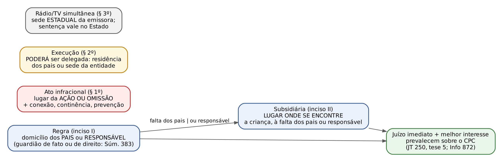
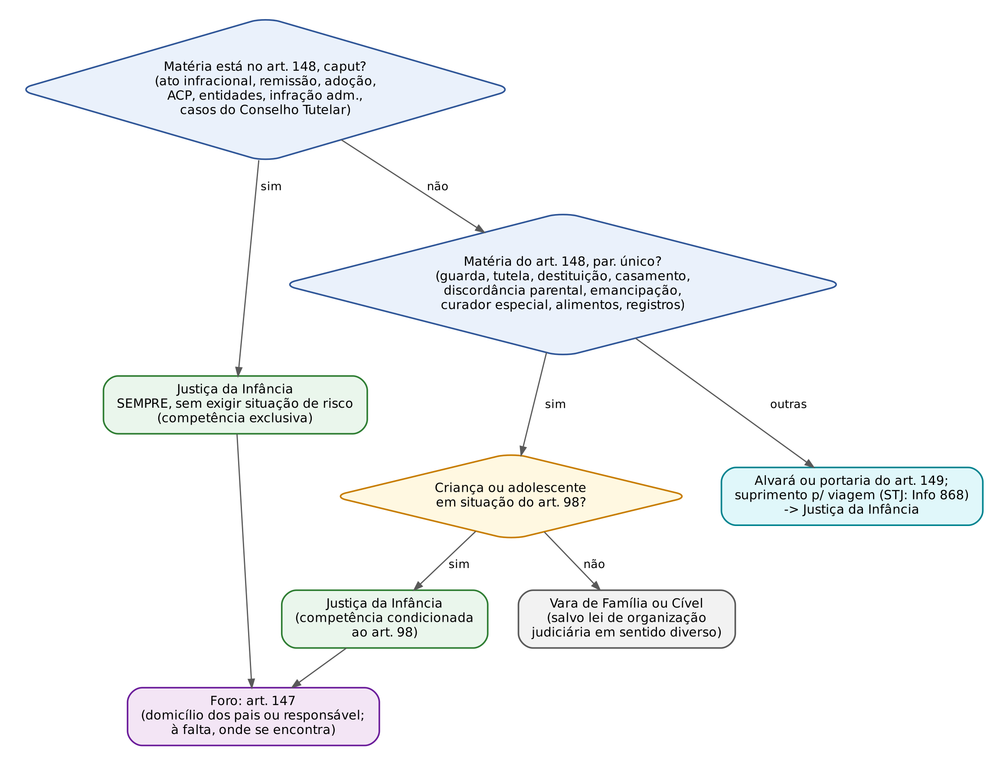
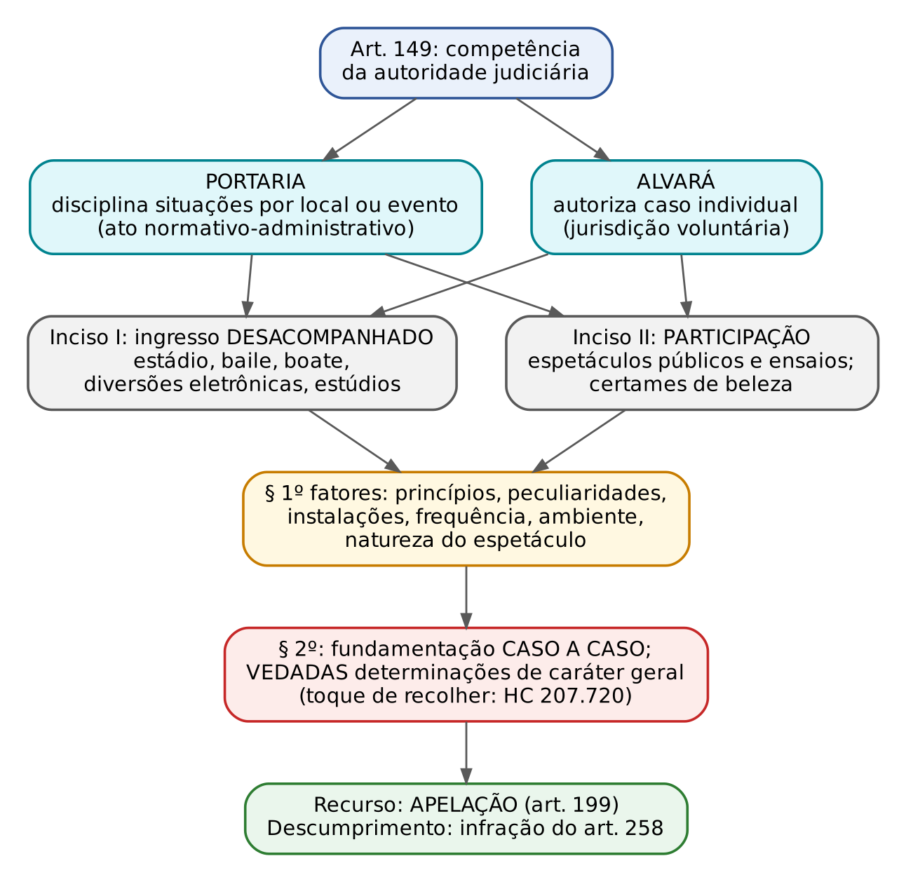
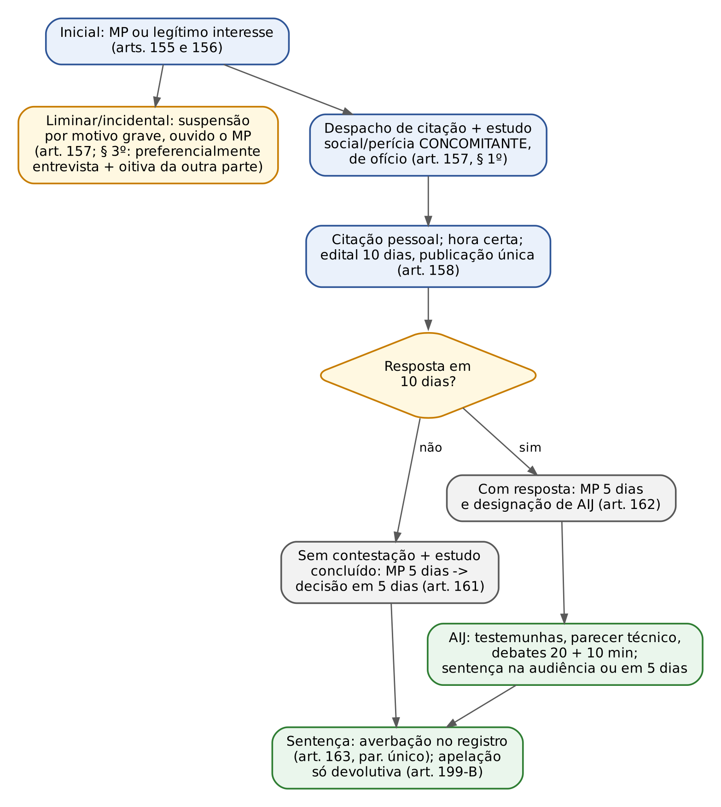
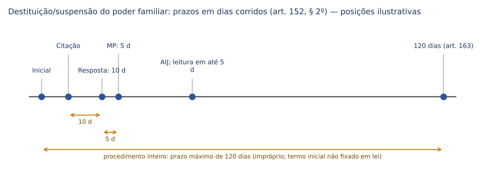
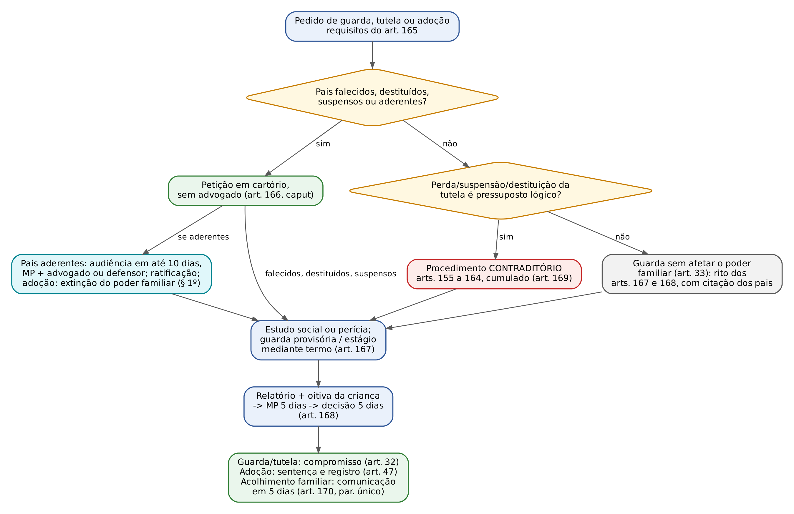

# CAPÍTULO 18 — JUSTIÇA DA INFÂNCIA E DA JUVENTUDE I: COMPETÊNCIA, SERVIÇOS AUXILIARES E PROCEDIMENTOS

:::INCIDENCIA
TJRS p. 1; TJSC p. 2. Nível A+. Lote: 8 questões (FGV 5, FCC 3), quatro delas de provas de Juiz Substituto (TJ-PE 2026, TJ-BA 2026, TJ-GO 2026, TJ-SE 2025), mais correlatas de outros capítulos.
O que mais cai: competência da Justiça da Infância sem situação de risco (viagem internacional, adoção) x competência condicionada ao art. 98; letra do art. 147 (ato infracional, delegação da execução); alvará do art. 149 para atividade itinerante; legitimidade para a destituição (art. 155); oitiva dos pais, curador especial e liminar no procedimento dos arts. 155 a 163.
:::

| Subtema | FGV | FCC | Padrão de cobrança |
|---|---|---|---|
| Competência material (art. 148 e parágrafo único) | 2 | 2 | caso de suprimento para viagem com alegação de inexistência de risco; adoção por parente sem risco; emancipação "quando faltarem os pais" |
| Competência territorial (art. 147) e alvará (art. 149) | 1 | 1 | literalidade do § 1º (ato infracional) e do § 2º ("poderá ser delegada"); alvará para DJ em várias comarcas: juízo do domicílio, com prazo e diretrizes |
| Procedimento de perda e suspensão (arts. 155 a 163) | 2 | 0 | legitimidade do guardião sem parentesco; revel citado pessoalmente; curador especial quando o MP é autor; liminar "preferencialmente" precedida de entrevista |
| Disposições gerais, prazos e serviços auxiliares (arts. 150 a 154) | 0 | 0 | não cobrados no lote; alta probabilidade: dias corridos, prazo em dobro da Defensoria (Informativo 870) |
| Colocação em família substituta (arts. 165 a 170) | 0 | 0 | cobrança indireta nas questões de adoção, guarda e entrega voluntária (Caps. 4 a 6) |

## 18.1 A Justiça da Infância e da Juventude: organização e autoridade judiciária

### 18.1.1 Varas especializadas e "juiz que exerce essa função" (arts. 145 e 146)

O ECA não cria um ramo autônomo do Judiciário. A "Justiça da Infância e da Juventude" é a Justiça comum estadual (e do Distrito Federal) exercendo jurisdição especializada sobre a matéria do Estatuto. Dois dispositivos estruturam essa jurisdição:

- Art. 145: os Estados e o Distrito Federal "PODERÃO criar varas especializadas e exclusivas da infância e da juventude", cabendo ao Poder Judiciário estabelecer sua proporcionalidade por número de habitantes, dotá-las de infraestrutura e dispor sobre o atendimento, "inclusive em plantões". A criação é FACULTATIVA; o que é obrigatório é a existência de uma autoridade que exerça a função.
- Art. 146: a autoridade a que se refere a lei é o Juiz da Infância e da Juventude, "ou o juiz que exerce essa função, na forma da lei de organização judiciária local". Nas comarcas sem vara especializada, a função é acumulada por vara única ou por vara cível ou criminal designada pela lei de organização judiciária. A competência é do JUÍZO investido da função, não da vara com esse nome.

Consequências práticas cobradas em prova:

- A lei estadual de organização judiciária distribui a função entre juízos, mas não pode subtrair matéria que o ECA atribui à Justiça da Infância (art. 148, caput), porque a definição da competência material é federal (CF, art. 22, I) e a lei local só organiza internamente o exercício. Pode, inversamente, ampliar o rol do juízo especializado com matérias conexas (por exemplo, atribuir a ele causas de família envolvendo crianças fora do art. 98), o que explica divergências entre Estados; em questão objetiva, prevalece a regra do ECA.
- A expressão "autoridade judiciária" do ECA designa o juiz da infância, não o Conselho Tutelar, que é órgão do Executivo municipal e não integra os serviços auxiliares da Justiça (Cap. 12; serviços auxiliares em 18.5).
- As ações da competência da Justiça da Infância são isentas de custas e emolumentos, "ressalvada a hipótese de litigância de má-fé" (art. 141, § 2º). A isenção alcança as partes, não apenas a criança, e não abrange honorários de sucumbência quando cabíveis (a condenação do ente público em honorários em ação por vaga escolar foi pressuposto da Q3966669, Cap. 8).

### 18.1.2 Justiça Federal: as exceções

A competência é da Justiça estadual mesmo quando há interesse indireto de ente federal. As exceções exigem o enquadramento no art. 109 da CF:

- Pedido de busca e apreensão ou de guarda fundado na Convenção da Haia de 1980 (subtração internacional), ajuizado pela União a pedido da Autoridade Central: Justiça Federal (Jurisprudência em Teses, ed. 27, tese 9; desenvolvimento no Cap. 2). A simples ALEGAÇÃO incidental de subtração internacional numa ação de divórcio, guarda e convivência não desloca a competência para a Justiça Federal (STJ, Segunda Seção, Relatora Ministra Nancy Andrighi, j. 19/8/2026, processo em segredo de justiça; Informativo 903).
- Adoção de criança indígena: Justiça estadual; a intervenção da FUNAI é obrigatória (art. 28, § 6º, III; art. 157, § 2º), mas é consultiva e não atrai a competência federal (STJ, Segunda Seção, Relatora Ministra Nancy Andrighi, j. 3/4/2025, Informativo 848; Cap. 6).
- Crimes do ECA com transnacionalidade (por exemplo, arts. 239 e 241-A em certas hipóteses): Justiça Federal nos termos do art. 109, V, da CF; matéria do Cap. 21.

## 18.2 Competência territorial (art. 147)

### 18.2.1 Texto e estrutura

:::LEI ECA, ART. 147
Art. 147. A competência será determinada:
I - pelo domicílio dos pais ou responsável;
II - pelo lugar onde se encontre a criança ou adolescente, à falta dos pais ou responsável.
§ 1º. Nos casos de ato infracional, será competente a autoridade do lugar da ação ou omissão, observadas as regras de conexão, continência e prevenção.
§ 2º A execução das medidas poderá ser delegada à autoridade competente da residência dos pais ou responsável, ou do local onde sediar-se a entidade que abrigar a criança ou adolescente.
§ 3º Em caso de infração cometida através de transmissão simultânea de rádio ou televisão, que atinja mais de uma comarca, será competente, para aplicação da penalidade, a autoridade judiciária do local da sede estadual da emissora ou rede, tendo a sentença eficácia para todas as transmissoras ou retransmissoras do respectivo estado.
:::

Leitura analítica, item por item:

- Inciso I: o critério é o domicílio dos PAIS ou do RESPONSÁVEL, não o da criança em si. "Responsável" é quem exerce a guarda, de direito ou de fato; por isso a Súmula 383 do STJ (18.2.3) fala em "detentor de sua guarda". Se os pais vivem em comarcas diversas, prevalece o domicílio de quem detém a guarda.
- Inciso II: critério SUBSIDIÁRIO, "à falta dos pais ou responsável" (falecidos, desconhecidos, em local incerto, ou que abandonaram a criança). Atenção à troca da FCC: a alternativa "à falta de definição do domicílio da criança, a competência será determinada pelo lugar onde se encontrem os pais" inverte os termos (Q3531640, abaixo).
- § 1º: no ato infracional, o critério é o do LUGAR DA AÇÃO OU OMISSÃO (teoria da atividade), e não o do resultado nem o do domicílio do adolescente, "observadas as regras de conexão, continência e prevenção". Diferença em relação ao CPP, que, para o processo penal, adota o lugar da consumação (art. 70); o procedimento infracional está no Cap. 16.
- § 2º: a execução das medidas "PODERÁ ser delegada" (faculdade, não dever) à autoridade da residência dos pais ou responsável ou do local da sede da entidade que abrigar a criança ou adolescente. Abrange medidas de proteção e socioeducativas; para a execução socioeducativa, a Lei 12.594/2012 tem regras próprias (Cap. 17).
- § 3º: hipótese de infração administrativa por transmissão simultânea de rádio ou televisão que atinja mais de uma comarca: competente a autoridade do local da SEDE ESTADUAL da emissora ou rede, com sentença eficaz para todas as transmissoras e retransmissoras do respectivo ESTADO (não do país). Remete às infrações dos arts. 247, 253 e 254 (Cap. 21).

:::QUESTAO FCC 2025 — DPE-AM — DEFENSOR PÚBLICO (Q3531640)
Pede-se a afirmação que reproduz disposição expressa do ECA. Gabarito: B (ato infracional: autoridade do lugar da ação ou omissão, observadas conexão, continência e prevenção; art. 147, § 1º).
Armadilhas: (A) inverte o inciso II (o critério subsidiário é o lugar onde se encontra a CRIANÇA, à falta dos pais); (C) troca "poderá" por "deverá" e omite a sede da entidade (art. 147, § 2º); (D) cria regra de "juízo imediato" para vítimas de violência, que não está no texto do art. 147 (o juízo imediato é princípio extraído pela jurisprudência dos incisos I e II, não regra expressa); (E) afirma a *perpetuatio jurisdictionis* como regra expressa, quando o ECA nada diz e a jurisprudência a MITIGA (18.2.4).
:::

### 18.2.2 Natureza: competência absoluta

Embora fixada por critério territorial, a competência do art. 147 é tratada pela jurisprudência do STJ e pela doutrina majoritária como ABSOLUTA (de natureza funcional), porque instituída no interesse da criança, para assegurar a proximidade entre o juiz e o destinatário da proteção. Consequências: pode ser reconhecida de ofício; não se prorroga pela ausência de exceção; não é afastada por eleição de foro; e prevalece sobre as regras gerais do CPC sobre domicílio do réu, conexão e prevenção comuns.

:::JURIS STJ, JURISPRUDÊNCIA EM TESES, ED. 250, TESE 5
"O princípio do juízo imediato, previsto no art. 147, I e II, do ECA, atrelado ao princípio do melhor interesse da criança e do adolescente, sobrepõe-se às regras gerais de competência do CPC." Precedentes indicados na edição: AgInt no CC 201.362/SP (Relatora Ministra Nancy Andrighi, Segunda Seção, DJe 20/6/2024) e EDcl no CC 171.371/SP (Relator Ministro Raul Araújo, Segunda Seção, DJe 18/8/2020), entre outros.
Uso em prova: o "juízo imediato" é o juízo que tem contato mais próximo com a criança e, por isso, melhores condições de colher prova, ouvi-la e fiscalizar a medida. Ele justifica a primazia do art. 147 sobre o art. 46 do CPC (domicílio do réu) e sobre a prevenção de outro juízo.
:::

### 18.2.3 Súmula 383 do STJ e ações conexas

:::JURIS STJ, SÚMULA 383
"A competência para processar e julgar as ações conexas de interesse de menor é, em princípio, do foro do domicílio do detentor de sua guarda." Reiterada nas Jurisprudências em Teses, ed. 27, tese 5, e ed. 253, tese 9.
Duas palavras decidem questões: "conexas" (havendo várias ações — guarda, alimentos, visitas, destituição —, reúnem-se no foro do guardião) e "em princípio" (a regra cede ao melhor interesse da criança no caso concreto, 18.2.4).
:::

O "detentor da guarda" inclui o guardião de fato. A Terceira Turma do STJ reafirmou que compete ao foro do domicílio do detentor da guarda a ação de destituição do poder familiar, ao conceder parcialmente *habeas corpus* para deferir guarda provisória aos avós paternos e determinar a remessa do processo à comarca em que residem (STJ, HC n. 1.035.988, Relator Ministro Humberto Martins, Terceira Turma, j. 16/10/2025, Informativo de Jurisprudência n. 29, edição extraordinária). O mesmo julgado afirmou que a inclusão da criança no SNA antes do trânsito em julgado da destituição é irregular (ver 18.7.9 e Cap. 6).

Relação com a regra do CPC para ações de família: o art. 53, I, do CPC fixa, para divórcio, separação, anulação de casamento e reconhecimento ou dissolução de união estável, o foro do domicílio do guardião de filho incapaz; para alimentos, o do alimentando (art. 53, II). As duas regras convergem com a Súmula 383. Fora do art. 98, essas ações são das varas de família (18.3.3), mas a Súmula 383 continua a orientar o foro.

### 18.2.4 Mudança de domicílio, *perpetuatio jurisdictionis* e juízo imediato

O art. 43 do CPC estabiliza a competência no momento do registro ou da distribuição da petição inicial, sendo irrelevantes as modificações de fato ou de direito posteriores, salvo supressão do órgão ou alteração da competência absoluta. No ECA, a orientação do STJ MITIGA a *perpetuatio jurisdictionis*: a alteração do domicílio do guardião no curso do processo PODE deslocar a competência para o novo foro, quando isso atender ao melhor interesse da criança, pelo princípio do juízo imediato. Os limites dessa flexibilização, extraídos da jurisprudência:

- Mudança LEGÍTIMA e consolidada do guardião: tende a deslocar a competência, sobretudo em ações de guarda e visitas, de trato continuado.
- Mudança ARDILOSA ou ilícita (para escapar do juízo natural, ou com retenção indevida da criança): não desloca; aplica-se a estabilização, sob pena de premiar a conduta (orientação reiterada em conflitos de competência da Segunda Seção; número de precedente específico não conferido nesta tarefa).
- Fase avançada do processo (instrução concluída, perícias realizadas): o melhor interesse pode recomendar manter o juízo que já conhece a causa.

:::JURIS STJ, CC 214.860-SP, J. 12/11/2025 (INFORMATIVO 872)
Ação de modificação de guarda com indícios de violência doméstica contra a genitora e, possivelmente, contra a criança. A Segunda Seção afirmou que, com fundamento nos princípios da proteção integral e do juízo imediato, é do melhor interesse da criança o processamento da ação no foro em que ela EXERCE, COM REGULARIDADE, seu direito à convivência familiar e comunitária; a Súmula 383 pode ser mitigada à luz das particularidades do caso; a sentença de guarda faz coisa julgada *rebus sic stantibus* (STJ, CC n. 214.860, Relatora Ministra Nancy Andrighi, Segunda Seção, j. 12/11/2025).
Uso em prova: o foro não é o do "domicílio formal" do guardião se a vida da criança se desenvolve, de fato e com regularidade, em outra comarca, especialmente em contexto de violência doméstica.
:::

:::PEGADINHA QUATRO ARMADILHAS RECORRENTES DE COMPETÊNCIA TERRITORIAL
- "A competência fixada pela distribuição permanece até a decisão": falso como regra expressa do ECA (Q3531640, E); a jurisprudência admite o deslocamento.
- "O foro é o do domicílio do réu": falso; prevalece o domicílio dos pais ou responsável (guardião), ainda que o guardião seja o autor.
- "No ato infracional, o foro é o do domicílio do adolescente": falso; lugar da ação ou omissão (art. 147, § 1º). O domicílio só importa para a eventual delegação da execução (§ 2º).
- "A delegação da execução é obrigatória": falso; "poderá".
:::

## 18.3 Competência material (art. 148)

### 18.3.1 Estrutura: o caput e o parágrafo único

O art. 148 tem dois blocos com lógicas diferentes, e é essa diferença que as bancas exploram.

| Bloco | Matérias | Pressuposto | Terminologia doutrinária |
|---|---|---|---|
| Caput, incisos I a VII | ato infracional (representação); remissão; adoção e seus incidentes; ações civis fundadas em interesses individuais, difusos ou coletivos (observado o art. 209); irregularidades em entidades de atendimento; penalidades administrativas; casos encaminhados pelo Conselho Tutelar | NENHUM: a competência existe independentemente de situação de risco | competência EXCLUSIVA (ou originária, ou em razão da matéria pura) |
| Parágrafo único, alíneas a a h | guarda e tutela; destituição do poder familiar, perda ou modificação da tutela ou guarda; suprimento da capacidade ou do consentimento para o casamento; discordância paterna ou materna sobre o exercício do poder familiar; emancipação "quando faltarem os pais"; curador especial; alimentos; cancelamento, retificação e suprimento de registros de nascimento e óbito | criança ou adolescente "nas hipóteses do art. 98" | competência CONCORRENTE ou CONDICIONADA (as mesmas matérias, fora do art. 98, são das varas de família ou cíveis) |

O termo "concorrente", usado por parte da doutrina para o parágrafo único, não significa que o autor escolha entre a vara de família e a da infância. Significa que a mesma MATÉRIA pode tocar a um ou a outro juízo conforme a presença da situação de risco do art. 98 (ameaça ou violação de direitos por ação ou omissão da sociedade ou do Estado; por falta, omissão ou abuso dos pais ou responsável; ou em razão da própria conduta). Presente o art. 98, a competência da Justiça da Infância é absoluta; ausente, a causa é da vara de família, salvo lei de organização judiciária em sentido diverso. O papel material do art. 98 está desenvolvido no Cap. 13 (13.2).

### 18.3.2 O caput: matérias da Justiça da Infância em qualquer caso

Pontos de cada inciso que têm sido cobrados:

- Inciso I (representações do MP para apuração de ato infracional) e inciso II (remissão como suspensão ou extinção do processo): a remissão aqui é a JUDICIAL; a remissão pré-processual é ato do MP, homologado pelo juiz (Cap. 15). A aplicação de medida socioeducativa é da competência exclusiva do juiz (Súmula 108 do STJ; Cap. 15).
- Inciso III (adoção e seus incidentes): a adoção de criança ou adolescente é SEMPRE da Justiça da Infância, ainda que o adotando não esteja em situação de risco, ainda que o adotante seja parente (tio, padrasto) e ainda que se trate de adoção unilateral. É o fundamento da Q3304078 (abaixo). Adoção de maior de 18 anos segue o CC e o CPC, na vara de família (CC, art. 1.619), salvo a hipótese do art. 40 do ECA (adotando que já estava sob guarda ou tutela dos adotantes quando completou 18 anos), que se processa pelo ECA (Cap. 6).
- Inciso IV (ações civis fundadas em interesses individuais, difusos ou coletivos afetos à criança e ao adolescente, observado o art. 209): inclui as ações INDIVIDUAIS (matrícula de uma criança em creche, fornecimento de medicamento a um adolescente), não só as coletivas. O STJ fixou, em repetitivo, que a Justiça da Infância tem competência absoluta para causas envolvendo matrícula de crianças em creches ou escolas, nos termos dos arts. 148, IV, e 209 (Tema 1.058; Jurisprudência em Teses, ed. 245, tese 1; v. Cap. 20). A competência do art. 209 (foro do local da ação ou omissão, absoluta, ressalvadas a Justiça Federal e a competência originária dos tribunais superiores) é desenvolvida no Cap. 20; o direito à educação e o Tema 548 do STF, no Cap. 8.
- Inciso V (irregularidades em entidades de atendimento) e inciso VI (penalidades administrativas): procedimentos dos arts. 191 a 197 (Cap. 19); infrações em espécie no Cap. 21.
- Inciso VII (casos encaminhados pelo Conselho Tutelar): inclui a revisão judicial das decisões do Conselho (art. 137; Cap. 12) e as representações do art. 136, XI (perda ou suspensão do poder familiar, após esgotadas as possibilidades de manutenção na família natural).

:::QUESTAO FCC 2025 — DPE-SP — ANALISTA DE DEFENSORIA (Q3304078)
Tia materna que cria o sobrinho de 11 anos desde os 3, com pais em paradeiro ignorado, quer figurar como mãe no registro. Gabarito: D (a Justiça da Infância é competente para a adoção mesmo que a criança não esteja em situação de risco; art. 148, III).
Armadilhas: (A) o reconhecimento extrajudicial de maternidade socioafetiva só é autorizado para pessoas "acima de 12 anos" (Código Nacional de Normas do CNJ, art. 505; Apostila de Direito Civil, Cap. 37), e a criança tem 11; além disso, não rompe a filiação registral dos pais, efeito próprio da adoção; (B) o parentesco não desloca a adoção para a vara de família; (C) a vedação do art. 42, § 1º, alcança apenas ascendentes e irmãos, não tios; (E) não se exige ação prévia de guarda, e o pressuposto da adoção é a PERDA (destituição), não a suspensão, a ser cumulada pelo procedimento contraditório (art. 169; 18.9.5).
:::

### 18.3.3 O parágrafo único: matérias condicionadas ao art. 98

Leitura por alínea, com o que cada uma tem de cobrável:

| Alínea | Matéria | Observações |
|---|---|---|
| a | pedidos de guarda e tutela | guarda entre genitores, sem risco, é da vara de família (CC, arts. 1.583 a 1.590); guarda a terceiro com criança em situação do art. 98 é da Infância (Cap. 5) |
| b | destituição do poder familiar, perda ou modificação da tutela ou guarda | a ação de destituição pressupõe, em regra, situação do art. 98 (abandono, maus-tratos, negligência), de modo que tramita quase sempre na Infância; a cumulada com adoção vai à Infância pelo inciso III do caput |
| c | suprimento da capacidade ou do consentimento para o casamento | desde a Lei 13.811/2019, o CC veda o casamento de quem não atingiu a idade núbil (16 anos; CC, art. 1.520); o suprimento judicial restringe-se ao consentimento dos pais para o casamento do adolescente de 16 e 17 anos (CC, arts. 1.517 e 1.519) |
| d | pedidos baseados em discordância paterna ou materna em relação ao exercício do poder familiar | base do suprimento de autorização para viagem; o STJ dispensou a situação de risco nessa hipótese (18.3.4) |
| e | emancipação, nos termos da lei civil, "quando faltarem os pais" | com pais presentes, a emancipação é voluntária e extrajudicial (escritura pública; CC, art. 5º, parágrafo único, I); a judicial, ouvido o tutor, é para o adolescente de 16 anos sob tutela |
| f | designação de curador especial em queixa, representação ou outros procedimentos judiciais ou extrajudiciais em que haja interesse de criança ou adolescente | conflito de interesses com os representantes ou falta deles; o regime do curador especial na destituição está em 18.7.7 |
| g | ações de alimentos | fora do art. 98, vara de família; a legitimidade do MP independe do art. 98 (Súmula 594 do STJ; Cap. 7) |
| h | cancelamento, retificação e suprimento dos registros de nascimento e óbito | com a criança em situação do art. 98; fora dele, a retificação segue a Lei 6.015/1973 (Caps. 7 e 13) |

:::QUESTAO FCC 2025 — DPE-AM — DEFENSOR PÚBLICO (Q3531634)
Pede-se a afirmação sobre emancipação que reproduz disposição expressa do ECA. Gabarito: A (a Justiça da Infância pode concedê-la, nos termos da lei civil, quando faltarem os pais; art. 148, parágrafo único, e).
Armadilhas: (B) emancipação não autoriza viagem internacional desacompanhada sem autorização (o ECA nada diz; Cap. 9); (C) não dispensa o alvará do art. 149 para participação em espetáculos (nenhuma regra expressa a respeito); (D) não é hipótese legal de extinção das medidas aplicadas aos pais; (E) não há exigência legal de avaliação psicossocial da maturidade. Lembre: a competência da alínea e, como todas as do parágrafo único, pressupõe a situação do art. 98; a falta dos pais é, ela própria, hipótese do art. 98, II.
:::

### 18.3.4 A leitura ampla do parágrafo único: viagem internacional sem situação de risco

No suprimento judicial da autorização de um dos genitores para passaporte e viagem internacional, a ausência de situação de risco não afasta a competência da Justiça da Infância (art. 148, parágrafo único, d; STJ, REsp n. 2.062.293, Informativo 868; v. Cap. 9, titular do julgado e do regime material das autorizações de viagem).

:::QUESTAO FGV 2026 — TJ-BA — JUIZ SUBSTITUTO (Q4083743)
Mãe guardiã, em Cachoeira/BA, pede na Vara da Infância o suprimento da autorização paterna para viagem de lazer da filha de 9 anos ao México; o pai, residente em Alagoinhas/BA, onde tramitam ações de visitas e alimentos, alega incompetência da Infância por inexistir risco e defende a vara de família de Alagoinhas.
Resolução em passos. Passo 1 — matéria: discordância parental sobre o exercício do poder familiar (art. 148, parágrafo único, d). Passo 2 — risco: dispensado, segundo o REsp 2.062.293 (Informativo 868). Passo 3 — foro: domicílio da guardiã (art. 147, I; Súmula 383), não o do réu nem o da vara preventa. Gabarito: C (justiça especializada, independentemente de risco, ainda que o outro genitor esteja em local incerto).
Armadilhas: (A) condiciona ao art. 98, tese superada pelo precedente; (B) remete à vara de família; (D) "conexão instrumental" com a ação de visitas não desloca competência absoluta; (E) inventa condição de eficácia (averbação no passaporte pela Polícia Federal).
No mesmo sentido: FGV 2026 — TJ-GO — Juiz Substituto (Q3966668), gabarito A (a ausência de risco não afasta a competência absoluta da Infância para o suprimento; desenvolvida no Cap. 9, com a parte material: no exterior, basta a autorização do outro genitor com firma reconhecida, sem alvará).
:::

:::ATENCAO ATÉ ONDE VAI A LEITURA AMPLA
O precedente trata da alínea d e de pedido de suprimento para viagem. Não autoriza concluir que TODA causa de família envolvendo criança é da Infância: guarda e alimentos entre genitores, sem situação do art. 98, continuam nas varas de família (alíneas a e g). Na prova, a alternativa que estende a dispensa do risco a qualquer matéria do parágrafo único deve ser lida com desconfiança; a que a aplica ao suprimento para viagem é a correta.
:::

### 18.3.5 Outras fronteiras de competência

- Ação indenizatória da criança contra terceiro (dano moral, acidente): vara cível, porque não é ação "fundada em interesses afetos à criança" no sentido protetivo do art. 148, IV, nem matéria do parágrafo único (Cap. 3).
- Crimes contra criança e adolescente, inclusive os do ECA: juízo criminal comum, conforme a organização judiciária; a Lei 13.431/2017 prevê a criação de juizados ou varas especializadas em crimes contra a criança e o adolescente (Cap. 22).
- Medidas protetivas de urgência da Lei 14.344/2022: competência fixada por aquela lei e pela organização judiciária (Cap. 23).
- Trabalho artístico de criança e adolescente: alvará pela Justiça da Infância (art. 149, II), e não pela Justiça do Trabalho (Cap. 8).
- Execução de honorários fixados em ação na Infância: discute-se se segue no próprio juízo (regra do cumprimento de sentença no juízo que decidiu a causa, CPC, art. 516, II); a questão Q3966669 tratou do tema como distrator (Cap. 8).

## 18.4 Portarias e alvarás (art. 149)

### 18.4.1 Texto e natureza

:::LEI ECA, ART. 149
Art. 149. Compete à autoridade judiciária disciplinar, através de portaria, ou autorizar, mediante alvará:
I - a entrada e permanência de criança ou adolescente, desacompanhado dos pais ou responsável, em: a) estádio, ginásio e campo desportivo; b) bailes ou promoções dançantes; c) boate ou congêneres; d) casa que explore comercialmente diversões eletrônicas; e) estúdios cinematográficos, de teatro, rádio e televisão.
II - a participação de criança e adolescente em: a) espetáculos públicos e seus ensaios; b) certames de beleza.
§ 1º Para os fins do disposto neste artigo, a autoridade judiciária levará em conta, dentre outros fatores: a) os princípios desta Lei; b) as peculiaridades locais; c) a existência de instalações adequadas; d) o tipo de freqüência habitual ao local; e) a adequação do ambiente a eventual participação ou freqüência de crianças e adolescentes; f) a natureza do espetáculo.
§ 2º As medidas adotadas na conformidade deste artigo deverão ser fundamentadas, caso a caso, vedadas as determinações de caráter geral.
:::

Duas atividades distintas, ambas residuais do antigo poder normativo do juiz de menores, mas agora estritamente LIMITADAS pelo texto:

- PORTARIA: ato de natureza administrativa e normativa, que disciplina, para um local ou evento determinado (o estádio X, o baile Y, a casa de jogos eletrônicos Z), as condições de entrada e permanência de crianças e adolescentes desacompanhados ou de sua participação em espetáculo. Não é sentença nem lei; vincula estabelecimentos e responsáveis.
- ALVARÁ: autorização individual, em procedimento de jurisdição voluntária, para que determinada criança ou adolescente ingresse em local ou participe de espetáculo ou certame (caso típico: participação em novela, peça de teatro, concurso de beleza, apresentações artísticas).

Pontos literais:

- O inciso I trata de entrada e permanência "DESACOMPANHADO dos pais ou responsável". Acompanhada dos pais, a criança pode frequentar esses locais sem portaria ou alvará, salvo restrição legal específica (por exemplo, a vedação de jogos de apostas do art. 80; Cap. 9) e a classificação indicativa (art. 75; Cap. 9).
- O inciso II trata de PARTICIPAÇÃO (como artista, atleta exibido em espetáculo, candidato), estejam ou não presentes os pais. Ensaios estão incluídos expressamente.
- O rol é TAXATIVO quanto ao objeto: a portaria não pode disciplinar matérias não previstas (viagens, circulação noturna em logradouros públicos, venda de produtos). O art. 149 é exceção ao princípio da legalidade em matéria de restrição de direitos de crianças (art. 16, I: direito de ir, vir e estar, "ressalvadas as restrições legais") e, como exceção, interpreta-se restritivamente.
- O § 2º impõe dois requisitos: fundamentação CASO A CASO e vedação de determinações DE CARÁTER GERAL. Portaria que proíbe "toda criança" de estar "em qualquer local" depois de certo horário é ato geral e abstrato, que só a lei poderia editar.

:::JURIS STJ, HC 207.720 (SEGUNDA TURMA), "TOQUE DE RECOLHER"
A Segunda Turma concedeu *habeas corpus* coletivo e declarou ilegal portaria de Vara da Infância e da Juventude de comarca paulista que determinava o recolhimento de crianças e adolescentes encontrados desacompanhados nas ruas durante a noite. O relator, Ministro Herman Benjamin, afirmou que a portaria ultrapassou os limites dos poderes normativos previstos no ECA e que se tratava de ato genérico, de caráter abstrato e por prazo indeterminado, embora reconhecidas como legítimas as preocupações do magistrado (STJ, HC n. 207.720, Relator Ministro Herman Benjamin, Segunda Turma; notícia oficial divulgada em 8/12/2011; data de julgamento não conferida).
Uso em prova: "toque de recolher" por portaria = ilegal (art. 149, § 2º, e art. 16, I). O *habeas corpus* é cabível porque o ato restringe a liberdade de locomoção.
:::

Consequências do mesmo raciocínio já cobradas em outros capítulos: portaria não pode exigir autorização judicial para todas as viagens da comarca (Cap. 9); não pode criar restrição genérica de circulação (Cap. 3); não substitui a classificação indicativa federal (Cap. 9).

### 18.4.2 Recurso, descumprimento e procedimento

- Recurso: "Contra as decisões proferidas com base no art. 149 caberá recurso de apelação" (art. 199). A apelação vale tanto para a portaria quanto para a decisão sobre o alvará; o sistema recursal (prazo de 10 dias, juízo de retratação) está no Cap. 19.
- Descumprimento por estabelecimento ou empresário das regras de acesso a locais de diversão ou de participação em espetáculo: infração administrativa do art. 258 (multa de três a vinte salários de referência; na reincidência, fechamento do estabelecimento por até quinze dias), apurada pelo procedimento dos arts. 194 a 197 (Caps. 19 e 21).
- Procedimento do alvará: o ECA não prevê rito próprio; aplica-se o art. 153 (investigação dos fatos e providências de ofício, ouvido o MP) e, subsidiariamente, o procedimento de jurisdição voluntária do CPC (arts. 719 a 725), com estudo pela equipe interprofissional quando necessário.

### 18.4.3 Alvará para atividade continuada em várias comarcas

O problema contemporâneo é o do adolescente que exerce atividade artística de forma contínua e itinerante (cantor, DJ, ator em turnê). Pedir um alvará em cada comarca do evento fragmentaria o controle e inviabilizaria a atividade; conceder autorização ilimitada violaria o § 2º.

:::JURIS STJ, JURISPRUDÊNCIA EM TESES, ED. 253, TESE 10 (RESP 1.947.740/PR)
"A autorização judicial para participação de adolescente em espetáculo público em diversas comarcas deve ser concentrada na competência do juízo do seu domicílio, que solicitará providências e informações aos demais juízos, onde ocorra apresentação, quanto ao cumprimento das diretrizes previamente fixadas" (STJ, REsp n. 1.947.740, Relatora Ministra Nancy Andrighi, Terceira Turma, DJe 8/10/2021; arts. 147 e 149).
A solução combina o art. 147, I (juízo do domicílio dos pais), com o art. 149, § 2º (fundamentação caso a caso): o juízo do domicílio fixa prazo e diretrizes, e os juízos dos locais de apresentação atuam como fiscais por cooperação.
:::

:::QUESTAO FGV 2026 — TJ-PE — JUIZ SUBSTITUTO (Q4349497)
Adolescente de 13 anos, DJ havia 2 anos em eventos em várias cidades de Pernambuco e de Estados vizinhos, sempre acompanhado dos pais, com frequência escolar regular e acompanhamento psicológico, pede ao juízo do seu domicílio autorização "ampla, geral e irrestrita" até a maioridade, dispensados pedidos em cada comarca. O MP sustenta a competência do juízo de cada evento.
Resolução em passos. Passo 1 — exige-se alvará? Sim: participação em espetáculo público (art. 149, II, a), ainda que acompanhado dos pais (o inciso II não faz a ressalva do inciso I). Passo 2 — qual juízo? O do domicílio, que concentra a autorização (JT 253, tese 10). Passo 3 — extensão: vedada a autorização geral e irrestrita até a maioridade (art. 149, § 2º); cabe autorização de menor extensão, por PRAZO DETERMINADO, com critérios e diretrizes prévios. Gabarito: D.
Armadilhas: (A) a atividade de DJ em eventos públicos é participação em espetáculo; (B) a competência do juízo de cada evento foi superada pelo precedente; (C) a autorização "ampla, geral e irrestrita" é o que o § 2º veda; (E) sutil: acerta a competência e a vedação da autorização geral, mas dispensa o prazo determinado, sob o argumento de que a revisibilidade supriria a delimitação temporal; o gabarito exige o prazo.
:::

:::DICA ALVARÁ DO ART. 149 E INFLUENCIADORES MIRINS
A exigência de alvará para exploração habitual, monetizada ou impulsionada, da imagem ou da rotina de criança ou adolescente em plataformas digitais, com dever das plataformas de exigir o título, está tratada no Cap. 10 (Estatuto Digital). O título é o alvará do art. 149, II, a, expedido pela Justiça da Infância e sujeito ao mesmo § 2º: prazo, condições, fundamentação individual.
:::

## 18.5 Serviços auxiliares: a equipe interprofissional (arts. 150 e 151)

### 18.5.1 Texto

:::LEI ECA, ARTS. 150 E 151
Art. 150. Cabe ao Poder Judiciário, na elaboração de sua proposta orçamentária, prever recursos para manutenção de equipe interprofissional, destinada a assessorar a Justiça da Infância e da Juventude.
Art. 151. Compete à equipe interprofissional dentre outras atribuições que lhe forem reservadas pela legislação local, fornecer subsídios por escrito, mediante laudos, ou verbalmente, na audiência, e bem assim desenvolver trabalhos de aconselhamento, orientação, encaminhamento, prevenção e outros, tudo sob a imediata subordinação à autoridade judiciária, assegurada a livre manifestação do ponto de vista técnico.
Parágrafo único. Na ausência ou insuficiência de servidores públicos integrantes do Poder Judiciário responsáveis pela realização dos estudos psicossociais ou de quaisquer outras espécies de avaliações técnicas exigidas por esta Lei ou por determinação judicial, a autoridade judiciária poderá proceder à nomeação de perito, nos termos do art. 156 da Lei nº 13.105, de 16 de março de 2015 (Código de Processo Civil). (Incluído pela Lei nº 13.509, de 2017)
:::

### 18.5.2 Leitura analítica

- Obrigação ORÇAMENTÁRIA do Poder Judiciário (art. 150): a equipe é do Judiciário, não do Município nem do Conselho Tutelar. A "equipe técnica" das entidades de acolhimento e os técnicos do CRAS e do CREAS são do Executivo e produzem relatórios que o juiz valora, mas não são o serviço auxiliar do art. 150. A distinção cai em questões de caso, que costumam contrapor "relatório da equipe técnica da instituição de acolhimento" e "parecer psicossocial da equipe multidisciplinar que assiste ao juízo" (Q3301255, 18.7).
- Composição: a lei diz apenas "interprofissional"; na prática, assistentes sociais, psicólogos e, conforme a lei local, pedagogos. A composição mínima e as atribuições adicionais ficam com a "legislação local" (art. 151, caput) e os atos dos tribunais.
- Formas de atuação (art. 151): subsídios POR ESCRITO (laudos, estudos sociais, relatórios) ou VERBALMENTE, NA AUDIÊNCIA (parecer técnico oral; compare com o art. 162, § 2º); e trabalhos de aconselhamento, orientação, encaminhamento e prevenção. A equipe não é só perita: faz intervenção.
- Dupla garantia: "imediata subordinação à autoridade judiciária" (hierarquia administrativa e funcional ao juiz) e "livre manifestação do ponto de vista técnico" (autonomia técnica: o juiz não pode determinar a conclusão do laudo).
- Parágrafo único (Lei 13.509/2017): na ausência ou insuficiência de servidores, o juiz "PODERÁ" nomear perito (CPC, art. 156: profissionais legalmente habilitados, inscritos em cadastro do tribunal). A falta de equipe própria não autoriza dispensar a avaliação técnica exigida pela lei: o caminho é a nomeação de perito.

:::PEGADINHA AUSÊNCIA DE EQUIPE NÃO DISPENSA O ESTUDO
Na Q4083744 (FGV 2026, TJ-BA, Juiz Substituto; entrega voluntária, Cap. 4), uma das alternativas erradas afirmava que o juiz, diante da ausência de equipe interprofissional na unidade, "poderá dispensar o parecer técnico" para não prejudicar a celeridade. A resposta da lei é a nomeação de perito (art. 151, parágrafo único), não a dispensa. Raciocínio idêntico vale para o estudo da destituição (art. 157, § 1º) e para o da colocação em família substituta (art. 167).
:::

### 18.5.3 Onde a lei exige a equipe

| Momento | Exigência | Dispositivo |
|---|---|---|
| Oitiva da criança na colocação em família substituta | "previamente ouvido por equipe interprofissional", respeitado o estágio de desenvolvimento | art. 28, § 1º (Cap. 5) |
| Preparação e acompanhamento da colocação | equipe "a serviço da Justiça da Infância", preferencialmente com apoio dos técnicos da política municipal de convivência familiar | art. 28, § 5º; art. 166, § 7º |
| Entrega voluntária | gestante ouvida pela equipe, que apresenta relatório | art. 19-A, § 1º (Cap. 4) |
| Consentimento dos pais | precedido de orientações e esclarecimentos da equipe, em especial sobre a irrevogabilidade da adoção | art. 166, § 2º |
| Estágio de convivência | acompanhado pela equipe, que apresenta relatório minucioso | art. 46, § 4º (Cap. 6) |
| Destituição do poder familiar | estudo social ou perícia por equipe interprofissional ou multidisciplinar, determinado com o despacho de citação | art. 157, § 1º |
| Colocação em família substituta | estudo social ou, se possível, perícia por equipe interprofissional | art. 167 |
| Habilitação de pretendentes | estudo psicossocial e preparação | art. 197-C (Cap. 19) |
| Apuração de ato infracional | relatório da equipe interprofissional juntado antes dos debates | art. 186, § 4º (Cap. 16) |

Valor do laudo: o juiz não está adstrito à conclusão técnica (CPC, art. 479), mas deve indicar na sentença os motivos que o levaram a considerar ou a deixar de considerar as conclusões, à luz das demais provas. Em destituição e adoção, decidir contra o estudo psicossocial sem fundamentação específica é vício frequente de reforma em segundo grau.

## 18.6 Procedimentos: disposições gerais (arts. 152 a 154)

### 18.6.1 Aplicação subsidiária da legislação processual (art. 152, caput)

"Aos procedimentos regulados nesta Lei aplicam-se subsidiariamente as normas gerais previstas na legislação processual pertinente." A legislação "pertinente" varia conforme o procedimento: CPC para os procedimentos cíveis (perda e suspensão do poder familiar, colocação em família substituta, habilitação, ações civis); CPP para a apuração de ato infracional (o STJ aplica, por exemplo, o art. 400 do CPP ao rito do art. 184 do ECA, no Tema 1.269; Cap. 16). Subsidiariedade pressupõe lacuna e compatibilidade com os princípios do ECA: prevalece a regra especial (prazo de resposta de 10 dias na destituição, art. 158; prazo recursal de 10 dias, art. 198, II).

O ECA disciplina, no Capítulo III do Título VI do Livro II, os seguintes procedimentos especiais: perda e suspensão do poder familiar (arts. 155 a 163); destituição da tutela (art. 164); colocação em família substituta (arts. 165 a 170); apuração de ato infracional (arts. 171 a 190); apuração de irregularidades em entidade de atendimento (arts. 191 a 193); apuração de infração administrativa (arts. 194 a 197); habilitação de pretendentes à adoção (arts. 197-A a 197-F). Os cinco últimos são do Cap. 16 (ato infracional) e do Cap. 19.

### 18.6.2 Prioridade absoluta na tramitação (art. 152, § 1º)

"É assegurada, sob pena de responsabilidade, prioridade absoluta na tramitação dos processos e procedimentos previstos nesta Lei, assim como na execução dos atos e diligências judiciais a eles referentes" (Lei 12.010/2009). Três elementos: (i) alcança tramitação E execução de atos e diligências (cartório, oficial de justiça, equipe técnica); (ii) "sob pena de responsabilidade" (administrativa e disciplinar dos agentes); (iii) é projeção processual do art. 227 da CF e do art. 4º, parágrafo único, b, do ECA ("precedência de atendimento nos serviços públicos ou de relevância pública"; Cap. 1). Correlatos: os recursos têm "preferência de julgamento" e dispensam revisor (art. 198, III), e os arts. 199-C a 199-E impõem prioridade e prazos aos recursos em adoção e destituição (Cap. 19).

### 18.6.3 Contagem dos prazos: dias corridos e vedação do prazo em dobro (art. 152, § 2º)

:::LEI ECA, ART. 152, § 2º (LEI 13.509/2017)
§ 2º Os prazos estabelecidos nesta Lei e aplicáveis aos seus procedimentos são contados em dias corridos, excluído o dia do começo e incluído o dia do vencimento, vedado o prazo em dobro para a Fazenda Pública e o Ministério Público.
:::

Cinco pontos que a prova explora:

- Dias CORRIDOS: afasta o art. 219 do CPC (dias úteis). A regra vale para os "prazos estabelecidos nesta Lei e aplicáveis aos seus procedimentos": resposta na destituição (10 dias), vista ao MP (5 dias), recursos (10 dias, art. 198, II), arrependimento na entrega (10 dias, art. 166, § 5º).
- Exclui-se o dia do começo e inclui-se o do vencimento (regra comum, aqui positivada).
- Vedação de prazo em dobro APENAS para a Fazenda Pública e o Ministério Público. A Defensoria Pública NÃO foi incluída, e o STJ leu a omissão como silêncio eloquente: a prerrogativa do art. 186 do CPC (e das Leis Complementares 80/1994) subsiste nos procedimentos do ECA.
- Âmbito: a regra é dos procedimentos REGULADOS no ECA. Ações ordinárias que tramitam na Vara da Infância pela competência do art. 148, IV (por exemplo, obrigação de fazer para matrícula em creche) seguem, segundo a orientação adotada na Q3966669 (FGV 2026, TJ-GO, Juiz Substituto, gabarito E), o regime do CPC (15 dias úteis, prazos em dobro para Fazenda e Defensoria), porque não integram o rol dos procedimentos especiais dos arts. 152 a 197. O tema recursal é desenvolvido no Cap. 19.
- Prazos do art. 198, II, inclusive para o agravo interno nos tribunais: o STJ considerou intempestivo agravo interno interposto após 10 dias corridos, aplicando o ECA em detrimento do CPC pelo princípio da especialidade (STJ, Terceira Turma, Relatora Ministra Daniela Teixeira, j. 5/5/2025, processo em segredo de justiça; Informativo de Jurisprudência n. 26, edição extraordinária; Cap. 19).

:::JURIS STJ, JURISPRUDÊNCIA EM TESES, ED. 251, TESE 3; RESP 2.139.217-PR (INFORMATIVO 870)
"A prerrogativa institucional da Defensoria Pública para a contagem do prazo em dobro subsiste, pois a vedação ao cômputo do prazo em dobro prevista no art. 152, § 2º, do ECA, incluído pela Lei n. 13.509/2017, diz respeito expressamente apenas à Fazenda Pública e ao Ministério Público" (JT 251, tese 3, com precedentes como o REsp 2.042.708/DF, Relator Ministro Marco Aurélio Bellizze, Terceira Turma, DJe 28/8/2023, e o REsp 2.138.845/PR, Relatora Ministra Nancy Andrighi, Terceira Turma, DJe 29/8/2024).
Reafirmações recentes: Terceira Turma (REsp n. 2.212.651, Relator Ministro Ricardo Villas Bôas Cueva, j. 15/9/2025) e Quarta Turma (REsp n. 2.139.217, Relator Ministro Antonio Carlos Ferreira, Quarta Turma, j. 27/10/2025, Informativo 870: "silêncio eloquente"; a sobrecarga decorrente da indeclinabilidade justifica o prazo diferenciado, e a celeridade não suprime ampla defesa). Em ação de destituição cumulada com adoção, a Quarta Turma reiterou a prerrogativa (STJ, Quarta Turma, Relator Desembargador convocado Luís Carlos Gambogi, j. 22/4/2026, processo em segredo de justiça; Informativo de Jurisprudência n. 32, edição extraordinária).
Com isso, as duas Turmas de Direito Privado convergem; a tese pode ser dada como pacífica.
:::

| Sujeito | Prazo em dobro nos procedimentos do ECA? | Fundamento |
|---|---|---|
| Ministério Público | NÃO | art. 152, § 2º (vedação expressa) |
| Fazenda Pública | NÃO | art. 152, § 2º (vedação expressa) |
| Defensoria Pública | SIM | CPC, art. 186; JT 251, tese 3; Informativo 870 |
| Escritório de prática jurídica de faculdade ou entidade conveniada com a Defensoria | SIM, por extensão do CPC (art. 186, § 3º); o advogado dativo comum NÃO tem prazo em dobro | inferência do mesmo raciocínio; sem precedente específico conferido |
| Litisconsortes com advogados diferentes (CPC, art. 229) | em processo eletrônico, não há dobra (art. 229, § 2º); em físico, a questão não foi enfrentada nas fontes consultadas | aplicação subsidiária |

### 18.6.4 Poderes de investigação e providências de ofício (art. 153)

:::LEI ECA, ART. 153
Art. 153. Se a medida judicial a ser adotada não corresponder a procedimento previsto nesta ou em outra lei, a autoridade judiciária poderá investigar os fatos e ordenar de ofício as providências necessárias, ouvido o Ministério Público.
Parágrafo único. O disposto neste artigo não se aplica para o fim de afastamento da criança ou do adolescente de sua família de origem e em outros procedimentos necessariamente contenciosos. (Incluído pela Lei nº 12.010, de 2009)
:::

O art. 153 é a base dos chamados "pedidos de providências" ou "procedimentos verificatórios" da prática forense: diante de notícia de situação que exige resposta judicial sem rito previsto (verificação de situação de risco comunicada pelo Conselho Tutelar, aplicação de medida de proteção em meio aberto, autorização judicial avulsa, alvará), o juiz pode investigar e determinar providências de ofício, sempre ouvindo o MP. Três limites:

- Subsidiariedade: só quando a medida "não corresponder a procedimento previsto nesta ou em outra lei". Se há rito (destituição, colocação, apuração de ato infracional, infração administrativa), ele é obrigatório.
- Oitiva do MP: requisito expresso.
- Parágrafo único (Lei 12.010/2009): o procedimento inquisitivo NÃO serve para AFASTAR a criança da família de origem nem para "outros procedimentos necessariamente contenciosos". Afastamento exige procedimento judicial contencioso, a pedido do MP ou de quem tenha legítimo interesse, com contraditório e ampla defesa dos pais (art. 101, § 2º; Cap. 13, 13.6.2 e 13.7.5). O juiz não pode, de ofício, abrir procedimento verificatório e nele decretar acolhimento sem contraditório, salvo as medidas emergenciais para proteção de vítimas de violência ou abuso sexual e o afastamento do agressor da moradia comum (art. 101, § 2º, primeira parte; art. 130, que, na redação da Lei 15.240/2025, alcança maus-tratos, negligência, opressão ou abuso sexual).

:::ATENCAO O JUIZ NÃO INICIA A DESTITUIÇÃO DE OFÍCIO
A alternativa "o procedimento para a perda ou a suspensão do poder familiar terá início por provocação do Ministério Público ou DE OFÍCIO pela Justiça da Infância" é falsa (Q3301255, E). O art. 155 exige provocação do MP ou de quem tenha legítimo interesse, e o art. 153, parágrafo único, veda a via inquisitiva para procedimentos necessariamente contenciosos. Na inércia do MP diante do relatório do art. 101, § 9º, a FGV considerou correta a remessa ao Procurador-Geral de Justiça, por analogia ao art. 28 do CPP (Q3117537, FGV 2024, TJ-PE, Juiz Substituto, gabarito C; resolvida no Cap. 4), e não a suspensão do poder familiar de ofício.
:::

### 18.6.5 Multas (art. 154)

"Aplica-se às multas o disposto no art. 214." Isto é: os valores revertem ao fundo gerido pelo Conselho dos Direitos da Criança e do Adolescente do respectivo MUNICÍPIO (art. 214, caput); as multas não recolhidas até 30 dias após o trânsito em julgado são exigidas por execução promovida pelo MP, nos mesmos autos, facultada igual iniciativa aos demais legitimados (§ 1º); enquanto o fundo não for regulamentado, o dinheiro fica depositado em estabelecimento oficial de crédito, em conta com correção monetária (§ 2º). Alcança as multas cominatórias (astreintes) fixadas nos procedimentos do ECA e as multas por infração administrativa. O FIA está no Cap. 11; a multa do art. 213 nas ações civis, no Cap. 20.

### 18.6.6 Outras regras gerais que incidem nos procedimentos

- Segredo de justiça: vedação de divulgação de atos judiciais, policiais e administrativos relativos a ato infracional (art. 143) e, nos procedimentos cíveis, o segredo do CPC (art. 189, II: ações que versem sobre filiação, guarda) e a regra do art. 206 (intervenção por advogado "respeitado o segredo de justiça").
- Intervenção de terceiros: a criança ou o adolescente, seus pais ou responsável, e qualquer pessoa que tenha legítimo interesse na solução da lide podem intervir nos procedimentos do ECA, por advogado, intimado pessoalmente ou por publicação oficial (art. 206; Cap. 19).
- Assistência judiciária integral e gratuita a quem dela necessitar (art. 141, § 1º; art. 206, parágrafo único) e isenção de custas (art. 141, § 2º).
- Intervenção obrigatória do MP nos processos e procedimentos em que não for parte, sob pena de nulidade, declarável de ofício ou a requerimento (arts. 202 e 204; Cap. 19).

## 18.7 Procedimento de perda e suspensão do poder familiar (arts. 155 a 163)

### 18.7.1 Objeto e lugar do procedimento

O art. 24 exige que a perda e a suspensão do poder familiar sejam decretadas "judicialmente, em procedimento contraditório", nos casos da legislação civil (CC, arts. 1.637 e 1.638) e no descumprimento injustificado dos deveres do art. 22, que, na redação da Lei 15.240/2025, abrangem "sustento, guarda, convivência, assistência material e afetiva e educação" (abandono afetivo, Cap. 7). A mesma lei deu nova redação ao art. 129, parágrafo único: na aplicação da destituição da tutela e da suspensão ou destituição do poder familiar como medidas aos pais (incisos IX e X), observam-se os arts. 22, 23 e 24. As HIPÓTESES materiais, a distinção entre suspensão, perda e extinção, a pobreza como não causa (art. 23) e a condenação criminal do genitor (art. 23, § 2º) estão no Cap. 4 (04.3). Aqui interessa o RITO, que serve a três pretensões:

- Suspensão do poder familiar (temporária, revisível, total ou parcial).
- Perda (destituição) do poder familiar (definitiva, salvo ação de restabelecimento em hipóteses excepcionais).
- Cumulação com colocação em família substituta, quando a destituição é "pressuposto lógico" da medida principal (art. 169; 18.9.5): a ação de destituição cumulada com adoção ou com tutela segue este procedimento contraditório.

É ação de estado, de natureza contenciosa, que versa direito indisponível. Os réus são os titulares do poder familiar cuja perda ou suspensão se pede (um ou ambos os genitores); o genitor que não é réu não é litisconsorte necessário, mas, sendo titular do poder familiar e identificado, deve ser ouvido (art. 161, § 4º, por extensão) e pode intervir (art. 206).

### 18.7.2 Legitimidade ativa (art. 155)

"O procedimento para a perda ou a suspensão do poder familiar terá início por provocação do Ministério Público ou de quem tenha legítimo interesse." Três consequências:

- Legitimidade CONCORRENTE e disjuntiva: MP OU quem tenha legítimo interesse; um não depende do outro.
- "Legítimo interesse" é conceito jurídico indeterminado, aferido no caso concreto à luz do melhor interesse e da proteção integral, sem exigência de parentesco (JT 251, tese 7, com base no REsp 1.106.637/SP, Relatora Ministra Nancy Andrighi, Terceira Turma, DJe 1/7/2010, e no REsp 1.203.968/MG, Relator Ministro Marco Buzzi, Quarta Turma, DJe 23/10/2019). Têm-no, por exemplo: o outro genitor; avós e demais parentes da família extensa; o guardião de fato ou de direito; o pretendente à adoção que já convive com a criança e cumula os pedidos.
- Não há iniciativa de ofício (18.6.4) nem legitimidade do Conselho Tutelar, que REPRESENTA ao MP para o ajuizamento, depois de esgotadas as possibilidades de manutenção na família natural (art. 136, XI; Cap. 12).

:::JURIS STJ, JURISPRUDÊNCIA EM TESES, ED. 251, TESE 7
"Há legitimidade ativa concorrente do Ministério Público ou de pessoa dotada de legítimo interesse para pleitear destituição ou suspensão do poder familiar, de modo que 'legítimo interesse' configura-se num conceito jurídico indeterminado, sem requisitos estanques, balizado pelos princípios do melhor interesse da criança e da proteção integral." Art. 155 do ECA.
:::

:::QUESTAO FGV 2026 — TJ-PE — JUIZ SUBSTITUTO (Q4349496)
Guardiã de fato, com vínculo afetivo com a criança desde o nascimento e sem parentesco, ajuíza adoção cumulada com destituição do poder familiar; os pais, em contestação, pedem a extinção sem mérito por ilegitimidade ativa.
Resolução em passos. Passo 1 — o art. 155 não exige parentesco, mas "legítimo interesse". Passo 2 — a guardiã que pretende adotar tem interesse jurídico próprio na destituição, que é pressuposto lógico da adoção (art. 169). Passo 3 — o interesse é aferido no caso concreto (JT 251, tese 7). Gabarito: C (legitimidade reconhecida, sendo a falta de parentesco insuficiente, por si só, para afastá-la).
Armadilhas: (A) e (B) exigem parentesco; a (B) ainda inventa a "assunção do polo ativo" pelo MP; (D) extrapola: não há legitimidade de "qualquer membro da sociedade" com presunção absoluta de interesse; (E) cria reserva ao MP do pedido de destituição cumulado, inexistente no art. 155.
:::

Legitimidade ativa da família acolhedora: o tema não foi decidido de forma geral nas fontes consultadas. O programa de acolhimento familiar pressupõe, em regra, que a família acolhedora não seja pretendente à adoção (art. 34, § 3º, e regras dos programas; Cap. 5), o que tende a afastar o interesse próprio na destituição. O STJ, contudo, admitiu a manutenção da guarda provisória com a família acolhedora que se descadastrou voluntariamente do programa, até o julgamento final da ação de destituição, diante dos vínculos socioafetivos formados e da ausência de conduta desabonadora (STJ, Terceira Turma, Relatora Ministra Nancy Andrighi, j. 4/8/2026, processo em segredo de justiça; Informativo 896; Cap. 4).

### 18.7.3 Petição inicial (art. 156)

A inicial indicará: I, a autoridade judiciária a que for dirigida; II, nome, estado civil, profissão e residência do requerente e do requerido, "DISPENSADA a qualificação em se tratando de pedido formulado por representante do Ministério Público" (dispensa da qualificação do REQUERENTE MP, não do requerido); III, exposição sumária do fato e o pedido; IV, as provas a produzir, "oferecendo, desde logo, o rol de testemunhas e documentos". O rol na inicial é exigência específica do rito (o CPC não a impõe na inicial do procedimento comum), coerente com a concentração do art. 162.

### 18.7.4 Suspensão liminar ou incidental (art. 157, caput, §§ 3º e 4º)

:::LEI ECA, ART. 157, CAPUT E §§ 3º E 4º
Art. 157. Havendo motivo grave, poderá a autoridade judiciária, ouvido o Ministério Público, decretar a suspensão do poder familiar, liminar ou incidentalmente, até o julgamento definitivo da causa, ficando a criança ou adolescente confiado a pessoa idônea, mediante termo de responsabilidade.
§ 3º A concessão da liminar será, preferencialmente, precedida de entrevista da criança ou do adolescente perante equipe multidisciplinar e de oitiva da outra parte, nos termos da Lei nº 13.431, de 4 de abril de 2017. (Incluído pela Lei nº 14.340, de 2022)
§ 4º Se houver indícios de ato de violação de direitos de criança ou de adolescente, o juiz comunicará o fato ao Ministério Público e encaminhará os documentos pertinentes. (Incluído pela Lei nº 14.340, de 2022)
:::

Elementos da tutela provisória específica:

- Pressuposto: "MOTIVO GRAVE" (não basta a probabilidade do direito; exige-se urgência qualificada, risco atual à criança).
- Oitiva PRÉVIA do MP: requisito expresso, mesmo quando o MP não é o autor.
- Momento: "liminar ou incidentalmente", e a eficácia vai "até o julgamento definitivo da causa".
- Destino da criança: "confiado a pessoa idônea, mediante termo de responsabilidade". A suspensão liminar NÃO implica acolhimento institucional automático: a prioridade é a família extensa ou terceiro idôneo, e o acolhimento é medida excepcional, com guia própria (art. 101, §§ 1º a 3º; Caps. 4 e 13).
- § 3º (Lei 14.340/2022, a mesma que alterou a Lei de Alienação Parental): a liminar será, "PREFERENCIALMENTE", precedida de entrevista da criança perante equipe multidisciplinar e de oitiva da outra parte, nos termos da Lei 13.431/2017. Não é obrigatória: urgência extrema autoriza a liminar sem esses atos, com fundamentação. A FGV explora a troca de "preferencialmente" por "obrigatoriamente" (Q3301255, C).
- § 4º: indícios de violação de direitos impõem comunicação ao MP com os documentos (dever do juiz, inclusive para fins criminais e de medidas protetivas; Caps. 22 e 23).

A suspensão liminar é decisão interlocutória, impugnável por agravo de instrumento no prazo de 10 dias (art. 198, II; CPC, art. 1.015, I, por se tratar de tutela provisória; Cap. 19).

### 18.7.5 Estudo social ou perícia obrigatórios (art. 157, §§ 1º e 2º)

:::LEI ECA, ART. 157, §§ 1º E 2º (LEI 13.509/2017)
§ 1º Recebida a petição inicial, a autoridade judiciária determinará, concomitantemente ao despacho de citação e independentemente de requerimento do interessado, a realização de estudo social ou perícia por equipe interprofissional ou multidisciplinar para comprovar a presença de uma das causas de suspensão ou destituição do poder familiar, ressalvado o disposto no § 10 do art. 101 desta Lei, e observada a Lei nº 13.431, de 4 de abril de 2017.
§ 2º Em sendo os pais oriundos de comunidades indígenas, é ainda obrigatória a intervenção, junto à equipe interprofissional ou multidisciplinar referida no § 1º deste artigo, de representantes do órgão federal responsável pela política indigenista, observado o disposto no § 6º do art. 28 desta Lei.
:::

Leitura analítica:

- "Determinará": dever, não faculdade; "concomitantemente ao despacho de citação": o estudo corre em paralelo com o prazo de resposta, para não atrasar o procedimento; "independentemente de requerimento": de ofício.
- Finalidade: "comprovar a presença de uma das causas" de suspensão ou destituição. O estudo é prova da causa, não só retrato da família.
- Ressalva do § 10 do art. 101: quando a ação é proposta pelo MP com base no relatório fundamentado da entidade de acolhimento ou dos técnicos da política municipal (art. 101, §§ 9º e 10), que já descreve as providências tomadas e recomenda a destituição, esse relatório pode instruir a ação e reduzir ou dispensar novo estudo, a critério do juiz (leitura doutrinária corrente da ressalva; o texto não detalha o alcance).
- "Observada a Lei 13.431/2017": a criança vítima ou testemunha de violência não deve ser submetida a revitimização; escuta especializada e depoimento especial seguem aquela lei (Cap. 22).
- § 2º: pais INDÍGENAS: intervenção obrigatória do órgão federal indigenista (FUNAI) junto à equipe, observado o art. 28, § 6º (colocação prioritária na própria comunidade ou junto a membros da mesma etnia; Cap. 5; JT 251, tese 8).

### 18.7.6 Citação e defesa (arts. 158 e 159)

:::LEI ECA, ART. 158
Art. 158. O requerido será citado para, no prazo de dez dias, oferecer resposta escrita, indicando as provas a serem produzidas e oferecendo desde logo o rol de testemunhas e documentos.
§ 1º A citação será pessoal, salvo se esgotados todos os meios para sua realização. (Incluído pela Lei nº 12.962, de 2014)
§ 2º O requerido privado de liberdade deverá ser citado pessoalmente. (Incluído pela Lei nº 12.962, de 2014)
§ 3º Quando, por 2 (duas) vezes, o oficial de justiça houver procurado o citando em seu domicílio ou residência sem o encontrar, deverá, havendo suspeita de ocultação, informar qualquer pessoa da família ou, em sua falta, qualquer vizinho do dia útil em que voltará a fim de efetuar a citação, na hora que designar, nos termos do art. 252 e seguintes da Lei nº 13.105, de 16 de março de 2015 (Código de Processo Civil). (Incluído pela Lei nº 13.509, de 2017)
§ 4º Na hipótese de os genitores encontrarem-se em local incerto ou não sabido, serão citados por edital no prazo de 10 (dez) dias, em publicação única, dispensado o envio de ofícios para a localização. (Incluído pela Lei nº 13.509, de 2017)
:::

| Ponto | Regra do ECA | Contraste com o CPC |
|---|---|---|
| Prazo de resposta | 10 dias corridos (art. 158; art. 152, § 2º) | 15 dias úteis (CPC, arts. 335 e 219) |
| Conteúdo da resposta | escrita, com provas, rol de testemunhas e documentos | rol de testemunhas no saneamento (CPC, art. 357, § 4º) |
| Modalidade preferencial | pessoal, salvo esgotados todos os meios (§ 1º) | pelo correio como regra (CPC, art. 247) |
| Réu preso | citação SEMPRE pessoal (§ 2º); o oficial pergunta se deseja defensor (art. 159, parágrafo único) | — |
| Hora certa | após DUAS procuras sem encontrar o citando, com suspeita de ocultação (§ 3º) | igual (CPC, art. 252) |
| Edital | local incerto ou não sabido: prazo de 10 dias, PUBLICAÇÃO ÚNICA, DISPENSADO o envio de ofícios para localização (§ 4º) | prazo de 20 a 60 dias (CPC, art. 257, III) e exigência de tentativas de localização, inclusive requisição a cadastros (CPC, art. 256, § 3º) |

Pontos críticos:

- O § 4º do art. 158 é a pegadinha mais provável: "dispensado o envio de ofícios para a localização". O legislador de 2017 priorizou a celeridade, contra a prática de oficiar a órgãos e concessionárias antes do edital. Ressalva prática: a lei exige "local incerto ou não sabido", e a citação ficta continua dependente de diligências razoáveis; dispensa-se o rito dos ofícios, não a verificação mínima de que o paradeiro é ignorado.
- Advogado dativo (art. 159): o requerido sem condições de constituir advogado, "sem prejuízo do próprio sustento e de sua família", pode requerer EM CARTÓRIO a nomeação de dativo (ou a atuação da Defensoria, onde houver), contando-se o prazo de resposta da intimação do despacho de nomeação.
- Revel citado por edital ou com hora certa: o juiz nomeia curador especial (CPC, art. 72, II), função exercida pela Defensoria Pública (art. 72, parágrafo único), que pode contestar por negativa geral (CPC, art. 341, parágrafo único). Esse curador é do RÉU revel, e não se confunde com o curador especial da CRIANÇA (18.7.7).
- Revelia do citado pessoalmente: não produz a presunção de veracidade, porque o litígio versa direito indisponível (CPC, art. 345, II); a causa da destituição continua a depender de prova (estudo, testemunhas). Mas dispensa a oitiva do genitor que, citado, não compareceu (art. 161, § 4º, parte final; 18.7.8).

### 18.7.7 Curador especial da criança e intervenção da Defensoria

:::LEI ECA, ART. 162, § 4º (LEI 13.509/2017)
§ 4º Quando o procedimento de destituição de poder familiar for iniciado pelo Ministério Público, não haverá necessidade de nomeação de curador especial em favor da criança ou adolescente.
:::

A regra positivou orientação consolidada do STJ:

- "Nos casos em que o Ministério Público promove ação de destituição do poder familiar ou de acolhimento institucional não é obrigatória a nomeação da Defensoria Pública como curadora especial" (JT 27, tese 10).
- "A atuação da Defensoria Pública como curadora especial condiciona-se à existência de necessidade e à chamada ao feito pelo Juiz da Vara da Infância e Juventude nos processos em que a criança ou adolescente seja parte na relação processual, sob pena de violação ao princípio da intervenção mínima" (JT 251, tese 1; art. 100, parágrafo único, VII).
- "É desnecessária a intervenção da Defensoria Pública nas hipóteses em que os interesses da criança ou adolescente já estejam sendo protegidos pelo Ministério Público" (JT 251, tese 2).

Fundamento: a criança não é parte na ação de destituição movida pelo MP (é o sujeito protegido), e o MP já atua na defesa de seus interesses; a nomeação de curador pressupõe incapaz sem representante ou com interesses colidentes com os do representante (CPC, art. 72, I; ECA, art. 142, parágrafo único, e art. 148, parágrafo único, f). Quando a ação é proposta por particular (outro genitor, avós, guardião), o MP intervém como fiscal da ordem jurídica (art. 202), e a nomeação de curador à criança só se impõe se houver colidência concreta de interesses entre ela e quem a representa.

:::PEGADINHA TRÊS "CURADORES" DIFERENTES
- Curador especial do RÉU revel citado por edital ou com hora certa (CPC, art. 72, II): Defensoria; cabível.
- Curador especial da CRIANÇA na destituição movida pelo MP: desnecessário (art. 162, § 4º; JT 27, tese 10).
- Curador especial da criança em procedimento com conflito de interesses com os representantes (art. 142, parágrafo único; art. 148, parágrafo único, f): cabível, por designação do juiz, sob o crivo da necessidade (JT 251, tese 1).
:::

### 18.7.8 Instrução e julgamento (arts. 160 a 162)

Requisição de documentos (art. 160): o juiz requisita de qualquer repartição ou órgão público documento que interesse à causa, de ofício ou a requerimento das partes ou do MP.

Primeiro caminho — pedido NÃO contestado (art. 161):

:::LEI ECA, ART. 161 (REDAÇÃO DA LEI 13.509/2017, SALVO § 3º, DA LEI 12.010/2009, E § 5º, DA LEI 12.962/2014)
Art. 161. Se não for contestado o pedido e tiver sido concluído o estudo social ou a perícia realizada por equipe interprofissional ou multidisciplinar, a autoridade judiciária dará vista dos autos ao Ministério Público, por 5 (cinco) dias, salvo quando este for o requerente, e decidirá em igual prazo.
§ 1º A autoridade judiciária, de ofício ou a requerimento das partes ou do Ministério Público, determinará a oitiva de testemunhas que comprovem a presença de uma das causas de suspensão ou destituição do poder familiar previstas nos arts. 1.637 e 1.638 da Lei nº 10.406, de 10 de janeiro de 2002 (Código Civil), ou no art. 24 desta Lei.
§ 3º Se o pedido importar em modificação de guarda, será obrigatória, desde que possível e razoável, a oitiva da criança ou adolescente, respeitado seu estágio de desenvolvimento e grau de compreensão sobre as implicações da medida.
§ 4º É obrigatória a oitiva dos pais sempre que eles forem identificados e estiverem em local conhecido, ressalvados os casos de não comparecimento perante a Justiça quando devidamente citados.
§ 5º Se o pai ou a mãe estiverem privados de liberdade, a autoridade judicial requisitará sua apresentação para a oitiva.
:::

Pontos:

- O julgamento sem audiência exige DOIS requisitos cumulativos: ausência de contestação E estudo concluído. Sem estudo, não se decide.
- A vista ao MP por 5 dias é dispensada "quando este for o requerente"; a decisão vem em "igual prazo" (5 dias).
- § 1º: mesmo sem contestação, o juiz "determinará" a oitiva de testemunhas que comprovem a causa (de ofício ou a requerimento): a revelia não converte a destituição em julgamento automático.
- § 3º: oitiva OBRIGATÓRIA da criança ou adolescente SE o pedido importar modificação de guarda, "desde que possível e razoável", respeitados estágio de desenvolvimento e compreensão (mesma lógica do art. 28, § 1º; Cap. 5).
- § 4º: oitiva OBRIGATÓRIA dos pais identificados e em local conhecido, "ressalvados os casos de não comparecimento perante a Justiça quando devidamente citados". O genitor citado pessoalmente que não comparece não precisa ser ouvido (Q3301255, gabarito A).
- § 5º: pai ou mãe presos: o juiz REQUISITA a apresentação para a oitiva (não basta carta precatória por escrito; admite-se videoconferência pela regra geral). Conjuga-se com o art. 23, § 2º (a condenação criminal do genitor só leva à destituição nas hipóteses ali previstas; Cap. 4) e com o direito de visitação da criança ao genitor preso (art. 19, § 4º; Cap. 4).

Segundo caminho — pedido CONTESTADO (art. 162):

- Apresentada a resposta, vista ao MP por 5 dias, salvo quando for o requerente, "designando, desde logo, audiência de instrução e julgamento" (caput). Não há fase autônoma de saneamento: o saneamento é implícito na designação.
- Na audiência (§ 2º): presentes as partes e o MP, ouvem-se as testemunhas, colhe-se ORALMENTE o parecer técnico, salvo quando apresentado por escrito, e manifestam-se sucessivamente requerente, requerido e MP, por 20 minutos cada um, prorrogáveis por mais 10.
- Decisão (§ 3º): proferida NA AUDIÊNCIA; excepcionalmente, o juiz designa data para leitura no prazo máximo de 5 dias.
- O § 1º do art. 162 (estudo a requerimento ou de ofício) foi revogado pela Lei 13.509/2017, porque o estudo passou a ser obrigatório desde o despacho inicial (art. 157, § 1º).

:::QUESTAO FGV 2025 — TJ-SE — JUIZ SUBSTITUTO (Q3301255)
Ação de destituição movida pelo MP contra a mãe de criança acolhida diversas vezes por violência física e negligência; pai falecido; criança sob guarda fática da avó paterna; liminar de suspensão deferida; ré citada e revel; sem curador especial à criança; nos autos, relatório da equipe do acolhimento e parecer psicossocial da equipe do juízo; perda decretada após instrução; a mãe apela alegando erro de procedimento.
Gabarito: A (é dispensável a oitiva do genitor que, citado pessoalmente, não compareceu; art. 161, § 4º, parte final).
Armadilhas: (B) não há norma que imponha a intimação da avó guardiã de fato para se manifestar (ela pode intervir, art. 206, mas não é parte necessária); (C) troca "preferencialmente" por "obrigatoriamente" (art. 157, § 3º); (D) o MP é o autor, de modo que o curador especial à criança é desnecessário (art. 162, § 4º; JT 27, tese 10); (E) não há início de ofício (art. 155; art. 153, parágrafo único).
:::

### 18.7.9 Prazo máximo, preparação para a família substituta e efeitos da sentença (art. 163)

:::LEI ECA, ART. 163 (LEI 13.509/2017; PARÁGRAFO ÚNICO DA LEI 12.010/2009)
Art. 163. O prazo máximo para conclusão do procedimento será de 120 (cento e vinte) dias, e caberá ao juiz, no caso de notória inviabilidade de manutenção do poder familiar, dirigir esforços para preparar a criança ou o adolescente com vistas à colocação em família substituta.
Parágrafo único. A sentença que decretar a perda ou a suspensão do poder familiar será averbada à margem do registro de nascimento da criança ou do adolescente.
:::

- 120 dias para a CONCLUSÃO do procedimento (Lei 13.509/2017; antes, também 120 dias, na redação da Lei 12.010/2009). É prazo IMPRÓPRIO: o excesso não gera nulidade nem extinção, mas pode gerar responsabilidade (art. 152, § 1º) e é parâmetro de controle pelas corregedorias. A lei não fixa termo inicial; a leitura usual o conta do ajuizamento.
- Segunda parte, de alta relevância prática: diante da "notória inviabilidade" de manutenção do poder familiar, o juiz "dirigir[á] esforços" para preparar a criança para a família substituta JÁ NO CURSO do processo, sem esperar a sentença. Essa preparação (com a equipe, art. 28, § 5º) não se confunde com a inclusão da criança no SNA para adoção, que, em regra, só ocorre após o trânsito em julgado (abaixo).
- Averbação: a sentença de perda OU de suspensão é averbada à margem do registro de nascimento (art. 163, parágrafo único).
- Apelação: a sentença que destitui ambos ou qualquer dos genitores fica sujeita a apelação recebida APENAS no efeito devolutivo (art. 199-B; prioridade e prazos dos arts. 199-C a 199-E no Cap. 19).

:::JURIS SNA, TRÂNSITO EM JULGADO E GUARDA PROVISÓRIA
- "O encaminhamento para adoção de menor, em regra, deve ocorrer apenas após o trânsito em julgado da decisão do processo de destituição ou de extinção do poder familiar" (JT 251, tese 9, com base em HC 776.660/SC e HC 771.044/SC, ambos da Terceira Turma).
- A inclusão no SNA antes do trânsito em julgado da destituição é irregular, devendo ser priorizada a convivência com a família natural ou extensa (STJ, HC n. 1.035.988, Relator Ministro Humberto Martins, Terceira Turma, j. 16/10/2025; Informativo de Jurisprudência n. 29, edição extraordinária).
- O efeito apenas devolutivo da apelação (art. 199-B) autoriza a eficácia imediata da sentença quanto ao poder familiar e à guarda, mas não a adoção antes do trânsito, salvo situações excepcionais (o próprio JT 251, tese 9, diz "em regra").
- *Habeas corpus* não é via adequada para impugnar acórdão que indeferiu conversão do julgamento em diligência para estudo psicossocial sobre a aptidão de terceiro para a guarda, quando a criança já está em família substituta após razoável tempo de acolhimento (STJ, Terceira Turma, Relator Ministro Moura Ribeiro, j. 12/11/2024; Informativo de Jurisprudência n. 23, edição extraordinária).
:::

### 18.7.10 Roteiro do juiz e modelo de dispositivo

:::PASSO DESTITUIÇÃO DO PODER FAMILIAR: CHECKLIST DO JUIZ
1. Competência: Justiça da Infância (art. 148, parágrafo único, b, com o art. 98; ou caput, III, se cumulada com adoção) no foro do guardião (art. 147, I; Súmula 383; HC 1.035.988).
2. Legitimidade: MP ou legítimo interesse (art. 155); sem início de ofício.
3. Despacho inicial: citação (pessoal; preso pessoalmente; hora certa; edital de 10 dias em publicação única) E estudo social ou perícia concomitante, de ofício (art. 157, § 1º); FUNAI se os pais forem indígenas (§ 2º).
4. Urgência: suspensão liminar só por motivo grave, ouvido o MP, preferencialmente após entrevista da criança e oitiva da outra parte; criança confiada a pessoa idônea por termo (art. 157, caput e § 3º).
5. Defesa: dativo ou Defensoria a pedido (art. 159); curador especial ao revel citado por edital ou com hora certa (CPC, art. 72, II).
6. Curador especial à criança: dispensado quando o MP é autor (art. 162, § 4º).
7. Sem contestação e com estudo concluído: MP por 5 dias (se não for autor), decisão em 5 dias; testemunhas se necessárias (art. 161, § 1º).
8. Com contestação: MP por 5 dias e AIJ; parecer técnico oral; debates de 20 + 10 minutos; sentença na audiência ou leitura em até 5 dias (art. 162).
9. Oitivas: pais identificados e em local conhecido (salvo citados que não comparecem); preso requisitado; criança, se houver modificação de guarda (art. 161, §§ 3º a 5º).
10. Prazo de 120 dias; preparação para família substituta em caso de inviabilidade notória (art. 163).
11. Sentença: averbação (art. 163, parágrafo único); apelação só devolutiva (art. 199-B); SNA após o trânsito, em regra (JT 251, tese 9).
:::

:::SENTENCA DESTITUIÇÃO DO PODER FAMILIAR (NÚCLEO DA FUNDAMENTAÇÃO E DISPOSITIVO)
O Ministério Público ajuizou ação de destituição do poder familiar em face de D. S. (genitora) em relação a G. F. S. (criança, 6 anos), cujo genitor é falecido. Citada pessoalmente, a requerida não ofereceu resposta nem compareceu à audiência para a qual foi intimada, o que dispensa sua oitiva (art. 161, § 4º, parte final, do ECA), sem gerar presunção de veracidade, por se tratar de direito indisponível (CPC, art. 345, II). Iniciada a ação pelo Ministério Público, é desnecessária a nomeação de curador especial à criança (art. 162, § 4º). O estudo psicossocial determinado com o despacho de citação (art. 157, § 1º), o relatório da entidade de acolhimento e a prova testemunhal (art. 161, § 1º) demonstram três acolhimentos sucessivos por violência física e negligência grave, sem adesão da genitora aos programas de apoio a que foi encaminhada, o que configura castigo imoderado e abandono (CC, art. 1.638, I e II) e descumprimento injustificado dos deveres do art. 22 do ECA, afastada a mera carência de recursos materiais (art. 23). A família extensa foi pesquisada: a avó paterna, guardiã de fato, manifestou interesse e foi avaliada favoravelmente pela equipe. Ante o exposto, JULGO PROCEDENTE o pedido para DECRETAR A PERDA do poder familiar de D. S. em relação a G. F. S., com fundamento nos arts. 24 e 155 a 163 do ECA e no art. 1.638, I e II, do CC. Mantenho a guarda da criança com a avó paterna, convertendo-a em guarda provisória nos autos (art. 169, parágrafo único), até a deliberação sobre tutela ou adoção. Averbe-se à margem do registro de nascimento (art. 163, parágrafo único). Eventual apelação será recebida apenas no efeito devolutivo (art. 199-B). Comunique-se ao Conselho Tutelar e à entidade de acolhimento.
:::

## 18.8 Destituição da tutela (art. 164)

"Na destituição da tutela, observar-se-á o procedimento para a remoção de tutor previsto na lei processual civil e, no que couber, o disposto na seção anterior." O rito-base é o do CPC; o do ECA é supletivo. As causas materiais (negligência, prevaricação ou incapacidade, CC, art. 1.766; descumprimento dos deveres do art. 22, ECA, art. 38) estão no Cap. 5 (5.5.4).

| Ponto | Regra | Fonte |
|---|---|---|
| Legitimidade | MP ou quem tenha legítimo interesse | CPC, art. 761 (igual ao art. 155 do ECA) |
| Resposta do tutor | citado para contestar em 5 dias; findo o prazo, procedimento comum | CPC, art. 761, parágrafo único |
| Urgência | "em caso de extrema gravidade", suspensão do tutor e nomeação de substituto interino | CPC, art. 762 |
| Aplicação supletiva do ECA | estudo social, oitiva da criança (modificação de guarda), oitiva do tutor, prazo de 120 dias, dias corridos | ECA, arts. 157 a 163, "no que couber" |
| Competência | Justiça da Infância se presente o art. 98 (art. 148, parágrafo único, b: "perda ou modificação da tutela"); fora disso, vara de família | ECA, art. 148 |
| Cumulação | destituição da tutela como pressuposto lógico de adoção ou de nova tutela segue o procedimento contraditório | ECA, art. 169 |
| Cessação pelo prazo | tutor pode requerer exoneração ao fim do biênio (CC, art. 1.765); sem pedido em 10 dias, reconduzido, salvo dispensa | CPC, art. 763, § 1º |
| Prestação de contas | indispensável ao fim da tutela | CPC, art. 763, § 2º; CC, arts. 1.755 a 1.762 |

:::PEGADINHA PRAZO DE RESPOSTA: 5 OU 10 DIAS?
Na destituição da TUTELA, o prazo de contestação é o do CPC (5 dias; art. 761, parágrafo único), porque o art. 164 manda observar o procedimento de remoção de tutor; na perda ou suspensão do PODER FAMILIAR, o prazo é de 10 dias (art. 158). A aplicação supletiva da Seção II "no que couber" não substitui o prazo próprio do rito-base. Em ambos, a contagem é em dias corridos (art. 152, § 2º, que se refere aos prazos "estabelecidos nesta Lei e aplicáveis aos seus procedimentos"; a aplicação da contagem corrida ao prazo do CPC incorporado pelo art. 164 é inferência, sem precedente conferido).
:::

## 18.9 Procedimento de colocação em família substituta (arts. 165 a 170)

### 18.9.1 Natureza e escolha do rito

A colocação em família substituta (guarda, tutela ou adoção; art. 28) segue um procedimento de base comum, com variações conforme a situação do poder familiar dos pais. A pergunta que define o rito é sempre a mesma: a medida pedida exige retirar ou restringir o poder familiar de alguém que ainda o detém e não concorda?

| Situação dos pais | Rito | Dispositivo |
|---|---|---|
| Falecidos, já destituídos ou suspensos, ou aderentes ao pedido | pedido formulado diretamente em cartório, sem advogado; natureza de jurisdição voluntária | art. 166, caput |
| Concordam com a adoção | audiência em até 10 dias, com MP e advogado ou defensor; ratificação do consentimento; extinção do poder familiar | art. 166, §§ 1º a 6º |
| Titulares do poder familiar, sem concordância, e a perda, suspensão ou destituição da tutela é pressuposto lógico (adoção, tutela) | procedimento contraditório dos arts. 155 a 164, cumulado | art. 169 |
| Titulares do poder familiar, sem concordância, mas o pedido não exige retirá-lo (guarda a terceiro, art. 33) | rito dos arts. 165 a 170, com citação dos pais e contraditório | arts. 165, 167 e 168; art. 35 |

### 18.9.2 Requisitos do pedido (art. 165)

São requisitos para a concessão dos pedidos: I, qualificação completa do requerente e de seu eventual cônjuge ou companheiro, "com expressa anuência deste"; II, indicação de eventual parentesco do requerente e de seu cônjuge ou companheiro com a criança, "especificando se tem ou não parente vivo"; III, qualificação completa da criança e de seus pais, se conhecidos; IV, indicação do cartório onde foi inscrito o nascimento, anexando, "se possível", cópia da certidão; V, declaração sobre a existência de bens, direitos ou rendimentos relativos à criança. Parágrafo único: em adoção, observam-se também os requisitos específicos (arts. 39 a 52-D; habilitação prévia, art. 50 e arts. 197-A a 197-F; Caps. 6 e 19).

Três detalhes cobráveis: a ANUÊNCIA EXPRESSA do cônjuge ou companheiro do requerente (a família substituta é o núcleo familiar inteiro, não só o requerente; para a adoção conjunta, art. 42, § 2º); a pergunta sobre parentes vivos (que remete à prioridade da família extensa, art. 28, § 3º); e a declaração de bens (que interessa sobretudo à tutela, pela administração patrimonial).

### 18.9.3 Pedido em cartório e consentimento dos pais (art. 166)

:::LEI ECA, ART. 166, CAPUT (LEI 12.010/2009)
Art. 166. Se os pais forem falecidos, tiverem sido destituídos ou suspensos do poder familiar, ou houverem aderido expressamente ao pedido de colocação em família substituta, este poderá ser formulado diretamente em cartório, em petição assinada pelos próprios requerentes, dispensada a assistência de advogado.
:::

A dispensa de advogado é EXCEÇÃO à capacidade postulatória, justificada pela ausência de litígio: nas quatro hipóteses (falecimento, destituição prévia, suspensão prévia, adesão expressa) não há resistência dos titulares do poder familiar. Se surgir litígio, a assistência técnica passa a ser necessária.

Os §§ 1º a 6º disciplinam o consentimento dos pais. O núcleo, desenvolvido no Cap. 4 (04.6) a propósito da entrega voluntária e no Cap. 6 (06.3) a propósito da adoção, resume-se assim:

| Regra | Conteúdo | Dispositivo |
|---|---|---|
| Audiência | o juiz, na presença do MP, ouve as partes, assistidas por advogado ou defensor, para verificar a concordância com a adoção, em até 10 dias do protocolo da petição ou da entrega da criança em juízo, tomando por termo as declarações | § 1º, I |
| Efeito | o juiz declara a EXTINÇÃO do poder familiar (não "destituição") | § 1º, II |
| Orientação prévia | o consentimento é precedido de orientações da equipe interprofissional, em especial sobre a irrevogabilidade da adoção | § 2º |
| Garantias | livre manifestação de vontade e direito ao sigilo das informações | § 3º |
| Forma | consentimento por escrito não tem validade sem ratificação na audiência | § 4º |
| Retratação x arrependimento | retratação até a audiência; arrependimento em 10 dias da prolação da sentença de extinção | § 5º |
| Momento | o consentimento só vale se dado após o nascimento | § 6º |
| Orientação às famílias | família natural e substituta orientadas pela equipe, preferencialmente com apoio dos técnicos da política municipal de convivência familiar | § 7º |

:::ATENCAO RETRATAÇÃO E ARREPENDIMENTO NÃO SÃO POTESTATIVOS
"A retratação ao consentimento de entrega de filho para adoção, mesmo que feita antes da publicação da sentença constitutiva da adoção, não gera direito potestativo aos pais biológicos de recuperarem o infante, mas será sopesada com outros elementos para definir o melhor interesse do menor" (JT 251, tese 10). O arrependimento tempestivo tampouco impõe a devolução automática quando consolidada a situação com a família substituta (STJ, AgInt no REsp n. 1.928.612, Informativo 886; v. Cap. 4).
:::

### 18.9.4 Estudo, guarda provisória, estágio e decisão (arts. 167 e 168)

- Art. 167: o juiz, "de ofício ou a requerimento das partes ou do Ministério Público", determina estudo social ou, "se possível", perícia por equipe interprofissional, e decide sobre a GUARDA PROVISÓRIA e, na adoção, sobre o ESTÁGIO DE CONVIVÊNCIA. Parágrafo único: deferidas uma ou outra, a criança é entregue ao interessado "mediante termo de responsabilidade".
- Art. 168: apresentado o relatório social ou o laudo, "e ouvida, SEMPRE QUE POSSÍVEL, a criança ou o adolescente", vista ao MP por 5 dias, decidindo o juiz em igual prazo.
- Oitiva e consentimento: a oitiva do art. 168 é feita pela equipe, respeitado o estágio de desenvolvimento (art. 28, § 1º); para o MAIOR DE 12 ANOS, a colocação exige CONSENTIMENTO, colhido em AUDIÊNCIA (art. 28, § 2º; art. 45, § 2º, para a adoção). A FGV cobrou o tema num pedido de guarda de adolescente de 13 anos: era necessário seu consentimento colhido em audiência, e não apenas a oitiva pela equipe (Q3049975, FGV 2024, Prefeitura de Macaé, Procurador, gabarito C; resolvida no Cap. 5).

:::DICA DIFERENÇAS DE PRAZO E DE OITIVA ENTRE OS RITOS
- Destituição (arts. 161 e 162): MP por 5 dias e decisão em 5 dias (sem contestação), ou AIJ com debates e sentença em audiência (com contestação); oitiva da criança obrigatória, se possível e razoável, quando houver modificação de guarda (art. 161, § 3º).
- Colocação (art. 168): MP por 5 dias e decisão em 5 dias; oitiva da criança "sempre que possível"; consentimento do maior de 12 em audiência (art. 28, § 2º).
- Reintegração familiar de acolhido (art. 101, § 8º): o responsável pelo programa comunica ao juiz, que dá vista ao MP por 5 dias e decide em igual prazo (Q3532427, Cap. 4).
- Adoção: prazo máximo de 120 dias para conclusão da ação, prorrogável uma única vez por igual período, por decisão fundamentada (art. 47, § 10; Cap. 6).
:::

### 18.9.5 Cumulação com perda ou suspensão do poder familiar (art. 169)

:::LEI ECA, ART. 169
Art. 169. Nas hipóteses em que a destituição da tutela, a perda ou a suspensão do poder familiar constituir pressuposto lógico da medida principal de colocação em família substituta, será observado o procedimento contraditório previsto nas Seções II e III deste Capítulo.
Parágrafo único. A perda ou a modificação da guarda poderá ser decretada nos mesmos autos do procedimento, observado o disposto no art. 35.
:::

- "Pressuposto lógico": adoção sem consentimento dos pais e sem destituição prévia (art. 45, § 1º: dispensa o consentimento quanto aos pais desconhecidos ou destituídos); tutela de criança com pai ou mãe vivos e titulares (art. 36, parágrafo único: tutela pressupõe "prévia decretação da perda ou suspensão do poder familiar"). Nessas hipóteses, o pedido principal (adoção ou tutela) e o prejudicial (destituição ou suspensão) tramitam juntos, pelo rito contraditório dos arts. 155 a 164: citação pessoal e prazo de 10 dias, estudo obrigatório, oitivas, AIJ.
- A SUSPENSÃO do poder familiar basta para a tutela, mas NÃO para a adoção: a adoção exige a perda (ou a extinção pelo consentimento), porque rompe definitivamente o vínculo (art. 41; Cap. 6).
- Legitimidade para a cumulação: o pretendente que tem legítimo interesse pode cumular (Q4349496, 18.7.2). O pretendente habilitado sem vínculo com a criança, em regra, depende da destituição prévia promovida pelo MP e da indicação pelo SNA (Cap. 6).
- Parágrafo único: a perda ou a modificação da GUARDA não exige ação autônoma; decreta-se nos mesmos autos, observado o art. 35 (revogação "a qualquer tempo, mediante ato judicial fundamentado, ouvido o Ministério Público"). A mesma lógica de economia processual explica por que a reintegração de criança acolhida à avó pode ser decidida nos próprios autos do acolhimento, sem ação autônoma (Q4088318, FGV 2026, MPE-RJ, Promotor, gabarito B; Cap. 4).

:::EXEMPLO QUAL RITO? AVÓS PEDEM A GUARDA E, DEPOIS, A TUTELA DO NETO
Situação: neto de 7 anos sob cuidados dos avós maternos há dois anos; mãe dependente química, em local incerto; pai desconhecido. Os avós querem regularizar a situação para matrícula e plano de saúde e, futuramente, administrar pensão por morte de outro parente.
Passo 1 — competência: criança em situação do art. 98, II (omissão da genitora): Justiça da Infância (art. 148, parágrafo único, a), no foro dos avós guardiões (art. 147, I; Súmula 383).
Passo 2 — guarda: não pressupõe a perda do poder familiar (art. 33); rito dos arts. 165, 167 e 168, com citação da mãe (por edital de 10 dias, se em local incerto, por aplicação do art. 158, § 4º, que se refere a "genitores" em local incerto; a extensão ao rito de colocação é inferência) e curador especial à revel citada por edital (CPC, art. 72, II).
Passo 3 — tutela: exige prévia decretação da perda ou suspensão (art. 36, parágrafo único). Se pedida, cumula-se com a suspensão ou perda pelo rito contraditório (art. 169), com estudo obrigatório (art. 157, § 1º) e prazo de 120 dias (art. 163).
Passo 4 — decisão: guarda deferida nos próprios autos, com termo de compromisso (arts. 32 e 170); tutela, se decretada a suspensão ou perda, com compromisso e regime civil de administração dos bens (Cap. 5).
:::

### 18.9.6 Compromisso, registro e comunicação (art. 170)

"Concedida a guarda ou a tutela, observar-se-á o disposto no art. 32 [compromisso de bem e fielmente desempenhar o encargo, mediante termo nos autos], e, quanto à adoção, o contido no art. 47 [sentença constitutiva inscrita no registro civil mediante mandado, cancelamento do registro original]." Parágrafo único (Lei 12.010/2009): a colocação de criança sob guarda de pessoa inscrita em programa de ACOLHIMENTO FAMILIAR será comunicada pela autoridade judiciária à entidade responsável pelo programa "no prazo máximo de 5 (cinco) dias". A comunicação permite à entidade acompanhar a família acolhedora e controlar o subsídio (art. 34; Cap. 5).

:::ESQUEMA OS TRÊS PROCEDIMENTOS CÍVEIS DO CAPÍTULO LADO A LADO
| Critério | Perda ou suspensão do poder familiar | Destituição da tutela | Colocação em família substituta |
|---|---|---|---|
| Base legal | arts. 155 a 163 | art. 164 + CPC, arts. 761 a 763 | arts. 165 a 170 |
| Legitimidade | MP ou legítimo interesse | MP ou legítimo interesse | interessado na guarda, tutela ou adoção |
| Advogado | necessário | necessário | dispensado nas hipóteses do art. 166, caput |
| Resposta | 10 dias | 5 dias | citação dos pais quando titulares do poder familiar e não aderentes |
| Estudo técnico | obrigatório, de ofício, com o despacho de citação | no que couber | de ofício ou a requerimento; perícia "se possível" |
| Tutela provisória | suspensão liminar ou incidental por motivo grave | suspensão do tutor em extrema gravidade, com interino | guarda provisória ou estágio, mediante termo |
| MP | vista por 5 dias, salvo quando autor | fiscal | vista por 5 dias; decisão em 5 dias |
| Prazo total | 120 dias | não fixado no CPC; aplica-se o art. 163 "no que couber" | adoção: 120 dias, prorrogável uma vez (art. 47, § 10) |
| Sentença | averbação no registro; apelação só devolutiva | prestação de contas; novo tutor | compromisso (art. 32) ou mandado de registro (art. 47) |
:::

## 18.10 Resumo para revisão pré-prova

| Instituto | Regra | Exceções e detalhes | Fundamento |
|---|---|---|---|
| Varas especializadas | Estados e DF "poderão" criá-las; proporcionalidade por habitantes; plantões | onde não houver, o juiz que exerce a função pela lei de organização judiciária | arts. 145 e 146 |
| Isenção de custas | ações da Infância isentas de custas e emolumentos | salvo litigância de má-fé | art. 141, § 2º |
| Competência territorial | domicílio dos pais ou responsável; à falta, lugar onde se encontre a criança | absoluta; juízo imediato prevalece sobre o CPC; Súmula 383 (foro do guardião), "em princípio" | art. 147, I e II; JT 250, tese 5 |
| Mudança de domicílio | pode deslocar a competência (mitigação da *perpetuatio*) | não se a mudança é ardilosa; foro onde a criança convive com regularidade (CC 214.860, Info 872) | art. 147; CPC, art. 43 |
| Ato infracional | lugar da ação ou omissão + conexão, continência, prevenção | execução "poderá" ser delegada (residência dos pais ou sede da entidade) | art. 147, §§ 1º e 2º |
| Rádio e TV | sede estadual da emissora; sentença eficaz no Estado | só para infração por transmissão simultânea que atinja mais de uma comarca | art. 147, § 3º |
| Competência exclusiva | ato infracional, remissão, adoção, ações civis (individuais e coletivas), entidades, infrações administrativas, casos do Conselho Tutelar | independe de risco; matrícula em creche (Tema 1.058) | art. 148, caput |
| Competência condicionada | guarda, tutela, destituição, casamento, discordância parental, emancipação sem pais, curador especial, alimentos, registros | exige situação do art. 98; viagem internacional: dispensado o risco (REsp 2.062.293, Info 868) | art. 148, parágrafo único |
| Justiça Federal | só nas hipóteses do art. 109 da CF | Haia 1980 pela União (JT 27, tese 9); alegação incidental não desloca (Info 903); adoção indígena é estadual (Info 848) | CF, art. 109 |
| Portaria e alvará | portaria disciplina; alvará autoriza; ingresso desacompanhado (inciso I) e participação em espetáculos e certames (inciso II) | fundamentação caso a caso; vedadas determinações gerais (toque de recolher: HC 207.720); recurso de apelação | arts. 149 e 199 |
| Alvará itinerante | concentrado no juízo do domicílio, com diretrizes e prazo determinado | demais juízos informam o cumprimento; vedada autorização geral até a maioridade | JT 253, tese 10; Q4349497 |
| Equipe interprofissional | do Judiciário, com previsão orçamentária; laudos escritos ou parecer oral; subordinação ao juiz e autonomia técnica | ausência ou insuficiência: nomeação de perito (CPC, art. 156); nunca dispensa do estudo | arts. 150 e 151 |
| Subsidiariedade | legislação processual pertinente (CPC ou CPP) | prevalecem as regras especiais do ECA | art. 152, caput |
| Prioridade | absoluta na tramitação e na execução de atos e diligências, sob pena de responsabilidade | recursos com preferência e sem revisor (art. 198, III) | art. 152, § 1º |
| Prazos | dias corridos; exclui o começo e inclui o vencimento | sem dobra para Fazenda e MP; Defensoria TEM prazo em dobro (JT 251, tese 3; Info 870) | art. 152, § 2º |
| Procedimento sem rito | juiz investiga e ordena providências de ofício, ouvido o MP | não serve para afastar a criança da família nem para procedimentos contenciosos | art. 153 |
| Multas | revertem ao fundo municipal; execução pelo MP 30 dias após o trânsito | depósito em banco oficial até a regulamentação do fundo | arts. 154 e 214 |
| Legitimidade na destituição | MP ou quem tenha legítimo interesse | sem parentesco obrigatório (JT 251, tese 7; Q4349496); sem iniciativa de ofício; Conselho Tutelar só representa ao MP | art. 155 |
| Inicial | autoridade, qualificação (dispensada a do MP requerente), fatos, pedido, provas com rol de testemunhas | — | art. 156 |
| Suspensão liminar | motivo grave, ouvido o MP; criança confiada a pessoa idônea por termo | entrevista da criança e oitiva da outra parte "preferencialmente" (Lei 14.340/2022) | art. 157, caput e § 3º |
| Estudo social | obrigatório, de ofício, concomitante à citação | ressalva do art. 101, § 10; FUNAI se pais indígenas | art. 157, §§ 1º e 2º |
| Citação | pessoal; preso sempre pessoal; hora certa após 2 procuras; edital em 10 dias, publicação única, sem ofícios | resposta em 10 dias; dativo a pedido em cartório | arts. 158 e 159 |
| Sem contestação | estudo concluído: MP 5 dias e decisão em 5 dias | testemunhas de ofício se necessárias; revelia sem presunção (direito indisponível) | art. 161, caput e § 1º |
| Oitivas | pais identificados e em local conhecido: obrigatória; criança: obrigatória se houver modificação de guarda, se possível e razoável | dispensada a dos pais citados que não comparecem; preso requisitado | art. 161, §§ 3º a 5º |
| Com contestação | MP 5 dias; AIJ; parecer técnico oral; debates de 20 + 10 minutos; sentença em audiência ou em 5 dias | — | art. 162, caput, §§ 2º e 3º |
| Curador especial da criança | desnecessário quando o MP é autor | Defensoria só se houver necessidade e chamada pelo juiz (JT 251, teses 1 e 2) | art. 162, § 4º; JT 27, tese 10 |
| Prazo e efeitos | 120 dias; preparação para família substituta se inviável o poder familiar; averbação | apelação só devolutiva (art. 199-B); SNA em regra após o trânsito (JT 251, tese 9; HC 1.035.988) | art. 163 |
| Destituição da tutela | rito de remoção de tutor do CPC; ECA no que couber | contestação em 5 dias; suspensão com interino em extrema gravidade | art. 164; CPC, arts. 761 a 763 |
| Pedido de colocação | requisitos do art. 165 (anuência do cônjuge, parentes vivos, bens) | adoção: requisitos específicos | art. 165 |
| Pedido sem advogado | pais falecidos, destituídos, suspensos ou aderentes | consentimento: audiência em 10 dias; extinção; retratação e arrependimento (Cap. 4) | art. 166 |
| Estudo e decisão na colocação | estudo de ofício; guarda provisória ou estágio por termo; MP 5 dias; decisão 5 dias | oitiva "sempre que possível"; consentimento do maior de 12 em audiência | arts. 167 e 168; art. 28 |
| Cumulação | destituição ou suspensão como pressuposto lógico: rito contraditório | perda ou modificação da guarda nos mesmos autos (art. 35) | art. 169 |
| Fecho | guarda e tutela: compromisso; adoção: art. 47 | acolhimento familiar: comunicação à entidade em 5 dias | art. 170 |

## 18.11 Artigos de lei incidentes

- CF: arts. 22, I; 109; 227.
- ECA (Lei 8.069/1990): arts. 4º, parágrafo único, b; 16, I; 19, § 4º; 22; 23; 24; 28, §§ 1º, 2º, 3º, 5º e 6º; 32; 33; 35; 36, parágrafo único; 38; 41; 45, §§ 1º e 2º; 46, § 4º; 47, § 10; 98; 100, parágrafo único, VII; 101, §§ 2º, 8º, 9º e 10; 136, XI; 137; 141; 142, parágrafo único; 143; 145 a 170; 186, § 4º; 197-C; 198, II e III; 199; 199-B; 202; 204; 206; 209; 214; 258.
- CPC (Lei 13.105/2015): arts. 43; 46; 53, I e II; 72; 156; 186, § 3º; 189, II; 219; 229, § 2º; 247; 252; 256, § 3º; 257, III; 335; 341, parágrafo único; 345, II; 357, § 4º; 479; 516, II; 719 a 725; 761 a 763; 1.015, I.
- CC (Lei 10.406/2002): arts. 5º, parágrafo único, I; 1.517; 1.519; 1.520; 1.619; 1.637; 1.638; 1.765; 1.766.
- CPP: arts. 28 (por analogia, Q3117537); 70; 400 (Tema 1.269, remissão).
- Leis 12.010/2009, 12.962/2014, 13.509/2017 e 14.340/2022 (alterações dos arts. 152, 153, 157, 158, 159, 161, 162, 163 e 166); Lei 13.431/2017 (escuta, remissão).
- Código Nacional de Normas do CNJ: art. 505 (reconhecimento socioafetivo extrajudicial, remissão).

## 18.12 Julgados, temas e súmulas do capítulo

- Súmula 383 do STJ: foro do domicílio do detentor da guarda para as ações conexas, "em princípio".
- STJ, Jurisprudência em Teses, ed. 250, tese 5: juízo imediato do art. 147 prevalece sobre as regras do CPC.
- STJ, CC 214.860-SP (Informativo 872): modificação de guarda no foro em que a criança convive com regularidade, com indícios de violência doméstica.
- STJ, HC 1.035.988-SC (Informativo de Jurisprudência n. 29, edição extraordinária): destituição no foro do guardião; SNA só após o trânsito.
- STJ, Informativo 903: alegação incidental de subtração internacional não atrai a Justiça Federal.
- STJ, HC 207.720: portaria de "toque de recolher" é ilegal (ato geral e abstrato).
- STJ, REsp 1.947.740-PR (JT 253, tese 10): alvará para espetáculos em várias comarcas concentrado no juízo do domicílio.
- STJ, JT 251, tese 3; REsp 2.212.651-PR; REsp 2.139.217-PR (Informativo 870); Informativo de Jurisprudência n. 32 (edição extraordinária): Defensoria mantém prazo em dobro no ECA.
- STJ, JT 251, tese 7: legitimidade concorrente e legítimo interesse para a destituição.
- STJ, JT 27, tese 10; JT 251, teses 1 e 2: curador especial e Defensoria dispensáveis quando o MP é autor.
- STJ, JT 251, tese 9: encaminhamento para adoção, em regra, após o trânsito da destituição.
- STJ, Informativo 896: guarda provisória com família acolhedora descadastrada até o julgamento da destituição.
- STJ, Informativo de Jurisprudência n. 23 (edição extraordinária): *habeas corpus* inadequado contra indeferimento de estudo psicossocial.
- STJ, JT 251, tese 10: retratação do consentimento não é potestativa.

Remissões a outros capítulos: hipóteses materiais de suspensão e perda, entrega voluntária, acolhimento e Q3117537 (Cap. 4); guarda, tutela, art. 28 e Q3049975 (Cap. 5); adoção, SNA, adoção indígena e Info 848 (Cap. 6); Súmula 594 e alimentos (Cap. 7); Tema 548 e Q3966669 (Cap. 8); autorizações de viagem e Q3966668 (Cap. 9); alvará para influenciadores mirins (Cap. 10); Conselho Tutelar, arts. 136, XI, e 137 (Cap. 12); art. 98 e art. 101, § 2º (Cap. 13); REsp 2.062.293 (suprimento para viagem sem risco, Cap. 9); AgInt no REsp 1.928.612 (arrependimento na entrega, Cap. 4); procedimento infracional e Tema 1.269 (Cap. 16); recursos, agravo interno em 10 dias corridos (Informativo 26, ed. extraordinária), MP, advogado, habilitação e procedimentos dos arts. 191 a 197 (Cap. 19); art. 209, ações coletivas e Tema 1.058 (Cap. 20); infrações dos arts. 247 a 258 (Cap. 21); Lei 13.431/2017 (Cap. 22); Haia 1980 (Cap. 2).

:::NOTA NOTAS DE VERIFICAÇÃO
- Conferidos no Planalto (Chrome, 7/11/2026), em redação compilada vigente: ECA, arts. 24, 35, 98, 101, 141, 143, 145 a 170, 198, 199, 199-B, 206, 214 e 258; CPC, arts. 72, 178, 698 e 761 a 763. Nenhuma alteração posterior a 2022 nos arts. 145 a 170 aparece na compilação. Conferidos também em 7/11/2026 (Planalto): ECA, arts. 22, 24, 28, 32, 33, 36, 41, 42, 45, 46, 47, § 10, 101, 129, 130, 136, 142, parágrafo único, 186, § 4º, 197-C, 202 e 204; atualizadas as remissões aos arts. 22, 129, parágrafo único, e 130 (Lei 15.240/2025). A Lei 15.268/2025 alterou só o art. 136, III, a, sem reflexo aqui.
- Deduplicação (7/11/2026): REsp 2.062.293 (titular Cap. 9), Tema 1.058 (Cap. 20) e AgInt no REsp 1.928.612 (Cap. 4) reduzidos a frase com remissão. O REsp 2.212.651 (titular indicado: Cap. 16) permanece desenvolvido aqui, no box de 18.6.3, porque o Cap. 16 apenas o refere e passou a remeter a este capítulo.
- Não conferidos na fonte primária nesta tarefa (citados com alta segurança): CPC, arts. 43, 46, 53, 156, 186, 189, 219, 229, 247, 252, 256, 257, 335, 341, 345, 357, 479, 516, 719 a 725 e 1.015; CC, arts. 5º, 1.517, 1.519, 1.520, 1.619, 1.765 e 1.766; Lei 13.431/2017, art. 23 (varas especializadas em crimes contra criança). O art. 505 do Código Nacional de Normas foi conferido na Apostila de Direito Civil, Cap. 37.
- HC 207.720 (toque de recolher): relator, órgão e conteúdo conferidos em notícias (Dizer o Direito e Migalhas, 8/12/2011); data do julgamento não localizada.
- Afirmados sem precedente numerado conferido: natureza absoluta da competência do art. 147 como orientação majoritária; mitigação da *perpetuatio* com o limite da mudança ardilosa; aplicação do regime do CPC (e não do art. 152, § 2º) às ações ordinárias da Infância, conforme o gabarito da Q3966669 (que convive mal com o Informativo n. 26, edição extraordinária, sobre o agravo interno — tema a consolidar no Cap. 19); alcance da ressalva do art. 101, § 10, no art. 157, § 1º (leitura doutrinária); termo inicial do prazo de 120 dias do art. 163; contagem em dias corridos do prazo do CPC incorporado pelo art. 164; extensão do edital do art. 158, § 4º, ao rito de colocação.
- Fontes do Drive lidas: fichas eca-0011, eca-0055, eca-0068, eca-0106, eca-0107, eca-0124 e eca-0125. O livro de doutrina, os Cadernos Sistematizados, a Sinopse TJSC 2026 e o Caderno Legislativo não foram lidos nesta tarefa; nenhuma posição foi atribuída nominalmente a autor. Jurisprudência específica do TJSC e do TJRS não foi pesquisada.
- Q4083743 e Q3966668 (viagem) e Q3531634 (emancipação) também aparecem no Cap. 9 sob a ótica material; aqui foram tratadas pelo ângulo da competência. Q4349497: a distinção entre as alternativas D e E depende da exigência de prazo determinado, não expressa no art. 149 nem na JT 253, tese 10; gabarito oficial mantido e coerente com o § 2º.
- Q3301255: a alternativa B (intimação da avó guardiã de fato) foi tratada como falsa por ausência de norma que a imponha; há quem sustente a conveniência de sua oitiva pela prioridade da família extensa, o que não a torna obrigatória sob pena de nulidade.
:::
