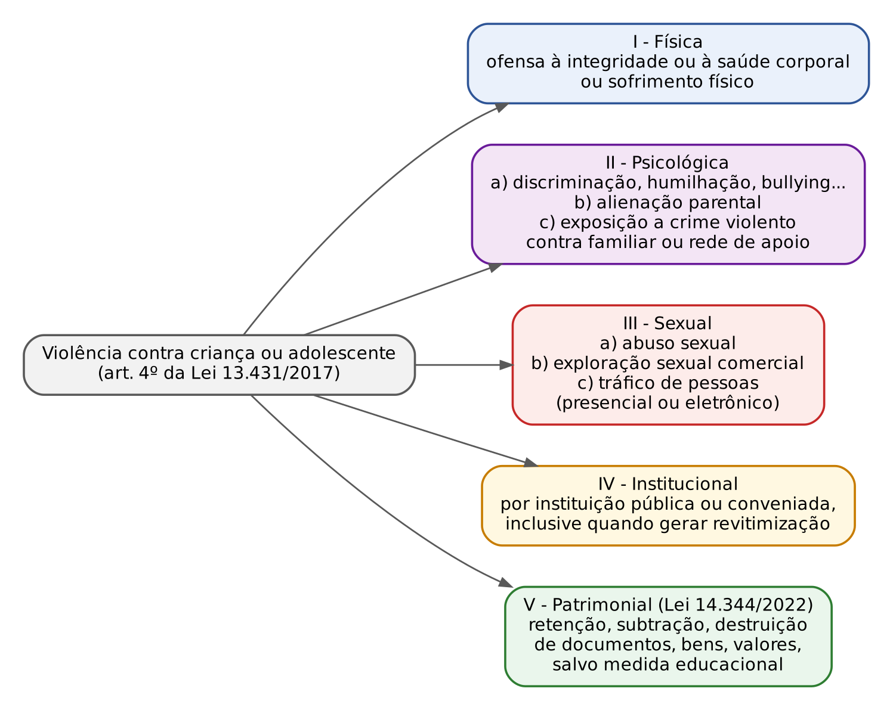
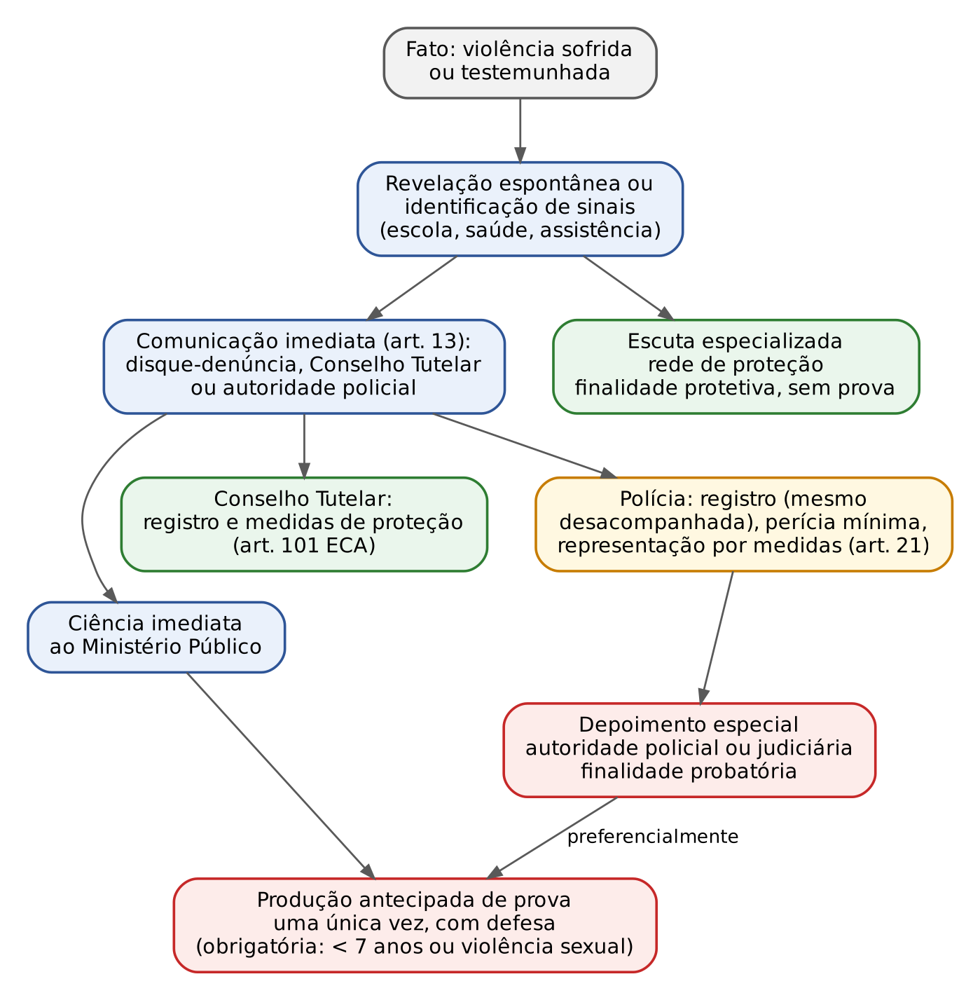
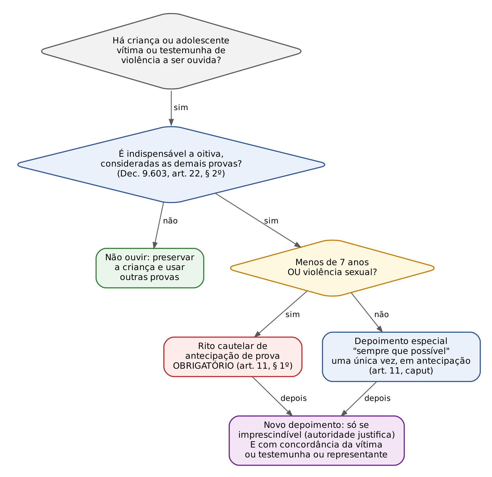
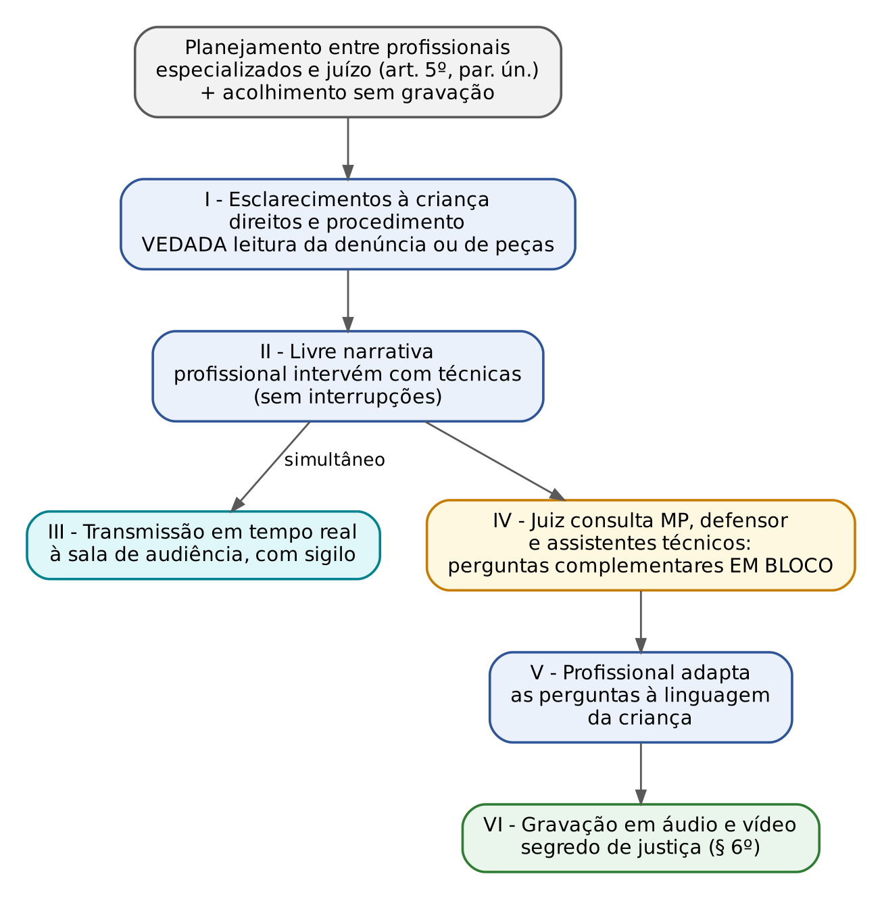
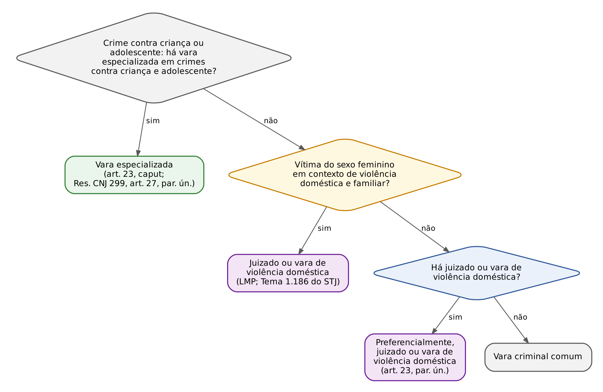
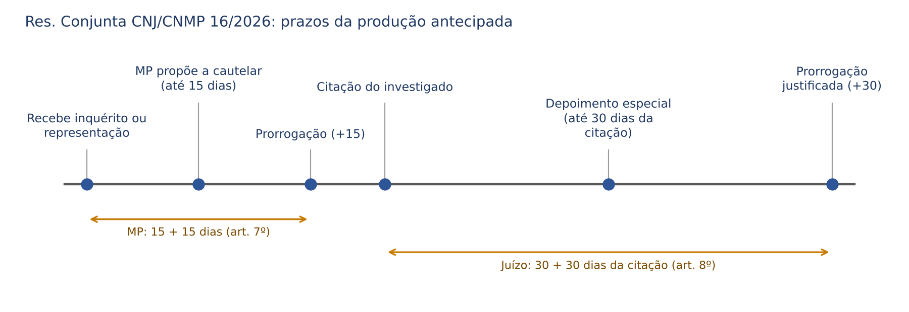

# CAPÍTULO 22 — LEI 13.431/2017 E DECRETO 9.603/2018: CRIANÇA E ADOLESCENTE VÍTIMA OU TESTEMUNHA DE VIOLÊNCIA

:::INCIDENCIA
TJSC p. 10. Nível A+. Lote: 38 questões (FGV 35, FCC 3), com seis questões de magistratura (TJ-SC 2024, duas; TJ-TO 2025; TJ-BA 2026, duas; TJ-PE 2026), três do Ministério Público e uma da Defensoria, mais correlatas de outros capítulos.
O que mais cai: escuta especializada x depoimento especial (perante quem, finalidade, valor probatório); rito cautelar obrigatório (menos de 7 anos ou violência sexual) e vedação do novo depoimento sem imprescindibilidade E concordância; o procedimento do art. 12 (vedada a leitura da denúncia, transmissão em tempo real, perguntas em bloco, afastamento do imputado); formas de violência do art. 4º e violência institucional; competência do art. 23.
:::

| Subtema | FGV | FCC | Padrão de cobrança |
|---|---|---|---|
| Escuta especializada x depoimento especial (conceito, finalidade, quem conduz) | 12 | 0 | troca dos conceitos dos arts. 7º e 8º; escuta "com finalidade probatória"; escuta pela autoridade policial; Conselho Tutelar destrinchando a violência |
| Rito cautelar e novo depoimento (art. 11) | 7 | 0 | caso: idade de 7 anos, violência sexual, adolescente acima de 14, pedido da defesa para repetir, recusa da vítima |
| Procedimento do art. 12 e protocolos de entrevista | 7 | 1 | leitura da denúncia (vedada), transmissão em tempo real, perguntas em bloco, afastamento do imputado, rapport e livre narrativa |
| Formas de violência e revitimização (art. 4º; Decreto, art. 5º) | 6 | 0 | bullying como violência psicológica; violência institucional (lei x decreto); exploração sexual; vitimização secundária |
| Direitos e garantias (arts. 5º e 6º) | 2 | 1 | confidencialidade (inciso XIV); assistência jurídica (inciso VII); silêncio |
| Integração das políticas e Decreto 9.603 | 4 | 1 | registro policial de vítima desacompanhada; DSEI e Funai; finalidades do SGD; fluxo começa no fato |
| Competência e crime do art. 24 | 2 | 0 | vara especializada, vara de violência doméstica, vara comum; ação penal do art. 24; ANPP |

## 22.1 O microssistema da escuta protegida

### 22.1.1 Fontes e hierarquia

O sistema de garantia de direitos da criança e do adolescente vítima ou testemunha de violência repousa em cinco camadas, e a prova exige saber o que está em cada uma:

| Camada | Diploma | O que regula | Onde cai |
|---|---|---|---|
| Lei | Lei 13.431/2017 (29 artigos) | conceitos, formas de violência, direitos, escuta especializada e depoimento especial, integração das políticas, competência, crime do art. 24 | literalidade dos arts. 4º, 5º, 7º, 8º, 11 e 12 |
| Regulamento | Decreto 9.603/2018 (32 artigos) | princípios, finalidades do SGD, conceitos de violência institucional e revitimização, fluxo intersetorial, atuação de cada política, detalhamento da escuta e do depoimento | conceitos do art. 5º; arts. 13, 16 a 19, 22 e 26 |
| Ato do CNJ | Resolução CNJ 299/2019, alterada pelas Resoluções 639/2025 e 682/2026 | atuação dos tribunais: convênios, fluxos, salas obrigatórias, equipes, capacitação, controle do depoimento pelo magistrado, especialização de varas | salas "obrigatórias em todas as comarcas"; transmissão on-line; competência |
| Ato conjunto | Resolução Conjunta CNJ/CNMP 16/2026 | efetividade da produção antecipada: prazos ao MP e ao juízo, prioridade equiparada a réu preso, indispensabilidade, medidas protetivas | prazos de 15 e 30 dias (ver 22.8.3) |
| Ato local | Diretrizes da CEIJ/TJSC para o depoimento especial (atualizadas em 16/9/2026) e atos conjuntos GP/CGJ | operação do depoimento em Santa Catarina | idade mínima recomendada, agenda, comunicação por chat, bloco único |

Leis que dialogam com o sistema e que a FGV costuma misturar no mesmo enunciado: ECA (arts. 13, 70-A, 101, 130, 208, XI, e 245), Lei 12.318/2010 (art. 8º-A: oitiva da criança em alienação parental "obrigatoriamente nos termos da Lei nº 13.431", sob pena de nulidade — Cap. 7), Lei 14.344/2022 (Lei Henry Borel, que manda colher o depoimento da criança vítima ou testemunha de violência doméstica pela Lei 13.431 e incluiu a violência patrimonial no art. 4º — Cap. 23), Lei 13.869/2019, art. 15-A (crime de violência institucional, incluído pela Lei 14.321/2022 — Apostila de Direito Penal, Cap. 44) e CPP, arts. 350-A e 350-B (medidas protetivas para vítimas de crimes sexuais e vulneráveis, Lei 15.280/2025 — ver 22.6.6).

:::ATENCAO ALTERAÇÕES LEGISLATIVAS DE 2023 A 2026: O QUE MUDOU E O QUE NÃO MUDOU
O texto compilado da Lei 13.431/2017 no Planalto registra UMA única alteração desde a promulgação: a inclusão do inciso V do art. 4º (violência patrimonial) pela Lei 14.344/2022. O Decreto 9.603/2018 não sofreu alteração. A Lei 15.280/2025 (5/12/2025, DOU de 8/12/2025) NÃO alterou a Lei 13.431: ela agravou as penas dos crimes sexuais contra vulnerável (CP, arts. 217-A, 218, 218-A, 218-B e 218-C), criou o crime de descumprimento de medidas protetivas no art. 338-A do CP, inseriu no CPP a identificação genética obrigatória do art. 300-A e o Título IX-A ("Das Medidas Protetivas de Urgência", arts. 350-A e 350-B), alterou a LEP (arts. 119-A e 146-E) e deu nova redação aos arts. 70-A, II e IX, e 101, V, do ECA. Também a Lei 15.487/2026 (6/8/2026), que reformou os crimes dos arts. 240 a 241-E do ECA (Cap. 21), NÃO alterou a Lei 13.431 (seus artigos alteram ECA, CPP, Lei 8.072/1990, Lei 12.850/2013 e CP); ela apenas criou no ECA o art. 227-B, que assegura à criança ou ao adolescente vítima ou testemunha de violência sexual atendimento psicológico e psicossocial "individual, especializado, contínuo e integral, nos termos da Lei nº 13.431" (ver 22.6.3). A pegadinha provável é atribuir à Lei 15.280 ou à Lei 15.487 alteração da Lei 13.431 ou, ao contrário, ignorar que o art. 350-A, § 6º, do CPP estende as medidas protetivas a qualquer crime contra criança ou adolescente.
:::

### 22.1.2 Objeto, fundamento e âmbito subjetivo

O art. 1º apresenta a lei como norma que "normatiza e organiza" o sistema de garantia de direitos da criança e do adolescente vítima ou testemunha de violência, cria mecanismos para prevenir e coibir a violência e estabelece medidas de assistência e proteção, com fundamento no art. 227 da CF, na Convenção sobre os Direitos da Criança e seus protocolos, na Resolução 20/2005 do Conselho Econômico e Social da ONU (as Diretrizes para a Justiça em Assuntos Envolvendo Crianças Vítimas ou Testemunhas de Crimes) e em outros diplomas internacionais. A referência à Resolução 20/2005 do ECOSOC é a única fonte internacional nominada além da Convenção, e aparece em prova como distrator (troca por Regras de Beijing ou de Havana, que tratam de adolescentes em conflito com a lei — Cap. 2).

O art. 2º reafirma a proteção integral e acrescenta o traço distintivo do diploma: crianças e adolescentes "gozam de direitos específicos à sua condição de vítima ou testemunha". O parágrafo único impõe aos quatro entes políticos políticas "integradas e coordenadas" no âmbito das relações domésticas, familiares e sociais. O art. 3º repete a regra de interpretação do art. 6º do ECA (fins sociais e condição peculiar de pessoa em desenvolvimento, com absoluta prioridade).

:::PEGADINHA FAIXA DE 18 A 21 ANOS: FACULTATIVA
Art. 3º, parágrafo único: a aplicação da lei "é facultativa para as vítimas e testemunhas de violência entre 18 (dezoito) e 21 (vinte e um) anos", com remissão ao art. 2º, parágrafo único, do ECA. A FGV troca "facultativa" por "obrigatória" (Q2513058, Câmara dos Deputados 2024, atribuída ao Cap. 23: a alternativa que estendia o sistema "obrigatoriamente" a essa faixa era falsa). Ver Cap. 1 (aplicação excepcional do ECA de 18 a 21). Na prática catarinense, o Boletim CEIJ/TJSC 8/2025 registra o uso do depoimento especial para vítimas adultas de violência doméstica, com o rito seguido integralmente; isso é opção judicial de organização da prova, não imposição legal.
:::

O âmbito objetivo é amplo: a lei protege a vítima E A TESTEMUNHA de violência, sem distinguir o local (doméstico, institucional, comunitário, digital) nem o autor (adulto, outro adolescente, agente público). A FGV explora a palavra "testemunha" em casos de crianças que presenciam crimes (Q2375193, adiante) e a irrelevância do contexto doméstico (Q3049364, adolescente agredido por agente socioeducativo).

### 22.1.3 Vigência, prazos de implementação e alterações no ECA

- Vigência: "após decorrido 1 (um) ano de sua publicação oficial" (art. 29); publicada no DOU de 5/4/2017, entrou em vigor em abril de 2018. O Decreto 9.603, de 10/12/2018, entrou em vigor na data da publicação (art. 32).
- Prazos de implementação: 60 dias para o poder público emanar atos normativos (art. 26); 180 dias para Estados, Distrito Federal e Municípios estabelecerem normas sobre o sistema no âmbito de suas competências (art. 27). No Decreto: 180 dias para os órgãos instituírem o comitê de gestão colegiada, definirem o fluxo e criarem grupos intersetoriais (art. 9º); 90 dias para o ato conjunto ministerial (art. 31).
- Alterações no ECA feitas pela própria Lei 13.431: acrescentou o inciso XI ao art. 208 (ação de responsabilidade pelo não oferecimento ou oferta irregular "de políticas e programas integrados de atendimento à criança e ao adolescente vítima ou testemunha de violência" — Cap. 20) e REVOGOU o art. 248 do ECA (infração administrativa de deixar de apresentar à autoridade judiciária adolescente trazido de outra comarca para serviço doméstico — Cap. 21).
- Sanção pelo descumprimento: o art. 4º, § 4º, remete às sanções do ECA (infrações administrativas, em especial o art. 245, para quem deixa de comunicar maus-tratos — Cap. 21; e ações de responsabilidade do art. 208).

### 22.1.4 A razão de ser: vitimização secundária

A lei existe para combater a vitimização SECUNDÁRIA (ou sobrevitimização): o dano causado não pelo agressor, mas pelas instâncias formais de controle — o relato repetido a professor, conselheiro, policial, médico, perito, promotor e juiz; a acareação; a pergunta sugestiva; a exposição ao réu. A vitimização primária é a própria violência; a terciária, o estigma e o abandono pelo meio social e familiar após o fato (ou, em outra acepção, a vitimização do autor pelo sistema penal). O Decreto 9.603 dá nome técnico ao fenômeno: REVITIMIZAÇÃO (art. 5º, II), e a lei o qualifica como forma de violência institucional (art. 4º, IV, parte final).

:::QUESTAO FGV 2026 — PC-PR — AGENTE DE POLÍCIA JUDICIÁRIA (Q4375128)
À luz da vitimologia, perguntava-se qual vitimização a lei busca evitar ao disciplinar a forma de oitiva. Gabarito: B (secundária).
Armadilha: "primária" é a violência em si (a lei não a evita com a escuta; evita com prevenção); "terciária" é o etiquetamento social; "vicária" é a violência dirigida aos filhos para atingir a mãe (hoje forma legal de violência doméstica contra a mulher, LMP, art. 7º, VI, incluído pela Lei 15.384/2026; homicídio com esse fim é o vicaricídio, CP, art. 121-B — Cap. 23, 23.2.3 e 23.11.3); "preterdolosa" é categoria de culpabilidade penal, mero distrator.
:::

:::QUESTAO FGV 2026 — TJ-RJ — ANALISTA JUDICIÁRIO — ASSISTENTE SOCIAL (Q3869538)
A oitiva de crianças e adolescentes pelas técnicas de escuta especializada e depoimento especial é: B (obrigatória).
Fundamento: art. 4º, § 1º ("serão ouvidos ... por meio de escuta especializada e depoimento especial"), e o considerando da Res. CNJ 299/2019 ("torna obrigatória a oitiva"). O art. 25 da resolução reforça que ser ouvido na forma do depoimento especial "não se trata de faculdade procedimental". Armadilhas: "dependente de despacho do juiz", "determinada pelo tipo de violência" e "condicionada à autorização dos responsáveis". O que é obrigatório é a FORMA, quando houver oitiva; não a oitiva em si, que pode ser dispensada se desnecessária (Decreto, art. 22, § 2º; ver 22.5.1).
:::

## 22.2 Formas de violência (art. 4º)

O art. 4º define as formas de violência "para os efeitos desta Lei, sem prejuízo da tipificação das condutas criminosas". Duas consequências: (a) as definições servem para acionar o sistema de proteção (escuta, depoimento, fluxo, medidas), não para criar tipos penais; (b) a conduta pode configurar violência para a lei sem ser crime (bullying, alienação parental, violência institucional não tipificada), e o sistema incide do mesmo modo.

### 22.2.1 Violência física (inciso I)

"A ação infligida à criança ou ao adolescente que ofenda sua integridade ou saúde corporal ou que lhe cause sofrimento físico." Não exige lesão: basta o sofrimento físico, o que abrange o castigo físico do art. 18-A do ECA (Lei Menino Bernardo — Cap. 3). O uso de palmatória, alternativa de Q2375394, é violência FÍSICA, não psicológica.

### 22.2.2 Violência psicológica (inciso II)

Três alíneas, que a FGV cobra pela literalidade:

- a) "qualquer conduta de discriminação, depreciação ou desrespeito ... mediante ameaça, constrangimento, humilhação, manipulação, isolamento, agressão verbal e xingamento, ridicularização, indiferença, exploração ou intimidação sistemática (bullying) que possa comprometer seu desenvolvimento psíquico ou emocional". A "indiferença" está no rol: a negligência afetiva grave é violência psicológica, o que dialoga com o abandono afetivo (Cap. 7);
- b) o ato de ALIENAÇÃO PARENTAL, com definição própria (interferência na formação psicológica promovida ou induzida por genitor, avós ou quem tenha a criança sob autoridade, guarda ou vigilância, que leve ao repúdio de genitor ou prejudique o vínculo). A definição é mais enxuta que a do art. 2º da Lei 12.318/2010, mas a consequência é a mesma: a oitiva da criança no processo de alienação segue a Lei 13.431 (Lei 12.318, art. 8º-A — Cap. 7);
- c) "qualquer conduta que exponha a criança ou o adolescente, direta ou indiretamente, a crime violento contra membro de sua família ou de sua rede de apoio, independentemente do ambiente em que cometido, particularmente quando isto a torna testemunha". É a hipótese da criança que presencia o feminicídio da mãe ou o homicídio do avô: ela é vítima de violência psicológica E testemunha, e o depoimento especial é obrigatório.

:::QUESTAO FGV 2024 — TJ-RJ — PROGRAMA DE RESIDÊNCIA — ASSISTENTE SOCIAL (Q2375394)
No sistema da Lei 13.431, a violência psicológica inclui: A (intimidação sistemática).
Armadilhas: presenciar ato libidinoso é violência SEXUAL (inciso III, que abrange constranger a "presenciar" conjunção carnal ou ato libidinoso); subtração de documentos pessoais é PATRIMONIAL (inciso V); palmatória é FÍSICA; "dificultar assistência psicossocial" não está no rol (pode ser violência institucional se praticada por instituição).
:::

### 22.2.3 Violência sexual (inciso III)

"Qualquer conduta que constranja a criança ou o adolescente a praticar ou presenciar conjunção carnal ou qualquer outro ato libidinoso, inclusive exposição do corpo em foto ou vídeo por meio eletrônico ou não", que compreenda:

| Alínea | Espécie | Núcleo da definição | Correspondência penal (remissão) |
|---|---|---|---|
| a | abuso sexual | utilização para fins sexuais, conjunção carnal ou outro ato libidinoso, presencial ou eletrônico, para estimulação sexual do agente ou de terceiro | CP, arts. 217-A, 218, 218-A; ECA, arts. 240 a 241-D |
| b | exploração sexual comercial | uso em atividade sexual EM TROCA DE REMUNERAÇÃO OU QUALQUER OUTRA COMPENSAÇÃO, de forma independente ou sob patrocínio, apoio ou incentivo de terceiro, presencial ou eletrônico | CP, art. 218-B; ECA, art. 244-A |
| c | tráfico de pessoas | recrutamento, transporte, transferência, alojamento ou acolhimento, no território nacional ou para o estrangeiro, com fim de exploração sexual, mediante ameaça, força, coação, rapto, fraude, engano, abuso de autoridade, aproveitamento de vulnerabilidade ou pagamento | CP, art. 149-A |

O traço que separa abuso de exploração é a MERCANTILIZAÇÃO (troca, compensação), não a presença de terceiro intermediário: a exploração pode ser "de forma independente". O consentimento do adolescente e a participação nos lucros são irrelevantes. A dogmática dos tipos penais está na Apostila de Direito Penal (Caps. 31 e 42); aqui importa que qualquer violência sexual, presencial ou digital, atrai o rito cautelar obrigatório do art. 11, § 1º, II.

:::QUESTAO FGV 2025 — AGSUS — ANALISTA DE GESTÃO — PSICOLOGIA (Q3660375)
A partir do debate público sobre "adultização" de crianças em meios digitais, pedia-se a definição de exploração sexual. Gabarito: B (utilização de crianças e adolescentes em atividades de caráter sexual numa relação de mercantilização).
Armadilhas: exigir "contato físico direto" (a lei admite o meio eletrônico); afastar a exploração por "consentimento" do adolescente ou porque ele e o representante "participam dos lucros" (a compensação é justamente o elemento da alínea b). No mesmo sentido, quanto ao meio eletrônico, Q3870049 (22.4.4): criança que envia fotos despida a desconhecido em plataforma de jogos é vítima de violência sexual com previsão expressa de depoimento especial.
:::

### 22.2.4 Violência institucional (inciso IV) e revitimização

Na lei, violência institucional é "a praticada por instituição pública ou conveniada, inclusive quando gerar revitimização". No decreto (art. 5º, I), o foco desloca-se da instituição para o AGENTE: "violência praticada por agente público no desempenho de função pública, em instituição de qualquer natureza, por meio de atos comissivos ou omissivos que prejudiquem o atendimento à criança ou ao adolescente vítima ou testemunha de violência".

|  | Lei 13.431, art. 4º, IV | Decreto 9.603, art. 5º, I |
|---|---|---|
| Sujeito | instituição pública ou conveniada | agente público no desempenho de função pública |
| Local | não especifica | instituição de qualquer natureza |
| Conduta | qualquer violência, inclusive a que gera revitimização | atos comissivos ou omissivos que prejudiquem o atendimento à vítima ou testemunha |

Revitimização (Decreto, art. 5º, II): "discurso ou prática institucional que submeta crianças e adolescentes a procedimentos desnecessários, repetitivos, invasivos, que levem as vítimas ou testemunhas a reviver a situação de violência ou outras situações que gerem sofrimento, estigmatização ou exposição de sua imagem". O decreto define ainda acolhimento ou acolhida (posicionamento ÉTICO do profissional para identificar necessidades e demonstrar "cuidado, responsabilização e resolutividade" — inciso III) e serviço de acolhimento no SUAS (inciso IV).

A Lei 14.321/2022 transformou parte desse conceito em crime: art. 15-A da Lei 13.869/2019 (submeter vítima de infração penal ou testemunha de crimes violentos a procedimentos desnecessários, repetitivos ou invasivos, que a leve a reviver, sem estrita necessidade, a situação de violência ou outras situações potencialmente geradoras de sofrimento ou estigmatização; detenção de 3 meses a 1 ano e multa; aumento de 2/3 se o agente permitir que terceiro intimide a vítima; pena em dobro se o próprio agente a intimidar). Dogmática: Apostila de Direito Penal, Cap. 44.

:::PEGADINHA "VIOLÊNCIA INSTITUCIONAL NÃO TEM PREVISÃO LEGAL"
Errado. Está no art. 4º, IV, da Lei 13.431/2017 desde 2017, no art. 5º, I, do Decreto 9.603/2018 e, como crime, no art. 15-A da Lei 13.869/2019. A alternativa D de Q4349498 (TJ-PE 2026, ver 22.5.3) dizia que a violência institucional "ainda não possui previsão legal expressa" e por isso foi descartada, embora o resto dela (indeferir a repetição) estivesse na direção certa.
:::

:::QUESTAO FGV 2025 — MPU — ANALISTA — PSICOLOGIA (Q3339548)
Três itens sobre violência institucional. Gabarito: D (II e III).
Item II (correto): reproduz o Decreto, art. 5º, I (agente público, função pública, atos comissivos ou omissivos que prejudiquem o atendimento). Item III (correto): a revitimização por FALTA DE FLUXOS na rede caracteriza violência institucional (omissão estrutural; o art. 13, parágrafo único, da lei menciona campanhas e divulgação dos fluxos "como forma de evitar a violência institucional"). Item I (errado): a escuta especializada NÃO é estratégia de produção antecipada de prova; não tem escopo probatório (Decreto, art. 19, § 4º).
:::

:::QUESTAO FGV 2024 — TJ-RJ — PROGRAMA DE RESIDÊNCIA — PSICÓLOGO (Q2375189)
Pedia-se o nome do conceito "discurso ou prática institucional que submeta crianças e adolescentes a procedimentos desnecessários, repetitivos, invasivos...". Gabarito: C (revitimização, Decreto, art. 5º, II).
Armadilha: "violência institucional" é o gênero, mas o decreto reserva essa expressão ao inciso I (ato do agente público que prejudica o atendimento); a definição literal transcrita é a do inciso II. A FGV cobra o RÓTULO do decreto.
:::

:::QUESTAO FGV 2026 — MPE-GO — PROMOTOR DE JUSTIÇA SUBSTITUTO (Q3865809)
Gabarito: C (a revitimização ocorre com procedimentos desnecessários, repetitivos ou invasivos que levam a reviver a violência e pode configurar violência institucional praticada por órgãos públicos ou conveniados).
Armadilhas: A inverte os conceitos (escuta "perante autoridade judicial ou policial" com finalidade probatória e depoimento "pela rede de proteção"); B cria exceção inexistente ao art. 9º ("salvo quando o contato visual for imprescindível para a ampla defesa": o resguardo é absoluto; a defesa se exerce pela transmissão e pelas perguntas em bloco); D nega valor probatório ao depoimento especial; E admite depoimento "por qualquer pessoa da rede", "sem protocolos formais" (o art. 11 exige protocolos; o art. 12, profissionais especializados).
:::

Correlata: em Q4289353 (FGV 2026, DPE-RJ, atribuída ao Cap. 4), a alternativa que invocava "revitimização secundária" para manter separados irmãos acolhidos foi rejeitada; o gabarito determinava o reagrupamento (não desmembramento de grupos de irmãos). Revitimização não é argumento genérico contra qualquer mudança: pressupõe procedimento desnecessário, repetitivo ou invasivo.

### 22.2.5 Violência patrimonial (inciso V)

Incluída pela Lei 14.344/2022: "qualquer conduta que configure retenção, subtração, destruição parcial ou total de seus documentos pessoais, bens, valores e direitos ou recursos econômicos, incluídos os destinados a satisfazer suas necessidades, desde que a medida não se enquadre como educacional". A ressalva final (medida "educacional") é a pegadinha: a retenção do celular como sanção disciplinar proporcional não é violência patrimonial; a apropriação da pensão alimentícia ou do benefício assistencial da criança é. A definição espelha o art. 7º, IV, da Lei Maria da Penha, com a ressalva educacional como acréscimo próprio.

### 22.2.6 Revelação espontânea e o dever de "confirmar" (art. 4º, §§ 1º a 3º)

- § 1º: a criança e o adolescente serão ouvidos sobre a situação de violência por meio de escuta especializada e depoimento especial (as duas únicas formas).
- § 2º: órgãos de saúde, assistência social, educação, segurança pública e justiça "adotarão os procedimentos necessários por ocasião da revelação espontânea da violência".
- § 3º: "Na hipótese de revelação espontânea da violência, a criança e o adolescente serão chamados a confirmar os fatos na forma especificada no § 1º deste artigo, salvo em caso de intervenções de saúde."

:::PEGADINHA REVELAÇÃO ESPONTÂNEA NÃO DISPENSA A OITIVA PROTEGIDA
A FGV afirmou que, revelada espontaneamente a violência, a criança "não será chamada a confirmar os fatos, a fim de evitar a revitimização" (Q2513058, Câmara dos Deputados 2024): FALSO. O § 3º manda chamar a confirmar, mas pela escuta especializada ou pelo depoimento especial, nunca por interrogatório informal; a única ressalva é a intervenção de saúde (o médico que atende a criança não precisa submetê-la a escuta para tratá-la). Quem recebe a revelação (professor, conselheiro) acolhe, registra o relato espontâneo e encaminha (Decreto, arts. 11 e 28, III), sem investigar.
:::

## 22.3 Direitos e garantias da vítima e da testemunha

### 22.3.1 O rol do art. 5º

O art. 5º enumera, "entre outros", quinze direitos e garantias que formam a base de aplicação da lei. O rol é exemplificativo e se soma aos princípios do ECA (art. 100, parágrafo único) e aos do Decreto 9.603 (art. 2º). Os incisos que mais caem:

| Inciso | Direito | Nota de prova |
|---|---|---|
| I | prioridade absoluta e condição peculiar de pessoa em desenvolvimento | repete o art. 227 da CF |
| III | intimidade e condições pessoais protegidas | fundamenta o segredo de justiça do art. 12, § 6º |
| IV | proteção contra discriminação por classe, sexo, raça, etnia, renda, cultura, escolaridade, idade, religião, nacionalidade, procedência regional, REGULARIDADE MIGRATÓRIA, deficiência ou outra condição, sua, dos pais ou representantes | a "regularidade migratória" é a novidade frente ao art. 5º do ECA |
| V | informação adequada à etapa de desenvolvimento sobre direitos, serviços, REPRESENTAÇÃO JURÍDICA, medidas de proteção, reparação de danos e procedimentos |  |
| VI | ser ouvido e expressar desejos e opiniões, ASSIM COMO PERMANECER EM SILÊNCIO | o silêncio é direito, não obstáculo processual |
| VII | assistência qualificada jurídica e psicossocial especializada, que facilite a participação e o RESGUARDE CONTRA COMPORTAMENTO INADEQUADO ADOTADO PELOS DEMAIS ÓRGÃOS ATUANTES NO PROCESSO | Q3304083 |
| VIII | ser resguardado de sofrimento, com apoio, planejamento da participação, prioridade na tramitação, celeridade, idoneidade do atendimento e LIMITAÇÃO DAS INTERVENÇÕES | o planejamento, no depoimento especial, é feito entre os profissionais especializados e o juízo (parágrafo único) |
| IX | ser ouvido no horário mais adequado e conveniente, sempre que possível |  |
| X | segurança, com avaliação contínua de intimidação e ameaça |  |
| XI | profissional capacitado e CONHECER os profissionais que participam da escuta e do depoimento | veda o observador oculto (ver diretriz TJSC n. 5) |
| XII | reparação quando violados os direitos |  |
| XIII | convivência familiar e comunitária | justifica o afastamento do agressor, não da vítima |
| XIV | informações tratadas CONFIDENCIALMENTE, vedada a utilização ou o repasse a terceiro das declarações da vítima, SALVO para fins de assistência à saúde e de persecução penal | Q3869541 |
| XV | declarações em formato adaptado à criança com deficiência ou em idioma diverso do português | Decreto, arts. 4º e 6º |

:::QUESTAO FCC 2025 — DPE-SP — ANALISTA DE DEFENSORIA (Q3304083)
Pedia-se um dos objetivos expressos da assistência jurídica qualificada. Gabarito: E (resguardá-los contra comportamento inadequado adotado pelos demais órgãos atuantes no processo — art. 5º, VII, literal).
Armadilhas: direito a "assistente de acusação" (não está na lei; a habilitação como assistente segue o CPP); oitiva "perante a rede de proteção" pelo procedimento do depoimento especial (a rede faz escuta, não depoimento); afastamento do convívio "por meio de acolhimento familiar" (a lógica é afastar o agressor); oitiva "tantas vezes quantas necessárias" (contraria o art. 11).
:::

:::QUESTAO FGV 2026 — TJ-RJ — ANALISTA JUDICIÁRIO — ASSISTENTE SOCIAL (Q3869541)
Assistente social da Vara da Infância realiza escuta de criança autista vítima de bullying; a diretora da escola quer saber quem é o agressor. Gabarito: C (as informações são confidenciais; vedada a utilização ou o repasse a terceiro, salvo para fins de assistência à saúde e de persecução penal — art. 5º, XIV).
Armadilhas: B invoca o código de ética profissional com exceção de "risco à vida de outros" (a resposta exigida é a regra LEGAL da Lei 13.431); A e D mandam repetir o relato à diretora ou revelar o nome do agressor (revitimização e quebra de confidencialidade); E convoca atendimento conjunto com os responsáveis para orientação (não é o que a lei prevê para o repasse de informações). Observe que a confidencialidade não impede o compartilhamento DENTRO da rede, por relatórios, conforme o fluxo e com sigilo (Decreto, arts. 9º, § 2º, 28 a 30): a escola integra a rede, mas o que recebe é o encaminhamento, não as declarações da vítima.
:::

### 22.3.2 Silêncio, recusa e assistência jurídica no plano normativo

O direito ao silêncio aparece três vezes: na lei (art. 5º, VI), no decreto ("garantido o direito de permanecer em silêncio" — art. 2º, VI; "serão respeitados em sua iniciativa de não falar sobre a violência sofrida" — art. 22, § 3º) e na Res. CNJ 299/2019 ("direito ao silêncio e a não prestar depoimento", art. 19). A Res. Conjunta CNJ/CNMP 16/2026 manda respeitar a "recusa livre e informada" da criança ou do adolescente em depor (art. 16, § 5º), e as Diretrizes da CEIJ/TJSC vedam a condução coercitiva e qualquer pressão (itens 1 a 3). Consequência prática: a criança vítima não é testemunha compromissada, não pode ser conduzida coercitivamente para o depoimento especial e o silêncio não pode ser valorado contra ela; a prova da materialidade e da autoria terá de vir de outras fontes (art. 22 da lei).

A assistência jurídica tem previsão na lei (art. 5º, V e VII) e na Res. CNJ 299 (art. 18, § 1º: o magistrado deve velar pela assistência por Defensor Público ou advogado conveniado ou nomeado, "se assim desejar a criança e/ou adolescente"). A Res. Conjunta 16/2026 prevê ainda a nomeação de curador especial quando o responsável legal não estiver presente no ato (art. 4º, § 4º).

### 22.3.3 Medidas protetivas e casos omissos (art. 6º)

"A criança e o adolescente vítima ou testemunha de violência têm direito a pleitear, por meio de seu representante legal, medidas protetivas contra o autor da violência." O parágrafo único manda interpretar os casos omissos à luz do ECA, da Lei Maria da Penha e de normas conexas. Daí: (a) antes da Lei 14.344/2022, o art. 6º já autorizava o juiz a aplicar, por analogia, as medidas do art. 22 da LMP em favor da criança; (b) hoje, na violência doméstica e familiar contra criança e adolescente, o regime é o da Lei Henry Borel (Cap. 23); fora desse contexto, valem o art. 21 desta lei, o art. 130 do ECA (Cap. 13) e os arts. 350-A e 350-B do CPP (22.6.6).

### 22.3.4 Princípios e finalidades no Decreto 9.603

O art. 2º do decreto lista nove princípios. Os que diferem do ECA e por isso caem: intervenção "precoce, mínima e urgente" das autoridades tão logo a situação de perigo seja conhecida (V); direito de exprimir opiniões livremente, inclusive nos procedimentos administrativos e jurídicos, consideradas idade e maturidade, garantido o silêncio (VI); direito de ser CONSULTADO acerca da preferência em ser atendido por profissional do MESMO GÊNERO (IX); preferência na proteção e socorro, no atendimento, na formulação de políticas e na destinação de recursos (IV, que repete o art. 4º, parágrafo único, do ECA).

O art. 3º fixa as finalidades da intervenção do sistema: I mapear as ocorrências e suas particularidades no território nacional; II prevenir os atos de violência; III fazer cessar a violência quando ocorrer; IV prevenir a reiteração; V promover o atendimento para minimizar as sequelas; VI promover a reparação integral dos direitos. O art. 4º manda consultar a criança, brasileira ou estrangeira, que fale outros idiomas sobre o idioma em que prefere se manifestar.

:::QUESTAO FGV 2024 — TJ-RJ — PROGRAMA DE RESIDÊNCIA — ASSISTENTE SOCIAL (Q2375397)
Pelo Decreto 9.603, o SGD intervém nas situações de violência com a finalidade de: I fazer cessar a violência; II formular e executar as políticas sociais públicas; III coibir a violação ou ameaça aos direitos. Gabarito: A (apenas I).
Armadilha: II é PREFERÊNCIA da criança na formulação e execução das políticas (art. 2º, IV, "c"), não finalidade da intervenção; III soa natural, mas não consta do art. 3º (cujos verbos são mapear, prevenir, fazer cessar, prevenir a reiteração, promover atendimento e promover reparação). A FGV troca listas vizinhas do mesmo decreto.
:::

## 22.4 Escuta especializada x depoimento especial

### 22.4.1 Os conceitos legais e regulamentares

:::LEI LEI 13.431/2017, ARTS. 7º E 8º
"Art. 7º Escuta especializada é o procedimento de entrevista sobre situação de violência com criança ou adolescente perante órgão da rede de proteção, limitado o relato estritamente ao necessário para o cumprimento de sua finalidade.
Art. 8º Depoimento especial é o procedimento de oitiva de criança ou adolescente vítima ou testemunha de violência perante autoridade policial ou judiciária."
:::

O decreto completa cada conceito com a FINALIDADE, que a lei deixou implícita:

:::LEI DECRETO 9.603/2018, ART. 19, CAPUT E § 4º, E ART. 22, CAPUT
"Art. 19. A escuta especializada é o procedimento realizado pelos órgãos da rede de proteção nos campos da educação, da saúde, da assistência social, da segurança pública e dos direitos humanos, com o objetivo de assegurar o acompanhamento da vítima ou da testemunha de violência, para a superação das consequências da violação sofrida, limitado ao estritamente necessário para o cumprimento da finalidade de proteção social e de provimento de cuidados.
[...]
§ 4º A escuta especializada não tem o escopo de produzir prova para o processo de investigação e de responsabilização, e fica limitada estritamente ao necessário para o cumprimento de sua finalidade de proteção social e de provimento de cuidados.
Art. 22. O depoimento especial é o procedimento de oitiva de criança ou adolescente vítima ou testemunha de violência perante autoridade policial ou judiciária com a finalidade de produção de provas."
:::

| Critério | Escuta especializada | Depoimento especial |
|---|---|---|
| Natureza | ENTREVISTA | OITIVA |
| Perante quem | órgão da REDE DE PROTEÇÃO (educação, saúde, assistência social, segurança pública, direitos humanos) | AUTORIDADE POLICIAL OU JUDICIÁRIA |
| Finalidade | proteção social e provimento de cuidados; acompanhamento para superar as consequências | produção de PROVA (investigação e responsabilização) |
| Valor probatório | nenhum escopo probatório (Dec., art. 19, § 4º); não substitui o depoimento (Res. Conjunta 16/2026, art. 23) | prova; colhida em antecipação com contraditório, dispensa repetição |
| Extensão do relato | estritamente o necessário à finalidade protetiva | narrativa livre e completa, conforme protocolo |
| Quem conduz | profissional capacitado da rede (Dec., art. 20) | profissionais especializados; autoridades capacitadas (Dec., art. 26); o juiz, se a vítima preferir (art. 12, § 1º) |
| Protocolo | atendimento condizente com os princípios do art. 2º do decreto | protocolo de oitiva obrigatório (art. 11; Dec., art. 25); no Judiciário, Protocolo Brasileiro de Entrevista Forense (Res. CNJ 299, arts. 8º, 14 e 20) |
| Gravação | não exigida | áudio e vídeo, integral, desde o começo (art. 12, VI; Dec., arts. 23 e 26, § 2º) |
| Repetição | pode haver mais de um contato na rede, sempre no mínimo necessário e com preferência por buscar informação com adultos e outros profissionais (Dec., arts. 15 e 19, § 2º) | em regra, UMA única vez; novo depoimento só com imprescindibilidade e concordância (art. 11, § 2º) |
| Pontos comuns | local apropriado e acolhedor (art. 10); resguardo de contato com o suposto autor (art. 9º); profissionais capacitados (art. 14, § 1º, II; Dec., art. 27) |  |

:::DICA COMO RESOLVER QUALQUER ALTERNATIVA EM SEGUNDOS
Duas perguntas: PERANTE QUEM? (rede de proteção = escuta; polícia ou juiz = depoimento) e PARA QUÊ? (cuidar = escuta; provar = depoimento). Toda alternativa que coloque a escuta perante autoridade policial ou judiciária, que lhe atribua finalidade probatória ou que diga que ela "substitui" o depoimento está errada. Toda alternativa que diga que o depoimento é feito pela rede socioassistencial, sem protocolo, ou que não pode ser gravado está errada.
:::

:::ATENCAO SEGURANÇA PÚBLICA APARECE NOS DOIS CONCEITOS
O art. 19 do decreto inclui a "segurança pública" entre os campos da rede que realizam escuta especializada; o art. 8º da lei coloca a "autoridade policial" entre as que tomam depoimento especial. Não há contradição: o policial que acolhe a criança na delegacia e colhe só o necessário ao registro e ao encaminhamento faz escuta; a oitiva formal para a investigação, conduzida pela autoridade policial, é depoimento especial e segue as mesmas garantias (art. 20, § 3º, da lei; Res. Conjunta 16/2026, art. 6º, que manda o MP evitar a oitiva em sede policial e priorizar a antecipação judicial). O que a autoridade policial NÃO faz é "escuta especializada com finalidade probatória" (Q2367617).
:::

### 22.4.2 Questões sobre os conceitos

:::QUESTAO FGV 2024 — MPE-GO — PROMOTOR DE JUSTIÇA SUBSTITUTO (Q2367617)
Centro integrado municipal previa "escuta especializada" pela autoridade policial para coletar provas e, se insuficientes, uma segunda escuta "na busca pela verdade real". Gabarito: D (o procedimento a ser realizado pela autoridade policial é o depoimento especial, de caráter excepcional, observadas as diretrizes da lei para o depoimento especial em juízo).
Resolução: (1) quem ouve é a autoridade policial e para produzir prova: é depoimento, não escuta (arts. 7º e 8º); (2) a oitiva policial é excepcional, porque a regra é a antecipação judicial uma única vez (art. 11) e o art. 20, § 3º, manda observar o art. 14; (3) a segunda oitiva planejada de antemão viola o art. 11, § 2º. Armadilhas: A e B trocam as definições; C nega que escutas sucessivas revitimizem; E atribui a escuta com exclusividade ao serviço de saúde (é de toda a rede).
:::

:::QUESTAO FGV 2026 — TJ-BA — JUIZ SUBSTITUTO (Q4083746)
Diretor escolar aciona o Conselho Tutelar após revelação espontânea de abuso sexual por criança de 8 anos; a conselheira ouve a criança e lavra termo detalhado da dinâmica dos atos libidinosos; diante da gravidade e da ausência de família extensa, o Conselho acolhe a criança e comunica imediatamente ao MP e ao juízo. Gabarito: E (a escuta especializada pelo Conselho Tutelar deve limitar-se ao necessário à finalidade protetiva, vedado destrinchar a violência além do imprescindível ao encaminhamento).
Resolução em passos: (1) o Conselho Tutelar integra a rede de proteção; quando ouve a criança, faz escuta (art. 7º), limitada ao estritamente necessário; (2) o termo detalhado da dinâmica sexual excede a finalidade e é revitimizante (Decreto, arts. 14, 15 e 19, §§ 3º e 4º); (3) o acolhimento emergencial pelo Conselho, com comunicação imediata, é admitido em caráter excepcional (art. 93 do ECA; Caps. 12 e 13). Armadilhas: A (rito cautelar obrigatório "em razão da idade": com 8 anos a idade não obriga; obriga a VIOLÊNCIA SEXUAL, art. 11, § 1º, II — o fundamento está errado); B ("veda-se mais de uma interação": a lei limita o conteúdo, não proíbe novo contato protetivo); C (relatório da escuta como prova substitutiva: vedado); D (exigência de prévia ordem judicial escrita para o acolhimento emergencial).
:::

:::QUESTAO FGV 2026 — TJ-SC — PSICÓLOGO (Q4153931)
Quatro itens. Gabarito: A (I, II e III). I: escuta especializada perante órgão da rede, limitada ao estritamente necessário (art. 7º). II: depoimento especial perante autoridade policial ou judiciária, sempre que possível uma única vez (arts. 8º e 11). III: em violência sexual, rito cautelar de antecipação (art. 11, § 1º, II).
Armadilha: IV atribuía à escuta "natureza probatória judicial" e dizia que ela "substitui integralmente" o depoimento quando feita por psicólogo do Judiciário. Quem conduz não muda a natureza do ato: a entrevista do psicólogo forense para fins de proteção ou de estudo psicossocial não é depoimento especial; e a avaliação psicológica "não substitui o depoimento" (Diretrizes CEIJ/TJSC, item 11).
:::

:::QUESTAO FGV 2026 — TJ-SC — PSICÓLOGO (Q4153922)
Gabarito: E (o depoimento especial tem caráter investigativo e finalidade probatória, para produzir prova em ambiente adequado, por profissional capacitado, minimizando a revitimização).
Armadilhas: A (acolhimento "depende de processos disciplinares prévios"); B (o entrevistador poderia interromper o relato e priorizar perguntas elaboradas pelo magistrado, "além de outras sugestionáveis": a livre narrativa é ininterrupta — Dec., art. 26, § 1º, III — e as perguntas sugestivas são vedadas — inciso I); C (escuta com caráter "punitivo", "culminando no cumprimento da pena"); D (escuta que "não considera o contexto familiar" e só orienta intervenções "após o trânsito em julgado").
:::

No mesmo sentido, com a definição do art. 8º ou a distinção básica: Q2570493 (FGV 2024, TCE-PA, Serviço Social; gabarito C, depoimento especial é oitiva perante autoridade policial ou judiciária; distratores: "não pode ser gravado", "pode ser substituído por perícia social e psicológica", "não pode ser meio de prova"); Q3087413 (FGV 2024, TJ-RR, Serviço Social; gabarito B, a lei estabelece "a escuta especializada e o depoimento especial", não só um deles, não "simultaneamente em sede policial", não depoimento "pela rede socioassistencial"); Q3869537 (FGV 2026, TJ-RJ; gabarito C, a transmissão on-line à sala de audiência é PRÓPRIA DO DEPOIMENTO ESPECIAL — Res. CNJ 299, art. 9º, literal; "oitiva sem dano" é o nome histórico do projeto que deu origem ao instituto, não a categoria normativa).

:::QUESTAO FGV 2024 — TJ-AP — PSICÓLOGO (Q2448360)
Criança de 11 anos relata abuso pelo tio paterno; perguntava-se o objetivo da escuta especializada nos órgãos da rede. Gabarito: C (cumprir a finalidade de proteção social e de provimento de cuidados para a superação das consequências da violação — Decreto, art. 19, literal).
Armadilhas: "produzir provas para a responsabilização criminal" (é o depoimento); "priorizar o afastamento do lar da vítima" (inverte a lógica de afastar o agressor); "criar estratégias para fazer a criança falar" (a escuta respeita o silêncio e evita questionamentos fora do objetivo, § 3º); "atendimento psicológico clínico" (escuta não é psicoterapia).
:::

No mesmo sentido: Q3090847 (FGV 2024, TJ-RR, Psicologia; gabarito A, objetivo da escuta é garantir decisões que ensejem proteção social e provimento de cuidados; distratores "detectar mentiras e falsas memórias", "maior credibilidade dos testemunhos para coletar provas", "oitiva perante a autoridade judiciária com transmissão"). E Q3008987 (FGV 2024, Prefeitura de Abreu e Lima, Psicólogo; gabarito C, I e II: a violência é fenômeno multicausal que exige ações articuladas, e a notificação de casos suspeitos ou confirmados é obrigatória para os serviços do SUS; falso o item III, que dizia "conceitualmente idênticas" a escuta psicológica e a oitiva da vítima).

### 22.4.3 Quando o depoimento especial é exigível: o "gatilho" da violência

O depoimento especial é exigido quando a criança ou o adolescente é ouvido, como vítima ou testemunha, SOBRE SITUAÇÃO DE VIOLÊNCIA (art. 4º, § 1º). Fora disso, a oitiva da criança em juízo segue outras regras: o consentimento do adolescente na adoção e a oitiva na colocação em família substituta (ECA, art. 28, §§ 1º e 2º — Cap. 5), a oitiva informal do adolescente apreendido (art. 179) e a audiência de apresentação no procedimento infracional (Cap. 16). Também não se aplica ao adolescente REPRESENTADO quanto ao ato infracional que lhe é imputado (Diretrizes CEIJ/TJSC, item 9): ali ele é autor, com as garantias do art. 111 do ECA.

:::QUESTAO FGV 2026 — TJ-RJ — ANALISTA JUDICIÁRIO — PSICÓLOGO (Q3870049)
Pedia-se a situação com previsão expressa de depoimento especial. Gabarito: E (criança de 10 anos que enviou fotos despida a pessoa conhecida em plataforma de jogos on-line).
Resolução: é violência sexual (art. 4º, III, "inclusive exposição do corpo em foto ou vídeo por meio eletrônico"); havendo oitiva para produzir prova, ela será por depoimento especial e, por ser violência sexual, em rito cautelar. Armadilhas: concordância com adoção aos 13 anos (art. 28, § 2º, do ECA — audiência própria); criança encontrada sozinha e acolhida pelo Conselho (situação de risco do art. 98, sem violência a apurar); adolescente apreendido por ato infracional (autor, não vítima); trabalho doméstico infantil em casa (pode ser violação de direitos, mas a hipótese não descreve oitiva sobre violência). Observação: o enunciado afirma, como premissa, que a implantação das salas é obrigatória em todas as comarcas; isso está na Res. CNJ 299/2019, art. 7º, não na lei.
:::

:::QUESTAO FGV 2024 — TJ-SC — JUIZ SUBSTITUTO (Q3049364)
Adolescente de 13 anos, em semiliberdade, é agredido por agente socioeducativo durante revista; não quer contar a história às autoridades; o MP requer ao juiz da Infância a oitiva para apurar a conduta do agente. Gabarito: B (designar audiência de depoimento especial, procedimento de oitiva de vítima ou testemunha de violência com a finalidade de produzir prova).
Resolução: (1) a agressão por agente público em unidade socioeducativa é violência física e institucional (art. 4º, I e IV); (2) a lei não se limita à violência doméstica (C errada) nem exclui o adolescente em cumprimento de medida (E errada); (3) a oitiva com finalidade probatória perante o juiz é depoimento especial, não "escuta especializada" (D errada); (4) a audiência "diretamente com o magistrado, o MP, o agente agressor e seu advogado" (A) viola o art. 9º. A relutância do adolescente em falar não impede a designação, mas será respeitada no ato (silêncio, art. 5º, VI; Decreto, art. 22, § 3º). O Decreto, art. 16, manda ainda que a violência ocorrida em unidade de internação ou semiliberdade seja "imediatamente avaliada pela equipe multiprofissional".
:::

:::QUESTAO FGV 2024 — TJ-RJ — PROGRAMA DE RESIDÊNCIA — PSICÓLOGO (Q2375193)
Criança de 9 anos presencia a execução do avô, que a tinha sob seus cuidados. Gabarito: E (a lei se aplica e o depoimento será transmitido em tempo real para a sala de audiência, preservado o sigilo, no curso do processo judicial — art. 12, III).
Resolução: a criança é testemunha (art. 1º) e vítima de violência psicológica pela exposição a crime violento contra membro da rede de apoio (art. 4º, II, "c"). Armadilhas: A e B negam a incidência; C proíbe a gravação (é obrigatória, art. 12, VI); D impõe o rito cautelar (com 9 anos e sem violência sexual, o rito NÃO é obrigatório pelo § 1º; incide apenas a preferência do caput, "sempre que possível").
:::

## 22.5 Depoimento especial: regime jurídico

### 22.5.1 Pressupostos: indispensabilidade, ambiente e ausência de contato

Antes de designar o ato, a autoridade avalia se a oitiva é INDISPENSÁVEL, consideradas as demais provas existentes, para preservar a saúde física e mental e o desenvolvimento da criança (Decreto, art. 22, § 2º). A Res. Conjunta CNJ/CNMP 16/2026 transformou essa avaliação em dever de fundamentação: a decisão que determina o depoimento deve indicar por que as outras provas não bastam (art. 16, § 1º), considerado o risco à vítima e o potencial de revitimização. As Diretrizes da CEIJ/TJSC repetem que a necessidade da oitiva deve ser avaliada antes do agendamento (item 7) e recomendam a técnica preferencialmente a partir dos 4 anos, não a indicando para quem tinha menos de 3 anos à época do fato (item 10). A idade mínima é orientação técnica local, não regra legal: a lei não fixa idade mínima.

:::LEI LEI 13.431/2017, ARTS. 9º E 10
"Art. 9º A criança ou o adolescente será resguardado de qualquer contato, ainda que visual, com o suposto autor ou acusado, ou com outra pessoa que represente ameaça, coação ou constrangimento.
Art. 10. A escuta especializada e o depoimento especial serão realizados em local apropriado e acolhedor, com infraestrutura e espaço físico que garantam a privacidade da criança ou do adolescente vítima ou testemunha de violência."
:::

O resguardo do art. 9º é ABSOLUTO na letra da lei ("qualquer contato, ainda que visual") e alcança não só o suposto autor, mas qualquer pessoa que represente ameaça, coação ou constrangimento (o genitor que acoberta, o advogado que intimida). Não há exceção para a ampla defesa (Q3865809, alternativa B, em 22.2.4): a defesa é exercida pela transmissão em tempo real e pelas perguntas complementares. O decreto descreve a sala: reservada, silenciosa, com decoração acolhedora e simples, para evitar distrações (art. 23, parágrafo único), podendo ter sala de observação ou equipamento para acompanhamento por profissionais da segurança pública e do sistema de justiça (art. 24).

### 22.5.2 Uma única vez, em produção antecipada: o art. 11

:::LEI LEI 13.431/2017, ART. 11
"Art. 11. O depoimento especial reger-se-á por protocolos e, sempre que possível, será realizado uma única vez, em sede de produção antecipada de prova judicial, garantida a ampla defesa do investigado.
§ 1º O depoimento especial seguirá o rito cautelar de antecipação de prova:
I - quando a criança ou o adolescente tiver menos de 7 (sete) anos;
II - em caso de violência sexual.
§ 2º Não será admitida a tomada de novo depoimento especial, salvo quando justificada a sua imprescindibilidade pela autoridade competente e houver a concordância da vítima ou da testemunha, ou de seu representante legal."
:::

Leitura em três camadas:

- Caput: regra geral para QUALQUER depoimento especial: protocolos, unicidade "sempre que possível" e antecipação judicial "sempre que possível", com ampla defesa do investigado. A antecipação já é a via preferencial em todos os casos.
- § 1º: hipóteses em que a antecipação deixa de ser preferencial e passa a ser OBRIGATÓRIA ("seguirá"): criança com MENOS DE 7 anos (critério etário, qualquer violência) OU violência SEXUAL (critério material, qualquer idade, inclusive adolescente de 16 ou 17 anos). Os critérios são ALTERNATIVOS.
- § 2º: vedação de novo depoimento, com exceção sujeita a DOIS requisitos CUMULATIVOS: (a) imprescindibilidade justificada pela autoridade competente; (b) concordância da vítima ou testemunha, ou de seu representante legal.

:::PEGADINHA OS NÚMEROS DO § 1º
"Menos de 7 anos" (não "até 7", não "menos de 12"). Criança de exatos 7 anos vítima de violência física não está no inciso I; criança de 10 anos vítima de estupro de vulnerável está no inciso II. A idade de 14 anos (marco do art. 217-A do CP) é irrelevante para o rito: adolescente de 15 anos vítima de crime sexual tem rito cautelar obrigatório (Q4083747, alternativa A, falsa). Também é irrelevante que a criança "tenha mais de 7 anos" quando a violência é sexual (Q2386980, alternativa C, falsa).
:::

A natureza da produção antecipada é a da cautelar probatória do CPP (art. 156, I, e art. 225) e, no cível, do art. 381 do CPC: a urgência é presumida pela lei nas hipóteses do § 1º e demonstrada concretamente nas demais. O STJ reconheceu, em caso de adolescente vítima de crime sexual, que a antecipação do depoimento especial é justificada pela relevância da palavra da vítima nesses crimes e pela urgência decorrente da falibilidade da memória de crianças e adolescentes, sobretudo quando questionadas repetidamente; tratando-se de prova essencial e irrepetível, é legítima (STJ, AgRg no RHC n. 160.012, Relator Ministro Messod Azulay Neto, Quinta Turma, j. 6/3/2023, Informativo 767). O decisivo para a prova: a antecipação não depende de ação penal em curso; pode ser requerida no inquérito, pela autoridade policial (art. 21, VI, por representação ao MP) ou pelo MP, com citação e defesa técnica para o investigado. Não confundir com a antecipação de provas do art. 366 do CPP (acusado citado por edital), que exige demonstração concreta de urgência: nas hipóteses do § 1º a urgência é presumida pela própria lei (ver Apostila de Processo Penal, Cap. 15.6).

:::QUESTAO FGV 2025 — TJ-TO — JUIZ SUBSTITUTO (Q3453249)
Ação penal por estupro de vulnerável contra enteada de 7 anos, ajuizada em vara criminal comum por inexistir vara especializada na localidade. Gabarito: C (a competência caberia à vara especializada em violência doméstica; só na sua ausência, à vara criminal comum).
Armadilhas: A (a oitiva "não poderia" seguir o rito cautelar "em razão da natureza da infração": ao contrário, a violência sexual o torna obrigatório); B (define escuta especializada como oitiva perante autoridade policial ou judiciária: é o conceito de depoimento especial); D (TJs "não têm prerrogativa" para atribuir aos juizados da infância competência criminal: o art. 23 autoriza os órgãos de organização judiciária a criar juizados ou varas especializadas em crimes contra criança, e a Res. CNJ 299, art. 27, parágrafo único, o recomenda); E (oferecimento "correto e adequado" na vara comum: havendo vara de violência doméstica, ela tem preferência). Competência em 22.7.
:::

:::QUESTAO FGV 2024 — TJ-SC — JUIZ SUBSTITUTO (Q2386980)
Criança de 10 anos vítima de estupro de vulnerável pelo companheiro da avó; durante o depoimento especial em rito cautelar, demonstra temor ao saber que o acusado assiste por transmissão na sala de audiências; a psicóloga comunica ao juiz a necessidade de afastá-lo, com anuência do MP; a defesa invoca contraditório. Gabarito: D (o acusado poderá ser afastado da sala de audiências, porque sua presença pode prejudicar o depoimento).
Fundamento: art. 12, § 3º (o profissional especializado comunica ao juiz que a presença do autor na sala de audiência pode prejudicar o depoimento ou colocar o depoente em risco; fazendo constar em termo, será autorizado o afastamento do imputado). Armadilhas: A (a psicóloga "não pode se manifestar": é exatamente quem a lei legitima a comunicar); B ("inexiste previsão" porque o réu não está na mesma sala: o § 3º trata justamente da sala de AUDIÊNCIA); C (rito cautelar "incabível" por ter mais de 7 anos: a violência sexual o impõe); E (chamar de escuta especializada). O contraditório fica preservado pela presença do defensor, que acompanha a transmissão e formula perguntas.
:::

### 22.5.3 O novo depoimento: imprescindibilidade E concordância

A vedação do art. 11, § 2º, é o ponto mais cobrado em provas de juiz. O raciocínio:

:::PASSO PEDIDO DE REPETIÇÃO DO DEPOIMENTO ESPECIAL
1. Há depoimento especial válido nos autos (colhido por profissional, gravado, com defesa intimada)? Se a defesa participou, o pedido tende a ser preclusivo; se não participou (antecipação sem citação do investigado), há fundamento para nova oitiva, ainda sujeito ao § 2º.
2. A autoridade competente consegue JUSTIFICAR a imprescindibilidade? Fato novo relevante, nulidade concreta do ato anterior, imputação nova; não basta o desejo de formular "perguntas complementares" que poderiam ter sido feitas no bloco do art. 12, IV.
3. A vítima ou testemunha CONCORDA (ou o representante legal)? Se a própria criança, ouvida pela equipe técnica, recusa, a concordância do guardião não supre a recusa expressa (a lei protege a vontade da vítima; a Res. Conjunta 16/2026, art. 16, § 5º, manda respeitar a recusa livre e informada).
4. Faltando qualquer dos dois requisitos: indeferir, fundamentando no art. 11, § 2º, e registrar que a defesa pode explorar a mídia gravada e as demais provas (art. 22).
5. Deferindo: novo ato com as mesmas garantias, evitando a repetição de perguntas já respondidas (Res. Conjunta 16/2026, art. 12, § 3º: "somente ocorrerá quando estritamente indispensável").
:::

:::QUESTAO FGV 2026 — TJ-PE — JUIZ SUBSTITUTO (Q4349498)
Criança de 8 anos, vítima de abuso pelo tio paterno, depõe em depoimento especial na instrução; antes do interrogatório, a defesa pede repetição alegando que não pôde formular perguntas complementares; MP e guardiã não se opõem; a criança, consultada pela assistente social, diz que não quer nova oitiva. Gabarito: E (indeferir: a repetição só é admissível com demonstração de imprescindibilidade E expressa concordância da criança; a manifestação favorável da guardiã não supre a recusa expressa da vítima).
Armadilhas: A e B (deferir pela concordância da guardiã ou pela não oposição do MP: o § 2º exige imprescindibilidade e concordância); C (concordância a ser manifestada "diretamente perante o juiz": exigência inexistente; e omite a imprescindibilidade); D (violência institucional "sem previsão legal expressa": falso, art. 4º, IV). Nota técnica: o § 2º fala em concordância "da vítima ou da testemunha, ou de seu representante legal" (alternativa). A FGV resolveu o conflito entre vontade da criança e do representante a favor da criança, com base no art. 5º, VI, e no princípio do interesse superior; é a leitura a adotar em prova de juiz, mas a literalidade admitiria discussão (ver nota de verificação).
:::

:::QUESTAO FGV 2026 — TJ-BA — JUIZ SUBSTITUTO (Q4083747)
Adolescente de 15 anos, vítima de crime sexual por vizinho, prestou depoimento especial apesar do sofrimento; o réu revel, antes assistido pela Defensoria, constitui advogado; ela teme ser convocada de novo. Gabarito: E (novo depoimento só se justificada a imprescindibilidade pela autoridade competente e houver a concordância de Paula ou de seu representante legal).
Armadilhas: A (rito cautelar não obrigatório por ser maior de 14 anos: a violência sexual o impõe em qualquer idade); B (poderia silenciar "salvo se não houvesse outros meios de prova": o direito ao silêncio é incondicionado, art. 5º, VI); C (gravação "vedada", com redução a termo: a gravação em áudio e vídeo é obrigatória, art. 12, VI); D (depoimento especial "também chamado de escuta especializada" perante "órgão da rede": confunde os institutos). A troca de defensor NÃO é, por si, imprescindibilidade: a Defensoria exerceu a defesa no ato.
:::

### 22.5.4 O procedimento do art. 12

:::LEI LEI 13.431/2017, ART. 12, CAPUT E INCISOS
"Art. 12. O depoimento especial será colhido conforme o seguinte procedimento:
I - os profissionais especializados esclarecerão a criança ou o adolescente sobre a tomada do depoimento especial, informando-lhe os seus direitos e os procedimentos a serem adotados e planejando sua participação, sendo vedada a leitura da denúncia ou de outras peças processuais;
II - é assegurada à criança ou ao adolescente a livre narrativa sobre a situação de violência, podendo o profissional especializado intervir quando necessário, utilizando técnicas que permitam a elucidação dos fatos;
III - no curso do processo judicial, o depoimento especial será transmitido em tempo real para a sala de audiência, preservado o sigilo;
IV - findo o procedimento previsto no inciso II deste artigo, o juiz, após consultar o Ministério Público, o defensor e os assistentes técnicos, avaliará a pertinência de perguntas complementares, organizadas em bloco;
V - o profissional especializado poderá adaptar as perguntas à linguagem de melhor compreensão da criança ou do adolescente;
VI - o depoimento especial será gravado em áudio e vídeo."
:::

Os parágrafos do art. 12 completam o regime:

| Parágrafo | Regra | Observação |
|---|---|---|
| § 1º | à vítima ou testemunha é garantido o direito de prestar depoimento DIRETAMENTE AO JUIZ, "se assim o entender" | é opção da criança, não do juiz; o magistrado deve então seguir o protocolo de entrevista forense (Res. CNJ 299, arts. 14, § 3º, e 23) |
| § 2º | o juiz tomará as medidas apropriadas para preservar intimidade e privacidade |  |
| § 3º | afastamento do imputado da sala de audiência quando o profissional comunicar que sua presença pode prejudicar o depoimento ou colocar o depoente em risco, fazendo constar em termo | Q2386980 |
| § 4º | risco à vida ou à integridade física: o juiz toma medidas de proteção, INCLUSIVE restringindo os incisos III (transmissão) e VI (gravação) | única hipótese legal de restrição da transmissão e da gravação |
| § 5º | preservação e segurança da mídia serão objeto de regulamentação |  |
| § 6º | o depoimento especial tramitará em SEGREDO DE JUSTIÇA | base do crime do art. 24 |

O decreto acrescenta regras de condução (art. 26, § 1º): evitar repasse de informações ou questionamentos que possam induzir o relato em qualquer fase (I); evitar questionamentos que atentem contra a dignidade ou configurem violência institucional (II); o profissional conduz livremente a oitiva SEM INTERRUPÇÕES, com autonomia e respeito aos códigos de ética (III); perguntas da sala de observação somente APÓS a conclusão da oitiva (IV), adaptáveis à linguagem e ao desenvolvimento da criança (V); respeito a pausas prolongadas, silêncios e tempos (VI). A oitiva é registrada na íntegra desde o começo (§ 2º) e, se houver problema técnico ou bloqueio emocional, deve ser REAGENDADA (§ 3º) — o reagendamento por interrupção não é "novo depoimento" do art. 11, § 2º.

:::PEGADINHA LEITURA DA DENÚNCIA E PERGUNTAS "EM BLOCO"
(a) É VEDADA a leitura da denúncia ou de outras peças processuais à criança (inciso I). A FGV e a FCC afirmam que o profissional pode "esclarecer o conteúdo da denúncia, inclusive mediante leitura de peças processuais" (Q4153924, terceira afirmativa, falsa) ou que fará "a leitura da denúncia ou de todas as peças" (Q4104349, item I, falso).
(b) A transmissão é para a "sala de audiência", preservado o SIGILO, não para "sala de audiência pública" (Q4104349, item II, falso).
(c) As perguntas complementares são avaliadas pelo JUIZ, após consultar MP, defensor e assistentes técnicos, e organizadas EM BLOCO; não são feitas diretamente pelas partes à criança, nem durante a livre narrativa. As Diretrizes CEIJ/TJSC admitem segundo bloco apenas diante de fato novo relevante (item 33) e vedam o envio de quesitos pelos autos para resposta na entrevista (item 19).
:::

:::QUESTAO FCC 2026 — MPE-AL — ANALISTA — ASSISTENTE SOCIAL (Q4104349)
Quatro itens sobre o procedimento do depoimento especial. Gabarito: B (III e IV: o juiz, após consultar MP, defensor e assistentes técnicos, avalia a pertinência de perguntas complementares organizadas em bloco; gravação em áudio e vídeo e tramitação em segredo de justiça).
Armadilhas: I (leitura da denúncia ou de todas as peças: vedada); II ("sala de audiência pública": a lei diz sala de audiência, preservado o sigilo).
:::

:::QUESTAO FGV 2026 — TJ-SC — PSICÓLOGO (Q4153924)
Psicóloga escolar identifica indícios de abuso sexual de criança de 6 anos pelo avô materno, com quem reside. Gabarito: B (V, V, F).
Primeira afirmativa (V): na rede, a oitiva é escuta especializada, limitada ao estritamente necessário (art. 7º). Segunda (V): o depoimento especial seguirá o rito cautelar (menos de 7 anos E violência sexual, ambos os incisos), "podendo ser realizado por autoridade judiciária ou policial, quando necessário à proteção da vítima" (art. 8º; a oitiva policial é excepcional). Terceira (F): vedada a leitura de peças processuais (art. 12, I).
:::

:::QUESTAO FGV 2026 — PC-PR — DELEGADO DE POLÍCIA (Q4378276)
Três afirmativas. Gabarito: C (I e II). I: resguardo de qualquer contato, ainda que visual, com o suposto autor ou pessoa que represente ameaça (art. 9º, literal). II: depoimento especial realizado por profissionais especializados perante a autoridade policial ou judiciária (arts. 8º e 12).
Armadilha: III ("deve ser realizado na fase de investigação e repetido em juízo"). A regra é a unicidade em antecipação judicial (art. 11); a repetição é excepcional (§ 2º). Para a autoridade policial, o caminho correto é representar ao MP pela cautelar de antecipação (art. 21, VI), e não ouvir a criança na delegacia para depois "confirmar" em juízo.
:::

:::QUESTAO FGV 2026 — TJ-SC — ASSISTENTE SOCIAL (Q4150472)
Três itens: transmissão em tempo real à audiência, preservado o sigilo (I); livre narrativa e preferência pela oitiva única (II); oitiva perante autoridade policial ou judiciária (III). Gabarito: D (I, II e III).
Observação: o item III usava a expressão "menores", que a lei não emprega; a FGV não considerou a impropriedade terminológica causa de erro.
:::

### 22.5.5 Protocolos de entrevista forense

O art. 11 diz que o depoimento "reger-se-á por protocolos"; o decreto (art. 25) repete que será "regido por protocolo de oitiva"; a Res. CNJ 299/2019 indica o Protocolo Brasileiro de Entrevista Forense (PBEF) como referência para a sala, a capacitação e a tomada do depoimento, e exige protocolo "validado cientificamente, assegurando esclarecimentos iniciais, livre narrativa e questões complementares, cabendo ao magistrado zelar" pela observância (art. 20). As etapas usuais dos protocolos de entrevista forense, que as provas de equipes técnicas cobram pelo nome, são:

| Etapa | Conteúdo | Pegadinha |
|---|---|---|
| Acolhimento e apresentação | recepção, explicação do procedimento, das salas e das pessoas presentes, dos direitos (inclusive silêncio), sem gravação ou antes do objeto | não se pergunta sobre os fatos |
| Construção do *rapport* | criar atmosfera de confiança e conhecer a linguagem e a capacidade narrativa da criança com perguntas ABERTAS NÃO RELACIONADAS ao objeto do depoimento | não é "direcionar a entrevista para o cotidiano para se afastar dos fatos" nem "solicitar informações adicionais" |
| Treino de memória episódica e transição | narrar um evento neutro; introduzir o tema sem sugestão | não mencionar o suspeito nem o fato antes da criança |
| Narrativa livre | relato espontâneo, sem interrupção | núcleo do art. 12, II |
| Perguntas de esclarecimento | perguntas abertas ou de múltipla escolha para detalhar o que a criança trouxe | nunca perguntas fechadas sugestivas |
| Perguntas complementares | bloco do juiz, filtrado e adaptado (art. 12, IV e V) |  |
| Fechamento | agradecer, retomar tema neutro, avaliar encaminhamentos à rede | encaminhamento é possível ao final |

:::QUESTAO FGV 2024 — TJ-RJ — PROGRAMA DE RESIDÊNCIA — ASSISTENTE SOCIAL (Q2375396)
Pelo protocolo de depoimento especial do TJRJ, a construção do *rapport* consiste em: D (criar atmosfera satisfatória e conhecer a linguagem e a capacidade narrativa do depoente com perguntas abertas não relacionadas ao depoimento).
Armadilhas: A descreve as perguntas de esclarecimento; B, a apresentação do protocolo; C ("distanciando-se dos aspectos relativos aos fatos" como finalidade) deforma o conceito; E descreve encaminhamentos de fechamento. No mesmo sentido: Q3870085 (FGV 2026, TJ-RJ, Psicólogo; gabarito D, construção do *rapport*, a partir de caso em que a entrevistadora, com equipamentos desligados, faz perguntas abertas alheias ao objeto para engajar a criança).
:::

:::QUESTAO FGV 2024 — TJ-RJ — PROGRAMA DE RESIDÊNCIA — PSICÓLOGO (Q2375191)
Ato Normativo Conjunto TJ/CGJ 35/2019 do TJRJ: entre os critérios para o serviço de apoio emitir parecer técnico não vinculante CONTRAINDICANDO o depoimento especial está: D (grau de proximidade ou parentesco entre vítima e acusado).
Método: a questão depende de ato normativo LOCAL do TJRJ, não reproduzido nesta apostila. O que se extrai para qualquer tribunal: o parecer técnico contraindicativo é NÃO VINCULANTE e serve à avaliação de indispensabilidade (Decreto, art. 22, § 2º); fatores de risco emocional (proximidade com o agressor) pesam contra a oitiva; os distratores (idade mínima de 10 anos, inexistência de comprometimento cognitivo, proximidade entre fato e audiência, consulta a banco de dados "para viabilizar mais de um depoimento") ou não são critérios de contraindicação ou contrariam a unicidade.
:::

### 22.5.6 Mídia, sigilo e o crime do art. 24

A gravação é obrigatória e integral (art. 12, VI; Decreto, arts. 23 e 26, § 2º; Res. CNJ 299, art. 24), tramita em segredo de justiça (art. 12, § 6º) e pode ser usada em OUTROS processos que tenham, ainda que parcialmente, a situação de violência como objeto, mediante autorização judicial (Res. CNJ 299, art. 24). A Res. CNJ 299 manda os tribunais regulamentarem o compartilhamento de provas entre jurisdições que decidem sobre os mesmos fatos — criminal, família e infância —, "evitando a necessidade de repetição da prova e causação de violência institucional" (art. 6º). O uso de imagens para capacitação depende de autorização da criança e/ou do responsável e da autoridade judicial, com identidade preservada; se o titular da vara for professor ou tutor, também da Corregedoria (art. 16).

:::LEI LEI 13.431/2017, ART. 24
"Art. 24. Violar sigilo processual, permitindo que depoimento de criança ou adolescente seja assistido por pessoa estranha ao processo, sem autorização judicial e sem o consentimento do depoente ou de seu representante legal.
Pena - reclusão, de 1 (um) a 4 (quatro) anos, e multa."
:::

Crime comum, doloso, de ação penal pública INCONDICIONADA (a lei nada dispõe em contrário: CP, art. 100). As duas ausências (autorização judicial e consentimento) são cumulativas: presente qualquer delas, o fato é atípico. Pena mínima de 1 ano: em tese, cabem suspensão condicional do processo (art. 89 da Lei 9.099/1995) e acordo de não persecução penal (art. 28-A do CPP), observados os requisitos — nenhum dos dois é direito subjetivo do investigado. Dogmática: Apostila de Direito Penal, Cap. 42 (42.6).

:::QUESTAO FGV 2026 — MPE-RJ — PROMOTOR DE JUSTIÇA SUBSTITUTO (Q4088323)
Adolescente de 16 anos, testemunha (primeira pessoa a quem a vítima contou o estupro), depõe em depoimento especial gravado; dias depois, o advogado do réu permite que o filho de 19 anos assista à gravação. Gabarito: A (o advogado praticou crime de ação penal incondicionada).
Resolução: (1) a conduta se amolda ao art. 24 (pessoa estranha ao processo, sem autorização judicial e sem consentimento); (2) não há previsão de representação: ação incondicionada. Armadilhas: B (infração administrativa: a lei não prevê infração administrativa própria; o art. 24 é crime); C e D (depoimento especial "facultativo" pela idade de 16 anos ou pela condição de testemunha: a lei abrange vítima E testemunha até 18 anos, e a forma é obrigatória — art. 4º, § 1º); E ("fará jus" à suspensão condicional do processo e ao ANPP: os institutos são em tese cabíveis pela pena mínima de 1 ano, mas não são direito subjetivo do acusado, que deles não "faz jus" — a afirmação peremptória é o erro).
:::

### 22.5.7 Valor probatório, nulidade e aplicação fora do processo penal

- Valor: colhido em antecipação, com citação e defesa técnica, o depoimento especial é prova antecipada (CPP, art. 155, parte final) e dispensa repetição na instrução; sem contraditório, é elemento informativo. A lei determina aos órgãos policiais esforços investigativos "para que o depoimento especial não seja o único meio de prova" (art. 22). A retratação ou alteração do relato não deve ser tomada, isoladamente, como inconsistência ou má-fé (Res. Conjunta 16/2026, art. 12).
- Nulidade: a inobservância das formalidades da Lei 13.431 é tratada pela jurisprudência penal como nulidade relativa, dependente de demonstração de prejuízo (CPP, art. 563). Desenvolvimento e precedentes: Apostila de Processo Penal, Cap. 15.6. Fora do processo penal há regra expressa mais rigorosa: na alienação parental, a oitiva fora da Lei 13.431 acarreta NULIDADE processual (Lei 12.318/2010, art. 8º-A — Cap. 7).
- Juízos cível, de família e da infância: o depoimento especial "deve ser garantido em qualquer área de atuação do Judiciário" (Res. Conjunta 16/2026, art. 1º, § 1º). Na destituição do poder familiar fundada em abuso, na guarda disputada com alegação de violência ou na medida de proteção, a criança é ouvida sobre a violência pelo depoimento especial, e o juiz deve buscar a prova já produzida no juízo criminal (Res. CNJ 299, arts. 6º e 24) antes de designar nova oitiva. A avaliação psicológica ou o estudo psicossocial (ECA, arts. 150, 151 e 161, § 1º) são procedimentos distintos e não substituem o depoimento (Diretrizes CEIJ/TJSC, item 11).

:::SENTENCA DECISÃO DE PRODUÇÃO ANTECIPADA DO DEPOIMENTO ESPECIAL
Onde entra: na cautelar proposta pelo MP (ou em representação da autoridade policial encaminhada ao MP), no inquérito por crime sexual contra criança, ou em processo de família ou da infância em que a oitiva sobre a violência seja indispensável. O que decidir: (1) indispensabilidade da oitiva diante das demais provas (Decreto, art. 22, § 2º; Res. Conjunta 16/2026, art. 16); (2) enquadramento no art. 11, § 1º (obrigatoriedade) ou, fora dele, a urgência concreta; (3) citação do investigado e nomeação de defensor se não constituído; (4) designação com intimação do profissional especializado e remessa prévia dos autos para planejamento (art. 5º, parágrafo único; a diretriz TJSC fala em 15 dias de antecedência); (5) resguardo de contato (art. 9º), segredo de justiça (art. 12, § 6º) e comunicação ao órgão indigenista, se criança indígena (Res. CNJ 299, art. 21). Redação-modelo: "Trata-se de criança de 6 anos, apontada como vítima de violência sexual, hipótese em que o depoimento especial seguirá obrigatoriamente o rito cautelar de antecipação de prova (art. 11, § 1º, I e II, da Lei 13.431/2017). Não há, nos autos, outro meio apto a esclarecer a dinâmica dos fatos, de modo que a oitiva é indispensável. Defiro a produção antecipada, que será realizada uma única vez, por profissional especializado, com transmissão em tempo real à sala de audiência e gravação integral, garantida a ampla defesa do investigado, que deverá ser citado e, não constituindo advogado, será assistido pela Defensoria Pública. Fica vedado qualquer contato, ainda que visual, entre a criança e o investigado. O feito tramitará em segredo de justiça e com prioridade absoluta."
:::

## 22.6 Integração das políticas de atendimento (Título IV da lei; Decreto, arts. 7º a 18)

### 22.6.1 Dever de comunicação e porta de entrada

:::LEI LEI 13.431/2017, ART. 13, CAPUT
"Art. 13. Qualquer pessoa que tenha conhecimento ou presencie ação ou omissão, praticada em local público ou privado, que constitua violência contra criança ou adolescente tem o dever de comunicar o fato imediatamente ao serviço de recebimento e monitoramento de denúncias, ao conselho tutelar ou à autoridade policial, os quais, por sua vez, cientificarão imediatamente o Ministério Público."
:::

Três pontos de prova: (a) o dever é de QUALQUER PESSOA (mais amplo que o art. 13 do ECA, que se dirige à comunicação ao Conselho Tutelar, e que o art. 245, cuja infração administrativa só alcança médico, professor e responsável por estabelecimento de saúde ou ensino — Caps. 3 e 21); (b) três destinatários ALTERNATIVOS (disque-denúncia, Conselho Tutelar ou polícia); (c) quem recebe cientifica IMEDIATAMENTE o MP. O parágrafo único faculta campanhas periódicas de conscientização e divulgação dos fluxos "como forma de evitar a violência institucional".

Os serviços de denúncia (ouvidoria, disque-denúncia) podem ser criados pelos entes (art. 15) e encaminham as denúncias: à autoridade policial do local dos fatos, para apuração (I); ao Conselho Tutelar, para medidas de proteção (II); ao MP, nos casos de sua atribuição específica (III).

:::QUESTAO FGV 2024 — TRF-1 — ANALISTA JUDICIÁRIO — SERVIÇO SOCIAL (Q3035636)
O fluxo geral da Lei 13.431 tem início com: D (o fato ocorrido com ou testemunhado pela criança ou adolescente).
Armadilha: escuta, convocação dos pais, despacho judicial e reunião da equipe são etapas posteriores. O fluxo é deflagrado pela violência, que gera a revelação ou a identificação e o dever de comunicar (art. 13), e só depois as respostas da rede (ver figura do 22.5).
:::

### 22.6.2 Diretrizes da atuação integrada (art. 14) e equipamentos (art. 16)

As políticas dos sistemas de justiça, segurança pública, assistência social, educação e saúde devem adotar ações "articuladas, coordenadas e efetivas" (art. 14), com oito diretrizes (§ 1º): I abrangência e integralidade; II capacitação interdisciplinar CONTINUADA, preferencialmente CONJUNTA; III mecanismos de informação, referência, contrarreferência e monitoramento; IV planejamento coordenado do atendimento; V CELERIDADE, atendimento imediato ou tão logo possível após a revelação; VI priorização em razão da idade ou de eventual prejuízo ao desenvolvimento, garantida a intervenção preventiva; VII MÍNIMA INTERVENÇÃO dos profissionais; VIII monitoramento e avaliação periódica das políticas. Nos casos de violência sexual, cabe ao responsável da rede garantir urgência e celeridade ao atendimento de saúde e à produção probatória, preservada a confidencialidade (§ 2º).

O art. 16 autoriza programas, serviços ou equipamentos de atenção integral e interinstitucional, com equipes multidisciplinares, que podem reunir delegacias especializadas, saúde, perícia médico-legal, serviços socioassistenciais, varas especializadas, MP e Defensoria — os "centros integrados" (Res. CNJ 299, art. 28; caso de Q2367617).

O decreto concretiza a integração em três obrigações dos órgãos, com prazo de 180 dias da publicação (art. 9º): instituir, preferencialmente no âmbito dos conselhos de direitos, o COMITÊ DE GESTÃO COLEGIADA da rede de cuidado e de proteção social (I); definir o FLUXO DE ATENDIMENTO (atendimentos articulados, sem superposição de tarefas, com cooperação, compartilhamento de informações e definição do papel de cada serviço e do profissional de referência — II); criar GRUPOS INTERSETORIAIS LOCAIS para discussão e encaminhamento de casos (III). O atendimento intersetorial "poderá" conter: acolhimento; escuta especializada; atendimento da saúde e da assistência; comunicação ao Conselho Tutelar, à polícia e ao MP; depoimento especial perante autoridade policial ou judiciária; e medida de proteção pelo Conselho Tutelar, "caso necessário" (§ 1º). Os serviços compartilham as informações por relatórios, conforme o fluxo e com sigilo (§ 2º); o modelo de registro conterá no mínimo dados pessoais, descrição do atendimento, relato espontâneo (quando houver) e encaminhamentos (art. 28). Os órgãos de promoção, controle e defesa compõem o SGD e "são responsáveis pela detecção dos sinais de violência" (art. 7º).

### 22.6.3 Saúde, educação e assistência social

| Política | Lei 13.431 | Decreto 9.603 | Ponto cobrável |
|---|---|---|---|
| Saúde | serviços no SUS para atenção integral (art. 17, "poderão"); coleta, guarda provisória e preservação de vestígios pelo IML ou por serviço credenciado do sistema de saúde MAIS PRÓXIMO, que entrega o material para perícia imediata (art. 18) | equipe multiprofissional do SUS em todos os níveis: acolhimento, atendimento, tratamento, NOTIFICAÇÃO e seguimento (art. 10); na violência sexual: exames, profilaxia de IST, ANTICONCEPÇÃO DE EMERGÊNCIA, orientações, coleta, identificação, descrição e guarda de vestígios (parágrafo único) | a coleta de vestígios não é exclusiva do IML; a intervenção de saúde dispensa a "confirmação" por escuta (art. 4º, § 3º); na violência sexual, direito a atendimento psicológico e psicossocial individual, especializado, contínuo e integral, que considere a revitimização pela circulação do material em ambiente digital, em local no SUS (rede própria ou conveniada) que garanta privacidade e restrinja o acesso de terceiros, especialmente do agressor (ECA, art. 227-B, Lei 15.487/2026) |
| Educação | — | profissional que identifica ou recebe revelação deve: I acolher; II informar a criança ou o responsável sobre direitos e procedimentos de comunicação; III encaminhar, quando couber, a atendimento emergencial; IV COMUNICAR O CONSELHO TUTELAR (art. 11); redes de ensino implementam programas de prevenção (parágrafo único) | a escola não investiga nem interroga; comunica sem esgotar instâncias internas (Cap. 8) |
| Assistência social | o SUAS "poderá" adotar: plano individual e familiar de atendimento, com preservação dos vínculos (I); atenção à vulnerabilidade indireta dos familiares (II); avaliação de intimidação, ameaça ou discriminação, inclusive no processo, com comunicação IMEDIATA à autoridade judicial (III); REPRESENTAÇÃO AO MP quando faltar responsável com capacidade protetiva, para colocação em família extensa, substituta, acolhimento familiar ou, em sua falta, institucional (IV) (art. 19) | proteção básica fortalece a capacidade protetiva e encaminha à especial; acompanhamento especializado PREFERENCIALMENTE NO CREAS, pelo PAEFI; onde não houver CREAS, profissional de referência da proteção especial; acolhimento excepcional e provisório (art. 12) | ordem de preferência do art. 19, IV (família extensa, substituta, acolhimento familiar, institucional) espelha o ECA (Caps. 4 e 25) |

### 22.6.4 Segurança pública e Conselho Tutelar

A lei faculta delegacias especializadas no atendimento de crianças e adolescentes vítimas (art. 20), com recursos orçamentários para equipes multidisciplinares de assessoramento (§ 1º); até sua criação, a vítima é encaminhada prioritariamente a delegacia especializada em direitos humanos (§ 2º); o depoimento especial na polícia observa o art. 14 (§ 3º). O decreto disciplina o atendimento policial (art. 13):

- a autoridade policial procede ao registro da ocorrência e realiza a perícia (caput);
- o registro é DESCRIÇÃO PRELIMINAR e, sempre que possível, elaborado a partir de documentação de outros serviços e do relato do ACOMPANHANTE (§ 1º); a autoridade prioriza a busca de informações com quem acompanha a criança (§ 3º);
- o registro "deverá ser assegurado, AINDA QUE A CRIANÇA OU O ADOLESCENTE ESTEJA DESACOMPANHADO" (§ 2º);
- sempre que possível, a descrição do fato não se faz diante da criança (§ 4º), nem em lugares públicos que exponham sua identidade (§ 5º);
- perícia médica ou psicológica com intervenção profissional MÍNIMA (§ 6º); perícia física somente quando necessária a coleta de vestígios, "evitada a perícia para descarte da ocorrência de fatos" (§ 7º); peritos colhem informações com adultos acompanhantes ou em atendimentos prévios da rede (§ 8º).

O Conselho Tutelar, recebida a comunicação do art. 13, registra o atendimento com as informações colhidas com o familiar ou acompanhante e as necessárias à aplicação da medida de proteção (Decreto, art. 14). Note-se: a lei e o decreto não atribuem ao Conselho Tutelar a "escuta especializada" como atribuição própria (o art. 136 do ECA não a prevê; Q3954613, FCC 2026, DPE-MT, Cap. 12); quando o conselheiro ouve a criança, deve limitar-se ao necessário (Q4083746, 22.4.2). Todos os profissionais primam pela não revitimização, com questionamentos mínimos e estritamente necessários, podendo colher informação com outros profissionais e familiares (art. 15).

:::QUESTAO FCC 2026 — DPE-MA — DEFENSOR PÚBLICO (Q4012628)
Criança de 12 anos, vítima de abuso pelo padrasto, conta à mãe, que permanece inerte, e vai sozinha à delegacia registrar a ocorrência. Gabarito: E (o registro da ocorrência deverá ser assegurado, ainda que esteja desacompanhada — Decreto, art. 13, § 2º).
Armadilhas: A (abster-se de registrar e encaminhar à escuta); B (proibir a oitiva policial e mandar ao depoimento em juízo: a autoridade registra; a oitiva formal segue as regras do depoimento); C (Conselho Tutelar como "curador especial" nos atos policiais: figura inexistente); D (orientar a criança a voltar acompanhada da mãe ou de adulto de confiança — a mãe é omissa, e a exigência violaria o § 2º). A descrição deve ser preliminar e, se possível, sem a criança relatar tudo (§§ 1º, 3º e 4º); a mãe omissa pode ser alvo de medidas (ECA, art. 129) e de responsabilização.
:::

### 22.6.5 Grupos específicos: acolhimento, socioeducativo, povos tradicionais e indígenas

- Violência em programa de acolhimento institucional ou familiar, ou em unidade de internação ou semiliberdade: o fato será IMEDIATAMENTE AVALIADO PELA EQUIPE MULTIPROFISSIONAL, considerado o melhor interesse (Decreto, art. 16).
- Povos ou comunidades tradicionais: respeito às identidades sociais e culturais, costumes e tradições; práticas tradicionais podem complementar o atendimento institucional (art. 17).
- Povos INDÍGENAS: a FUNAI e o DISTRITO SANITÁRIO ESPECIAL INDÍGENA (DSEI, do Ministério da Saúde) DEVERÃO SER COMUNICADOS (art. 18). No Judiciário: equipe técnica com profissional de formação ou conhecimento em antropologia (Res. CNJ 299, art. 10, parágrafo único), intérprete (art. 18, § 2º) e intimação do órgão federal indigenista da data do depoimento (art. 21).

:::QUESTAO FGV 2024 — TJ-AP — ANALISTA JUDICIÁRIO — ASSISTENTE SOCIAL (Q2443341)
Violência contra criança indígena ocorrida em acolhimento ou em unidade de internação ou semiliberdade: deverá haver comunicação ao: B (Distrito Sanitário Especial Indígena).
Resolução: a questão combina o art. 16 (violência em acolhimento ou socioeducativo, avaliada pela equipe multiprofissional) com o art. 18 (criança indígena: comunicação à FUNAI e ao DSEI). Armadilhas: "Conselho Tutelar" (comunicação genérica, não a específica pedida), "juizado especial dos povos indígenas" (inexistente), "equipe multiprofissional bilíngue" e "médicos oriundos de territórios indígenas" (invenções).
:::

### 22.6.6 Medidas de proteção requisitadas pela polícia e medidas protetivas de urgência

:::LEI LEI 13.431/2017, ART. 21
"Art. 21. Constatado que a criança ou o adolescente está em risco, a autoridade policial requisitará à autoridade judicial responsável, em qualquer momento dos procedimentos de investigação e responsabilização dos suspeitos, as medidas de proteção pertinentes, entre as quais:
I - evitar o contato direto da criança ou do adolescente vítima ou testemunha de violência com o suposto autor da violência;
II - solicitar o afastamento cautelar do investigado da residência ou local de convivência, em se tratando de pessoa que tenha contato com a criança ou o adolescente;
III - requerer a prisão preventiva do investigado, quando houver suficientes indícios de ameaça à criança ou adolescente vítima ou testemunha de violência;
IV - solicitar aos órgãos socioassistenciais a inclusão da vítima e de sua família nos atendimentos a que têm direito;
V - requerer a inclusão da criança ou do adolescente em programa de proteção a vítimas ou testemunhas ameaçadas; e
VI - representar ao Ministério Público para que proponha ação cautelar de antecipação de prova, resguardados os pressupostos legais e as garantias previstas no art. 5º desta Lei, sempre que a demora possa causar prejuízo ao desenvolvimento da criança ou do adolescente."
:::

Detalhes de prova: o verbo do caput é "requisitará" (à autoridade judicial), mas os incisos usam "solicitar", "requerer" e "representar"; o rol é exemplificativo ("entre as quais"); o inciso VI não autoriza o delegado a propor a cautelar, mas a REPRESENTAR AO MP para que a proponha; e a prisão preventiva exige "suficientes indícios de ameaça" à vítima ou testemunha. O art. 22 completa: esforços investigativos para que o depoimento especial não seja o único meio de prova.

Desde a Lei 15.280/2025, o CPP tem um Título IX-A com medidas protetivas de urgência: constatados indícios de crime contra a dignidade sexual, o juiz pode aplicar de imediato ao autor, entre outras, suspensão da posse ou restrição do porte de armas, afastamento do lar, proibição de aproximação e contato com a vítima, familiares e testemunhas, proibição de frequentar lugares, restrição ou suspensão de visitas aos dependentes menores (ouvida a equipe multidisciplinar), alimentos provisionais ou provisórios, comparecimento a programas de reeducação e acompanhamento psicossocial (art. 350-A), cumuladas com monitoração eletrônica e dispositivo de alerta à vítima (§ 5º). O § 6º estende o regime "aos crimes cuja vítima esteja em situação de vulnerabilidade, como crianças, adolescentes, pessoas com deficiência ou incapazes, QUALQUER QUE SEJA O CRIME INVESTIGADO". O art. 350-B permite, a pedido da autoridade policial, do MP ou da vítima, proibir o autor de exercer atividades com contato direto com pessoas vulneráveis, presentes prova da existência do crime, indício suficiente de autoria e perigo gerado pelo estado de liberdade. O descumprimento da decisão que defere medidas protetivas passou a ser o crime do art. 338-A do CP (reclusão de 2 a 5 anos e multa, independentemente da competência civil ou criminal do juiz que as deferiu). Na violência doméstica e familiar contra criança e adolescente, prevalece o regime específico da Lei 14.344/2022 (Cap. 23); o afastamento do agressor pelo juízo da infância segue o art. 130 do ECA (Cap. 13).

:::DICA QUAL INSTRUMENTO USAR PARA AFASTAR O AGRESSOR
Violência doméstica e familiar contra criança: Lei 14.344/2022 (Cap. 23). Abuso sexual ou crime contra vulnerável fora do contexto doméstico: CPP, arts. 350-A e 350-B. Pais ou responsável, no juízo da infância, em procedimento de proteção: ECA, art. 130. Em qualquer caso, a lógica é afastar o AGRESSOR, não a criança (Res. Conjunta 16/2026, art. 17, § 3º); o acolhimento da vítima é a última solução.
:::

## 22.7 Justiça: competência e especialização

:::LEI LEI 13.431/2017, ART. 23
"Art. 23. Os órgãos responsáveis pela organização judiciária poderão criar juizados ou varas especializadas em crimes contra a criança e o adolescente.
Parágrafo único. Até a implementação do disposto no caput deste artigo, o julgamento e a execução das causas decorrentes das práticas de violência ficarão, preferencialmente, a cargo dos juizados ou varas especializadas em violência doméstica e temas afins."
:::

O art. 23 é norma de organização judiciária: autoriza ("poderão") e estabelece preferência ("preferencialmente"), sem retirar dos tribunais a disciplina concreta (CF, art. 96, I, "a"). A Res. CNJ 639/2025 (DJe/CNJ de 23/9/2025), editada com referência expressa ao Tema 1.186 do STJ, acrescentou parágrafo único ao art. 27 da Res. CNJ 299/2019: os tribunais estaduais devem observar, nas normas locais, que os crimes contra criança e adolescente, "independente do gênero", sejam processados e julgados preferencialmente por juizados ou varas especializadas em crimes contra criança e adolescente; até sua plena implementação, aplica-se subsidiariamente o art. 23, parágrafo único, com competência preferencial dos juizados ou varas de violência doméstica e familiar e, na ausência destas, das varas criminais comuns.

No conflito com a Lei Maria da Penha, a vítima menina em contexto doméstico atrai a LMP e o juízo de violência doméstica, prevalecendo sobre o critério etário (STJ, Tema 1.186 — v. Cap. 23); a idade da vítima, por si, não afasta a competência da vara de violência doméstica (EAREsp n. 2.099.532 — v. Cap. 21), e a Lei 13.431 não altera o quadro, pois ela própria remete, até a criação das varas especializadas, às varas de violência doméstica.

:::EXEMPLO TRÊS VÍTIMAS, TRÊS JUÍZOS (COMARCA SEM VARA ESPECIALIZADA EM CRIMES CONTRA CRIANÇA, COM JUIZADO DE VIOLÊNCIA DOMÉSTICA)
(a) Menina de 9 anos estuprada pelo padrasto em casa: Juizado de Violência Doméstica, por força da LMP (Tema 1.186) e do art. 23, parágrafo único. (b) Menino de 9 anos estuprado pelo padrasto em casa: a LMP não incide (não há violência baseada no gênero contra mulher), mas o art. 23, parágrafo único, e a Res. CNJ 299, art. 27, parágrafo único, indicam PREFERENCIALMENTE o mesmo juizado, se a lei de organização judiciária local assim dispuser; na falta de previsão local, vara criminal comum. (c) Menina de 12 anos abusada por vizinho fora de relação doméstica: não há contexto doméstico para a LMP; segue a organização judiciária local à luz do art. 23. Em comarca que já tenha vara especializada em crimes contra criança e adolescente, todos os casos vão para ela, "independente do gênero". A especialização da vara por resolução do tribunal é válida (Apostila de Processo Penal, Cap. 9.6.3).
:::

O art. 25 da lei acrescentou ao ECA o inciso XI do art. 208: a omissão do poder público em oferecer políticas e programas integrados de atendimento à criança vítima ou testemunha (inclusive salas de depoimento especial, equipes e fluxos) é objeto de ação civil pública (Cap. 20). A Res. CNJ 299 considera que "a ausência de recursos financeiros não poderá justificar a não implementação de salas adequadas".

## 22.8 Atos normativos do CNJ e do CNMP

### 22.8.1 Resolução CNJ 299/2019 (com as Resoluções 639/2025 e 682/2026)

A Resolução 299, de 5/11/2019 (DJe/CNJ de 3/12/2019), regulamenta, para o Judiciário, o sistema da Lei 13.431. Estrutura e regras cobráveis:

| Capítulo | Regras centrais |
|---|---|
| II — Prevenção da violência institucional e articulação | convênios e fluxo estadual interinstitucional, com envio ao CNJ em 90 dias (art. 2º), preferencialmente com MP, Defensoria, OAB, segurança pública, assistência, saúde, educação e conselho estadual (§ 1º), contemplando notificação compulsória (ECA, art. 13), denúncia espontânea (art. 15 da lei) e depoimento preferencialmente em produção antecipada (§ 2º); participação do magistrado nos fluxos locais reconhecida como atividade inerente à função judicial, para produtividade (art. 3º); compartilhamento de provas entre jurisdições criminal, família e infância (art. 6º) |
| III — Salas em todas as comarcas | implantação OBRIGATÓRIA em todas as comarcas (art. 7º); ambiente conforme o Protocolo Brasileiro de Entrevista Forense, em 90 dias (art. 8º); a transmissão on-line à sala de audiência é PRÓPRIA DO DEPOIMENTO ESPECIAL, velando pela publicidade e transparência inerentes à ampla defesa e pela garantia de direitos da criança (art. 9º) |
| IV — Equipes | preferencialmente servidores das equipes técnicas interprofissionais, com capacitação específica (art. 10); profissional com formação ou conhecimento em antropologia para povos e comunidades tradicionais (parágrafo único); convênios enquanto não houver quadro (art. 11); na falta de quadro e de convênio, capacitação de pessoas com formação superior, remuneráveis "como perícia" (art. 12); cadastro de profissionais (art. 13) |
| V — Capacitação | obrigatória para magistrados e profissionais (arts. 14 e 15), interdisciplinar, continuada e preferencialmente conjunta, com recursos anuais; magistrados capacitados no PBEF para a hipótese de a criança querer depor diretamente ao juiz (art. 14, § 3º); imagens para capacitação condicionadas a autorizações (art. 16) |
| VI — Controle do depoimento | observância estrita dos parâmetros legais (art. 17); informação à criança sobre direitos, estrutura, segurança e assistência jurídica (art. 18); intérprete para criança indígena ou de minoria linguística (§ 2º); direito ao silêncio e a não depor (art. 19); protocolo validado cientificamente (art. 20); intimação do órgão indigenista (art. 21); perguntas concentradas em um bloco, salvo necessidade excepcional (art. 22); gravação integral, aproveitável em outros processos com autorização judicial (art. 24); o depoimento especial "não se tratando de faculdade procedimental" e lançamento nas planilhas mensais às Corregedorias (art. 25); formulário qualitativo FONADE, preenchido pelo técnico entrevistador logo após a audiência (art. 25-A, Res. 682/2026) |
| VII — Especialização | levantamento em 90 dias das comarcas de entrância final (art. 26); planejamento da especialização em 120 dias (art. 27) e competência preferencial "independente do gênero" (parágrafo único, Res. 639/2025); estudos para centros integrados em 180 dias (art. 28); protocolo do FONINJ para povos e comunidades tradicionais em 180 dias (art. 29) |

A Resolução 682, de 10/6/2026, instituiu o Formulário Nacional de Depoimento Especial (FONADE), para fins estatísticos e de avaliação de qualidade, com preenchimento obrigatório após 90 dias; o próprio formulário veda qualquer abordagem direta à criança para coleta de dados, só se usando informações dos autos e do procedimento.

:::ATENCAO RESOLUÇÃO CNJ 679/2026 NÃO SE CONFUNDE COM O DEPOIMENTO ESPECIAL
A Resolução 679, de 4/5/2026, incluiu na Res. CNJ 354/2020 (audiências por videoconferência e telepresenciais) o art. 3º-A: nos processos de violência doméstica e familiar contra a MULHER, a oitiva da vítima "deverá, como regra, ser realizada de forma presencial"; a telepresencial é excepcional e exige, cumulativamente, pedido ou concordância expressa da vítima, decisão fundamentada e garantia de manifestação livre (§ 1º), de preferência em local institucional seguro (§ 2º). A norma não menciona criança, adolescente, depoimento especial nem a Lei 13.431, e ressalva expressamente a LMP e as Resoluções CNJ 254/2018 e 492/2023 (§ 6º). Para a criança ou o adolescente vítima ou testemunha — inclusive a menina cujo caso tramita na vara de violência doméstica por força do Tema 1.186 (Cap. 23) —, a forma da oitiva continua regida pela Lei 13.431 e pela Res. CNJ 299: sala própria, sem contato com o agressor e transmissão em tempo real à sala de audiência (art. 12, III, da lei; art. 9º da resolução). O depoimento especial, portanto, não é "oitiva telepresencial" no sentido da Res. 354, e a regra da presença física da vítima na sala de audiência não se lhe aplica.
:::

### 22.8.2 Questões sobre a resolução e a competência normativa do CNJ

A FGV extrai da Res. CNJ 299 frases literais: "a implantação das salas de depoimento especial é obrigatória em todas as comarcas" (premissa de Q3870049) e "a transmissão on-line à sala de audiência é própria do depoimento especial" (Q3869537). Em prova discursiva de juiz, a resolução é o fundamento para: exigir do tribunal estrutura e equipe (não da parte); recusar a oitiva da criança em sala comum alegando falta de sala; cumprir o depoimento por convênio ou por profissional capacitado remunerado como perito na falta de quadro próprio; e determinar o compartilhamento da prova entre juízos (art. 6º). Os atos do CNJ sobre infância em geral estão no Cap. 26.

### 22.8.3 Resolução Conjunta CNJ/CNMP 16/2026

Datada de 1/6/2026 e divulgada pelo CNMP e pelo CNJ em 19/6/2026, com vigência 100 dias após a publicação (art. 30; portanto, a partir do fim de setembro de 2026), estabelece diretrizes para a efetividade da produção antecipada de prova por meio do depoimento especial, medidas protetivas, articulação intersetorial e registro eletrônico. Regras de maior impacto:

| Tema | Regra |
|---|---|
| Âmbito e prioridade | depoimento especial garantido em QUALQUER área do Judiciário (art. 1º, § 1º); processos com prioridade absoluta, EQUIPARADOS AOS DE RÉU PRESO para prazos e precedência (§ 2º) |
| Conceitos | escuta especializada: entrevista com finalidade protetiva, SEM o escopo de produção de provas; produção antecipada: procedimento cautelar para colher prova (art. 2º) |
| Atuação do MP | priorizar a ação de produção antecipada e evitar a oitiva em sede policial (art. 6º); nas hipóteses do art. 11, § 1º, colheita OBRIGATORIAMENTE em juízo (§ 2º); propor a cautelar em até 15 DIAS, prorrogáveis por igual período, do recebimento do inquérito ou da representação, sem que a inobservância impeça a propositura (art. 7º) |
| Prazo judicial | depoimento em até 30 DIAS DA CITAÇÃO, prorrogáveis por igual período mediante justificativa (art. 8º) |
| Valoração | retratação ou alteração do relato não é, isoladamente, sinônimo de inconsistência, má-fé ou falsidade (art. 12); novo depoimento só quando estritamente indispensável (§ 3º) |
| Indispensabilidade | decisão deve indicar por que as outras provas não bastam (art. 16, § 1º); respeito à recusa livre e informada (§ 5º) |
| Medidas protetivas | legitimados diversos; priorizar o afastamento do agressor (art. 17); independem de processo principal, sem prazo fixo enquanto subsistir o risco, vedada a negativa apenas por falta de boletim de ocorrência (art. 18); registro em sistema nacional (art. 19) |
| Escuta especializada | não pode ser requisitada por juiz ou MP em substituição ao depoimento especial; relatório juntado só excepcionalmente, por decisão fundamentada (art. 23) |
| Capacitação | programa nacional, com recertificação a cada 2 anos (art. 25) |

:::ATENCAO USO EM PROVA
A Res. Conjunta 16/2026 é posterior à maioria das questões do banco e ainda não foi cobrada no lote. É, porém, a fonte mais provável de questões novas sobre prazos (15 + 15 dias ao MP; 30 + 30 dias após a citação) e de afirmações do tipo "a escuta especializada pode ser requisitada pelo juiz para substituir o depoimento" (falso, art. 23). As Diretrizes CEIJ/TJSC já a incorporaram (item 8: oitiva em 30 dias da citação, prorrogáveis).
:::

### 22.8.4 Diretrizes da CEIJ/TJSC para o depoimento especial

Para o concurso do TJSC, convém conhecer as diretrizes operacionais da Coordenadoria Estadual da Infância e da Juventude (versão atualizada em 16/9/2026), que dialogam com a Res. CNJ 299 e com atos conjuntos GP/CGJ do tribunal. Destaques: direito de recusar, silêncio e vedação de condução coercitiva (itens 1 a 3); direito de pedir que o investigado não esteja na sala e de saber quem está presente (itens 4 e 5); adolescente representado por ato infracional não é ouvido sobre a infração (item 9); técnica preferencialmente a partir de 4 anos (item 10); avaliação psicológica não substitui o depoimento (item 11); entrevistador capacitado pelo PJSC e habilitado pela CEIJ, nomeado "Entrevistador" e não perito quando de fora do quadro (itens 14 e 15); autos ao entrevistador com 15 dias de antecedência (item 17); entrevista presencial (item 20); comunicação com o magistrado só por chat, sem áudio, e apenas na fase das perguntas complementares (itens 27, 30 e 31); bloco único, com segundo bloco só para fato novo relevante (item 33); perguntas repetidas, impertinentes, humilhantes ou indutivas devem ser indeferidas (item 34); após a saída da criança, não se retoma a entrevista (item 35).

:::PRATIQUE EXERCÍCIOS ELABORADOS PARA ESTA APOSTILA (NÃO SÃO QUESTÕES DE BANCA)
1. Na audiência de depoimento especial, após a livre narrativa, o advogado do réu pede ao juiz que a criança, de 11 anos, vítima de maus-tratos (sem conotação sexual), seja levada à sala de audiências para reconhecer o acusado pessoalmente. O juiz deve deferir? Resolução: não. O art. 9º resguarda a criança de qualquer contato, ainda que visual, com o suposto autor; as Diretrizes CEIJ/TJSC (item 26) também afastam o uso do depoimento para reconhecimento. Se o reconhecimento for indispensável, deve ser feito por outros meios, sem contato e no próprio protocolo, ou suprido por outras provas (art. 22).
2. Delegado de polícia, em inquérito por estupro de vulnerável contra criança de 5 anos, representa ao juiz pela produção antecipada do depoimento especial. Qual o encaminhamento? Resolução: o art. 21, VI, prevê que a autoridade policial REPRESENTE AO MP para que proponha a cautelar; a Res. Conjunta 16/2026 dá ao MP 15 dias, prorrogáveis, para propô-la. O juiz deve dar vista ao MP; a antecipação é obrigatória pelos dois incisos do art. 11, § 1º.
3. Em ação de guarda, a mãe alega abuso sexual do pai contra a filha de 6 anos, já ouvida em depoimento especial no processo criminal. O juiz de família pode ouvir a criança de novo? Resolução: deve, primeiro, requisitar a mídia do processo criminal, cujo uso em outro processo depende de autorização judicial (Res. CNJ 299, arts. 6º e 24). Nova oitiva só se imprescindível e com concordância (art. 11, § 2º); estudo psicossocial é possível, mas não interroga sobre os fatos já narrados.
:::

## 22.9 Resumo para revisão pré-prova

| Instituto | Regra | Exceções e detalhes | Fundamento |
|---|---|---|---|
| Âmbito | vítima E testemunha de violência, até 18 anos | 18 a 21: FACULTATIVA | Lei, arts. 1º e 3º, par. ún. |
| Formas de violência | física, psicológica, sexual, institucional, patrimonial | patrimonial incluída pela Lei 14.344/2022, salvo medida educacional; bullying, alienação parental e exposição a crime violento são psicológicas | art. 4º |
| Violência sexual | abuso, exploração sexual comercial (troca ou compensação), tráfico | presencial ou eletrônica; inclui constranger a presenciar e expor o corpo em foto ou vídeo | art. 4º, III |
| Violência institucional | lei: por instituição pública ou conveniada, inclusive revitimização; decreto: por agente público, atos comissivos ou omissivos que prejudiquem o atendimento | crime do art. 15-A da Lei 13.869/2019 | art. 4º, IV; Dec., art. 5º, I e II |
| Revelação espontânea | criança chamada a confirmar, por escuta ou depoimento | salvo intervenções de saúde | art. 4º, §§ 2º e 3º |
| Direitos | 15 incisos, rol exemplificativo; silêncio; assistência jurídica e psicossocial contra comportamento inadequado dos órgãos; confidencialidade | repasse de declarações só para saúde e persecução penal | art. 5º |
| Medidas protetivas | pleiteadas pelo representante legal; omissões pelo ECA e LMP | CPP, arts. 350-A e 350-B (Lei 15.280/2025): qualquer crime contra vulnerável | art. 6º |
| Escuta especializada | entrevista perante órgão da rede; proteção e cuidados; estritamente o necessário | sem escopo probatório; não substitui o depoimento | art. 7º; Dec., art. 19; Res. Conj. 16, art. 23 |
| Depoimento especial | oitiva perante autoridade policial ou judiciária; finalidade probatória; protocolos | indispensabilidade avaliada antes; silêncio respeitado | art. 8º; Dec., art. 22 |
| Ambiente | local apropriado e acolhedor; nenhum contato, ainda que visual, com o suposto autor ou pessoa ameaçadora | sem exceção para a ampla defesa | arts. 9º e 10 |
| Unicidade | sempre que possível uma única vez, em produção antecipada, com ampla defesa |  | art. 11 |
| Rito cautelar obrigatório | menos de 7 anos OU violência sexual | critérios alternativos; idade de 14 anos irrelevante | art. 11, § 1º |
| Novo depoimento | vedado | salvo imprescindibilidade justificada E concordância da vítima, testemunha ou representante; recusa da criança prevalece (FGV) | art. 11, § 2º |
| Procedimento | esclarecimentos (vedada leitura da denúncia); livre narrativa; transmissão em tempo real com sigilo; perguntas complementares em bloco, filtradas pelo juiz; adaptação da linguagem; gravação | depor diretamente ao juiz se a vítima quiser; afastamento do imputado; restrição de transmissão e gravação só em risco à vida ou integridade | art. 12 |
| Segredo e crime | segredo de justiça | art. 24: reclusão de 1 a 4 anos e multa; ação incondicionada; autorização judicial OU consentimento excluem o crime | arts. 12, § 6º, e 24 |
| Comunicação | qualquer pessoa, imediatamente, a disque-denúncia, Conselho Tutelar ou polícia, que cientificam o MP | escola: acolher, informar, encaminhar, comunicar ao Conselho Tutelar | art. 13; Dec., art. 11 |
| Fluxo | comitê de gestão colegiada, fluxo de atendimento e grupos intersetoriais em 180 dias | atendimento intersetorial com 8 procedimentos possíveis | Dec., art. 9º |
| Polícia | registro e perícia; registro assegurado ainda que desacompanhada; descrição preliminar, sem a criança; perícia mínima | perícia física só para coleta de vestígios | Dec., art. 13 |
| Assistência social | CREAS e PAEFI preferencialmente; representação ao MP sem responsável protetivo | família extensa, substituta, acolhimento familiar, institucional | art. 19; Dec., art. 12 |
| Saúde | vestígios pelo IML ou serviço credenciado mais próximo; na violência sexual, profilaxia e anticoncepção de emergência | notificação obrigatória | art. 18; Dec., art. 10 |
| Grupos específicos | violência em acolhimento ou socioeducativo: avaliação imediata pela equipe multiprofissional; indígena: FUNAI e DSEI comunicados | antropólogo, intérprete, intimação do órgão indigenista | Dec., arts. 16 a 18; Res. 299, arts. 10, 18 e 21 |
| Polícia: medidas | requisita ao juiz medidas de proteção; representa ao MP pela antecipação | prisão preventiva com indícios de ameaça | art. 21 |
| Competência | vara especializada em crimes contra criança; até lá, preferencialmente violência doméstica | vítima mulher em contexto doméstico: LMP prevalece (Tema 1.186); sem vara de violência doméstica, vara comum | art. 23; Res. 299, art. 27, par. ún. |
| Res. CNJ 299 | salas obrigatórias em todas as comarcas; transmissão on-line própria do depoimento; não é faculdade procedimental | capacitação obrigatória; FONADE (Res. 682/2026) | arts. 7º, 9º, 15, 25 e 25-A |
| Res. Conj. 16/2026 | prioridade de réu preso; MP propõe a cautelar em 15 + 15 dias; depoimento em 30 + 30 dias da citação | colheita judicial obrigatória nas hipóteses do art. 11, § 1º | arts. 1º, 6º a 8º |
| Vigência e ECA | lei em vigor 1 ano após a publicação (5/4/2017); decreto na publicação | incluiu o art. 208, XI, e revogou o art. 248 do ECA | arts. 25, 28 e 29 |

## 22.10 Artigos de lei incidentes

- Lei 13.431/2017: arts. 1º a 29 (em especial 3º, par. ún.; 4º; 5º; 6º; 7º a 12; 13; 14; 18 a 24; 25; 28; 29).
- Decreto 9.603/2018: arts. 2º, 3º, 4º, 5º, 7º, 9º, 10 a 19, 22 a 28 e 31.
- Resolução CNJ 299/2019: arts. 2º, 3º, 6º a 25-A e 26 a 29 (com as Resoluções CNJ 639/2025 e 682/2026).
- Resolução Conjunta CNJ/CNMP 16/2026: arts. 1º, 2º, 6º a 8º, 12, 16 a 18, 23 e 30.
- ECA: arts. 13, 101, 129, 130, 208, XI, 227-B (Lei 15.487/2026) e 245 (e o revogado art. 248).
- Lei 12.318/2010: art. 8º-A. Lei 14.344/2022 (art. 4º, V, da Lei 13.431). Lei 13.869/2019: art. 15-A.
- CPP: arts. 155, 156, I, 225, 350-A e 350-B (Lei 15.280/2025). CP: art. 338-A.

## 22.11 Julgados, temas e súmulas do capítulo

- STJ, AgRg no RHC 160.012 (Quinta Turma, j. 6/3/2023, Informativo 767): antecipação do depoimento especial de adolescente vítima de crime sexual justificada por relevância e urgência.

Remissões a outros capítulos: aplicação de 18 a 21 anos (Cap. 1); Convenção sobre os Direitos da Criança e Resolução ECOSOC 20/2005 (Cap. 2); castigo físico e comunicação obrigatória (Cap. 3); alienação parental e art. 8º-A da Lei 12.318 (Cap. 7); Conselho Tutelar e escuta (Cap. 12); medidas de proteção e art. 130 (Cap. 13); ação civil pública do art. 208 (Cap. 20); crimes, art. 245 e EAREsp 2.099.532 (Cap. 21); Lei Henry Borel e Tema 1.186 (REsp 2.015.598) (Cap. 23); SUAS, CREAS e PAEFI (Cap. 25); atos do CNJ em geral (Cap. 26). Fora desta apostila: valoração, nulidade e procedimento penal do depoimento especial (Apostila de Processo Penal, Cap. 15.6, e Cap. 25.5); crime do art. 24 (Apostila de Direito Penal, Cap. 42.6); crime de violência institucional (Apostila de Direito Penal, Cap. 44).

:::NOTA NOTAS DE VERIFICAÇÃO
- Conferidos no Planalto (Chrome, 7/11/2026): Lei 13.431/2017, texto compilado integral (única alteração: art. 4º, V, pela Lei 14.344/2022); Decreto 9.603/2018, integral (sem alterações); Lei 15.280/2025, integral (NÃO altera a Lei 13.431; altera CP, CPP, LEP, ECA e Estatuto da Pessoa com Deficiência); Lei 15.487/2026 (artigos alteradores e art. 227-B do ECA: NÃO altera a Lei 13.431; crimes remetidos ao Cap. 21); Lei 13.869/2019, art. 15-A; Lei 12.318/2010, art. 8º-A.
- Res. CNJ 299/2019, texto compilado conferido no portal atos.cnj.jus.br (alterações pelas Resoluções 639/2025 e 682/2026); Res. CNJ 639/2025 conferida no portal (ementa, fonte e art. 1º); Res. CNJ 682/2026 lida em PDF do portal do CNJ por ferramenta de leitura que resume o texto (sem conferência literal). Res. Conjunta CNJ/CNMP 16/2026: conferido em 7/11/2026 (PDF do CNMP e notícia oficial do CNMP de 19/6/2026) — data de 1/6/2026, arts. 1º, §§ 1º e 2º, 4º, § 4º (curador especial), 7º (15 dias, prorrogáveis, do recebimento do inquérito ou da representação), 8º (30 dias da citação, prorrogáveis), 12, § 3º, 16, § 5º, 23, 25, § 3º (recertificação bienal) e 30 (vigência em 100 dias da publicação); a data de publicação oficial foi tomada da notícia do CNMP (19/6/2026), e o dia exato de início da vigência não foi fixado; a data de assinatura antes indicada (8 e 10/6/2026) não foi confirmada e foi retirada.
- Diretrizes CEIJ/TJSC (atualização de 16/9/2026) e Boletim CEIJ 8/2025 lidos por síntese de ferramenta no portal do TJSC; numeração dos itens conforme a síntese.
- Julgados: Tema 1.186 e EAREsp 2.099.532 vistos no Informativo 840 do STJ (base local info.json); AgRg no RHC 160.012 (Informativo 767) identificado pelo número em página do Dizer o Direito, com data e turma confirmadas também em outra fonte secundária. A afirmação de que a inobservância das formalidades gera nulidade relativa remete à Apostila de Processo Penal, sem número de julgado. A orientação do STF sobre a validade de atribuição, por resolução de tribunal, de competência criminal a varas da infância não foi conferida e por isso não é citada com número.
- Q4349498 (TJ-PE): o art. 11, § 2º, fala em concordância "da vítima ou da testemunha, ou de seu representante legal"; o gabarito E faz prevalecer a recusa da criança sobre a concordância da guardiã, leitura sistemática defensável (art. 5º, VI; Res. Conjunta 16/2026, art. 16, § 5º), mas não literal.
- Q4088323 (MPE-RJ): o erro da alternativa E reside no "fará jus" (ANPP e suspensão condicional não são direito subjetivo), não no cabimento em tese.
- Q4083746: o fundamento da alternativa A (rito obrigatório "em razão da idade" de 8 anos) é falso pelo motivo, embora o rito seja obrigatório pela violência sexual.
- Q2375191, Q3870085 e Q2375396 dependem do Ato Normativo Conjunto TJ/CGJ 35/2019 do TJRJ, não consultado; comentadas pelo método e pelas etapas usuais dos protocolos de entrevista forense.
- Drive: lido o Caderno de jurisprudência ECA (sem itens sobre a Lei 13.431); a Sinopse TJSC 2026 (8,6 MB), o Caderno Dizer o Direito e o Caderno Legislativo 90D não foram abertos (tamanho e ausência de busca interna eficiente); busca de fichas "eca-" com "depoimento especial" sem resultado útil.
- Doutrina: nenhuma posição foi atribuída a autor determinado.
Atualização de 13/11/2026: (i) box em 22.8.1 sobre a Res. CNJ 679, de 4/5/2026 (art. 3º-A da Res. 354/2020: oitiva presencial, como regra, da mulher vítima de violência doméstica), com a distinção em relação ao depoimento especial — texto lido no PDF original publicado em atos.cnj.jus.br, por ferramenta de leitura (não reproduzido na íntegra); a resolução não menciona criança, adolescente nem a Lei 13.431; (ii) na Q4375128, remissão à violência vicária como forma legal (LMP, art. 7º, VI, Lei 15.384/2026, conferida no Planalto). Lei 13.431/2017 compilada conferida no Planalto: sem alterações posteriores a 2022.
:::
