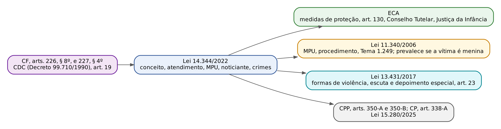
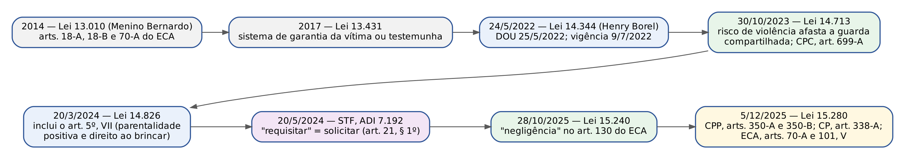
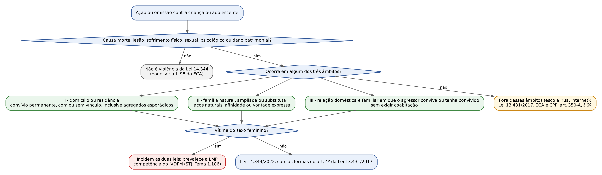
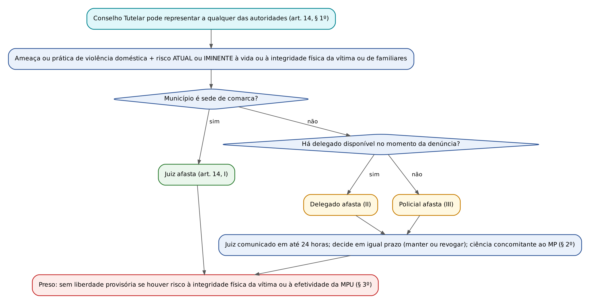
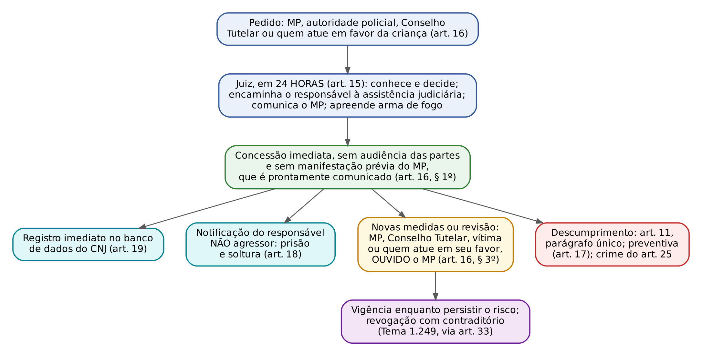
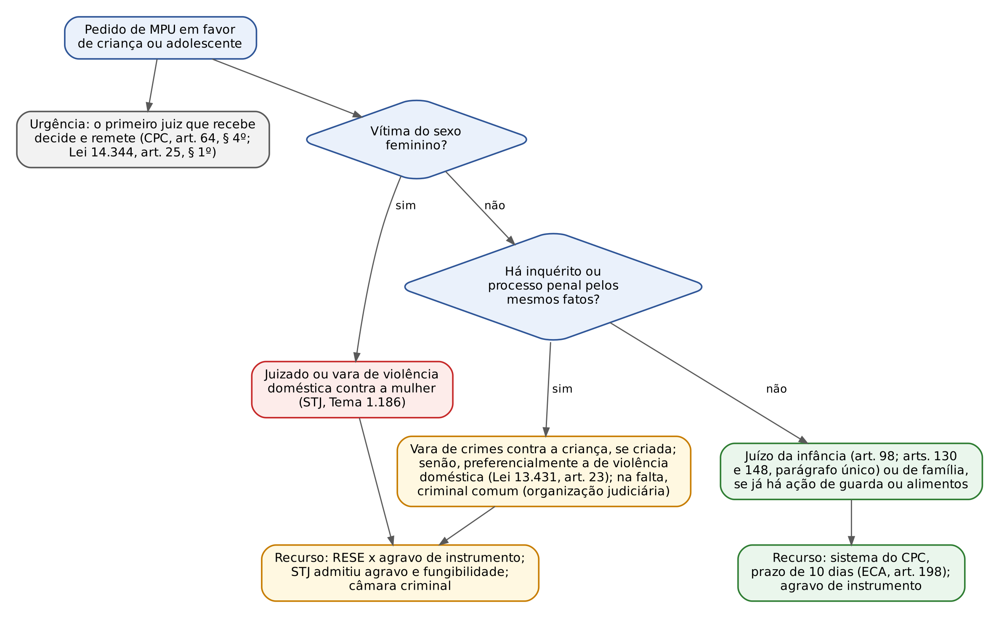
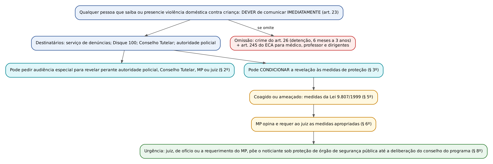

# CAPÍTULO 23 — LEI 14.344/2022 (LEI HENRY BOREL): VIOLÊNCIA DOMÉSTICA E FAMILIAR CONTRA CRIANÇA E ADOLESCENTE

:::INCIDENCIA
TJRS p. 2; TJSC p. 11. Nível A+. Lote: 10 questões (FGV 8, FCC 2), mais 5 correlatas de outros capítulos (FGV 4, FCC 1), com provas de magistratura (TJ-PE 2026), Ministério Público (MPE-MT e MPE-GO 2026) e Defensoria.
O que mais cai: letra das medidas protetivas (24 horas, legitimados do art. 16 e do § 3º, concessão sem oitiva prévia do MP, preventiva sem "de ofício", notificação do responsável não agressor), atendimento policial (art. 13) e afastamento do lar (art. 14), proteção do noticiante (art. 24) e o dever de comunicar com o crime do art. 26.
:::

| Subtema | FGV | FCC | Padrão de cobrança |
|---|---|---|---|
| Medidas protetivas: prazo, legitimidade, oitiva do MP, preventiva, notificação | 3 | 0 | troca de 24 por 48 horas; inclusão da autoridade policial no § 3º; "precedida de manifestação do MP"; preventiva "de ofício" |
| Atendimento policial e atribuições do MP | 1 | 0 | "transporte exclusivamente à vítima"; MP fiscaliza só estabelecimentos públicos, "por conveniência" |
| Noticiante: dever de comunicar, proteção e crime de omissão | 1 | 1 | Defensoria incluída indevidamente no § 2º do art. 24; pena mínima do art. 26 |
| Conceito, âmbitos e formas de violência | 2 | 0 | coabitação dispensada; castigo físico como violência física |
| Objeto da lei (art. 1º) e políticas públicas (arts. 6º a 10) | 1 | 1 | confusão com as Leis 13.431/2017, 13.010/2014 e 14.811/2024; Polícia Civil x Militar; "poderão" x "deverão" |
| Natureza e duração das MPUs | 1 | 0 | absolvição não extingue a medida se persistir o risco |
| Correlatas: Conselho Tutelar (art. 136, XIV e XVI), art. 226 do ECA, competência | 3 | 1 | Conselho Tutelar representa também pela REVISÃO; Lei 9.099 afastada |

## 23.1 Arquitetura da lei e lugar no microssistema

A Lei 14.344, de 24/5/2022 (DOU de 25/5/2022), entrou em vigor 45 dias após a publicação (art. 34), em 9/7/2022. Seu fundamento declarado é duplo (art. 1º): o § 8º do art. 226 da CF (dever do Estado de criar mecanismos para coibir a violência no âmbito das relações familiares) e o § 4º do art. 227 (punição severa do abuso, da violência e da exploração sexual da criança e do adolescente), somados aos tratados ratificados, com destaque para o art. 19 da Convenção sobre os Direitos da Criança (Cap. 2). A ementa reproduz a técnica da Lei 11.340/2006 (LMP): a Lei Henry Borel é, para a criança e o adolescente de qualquer sexo, a versão estatutária do sistema de medidas protetivas de urgência (MPUs) criado para a mulher.

:::QUESTAO FCC 2025 — DPE-AM — DEFENSOR PÚBLICO (Q3531635)
Pergunta: qual o objeto da Lei 14.344/2022 segundo seu art. 1º. Gabarito: C (cria mecanismos para a prevenção e o enfrentamento da violência doméstica e familiar contra a criança e o adolescente).
Armadilha: as demais alternativas descrevem OUTRAS leis do microssistema: sistema de garantia de direitos da criança vítima ou testemunha (Lei 13.431/2017, Cap. 22); educação sem castigos físicos (Lei 13.010/2014, Lei Menino Bernardo, Cap. 3); violência nos estabelecimentos educacionais (Lei 14.811/2024, Cap. 9); tráfico de pessoas (Lei 13.344/2016). Note a proximidade numérica 13.344 x 14.344.
:::

A lei tem 34 artigos em oito capítulos: (I) conceito de violência doméstica e familiar (arts. 2º a 5º); (II) assistência e políticas públicas (arts. 6º a 10); (III) atendimento pela autoridade policial (arts. 11 a 14); (IV) procedimentos e MPUs (arts. 15 a 21); (V) Ministério Público (art. 22); (VI) proteção ao noticiante ou denunciante (arts. 23 e 24); (VII) crimes (arts. 25 e 26); (VIII) disposições finais, que instituem o Dia Nacional (3 de maio, art. 27) e alteram o ECA, a Lei 13.431/2017, a LEP, o CP e a Lei de Crimes Hediondos (arts. 28 a 32), com a cláusula de subsidiariedade do art. 33.

:::LEI LEI 14.344/2022, ART. 33
Art. 33. Aos procedimentos regulados nesta Lei aplicam-se subsidiariamente, no que couber, as disposições das Leis nºs 8.069, de 13 de julho de 1990 (Estatuto da Criança e do Adolescente), 11.340, de 7 de agosto de 2006 (Lei Maria da Penha), e 13.431, de 4 de abril de 2017.
:::

O art. 33 é a chave de leitura do capítulo. A Lei 14.344 é lacunosa em pontos que a LMP já resolveu (cognição sumária, independência de inquérito e de boletim de ocorrência, duração das medidas, natureza de título executivo das medidas cíveis, monitoração eletrônica, competência híbrida), e a integração se faz pela aplicação subsidiária "no que couber". A Lei 13.431/2017 tem cláusula inversa e complementar: "Os casos omissos nesta Lei serão interpretados à luz do disposto" no ECA, na LMP e em normas conexas (art. 6º, parágrafo único), e assegura à criança e ao adolescente vítima ou testemunha "direito a pleitear, por meio de seu representante legal, medidas protetivas contra o autor da violência" (art. 6º, *caput*). O resultado é um diálogo de fontes em que a Lei Henry Borel é a lei ESPECIAL quanto ao contexto doméstico e familiar, o ECA é a lei GERAL da proteção, a Lei 13.431 regula a ESCUTA e as formas de violência e a LMP é o modelo PROCEDIMENTAL.

:::ATENCAO ALTERAÇÕES DA LEI 14.344/2022 ATÉ 6/11/2026
Conferido no texto compilado do Planalto: a ÚNICA alteração do texto da Lei 14.344/2022 foi a inclusão do inciso VII do art. 5º pela Lei 14.826, de 20/3/2024 (vigência 180 dias após a publicação no DOU de 21/3/2024): o Sistema de Garantia de Direitos intervirá também para "promover a parentalidade positiva e o direito ao brincar como estratégias de prevenção à violência doméstica contra a criança e o adolescente". O compilado registra ainda a remissão à ADI 7.192 no § 1º do art. 21 (23.4.4). Os demais artigos estão na redação original. As leis posteriores relevantes (Leis 14.713/2023, 15.240/2025 e 15.280/2025) alteraram diplomas VIZINHOS (CC, CPC, ECA, CPP e CP), e não a Lei 14.344; seus reflexos estão em 23.6.4, 23.9 e 23.11.
:::

## 23.2 Violência doméstica e familiar contra a criança e o adolescente (arts. 2º e 3º)

### 23.2.1 Conceito legal

:::LEI LEI 14.344/2022, ART. 2º
Art. 2º Configura violência doméstica e familiar contra a criança e o adolescente qualquer ação ou omissão que lhe cause morte, lesão, sofrimento físico, sexual, psicológico ou dano patrimonial:
I - no âmbito do domicílio ou da residência da criança e do adolescente, compreendida como o espaço de convívio permanente de pessoas, com ou sem vínculo familiar, inclusive as esporadicamente agregadas;
II - no âmbito da família, compreendida como a comunidade formada por indivíduos que compõem a família natural, ampliada ou substituta, por laços naturais, por afinidade ou por vontade expressa;
III - em qualquer relação doméstica e familiar na qual o agressor conviva ou tenha convivido com a vítima, independentemente de coabitação.
Parágrafo único. Para a caracterização da violência prevista no caput deste artigo, deverão ser observadas as definições estabelecidas na Lei nº 13.431, de 4 de abril de 2017.
:::

O conceito tem dois elementos cumulativos: (a) um elemento MATERIAL, a ação ou omissão que cause morte, lesão, sofrimento físico, sexual, psicológico ou dano patrimonial; e (b) um elemento ESPACIAL ou RELACIONAL, alternativo entre os três incisos. Não há elemento subjetivo especial nem exigência de motivação: diversamente da LMP, cujo art. 5º exige violência "baseada no gênero", a Lei 14.344 se apoia na condição peculiar de pessoa em desenvolvimento, e basta a vítima ter menos de 18 anos (art. 2º do ECA). O art. 3º qualifica essa violência como "uma das formas de violação dos direitos humanos", o que reforça a leitura convencional do sistema (prioridade absoluta e proteção integral, Cap. 1).

Leitura dos incisos, com o que a banca explora:

- Inciso I (domicílio ou residência): o critério é o ESPAÇO de convívio permanente, com ou sem vínculo familiar. Alcança o empregado doméstico que agride a criança da casa, o companheiro da mãe sem vínculo jurídico com a criança e a pessoa "esporadicamente agregada" (o tio que passa temporadas na casa, a babá que pernoita).
- Inciso II (família): família natural, ampliada (extensa, art. 25, parágrafo único, do ECA) ou SUBSTITUTA (guarda, tutela e adoção, art. 28 do ECA). Os vínculos podem ser naturais, de afinidade ou de "vontade expressa", o que abrange a socioafetividade. A violência praticada pelo guardião, pelo tutor ou pela família acolhedora entra aqui, mesmo fora da residência.
- Inciso III (relação doméstica e familiar): basta o agressor conviver ou TER CONVIVIDO com a vítima, "independentemente de coabitação". É o inciso do pai que não detém a guarda e agride o filho na visita, do ex-padrasto que reencontra o enteado, do avô que não mora com o neto. A fórmula reproduz a lógica da Súmula 600 do STJ, firmada para a LMP (violência doméstica não exige coabitação).

:::QUESTAO FGV 2024 — CÂMARA DOS DEPUTADOS — CONSULTOR LEGISLATIVO (Q2513058)
Pergunta: qual afirmação está correta segundo a legislação vigente sobre violência doméstica e familiar contra criança e adolescente. Gabarito: E (configura violência doméstica e familiar a ação ou omissão que cause sofrimento físico ou psicológico, inclusive em relação doméstica e familiar em que o agressor conviva com a vítima, independentemente de coabitação — art. 2º, III).
Por que as outras falham: (A) criança e adolescente gozam dos direitos fundamentais "sem prejuízo da proteção integral" (art. 3º do ECA), ou seja, têm direitos ADICIONAIS, e não idênticos aos dos adultos; (B) a aplicação do sistema da Lei 13.431 a vítimas e testemunhas de 18 a 21 anos é FACULTATIVA (art. 3º, parágrafo único), não obrigatória; (C) na revelação espontânea, a criança SERÁ chamada a confirmar os fatos por escuta especializada ou depoimento especial, salvo em intervenções de saúde (art. 4º, § 3º, da Lei 13.431); (D) o depoimento especial é colhido, sempre que possível, UMA única vez (art. 11 da Lei 13.431 — Cap. 22).
:::

### 23.2.2 Formas de violência: remissão à Lei 13.431/2017 e a violência patrimonial

O parágrafo único do art. 2º manda observar as definições da Lei 13.431/2017, cujo art. 4º prevê cinco formas: física, psicológica (incluídos o *bullying*, a alienação parental e a exposição a crime violento contra membro da família), sexual (abuso, exploração sexual comercial e tráfico), institucional e PATRIMONIAL. Esta última foi incluída pela própria Lei 14.344 (art. 28), no inciso V do art. 4º da Lei 13.431. As quatro primeiras estão desenvolvidas no Cap. 22; aqui interessa a quinta, porque é a novidade e porque tem uma ressalva literal.

:::LEI LEI 13.431/2017, ART. 4º, V (INCLUÍDO PELA LEI 14.344/2022)
V - violência patrimonial, entendida como qualquer conduta que configure retenção, subtração, destruição parcial ou total de seus documentos pessoais, bens, valores e direitos ou recursos econômicos, incluídos os destinados a satisfazer suas necessidades, desde que a medida não se enquadre como educacional.
:::

A ressalva final ("desde que a medida não se enquadre como educacional") distingue o exercício legítimo do poder familiar (art. 1.634 do CC; dirigir a criação e a educação) da violência: o pai que recolhe o celular do filho como medida disciplinar proporcional não pratica violência patrimonial; o genitor que se apropria da pensão por morte, do BPC ou dos alimentos do filho, que retém a certidão de nascimento para impedir a matrícula ou que destrói o material escolar como represália, pratica. Na prova, a palavra "educacional" é o critério de exclusão.

:::QUESTAO FGV 2024 — TJ-RJ — RESIDÊNCIA EM PSICOLOGIA (Q2375203)
Pergunta: qual situação caracteriza violência FÍSICA contra criança ou adolescente. Gabarito: B (criança de 10 anos que furtou dinheiro do pai e "levou uma surra").
Passos: (1) a surra é castigo físico, isto é, ação disciplinar com uso de força física que resulta em sofrimento físico ou lesão (art. 18-A, parágrafo único, I, do ECA — Cap. 3); (2) a finalidade corretiva não exclui a violência: o art. 18-A veda o castigo físico "como formas de correção, disciplina, educação ou qualquer outro pretexto"; (3) praticada pelo pai no âmbito familiar, é violência física doméstica (art. 4º, I, da Lei 13.431 c/c art. 2º da Lei 14.344).
Por que as outras falham: (A) *bullying* escolar com automutilação é violência psicológica fora do âmbito doméstico; (C) humilhação pública "para corrigir" a enurese é tratamento cruel ou degradante e violência PSICOLÓGICA; (D) deixar os filhos de 6 e 4 anos trancados para ir a uma festa é negligência e, em tese, abandono de incapaz (art. 133 do CP); (E) recolher o celular de quem acessa pornografia é medida EDUCACIONAL legítima — e, aliás, é exatamente o que a ressalva do art. 4º, V, da Lei 13.431 exclui do conceito de violência patrimonial.
:::

### 23.2.3 Quem é agressor e quem é vítima; a menina e o Tema 1.186

Sujeito ativo é qualquer pessoa, homem ou mulher, adulto ou adolescente (o agressor adolescente tem regime próprio, 23.10), desde que presente um dos âmbitos do art. 2º. A mãe agressora, a avó, o irmão mais velho e a madrasta são agressores possíveis; a omissão também é violência (a mãe que, podendo, nada faz diante das agressões do companheiro pratica violência por omissão e, se garantidora, responde pelo resultado — Apostila de Direito Penal, Cap. 38.10.3).

Sujeito passivo é a criança ou o adolescente, de QUALQUER sexo. Quando a vítima é do sexo feminino, incidem simultaneamente a Lei 14.344 e a LMP, e o STJ resolveu o concurso em favor da segunda.

:::JURIS STJ, TEMA 1.186 (RESP N. 2.015.598-PA, RELATOR MINISTRO RIBEIRO DANTAS, TERCEIRA SEÇÃO, J. 6/2/2025, INFORMATIVO 840)
Teses: (1) a condição de gênero feminino é suficiente para atrair a aplicabilidade da Lei Maria da Penha em casos de violência doméstica e familiar, prevalecendo sobre a questão etária; (2) a Lei Maria da Penha prevalece quando suas disposições conflitarem com as de estatutos específicos, como o da Criança e do Adolescente.
Consequência prática: estupro de vulnerável praticado pelo padrasto contra a enteada de 7 anos, no ambiente doméstico, tramita no juizado ou na vara de violência doméstica e familiar contra a mulher, e não na vara da infância ou criminal comum; as MPUs seguem a LMP (inclusive o crime do art. 24-A, mais grave que o art. 25 da Lei 14.344). Para o menino, a lei de regência é a 14.344 e a competência segue a organização judiciária local (23.7).
:::

Aplicação em prova de Juiz: estupro de vulnerável do padrasto contra a enteada de 7 anos, sem vara especializada em crimes contra criança, compete à vara de violência doméstica e, só na falta dela, à criminal comum (Q3453249, FGV 2025, TJ-TO, gabarito C — box no Cap. 22).

:::ATENCAO VIOLÊNCIA VICÁRIA (LMP, ART. 7º, VI, LEI 15.384/2026)
A Lei 15.384, de 9/4/2026 (DOU de 10/4/2026, retificado em 15/4/2026; vigência na publicação), incluiu no art. 7º da LMP o inciso VI: "a violência vicária, entendida como qualquer forma de violência praticada contra descendente, ascendente, dependente, enteado, parente, pessoa sob guarda ou responsabilidade direta da mulher ou pessoa de sua rede de apoio, com vistas a atingi-la". Quando o filho ou a filha é agredido pelo pai ou padrasto para atingir a mãe, há duas leituras simultâneas: para a criança, violência doméstica e familiar da Lei 14.344 (art. 2º), com MPUs próprias em seu favor; para a mãe, violência doméstica da LMP (art. 7º, VI), com MPUs em favor dela, independentemente do sexo da criança. O ponto de contato é a finalidade ("com vistas a atingi-la"): sem ela, a violência contra o menino segue apenas a Lei 14.344. Na hipótese de homicídio, o tipo é o vicaricídio (CP, art. 121-B; 23.11.3).
:::

:::PEGADINHA VIOLÊNCIA CONTRA CRIANÇA FORA DO ÂMBITO DOMÉSTICO
A Lei 14.344 não incide sobre a violência praticada pelo professor na escola, pelo vizinho sem convívio, pelo desconhecido na rua ou pelo aliciador na internet (salvo se presente algum dos âmbitos do art. 2º). Nesses casos atuam o ECA (medidas de proteção, art. 101; Conselho Tutelar), a Lei 13.431/2017 (escuta protegida) e, desde a Lei 15.280/2025, as MPUs do art. 350-A do CPP, aplicáveis aos crimes contra a dignidade sexual e, pelo § 6º, a QUALQUER crime "cuja vítima esteja em situação de vulnerabilidade, como crianças, adolescentes, pessoas com deficiência ou incapazes". A violência institucional praticada por agente socioeducativo também não é doméstica (Q3049364, FGV 2024, TJ-SC, Juiz — Cap. 22: aplica-se a Lei 13.431, com depoimento especial).
:::

## 23.3 Políticas públicas, dados e assistência (arts. 4º a 10)

### 23.3.1 Dados, finalidades e assistência articulada

O art. 4º manda incluir as estatísticas de violência doméstica e familiar contra crianças e adolescentes nas bases de dados do Sistema de Garantia dos Direitos, do SUS, do SUAS e do Sistema de Justiça e Segurança, de forma integrada, para subsidiar o sistema nacional de dados. Os entes "poderão" remeter informações às bases do Ministério da Justiça e Segurança Pública e do Ministério dos Direitos Humanos (§ 1º); os serviços "deverão compartilhar entre si" as informações coletadas, por relatórios, preservado o sigilo (§ 2º); o compartilhamento completo se faz por encaminhamento ao serviço que acolherá a criança (§ 3º), com zelo pelo sigilo dos dados pessoais (§ 4º). O modelo de registro (§ 5º) contém, no mínimo, os dados pessoais, a descrição do atendimento, o relato ESPONTÂNEO da criança, "quando houver", e os encaminhamentos — a lógica é a da Lei 13.431: registrar o relato espontâneo para que a criança não precise repeti-lo (revitimização).

O art. 5º enumera as finalidades da intervenção do Sistema de Garantia dos Direitos: mapear as ocorrências (I), prevenir (II), fazer cessar a violência (III), prevenir a reiteração (IV), minimizar as sequelas pelo atendimento (V), promover a reparação integral dos direitos (VI) e, desde a Lei 14.826/2024, promover a parentalidade positiva e o direito ao brincar (VII). O conteúdo da Lei 14.826/2024 (conceito de parentalidade positiva, criança como pessoa até 12 anos incompletos para seus fins, deveres dos entes) está no Cap. 9.

A assistência é prestada "de forma articulada" e conforme os princípios e diretrizes do ECA e da LOAS, no SUS e no Sistema Único de Segurança Pública, entre outras normas e políticas, "e emergencialmente, quando for o caso" (art. 6º). O ponto cobrado é a amplitude: o SUS ESTÁ incluído; nenhuma política tem "regramento específico" que a exclua.

### 23.3.2 O que os entes "poderão" criar e o que "darão prioridade"

| Dispositivo | Destinatário | Verbo | Conteúdo |
|---|---|---|---|
| Art. 7º | União, DF, Estados e Municípios, no limite das competências e de acordo com o art. 88 do ECA | "poderão criar e promover" | I centros de atendimento integral e multidisciplinar; II espaços de acolhimento familiar e institucional e programas de apadrinhamento; III delegacias, núcleos de defensoria, serviços de saúde e centros de perícia médico-legal ESPECIALIZADOS; IV programas e campanhas de enfrentamento; V centros de educação e reabilitação para os AGRESSORES |
| Art. 8º | SGD, sistemas de justiça, saúde, segurança e assistência social, Conselhos Tutelares e COMUNIDADE ESCOLAR | "poderão" adotar | ações articuladas para identificar a agressão, agilizar o atendimento e responsabilizar o agressor |
| Art. 9º | Estados e DF | "darão prioridade" | no âmbito da POLÍCIA CIVIL, à criação de Delegacias Especializadas de Proteção à Criança e ao Adolescente |
| Art. 10 | União, Estados, DF e Municípios | "poderão" | dotações orçamentárias específicas em cada exercício |

A remissão do art. 7º ao art. 88 do ECA importa as diretrizes da política de atendimento: municipalização do atendimento (I), conselhos de direitos (II), programas específicos "observada a descentralização político-administrativa" (III), fundos (IV), integração operacional (V e VI) e "mobilização da opinião pública para a indispensável participação dos diversos segmentos da sociedade" (VII) — Cap. 11.

:::QUESTAO FGV 2024 — TJ-RJ — RESIDÊNCIA EM PSICOLOGIA (Q2375188)
Pergunta: o que a Lei 14.344 dispõe sobre as políticas de assistência. Gabarito: E (os entes deverão promover programas e campanhas de enfrentamento, de acordo com a diretriz de mobilização da opinião pública para a participação dos diversos segmentos da sociedade — art. 7º, IV, c/c art. 88, VII, do ECA).
Por que as outras falham: (A) a assistência envolve EXPRESSAMENTE o SUS (art. 6º); (B) os centros de atendimento integral são criados por todos os entes, e a diretriz é de DESCENTRALIZAÇÃO político-administrativa, não de "centralização"; (C) a identificação das agressões não cabe "apenas às escolas" (art. 8º); (D) a prioridade dos Estados é a criação de delegacias especializadas no âmbito da Polícia CIVIL, não de "centros especializados" na Polícia Militar (art. 9º).
Observação: o gabarito usa "deverão", embora o art. 7º diga "poderão criar e promover"; a banca considerou a alternativa correta pela sua substância (campanhas e mobilização social). Em questão de literalidade pura, o verbo do art. 7º é facultativo.
:::

### 23.3.3 Reflexos no ECA: prevenção

As alterações da Lei 14.344 no capítulo de prevenção do ECA são desenvolvidas no Cap. 9 (art. 70-A, incisos VII a XIII, com os incisos II e IX reescritos pela Lei 15.280/2025; art. 70-B, cujo *caput* passou a exigir, em entidades públicas e privadas de saúde e educação, pessoas capacitadas a reconhecer e comunicar ao Conselho Tutelar suspeitas ou casos de CRIMES contra crianças e adolescentes) e no Cap. 3 (art. 18-B, VI: "garantia de tratamento de saúde especializado à vítima", a única medida do art. 18-B voltada à vítima, aplicada pelo Conselho Tutelar). Aqui basta fixar o elo: a política preventiva do ECA é o braço "prevenção" do art. 5º, II, da Lei 14.344.

## 23.4 Atendimento pela autoridade policial (arts. 11 a 14)

### 23.4.1 Providências imediatas e depoimento

Diante de ameaça ou prática de violência doméstica e familiar contra criança ou adolescente, a autoridade policial que tomar conhecimento adotará, "de imediato", as providências legais cabíveis (art. 11), regra que se aplica também ao DESCUMPRIMENTO de MPU deferida (parágrafo único). O depoimento da criança ou do adolescente vítima ou testemunha é colhido "nos termos da Lei nº 13.431", observado o ECA (art. 12): na polícia, a oitiva é DEPOIMENTO ESPECIAL (não escuta especializada, que é da rede de proteção), com protocolo e sem confronto com o suposto autor (Cap. 22; Apostila de Processo Penal, Cap. 25.5).

:::LEI LEI 14.344/2022, ART. 13
Art. 13. No atendimento à criança e ao adolescente em situação de violência doméstica e familiar, a autoridade policial deverá, entre outras providências:
I - encaminhar a vítima ao Sistema Único de Saúde e ao Instituto Médico-Legal imediatamente;
II - encaminhar a vítima, os familiares e as testemunhas, caso sejam crianças ou adolescentes, ao Conselho Tutelar para os encaminhamentos necessários, inclusive para a adoção das medidas protetivas adequadas;
III - garantir proteção policial, quando necessário, comunicados de imediato o Ministério Público e o Poder Judiciário;
IV - fornecer transporte para a vítima e, quando necessário, para seu responsável ou acompanhante, para serviço de acolhimento existente ou local seguro, quando houver risco à vida.
:::

Três detalhes literais: (a) o encaminhamento ao SUS e ao IML é "imediato" (I); (b) o encaminhamento ao Conselho Tutelar alcança vítima, familiares e testemunhas "caso sejam crianças ou adolescentes" — o Conselho aplica as medidas de proteção do art. 101, I a VII, do ECA, e não as MPUs, que são judiciais (II); (c) o transporte é para a vítima "e, quando necessário, para seu responsável ou acompanhante", e só quando houver risco à VIDA (IV). A comparação com o art. 11 da LMP mostra a adaptação: lá se fala em "ofendida e seus dependentes"; aqui, em responsável ou acompanhante, porque a vítima é incapaz.

### 23.4.2 Afastamento do agressor do lar sem ordem judicial (art. 14)

:::LEI LEI 14.344/2022, ART. 14
Art. 14. Verificada a ocorrência de ação ou omissão que implique a ameaça ou a prática de violência doméstica e familiar, com a existência de risco atual ou iminente à vida ou à integridade física da criança e do adolescente, ou de seus familiares, o agressor será imediatamente afastado do lar, do domicílio ou do local de convivência com a vítima:
I - pela autoridade judicial;
II - pelo delegado de polícia, quando o Município não for sede de comarca;
III - pelo policial, quando o Município não for sede de comarca e não houver delegado disponível no momento da denúncia.
§ 1º O Conselho Tutelar poderá representar às autoridades referidas nos incisos I, II e III do caput deste artigo para requerer o afastamento do agressor do lar, do domicílio ou do local de convivência com a vítima.
§ 2º Nas hipóteses previstas nos incisos II e III do caput deste artigo, o juiz será comunicado no prazo máximo de 24 (vinte e quatro) horas e decidirá, em igual prazo, sobre a manutenção ou a revogação da medida aplicada, bem como dará ciência ao Ministério Público concomitantemente.
§ 3º Nos casos de risco à integridade física da vítima ou à efetividade da medida protetiva de urgência, não será concedida liberdade provisória ao preso.
:::

O art. 14 transplanta o art. 12-C da LMP, cuja constitucionalidade o STF afirmou: é válida a atuação supletiva e excepcional de delegados e policiais para afastar o agressor quando constatado risco atual ou iminente, de forma *ad referendum* do juiz, sem ofensa à inviolabilidade do domicílio nem ao devido processo legal (STF, ADI n. 6.138, Relator Ministro Alexandre de Moraes, Plenário, j. 23/3/2022). O fundamento vale integralmente para o art. 14 da Lei 14.344.

| Ponto | Regra (art. 14) | Armadilha |
|---|---|---|
| Pressuposto | ameaça ou prática de violência + risco ATUAL ou IMINENTE à vida ou à integridade FÍSICA da vítima ou de seus FAMILIARES | o art. 12-C da LMP, na redação da Lei 15.411/2026, passou a mencionar também a integridade sexual, psicológica, moral ou patrimonial; o art. 14 da Lei 14.344 continua restrito à vida e à integridade física |
| Ordem de autoridades | juiz; delegado (Município sem comarca); policial (sem comarca E sem delegado disponível NO MOMENTO da denúncia) | o Promotor de Justiça e o conselheiro tutelar NÃO afastam |
| Papel do Conselho Tutelar | REPRESENTA a qualquer das três autoridades (§ 1º; ECA, art. 136, XV) | não decide nem executa o afastamento |
| Controle judicial | comunicação ao juiz em até 24 horas; decisão em igual prazo; ciência CONCOMITANTE ao MP (§ 2º) | não é "após ouvir o MP", nem 48 horas |
| Preso | sem liberdade provisória se houver risco à integridade física da vítima ou à efetividade da MPU (§ 3º) | vedação concreta, ligada ao risco, e não abstrata |

O art. 14 é a ÚNICA medida que a lei permite à autoridade policial. As demais MPUs (proibição de aproximação, suspensão de visitas, alimentos) exigem decisão judicial; o delegado as REQUER (art. 16) e o Conselho Tutelar REPRESENTA (art. 136, XVI, do ECA).

:::DICA OS TRÊS AFASTAMENTOS DO AGRESSOR
O afastamento do agressor tem três fontes: art. 130 do ECA (juiz, agressor pai ou responsável, maus-tratos, negligência, opressão ou abuso sexual, com alimentos provisórios obrigatórios na decisão), arts. 14, 20, II, e 21, II, da Lei 14.344 (qualquer agressor no âmbito doméstico, inclusive por delegado ou policial no art. 14) e art. 350-A, II, do CPP (crime contra a dignidade sexual ou crime contra vítima vulnerável, com monitoração eletrônica cumulada). O quadro comparativo completo está no Cap. 13.11.3; não se repete aqui.
:::

### 23.4.3 O que a autoridade policial deve fazer: questão de caso

:::QUESTAO FGV 2026 — MPE-MT — PROMOTOR DE JUSTIÇA SUBSTITUTO (Q4116993)
Caso: Enzo, 8 anos, abusado sexualmente pelo padrasto que mora no mesmo imóvel; a mãe deixa o lar, muda-se para Município vizinho e registra ocorrência. Gabarito: B (cabe ao MP, sem prejuízo de outras atribuições e quando necessário, requisitar força policial e serviços públicos de saúde, de educação, de assistência social e de segurança, entre outros — art. 22, II).
Passos de eliminação: (A) erra ao dizer que o transporte é "exclusivamente" para a vítima: o art. 13, IV, inclui o responsável ou acompanhante, quando necessário; (C) erra ao condicionar a matrícula "à existência de vaga": o art. 21, VII, determina a matrícula ou transferência "independentemente da existência de vaga"; (D) erra duas vezes: o MP fiscaliza estabelecimentos públicos E PARTICULARES e adota as medidas "de imediato", e não segundo "conveniência e oportunidade" (art. 22, III); (E) erra ao exigir manifestação prévia do MP: as MPUs são concedidas de imediato, independentemente de audiência das partes E de manifestação do MP, que é prontamente comunicado (art. 16, § 1º).
Observação: Enzo é menino; a lei de regência é a 14.344. Se fosse menina, a resposta sobre MPUs seguiria a LMP (Tema 1.186), embora as atribuições do MP do art. 22 da Lei 14.344 também a alcancem.
:::

### 23.4.4 Antecipação de prova: o § 1º do art. 21 e a ADI 7.192

A lei previu que "a autoridade policial poderá requisitar e o Conselho Tutelar requerer ao Ministério Público a propositura de ação cautelar de antecipação de produção de prova nas causas que envolvam violência contra a criança e o adolescente, observadas as disposições da Lei nº 13.431" (art. 21, § 1º). O verbo "requisitar" sugeria ordem do delegado ao MP, o que inverte a relação constitucional (art. 129, VIII, da CF: é o MP quem requisita diligências à polícia).

:::JURIS STF, ADI N. 7.192, RELATOR MINISTRO LUIZ FUX, PLENÁRIO, J. 20/5/2024 (INFORMATIVO 1.137)
Interpretação conforme a Constituição do art. 21, § 1º, da Lei 14.344/2022: "requisitar" deve ser lido como SOLICITAR. Em caso de notícia de violência contra criança ou adolescente, a autoridade policial pode requerer, SEM CARÁTER VINCULATIVO, a propositura de ação cautelar de antecipação de provas ao MP, cujo membro avaliará a pertinência da atuação nos limites de sua independência funcional.
:::

O Conselho Tutelar sempre teve o verbo correto ("requerer"; art. 136, XVII, do ECA: "representar ao Ministério Público"). A Lei 13.431 já previa a mesma ponte, com o verbo adequado: o delegado pode "representar ao Ministério Público para que proponha ação cautelar de antecipação de prova" sempre que a demora possa prejudicar o desenvolvimento da criança (art. 21, VI). Nenhum dos dois tem legitimidade para propor a cautelar; a legitimidade é do MP (e, na fase processual, das partes). A produção antecipada é OBRIGATÓRIA quando a vítima tem menos de 7 anos ou em caso de violência sexual (art. 11, § 1º, da Lei 13.431 — Cap. 22).

## 23.5 Medidas protetivas de urgência: regime geral (arts. 15 a 19)

### 23.5.1 O expediente e o prazo de 24 horas

:::LEI LEI 14.344/2022, ARTS. 15 E 16
Art. 15. Recebido o expediente com o pedido em favor de criança e de adolescente em situação de violência doméstica e familiar, caberá ao juiz, no prazo de 24 (vinte e quatro) horas:
I - conhecer do expediente e do pedido e decidir sobre as medidas protetivas de urgência;
II - determinar o encaminhamento do responsável pela criança ou pelo adolescente ao órgão de assistência judiciária, quando for o caso;
III - comunicar ao Ministério Público para que adote as providências cabíveis;
IV - determinar a apreensão imediata de arma de fogo sob a posse do agressor.
Art. 16. As medidas protetivas de urgência poderão ser concedidas pelo juiz, a requerimento do Ministério Público, da autoridade policial, do Conselho Tutelar ou a pedido da pessoa que atue em favor da criança e do adolescente.
§ 1º As medidas protetivas de urgência poderão ser concedidas de imediato, independentemente de audiência das partes e de manifestação do Ministério Público, o qual deverá ser prontamente comunicado.
§ 2º As medidas protetivas de urgência serão aplicadas isolada ou cumulativamente e poderão ser substituídas a qualquer tempo por outras de maior eficácia, sempre que os direitos reconhecidos nesta Lei forem ameaçados ou violados.
§ 3º Poderá o juiz, a requerimento do Ministério Público ou do Conselho Tutelar, ou a pedido da vítima ou de quem esteja atuando em seu favor, conceder novas medidas protetivas de urgência ou rever aquelas já concedidas, se entender necessário à proteção da vítima, de seus familiares e de seu patrimônio, ouvido o Ministério Público.
:::

O prazo judicial é de 24 HORAS, a metade do previsto na LMP (art. 18: 48 horas). As quatro providências do art. 15 são cumulativas e a banca as cobra em bloco: decidir; encaminhar o RESPONSÁVEL (não a criança) à assistência judiciária; comunicar o MP; apreender a arma de fogo "sob a posse do agressor". Repare que a apreensão da arma (art. 15, IV) é providência do juiz ao RECEBER o expediente, distinta da MPU de suspensão da posse ou restrição do porte (art. 20, I).

### 23.5.2 Legitimidade: o pedido inicial e a revisão não têm o mesmo rol

| Momento | Quem requer | Oitiva do MP |
|---|---|---|
| Concessão inicial (art. 16, *caput*) | MP; AUTORIDADE POLICIAL; Conselho Tutelar; pessoa que atue em favor da criança ou do adolescente | DISPENSADA antes da decisão; o MP é "prontamente comunicado" (§ 1º) |
| Novas medidas ou revisão (art. 16, § 3º) | MP; Conselho Tutelar; a VÍTIMA ou quem esteja atuando em seu favor | EXIGIDA ("ouvido o Ministério Público") |
| Pedido da LMP (art. 19), para comparação | MP ou a ofendida | dispensada (§ 1º) |

Duas assimetrias geram questões: (a) a autoridade policial está no *caput* (pedido inicial) mas NÃO no § 3º (novas medidas e revisão); (b) a concessão inicial dispensa a manifestação do MP, mas a concessão de NOVAS medidas e a revisão exigem que o MP seja ouvido. A "pessoa que atue em favor da criança" é cláusula aberta: abrange o genitor não agressor, o guardião de fato, o advogado constituído, a Defensoria Pública e o curador especial; a vítima adolescente pode pedir diretamente no § 3º, e o art. 6º da Lei 13.431 assegura o pedido "por meio de seu representante legal".

:::QUESTAO FGV 2026 — TJ-PE — JUIZ SUBSTITUTO (Q4349508)
Caso: Maria, 7 anos, agredida reiteradamente pelo padrasto Carlos, com omissão da mãe; MPU requerida; Carlos tem arma de fogo. Gabarito: E (o responsável legal pela criança, desde que não seja o autor das agressões, deve ser notificado dos atos processuais relativos ao agressor, especialmente dos pertinentes ao ingresso e à saída da prisão — art. 18).
Passos: (A) o prazo é de 24 horas, não 48 (art. 15); (B) a MPU NÃO depende de manifestação prévia do MP (art. 16, § 1º); (C) é a alternativa-armadilha: o § 3º do art. 16 legitima para NOVAS medidas e revisão o MP, o Conselho Tutelar, a vítima e quem atue em seu favor — a AUTORIDADE POLICIAL não está nesse rol, embora esteja no *caput*; (D) a preventiva da Lei 14.344 é decretada a requerimento do MP ou mediante representação da autoridade policial (art. 17), sem a expressão "de ofício", que ainda consta do art. 20 da LMP mas é incompatível com o art. 311 do CPP.
Observação de caso: Maria é menina, e pelo Tema 1.186 a LMP prevaleceria no conflito; a banca, porém, pediu expressamente a "disciplina da Lei Henry Borel", e o gabarito é literal.
:::

:::QUESTAO FGV 2025 — DPE-PE — DEFENSOR PÚBLICO (Q3390891)
Pergunta: qual afirmação sobre as MPUs da violência doméstica contra criança e adolescente está correta. Gabarito: C (concessão de imediato, independentemente de audiência das partes e de manifestação do MP, que deve ser prontamente comunicado — art. 16, § 1º).
Por que as outras falham: (A) a LMP protege a MULHER (violência baseada no gênero); a lei principal para criança e adolescente é a 14.344, e a LMP só prevalece se a vítima for do sexo feminino (Tema 1.186); (B) a preventiva não é decretada "de ofício" (art. 17); (D) os alimentos provisionais ou provisórios SÃO medida protetiva (art. 20, VII) e não exigem pedido autônomo; (E) a restrição do porte do agressor militar ou integrante de órgão do art. 6º do Estatuto do Desarmamento é determinada pelo juiz, que COMUNICA a corporação; não há "prévia manifestação" do superior, que apenas responde pelo cumprimento, sob pena de prevaricação ou desobediência (art. 20, § 2º).
:::

### 23.5.3 Cognição, natureza, autonomia e duração

A Lei 14.344 não reproduziu os §§ 4º a 6º do art. 19 da LMP (incluídos pela Lei 14.550/2023), mas eles se aplicam por força do art. 33: as MPUs são concedidas em cognição SUMÁRIA, a partir do relato colhido pela autoridade policial ou de alegações escritas; independem da tipificação penal, de ação penal ou cível, de inquérito e de boletim de ocorrência; e vigoram enquanto persistir o risco. O STJ consolidou, para a LMP, o regime que a doutrina estende à Lei Henry Borel.

:::JURIS STJ, TEMA 1.249 (TERCEIRA SEÇÃO, J. 13/11/2024)
(i) As MPUs têm natureza jurídica de TUTELA INIBITÓRIA e sua vigência não se subordina a boletim de ocorrência, inquérito policial ou processo cível ou criminal; (ii) a duração se vincula à persistência da situação de risco, e as medidas devem ser fixadas por prazo temporalmente INDETERMINADO; (iii) extinção da punibilidade, arquivamento do inquérito ou absolvição não extinguem, necessariamente, a medida; (iv) não há prazo obrigatório de revisão periódica, mas o juiz deve reavaliá-las, de ofício ou a pedido, quando constatado o esvaziamento do risco; a revogação exige contraditório, com oitiva da vítima e do suposto agressor, e a ofendida deve ser comunicada da extinção.
Complemento: a manutenção da medida não depende de novos fatos de violência, mas da persistência da situação de risco inicialmente configurada, sob pena de inversão indevida do ônus da prova (STJ, Sexta Turma, Relator Ministro Sebastião Reis Júnior, j. 13/8/2025, Informativo 860).
Teses completas e histórico: Apostila de Direito Penal, Cap. 38.4.1; regime processual: Apostila de Processo Penal, Cap. 19.8.
:::

Transposição para a criança. Três adaptações decorrem da Lei 14.344 e do ECA: (a) a revogação exige contraditório com oitiva da vítima, o que, na criança, se faz por meio do representante não agressor, da equipe técnica e, quando necessário, por escuta especializada ou depoimento especial, nunca por inquirição direta repetida (Lei 13.431, art. 5º); (b) a comunicação da extinção, que na LMP vai à ofendida (art. 21), vai aqui ao responsável legal não agressor (art. 18, por analogia); (c) a reavaliação do risco se apoia em estudo psicossocial, porque o risco à criança envolve vínculos que a decisão também regula (visitas, guarda).

:::JURIS TJSC, QUINTA CÂMARA CRIMINAL (NOTÍCIAS INSTITUCIONAIS DE 15/9/2026 E 1/10/2026; PROCESSOS EM SEGREDO DE JUSTIÇA)
Dois julgados recentes do TJSC sobre MPUs da Lei 14.344/2022 ilustram a aplicação do Tema 1.249 à criança: (1) em recurso do MP, a Câmara restabeleceu as medidas em favor de crianças cujo pai era suspeito de abuso sexual, porque os estudos não indicavam superação do risco, determinou novo estudo psicossocial e afirmou que a pendência de ação de guarda em outro Estado NÃO justifica extinguir o procedimento protetivo, que é AUTÔNOMO e tem finalidade diversa; (2) em outro caso, manteve a proibição de aproximação física, mas autorizou contato por videochamada enquanto prosseguiam as avaliações, por reputar prematura a revogação total e proporcional a solução intermediária.
Observação: dados colhidos nas notícias oficiais do TJSC, sem número de processo; não citar como precedente numerado.
:::

:::PEGADINHA "MEDIDA PROTETIVA POR 180 DIAS" E "EXTINÇÃO COM A ABSOLVIÇÃO"
Não há prazo legal de vigência nem revisão periódica obrigatória; o que há é dever de reavaliar quando o risco se esvazia. A banca costuma oferecer prazos fixos (90 ou 180 dias), extinção automática pelo arquivamento ou pela absolvição e dependência de boletim de ocorrência: todas erradas. A MPU deferida "por seis meses" pelo juiz é possível como técnica de decisão, mas o termo final não a extingue se o risco persistir; nesse caso, cabe prorrogação fundamentada.
:::

:::QUESTAO FGV 2026 — MPE-MT — PROMOTOR DE JUSTIÇA SUBSTITUTO (Q4117004)
Caso: (I) estelionato reiterado contra vizinha adulta com deficiência; (II) padrasto que espanca o enteado de 10 anos e o mantém preso em quarto escuro, sem comida, por quatro dias; (III) ex-namorado que agride e ameaça de morte a ex-namorada. Pergunta: medidas protetivas cabíveis. Gabarito oficial: E (na hipótese III, eventual absolvição não extingue a MPU se persistir o risco — Tema 1.249).
Passos: (1) II é violência doméstica contra criança (art. 2º, I e II, da Lei 14.344): cabem MPUs da Lei Henry Borel; (2) III é violência doméstica contra a mulher em relação íntima de afeto (art. 5º, III, da LMP, sem coabitação — Súmula 600 do STJ): cabem MPUs da LMP; (3) D erra ao falar em "tempo determinado"; (4) E reproduz o item (iii) do Tema 1.249.
Gabarito discutível quanto às alternativas A a C: desde a Lei 15.280/2025 (vigente em 8/12/2025), o art. 350-A, § 6º, do CPP estende as MPUs aos crimes "cuja vítima esteja em situação de vulnerabilidade, como (...) pessoas com deficiência", "qualquer que seja o crime investigado"; a hipótese I (estelionato contra pessoa com deficiência explorada em sua vulnerabilidade) passou, em tese, a admitir MPU, o que enfraquece a premissa de B e C. A alternativa E permanece correta e é a mais segura; a data da prova não foi verificada (ver nota).
:::

### 23.5.4 Prisão preventiva, notificação e registro

A preventiva cabe "em qualquer fase do inquérito policial ou da instrução criminal", "a requerimento do Ministério Público ou mediante representação da autoridade policial" (art. 17), com possibilidade de revogação e nova decretação (parágrafo único). O art. 21, III, repete a preventiva como medida em favor da vítima "quando houver suficientes indícios de ameaça à criança ou ao adolescente vítima ou testemunha". A base processual é o art. 313, III, do CPP (violência doméstica contra criança e adolescente, para garantir a execução das MPUs), que dispensa o requisito da pena máxima superior a 4 anos, mas não o *fumus commissi delicti* nem o *periculum libertatis* do art. 312 (Apostila de Processo Penal, Cap. 19).

O responsável legal pela vítima ou testemunha, "desde que não seja o autor das agressões", é notificado dos atos processuais relativos ao agressor, "especialmente dos pertinentes ao ingresso e à saída da prisão", sem prejuízo da intimação do advogado ou defensor (art. 18). A ressalva tem lógica evidente: quando a mãe é coautora ou omitente conivente, a notificação vai a outro responsável ou ao curador especial (art. 142, parágrafo único, do ECA).

O juiz providencia o registro da MPU (art. 19), que é lançada "imediatamente" em banco de dados mantido e regulamentado pelo CNJ, com acesso instantâneo do MP, da Defensoria, dos órgãos de segurança pública e de assistência social e dos integrantes do Sistema de Garantia dos Direitos (parágrafo único). O acesso do Conselho Tutelar, integrante do SGD, decorre do próprio texto.

### 23.5.5 Medida protetiva de ofício?

O art. 16 condiciona a concessão a requerimento (MP, autoridade policial, Conselho Tutelar) ou pedido (quem atue em favor da criança). A lei só autoriza o juiz a agir de ofício na proteção do NOTICIANTE (art. 24, §§ 8º e 9º). Há duas leituras: (a) a literal, que exige provocação, à semelhança do art. 19 da LMP; (b) a sistemática, que admite a atuação oficiosa do juiz da infância diante de criança em situação de risco, com apoio no poder geral de cautela e no art. 153 do ECA (que autoriza o juiz a investigar os fatos e ordenar de ofício as providências necessárias, ouvido o MP, quando a medida judicial não corresponder a procedimento previsto; o parágrafo único, porém, exclui essa via para o afastamento da criança ou do adolescente da família de origem e para procedimentos necessariamente contenciosos), além do art. 130 do ECA. A leitura sistemática serve, portanto, para afastar o AGRESSOR, nunca para retirar a criança do lar de ofício. Na prova objetiva, siga a letra do art. 16 e lembre que a preventiva NUNCA é de ofício; na discursiva, exponha a controvérsia e ressalte que, na prática, o MP ou o Conselho Tutelar estará presente no procedimento.

## 23.6 Espécies de medidas protetivas (arts. 20 e 21)

### 23.6.1 Medidas que obrigam o agressor (art. 20)

O rol é EXEMPLIFICATIVO ("entre outras"), as medidas podem ser cumuladas e todas devem ser comunicadas ao MP (§ 1º). O juiz pode requisitar, a qualquer momento, o auxílio da força policial (§ 3º).

| Inciso | Medida | Diferença em relação ao art. 22 da LMP |
|---|---|---|
| I | suspensão da posse ou restrição do porte de armas, com comunicação ao órgão competente (Lei 10.826/2003) | igual; § 2º igual (superior imediato responde por prevaricação ou desobediência) |
| II | afastamento do lar, do domicílio ou do local de convivência com a VÍTIMA | igual |
| III | proibição de aproximação da vítima, de seus familiares, das testemunhas e de NOTICIANTES OU DENUNCIANTES, com limite mínimo de distância | a LMP não protege noticiantes |
| IV | vedação de contato com os mesmos (vítima, familiares, testemunhas, noticiantes ou denunciantes) por qualquer meio de comunicação | idem |
| V | proibição de frequentação de determinados lugares, "respeitadas as disposições" do ECA | ressalva própria: a proibição não pode suprimir direitos de outra criança (por exemplo, o agressor adolescente — 23.10) |
| VI | restrição ou suspensão de visitas À CRIANÇA OU AO ADOLESCENTE | na LMP, "aos dependentes menores, ouvida a equipe de atendimento multidisciplinar"; aqui não há a exigência expressa de oitiva da equipe, que, porém, é recomendável (art. 151 do ECA) |
| VII | prestação de alimentos provisionais ou provisórios | igual |
| VIII | comparecimento a programas de recuperação e reeducação | igual (na LMP, pela Lei 13.984/2020) |
| IX | acompanhamento psicossocial, por atendimento individual e/ou em grupo de apoio | igual |
| — | monitoração eletrônica com dispositivo de alerta para a vítima | prevista na LMP (art. 22, VIII, e §§ 6º a 9º, Lei 15.383/2026: prioridade em caso de descumprimento anterior ou risco iminente, e fundamentação expressa para não aplicá-la) e, cumulada obrigatoriamente, no art. 350-A, § 5º, do CPP; na Lei 14.344, aplicável como medida atípica (art. 20, § 1º, e art. 33). A mesma lei criou o art. 12-D da LMP: havendo risco atual ou iminente à vida ou à integridade física ou psicológica da mulher "ou de seus dependentes", o agressor "será imediatamente submetido à monitoração eletrônica" pelo juiz ou, se o Município não for sede de comarca, pelo delegado (juiz comunicado em 24 horas e decide em igual prazo, com ciência concomitante ao MP) — estrutura paralela à do art. 14 da Lei 14.344 |

### 23.6.2 Medidas em favor da vítima (art. 21)

:::LEI LEI 14.344/2022, ART. 21, \*CAPUT\* E INCISOS
Art. 21. Poderá o juiz, quando necessário, sem prejuízo de outras medidas, determinar:
I - a proibição do contato, por qualquer meio, entre a criança ou o adolescente vítima ou testemunha de violência e o agressor;
II - o afastamento do agressor da residência ou do local de convivência ou de coabitação;
III - a prisão preventiva do agressor, quando houver suficientes indícios de ameaça à criança ou ao adolescente vítima ou testemunha de violência;
IV - a inclusão da vítima e de sua família natural, ampliada ou substituta nos atendimentos a que têm direito nos órgãos de assistência social;
V - a inclusão da criança ou do adolescente, de familiar ou de noticiante ou denunciante em programa de proteção a vítimas ou a testemunhas;
VI - no caso da impossibilidade de afastamento do lar do agressor ou de prisão, a remessa do caso para o juízo competente, a fim de avaliar a necessidade de acolhimento familiar, institucional ou colação em família substituta;
VII - a realização da matrícula da criança ou do adolescente em instituição de educação mais próxima de seu domicílio ou do local de trabalho de seu responsável legal, ou sua transferência para instituição congênere, independentemente da existência de vaga.
:::

O art. 21 mistura medidas de naturezas diversas, o que a FGV explora:

- Medidas que, embora "em favor da vítima", recaem sobre o agressor (I, II e III), repetindo o art. 20 e o art. 21 da Lei 13.431 (que lista as medidas que a autoridade policial requisita ao juiz).
- Medidas assistenciais (IV e V): inclusão nos serviços socioassistenciais (CRAS, CREAS, PAEFI — Cap. 25) e em programa de proteção a vítimas e testemunhas (Lei 9.807/1999, cujo art. 2º tem critérios próprios de admissão).
- Medida de ÚLTIMA RATIO (VI): se não for possível afastar o agressor nem prendê-lo, o juiz REMETE o caso ao juízo competente (o da infância) para avaliar acolhimento ou família substituta. O dispositivo concretiza a regra de que se afasta o agressor, e não a criança (art. 130 do ECA), e respeita a reserva de jurisdição e o procedimento contencioso do art. 101, § 2º, do ECA (Cap. 13). O texto oficial traz "colação", erro material por "colocação".
- Medida educacional (VII): matrícula ou transferência para escola próxima do domicílio OU do local de trabalho do responsável, "independentemente da existência de vaga". É a reprodução, para a criança, do art. 23, V, e do art. 9º, § 7º, da LMP; a escola não pode recusar a matrícula por falta de vaga.

O § 2º permite ao juiz "outras medidas cautelares previstas na legislação em vigor" para a integridade ou segurança da criança, de seus familiares E DO NOTICIANTE, o que inclui as cautelares diversas da prisão (art. 319 do CPP) e as MPUs do CPP (art. 350-A).

:::ESQUEMA O QUE É DE QUEM: MEDIDAS NO CONTEXTO DOMÉSTICO
| Providência | Quem determina | Fundamento |
|---|---|---|
| Medidas de proteção à criança (art. 101, I a VII) e aos pais (art. 129, I a VII; art. 18-B) | Conselho Tutelar ou juiz | arts. 136, I e II, e 18-B do ECA |
| Afastamento do agressor sem ordem judicial | delegado ou policial, só em Município que não é sede de comarca | art. 14, II e III |
| MPUs dos arts. 20 e 21 | SÓ o juiz | arts. 15 e 16 |
| Acolhimento familiar ou institucional, família substituta | juiz da infância, em procedimento contencioso (salvo acolhimento emergencial com comunicação em 24 horas, art. 93) | art. 21, VI; art. 101, §§ 2º e 3º, do ECA |
| Antecipação de prova | MP propõe; delegado solicita (ADI 7.192); Conselho Tutelar requer | art. 21, § 1º; art. 136, XVII, do ECA |
| Preventiva | juiz, a requerimento do MP ou por representação policial | arts. 17 e 21, III |
:::

### 23.6.3 Alimentos protetivos: título executivo e prisão civil

Os alimentos do art. 20, VII, têm natureza SATISFATIVA. O STJ, ainda sob a LMP, decidiu que a decisão do juízo de violência doméstica que fixa alimentos provisórios em favor da companheira e da filha constitui título hábil para imediata cobrança, inclusive com prisão civil, sem necessidade de ação principal em 30 dias (STJ, RHC n. 100.446/MG, Relator Ministro Marco Aurélio Bellizze, Terceira Turma, j. 27/11/2018). A Lei 15.412/2026 positivou a orientação na LMP: "As medidas protetivas de natureza cível, inclusive as de prestação de alimentos provisionais ou provisórios, constituem título executivo judicial de pleno direito, dispensando a propositura de ação principal" (art. 22, § 10). Pela subsidiariedade do art. 33, o mesmo regime vale para os alimentos fixados com base na Lei 14.344: execução pelo rito da prisão (art. 528 do CPC) ou da penhora, sem caducidade pelo art. 308 do CPC. O regime civil dos alimentos (binômio, revisão, exoneração) está no Cap. 7 e na Apostila de Direito Civil, Cap. 39.

### 23.6.4 Concurso com as MPUs do CPP (Lei 15.280/2025)

A Lei 15.280/2025 criou no CPP o Título IX-A ("Das medidas protetivas de urgência"). O art. 350-A permite ao juiz, constatados indícios de crime contra a dignidade sexual, aplicar de imediato ao autor medidas semelhantes às do art. 20 da Lei 14.344, com três notas próprias: restrição ou suspensão de visitas aos dependentes "ouvida a equipe de atendimento multidisciplinar" (IV); aplicação subsidiária do CPC (§ 4º); e cumulação OBRIGATÓRIA com monitoração eletrônica do autor e dispositivo de alerta para a vítima (§ 5º). O § 6º estende tudo isso a qualquer crime cuja vítima seja vulnerável, "como crianças, adolescentes, pessoas com deficiência ou incapazes". O art. 350-B autoriza, a pedido da autoridade policial, do MP ou da vítima, a proibição de exercer atividades com contato direto com pessoas vulneráveis, presentes prova da existência do crime, indício suficiente de autoria e perigo gerado pelo estado de liberdade.

Relação com a Lei 14.344: a Lei Henry Borel é ESPECIAL quanto ao contexto doméstico e não exige crime (basta a violência do art. 2º, que pode não ser típica — por exemplo, alienação parental ou violência psicológica sem tipo penal); o CPP é GERAL quanto ao contexto e exige indícios de CRIME. No abuso sexual intrafamiliar contra criança, as duas vias concorrem, e a do CPP traz a monitoração eletrônica cumulada por força de lei. O descumprimento é tratado em 23.11.

## 23.7 Competência, recursos e *habeas corpus*

### 23.7.1 Não há juízo definido em lei

A LMP atribui a competência cível e criminal ao juizado de violência doméstica e familiar contra a mulher (art. 14) e, até sua instalação, às varas criminais (art. 33). A Lei 14.344 NÃO tem regra equivalente. O único dispositivo de organização judiciária do microssistema é o art. 23 da Lei 13.431: os tribunais "poderão criar juizados ou varas especializadas em crimes contra a criança e o adolescente" e, até a implementação, "o julgamento e a execução das causas decorrentes das práticas de violência ficarão, preferencialmente, a cargo dos juizados ou varas especializadas em violência doméstica e temas afins". Daí três consequências:

- A competência é fixada pela lei de organização judiciária de cada Estado (art. 125, § 1º, da CF), e o "preferencialmente" do art. 23 é diretriz, não regra de competência absoluta.
- Vítima do sexo feminino: Tema 1.186 (juízo de violência doméstica contra a mulher), independentemente da idade.
- Vítima do sexo masculino: a doutrina descreve uma competência "móvel e contextual" (Heitor Moreira de Oliveira, coluna Migalhas Infância e Juventude, 17/6/2025): sem persecução penal pelos mesmos fatos, o pedido segue o juízo cível ou especializado que conduz a causa (infância, se há situação de risco do art. 98 — art. 148, parágrafo único, do ECA; família, se já tramita guarda ou alimentos); com inquérito ou ação penal, a primazia é do juízo criminal, na ordem vara de crimes contra a criança, vara de violência doméstica (art. 23 da Lei 13.431) e criminal comum.

Em qualquer caso, a URGÊNCIA prevalece sobre a dúvida de competência: o primeiro juiz que recebe o pedido decide e remete (art. 64, § 4º, do CPC, que conserva os efeitos da decisão do juízo incompetente até nova decisão do competente), e o próprio art. 25, § 1º, da Lei 14.344 declara que o crime de descumprimento independe da competência civil ou criminal do juiz que deferiu a medida.

Nas ações de guarda conexas às MPUs, os indícios de violência doméstica autorizam mitigar a Súmula 383 do STJ em favor do foro em que a criança exerce, com regularidade, a convivência familiar e comunitária (juízo imediato; STJ, CC n. 214.860, Informativo 872 — v. Cap. 18).

### 23.7.2 Recurso cabível

A lei não indica o recurso contra a decisão que defere, indefere ou revoga MPU. O critério mais seguro é o do juízo e da natureza do procedimento:

| Onde tramita a MPU | Recurso | Fundamento e observações |
|---|---|---|
| Juízo da infância (procedimento protetivo, art. 98) | agravo de instrumento, no sistema do CPC, com prazo de 10 dias e juízo de retratação | art. 198, II e VII, do ECA (Cap. 19) |
| Juízo de família, incidentalmente à ação de guarda ou alimentos | agravo de instrumento (art. 1.015, I, do CPC: tutela provisória), prazo de 15 dias úteis | se o processo não tramita na Justiça da Infância, não incide o art. 198 do ECA |
| Juízo criminal ou de violência doméstica, vinculada a inquérito ou ação penal | controvérsia: RESE (analogia com o art. 581, V, do CPP), apelação (decisão com força de definitiva, art. 593, II) ou agravo de instrumento (natureza inibitória e aplicação subsidiária do CPC); o STJ já admitiu o agravo de instrumento com fungibilidade | Apostila de Processo Penal, Cap. 19.8.4; na prática do TJSC, os recursos sobre MPUs da Lei 14.344 vêm sendo julgados por Câmara Criminal (notícias de 2026 citadas em 23.5.3) |

Legitimidade recursal: a vítima de violência doméstica tem legitimidade para recorrer da decisão que indefere ou revoga MPU, independentemente de habilitação como assistente (STJ, REsp n. 2.204.582-GO, Relator Ministro Ribeiro Dantas, Quinta Turma, j. 13/5/2025); na Lei 14.344, o recurso é interposto pelo representante legal não agressor ou por quem atue em favor da criança. O MP recorre como parte ou fiscal (art. 201, XIII, do ECA). O agressor pode impugnar a medida após a ciência (contraditório diferido) e, se a MPU restringe a liberdade de locomoção (proibição de aproximação ou de frequentar lugares), cabe *habeas corpus*; contra a MPU que não a restringe (alimentos, restrição de visitas), não.

:::DICA PRAZOS DA LEI 14.344 QUE A BANCA TROCA
24 horas: decisão do juiz sobre a MPU (art. 15) e comunicação ao juiz e decisão sobre o afastamento feito por delegado ou policial (art. 14, § 2º). Imediato: encaminhamento ao SUS e ao IML (art. 13, I), comunicação ao MP e ao Judiciário da proteção policial (art. 13, III), comunicação do noticiante (art. 23), registro da MPU no banco do CNJ (art. 19, parágrafo único). 48 horas: SÓ na LMP (art. 18). Na LMP, a autoridade policial remete o expediente ao juiz em 48 horas (art. 12, III); a Lei 14.344 não fixou esse prazo.
:::

## 23.8 Ministério Público, Conselho Tutelar, Defensoria e o noticiante (arts. 22 a 24)

### 23.8.1 Ministério Público

:::LEI LEI 14.344/2022, ART. 22
Art. 22. Caberá ao Ministério Público, sem prejuízo de outras atribuições, nos casos de violência doméstica e familiar contra a criança e o adolescente, quando necessário:
I - registrar em seu sistema de dados os casos de violência doméstica e familiar contra a criança e o adolescente;
II - requisitar força policial e serviços públicos de saúde, de educação, de assistência social e de segurança, entre outros;
III - fiscalizar os estabelecimentos públicos e particulares de atendimento à criança e ao adolescente em situação de violência doméstica e familiar e adotar, de imediato, as medidas administrativas ou judiciais cabíveis no tocante a quaisquer irregularidades constatadas.
:::

O art. 22 replica o art. 26 da LMP. A Lei 14.344 também incluiu no ECA o inciso XIII do art. 201: compete ao MP "intervir, quando não for parte, nas causas cíveis e criminais decorrentes de violência doméstica e familiar contra a criança e o adolescente". A intervenção é obrigatória (ausência de intimação gera nulidade relativa, sujeita à demonstração de prejuízo, art. 279 do CPC e art. 204 do ECA — Cap. 19). Além disso, o MP é legitimado para requerer MPU (art. 16), para pedir novas medidas e revisão (§ 3º), é comunicado de toda MPU (arts. 15, III, 16, § 1º, e 20, § 1º), é ouvido antes das novas medidas e da revisão (§ 3º), requer a preventiva (art. 17), propõe a cautelar de antecipação de prova (art. 21, § 1º) e opina sobre a proteção do noticiante (art. 24, § 6º).

### 23.8.2 Conselho Tutelar

As oito atribuições acrescentadas ao art. 136 do ECA (incisos XIII a XX) estão analisadas no Cap. 12 (12.5.6). Para este capítulo, o que importa é a linha divisória: o Conselho ATENDE (XIV), ARTICULA (XIII), RECEBE informações de noticiantes (XIX), toma providências na esfera de sua competência ao receber comunicação de violência (XVIII) e REPRESENTA — ao juiz ou à autoridade policial pelo afastamento do agressor (XV; art. 14, § 1º), ao juiz pela concessão de MPU "bem como a revisão daquelas já concedidas" (XVI; art. 16), ao MP pela cautelar de antecipação de prova (XVII; art. 21, § 1º) e ao juiz ou ao MP por cautelares de proteção do noticiante (XX; art. 24, § 9º). O Conselho não concede MPU, não afasta o agressor e não decreta acolhimento fora da urgência do art. 93 (Cap. 12.5.2).

:::QUESTAO FCC 2025 — DPE-RS — DEFENSOR PÚBLICO (Q3386980) — CORRELATA DO CAP. 15
A alternativa E afirmava que o Conselho Tutelar pode representar à autoridade judicial pela concessão de MPU a criança vítima ou testemunha de violência doméstica, "mas não a revisão daquelas já concedidas". Está ERRADA: o art. 136, XVI, do ECA abrange expressamente a revisão, e o art. 16, § 3º, da Lei 14.344 legitima o Conselho a requerer novas medidas e revisão. O gabarito da questão (A) trata de outro tema (matrícula obrigatória como medida aplicável ao adolescente autor de ato infracional — Cap. 15).
No mesmo sentido: Q3047333 (FGV 2024, Prefeitura de Macaé, Assistente Social; gabarito C): é atribuição do Conselho Tutelar atender a criança e o adolescente vítima ou testemunha de violência doméstica e familiar, seus familiares e testemunhas, para orientação e aconselhamento sobre direitos e encaminhamentos (art. 136, XIV).
:::

### 23.8.3 Defensoria Pública e advocacia

A Lei 14.344 menciona a Defensoria em pontos esparsos: núcleos especializados entre os equipamentos que os entes podem criar (art. 7º, III); encaminhamento do responsável ao "órgão de assistência judiciária" (art. 15, II); acesso ao banco de MPUs (art. 19, parágrafo único). A Defensoria NÃO consta do rol de autoridades perante as quais o noticiante pode revelar informações (art. 24, § 2º), nem do rol nominal de legitimados do art. 16, mas pode requerer MPU como "pessoa que atue em favor da criança" (art. 16, *caput* e § 3º) e como curadora especial (art. 142, parágrafo único, do ECA). A Lei 13.431 garante à vítima ou testemunha "assistência qualificada jurídica e psicossocial especializada" (art. 5º, VII — Cap. 22).

### 23.8.4 Dever de comunicar

:::LEI LEI 14.344/2022, ART. 23
Art. 23. Qualquer pessoa que tenha conhecimento ou presencie ação ou omissão, praticada em local público ou privado, que constitua violência doméstica e familiar contra a criança e o adolescente tem o dever de comunicar o fato imediatamente ao serviço de recebimento e monitoramento de denúncias, ao Disque 100 da Ouvidoria Nacional de Direitos Humanos do Ministério da Mulher, da Família e dos Direitos Humanos, ao Conselho Tutelar ou à autoridade policial, os quais, por sua vez, tomarão as providências cabíveis.
:::

O dever é UNIVERSAL ("qualquer pessoa"), imediato e alternativo quanto ao destinatário. A ele correspondem três regimes de responsabilidade, que a banca cruza:

| Norma | Quem | Objeto | Destinatário | Sanção |
|---|---|---|---|---|
| Art. 13 do ECA | qualquer pessoa (dever geral) | suspeita ou confirmação de castigo físico, tratamento cruel ou degradante e maus-tratos | Conselho Tutelar da localidade | sem sanção própria |
| Art. 245 do ECA | médico, professor ou responsável por estabelecimento de saúde, ensino fundamental, pré-escola ou creche | suspeita ou confirmação de maus-tratos | autoridade competente | INFRAÇÃO ADMINISTRATIVA: multa de 3 a 20 salários de referência, em dobro na reincidência (Cap. 21) |
| Art. 70-B, parágrafo único, do ECA | quem tem, por cargo, função, ofício, profissão ou ocupação, o cuidado, a assistência ou a guarda de crianças | suspeitas ou casos de crimes | Conselho Tutelar | "injustificado retardamento ou omissão, culposos ou dolosos", punível na forma do ECA (Cap. 9) |
| Arts. 23 e 26 da Lei 14.344 | QUALQUER pessoa | violência, tratamento cruel ou degradante, formas violentas de educação, correção ou disciplina, ou abandono de incapaz | autoridade pública (art. 26); serviço de denúncias, Disque 100, Conselho Tutelar ou polícia (art. 23) | CRIME: detenção, 6 meses a 3 anos; + metade se resulta lesão grave; triplo se resulta morte; em dobro se o omitente é ascendente, parente consanguíneo até o 3º grau, responsável, tutor, guardião, padrasto ou madrasta |

:::QUESTAO FCC 2026 — DPE-BA — DEFENSOR PÚBLICO (Q4037478)
Caso: trabalhadora doméstica presencia castigos físicos severos, com lesões, aplicados pelo patrão ao filho de 9 anos, e pergunta à Defensoria como agir. Gabarito: A (ela tem a obrigação legal de comunicar a violência à autoridade pública, sob pena de crime cuja pena mínima é de 6 meses de detenção — arts. 23 e 26 da Lei 14.344).
Por que as outras falham: (B) não há estabilidade no emprego para o noticiante; o que a lei garante é proteção contra retaliação, represália, discriminação ou punição (art. 24, § 4º) e programas de proteção e compensação (art. 24, § 1º); (C) a denúncia não leva necessariamente ao afastamento da criança nem ao acolhimento: a regra é afastar o AGRESSOR (arts. 14 e 20, II), e o acolhimento é última opção, decidida pelo juiz (art. 21, VI; art. 101, § 2º, do ECA); (D) a Defensoria não é equiparada por lei a serviço de recebimento de denúncias; (E) ela É obrigada a comunicar (art. 23); as medidas de proteção do noticiante existem, mas não substituem o dever.
:::

Uma nota de dogmática penal, com remissão: o art. 26 é crime omissivo próprio e comum; o garantidor (mãe, pai, tutor) que podia evitar o resultado responde pelo próprio resultado por omissão imprópria (art. 13, § 2º, do CP), e não pelo art. 26 (Apostila de Direito Penal, Cap. 38.10.3).

:::DICA SUSPEITA BASTA PARA COMUNICAR
O dever de comunicar ao Conselho Tutelar alcança a SUSPEITA (art. 13 do ECA). Na correlata Q4436990 (FGV 2026, SES-TO, Pediatra; gabarito B — Cap. 3), a suspeita de síndrome do bebê sacudido deve ser notificada ao Conselho Tutelar mesmo sem confirmação; a alternativa que condiciona a comunicação à confirmação ou a liberação ao responsável legal está errada.
:::

### 23.8.5 Proteção ao noticiante ou denunciante (art. 24)

O poder público garantirá meios e estabelecerá medidas para a proteção e a COMPENSAÇÃO de quem noticiar ou denunciar violência, tratamento cruel ou degradante ou formas violentas de educação contra criança ou adolescente (art. 24, *caput*); os entes "poderão" estabelecer programas de proteção e compensação de vítimas, testemunhas e noticiantes (§ 1º).

:::LEI LEI 14.344/2022, ART. 24, §§ 2º, 3º, 6º E 8º
§ 2º O noticiante ou denunciante poderá requerer que a revelação das informações de que tenha conhecimento seja feita perante a autoridade policial, o Conselho Tutelar, o Ministério Público ou o juiz, caso em que a autoridade competente solicitará sua presença, designando data e hora para audiência especial com esse fim.
§ 3º O noticiante ou denunciante poderá condicionar a revelação de informações de que tenha conhecimento à execução das medidas de proteção necessárias para assegurar sua integridade física e psicológica, e caberá à autoridade competente requerer e deferir a adoção das medidas necessárias.
§ 6º O Ministério Público manifestar-se-á sobre a necessidade e a utilidade das medidas de proteção formuladas pelo noticiante ou denunciante e requererá ao juiz competente o deferimento das que entender apropriadas.
§ 8º Em caso de urgência e levando em consideração a procedência, a gravidade e a iminência da coação ou ameaça, o juiz competente, de ofício ou a requerimento do Ministério Público, determinará que o noticiante ou denunciante seja colocado provisoriamente sob a proteção de órgão de segurança pública, até que o conselho deliberativo decida sobre sua inclusão no programa de proteção.
:::

Demais parágrafos: ninguém sofrerá retaliação, represália, discriminação ou punição por ter reportado ou denunciado (§ 4º); o noticiante coagido ou exposto a grave ameaça, antes, durante ou depois da revelação, pode requerer as medidas da Lei 9.807/1999 (§ 5º); os critérios para as medidas são a gravidade da coação ou ameaça, a dificuldade de preveni-las ou reprimi-las pelos meios convencionais e sua importância para a produção de provas (§ 7º); e o juiz, de ofício, a requerimento do MP, da autoridade policial, do Conselho Tutelar ou por solicitação do órgão deliberativo, concede cautelares direta ou indiretamente relacionadas à eficácia da proteção (§ 9º). A proteção se completa pelas MPUs que proíbem a aproximação e o contato do agressor com noticiantes ou denunciantes (art. 20, III e IV), pela inclusão do noticiante em programa de proteção (art. 21, V) e pelas cautelares do art. 21, § 2º.

:::QUESTAO FGV 2026 — MPE-GO — PROMOTOR DE JUSTIÇA SUBSTITUTO (Q3865781)
V ou F sobre o noticiante: (1) pode requerer que a revelação seja feita perante autoridade policial, Conselho Tutelar, MP, DEFENSORIA PÚBLICA ou juiz, em audiência especial; (2) pode condicionar a revelação à execução das medidas de proteção, cabendo à autoridade competente requerê-las e deferi-las; (3) o MP se manifesta sobre a necessidade e a utilidade das medidas e requer ao juiz as apropriadas. Gabarito: D (F, V, V).
Armadilha: o item (1) insere a Defensoria Pública, que NÃO consta do § 2º do art. 24 (autoridade policial, Conselho Tutelar, MP ou juiz). Os itens (2) e (3) reproduzem os §§ 3º e 6º.
:::

:::PEGADINHA "DE OFÍCIO" NA LEI 14.344
A lei só usa "de ofício" na proteção do noticiante (art. 24, §§ 8º e 9º). A preventiva do agressor (art. 17) e as MPUs (art. 16) dependem de provocação. Alternativa que atribui ao juiz a decretação de preventiva "de ofício" está errada; alternativa que afirma que o juiz pode, de ofício, colocar o noticiante sob proteção de órgão de segurança pública está certa.
:::

## 23.9 Aspectos cíveis: guarda, convivência, alimentos e poder familiar

A violência doméstica contra a criança repercute em toda a esfera familiar. O juízo que decide a MPU frequentemente regula, em caráter provisório, matéria que é objeto (atual ou futuro) de ação de família ou de procedimento da infância. Os pontos de contato:

- Visitas: a MPU pode restringir ou suspender as visitas do agressor à criança (art. 20, VI). A restrição admite gradação: visitas assistidas em espaço institucional, convivência apenas virtual, suspensão total. O critério é o risco atual, aferido por estudo psicossocial (art. 151 do ECA), e a decisão deve preservar o direito da criança à convivência quando o risco puder ser neutralizado por medidas menos gravosas (art. 100, parágrafo único, VIII, do ECA: proporcionalidade e atualidade). As decisões do TJSC citadas em 23.5.3 mostram as duas direções.
- Guarda compartilhada: desde a Lei 14.713, de 30/10/2023, a guarda compartilhada não se aplica "quando houver elementos que evidenciem a probabilidade de risco de violência doméstica ou familiar" (art. 1.584, § 2º, do CC). O STJ consolidou que a compartilhada é o ideal a ser buscado, mas pode ser afastada se um genitor declarar que não a deseja, se houver elementos que evidenciem risco de violência doméstica ou familiar ou se for incompatível com o melhor interesse da criança (Jurisprudência em Teses do STJ, edição 253, tese 5). No processo, o CPC passou a exigir que, nas ações de guarda, ANTES da audiência de mediação e conciliação, o juiz indague às partes e ao MP se há risco de violência doméstica ou familiar, fixando o prazo de 5 dias para a apresentação de prova ou de indícios (art. 699-A). Regime civil completo: Apostila de Direito Civil, Cap. 38.
- Autonomia das vias: a MPU não depende da ação de guarda, nem se extingue porque ela tramita em outro juízo; os dois procedimentos têm finalidades distintas e devem ser coordenados (cooperação judiciária, arts. 67 a 69 do CPC). A guarda e as visitas fixadas na ação de família não podem esvaziar a MPU vigente, e vice-versa; havendo conflito, prevalece, enquanto durar o risco, a medida protetiva.
- Competência territorial da guarda: o juízo imediato da criança, com mitigação da Súmula 383 do STJ quando há indícios de violência (CC n. 214.860-SP, 23.7.1).
- Alimentos: fixados como MPU (art. 20, VII), são título executivo e autorizam prisão civil (23.6.3). Quando a via é o art. 130 do ECA, a fixação dos alimentos provisórios é OBRIGATÓRIA na decisão de afastamento (parágrafo único — Cap. 13).
- Poder familiar: a violência doméstica pode fundamentar a suspensão ou a perda do poder familiar (arts. 1.637 e 1.638 do CC; arts. 22 a 24 e 155 a 163 do ECA — Cap. 4 e Cap. 18). O CC prevê a perda para quem pratica contra o filho, a filha ou outro descendente homicídio, feminicídio ou lesão corporal grave ou seguida de morte, dolosos, com violência doméstica ou menosprezo à condição de mulher, ou estupro e outros crimes contra a dignidade sexual sujeitos a reclusão (art. 1.638, parágrafo único, II), e também quando a vítima é o outro titular do poder familiar (inciso I). A MPU não suspende por si o poder familiar; restringe seu exercício (visitas, contato).
- Família substituta: se não for possível afastar o agressor nem prendê-lo, o caso é remetido ao juízo competente para avaliar acolhimento ou colocação em família substituta (art. 21, VI), com preferência pela família extensa (art. 28, § 3º, do ECA) e pelo acolhimento familiar sobre o institucional (art. 34, § 1º, do ECA — Caps. 4 e 5).
- Matrícula e documentos: matrícula independente de vaga (art. 21, VII); a retenção de documentos da criança para impedir matrícula, tratamento ou viagem é violência patrimonial (art. 4º, V, da Lei 13.431).
- Responsabilidade civil: o dano moral da criança vítima de violência doméstica e o abandono afetivo à luz da Lei 15.240/2025 estão no Cap. 7.

:::SENTENCA DECISÃO CONCESSIVA DE MPU DA LEI 14.344/2022 (REDAÇÃO-MODELO)
Vistos. Trata-se de requerimento do Conselho Tutelar de [Município], instruído com relatório de atendimento e laudo do IML, noticiando que P. H. S., de 6 anos, sofre agressões físicas reiteradas praticadas por J. C. A. (padrasto), com quem reside, e que a genitora, M. S. (mãe), deseja permanecer no imóvel com o filho. A probabilidade do direito decorre do relato da criança colhido em escuta especializada, das lesões descritas no laudo e do relatório do CREAS; o perigo é atual, pois o agressor continua no lar. A violência ocorre no âmbito do domicílio e da família (art. 2º, I e II, da Lei 14.344/2022), e a medida independe de inquérito ou ação penal (art. 33 da Lei 14.344/2022 c/c art. 19, § 5º, da Lei 11.340/2006).
Ante o exposto, com fundamento nos arts. 15, 16, § 1º, 20 e 21 da Lei 14.344/2022, DEFIRO, sem oitiva prévia das partes: (1) o afastamento de J. C. A. do lar, em 24 horas, autorizada a retirada de objetos pessoais com acompanhamento policial; (2) a proibição de aproximação da criança, da genitora e da conselheira noticiante a menos de 300 metros e de contato por qualquer meio; (3) a suspensão da posse de arma de fogo, com apreensão imediata e comunicação ao órgão competente; (4) o encaminhamento do agressor a programa de reeducação e acompanhamento psicossocial; (5) a inclusão da criança e da genitora no PAEFI/CREAS. As medidas vigorarão enquanto persistir o risco, com reavaliação mediante estudo psicossocial a ser apresentado em 90 dias.
Registre-se no banco de dados do CNJ (art. 19). Intime-se o requerido, advertido de que o descumprimento configura o crime do art. 25 da Lei 14.344/2022 e pode ensejar prisão preventiva (art. 17). Notifique-se a genitora, responsável não agressora, dos atos relativos ao agressor, especialmente de eventual prisão e soltura (art. 18). Ciência imediata ao MP (art. 16, § 1º). Encaminhe-se a genitora à Defensoria Pública (art. 15, II).
:::

## 23.10 Aspectos infracionais: quando o agressor ou a vítima é adolescente

A lei não exclui o adolescente do polo ativo: o irmão de 16 anos que agride a irmã de 8 no ambiente doméstico pratica violência doméstica e familiar no sentido do art. 2º. A dificuldade está nas consequências, porque o adolescente é inimputável (art. 228 da CF; art. 104 do ECA) e sujeito ao regime do ato infracional. Não há precedente vinculante sobre o ponto; a solução que harmoniza os sistemas, e que se sugere para a discursiva, é a seguinte:

- Medidas protetivas em favor da vítima são cabíveis mesmo que o agressor seja adolescente, porque a Lei 14.344 tutela a VÍTIMA e o art. 20 fala em "agressor" sem distinção de idade; as medidas, porém, devem respeitar "as disposições" do ECA (art. 20, V) e a condição peculiar do próprio agressor, que também é titular de proteção integral. O afastamento do lar de um adolescente agressor exige solução de moradia compatível (família extensa, acolhimento), decidida pelo juízo da infância (art. 101, § 2º, do ECA).
- A preventiva é inaplicável ao adolescente: a medida equivalente é a internação provisória, limitada a 45 dias e às hipóteses do ECA (arts. 108 e 174 — Cap. 16). A vedação de liberdade provisória ao "preso" (art. 14, § 3º) não alcança o adolescente apreendido.
- O descumprimento da MPU pelo adolescente é ato infracional análogo ao crime do art. 25 (detenção de 3 meses a 2 anos), sem violência ou grave ameaça à pessoa, o que, em regra, não autoriza internação (art. 122 do ECA — Cap. 15), salvo reiteração no cometimento de outras infrações graves ou descumprimento reiterado de medida anterior.
- Criança agressora (até 12 anos incompletos) recebe só medidas de proteção (art. 105 do ECA).
- Vítima adolescente que pratica ato infracional (por exemplo, o adolescente que agride o padrasto agressor ou foge de casa e comete furto): o contexto de violência doméstica é dado relevante na escolha da medida (art. 100, parágrafo único, do ECA; art. 112, § 1º: capacidade de cumprimento, circunstâncias e gravidade), e o juízo da infância deve aplicar cumulativamente as medidas de proteção necessárias (art. 112, VII).

:::PRATIQUE EXERCÍCIOS ELABORADOS PARA ESTA APOSTILA (NÃO SÃO QUESTÕES DE BANCA)
1. Município sede de comarca, sábado à noite; o delegado verifica que o pai agride gravemente o filho de 5 anos e pretende afastá-lo do lar por ato próprio. Pode? Resolução: NÃO. Em Município sede de comarca, o afastamento cabe à autoridade judicial (art. 14, I); o delegado deve requerer a MPU ao juiz plantonista (art. 16), que decide em 24 horas (art. 15), além de adotar as providências do art. 13 (SUS e IML, Conselho Tutelar, proteção policial, transporte a local seguro).
2. MPU deferida em favor de menino de 9 anos contra o pai, a requerimento do MP. Meses depois, o delegado pede ao juiz que acrescente a proibição de frequentar a escola da criança. O pedido pode ser conhecido sem oitiva do MP? Resolução: novas medidas e revisão dependem de requerimento do MP ou do Conselho Tutelar, ou de pedido da vítima ou de quem atue em seu favor, OUVIDO o MP (art. 16, § 3º). A autoridade policial não está nesse rol; o juiz pode receber a informação como notícia e abrir vista ao MP, e a decisão exige sua oitiva.
3. Adolescente de 15 anos descumpre a proibição de aproximação da irmã de 7 anos fixada em MPU. Qual a resposta estatal? Resolução: ato infracional análogo ao art. 25 da Lei 14.344, apurado pelo procedimento dos arts. 171 a 190 do ECA; internação provisória só nas hipóteses do art. 108 e 174 e por no máximo 45 dias; medida socioeducativa sem internação, em regra, por ausência de violência ou grave ameaça (art. 122, I); revisão da solução de moradia pelo juízo da infância.
:::

## 23.11 Crimes e alterações legislativas

### 23.11.1 Os dois crimes da lei (remissão)

O tipo, a pena, a classificação e os problemas dogmáticos dos arts. 25 (descumprimento de MPU: detenção de 3 meses a 2 anos; configuração independente da competência civil ou criminal do juiz que deferiu a medida; fiança só pelo juiz) e 26 (omissão de comunicação: detenção de 6 meses a 3 anos, com aumento de metade se resulta lesão grave, triplicação se resulta morte e pena em dobro para os próximos da vítima) estão na Apostila de Direito Penal, Cap. 38.10.3. Aqui, o que interessa à prova de ECA:

| Ponto | Regra | Observação |
|---|---|---|
| Descumprimento de MPU em favor de MENINO | art. 25 da Lei 14.344 | crime de menor potencial ofensivo pela pena, mas sem Lei 9.099 (art. 226, § 1º, do ECA) |
| Descumprimento de MPU em favor de MENINA | art. 24-A da LMP (reclusão, 2 a 5 anos, e multa), pela prevalência da LMP (Tema 1.186) | ponto ainda não decidido expressamente; segue a lógica do repetitivo |
| Descumprimento de MPU do art. 350-A do CPP | art. 338-A do CP (Lei 15.280/2025: reclusão, 2 a 5 anos, e multa) | conflito aparente com o art. 25 quando a mesma medida poderia ter base em ambos: a especialidade aponta para o art. 25 se a decisão se fundou na Lei 14.344; tema sem posição consolidada |
| Omissão de comunicação | crime para QUALQUER pessoa (art. 26) | distinguir da infração administrativa do art. 245 do ECA (médico, professor, dirigente) |

### 23.11.2 Alterações no ECA: o art. 226

:::LEI ECA, ART. 226, §§ 1º E 2º (INCLUÍDOS PELA LEI 14.344/2022)
§ 1º Aos crimes cometidos contra a criança e o adolescente, independentemente da pena prevista, não se aplica a Lei nº 9.099, de 26 de setembro de 1995.
§ 2º Nos casos de violência doméstica e familiar contra a criança e o adolescente, é vedada a aplicação de penas de cesta básica ou de outras de prestação pecuniária, bem como a substituição de pena que implique o pagamento isolado de multa.
:::

O § 1º tem redação mais ampla que o contexto da lei: refere-se a QUAISQUER crimes cometidos contra criança ou adolescente, e não apenas aos praticados com violência doméstica. Parte da doutrina propõe leitura restritiva ao contexto da Lei 14.344; na prova objetiva, prevalece a literalidade (Apostila de Direito Penal, Cap. 42). O § 2º, ao contrário, é expressamente restrito à violência doméstica e familiar e reproduz o art. 17 da LMP, cuja vedação o STJ estendeu à multa prevista isoladamente no tipo (Tema 1.189, firmado para a LMP).

A FGV cobrou os dois parágrafos em literalidade, ao lado do art. 227-A (Q3846829, PC-PI 2026, gabarito B — box no Cap. 21).

As demais alterações do ECA pela Lei 14.344 (arts. 18-B, VI; 70-A, VII a XIII; 70-B; 136, XIII a XX; 201, XIII) foram tratadas nos capítulos próprios (Caps. 3, 9 e 12) e em 23.3.3, 23.8.1 e 23.8.2.

### 23.11.3 Alterações em outras leis

| Diploma | Alteração da Lei 14.344/2022 | Onde estudar |
|---|---|---|
| Lei 13.431/2017, art. 4º, V | violência patrimonial, salvo medida educacional | 23.2.2; Cap. 22 |
| LEP, art. 152, parágrafo único | comparecimento obrigatório do agressor a programas de recuperação e reeducação, também na violência doméstica contra criança e adolescente e no tratamento cruel ou degradante ou uso de formas violentas de educação | Apostila de Direito Penal |
| CP, art. 111, V | a prescrição, nos crimes contra a dignidade sexual OU que envolvam violência contra a criança e o adolescente, previstos no CP ou em lei especial, corre da data em que a vítima completar 18 anos, salvo se já proposta a ação penal | Apostila de Direito Penal, Cap. 22 |
| CP, art. 121, § 2º, IX, e § 2º-B | homicídio qualificado contra menor de 14 anos; aumento de 1/3 até a metade (vítima com deficiência ou doença que aumente a vulnerabilidade) e de 2/3 (autor ascendente, padrasto, madrasta, tio, irmão, cônjuge, companheiro, tutor, curador, preceptor, empregador ou quem tenha autoridade sobre a vítima) | Apostila de Direito Penal, Cap. 27 (inclusive o inciso III do § 2º-B, da Lei 14.811/2024) |
| CP, art. 121, § 7º, II | redação do aumento do feminicídio para vítima maior de 60 anos, com deficiência ou doença degenerativa (hoje deslocado pelo feminicídio autônomo da Lei 14.994/2024) | Apostila de Direito Penal, Cap. 27 |
| CP, art. 141, IV | aumento de 1/3 nos crimes contra a honra praticados contra criança, adolescente, maior de 60 anos ou pessoa com deficiência, salvo na injúria qualificada do art. 140, § 3º | Apostila de Direito Penal |
| Lei 8.072/1990, art. 1º, I | homicídio qualificado pelo inciso IX é hediondo | Apostila de Direito Penal, Cap. 40 |

:::ATENCAO DATA EM QUE SE AFERE A IDADE E O DIA NACIONAL
O homicídio qualificado pelo inciso IX e o aumento do art. 141, IV, só incidem sobre fatos posteriores a 9/7/2022 (irretroatividade da lei penal mais grave). O Dia Nacional de Combate à Violência Doméstica e Familiar contra a Criança e o Adolescente é 3 DE MAIO, em homenagem ao menino Henry Borel (art. 27).
:::

:::LEI CP, ART. 121-B (VICARICÍDIO, INCLUÍDO PELA LEI 15.384/2026)
Art. 121-B. Matar descendente, ascendente, dependente, enteado ou pessoa sob guarda ou responsabilidade direta da mulher, com o fim específico de causar-lhe sofrimento, punição ou controle, no contexto de violência doméstica e familiar.
Pena – reclusão, de 20 (vinte) a 40 (quarenta) anos.
Parágrafo único. A pena do vicaricídio é aumentada de 1/3 (um terço) até a metade se o crime for praticado: I – na presença da mulher a quem se pretende causar sofrimento, punição ou controle; II – contra criança ou adolescente ou pessoa idosa ou com deficiência; III – em descumprimento de medida protetiva de urgência.
:::

O vicaricídio é hediondo (Lei 8.072/1990, art. 1º, I-C, incluído pela mesma lei). Relação com o art. 121, § 2º, IX: quando o filho de 10 anos é morto pelo pai com o fim específico de fazer a mãe sofrer, no contexto de violência doméstica, o tipo especial é o art. 121-B, com o aumento do parágrafo único, II (vítima criança); sem o elemento subjetivo especial, a hipótese volta ao homicídio qualificado contra pessoa com menos de 14 anos. Dosimetria, concurso aparente e vedação de *bis in idem* entre a qualificadora etária e o aumento do inciso II: Apostila de Direito Penal (Cap. 27). A lei é posterior aos fatos do caso Henry Borel e não retroage.

### 23.11.4 Leis posteriores do entorno

| Lei | O que mudou | Relação com a Lei 14.344 |
|---|---|---|
| 14.713/2023 (30/10/2023) | CC, art. 1.584, § 2º (risco de violência afasta a guarda compartilhada); CPC, art. 699-A (indagação prévia e prazo de 5 dias) | integra o braço cível (23.9) |
| 14.826/2024 (20/3/2024) | parentalidade positiva e direito ao brincar; inclui o art. 5º, VII, da Lei 14.344 | ÚNICA alteração do texto da lei |
| 15.240/2025 (28/10/2025) | ECA, art. 130: inclui "negligência" entre as hipóteses de afastamento cautelar do agressor | via estatutária paralela ao art. 20, II (Cap. 13) |
| 15.268/2025 | ECA, art. 136, III, "a": "assistência social" no lugar de "serviço social" | Conselho Tutelar (Cap. 12) |
| 15.280/2025 (5/12/2025; DOU e vigência em 8/12/2025) | CPP, arts. 350-A e 350-B (MPUs gerais para crimes sexuais e contra vulneráveis); CP, art. 338-A (descumprimento); ECA, art. 70-A, II e IX, e art. 101, V (tratamento extensivo à família, especialmente em crime sexual) | concorre com as MPUs da Lei 14.344 (23.6.4 e 23.11.1) |
| 15.487/2026 (6/8/2026) | violência sexual contra criança, inclusive digital e com inteligência artificial: reforma dos crimes dos arts. 240 a 241-E do ECA, aumento do art. 226-A (mascaramento de identificador digital), direito ao atendimento psicológico e psicossocial contínuo da vítima ou testemunha de violência sexual (art. 227-B) | NÃO alterou a Lei 14.344 (texto da lei conferido no Planalto); crimes no Cap. 21 |
| 15.383/2026 (9/4/2026; DOU de 10/4/2026) e 15.412/2026 | LMP: monitoração eletrônica imediata em caso de risco à mulher "ou de seus dependentes", pelo juiz ou pelo delegado em Município sem comarca (art. 12-D); monitoração como MPU (art. 22, VIII, e §§ 6º a 9º; revogado o § 5º); aumento de 1/3 até a metade no descumprimento com violação da área de exclusão ou do dispositivo (art. 24-A, § 4º); tutela específica (art. 22, § 4º); MPU cível como título executivo (art. 22, § 10) | aplicáveis à Lei 14.344 por subsidiariedade (art. 33) |
| 15.384/2026 (9/4/2026; DOU de 10/4/2026, retificado em 15/4/2026) | LMP, art. 7º, VI (violência vicária); CP, art. 121-B (vicaricídio: reclusão, 20 a 40 anos; aumento de 1/3 até a metade, entre outros, contra criança ou adolescente); Lei 8.072, art. 1º, I-C (hediondo) | NÃO alterou a Lei 14.344; violência contra o filho para atingir a mãe atrai também a LMP em favor dela (23.2.3 e 23.11.3) |

## 23.12 Resumo para revisão pré-prova

| Instituto | Regra | Exceções e detalhes | Fundamento |
|---|---|---|---|
| Vigência e alterações | DOU 25/5/2022; vigência 9/7/2022 (45 dias) | única alteração do texto: art. 5º, VII (Lei 14.826/2024); ADI 7.192 no art. 21, § 1º | arts. 34 e 5º |
| Subsidiariedade | ECA, LMP e Lei 13.431 aplicam-se subsidiariamente aos procedimentos | importa cognição sumária, independência de inquérito e BO, duração pelo risco, título executivo das MPUs cíveis | art. 33 |
| Conceito | ação ou omissão que cause morte, lesão, sofrimento físico, sexual, psicológico ou dano patrimonial | três âmbitos: domicílio (com ou sem vínculo, agregados esporádicos); família natural, ampliada ou substituta; relação em que o agressor conviva ou TENHA CONVIVIDO, sem coabitação | art. 2º |
| Formas | as da Lei 13.431: física, psicológica, sexual, institucional, patrimonial | patrimonial: "desde que a medida não se enquadre como educacional" | art. 2º, parágrafo único; Lei 13.431, art. 4º, V |
| Vítima menina | incidem LMP e Lei 14.344; prevalece a LMP; juízo de violência doméstica contra a mulher | idade irrelevante | Tema 1.186 |
| Políticas | entes "poderão" criar centros, acolhimento, delegacias e núcleos especializados, campanhas, centros para agressores | Estados e DF "darão prioridade" a delegacias especializadas na Polícia CIVIL; SUS incluído | arts. 6º a 10 |
| Atendimento policial | SUS e IML imediatamente; Conselho Tutelar para vítima, familiares e testemunhas crianças; proteção policial com comunicação imediata a MP e Judiciário; transporte da vítima e, se necessário, do responsável, se houver risco à vida | depoimento pela Lei 13.431 | arts. 12 e 13 |
| Afastamento sem ordem judicial | juiz; delegado (Município sem comarca); policial (sem comarca e sem delegado disponível) | juiz comunicado em 24 h e decide em 24 h; ciência concomitante ao MP; Conselho Tutelar representa; sem liberdade provisória havendo risco | art. 14; ADI 6.138 (para o art. 12-C da LMP) |
| Decisão sobre MPU | 24 HORAS: decidir, encaminhar responsável à assistência judiciária, comunicar MP, apreender arma | na LMP, 48 horas | art. 15 |
| Legitimidade inicial | MP, autoridade policial, Conselho Tutelar, quem atue em favor da criança | concessão imediata, sem audiência e sem manifestação prévia do MP | art. 16, *caput* e § 1º |
| Novas medidas e revisão | MP, Conselho Tutelar, vítima ou quem atue em seu favor | autoridade policial FORA do rol; OUVIDO o MP | art. 16, § 3º |
| Natureza e duração | tutela inibitória; prazo indeterminado; vigência enquanto houver risco | absolvição, arquivamento e extinção da punibilidade não extinguem automaticamente; revogação com contraditório | Tema 1.249 (via art. 33) |
| Preventiva | qualquer fase, a requerimento do MP ou representação policial | não "de ofício"; base no art. 313, III, do CPP | arts. 17 e 21, III |
| Notificação | responsável legal NÃO agressor, sobre atos do agressor, especialmente prisão e soltura | sem prejuízo da intimação do advogado | art. 18 |
| Registro | banco de dados do CNJ, imediato | acesso de MP, Defensoria, segurança, assistência e SGD | art. 19 |
| MPUs ao agressor | armas; afastamento; proibição de aproximação e contato com vítima, familiares, testemunhas e NOTICIANTES; lugares; visitas; alimentos; reeducação; acompanhamento psicossocial | rol exemplificativo; superior hierárquico responde pela restrição do porte | art. 20 |
| MPUs à vítima | proibição de contato; afastamento; preventiva; assistência social; programa de proteção; remessa para acolhimento ou família substituta se impossível afastar ou prender; matrícula INDEPENDENTEMENTE DE VAGA | antecipação de prova: delegado SOLICITA (ADI 7.192), Conselho Tutelar requer ao MP | art. 21 |
| MPUs do CPP | crime sexual ou crime contra vulnerável: medidas semelhantes, com monitoração eletrônica cumulada | descumprimento: art. 338-A do CP | CPP, arts. 350-A e 350-B (Lei 15.280/2025) |
| Competência | sem regra na lei; organização judiciária local; preferência pela vara de violência doméstica até a criação de vara de crimes contra a criança | menina: Tema 1.186; urgência: qualquer juiz decide e remete | Lei 13.431, art. 23; CPC, art. 64, § 4º |
| Recurso | juízo da infância: agravo de instrumento, 10 dias (ECA, art. 198) | juízo criminal: controvérsia RESE x agravo; vítima tem legitimidade recursal; HC se a medida restringe a locomoção | REsp 2.204.582-GO |
| MP | registrar casos; requisitar força policial e serviços; fiscalizar estabelecimentos públicos E PARTICULARES e agir DE IMEDIATO | intervém nas causas cíveis e criminais decorrentes da violência doméstica contra criança | art. 22; ECA, art. 201, XIII |
| Conselho Tutelar | atende, articula, recebe noticiantes, representa (afastamento, MPU e sua REVISÃO, antecipação de prova, cautelares do noticiante) | não concede MPU nem afasta o agressor | ECA, art. 136, XIII a XX |
| Dever de comunicar | qualquer pessoa, imediatamente: serviço de denúncias, Disque 100, Conselho Tutelar ou polícia | omissão: crime (art. 26); para médico, professor e dirigentes, também infração do art. 245 do ECA | arts. 23 e 26 |
| Noticiante | revelação em audiência especial perante polícia, Conselho Tutelar, MP ou juiz (não a Defensoria); pode condicionar a revelação à proteção; MP opina e requer | urgência: juiz, de ofício ou a requerimento do MP, põe sob proteção de órgão de segurança pública; Lei 9.807/1999 | art. 24 |
| Crimes | art. 25 (descumprimento de MPU: detenção, 3 meses a 2 anos; fiança só judicial); art. 26 (omissão: detenção, 6 meses a 3 anos; + 1/2, triplo, dobro) | menina: art. 24-A da LMP; MPU do CPP: art. 338-A do CP | arts. 25 e 26 |
| ECA, art. 226 | sem Lei 9.099 nos crimes contra criança e adolescente, qualquer que seja a pena | na violência doméstica: vedadas cesta básica, prestação pecuniária e multa isolada | art. 226, §§ 1º e 2º |
| Violência vicária | violência contra descendente, enteado ou pessoa sob guarda da mulher "com vistas a atingi-la" é violência doméstica contra a MULHER (LMP, art. 7º, VI); homicídio com esse fim: vicaricídio, hediondo | aumento de 1/3 até a metade se a vítima é criança ou adolescente, na presença da mulher ou em descumprimento de MPU | LMP, art. 7º, VI; CP, art. 121-B; Lei 8.072, art. 1º, I-C (Lei 15.384/2026) |
| Alterações penais | homicídio contra menor de 14 anos qualificado e hediondo; prescrição a partir dos 18 anos também nos crimes com violência contra criança; aumento nos crimes contra a honra | só para fatos a partir de 9/7/2022 | CP, arts. 111, V, 121, § 2º, IX, e § 2º-B, 141, IV; Lei 8.072, art. 1º, I |
| Aspectos cíveis | MPU restringe ou suspende visitas e fixa alimentos (título executivo); risco de violência afasta a guarda compartilhada | CPC, art. 699-A: indagação prévia, 5 dias; MPU autônoma da ação de guarda; foro do juízo imediato | CC, art. 1.584, § 2º; CC 214.860-SP; JT 253, tese 5 |
| Agressor adolescente | MPU em favor da vítima é possível, respeitado o ECA | sem preventiva (internação provisória, 45 dias); descumprimento é ato infracional análogo ao art. 25 | arts. 20, V, e 33; ECA, arts. 108 e 122 |
| Dia Nacional | 3 de maio | homenagem a Henry Borel | art. 27 |

## 23.13 Artigos de lei incidentes

- Lei 14.344/2022: arts. 1º a 34 (art. 5º, VII, incluído pela Lei 14.826/2024; art. 21, § 1º, com interpretação conforme na ADI 7.192).
- ECA (Lei 8.069/1990): arts. 2º, 3º, 13, 18-A, 18-B, 25, 28, 70-A, 70-B, 93, 98, 100, parágrafo único, 101, 104, 105, 108, 112, 122, 129, 130, 136, 142, 147, 148, 151, 153, 198, 201, 204, 226, 227-A, 245.
- Lei 13.431/2017: arts. 3º, 4º (inciso V incluído pela Lei 14.344/2022), 5º, 6º, 11, 21 e 23.
- Lei 11.340/2006: arts. 5º, 7º, VI (Lei 15.384/2026), 11, 12, 12-C, 12-D (Lei 15.383/2026), 14, 17, 18, 19 (§§ 4º a 6º), 20, 22 (incisos VIII e §§ 4º a 10), 23, 24-A, 26.
- CF: arts. 125, § 1º, 129, VIII, 226, § 8º, 227, § 4º, 228.
- CPP: arts. 311, 312, 313, III, 319, 350-A e 350-B (Lei 15.280/2025), 581, V, 593, II.
- CP: arts. 13, § 2º, 111, V, 121, § 2º, IX, e § 2º-B, 121-B (Lei 15.384/2026), 133, 141, IV, 338-A.
- CC: arts. 1.584, § 2º (Lei 14.713/2023), 1.634, 1.637 e 1.638.
- CPC: arts. 64, § 4º, 67 a 69, 279, 308, 528, 699-A (Lei 14.713/2023), 1.015, I.
- LEP: art. 152, parágrafo único. Lei 8.072/1990: art. 1º, I e I-C. Lei 9.807/1999. Lei 10.826/2003, art. 6º. Lei 14.826/2024. Lei 15.240/2025. Lei 15.280/2025. Lei 15.487/2026 (sem alteração da Lei 14.344). Leis 15.383/2026 e 15.384/2026.

## 23.14 Julgados, temas e súmulas do capítulo

- STJ, Tema 1.186 (REsp 2.015.598-PA) — vítima menina em contexto doméstico: LMP prevalece sobre o critério etário e sobre o ECA.
- STJ, Tema 1.249 — MPU é tutela inibitória, sem prazo, não se extingue automaticamente com absolvição ou arquivamento; revogação com contraditório.
- STJ, Informativo 860 (Sexta Turma, j. 13/8/2025) — manter a MPU não exige novos fatos, só a persistência do risco.
- STF, ADI 7.192 — "requisitar" do art. 21, § 1º, significa solicitar, sem vincular o MP.
- STF, ADI 6.138 — constitucional o afastamento do agressor por delegado ou policial (art. 12-C da LMP; mesma lógica do art. 14).
- STJ, RHC 100.446/MG — alimentos fixados como MPU são título para cobrança imediata, inclusive com prisão civil.
- STJ, REsp 2.204.582-GO — a vítima tem legitimidade para recorrer da decisão que indefere ou revoga MPU.
- STJ, Jurisprudência em Teses, edição 253, tese 5 — guarda compartilhada afastada por risco de violência doméstica ou familiar.
- Súmula 600 do STJ — violência doméstica não exige coabitação (paralelo do art. 2º, III).
- TJSC, Quinta Câmara Criminal (notícias de 15/9/2026 e 1/10/2026) — MPU da Lei 14.344 autônoma em relação à ação de guarda; videochamada como solução intermediária.

Remissões a outros capítulos: Súmula 383 do STJ, CC 214.860-SP (Informativo 872) e competência do art. 147 (Cap. 18); art. 198 do ECA e recursos (Cap. 19); Tema 1.189, crimes dos arts. 25 e 26 e art. 338-A (Apostila de Direito Penal, Caps. 38 e 42); REsp sobre agravo de instrumento contra MPU e Jurisprudência em Teses sobre HC em MPU (Apostila de Processo Penal, Cap. 19.8.4); art. 130 do ECA e quadro dos três afastamentos (Cap. 13.11.3); art. 136, XIII a XX (Cap. 12); arts. 70-A e 70-B e Lei 14.826/2024 (Cap. 9); depoimento especial e escuta especializada (Cap. 22); crimes do ECA e Lei 15.487/2026 (Cap. 21).

:::NOTA NOTAS DE VERIFICAÇÃO
Questões: as 10 do lote (FGV 8, FCC 2) lidas no banco local, todas com gabarito oficial e box próprio; correlatas citadas: Q3453249 (frase com remissão ao box do Cap. 22), Q3386980 e Q3047333 (box conjunto), Q3846829 (frase com remissão ao box do Cap. 21), Q4436990 e Q3049364 (menção). Gabaritos discutíveis: Q4117004 (após a Lei 15.280/2025, a hipótese I — estelionato contra pessoa com deficiência — admite, em tese, MPU pelo art. 350-A, § 6º, do CPP; a data de aplicação da prova não foi verificada; E segue correta); Q2375188 (a alternativa correta usa "deverão", mas o art. 7º diz "poderão").
Lei: conferidos no Planalto em 6/11/2026 o texto compilado integral da Lei 14.344/2022 (única alteração: Lei 14.826/2024; nota de remissão à ADI 7.192), a Lei 14.826/2024 (20/3/2024, DOU de 21/3/2024, vigência em 180 dias), a Lei 15.280/2025 (5/12/2025, DOU de 8/12/2025), os arts. 13, 18-A, 18-B, 70-A, 70-B, 130 (redação da Lei 15.240/2025, que incluiu "negligência"), 136, 201, 226 e 245 do ECA, os arts. 4º, 6º, 21 e 23 da Lei 13.431/2017, o art. 699-A do CPC e o art. 22 da LMP (incisos VIII e §§ 4º a 10, Leis 15.383/2026 e 15.412/2026). A Lei 15.487/2026 (6/8/2026) foi lida no Planalto: não menciona a Lei 14.344 (a pedido do agente principal). Não reconferidos pessoalmente, tomados das Apostilas de Direito Penal, Processo Penal e Civil (que os conferiram no Planalto): a redação do art. 12-C da LMP dada pela Lei 15.411/2026, a data da Lei 14.713/2023 (30/10/2023) e o art. 1.638 do CC; a data da Lei 15.268/2025 vem do Cap. 12. Os arts. 142, 153 (inclusive o parágrafo único, agora referido em 23.5.5), 198 e 227-A do ECA foram conferidos no Planalto em 7/11/2026; o art. 64, § 4º, do CPC segue citado de memória, com alta segurança.
Julgados: ADI 7.192 (Fux, Plenário, 20/5/2024, Info 1.137) conferida no Dizer o Direito e na ficha cpp-0660 do Drive; Tema 1.186 e CC 214.860-SP, em info.json e na Sinopse TJSC; JT 253, tese 5, em jt.json; ADI 6.138, RHC 100.446/MG, REsp 2.204.582-GO e Informativo 860, nos slides de Renato Brasileiro (Drive); Tema 1.249 (Terceira Seção, 13/11/2024) com teses vistas nos slides e na Apostila de Direito Penal, sem número do paradigma. Julgados do TJSC só em notícias oficiais (sem número de processo). A competência "móvel e contextual" é posição doutrinária de Heitor Moreira de Oliveira (Migalhas, 17/6/2025); não se localizou precedente do STJ sobre o juízo competente para MPU da Lei 14.344 em favor de menino, nem sobre MPU contra agressor adolescente (solução de 23.10 é proposta da apostila). Não se afirmou regra de organização judiciária do TJSC sobre a matéria.
Drive: lidos o Lei Henry Borel anotado (Proleges, atualizado em 10/10/2025, sem jurisprudência adicional), os slides "Lei Maria da Penha e Henry Borel II" (Renato Brasileiro), a ficha cpp-0660 e a Sinopse de Jurisprudência TJSC 2026 (busca por palavras-chave). Observação para o Cap. 13: a tabela de 13.11.3 descreve o agressor da Lei 14.344 como em "relação íntima de afeto"; o art. 2º, III, fala em relação doméstica e familiar em que o agressor conviva ou tenha convivido com a vítima.
Atualização de 13/11/2026: conferidas no Planalto as íntegras das Leis 15.383/2026 (monitoração eletrônica: LMP, arts. 12-D, 22, VIII e §§ 6º a 9º, 24-A, § 4º, 35 e 39) e 15.384/2026 (violência vicária, LMP, art. 7º, VI; vicaricídio, CP, art. 121-B; Lei 8.072, art. 1º, I-C; DOU de 10/4/2026, retificado em 15/4/2026), e a LMP compilada (arts. 7º, VI, e 12-D). Acrescentados: box de violência vicária em 23.2.3; art. 12-D na tabela de 23.6.1; box do art. 121-B e parágrafo em 23.11.3; linhas nas tabelas de 23.11.4 e 23.12. A Lei 14.344 compilada segue com a única alteração da Lei 14.826/2024. Pendências: o Decreto 13.084/2026, referido no Planalto junto ao art. 12-D da LMP, não foi lido; a afirmação de que, sem o fim especial, o caso volta ao art. 121, § 2º, IX, é leitura da apostila, sem precedente localizado.
:::
