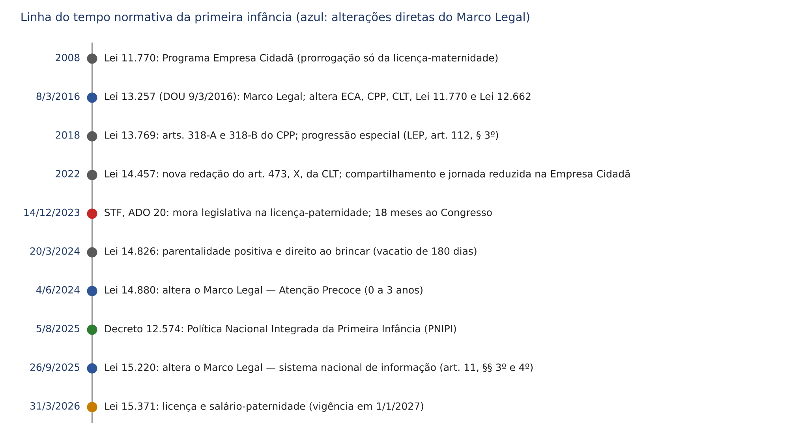
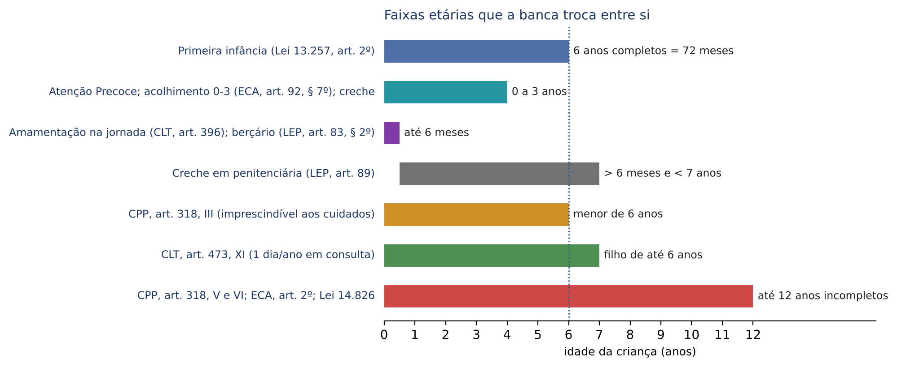
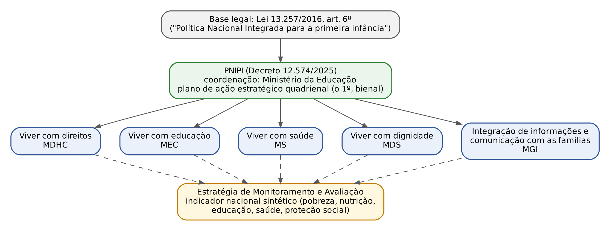
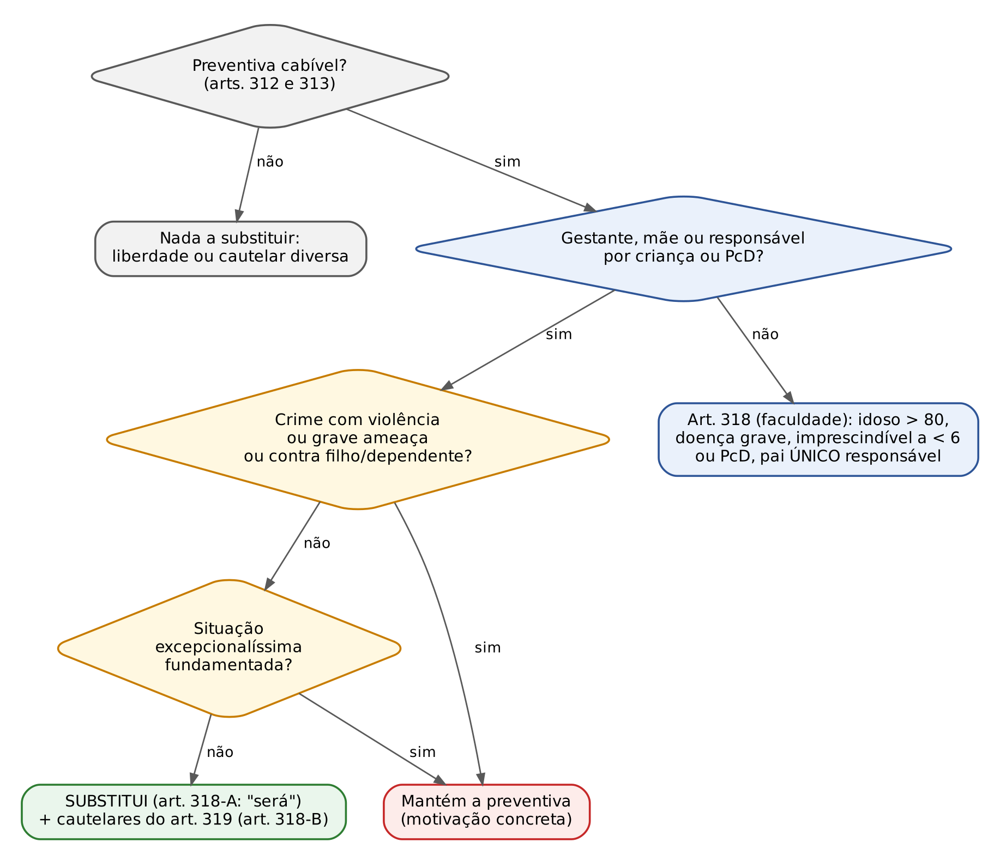
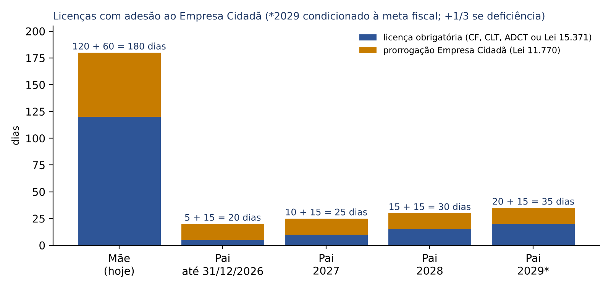

# CAPÍTULO 24 — MARCO LEGAL DA PRIMEIRA INFÂNCIA (LEI 13.257/2016) E POLÍTICA NACIONAL INTEGRADA

:::INCIDENCIA
TJSC p. 12. Nível A. Lote: 4 questões (FGV 3, FCC 1), uma delas de magistratura (TJ-PA 2026), mais 4 correlatas de outros capítulos (FGV), com provas de Ministério Público.
O que mais cai: conceito de primeira infância (6 anos completos ou 72 meses); princípios do art. 4º com troca de palavras ("interesse inferior", "anular as diferenças", "centralizar"); intersetorialidade e corresponsabilidade em caso prático de reintegração familiar; e, por remissão, art. 13, § 2º, do ECA, art. 318 do CPP e licenças.
:::

## 24.1 Natureza, estrutura e alterações posteriores

### 24.1.1 Uma lei-quadro de políticas públicas com "carona" em cinco diplomas

A Lei 13.257, de 8/3/2016 (publicada no DOU de 9/3/2016, com vigência na data da publicação, art. 43), tem dupla natureza. Nos arts. 1º a 17, é uma lei-quadro de políticas públicas: fixa conceito, princípios, áreas prioritárias, arranjo federativo, controle social, monitoramento e linhas de ação para a primeira infância, quase sempre em normas programáticas dirigidas ao Poder Executivo dos três níveis. Nos arts. 18 a 42, é uma lei alteradora, que injeta a lógica da primeira infância em cinco outros diplomas. O art. 1º anuncia exatamente essa estrutura, e as bancas gostam de cobrar o rol de diplomas alterados:

| Dispositivos da Lei 13.257 | Diploma alterado | Conteúdo central |
|---|---|---|
| arts. 18 a 36 | ECA (Lei 8.069/1990) | arts. 3º, parágrafo único; 8º; 9º; 11; 12; 13; 14; 19; 22; 23; 34; 87; 88; 92; 101; 102; 129; 260; e inclusão do art. 265-A |
| art. 37 | CLT | incisos X e XI do art. 473 (faltas justificadas do pai e do responsável) |
| arts. 38 a 40 | Lei 11.770/2008 | Programa Empresa Cidadã passa a prorrogar também a licença-paternidade |
| art. 41 | CPP | arts. 6º, X; 185, § 10; 304, § 4º; e 318, IV, V e VI |
| art. 42 | Lei 12.662/2012 | §§ 3º e 4º do art. 5º (Declaração de Nascido Vivo, interoperabilidade com o Sirc) |

:::PEGADINHA
A lei NÃO alterou o Código Civil, a LEP, a LOAS nem a Lei de Diretrizes e Bases da Educação. A LDB é apenas mencionada no art. 16 (profissionais qualificados "conforme dispõe" a Lei 9.394/1996); a LEP ganhou regras para gestantes e mães só com a Lei 13.769/2018 (24.9.5). Outra troca frequente: o Marco Legal alterou o art. 318 do CPP (incisos IV a VI), mas NÃO criou o art. 318-A, que é da Lei 13.769/2018.
:::

A vigência imediata comporta uma exceção expressa: as alterações da Lei 11.770/2008 (art. 38) e a estimativa de renúncia fiscal (art. 39) produzem efeitos "a partir do primeiro dia do exercício subsequente àquele em que for implementado o disposto no art. 39" (art. 40). É a técnica da Lei de Responsabilidade Fiscal (arts. 5º, II, 12 e 14 da LC 101/2000): benefício tributário só produz efeitos depois de estimado e incluído no demonstrativo do art. 165, § 6º, da CF. Não houve, portanto, *vacatio legis* para o restante da lei.

### 24.1.2 Alterações posteriores do próprio Marco Legal (2023 a 2026)

Conferido o texto compilado no Planalto, o Marco Legal sofreu, até 7/11/2026, apenas DUAS alterações diretas:

| Lei | Dispositivos | Conteúdo |
|---|---|---|
| Lei 14.880, de 4/6/2024 | art. 3º, §§ 1º e 2º; art. 4º, X e XI; art. 5º, parágrafo único; art. 14, § 6º; art. 16, §§ 2º e 3º | institui a Política Nacional de Atendimento Educacional Especializado a Crianças de Zero a Três Anos (Atenção Precoce); prioridade absoluta para as crianças de 0 a 3 anos com necessidade de atendimento educacional especializado e para bebês nascidos em condição de risco; prioridade nas visitas domiciliares |
| Lei 15.220, de 26/9/2025 | art. 11, §§ 3º e 4º | sistema nacional de informação sobre o desenvolvimento integral da primeira infância, integrando dados de saúde, educação, assistência social e proteção, com informações detalhadas sobre creches |

Ao lado delas, há diplomas que gravitam em torno do Marco Legal sem alterá-lo: a Lei 14.826/2024 (parentalidade positiva e direito ao brincar, 24.7.4), o Decreto 12.574/2025 (Política Nacional Integrada da Primeira Infância, 24.6.5), a Lei 13.769/2018 (arts. 318-A e 318-B do CPP), a Lei 14.457/2022 (que deu nova redação ao art. 473, X, da CLT e modificou a Lei 11.770/2008) e a Lei 15.371/2026 (licença e salário-paternidade, com vigência em 1/1/2027, que também altera a Lei 11.770/2008).

:::ATENCAO
Texto "desatualizado" é a armadilha clássica do tema. Três dispositivos que a Lei 13.257 inseriu já não têm a redação original: (i) o art. 473, X, da CLT ("até 2 dias" virou "pelo tempo necessário" para até 6 consultas, Lei 14.457/2022); (ii) o art. 1º, II, da Lei 11.770/2008 (a referência aos "5 dias" do ADCT será substituída, em 1/1/2027, por "além do período obrigatório fixado em lei", Lei 15.371/2026); (iii) o art. 4º da Lei 11.770 já tinha sido reescrito pela própria Lei 13.257 (a antiga vedação de manter a criança "em creche" virou o dever de mantê-la "sob seus cuidados"). Quem estuda por lei seca antiga erra.
:::

### 24.1.3 Lugar do Marco Legal no sistema

O Marco Legal não cria um "estatuto paralelo". Seu art. 1º o põe "em consonância com os princípios e diretrizes" do ECA, e o art. 3º extrai da prioridade absoluta (CF, art. 227; ECA, art. 4º) um dever estatal específico. Na prática judicial, ele opera de três modos: (i) como critério interpretativo e de ponderação, ao densificar o melhor interesse para a faixa de 0 a 6 anos (por exemplo, na escolha entre acolhimento familiar e institucional, na fixação de rotina de convivência, na decisão sobre prisão domiciliar); (ii) como parâmetro de controle de políticas públicas em ações coletivas (planos municipais, creche, visitas domiciliares, Atenção Precoce), sempre com as cautelas do controle judicial de políticas públicas (Cap. 20); (iii) como fonte de regras de aplicação direta, nas alterações do ECA, do CPP, da CLT e da Lei 11.770.

:::DOUTRINA
A doutrina especializada (por exemplo, Rossato, Lépore e Cunha, nos comentários ao ECA) costuma ler a Lei 13.257 como expressão da "prioridade dentro da prioridade": a absoluta prioridade do art. 227 da CF é a regra geral, e a primeira infância recebe atenção qualificada em razão da especificidade biológica e psicossocial dos primeiros anos. A ideia ganhou texto legal expresso, no campo do direito à natureza, com a Lei 15.512/2026, cujo art. 2º, § 3º, dá prioridade, dentro da absoluta prioridade, às crianças na primeira infância, às crianças e adolescentes com deficiência e aos que estão em situação de risco ou vulnerabilidade social (Cap. 1, 1.4.3). A atribuição da expressão a autores determinados não foi conferida na fonte nesta tarefa.
:::

## 24.2 Conceito de primeira infância e faixas etárias

### 24.2.1 O art. 2º

:::LEI LEI 13.257/2016, ART. 2º
Art. 2º Para os efeitos desta Lei, considera-se primeira infância o período que abrange os primeiros 6 (seis) anos completos ou 72 (setenta e dois) meses de vida da criança.
:::

Três observações de prova. Primeiro, o marco inicial é o NASCIMENTO ("meses de vida"), não a concepção; a gestação recebe proteção por outras vias (ECA, art. 8º; Lei 11.804/2008, alimentos gravídicos), mas não integra o conceito legal. Segundo, a expressão "primeiros 6 anos completos" significa os seis primeiros anos de vida, ou seja, até o sexto aniversário (72 meses), e não "até os 6 anos e 11 meses"; a equivalência numérica com 72 meses elimina a dúvida. Terceiro, a definição vale "para os efeitos desta Lei", mas foi incorporada pelo ECA em vários dispositivos que usam a expressão (arts. 8º, § 10; 11, § 3º; 13, § 2º; 88, VIII; 260, § 2º), que devem ser lidos com o mesmo alcance.

:::QUESTAO FCC 2025 — DPE-SP — ANALISTA DE DEFENSORIA (Q3304082)
Pedia-se o período legal de primeira infância. Gabarito: C (os primeiros 6 anos completos ou 72 meses de vida).
Armadilhas: A (do nascimento aos 3 anos: é a faixa da Atenção Precoce e do art. 92, § 7º, do ECA, não da primeira infância); B (dos 2 aos 5 anos incompletos: mistura com a pré-escola); D ("da concepção até 7 anos": erra o termo inicial e o final); E (12 meses: primeiro ano de vida).
:::

### 24.2.2 As faixas que a banca troca

O direito da primeira infância trabalha com várias idades de corte, espalhadas por diplomas diferentes. Memorize pelo quadro e pela figura:

| Faixa | Dispositivo | Regra |
|---|---|---|
| 0 a 6 anos (72 meses) | Lei 13.257, art. 2º | conceito de primeira infância |
| 0 a 3 anos | Lei 13.257, arts. 3º, §§ 1º e 2º, 4º, X e XI, 16, §§ 1º a 3º; ECA, art. 92, § 7º | Atenção Precoce; expansão da creche; acolhimento institucional com educadores de referência estáveis |
| até 5 anos | CF, art. 208, IV | educação infantil em creche e pré-escola (Tema 548 do STF, Cap. 8, 8.4.1) |
| inferior a 6 anos | ECA, art. 265-A, parágrafo único | divulgação dos direitos em linguagem adequada, "especialmente" a essa faixa |
| menor de 6 anos | CPP, art. 318, III | domiciliar de quem é imprescindível aos cuidados especiais |
| até 6 anos | CLT, art. 473, XI | 1 dia por ano para acompanhar filho em consulta médica |
| até 6 meses | CLT, art. 396; LEP, art. 83, § 2º | dois descansos de meia hora para amamentar; berçário em estabelecimento penal feminino ("no mínimo" até 6 meses) |
| maior de 6 meses e menor de 7 anos | LEP, art. 89 | creche na penitenciária de mulheres |
| até 12 anos incompletos | ECA, art. 2º; CPP, art. 318, V e VI; Lei 14.826/2024, art. 3º, parágrafo único | criança; domiciliar da mãe e do pai único responsável; parentalidade positiva e direito ao brincar |

:::DICA
"6" aparece em quatro regras com redações diferentes: primeira infância = 6 anos completos (72 meses); CPP, art. 318, III = "menor de 6"; CLT, art. 473, XI = "até 6"; ECA, art. 265-A = "inferior a 6". O Marco Legal NÃO mudou o conceito de criança do ECA (até 12 anos incompletos) nem criou subcategoria com efeito sobre medidas de proteção ou competência.
:::

## 24.3 Prioridade absoluta e dever do Estado (art. 3º)

:::LEI LEI 13.257/2016, ART. 3º (COM OS §§ 1º E 2º INCLUÍDOS PELA LEI 14.880/2024)
Art. 3º A prioridade absoluta em assegurar os direitos da criança, do adolescente e do jovem, nos termos do art. 227 da Constituição Federal e do art. 4º da Lei nº 8.069, de 13 de julho de 1990, implica o dever do Estado de estabelecer políticas, planos, programas e serviços para a primeira infância que atendam às especificidades dessa faixa etária, visando a garantir seu desenvolvimento integral.
§ 1º É instituída a Política Nacional de Atendimento Educacional Especializado a Crianças de Zero a Três Anos (Atenção Precoce), viabilizada por meio da criação e da articulação de serviços multiprofissionais e intersetoriais de atenção precoce destinados a potencializar o processo de desenvolvimento e aprendizagem das crianças de 0 (zero) a 3 (três) anos, em cooperação, preferencialmente, com os serviços de saúde e assistência social.
§ 2º A Atenção Precoce priorizará as crianças de 0 (zero) a 3 (três) anos que necessitem de atendimento educacional especializado e os bebês que tenham nascido em condição de risco, como os prematuros, os acometidos por asfixia perinatal ou os que apresentem problemas neurológicos, malformações congênitas, síndromes genéticas, entre outros.
:::

O caput é a chave de leitura de toda a lei: a prioridade absoluta (tripla, de criança, adolescente e JOVEM, como na redação do art. 227 dada pela EC 65/2010) "implica o dever do Estado" de estabelecer políticas, planos, programas e serviços próprios para a primeira infância. Não se trata, portanto, de mera recomendação: há um DEVER, cujo conteúdo é a especificidade da faixa etária e cujo objetivo é o desenvolvimento integral. Para o juiz, a consequência é que a ausência total de política (por exemplo, município sem qualquer programa de visitação domiciliar ou sem plano para a primeira infância) é omissão juridicamente qualificada, embora o desenho concreto da política continue, em regra, na esfera do administrador (Cap. 20).

A Lei 14.880/2024 acrescentou a Atenção Precoce, que é política EDUCACIONAL (atendimento educacional especializado), e não de saúde: os serviços são "multiprofissionais e intersetoriais" e atuam "em cooperação, preferencialmente, com os serviços de saúde e assistência social". O § 2º define o público prioritário em dois grupos: (i) crianças de 0 a 3 anos que necessitem de atendimento educacional especializado (o art. 4º, X, detalha: deficiência, transtornos globais do desenvolvimento, altas habilidades ou superdotação); (ii) bebês nascidos em condição de risco (rol exemplificativo: prematuros, asfixia perinatal, problemas neurológicos, malformações congênitas, síndromes genéticas, "entre outros").

:::PEGADINHA
Três trocas possíveis: (i) Atenção Precoce é para 0 a 3 anos, não para toda a primeira infância (0 a 6); (ii) é política nacional de atendimento EDUCACIONAL especializado, em cooperação "preferencialmente" com saúde e assistência social (não é política do SUS); (iii) o rol de bebês em condição de risco é exemplificativo ("entre outros").
:::

A Lei 14.880 reforçou essa prioridade em quatro pontos: princípios (art. 4º, X e XI), áreas prioritárias (art. 5º, parágrafo único: "prioridade absoluta na oferta de serviços, apoios e recursos" às crianças do § 2º do art. 3º), visitas domiciliares (art. 14, § 6º) e educação infantil (art. 16, §§ 2º e 3º). Note a gradação interna: toda criança tem prioridade absoluta (CF, art. 227); a criança na primeira infância recebe políticas específicas (art. 3º, caput); e, dentro dela, a criança de 0 a 3 anos com necessidade de atendimento educacional especializado ou nascida em condição de risco recebe "prioridade absoluta na oferta de serviços, apoios e recursos" (art. 5º, parágrafo único).

:::EXEMPLO
Ação civil pública do MP contra município que mantém lista de espera para atendimento de bebês prematuros com atraso de desenvolvimento em creche com atendimento educacional especializado. Fundamentos: CF, arts. 208, III e IV, e 227; ECA, arts. 54, III e IV, e 208, III; Lei 13.257, arts. 3º, §§ 1º e 2º, 5º, parágrafo único, e 16, § 2º. O argumento da reserva do possível enfrenta aqui norma que confere prioridade ABSOLUTA específica a esse grupo; o pedido mais seguro é a inclusão das crianças identificadas e a apresentação de plano com cronograma, e não a criação judicial do desenho da política (Cap. 20).
:::

## 24.4 Princípios e diretrizes das políticas (art. 4º)

### 24.4.1 O rol

O art. 4º enumera como as políticas para a primeira infância serão "elaboradas e executadas". É o dispositivo mais cobrado da lei, sempre pela literalidade:

| Inciso | Texto (essencial) | Troca típica da banca |
|---|---|---|
| I | atender ao interesse SUPERIOR da criança e à sua condição de sujeito de direitos e de cidadã | "interesse inferior"; "objeto de proteção" |
| II | incluir a PARTICIPAÇÃO da criança na definição das ações que lhe digam respeito, conforme características etárias e de desenvolvimento | "participação dos pais em substituição à criança"; participação só a partir dos 12 anos |
| III | respeitar a individualidade e os ritmos de desenvolvimento e VALORIZAR a diversidade e as diferenças entre as crianças em seus contextos sociais e culturais | "anular as diferenças"; "padronizar o desenvolvimento" |
| IV | REDUZIR as desigualdades no acesso a bens e serviços, priorizando o investimento público na promoção da justiça social, da equidade e da inclusão sem discriminação | "eliminar" desigualdades; investimento privado |
| V | articular as dimensões ética, humanista e política da criança cidadã com as evidências científicas e a prática profissional | — |
| VI | abordagem PARTICIPATIVA: sociedade (organizações representativas), profissionais, pais e crianças | excluir as crianças ou os profissionais |
| VII | articular as ações setoriais com vistas ao atendimento integral e integrado | "atuação setorial isolada" |
| VIII | DESCENTRALIZAR as ações entre os entes da Federação | "centralizar" (na União) |
| IX | formação da cultura de proteção e promoção da criança, com apoio dos meios de comunicação social | — |
| X (Lei 14.880/2024) | promover o desenvolvimento das potencialidades das crianças de 0 a 3 anos com deficiência, transtornos globais do desenvolvimento, altas habilidades ou superdotação e dos bebês nascidos em condição de risco, priorizando interação e comunicação mediante atividades significativas e lúdicas | estender a toda a primeira infância |
| XI (Lei 14.880/2024) | garantir serviços, apoios e recursos para as crianças de 0 a 3 anos e suas famílias, com vistas ao desenvolvimento infantil pleno e inclusivo, em colaboração interfederativa | — |

O parágrafo único completa o inciso II: a participação da criança tem o objetivo de promover sua inclusão social como cidadã, "dar-se-á de acordo com a especificidade de sua idade" e deve ser realizada "por profissionais qualificados em processos de escuta adequados às diferentes formas de expressão infantil". É a mesma lógica do direito de ser ouvido do art. 12 da Convenção sobre os Direitos da Criança (Cap. 2) e da oitiva obrigatória do art. 100, parágrafo único, XII, do ECA (Cap. 13), agora aplicada à formulação de políticas, e não só ao processo individual.

:::QUESTAO FGV 2024 — EBSERH — RESIDÊNCIA MULTIPROFISSIONAL — SAÚDE COLETIVA (Q3348735)
Pedia-se a assertiva conforme os princípios e diretrizes do art. 4º. Gabarito: B (incluir a participação da criança na definição das ações que lhe digam respeito, conforme suas características etárias e de desenvolvimento — inciso II, literal).
Armadilhas: A ("interesse inferior"); C (valorizar a diversidade e "anular as diferenças": o inciso III manda valorizar as diferenças); D (reduzir desigualdades "priorizando o investimento público na inclusão sem discriminação": a alternativa amputa "promoção da justiça social, da equidade" e foi tida por incorreta, o que mostra que a FGV exige a fórmula completa do inciso IV); E ("centralizar as ações entre os entes": o inciso VIII manda DESCENTRALIZAR).
:::

:::QUESTAO FGV 2026 — PREFEITURA DE SALVADOR — PROFESSOR DE EDUCAÇÃO INFANTIL (Q4357961)
Questão comemorativa ("uma década de vigência") pedia a afirmativa correta sobre as diretrizes e os avanços do Marco Legal. Gabarito: D (o Marco Legal implica que o Estado estabeleça planos de acesso à educação e aos cuidados desde a primeira infância, prevenindo problemas de saúde e atrasos no desenvolvimento — paráfrase do art. 3º).
Armadilhas: A (primeira infância de "0 a 5 anos": são 6 anos completos); B (intersetorialidade "em teste": é diretriz obrigatória, arts. 4º, VII, e 6º); C ("reforço do princípio da igualdade" para valorizar singularidades: o art. 4º, III, fala em valorizar a DIVERSIDADE e as diferenças, e o art. 4º, IV, em equidade, não em igualdade formal); E (prioridade para crianças com deficiência "a partir dos 3 anos": o art. 14, § 2º, prioriza famílias com crianças com indicadores de risco ou deficiência sem esse corte, e a Lei 14.880 prioriza justamente a faixa de 0 a 3 anos).
Nota: a lei foi sancionada em 8/3/2016, mas publicada e vigente em 9/3/2016 (art. 43); a premissa do enunciado é aproximação aceitável.
:::

### 24.4.2 Princípios do Marco Legal x princípios do art. 100 do ECA x diretrizes da PNIPI

| Tema | Lei 13.257, art. 4º (políticas) | ECA, art. 100, parágrafo único (medidas de proteção, Cap. 13) | Decreto 12.574/2025, art. 2º (PNIPI) |
|---|---|---|---|
| Melhor interesse | "interesse superior" (I) | "interesse superior da criança e do adolescente" (IV) | "interesse das crianças e sua condição de cidadãs e de sujeitos de direitos" (I) |
| Participação | participação da criança na definição das ações (II e par. único) | oitiva obrigatória e participação (XII) | abordagem participativa (VI) |
| Diversidade | valorizar diferenças (III) | — | respeito à individualidade e à diversidade (III); interseccionalidades (art. 1º, § 2º) |
| Federalismo | descentralizar (VIII) | responsabilidade primária e solidária do poder público (III); municipalização (ECA, art. 88, I) | articulação federal e regime de colaboração (VIII); territorialização e descentralização (XV) |
| Integração | articulação setorial, atendimento integral e integrado (VII) | — | intersetorialidade e integração (VII) |
| Destinatários prioritários | 0 a 3 anos com deficiência ou em risco (X e XI) | — | crianças com deficiência ou famílias em risco e vulnerabilidade (V) |

## 24.5 Áreas prioritárias (art. 5º)

:::LEI LEI 13.257/2016, ART. 5º
Art. 5º Constituem áreas prioritárias para as políticas públicas para a primeira infância a saúde, a alimentação e a nutrição, a educação infantil, a convivência familiar e comunitária, a assistência social à família da criança, a cultura, o brincar e o lazer, o espaço e o meio ambiente, bem como a proteção contra toda forma de violência e de pressão consumista, a prevenção de acidentes e a adoção de medidas que evitem a exposição precoce à comunicação mercadológica.
Parágrafo único. Será conferida às crianças de 0 (zero) a 3 (três) anos referidas no § 2º do art. 3º desta Lei prioridade absoluta na oferta de serviços, apoios e recursos necessários ao seu pleno desenvolvimento infantil. (Incluído pela Lei nº 14.880, de 2024)
:::

O rol tem duas partes. A primeira enumera áreas "positivas" (saúde; alimentação e nutrição; educação infantil; convivência familiar e comunitária; assistência social À FAMÍLIA da criança; cultura; o brincar e o lazer; o espaço e o meio ambiente). A segunda, introduzida por "bem como", enumera áreas "defensivas": proteção contra toda forma de violência e de PRESSÃO CONSUMISTA, prevenção de acidentes e medidas contra a EXPOSIÇÃO PRECOCE À COMUNICAÇÃO MERCADOLÓGICA.

Dois pontos merecem destaque. O primeiro é que "o brincar" é área prioritária autônoma, o que o art. 17 concretiza (espaços lúdicos) e a Lei 14.826/2024 transforma em política de Estado (24.7.4). O segundo é a proteção contra a comunicação mercadológica: o Marco Legal não proíbe a publicidade infantil, mas impõe ao poder público medidas que evitem a exposição precoce, o que dialoga com a abusividade da publicidade que se aproveita da deficiência de julgamento e experiência da criança (CDC, art. 37, § 2º) e com o regime do Estatuto Digital (Lei 15.211/2025, Cap. 10). A assistência social é "à família da criança": o foco é o grupo familiar como unidade de cuidado, coerente com o art. 14 e com o SUAS (Cap. 25).

:::DICA
Para memorizar as áreas do art. 5º, agrupe: corpo (saúde, alimentação e nutrição, prevenção de acidentes); mente e cultura (educação infantil, cultura, brincar e lazer); vínculos (convivência familiar e comunitária, assistência social à família); território (espaço e meio ambiente); proteção (violência, pressão consumista, comunicação mercadológica). NÃO estão no rol, como áreas autônomas: segurança pública, esporte, habitação e trabalho (habitação e trabalho aparecem no art. 14, como áreas a articular nos programas de apoio às famílias).
:::

:::PRATIQUE EXERCÍCIO ELABORADO PARA ESTA APOSTILA (NÃO É QUESTÃO DE BANCA)
Julgue: "Segundo a Lei 13.257/2016, são áreas prioritárias para as políticas públicas para a primeira infância, entre outras, a educação infantil, o esporte de rendimento e a proteção contra a pressão consumista."
Resolução: ERRADO. O art. 5º inclui educação infantil e proteção contra pressão consumista, mas não o esporte (muito menos "de rendimento"); fala em "o brincar e o lazer".
:::

## 24.6 Política Nacional Integrada, federalismo, controle social e monitoramento (arts. 6º a 12)

### 24.6.1 Intersetorialidade como método (art. 6º)

:::LEI LEI 13.257/2016, ART. 6º
Art. 6º A Política Nacional Integrada para a primeira infância será formulada e implementada mediante abordagem e coordenação intersetorial que articule as diversas políticas setoriais a partir de uma visão abrangente de todos os direitos da criança na primeira infância.
:::

A intersetorialidade é o eixo do Marco Legal: aparece como princípio (art. 4º, VII), como método da política nacional (art. 6º), como finalidade do comitê intersetorial (art. 7º), como objeto da assistência técnica da União (art. 8º, parágrafo único: "abordagem multi e intersetorial"), como tema obrigatório da qualificação dos profissionais (art. 10) e como critério dos programas de apoio às famílias (art. 14, caput: articulação de saúde, nutrição, educação, assistência social, cultura, trabalho, habitação, meio ambiente e direitos humanos). Para o juiz da infância, o efeito prático é este: o atendimento à criança pequena e à sua família NÃO pode ser fragmentado em "agendas incompatíveis e por vias separadas", e a decisão judicial que acompanha o caso (acolhimento, reintegração, medida de proteção) deve exigir articulação, não apenas encaminhamentos isolados.

:::QUESTAO FGV 2026 — TJ-PA — JUIZ SUBSTITUTO (Q3951746)
Criança de 3 anos acolhida há 6 meses, em reintegração familiar; a mãe precisa de vaga em creche para voltar ao trabalho; o pai tem vínculos intermitentes e baixa escolaridade; os pais faltam às atividades porque os atendimentos ocorrem em agendas incompatíveis e por vias separadas. Na audiência concentrada de revisão do PIA, perguntava-se que princípios e fundamentos estruturantes da atenção integral à primeira infância a decisão deve considerar. Gabarito: C (prioridade absoluta, proteção integral, desenvolvimento integral, convivência familiar e comunitária e corresponsabilidade constitucional, com atuação intersetorial coordenada entre assistência, saúde e educação e atenção continuada).
Resolução em passos: (1) idade de 3 anos: primeira infância (art. 2º) e faixa de especial atenção (ECA, art. 92, § 7º); (2) a dificuldade de adesão decorre da desarticulação dos serviços, não de desinteresse: o remédio é integrar (Lei 13.257, arts. 4º, VII, 6º e 14), e não punir a família; (3) reintegração tem preferência e a família deve ser incluída em programas (ECA, arts. 19, § 3º, 23, § 1º, e 101, IV, todos com redação do Marco Legal); (4) a vaga em creche é direito da criança (CF, art. 208, IV) e condição material da reintegração; (5) após o retorno, o acompanhamento continua (art. 14, §§ 2º e 4º).
Armadilhas: A condiciona o acesso às ações ao comparecimento regular (inverte a lógica: o Estado deve adequar a oferta, e a pobreza ou a dificuldade de acesso não justifica sanção, ECA, art. 23); B recomenda reunificação imediata com ações pontuais "sem ampliação para outras políticas"; D quer retirar a intervenção "sem necessidade de acompanhamento intersetorial contínuo"; E privilegia a intervenção só "diante de risco grave e imediato", sem acompanhamento preventivo. Em todas, o erro é negar a intersetorialidade continuada.
No mesmo sentido (atribuída ao Cap. 4): Q3532427 (FGV 2025, MPE-RJ, Promotor), em que a reintegração de criança de 3 anos acolhida por negligência seguia o rito do art. 101, § 8º, do ECA (comunicação imediata ao juiz, vista ao MP por 5 dias e decisão em igual prazo); a alternativa que transferia a criança para acolhimento familiar "por se encontrar na primeira infância", quando o caso já era de reintegração, estava errada (ver Cap. 4, 4.4.7).
:::

:::SENTENCA DECISÃO EM AUDIÊNCIA CONCENTRADA: REINTEGRAÇÃO NA PRIMEIRA INFÂNCIA COM ACOMPANHAMENTO INTERSETORIAL
Vistos. Trata-se de reavaliação da medida de acolhimento institucional de A. B. C., nascida em 2/5/2023, hoje com 3 anos, na primeira infância (Lei 13.257/2016, art. 2º). Os estudos técnicos indicam vínculo preservado com os genitores e viabilidade de reintegração, cujo principal obstáculo é a desarticulação dos atendimentos, ofertados em horários incompatíveis e por serviços que não se comunicam. A manutenção ou a reintegração da criança à família tem preferência sobre qualquer outra providência, com inclusão da família em serviços e programas de proteção, apoio e promoção (ECA, arts. 19, § 3º, e 23, § 1º), e as políticas para a primeira infância devem ser executadas de forma intersetorial (Lei 13.257/2016, arts. 4º, VII, 6º e 14, § 2º). Ante o exposto, com fundamento nos arts. 101, § 8º, e 129, I, do ECA: (i) determino o desligamento da criança da entidade de acolhimento e sua entrega aos genitores, mediante termo de responsabilidade (art. 101, I); (ii) determino ao Município a matrícula da criança em centro de educação infantil próximo à residência, em até 10 dias; (iii) determino a inclusão da família no PAEFI do CREAS e o acompanhamento pela equipe de Saúde da Família, com plano de acompanhamento ÚNICO, elaborado conjuntamente pelos serviços de assistência social, saúde e educação, em 20 dias, com horários compatíveis com a jornada de trabalho dos genitores; (iv) encaminhe-se o genitor a programa de qualificação profissional e de elevação de escolaridade; (v) relatório conjunto em 90 dias. Ciência ao MP e à Defensoria. Intimem-se.
:::

### 24.6.2 Arranjo federativo: comitês, colaboração e planos (arts. 7º e 8º)

O art. 7º faculta ("poderão") à União, aos Estados, ao DF e aos Municípios instituir comitê intersetorial de políticas públicas para a primeira infância, com a finalidade de articular as ações de proteção e promoção, "garantida a participação social por meio dos conselhos de direitos". Cabe ao Executivo de cada ente indicar o órgão coordenador do comitê (§ 1º); o órgão indicado pela União manterá articulação permanente com as instâncias estaduais, distrital e municipais (§ 2º).

O art. 8º fixa o pleno atendimento dos direitos da criança na primeira infância como "objetivo comum de todos os entes da Federação", a ser alcançado em REGIME DE COLABORAÇÃO, segundo as respectivas competências. A União "buscará a adesão" dos demais entes à abordagem multi e intersetorial e "oferecerá assistência técnica na elaboração de planos estaduais, distrital e municipais para a primeira infância" (parágrafo único).

:::PEGADINHA
Os verbos decidem a questão. O comitê intersetorial é FACULTATIVO ("poderão instituir"); os planos estaduais e municipais não são impostos pelo Marco Legal (a União "buscará a adesão" e oferece assistência técnica); mas o monitoramento é OBRIGATÓRIO (art. 11: as políticas terão, "necessariamente", componentes de monitoramento, coleta sistemática de dados, avaliação periódica e divulgação de resultados), e os espaços lúdicos também ("deverão organizar e estimular", art. 17). A participação social no comitê é GARANTIDA, e se dá "por meio dos conselhos de direitos".
:::

O Plano Nacional pela Primeira Infância é referido no ECA: o art. 260, § 1º-A (redação da Lei 13.257), manda que, na definição das prioridades do FIA, sejam consideradas as disposições do Plano Nacional de Convivência Familiar e Comunitária "e as do Plano Nacional pela Primeira Infância". O § 2º do mesmo artigo exige que os conselhos apliquem "necessariamente percentual" para acolhimento sob a forma de guarda e para "programas de atenção integral à primeira infância em áreas de maior carência socioeconômica e em situações de calamidade" (regime do FIA no Cap. 11, 11.5).

:::QUESTAO FGV 2024 — MPE-GO — PROMOTOR DE JUSTIÇA SUBSTITUTO (Q2367616, ATRIBUÍDA AO CAP. 17)
O caso discutia se o conselho estadual pode deixar de destinar recursos do FIA ao SINASE. Gabarito: C (o percentual para o SINASE é definido, obrigatoriamente, pelos conselhos, a cada ano — Lei 12.594/2012, art. 31). Interessa aqui a alternativa D, errada: afirmava que o FIA tem como "únicas destinações obrigatórias" o acolhimento e os programas de primeira infância do art. 260, § 2º, do ECA. A redação do Marco Legal criou essas duas destinações necessárias, mas não excluiu outras obrigações legais, como a do SINASE. Desenvolvimento no Cap. 11.
:::

### 24.6.3 Formação, monitoramento, dados e transparência (arts. 9º a 11)

| Dispositivo | Regra | Destaque |
|---|---|---|
| art. 9º | articulação com instituições de formação profissional, adequando cursos às necessidades das crianças | finalidade: "expansão com qualidade" dos serviços |
| art. 10 | profissionais das políticas da primeira infância têm acesso "garantido e prioritário" à qualificação (especialização e atualização) | temas mínimos: especificidade da primeira infância, intersetorialidade, prevenção e proteção contra toda forma de violência |
| art. 11, caput | componentes NECESSÁRIOS de monitoramento, coleta sistemática de dados, avaliação periódica e divulgação de resultados | dever, não faculdade |
| art. 11, § 1º | União mantém instrumento individual de registro unificado de dados do crescimento e desenvolvimento da criança e sistema informatizado que inclua as redes PÚBLICA E PRIVADA de saúde | inclui a rede privada |
| art. 11, § 2º | União informa à sociedade a soma dos recursos aplicados anualmente em programas e serviços para a primeira infância e o percentual em relação ao orçamento realizado, e colhe informações dos demais entes | transparência orçamentária (o Decreto 12.574/2025, art. 8º, operacionaliza pela Agenda Transversal Crianças e Adolescentes) |
| art. 11, § 3º (Lei 15.220/2025) | sistema nacional de informação sobre o desenvolvimento integral da primeira infância, em articulação com os entes, integrando dados de saúde, educação, assistência social e proteção | quatro áreas integradas |
| art. 11, § 4º (Lei 15.220/2025) | o sistema terá informações detalhadas sobre creches e demais instituições de atendimento, para assegurar a qualidade da educação infantil (art. 16 e legislação educacional) | qualidade da oferta, não só vagas |

Os arts. 88, VIII a X, do ECA (incluídos pelo Marco Legal) repetem a lógica no plano das diretrizes da política de atendimento: especialização e formação continuada dos profissionais da primeira infância, formação que favoreça a intersetorialidade e "realização e divulgação de pesquisas sobre desenvolvimento infantil e sobre prevenção da violência" (Cap. 11, 11.3).

:::ATENCAO
Tratamento de dados de crianças nesses sistemas observa a LGPD, cujo art. 14 exige que o tratamento de dados pessoais de crianças seja realizado em seu melhor interesse; o Decreto 12.574/2025 (art. 5º, §§ 5º e 6º) manda divulgar os dados de monitoramento de forma desagregada e observar a Lei 13.709/2018 e o Decreto 10.046/2019. A interface com o Estatuto Digital está no Cap. 10.
:::

### 24.6.4 Participação da sociedade (art. 12)

O art. 12 afirma que a sociedade participa "solidariamente com a família e o Estado" da proteção e promoção da criança na primeira infância, nos termos do art. 227, caput e § 7º, combinado com o art. 204, II, da CF (participação da população, por meio de organizações representativas, na formulação das políticas e no controle das ações). As formas, em rol exemplificativo ("entre outras formas"): (I) formular políticas e controlar ações, por organizações representativas; (II) integrar conselhos de forma PARITÁRIA com representantes governamentais, com funções de planejamento, acompanhamento, controle social e avaliação; (III) executar ações diretamente ou em parceria com o poder público; (IV) desenvolver programas no conceito de responsabilidade social e investimento social privado; (V) criar, apoiar e participar de redes de proteção e cuidado nas comunidades; (VI) promover campanhas sobre o significado da primeira infância.

### 24.6.5 A Política Nacional Integrada da Primeira Infância (Decreto 12.574/2025)

O art. 6º da Lei 13.257 previu uma "Política Nacional Integrada para a primeira infância", mas não a instituiu em detalhe. A regulamentação veio pelo Decreto 12.574, de 5/8/2025 (DOU de 6/8/2025), que institui a Política Nacional Integrada da Primeira Infância (PNIPI) "no âmbito da União" e revogou os Decretos 10.770/2021 e 12.083/2024, que tratavam anteriormente da matéria.

| Elemento | Regra do Decreto 12.574/2025 |
|---|---|
| Fundamento | CF, art. 227; ECA; Lei 13.257/2016; Lei 15.069/2024 (Política Nacional de Cuidados) |
| Finalidade (art. 1º, § 1º) | coordenação intersetorial e integrada das políticas setoriais para a criança na primeira infância, em articulação com Estados, DF e Municípios |
| Diversidade (art. 1º, § 2º) | considera interseccionalidades socioeconômicas, territoriais e regionais, étnico-raciais, de gênero e de deficiência |
| Coordenação (art. 1º, § 3º) | Ministério da EDUCAÇÃO |
| Diretrizes (art. 2º) | 15 incisos: interesse das crianças; desenvolvimento integral; diversidade; redução de desigualdades; prioridade a crianças com deficiência ou em famílias em risco e vulnerabilidade; abordagem participativa; intersetorialidade; regime de colaboração; proteção integral; equidade; acesso a transferência de renda; simultaneidade na oferta de serviços às crianças e aos cuidadores; planejamento, monitoramento e avaliação; acessibilidade plena; territorialização e descentralização |
| Objetivos (art. 3º) | absoluta prioridade no acesso a direitos; direito ao cuidado sob perspectiva integral (interdependência criança-cuidador); ampliar e qualificar o acesso a bens e serviços; integrar políticas setoriais; coletar e integrar dados; fortalecer a comunicação com as famílias |
| Eixos estruturantes (art. 4º) | viver com direitos (MDHC); viver com educação (MEC); viver com saúde (MS); viver com dignidade (MDS); integração de informações e comunicação com as famílias (MGI) |
| Monitoramento (art. 5º) | Estratégia de Monitoramento e Avaliação; conjunto mínimo de dados; indicador nacional sintético composto, no mínimo, por pobreza, nutrição, educação, saúde e proteção social |
| Plano (art. 6º) | plano de ação estratégico QUADRIENAL, por ato conjunto dos ministros coordenadores dos eixos; o primeiro, excepcionalmente, BIENAL; publicação em 30 dias |
| Governança (art. 7º) | ato conjunto dos ministros dos eixos |
| Orçamento (art. 8º) | o Ministério do Planejamento e Orçamento divulga anualmente, no relatório da Agenda Transversal Crianças e Adolescentes, a execução financeira das programações destinadas à primeira infância |

:::PEGADINHA
(i) Nome: a lei fala em Política Nacional Integrada "PARA a primeira infância"; o decreto, em Política Nacional Integrada "DA Primeira Infância" (PNIPI). (ii) Instrumento: decreto do Presidente da República, com eficácia "no âmbito da União"; estados e municípios participam por articulação e colaboração, não por subordinação. (iii) Coordenação geral: Ministério da Educação; o eixo "viver com dignidade" (cuidado, proteção e assistência social) é do MDS, e o eixo "viver com direitos" (proteção contra abuso, racismo, discriminação e violência), do MDHC. (iv) A Atenção Precoce (Lei 14.880/2024) é política distinta, instituída por lei, para a faixa de 0 a 3 anos.
:::

## 24.7 Família, visitas domiciliares, cultura, educação infantil e brincar (arts. 13 a 17)

### 24.7.1 Redes de proteção e programas de apoio às famílias (arts. 13 e 14)

O art. 13 obriga os entes a apoiar a participação das famílias em redes de proteção e cuidado da criança, visando à formação e ao fortalecimento dos vínculos familiares e comunitários, "com prioridade aos contextos que apresentem riscos ao desenvolvimento da criança". O art. 14 é o núcleo das políticas de apoio à família e é rico em detalhes literais:

| Dispositivo | Regra | Ponto de prova |
|---|---|---|
| caput | programas de apoio às famílias, inclusive visitas domiciliares e promoção da paternidade e maternidade responsáveis, articulam saúde, nutrição, educação, assistência social, cultura, trabalho, habitação, meio ambiente e direitos humanos, entre outras | rol aberto de áreas a articular |
| § 1º | os programas de fortalecimento da família promoverão atividades "centradas na criança, focadas na família e baseadas na comunidade" | a tríade é cobrada literalmente |
| § 2º | prioridade nas políticas sociais para famílias identificadas nas redes ou no SGD em situação de vulnerabilidade e de risco ou com direitos violados para exercer o papel protetivo, e para as que têm crianças com indicadores de risco ou deficiência | prioridade sem corte etário interno |
| § 3º | gestantes e famílias com crianças na primeira infância receberão orientação e formação sobre maternidade e paternidade responsáveis, aleitamento, alimentação complementar saudável, desenvolvimento integral, prevenção de acidentes e educação sem castigos físicos (Lei 13.010/2014) | finalidade: vínculos afetivos e desenvolvimento integral |
| § 4º | visita domiciliar e outras modalidades são estratégia de atuação "sempre que respaldada pelas políticas públicas sociais e avaliada pela equipe profissional responsável" | não é automática nem universal |
| § 5º | visitadores devem ser profissionais qualificados, com medidas de permanência e formação continuada | — |
| § 6º (Lei 14.880/2024) | os programas de visita domiciliar "deverão" priorizar as crianças de 0 a 3 anos com necessidade de atendimento educacional especializado e os bebês em condição de risco, para identificação precoce de necessidades | prioridade obrigatória |

:::DICA
"Centradas na criança, focadas na família e baseadas na comunidade" (art. 14, § 1º): a banca troca os complementos ("centradas na família, focadas na comunidade"). Lembre a ordem natural de círculos concêntricos: criança, família, comunidade.
:::

A educação sem castigos físicos do § 3º remete à Lei Menino Bernardo (ECA, arts. 18-A e 18-B, Cap. 3, 3.5) e foi reforçada pela Lei 14.826/2024 (24.7.4). Note que a obrigação recai sobre o poder público (oferecer orientação), não sobre a família como condição de acesso a benefícios.

### 24.7.2 Cultura e educação infantil (arts. 15 e 16)

O art. 15 manda que as políticas criem condições para que, desde a primeira infância, a criança tenha acesso à produção cultural "e seja reconhecida como produtora de cultura" (e não apenas consumidora). O art. 16 condiciona a expansão da educação infantil à QUALIDADE da oferta: instalações e equipamentos conforme padrões de infraestrutura do MEC, profissionais qualificados na forma da LDB, currículo e materiais pedagógicos adequados. Os parágrafos completam:

- § 1º: a expansão da educação infantil de 0 a 3 anos, no cumprimento da meta do Plano Nacional de Educação, atenderá aos critérios definidos pelo competente sistema de ensino, em articulação com as demais políticas sociais;
- § 2º (Lei 14.880/2024): os serviços de atenção precoce, expressão do atendimento educacional especializado "em uma perspectiva inclusiva", funcionarão em espaços adequados ou adaptados, com infraestrutura, recursos pedagógicos e de acessibilidade e profissionais qualificados;
- § 3º (Lei 14.880/2024): os serviços de atenção precoce terão como eixos a perspectiva inclusiva e o processo de aprendizagem global, com objetivos pedagógicos, construção do conhecimento e trabalhos coletivos voltados a competências humanas e sociais.

O direito subjetivo à vaga em creche e pré-escola (CF, art. 208, IV; Tema 548 do STF) e a judicialização de vagas são desenvolvidos no Cap. 8, 8.4; aqui importa que o Marco Legal não autoriza o poder público a opor a "qualidade" do art. 16 como escusa para negar vaga: a qualidade é critério de expansão, não condição para o exercício do direito já reconhecido.

### 24.7.3 Espaços lúdicos (art. 17)

O art. 17 impõe ("deverão") aos quatro entes organizar e estimular a criação de espaços lúdicos que propiciem o bem-estar, o brincar e a criatividade "em locais públicos e privados onde haja circulação de crianças", bem como a fruição de ambientes livres e seguros nas comunidades. A norma alcança locais PRIVADOS (shoppings, rodoviárias, aeroportos), mas o dever é do poder público (organizar e estimular), e não um dever direto e exigível do particular de construir brinquedoteca, ausente norma local específica. O direito à natureza e aos espaços verdes, desenvolvido pela Lei 15.512/2026, está no Cap. 1, 1.4.3.

### 24.7.4 Parentalidade positiva e direito ao brincar (Lei 14.826/2024)

A Lei 14.826, de 20/3/2024, não altera o Marco Legal, mas o completa ao fazer da parentalidade positiva e do direito ao brincar políticas de Estado de prevenção à violência; objeto, conceito de criança (até 12 anos incompletos), conceito de parentalidade positiva (art. 5º), seus aspectos (art. 6º) e a inclusão do inciso VII no art. 5º da Lei 14.344/2022 estão no Cap. 9, 9.2.3. Aqui interessa o complemento que liga a lei ao art. 5º do Marco Legal ("o brincar" como área prioritária): os direitos de base do art. 7º — brincar livre de intimidação ou discriminação; relacionar-se com a natureza; viver em seus territórios originários; receber estímulos parentais lúdicos adequados.

:::PEGADINHA
A Lei 14.826/2024 é lei autônoma e não alterou a Lei 13.257 nem o ECA; a única lei que ela altera é a Lei 14.344/2022 (Henry Borel). Seu conceito de criança é o do ECA (até 12 anos incompletos), e não o de primeira infância.
:::

## 24.8 Alterações no ECA (arts. 18 a 36 da Lei 13.257)

### 24.8.1 Mapa das alterações e onde estão desenvolvidas

As alterações do ECA estão dispersas e foram estudadas, cada uma, no capítulo do respectivo instituto. O quadro abaixo é o mapa de revisão: o que o Marco Legal mudou e para onde remeter. Os dispositivos sem dono em outro capítulo (arts. 12, 92, § 7º, sob a ótica da primeira infância, e 265-A) são desenvolvidos logo a seguir.

| ECA | O que a Lei 13.257 fez | Ponto de prova | Onde |
|---|---|---|---|
| art. 3º, parágrafo único | incluiu rol antidiscriminatório (nascimento, situação familiar, idade, sexo, raça, etnia ou cor, religião ou crença, deficiência, condição pessoal de desenvolvimento e aprendizagem, condição econômica, ambiente social, região e local de moradia "ou outra condição") | rol exemplificativo | Cap. 1, 1.3 |
| art. 8º | reescreveu o caput (saúde da mulher e planejamento reprodutivo para TODAS as mulheres) e os §§ 1º a 3º e 5º a 10 | pré-natal na atenção primária; vinculação no último trimestre; acompanhante; busca ativa; § 10: ambiência para gestante e mãe com filho na primeira infância privadas de liberdade | Cap. 3, 3.2.1 |
| art. 9º, §§ 1º e 2º | aleitamento e alimentação complementar; UTI neonatal com banco de leite humano ou unidade de coleta | "banco OU unidade de coleta" | Cap. 3, 3.2.3 |
| art. 11 | reescreveu: acesso integral às linhas de cuidado; deficiência sem segregação; tecnologias assistivas gratuitas; § 3º: formação para detecção de risco ao desenvolvimento psíquico | § 3º é da primeira infância | Cap. 3, 3.2.5 |
| art. 12 | permanência em tempo integral de um dos pais ou responsável em caso de internação, inclusive em unidades neonatais, de terapia intensiva e de cuidados intermediários | inclui UTI | Cap. 3, 3.2.6 e 24.8.2 |
| art. 13, §§ 1º e 2º | renumerou o parágrafo único (entrega para adoção) e incluiu o § 2º: máxima prioridade à primeira infância com suspeita ou confirmação de violência; projeto terapêutico singular | "intervenção em rede e, se necessário, acompanhamento domiciliar" | Cap. 3, 3.2.7 |
| art. 14, §§ 2º a 4º | saúde bucal de crianças e gestantes; atenção odontológica antes do nascimento e no 6º e 12º anos de vida; cuidados odontológicos especiais pelo SUS | "sexto e décimo segundo anos" | Cap. 3, 3.2.8 |
| art. 19, caput e § 3º | convivência familiar "em ambiente que garanta seu desenvolvimento integral" (antes: "livre da presença de pessoas dependentes de substâncias entorpecentes"); preferência da manutenção ou reintegração, com inclusão em programas | remissão aos arts. 23, § 1º, 101, I e IV, e 129, I a IV | Cap. 4, 4.1.1 |
| art. 22, parágrafo único | mãe e pai, ou responsáveis, têm direitos iguais e deveres e responsabilidades compartilhados no cuidado e na educação, resguardada a transmissão familiar de crenças e culturas | paternidade ativa; o caput foi reescrito pela Lei 15.240/2025 (convivência e assistência material e afetiva) | Cap. 4, 4.2.2 |
| art. 23, § 1º | família mantida e "obrigatoriamente" incluída em serviços e programas oficiais de proteção, apoio e promoção | pobreza não é causa | Cap. 4, 4.3.3 |
| art. 34, §§ 3º e 4º | União apoia família acolhedora como política pública; famílias "que não estejam no cadastro de adoção"; recursos dos quatro entes, facultado o repasse à própria família acolhedora | separação acolhimento x adoção | Cap. 5 |
| art. 87, II | linha de ação: serviços, programas, projetos e benefícios de assistência social de garantia de proteção social e de prevenção e redução de violações | substituiu "caráter supletivo" | Cap. 11, 11.2 |
| art. 88, VIII a X | diretrizes: formação para a primeira infância; formação intersetorial; pesquisas sobre desenvolvimento infantil e prevenção da violência | pesquisas são DIRETRIZ | Cap. 11, 11.3 |
| art. 92, § 7º | crianças de 0 a 3 anos em acolhimento institucional: educadores de referência estáveis, rotinas específicas, necessidades básicas, "incluindo as de afeto como prioritárias" | 0 a 3, não 0 a 6 | Cap. 11, 11.8 e 24.8.2 |
| art. 101, IV | medida de proteção: inclusão em serviços e programas oficiais ou COMUNITÁRIOS de proteção, apoio e promoção da família, da criança e do adolescente | incluiu "serviços" e a família | Cap. 13, 13.5 |
| art. 102, §§ 5º e 6º | isenção para inclusão, a qualquer tempo, do nome do pai; gratuidade da averbação do reconhecimento de paternidade e da certidão | "a qualquer tempo" | Cap. 13, 13.8 |
| art. 129, I | medida aos pais: encaminhamento a serviços e programas oficiais ou comunitários de proteção, apoio e promoção da família | redação paralela ao art. 101, IV; o parágrafo único do art. 129 foi alterado pela Lei 15.240/2025 | Cap. 13, 13.10 |
| art. 260, §§ 1º-A e 2º | FIA: Plano Nacional pela Primeira Infância nas prioridades; aplicação necessária de percentual em primeira infância em áreas carentes e calamidades | duas destinações necessárias | Cap. 11, 11.5 |
| art. 265-A | divulgação periódica dos direitos em linguagem adequada, "especialmente às crianças com idade inferior a 6 anos" | dever do poder público | 24.8.2 |

:::QUESTAO FGV 2024 — TJ-SC — ASSISTENTE SOCIAL (Q2513210, ATRIBUÍDA AO CAP. 3)
Pedia-se o conteúdo do projeto terapêutico singular do art. 13, § 2º, do ECA (redação do Marco Legal), para crianças na primeira infância com suspeita ou confirmação de violência. Gabarito: B (inclua intervenção em rede e, se necessário, acompanhamento domiciliar).
Armadilhas: privilegiar a família extensa (A), enfatizar o núcleo biológico (C), afastar a criança da convivência familiar (D) ou fomentar o acolhimento institucional (E). O dispositivo é de articulação da rede, não de retirada da criança; o afastamento depende das medidas próprias (ECA, arts. 101, § 2º, e 130; Lei 14.344/2022), Caps. 13 e 23.
:::

### 24.8.2 Dispositivos de primeira infância sem desenvolvimento em outro capítulo

Art. 12 (permanência dos pais na internação). A redação do Marco Legal estendeu expressamente o dever às "unidades neonatais, de terapia intensiva e de cuidados intermediários", campo em que os hospitais costumavam restringir a presença dos pais. O dever é do estabelecimento ("deverão proporcionar condições"), público ou privado, e o descumprimento autoriza tutela inibitória individual ou coletiva (ECA, arts. 208, VII, e 213), além de dano moral se houver lesão concreta. A permanência é de "um dos pais ou responsável", em tempo integral; o direito de acompanhante da parturiente é regra distinta (art. 8º, § 6º, Cap. 3).

Art. 92, § 7º (acolhimento institucional de 0 a 3 anos). A norma traduz em dever de gestão o conhecimento sobre apego e vínculo: educadores de referência "estáveis e qualitativamente significativos", rotinas específicas e as necessidades de afeto "como prioritárias". Na fiscalização das entidades (ECA, arts. 95 e 97, Cap. 11, 11.10) e na reavaliação trimestral do acolhimento (art. 19, § 1º, Cap. 4), o juiz pode exigir da entidade a demonstração do cumprimento do § 7º (escala de cuidadores de referência, rotatividade, número de crianças por educador). Ao mesmo tempo, o dispositivo reforça a preferência legal pelo acolhimento familiar (art. 34, § 1º), especialmente para bebês, e o STJ tem admitido a manutenção da criança com a família acolhedora quando há vínculo socioafetivo formado e isso atende ao melhor interesse (Informativo 896, Terceira Turma, j. 4/8/2026, desenvolvido no Cap. 4).

Art. 265-A (divulgação dos direitos). O poder público fará "periodicamente ampla divulgação" dos direitos da criança e do adolescente nos meios de comunicação social, em linguagem "clara, compreensível e adequada a crianças e adolescentes, especialmente às crianças com idade inferior a 6 (seis) anos". É a face estatal do princípio do art. 4º, IX, do Marco Legal (cultura de proteção com apoio dos meios de comunicação) e se soma ao art. 70 do ECA (dever geral de prevenção, Cap. 9).

:::PEGADINHA
O art. 13, § 2º, menciona expressamente o CREAS ("Centro de Referência Especializado de Assistência Social") e os serviços de assistência social "em seu componente especializado"; não menciona o CRAS. O componente especializado (média e alta complexidade) é o que atende violação de direitos; o CRAS é proteção social básica (Cap. 25).
:::

## 24.9 Alterações no CPP e prisão domiciliar da gestante e da mãe

### 24.9.1 Informação sobre filhos: arts. 6º, X, 185, § 10, e 304, § 4º

O Marco Legal impôs um dever de INFORMAÇÃO em três momentos da persecução penal, com redação idêntica: colher (no inquérito), fazer constar (no interrogatório judicial) e registrar (no auto de prisão em flagrante) "a informação sobre a existência de filhos, respectivas idades e se possuem alguma deficiência e o nome e o contato de eventual responsável pelos cuidados dos filhos, indicado pela pessoa presa".

| Momento | Dispositivo | Destinatário do dever |
|---|---|---|
| Investigação | CPP, art. 6º, X | autoridade policial (diligência a ser determinada "logo que tiver conhecimento da prática da infração") |
| Prisão em flagrante | CPP, art. 304, § 4º | autoridade que lavra o auto |
| Interrogatório | CPP, art. 185, § 10 | juiz |

A finalidade é dupla: (i) permitir a imediata proteção dos filhos deixados sem cuidador (comunicação ao Conselho Tutelar, aplicação de medida de proteção, entrega a responsável indicado), o que dialoga com o art. 98, II, do ECA; (ii) instruir desde logo a análise da prisão domiciliar (arts. 318 e 318-A) e das cautelares, inclusive na audiência de custódia. A falta da informação não gera, por si, nulidade do flagrante ou do interrogatório (a Apostila de Processo Penal, Cap. 18, trata do APF), mas a omissão do juiz em considerar dado relevante sobre filhos pequenos pode comprometer a motivação da preventiva.

:::DICA
"Indicado pela pessoa presa": é o preso quem indica o responsável pelos cuidados. A autoridade colhe a indicação; não a escolhe. Se não houver responsável ou se o indicado for inidôneo, a solução é estatutária (Conselho Tutelar, família extensa, acolhimento como medida excepcional; ECA, arts. 98, 101 e 136).
:::

### 24.9.2 Art. 318: o que o Marco Legal mudou

:::LEI CPP, ART. 318 (INCISOS IV A VI NA REDAÇÃO DA LEI 13.257/2016)
Art. 318. Poderá o juiz substituir a prisão preventiva pela domiciliar quando o agente for:
I - maior de 80 (oitenta) anos;
II - extremamente debilitado por motivo de doença grave;
III - imprescindível aos cuidados especiais de pessoa menor de 6 (seis) anos de idade ou com deficiência;
IV - gestante;
V - mulher com filho de até 12 (doze) anos de idade incompletos;
VI - homem, caso seja o único responsável pelos cuidados do filho de até 12 (doze) anos de idade incompletos.
Parágrafo único. Para a substituição, o juiz exigirá prova idônea dos requisitos estabelecidos neste artigo.
:::

| Inciso | Antes da Lei 13.257 (redação da Lei 12.403/2011) | Depois |
|---|---|---|
| III | já existia (imprescindível aos cuidados de criança de até 6 anos incompletos ou de pessoa com deficiência) | inalterado |
| IV | gestante a partir do 7º mês de gravidez ou sendo esta de alto risco | GESTANTE, em qualquer fase da gravidez |
| V | não existia | mulher com filho de até 12 anos incompletos |
| VI | não existia | homem, se ÚNICO responsável pelos cuidados do filho de até 12 anos incompletos |

A assimetria entre os incisos V e VI é deliberada: para a mulher, basta ter filho na faixa etária; para o homem, exige-se que seja o único responsável. Em ambos, o verbo do caput é "poderá" (faculdade judicial motivada) e o parágrafo único exige prova idônea.

### 24.9.3 HC coletivo 143.641 e Lei 13.769/2018

Em 20/2/2018, a Segunda Turma do STF, no HC coletivo 143.641/SP (Relator Ministro Ricardo Lewandowski), concedeu ordem para substituir a prisão preventiva pela domiciliar de todas as mulheres presas gestantes, puérperas ou mães de crianças e de pessoas com deficiência, ressalvados os crimes praticados mediante violência ou grave ameaça, os crimes contra os próprios descendentes e "situações excepcionalíssimas", que deverão ser devidamente fundamentadas pelos juízes que denegarem o benefício (assim descrito no Informativo 903 do STJ). O julgamento tem três marcos de relevância: (i) admitiu o *habeas corpus* coletivo, por aplicação analógica do mandado de injunção coletivo, diante do estado de coisas inconstitucional do sistema prisional (ADPF 347); (ii) fundou-se expressamente no Marco Legal da Primeira Infância, nas Regras de Bangkok e no art. 227 da CF; (iii) transformou a faculdade do art. 318 em dever, salvo as exceções. A ordem foi estendida, em outro HC coletivo (HC 165.704, Segunda Turma, 2020), aos pais e responsáveis por crianças e pessoas com deficiência, com as mesmas ressalvas (Apostila de Processo Penal, Cap. 19, 19.4.2).

Antes do HC coletivo, as Turmas do STF já aplicavam o art. 318, IV e V, na redação do Marco Legal, para substituir a preventiva de gestantes e mães (STF, HC 134.069/DF, Segunda Turma, j. 21/6/2016, Informativo 831; STF, HC 136.408/SP, Primeira Turma, j. 5/12/2017, Informativo 887).

A Lei 13.769/2018 positivou o núcleo da decisão:

:::LEI CPP, ARTS. 318-A E 318-B (LEI 13.769/2018)
Art. 318-A. A prisão preventiva imposta à mulher gestante ou que for mãe ou responsável por crianças ou pessoas com deficiência será substituída por prisão domiciliar, desde que:
I - não tenha cometido crime com violência ou grave ameaça a pessoa;
II - não tenha cometido o crime contra seu filho ou dependente.
Art. 318-B. A substituição de que tratam os arts. 318 e 318-A poderá ser efetuada sem prejuízo da aplicação concomitante das medidas alternativas previstas no art. 319 deste Código.
:::

### 24.9.4 Faculdade, dever e prova: o que a jurisprudência decide

O art. 318-A usa "será substituída": para a gestante, a mãe e a responsável por criança ou pessoa com deficiência, a substituição é a regra, afastada por duas exceções legais e pela exceção jurisprudencial das situações excepcionalíssimas. Os pontos de tensão que interessam ao juiz:

| Situação | Orientação | Fonte |
|---|---|---|
| Tráfico praticado no interior da residência onde vivem os filhos | domiciliar incabível, porque submeteria os filhos à ambiência delitiva | STF, HC 208.611 AgR, Segunda Turma, Relator Ministro Gilmar Mendes (DJe 31/1/2022), citado no Informativo 903 do STJ |
| Mãe que integra e lidera organização criminosa voltada ao tráfico interestadual e trafica na residência; avó materna como rede de apoio | situação excepcionalíssima; domiciliar negada | STJ, AgRg no RHC 232.676-DF, Relator Ministro Og Fernandes, Sexta Turma, j. 17/6/2026 (Informativo 903) |
| Criança sob cuidados da avó paterna, bem adaptada, sem prova de que a mãe seja a única capaz de cuidar | o princípio da proteção integral "não implica a concessão automática"; exigida prova da imprescindibilidade | STJ, AgRg no HC 1.035.233-PR, Relator Ministro Carlos Pires Brandão, Sexta Turma, j. 25/11/2025 (Informativo 878) |
| Mãe presa por tráfico (crime sem violência), mesmo hediondo por equiparação | substituição em regra devida | art. 318-A; Apostila de Processo Penal, Cap. 19 |
| Prisão CIVIL da devedora de alimentos com filho de até 12 anos | conversão do regime fechado em domiciliar, por analogia ao art. 318, V, do CPP | STJ, HC 770.015/SP, Terceira Turma, j. 7/2/2023 (Informativo 763) |

:::ATENCAO
Há tensão real no STJ sobre a prova da imprescindibilidade materna. A leitura do art. 318-A como poder-dever conduz à presunção de que os cuidados maternos são necessários (posição registrada na Apostila de Processo Penal, Cap. 19, com base no AgRg no HC 731.648-SC, Quinta Turma, j. 7/6/2022); mas julgados recentes da Sexta Turma (AgRg no HC 1.035.233-PR, Informativo 878; AgRg no RHC 232.676-DF, Informativo 903) valorizam a existência de rede de apoio familiar e exigem demonstração concreta. Em prova objetiva, a resposta segura é a do texto legal e do HC 143.641: a substituição é devida, salvo violência ou grave ameaça, crime contra filho ou dependente e situação excepcionalíssima fundamentada; em prova discursiva, exponha a tensão e decida à luz do melhor interesse da criança concreta, com dados dos autos (arts. 6º, X, 185, § 10, e 304, § 4º).
:::

### 24.9.5 Execução penal e primeira infância

A Lei 13.769/2018 também criou a progressão especial do art. 112, § 3º, da LEP, para a mulher gestante ou que for mãe ou responsável por crianças ou pessoas com deficiência. Os requisitos são CUMULATIVOS: (I) não ter cometido crime com violência ou grave ameaça a pessoa; (II) não ter cometido o crime contra filho ou dependente; (III) ter cumprido ao menos 1/8 da pena no regime anterior; (IV) ser primária e ter bom comportamento carcerário, comprovado pelo diretor; (V) não ter integrado organização criminosa. O cometimento de novo crime doloso ou falta grave revoga o benefício (§ 4º).

No regime aberto, a prisão domiciliar do art. 117 da LEP admite a "condenada com filho menor ou deficiente físico ou mental" e a "condenada gestante". A estrutura prisional deve ter berçário para que as condenadas cuidem dos filhos e os amamentem "no mínimo, até 6 (seis) meses de idade" (LEP, art. 83, § 2º) e, na penitenciária de mulheres, seção para gestante e parturiente e creche para crianças maiores de 6 meses e menores de 7 anos, "com a finalidade de assistir a criança desamparada cuja responsável estiver presa" (LEP, art. 89). O ECA, no art. 8º, § 10 (redação do Marco Legal), impõe ao poder público garantir à gestante e à mulher com filho na primeira infância sob custódia "ambiência" que atenda às normas sanitárias e assistenciais do SUS para o acolhimento do filho, em articulação com o sistema de ensino. A convivência da criança com pai ou mãe privados de liberdade (ECA, art. 19, § 4º) e a manutenção do poder familiar do genitor condenado (art. 23, § 2º) estão no Cap. 4.

| Instituto | Base | Natureza | Público ligado à infância | Exclusões |
|---|---|---|---|---|
| Domiciliar substitutiva (faculdade) | CPP, art. 318 | cautelar | imprescindível aos cuidados de criança com menos de 6 anos ou PcD; gestante; mulher com filho até 12 incompletos; homem único responsável | juízo motivado; prova idônea |
| Domiciliar substitutiva (dever) | CPP, art. 318-A; HC 143.641 | cautelar | gestante; mãe ou responsável por criança ou PcD | violência ou grave ameaça; crime contra filho ou dependente; situação excepcionalíssima |
| Progressão especial | LEP, art. 112, § 3º | execução | gestante; mãe ou responsável por criança ou PcD | requisitos cumulativos; 1/8; primária; sem organização criminosa |
| Domiciliar no regime aberto | LEP, art. 117, III e IV | execução | condenada com filho menor ou com deficiência; gestante | só no regime aberto (ampliações jurisprudenciais: Apostila de Processo Penal) |
| Domiciliar na prisão civil | CPP, art. 318, V, por analogia | execução civil de alimentos | devedora com filho até 12 anos | STJ, HC 770.015/SP |
| Internação de adolescente gestante ou lactante | ECA, art. 122; SINASE | socioeducativa | adolescente gestante ou lactante | admitida se assegurados cuidado integral e permanência com o filho na amamentação (Cap. 15) |

:::SENTENCA DECISÃO: SUBSTITUIÇÃO DA PREVENTIVA DE MÃE DE CRIANÇA NA PRIMEIRA INFÂNCIA
Vistos. A. B. C., presa preventivamente pela suposta prática do crime do art. 33, caput, da Lei 11.343/2006, é mãe de criança de 2 anos, conforme certidão de nascimento juntada e informação colhida no auto de prisão em flagrante (CPP, art. 304, § 4º). O crime imputado não envolve violência ou grave ameaça à pessoa, nem foi praticado contra a filha, e os autos não indicam que a traficância ocorresse na residência ou que a investigada exerça função de comando em organização criminosa, circunstâncias que poderiam caracterizar situação excepcionalíssima. Presentes os pressupostos do art. 318-A do CPP, interpretado à luz do art. 227 da CF, da Lei 13.257/2016 e do HC coletivo 143.641 do STF, a substituição é devida. Ante o exposto, SUBSTITUO a prisão preventiva pela prisão domiciliar (CPP, art. 317), cumulada, nos termos do art. 318-B, com monitoração eletrônica e proibição de contato com os demais investigados (art. 319, III e IX). Advirta-se de que o descumprimento poderá ensejar o restabelecimento da preventiva. Comunique-se ao Conselho Tutelar para acompanhamento da situação da criança. Expeça-se alvará de soltura para cumprimento domiciliar. Intimem-se.
:::

:::PRATIQUE EXERCÍCIO ELABORADO PARA ESTA APOSTILA (NÃO É QUESTÃO DE BANCA)
Julgue os itens. (1) "A Lei 13.257/2016 incluiu no CPP o art. 318-A, que torna obrigatória a substituição da preventiva da gestante." (2) "Pela redação dada pelo Marco Legal, a gestante só tem direito à domiciliar a partir do sétimo mês ou em gravidez de alto risco." (3) "O homem com filho de 10 anos pode ter a preventiva substituída pela domiciliar se for o único responsável pelos cuidados do filho."
Resolução: (1) ERRADO: o art. 318-A é da Lei 13.769/2018; o Marco Legal alterou os incisos IV a VI do art. 318. (2) ERRADO: essa era a redação anterior (Lei 12.403/2011); hoje basta ser gestante. (3) CERTO: art. 318, VI.
:::

## 24.10 Alterações na CLT e licenças parentais

### 24.10.1 Faltas justificadas do art. 473, X e XI

:::LEI CLT, ART. 473, X E XI (REDAÇÃO VIGENTE)
Art. 473 - O empregado poderá deixar de comparecer ao serviço sem prejuízo do salário:
X - pelo tempo necessário para acompanhar sua esposa ou companheira em até 6 (seis) consultas médicas, ou em exames complementares, durante o período de gravidez; (Redação dada pela Lei nº 14.457, de 2022)
XI - por 1 (um) dia por ano para acompanhar filho de até 6 (seis) anos em consulta médica. (Incluído pela Lei nº 13.257, de 2016)
:::

| Inciso | Redação da Lei 13.257/2016 | Redação vigente |
|---|---|---|
| X | "até 2 (dois) dias para acompanhar consultas médicas e exames complementares durante o período de gravidez de sua esposa ou companheira" | "pelo tempo necessário" para acompanhar a esposa ou companheira em até 6 consultas médicas, ou em exames complementares (Lei 14.457/2022) |
| XI | 1 dia por ano para acompanhar filho de até 6 anos em consulta médica | inalterado |

:::PEGADINHA
Questão que reproduza "até 2 dias" para o pré-natal da companheira está com texto revogado. O inciso XI continua com "1 dia por ano" e "filho de até 6 anos": não é "por consulta", não é "até 12 anos" e não alcança exames (só "consulta médica").
:::

O inciso III do art. 473 (faltas por nascimento de filho, adoção ou guarda compartilhada, hoje 5 dias consecutivos, com o § 1º contando o prazo da data do nascimento e o § 2º ampliando-o para 20 dias no caso de criança com deficiência permanente decorrente de síndrome congênita associada ao vírus Zika, Lei 15.156/2025) será substituído, a partir de 1/1/2027, pela remissão ao período de licença-paternidade ou licença-maternidade custeadas pela Previdência Social (Lei 15.371/2026, art. 6º).

### 24.10.2 Licença-maternidade e licença-adotante: o essencial

| Regra | Fonte | Detalhe |
|---|---|---|
| 120 dias, sem prejuízo do emprego e do salário | CF, art. 7º, XVIII; CLT, art. 392 | afastamento pode começar entre o 28º dia antes do parto e o parto (§ 1º); parto antecipado: 120 dias (§ 3º) |
| Internação de mãe ou recém-nascido | CLT, art. 392, § 7º (Lei 15.222/2025); STF, ADI 6.327 | se a internação superar as 2 semanas do § 2º, com nexo com o parto, a licença pode estender-se em até 120 dias após a alta da mãe e do recém-nascido, descontado o repouso anterior ao parto |
| Criança com deficiência por síndrome congênita do vírus Zika | CLT, art. 392, § 6º (Lei 15.156/2025) | licença prorrogada por 60 dias |
| Adoção ou guarda para fins de adoção | CLT, art. 392-A (Lei 13.509/2017); STF, Tema 782 | criança OU adolescente; sem prazo menor em razão da idade do adotado (Cap. 6) |
| Adoção ou guarda conjunta | CLT, art. 392-A, § 5º | licença-maternidade a apenas um dos adotantes |
| Morte da genitora | CLT, art. 392-B | cônjuge ou companheiro empregado goza a licença por todo o período ou pelo tempo restante, salvo morte do filho ou abandono |
| Pai solo servidor | STF, Tema 1182 (RE 1.348.854, Relator Ministro Alexandre de Moraes, j. 12/5/2022) | a licença-maternidade do art. 7º, XVIII, regulamentada pelo art. 207 da Lei 8.112/1990, estende-se ao pai genitor monoparental, à luz do art. 227 da CF e da paternidade responsável |
| Amamentação | CLT, art. 396 | dois descansos de meia hora até a criança completar 6 meses, inclusive se advinda de adoção; prazo dilatável pela saúde do filho |

No mesmo sentido, comentada no Cap. 6: FGV 2025 — AL-AM (Q3779562), gabarito D (licença à adotante de criança de 6 anos, sem discriminação entre filhos naturais e adotivos); os distratores invocavam o Marco Legal, que não regula a duração da licença-adotante.

### 24.10.3 Licença-paternidade: ADO 20 e Lei 15.371/2026

A CF prevê a licença-paternidade "nos termos fixados em lei" (art. 7º, XIX), e o art. 10, § 1º, do ADCT fixou, até que a lei disciplinasse a matéria, o prazo de 5 dias. Em 14/12/2023, o Plenário do STF julgou procedente a ADO 20 (Relator Ministro Marco Aurélio, redator para o acórdão Ministro Edson Fachin), declarou a omissão inconstitucional na edição da lei regulamentadora e fixou prazo de 18 meses para o Congresso saná-la; não sobrevindo a lei, o STF ficaria autorizado a deliberar sobre as condições concretas para o gozo do direito.

A resposta legislativa é a Lei 15.371, de 31/3/2026 (DOU de 1/4/2026), com VIGÊNCIA EM 1/1/2027 (art. 14). Até 31/12/2026, portanto, continuam valendo os 5 dias do ADCT (e as faltas do art. 473, III, da CLT), mais a prorrogação de 15 dias para quem trabalha em empresa aderente ao Empresa Cidadã.

| Tema | Lei 15.371/2026 |
|---|---|
| Hipóteses (art. 2º) | nascimento de filho, adoção ou guarda judicial para fins de adoção de criança OU adolescente, sem prejuízo do emprego e do salário |
| Duração (art. 11) | 10 dias a partir de 1/1/2027; 15 dias a partir de 1/1/2028; 20 dias a partir de 1/1/2029, este último condicionado ao cumprimento da meta fiscal da LDO (§§ 1º e 2º) |
| Deficiência (art. 12) | período acrescido de 1/3 no nascimento ou adoção de criança ou adolescente com deficiência |
| Deveres do pai (art. 2º, § 2º) | não exercer atividade remunerada e "participar dos cuidados e da convivência" com a criança ou o adolescente |
| Violência e abandono (art. 2º, §§ 3º a 5º) | licença suspensa, cessada ou indeferida quando houver elementos concretos de violência doméstica ou familiar ou de abandono material praticados pelo pai; determinação pelo juízo responsável ou de ofício pela autoridade competente, ou mediante provocação do MP, da mulher em situação de violência ou do responsável pela criança |
| Hipóteses asseguradas (art. 2º, § 6º) | parto antecipado; falecimento da mãe (CLT, art. 392-B; Lei 8.213/1991, art. 71-B) |
| Comunicação (art. 3º) | ao empregador com antecedência mínima de 30 dias, com atestado da data provável do parto ou certidão da Vara da Infância e da Juventude sobre a previsão do termo de guarda; parto antecipado: afastamento imediato |
| Estabilidade (art. 4º) | vedada a dispensa arbitrária ou sem justa causa do início do gozo da licença até 1 mês após o término; rescisão após a comunicação e antes do gozo que frustre a licença gera indenização em dobro do período |
| Não discriminação (art. 5º) | aplica-se ao empregado o art. 373-A da CLT quanto à situação familiar ou à gravidez da cônjuge ou companheira |
| Pai solo e ausência materna no registro (CLT, art. 392-D) | a licença-paternidade equivalerá à licença-maternidade, inclusive na duração e na estabilidade |
| Internação (CLT, art. 392, § 8º) | prorrogação pelo período da internação da mãe ou do recém-nascido, com nexo com o parto; o prazo volta a correr da última alta |
| Férias (CLT, art. 134, §§ 4º e 5º) | direito de gozar férias em continuidade à licença, se manifestado com 30 dias de antecedência da data esperada do parto ou do termo de guarda (dispensada no parto antecipado) |
| Custeio | salário-paternidade, benefício previdenciário (Lei 8.213/1991, arts. 73-A a 73-H), pago pela empresa ao empregado com reembolso, ou diretamente pela Previdência nos demais casos; cumulável com o salário-maternidade pelo mesmo evento (art. 73-F) |
| Empresa Cidadã (art. 10) | a prorrogação de 15 dias passa a ser "além do período obrigatório fixado em lei" |

:::ATENCAO
Prova aplicada até 31/12/2026 cobra o regime vigente: 5 dias (ADCT, art. 10, § 1º) + 15 dias do Empresa Cidadã, total de 20 dias. A Lei 15.371/2026 já está publicada, mas ainda NÃO está em vigor (vigência em 1/1/2027). Afirmar que "a licença-paternidade é de 10 dias" em novembro de 2026 é errado; afirmar que "a Lei 15.371/2026 fixou a licença-paternidade em 10 dias a partir de 2027, chegando a 20 em 2029, condicionada à meta fiscal" é certo.
:::

:::DICA
Para o juiz da infância, a Lei 15.371/2026 tem duas interfaces diretas: (i) a certidão da Vara da Infância e da Juventude sobre a previsão de expedição do termo de guarda serve à comunicação ao empregador (art. 3º, § 1º, II), o que recomenda que o juízo forneça a certidão quando requerida no curso da habilitação ou do estágio de convivência; (ii) o juízo responsável pode determinar a suspensão, cessação ou indeferimento da licença diante de elementos concretos de violência doméstica ou abandono material (art. 2º, § 5º), o que se articula com as medidas protetivas da Lei 14.344/2022 (Cap. 23).
:::

## 24.11 Programa Empresa Cidadã (Lei 11.770/2008, na redação do Marco Legal)

### 24.11.1 Estrutura

O Programa Empresa Cidadã é de ADESÃO VOLUNTÁRIA da pessoa jurídica e se sustenta em incentivo fiscal. A Lei 13.257 estendeu à licença-paternidade a prorrogação que, até então, só existia para a licença-maternidade.

| Elemento | Licença-maternidade | Licença-paternidade |
|---|---|---|
| Prorrogação (art. 1º) | +60 dias (sobre os 120 do art. 7º, XVIII, da CF) | +15 dias (hoje "além dos 5 dias" do ADCT; a partir de 1/1/2027, "além do período obrigatório fixado em lei") |
| Requerimento (art. 1º, § 1º) | até o final do PRIMEIRO MÊS após o parto; concedida imediatamente após a licença-maternidade | no prazo de 2 DIAS ÚTEIS após o parto, com comprovação de participação em programa ou atividade de orientação sobre PATERNIDADE RESPONSÁVEL |
| Adoção (art. 1º, § 2º) | garantida "na mesma proporção" à empregada que adotar ou obtiver guarda judicial para fins de adoção | garantida "na mesma proporção" ao empregado adotante ou guardião |
| Remuneração (art. 3º) | integral, nos moldes do salário-maternidade do RGPS | integral |
| Vedações (art. 4º) | não exercer atividade remunerada; criança mantida sob seus cuidados | idem |
| Sanção (art. 4º, parágrafo único) | perda do direito à prorrogação | idem |
| Incentivo (art. 5º) | PJ tributada pelo LUCRO REAL deduz do imposto devido a remuneração paga nos dias de prorrogação, vedada a dedução como despesa operacional | idem |

### 24.11.2 Alterações da Lei 14.457/2022

A Lei 14.457/2022 acrescentou duas flexibilizações, ambas apenas para a prorrogação da licença-MATERNIDADE:

- Compartilhamento (art. 1º, §§ 3º e 4º): a prorrogação de 60 dias "poderá ser compartilhada" entre a empregada e o empregado requerente, desde que ambos sejam empregados de pessoa jurídica aderente e a decisão seja conjunta; o empregado só a usufrui após o término da licença-maternidade, requerendo-a com 30 dias de antecedência.
- Substituição por jornada reduzida (art. 1º-A): a empresa aderente pode substituir a prorrogação de 60 dias pela redução de 50% da jornada por 120 dias, com pagamento integral do salário e acordo individual; a substituição também pode ser compartilhada.

O art. 2º da Lei 11.770 "autoriza" a administração pública direta, indireta e fundacional a instituir programa equivalente para as servidoras; é autorização, não imposição, e cada ente decide por norma própria.

:::PEGADINHA
(i) Aderir é facultativo; a dedução do imposto devido é da PJ tributada pelo lucro real, vedada a dedução como despesa operacional. (ii) O prazo do pai é de 2 dias úteis após o parto, e exige programa de paternidade responsável; o da mãe vai até o fim do primeiro mês após o parto. (iii) A redação antiga do art. 4º proibia manter a criança "em creche ou organização similar"; a do Marco Legal impõe que a criança seja "mantida sob seus cuidados". (iv) Compartilhamento e jornada reduzida (Lei 14.457/2022) referem-se à prorrogação da licença-maternidade, não à da paternidade.
:::

:::PRATIQUE EXERCÍCIO ELABORADO PARA ESTA APOSTILA (NÃO É QUESTÃO DE BANCA)
Pedro, empregado de sociedade tributada pelo lucro real que aderiu ao Programa Empresa Cidadã, teve filho em 10/11/2026 e requereu a prorrogação da licença-paternidade em 11/11/2026, comprovando participação em curso de paternidade responsável. Durante a prorrogação, prestou serviços remunerados como motorista de aplicativo. Analise.
Resolução: (1) a empresa poderá deduzir do imposto devido a remuneração dos dias de prorrogação (art. 5º), mas não como despesa operacional; (2) o requerimento foi tempestivo (2 dias úteis) e instruído; (3) em novembro de 2026, Pedro tem 5 dias (ADCT) + 15 dias de prorrogação; (4) o exercício de atividade remunerada durante a prorrogação acarreta a PERDA do direito à prorrogação (art. 4º, parágrafo único).
:::

## 24.12 Alteração da Lei 12.662/2012 (Declaração de Nascido Vivo)

O art. 42 do Marco Legal acrescentou ao art. 5º da Lei 12.662/2012 (que regula a Declaração de Nascido Vivo) dois parágrafos: o sistema previsto no caput deverá assegurar a interoperabilidade com o Sistema Nacional de Informações de Registro Civil (Sirc) (§ 3º); e os estabelecimentos de saúde públicos e privados que realizam partos tiveram prazo de 1 ano para se interligarem, por sistema informatizado, às serventias de registro civil das unidades federativas que aderirem ao sistema interligado previsto em regramento do CNJ (§ 4º). O objetivo é o registro de nascimento ainda na maternidade, combatendo o sub-registro, que é obstáculo ao acesso da criança às políticas desde o primeiro dia de vida. A regularização judicial do registro como medida de proteção está no Cap. 13, 13.8.

## 24.13 Resumo para revisão pré-prova

| Instituto | Regra | Exceções e detalhes | Fundamento |
|---|---|---|---|
| Natureza da lei | lei-quadro de políticas (arts. 1º a 17) + lei alteradora (arts. 18 a 42) | altera ECA, CPP, CLT, Lei 11.770 e Lei 12.662; não altera CC, LEP nem LDB | Lei 13.257, art. 1º |
| Vigência | publicação (DOU 9/3/2016) | arts. 38 e 39 (Empresa Cidadã): efeitos no exercício seguinte à estimativa de renúncia | arts. 40 e 43 |
| Alterações posteriores | Lei 14.880/2024 (Atenção Precoce) e Lei 15.220/2025 (sistema nacional de informação) | Lei 14.826/2024 e Decreto 12.574/2025 não alteram o Marco Legal | Planalto, compilado |
| Primeira infância | primeiros 6 anos completos ou 72 meses de vida | marco inicial: nascimento | art. 2º |
| Dever do Estado | políticas, planos, programas e serviços específicos | decorre da prioridade absoluta de criança, adolescente e jovem | art. 3º, caput |
| Atenção Precoce | política nacional de atendimento EDUCACIONAL especializado, 0 a 3 anos | prioriza quem precisa de AEE e bebês nascidos em risco (rol exemplificativo); prioridade absoluta na oferta | arts. 3º, §§ 1º e 2º, 5º, parágrafo único, 14, § 6º, 16, §§ 2º e 3º |
| Princípios | interesse superior; participação da criança; valorizar diferenças; reduzir desigualdades; participativo; integrado; descentralizar; cultura de proteção | X e XI (0 a 3 anos) pela Lei 14.880; escuta por profissionais qualificados | art. 4º |
| Áreas prioritárias | saúde, alimentação e nutrição, educação infantil, convivência, assistência social à família, cultura, brincar e lazer, espaço e meio ambiente | proteção contra violência e pressão consumista; prevenção de acidentes; exposição precoce à comunicação mercadológica | art. 5º |
| Arranjo federativo | intersetorialidade; regime de colaboração | comitê intersetorial FACULTATIVO; União apoia planos locais | arts. 6º a 8º |
| Monitoramento | OBRIGATÓRIO; registro unificado (redes pública e privada); transparência de gastos | sistema nacional integrando saúde, educação, assistência e proteção, com dados de creches | art. 11 (§§ 3º e 4º pela Lei 15.220/2025) |
| Sociedade | participação solidária com família e Estado | conselhos paritários; redes; investimento social privado | art. 12; CF, arts. 204, II, e 227, § 7º |
| Famílias | programas centrados na criança, focados na família e baseados na comunidade | prioridade a famílias vulneráveis e com crianças com indicadores de risco ou deficiência; visitas domiciliares avaliadas pela equipe | arts. 13 e 14 |
| Educação infantil e brincar | expansão com qualidade; espaços lúdicos obrigatórios | creche 0 a 3 conforme meta do PNE; espaços em locais públicos e privados de circulação de crianças | arts. 16 e 17 |
| PNIPI | Decreto 12.574/2025; coordenação do MEC; 5 eixos | plano quadrienal (1º bienal); indicador nacional sintético | Decreto 12.574/2025 |
| Parentalidade positiva | política de Estado; criança até 12 anos incompletos | altera apenas a Lei 14.344 (art. 5º, VII) | Lei 14.826/2024 |
| ECA | arts. 3º, 8º, 9º, 11 a 14, 19, 22, 23, 34, 87, 88, 92, 101, 102, 129, 260, 265-A | art. 13, § 2º: projeto terapêutico singular com intervenção em rede; art. 92, § 7º: 0 a 3 anos | arts. 18 a 36 |
| CPP: informação sobre filhos | inquérito, APF e interrogatório | responsável indicado pela pessoa presa | CPP, arts. 6º, X, 185, § 10, 304, § 4º |
| CPP: art. 318 | gestante (qualquer fase); mulher com filho até 12 incompletos; homem ÚNICO responsável | faculdade ("poderá"); prova idônea | CPP, art. 318, IV a VI |
| Domiciliar como dever | gestante, mãe ou responsável por criança ou PcD | salvo violência ou grave ameaça, crime contra filho ou dependente e situação excepcionalíssima; cumulável com art. 319 | CPP, arts. 318-A e 318-B; STF, HC 143.641 |
| Execução | progressão com 1/8 (requisitos cumulativos) | regime aberto domiciliar: condenada com filho menor ou gestante; berçário até 6 meses; creche de 6 meses a 7 anos | LEP, arts. 83, § 2º, 89, 112, § 3º, 117 |
| CLT, art. 473 | X: tempo necessário para até 6 consultas ou exames da gestante; XI: 1 dia por ano para consulta de filho até 6 anos | X teve a redação original ("até 2 dias") alterada pela Lei 14.457/2022 | CLT, art. 473 |
| Licença-paternidade | hoje: 5 dias (ADCT) | Lei 15.371/2026 (vigor 1/1/2027): 10, 15 e 20 dias (2027, 2028, 2029, este condicionado à meta fiscal); +1/3 se deficiência; estabilidade até 1 mês após; salário-paternidade | CF, art. 7º, XIX; ADCT, art. 10, § 1º; STF, ADO 20 |
| Licença-maternidade | 120 dias; adotante sem distinção de idade | internação: até 120 dias após a alta; Zika: +60; pai solo servidor: Tema 1182 | CF, art. 7º, XVIII; CLT, arts. 392 e 392-A; Temas 782 e 1182 |
| Empresa Cidadã | +60 (mãe) e +15 (pai) | mãe requer até o fim do 1º mês; pai em 2 dias úteis com curso de paternidade responsável; perda se trabalhar; dedução só no lucro real; compartilhamento e jornada reduzida só na maternidade | Lei 11.770/2008, arts. 1º, 1º-A, 3º a 5º |
| Lei 12.662 | DNV interoperável com o Sirc | maternidades interligadas aos cartórios (prazo de 1 ano) | Lei 12.662, art. 5º, §§ 3º e 4º |

## 24.14 Artigos de lei incidentes

- Lei 13.257/2016: arts. 1º a 17 (integralmente); arts. 18 a 42 (alterações); art. 43.
- Lei 14.880/2024: arts. 1º e 2º. Lei 15.220/2025: art. 1º.
- ECA: arts. 3º, parágrafo único; 8º; 9º, §§ 1º e 2º; 11; 12; 13, §§ 1º e 2º; 14, §§ 2º a 4º; 19, caput e § 3º; 22, parágrafo único; 23, § 1º; 34, §§ 3º e 4º; 87, II; 88, VIII a X; 92, § 7º; 101, IV e § 8º; 102, §§ 5º e 6º; 129, I; 260, §§ 1º-A e 2º; 265-A.
- CF: arts. 7º, XVIII e XIX; 204, II; 208, IV; 227. ADCT: art. 10, § 1º.
- CPP: arts. 6º, X; 185, § 10; 304, § 4º; 317; 318; 318-A; 318-B; 319.
- LEP: arts. 14, §§ 3º e 4º; 83, § 2º; 89; 112, §§ 3º e 4º; 117.
- CLT: arts. 392, §§ 1º a 3º, 6º e 7º; 392-A; 392-B; 392-C; 396; 473, III, X e XI.
- Lei 11.770/2008: arts. 1º, 1º-A, 2º, 3º, 4º e 5º.
- Lei 15.371/2026: arts. 2º a 6º, 10, 11, 12 e 14.
- Lei 12.662/2012: art. 5º, §§ 3º e 4º.
- Lei 14.826/2024: arts. 1º a 8º e 11.
- Decreto 12.574/2025: arts. 1º a 10.

## 24.15 Julgados, temas e súmulas do capítulo

- STF, HC 143.641/SP (Segunda Turma, j. 20/2/2018): HC coletivo; domiciliar para gestantes, puérperas e mães, salvo violência, crime contra descendentes e situações excepcionalíssimas.
- STF, HC 134.069/DF (Segunda Turma, j. 21/6/2016) e HC 136.408/SP (Primeira Turma, j. 5/12/2017): aplicação do art. 318, IV e V, na redação do Marco Legal.
- STF, HC 208.611 AgR (Segunda Turma, DJe 31/1/2022): tráfico na residência afasta a domiciliar.
- STJ, AgRg no RHC 232.676-DF (Sexta Turma, j. 17/6/2026, Informativo 903): liderança de organização criminosa e tráfico na residência são situação excepcionalíssima.
- STJ, AgRg no HC 1.035.233-PR (Sexta Turma, j. 25/11/2025, Informativo 878): domiciliar não é automática; prova da imprescindibilidade materna.
- STJ, HC 770.015/SP (Terceira Turma, j. 7/2/2023, Informativo 763): prisão civil da devedora de alimentos convertida em domiciliar por analogia ao art. 318, V.
- STF, ADO 20 (Plenário, j. 14/12/2023): mora legislativa na licença-paternidade; prazo de 18 meses.
- STF, Tema 1182 (RE 1.348.854, j. 12/5/2022): licença-maternidade ao servidor pai monoparental.

Remissões a outros capítulos: HC 165.704 e AgRg no HC 731.648-SC (Apostila de Processo Penal, Cap. 19); Tema 782 do STF (Cap. 6); Tema 548 do STF (Cap. 8); Informativo 896 do STJ, família acolhedora (Cap. 4); Jurisprudência em Teses, ed. 263, tese 8, adolescente gestante ou lactante internada (Cap. 15); ADPF 347 (Apostila de Processo Penal).

:::NOTA NOTAS DE VERIFICAÇÃO
- Conferidos no Planalto (Chrome, 7/11/2026): Lei 13.257/2016 compilada (íntegra; só há alterações das Leis 14.880/2024 e 15.220/2025); Leis 14.880/2024, 15.220/2025, 14.826/2024 e 15.371/2026 (íntegras); Lei 11.770/2008 compilada; Decreto 12.574/2025 (íntegra); CLT, arts. 392 a 392-C, 396 e 473 (a página da CLT ainda não incorpora a Lei 15.371, vigente só em 1/1/2027); LEP, arts. 14, 83, 89, 112 e 117. ADO 20 e Tema 1182 conferidos em páginas do STF e de repositório de informativos (dados de julgamento).
- CPP, arts. 318, 318-A, 318-B, 185, § 10, e 304, § 4º: redação vigente conferida no Planalto em 7/11/2026 (sem alteração pela Lei 15.280/2025). HC 143.641: Segunda Turma, Relator Ministro Ricardo Lewandowski, j. 20/2/2018, cabimento do HC coletivo e estado de coisas inconstitucional com remissão à ADPF 347 conferidos em repositório de informativos (Trilhante) em 7/11/2026. Seguem não conferidos na fonte primária: redação anterior do art. 318, IV, do CPP ("a partir do 7º mês ou alto risco", Lei 12.403/2011; a página compilada não exibe o texto revogado), citada de memória com alta segurança; a referência expressa às Regras de Bangkok e ao Marco Legal na fundamentação do HC 143.641; HC 165.704 e AgRg no HC 731.648-SC, citados a partir da Apostila de Processo Penal; HC 134.069, HC 136.408 e HC 770.015 vistos em material do Drive (lei seca anotada), não no inteiro teor; relação da ADI 6.327 com o art. 392, § 7º, da CLT inferida da anotação "Vide ADI 6327" no Planalto.
- Art. 16, § 1º, do Marco Legal: o compilado do Planalto anota-o como incluído pela Lei 14.880/2024, mas o texto da Lei 14.880 o reproduz com linha pontilhada, sugerindo renumeração de parágrafo único preexistente; tratado sem atribuir origem.
- Não foi confirmado se a adesão ao Empresa Cidadã é restrita a pessoas jurídicas do lucro real (o regulamento não foi lido); o texto afirma apenas que a dedução é do lucro real.
- Lei 15.069/2024 (Política Nacional de Cuidados) mencionada apenas como fundamento do Decreto 12.574; conteúdo não conferido.
- Limpeza de 7/11/2026: Lei 14.826/2024 reduzida ao art. 7º com remissão ao Cap. 9 (9.2.3), onde está desenvolvida; Q3779562 reduzida a "no mesmo sentido" (box no Cap. 6); corrigidas remissões internas (24.9.5 e 24.6.5); registradas as alterações da Lei 15.240/2025 nos arts. 22 e 129 do ECA e a prioridade reforçada da Lei 15.512/2026 (art. 2º, § 3º).
- Q3348735: a alternativa D é paráfrase incompleta do art. 4º, IV, e foi tida por incorreta; gabarito oficial (B) mantido. Q4357961: o gabarito D é paráfrase livre do art. 3º; a premissa "dez anos de vigência em 8/3/2026" ignora que a publicação foi em 9/3/2016.
- Sinopse TJSC, Caderno Dizer o Direito, Caderno de jurisprudência e Caderno 90D não foram lidos (arquivos extensos); do Drive lido: lei seca anotada da Lei 13.257 (fileId do briefing). Jurisprudência do TJSC e do TJRS sobre o tema não pesquisada.
:::
