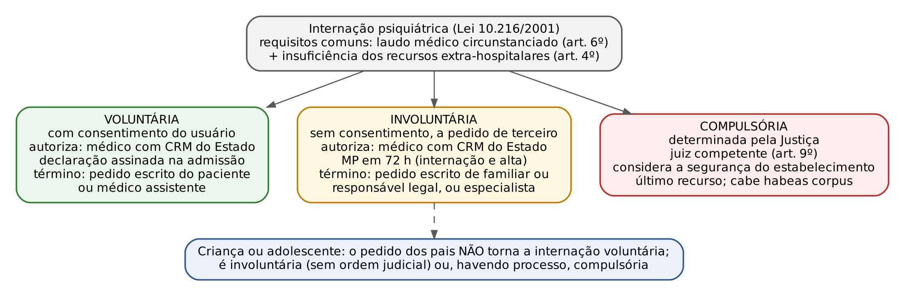
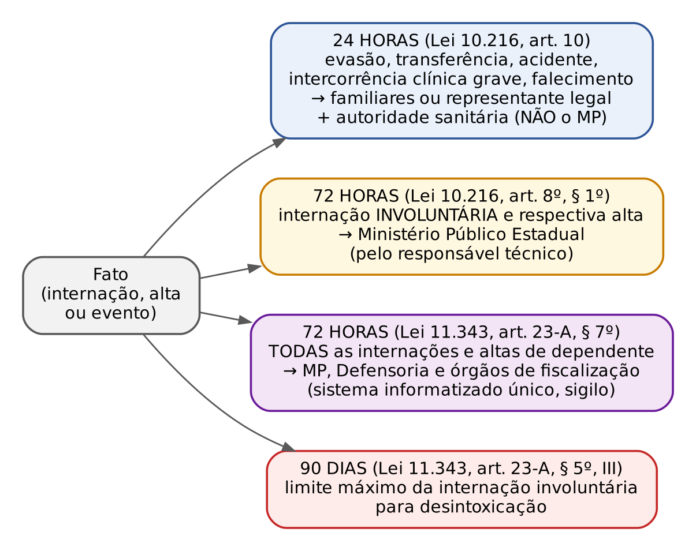
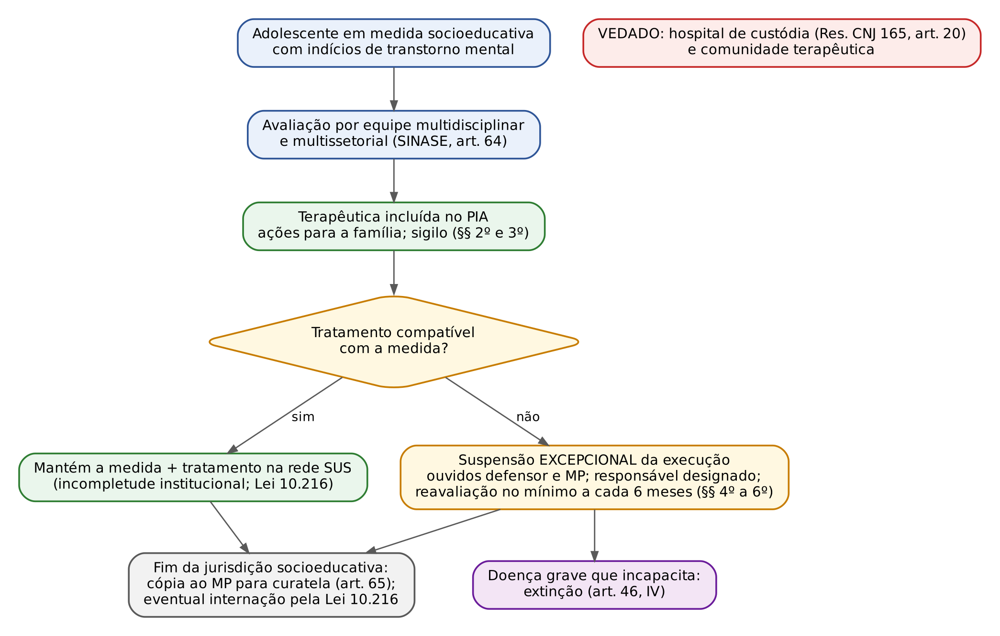
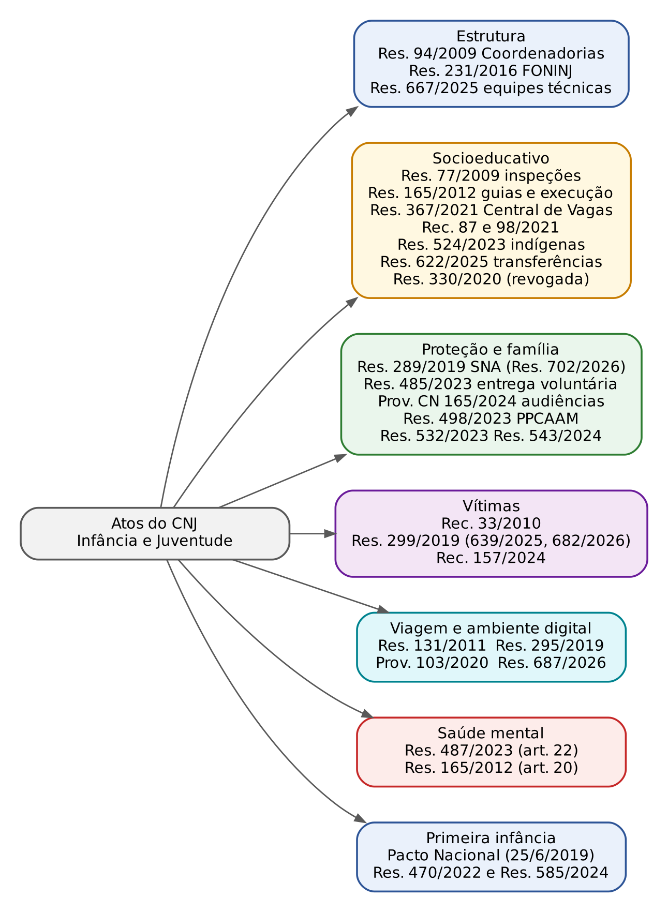

# CAPÍTULO 26 — SAÚDE MENTAL DE CRIANÇAS E ADOLESCENTES E ATOS NORMATIVOS DO CNJ

:::INCIDENCIA
TJSC p. 5 (atos normativos do CNJ) e p. 9 (crianças e adolescentes com transtornos mentais, Lei 10.216/2001). Nível A. Lote: 2 questões (FGV 2, FCC 0), mais 9 correlatas de outros capítulos (FGV), com três provas de magistratura (TJ-PR 2026, TJ-MS 2025) e uma de Defensoria.
O que mais cai: modalidades de internação (quem pede, quem autoriza, quem é comunicado e em quanto tempo), laudo médico circunstanciado e insuficiência dos recursos extra-hospitalares; adolescente em medida socioeducativa com transtorno mental (art. 112, § 3º, do ECA e art. 64 do SINASE); Central de Vagas (Resolução CNJ 367/2021).
:::

Este capítulo tem duas partes que só se tocam num ponto: a primeira (26.1 a 26.3) é o regime da Lei 10.216/2001 aplicado a crianças e adolescentes, inclusive ao adolescente em conflito com a lei; a segunda (26.4 a 26.6) é o quadro sistemático dos atos normativos do CNJ sobre infância e juventude. O ponto de contato são os atos do CNJ que disciplinam a saúde mental no sistema socioeducativo (Resoluções 165/2012, 487/2023 e 622/2025). As resoluções já conferidas e desenvolvidas em outros capítulos (289/2019 e 702/2026 no Cap. 6; 485/2023 e Provimento CN 165/2024 no Cap. 4; 131/2011 e 295/2019 no Cap. 9; 687/2026 no Cap. 10; 299/2019 no Cap. 22; execução socioeducativa no Cap. 17) aparecem aqui só no quadro geral e nos pontos de conexão.

## 26.1 A Lei 10.216/2001 e sua incidência sobre crianças e adolescentes

### 26.1.1 Natureza, alcance e diálogo com o ECA

A Lei 10.216, de 6/4/2001 (Lei da Reforma Psiquiátrica ou Lei Antimanicomial), tem dois objetos declarados na ementa: dispõe sobre a proteção e os direitos das pessoas com transtornos mentais e redireciona o modelo assistencial em saúde mental. O redirecionamento é a chave de leitura de todas as questões: o modelo hospitalocêntrico e asilar cede lugar ao cuidado em serviços comunitários de base territorial, e a internação passa a ser recurso EXCEPCIONAL, terapêutico e temporário. É lei curta (13 artigos, nenhum alterado desde 2001), o que explica a cobrança literal.

A lei não exclui crianças e adolescentes. Ao contrário: o art. 1º assegura os direitos "sem qualquer forma de discriminação quanto à raça, cor, sexo, orientação sexual, religião, opção política, nacionalidade, IDADE, família, recursos econômicos e ao grau de gravidade ou tempo de evolução de seu transtorno, ou qualquer outra". A alternativa que afirma que a Lei 10.216/2001 "se aplica apenas a pessoas maiores de 18 anos" é falsa (Q3898921, alternativa C, 26.2.8). A incidência sobre a infância é cumulativa com o ECA: o microssistema estatutário acrescenta camadas de proteção (prioridade absoluta, oitiva, participação dos pais, atuação do Conselho Tutelar e do MP, competência da Justiça da Infância), nunca as subtrai. O próprio SINASE manda que o tratamento do adolescente em cumprimento de medida observe a Lei 10.216/2001 (art. 64, § 7º, da Lei 12.594/2012; 26.3.3), o que afasta a tese de que a "especialidade" do ECA excluiria a lei antimanicomial (Q3786368, alternativa D, comentada no Cap. 17).

Pontos de contato com o ECA que interessam aqui (os demais aspectos do direito à saúde estão no Cap. 3):

| Dispositivo do ECA | Conteúdo relevante para a saúde mental | Onde se desenvolve |
|---|---|---|
| art. 11, caput e § 3º | acesso integral às linhas de cuidado pelo SUS; formação específica dos profissionais da primeira infância para detectar "sinais de risco para o desenvolvimento psíquico" | Cap. 3 |
| art. 14, § 5º | protocolo obrigatório, nos primeiros 18 meses de vida, para detectar risco ao desenvolvimento psíquico (Lei 13.438/2017) | Cap. 3 |
| art. 11-A | acesso a programas de saúde mental do SUS para prevenção e tratamento; atenção psicossocial básica e especializada, de urgência e emergência e hospitalar; formação específica dos profissionais; recursos terapêuticos gratuitos ou subsidiados aos vulneráveis (Lei 15.413/2026) | Cap. 3 |
| art. 14, § 6º, e art. 14-A | prevenção do uso indiscriminado, desnecessário ou excessivo de psicofármacos nas campanhas de educação sanitária (Lei 15.450/2026, vigência diferida de 180 dias); assistência integral e multiprofissional à criança e ao adolescente dependentes químicos (Lei 15.243/2025) | Cap. 3 |
| art. 98 | situação de risco que abre a via das medidas de proteção (inclusive "em razão de sua conduta", III) | Cap. 13 |
| art. 101, V e VI | requisição de tratamento médico, psicológico ou psiquiátrico, hospitalar ou ambulatorial (o inciso V ganhou, pela Lei 15.280/2025, a parte final "especialmente em caso de vitimização em crime contra a dignidade sexual"); inclusão em programa de tratamento a alcoólatras e toxicômanos | 26.2.7 e Cap. 13 |
| art. 112, VII, e § 3º | medidas protetivas aplicadas como socioeducativas; tratamento individual e especializado ao adolescente com doença ou deficiência mental | 26.4 |
| art. 148, IV, e parágrafo único | competência da Justiça da Infância para ações civis e, nas hipóteses do art. 98, para outras demandas | 26.2.6 e Cap. 18 |
| art. 208, VII | ação de responsabilidade por não oferecimento ou oferta irregular "de acesso às ações e serviços de saúde" | Cap. 20 |

:::DICA COMO A BANCA MONTA A QUESTÃO
O enunciado típico traz um caso de criança ou adolescente em crise (automutilação, ideação suicida, agressividade, uso de crack) e pede a providência correta. A resposta quase sempre combina três ideias da Lei 10.216/2001: (i) a internação é excepcional e exige insuficiência dos recursos extra-hospitalares (art. 4º); (ii) exige laudo médico circunstanciado (art. 6º); (iii) a compulsória é determinada pelo juiz e a involuntária é pedida por terceiro e comunicada ao MP em 72 horas (arts. 8º e 9º). Na vertente estatutária, a resposta costuma ser o encaminhamento à rede de atenção psicossocial (CAPSi ou CAPS AD) como medida protetiva, nunca a "internação psiquiátrica" como sanção.
:::

### 26.1.2 Direitos da pessoa com transtorno mental (art. 2º)

:::LEI LEI 10.216/2001, ART. 2º
"Art. 2º Nos atendimentos em saúde mental, de qualquer natureza, a pessoa e seus familiares ou responsáveis serão formalmente cientificados dos direitos enumerados no parágrafo único deste artigo.
Parágrafo único. São direitos da pessoa portadora de transtorno mental:
I - ter acesso ao melhor tratamento do sistema de saúde, consentâneo às suas necessidades;
II - ser tratada com humanidade e respeito e no interesse exclusivo de beneficiar sua saúde, visando alcançar sua recuperação pela inserção na família, no trabalho e na comunidade;
III - ser protegida contra qualquer forma de abuso e exploração;
IV - ter garantia de sigilo nas informações prestadas;
V - ter direito à presença médica, em qualquer tempo, para esclarecer a necessidade ou não de sua hospitalização involuntária;
VI - ter livre acesso aos meios de comunicação disponíveis;
VII - receber o maior número de informações a respeito de sua doença e de seu tratamento;
VIII - ser tratada em ambiente terapêutico pelos meios menos invasivos possíveis;
IX - ser tratada, preferencialmente, em serviços comunitários de saúde mental."
:::

As trocas que as bancas fazem nesse rol são sempre as mesmas, e convém memorizá-las pela palavra-chave:

| Inciso | Palavra-chave literal | Versão errada típica |
|---|---|---|
| II | "interesse EXCLUSIVO de beneficiar sua saúde" | interesse da família, da coletividade ou da segurança pública |
| IV | sigilo nas informações prestadas | sigilo relativo ou dispensável perante a família |
| V | presença médica "EM QUALQUER TEMPO" para esclarecer a hospitalização involuntária | presença médica semanal, mensal ou "a critério do estabelecimento" |
| VI | "LIVRE acesso" aos meios de comunicação | acesso "sob supervisão e acompanhamento" ou vedado durante a internação |
| VIII | meios "MENOS invasivos possíveis" | meios mais eficazes, ainda que invasivos |
| IX | "PREFERENCIALMENTE" em serviços comunitários | "exclusivamente" em serviços comunitários, ou preferencialmente em hospital psiquiátrico |

O caput impõe dever de cientificação FORMAL dos direitos à pessoa e aos familiares ou responsáveis, em qualquer atendimento de saúde mental. Em se tratando de criança ou adolescente, a cientificação alcança os pais ou o responsável, sem dispensar a informação ao próprio paciente, adequada à sua idade e compreensão (art. 2º, VII, da Lei 10.216/2001; art. 100, parágrafo único, XI e XII, do ECA, sobre obrigatoriedade da informação e oitiva obrigatória e participação).

### 26.1.3 Responsabilidade do Estado e diretrizes do tratamento (arts. 3º a 5º)

O art. 3º atribui ao Estado a responsabilidade pelo desenvolvimento da política de saúde mental, pela assistência e pela promoção de ações de saúde, "com a devida participação da sociedade e da família", prestada em estabelecimento de saúde mental (instituições ou unidades que ofereçam assistência em saúde às pessoas com transtornos mentais). É o fundamento legal específico das demandas individuais e coletivas por tratamento, ao lado do art. 196 da CF e dos arts. 11 e 208, VII, do ECA.

:::LEI LEI 10.216/2001, ART. 4º
"Art. 4º A internação, em qualquer de suas modalidades, só será indicada quando os recursos extra-hospitalares se mostrarem insuficientes.
§ 1º O tratamento visará, como finalidade permanente, a reinserção social do paciente em seu meio.
§ 2º O tratamento em regime de internação será estruturado de forma a oferecer assistência integral à pessoa portadora de transtornos mentais, incluindo serviços médicos, de assistência social, psicológicos, ocupacionais, de lazer, e outros.
§ 3º É vedada a internação de pacientes portadores de transtornos mentais em instituições com características asilares, ou seja, aquelas desprovidas dos recursos mencionados no § 2º e que não assegurem aos pacientes os direitos enumerados no parágrafo único do art. 2º."
:::

Três leituras precisas:

- "Em qualquer de suas modalidades": a excepcionalidade do caput vale para a voluntária, a involuntária e a compulsória. A afirmação de que a internação "não depende da tentativa de adoção de recursos extra-hospitalares" é falsa; mas também é falsa a de que a lei exige "comprovada tentativa frustrada de tratamento ambulatorial em regime diurno" (Q3898921, alternativa E): o requisito é a INSUFICIÊNCIA dos recursos extra-hospitalares, demonstrável por laudo, não um percurso terapêutico prévio obrigatório. Em situação de crise aguda, a insuficiência pode ser evidente desde o início.
- O conceito legal de instituição asilar é FUNCIONAL (§ 3º): é a que não oferece assistência integral (§ 2º) ou não assegura os direitos do art. 2º. A vedação é absoluta; não há exceção para "falta de vaga em estabelecimento adequado".
- Internação não é fim em si: a finalidade permanente é a reinserção social no meio do paciente (§ 1º), o que, para a criança e o adolescente, significa reinserção na família, na escola e na comunidade (direito à convivência familiar e comunitária, art. 19 do ECA).

O art. 5º trata do paciente há longo tempo hospitalizado ou em "grave dependência institucional" (decorrente do quadro clínico OU da ausência de suporte social): será objeto de política específica de alta planejada e reabilitação psicossocial assistida, sob responsabilidade da autoridade sanitária competente e supervisão de instância definida pelo Executivo, assegurada a continuidade do tratamento. Ausência de suporte familiar não justifica, por si, manter alguém internado. Na prática da infância, o dispositivo dialoga com o adolescente que permanece em hospital ou comunidade por falta de família apta: a resposta é rede (acolhimento, residência terapêutica quando adulto, CAPS), não perpetuação da internação.

## 26.2 Internação psiquiátrica: requisitos, modalidades e controle

### 26.2.1 Requisito comum: laudo médico circunstanciado (art. 6º, caput)

"A internação psiquiátrica somente será realizada mediante laudo médico circunstanciado que caracterize os seus motivos." O requisito vale para as três modalidades, inclusive a compulsória: o juiz não supre o laudo com sua convicção nem com relatos da família. Circunstanciado significa individualizado, com descrição do quadro, do risco, da insuficiência dos recursos extra-hospitalares e da indicação terapêutica da internação.

A lei fala em "laudo médico", sem exigir especialidade. A jurisprudência do STJ, porém, exige que a doença de natureza psíquica seja examinada por profissional da especialidade psiquiátrica quando o pedido é de internação, reputando inadequado o exame por clínico geral e por ortopedista (STJ, REsp n. 2.141.414, Relatora Ministra Nancy Andrighi, Terceira Turma, j. 21/5/2024). Esse precedente explica o gabarito da Q3898921, cujo caso trazia relatório subscrito por ortopedista.

:::JURIS STJ, RESP 2.141.414-SP, J. 21/5/2024
Em ação de curatela cumulada com pedido de internação, o STJ anulou a sentença por cerceamento de defesa e assentou que a doença de natureza psíquica "pressupõe a realização de exame clínico por profissional da especialidade psiquiátrica e a elaboração de laudo específico" para constatar a existência e a extensão da patologia, especialmente quando há pedido de internação com base nos arts. 4º e seguintes da Lei 10.216/2001; constatado que o perito não tinha a qualificação necessária, cabe ao juiz determinar, de ofício, perícia complementar por especialista. Nas ações de interdição, em regra, é inadmissível o julgamento antecipado do mérito. (Relatora Ministra Nancy Andrighi, Terceira Turma, DJe 24/5/2024; a ementa publicada traz, por erro material, "Lei nº 12.016/2001" no lugar de Lei 10.216/2001.)
:::

### 26.2.2 As três modalidades (art. 6º, parágrafo único, e arts. 7º a 9º)

:::LEI LEI 10.216/2001, ARTS. 6º, PARÁGRAFO ÚNICO, 8º E 9º
"Parágrafo único. São considerados os seguintes tipos de internação psiquiátrica:
I - internação voluntária: aquela que se dá com o consentimento do usuário;
II - internação involuntária: aquela que se dá sem o consentimento do usuário e a pedido de terceiro; e
III - internação compulsória: aquela determinada pela Justiça."
"Art. 8º A internação voluntária ou involuntária somente será autorizada por médico devidamente registrado no Conselho Regional de Medicina - CRM do Estado onde se localize o estabelecimento.
§ 1º A internação psiquiátrica involuntária deverá, no prazo de setenta e duas horas, ser comunicada ao Ministério Público Estadual pelo responsável técnico do estabelecimento no qual tenha ocorrido, devendo esse mesmo procedimento ser adotado quando da respectiva alta.
§ 2º O término da internação involuntária dar-se-á por solicitação escrita do familiar, ou responsável legal, ou quando estabelecido pelo especialista responsável pelo tratamento."
"Art. 9º A internação compulsória é determinada, de acordo com a legislação vigente, pelo juiz competente, que levará em conta as condições de segurança do estabelecimento, quanto à salvaguarda do paciente, dos demais internados e funcionários."
:::

| Aspecto | Voluntária | Involuntária | Compulsória |
|---|---|---|---|
| Consentimento do paciente | sim (pede ou consente) | não | irrelevante |
| Quem provoca | o próprio usuário | terceiro (familiar, responsável legal) | requerimento ao juiz (MP, família, Defensoria) |
| Quem decide ou autoriza | médico com CRM do Estado do estabelecimento (art. 8º) | médico com CRM do Estado do estabelecimento (art. 8º) | juiz competente (art. 9º) |
| Formalidade de ingresso | declaração assinada na admissão de que optou pelo regime (art. 7º) | laudo circunstanciado (art. 6º) | laudo circunstanciado (art. 6º) e decisão judicial fundamentada |
| Comunicação ao MP | não há | em 72 horas, pelo responsável técnico; também na ALTA (art. 8º, § 1º) | não há regra própria na lei (o MP é parte ou fiscal no processo) |
| Término | solicitação escrita do paciente ou determinação do médico assistente (art. 7º, parágrafo único) | solicitação escrita do familiar ou responsável legal, ou decisão do especialista responsável (art. 8º, § 2º) | decisão judicial, à vista de indicação médica |
| Critério especial | — | — | o juiz considera as condições de segurança do estabelecimento para o paciente, demais internados e funcionários |

:::PEGADINHA AS TROCAS MAIS FREQUENTES
- "A internação involuntária é determinada pelo juiz competente": falso; essa é a compulsória. Involuntária é a pedido de terceiro, autorizada por médico.
- "A internação compulsória é determinada pelo Ministério Público": falso; é determinada pela Justiça. O MP requer; não determina.
- "O término da internação involuntária se dá por solicitação escrita do familiar, do responsável legal ou do Ministério Público": falso; o MP não consta do art. 8º, § 2º.
- "O término da internação voluntária depende de autorização do médico": falso; basta a solicitação escrita do paciente (ou a determinação do médico assistente).
- "A internação compulsória é vedada pelo ordenamento por não atender aos direitos da pessoa com transtorno mental": falso; é modalidade legal (art. 6º, III, e art. 9º), embora excepcional.
- "A internação voluntária deve ser comunicada ao MP em 72 horas": falso; só a involuntária (e a respectiva alta).
:::

### 26.2.3 Criança e adolescente: o consentimento e a modalidade

A Lei 10.216/2001 não tem regra própria para pacientes com menos de 18 anos, e é aqui que mora a principal dificuldade de aplicação. Três observações orientam a solução:

- A internação de criança pedida pelos pais não se converte em "voluntária" pelo consentimento parental. Voluntária é a que se dá com o consentimento DO USUÁRIO (art. 6º, parágrafo único, I); quando é o terceiro (pai, mãe, guardião, tutor) quem pede e o paciente não consente ou não tem condições de consentir, a hipótese é de internação involuntária, autorizada por médico e comunicada ao MP em 72 horas. A alternativa que afirma que, "por se tratar de criança, o consentimento da genitora supre a exigência de autorização judicial e transmuda a internação em voluntária, sendo irrelevante a especialidade do médico" acumula três erros (Q3898921, alternativa B).
- A internação involuntária (pedido de familiar e autorização médica) NÃO depende de ordem judicial. Pais que buscam internação de filho em crise podem obtê-la diretamente no serviço de saúde, se houver indicação médica e laudo; o processo judicial só é necessário para a compulsória, que se justifica quando há recusa do serviço, ausência de pedido familiar idôneo, necessidade de impor o tratamento ao poder público ou conflito entre os interessados.
- A vontade e a opinião do adolescente contam. Ainda que juridicamente não baste para a internação voluntária de quem não tem capacidade plena, a oitiva da criança e do adolescente, segundo seu estágio de desenvolvimento, é princípio de aplicação das medidas de proteção (art. 100, parágrafo único, XII, do ECA) e direito da pessoa com transtorno mental receber o maior número de informações sobre a doença e o tratamento (art. 2º, VII). A prática de muitos serviços é registrar a concordância do adolescente sem dispensar o pedido e a assinatura do responsável; tratando-se de tema não regulado em lei, a questão objetiva tende a cobrar apenas a regra geral (consentimento do usuário x pedido de terceiro).

:::ATENCAO INTERNAÇÃO DE CRIANÇA NÃO É MEDIDA QUE O CONSELHO TUTELAR APLIQUE
O Conselho Tutelar aplica as medidas do art. 101, I a VII, do ECA (art. 136, I) e pode REQUISITAR serviços públicos na área de saúde (art. 136, III, a), inclusive tratamento médico, psicológico ou psiquiátrico (art. 101, V). Não pode "determinar" internação psiquiátrica: a involuntária depende de pedido de familiar e decisão médica; a compulsória, de decisão judicial. Na Q2448372 (FGV 2024, TJ-AP, Analista — Psicologia), a alternativa que atribuía ao Conselho a internação da genitora alcoolista em hospital psiquiátrico era falsa; o gabarito foi a requisição de matrícula da criança (art. 101, III). Desenvolvimento das atribuições no Cap. 12.
:::

### 26.2.4 Comunicações e prazos

| Fato | Quem comunica | A quem | Prazo | Fundamento |
|---|---|---|---|---|
| Internação involuntária | responsável técnico do estabelecimento | Ministério Público Estadual | 72 horas | art. 8º, § 1º |
| Alta da internação involuntária | responsável técnico do estabelecimento | Ministério Público Estadual | 72 horas ("esse mesmo procedimento") | art. 8º, § 1º, parte final |
| Evasão, transferência, acidente, intercorrência clínica grave e falecimento | direção do estabelecimento | familiares ou representante legal E autoridade sanitária responsável | 24 horas da ocorrência | art. 10 |
| Pesquisa científica diagnóstica ou terapêutica | — | consentimento expresso do paciente ou representante legal; comunicação aos conselhos profissionais e ao Conselho Nacional de Saúde | — | art. 11 |
| Internação e alta de dependente de drogas (qualquer modalidade) | por sistema informatizado único | MP, Defensoria Pública e outros órgãos de fiscalização | 72 horas | Lei 11.343/2006, art. 23-A, § 7º |

:::PEGADINHA O MP E O ART. 10
O art. 10 NÃO inclui o Ministério Público: evasão, transferência, acidente, intercorrência clínica grave e falecimento vão aos familiares ou representante legal e à autoridade sanitária, em 24 horas. Questões trocam "24 horas" por "48 horas" ou acrescentam o MP. Quando o paciente é criança ou adolescente acolhido, porém, o ECA impõe comunicações próprias: o dirigente da entidade de acolhimento, equiparado ao guardião (art. 92, § 1º, do ECA), deve manter o juízo informado (Cap. 4), e a violação de direitos deve chegar ao Conselho Tutelar (art. 13 do ECA, Cap. 3).
:::

A comunicação de 72 horas ao MP é a forma de controle externo da internação sem consentimento. Recebida, o Promotor pode instaurar procedimento administrativo, requisitar informações e o laudo, inspecionar o estabelecimento e, se a internação for indevida, promover medidas judiciais (inclusive *habeas corpus* ou ação para desinternação). Tratando-se de criança ou adolescente, a atribuição costuma ser da Promotoria da Infância e Juventude, conforme a organização local, com fundamento no art. 201, V e VIII, do ECA.

### 26.2.5 Internação compulsória: requisitos, procedimento e controle

O art. 9º é lacônico ("de acordo com a legislação vigente, pelo juiz competente"), e a disciplina processual resulta da combinação da Lei 10.216/2001 com o CPC (tutela provisória, perícia, contraditório) e, quando o paciente é criança ou adolescente, com o ECA. Requisitos que a decisão deve demonstrar:

- laudo médico circunstanciado (art. 6º), preferencialmente de psiquiatra (REsp 2.141.414, 26.2.1), que caracterize os motivos da internação;
- insuficiência dos recursos extra-hospitalares (art. 4º, caput);
- finalidade terapêutica, no interesse exclusivo da saúde do paciente (art. 2º, II, e art. 4º, § 1º), vedada a internação com fim de mera contenção social ou disciplinar;
- estabelecimento com assistência integral (art. 4º, § 2º), não asilar (§ 3º), avaliadas as condições de segurança para o paciente, os demais internados e os funcionários (art. 9º);
- duração vinculada à indicação médica, com reavaliação periódica e desinternação tão logo cesse a necessidade.

O STJ insiste no caráter de *ultima ratio*: "A internação compulsória, qualquer que seja o estabelecimento escolhido ou indicado, deve ser, sempre que possível, evitada e somente empregada como último recurso, na defesa do internado e, secundariamente, da própria sociedade" (STJ, HC n. 692.000, Relatora Ministra Nancy Andrighi, Terceira Turma, j. 19/10/2021). No caso, a ordem foi concedida porque a internação fora determinada contra a recomendação expressa do psiquiatra que acompanhava o paciente e antes do contraditório e da perícia já determinada nos autos.

:::JURIS STJ, HC 692.000-PE, J. 19/10/2021
Três lições cobráveis: (i) cabe *habeas corpus* contra ordem judicial de internação compulsória, porque atinge a liberdade de locomoção, admitindo-se a concessão de ofício mesmo contra decisão monocrática de relator em caso de flagrante ilegalidade; (ii) o curador provisório não tem poderes para intervir no *habeas corpus* como assistente, nem para representar o paciente que conserva capacidade para exercer o direito à convivência familiar e comunitária; (iii) a internação compulsória determinada sem perícia, sem contraditório e contra a indicação do médico assistente "não encontra guarida na lei". (Relatora Ministra Nancy Andrighi, Terceira Turma, DJe 21/10/2021.)
:::

:::JURIS STJ, HC 135.271-SP E HC 169.172-SP (INFORMATIVO 533)
É possível determinar, no âmbito de ação de interdição, a internação compulsória de quem acabou de cumprir medida socioeducativa de internação, desde que comprovados os requisitos por laudo médico circunstanciado e demonstrada a insuficiência dos recursos extra-hospitalares (Terceira Turma, Relator Ministro Sidnei Beneti, j. 17/12/2013; Quarta Turma, Relator Ministro Luis Felipe Salomão, j. 10/12/2013). O precedente é o elo entre o sistema socioeducativo e a jurisdição civil quando o jovem com transtorno grave atinge o limite da medida (26.3.4).
:::

:::DOUTRINA LEGITIMIDADE DO MP E O PRECEDENTE DO ALCOOLISMO
O STF, em caso de adulto, negou legitimidade ao MP para ação civil pública destinada a obter internação compulsória de pessoa com alcoolismo, por se tratar de direito individual disponível sem repercussão coletiva (STF, RE 496.718, Relator Ministro Marco Aurélio, Primeira Turma, j. 12/8/2008, Informativo 515). O raciocínio não se transpõe à criança e ao adolescente: o ECA confere ao MP legitimidade para promover a ação civil pública para a proteção de interesses INDIVIDUAIS, difusos ou coletivos relativos à infância e à adolescência e para zelar pelos direitos assegurados a crianças e adolescentes, promovendo as medidas judiciais cabíveis (art. 201, V e VIII), e o art. 208, VII, prevê expressamente a ação por oferta irregular de acesso às ações e serviços de saúde. A legitimidade do MP para tutelar direito individual indisponível de criança ou adolescente à saúde é pacífica no STJ (tema desenvolvido no Cap. 20).
:::

### 26.2.6 Competência para a internação compulsória de criança ou adolescente

Não há regra expressa, e a solução depende da natureza da pretensão:

| Pretensão | Juízo | Fundamento |
|---|---|---|
| Pedido de internação de criança ou adolescente em situação de risco (art. 98), como medida de proteção (art. 101, V), inclusive com imposição ao poder público | Justiça da Infância e da Juventude | art. 148, IV e VII, e art. 209 do ECA (ação individual afeta à criança e ao adolescente, Cap. 18) |
| Ação contra o Estado ou o Município para custeio ou disponibilização de leito, CAPSi ou tratamento | Justiça da Infância e da Juventude (onde houver vara especializada), em razão da pessoa | art. 148, IV, e art. 208, VII, do ECA; ressalvadas a competência da Justiça Federal e a organização judiciária local (Cap. 20) |
| Curatela de jovem que atinge a maioridade, com pedido de internação | Vara de Família ou cível competente para a curatela | CPC, arts. 747 e seguintes; SINASE, art. 65 (remessa de cópia ao MP) |
| Adolescente em cumprimento de medida socioeducativa | juízo da execução socioeducativa, que pode suspender a execução para inclusão em programa de saúde mental | SINASE, art. 64, § 4º (26.3.3) |

A organização judiciária de cada Estado pode atribuir a matéria a varas da Fazenda Pública quando o réu é o ente público; em prova objetiva, a resposta segura é a competência da Justiça da Infância quando o paciente é criança ou adolescente e a pretensão se funda em direito afeto a ela.

### 26.2.7 Internação por dependência química (Lei 11.343/2006, art. 23-A) e comunidades terapêuticas

A Lei 13.840/2019 incluiu na Lei de Drogas um regime próprio de internação do dependente, que convive com a Lei 10.216/2001 (o art. 23-A, § 10, manda observar, no que couber, a lei antimanicomial). As diferenças são a pegadinha:

| Ponto | Lei 10.216/2001 | Lei 11.343/2006, art. 23-A (Lei 13.840/2019) |
|---|---|---|
| Modalidades | voluntária, involuntária e compulsória | SÓ voluntária e involuntária (§ 3º); a compulsória continua regida pela Lei 10.216 e pelo CPC |
| Quem pede a involuntária | terceiro | familiar ou responsável legal; na absoluta falta, servidor público da saúde, da assistência social ou de órgão do Sisnad, EXCETO servidores da segurança pública (§ 3º, II) |
| Onde | estabelecimento de saúde mental não asilar | unidades de saúde ou hospitais gerais com equipes multidisciplinares (§ 2º) |
| Duração da involuntária | enquanto houver indicação médica | apenas o tempo necessário à desintoxicação, no MÁXIMO 90 dias (§ 5º, III) |
| Requisitos da involuntária | laudo circunstanciado; insuficiência extra-hospitalar | formalização da decisão por médico; avaliação do tipo de droga e do padrão de uso; impossibilidade comprovada de outras alternativas terapêuticas da rede (§ 5º, I e II) |
| Interrupção | término por familiar, responsável ou especialista | família ou representante legal podem, a qualquer tempo, requerer ao médico a interrupção (§ 5º, IV) |
| Comunicação | involuntária e alta: MP, 72 horas | TODAS as internações e altas: MP, Defensoria Pública e outros órgãos de fiscalização, 72 horas, por sistema informatizado único, com sigilo (§§ 7º e 8º) |
| Comunidades terapêuticas | — | vedada QUALQUER modalidade de internação nas comunidades terapêuticas acolhedoras (§ 9º) |

:::LEI LEI 11.343/2006, ART. 23-A, § 5º, III, E § 9º
"III - perdurará apenas pelo tempo necessário à desintoxicação, no prazo máximo de 90 (noventa) dias, tendo seu término determinado pelo médico responsável;"
"§ 9º É vedada a realização de qualquer modalidade de internação nas comunidades terapêuticas acolhedoras."
:::

Comunidades terapêuticas e crianças e adolescentes: além da vedação legal de internação nessas entidades, a Resolução CONANDA 249/2024 proíbe, em todo o território nacional, o acolhimento, atendimento, tratamento e acompanhamento de crianças e adolescentes em comunidades terapêuticas (instituições de atenção a pessoas com transtornos decorrentes do uso de substâncias psicoativas, em regime de residência, que usam como principal instrumento terapêutico a convivência entre pares), e a Resolução CONAD 10/2024 suspendeu a eficácia da Resolução CONAD 3/2020, que regulamentava o acolhimento de adolescentes nessas entidades (ambas citadas nos considerandos da Resolução CNJ 622/2025). A Resolução CNJ 622/2025 inclui entre as diretrizes da transferência interestadual de socioeducandos a "primazia do tratamento de saúde em liberdade" e a "vedação à internação de adolescentes em comunidades terapêuticas" (art. 3º, IX e X). As consequências para a política de acolhimento (comunidade terapêutica não é entidade do art. 90, IV) estão no Cap. 11.

:::QUESTAO FGV 2024 — TJ-RR — ANALISTA JUDICIÁRIO — PSICOLOGIA (Q3090848)
Cobrado: à luz do ECA e da Lei 10.216/2001, que fundamentaram a resolução do CONANDA de 2024 que proíbe o acolhimento de crianças e adolescentes em comunidades terapêuticas, quais afirmações são corretas.
Gabarito oficial: B (I e III). Corretas: a internação em comunidade terapêutica é privação de liberdade que infringe os direitos à liberdade, à participação e à convivência familiar e comunitária (I); sendo o Estado laico, é problemático o uso de fundamentalismo religioso em regimentos e práticas dessas instituições (III). Errada a II, que atribuía às comunidades terapêuticas "práticas de redução de danos": seu modelo é a abstinência, e a armadilha está em misturar um traço verdadeiro (isolamento, abstinência) com outro incompatível (redução de danos, estratégia da RAPS).
Fundamentos: Lei 10.216/2001, arts. 2º, IX, e 4º, § 3º; Lei 11.343/2006, art. 23-A, § 9º; ECA, arts. 16 e 19. A laicidade como limite ao encaminhamento compulsório também aparece no art. 3º, XI, da Resolução CNJ 487/2023 (26.3.5).
:::

### 26.2.8 Caso de prova: a criança em crise e o pedido de internação

:::QUESTAO FGV 2026 — TJ-PR — JUIZ SUBSTITUTO (Q3898921)
Caso: criança de 11 anos, órfã de pai, com automutilações reiteradas, ameaças e agressões verbais aos familiares e anúncio de suicídio; a mãe pede internação psiquiátrica compulsória, instruindo o pedido apenas com seu relato escrito e relatório de médico particular ORTOPEDISTA que descreve lesões e duas fraturas.
Gabarito oficial: D (por ser excepcional, a internação compulsória exige demonstração da insuficiência dos recursos extra-hospitalares e laudo médico circunstanciado, elaborado por psiquiatra).
Resolução em passos: (1) a Lei 10.216/2001 se aplica sem distinção de idade (art. 1º), o que elimina C; (2) a compulsória é excepcional e exige laudo médico circunstanciado (art. 6º) e insuficiência dos recursos extra-hospitalares (art. 4º); (3) a doença psíquica exige avaliação por especialista (REsp 2.141.414), e relatório de ortopedista não caracteriza os motivos da internação, o que elimina B ("irrelevante a especialidade") e A (liminar com base só no relato da mãe e em risco narrado); (4) E erra ao exigir "tentativa frustrada de tratamento ambulatorial em regime diurno": a lei exige insuficiência, não percurso prévio obrigatório.
Armadilha: a alternativa A usa linguagem sedutora (poder geral de cautela, melhor interesse, risco a terceiros). O risco pode justificar providências urgentes (acionamento do SAMU, atendimento em pronto-socorro, avaliação psiquiátrica imediata, requisição ao CAPSi), mas a privação de liberdade para tratamento continua dependente de laudo.
:::

:::PASSO ROTEIRO DE DECISÃO NO PEDIDO DE INTERNAÇÃO DE CRIANÇA OU ADOLESCENTE
1. Verificar a modalidade pretendida. Se há pedido dos pais e indicação médica, a via é a internação involuntária no serviço de saúde (sem processo judicial), com comunicação ao MP em 72 horas. Processo judicial só para a compulsória ou para impor o tratamento ao poder público.
2. Verificar o laudo: médico, circunstanciado, preferencialmente psiquiátrico, que descreva o quadro, o risco, a insuficiência dos recursos extra-hospitalares e a indicação de internação. Faltando, determinar avaliação psiquiátrica URGENTE pela rede (CAPSi, pronto-socorro, equipe do SUS), com prazo curto.
3. Em risco iminente à vida, assegurar atendimento de urgência (SAMU, pronto-socorro, leito de saúde mental em hospital geral), que independe de ordem judicial; a decisão judicial pode determinar ao ente público a disponibilização do atendimento.
4. Ouvir a criança ou o adolescente, conforme seu estágio de desenvolvimento (art. 100, parágrafo único, XII, do ECA), o MP e a defesa (curador especial ou Defensoria, se houver colidência entre os interesses da criança e dos pais, art. 142, parágrafo único, do ECA).
5. Preferir medidas menos restritivas: requisição de tratamento ambulatorial (art. 101, V), CAPSi ou CAPS AD, orientação e acompanhamento à família (art. 101, II e IV; art. 129).
6. Deferida a internação: fixar estabelecimento adequado (hospital geral ou serviço com assistência integral, nunca instituição asilar ou comunidade terapêutica), determinar relatórios periódicos e prever reavaliação; assegurar a permanência em tempo integral de um dos pais ou responsável (art. 12 do ECA) e escolarização possível.
7. Desinternação com plano de alta e continuidade do cuidado na RAPS (art. 4º, § 1º, e art. 5º da Lei 10.216/2001).
:::

:::SENTENCA DECISÃO EM PEDIDO DE INTERNAÇÃO COMPULSÓRIA DE ADOLESCENTE (INDEFERIMENTO COM MEDIDAS ALTERNATIVAS)
"Trata-se de pedido de internação psiquiátrica compulsória de A. B. C. (adolescente, 15 anos), formulado por sua genitora, D. B. C. (mãe), com relato de agressividade e uso de substâncias. O pedido veio instruído com declaração da requerente e atestado de clínico geral que não descreve o quadro psíquico nem indica a internação. A internação psiquiátrica, em qualquer modalidade, somente se admite mediante laudo médico circunstanciado (art. 6º da Lei 10.216/2001) e quando insuficientes os recursos extra-hospitalares (art. 4º), exigência que alcança crianças e adolescentes (art. 1º) e que, em se tratando de patologia psíquica, reclama avaliação por especialista. Ausentes tais elementos, INDEFIRO, por ora, a internação. Com fundamento no art. 101, V, do ECA, REQUISITO ao Município a avaliação psiquiátrica do adolescente pelo CAPSi (ou, na falta, por serviço de referência), no prazo de 5 dias, com relatório circunstanciado a este juízo, e sua inclusão em acompanhamento terapêutico, com orientação e apoio à família (arts. 101, II, e 129, IV). Havendo agravamento com risco iminente, a requerente deverá acionar o SAMU ou o pronto-socorro, ficando o ente público advertido do dever de prestar o atendimento de urgência. Vindo o laudo, reapreciarei o pedido. Intimem-se, inclusive o Ministério Público."
:::

### 26.2.9 Rede de Atenção Psicossocial (RAPS)

A RAPS é a forma de organização, no SUS, dos serviços que concretizam o modelo da Lei 10.216/2001 (cuidado preferencialmente comunitário, art. 2º, IX). Foi instituída por portaria do Ministério da Saúde (Portaria GM/MS 3.088/2011, hoje incorporada às portarias de consolidação do SUS). A Resolução CNJ 487/2023 traz uma definição normativa útil, que lista os componentes: "rede composta por serviços e equipamentos variados de atenção à saúde mental, tais como os Centros de Atenção Psicossocial (Caps), os Serviços Residenciais Terapêuticos (SRT), os Centros de Convivência e Cultura, as Unidades de Acolhimento (UAs) e os leitos de atenção integral (em Hospitais Gerais, nos Caps III)", presentes na atenção básica, na atenção psicossocial estratégica, nas urgências, na atenção hospitalar geral e na estratégia de desinstitucionalização, como as Residências Terapêuticas e o Programa de Volta para Casa (art. 2º, II).

| Equipamento | Público e função | Uso na prova |
|---|---|---|
| CAPSi (CAPS infantojuvenil) | crianças e adolescentes com sofrimento psíquico grave e persistente, inclusive pelo uso de álcool e outras drogas | encaminhamento de adolescente usuário de drogas como medida protetiva (Q3401942, FGV 2025, DPE-RO, gabarito B) |
| CAPS AD | pessoas com necessidades decorrentes do uso de álcool e outras drogas | "requisição de atendimento no CAPS AD" como medida protetiva ao adolescente que pede ajuda com o crack (Q3265271, FGV 2025, gabarito C) |
| Unidade de Acolhimento infantojuvenil | acolhimento transitório, voluntário, em ambiente residencial, articulado ao CAPS | distinguir de acolhimento institucional (art. 101, VII) e de comunidade terapêutica |
| Leitos de saúde mental em hospital geral | crise e internação de curta duração | local preferencial da internação, em vez do hospital psiquiátrico |
| Serviço Residencial Terapêutico e Programa de Volta para Casa | desinstitucionalização de egressos de longas internações | concretizam o art. 5º da Lei 10.216/2001 |

:::NOTA REDE E MEDIDA DE PROTEÇÃO
Encaminhar ao CAPSi ou ao CAPS AD é medida do art. 101, V ou VI, do ECA, aplicável pelo Conselho Tutelar (art. 136, I) ou pelo juiz, e cumulável com medida socioeducativa (art. 112, VII). A "redução de danos" é estratégia de cuidado da RAPS, não medida legal do ECA (Q3265271, alternativa B errada). A Q2365429 (FGV 2024, PC-SC) mostra o limite inverso: imposta a semiliberdade, ela é cumprida em unidade do programa socioeducativo, não no CAPSi, que pode ser acionado em paralelo para o tratamento (gabarito A).
:::

## 26.3 Adolescente em conflito com a lei com transtorno mental

### 26.3.1 Premissas: inimputabilidade etária e ausência de medida de segurança

O adolescente é inimputável por força da idade (art. 228 da CF; art. 104 do ECA), não por força de transtorno mental. Por isso não existe, no sistema estatutário, medida de segurança, incidente de insanidade com absolvição imprópria nem internação em hospital de custódia: a resposta estatal ao ato infracional é a medida socioeducativa ou a medida de proteção (art. 112, I a VII). O transtorno mental entra no sistema por três portas, cada uma com consequência própria:

| Porta | Momento | Consequência | Fundamento |
|---|---|---|---|
| Capacidade de cumprir a medida | sentença (aplicação) | a medida "levará em conta a sua capacidade de cumpri-la"; se o transtorno impede a compreensão e o cumprimento, a resposta adequada tende a ser a medida protetiva de tratamento, aplicada como socioeducativa | art. 112, § 1º e VII, c/c art. 101, V |
| Tratamento especializado | aplicação e execução | o adolescente com doença ou deficiência mental recebe tratamento individual e especializado, em local adequado às suas condições | art. 112, § 3º |
| Indícios de transtorno durante a execução | execução | avaliação por equipe multidisciplinar e multissetorial; terapêutica no PIA; possibilidade excepcional de suspensão da execução para inclusão em programa de saúde mental | SINASE, art. 64 |
| Doença grave que incapacita | execução | extinção da medida | SINASE, art. 46, IV |

:::LEI ECA, ART. 112, VII E §§ 1º E 3º
"VII - qualquer uma das previstas no art. 101, I a VI.
§ 1º A medida aplicada ao adolescente levará em conta a sua capacidade de cumpri-la, as circunstâncias e a gravidade da infração.
[...]
§ 3º Os adolescentes portadores de doença ou deficiência mental receberão tratamento individual e especializado, em local adequado às suas condições."
:::

Leitura: o § 3º não cria medida autônoma ("internação psiquiátrica socioeducativa") nem autoriza o encaminhamento a hospital de custódia; impõe que, qualquer que seja a medida, o tratamento seja individual, especializado e prestado em local adequado. Como o art. 101, V, abrange tratamento "em regime hospitalar ou ambulatorial", a medida protetiva aplicada pela via do art. 112, VII, pode, excepcionalmente, envolver internação hospitalar, observada a Lei 10.216/2001 e o teto temporal fixado pelo STJ: a medida protetiva de tratamento psiquiátrico em regime hospitalar imposta a adolescente infrator não pode durar mais que o limite de 3 anos da internação socioeducativa (Jurisprudência em Teses, ed. 262, tese 10; desenvolvimento no Cap. 13).

:::QUESTAO FGV 2026 — MPE-ES — AGENTE TÉCNICO — PSICÓLOGO (Q4219144, ATRIBUÍDA AO CAP. 14)
Criança de 11 anos que, irritada com nota baixa, atira pedra no carro da professora. Gabarito: C (o Conselho Tutelar poderá avaliar a medida protetiva mais adequada). Interessa aqui a alternativa A, que afirmava que o juiz "pode determinar medida socioeducativa de internação psiquiátrica": dupla impropriedade, porque à criança correspondem só as medidas do art. 101 (art. 105) e porque "internação psiquiátrica" não é medida socioeducativa do rol do art. 112. Desenvolvimento do ato infracional de criança no Cap. 14.
:::

### 26.3.2 Atenção integral à saúde no SINASE

O SINASE (Lei 12.594/2012) dedica um capítulo à atenção integral à saúde do adolescente em cumprimento de medida (arts. 60 a 65), cujas diretrizes incluem "cuidados especiais em saúde mental, incluindo os relacionados ao uso de álcool e outras substâncias psicoativas, e atenção aos adolescentes com deficiências" (art. 60, III) e "garantia de acesso a todos os níveis de atenção à saúde, por meio de referência e contrarreferência, de acordo com as normas do SUS" (art. 60, V). As entidades de meio aberto e semiliberdade devem orientar os socioeducandos sobre o acesso ao SUS (art. 61); as de privação de liberdade devem contar com equipe mínima de saúde conforme as normas do SUS (art. 62).

A política de saúde correspondente é a PNAISARI (Política Nacional de Atenção Integral à Saúde de Adolescentes em Conflito com a Lei, em Regime de Internação, Internação Provisória e Semiliberdade), hoje nas Portarias de Consolidação do Ministério da Saúde n. 2/2017 (Anexo XVII) e n. 6/2017, segundo os considerandos da Resolução CNJ 487/2023. Sua lógica é a da incompletude institucional: a unidade socioeducativa garante a atenção básica, mas o cuidado especializado, inclusive em saúde mental, é prestado pela rede do SUS, fora da unidade, por referência e contrarreferência (art. 60, V e VIII, do SINASE).

### 26.3.3 O art. 64 do SINASE: avaliação, PIA e suspensão da execução

:::LEI LEI 12.594/2012 (SINASE), ART. 64
"Art. 64. O adolescente em cumprimento de medida socioeducativa que apresente indícios de transtorno mental, de deficiência mental, ou associadas, deverá ser avaliado por equipe técnica multidisciplinar e multissetorial.
§ 1º As competências, a composição e a atuação da equipe técnica de que trata o caput deverão seguir, conjuntamente, as normas de referência do SUS e do Sinase, na forma do regulamento.
§ 2º A avaliação de que trata o caput subsidiará a elaboração e execução da terapêutica a ser adotada, a qual será incluída no PIA do adolescente, prevendo, se necessário, ações voltadas para a família.
§ 3º As informações produzidas na avaliação de que trata o caput são consideradas sigilosas.
§ 4º Excepcionalmente, o juiz poderá suspender a execução da medida socioeducativa, ouvidos o defensor e o Ministério Público, com vistas a incluir o adolescente em programa de atenção integral à saúde mental que melhor atenda aos objetivos terapêuticos estabelecidos para o seu caso específico.
§ 5º Suspensa a execução da medida socioeducativa, o juiz designará o responsável por acompanhar e informar sobre a evolução do atendimento ao adolescente.
§ 6º A suspensão da execução da medida socioeducativa será avaliada, no mínimo, a cada 6 (seis) meses.
§ 7º O tratamento a que se submeterá o adolescente deverá observar o previsto na Lei nº 10.216, de 6 de abril de 2001, que dispõe sobre a proteção e os direitos das pessoas portadoras de transtornos mentais e redireciona o modelo assistencial em saúde mental.
§ 8º (VETADO)."
:::

| Elemento | Regra | Detalhe cobrável |
|---|---|---|
| Gatilho | "indícios" de transtorno mental, deficiência mental ou associadas | não exige diagnóstico prévio; basta indício |
| Avaliação | equipe técnica multidisciplinar E multissetorial | normas do SUS e do SINASE conjuntamente (§ 1º) |
| Resultado | terapêutica incluída no PIA, com ações para a família se necessário | § 2º |
| Sigilo | informações da avaliação são sigilosas | § 3º |
| Suspensão da execução | EXCEPCIONAL; decisão do juiz, ouvidos defensor e MP | finalidade: incluir em programa de atenção integral à saúde mental (§ 4º) |
| Acompanhamento | juiz designa responsável por informar a evolução | § 5º |
| Reavaliação da suspensão | no mínimo a cada 6 meses | § 6º (mesmo prazo da reavaliação da medida, art. 42 do SINASE e art. 121, § 2º, do ECA) |
| Tratamento | observa a Lei 10.216/2001 | § 7º: afasta tese de "especialidade" que excluiria a lei antimanicomial |

O § 8º foi vetado; não há, na lei, regra que suspenda o prazo máximo da medida durante o tratamento. Por isso é falsa a afirmação de que a suspensão do art. 64, § 4º, acarreta a "consequente suspensão do prazo máximo de internação": a lei não prevê esse efeito, a criação judicial de hipótese de prorrogação do tempo de privação de liberdade contrariaria a brevidade (art. 121 do ECA) e a vedação de tratamento mais gravoso que o do adulto (art. 35, I, do SINASE), e o STJ manda computar o período de tratamento no prazo máximo de 3 anos da internação (REsp 1.956.497-PR, desenvolvido no Cap. 17, 17.12.2).

No mesmo sentido, comentada no Cap. 17 (17.12.2): FGV 2025 — TJ-MS — Juiz Substituto (Q3786368), gabarito A (a suspensão da execução da medida será avaliada, no mínimo, a cada 6 meses, art. 64, § 6º); erradas a transferência para hospital de custódia (Res. CNJ 165/2012, art. 20), a atenção à saúde "preferencialmente no interior" da unidade (a incompletude institucional remete à rede do SUS), o afastamento da Lei 10.216/2001 (art. 64, § 7º) e a "consequente suspensão do prazo máximo de internação", acréscimo que torna falsa a alternativa que copia a letra do § 4º.

### 26.3.4 Fim da jurisdição socioeducativa e transição para a jurisdição civil

"Enquanto não cessada a jurisdição da Infância e Juventude, a autoridade judiciária, nas hipóteses tratadas no art. 64, poderá remeter cópia dos autos ao Ministério Público para eventual propositura de interdição e outras providências pertinentes" (art. 65 do SINASE). A medida socioeducativa não pode ser usada para conter, por tempo indeterminado, quem precisa de tratamento: ao atingir o limite temporal (3 anos de internação, art. 121, § 3º, do ECA; liberação compulsória aos 21 anos, § 5º, que independe de decisão judicial, conforme o art. 19 da Resolução CNJ 165/2012), cessa a resposta socioeducativa, e eventual necessidade terapêutica passa ao regime civil (curatela e, se preenchidos os requisitos, internação involuntária ou compulsória da Lei 10.216/2001). É o que admitiu o STJ no Informativo 533 (26.2.5): a internação compulsória, no âmbito de ação de interdição, de quem acabou de cumprir internação socioeducativa, desde que demonstrados os requisitos por laudo circunstanciado e a insuficiência dos recursos extra-hospitalares.

:::ATENCAO HOSPITAL DE CUSTÓDIA É VEDADO
"O adolescente em cumprimento de medida socioeducativa não pode ser transferido para hospital de custódia, salvo se responder por infração penal praticada após os 18 (dezoitos) anos e por decisão do juízo criminal competente" (Resolução CNJ 165/2012, art. 20). Hospital de custódia é estabelecimento PENAL destinado à execução de medida de segurança de imputável que se tornou inimputável ou de inimputável absolvido impropriamente; a Política Antimanicomial do Poder Judiciário (Resolução CNJ 487/2023) veda, ademais, a internação em instituições de caráter asilar, "como os Hospitais de Custódia e Tratamento Psiquiátrico (HCTPs) e estabelecimentos congêneres" (art. 3º, VIII).
:::

Outra hipótese de saída do sistema é a extinção da medida "pela condição de doença grave, que torne o adolescente incapaz de submeter-se ao cumprimento da medida" (art. 46, IV, do SINASE). Diferença com a suspensão do art. 64, § 4º: a extinção encerra a medida e pressupõe incapacidade de cumpri-la; a suspensão é provisória, excepcional e reavaliada a cada 6 meses, voltada a incluir o adolescente em programa de saúde mental com perspectiva de retomada ou de posterior extinção.

### 26.3.5 Atos do CNJ sobre saúde mental no sistema socioeducativo

A Resolução CNJ 487, de 15/2/2023, institui a Política Antimanicomial do Poder Judiciário para pessoas com transtorno mental ou deficiência psicossocial custodiadas, investigadas, acusadas, rés ou privadas de liberdade (art. 1º), em cumprimento da Convenção sobre os Direitos das Pessoas com Deficiência, da Lei 10.216/2001 e do Ponto Resolutivo 8 da sentença da Corte Interamericana no Caso Ximenes Lopes *vs.* Brasil (2006). Embora voltada ao processo penal e às medidas de segurança, alcança os adolescentes:

:::LEI RESOLUÇÃO CNJ 487/2023, ART. 22
"Art. 22. Esta Resolução também será aplicada aos adolescentes com transtorno ou sofrimento mental apreendidos, processados por cometimento de ato infracional ou em cumprimento de medida socioeducativa, no que couber, enquanto não for elaborado ato normativo próprio, considerando-se a condição de pessoa em desenvolvimento, o princípio da prioridade absoluta e as devidas adaptações, conforme previsão do Estatuto da Criança e do Adolescente."
:::

Princípios da Resolução 487/2023 (art. 3º) com reflexo direto no socioeducativo: interesse exclusivo do tratamento em benefício da saúde (VI); cuidado em estabelecimentos não asilares, pelos meios menos invasivos, com vedação de contenção desproporcional ou prolongada, excessiva medicalização e isolamento compulsório (VII); internação fundada EXCLUSIVAMENTE em razões clínicas, pelo período estritamente necessário e só quando insuficientes os recursos extra-hospitalares, vedada a internação em HCTPs e congêneres (VIII); articulação com a RAPS mediante Projeto Terapêutico Singular (IX); laicidade, que impede encaminhamento compulsório a estabelecimentos que não componham a RAPS ou que condicionem o tratamento à conversão religiosa ou a atividades religiosas (XI); territorialidade e manutenção dos laços familiares e comunitários (XII). A Resolução 487/2023 foi alterada pela Resolução CNJ 572/2024 (prorrogação de prazos de implementação, art. 18-A).

Outros pontos de conexão:

- Resolução CNJ 622/2025 (transferência interestadual de socioeducandos): diretrizes de "primazia do tratamento de saúde em liberdade" e "vedação à internação de adolescentes em comunidades terapêuticas" (art. 3º, IX e X).
- Resolução CNJ 367/2021 (Central de Vagas): para manter a ocupação dentro de 100% da capacidade, o juiz da execução deve reavaliar, em audiências concentradas, as medidas de adolescentes "com deficiência ou debilitados por motivo de doença grave" (art. 12, II, c).
- Recomendação CNJ 81/2020: procedimentos para adolescentes em conflito com a lei com deficiência auditiva ou visual.

:::EXEMPLO ADOLESCENTE EM SEMILIBERDADE COM SURTO PSICÓTICO
Adolescente de 16 anos, em semiliberdade, tem surto psicótico na unidade. Solução: (1) atendimento de urgência pela rede (SAMU, pronto-socorro, leito em hospital geral), independentemente de ordem judicial, com comunicação ao juízo da execução; (2) avaliação por equipe multidisciplinar e multissetorial (art. 64, caput) e inclusão da terapêutica no PIA (§ 2º); (3) se o tratamento for incompatível com a medida, o juiz pode, excepcionalmente, suspender a execução, ouvidos defensor e MP, incluindo o adolescente em programa de atenção integral à saúde mental (CAPSi, por exemplo), designando responsável pelo acompanhamento e reavaliando no máximo a cada 6 meses (§§ 4º a 6º); (4) se a doença grave o incapacitar de cumprir a medida, extinção (art. 46, IV); (5) próximo dos 21 anos ou do fim da medida, se persistir a necessidade de cuidado, remessa de cópia ao MP para curatela e providências (art. 65). Jamais: transferência a hospital de custódia (Res. CNJ 165, art. 20) ou a comunidade terapêutica (Lei 11.343, art. 23-A, § 9º; Res. CONANDA 249/2024).
:::

## 26.4 Atos normativos do CNJ: fundamento, espécies e mapa

### 26.4.1 Fundamento e limites do poder normativo do CNJ

O CNJ não exerce jurisdição; é órgão de controle administrativo e financeiro do Judiciário e do cumprimento dos deveres funcionais dos juízes (art. 103-B, § 4º, da CF), competindo-lhe "expedir atos regulamentares, no âmbito de sua competência, ou recomendar providências" (art. 103-B, § 4º, I). Desse dispositivo saem as três espécies que interessam à prova:

| Espécie | Órgão | Força | Exemplos nesta matéria |
|---|---|---|---|
| Resolução | Plenário (assinada pelo Presidente) | vinculante para tribunais e magistrados no plano administrativo | 165/2012, 231/2016, 289/2019, 295/2019, 299/2019, 367/2021, 470/2022, 485/2023 |
| Recomendação | Presidência ou Plenário | orientação, sem força cogente | 33/2010 (depoimento especial), 87/2021 (atendimento inicial integrado), 98/2021 (audiências concentradas socioeducativas), 157/2024 (protocolo de escuta em alienação parental) |
| Provimento | Corregedoria Nacional de Justiça | normativo-disciplinar, para foros judiciais e extrajudiciais | 165/2024 (Código Nacional de Normas do Foro Judicial, com as audiências concentradas do acolhimento), 103/2020 (autorização eletrônica de viagem) |

O STF reconheceu que as resoluções do CNJ podem ostentar caráter normativo primário quando extraem diretamente da Constituição o seu fundamento (ADC 12, sobre a resolução que vedou o nepotismo). O limite está na reserva de lei: o CNJ não pode criar direito processual ou material (art. 22, I, da CF), restringir direitos previstos em lei nem impor obrigações a terceiros estranhos ao Judiciário. As resoluções da infância se apresentam, por isso, como uniformização interpretativa e procedimental do ECA no âmbito judiciário (a Resolução 295/2019, por exemplo, interpreta o art. 83 do ECA para os serviços judiciais e de fiscalização, Cap. 9) e como gestão de sistemas e cadastros (SNA, CNACL, CNIUPS, BNAC).

:::PEGADINHA RESOLUÇÃO NÃO REVOGA LEI; LEI POSTERIOR NÃO "REVOGA" RESOLUÇÃO, PREVALECE SOBRE ELA
A questão que afirma que a Resolução CNJ 295/2019 "dispensou" a autorização exigida pelo art. 83 do ECA está mal formulada: a resolução interpreta e operacionaliza a lei para os serviços judiciários (Cap. 9). Na mesma linha, a Resolução CNJ 367/2021 não cria o *numerus clausus*: dá concretude administrativa à decisão do STF no HC coletivo 143.988 (Cap. 15), indicado na legislação correlata da própria resolução.
:::

### 26.4.2 Estrutura judiciária da infância: Coordenadorias, FONINJ e equipes técnicas

- Resolução CNJ 94, de 27/10/2009: determinou aos Tribunais de Justiça que criassem, em 180 dias, Coordenadorias da Infância e da Juventude, como órgãos PERMANENTES de assessoria da PRESIDÊNCIA do Tribunal (art. 1º), dirigidas por magistrado com competência jurisdicional ou reconhecida experiência na área (art. 3º), com atribuições de propor aprimoramentos estruturais, dar suporte a magistrados, servidores e equipes, promover articulação interna e externa, colaborar na formação de magistrados e servidores e exercer a gestão estadual dos cadastros nacionais da infância e juventude (art. 2º, I a V).
- Resolução CNJ 231, de 28/6/2016: instituiu o Fórum Nacional da Infância e da Juventude (FONINJ).
- Resolução CNJ 667, de 23/12/2025: dispõe sobre as Equipes Técnicas Multiprofissionais dos tribunais de justiça (psicologia, serviço social e pedagogia, especialmente), institui o Fórum Nacional das Equipes Técnicas Multiprofissionais do Poder Judiciário (Fonamulti) e alterou a Resolução 231/2016 para incluir no FONINJ representante do Colégio de Equipes Técnicas Multiprofissionais da Infância e Juventude (Cominj).

:::LEI RESOLUÇÃO CNJ 231/2016, ART. 1º
"Art. 1º Instituir, no âmbito do Conselho Nacional de Justiça, o Fórum Nacional da Infância e da Juventude (FONINJ), em caráter nacional e permanente, com a atribuição de elaborar estudos e propor medidas para a coordenação, elaboração e execução de políticas públicas, no âmbito do Poder Judiciário, concentrando especialmente as iniciativas nacionais de aprimoramento da prestação jurisdicional na área da Infância e da Juventude."
:::

| FONINJ | Conteúdo | Fundamento |
|---|---|---|
| Natureza | órgão do CNJ, nacional e permanente, de estudos e proposição de medidas (não jurisdicional) | art. 1º |
| Atribuições centrais | orientar as Coordenadorias da Infância dos TJs; propor medidas e normas; monitorar dados estatísticos de ações com criança ou adolescente vítima, em situação de risco ou em conflito com a lei; analisar entidades de acolhimento e unidades de internação; recomendar ações aos TJs; promover intercâmbio entre juízes federais, do trabalho e da infância | art. 2º, I a XXII |
| Composição | 1 Conselheiro do CNJ; 2 juízes auxiliares da Presidência; 2 da Corregedoria Nacional; 1 juiz do trabalho; 1 juiz federal; 1 juiz de direito indicado pelo Presidente do CNJ; 1 juiz de direito indicado pelo Colégio de Coordenadores da Infância; representantes da Abraminj, ABMP, AMB, Ajufe, Anamatra, FONAJUP, FONAJUV e Cominj | art. 3º (Resoluções 266/2018, 387/2021 e 667/2025) |
| Presidência | exercida pelos Conselheiros que compõem o Fórum, por designação do Presidente do CNJ | art. 3º, parágrafo único |
| Funcionamento | ao menos 1 reunião nacional; relatório anual ao Plenário; comitês executivos regionais; reuniões por videoconferência | arts. 4º a 7º |
| Prêmio | Prêmio "Prioridade Absoluta", anual, para ações, projetos ou programas voltados aos direitos de crianças, adolescentes e jovens | art. 8º-A (Resolução 355/2020) |
| Coordenação de política | coordena a Política Judiciária Nacional para a Primeira Infância, com apoio do Comitê Gestor Nacional | Resolução 470/2022, art. 10 |

:::DICA FONINJ X FONAJUP X FONAJUV X COORDENADORIA
FONINJ é órgão do CNJ (Resolução 231/2016). Coordenadoria da Infância é órgão de cada Tribunal de Justiça, de assessoria da Presidência (Resolução 94/2009). FONAJUP (Fórum Nacional da Justiça Protetiva) e FONAJUV (Fórum Nacional da Justiça Juvenil) são fóruns de magistrados, com assento no FONINJ desde a Resolução 387/2021, que editam enunciados próprios. Fonamulti é o fórum nacional das equipes técnicas (Resolução 667/2025).
:::

### 26.4.3 Quadro geral dos atos do CNJ sobre crianças e adolescentes

Situação conferida no portal de atos do CNJ em 7/11/2026. "Alterado" significa vigente com alterações.

| Ato | Data | Objeto | Situação | Onde se desenvolve |
|---|---|---|---|---|
| Resolução Conjunta 1/2009 | 29/9/2009 | revisão periódica de prisões, medidas de segurança e internações de adolescentes | vigente | menção |
| Resolução 77/2009 | 26/5/2009 | inspeções judiciais em unidades e programas socioeducativos; cadastro nacional de adolescentes em conflito com a lei | alterado (Res. 157/2012, 188/2014, 326/2020) | Cap. 17 (17.15.2) e 26.5.2 |
| Resolução 94/2009 | 27/10/2009 | Coordenadorias da Infância e da Juventude nos TJs | vigente | 26.4.2 |
| Recomendação 33/2010 | 23/11/2010 | serviços especializados para escuta de crianças e adolescentes vítimas ou testemunhas (depoimento especial) | vigente | Cap. 22 |
| Resolução 131/2011 | 26/5/2011 | autorização de viagem internacional | vigente | Cap. 9 |
| Resolução 165/2012 | 16/11/2012 | normas gerais do atendimento judicial ao adolescente na internação provisória e na execução das medidas socioeducativas | alterado (Res. 191/2014, 326/2020) | 26.5.1 e Cap. 17 |
| Resolução 231/2016 | 28/6/2016 | FONINJ | alterado | 26.4.2 |
| Resolução 289/2019 | 14/8/2019 | Sistema Nacional de Adoção e Acolhimento (SNA) | alterado (inclusive Res. 702/2026) | Cap. 6 |
| Resolução 295/2019 | 13/9/2019 | autorização de viagem nacional | vigente, sem alterações | Cap. 9 |
| Resolução 299/2019 | 5/11/2019 | sistema de garantia de direitos da criança vítima ou testemunha de violência (Lei 13.431/2017) | alterado (Res. 639/2025 e 682/2026) | 26.6.2 e Cap. 22 |
| Resolução 330/2020 | 26/8/2020 | videoconferência em processos infracionais e de execução socioeducativa durante a pandemia | REVOGADA (Res. 481/2022) | 26.5.4 |
| Resolução 367/2021 | 19/1/2021 | Central de Vagas no sistema socioeducativo | vigente | Cap. 17 (17.15.3) e 26.5.3 |
| Recomendação 87/2021 | 20/1/2021 | atendimento inicial integrado ao adolescente (art. 88, V, do ECA) | vigente | 26.5.4 |
| Recomendação 98/2021 | 26/5/2021 | audiências concentradas para reavaliar internação e semiliberdade | vigente | Cap. 17 (17.8.3) |
| Resolução 470/2022 | 31/8/2022 | Política Judiciária Nacional para a Primeira Infância | alterado (Res. 585/2024) | 26.6.3 |
| Resolução 485/2023 | 18/1/2023 | entrega voluntária | vigente | Cap. 4 |
| Resolução 487/2023 | 15/2/2023 | Política Antimanicomial do Poder Judiciário (art. 22: adolescentes) | alterado (Res. 572/2024) | 26.3.5 |
| Resolução 498/2023 | 4/5/2023 | crianças e adolescentes ameaçados de morte (PPCAAM) | vigente | 26.6.1 |
| Resolução 524/2023 | 27/9/2023 | adolescentes e jovens indígenas no sistema infracional e socioeducativo | vigente | 26.5.4 |
| Resolução 532/2023 | 16/11/2023 | vedação de discriminação por orientação sexual e identidade de gênero em adoção, guarda e tutela | vigente | 26.6.1 e Cap. 6 |
| Resolução 543/2024 | 10/1/2024 | Programa Novos Caminhos (desinstitucionalização e egressos do acolhimento) | vigente | 26.6.1 |
| Provimento CN 165/2024 | 16/4/2024 | Código Nacional de Normas do Foro Judicial (audiências concentradas do acolhimento) | alterado | Cap. 4 |
| Recomendação 157/2024 | 3/10/2024 | protocolo de escuta especializada e depoimento especial em ações de família com alegação de alienação parental | vigente | 26.6.2 e Cap. 7 |
| Resolução 622/2025 | 30/5/2025 | transferência interestadual de socioeducandos | vigente | 26.5.4 |
| Resolução 667/2025 | 23/12/2025 | equipes técnicas multiprofissionais; Fonamulti | vigente | 26.4.2 |
| Resolução 687/2026 | 26/6/2026 | alvarás para atividade artística de crianças e adolescentes no ambiente digital (art. 34 do Decreto 12.880/2026; art. 149, II, do ECA); Banco Nacional de Alvarás (BNAC) | vigente | Cap. 10 |
| Resolução 702/2026 | 20/10/2026 | altera o art. 3º da Resolução 289/2019 (SNA) | vigente | Cap. 6 |

:::ATENCAO NUMERAÇÃO QUE CONFUNDE
"165" é ao mesmo tempo a Resolução CNJ 165/2012 (socioeducativo) e o Provimento CN 165/2024 (Código Nacional de Normas do Foro Judicial, que trata das audiências concentradas do ACOLHIMENTO). "Audiência concentrada" aparece em dois sistemas: a do acolhimento (Provimento CN 165/2024, Cap. 4) e a socioeducativa (Recomendação 98/2021 e Resolução 367/2021, art. 4º, III). E "Resolução 231" é tanto a do CNJ (FONINJ, 2016) quanto a do CONANDA (processo de escolha do Conselho Tutelar, 2022, Cap. 12).
:::

## 26.5 Atos do CNJ sobre o sistema socioeducativo

### 26.5.1 Resolução CNJ 165/2012: guias, execução e internação provisória

A Resolução 165, de 16/11/2012 (alterada pelas Resoluções 191/2014 e 326/2020), consolidou as normas gerais sobre o atendimento, pelo Judiciário, ao adolescente em internação provisória e em cumprimento de medida socioeducativa. O quadro completo da resolução (sete espécies de guia, ingresso só com ordem escrita e guia, uma guia por adolescente, execução em autos próprios e vedação da precatória, competência do local da unidade, prazos de 24 e 72 horas, reavaliação contada da apreensão, internação-sanção com oitiva obrigatória, liberação aos 21 anos independentemente de decisão, fiscalização) está no Cap. 17, 17.6.3 e 17.15.1, titular da execução socioeducativa. Para este capítulo, interessam a vedação de transferência para hospital de custódia (art. 20; 26.3.4) e a regra dos 45 dias da internação provisória (art. 16), cuja armadilha segue.

:::PEGADINHA OS 45 DIAS
Três armadilhas a partir do art. 16 da Resolução 165/2012 e do art. 108 do ECA: (i) o prazo é contado da APREENSÃO, não da decisão nem da apresentação; (ii) NÃO admite prorrogação, nem por complexidade da causa; (iii) se o adolescente foi solto e volta a ser internado provisoriamente no mesmo processo, só resta o saldo dos 45 dias. A soma de internações provisórias sucessivas para além de 45 dias é ilegal.
:::

### 26.5.2 Resolução CNJ 77/2009: inspeções judiciais

O núcleo da resolução (inspeção PESSOAL BIMESTRAL nas unidades de internação e semiliberdade e SEMESTRAL no meio aberto, na redação da Res. 326/2020; formulário do CNIUPS até o dia 10 do mês seguinte; meio aberto por acionamento dos gestores municipais de assistência social e amostragem; CNACL) está no Cap. 17, 17.15.2. Complementos não tratados lá: o dever alcança também os juízes com competência concorrente, inclusive de juízo único (art. 1º, § 1º); bimestres e semestres seguem calendário fixo (jan-fev, mar-abr etc.; jan-jun e jul-dez); as Corregedorias-Gerais comunicam à Corregedoria Nacional o descumprimento (art. 2º, § 2º); e a irregularidade constatada é apurada e comunicada à Corregedoria-Geral, ao Coordenador da Infância e ao desembargador supervisor do GMF (art. 2º, § 4º).

Não confundir com a fiscalização das entidades de acolhimento pelo Judiciário, MP e Conselho Tutelar (art. 95 do ECA, Cap. 11) nem com a Resolução CNJ 593/2024, que disciplina inspeções em estabelecimentos de privação de liberdade decorrente de processo PENAL.

### 26.5.3 Resolução CNJ 367/2021: Central de Vagas

A Resolução 367, de 19/1/2021 (vigente desde 120 dias após a publicação, art. 19), dá concretude administrativa ao HC coletivo 143.988 do STF, que fixou a ocupação máxima de 100% das unidades socioeducativas (Cap. 15). Seu regime completo (Central de Vagas como serviço de COMPETÊNCIA DO PODER EXECUTIVO; princípios do art. 5º; solicitação da vaga pelo MAGISTRADO, art. 7º; critérios e instrução; lista de espera com possível inclusão em meio aberto; reavaliação após 150 dias na lista e exclusão em 30 dias sem decisão de manutenção; controle da lotação e transferências; fiscalização pelo GMF ou pela Coordenadoria) é desenvolvido no Cap. 17, 17.15.3, com fluxo e questões. Para a saúde mental, o ponto de conexão é o art. 12, II, c (reavaliação prioritária, em audiência concentrada, de adolescentes com deficiência ou doença grave quando a unidade está lotada; 26.3.5).

No mesmo sentido, comentada no Cap. 17: FGV 2025 — DPE-PE — Defensor Público (Q3390886), gabarito C (corretos o rol de princípios do art. 5º e a origem no HC 143.988; errada a afirmação de que o diretor da unidade solicita a vaga, atribuição do magistrado).

### 26.5.4 Demais atos do sistema socioeducativo

- Recomendação 98/2021 (audiências concentradas socioeducativas, preferencialmente a cada 3 meses, na unidade, uma por socioeducando, sem extrapolar os 6 meses de reavaliação): desenvolvida no Cap. 17, 17.8.3 (aspecto socioassistencial no Cap. 25, 25.7.1). A Resolução 367/2021 define audiência concentrada socioeducativa como acompanhamento processual periódico, presidido pelo magistrado, para reanálise da situação individual do adolescente em internação ou semiliberdade (art. 4º, III).
- Recomendação 87/2021 (atendimento inicial integrado): regulamenta o art. 88, V, do ECA (integração operacional de Judiciário, MP, Defensoria, Segurança Pública e Assistência Social no atendimento inicial ao adolescente a quem se atribui ato infracional), preferencialmente em um mesmo equipamento, o Núcleo de Atendimento Integrado (NAI), que pode incluir saúde, educação, Conselho Tutelar e PPCAAM (arts. 1º e 2º); princípios: excepcionalidade e brevidade das medidas e da internação provisória, excepcionalidade da intervenção judicial, medidas restaurativas, fortalecimento de vínculos (art. 3º).
- Resolução 524/2023: procedimentos para adolescentes e jovens INDÍGENAS apreendidos, representados ou em cumprimento de medida, aplicáveis a todos que se autoidentificam como indígenas, brasileiros ou não, falantes de português ou de línguas nativas (arts. 1º e 2º).
- Resolução 622/2025: transferência interestadual de adolescentes e jovens em internação ou semiliberdade; a transferência dentro do mesmo Estado continua regida pela Resolução 367/2021 (art. 1º, parágrafo único); princípios incluem a vedação de tratamento mais gravoso que o do adulto e a atualidade e temporalidade da medida (art. 2º); diretrizes incluem competência do juízo natural da execução, respeito ao PIA, proibição de algemas salvo excepcionalidade (Súmula Vinculante 11), primazia do tratamento em liberdade e vedação de comunidades terapêuticas (art. 3º).
- Resolução 330/2020: regulou audiências por videoconferência em processos infracionais e de execução socioeducativa durante a calamidade da Covid-19; foi REVOGADA pela Resolução 481/2022. Questão que a trate como vigente está errada.
- Resolução Conjunta 1/2009: institucionalizou mecanismos de revisão periódica das prisões provisórias e definitivas, das medidas de segurança e das internações de adolescentes (origem dos mutirões).

## 26.6 Atos do CNJ sobre proteção, família, vítimas e primeira infância

### 26.6.1 Sistema protetivo e convivência familiar

| Ato | Núcleo cobrável | Remissão |
|---|---|---|
| Res. 289/2019 (SNA), com a Res. 702/2026 | cadastro único de crianças acolhidas e aptas e de pretendentes; guias nacionais de acolhimento e desligamento emitidas no sistema; cursos com educação para relações étnico-raciais | Caps. 6 e 13 |
| Res. 485/2023 | entrega voluntária: sigilo estendido à família extensa e ao pai indicado; sigilo da gestante adolescente perante os próprios pais; audiência e prazos | Cap. 4 (questões FGV 2026 de magistratura e MP sobre o sigilo: Q4083744 e Q4116979) |
| Provimento CN 165/2024 | audiências concentradas do acolhimento | Cap. 4 |
| Res. 532/2023 | vedadas, em habilitação, adoção, guarda e tutela, manifestações contrárias ao pedido pelo fundamento EXCLUSIVO de se tratar de casal ou família monoparental, homoafetivo ou transgênero; cursos preparatórios devem contemplar a adoção homoparental e explicitar garantias processuais dos pretendentes (assistente técnico, manifestação sobre laudos, recurso) | Cap. 6 |
| Res. 498/2023 | crianças e adolescentes ameaçados de morte (PPCAAM): a ação de proteção com acolhimento indicado pelo PPCAAM NÃO se confunde com a medida de acolhimento do art. 98; NÃO é cadastrada no SNA e, se a criança já estava acolhida, o cadastro fica inativo enquanto durar a proteção; TJ indica autoridade judiciária para articular transferências intermunicipais e interestaduais | art. 3º, §§ 1º e 2º; art. 4º |
| Res. 543/2024 | Programa Novos Caminhos: apoio à desinstitucionalização e à empregabilidade de jovens acolhidos e egressos, em 4 eixos (educação, vida saudável, empregabilidade, parcerias) | arts. 1º a 4º |
| Res. 131/2011, Res. 295/2019 e Provimento 103/2020 | viagem internacional e nacional; autorização eletrônica de viagem | Cap. 9 |
| Res. 687/2026 | alvará judicial (art. 149, II, do ECA) para atividade artística de criança ou adolescente em conteúdo digital monetizado ou impulsionado que explore habitualmente sua imagem ou rotina; BNAC | Cap. 10 |

### 26.6.2 Vítimas e testemunhas de violência

A Resolução 299/2019 regulamenta, no Judiciário, o sistema de garantia de direitos da criança e do adolescente vítima ou testemunha de violência (Lei 13.431/2017), com depoimento especial, salas, capacitação e fluxos (Cap. 22). Duas alterações recentes merecem registro: a Resolução 639/2025 acrescentou parágrafo único ao art. 27 para determinar que os tribunais estaduais prevejam, nas normas de organização judiciária, o processamento e julgamento dos crimes contra criança e adolescente, independentemente do gênero, PREFERENCIALMENTE por juizados ou varas especializadas em crimes contra criança e adolescente; até sua implantação, aplica-se subsidiariamente o art. 23, parágrafo único, da Lei 13.431/2017, com competência preferencial dos juizados ou varas de violência doméstica e, na falta, das varas criminais comuns. A Resolução 682/2026 instituiu formulário padronizado de coleta de dados sobre os depoimentos especiais. Antes da lei, a Recomendação 33/2010 já recomendava serviços especializados de escuta; depois, a Recomendação 157/2024 adotou protocolo de escuta especializada e depoimento especial em ações de família com alegação de alienação parental.

### 26.6.3 Pacto Nacional pela Primeira Infância e Resolução CNJ 470/2022

O Pacto Nacional pela Primeira Infância foi firmado em 25/6/2019 pelo CNJ e demais participantes (instituições do sistema de justiça, Executivo, Legislativo e sociedade civil), com o objetivo de executar o projeto "Justiça começa na infância: fortalecendo a atuação do sistema de justiça na promoção de direitos para o desenvolvimento humano integral"; produziu diagnóstico nacional do atendimento às crianças na primeira infância no sistema de justiça (considerandos da Resolução 470/2022). É instrumento de cooperação interinstitucional, não ato normativo; seu desdobramento normativo é a Resolução 470/2022. O conteúdo material do Marco Legal da Primeira Infância (Lei 13.257/2016) é do Cap. 24.

:::LEI RESOLUÇÃO CNJ 470/2022, ART. 1º, CAPUT
"Art. 1º Fica instituída a Política Judiciária Nacional para a Primeira Infância, a fim de assegurar, com absoluta prioridade, os direitos fundamentais das crianças de 0 (zero) a 6 (seis) anos de idade no âmbito do Poder Judiciário, em consideração à especificidade e à relevância dos primeiros anos de vida no desenvolvimento infantil e do ser humano."
:::

| Ponto | Regra | Artigo |
|---|---|---|
| Faixa etária | 0 a 6 anos (coerente com o art. 2º da Lei 13.257/2016: primeiros 6 anos completos ou 72 meses) | art. 1º |
| Princípios e diretrizes | visão abrangente (gestante, pais, família, comunidade); superior interesse e direito de PARTICIPAR dos processos, inclusive por manifestação NÃO VERBAL; atendimento prioritário e integrado; intervenções com metodologia científica e profissionais qualificados; atuação articulada | art. 2º |
| Objetivos | acesso à justiça; métodos consensuais com foco restaurativo; ações preventivas e coletivas que reduzam a judicialização; capacitação; inclusão da primeira infância em concursos públicos; monitoramento do acervo | art. 3º |
| Deveres dos tribunais | registro civil e reconhecimento de paternidade; programas de habilidades parentais; equipes multidisciplinares; fluxos intersetoriais para a entrega voluntária; suporte especializado ao juiz em decisões sobre saúde, INCLUSIVE MENTAL, de crianças e familiares; participação das crianças em ações civis públicas estruturais; direito ao brincar em alvarás e acordos; monitoramento de gestantes e lactantes nos sistemas carcerário e socioeducativo; proteção quanto aos meios digitais | art. 5º, I a XVIII |
| Participação da criança | protocolos de oitiva de crianças na primeira infância; espaços adequados; horários que respeitem alimentação, sono e escola | art. 7º |
| Governança | coordenação pelo FONINJ, com apoio do Comitê Gestor Nacional da Primeira Infância; Comitês Gestores Locais nos tribunais, coordenados por magistrado, com apoio das Coordenadorias da Infância; plano de ação revisto no mínimo anualmente | arts. 10 a 13 |
| Dado processual | inclusão OBRIGATÓRIA, em todas as ações que envolvam interesses de crianças, do polo processual "criança interessada" (nome, CPF e data de nascimento), enviado ao DataJud | art. 15 |
| Produtividade | participação de magistrados na construção da política local é atividade inerente à função judicial | art. 18 |
| Plano Nacional | instituído pela Resolução 585/2024, que acrescentou anexo à Resolução 470/2022 | Res. 585/2024 |

:::PEGADINHA COORDENAÇÃO DA POLÍTICA DA PRIMEIRA INFÂNCIA
Quem coordena a Política Judiciária Nacional para a Primeira Infância é o FONINJ, com apoio do Comitê Gestor Nacional (art. 10), e não a Corregedoria Nacional, o DMF ou as Coordenadorias da Infância (estas apoiam os Comitês Gestores LOCAIS, art. 12). E o polo "criança interessada" do art. 15 vale para TODAS as ações que envolvam interesses de crianças, não só as da Vara da Infância.
:::

:::PRATIQUE EXERCÍCIOS ELABORADOS PARA ESTA APOSTILA (NÃO SÃO QUESTÕES DE BANCA)
1. Julgue: "A Central de Vagas do sistema socioeducativo é órgão do Poder Judiciário, vinculado ao Grupo de Monitoramento e Fiscalização, ao qual o diretor da unidade dirige o pedido de vaga."
2. Julgue: "Segundo a Resolução CNJ 165/2012, a internação provisória pode ser prorrogada por mais 45 dias em caso de complexidade da causa, contando-se o prazo da decisão que a decretou."
3. Julgue: "A Resolução CNJ 470/2022 instituiu a Política Judiciária Nacional para a Primeira Infância, destinada às crianças de 0 a 6 anos, coordenada pelo FONINJ, e tornou obrigatória a inclusão do polo 'criança interessada' nas ações que envolvam interesses de crianças."
Resolução: 1 — errado: a Central é de competência do Executivo (art. 2º, parágrafo único, da Res. 367/2021), e quem solicita a vaga é o magistrado (art. 7º); o GMF ou a Coordenadoria fiscalizam (art. 15). 2 — errado: 45 dias, contados da apreensão, sem prorrogação (art. 16, § 2º, da Res. 165/2012; art. 108 do ECA). 3 — certo (arts. 1º, 10 e 15 da Res. 470/2022).
:::

## 26.7 Resumo para revisão pré-prova

| Instituto | Regra | Exceções e detalhes | Fundamento |
|---|---|---|---|
| Alcance da Lei 10.216/2001 | aplica-se sem discriminação de idade, inclusive a crianças e adolescentes | cumulativa com o ECA; SINASE manda observá-la | art. 1º; SINASE, art. 64, § 7º |
| Direitos (art. 2º) | cientificação formal da pessoa e da família; 9 direitos | "interesse exclusivo" da saúde; presença médica "em qualquer tempo"; "livre" acesso à comunicação; "preferencialmente" serviços comunitários | art. 2º |
| Excepcionalidade | internação, em qualquer modalidade, só quando insuficientes os recursos extra-hospitalares | não exige percurso prévio obrigatório de tratamento ambulatorial; finalidade de reinserção social | art. 4º, caput e § 1º |
| Instituição asilar | vedada (conceito funcional: sem assistência integral ou sem os direitos do art. 2º) | sem exceção por falta de vaga | art. 4º, §§ 2º e 3º |
| Alta planejada | política específica para longa hospitalização ou grave dependência institucional | inclusive por ausência de suporte social | art. 5º |
| Laudo | toda internação exige laudo médico circunstanciado | doença psíquica: avaliação por psiquiatra (STJ) | art. 6º; REsp 2.141.414 |
| Voluntária | com consentimento do usuário; declaração na admissão; termina por pedido escrito do paciente ou decisão médica | autorizada por médico com CRM do Estado | arts. 6º, I, 7º e 8º |
| Involuntária | sem consentimento, a pedido de terceiro; autorizada por médico | comunicação ao MP em 72 h (e na alta); termina por pedido escrito de familiar ou responsável ou decisão do especialista (não do MP) | arts. 6º, II, e 8º |
| Compulsória | determinada pelo juiz competente | considera a segurança do estabelecimento; *ultima ratio*; cabe *habeas corpus* | arts. 6º, III, e 9º; HC 692.000 |
| Criança: pedido dos pais | não transforma a internação em voluntária; é involuntária, sem necessidade de ordem judicial | oitiva da criança ou adolescente | arts. 6º e 8º; ECA, art. 100, parágrafo único, XII |
| Comunicações | evasão, transferência, acidente, intercorrência grave e falecimento: família ou representante e autoridade sanitária, 24 h | MP não está no art. 10 | art. 10 |
| Dependência química | só voluntária e involuntária; involuntária por familiar ou, na falta, servidor (não da segurança pública); máximo 90 dias; todas as internações e altas comunicadas em 72 h a MP, DP e órgãos de fiscalização | vedada internação em comunidades terapêuticas | Lei 11.343/2006, art. 23-A |
| Comunidades terapêuticas | proibido acolher, atender ou tratar crianças e adolescentes | Res. CONANDA 249/2024; Res. CNJ 622/2025, art. 3º, X | — |
| Conselho Tutelar | requisita tratamento (art. 101, V) e serviços de saúde; não determina internação | Cap. 12 | ECA, arts. 101 e 136 |
| Legitimidade do MP | ampla para criança e adolescente, inclusive direito individual à saúde | RE 496.718 (adulto, alcoolismo) não se transpõe | ECA, arts. 201, V e VIII, e 208, VII |
| Adolescente infrator com transtorno | tratamento individual e especializado em local adequado; medida protetiva como socioeducativa | tratamento hospitalar limitado a 3 anos (JT 262, tese 10) | ECA, art. 112, VII, §§ 1º e 3º |
| SINASE, art. 64 | indícios: avaliação multidisciplinar e multissetorial; terapêutica no PIA; sigilo | suspensão excepcional da execução, ouvidos defensor e MP; reavaliação no mínimo a cada 6 meses; § 8º vetado (sem regra sobre prazo máximo) | SINASE, art. 64 |
| Fim da jurisdição socioeducativa | cópia ao MP para interdição e providências | internação compulsória em ação de interdição após a medida (Info 533); extinção por doença grave | SINASE, arts. 46, IV, e 65 |
| Hospital de custódia | vedado ao adolescente em medida | salvo infração penal após 18 anos e decisão do juízo criminal | Res. CNJ 165/2012, art. 20; Res. 487/2023, art. 3º, VIII |
| Política Antimanicomial | aplica-se aos adolescentes, no que couber | internação só por razões clínicas; laicidade | Res. CNJ 487/2023, arts. 3º e 22 |
| Poder normativo do CNJ | atos regulamentares no âmbito de sua competência ou recomendações | resolução vincula; recomendação orienta; provimento é da Corregedoria | CF, art. 103-B, § 4º, I |
| Coordenadorias da Infância | órgãos permanentes de assessoria da Presidência dos TJs, dirigidos por magistrado | gestão estadual dos cadastros | Res. CNJ 94/2009 |
| FONINJ | órgão nacional e permanente do CNJ de estudos e proposição | coordena a política da primeira infância; Prêmio Prioridade Absoluta | Res. CNJ 231/2016; Res. 470/2022, art. 10 |
| Res. 165/2012 | guias; uma por adolescente; execução em autos próprios, sem precatória; internação provisória de 45 dias da apreensão, improrrogável; internação-sanção com oitiva e audiência prévia | liberação aos 21 anos independe de decisão | arts. 2º a 20 |
| Res. 77/2009 | inspeção pessoal bimestral (internação e semiliberdade) e semestral (meio aberto) | formulário CNIUPS até o dia 10 | arts. 1º a 2º-A |
| Central de Vagas | serviço do Executivo; juiz solicita a vaga; lista de espera; 150 dias: reavaliação; 30 dias sem decisão: exclusão | ocupação máxima de 100% (HC 143.988) | Res. CNJ 367/2021 |
| Audiências concentradas socioeducativas | preferencialmente a cada 3 meses, na unidade, uma por socioeducando | não postergar além dos 6 meses | Rec. CNJ 98/2021 |
| Res. 330/2020 | videoconferência na pandemia | revogada pela Res. 481/2022 | — |
| Primeira infância | política judiciária para crianças de 0 a 6 anos; polo "criança interessada" obrigatório | Pacto Nacional pela Primeira Infância de 25/6/2019; plano nacional pela Res. 585/2024 | Res. CNJ 470/2022 |

## 26.8 Artigos de lei incidentes

- Constituição Federal: arts. 22, I; 103-B, § 4º, I; 196; 227; 228.
- Lei 10.216/2001: arts. 1º a 13.
- ECA (Lei 8.069/1990): arts. 1º, 11, 12, 14, § 5º, 19, 88, V, 98, 100, parágrafo único, XI e XII, 101, V e VI, 104, 105, 108, 112, VII, §§ 1º e 3º, 121, §§ 2º, 3º e 5º, 136, I e III, 142, parágrafo único, 148, IV e VII, 185, § 2º, 201, V e VIII, 208, VII, 209.
- Lei 12.594/2012 (SINASE): arts. 35, I, 42, 43, 46, IV, 60 a 65.
- Lei 11.343/2006: art. 23-A (Lei 13.840/2019).
- Lei 13.257/2016: art. 2º (remissão).
- Resoluções CNJ: 77/2009 (arts. 1º, 2º e 2º-A); 94/2009 (arts. 1º a 3º); 165/2012 (arts. 2º a 21); 231/2016 (arts. 1º a 8º-A); 330/2020 (revogada); 367/2021 (arts. 2º a 15); 470/2022 (arts. 1º a 18); 487/2023 (arts. 2º, II, 3º e 22); 498/2023 (arts. 3º e 4º); 524/2023 (arts. 1º e 2º); 532/2023 (arts. 1º e 2º); 543/2024 (arts. 1º a 3º); 585/2024; 622/2025 (arts. 1º a 3º); 639/2025; 667/2025 (art. 1º); 682/2026. Remissões: 131/2011, 289/2019, 295/2019, 299/2019, 485/2023, 687/2026, 702/2026.
- Recomendações CNJ: 33/2010, 81/2020, 87/2021 (arts. 1º a 3º), 98/2021 (arts. 2º e 3º), 157/2024. Provimentos CN 103/2020 e 165/2024 (remissão).
- Resolução CONANDA 249/2024 (comunidades terapêuticas).

## 26.9 Julgados, temas e súmulas do capítulo

- STJ, REsp 2.141.414-SP (Terceira Turma, j. 21/5/2024): doença psíquica e pedido de internação exigem perícia por psiquiatra; ortopedista e clínico geral não bastam.
- STJ, HC 692.000-PE (Terceira Turma, j. 19/10/2021): internação compulsória é *ultima ratio*; ilegal sem perícia, sem contraditório e contra a indicação do psiquiatra; cabe *habeas corpus*.
- STJ, HC 135.271-SP e HC 169.172-SP (Informativo 533): internação compulsória em ação de interdição de quem terminou a internação socioeducativa, com laudo e insuficiência extra-hospitalar.
- STF, RE 496.718 (Informativo 515): MP sem legitimidade para ACP de internação compulsória de adulto com alcoolismo (não se transpõe à criança e ao adolescente).
- STF, ADC 12: resoluções do CNJ como atos normativos primários quando fundadas diretamente na Constituição.

Remissões a outros capítulos: Jurisprudência em Teses, ed. 262, tese 10 (tratamento psiquiátrico hospitalar de adolescente infrator limitado a 3 anos) no Cap. 13; HC coletivo 143.988 (*numerus clausus* socioeducativo) no Cap. 15; legitimidade do MP para direitos individuais indisponíveis de crianças e adolescentes e ações por acesso à saúde no Cap. 20; Resoluções CNJ 289/2019 e 702/2026 no Cap. 6; 485/2023 e Provimento CN 165/2024 no Cap. 4; 131/2011, 295/2019 e Provimento 103/2020 no Cap. 9; 687/2026 no Cap. 10; 299/2019 no Cap. 22; execução socioeducativa, REsp 1.956.497-PR (tempo de tratamento do art. 64 computado nos 3 anos), Resoluções CNJ 165/2012, 77/2009 e 367/2021 e Recomendação CNJ 98/2021 no Cap. 17.

:::NOTA NOTAS DE VERIFICAÇÃO
- Conferidos no Planalto (Chrome, 7/11/2026), redação vigente: Lei 10.216/2001 (íntegra, sem alterações); ECA, arts. 11, 14, 98, 101, 112, 148, 201 (V e VIII) e 208; SINASE, arts. 46 e 60 a 65; Lei 11.343/2006, art. 23-A.
- Conferidos no portal atos.cnj.jus.br (7/11/2026), texto e situação: Resoluções 77/2009, 94/2009, 165/2012, 231/2016 (com Res. 667/2025), 330/2020 (revogada pela 481/2022), 367/2021, 470/2022 (com Res. 585/2024), 487/2023 (art. 22 e alteração pela 572/2024), 498/2023, 524/2023, 532/2023, 543/2024, 622/2025, 639/2025, 667/2025 e 702/2026 (ementa); Recomendações 87/2021 e 98/2021; ementas e situação dos demais atos do quadro. A Resolução 687/2026 consta do portal com data de 26/6/2026 (apenas ementa e arts. 1º e 2º lidos; conteúdo desenvolvido no Cap. 10).
- Não conferidos na fonte primária: Portaria GM/MS 3.088/2011 (RAPS) e as descrições de CAPSi, CAPS AD e Unidade de Acolhimento (conhecimento geral, sem critérios populacionais); Resoluções CONANDA 249/2024 e CONAD 10/2024 (conteúdo citado a partir dos considerandos da Resolução CNJ 622/2025); PNAISARI (citada pelos considerandos da Resolução CNJ 487/2023); ADC 12 e arts. 22, I, e 103-B, § 4º, I, da CF (citados de memória, com alta segurança). ECA, arts. 104, 108, 121, 142 e 185, e SINASE, arts. 35, 42 e 43: conferido em 7/11/2026 (Planalto, compilado), sem divergência; ECA, art. 136, conferido no Cap. 25 (redação da Lei 15.268/2025).
- Julgados: REsp 2.141.414, HC 692.000 e Informativos 533 e 515 lidos no material "Lei 10.216/2001 — Lei da Reforma Psiquiátrica" (Proleges, atualizado em 26/10/2024, Google Drive), que reproduz as ementas; não foram conferidos no portal do STJ. A ementa do REsp 2.141.414 menciona "Lei nº 12.016/2001", erro material evidente.
- Competência para a internação compulsória de criança ou adolescente (26.2.6): não há regra legal expressa; a solução proposta (Justiça da Infância, art. 148, IV) é interpretação razoável, sujeita à organização judiciária local. Também é interpretativa a qualificação como involuntária da internação pedida pelos pais (26.2.3).
- Q3786368 e Q3390886: atribuídas ao Cap. 17, que as comenta em box; aqui ficaram reduzidas a "no mesmo sentido" com remissão (limpeza de 7/11/2026). Na mesma limpeza, os quadros das Resoluções 165/2012, 77/2009 e 367/2021 e a Recomendação 98/2021, desenvolvidos no Cap. 17 (17.8.3 e 17.15), foram reduzidos a síntese com remissão. Q4219144 (atribuída ao Cap. 14, que a cita só como "no mesmo sentido") mantida em box pelo ângulo da "internação psiquiátrica" como falsa medida socioeducativa. Gabaritos oficiais conferidos com o banco; nenhum discutível.
- Drive: lido o material Proleges sobre a Lei 10.216/2001 (texto anotado, Resolução CNJ 487/2023 e julgados) ; a ficha eca-0095 apareceu na busca, mas a tese 10 da ed. 262 foi conferida em /home/claude/eca/jt.json. A Sinopse TJSC e os cadernos indicados no briefing não foram lidos (tamanho e baixa pertinência ao tema após busca). Jurisprudência específica do TJSC e do TJRS sobre internação compulsória de crianças não foi pesquisada.
Atualização de 13/11/2026: incluídos na tabela de 26.1.1 o art. 11-A (Lei 15.413/2026), o art. 14, § 6º (Lei 15.450/2026) e o art. 14-A (Lei 15.243/2025) do ECA, conferidos no Planalto; desenvolvimento no Cap. 3.
:::
