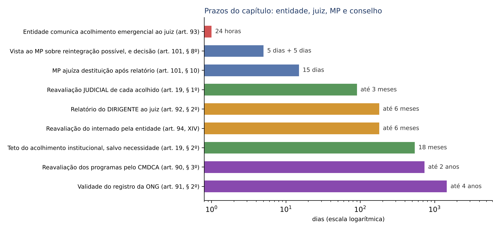

# APRESENTAÇÃO DA REVISÃO

Este caderno reúne, de cada um dos 26 capítulos da Apostila de Direito da Criança e do Adolescente, apenas as seções finais: o resumo tabelado para revisão pré-prova, os dispositivos incidentes e os julgados, temas e súmulas. A numeração das seções é a mesma da apostila completa, e as remissões ("v. Cap. X") apontam para os capítulos dela. Versão de 13/11/2026.

# CAPÍTULO 01 — FUNDAMENTOS: PROTEÇÃO INTEGRAL, PRIORIDADE ABSOLUTA, PRINCÍPIOS E CONCEITOS DO ECA

## 01.12 Resumo para revisão pré-prova

| Instituto | Regra | Exceções/detalhes | Fundamento |
|---|---|---|---|
| Fases históricas | Penal indiferenciada → tutelar (situação irregular) → proteção integral | Mello Mattos (1927), Lei 4.513/1964, Código de Menores (1979); ECA revogou as Leis 4.513 e 6.697 | ECA, art. 267 |
| Situação irregular | Menor como objeto; 6 hipóteses (carência, maus-tratos, perigo moral, falta de representação, desvio de conduta, infração penal) | Já previa aplicação de 18 a 21 nos casos expressos em lei | Lei 6.697/1979, arts. 1º e 2º |
| Proteção integral | Todas as crianças e adolescentes, sujeitos de direitos, prioridade absoluta, corresponsabilidade, descentralização, desjudicialização, oitiva | Não convive com a situação irregular (ENAM 2024) | CF, art. 227; ECA, arts. 1º e 100, par. único, I e II |
| CF, art. 227 | Família, sociedade e Estado; criança, adolescente e JOVEM (EC 65/2010) | Rol sem esporte e sem natureza; § 3º proteção especial; § 4º punição severa do abuso sexual; § 7º remete ao art. 204 | CF, art. 227 |
| CF, art. 229 | Pais: assistir, criar e educar filhos menores; filhos maiores: amparar pais na velhice, carência ou enfermidade | Base da assistência afetiva | CF, art. 229 |
| Art. 3º | Todos os direitos fundamentais + proteção integral; desenvolvimento físico, mental, moral, espiritual e social | Par. único: rol antidiscriminatório exemplificativo (idade, condição de desenvolvimento e aprendizagem, local de moradia) | ECA, art. 3º; Lei 13.257/2016 |
| Prioridade absoluta | Família, comunidade, sociedade em geral e poder público; inclui esporte e natureza | § 1º: primazia de socorro; precedência de atendimento; preferência em políticas; destinação privilegiada de recursos | ECA, art. 4º (Leis 15.240/2025 e 15.512/2026) |
| Direito à natureza | Absoluta prioridade = consideração primordial dos direitos e do melhor interesse | Prioridade reforçada: primeira infância, deficiência, risco; núcleos especializados facultativos no Judiciário | Lei 15.512/2026, arts. 2º e 27 |
| Assistência afetiva | Dever dos pais, por convívio ou visitação periódica | 3 incisos: orientação; solidariedade e apoio; presença física espontaneamente solicitada, quando possível | ECA, art. 4º, §§ 2º e 3º |
| Art. 5º | Vedação de negligência, discriminação, exploração, violência, crueldade e opressão | Par. único: ação ou omissão que ofenda direito fundamental = ilícito civil, com reparação, inclusive abandono afetivo | ECA, art. 5º; Lei 15.240/2025 |
| Interpretação | Fins sociais, bem comum, direitos e deveres individuais e coletivos, condição peculiar | Protetiva, mas nunca em prejuízo do adolescente no campo infracional; especialidade do ECA (10 dias corridos) com limites (arts. 155 a 197) | ECA, arts. 6º, 100, par. único, II, 152, § 2º, 198 |
| Melhor interesse | Consideração primordial; não exclui outros interesses legítimos | Flexibiliza cadastro, diferença de 16 anos, irrevogabilidade, família extensa; exige fundamentação concreta | Convenção, art. 3.1; ECA, art. 100, par. único, IV |
| Autonomia progressiva | Oitiva sempre que possível; consentimento do maior de 12 em família substituta e adoção | Adolescente pode realizar exame de gravidez sem responsáveis; examinada com menos de 14: notificação à rede | ECA, arts. 28, §§ 1º e 2º, 45, § 2º; STJ, REsp 2.024.140 |
| Criança e adolescente | Criança: até 12 incompletos; adolescente: 12 a 18 incompletos | Critério etário absoluto; emancipação irrelevante; idade na data do fato | ECA, arts. 2º e 104, par. único |
| Outros marcos | Primeira infância: 6 anos completos ou 72 meses; jovem: 15 a 29 | De 15 a 18 prevalece o ECA; Estatuto da Juventude excepcionalmente | Leis 13.257 e 12.852 |
| 18 a 21 anos | Só nos casos expressos em lei | Socioeducativo (art. 121, § 5º; Súmula 605), adoção do art. 40, Lei 13.431 (facultativa) | ECA, art. 2º, par. único |
| Medida e processo criminal após 18 | Extinção pela pena em regime fechado ou semiaberto (provisória ou definitiva); nos demais casos, o juízo decide | Prisão cautelar não convertida em pena desconta da medida | SINASE, art. 46, III, §§ 1º e 2º |
| Idade penal | 18 anos; critério biológico | Controvérsia sobre cláusula pétrea; PEC 115/2015 arquivada; PEC 32/2015 em comissão especial (2026) | CF, arts. 60, § 4º, IV, e 228 |
| Competência legislativa | Concorrente (art. 24, XV); Municípios: interesse local | Civil, penal, processual, trabalho e diretrizes da educação: privativa da União; lei federal superveniente suspende a estadual | CF, arts. 22, 24, 30; ARE 1.495.711; ADPF 457 |

## 01.13 Artigos de lei incidentes

- Constituição Federal: arts. 5º, § 1º, e XL; 7º, XXXIII; 21, XVI; 22, I e XXIV; 24, IX, XI e XV, §§ 1º a 4º; 30, I e II; 60, §§ 2º e 4º, IV; 204; 206; 227, caput e §§ 1º a 8º; 228; 229.
- ECA (Lei 8.069/1990): arts. 1º a 6º; 8º; 14, § 1º; 17; 18; 18-A; 19, § 4º; 22; 23; 28, §§ 1º, 2º e 6º; 36; 40; 45, § 2º; 56, IV; 98; 100, parágrafo único, I a IV e XII; 103; 104; 105; 109; 112, § 3º; 120, § 2º; 121, §§ 3º e 5º; 147; 152, §§ 1º e 2º; 198, II; 249; 266; 267.
- Lei 15.240/2025: art. 1º (alterações nos arts. 4º, 5º, 22, 56, 58, 129 e 130 do ECA).
- Lei 15.512/2026: arts. 1º a 4º, 8º, 21, 22, 24, 26, 27, 29, 32 a 35.
- Lei 12.594/2012 (SINASE): art. 46.
- Lei 13.431/2017: art. 3º e parágrafo único.
- Lei 13.257/2016: arts. 2º e 3º.
- Lei 12.852/2013 (Estatuto da Juventude): art. 1º, §§ 1º e 2º.
- Código Civil: arts. 3º, 4º, I, 5º, 1.619, 1.689.
- Código Penal: arts. 4º, 27, 217-A.
- LINDB: art. 5º.
- Decreto 99.710/1990 (Convenção sobre os Direitos da Criança): arts. 1, 3, 4, 5 e 12.
- Lei 6.697/1979 (Código de Menores, revogado): arts. 1º e 2º. Decreto 17.943-A/1927 (Código Mello Mattos, revogado): art. 1º.

## 01.14 Julgados, temas e súmulas do capítulo

- STJ, Jurisprudência em Teses, ed. 54, tese 4 — art. 122 taxativo; vedada interpretação extensiva.
- STJ, Jurisprudência em Teses, ed. 256, teses 2 e 3 — direitos da personalidade de crianças de tenra idade; imagem sem autorização gera dano *in re ipsa*.
- STJ, Jurisprudência em Teses, ed. 250, teses 5 e 6 — juízo imediato prevalece sobre o CPC; sistema recursal do ECA só nos procedimentos dos arts. 155 a 197.
- STJ, Jurisprudência em Teses, ed. 27, teses 1 e 3; ed. 251, teses 10 e 11; ed. 253, tese 8; ed. 254, tese 5 — melhor interesse como critério de flexibilização (cadastro, acolhimento, retratação, irrevogabilidade, art. 1.689 do CC, diferença de 16 anos).
- STJ, Informativo Edição Extraordinária 26 (Terceira Turma, j. 5/5/2025) — agravo interno após 10 dias corridos é intempestivo (especialidade).
- STJ, Informativos 870 e Edição Extraordinária 32 — Defensoria mantém prazo em dobro nos procedimentos do ECA.
- STJ, REsp 2.024.140 (Informativo Edição Extraordinária 32) — autonomia progressiva; exame de gravidez; notificação à rede.
- STF, ARE 1.495.711 (Informativo 1161) — lei municipal de política contra alienação parental: competência concorrente.
- STF, ADPF 457 — lei municipal sobre "ideologia de gênero": usurpação da competência da União (art. 22, XXIV).

Remissões a outros capítulos: Súmula 605, Tema 992 e Jurisprudência em Teses, ed. 54, tese 11 (Cap. 14); Tema 1.186 do STJ (Cap. 23); REsp 2.138.801, recusa vacinal e multa do art. 249 (Caps. 3 e 12); Súmula 338 e Súmula 108 do STJ (Caps. 14 e 15); Tema 548 do STF (Cap. 8); Súmula 74 do STJ (Apostila de Direito Penal, Cap. 14); Informativo 860 do STJ, família extensa (Cap. 5); SINASE, regime completo da extinção e da unificação (Cap. 17).

# CAPÍTULO 02 — NORMATIVA INTERNACIONAL: CONVENÇÃO DA ONU, REGRAS DE BEIJING E CONVENÇÕES DE HAIA

## 02.11 Resumo para revisão pré-prova

| Instituto | Regra | Exceções e detalhes | Fundamento |
|---|---|---|---|
| Status dos tratados de direitos humanos | supralegais se não aprovados pelo rito do § 3º | equivalentes a emenda se aprovados por 3/5, em dois turnos, nas duas Casas | CF, art. 5º, §§ 2º e 3º; RE 466.343; SV 25 |
| Convenção da ONU e Protocolos | supralegais | doutrina minoritária: materialmente constitucionais | RE 466.343 |
| Haia 1980 | supralegal | declarada constitucional, com interpretação de gênero do art. 13, 1, b | ADIs 4.245 e 7.686 |
| Declaração de 1959, Beijing, Riad, Havana | *soft law*, sem força vinculante | vetor interpretativo do ECA e do SINASE | resoluções da AG |
| Norma mais favorável | prevalece a disposição mais favorável à criança, interna ou internacional | também no Protocolo I, art. 5º | Convenção, art. 41 |
| Declaração de 1959 | 10 princípios; interesse superior como consideração fundamental das leis; primeiros a receber proteção e socorro | criança de tenra idade não apartada da mãe, salvo circunstâncias excepcionais | princípios 2, 6 e 8 |
| Conceito de criança (Convenção) | menos de 18 anos | salvo maioridade antecipada pela lei aplicável; ECA divide criança (até 12 incompletos) e adolescente | Convenção, art. 1º; ECA, art. 2º |
| Princípios gerais | não discriminação, interesse superior (primordial), vida e desenvolvimento, direito de ser ouvido | oitiva em função da idade e maturidade; não vincula a decisão | arts. 2º, 3º, 6º e 12 |
| Separação dos pais | só por autoridade competente, sujeita à revisão judicial, no interesse maior | contato com ambos os pais, salvo prejuízo | art. 9º; ECA, art. 101, § 2º |
| Adoção (Convenção) | interesse maior como consideração primordial; adoção em outro país é subsidiária | vedados benefícios financeiros indevidos | art. 21 |
| Saúde | reduzir a mortalidade infantil; assistência preventiva, orientação aos pais e planejamento familiar | abolir práticas tradicionais prejudiciais | art. 24 |
| Privação de liberdade | último recurso e mais breve período; sem pena de morte nem prisão perpétua sem livramento | separação dos adultos salvo interesse da criança; contato com a família salvo circunstâncias excepcionais | art. 37 |
| Conflitos armados | Convenção: 15 anos | Protocolo I: 18 para participação direta e recrutamento compulsório; voluntário acima de 15 com declaração e salvaguardas | art. 38; Protocolo I, arts. 1º a 4º |
| Comitê | 10 especialistas no texto promulgado, a título pessoal; mandato de 4 anos; eleições a cada 2 anos; quórum de 2/3 | emenda ao art. 43, 2 (em vigor desde 18/11/2002) ampliou para 18 | art. 43 |
| Relatórios | Estados: 2 anos e depois a cada 5, via Secretário-Geral; Comitê à AG: a cada 2 anos, via ECOSOC | Estado não repete informação básica | art. 44 |
| Reservas e denúncia | reservas admitidas, salvo incompatíveis com o objeto | denúncia produz efeito 1 ano após a notificação | arts. 51 e 52 |
| Protocolo II | define venda, prostituição e pornografia infantil; criminalização mínima | dúvida sobre a idade não impede a investigação | Decreto 5.007/2004, arts. 2º, 3º e 8º |
| Protocolo III | comunicações individuais ao Comitê | esgotamento dos recursos internos; prazo de 1 ano; investigação de violações graves ou sistemáticas, com opção de não reconhecimento | Decreto 12.313/2024 |
| Beijing | bem-estar e proporcionalidade; remissão; internação como último recurso | privação de liberdade só com violência contra pessoa ou reincidência grave e sem outra medida adequada | Res. 40/33; regras 5, 11, 17 e 19 |
| Riad | prevenção; enfoque centrado na criança; controle formal como último recurso | não etiquetar; vedação de *status offences*; institucionalização excepcional | Res. 45/112; itens 5, 6, 46 e 56 |
| Havana | jovem é quem tem menos de 18 anos; privação de liberdade como último recurso e pelo tempo mínimo | separação dos adultos salvo família; vedados isolamento, cela escura, castigos coletivos e restrição de contato familiar | Res. 45/113; regras 2, 11, 29 e 67 |
| Haia 1993: âmbito | residência habitual em Estados Contratantes diversos | só adoções que criem filiação; inaplicável se as aprovações do art. 17, c, não vierem antes dos 18 | arts. 2º e 3º; ECA, art. 51 |
| Haia 1993: requisitos | adotabilidade, subsidiariedade, consentimentos livres, escritos, gratuitos e da mãe após o parto | opinião e consentimento da criança conforme maturidade | arts. 4º e 5º |
| Haia 1993: procedimento | acordo das duas Autoridades Centrais antes de confiar a criança | saída do Brasil só após trânsito em julgado | arts. 14 a 19; ECA, art. 52 |
| Haia 1993: reconhecimento | de pleno direito, com certificado | recusa só por manifesta contrariedade à ordem pública; nenhuma reserva admitida | arts. 23, 24 e 40; ECA, arts. 52-B e 52-C |
| Haia 1980: aplicação | retorno imediato e direito de visita | cessa aos 16 anos; só fatos posteriores à vigência | arts. 1º, 4º, 21 e 35 |
| Haia 1980: procedimento | urgência; decisão em 6 semanas; pedido via Autoridade Central ou direto ao Judiciário | reserva brasileira: tradução juramentada para o português | arts. 2º, 8º, 11, 24 e 29 |
| Haia 1980: competência | Justiça Federal para retorno e visita fundados no tratado | alegação incidental em ação de família fica na Justiça Estadual; ações sem conexão, com suspensão da guarda por prejudicialidade externa | CF, art. 109, I e III; JT 27, tese 9; CC 132.100/BA; Inf. 903 |

## 02.12 Artigos de lei incidentes

- Constituição Federal: arts. 5º, §§ 2º e 3º; 49, I; 109, I e III; 227; 228.
- Convenção sobre os Direitos da Criança (Decreto 99.710/1990): arts. 1º a 6º, 7º a 12, 18 a 25, 27 a 41, 43, 44, 45, 49 a 52.
- Protocolo Facultativo sobre conflitos armados (Decreto 5.006/2004): arts. 1º a 5º, 8º, 10 e 11.
- Protocolo Facultativo sobre venda de crianças, prostituição e pornografia infantis (Decreto 5.007/2004): arts. 1º a 4º e 8º.
- Protocolo Facultativo sobre procedimento de comunicações (Decreto 12.313/2024): arts. 1º, 4º a 14 e 19.
- Convenção de Haia de 1993 (Decreto 3.087/1999): arts. 1º a 9º, 10 a 12, 14 a 24, 26, 27, 29, 30, 32, 35, 39 a 41.
- Convenção de Haia de 1980 (Decreto 3.413/2000): arts. 1º, 2º, 4º, 6º a 8º, 11, 16, 19, 21, 24, 29, 35 e 42.
- ECA (Lei 8.069/1990): arts. 2º, 3º, 4º, 19, 28, 51, 52, 52-B, 52-C, 52-D, 100, parágrafo único, 101, § 2º, 103, 107, 108, 121, 122, 123, 126 a 128, 143, 188 e 199-A.
- CPC: art. 313, V, a.
- Resoluções da Assembleia Geral: Declaração dos Direitos da Criança (1959); 40/33 (Beijing); 45/112 (Riad); 45/113 (Havana).

## 02.13 Julgados, temas e súmulas do capítulo

- STF, RE 466.343 (Plenário, j. 3/12/2008; Tema 60): supralegalidade dos tratados de direitos humanos não aprovados pelo rito do § 3º.
- STF, Súmula Vinculante 25: ilicitude da prisão civil do depositário infiel, decorrência da supralegalidade.
- STF, ADI 5.240 (Plenário, j. 20/8/2015): tratados internalizados suprimem efeitos de atos infraconstitucionais contrários.
- STF, ADIs 4.245 e 7.686 (j. 27/8/2025): Haia 1980 constitucional e supralegal; grave risco lido com perspectiva de gênero.
- STJ, Jurisprudência em Teses, ed. 27, tese 9: Justiça Federal para busca, apreensão ou guarda fundadas na Haia 1980.
- STJ, CC 132.100/BA (Segunda Seção, DJe 14/4/2015): sem conexão entre retorno e guarda; prejudicialidade externa e suspensão da ação estadual.
- STJ, Informativo 903 (Segunda Seção, j. 19/8/2026): alegação incidental de subtração não desloca para a Justiça Federal.

Remissões a outros capítulos: STJ, REsp 2.062.293/DF (Inf. 868, suprimento de autorização de viagem internacional, Cap. 9); adoção internacional no ECA (Cap. 6); internação e reavaliação (Caps. 15 e 17); Haia 1980, regime material (Apostila de Direito Civil, Cap. 48).

# CAPÍTULO 03 — DIREITOS FUNDAMENTAIS I: VIDA, SAÚDE, LIBERDADE, RESPEITO E DIGNIDADE

## 03.7 Resumo para revisão pré-prova

| Instituto | Regra | Exceções e detalhes | Fundamento |
|---|---|---|---|
| Vida e saúde | direito a políticas sociais públicas que permitam nascimento e desenvolvimento sadio e harmonioso | proteção começa na gestação | art. 7º; CF, art. 227 |
| Planejamento reprodutivo | todas as mulheres; às gestantes, nutrição e atenção humanizada | pré, peri e pós-natal integral no SUS | art. 8º, caput |
| Pré-natal | atenção primária; vinculação no último trimestre ao local do parto, com opção da mulher | busca ativa de quem abandona | art. 8º, §§ 1º, 2º e 9º |
| Assistência psicológica | dever do poder público, pré e pós-natal | inclui quem quer entregar o filho e a presa; indicada após avaliação (Lei 14.721/2023) | art. 8º, §§ 4º, 5º e 11 |
| Acompanhante | 1, de preferência da gestante, no pré-natal, trabalho de parto e pós-parto imediato | — | art. 8º, § 6º |
| Presa gestante ou mãe | ambiência sanitária e assistencial do SUS para acolher o filho | aleitamento garantido | art. 8º, § 10; art. 9º |
| Semana Nacional | anual, na semana do dia 1º de fevereiro; disseminar informações preventivas e educativas | poder público + sociedade civil; público adolescente | art. 8º-A |
| Aleitamento | poder público, instituições e empregadores | UTI neonatal: banco ou unidade de coleta de leite | art. 9º |
| Estabelecimentos de saúde de gestantes | públicos e particulares: prontuário 18 anos; identificação plantar e digital + digital da mãe; exames metabólicos; declaração com intercorrências; alojamento conjunto; amamentação; saúde mental | crimes dos arts. 228 e 229 (admitem forma culposa) | art. 10 |
| Triagem neonatal | PNTN em 5 etapas | rol revisável e expansível | art. 10, §§ 1º a 4º |
| SUS | acesso integral; equidade | deficiência sem segregação; medicamentos, órteses e próteses gratuitos | art. 11 |
| Judicialização | negativa de tratamento imprescindível viola a CF | exterior: excepcional, requisitos cumulativos (Info 894) | JT 245, tese 7 |
| Internação da criança | permanência integral de um dos pais ou responsável, inclusive UTI e neonatal | restrição se comprovado prejuízo ao melhor interesse | art. 12; JT 245, tese 8 |
| Visita aos pais internados | direito da criança | nos termos das normas regulamentadoras (Lei 14.950/2024) | art. 12, parágrafo único |
| Comunicação de violência | suspeita ou confirmação de castigo, tratamento cruel ou maus-tratos: ao CT, obrigatoriamente | sem prejuízo de outras providências; omissão: art. 245 | art. 13; art. 70-B |
| Primeira infância e violência | máxima prioridade; projeto terapêutico singular com rede e, se necessário, acompanhamento domiciliar | — | art. 13, § 2º |
| Entrega voluntária (saúde) | encaminhamento obrigatório e sem constrangimento à Justiça da Infância | regime no Cap. 4 | art. 13, § 1º |
| Saúde bucal | antes do nascimento, 6º e 12º anos | necessidades especiais no SUS | art. 14, §§ 2º a 4º |
| Risco psíquico | protocolo obrigatório nos primeiros 18 meses | — | art. 14, § 5º |
| Saúde mental | acesso a programas do SUS de prevenção e tratamento; atenção psicossocial básica e especializada, urgência e emergência, hospitalar | vulneráveis em tratamento: todos os recursos terapêuticos, gratuitos ou subsidiados | art. 11-A (Lei 15.413/2026) |
| Psicofármacos e drogas | prevenção do uso indiscriminado, desnecessário ou excessivo de psicofármacos nas campanhas sanitárias; assistência integral e multiprofissional ao dependente químico | § 6º com vigência diferida (180 dias da publicação de 1/7/2026); art. 14-A com vigência após 120 dias | art. 14, § 6º (Lei 15.450/2026); art. 14-A (Lei 15.243/2025) |
| Vacinação | obrigatória nos casos recomendados pelas autoridades sanitárias | convicção dos pais não é escusa; contraindicação concreta é | art. 14, § 1º; Tema 1.103; ADIs 6.586 e 6.587 |
| Recusa vacinal | negligência parental: multa do art. 249 | medidas do art. 129; suspensão em caso grave | Info 844 |
| Liberdade | 7 aspectos do art. 16 | ir e vir: só restrições legais; política: na forma da lei | arts. 15 e 16 |
| Opinião e participação | direito de ser ouvido e considerado | manifestar-se é escolha; consentimento do maior de 12 na família substituta | art. 100, p. ún., XII; art. 28 |
| Respeito | integridade física, psíquica e moral; imagem, identidade, autonomia, crenças, espaços e objetos | privacidade como princípio | art. 17; art. 100, p. ún., V |
| Ato infracional | vedada divulgação; notícia sem foto, nome, apelido, filiação, parentesco, residência e iniciais | violação = infração administrativa (art. 247), não crime | arts. 143 e 247; JT 256, tese 6 |
| Dignidade | dever de todos de afastar tratamento desumano, violento, aterrorizante, vexatório ou constrangedor | vexame ou constrangimento: crime do art. 232 | art. 18 |
| Castigo físico | ação disciplinar com força física que resulte em sofrimento ou lesão | não há castigo moderado lícito | art. 18-A, p. ún., I |
| Tratamento cruel ou degradante | humilhar, ameaçar gravemente ou ridicularizar | — | art. 18-A, p. ún., II |
| Medidas do art. 18-B | 6 medidas, aplicadas pelo CT conforme a gravidade | VI (tratamento da vítima) pela Lei 14.344/2022 | art. 18-B |
| Responsabilidade civil | ofensa a direito fundamental estatutário = ilícito sujeito a reparação | cumula com outras sanções; abandono afetivo (Cap. 7) | art. 5º, p. ún. (Lei 15.240/2025) |
| Dano moral da criança | devido mesmo em tenra idade | imagem sem autorização: *in re ipsa* | JT 256, teses 2 e 3 |
| Prescrição | não corre contra quem tem menos de 16 anos nem entre pais e filhos durante o poder familiar | — | CC, arts. 197, II, e 198, I |

## 03.8 Artigos de lei incidentes

- CF: arts. 5º, X; 14, § 1º, II, c; 37, § 6º; 227.
- ECA (Lei 8.069/1990): arts. 3º; 4º, §§ 2º e 3º; 5º, parágrafo único; 7º a 18-B (inclusive 11-A e 14-A, e 14, § 6º); 28, §§ 1º, 2º e 6º; 47, §§ 5º e 6º; 70-A; 70-B; 98; 100, parágrafo único, V, XI e XII; 101; 102; 129; 130; 136; 141; 142, parágrafo único; 143; 213; 228; 229; 232; 245; 247; 249; 258-B.
- Leis alteradoras: 12.010/2009; 13.010/2014; 13.257/2016; 13.436/2017; 13.438/2017; 13.798/2019; 14.154/2021; 14.344/2022; 14.721/2023; 14.811/2024; 14.950/2024; 15.240/2025; 15.243/2025; 15.280/2025; 15.413/2026; 15.450/2026.
- Lei 14.826/2024 (parentalidade positiva e direito ao brincar).
- CC: arts. 3º; 12; 197, II; 198, I; 206, § 3º, V; 1.638, I; 1.689, I e II.
- CPC: arts. 72, I; 178, II.
- CDC: art. 14.
- Estatuto da Pessoa com Deficiência: art. 22.

## 03.9 Julgados, temas e súmulas do capítulo

- STF, Tema 1.103 (ARE 1.267.879): vacinação obrigatória; convicção filosófica dos pais não é escusa.
- STF, ADIs 6.586 e 6.587: vacinação compulsória não é forçada; medidas indiretas legais.
- STJ, REsp 2.138.801-PR (Info 844): recusa vacinal é negligência parental punível pelo art. 249.
- STJ, REsp 1.860.543-PR (Info 894): tratamento pediátrico no exterior só excepcionalmente, com requisitos cumulativos.
- STJ, JT 245, tese 7: negativa de medicamento imprescindível à criança viola, por si, a CF.
- STJ, JT 245, tese 8 (HC 632.992/MG): acompanhamento integral na internação, restringível se comprovado prejuízo.
- STJ, JT 250, tese 2: criança sob guarda é dependente natural no plano de saúde.
- STJ, JT 254, tese 6: nome afetivo do adotando por tutela antecipada, com estudo psicossocial.
- STJ, JT 256, tese 2: criança de tenra idade tem direito à compensação por dano moral.
- STJ, JT 256, tese 3: imagem ou identidade sem autorização gera dano *in re ipsa*.
- STJ, JT 256, tese 6: vedada qualquer identificação, direta ou indireta, do adolescente a quem se atribui ato infracional.
- STJ, JT 253, tese 8: pais podem levantar valores dos filhos, salvo prejuízo ao melhor interesse.
- STF, ADI 869: inconstitucional a apreensão da publicação prevista no art. 247, § 2º.

Remissões a outros capítulos: Temas 952 e 1.069 do STF (Apostila de Direito Civil, Cap. 4); REsp 2.086.404-MG e Resolução CNJ 485/2023 (Cap. 4); JT 254, tese 7 (Cap. 6); JT 263, tese 8 (Cap. 15); JT 245, teses 1 e 2 e Tema 548 do STF (Cap. 8); REsp 2.126.256/SC (Cap. 6); Súmula 108 do STJ (Cap. 15); Súmula 403 do STJ (Apostila de Direito Civil, Caps. 4 e 25); HC 143.641 (Cap. 24).

# CAPÍTULO 04 — CONVIVÊNCIA FAMILIAR I: FAMÍLIA NATURAL, PODER FAMILIAR, ACOLHIMENTO E ENTREGA VOLUNTÁRIA

## 04.7 Resumo para revisão pré-prova

| Instituto | Regra | Exceções e detalhes | Fundamento |
|---|---|---|---|
| Convivência familiar | criação na própria família; família substituta excepcional | manutenção ou reintegração tem preferência sobre QUALQUER outra providência, com inclusão em programas | art. 19, caput e § 3º |
| Genitor preso | convivência por visitas periódicas promovidas pelo responsável ou pela entidade | INDEPENDE de autorização judicial | art. 19, § 4º |
| Mãe adolescente acolhida | convivência integral com o filho | equipe especializada multidisciplinar | art. 19, §§ 5º e 6º |
| Família extensa | parentes próximos + convivência + afinidade e afetividade | prioridade RELATIVA (STJ): cede a vínculo socioafetivo consolidado; pai não guardião é família natural | art. 25, parágrafo único |
| Poder familiar | exercício igualitário por pai e mãe; divergência resolvida pelo juiz | representação até 16 anos, assistência dos 16 aos 18 (CC, art. 1.634, VII) | art. 21; CF, art. 226, § 5º |
| Deveres dos pais | sustento, guarda, CONVIVÊNCIA, ASSISTÊNCIA MATERIAL E AFETIVA, educação; cumprir decisões judiciais | Lei 15.240/2025; descumprimento injustificado autoriza perda ou suspensão | arts. 22 e 24 |
| Perda e suspensão | só judicialmente, em procedimento contraditório | hipóteses do CC (arts. 1.637 e 1.638) + descumprimento injustificado do art. 22; procedimento no Cap. 18 (120 dias) | art. 24 |
| Pobreza | não é motivo suficiente para perda ou suspensão | criança mantida na família, incluída OBRIGATORIAMENTE em programas | art. 23, caput e § 1º |
| Condenação criminal | NÃO implica destituição | salvo crime doloso com RECLUSÃO contra o outro titular ou contra filho, filha ou outro descendente; suspensão por pena superior a 2 anos (CC) | art. 23, § 2º; CC, art. 1.637, parágrafo único |
| Entrega irregular | causa de perda | com paga ou recompensa: crime do art. 238 (reclusão 1 a 4 anos e multa) | CC, art. 1.638, V |
| Acolhimento | provisório e excepcional; transição; não é privação de liberdade | institucional só com risco concreto (STJ) | art. 101, § 1º; JT 27.3 e 250.7 |
| Acolhimento familiar | PREFERENCIAL ao institucional | guarda; família fora do cadastro de adoção | art. 34, §§ 1º a 3º |
| Afastamento | competência EXCLUSIVA do juiz, procedimento contencioso | acolhimento emergencial pela entidade com comunicação em 24 h | art. 101, § 2º; art. 93 |
| Reavaliação | no máximo a cada 3 meses, decisão fundamentada | relatório da entidade no máximo a cada 6 meses | art. 19, § 1º; art. 92, § 2º |
| Prazo do acolhimento institucional | até 18 meses | salvo comprovada necessidade, fundamentada | art. 19, § 2º |
| Reintegração | comunicação imediata ao juiz; MP em 5 dias; decisão em 5 dias | decidida nos autos do acolhimento | art. 101, § 8º |
| Impossibilidade de reintegração | relatório fundamentado ao MP; 15 dias para a ação de destituição | salvo estudos complementares | art. 101, §§ 9º e 10 |
| Irmãos | não desmembramento | salvo risco comprovado ou situação que justifique plenamente; evitar ruptura definitiva | art. 92, V; art. 28, § 4º |
| Audiências concentradas | OBRIGATÓRIAS, uma por semestre, nas entidades sempre que possível, atas individualizadas | servem à reavaliação trimestral; remotas só excepcionalmente; acolhido há mais de 6 meses sem DPF: vista ao MP e, se ele não ajuizar, cópia ao PGJ (analogia art. 28 CPP) | Provimento CN 165/2024, arts. 68 a 74 |
| Apadrinhamento | para acolhidos (institucional OU familiar); vínculos externos | padrinho maior de 18 anos NÃO inscrito no cadastro; pessoa jurídica pode; prioridade para remota chance de reinserção ou adoção; executado por órgão público ou OSC | art. 19-B |
| Entrega voluntária: início | encaminhamento obrigatório e sem constrangimento à Justiça da Infância | omissão do profissional de saúde: infração do art. 258-B | art. 13, § 1º; art. 19-A, caput |
| Entrega: oitiva | pela equipe interprofissional da Justiça da Infância, com relatório ao juiz (efeitos do estado gestacional e puerperal) | encaminhamento à rede só com expressa concordância; defensor ou advogado nomeado | art. 19-A, §§ 1º e 2º; Res. CNJ 485, art. 3º |
| Entrega: sigilo | sobre o nascimento, inclusive perante suposto genitor e família extensa | adolescente: também perante os próprios pais; não é oponível ao filho (art. 48); pai registral ou indicado é ouvido | art. 19-A, §§ 5º e 9º; Res. 485, art. 5º; REsp 2.086.404/MG |
| Entrega: família extensa | busca em até 90 dias, prorrogáveis por igual período | só se não houver sigilo e com anuência da mulher | art. 19-A, § 3º; Res. 485, art. 5º, §§ 3º e 4º |
| Entrega: consentimento | só vale após o nascimento; escrito sem ratificação em audiência é inválido | audiência em até 10 dias, com MP e assistência técnica | art. 166, §§ 1º, 4º e 6º |
| Entrega: sentença | declara a EXTINÇÃO do poder familiar | sem genitor nem família extensa apta: extinção (§ 4º); ninguém comparece: suspensão do poder familiar da mãe (§ 6º) | art. 166, § 1º, II; art. 19-A, §§ 4º e 6º |
| Retratação x arrependimento | retratação até a audiência; arrependimento em 10 dias da sentença | STJ: não são direitos potestativos absolutos (Info 886; JT 251.10) | art. 166, § 5º |
| Desistência | criança mantida com os genitores; acompanhamento por 180 dias | Res. 485: entrega imediata, salvo decisão fundamentada | art. 19-A, § 8º |
| Prazos finais | 15 dias para ação de adoção após o estágio; 30 dias para cadastrar não procurados | averiguação oficiosa de paternidade dispensada | art. 19-A, §§ 7º e 10; Res. 485, art. 12 |

## 04.8 Artigos de lei incidentes

- Constituição Federal: arts. 226, §§ 4º e 5º, e 227, caput e § 6º.
- ECA (Lei 8.069/1990): arts. 4º, §§ 2º e 3º, e 5º, parágrafo único (Lei 15.240/2025); 8º, §§ 4º, 5º e 10; 13, § 1º; 19, §§ 1º a 6º; 19-A, §§ 1º a 10; 19-B, §§ 1º a 6º; 20; 21; 22 e parágrafo único; 23, §§ 1º e 2º; 24; 25 e parágrafo único; 28, §§ 1º a 4º; 34, §§ 1º a 4º; 48; 92, incisos e §§ 1º, 2º, 4º a 7º; 93 e parágrafo único; 100, parágrafo único, III, X, XI e XII; 101, VII a IX e §§ 1º a 12; 129, I a X e parágrafo único; 130; 136, XI e parágrafo único; 155; 157; 163; 166, §§ 1º a 7º; 238; 258-B.
- Código Civil: arts. 1.597, 1.634, 1.635, 1.636, 1.637 e 1.638 (incisos I a V e parágrafo único).
- Código Penal: art. 92, II (remissão).
- Resolução CNJ 485/2023: arts. 2º a 12.
- Resolução CNJ 289/2019 (SNA): Anexo I, arts. 3º e 4º (remissão).
- Provimento CN 165/2024 (Código de Normas Nacional da Corregedoria Nacional de Justiça — Foro Judicial): arts. 68 a 74.

## 04.9 Julgados, temas e súmulas do capítulo

- Jurisprudência em Teses do STJ, ed. 27, tese 3 — acolhimento institucional ou familiar não é o melhor interesse nem na adoção irregular, salvo risco evidente.
- Jurisprudência em Teses do STJ, ed. 250, tese 7 — abrigo institucional em detrimento do familiar só com risco concreto.
- Jurisprudência em Teses do STJ, ed. 251, tese 6 — exercício igualitário do poder familiar após 1988.
- Jurisprudência em Teses do STJ, ed. 251, tese 9 — encaminhamento à adoção, em regra, após o trânsito em julgado da destituição ou extinção.
- Jurisprudência em Teses do STJ, ed. 251, tese 10 — retratação tempestiva não gera direito potestativo à devolução.
- Jurisprudência em Teses do STJ, ed. 27, tese 10 — curadoria especial da Defensoria não obrigatória nas ações do MP.
- STJ, REsp 2.086.404/MG (Info 835) — sigilo da entrega alcança suposto genitor e família ampla, ressalvado o art. 48.
- STJ, AgInt no REsp 1.928.612/MG (Info 886) — arrependimento tempestivo não revoga automaticamente a adoção consolidada.
- STJ, HC 909.659/SP (Info Ed. Extra 20) — não se tira do acolhimento familiar para o institucional, salvo duas exceções.
- STJ, HC 878.386/ES (Info 806) — suspeita de adoção irregular não justifica, por si, o abrigamento.
- STJ, Terceira Turma, j. 12/11/2024 (Info Ed. Extra 23) — tempo da criança x tempo do processo; prioridade relativa da família extensa.
- STJ, AgInt no AREsp 2.403.637/SC (Info 800) — omissão dos pais diante de abuso sexual justifica destituição.
- STJ, Quarta Turma, j. 12/8/2025 (Info 858) — mãe vítima de violência sexual aos 14 anos, sem apoio estatal, não se enquadra no art. 1.638.

Remissões a outros capítulos: STJ, HC 943.669 (Info 860) e HC 1.068.341 (Info 896) (Cap. 5); STJ, HC 1.035.988 (Info Ed. Extra 29) (Cap. 18); Cap. 5 (família acolhedora e guarda, 5.4; prioridade relativa da família extensa, 5.2.2); Cap. 6 (SNA, adoção *intuitu personae*, estágio de convivência, art. 48); Cap. 7 (abandono afetivo e Lei 15.240/2025); Cap. 12 (Conselho Tutelar, art. 136); Cap. 13 (ingresso no acolhimento, guia e PIA, 13.7); Cap. 18 (procedimento de perda e suspensão, arts. 155 a 163); Cap. 21 (art. 238 e art. 258-B); Apostila de Direito Civil, Cap. 38 (regime civil do poder familiar).

# CAPÍTULO 05 — FAMÍLIA SUBSTITUTA I: REGRAS GERAIS, GUARDA, FAMÍLIA ACOLHEDORA E TUTELA

## 05.8 Resumo para revisão pré-prova

| Instituto | Regra | Exceções e detalhes | Fundamento |
|---|---|---|---|
| Modalidades | guarda, tutela ou adoção (rol taxativo) | "independentemente da situação jurídica"; acolhimento e apadrinhamento não são modalidades | ECA, art. 28, caput |
| Oitiva | sempre que possível, por equipe interprofissional; opinião considerada | qualquer idade; não vincula | art. 28, § 1º |
| Consentimento | maior de 12 anos, colhido em audiência | necessário, não suficiente; vale para as três modalidades | art. 28, § 2º; art. 45, § 2º |
| Escolha do substituto | grau de parentesco, afinidade e afetividade | prioridade da família extensa NÃO absoluta; extensa exige convivência e vínculos | art. 28, § 3º; art. 25, parágrafo único; HC 943.669 |
| Irmãos | mesma família substituta | risco de abuso ou situação que justifique plenamente; evitar rompimento definitivo | art. 28, § 4º |
| Preparação | gradativa, com acompanhamento posterior, pela equipe da Justiça da Infância | apoio preferencial dos técnicos da política MUNICIPAL de convivência familiar | art. 28, § 5º |
| Indígena e quilombola | identidade cultural respeitada; prioridade da comunidade ou etnia | costumes incompatíveis com direitos fundamentais não prevalecem; FUNAI só para indígenas, antropólogos para ambos | art. 28, § 6º |
| FUNAI | intervenção obrigatória, de ordem pública | nulidade com presunção de prejuízo; não atrai a Justiça Federal | REsp 1.566.808; REsp 1.698.635; CC 209.192 |
| Idoneidade | incompatibilidade ou ambiente inadequado impedem | "por qualquer modo" | art. 29 |
| Transferência | vedada sem autorização judicial | a terceiros ou entidades, inclusive públicas | art. 30 |
| Família estrangeira | somente adoção, excepcional | guarda e tutela vedadas; guarda provisória vedada na adoção por estrangeiros | art. 31; art. 33, § 1º |
| Compromisso | guardião e tutor, termo nos autos | adoção não tem | art. 32; art. 170 |
| Guarda: conteúdo | assistência material, moral e educacional | opõe-se a terceiros, "inclusive aos pais"; dirigente de acolhimento institucional equiparado ao guardião | art. 33, caput; art. 92, § 1º |
| Guarda: espécies | provisória (liminar ou incidental), definitiva, excepcional | representação só para atos determinados (§ 2º) | art. 33, §§ 1º e 2º |
| Guarda: dependência | para todos os fins, inclusive previdenciários | pensão por morte com prova da dependência econômica; vedada guarda com fim exclusivamente previdenciário | art. 33, § 3º; Tema 732; ADIs 4.878 e 5.083; JT 27.13 |
| Guarda: pais | visitas e alimentos mantidos | salvo decisão fundamentada ou guarda preparatória de adoção | art. 33, § 4º |
| Guarda: revogação | a qualquer tempo, ato judicial fundamentado, ouvido o MP | sem coisa julgada material; evitar alterações abruptas | art. 35; JT 253.3; JT 27.8 |
| Guarda subsidiada | estímulo estatal: assistência jurídica, incentivos fiscais, subsídios | percentual obrigatório dos fundos | art. 34, caput; art. 260, § 2º |
| Família acolhedora | preferência sobre o institucional; recebe mediante guarda | família fora do cadastro de adoção; repasse facultado; descadastramento não impõe acolhimento institucional se há vínculo | art. 34, §§ 1º a 4º; HC 1.068.341 |
| Tutela: destinatário | até 18 anos incompletos | rege-se pela lei civil | art. 36 |
| Tutela: pressuposto | prévia perda ou suspensão do poder familiar | dispensada se pais mortos, ausentes ou desconhecidos; implica guarda | art. 36, parágrafo único; CC, arts. 1.635 e 1.728 |
| Tutela testamentária | nomeado pede controle judicial em 30 dias da abertura da sucessão | deferida só se vantajosa e sem pessoa em melhores condições; arts. 28 e 29 | art. 37 |
| Destituição da tutela | procedimento contraditório | remoção de tutor do CPC e, no que couber, o da perda do poder familiar | arts. 38, 24 e 164 |
| Guarda civil | compartilhada é a regra sem acordo | não deseja; risco de violência doméstica; divisão equilibrada, base de moradia | CC, arts. 1.583 e 1.584 |

## 05.9 Artigos de lei incidentes

- ECA (Lei 8.069/1990): arts. 2º, parágrafo único; 19, §§ 1º a 3º; 19-B, § 2º; 22; 24; 25; 28 a 38; 42, § 1º; 45, § 2º; 46, §§ 3º e 5º; 50, §§ 2º e 13; 51, § 1º; 92, § 1º, § 2º, V e § 7º; 101, I, VII a IX, §§ 1º e 2º; 136; 147; 148, parágrafo único, a e b; 157, § 2º; 161; 164 a 170; 201, III; 238; 249; 260, § 2º.
- Código Civil: arts. 1.583, §§ 2º, 3º e 5º; 1.584, § 2º a § 6º; 1.634, caput, III e IX; 1.635, I; 1.728 a 1.735; 1.740; 1.742; 1.745; 1.747; 1.755; 1.764 a 1.766.
- CPC: arts. 505, I; 759 a 763.
- CF: arts. 109, I; 227.
- Lei 8.213/1991: art. 16, § 2º. EC 103/2019: art. 23, § 6º.

## 05.10 Julgados, temas e súmulas do capítulo

- STJ, HC 943.669-MG (Info 860): família extensa sem vínculo prévio cede à família substituta com laço socioafetivo e cuidados adequados.
- STJ, HC 1.068.341-MG (Info 896): guarda provisória mantida com família ex-acolhedora, apesar do descadastramento, até o fim da destituição.
- STJ, REsp 1.566.808-MS e REsp 1.698.635-MS: intervenção da FUNAI obrigatória; nulidade com presunção de prejuízo.
- STJ, Tema 732 (REsp 1.411.258-RS): criança sob guarda tem direito à pensão por morte, comprovada a dependência.
- STF, ADIs 4.878 e 5.083: criança sob guarda dependente no RGPS, com prova da dependência econômica.
- STJ, Jurisprudência em Teses, ed. 27, teses 2, 8, 12 e 13: HC excepcional; evitar alterações abruptas; guarda a avós só excepcional e nunca para fim exclusivamente previdenciário.
- STJ, Jurisprudência em Teses, ed. 250, teses 2 e 7: dependente natural em plano de saúde; acolhimento institucional só com risco concreto.
- STJ, Jurisprudência em Teses, ed. 251, tese 8: criança indígena prioritariamente em família da mesma etnia.
- STJ, Jurisprudência em Teses, ed. 253, teses 3, 4 e 5: guarda sem coisa julgada material; compartilhada sem divisão igualitária e suas exceções.
- STJ, Informativo de Jurisprudência n. 23 (Edição Extraordinária): HC inadequado contra recusa de diligência para estudo de terceiro, criança já em família substituta.

Remissões a outros capítulos: CC 209.192-PA (Info 848; adoção de criança indígena na Justiça Estadual), Cap. 6; Súmula 383 do STJ e Info 872 (competência pelo domicílio do guardião e juízo imediato), Cap. 18; Informativo de Jurisprudência n. 29 (SNA antes do trânsito da destituição), Cap. 4 e Cap. 6; Info 858 (multiparentalidade em vez de destituição), Cap. 7; guarda compartilhada e REsp 1.878.041-SP, Apostila de Direito Civil, Cap. 38; tutela no CC, Apostila de Direito Civil, Cap. 41.

# CAPÍTULO 06 — FAMÍLIA SUBSTITUTA II: ADOÇÃO NACIONAL E INTERNACIONAL

## 06.12 Resumo para revisão pré-prova

| Instituto | Regra | Exceções e detalhes | Fundamento |
|---|---|---|---|
| Natureza | medida excepcional, irrevogável, por sentença; vedada procuração | prevalecem os interesses do adotando; irrevogabilidade mitigável SÓ em favor do adotado | art. 39; JT 251, tese 11 |
| Adotando | até 18 anos à data do pedido | salvo se já sob guarda ou tutela dos adotantes; maiores: CC, art. 1.619, vara de família | art. 40 |
| Adotante | maior de 18, qualquer estado civil | sem idade máxima; orientação sexual irrelevante | art. 42, caput; JT 27, tese 14 |
| Diferença etária | 16 anos | flexibilizável pelo melhor interesse | art. 42, § 3º; JT 254, tese 5 |
| Impedidos | ascendentes e irmãos | mitigação excepcional para avós; tios e padrastos podem | art. 42, § 1º; JT 254, teses 3 e 4 |
| Tutor e curador | só após prestar contas e saldar o alcance | — | art. 44 |
| Conjunta | casados ou união estável, com estabilidade | ex-casal: acordo de guarda e visitas, estágio iniciado na constância, vínculo com o não guardião; guarda compartilhada se benéfica | art. 42, §§ 2º, 4º e 5º |
| Consentimento dos pais | necessário | dispensado se pais desconhecidos ou DESTITUÍDOS (não "suspensos"); só após o nascimento; ratificado em audiência; retratável até a audiência; arrependimento em 10 dias da sentença | arts. 45 e 166 |
| Retratação | não gera direito potestativo de recuperar a criança | sopesada com o melhor interesse e a situação consolidada | JT 251, tese 10; Info 886 |
| Consentimento do adotando | maior de 12 anos, em audiência | criança: oitiva pela equipe, opinião considerada | arts. 28, §§ 1º e 2º, e 45, § 2º |
| Indígena e quilombola | prioridade na comunidade ou etnia; FUNAI e antropólogos obrigatórios | competência da Justiça Estadual | art. 28, § 6º; art. 50, § 5º; CC 209.192 |
| Estágio nacional | máximo de 90 dias | prorrogável por igual período; dispensável com tutela ou guarda LEGAL por tempo suficiente; guarda de fato não basta | art. 46, caput, §§ 1º, 2º e 2º-A |
| Estágio internacional | 30 a 45 dias | prorrogável uma única vez por igual período; laudo fundamentado | art. 46, §§ 3º e 3º-A |
| Local do estágio | território nacional, preferencialmente comarca da criança ou cidade limítrofe | competência do juízo da residência da criança | art. 46, § 5º |
| Unilateral | adoção do filho do cônjuge ou companheiro | mantém vínculo com este e seus parentes; dispensa cadastro; não precisa consultar a família do ascendente ausente | arts. 41, § 1º, e 50, § 13, I; JT 254, teses 1 e 2 |
| Póstuma | morte no curso do procedimento, antes da sentença, após inequívoca vontade | STJ admite mesmo sem processo iniciado; efeitos retroagem ao óbito; herdeiros não precisam anuir | arts. 42, § 6º, e 47, § 7º; JT 27, tese 4 |
| *Intuitu personae* | não prevista; regra é o cadastro | cadastro não é absoluto; vínculo consolidado e melhor interesse | art. 50; JT 27, tese 1 |
| À brasileira e irregular | crime (CP, art. 242) e causa de perda do poder familiar (CC, art. 1.638, V) | acolhimento só se houver risco; HC excepcional; ACP por dano coletivo sem interesse | JT 27, teses 2 e 3; HC 878.386; REsp 2.126.256 |
| Cadastro | consulta obrigatória; ordem cronológica | exceções do art. 50, § 13 (unilateral; parente com vínculos; guarda ou tutela legal de maior de 3 anos sem má-fé); requisitos provados no processo | arts. 50, §§ 5º, 13 e 14, e 197-E, § 1º |
| SNA | Res. CNJ 289/2019 | criança apta só após trânsito da destituição, salvo inclusão cautelar com ciência do risco; validade da habilitação 3 anos; cursos com educação étnico-racial (Res. 702/2026) | Res. 289, Anexo I, arts. 2º a 4º; Info 29 (2026) |
| Recusas | 3 recusas injustificadas | REAVALIAÇÃO da habilitação (não suspensão) | art. 197-E, § 4º |
| Desistência e devolução | exclusão dos cadastros e vedação de renovação | salvo decisão judicial fundamentada; sem prazo; desistência tardia gera dano moral; após trânsito, destituição do poder familiar possível | art. 197-E, § 5º; JT 254, tese 7 |
| Efeitos | condição de filho, mesmos direitos, inclusive sucessórios; desligamento da família de origem | salvo impedimentos matrimoniais; sucessão recíproca até colaterais de 4º grau; licença-adotante igual à gestante | art. 41; CF, art. 227, § 6º; Tema 782 do STF |
| Morte dos adotantes | não restabelece o poder familiar dos pais naturais | tutela ou nova colocação | art. 49 |
| Registro | mandado sem certidão; cancela o original; sem observação nas certidões; pode ser lavrado no município do adotante | prenome mutável; oitiva obrigatória se o pedido é do adotante; nome afetivo por tutela antecipada com estudo técnico; mandado enviado ao registrador em 5 dias úteis (SNA para criança e adolescente; SERP para maior); unilateral e de maior só por averbação | art. 47, §§ 1º a 6º; JT 254, tese 6; Provimento CN 240/2026 |
| Prazos da ação | 120 dias, prorrogável uma vez | prioridade se deficiência ou doença crônica | art. 47, §§ 9º e 10 |
| Origem biológica | acesso irrestrito após 18 anos | antes, a pedido do adotado, com orientação jurídica e psicológica; sigilo da mãe não é oponível ao filho | arts. 48 e 19-A, § 9º |
| Internacional (conceito) | residência habitual do pretendente em país da Convenção | nacionalidade irrelevante; estrangeiro residente no Brasil = nacional | art. 51 |
| Internacional (requisitos) | adoção adequada; esgotadas as famílias residentes no Brasil; adolescente consultado e preparado | brasileiros no exterior preferem a estrangeiros; só na modalidade adoção | arts. 51, §§ 1º e 2º, e 31 |
| Internacional (procedimento) | Autoridade Central de acolhida, CEJAI, laudo válido por 1 ano, pedido no juízo da criança | saída só após trânsito; organismos credenciados por 2 anos; relatórios semestrais por 2 anos | art. 52 |
| Brasil país de acolhida | recepção automática ou conhecimento pela CEJAI | homologação pelo STJ se não atendido o art. 17, "c", ou país não ratificante; recusa só por ordem pública ou interesse da criança | arts. 52-B a 52-D |
| Autoridades centrais | Federal (ACAF, Ministério da Justiça e Segurança Pública) e Estaduais (CEJA/CEJAI) | credenciamento de organismos é federal | arts. 51, § 3º, e 52 |

## 06.13 Artigos de lei incidentes

- Constituição Federal: art. 227, §§ 5º e 6º (adoção assistida pelo poder público; igualdade entre filhos); art. 109, XI.
- ECA (Lei 8.069/1990): arts. 19-A, §§ 9º e 10; 25, parágrafo único; 28, §§ 1º, 2º, 4º e 6º; 29; 31; 39 a 52-D; 148, III; 155; 165 a 170; 197-C, § 1º; 197-E; 237 a 239.
- Código Civil: arts. 1.618, 1.619 e 1.638, V.
- Código Penal: art. 242 (por remissão).
- Resolução CNJ 289/2019 (SNA), com as alterações das Resoluções 390/2021, 451/2022 e 702/2026: arts. 1º a 5º; Anexo I, arts. 1º a 9º; Anexo II, arts. 4º, 6º, 8º e 12.
- Provimento CN 240/2026: CNN-Jud, art. 21-A; CNN-Extra, arts. 511-A a 511-F.
- Decreto 3.087/1999 (Convenção de Haia de 1993): art. 17, "c" (por remissão ao Cap. 2).
- Leis alteradoras: 12.010/2009, 12.955/2014, 13.509/2017 e 14.979/2024.

## 06.14 Julgados, temas e súmulas do capítulo

- STJ, CC 209.192-PA (Segunda Seção, 2025, Info 848): adoção de criança indígena é da Justiça Estadual; FUNAI obrigatória e consultiva.
- STJ, JT ed. 27, tese 1: o cadastro de adotantes não é absoluto.
- STJ, JT ed. 27, tese 2: HC não é via para guarda e adoção, salvo manifesta ilegalidade.
- STJ, JT ed. 27, tese 3: acolhimento não atende o melhor interesse na adoção irregular, salvo risco evidente.
- STJ, JT ed. 27, tese 4: adoção póstuma com manifestação inequívoca anterior.
- STJ, JT ed. 27, teses 6 e 11: irregularidades superadas pela situação consolidada; homologação sem citação do pai que abandonou.
- STJ, JT ed. 27, tese 14, e REsp 889.852-RS: adoção por casal homoafetivo.
- STF, ADI 4.277 e ADPF 132: união homoafetiva como entidade familiar.
- STJ, JT ed. 251, tese 9, e Informativo n. 29 (edição extraordinária, 2026): inclusão no SNA só após o trânsito da destituição.
- STJ, JT ed. 251, tese 10, e Informativo 886 (2026): retratação ou arrependimento não geram direito potestativo à devolução da criança.
- STJ, JT ed. 251, tese 11: irrevogabilidade mitigável em favor do adotado.
- STJ, JT ed. 254, teses 1 e 2 (REsp 1.545.959-SC): conceito de adoção unilateral; desnecessidade de consultar a família do ascendente ausente.
- STJ, JT ed. 254, teses 3 e 4: vedação de adoção por ascendentes e sua mitigação excepcional.
- STJ, JT ed. 254, tese 5: diferença de 16 anos flexibilizável.
- STJ, JT ed. 254, tese 6 (REsp 1.878.298-MG): tutela antecipada para uso do nome afetivo.
- STJ, JT ed. 254, tese 7 (REsp 1.981.131-MS): desistência tardia gera dano moral.
- STJ, REsp 2.126.256-SC: falta interesse ao MP em ACP por dano moral coletivo contra tentativa de adoção à brasileira.
- STF, RE 778.889 (Tema 782): licença-adotante não inferior à licença-gestante, sem distinção pela idade do adotado.
- STJ, Informativo n. 32 (edição extraordinária, 2026): Defensoria mantém o prazo em dobro na destituição cumulada com adoção.

Remissões a outros capítulos: entrega voluntária, sigilo e família extensa (Cap. 4; Informativo 835, REsp 2.086.404-MG); HC 878.386-ES (Info 806; adoção irregular não justifica, por si, o abrigamento), Cap. 4; guarda, tutela e art. 28 (Cap. 5); socioafetividade, multiparentalidade e abandono afetivo (Cap. 7); procedimento de colocação em família substituta e destituição do poder familiar (Cap. 18); habilitação de pretendentes (Cap. 19); crimes dos arts. 237 a 239 (Cap. 21); Convenção de Haia de 1993 (Cap. 2); aspectos civis e registrais (Apostila de Direito Civil, Cap. 37).

# CAPÍTULO 07 — FILIAÇÃO, ALIMENTOS, ALIENAÇÃO PARENTAL E ABANDONO AFETIVO

## 07.8 Resumo para revisão pré-prova

| Instituto | Regra | Exceções e detalhes | Fundamento |
|---|---|---|---|
| Reconhecimento voluntário | conjunto ou separado; no termo de nascimento, testamento, escritura ou documento público, qualquer que seja a origem da filiação | antes do nascimento; após a morte só se o filho deixar descendentes; o CC e a Lei 8.560 acrescentam escrito particular arquivado e manifestação perante o juiz; irrevogável | ECA, art. 26; CC, art. 1.609; Lei 8.560, art. 1º |
| Estado de filiação | direito personalíssimo, indisponível e imprescritível, contra os pais ou herdeiros, sem qualquer restrição, em segredo de justiça | imprescritível é a ação de estado, não os efeitos patrimoniais; negatória é exclusiva do pai registral | ECA, art. 27; JT 27, tese 7; JT 251, tese 4 |
| Coisa julgada na investigação | relativizável se o DNA não foi feito por impossibilidade alheia à vontade das partes | não por recusa ou desídia | JT 251, tese 5 |
| Desconstituição do registro | possível se houve erro do declarante E não há socioafetividade | requisitos cumulativos | JT 253, tese 6 |
| Regularização do registro | acompanha as medidas de proteção; gratuidade e prioridade; averiguação se não definida a paternidade | investigação pelo MP dispensável se a criança for encaminhada para adoção | ECA, art. 102 |
| Averiguação oficiosa | oficial remete ao juiz; mãe ouvida sempre que possível; suposto pai notificado; 30 dias; negativa ou silêncio: MP | administrativa; só com indicação de suposto pai; não é condição da investigação; mãe que recusa não é intimada | Lei 8.560, art. 2º; REsp 2.236.426-ES (Info 883) |
| Prova na investigação | recusa ao DNA gera presunção relativa; DNA em parentes se o suposto pai morreu ou sumiu | presunção apreciada com o contexto probatório | Lei 8.560, art. 2º-A |
| Alimentos na investigação | sentença de procedência fixa alimentos ao reconhecido que necessite | independem de pedido | Lei 8.560, art. 7º |
| Multiparentalidade | vínculos socioafetivo e biológico concomitantes, com efeitos próprios | alternativa à destituição quando a mãe não incide no art. 1.638 do CC | STF, Tema 622; JT 253, tese 7; Info 858 |
| Deveres dos pais | sustento, guarda, convivência, assistência material e afetiva, educação | descumprimento injustificado: suspensão ou perda | ECA, arts. 22 e 24 |
| Pobreza | não é causa de perda nem de suspensão | família incluída em programas oficiais | ECA, art. 23 |
| Alimentos da criança | indisponíveis; insuscetíveis de cessão, compensação ou penhora | dispensa transitória e precária homologável; devedor preso continua obrigado | JT 245, teses 3 a 5 |
| Legitimidade do MP | ação de alimentos em favor de criança, independentemente do poder familiar, do art. 98 e da Defensoria | legitimação concorrente | Súmula 594; Tema 717; ECA, art. 201, III e § 1º |
| Competência para alimentos | Infância só na situação do art. 98 | foro do guardião | ECA, art. 148, parágrafo único, "g"; Súmula 383 |
| Afastamento do agressor | maus-tratos, NEGLIGÊNCIA (Lei 15.240), opressão ou abuso sexual; alimentos provisórios na própria medida | medida cautelar judicial | ECA, art. 130 |
| Devedor adolescente | não se decreta prisão civil, ainda que emancipado; expropriação; avós em ação própria, subsidiária e complementar | inadimplemento sem renda não é voluntário e inescusável | Q4088275; CF, art. 5º, LXVII; CC, art. 1.698 |
| Alienação parental: sujeito ativo | genitor, AVÓS ou quem tenha a criança sob autoridade, guarda ou vigilância | rol do parágrafo único exemplificativo; mudança de domicílio só se sem justificativa | Lei 12.318, art. 2º |
| Alienação parental: natureza | fere a convivência familiar saudável, prejudica o afeto, ABUSO MORAL, descumprimento de deveres | ponte com o art. 24 e o art. 5º, parágrafo único, do ECA | Lei 12.318, art. 3º |
| Alienação parental: procedimento | de ofício ou a requerimento; prioridade; medidas provisórias ouvido o MP; visitação assistida mínima no fórum ou entidade conveniada | perícia "se necessário"; aptidão comprovada; laudo em 90 dias; perito externo na falta de serventuários; oitiva pela Lei 13.431 sob pena de nulidade | Lei 12.318, arts. 4º, 5º e 8º-A |
| Alienação parental: medidas | advertência, ampliação da convivência, multa, acompanhamento psicológico, guarda compartilhada ou inversão, domicílio cautelar | suspensão da autoridade parental REVOGADA (2022); laudos inicial e final; inversão do dever de levar e buscar; preferência ao genitor que viabiliza a convivência | Lei 12.318, arts. 6º e 7º |
| Alienação parental: competência | mudança de domicílio irrelevante | salvo consenso ou decisão judicial | Lei 12.318, art. 8º |
| Assistência afetiva | por convívio ou visitação periódica: orientação nas principais escolhas; apoio no intenso sofrimento; presença física espontaneamente solicitada quando possível | assistência material ≠ afetiva; alimentos pagos não excluem o ilícito | ECA, art. 4º, §§ 2º e 3º |
| Abandono afetivo: ilicitude | conduta ILÍCITA CIVIL, sujeita a reparação, sem prejuízo de outras sanções | não há crime; responsabilidade subjetiva; dano e nexo a provar | ECA, art. 5º, parágrafo único (Lei 15.240/2025, vigente desde 29/10/2025) |
| Abandono afetivo: prescrição | 3 anos | contados da maioridade (ou emancipação) | CC, arts. 197, II, e 206, § 3º, V |
| Abandono afetivo: intertemporal | lei não retroage | fatos anteriores: jurisprudência do STJ (REsp 1.159.242-SP; REsp 1.887.697-RJ) | LINDB, art. 6º |
| Outras consequências | perda ou suspensão do poder familiar; medidas do art. 129; medida de proteção; multa do art. 249; comunicação escolar; supressão do sobrenome | não cabem prisão civil nem declaração de ausência | ECA, arts. 24, 56, IV, 101, 129, 249; Q3531612 |
| Abandono material | dano moral se a omissão voluntária e injustificada causou dano | — | JT 256, tese 1 |
| Desistência tardia da adoção | após o estágio de convivência gera dano moral por abandono afetivo | durante o estágio, em princípio, legítima | JT 254, tese 7 |

## 07.9 Artigos de lei incidentes

- Constituição Federal: arts. 5º, XXXVI e LXVII; 127; 227, caput e § 6º; 229.
- ECA (Lei 8.069/1990): arts. 2º; 4º, §§ 1º a 3º; 5º, parágrafo único; 17; 19; 22; 23; 24; 26; 27; 33; 41; 42, § 1º; 46; 48; 56, IV; 58; 98; 101; 102, §§ 1º a 6º; 106; 129, parágrafo único; 130; 136, II; 147; 148, parágrafo único, "g" e "h"; 155 a 163 (157, §§ 3º e 4º); 201, III, XIII e § 1º; 249.
- Lei 15.240/2025: arts. 1º e 2º.
- Lei 8.560/1992: arts. 1º, 2º, 2º-A, 4º, 7º.
- Lei 12.318/2010: arts. 2º a 8º-A (9º e 10 vetados).
- Lei 14.340/2022: arts. 2º a 6º.
- Código Civil: arts. 5º, parágrafo único; 186; 197, II; 206, § 3º, V; 398; 927; 945; 1.584, § 2º; 1.596; 1.606; 1.609; 1.614; 1.634; 1.635; 1.637; 1.638; 1.694; 1.696; 1.698; 1.707.
- CPC: arts. 53, II; 178, II; 189, II; 528; 529-A (Lei 15.479/2026, vigência diferida de um ano); 693; 698; 699; 699-A; 913, parágrafo único.
- Lei 6.015/1973: art. 57.
- LINDB: art. 6º.

## 07.10 Julgados, temas e súmulas do capítulo

- STF, RE 898.060-SC (Tema 622): socioafetividade não impede o vínculo biológico concomitante.
- STJ, Súmula 594 e Tema 717: MP legitimado para alimentos de criança, independentemente do poder familiar, do art. 98 e da Defensoria.
- STJ, REsp 2.236.426-ES (Info 883): averiguação oficiosa é administrativa, exige indicação do suposto pai e não autoriza intimar a mãe que recusa.
- STJ, Info 858 (Quarta Turma, j. 12/8/2025): multiparentalidade em lugar da destituição.
- STJ, REsp 1.159.242-SP: abandono afetivo indenizável pelo descumprimento do dever de cuidado.
- STJ, REsp 1.887.697-RJ: pensão paga não exclui o dano moral por abandono afetivo.
- STJ, Terceira Turma, j. 3/3/2026, e REsp 1.304.718-SP: supressão do sobrenome paterno por abandono afetivo.
- STJ, JT 27, tese 7: estado de filiação personalíssimo, indisponível e imprescritível.
- STJ, JT 251, teses 4 e 5: negatória exclusiva do pai registral; relativização da coisa julgada sem DNA.
- STJ, JT 253, teses 6 e 7: desconstituição do registro por erro sem socioafetividade; pluriparentalidade.
- STJ, JT 245, teses 3 a 5: indisponibilidade dos alimentos; dispensa transitória; devedor preso.
- STJ, JT 254, tese 7: desistência tardia da adoção gera dano moral.
- STJ, JT 256, tese 1: abandono material com nexo causal gera dano moral.

Remissões a outros capítulos: ARE 1.495.711 (Info 1161; lei municipal contra a alienação parental), Cap. 1; Súmula 383 do STJ (foro do detentor da guarda), Cap. 18; pobreza, destituição e Q3401937 (Cap. 4); alcance geral do art. 5º, parágrafo único, e Informativo 844 (Cap. 3); guarda e família extensa, Informativos 860 e 896 (Caps. 4 e 5); adoção e estágio de convivência (Cap. 6); valores do art. 58 no processo educacional (Cap. 8); medidas de proteção e arts. 129 e 130 (Cap. 13); privação de liberdade do adolescente (Caps. 14 e 15); procedimento de suspensão e destituição e competência (Cap. 18); infração do art. 249 e MP (Caps. 19 e 21); Lei 14.344/2022 (Cap. 23); regime civil de filiação, alimentos, alienação parental e quantificação do dano (Apostila de Direito Civil, Caps. 25, 37, 38 e 39).

# CAPÍTULO 08 — EDUCAÇÃO, CULTURA, ESPORTE, LAZER, PROFISSIONALIZAÇÃO E PROTEÇÃO NO TRABALHO

## 08.11 Resumo para revisão pré-prova

| Instituto | Regra | Exceções / detalhes | Fundamento |
|---|---|---|---|
| Finalidades da educação | pleno desenvolvimento, cidadania, qualificação para o trabalho | dever do Estado e da família, com colaboração da sociedade | CF, art. 205; ECA, art. 53 |
| Direitos do educando | igualdade de acesso e permanência; respeito dos educadores; contestar critérios avaliativos e recorrer às instâncias superiores; entidades estudantis; escola pública próxima | pais: ciência do processo pedagógico e participação nas propostas, sem veto curricular (ADI 7.847) | ECA, art. 53 |
| Irmãos | vaga no mesmo estabelecimento se na MESMA etapa ou ciclo | lei estadual de iniciativa parlamentar sobre o tema é constitucional (ADI 7.149) | ECA, art. 53, V (Lei 13.845/2019) |
| Escola próxima aos 4 anos | vaga na escola pública de educação infantil ou fundamental mais próxima a partir do dia em que completar 4 anos | — | LDB, art. 4º, X |
| Ensino obrigatório | ECA: fundamental; CF e LDB: educação básica dos 4 aos 17 anos | ECA desatualizado; "segundo o ECA" pede a letra do ECA | ECA, art. 54, I; CF, art. 208, I (EC 59/2009) |
| Educação infantil | creche 0 a 3; pré-escola 4 e 5 | creche: oferta exigível, matrícula não obrigatória; pré-escola obrigatória | ECA, art. 54, IV; LDB, arts. 6º e 30 |
| Direito público subjetivo | acesso ao ensino obrigatório e gratuito, exigível de imediato | autoridade responde; crime de responsabilidade; ação gratuita e de rito sumário; legitimidade ampla | ECA, art. 54, §§ 1º e 2º; LDB, art. 5º |
| Ensino noturno | dever de OFERTA, adequado ao adolescente trabalhador | não confundir com vedação de trabalho noturno | ECA, art. 54, VI |
| Data de corte | 4 ou 6 anos completos até 31/3 | constitucional (6 x 5) | ADC 17 e ADPF 292 (2018) |
| Tema 548 | educação básica: eficácia plena, aplicabilidade direta e IMEDIATA; creche e pré-escola exigíveis individualmente | separação de poderes e orçamento não afastam o dever | RE 1.008.166 (2022) |
| Competência (vaga) | Vara da Infância, competência absoluta | dispensa situação de risco do art. 98 | STJ, Tema 1.058; ECA, arts. 148, IV, e 209 |
| Tutela | obrigação de fazer, liminar, multa diária de ofício | multa exigível após trânsito, devida desde o descumprimento | ECA, art. 213 |
| Educação especial | preferencialmente na rede REGULAR | instituição especializada só quando inviável a integração; escola privada não cobra adicional (ADI 5.357) | ECA, art. 54, III; LDB, art. 58 |
| Dever dos pais | matricular na rede regular (a partir dos 4 anos) | consequências: arts. 101, III, 129, V, 249; CP, art. 246 | ECA, art. 55; LDB, art. 6º |
| Ensino domiciliar | não há direito público subjetivo sem lei federal | lei local é formalmente inconstitucional; ausência de matrícula é infração administrativa | Tema 822; RE 1.492.951; JT 284, tese 10 |
| Art. 56 | dirigentes de ensino FUNDAMENTAL comunicam ao Conselho Tutelar: maus-tratos; faltas reiteradas e evasão; elevada repetência; negligência, abuso ou abandono | esgotamento de recursos escolares SÓ no inciso II; inciso IV pela Lei 15.240/2025 | ECA, art. 56; LDB, art. 12, VIII (Lei 15.231/2025: faltas acima de 30%; violência, automutilação) |
| Art. 58 | respeito a valores culturais, morais, éticos, artísticos e históricos; liberdade de criação | "morais" e "éticos" pela Lei 15.240/2025 | ECA, art. 58 |
| Cultura, esporte e lazer | absoluta prioridade; Municípios com apoio de Estados e União | — | CF, art. 227; ECA, arts. 4º e 59 |
| Idade para trabalho | abaixo de 14: nenhum; 14 a 16: só aprendiz; 16 a 18: permitido com vedações | ECA, art. 60, diz 14 (redação anterior à EC 20/1998) | CF, art. 7º, XXXIII; CLT, art. 403 |
| Vedações | noturno (22h às 5h), perigoso, insalubre, penoso, local prejudicial, horário incompatível com a escola | alcança empregado, aprendiz, regime familiar, escola técnica, entidade assistencial | ECA, art. 67; CLT, art. 404 |
| Aprendiz | 14 a 24 anos, contrato escrito, até 2 anos, salário mínimo hora, jornada de 6 h (8 h se concluído o fundamental) | sem limite de idade e de prazo para pessoa com deficiência | ECA, arts. 62 a 65; CLT, arts. 428 a 433 |
| Trabalho educativo | pedagógico prevalece sobre o produtivo; entidade sem fins lucrativos | remuneração não desfigura | ECA, art. 68 |
| Piores formas | proibidas até 18 anos (Lista TIP) | elisão a partir de 16 por autorização do MTE ou parecer técnico | Convenção 182; Decreto 6.481/2008 |
| Trabalho artístico | alvará do juízo da Infância, decisão caso a caso | vedadas determinações gerais; eficácia em outras comarcas com salvaguardas; lide trabalhista vai à Justiça do Trabalho | ECA, art. 149, II, §§ 1º e 2º; Convenção 138, art. 8º; ADI 5.326 |

## 08.12 Artigos de lei incidentes

- Constituição Federal: arts. 7º, XXXIII; 22, XXIV; 205; 206; 208; 211, §§ 2º e 3º; 227, caput e § 3º, I a III.
- ECA (Lei 8.069/1990): arts. 4º; 53; 53-A; 54; 55; 56; 57; 58; 59; 60 a 69; 101, III; 129, V; 136, I e II; 147, I; 148, IV; 149; 208, I a V; 209; 212; 213; 245 e 249 (remissão).
- LDB (Lei 9.394/1996): arts. 4º, I a XIII, e 4º-A; 5º; 6º; 12, VIII a XI; 29 a 31; 58; 59.
- CLT: arts. 402 a 441, em especial 403, 404, 405, 406, 413, 414, 427, 428 a 433, 439 e 440.
- Decreto 6.481/2008 (Lista TIP): arts. 1º a 4º e anexo.
- Convenções 138 (art. 8º) e 182 da OIT.
- Lei 13.146/2015 (Lei Brasileira de Inclusão): dispositivos sobre educação inclusiva.
- Leis alteradoras cobráveis: 13.306/2016 (zero a cinco anos), 13.840/2019 (art. 53-A), 13.845/2019 (irmãos), 14.685/2023 (lista de espera na LDB), 15.231/2025 (LDB, art. 12, VIII), 15.240/2025 (arts. 56, IV, e 58), 15.276/2025 (LDB, art. 4º, XIII).

## 08.13 Julgados, temas e súmulas do capítulo

- STF, Tema 548 (RE 1.008.166) — creche e pré-escola: eficácia plena e aplicabilidade imediata; exigência individual.
- STF, Tema 822 (RE 888.815) — não há direito ao ensino domiciliar sem lei federal.
- STF, RE 1.492.951 (Primeira Turma, 2025) — lei distrital de ensino domiciliar é inconstitucional.
- STF, ADC 17 e ADPF 292 (2018) — data de corte de 31/3 para 4 e 6 anos é constitucional.
- STF, ADI 7.149 (2022) — lei estadual sobre vaga de irmãos na mesma escola é constitucional.
- STF, ADI 7.847 (2026) — lei estadual de veto parental a atividades pedagógicas sobre gênero invade a competência da União.
- STF, ADI 5.357 (2016) — escolas privadas devem cumprir a educação inclusiva sem cobrança adicional.
- STF, ADI 5.326 (2018) — alvará para trabalho artístico é da Justiça comum (juízo da Infância).
- STJ, Jurisprudência em Teses, ed. 245, teses 1 e 2; ed. 250, teses 3 e 4; ed. 284, teses 3 e 10 — competência, segurança das escolas, indisponibilidade do direito, ACP, creche, infração por falta de matrícula.

Remissões a outros capítulos: STJ, Tema 1.058 (competência absoluta da Vara da Infância para ações de matrícula), Cap. 20; prioridade absoluta (Cap. 1); arts. 13 e 18-A (Cap. 3); abandono afetivo e Lei 15.240/2025 (Cap. 7); prevenção especial e art. 149, I (Cap. 9); ambiente digital e influenciadores mirins (Cap. 10); FIA (Cap. 11); atribuições do Conselho Tutelar (Cap. 12); medidas de proteção (Cap. 13); escolarização no SINASE (Cap. 17); competência (Cap. 18); recursos e MP (Cap. 19); ação civil pública e litígios estruturais em vagas (Cap. 20); arts. 245 e 249 (Cap. 21); escuta especializada (Cap. 22); primeira infância (Cap. 24); abandono intelectual (Apostila de Direito Penal, Cap. 32).

# CAPÍTULO 09 — PREVENÇÃO GERAL E ESPECIAL, PRODUTOS PROIBIDOS, HOSPEDAGEM E AUTORIZAÇÃO DE VIAGEM

## 09.8 Resumo para revisão pré-prova

| Instituto | Regra | Exceções e detalhes | Fundamento |
|---|---|---|---|
| Prevenção geral | dever de todos prevenir ameaça ou violação | não é exclusivo da família nem do Estado | ECA, art. 70; CF, art. 227 |
| Art. 70-A | atuação articulada dos 4 entes contra castigo físico e tratamento cruel ou degradante; 13 incisos | II e IX reescritos pela Lei 15.280/2025 (segurança pública; destinatários das campanhas e canais de denúncia); VII a XIII da Lei 14.344/2022; prioridade às famílias com crianças e adolescentes com deficiência | Lei 13.010/2014 |
| Pegadinhas do art. 70-A | campanhas permanentes, integração, formação continuada, resolução pacífica, alternativas ao castigo | nunca "uso moderado", "hierarquização", "formação pontual" | art. 70-A, I a V |
| Art. 70-B | entidades de saúde, educação e do art. 71 com pessoas capacitadas a comunicar ao Conselho Tutelar crimes contra crianças e adolescentes | omissão ou retardamento culposos ou dolosos puníveis (art. 245) | Leis 13.046/2014 e 14.344/2022 |
| Campanhas | Maio Laranja; 18 de maio; semana que inclui 1º de fevereiro (gravidez na adolescência) | atividades do Maio Laranja a critério dos gestores | Leis 14.432/2022, 9.970/2000; art. 8º-A |
| Parentalidade positiva e direito ao brincar | estratégias intersetoriais de prevenção; criança até 12 anos incompletos | alterou o art. 5º da Lei 14.344/2022 | Lei 14.826/2024 |
| Arts. 71 a 73 | direito a informação, cultura, lazer e produtos adequados; rol aberto; responsabilidade de pessoa física OU jurídica | esferas administrativa, penal e civil cumulam-se | arts. 71, 72 e 73 |
| Competência constitucional | União classifica para efeito indicativo; lei federal regula diversões e defesa contra programação e propaganda nociva | Município não legisla sobre isso | CF, arts. 21, XVI, 220, § 3º, 22, IV |
| Acesso a espetáculos | acesso aos classificados como adequados | crianças menores de 10 anos só acompanhados dos pais ou responsável | art. 75 |
| Classificação indicativa | indicativa, não autorizativa; aviso obrigatório antes da exibição | inconstitucional "em horário diverso do autorizado" | art. 76; ADI 2.404 |
| Dano moral coletivo de emissora | cabível se a exibição fora do horário recomendado afrontar gravemente valores coletivos | controle a posteriori | JT 253, tese 1 |
| Revistas impróprias | lacre e advertência; capa pornográfica em embalagem opaca | toda a cadeia de consumo responde solidariamente | art. 78; JT 253, tese 2 |
| Publicações infantojuvenis | sem anúncios ou imagens de bebida, tabaco, armas e munições | infração do art. 257 | art. 79 |
| Bilhar, sinuca, apostas | vedadas entrada e permanência | casas de jogos que realizem apostas "ainda que eventualmente" | art. 80 |
| Produtos proibidos | armas, bebida, produtos que causem dependência, fogos, revistas do art. 78, bilhetes lotéricos | fogos de reduzido potencial excetuados | art. 81 |
| Bebida alcoólica | crime do art. 243 desde a Lei 13.106/2015 | aumento de 1/3 até metade se consumir (Lei 15.234/2025, fatos a partir de 8/10/2025); infração do art. 258-C | Súmula 669 do STJ |
| Hospedagem | proibida sem pais ou responsável ou sua autorização | vale para TODO adolescente, sem corte de 16 anos | art. 82 |
| Infração de hospedagem | multa; reincidência: fechamento até 15 dias; reincidência em menos de 30 dias: fechamento definitivo e cassação | multa sem quantum: inaplicável (STJ, JT 256, tese 5; v. Cap. 21) | art. 250 |
| Viagem nacional | criança ou adolescente menor de 16 anos fora da comarca, sem pais ou responsável, precisa de autorização judicial | dispensas: comarca contígua na mesma UF ou região metropolitana; ascendente ou colateral maior até 3º grau; pessoa maior autorizada | art. 83 (Lei 13.812/2019) |
| Res. CNJ 295/2019 | autorização de qualquer dos genitores por escritura ou firma reconhecida (semelhança ou autenticidade), inclusive para viajar desacompanhado; passaporte com autorização serve | validade: a do documento ou 2 anos | arts. 2º e 3º |
| Autorização judicial nacional | pode valer 2 anos | a pedido dos pais ou responsável | art. 83, § 2º |
| Viagem ao exterior | dispensa judicial: com ambos os pais ou responsável; com um, autorizado pelo outro com firma | sem corte etário; desacompanhado: autorização de ambos | art. 84; Res. 131, art. 1º |
| Estrangeiro | saída com estrangeiro residente no exterior exige autorização judicial prévia | não se aplica se o estrangeiro for genitor ou se a criança nascida no Brasil não for brasileira | art. 85; Res. 131, art. 3º |
| Residente no exterior | volta com um genitor sem autorização escrita | atestado consular de residência com menos de 2 anos | Res. 131, art. 2º |
| Genitor suspenso, destituído ou falecido | autorização inexigível | certidão averbada ou de óbito | Res. 131, arts. 5º e 6º |
| AEV | autorização eletrônica pelo e-Notariado, facultativa | validade de 2 anos na omissão | Provimento CNJ 103/2020 |
| Transporte irregular | infração do transportador | 3 a 20 salários de referência, dobro na reincidência | art. 251 |
| Suprimento judicial | Vara da Infância, competência absoluta, sem necessidade de situação de risco | apelação em 10 dias | art. 148, parágrafo único, d; REsp 2.062.293/DF |
| Conselho Tutelar | não concede autorização de viagem | só pais, responsável ou juiz | arts. 83 a 85 e 136 |

## 09.9 Artigos de lei incidentes

- Constituição Federal: arts. 5º, IX; 21, XVI; 22, IV; 220, caput e §§ 2º e 3º; 221; 227.
- ECA (Lei 8.069/1990): arts. 2º; 8º-A; 13; 16, II; 18-A e 18-B (remissão); 70; 70-A; 70-B; 71; 72; 73; 74; 75; 76; 77; 78; 79; 80; 81; 82; 83; 84; 85; 93 (remissão); 94-A; 105; 141, § 2º; 147, I e II; 148, VI e parágrafo único, d e e; 149; 152; 198, II; 202; 242; 243; 244; 244-A (remissão); 245; 250; 251; 252; 253; 254; 255; 256; 257; 258; 258-C.
- Lei 13.010/2014 (Lei Menino Bernardo); Lei 13.046/2014; Lei 14.344/2022 (art. 5º, VII, incluído pela Lei 14.826/2024); Lei 15.280/2025 (art. 4º); Lei 15.234/2025; Lei 13.106/2015; Lei 12.038/2009; Lei 13.812/2019; Lei 13.798/2019; Lei 14.432/2022; Lei 9.970/2000; Lei 14.826/2024; Lei 13.726/2018.
- Código Civil: arts. 5º, parágrafo único; 932, I; 1.594; 1.634, IV e V.
- CPC: arts. 62; 72, II; 719 a 725.
- Código Penal: arts. 217-A, 218-B (remissão).
- Resolução CNJ 295/2019: arts. 1º a 3º e anexos; Resolução CNJ 131/2011: arts. 1º a 13; Provimento CNJ 103/2020.
- Portarias MJSP 502/2021 e 1.048/2025 (classificação indicativa; conferir ato vigente).

## 09.10 Julgados, temas e súmulas do capítulo

- STF, ADI 2.404/DF (j. 31/8/2016, Info 837): classificação indicativa; inconstitucional "em horário diverso do autorizado" do art. 254.
- STJ, Jurisprudência em Teses, ed. 253, tese 1 (REsp 1.840.463/SP e REsp 1.517.973/PE): dano moral coletivo de emissora por grave afronta.
- STJ, Jurisprudência em Teses, ed. 253, tese 2 (REsp 1.584.134/RJ e REsp 1.569.814/RJ): solidariedade da cadeia de consumo no art. 78.
- STJ, Súmula 669 (JT ed. 256, tese 8): bebida alcoólica a criança ou adolescente após a Lei 13.106/2015 é crime do art. 243.
- STJ, REsp 2.062.293/DF (Terceira Turma, j. 16/9/2025, Info 868): suprimento para viagem internacional e passaporte é da Vara da Infância, sem necessidade de risco.
- TJRS, Oitava Câmara Cível (2018, número não visto) x Sétima Câmara Cível (j. 26/11/2014): divergência estadual sobre a multa sem quantum do art. 250, superada pelo STJ.

Remissões a outros capítulos: STJ, JT ed. 256, tese 5 (REsp 1.896.769: multa do art. 250 inaplicável) (Cap. 21); STJ, JT ed. 253, tese 10 (REsp 1.947.740: alvará para espetáculos em várias comarcas) (Cap. 18); Súmula 593 do STJ e art. 93 (Caps. 13 e 21); arts. 18-A, 18-B e 13 (Cap. 3); art. 149 e competência (Cap. 18); procedimento de infração administrativa e recursos (Cap. 19); crimes dos arts. 242 a 244-A (Cap. 21); Lei 14.344/2022 (Cap. 23); Estatuto Digital (Cap. 10); Convenção da Haia de 1980 (Cap. 2).

# CAPÍTULO 10 — ESTATUTO DIGITAL DA CRIANÇA E DO ADOLESCENTE (LEI 15.211/2025)

## 10.13 Resumo para revisão pré-prova

| Instituto | Regra | Exceções e detalhes | Fundamento |
|---|---|---|---|
| Natureza e vigência | Lei autônoma, de 17/9/2025; vigência em 17/3/2026 | Vacatio de 6 meses (MP 1.319); data fixada pela Lei 15.352/2026 | Art. 41-A |
| Regulamentação | ANPD designada autoridade autônoma; regulamento geral | Decreto 12.622/2025; Decreto 12.880/2026 (18/3/2026) | Arts. 2º, X, 34 e 37 |
| Âmbito | Produto ou serviço de TI direcionado a crianças e adolescentes no País OU de acesso provável | Independe de localização, desenvolvimento, oferta ou operação; excluídos protocolos e padrões abertos | Arts. 1º e 2º, § 2º |
| Acesso provável | Probabilidade e atratividade; facilidade de acesso; risco significativo | Especialmente serviços de interação social em larga escala | Art. 1º, parágrafo único |
| Modulação e dispensa | Obrigações moduladas por funcionalidade, interferência, usuários e porte | Dispensa para controle editorial e conteúdo licenciado, com 4 condições | Art. 39 |
| Representante legal | Obrigatório no País para todo fornecedor | Recebe citações e intimações | Art. 40 |
| Dever parental | Cuidado ativo e contínuo com ferramentas de supervisão | Não exclui deveres dos fornecedores e do Estado | Arts. 3º, parágrafo único, e 6º, § 1º |
| Melhor interesse digital | Privacidade, segurança, saúde, acesso à informação, participação, acesso significativo à tecnologia, bem-estar | — | Art. 5º, § 2º |
| Prevenção de riscos | Medidas razoáveis desde a concepção contra 6 categorias de conteúdo | Catálogo usado para retirada (art. 29, § 1º) | Art. 6º |
| Privacidade por padrão | Configuração MAIS protetiva desde a concepção | Configuração menos protetiva só por escolha informada | Art. 7º |
| Uso compulsivo | Configurações que o evitem, por padrão | Decreto: pontos de parada, reprodução automática, recompensas, notificações | Art. 8º, IV; Decreto, art. 9º |
| Conteúdo impróprio para quem tem menos de 18 anos | Medidas eficazes; verificação confiável a CADA ACESSO; vedada autodeclaração | Pornografia: vedada conta de criança e adolescente | Art. 9º |
| Lojas e sistemas operacionais | Aferição auditável; supervisão parental; sinal de idade por API | Minimização; download só com consentimento parental, sem presunção | Art. 12 |
| Finalidade dos dados de idade | Só para verificação de idade | — | Arts. 13 e 24, § 3º |
| Solidariedade | Todos os agentes da cadeia respondem solidariamente | Fornecedor mantém mecanismo próprio | Arts. 14 e 15 |
| Supervisão parental | Ferramentas acessíveis, aviso visível, controle de tempo; padrão mais protetivo com 9 itens mínimos | Submissão à ANPD facultativa | Art. 17 |
| Funções parentais mínimas | Conta e privacidade, compras, contatos ADULTOS, tempo, salvaguardas, português | — | Art. 18 |
| *Dark patterns* | Vedada interface que comprometa autonomia ou enfraqueça salvaguardas | "Objetivo ou efeito" | Art. 18, § 2º; Decreto, art. 10 |
| Monitoramento infantil | Inviolabilidade dos dados; informar a criança | Melhor interesse | Art. 19 |
| *Loot boxes* | Vedadas em jogos direcionados ou de acesso provável | Decreto: verificação de idade ou versão sem caixas | Art. 20; Decreto, art. 23 |
| Jogos com interação | Salvaguardas do art. 16 da Lei 14.852/2024; interação limitada por padrão | Consentimento parental | Art. 21 |
| Publicidade | Vedado perfilamento, análise emocional e realidades aumentada, estendida e virtual | Publicidade abusiva: CDC e Res. CONANDA 163/2014 | Arts. 22 e 26 |
| Adultização | Vedada monetização e impulsionamento de conteúdo erotizado de crianças e adolescentes | Decreto: também situações vexatórias ou degradantes | Art. 23; Decreto, art. 35 |
| Conteúdo monetizado habitual | Plataforma exige alvará judicial do art. 149 do ECA; sem ele, retira | Res. CNJ 687/2026 (alvará de até 12 meses para criança e 18 para adolescente); BNAC | Decreto, art. 34 |
| Redes sociais | Contas de até 16 anos vinculadas a um responsável | Confirmação de identidade: faculdade; suspensão: dever, com apelação posterior | Art. 24 |
| Dados em redes sociais | Regras concretas e documentadas | Vedado perfil comportamental para publicidade | Arts. 25 e 26 |
| Violações graves | Remover, comunicar e reter (6 meses, prorrogável) | Centro Nacional de Triagem na PF | Art. 27; Decreto, arts. 36 e 37 |
| Retirada por notificação | Imediata, sem ordem judicial, a pedido de vítima, representantes, MP, entidades | Notificação identificada sob pena de nulidade; exceção jornalística e editorial; Conselho Tutelar provoca o MP | Art. 29; Decreto, arts. 43 e 44 |
| Contraditório do autor | Notificação, motivação (humana ou automatizada), recurso, prazos | — | Art. 30 |
| Transparência | Relatório semestral se mais de 1 milhão de usuários crianças e adolescentes | Acesso gratuito a dados para pesquisa, sem fim comercial | Art. 31 |
| Denúncia abusiva | Mecanismos contra censura e perseguição; sanções ao usuário | Rol exemplificativo | Arts. 32 e 33 |
| Limite regulatório | Vedada vigilância massiva, genérica ou indiscriminada | Abordagem responsiva | Arts. 34 e 37 |
| Sanções | Advertência (até 30 dias), multa (até 10% ou 10 a 1.000 reais por usuário, teto de 50 milhões), suspensão, proibição | I e II: ANPD; III e IV: Judiciário; bloqueio via Anatel e CGI.br | Art. 35; Decreto 12.622 |
| Multas | FNCA por 5 anos | Filial responde solidariamente | Arts. 35, § 2º, e 36-A |
| Procedimento | Rito de infração administrativa do ECA | Competência da Justiça Federal quando a ANPD é autora: tese doutrinária | Art. 35, § 3º; ECA, arts. 194 a 197 |
| Adesivo | Embalagem de eletrônico com internet deve alertar os pais | Nos termos de regulamento | Art. 38 |

## 10.14 Artigos de lei incidentes

- Lei 15.211/2025: arts. 1º a 41-A (destaques: 1º, 2º, 3º, 6º, 7º, 9º, 12, 15, 17, 18, 20, 22 a 27, 29, 31, 35, 36-A, 39, 40 e 41-A).
- Decreto 12.622/2025: arts. 2º e 3º.
- Decreto 12.880/2026: arts. 2º, 9º, 10, 11, 14, 15, 19, 21 a 23, 25, 27, 31, 34 a 37, 40, 43, 44, 48, 50 e 52.
- Resolução CNJ 687/2026 (alvarás para atividade artística de crianças e adolescentes no ambiente digital).
- ECA (Lei 8.069/1990): arts. 2º, 17, 18, 22, 71, 74 a 81, 129, 147, 148, VI, 149, 194 a 197, 201 e 240 a 241-E.
- LGPD (Lei 13.709/2018): arts. 6º, 14 e 55-A.
- Marco Civil da Internet (Lei 12.965/2014): arts. 5º, 15, 19, 21 e 29.
- CDC (Lei 8.078/1990): arts. 14, 37, § 2º, e 39, IV.
- Lei 14.852/2024 (Marco Legal dos Games): arts. 16 e 17.
- Lei 14.790/2023: art. 26, I.
- Lei 13.848/2019: Capítulo I (processo decisório da autoridade).
- Lei 15.352/2026 e Lei 15.504/2026 (alterações da Lei 15.211).
- CF: arts. 109, I, e 227.

## 10.15 Julgados, temas e súmulas do capítulo

- STF, Temas 533 e 987 (RE 1.057.258 e RE 1.037.396, j. 26/6/2025): inconstitucionalidade parcial e progressiva do art. 19 do MCI; dever de cuidado e falha sistêmica, com crimes graves contra crianças e adolescentes no rol.
- STJ, REsp 1.783.269 (Quarta Turma, j. 14/12/2021, Informativo 723): provedor notificado que não retira conteúdo ofensivo à imagem de criança ou adolescente responde, independentemente de ordem judicial.

Remissões a outros capítulos: classificação indicativa, ADI 2.404 e produtos proibidos do art. 81 (Cap. 9); direito à imagem e à dignidade (Cap. 3); dever parental, suspensão e perda do poder familiar e abandono afetivo (Caps. 4 e 7); trabalho artístico infantojuvenil (Cap. 8); alvarás do art. 149 e competência da Justiça da Infância (Cap. 18); infrações administrativas e procedimento dos arts. 194 a 197 (Caps. 19 e 21); ação civil pública (Cap. 20); crimes de pornografia infantojuvenil e infiltração de agentes (Cap. 21; Apostila de Processo Penal, Cap. 5); LGPD e ANPD (Apostila de Direito Civil, Cap. 47); responsabilidade dos provedores (Apostila de Direito Civil, Cap. 26).

# CAPÍTULO 11 — POLÍTICA DE ATENDIMENTO, SISTEMA DE GARANTIA DOS DIREITOS E ENTIDADES DE ATENDIMENTO

## 11.11 Resumo para revisão pré-prova

| Instituto | Regra | Exceções/detalhes | Fundamento |
|---|---|---|---|
| Política de atendimento | Conjunto articulado de ações governamentais e NÃO governamentais de todos os entes | Integra o eixo da promoção do SGD | ECA, art. 86; Res. 113, art. 14 |
| Linhas de ação | Sete incisos: políticas sociais básicas; assistência social; serviços especiais às vítimas (e filhos de vítimas de grave violência ou de presos em regime fechado); desaparecidos; proteção jurídico-social; abreviar afastamento; campanhas de guarda e adoção necessária | III pela Lei 14.987/2024; parágrafo único (cadastros de desaparecidos) pela Lei 14.548/2023 | Art. 87 |
| Diretrizes | Municipalização; conselhos deliberativos, controladores e paritários; programas descentralizados; fundos vinculados; integração operacional (ato infracional e acolhidos); mobilização; formação e pesquisa | V: com Segurança Pública, sem CT, "preferencialmente em um mesmo local"; VI: com CT, sem Segurança | Art. 88 |
| Conselheiro de direitos | Função não remunerada, de interesse público relevante; deveres do art. 89-A; perda da função por lei de cada ente | Lei 15.426/2026; parágrafo único do art. 89-A vetado | Arts. 89 e 89-A |
| CONANDA | Normas gerais da política, gestão do Fundo Nacional, regimento por 2/3; composição paritária; presidente nomeado pelo Presidente da República dentre os membros | ADPF 622: inconstitucional reduzir a participação da sociedade civil a pretexto de regulamentar | Lei 8.242/1991, arts. 2º a 6º |
| Fundos (FIA) | Fundo especial, sem personalidade, vinculado ao conselho, que delibera o uso; criado por lei | Multas do ECA vão ao fundo municipal | Arts. 88, IV, 214, 260; Res. 137/2010 |
| Dedução do IR | PJ lucro real 1%; PF 6% (na declaração, até 3% dentro dos 6%, só em espécie, vedada no simplificado) | Doação em bens admitida (fora da opção na declaração); direcionamento e chancela pela Lei 14.692/2023 | Arts. 260 a 260-L |
| Aplicação necessária | Percentual para guarda (acolhimento familiar) e primeira infância em áreas carentes e calamidade | Percentual ANUAL para o SINASE definido pelos conselhos | Art. 260, § 2º; Lei 12.594/2012, art. 31 |
| Vedações do FIA | Sem deliberação; Conselho Tutelar; manutenção dos conselhos; políticas básicas continuadas com fundo próprio; imóveis | Imóveis: flexibilização por resolução local (Res. 194/2017) | Res. 137, art. 16 |
| Transparência | Divulgação ampla; relatório no mínimo SEMESTRAL | MP fiscaliza em cada comarca e pode ajuizar ação | Arts. 260-I e 260-J |
| SGD | Articulação de instâncias públicas e sociedade civil, instrumentos normativos e mecanismos de promoção, defesa e controle | Atuação em rede; um órgão pode atuar em mais de um eixo | Res. 113, arts. 1º e 5º |
| Eixo da defesa | Acesso à justiça e exigibilidade: Judiciário, MP, Defensoria, AGU/PGEs, polícias, CT, ouvidorias, centros de defesa | CT: órgão contencioso não jurisdicional, não é programa, não aplica MSE | Res. 113, arts. 6º a 13 |
| Eixo da promoção | Política de atendimento: programas das políticas sociais, de medidas de proteção e de medidas socioeducativas | Programas socioeducativos "taxativamente": PSC, LA, semiliberdade, internação; "segundo dia útil" superado pelas 24 h do art. 93 | Res. 113, arts. 14 a 20 |
| Eixo do controle | Instâncias paritárias: conselhos de direitos e setoriais; controle interno e externo; controle social soberano | Deliberações vinculam; descumprimento: representação ao MP e legitimados do art. 210 | Res. 113, arts. 21 a 23 |
| Resolução 117/2006 | Altera redação da 113 (correções) | Convenção sobre os Direitos da Criança; inciso VII do art. 9º; supressão de "governamentais" no art. 22 | Res. 117, art. 1º |
| Regimes de atendimento | Proteção: apoio sociofamiliar, apoio socioeducativo em meio aberto, colocação familiar, acolhimento institucional; socioeducativos: PSC, LA, semiliberdade, internação | Advertência e reparação do dano não geram programa | Art. 90 |
| Inscrição de programas | Todas as entidades, no CMDCA; reavaliação no máximo a cada 2 anos | Programas socioeducativos estaduais no conselho estadual | Art. 90, §§ 1º e 3º; Lei 12.594/2012, arts. 9º a 11 |
| Registro | Só ONG; condição para funcionar; validade máxima de 4 anos | Negativa nas hipóteses do § 1º; sem CMDCA, no juiz | Arts. 91 e 261 |
| Acolhimento: princípios | Vínculos, família substituta só esgotada a natural/extensa, pequenos grupos, coeducação, irmãos juntos, evitar transferência, comunidade, desligamento gradativo | 0 a 3 anos: educadores de referência e afeto | Art. 92 |
| Dirigente de acolhimento | Institucional: equiparado ao guardião; relatório ao juiz no máximo a cada 6 meses | Reavaliação judicial a cada 3 meses; descumprimento gera destituição | Art. 92, §§ 1º, 2º e 6º; art. 19, § 1º |
| Acolhimento emergencial | Sem ordem prévia, excepcional e urgente; comunicação ao juiz em até 24 horas | Juiz ouve o MP; reintegração ou acolhimento com guia | Art. 93 |
| Internação: obrigações | 20 incisos, rol exemplificativo; pequenas unidades e grupos reduzidos; reavaliação no máximo a cada 6 meses; comunicar ao JUIZ inviabilidade de vínculos | Aplicam-se ao acolhimento no que couber; preferência pelos recursos da comunidade | Art. 94 |
| Profissionais capacitados | Entidades que abriguem ou recepcionem crianças, ainda que temporariamente, devem ter quem reconheça e reporte maus-tratos ao CT | Compare art. 70-B (saúde e educação; crimes) | Art. 94-A |
| Fiscalização | Judiciário, MP e Conselho Tutelar | Prestação de contas ao Estado ou município conforme a origem das verbas | Arts. 95 e 96 |
| Medidas do art. 97 | Governamental: advertência, afastamento provisório/definitivo de dirigentes, fechamento de unidade ou interdição de programa; não governamental: advertência, suspensão de repasse, interdição de unidades ou suspensão de programa, cassação do registro | Reiteração: MP ou juiz, até dissolução; responsabilidade civil das PJ e ONGs | Art. 97 |
| Procedimento | Portaria do juiz ou representação do MP ou do CT; liminar de afastamento do dirigente; resposta em 10 dias; prazo para sanar | Competência da Justiça da Infância | Arts. 148, V, e 191 a 193 |

## 11.12 Artigos de lei incidentes

- CF: arts. 204, I e II; 227, *caput* e § 7º; 37, § 6º; 70 a 75.
- ECA (Lei 8.069/1990): arts. 4º, parágrafo único, c e d; 19, §§ 1º, 2º, 4º a 6º; 34, §§ 1º a 4º; 70-A; 70-B; 86; 87; 88; 89; 89-A; 90; 91; 92; 93; 94; 94-A; 95; 96; 97; 101, §§ 1º a 12; 136, IX e parágrafo único; 148, IV, V e VII; 191 a 193; 201, XI; 214; 260 a 260-L; 261; 262.
- Lei 8.242/1991 (CONANDA): arts. 1º a 6º.
- Lei 12.594/2012 (SINASE): arts. 9º a 12; 30; 31.
- Lei 15.426/2026: arts. 1º a 4º.
- Lei 14.692/2023 (art. 260, §§ 2º-A e 2º-B do ECA); Lei 14.987/2024 (art. 87, III); Lei 14.548/2023 (art. 87, parágrafo único); Lei 13.257/2016 (arts. 87, II, 88, VIII a X, 92, § 7º, 260, §§ 1º-A e 2º); Lei 12.010/2009 (arts. 87, VI e VII, 88, VI e VII, 90, §§ 1º a 3º, 91, §§ 1º e 2º, 92, 93, 94, § 1º, 97, §§ 1º e 2º); Lei 13.046/2014 (art. 94-A).
- Resolução CONANDA 113/2006: arts. 1º a 34 (com a redação da Resolução CONANDA 117/2006).
- Resolução CONANDA 137/2010: arts. 2º, 4º, 5º, 7º, 11 a 13, 15 e 16 (com o § 2º do art. 16 incluído pela Resolução CONANDA 194/2017).
- Decreto 9.579/2018 (arts. 79 a 81, na parte não invalidada pela ADPF 622).

## 11.13 Julgados, temas e súmulas do capítulo

- STF, ADPF 622 (j. 26/2/2021): inconstitucional norma que, a pretexto de regulamentar, dificulta a participação da sociedade civil em conselhos deliberativos (CONANDA).

Remissões a outros capítulos: STJ, REsp 2.024.140 (notificação à rede de proteção da gravidez de adolescente com menos de 14 anos — Cap. 1); STJ, Jurisprudência em Teses, ed. 250, tese 7 (primazia do acolhimento familiar — Cap. 4); STJ, HC 1.068.341-MG, Informativo 896 (família acolhedora descadastrada — Caps. 4 e 5); STF, Tema 548 (creche — Cap. 8); processo estrutural e ações civis públicas sobre acolhimento e socioeducativo (Cap. 20); procedimento dos arts. 191 a 193 (Cap. 19).

# CAPÍTULO 12 — CONSELHO TUTELAR: NATUREZA, ATRIBUIÇÕES, REVISÃO JUDICIAL E PROCESSO DE ESCOLHA

## 12.12 Resumo para revisão pré-prova

| Instituto | Regra | Exceções e detalhes | Fundamento |
|---|---|---|---|
| Natureza | órgão permanente, autônomo, não jurisdicional, encarregado pela sociedade; integra a administração pública local | autonomia FUNCIONAL; não é auxiliar do Judiciário nem subordinado ao CMDCA | arts. 131 e 132; Res. 231, art. 30 |
| Instalação | no mínimo 1 por Município e por Região Administrativa do DF | Res. 231: proporção mínima de 1 por 100 mil habitantes; sem CT instalado, o juiz exerce as atribuições | art. 132; Res. 231, art. 3º, § 1º; art. 262 |
| Composição | 5 membros escolhidos pela população local | suplentes: demais habilitados em ordem de votação | art. 132; Res. 231, art. 6º |
| Mandato | 4 anos, recondução ilimitada por novos processos de escolha | 1990: 3 anos e uma reeleição; 2012: uma recondução; 2019: sem limite | art. 132 (Lei 13.824/2019) |
| Requisitos | idoneidade moral reconhecida; idade superior a 21 anos; residência no Município | lei local pode exigir ensino médio, experiência e prova eliminatória; edital não cria requisito | art. 133; Res. 231, arts. 7º, § 2º, e 12 |
| Remuneração e direitos | remuneração por lei local; previdência, férias + 1/3, licenças maternidade e paternidade, 13º | sem prisão especial desde 2012; FIA só para formação | arts. 134 e 135; Res. 231, art. 4º, § 6º |
| Vínculo | mandato eletivo, sem vínculo estatutário ou celetista; dedicação exclusiva | agente público para improbidade e fins penais | Res. 231, art. 38 |
| Disciplina | advertência, suspensão, destituição, por processo administrativo local | afastamento liminar; vacância por condenação colegiada | Res. 231, arts. 43 a 47 |
| Medidas | crianças/adolescentes: art. 101, I a VII; pais: art. 129, I a VII; art. 18-B | acolhimento só emergencial (art. 93); art. 101, VIII e IX, e art. 129, VIII a X, só juiz; socioeducativa só juiz (Súmula 108 STJ) | art. 136, I e II; art. 101, §§ 2º e 3º |
| Execução | requisitar serviços (saúde, educação, assistência social, previdência, trabalho, segurança) | descumprimento: representação ao juiz, art. 249, art. 236 | art. 136, III (Lei 15.268/2025) |
| Encaminhamentos | MP: infrações e perda/suspensão do poder familiar; juiz: casos de sua competência | CT não propõe ação de destituição; representa ao MP após esgotar a família natural | art. 136, IV, V e XI |
| Lei 14.344/2022 | atender vítima; representar ao juiz ou à POLÍCIA pelo afastamento do agressor; ao juiz por MPU; ao MP por antecipação de prova | não concede medida protetiva | art. 136, XIII a XX |
| Comunicações recebidas | maus-tratos (art. 13); escola (art. 56, I a IV); faltas acima de 30% e violência (LDB, art. 12, VIII) | "esgotados os recursos escolares" só no art. 56, II | arts. 13, 56, 70-B e 245 |
| Fiscalização | entidades de atendimento, com o Judiciário e o MP | visitas semestrais; representação do art. 191 | art. 95; Res. 231, art. 34 |
| Deliberação | colegiada; plantão ratificado no 1º dia útil; ciência por escrito em 48 h; SIPIA obrigatório | relatório trimestral a CMDCA, MP e juiz | Res. 231, arts. 21 e 23 |
| Revisão | SOMENTE pelo juiz, a pedido de legítimo interessado | sem revisão de ofício nem recurso hierárquico; decisão de execução imediata | art. 137; Res. 231, art. 27 |
| Competência | domicílio dos pais ou responsável; à falta, local onde está a criança; ato infracional, local da ação ou omissão | urgência: atua o CT do local e comunica o competente | arts. 138 e 147 |
| Escolha | lei municipal; responsabilidade do CMDCA; fiscalização do MP; apoio da Justiça Eleitoral | data unificada: 1º domingo de outubro do ano seguinte à eleição presidencial (3/10/2027); posse 10 de janeiro | art. 139; Res. 231, arts. 5º a 14 |
| Procedimento da escolha | edital 6 meses antes; comissão paritária; impugnação em 5 dias; recurso ao plenário do CMDCA; mínimo 10 habilitados | MP notificado 72 h antes das reuniões; propaganda só após lista final | Res. 231, arts. 7º, 8º, 11 e 13 |
| Campanha | internet permitida (perfil comunicado, sem disparo em massa nem impulsionamento); candidatura individual | vedados brindes, camisetas, outdoors, carro de som, propaganda enganosa; inidoneidade e cassação | art. 139, § 3º; Res. 231, art. 8º |
| Impedimentos | cônjuges, ascendentes e descendentes, sogro e genro/nora, irmãos, cunhados, tio e sobrinho, padrasto/madrasta e enteado | estende-se ao juiz e ao promotor da INFÂNCIA da comarca; Res. 231: companheiros e parentes até o 3º grau | art. 140; Res. 231, art. 15 |
| Proteção da função | crime de embaraço (art. 236); multa por descumprimento (art. 249) | art. 249 alcança qualquer pessoa física ou jurídica | REsp 1.944.020 |

## 12.13 Artigos de lei incidentes

- ECA (Lei 8.069/1990): arts. 13, 18-B, 56, 70-B, 88, II e VI, 93, 95, 100, parágrafo único, 101, §§ 2º, 3º e 12, 102, 105, 112, VII, 129, 131 a 140, 141, § 2º, 146 a 148, 152, 153, 155, 191, 194, 198, II, 201, 202, 204, 236, 245, 249 e 262.
- Lei 12.696/2012 (arts. 132, 134, 135 e 139); Lei 13.824/2019 (art. 132); Lei 13.046/2014 (art. 136, XII); Lei 14.344/2022 (art. 136, XIII a XX); Lei 15.268/2025 (art. 136, III, "a"); Lei 15.240/2025 (art. 56, IV); Lei 8.242/1991 (arts. 132 e 139).
- Res. CONANDA 231/2022: arts. 2º a 55 (em especial 3º, 4º, 5º a 16, 21, 22, 25, 27, 30, 34, 35, 38, 41 a 47, 51 e 55).
- LDB (Lei 9.394/1996): art. 12, VIII (redação da Lei 15.231/2025).
- CF: arts. 5º, XI, 24, XV, 30, II, 220, § 3º, II, e 227.
- Outros: Lei 8.429/1992, art. 2º; CP, art. 327; Lei 13.869/2019; Lei 9.504/1997 (aplicação subsidiária às campanhas).

## 12.14 Julgados, temas e súmulas do capítulo

- STJ, REsp 1.944.020 (j. 22/10/2024, Info 832): art. 249 alcança qualquer pessoa física ou jurídica que descumpra determinação do Conselho Tutelar.
- STJ, REsp 2.138.801 (j. 18/3/2025, Info 844): recusa de vacinar, após advertência do Conselho e do MP, autoriza a multa do art. 249.

Remissões a outros capítulos: STF, ADI 3.446 (atuação do Conselho Tutelar no ato infracional de criança — Cap. 13); Súmula 108 do STJ (medida socioeducativa é de competência exclusiva do juiz — Cap. 15); Súmula 383 do STJ (Cap. 18); acolhimento, guia e audiências concentradas (Caps. 4 e 13); art. 249 e art. 236 (Cap. 21); escuta especializada (Cap. 22); medidas protetivas de urgência da Lei 14.344/2022 (Cap. 23); Conselho de Direitos, Res. CONANDA 113/2006 e FIA (Cap. 11).

# CAPÍTULO 13 — MEDIDAS DE PROTEÇÃO E MEDIDAS PERTINENTES AOS PAIS OU RESPONSÁVEL

## 13.12 Resumo para revisão pré-prova

| Instituto | Regra | Exceções e detalhes | Fundamento |
|---|---|---|---|
| Pressuposto das medidas de proteção | direito ameaçado ou violado por sociedade ou Estado, pais ou responsável, ou pela própria conduta | basta ameaça; não exige culpa; não é requisito da legitimidade do MP em alimentos (Súmula 594) nem, segundo o STJ, do suprimento de autorização de viagem internacional (Informativo 868) | art. 98 |
| Características | isoladas ou cumulativas; substituíveis a qualquer tempo; rol exemplificativo | decisão *rebus sic stantibus*, sem coisa julgada material (JT 253, tese 3) | arts. 99 e 101, caput |
| Critério de escolha | necessidades pedagógicas; preferência pelas que fortaleçam vínculos familiares e comunitários | aplica-se também às socioeducativas (art. 113) | art. 100, caput |
| Princípios | 12 incisos: sujeito de direitos, proteção integral e prioritária, responsabilidade primária e solidária das 3 esferas, interesse superior, privacidade, intervenção PRECOCE, intervenção MÍNIMA, proporcionalidade e ATUALIDADE, responsabilidade parental, prevalência da família (natural, extensa; senão, adotiva), informação, oitiva obrigatória e participação | inciso X com redação da Lei 13.509/2017; oitiva remete ao art. 28, §§ 1º e 2º | art. 100, parágrafo único |
| Rol do art. 101 | I termo de responsabilidade; II orientação, apoio e acompanhamento temporários; III matrícula no fundamental; IV programas de promoção da família; V tratamento, extensivo à família, especialmente para vítima de crime sexual; VI programa para alcoólatras e toxicômanos; VII acolhimento institucional; VIII acolhimento familiar; IX família substituta | inciso IV pela Lei 13.257/2016; inciso V pela Lei 15.280/2025 | art. 101 |
| Acolhimento | provisório, excepcional, transição para reintegração ou família substituta; não é privação de liberdade | prazos, reavaliação e jurisprudência no Cap. 4 | art. 101, § 1º |
| Competência do Conselho Tutelar | art. 101, I a VII, e art. 129, I a VII | acolhimento só emergencial; comarca sem Conselho: juiz (art. 262); revisão judicial a pedido de legítimo interessado | arts. 136, I e II, 137 e 262 |
| Reserva de jurisdição | afastamento do convívio familiar é competência EXCLUSIVA do juiz, em procedimento CONTENCIOSO, a pedido do MP ou interessado | ressalvas: medidas emergenciais para vítimas de violência ou abuso sexual e afastamento do agressor (art. 130); art. 153 não se aplica | arts. 101, § 2º, e 153, parágrafo único |
| Acolhimento emergencial | entidade com programa de acolhimento INSTITUCIONAL acolhe sem decisão, em caráter excepcional e de urgência | comunicação ao JUIZ em até 24 h, sob pena de responsabilidade; Conselho comunica incontinenti o MP; juiz decide após ouvir o MP | arts. 93 e 136, parágrafo único |
| Guia de Acolhimento | expedida pela autoridade judiciária; identificação e qualificação dos pais; endereço com referências; parentes ou terceiros interessados na guarda; motivos | emitida obrigatoriamente no SNA (Res. CNJ 289/2019, Anexo I, art. 9º) | art. 101, § 3º |
| PIA do acolhimento | imediatamente após o acolhimento; equipe técnica do programa; opinião da criança e oitiva dos pais | conteúdo: avaliação interdisciplinar, compromissos dos pais, atividades para reintegração ou providências para família substituta se vedada por decisão judicial fundamentada | art. 101, §§ 4º a 6º |
| Execução do acolhimento | local próximo à residência dos pais; reintegração: MP 5 dias e decisão em 5 dias; inviabilidade: relatório e ação do MP em 15 dias | cadastro de acolhidos por comarca (§§ 11 e 12) | art. 101, §§ 7º a 12 |
| Curador especial | não obrigatório quando o MP é autor de destituição ou acolhimento | Defensoria pode atuar na defesa dos pais | JT 27, tese 10 |
| Registro civil | medida acessória obrigatória; assento à vista dos elementos disponíveis, por requisição do JUIZ; isenção e prioridade absoluta | averiguação oficiosa (Lei 8.560/1992); dispensa de investigatória se a criança for para adoção; gratuidade da inclusão do pai (Lei 13.257/2016) | art. 102 |
| Criança autora de ato infracional | só medidas do art. 101 | Conselho Tutelar ou juiz, sem procedimento infracional; constitucionalidade afirmada na ADI 3.446 | arts. 105 e 136, I |
| Adolescente autor de ato infracional | art. 101, I a VI, como socioeducativa ou como protetiva cumulada | tratamento hospitalar imposto a infrator limitado a 3 anos (JT 262, tese 10) | arts. 112, VII, 113 e 136, VI |
| Medidas aos pais | I a VII: apoio, orientação, obrigações e advertência (Conselho ou juiz); VIII a X: perda da guarda, destituição da tutela, suspensão ou destituição do poder familiar (só juiz) | IX e X observam os arts. 22, 23 e 24 (art. 22 incluído pela Lei 15.240/2025) | arts. 129 e 136, II |
| Efetividade | multa do art. 249 para quem descumpre dever parental ou ordem do juiz ou do Conselho | alcança qualquer pessoa física ou jurídica (Informativo 832); recusa de vacina (Informativo 844); pobreza não afasta a multa (JT 256, tese 4) | art. 249 |
| Afastamento do agressor | cautelar judicial contra pais ou responsável por maus-tratos, NEGLIGÊNCIA, opressão ou abuso sexual | alimentos provisórios obrigatórios na decisão (Lei 12.415/2011); negligência incluída pela Lei 15.240/2025; Conselho só representa (art. 136, XV) | art. 130 |
| Concurso de vias | Lei 14.344/2022 (qualquer agressor doméstico; afastamento por delegado ou policial em Município sem comarca, com controle judicial em 24 h); CPP, art. 350-A (Lei 15.280/2025) | inviável o afastamento do agressor: remessa ao juízo para avaliar acolhimento (Lei 14.344, art. 21, VI); menina vítima: Tema 1186 do STJ | Lei 14.344, arts. 14, 16, 20 e 21; CPP, art. 350-A |

## 13.13 Artigos de lei incidentes

- Constituição Federal: arts. 5º, LXI; 208, I; 227.
- Lei 8.069/1990 (ECA): arts. 5º, parágrafo único; 13; 18-B; 19, §§ 1º a 6º; 22; 23; 24; 28, §§ 1º e 2º; 34, §§ 1º e 2º; 56; 83; 92, §§ 1º, 2º e 6º; 93; 98 a 102; 104 e 105; 106; 112, § 1º e VII; 113; 121, § 3º; 129; 130; 136, I a VI, VIII, XI, XV e parágrafo único; 137; 138; 147; 148, VII e parágrafo único; 150 a 153; 155 a 164; 198; 249; 262.
- Lei 12.010/2009 (inclusão do art. 100, parágrafo único, do art. 101, §§ 1º a 12, e dos arts. 93 e 136, parágrafo único); Lei 12.415/2011 (art. 130, parágrafo único); Lei 13.010/2014 (art. 18-B); Lei 13.257/2016 (arts. 101, IV, 102, §§ 5º e 6º, e 129, I); Lei 13.509/2017 (arts. 100, parágrafo único, X, e 101, § 10); Lei 15.240/2025 (arts. 129, parágrafo único, e 130); Lei 15.268/2025 (art. 136, III, a); Lei 15.280/2025 (art. 101, V).
- Lei 14.344/2022: arts. 14, 15, 16, 20, 21 e 25.
- Código de Processo Penal: arts. 350-A e 350-B (Lei 15.280/2025); Código Penal: art. 338-A (Lei 15.280/2025).
- Lei 8.560/1992 (averiguação oficiosa); Lei 6.015/1973, art. 46 (registro tardio); Lei 10.216/2001 (internação psiquiátrica); Lei 9.394/1996, art. 12, VIII.
- Resolução CNJ 289/2019 (SNA), Anexo I, arts. 9º e 10.

## 13.14 Julgados, temas e súmulas do capítulo

- STF, ADI 3.446 (Rel. Min. Gilmar Mendes, Plenário, j. 8/8/2019): constitucionalidade dos arts. 16, I, 105, 122, II e III, 136, I, 138 e 230 do ECA; vedação do "recolhimento" de crianças em situação de rua.
- STJ, Jurisprudência em Teses, ed. 253, tese 3: decisão sobre afastamento do convívio familiar e guarda não faz coisa julgada material.
- STJ, Jurisprudência em Teses, ed. 27, tese 10: curador especial dispensável quando o MP é autor de destituição ou de acolhimento.
- STJ, Jurisprudência em Teses, ed. 262, tese 10: tratamento psiquiátrico hospitalar imposto a adolescente infrator limitado a 3 anos.
- STJ, Informativo 844 (Terceira Turma, j. 18/3/2025): recusa de vacinação gera multa do art. 249.
- STJ, Jurisprudência em Teses, ed. 256, tese 4: hipossuficiência pondera, mas não afasta, a multa do art. 249.

Remissões a outros capítulos: Súmula 594 (legitimidade do MP para alimentos sem situação de risco) no Cap. 7; REsp 2.062.293-DF (Informativo 868, competência da infância para suprimento de autorização de viagem sem risco) no Cap. 9; REsp 1.944.020 (Informativo 832, art. 249 contra qualquer pessoa) no Cap. 12; Tema 1.186 (REsp 2.015.598, prevalência da Lei Maria da Penha para a vítima menina) nos Caps. 23 e 1; acolhimento, excepcionalidade, prazos e STJ sobre adoção irregular e família acolhedora (JT 27, tese 3; JT 250, tese 7; Informativos 806 e 896) no Cap. 4; averiguação oficiosa (Informativo 883) no Cap. 7; competência do art. 148 no Cap. 18; Conselho Tutelar no Cap. 12; medidas protetivas de urgência da Lei 14.344/2022 no Cap. 23.

# CAPÍTULO 14 — PRÁTICA DE ATO INFRACIONAL I: CONCEITO, DIREITOS, GARANTIAS E PRESCRIÇÃO

## 14.9 Resumo para revisão pré-prova

| Instituto | Regra | Exceções e detalhes | Fundamento |
|---|---|---|---|
| Ato infracional | conduta descrita como crime OU contravenção | fato atípico (indisciplina, fuga do lar) só gera medida de proteção; insignificância aplicável; excludentes aplicáveis; confissão não atenua | art. 103; JT 54, teses 3 e 8 |
| Inimputabilidade | quem tem menos de 18 anos é penalmente inimputável, sujeito às medidas do ECA | critério biológico, presunção absoluta; emancipação irrelevante; não existe imputabilidade parcial | CF, art. 228; art. 104 |
| Momento | idade na DATA DO FATO (teoria da atividade) | não é data do resultado, da representação nem da sentença; crime permanente que alcança os 18 anos: responsabilidade penal | art. 104, parágrafo único |
| Criança autora | pratica ato infracional, mas só recebe medidas do art. 101 | aplica o Conselho Tutelar (art. 136, I); afastamento do convívio familiar só pelo juiz; sem representação, sem socioeducativa | arts. 105, 101, § 2º, 136, I, e 262 |
| Privação de liberdade | só em flagrante OU por ordem escrita e fundamentada do juiz competente | omissão de uma das hipóteses torna a afirmação errada; apreensão ilegal ou sem formalidades: crime do art. 230 (Lei 15.163/2025) | art. 106 |
| Direitos na apreensão | identificação dos responsáveis e informação de direitos | silêncio; condução sem compartimento fechado em condições indignas | art. 106, parágrafo único; art. 178 |
| Comunicação | incontinenti, da apreensão e do local, ao juiz e à família ou pessoa indicada | exame imediato da liberação, sob pena de responsabilidade; regra é a liberação aos pais | arts. 107, 174, 231 e 234 |
| Internação provisória | decisão judicial fundamentada, indícios suficientes de autoria e materialidade, necessidade imperiosa | hipótese do art. 122; só após representação; nunca em estabelecimento prisional (5 dias em repartição policial à espera de vaga) | arts. 108, 184 e 185; JT 263, tese 2 |
| Prazo da internação provisória | 45 dias, máximo e improrrogável | Súmula 52 inaplicável; excesso: liberação; crime do art. 235 | arts. 108 e 183; JT 54, tese 6 |
| Identificação | civilmente identificado não sofre identificação compulsória | exceção: confrontação com dúvida fundada; mais restritivo que a Lei 12.037/2009 | art. 109 |
| Sigilo | vedada divulgação que identifique o adolescente, inclusive iniciais | imagem e vídeo: art. 247, § 1º (Lei 14.811/2024) | arts. 143 e 247 |
| Devido processo | nenhum adolescente privado de liberdade sem devido processo | adolescente não pode ter tratamento mais gravoso que o adulto: interrogatório ao final (Tema 1.269); art. 942 do CPC só contra o adolescente | art. 110; Info 851 |
| Garantias do art. 111 | rol exemplificativo ("entre outras") | citação ou meio equivalente; defesa técnica por advogado; oitiva pessoal; presença dos pais a pedido | art. 111; arts. 184, 186 e 207; Súmula 342 |
| Maioridade superveniente | não interfere na apuração nem na execução, inclusive LA, até 21 anos | liberação compulsória aos 21; teto de 3 anos independente | Súmula 605; Tema 992; art. 121, §§ 3º e 5º |
| Jovem adulto processado criminalmente | juiz da execução decide sobre extinção | extinção obrigatória com pena privativa em regime fechado ou semiaberto; prisão cautelar não convertida em pena é descontada | Lei 12.594, art. 46, III, §§ 1º e 2º |
| Prescrição | aplica-se a prescrição penal | redução pela metade sempre (art. 115) | Súmula 338 |
| Base da prescrição | medida sem termo, pretensão em abstrato e remissão descumprida: 3 anos → 4 anos | prazo determinado: prazo fixado (6 meses → 1 ano e 6 meses); prazo mínimo na sentença: Tema 1.361 pendente | JT 262, teses 6 e 9 |
| Marcos | recebimento da representação, sentença, início ou continuação do cumprimento; evasão reinicia pelo tempo que resta | mandado não cumprido não interrompe; reincidência não aumenta o prazo | CP, arts. 112, 113, 115 e 117 |

## 14.10 Artigos de lei incidentes

- Constituição Federal: arts. 5º, LIV, LVIII, LXI a LXIV; 227, § 3º, IV e V; 228.
- ECA (Lei 8.069/1990): arts. 2º, parágrafo único; 101, § 2º; 103 a 111; 112, § 1º e § 3º; 121, §§ 3º a 6º; 122; 123; 136, I, II e VI; 143; 148, I; 152; 171 a 175; 178; 183 a 186; 207; 230, 231, 234 e 235; 247; 262.
- Lei 12.594/2012 (SINASE): arts. 45, §§ 1º e 2º; 46.
- Código Penal: arts. 4º; 27; 42; 109; 110; 111; 112; 113; 115; 117.
- Código de Processo Penal: arts. 302; 306; 311; 312; 400; 609, parágrafo único.
- Código de Processo Civil: art. 942.
- Lei 12.037/2009 (identificação criminal), por comparação.
- Lei 15.163/2025 (alterou o art. 230 do ECA) e Lei 14.811/2024 (alterou o art. 247, § 1º).

## 14.11 Julgados, temas e súmulas do capítulo

- Súmula 338 do STJ: a prescrição penal aplica-se às medidas socioeducativas.
- Súmula 605 do STJ e Tema 992 (REsp 1.705.149): maioridade não interfere na apuração nem na medida em curso, inclusive LA, até 21 anos.
- Tema 1.361 do STJ (REsp 2.165.459, afetado): prazo mínimo da sentença x máximo abstrato na prescrição executória; pendente.
- Jurisprudência em Teses, ed. 54, tese 3: insignificância aplicável ao ato infracional.
- Jurisprudência em Teses, ed. 54, tese 6: internação provisória de 45 dias improrrogável; Súmula 52 inaplicável.
- Jurisprudência em Teses, ed. 54, tese 8: confissão espontânea não atenua no procedimento infracional.
- Jurisprudência em Teses, ed. 54, tese 11: liberação compulsória só aos 21 anos.
- Jurisprudência em Teses, ed. 262, teses 6 e 9: base de 3 anos para medida sem termo e para remissão descumprida.
- Jurisprudência em Teses, ed. 263, tese 2: internação provisória exige hipótese do art. 122.
- STJ, AgRg no REsp 2.200.245 (Informativo 851): art. 942 do CPC só em divergência desfavorável ao adolescente.
- STJ, REsp 2.185.387 (Informativo 850): dano moral por abordagem vexatória de adolescente por suspeita de ato infracional.

Remissões a outros capítulos: Tema 1.269 do STJ (interrogatório ao final; nulidade relativa) e AgRg no HC 924.332 (Informativo 830, oitiva informal pelo juiz sem defesa) no Cap. 16; Súmulas 108, 265, 342 e 492 do STJ (Caps. 12, 15, 16 e 17); ADI 3.446 (Caps. 12 e 13); Jurisprudência em Teses, ed. 256, tese 6, e art. 247 (Caps. 3 e 21); HC coletivo 143.988 e Resolução CNJ 367/2021 (Caps. 15 e 17); Tema 788 do STF (Apostila de Direito Penal, Cap. 22).

# CAPÍTULO 15 — MEDIDAS SOCIOEDUCATIVAS E REMISSÃO

## 15.11 Resumo para revisão pré-prova

| Instituto | Regra | Exceções e detalhes | Fundamento |
|---|---|---|---|
| Aplicação | competência exclusiva do juiz | remissão ministerial com medida, eficaz após homologação | Súmula 108 do STJ; art. 181 |
| Rol | taxativo: advertência, reparação, PSC, LA, semiliberdade, internação em estabelecimento EDUCACIONAL + protetivas do art. 101, I a VI | acolhimento e família substituta não; "medida restaurativa" não existe como espécie | art. 112 |
| Critérios | capacidade de cumprir, circunstâncias e gravidade | trabalho forçado vedado; doente mental: tratamento individual e especializado | art. 112, §§ 1º a 3º |
| Legalidade | adolescente não recebe tratamento mais gravoso que o adulto | insignificância aplicável; posse de maconha para consumo (Tema 506) não é ato infracional; confissão não atenua | SINASE, art. 35, I; JT 54, teses 3 e 8 |
| Prova | II a VI: prova suficiente de autoria e materialidade | advertência: prova da materialidade + indícios de autoria; remissão dispensa | art. 114 |
| Cumulação e substituição | isolada ou cumulativa; substituível a qualquer tempo | princípios do art. 100, parágrafo único; atualidade | arts. 99, 100 e 113; JT 262, teses 1 e 5 |
| Execução imediata | não depende do trânsito em julgado | não viola a não culpabilidade | JT 262, teses 3 e 4 |
| Hierarquia | internação > semiliberdade > meio aberto | entre medidas de meio aberto não há escala legal | SINASE, art. 42, § 3º |
| Advertência | admoestação verbal, reduzida a termo e assinada | executa-se nos próprios autos | art. 115; SINASE, art. 38 |
| Reparação do dano | restituir, ressarcir ou compensar | ato com reflexos patrimoniais; substituível se manifestamente impossível | art. 116 |
| PSC | tarefas gratuitas, até 6 meses, 8 horas semanais, conforme aptidões | sábados, domingos, feriados ou dias úteis; entidades governamentais admitidas; recusa: substituição, não coerção | arts. 112, § 2º, e 117 |
| LA | acompanhar, auxiliar e orientar; mínimo 6 meses | prorrogação, revogação ou substituição ouvidos orientador, MP e defensor; máximo 3 anos; até 21 anos | arts. 118 e 119; JT 262, t. 7; JT 263, t. 9; Súmula 605 |
| Semiliberdade | desde o início ou como transição; atividades externas sem autorização judicial | escolarização e profissionalização obrigatórias; sem prazo; regras da internação; não se vincula ao art. 122 | art. 120; JT 54, tese 5 |
| Internação: princípios e tempo | brevidade, excepcionalidade, condição peculiar; prazo indeterminado; reavaliação no máximo a cada 6 meses; teto 3 anos; 21 anos | atividades externas a critério da equipe técnica, salvo vedação judicial revisável; desinternação com autorização judicial, ouvido o MP | art. 121 |
| Internação: hipóteses | só grave ameaça ou violência a pessoa, reiteração em infrações graves ou descumprimento reiterado e injustificável | subsidiária (§ 2º); vedada interpretação extensiva; ameaça (art. 147) não basta | art. 122; JT 54, teses 4 e 13 |
| Reiteração | sem número mínimo; nova conduta após medida anterior basta | não exige trânsito em julgado; remissão não conta; não impõe internação; independe de violência | JT 54, teses 16 a 18; JT 263, teses 4 a 7 |
| Tráfico | por si só não conduz à internação | possível por reiteração ou descumprimento | Súmula 492 do STJ |
| Internação-sanção | máximo 3 meses, após devido processo legal | oitiva prévia; parecer técnico e audiência | art. 122, § 1º; Súmula 265; SINASE, art. 43, § 4º |
| Local | entidade exclusiva para adolescentes, distinta do abrigo; separação por idade, compleição física e gravidade | nunca estabelecimento prisional; atividades pedagógicas também na internação provisória | art. 123; JT 54, tese 12 |
| Direitos do interno | 16 incisos, rol exemplificativo; visitas ao menos semanais; proximidade da família | sem incomunicabilidade; suspensão de visitas só pelo juiz; proximidade não absoluta | art. 124; JT 263, tese 10 |
| Falta de vaga e superlotação | capacidade projetada como limite | transferência; meio aberto (salvo violência ou grave ameaça); domiciliar | HC 143.988; SINASE, art. 49, II e § 2º |
| Remissão ministerial | MP, antes do procedimento; exclusão; homologação obrigatória | discordância: PGJ; juiz não altera a proposta | arts. 126, 180, 181; REsp 1.392.888 |
| Remissão judicial | juiz, ouvido o MP, até a sentença; suspensão ou extinção | MP não veta | arts. 126, parágrafo único, 186, § 1º, e 188; JT 262, tese 8 |
| Efeitos da remissão | sem reconhecimento de responsabilidade e sem antecedentes; qualquer medida, exceto semiliberdade e internação | revisão a qualquer tempo, a pedido do adolescente, representante legal ou MP | arts. 127 e 128 |
| Remissão x sentença | não se unificam | descumprimento: retomada do processo ou representação; prescrição pela internação (3 anos) | AgRg no HC 848.765; JT 262, tese 9 |

## 15.12 Artigos de lei incidentes

- Constituição Federal: art. 5º, XLVII, c, e LVII; art. 227, § 3º, IV e V; art. 228.
- ECA (Lei 8.069/1990): arts. 2º; 99 a 101; 103 a 105; 112 a 128; 129, VII; 147, § 2º; 179 a 182; 186; 188 a 190; 201, II.
- Lei 12.594/2012 (SINASE): arts. 1º, § 2º; 5º, III; 13; 14; 16, § 1º; 35; 36; 38; 39; 42; 43; 45; 46; 49, II e § 2º.
- Lei 11.343/2006: arts. 28 e 37 (por remissão, nos casos de prova).
- Código Civil: arts. 928, 932, I, e 933 (por remissão).
- Atos do CNJ: Recomendação 98/2021; Resolução 367/2021 (por remissão).

## 15.13 Julgados, temas e súmulas do capítulo

- STJ, Súmula 108 — aplicação de medida socioeducativa é competência exclusiva do juiz.
- STJ, Súmula 492 — tráfico, por si só, não conduz obrigatoriamente à internação.
- STJ, Jurisprudência em Teses, ed. 54 (Medidas Socioeducativas), teses 2, 3, 4, 5, 7, 8, 11, 12, 13, 16, 17 e 18 — relatório técnico não vincula; insignificância; taxatividade do art. 122; semiliberdade fora do art. 122; internação-sanção de 3 meses; confissão não atenua; liberação só aos 21; vedação de estabelecimento prisional; ameaça não é grave ameaça; reiteração sem número mínimo; remissão não gera reiteração.
- STJ, Jurisprudência em Teses, ed. 262 (Medidas Socioeducativas II), teses 1, 3, 4, 5, 7, 8, 9 e 10 — gravidade e condições pessoais; execução imediata; atualidade; prorrogação da LA; remissão judicial até a sentença; prescrição na remissão pré-processual descumprida; tratamento psiquiátrico limitado a 3 anos.
- STJ, Jurisprudência em Teses, ed. 263 (Medidas Socioeducativas III), teses 1 a 10 — gravidade concreta; internação provisória; reiteração sem violência, sem trânsito em julgado e não obrigatória; gestante e lactante; LA até 3 anos; proximidade do domicílio não absoluta.
- STJ, Informativo 882 (Quinta Turma, j. 3/3/2026) — unificação de LA e internação, com absorção pela internação.
- STJ, AgRg no HC 848.765/SC (j. 17/6/2024) — medidas de remissão e de sentença não se unificam.
- STJ, REsp 1.392.888-MS (j. 30/6/2016) — juiz não pode alterar a remissão proposta pelo MP; discordância vai ao PGJ.
- STF, RE 248.018 (j. 6/5/2008) — remissão pré-processual cumulada com advertência pelo MP é constitucional.
- STF, Tema 506 (RE 635.659, j. 26/6/2024) — posse de maconha para consumo pessoal não é infração penal; reflexo no ato infracional.
- STF, HC 143.988 (Segunda Turma, 2020) — HC coletivo: internação limitada à capacidade projetada das unidades.

Remissões a outros capítulos: Súmula 338 do STJ, JT 262, tese 6, e Tema 1.361 do STJ (Cap. 14); Súmula 605 e Tema 992 do STJ (Cap. 1); Súmula 342 do STJ e Tema 1.269 do STJ (Cap. 16); Súmula 265 do STJ, unificação, regressão, PIA e Resolução CNJ 367/2021 (Cap. 17); Súmula 500 do STJ (Cap. 21); HC 143.641 (Cap. 24).

# CAPÍTULO 16 — PROCEDIMENTO DE APURAÇÃO DE ATO INFRACIONAL (ARTS. 171 A 190)

## 16.13 Resumo para revisão pré-prova

| Instituto | Regra | Exceções e detalhes | Fundamento |
|---|---|---|---|
| Integração | CPP para prova, garantias e nulidades; CPC para recursos | Despenalizadores de adulto não se aplicam | Arts. 152 e 198 |
| Prazos | Dias corridos | Sem dobra para MP e Fazenda; Defensoria com dobra (STJ, 2025) | Art. 152, § 2º |
| Apreensão por ordem judicial | Adolescente vai desde logo ao juiz | — | Art. 171 |
| Flagrante | Vai à autoridade policial | Especializada prevalece mesmo com coautor adulto | Art. 172 |
| Auto x BOC | Auto obrigatório com violência ou grave ameaça | Demais casos: BOC pode substituir | Art. 173 |
| Liberação | Aos pais, com termo de apresentação ao MP no mesmo dia ou 1º dia útil | Gravidade + repercussão social (segurança pessoal ou ordem pública) | Arts. 174 e 176 |
| Não liberação | Apresentação imediata ao MP | Entidade: 24 h; sem entidade, a polícia, em dependência separada, nunca além de 24 h | Art. 175 |
| Transporte | Proibido compartimento fechado ou condição indigna | Sob pena de responsabilidade | Art. 178 |
| Oitiva informal | MP, no mesmo dia, com autos autuados e antecedentes | Não é condição de procedibilidade; não apresentação: notificação dos pais e requisição policial | Art. 179 |
| Providências do MP | Arquivar, remitir ou representar | — | Art. 180 |
| Controle | Homologação judicial do arquivamento e da remissão | Discordância: remessa ao PGJ; ratificado, juiz é obrigado a homologar; art. 28 do CPP não se aplica | Art. 181 |
| Representação | Petição ou forma oral, com resumo, classificação e rol | Independe de prova pré-constituída; ação pública incondicionada | Art. 182 |
| Internação provisória | Decidida ao designar a audiência, após a representação | 45 dias improrrogáveis para concluir o procedimento; sem Súmula 52 | Arts. 108, 183 e 184 |
| Local | Nunca estabelecimento prisional | Repartição policial isolada até 5 dias, aguardando transferência | Art. 185 |
| Audiência de apresentação | Oitiva do adolescente e dos pais; internação; remissão | Pais não localizados: curador especial; adolescente não localizado: busca e apreensão e sobrestamento; ausência injustificada: condução coercitiva | Arts. 184, 186 e 187 |
| Remissão judicial | Até a sentença, ouvido o MP | Suspensão ou extinção; MP não tem veto | Arts. 186, § 1º, e 188 |
| Defesa técnica | Sempre, ainda que ausente ou foragido | Ausência do defensor não adia ato; substituto | Arts. 111, III, e 207 |
| Defesa prévia | 3 dias da audiência de apresentação | Com rol de testemunhas | Art. 186, § 3º |
| Continuação | Testemunhas, diligências, relatório interprofissional, debates 20 + 10 min | Relatório não vincula | Art. 186, § 4º |
| Interrogatório final | Obrigatório, além da apresentação | Nulidade relativa, alegada na 1ª oportunidade; instruções encerradas após 3/3/2016 | Tema 1.269 |
| Confissão | Não dispensa provas; não atenua | Desistência de provas = nula | Súmula 342; JT 54.8 |
| Prova mínima | Provas suficientes de autoria e materialidade | Advertência: materialidade + indícios | Art. 114 |
| Improcedência | 4 hipóteses | Internado: liberação imediata | Art. 189 |
| Intimação | Internação ou semiliberdade: adolescente e defensor (pais, se não encontrado) | Outras medidas: só defensor; adolescente diz se quer recorrer | Art. 190 |
| Execução | Imediata, sem aguardar recursos | Não viola não culpabilidade | JT 262.3 e 262.4 |
| Julgamento ampliado | Só divergência desfavorável ao adolescente | — | Art. 942 do CPC; Informativo 851 |
| Nulidades absolutas | Sem defensor; juiz ouvindo adolescente fora dos autos | Imparcialidade não admite discussão de prejuízo | Art. 207; Informativo 830 |

## 16.14 Artigos de lei incidentes

- ECA (Lei 8.069/1990): arts. 2º, 88, V, 101, 103, 105 a 111, 112 a 114, 118, § 2º, 120 a 123, 126 a 128, 136, I, 143, 147, 148, I e II, 151, 152, 171 a 190, 198, 204, 206, 207 e 247.
- CPP: arts. 28 (contraste), 28-A (contraste), 41, 79, II, 155, 185, § 5º, 212, 366 (contraste), 383, 384, 386, 395, 400, 563 e 565.
- CPC: art. 942 (via art. 198 do ECA).
- Lei 12.594/2012 (SINASE): art. 39 (processo de execução).
- Lei 11.343/2006: art. 28 (Tema 506 do STF).
- Lei 13.431/2017 (depoimento especial da vítima criança ou adolescente).
- Resolução CNJ 367/2021 (Central de Vagas, por remissão).

## 16.15 Julgados, temas e súmulas do capítulo

- STJ, Tema 1.269 (REsp 2.088.626-RS e REsp 2.100.005-RS, Terceira Seção, j. 8/10/2025, Informativo 870): interrogatório do adolescente ao final da instrução, além da apresentação; nulidade relativa com preclusão; instruções encerradas após 3/3/2016.
- STF, HC 127.900 (Plenário, 3/3/2016, Informativo 816): art. 400 do CPP nos procedimentos especiais; marco da modulação do Tema 1.269.
- STJ, AgRg no HC 924.332-MS (Quinta Turma, j. 15/10/2024, Informativo 830): conversa do juiz com o adolescente no corredor, sem defesa, gera nulidade absoluta.
- STJ, Súmula 342: nula a desistência de provas em face da confissão.
- STJ, Jurisprudência em Teses, ed. 54, tese 6: 45 dias improrrogáveis; Súmula 52 inaplicável.
- STJ, Jurisprudência em Teses, ed. 54, tese 8: confissão não atenua.
- STJ, Jurisprudência em Teses, ed. 54, tese 3: insignificância no rito infracional.
- STJ, Jurisprudência em Teses, ed. 262, tese 8: remissão judicial até a sentença, cumulável com meio aberto.
- STJ, Jurisprudência em Teses, ed. 262, teses 3 e 4: execução imediata da medida.
- STJ, AgRg no REsp 2.200.245-RS (Quinta Turma, j. 20/5/2025, Informativo 851): art. 942 do CPC só na divergência desfavorável ao adolescente.

Remissões a outros capítulos: direitos individuais, art. 108 (requisitos materiais da internação provisória), garantias do art. 111, prescrição e Súmulas 338 e 605 (Cap. 14); medidas socioeducativas, art. 122, Súmulas 108 e 492, Tema 506 do STF (RE 635.659), regime material da remissão (Cap. 15); execução, guia, PIA, unificação e Central de Vagas (Cap. 17); competência do art. 147 e prazo em dobro da Defensoria, REsp 2.212.651 e REsp 2.139.217 (Cap. 18); recursos do art. 198 e Ministério Público (Cap. 19); infração do art. 247 e crime do art. 232 (Cap. 21); depoimento especial (Cap. 22); separação de processos de adulto e adolescente (Apostila de Processo Penal, Cap. 11).

# CAPÍTULO 17 — SINASE E EXECUÇÃO DAS MEDIDAS SOCIOEDUCATIVAS

## 17.16 Resumo para revisão pré-prova

| Instituto | Regra | Exceções e detalhes | Fundamento |
|---|---|---|---|
| Objetivos das medidas | responsabilização (reparação), integração social pelo PIA, desaprovação da conduta | sentença é parâmetro MÁXIMO de privação ou restrição | Lei 12.594, art. 1º, § 2º |
| Competências | União coordena e não executa; Estados: semiliberdade e internação; Municípios: meio aberto; DF: ambos | CONANDA normativo, deliberativo, avaliação e fiscalização; conselhos estaduais e municipais deliberam e controlam | arts. 2º a 6º |
| Planos | decenais; locais em 360 dias do Nacional; ações em educação, saúde, assistência, cultura, trabalho e esporte | Legislativo acompanha | arts. 7º e 8º |
| Programas privativos | vedado isolamento cautelar no programa; vedada unidade contígua a estabelecimento penal; dirigente com nível superior e 2 anos de experiência | equipe mínima: saúde, educação e assistência social | arts. 12, 15 a 17 |
| Avaliação | intervalos de até 3 anos; gestão, entidades, programas e resultados | resultados: situação após a medida e reincidência; entidades: rol do art. 23 | arts. 18 a 27 |
| Financiamento | orçamentos fiscal e da seguridade e outras fontes; percentual ANUAL do fundo definido pelos conselhos | informações pelo Sistema de Informações | arts. 30 e 31 |
| Princípios da execução | nove incisos; legalidade = vedado tratamento mais gravoso que o do adulto | individualização: idade, capacidades e circunstâncias pessoais | art. 35 |
| Competência | juízo do local da unidade ou serviço | meio aberto após liberação: preferencialmente domicílio dos pais; vedada precatória | Res. CNJ 165, arts. 11 e 13 |
| Autos | advertência, reparação e proteção isoladas: próprios autos; demais: processo de execução por adolescente | remissão-suspensão com medida: idem art. 39 | arts. 38 e 39 |
| MP e defesa | intervenção sob pena de nulidade; decisões após manifestação de ambos | — | arts. 37 e 51 |
| PIA | PSC, LA, semiliberdade e internação; equipe técnica do programa, com adolescente e família | 15 dias (meio aberto) e 45 dias (privação) do INGRESSO; vista sucessiva de 3 dias; homologação tácita; impugnação não suspende | arts. 41, 52 a 59 |
| Reavaliação | LA, semiliberdade e internação: no máximo a cada 6 meses; audiência em até 10 dias | a qualquer tempo, a pedido; gravidade, antecedentes e tempo não impedem substituição; relatório não vincula | arts. 42 e 43; JT 54, tese 2 |
| Escala de gravidade | internação > todas; semiliberdade > meio aberto | — | art. 42, § 3º |
| Regressão | excepcional; parecer técnico + audiência prévia | Súmula 265 (oitiva) | art. 43, § 4º |
| Internação-sanção | descumprimento reiterado e injustificável; até 3 meses | vedada apreensão antes da decisão; audiência especial | ECA, art. 122, III e § 1º; Res. 165, art. 15 |
| Audiência concentrada | preferencialmente trimestral, na unidade, individual | não posterga os 6 meses | Rec. CNJ 98/2021 |
| Unificação | nova sentença no curso da execução; MP e defesa em 3 dias sucessivos; decisão em 3 dias; espécies distintas unificáveis | reinício só por ato praticado DURANTE a execução; nova internação por fato anterior vedada a quem concluiu ou foi transferido; remissão não se unifica | art. 45; Info 882; AgRg no HC 848.765/SC |
| Extinção | morte, finalidade, pena em regime fechado ou semiaberto, doença grave incapacitante, demais hipóteses | processo-crime do maior de 18: juiz decide; prisão cautelar descontada; 21 anos independe de decisão | art. 46; Res. 165, art. 19 |
| Busca e apreensão | vigência máxima de 6 meses, renovável | — | art. 47 |
| Direitos | meio aberto se não houver vaga, salvo violência ou grave ameaça; petição respondida em 15 dias; creche e pré-escola aos filhos de 0 a 5 anos | oferta irregular de meio aberto não justifica privação; proximidade não é absoluta | arts. 49 e 50; HC 338.517-SP |
| Saúde | SUS, referência e contrarreferência; atenção básica na unidade | filho nascido na unidade: sem anotação no registro; amamentação assegurada | arts. 60 a 63 |
| Transtorno mental | avaliação multidisciplinar; suspensão excepcional; avaliação no MÍNIMO a cada 6 meses; Lei 10.216 | tempo de tratamento conta nos 3 anos; vedado hospital de custódia | art. 64; REsp 1.956.497-PR; Res. 165, art. 20 |
| Visitas | dias e horários da direção; filhos de qualquer idade | íntima: casado ou união estável comprovada | arts. 67 a 70 |
| Regime disciplinar | tipificação leve, média e grave; processo; sanção determinada; comissão de 3 com 1 técnico | isolamento só se imprescindível, comunicação em 24 horas; revisão judicial; legítima defesa exclui | arts. 48, 71 a 75 |
| Trabalho | Sistema S "poderá" ofertar vagas; aprendizagem "ofertarão" | — | arts. 76 a 80 |
| Res. CNJ 77/2009 | inspeção bimestral (internação e semiliberdade) e semestral (meio aberto); CNACL e CNIUPS | — | arts. 1º a 2º-A, 5º |
| Res. CNJ 367/2021 | Central de Vagas do Executivo; juiz solicita; lista de espera; meio aberto possível | 150 dias: reavaliação; 30 dias sem decisão: exclusão; prioridade para violência ou grave ameaça | arts. 2º, 5º, 7º a 13 |

## 17.17 Artigos de lei incidentes

- Lei 12.594/2012 (SINASE): arts. 1º a 31; 35 a 75; 76 a 85; 86 (alterações dos arts. 90, 121, § 7º, 122, § 1º, 198 e 208 do ECA); 90.
- Lei 8.069/1990 (ECA): arts. 94, XIV; 112, § 1º; 117; 120, § 1º; 121, §§ 1º a 7º; 122, III e §§ 1º e 2º; 123; 124, VI e VII, e § 2º; 127; 143 e 144; 146; 147, § 2º; 183; 185, § 2º; 249.
- Resolução CNJ 165/2012 (com as Resoluções 191/2014 e 326/2020): arts. 2º a 6º, 9º a 21.
- Resolução CNJ 77/2009: arts. 1º, 2º, 2º-A, 5º e 7º-A.
- Resolução CNJ 367/2021: arts. 2º a 13 e 15.
- Recomendação CNJ 98/2021: arts. 2º a 10.
- Resolução CONANDA 119/2006 (documento do SINASE) e Resolução CONANDA 252/2024 (acolhimento nas unidades).
- Lei 10.216/2001 (por remissão do art. 64, § 7º); CLT, art. 429, § 2º.

## 17.18 Julgados, temas e súmulas do capítulo

- STJ, Súmula 265: oitiva do adolescente antes da regressão.
- STJ, HC 1.049.276-SC (Informativo 882, j. 3/3/2026): unificação de LA e internação; internação absorve as demais; ilegal suspender a LA.
- STJ, REsp 1.956.497-PR (Informativo 732): tempo de tratamento psiquiátrico conta no teto de 3 anos.
- STJ, AgRg no HC 672.213/SC (Informativo 749): gravidade dissociada da execução não mantém a internação.
- STJ, HC 789.465/MG (Informativo 763): atingida a finalidade, não se mantém a execução por "tempo insuficiente".
- STF, RHC 122.125 (Primeira Turma, j. 7/10/2014): parecer psicossocial não vincula.
- STJ, Jurisprudência em Teses, ed. 54, teses 2, 7, 12 e 17; ed. 262, teses 3, 4 e 10; ed. 263, teses 8 e 10.
- STJ, HC 338.517-SP (Informativo 576): inclusão em meio aberto por falta de vaga não é automática.
- STJ, HC 543.279-SP (Informativo 668): internação de gestante ou lactante admitida com atenção integral e amamentação.
- STJ, HC 551.319-RS (Informativo 672) e AgRg no HC 732.634/SC: extinção pelo processo-crime do maior de 18 é decisão do juízo, não automática.
- STJ, AgRg no HC 772.228/SC (Informativo 766): art. 35, I, como fundamento do interrogatório ao final.

Remissões a outros capítulos: Súmulas 108, 338, 342, 492 e 605, Tema 992, teses sobre internação, reiteração e prescrição e AgRg no HC 848.765/SC (remissão não se unifica com sentença) nos Caps. 14 e 15; HC coletivo 143.988 (STF) no Cap. 15; internação provisória e procedimento no Cap. 16; recursos na execução no Cap. 19; ação civil pública estrutural no Cap. 20; FIA e entidades no Cap. 11; jovem adulto e art. 46 no Cap. 1; Lei 10.216/2001 e demais atos do CNJ no Cap. 26.

# CAPÍTULO 18 — JUSTIÇA DA INFÂNCIA E DA JUVENTUDE I: COMPETÊNCIA, SERVIÇOS AUXILIARES E PROCEDIMENTOS

## 18.10 Resumo para revisão pré-prova

| Instituto | Regra | Exceções e detalhes | Fundamento |
|---|---|---|---|
| Varas especializadas | Estados e DF "poderão" criá-las; proporcionalidade por habitantes; plantões | onde não houver, o juiz que exerce a função pela lei de organização judiciária | arts. 145 e 146 |
| Isenção de custas | ações da Infância isentas de custas e emolumentos | salvo litigância de má-fé | art. 141, § 2º |
| Competência territorial | domicílio dos pais ou responsável; à falta, lugar onde se encontre a criança | absoluta; juízo imediato prevalece sobre o CPC; Súmula 383 (foro do guardião), "em princípio" | art. 147, I e II; JT 250, tese 5 |
| Mudança de domicílio | pode deslocar a competência (mitigação da *perpetuatio*) | não se a mudança é ardilosa; foro onde a criança convive com regularidade (CC 214.860, Info 872) | art. 147; CPC, art. 43 |
| Ato infracional | lugar da ação ou omissão + conexão, continência, prevenção | execução "poderá" ser delegada (residência dos pais ou sede da entidade) | art. 147, §§ 1º e 2º |
| Rádio e TV | sede estadual da emissora; sentença eficaz no Estado | só para infração por transmissão simultânea que atinja mais de uma comarca | art. 147, § 3º |
| Competência exclusiva | ato infracional, remissão, adoção, ações civis (individuais e coletivas), entidades, infrações administrativas, casos do Conselho Tutelar | independe de risco; matrícula em creche (Tema 1.058) | art. 148, caput |
| Competência condicionada | guarda, tutela, destituição, casamento, discordância parental, emancipação sem pais, curador especial, alimentos, registros | exige situação do art. 98; viagem internacional: dispensado o risco (REsp 2.062.293, Info 868) | art. 148, parágrafo único |
| Justiça Federal | só nas hipóteses do art. 109 da CF | Haia 1980 pela União (JT 27, tese 9); alegação incidental não desloca (Info 903); adoção indígena é estadual (Info 848) | CF, art. 109 |
| Portaria e alvará | portaria disciplina; alvará autoriza; ingresso desacompanhado (inciso I) e participação em espetáculos e certames (inciso II) | fundamentação caso a caso; vedadas determinações gerais (toque de recolher: HC 207.720); recurso de apelação | arts. 149 e 199 |
| Alvará itinerante | concentrado no juízo do domicílio, com diretrizes e prazo determinado | demais juízos informam o cumprimento; vedada autorização geral até a maioridade | JT 253, tese 10; Q4349497 |
| Equipe interprofissional | do Judiciário, com previsão orçamentária; laudos escritos ou parecer oral; subordinação ao juiz e autonomia técnica | ausência ou insuficiência: nomeação de perito (CPC, art. 156); nunca dispensa do estudo | arts. 150 e 151 |
| Subsidiariedade | legislação processual pertinente (CPC ou CPP) | prevalecem as regras especiais do ECA | art. 152, caput |
| Prioridade | absoluta na tramitação e na execução de atos e diligências, sob pena de responsabilidade | recursos com preferência e sem revisor (art. 198, III) | art. 152, § 1º |
| Prazos | dias corridos; exclui o começo e inclui o vencimento | sem dobra para Fazenda e MP; Defensoria TEM prazo em dobro (JT 251, tese 3; Info 870) | art. 152, § 2º |
| Procedimento sem rito | juiz investiga e ordena providências de ofício, ouvido o MP | não serve para afastar a criança da família nem para procedimentos contenciosos | art. 153 |
| Multas | revertem ao fundo municipal; execução pelo MP 30 dias após o trânsito | depósito em banco oficial até a regulamentação do fundo | arts. 154 e 214 |
| Legitimidade na destituição | MP ou quem tenha legítimo interesse | sem parentesco obrigatório (JT 251, tese 7; Q4349496); sem iniciativa de ofício; Conselho Tutelar só representa ao MP | art. 155 |
| Inicial | autoridade, qualificação (dispensada a do MP requerente), fatos, pedido, provas com rol de testemunhas | — | art. 156 |
| Suspensão liminar | motivo grave, ouvido o MP; criança confiada a pessoa idônea por termo | entrevista da criança e oitiva da outra parte "preferencialmente" (Lei 14.340/2022) | art. 157, caput e § 3º |
| Estudo social | obrigatório, de ofício, concomitante à citação | ressalva do art. 101, § 10; FUNAI se pais indígenas | art. 157, §§ 1º e 2º |
| Citação | pessoal; preso sempre pessoal; hora certa após 2 procuras; edital em 10 dias, publicação única, sem ofícios | resposta em 10 dias; dativo a pedido em cartório | arts. 158 e 159 |
| Sem contestação | estudo concluído: MP 5 dias e decisão em 5 dias | testemunhas de ofício se necessárias; revelia sem presunção (direito indisponível) | art. 161, caput e § 1º |
| Oitivas | pais identificados e em local conhecido: obrigatória; criança: obrigatória se houver modificação de guarda, se possível e razoável | dispensada a dos pais citados que não comparecem; preso requisitado | art. 161, §§ 3º a 5º |
| Com contestação | MP 5 dias; AIJ; parecer técnico oral; debates de 20 + 10 minutos; sentença em audiência ou em 5 dias | — | art. 162, caput, §§ 2º e 3º |
| Curador especial da criança | desnecessário quando o MP é autor | Defensoria só se houver necessidade e chamada pelo juiz (JT 251, teses 1 e 2) | art. 162, § 4º; JT 27, tese 10 |
| Prazo e efeitos | 120 dias; preparação para família substituta se inviável o poder familiar; averbação | apelação só devolutiva (art. 199-B); SNA em regra após o trânsito (JT 251, tese 9; HC 1.035.988) | art. 163 |
| Destituição da tutela | rito de remoção de tutor do CPC; ECA no que couber | contestação em 5 dias; suspensão com interino em extrema gravidade | art. 164; CPC, arts. 761 a 763 |
| Pedido de colocação | requisitos do art. 165 (anuência do cônjuge, parentes vivos, bens) | adoção: requisitos específicos | art. 165 |
| Pedido sem advogado | pais falecidos, destituídos, suspensos ou aderentes | consentimento: audiência em 10 dias; extinção; retratação e arrependimento (Cap. 4) | art. 166 |
| Estudo e decisão na colocação | estudo de ofício; guarda provisória ou estágio por termo; MP 5 dias; decisão 5 dias | oitiva "sempre que possível"; consentimento do maior de 12 em audiência | arts. 167 e 168; art. 28 |
| Cumulação | destituição ou suspensão como pressuposto lógico: rito contraditório | perda ou modificação da guarda nos mesmos autos (art. 35) | art. 169 |
| Fecho | guarda e tutela: compromisso; adoção: art. 47 | acolhimento familiar: comunicação à entidade em 5 dias | art. 170 |

## 18.11 Artigos de lei incidentes

- CF: arts. 22, I; 109; 227.
- ECA (Lei 8.069/1990): arts. 4º, parágrafo único, b; 16, I; 19, § 4º; 22; 23; 24; 28, §§ 1º, 2º, 3º, 5º e 6º; 32; 33; 35; 36, parágrafo único; 38; 41; 45, §§ 1º e 2º; 46, § 4º; 47, § 10; 98; 100, parágrafo único, VII; 101, §§ 2º, 8º, 9º e 10; 136, XI; 137; 141; 142, parágrafo único; 143; 145 a 170; 186, § 4º; 197-C; 198, II e III; 199; 199-B; 202; 204; 206; 209; 214; 258.
- CPC (Lei 13.105/2015): arts. 43; 46; 53, I e II; 72; 156; 186, § 3º; 189, II; 219; 229, § 2º; 247; 252; 256, § 3º; 257, III; 335; 341, parágrafo único; 345, II; 357, § 4º; 479; 516, II; 719 a 725; 761 a 763; 1.015, I.
- CC (Lei 10.406/2002): arts. 5º, parágrafo único, I; 1.517; 1.519; 1.520; 1.619; 1.637; 1.638; 1.765; 1.766.
- CPP: arts. 28 (por analogia, Q3117537); 70; 400 (Tema 1.269, remissão).
- Leis 12.010/2009, 12.962/2014, 13.509/2017 e 14.340/2022 (alterações dos arts. 152, 153, 157, 158, 159, 161, 162, 163 e 166); Lei 13.431/2017 (escuta, remissão).
- Código Nacional de Normas do CNJ: art. 505 (reconhecimento socioafetivo extrajudicial, remissão).

## 18.12 Julgados, temas e súmulas do capítulo

- Súmula 383 do STJ: foro do domicílio do detentor da guarda para as ações conexas, "em princípio".
- STJ, Jurisprudência em Teses, ed. 250, tese 5: juízo imediato do art. 147 prevalece sobre as regras do CPC.
- STJ, CC 214.860-SP (Informativo 872): modificação de guarda no foro em que a criança convive com regularidade, com indícios de violência doméstica.
- STJ, HC 1.035.988-SC (Informativo de Jurisprudência n. 29, edição extraordinária): destituição no foro do guardião; SNA só após o trânsito.
- STJ, Informativo 903: alegação incidental de subtração internacional não atrai a Justiça Federal.
- STJ, HC 207.720: portaria de "toque de recolher" é ilegal (ato geral e abstrato).
- STJ, REsp 1.947.740-PR (JT 253, tese 10): alvará para espetáculos em várias comarcas concentrado no juízo do domicílio.
- STJ, JT 251, tese 3; REsp 2.212.651-PR; REsp 2.139.217-PR (Informativo 870); Informativo de Jurisprudência n. 32 (edição extraordinária): Defensoria mantém prazo em dobro no ECA.
- STJ, JT 251, tese 7: legitimidade concorrente e legítimo interesse para a destituição.
- STJ, JT 27, tese 10; JT 251, teses 1 e 2: curador especial e Defensoria dispensáveis quando o MP é autor.
- STJ, JT 251, tese 9: encaminhamento para adoção, em regra, após o trânsito da destituição.
- STJ, Informativo 896: guarda provisória com família acolhedora descadastrada até o julgamento da destituição.
- STJ, Informativo de Jurisprudência n. 23 (edição extraordinária): *habeas corpus* inadequado contra indeferimento de estudo psicossocial.
- STJ, JT 251, tese 10: retratação do consentimento não é potestativa.

Remissões a outros capítulos: hipóteses materiais de suspensão e perda, entrega voluntária, acolhimento e Q3117537 (Cap. 4); guarda, tutela, art. 28 e Q3049975 (Cap. 5); adoção, SNA, adoção indígena e Info 848 (Cap. 6); Súmula 594 e alimentos (Cap. 7); Tema 548 e Q3966669 (Cap. 8); autorizações de viagem e Q3966668 (Cap. 9); alvará para influenciadores mirins (Cap. 10); Conselho Tutelar, arts. 136, XI, e 137 (Cap. 12); art. 98 e art. 101, § 2º (Cap. 13); REsp 2.062.293 (suprimento para viagem sem risco, Cap. 9); AgInt no REsp 1.928.612 (arrependimento na entrega, Cap. 4); procedimento infracional e Tema 1.269 (Cap. 16); recursos, agravo interno em 10 dias corridos (Informativo 26, ed. extraordinária), MP, advogado, habilitação e procedimentos dos arts. 191 a 197 (Cap. 19); art. 209, ações coletivas e Tema 1.058 (Cap. 20); infrações dos arts. 247 a 258 (Cap. 21); Lei 13.431/2017 (Cap. 22); Haia 1980 (Cap. 2).

# CAPÍTULO 19 — JUSTIÇA DA INFÂNCIA II: HABILITAÇÃO, ENTIDADES, INFRAÇÕES, RECURSOS, MP E DEFESA

## 19.8 Resumo para revisão pré-prova

| Instituto | Regra | Exceções e detalhes | Fundamento |
|---|---|---|---|
| Habilitação: quem | postulantes DOMICILIADOS no Brasil, por petição inicial | estrangeiro domiciliado no Brasil = adoção nacional; residente no exterior = art. 52 | art. 197-A |
| Habilitação: documentos | qualificação; dados familiares; certidão de nascimento ou casamento ou declaração de união estável; RG e CPF; renda e domicílio; sanidade física e mental; antecedentes criminais; negativa cível | rol de documentos, não de requisitos materiais; sem renda mínima | art. 197-A, I a VIII |
| Habilitação: MP | vista em 48 horas; MP tem 5 dias para quesitos, audiência, documentos e diligências | intervenção obrigatória | art. 197-B |
| Habilitação: equipe e programa | estudo psicossocial OBRIGATÓRIO; programa de preparação OBRIGATÓRIO | contato com acolhidos "sempre que possível e recomendável"; preparação dos acolhidos "recomendável" | art. 197-C |
| Habilitação: decisão | certificada a conclusão do programa, 48 horas para decidir diligências; sem diligências, MP 5 dias e decisão em 5 dias | AIJ conforme o caso | art. 197-D |
| Habilitação: prazo | máximo de 120 dias, prorrogável por igual período, por decisão fundamentada | prazo impróprio; não há deferimento tácito | art. 197-F |
| Habilitação: depois | inscrição no SNA; ordem cronológica | quebra só nas hipóteses do art. 50, § 13; renovação trienal; nova adoção dispensa renovação; 3 recusas = reavaliação; desistência ou devolução = exclusão e vedação de renovação, salvo decisão fundamentada | art. 197-E |
| Irregularidade em entidade: início | portaria do juiz ou representação do MP ou do CT, com resumo dos fatos | não: Defensoria, OAB, CMDCA | art. 191 |
| Irregularidade em entidade: liminar e defesa | afastamento PROVISÓRIO do dirigente, motivo grave, ouvido o MP, decisão fundamentada; dirigente CITADO, 10 dias | — | arts. 191, parágrafo único, e 192 |
| Irregularidade em entidade: final | AIJ se necessária; alegações em 5 dias, decisão em 5 dias; governamental: ofício à autoridade superior com prazo para substituição | prazo para sanar: satisfeito, extinção SEM mérito; multa e advertência ao DIRIGENTE | art. 193 |
| Infração administrativa: início | representação do MP ou do CT; auto de infração de servidor efetivo ou voluntário credenciado, 2 testemunhas "se possível" | não há portaria judicial | art. 194 |
| Infração administrativa: defesa | 10 dias da DATA DA INTIMAÇÃO | intimação: autuante, oficial, postal com AR, edital de 30 dias | art. 195 |
| Infração administrativa: julgamento | sem defesa: MP 5 dias, decisão 5 dias; com defesa: idem ou AIJ, debates de 20 minutos (+10) | ordem: MP, depois procurador do requerido | arts. 196 e 197 |
| Multas | ao fundo municipal; execução pelo MP nos mesmos autos 30 dias após o trânsito | facultada aos demais legitimados | art. 214 |
| Sistema recursal: âmbito | procedimentos dos arts. 155 a 197 e execução de MSE | demais ações na Vara da Infância: CPC puro | art. 198, caput; JT ed. 250, tese 6 |
| Preparo | dispensado em todos os recursos | isenção de custas, salvo má-fé | arts. 198, I, e 141, § 2º |
| Prazo | 10 dias, para MP e defesa, em todos os recursos e respostas | salvo embargos de declaração; agravo interno no STJ também 10 dias corridos | art. 198, II; Informativo 26 (ed. extraordinária) |
| Contagem | dias corridos; sem dobro para MP e Fazenda | Defensoria com dobro (20 dias) | art. 152, § 2º; JT ed. 251, tese 3; Informativo 870 |
| Revisor e preferência | preferência de julgamento; sem revisor | — | art. 198, III |
| Retratação | obrigatória, em 5 dias, na apelação e no agravo | mantida: remessa em 24 horas; reformada: remessa só a pedido em 5 dias | art. 198, VII e VIII |
| Portarias e alvarás | apelação | — | art. 199 |
| Efeitos: adoção | eficácia imediata; apelação só devolutiva | suspensivo na adoção internacional ou perigo de dano ao adotando | art. 199-A |
| Efeitos: destituição | apelação apenas devolutiva | sem ressalva legal | art. 199-B |
| Efeitos: demais | CPC, art. 1.012 | MSE executa-se sem esgotar recursos | JT ed. 262, tese 3 |
| Tribunal: adoção e destituição | prioridade absoluta, distribuição imediata, sem revisão, parecer urgente do MP; relator em 60 dias | MP intimado da sessão, parecer oral; apuração de responsabilidades | arts. 199-C a 199-E |
| MP: funções | rol exemplificativo do art. 201 (remissão, ato infracional, alimentos, destituição, hipoteca legal, ACP, MS/MI/HC, infração administrativa, inspeção, requisição) | não representa pretendente em adoção; não propõe negatória de paternidade | arts. 200 e 201; Q3532428; JT ed. 251, teses 4 e 7 |
| MP: legitimação | concorrente e disjuntiva para ações cíveis | direito individual indisponível: legitimidade para criança determinada | art. 201, § 1º; Tema 766 do STJ; Súmula 594 do STJ |
| MP fiscal | intervenção obrigatória; vista depois das partes; recorre | intimação sempre pessoal; manifestações fundamentadas | arts. 202, 203 e 205 |
| Nulidade | falta de intervenção do MP = nulidade, de ofício ou a requerimento | jurisprudência exige prejuízo; suprimento em segundo grau | art. 204; CPC, art. 279, § 2º |
| Curadoria especial | Defensoria só se necessária e chamada pelo juiz | desnecessária quando o MP protege a criança | JT ed. 251, teses 1 e 2; ed. 27, tese 10 |
| Advogado | qualquer interessado intervém por advogado; intimação pessoal ou por publicação, com segredo de justiça | assistência judiciária integral e gratuita | art. 206 |
| Defesa no ato infracional | nenhum adolescente processado sem defensor, ainda que ausente ou foragido | nomeação; ausência do defensor não adia ato; dispensa de mandato | art. 207 |

## 19.9 Artigos de lei incidentes

- ECA (Lei 8.069/1990): arts. 29; 42, caput e §§ 2º e 3º; 46, caput, §§ 2º-A e 3º; 47, §§ 9º e 10; 50, §§ 12, 13 e 15; 51, § 2º; 52, § 8º; 97; 100, parágrafo único, VII; 102, §§ 3º e 4º; 126; 137; 141; 142, parágrafo único; 143; 147, § 3º; 148, III, V e VI; 149, § 2º; 152, §§ 1º e 2º; 155; 157; 163; 167; 191 a 197-F; 198 a 199-E; 200 a 207; 214; 224; 249.
- CPC (Lei 13.105/2015): arts. 178; 180; 183; 186, caput e § 1º; 219; 231; 246; 257, III; 279, § 2º; 331; 332, § 3º; 485, § 7º; 516, II; 1.010, § 3º; 1.012, caput, §§ 1º, V, 3º e 4º; 1.015; 1.023; 1.046, § 4º.
- Lei 12.594/2012 (SINASE): alteração do art. 198, caput e II, do ECA.
- Lei 12.010/2009: inclusão dos arts. 197-A a 197-E e 199-A a 199-E; revogação dos incisos IV a VI do art. 198.
- Lei 13.509/2017: arts. 152, § 2º, 197-C, §§ 1º a 3º, 197-E, §§ 2º a 5º, e 197-F do ECA.
- Lei 14.344/2022: art. 201, XIII, do ECA.
- Lei 7.347/1985: art. 5º, II (Defensoria na ação civil pública).
- Lei 8.625/1993: art. 1º (Tema 766 do STJ).
- Lei 8.038/1990: art. 39 (JT ed. 54, tese 14).
- Resolução CNJ 289/2019 (SNA), por remissão ao Cap. 6.

## 19.10 Julgados, temas e súmulas do capítulo

- STJ, Jurisprudência em Teses, ed. 250, tese 6 — sistema recursal do ECA só nos procedimentos especiais dos arts. 155 a 197; nos demais, CPC.
- STJ, AgInt no AREsp 2.786.153-SP, Terceira Turma, j. 5/5/2025 (Informativo 26, ed. extraordinária) — agravo interno em 10 dias corridos (art. 198, II).
- STJ, Jurisprudência em Teses, ed. 54, tese 14 — agravo de 5 dias (Lei 8.038, art. 39) na apuração de ato infracional no STJ.
- STJ, Jurisprudência em Teses, ed. 262, tese 3 — execução de MSE sem esgotamento das vias recursais.
- STJ, Tema 988 — taxatividade mitigada do art. 1.015 do CPC.
- STJ, Tema 766 — MP legitimado para saúde de beneficiário individualizado (direito individual indisponível).
- STJ, Jurisprudência em Teses, ed. 251, teses 1 e 2, e ed. 27, tese 10 — curadoria especial da Defensoria só se necessária; desnecessária quando o MP protege a criança.
- STJ, Jurisprudência em Teses, ed. 251, teses 4 e 7 — negatória: só o pai registral; destituição: legitimidade concorrente.
- STJ, Súmula 99 — MP fiscal recorre ainda que a parte não recorra.
- STJ, Jurisprudência em Teses, ed. 256, tese 5 — multa do art. 250 inviabilizada pela falta de parâmetros (legalidade).

Remissões a outros capítulos: Súmula 594 do STJ e Tema 717 (Cap. 7); JT ed. 256, teses 4 e 7, e Informativo 844 (infrações administrativas, Cap. 21); art. 197-E, §§ 4º e 5º, e Q3324257, Q3966663 e Q4349500 (Cap. 6); arts. 191 a 193 e art. 97 (11.10); art. 152, procedimentos dos arts. 155 a 170 e prazo em dobro da Defensoria — JT ed. 251, tese 3, REsp 2.139.217, REsp 2.212.651 e Informativo 32, ed. extraordinária (Cap. 18); recursos no ato infracional e Q3390895 (Cap. 16); execução de MSE (Cap. 17); ação civil pública (Cap. 20).

# CAPÍTULO 20 — PROTEÇÃO JUDICIAL DOS INTERESSES INDIVIDUAIS, DIFUSOS E COLETIVOS

## 20.10 Resumo para revisão pré-prova

| Instituto | Regra | Exceções e detalhes | Fundamento |
|---|---|---|---|
| Objeto do capítulo | Ações de responsabilidade por não oferecimento ou oferta irregular de serviços à infância; interesses individuais, difusos e coletivos | Rol exemplificativo; creche e pré-escola de 0 a 5 anos (Lei 13.306/2016); incisos IX (Lei 12.010/2009), X (Lei 12.594/2012) e XI (Lei 13.431/2017) | ECA, art. 208 e § 1º |
| Desaparecimento | Investigação imediata após a notificação; comunicação a portos, aeroportos, Polícia Rodoviária, transporte interestadual e internacional e aos cadastros nacionais | Sem prazo de espera | Art. 208, §§ 2º (Lei 11.259/2005) e 3º (Lei 14.548/2023) |
| Fontes | ECA prevalece; LACP subsidiária; CDC, Título III; CPC | Lei 12.016/2009 para a ação mandamental | Arts. 212, § 1º, e 224 |
| Competência | Local onde ocorreu ou deva ocorrer a ação ou omissão; absoluta; Vara da Infância | Ressalvas: Justiça Federal e competência originária dos tribunais superiores; dano regional ou nacional: CDC, art. 93 | Arts. 148, IV, e 209; Tema 1.058 do STJ |
| Art. 209 x art. 147 | Ações do Capítulo VII: local da ação ou omissão | Demais: domicílio dos pais ou responsável, ou onde se encontre a criança (Súmula 383) | Arts. 147 e 209 |
| Legitimados (difusos e coletivos) | MP; União, estados, municípios, DF e territórios; associações com 1 ano e finalidade | Defensoria e indireta pela LACP (art. 224); Conselho Tutelar e CMDCA não | Art. 210; LACP, art. 5º; Tema 607 do STF |
| Associação | Dispensada autorização assemblear se houver autorização estatutária | Pré-constituição dispensável pelo juiz (LACP, art. 5º, § 4º) | Art. 210, III |
| Desistência ou abandono por associação | MP ou outro legitimado PODERÁ assumir | LACP: desistência INFUNDADA, ASSUMIRÁ | Art. 210, § 2º |
| Litisconsórcio de MPs | Facultativo entre MPs da União e dos estados | — | Art. 210, § 1º |
| MP: individual indisponível | Legitimado para ação em favor de criança determinada | Alimentos: Súmula 594; saúde: Tema 766 do STJ | Art. 201, V, VIII e IX |
| TAC | Órgãos públicos legitimados; título executivo extrajudicial | Associação não toma TAC | Art. 211 |
| Mandado de segurança | Ato ilegal ou abusivo de autoridade ou agente de PJ no exercício de atribuição pública, contra direito líquido e certo previsto no ECA | Lei 12.016/2009: 120 dias, sem honorários; MS coletivo (art. 21); art. 22, § 2º inconstitucional (ADI 4.296) | Art. 212, § 2º |
| Tutela específica | Tutela específica ou resultado prático equivalente | Perdas e danos como último recurso | Art. 213, *caput* |
| Liminar | Relevante fundamento + justificado receio de ineficácia; liminarmente ou após justificação prévia | Lei 8.437/1992: oitiva de 72 horas na ACP; suspensão pelo Presidente do Tribunal | Art. 213, § 1º |
| Multa | De ofício, na liminar ou na sentença, se suficiente ou compatível, com prazo razoável | Devida desde o descumprimento; exigível só após o trânsito da sentença favorável | Art. 213, §§ 2º e 3º |
| Destino da multa | Fundo do conselho dos direitos do MUNICÍPIO | 30 dias após o trânsito: execução pelo MP nos mesmos autos; fundo não regulamentado: depósito oficial com correção | Art. 214 |
| Multa ao agente público | Não, se não for parte (STJ) | Remessa de peças (art. 216), crime do art. 236, improbidade | REsp n. 847.907 |
| Efeito suspensivo | Só por decisão do juiz, para evitar dano irreparável | Regra: devolutivo | Art. 215 |
| Prazo recursal | Ações do Capítulo VII (obrigação de fazer, ACP, MS): CPC (15 dias úteis; dobro para Fazenda e Defensoria) | Procedimentos especiais do ECA: 10 dias corridos (art. 198, II; Informativo 26 ed. extraordinária); critério: o procedimento, não o juízo (19.5.2) | Arts. 152, § 2º, 198 e 212, § 1º; JT 250, tese 6 |
| Remessa de peças | Trânsito da condenação do Poder Público → apuração de responsabilidade CIVIL e ADMINISTRATIVA do agente | Dever ("determinará") | Art. 216 |
| Execução | 60 dias sem execução pela associação: MP DEVERÁ | Demais legitimados: facultativo | Art. 217 |
| Custas e despesas | Isenção de custas e emolumentos; sem adiantamento de despesas, inclusive perícia | Má-fé afasta a isenção | Arts. 141, § 2º, e 219 |
| Honorários e má-fé da associação | Honorários se a pretensão for MANIFESTAMENTE INFUNDADA | Má-fé: décuplo das custas, solidário com diretores, mais perdas e danos | Art. 218 |
| Honorários: MP, entes, Defensoria | Simetria (MP e entes não pagam nem recebem, salvo má-fé) | Associação vencedora recebe; Defensoria recebe inclusive do próprio ente | Tema 1.177 do STJ; EREsp n. 1.304.939; Tema 1.002 do STF |
| Provocação do MP | Qualquer pessoa PODE; servidor DEVE; juízos e tribunais REMETEM peças | — | Arts. 220 e 221 |
| Certidões | Fornecidas em 15 dias ao interessado | Recusa ao MP: crime do art. 10 da LACP | Art. 222 |
| Inquérito civil | Exclusivo do MP, facultativo; requisições com prazo não inferior a 10 dias ÚTEIS | Arquivamento fundamentado; remessa ao CSMP em 3 dias (falta grave); associações apresentam razões; não homologado: outro órgão ajuíza | Art. 223 |
| Controle de políticas públicas | Intervenção legítima em ausência ou deficiência grave do serviço; preferência por fins e plano | Reserva do possível exige prova concreta; deferência às escolhas técnicas legítimas | Temas 220, 548 e 698 do STF; art. 4º, § 1º, "c" e "d"; REsp n. 1.860.543 |
| Processo estrutural | Decisão bifásica e dialógica, plano, monitoramento, coerção escalonada | Sem julgamento liminar de improcedência em litígio estrutural de acolhimento | REsp n. 1.854.842; Recomendação CNJ 163/2025 |
| Dano moral coletivo | Cabível quando a conduta afronta gravemente valores coletivos (emissora fora do horário) | Inexistente sem significância (tentativa de adoção à brasileira) | JT 253, tese 1; REsp n. 2.126.256 |
| Socioeducativo | ACP estrutural cabível, inclusive inibitória de superlotação, dano moral coletivo ao fundo e obrigação de elaborar PIA | Convive com execução individual e HC coletivo | Q4117010; HC n. 143.988; arts. 123 e 124 |

## 20.11 Artigos de lei incidentes

- Constituição Federal: arts. 5º, XLIX; 100; 109, I; 125, § 1º; 127; 129, III; 134; 208; 211, §§ 2º e 3º; 220, § 3º, II; 227.
- ECA (Lei 8.069/1990): arts. 4º, § 1º; 94; 95; 97; 123; 124, XI; 141, § 2º; 146; 147; 148, IV, e parágrafo único; 150; 151; 152, § 2º; 191 a 193; 198; 201, V, VIII, IX, XI, §§ 1º e 5º; 208 a 224; 236; 262 (remissão).
- Lei 7.347/1985 (LACP): arts. 1º; 2º; 5º, II, IV e §§ 3º a 6º; 6º; 7º; 8º; 9º; 10; 11; 12, §§ 1º e 2º; 13; 14; 15; 16; 17; 18; 19; 21.
- CDC (Lei 8.078/1990): arts. 81 a 104 (Título III), em especial 82, 93, 103 e 104.
- Lei 12.016/2009: arts. 21, 22, 23 e 25.
- Lei 8.437/1992: arts. 1º, § 2º, 2º e 4º.
- Lei 4.717/1965: art. 19 e § 1º (aplicação analógica).
- CPC: arts. 64, § 1º; 77, IV e § 2º; 85, § 8º; 139, IV; 300; 322, § 2º; 332; 496, §§ 3º e 4º; 497; 536; 537; 1.012; 1.015.
- Lei 12.594/2012 (SINASE): arts. 4º, 5º, 52 a 59.
- Lei 8.625/1993: art. 1º.
- Leis alteradoras do art. 208: 11.259/2005 (§§ 1º e 2º), 12.010/2009 (IX), 12.594/2012 (X), 13.306/2016 (III), 13.431/2017 (XI), 14.548/2023 (§ 3º). Nenhuma lei de 2025 ou 2026 alterou os arts. 208 a 224.

## 20.12 Julgados, temas e súmulas do capítulo

- STF, Tema 698 (RE n. 684.612) — intervenção judicial em políticas públicas: legítima em deficiência grave; fins e plano.
- STF, Tema 220 (RE n. 592.581) — obras emergenciais em estabelecimentos de privação de liberdade; reserva do possível e separação de Poderes inoponíveis.
- STF, Tema 607 (RE n. 733.433) e ADI 3.943 — legitimidade da Defensoria para ACP.
- STF, Tema 1.002 (RE n. 1.140.005) — honorários à Defensoria contra o próprio ente.
- STF, ADI 4.296 — inconstitucional a oitiva prévia de 72 horas no MS coletivo.
- STF, HC n. 143.988 — capacidade projetada das unidades de internação (desenvolvido no Cap. 15).
- STJ, Tema 1.058 (REsp n. 1.846.781) — competência absoluta da Vara da Infância (arts. 148, IV, e 209).
- STJ, Temas 84, 98 e 706 — bloqueio de verbas, multa contra ente público e revisibilidade da multa.
- STJ, REsp n. 847.907 — multa cominatória não alcança agente público que não é parte.
- STJ, REsp n. 1.854.842 — acolhimento prolongado: litígio estrutural, vedada improcedência liminar.
- STJ, REsp n. 2.126.256 — sem interesse processual em ACP por dano moral coletivo contra tentativa de adoção à brasileira.
- STJ, REsp n. 1.860.543 — tratamento no exterior: excepcionalidade e deferência ao SUS.
- STJ, Jurisprudência em Teses, ed. 253, tese 1 — dano moral coletivo por programação fora do horário recomendado.
- STJ, Jurisprudência em Teses, ed. 250, tese 4 — ACP na tutela do direito à educação.
- STJ, Tema 1.177 e EREsp n. 1.304.939 — simetria de honorários (MP e entes) e honorários à associação vencedora.

Remissões a outros capítulos: Tema 766 do STJ, AgInt no AREsp n. 2.786.153 (Informativo 26) e Q3966669 (Cap. 19); prioridade absoluta (Cap. 1); saúde (Cap. 3); acolhimento e prazos (Cap. 4); família acolhedora (Cap. 5); alimentos e Súmula 594 (Cap. 7); educação, Tema 548 e sentença individual de vaga (Cap. 8); classificação indicativa, ADI 2.404 e Q3453251 (Cap. 9); fundo dos direitos e art. 97 (Cap. 11); Conselho Tutelar (Cap. 12); HC n. 143.988 (Cap. 15); PIA, execução e central de vagas (Cap. 17); competência geral e Súmula 383 (Cap. 18); recursos, MP, Defensoria e Q3532428 (Cap. 19); crime do art. 236 (Cap. 21); assistência social (Cap. 25); teoria geral do processo coletivo e do processo estrutural (Apostila de Direito Processual Civil, Caps. 33 e 34).

# CAPÍTULO 21 — CRIMES E INFRAÇÕES ADMINISTRATIVAS DO ECA

## 21.10 Resumo para revisão pré-prova

| Instituto | Regra | Exceções e detalhes | Fundamento |
|---|---|---|---|
| Estrutura | crimes (arts. 228 a 244-C) e infrações administrativas (arts. 245 a 258-C) | esferas independentes e cumuláveis | arts. 225 a 258-C |
| Normas supletivas dos crimes | Parte Geral do CP e CPP | rito comum do CPP | art. 226 |
| Lei 9.099 | não se aplica aos crimes contra criança e adolescente, qualquer que seja a pena | controvérsia sobre restrição à violência doméstica; art. 230, § 2º | art. 226, § 1º |
| Violência doméstica contra criança | vedadas cesta básica, prestação pecuniária e multa isolada | só no contexto doméstico e familiar | art. 226, § 2º |
| Ação penal | pública incondicionada | — | art. 227 |
| Perda do cargo | crime do ECA por servidor com abuso de autoridade: só se REINCIDENTE; então independe da pena | regra do CP afastada | art. 227-A |
| Majorante digital | + 1/3 a 2/3 por anonimização ou mascaramento de IP para impedir identificação | uso lícito de privacidade excluído; fatos desde 7/8/2026 | art. 226-A |
| Vítima | atendimento psicossocial integral; agressor custeia tratamento e ressarce o SUS | — | arts. 227-B e 227-C |
| Competência penal | vara especializada em crimes contra criança; sem ela, violência doméstica; sem ela, vara criminal | federal: Tema 393 (acesso transnacional); modulação para ações já distribuídas | Lei 13.431, art. 23; EAREsp 2.099.532; HC 807.617 |
| Infiltração virtual | autorização judicial, 90 dias renováveis até 720, subsidiária; relatório e autos apartados ao fim | arts. 240 a 241-D, 244-A e crimes sexuais do CP | arts. 190-A a 190-E |
| Ronda virtual | lícita em ambiente digital público, sem autorização prévia; requisição direta de dados em flagrante ou risco, comunicando o juiz em 48 horas | cadeia de custódia | art. 190-F |
| Arts. 228 a 236 | detenção de 6 meses a 2 anos; crimes próprios e omissivos em sua maioria | 228 e 229 culposos: 2 a 6 meses ou multa; 233 revogado | arts. 228 a 236 |
| Arts. 237 a 239 | subtração para lar substituto (2 a 6 a); entrega mediante paga (1 a 4 a); envio ao exterior (4 a 6 a; 6 a 8 com violência ou fraude) | art. 238 pune também quem paga | arts. 237 a 239 |
| Material de violência sexual | 240 e 241: 4 a 10 a; 241-A: 4 a 10 a; 241-B: 3 a 6 a; 241-C e 241-D: 3 a 5 a | conceito do art. 241-E inclui fictício e IA; penas novas desde 7/8/2026 | Lei 15.487/2026 |
| Hediondez | 240, 241, 241-A, 241-B caput, 241-D, 244-A | fora: 241-B, § 4º, e 241-C | Lei 8.072, art. 1º, p.u., VII |
| Concurso 241-A e 241-B | autônomos; concurso material | consunção só com prova concreta | Tema 1.168 |
| Art. 241-D | menor de 14 anos, por qualquer meio | antes: só criança e meio de comunicação | Lei 15.487/2026 |
| Bebida | crime do art. 243 desde a Lei 13.106/2015; + 1/3 até metade se consumir | consumo agrava só fatos desde 8/10/2025 | Súmula 669; Lei 15.234/2025 |
| Arma de fogo a adolescente | Estatuto do Desarmamento, art. 16, § 1º, V | art. 242 residual | especialidade |
| Corrupção de menores | formal; idade deve ser conhecida; um crime por adolescente | tráfico: só art. 40, VI; hediondo: + 1/3 | Súmula 500; Tema 221; art. 244-B |
| Desaparecimento | pais ou responsável legal que dolosamente não comunicam: 2 a 4 anos | sem forma culposa | art. 244-C |
| Infração administrativa: competência | Justiça da Infância | não Vara de Família | art. 148, VI |
| Iniciativa | representação do MP ou do Conselho Tutelar, ou auto de infração de servidor efetivo ou voluntário credenciado | duas testemunhas, se possível | art. 194 |
| Defesa e rito | 10 dias; sem defesa: MP 5 dias e decisão em 5; audiência: 20 + 10 minutos | edital: 30 dias | arts. 195 a 197 |
| Sujeito passivo do art. 258 | empresário, responsável pelo estabelecimento e pessoa jurídica | — | JT 256, tese 7 |
| Art. 249 | qualquer pessoa física ou jurídica que descumpre ordem judicial ou do CT | deveres do poder familiar: pais, tutor, guardião | REsp 1.944.020 |
| Hipossuficiência | não afasta a multa do art. 249; pondera o valor | pode ficar abaixo do mínimo | JT 256, tese 4; REsp 1.780.008 |
| Maioridade superveniente | não afasta, por si, a multa | causa justificada e violação cessada: extinção aceita pela FGV | REsp 1.653.405; Q4088320 |
| Gratuidade | isenção de custas e emolumentos | não abrange a multa | art. 141, § 2º |
| Art. 250 | multa sem faixa: inaplicável | fechamento e cassação subsistem | JT 256, tese 5 |
| Multas em reais | 258-A e 258-B: 1.000 a 3.000; 258-C: 3.000 a 10.000 | 258-C: interdição até o recolhimento | arts. 258-A a 258-C |
| Destino e execução | fundo municipal; MP executa nos mesmos autos após 30 dias do trânsito | perda de bens dos arts. 241 e 244-A: fundo estadual | arts. 154 e 214 |
| Prescrição da multa | 5 anos, por analogia | CP inaplicável; ECA sem regra expressa | REsp 891.985 |
| Rótulos | crime: 232, 238, 243, 244; infração: 245, 247, 250, 253 | 233 e 248 revogados | arts. 232 a 258-C |

## 21.11 Artigos de lei incidentes

- ECA: arts. 10, 13, 19-A, 50, 78, 79, 81 a 85, 101, § 11, 106, 107, 124, 141, § 2º, 143, 145, 148, VI, 149, 152, 154, 190-A a 190-F, 194 a 198, 214, 225 a 258-C.
- Lei 15.487/2026 (arts. 2º a 7º); Lei 15.234/2025; Lei 15.163/2025 (art. 230, §§ 1º e 2º); Lei 14.811/2024 (arts. 244-C e 247, § 1º); Lei 14.344/2022 (art. 226, §§ 1º e 2º, do ECA; art. 26); Lei 13.869/2019 (art. 227-A); Lei 13.106/2015; Lei 12.038/2009; Lei 12.015/2009; Lei 11.829/2008; Lei 13.441/2017.
- Lei 13.431/2017: arts. 23 e 24.
- Lei 8.072/1990: art. 1º, parágrafo único, VII.
- CP: arts. 92, I, e § 2º, 136, § 3º, 217-A, 218, 218-B, 249; CPP: arts. 28-A, § 2º, IV, 313, VI, 387, IV.
- Lei 10.826/2003: art. 16, § 1º, V; Lei 11.343/2006: art. 40, VI; Lei 9.455/1997: art. 1º, II, e § 4º, II; Lei 12.850/2013: art. 2º, § 4º, I.
- CF: arts. 7º, IV, 109, V, 125, § 1º, 227, § 4º.
- CC: arts. 1.635, III, e 1.638, V.

## 21.12 Julgados, temas e súmulas do capítulo

- STJ, Súmula 500 e Tema 221: corrupção de menores é crime formal.
- STJ, Tema 1.168: arts. 241-A e 241-B autônomos; concurso material.
- STJ, Informativo 840 (Quinta Turma, j. 4/2/2025): conceito de material sexual pela finalidade sexual evidente.
- STJ, EAREsp 2.099.532 e HC 728.173 (Terceira Seção, DJe 30/11/2022): sem vara especializada, competência da violência doméstica, com modulação.
- STJ, HC 807.617 (Informativo 773): vara especializada em crimes contra criança julga qualquer crime.
- STJ, Jurisprudência em Teses, ed. 256, tese 4: hipossuficiência não afasta a multa do art. 249.
- STJ, Jurisprudência em Teses, ed. 256, tese 5 (REsp 1.896.769): multa do art. 250 inaplicável.
- STJ, Jurisprudência em Teses, ed. 256, tese 7: art. 258 contra empresário, responsável e pessoa jurídica.
- STJ, REsp 1.780.008: multa do art. 249 abaixo do mínimo legal.
- STJ, REsp 1.653.405: maioridade da vítima não afasta a multa do art. 249.
- STJ, REsp 891.985: prescrição quinquenal da multa administrativa do ECA.

Remissões a outros capítulos: Informativo 844 e JT 256, teses 3 e 6 (Cap. 3); Súmula 594 (Cap. 7); Tema 822 e JT 284, tese 10 (Cap. 8); Súmula 669, ADI 2.404, JT 253, teses 1 e 2, e art. 250 na jurisprudência estadual (Cap. 9); REsp 1.944.020 (Cap. 12); ADI 3.446 (Cap. 13); Tema 393 do STF, Informativos 666 e 860 e dosimetria (Apostila de Direito Penal, Cap. 42).

# CAPÍTULO 22 — LEI 13.431/2017 E DECRETO 9.603/2018: CRIANÇA E ADOLESCENTE VÍTIMA OU TESTEMUNHA DE VIOLÊNCIA

## 22.9 Resumo para revisão pré-prova

| Instituto | Regra | Exceções e detalhes | Fundamento |
|---|---|---|---|
| Âmbito | vítima E testemunha de violência, até 18 anos | 18 a 21: FACULTATIVA | Lei, arts. 1º e 3º, par. ún. |
| Formas de violência | física, psicológica, sexual, institucional, patrimonial | patrimonial incluída pela Lei 14.344/2022, salvo medida educacional; bullying, alienação parental e exposição a crime violento são psicológicas | art. 4º |
| Violência sexual | abuso, exploração sexual comercial (troca ou compensação), tráfico | presencial ou eletrônica; inclui constranger a presenciar e expor o corpo em foto ou vídeo | art. 4º, III |
| Violência institucional | lei: por instituição pública ou conveniada, inclusive revitimização; decreto: por agente público, atos comissivos ou omissivos que prejudiquem o atendimento | crime do art. 15-A da Lei 13.869/2019 | art. 4º, IV; Dec., art. 5º, I e II |
| Revelação espontânea | criança chamada a confirmar, por escuta ou depoimento | salvo intervenções de saúde | art. 4º, §§ 2º e 3º |
| Direitos | 15 incisos, rol exemplificativo; silêncio; assistência jurídica e psicossocial contra comportamento inadequado dos órgãos; confidencialidade | repasse de declarações só para saúde e persecução penal | art. 5º |
| Medidas protetivas | pleiteadas pelo representante legal; omissões pelo ECA e LMP | CPP, arts. 350-A e 350-B (Lei 15.280/2025): qualquer crime contra vulnerável | art. 6º |
| Escuta especializada | entrevista perante órgão da rede; proteção e cuidados; estritamente o necessário | sem escopo probatório; não substitui o depoimento | art. 7º; Dec., art. 19; Res. Conj. 16, art. 23 |
| Depoimento especial | oitiva perante autoridade policial ou judiciária; finalidade probatória; protocolos | indispensabilidade avaliada antes; silêncio respeitado | art. 8º; Dec., art. 22 |
| Ambiente | local apropriado e acolhedor; nenhum contato, ainda que visual, com o suposto autor ou pessoa ameaçadora | sem exceção para a ampla defesa | arts. 9º e 10 |
| Unicidade | sempre que possível uma única vez, em produção antecipada, com ampla defesa |  | art. 11 |
| Rito cautelar obrigatório | menos de 7 anos OU violência sexual | critérios alternativos; idade de 14 anos irrelevante | art. 11, § 1º |
| Novo depoimento | vedado | salvo imprescindibilidade justificada E concordância da vítima, testemunha ou representante; recusa da criança prevalece (FGV) | art. 11, § 2º |
| Procedimento | esclarecimentos (vedada leitura da denúncia); livre narrativa; transmissão em tempo real com sigilo; perguntas complementares em bloco, filtradas pelo juiz; adaptação da linguagem; gravação | depor diretamente ao juiz se a vítima quiser; afastamento do imputado; restrição de transmissão e gravação só em risco à vida ou integridade | art. 12 |
| Segredo e crime | segredo de justiça | art. 24: reclusão de 1 a 4 anos e multa; ação incondicionada; autorização judicial OU consentimento excluem o crime | arts. 12, § 6º, e 24 |
| Comunicação | qualquer pessoa, imediatamente, a disque-denúncia, Conselho Tutelar ou polícia, que cientificam o MP | escola: acolher, informar, encaminhar, comunicar ao Conselho Tutelar | art. 13; Dec., art. 11 |
| Fluxo | comitê de gestão colegiada, fluxo de atendimento e grupos intersetoriais em 180 dias | atendimento intersetorial com 8 procedimentos possíveis | Dec., art. 9º |
| Polícia | registro e perícia; registro assegurado ainda que desacompanhada; descrição preliminar, sem a criança; perícia mínima | perícia física só para coleta de vestígios | Dec., art. 13 |
| Assistência social | CREAS e PAEFI preferencialmente; representação ao MP sem responsável protetivo | família extensa, substituta, acolhimento familiar, institucional | art. 19; Dec., art. 12 |
| Saúde | vestígios pelo IML ou serviço credenciado mais próximo; na violência sexual, profilaxia e anticoncepção de emergência | notificação obrigatória | art. 18; Dec., art. 10 |
| Grupos específicos | violência em acolhimento ou socioeducativo: avaliação imediata pela equipe multiprofissional; indígena: FUNAI e DSEI comunicados | antropólogo, intérprete, intimação do órgão indigenista | Dec., arts. 16 a 18; Res. 299, arts. 10, 18 e 21 |
| Polícia: medidas | requisita ao juiz medidas de proteção; representa ao MP pela antecipação | prisão preventiva com indícios de ameaça | art. 21 |
| Competência | vara especializada em crimes contra criança; até lá, preferencialmente violência doméstica | vítima mulher em contexto doméstico: LMP prevalece (Tema 1.186); sem vara de violência doméstica, vara comum | art. 23; Res. 299, art. 27, par. ún. |
| Res. CNJ 299 | salas obrigatórias em todas as comarcas; transmissão on-line própria do depoimento; não é faculdade procedimental | capacitação obrigatória; FONADE (Res. 682/2026) | arts. 7º, 9º, 15, 25 e 25-A |
| Res. Conj. 16/2026 | prioridade de réu preso; MP propõe a cautelar em 15 + 15 dias; depoimento em 30 + 30 dias da citação | colheita judicial obrigatória nas hipóteses do art. 11, § 1º | arts. 1º, 6º a 8º |
| Vigência e ECA | lei em vigor 1 ano após a publicação (5/4/2017); decreto na publicação | incluiu o art. 208, XI, e revogou o art. 248 do ECA | arts. 25, 28 e 29 |

## 22.10 Artigos de lei incidentes

- Lei 13.431/2017: arts. 1º a 29 (em especial 3º, par. ún.; 4º; 5º; 6º; 7º a 12; 13; 14; 18 a 24; 25; 28; 29).
- Decreto 9.603/2018: arts. 2º, 3º, 4º, 5º, 7º, 9º, 10 a 19, 22 a 28 e 31.
- Resolução CNJ 299/2019: arts. 2º, 3º, 6º a 25-A e 26 a 29 (com as Resoluções CNJ 639/2025 e 682/2026).
- Resolução Conjunta CNJ/CNMP 16/2026: arts. 1º, 2º, 6º a 8º, 12, 16 a 18, 23 e 30.
- ECA: arts. 13, 101, 129, 130, 208, XI, 227-B (Lei 15.487/2026) e 245 (e o revogado art. 248).
- Lei 12.318/2010: art. 8º-A. Lei 14.344/2022 (art. 4º, V, da Lei 13.431). Lei 13.869/2019: art. 15-A.
- CPP: arts. 155, 156, I, 225, 350-A e 350-B (Lei 15.280/2025). CP: art. 338-A.

## 22.11 Julgados, temas e súmulas do capítulo

- STJ, AgRg no RHC 160.012 (Quinta Turma, j. 6/3/2023, Informativo 767): antecipação do depoimento especial de adolescente vítima de crime sexual justificada por relevância e urgência.

Remissões a outros capítulos: aplicação de 18 a 21 anos (Cap. 1); Convenção sobre os Direitos da Criança e Resolução ECOSOC 20/2005 (Cap. 2); castigo físico e comunicação obrigatória (Cap. 3); alienação parental e art. 8º-A da Lei 12.318 (Cap. 7); Conselho Tutelar e escuta (Cap. 12); medidas de proteção e art. 130 (Cap. 13); ação civil pública do art. 208 (Cap. 20); crimes, art. 245 e EAREsp 2.099.532 (Cap. 21); Lei Henry Borel e Tema 1.186 (REsp 2.015.598) (Cap. 23); SUAS, CREAS e PAEFI (Cap. 25); atos do CNJ em geral (Cap. 26). Fora desta apostila: valoração, nulidade e procedimento penal do depoimento especial (Apostila de Processo Penal, Cap. 15.6, e Cap. 25.5); crime do art. 24 (Apostila de Direito Penal, Cap. 42.6); crime de violência institucional (Apostila de Direito Penal, Cap. 44).

# CAPÍTULO 23 — LEI 14.344/2022 (LEI HENRY BOREL): VIOLÊNCIA DOMÉSTICA E FAMILIAR CONTRA CRIANÇA E ADOLESCENTE

## 23.12 Resumo para revisão pré-prova

| Instituto | Regra | Exceções e detalhes | Fundamento |
|---|---|---|---|
| Vigência e alterações | DOU 25/5/2022; vigência 9/7/2022 (45 dias) | única alteração do texto: art. 5º, VII (Lei 14.826/2024); ADI 7.192 no art. 21, § 1º | arts. 34 e 5º |
| Subsidiariedade | ECA, LMP e Lei 13.431 aplicam-se subsidiariamente aos procedimentos | importa cognição sumária, independência de inquérito e BO, duração pelo risco, título executivo das MPUs cíveis | art. 33 |
| Conceito | ação ou omissão que cause morte, lesão, sofrimento físico, sexual, psicológico ou dano patrimonial | três âmbitos: domicílio (com ou sem vínculo, agregados esporádicos); família natural, ampliada ou substituta; relação em que o agressor conviva ou TENHA CONVIVIDO, sem coabitação | art. 2º |
| Formas | as da Lei 13.431: física, psicológica, sexual, institucional, patrimonial | patrimonial: "desde que a medida não se enquadre como educacional" | art. 2º, parágrafo único; Lei 13.431, art. 4º, V |
| Vítima menina | incidem LMP e Lei 14.344; prevalece a LMP; juízo de violência doméstica contra a mulher | idade irrelevante | Tema 1.186 |
| Políticas | entes "poderão" criar centros, acolhimento, delegacias e núcleos especializados, campanhas, centros para agressores | Estados e DF "darão prioridade" a delegacias especializadas na Polícia CIVIL; SUS incluído | arts. 6º a 10 |
| Atendimento policial | SUS e IML imediatamente; Conselho Tutelar para vítima, familiares e testemunhas crianças; proteção policial com comunicação imediata a MP e Judiciário; transporte da vítima e, se necessário, do responsável, se houver risco à vida | depoimento pela Lei 13.431 | arts. 12 e 13 |
| Afastamento sem ordem judicial | juiz; delegado (Município sem comarca); policial (sem comarca e sem delegado disponível) | juiz comunicado em 24 h e decide em 24 h; ciência concomitante ao MP; Conselho Tutelar representa; sem liberdade provisória havendo risco | art. 14; ADI 6.138 (para o art. 12-C da LMP) |
| Decisão sobre MPU | 24 HORAS: decidir, encaminhar responsável à assistência judiciária, comunicar MP, apreender arma | na LMP, 48 horas | art. 15 |
| Legitimidade inicial | MP, autoridade policial, Conselho Tutelar, quem atue em favor da criança | concessão imediata, sem audiência e sem manifestação prévia do MP | art. 16, *caput* e § 1º |
| Novas medidas e revisão | MP, Conselho Tutelar, vítima ou quem atue em seu favor | autoridade policial FORA do rol; OUVIDO o MP | art. 16, § 3º |
| Natureza e duração | tutela inibitória; prazo indeterminado; vigência enquanto houver risco | absolvição, arquivamento e extinção da punibilidade não extinguem automaticamente; revogação com contraditório | Tema 1.249 (via art. 33) |
| Preventiva | qualquer fase, a requerimento do MP ou representação policial | não "de ofício"; base no art. 313, III, do CPP | arts. 17 e 21, III |
| Notificação | responsável legal NÃO agressor, sobre atos do agressor, especialmente prisão e soltura | sem prejuízo da intimação do advogado | art. 18 |
| Registro | banco de dados do CNJ, imediato | acesso de MP, Defensoria, segurança, assistência e SGD | art. 19 |
| MPUs ao agressor | armas; afastamento; proibição de aproximação e contato com vítima, familiares, testemunhas e NOTICIANTES; lugares; visitas; alimentos; reeducação; acompanhamento psicossocial | rol exemplificativo; superior hierárquico responde pela restrição do porte | art. 20 |
| MPUs à vítima | proibição de contato; afastamento; preventiva; assistência social; programa de proteção; remessa para acolhimento ou família substituta se impossível afastar ou prender; matrícula INDEPENDENTEMENTE DE VAGA | antecipação de prova: delegado SOLICITA (ADI 7.192), Conselho Tutelar requer ao MP | art. 21 |
| MPUs do CPP | crime sexual ou crime contra vulnerável: medidas semelhantes, com monitoração eletrônica cumulada | descumprimento: art. 338-A do CP | CPP, arts. 350-A e 350-B (Lei 15.280/2025) |
| Competência | sem regra na lei; organização judiciária local; preferência pela vara de violência doméstica até a criação de vara de crimes contra a criança | menina: Tema 1.186; urgência: qualquer juiz decide e remete | Lei 13.431, art. 23; CPC, art. 64, § 4º |
| Recurso | juízo da infância: agravo de instrumento, 10 dias (ECA, art. 198) | juízo criminal: controvérsia RESE x agravo; vítima tem legitimidade recursal; HC se a medida restringe a locomoção | REsp 2.204.582-GO |
| MP | registrar casos; requisitar força policial e serviços; fiscalizar estabelecimentos públicos E PARTICULARES e agir DE IMEDIATO | intervém nas causas cíveis e criminais decorrentes da violência doméstica contra criança | art. 22; ECA, art. 201, XIII |
| Conselho Tutelar | atende, articula, recebe noticiantes, representa (afastamento, MPU e sua REVISÃO, antecipação de prova, cautelares do noticiante) | não concede MPU nem afasta o agressor | ECA, art. 136, XIII a XX |
| Dever de comunicar | qualquer pessoa, imediatamente: serviço de denúncias, Disque 100, Conselho Tutelar ou polícia | omissão: crime (art. 26); para médico, professor e dirigentes, também infração do art. 245 do ECA | arts. 23 e 26 |
| Noticiante | revelação em audiência especial perante polícia, Conselho Tutelar, MP ou juiz (não a Defensoria); pode condicionar a revelação à proteção; MP opina e requer | urgência: juiz, de ofício ou a requerimento do MP, põe sob proteção de órgão de segurança pública; Lei 9.807/1999 | art. 24 |
| Crimes | art. 25 (descumprimento de MPU: detenção, 3 meses a 2 anos; fiança só judicial); art. 26 (omissão: detenção, 6 meses a 3 anos; + 1/2, triplo, dobro) | menina: art. 24-A da LMP; MPU do CPP: art. 338-A do CP | arts. 25 e 26 |
| ECA, art. 226 | sem Lei 9.099 nos crimes contra criança e adolescente, qualquer que seja a pena | na violência doméstica: vedadas cesta básica, prestação pecuniária e multa isolada | art. 226, §§ 1º e 2º |
| Violência vicária | violência contra descendente, enteado ou pessoa sob guarda da mulher "com vistas a atingi-la" é violência doméstica contra a MULHER (LMP, art. 7º, VI); homicídio com esse fim: vicaricídio, hediondo | aumento de 1/3 até a metade se a vítima é criança ou adolescente, na presença da mulher ou em descumprimento de MPU | LMP, art. 7º, VI; CP, art. 121-B; Lei 8.072, art. 1º, I-C (Lei 15.384/2026) |
| Alterações penais | homicídio contra menor de 14 anos qualificado e hediondo; prescrição a partir dos 18 anos também nos crimes com violência contra criança; aumento nos crimes contra a honra | só para fatos a partir de 9/7/2022 | CP, arts. 111, V, 121, § 2º, IX, e § 2º-B, 141, IV; Lei 8.072, art. 1º, I |
| Aspectos cíveis | MPU restringe ou suspende visitas e fixa alimentos (título executivo); risco de violência afasta a guarda compartilhada | CPC, art. 699-A: indagação prévia, 5 dias; MPU autônoma da ação de guarda; foro do juízo imediato | CC, art. 1.584, § 2º; CC 214.860-SP; JT 253, tese 5 |
| Agressor adolescente | MPU em favor da vítima é possível, respeitado o ECA | sem preventiva (internação provisória, 45 dias); descumprimento é ato infracional análogo ao art. 25 | arts. 20, V, e 33; ECA, arts. 108 e 122 |
| Dia Nacional | 3 de maio | homenagem a Henry Borel | art. 27 |

## 23.13 Artigos de lei incidentes

- Lei 14.344/2022: arts. 1º a 34 (art. 5º, VII, incluído pela Lei 14.826/2024; art. 21, § 1º, com interpretação conforme na ADI 7.192).
- ECA (Lei 8.069/1990): arts. 2º, 3º, 13, 18-A, 18-B, 25, 28, 70-A, 70-B, 93, 98, 100, parágrafo único, 101, 104, 105, 108, 112, 122, 129, 130, 136, 142, 147, 148, 151, 153, 198, 201, 204, 226, 227-A, 245.
- Lei 13.431/2017: arts. 3º, 4º (inciso V incluído pela Lei 14.344/2022), 5º, 6º, 11, 21 e 23.
- Lei 11.340/2006: arts. 5º, 7º, VI (Lei 15.384/2026), 11, 12, 12-C, 12-D (Lei 15.383/2026), 14, 17, 18, 19 (§§ 4º a 6º), 20, 22 (incisos VIII e §§ 4º a 10), 23, 24-A, 26.
- CF: arts. 125, § 1º, 129, VIII, 226, § 8º, 227, § 4º, 228.
- CPP: arts. 311, 312, 313, III, 319, 350-A e 350-B (Lei 15.280/2025), 581, V, 593, II.
- CP: arts. 13, § 2º, 111, V, 121, § 2º, IX, e § 2º-B, 121-B (Lei 15.384/2026), 133, 141, IV, 338-A.
- CC: arts. 1.584, § 2º (Lei 14.713/2023), 1.634, 1.637 e 1.638.
- CPC: arts. 64, § 4º, 67 a 69, 279, 308, 528, 699-A (Lei 14.713/2023), 1.015, I.
- LEP: art. 152, parágrafo único. Lei 8.072/1990: art. 1º, I e I-C. Lei 9.807/1999. Lei 10.826/2003, art. 6º. Lei 14.826/2024. Lei 15.240/2025. Lei 15.280/2025. Lei 15.487/2026 (sem alteração da Lei 14.344). Leis 15.383/2026 e 15.384/2026.

## 23.14 Julgados, temas e súmulas do capítulo

- STJ, Tema 1.186 (REsp 2.015.598-PA) — vítima menina em contexto doméstico: LMP prevalece sobre o critério etário e sobre o ECA.
- STJ, Tema 1.249 — MPU é tutela inibitória, sem prazo, não se extingue automaticamente com absolvição ou arquivamento; revogação com contraditório.
- STJ, Informativo 860 (Sexta Turma, j. 13/8/2025) — manter a MPU não exige novos fatos, só a persistência do risco.
- STF, ADI 7.192 — "requisitar" do art. 21, § 1º, significa solicitar, sem vincular o MP.
- STF, ADI 6.138 — constitucional o afastamento do agressor por delegado ou policial (art. 12-C da LMP; mesma lógica do art. 14).
- STJ, RHC 100.446/MG — alimentos fixados como MPU são título para cobrança imediata, inclusive com prisão civil.
- STJ, REsp 2.204.582-GO — a vítima tem legitimidade para recorrer da decisão que indefere ou revoga MPU.
- STJ, Jurisprudência em Teses, edição 253, tese 5 — guarda compartilhada afastada por risco de violência doméstica ou familiar.
- Súmula 600 do STJ — violência doméstica não exige coabitação (paralelo do art. 2º, III).
- TJSC, Quinta Câmara Criminal (notícias de 15/9/2026 e 1/10/2026) — MPU da Lei 14.344 autônoma em relação à ação de guarda; videochamada como solução intermediária.

Remissões a outros capítulos: Súmula 383 do STJ, CC 214.860-SP (Informativo 872) e competência do art. 147 (Cap. 18); art. 198 do ECA e recursos (Cap. 19); Tema 1.189, crimes dos arts. 25 e 26 e art. 338-A (Apostila de Direito Penal, Caps. 38 e 42); REsp sobre agravo de instrumento contra MPU e Jurisprudência em Teses sobre HC em MPU (Apostila de Processo Penal, Cap. 19.8.4); art. 130 do ECA e quadro dos três afastamentos (Cap. 13.11.3); art. 136, XIII a XX (Cap. 12); arts. 70-A e 70-B e Lei 14.826/2024 (Cap. 9); depoimento especial e escuta especializada (Cap. 22); crimes do ECA e Lei 15.487/2026 (Cap. 21).

# CAPÍTULO 24 — MARCO LEGAL DA PRIMEIRA INFÂNCIA (LEI 13.257/2016) E POLÍTICA NACIONAL INTEGRADA

## 24.13 Resumo para revisão pré-prova

| Instituto | Regra | Exceções e detalhes | Fundamento |
|---|---|---|---|
| Natureza da lei | lei-quadro de políticas (arts. 1º a 17) + lei alteradora (arts. 18 a 42) | altera ECA, CPP, CLT, Lei 11.770 e Lei 12.662; não altera CC, LEP nem LDB | Lei 13.257, art. 1º |
| Vigência | publicação (DOU 9/3/2016) | arts. 38 e 39 (Empresa Cidadã): efeitos no exercício seguinte à estimativa de renúncia | arts. 40 e 43 |
| Alterações posteriores | Lei 14.880/2024 (Atenção Precoce) e Lei 15.220/2025 (sistema nacional de informação) | Lei 14.826/2024 e Decreto 12.574/2025 não alteram o Marco Legal | Planalto, compilado |
| Primeira infância | primeiros 6 anos completos ou 72 meses de vida | marco inicial: nascimento | art. 2º |
| Dever do Estado | políticas, planos, programas e serviços específicos | decorre da prioridade absoluta de criança, adolescente e jovem | art. 3º, caput |
| Atenção Precoce | política nacional de atendimento EDUCACIONAL especializado, 0 a 3 anos | prioriza quem precisa de AEE e bebês nascidos em risco (rol exemplificativo); prioridade absoluta na oferta | arts. 3º, §§ 1º e 2º, 5º, parágrafo único, 14, § 6º, 16, §§ 2º e 3º |
| Princípios | interesse superior; participação da criança; valorizar diferenças; reduzir desigualdades; participativo; integrado; descentralizar; cultura de proteção | X e XI (0 a 3 anos) pela Lei 14.880; escuta por profissionais qualificados | art. 4º |
| Áreas prioritárias | saúde, alimentação e nutrição, educação infantil, convivência, assistência social à família, cultura, brincar e lazer, espaço e meio ambiente | proteção contra violência e pressão consumista; prevenção de acidentes; exposição precoce à comunicação mercadológica | art. 5º |
| Arranjo federativo | intersetorialidade; regime de colaboração | comitê intersetorial FACULTATIVO; União apoia planos locais | arts. 6º a 8º |
| Monitoramento | OBRIGATÓRIO; registro unificado (redes pública e privada); transparência de gastos | sistema nacional integrando saúde, educação, assistência e proteção, com dados de creches | art. 11 (§§ 3º e 4º pela Lei 15.220/2025) |
| Sociedade | participação solidária com família e Estado | conselhos paritários; redes; investimento social privado | art. 12; CF, arts. 204, II, e 227, § 7º |
| Famílias | programas centrados na criança, focados na família e baseados na comunidade | prioridade a famílias vulneráveis e com crianças com indicadores de risco ou deficiência; visitas domiciliares avaliadas pela equipe | arts. 13 e 14 |
| Educação infantil e brincar | expansão com qualidade; espaços lúdicos obrigatórios | creche 0 a 3 conforme meta do PNE; espaços em locais públicos e privados de circulação de crianças | arts. 16 e 17 |
| PNIPI | Decreto 12.574/2025; coordenação do MEC; 5 eixos | plano quadrienal (1º bienal); indicador nacional sintético | Decreto 12.574/2025 |
| Parentalidade positiva | política de Estado; criança até 12 anos incompletos | altera apenas a Lei 14.344 (art. 5º, VII) | Lei 14.826/2024 |
| ECA | arts. 3º, 8º, 9º, 11 a 14, 19, 22, 23, 34, 87, 88, 92, 101, 102, 129, 260, 265-A | art. 13, § 2º: projeto terapêutico singular com intervenção em rede; art. 92, § 7º: 0 a 3 anos | arts. 18 a 36 |
| CPP: informação sobre filhos | inquérito, APF e interrogatório | responsável indicado pela pessoa presa | CPP, arts. 6º, X, 185, § 10, 304, § 4º |
| CPP: art. 318 | gestante (qualquer fase); mulher com filho até 12 incompletos; homem ÚNICO responsável | faculdade ("poderá"); prova idônea | CPP, art. 318, IV a VI |
| Domiciliar como dever | gestante, mãe ou responsável por criança ou PcD | salvo violência ou grave ameaça, crime contra filho ou dependente e situação excepcionalíssima; cumulável com art. 319 | CPP, arts. 318-A e 318-B; STF, HC 143.641 |
| Execução | progressão com 1/8 (requisitos cumulativos) | regime aberto domiciliar: condenada com filho menor ou gestante; berçário até 6 meses; creche de 6 meses a 7 anos | LEP, arts. 83, § 2º, 89, 112, § 3º, 117 |
| CLT, art. 473 | X: tempo necessário para até 6 consultas ou exames da gestante; XI: 1 dia por ano para consulta de filho até 6 anos | X teve a redação original ("até 2 dias") alterada pela Lei 14.457/2022 | CLT, art. 473 |
| Licença-paternidade | hoje: 5 dias (ADCT) | Lei 15.371/2026 (vigor 1/1/2027): 10, 15 e 20 dias (2027, 2028, 2029, este condicionado à meta fiscal); +1/3 se deficiência; estabilidade até 1 mês após; salário-paternidade | CF, art. 7º, XIX; ADCT, art. 10, § 1º; STF, ADO 20 |
| Licença-maternidade | 120 dias; adotante sem distinção de idade | internação: até 120 dias após a alta; Zika: +60; pai solo servidor: Tema 1182 | CF, art. 7º, XVIII; CLT, arts. 392 e 392-A; Temas 782 e 1182 |
| Empresa Cidadã | +60 (mãe) e +15 (pai) | mãe requer até o fim do 1º mês; pai em 2 dias úteis com curso de paternidade responsável; perda se trabalhar; dedução só no lucro real; compartilhamento e jornada reduzida só na maternidade | Lei 11.770/2008, arts. 1º, 1º-A, 3º a 5º |
| Lei 12.662 | DNV interoperável com o Sirc | maternidades interligadas aos cartórios (prazo de 1 ano) | Lei 12.662, art. 5º, §§ 3º e 4º |

## 24.14 Artigos de lei incidentes

- Lei 13.257/2016: arts. 1º a 17 (integralmente); arts. 18 a 42 (alterações); art. 43.
- Lei 14.880/2024: arts. 1º e 2º. Lei 15.220/2025: art. 1º.
- ECA: arts. 3º, parágrafo único; 8º; 9º, §§ 1º e 2º; 11; 12; 13, §§ 1º e 2º; 14, §§ 2º a 4º; 19, caput e § 3º; 22, parágrafo único; 23, § 1º; 34, §§ 3º e 4º; 87, II; 88, VIII a X; 92, § 7º; 101, IV e § 8º; 102, §§ 5º e 6º; 129, I; 260, §§ 1º-A e 2º; 265-A.
- CF: arts. 7º, XVIII e XIX; 204, II; 208, IV; 227. ADCT: art. 10, § 1º.
- CPP: arts. 6º, X; 185, § 10; 304, § 4º; 317; 318; 318-A; 318-B; 319.
- LEP: arts. 14, §§ 3º e 4º; 83, § 2º; 89; 112, §§ 3º e 4º; 117.
- CLT: arts. 392, §§ 1º a 3º, 6º e 7º; 392-A; 392-B; 392-C; 396; 473, III, X e XI.
- Lei 11.770/2008: arts. 1º, 1º-A, 2º, 3º, 4º e 5º.
- Lei 15.371/2026: arts. 2º a 6º, 10, 11, 12 e 14.
- Lei 12.662/2012: art. 5º, §§ 3º e 4º.
- Lei 14.826/2024: arts. 1º a 8º e 11.
- Decreto 12.574/2025: arts. 1º a 10.

## 24.15 Julgados, temas e súmulas do capítulo

- STF, HC 143.641/SP (Segunda Turma, j. 20/2/2018): HC coletivo; domiciliar para gestantes, puérperas e mães, salvo violência, crime contra descendentes e situações excepcionalíssimas.
- STF, HC 134.069/DF (Segunda Turma, j. 21/6/2016) e HC 136.408/SP (Primeira Turma, j. 5/12/2017): aplicação do art. 318, IV e V, na redação do Marco Legal.
- STF, HC 208.611 AgR (Segunda Turma, DJe 31/1/2022): tráfico na residência afasta a domiciliar.
- STJ, AgRg no RHC 232.676-DF (Sexta Turma, j. 17/6/2026, Informativo 903): liderança de organização criminosa e tráfico na residência são situação excepcionalíssima.
- STJ, AgRg no HC 1.035.233-PR (Sexta Turma, j. 25/11/2025, Informativo 878): domiciliar não é automática; prova da imprescindibilidade materna.
- STJ, HC 770.015/SP (Terceira Turma, j. 7/2/2023, Informativo 763): prisão civil da devedora de alimentos convertida em domiciliar por analogia ao art. 318, V.
- STF, ADO 20 (Plenário, j. 14/12/2023): mora legislativa na licença-paternidade; prazo de 18 meses.
- STF, Tema 1182 (RE 1.348.854, j. 12/5/2022): licença-maternidade ao servidor pai monoparental.

Remissões a outros capítulos: HC 165.704 e AgRg no HC 731.648-SC (Apostila de Processo Penal, Cap. 19); Tema 782 do STF (Cap. 6); Tema 548 do STF (Cap. 8); Informativo 896 do STJ, família acolhedora (Cap. 4); Jurisprudência em Teses, ed. 263, tese 8, adolescente gestante ou lactante internada (Cap. 15); ADPF 347 (Apostila de Processo Penal).

# CAPÍTULO 25 — ASSISTÊNCIA SOCIAL E CRIANÇA E ADOLESCENTE: LOAS, SUAS, PNAS, TIPIFICAÇÃO E ACOLHIMENTO

## 25.8 Resumo para revisão pré-prova

| Instituto | Regra | Exceções e detalhes | Fundamento |
|---|---|---|---|
| Objetivos da assistência | proteção social, vigilância socioassistencial, defesa de direitos | proteção social: vida, redução de danos, prevenção de riscos; inclui "amparo às crianças e aos adolescentes carentes" | LOAS, art. 2º (Lei 12.435/2011) |
| Proteção básica | prevenir vulnerabilidade; fortalecer vínculos | inclui benefícios (BPC e eventuais) | LOAS, art. 6º-A, I; PNAS 2.5.1 |
| Proteção especial | reconstruir vínculos; enfrentar violação de direitos | média (vínculos não rompidos) x alta (proteção integral fora do lar) | LOAS, art. 6º-A, II; PNAS 2.5.2 |
| CRAS | unidade pública estatal MUNICIPAL, de base territorial, em áreas vulneráveis; articula a rede; proteção básica às famílias | PAIF "nos Cras" | LOAS, arts. 6º-C, §§ 1º e 3º, e 24-A |
| CREAS | unidade pública estatal municipal, ESTADUAL ou REGIONAL; proteção especial; intervenções especializadas | PAEFI, abordagem social, MSE em meio aberto | LOAS, art. 6º-C, § 2º; Tipificação |
| PAIF | serviço de trabalho social com famílias em vulnerabilidade; prevenir rompimento de vínculos e violência | exclusivamente estatal; não terapêutico | LOAS, art. 24-A; Tipificação |
| PAEFI | apoio, orientação e acompanhamento em ameaça ou violação de direitos | usuários incluem família de acolhido ou de adolescente em MSE | LOAS, art. 24-B; Tipificação |
| PETI | programa intersetorial: renda, trabalho social e serviços socioeducativos | retirar do trabalho quem tem menos de 16, ressalvado aprendiz a partir de 14; inscrição obrigatória no CadÚnico | LOAS, art. 24-C |
| Entidades | inscrição prévia no CMAS | inscrição do programa e registro no CMDCA; recurso aos conselhos | LOAS, art. 9º; ECA, arts. 90 e 91 |
| PNAS | Res. CNAS 145/2004 (DOU 28/10/2004) | 4 diretrizes (a 4ª, centralidade na família, não está na LOAS); seguranças de sobrevivência, convívio e acolhida | Res. CNAS 145/2004 |
| Tipificação | Res. CNAS 109/2009 (DOU 25/11/2009): 12 serviços em 3 níveis | SCFV 18 a 59 anos pela Res. CNAS 13/2014; aquisições: acolhida, convívio, autonomia | Res. CNAS 109/2009, art. 1º |
| MSE em meio aberto | serviço do CREAS (média complexidade); PIA com adolescente e família; frequência mínima semanal; PSC até 8 h semanais | semiliberdade e internação fora do SUAS (Estados, SINASE) | Tipificação; SINASE, arts. 4º e 5º |
| Acolhimento institucional | alta complexidade; abrigo até 20; casa-lar até 10 com educador residente | irmãos e primos na mesma unidade; regional com transporte para visitas | Tipificação; OT 4.1 e 4.2 |
| Família acolhedora | acesso só por determinação judicial; uma criança por vez | grupo de irmãos; adequada se houver perspectiva de retorno; preferencial no ECA | Tipificação; OT 4.3; ECA, art. 34, § 1º |
| República | jovens de 18 a 21 anos; até 6 por unidade; autogestão | prioridade a egressos de acolhimento por maioridade | Tipificação; OT 4.4 |
| Orientações Técnicas | Res. Conjunta CNAS/CONANDA 1/2009 | cuidador 1:10 por turno (1:8 ou 1:6 com demandas específicas); educador residente não substitui os pais | OT |
| Conselho Tutelar | requisita serviços de saúde, educação, ASSISTÊNCIA SOCIAL, previdência, trabalho e segurança | redação da Lei 15.268/2025 | ECA, art. 136, III, "a" |
| Rec. CNJ 98/2021 | audiências concentradas de reavaliação de internação e semiliberdade (regime no Cap. 17) | rede SUAS convocada; famílias acolhidas antes e encaminhadas ao Executivo em sala separada; adaptável ao meio aberto do CREAS | Rec. CNJ 98/2021, arts. 2º, 4º, 10 e 11 |
| Res. CONANDA 169/2014 | proteção da criança quando ouvida pelo SGD | expressar-se é escolha; respeito ao tempo e ao silêncio; assistência jurídica integral | Res. CONANDA 169/2014 |

## 25.9 Artigos de lei incidentes

- Constituição Federal: arts. 7º, XXXIII; 203; 204; 227, § 7º (desenvolvidos na Apostila de Direito Previdenciário, Cap. 18).
- Lei 8.742/1993 (LOAS): arts. 1º; 2º; 3º; 4º; 5º; 6º; 6º-A a 6º-E; 9º; 18, I e II; 23, § 2º, I; 24; 24-A; 24-B; 24-C; 31; 36; 40-A.
- Lei 8.069/1990 (ECA): arts. 2º, parágrafo único; 13, § 2º; 19, §§ 1º a 3º; 23, § 1º; 28, § 5º; 34, §§ 1º e 2º; 87, II; 88, V e VI; 90, IV e §§ 1º a 3º; 91; 92; 93; 101, II, IV, VII, VIII e §§ 1º a 12; 117; 129, I; 136, III, "a" (Lei 15.268/2025), e parágrafo único; 150 e 151.
- Lei 12.594/2012 (SINASE): arts. 4º e 5º (competências para meio fechado e meio aberto); 42; 43 (remissão ao Cap. 17).
- Resolução CNAS 145/2004 (PNAS); Resolução CNAS 109/2009 (Tipificação), art. 1º; Resolução CNAS 13/2014; Resolução Conjunta CNAS/CONANDA 1/2009 (Orientações Técnicas).
- Recomendação CNJ 98/2021, arts. 2º, 4º, 10 e 11 (regime completo no Cap. 17); Resolução CNJ 165/2012 (remissão); Provimento CN 165/2024, arts. 68 a 74 (remissão ao Cap. 4); Resolução CONANDA 169/2014, arts. 1º a 9º.

## 25.10 Julgados, temas e súmulas do capítulo

Este capítulo é de legislação e atos normativos; não desenvolve julgado próprio. Os precedentes que tocam os serviços aqui tipificados estão desenvolvidos nos capítulos de origem.

Remissões a outros capítulos: STJ, Jurisprudência em Teses, ed. 250, tese 7 (abrigo institucional só com risco concreto; primazia do acolhimento familiar) e STJ, HC 1.068.341-MG, Informativo 896 (guarda provisória mantida com família acolhedora descadastrada) — Caps. 4 e 5; STF, HC coletivo 143.988 (capacidade das unidades de internação) — Cap. 15; ADI 3.446 (crianças em situação de rua) — Cap. 13; BPC (Temas do STF e do STJ) — Apostila de Direito Previdenciário, Cap. 18.

# CAPÍTULO 26 — SAÚDE MENTAL DE CRIANÇAS E ADOLESCENTES E ATOS NORMATIVOS DO CNJ

## 26.7 Resumo para revisão pré-prova

| Instituto | Regra | Exceções e detalhes | Fundamento |
|---|---|---|---|
| Alcance da Lei 10.216/2001 | aplica-se sem discriminação de idade, inclusive a crianças e adolescentes | cumulativa com o ECA; SINASE manda observá-la | art. 1º; SINASE, art. 64, § 7º |
| Direitos (art. 2º) | cientificação formal da pessoa e da família; 9 direitos | "interesse exclusivo" da saúde; presença médica "em qualquer tempo"; "livre" acesso à comunicação; "preferencialmente" serviços comunitários | art. 2º |
| Excepcionalidade | internação, em qualquer modalidade, só quando insuficientes os recursos extra-hospitalares | não exige percurso prévio obrigatório de tratamento ambulatorial; finalidade de reinserção social | art. 4º, caput e § 1º |
| Instituição asilar | vedada (conceito funcional: sem assistência integral ou sem os direitos do art. 2º) | sem exceção por falta de vaga | art. 4º, §§ 2º e 3º |
| Alta planejada | política específica para longa hospitalização ou grave dependência institucional | inclusive por ausência de suporte social | art. 5º |
| Laudo | toda internação exige laudo médico circunstanciado | doença psíquica: avaliação por psiquiatra (STJ) | art. 6º; REsp 2.141.414 |
| Voluntária | com consentimento do usuário; declaração na admissão; termina por pedido escrito do paciente ou decisão médica | autorizada por médico com CRM do Estado | arts. 6º, I, 7º e 8º |
| Involuntária | sem consentimento, a pedido de terceiro; autorizada por médico | comunicação ao MP em 72 h (e na alta); termina por pedido escrito de familiar ou responsável ou decisão do especialista (não do MP) | arts. 6º, II, e 8º |
| Compulsória | determinada pelo juiz competente | considera a segurança do estabelecimento; *ultima ratio*; cabe *habeas corpus* | arts. 6º, III, e 9º; HC 692.000 |
| Criança: pedido dos pais | não transforma a internação em voluntária; é involuntária, sem necessidade de ordem judicial | oitiva da criança ou adolescente | arts. 6º e 8º; ECA, art. 100, parágrafo único, XII |
| Comunicações | evasão, transferência, acidente, intercorrência grave e falecimento: família ou representante e autoridade sanitária, 24 h | MP não está no art. 10 | art. 10 |
| Dependência química | só voluntária e involuntária; involuntária por familiar ou, na falta, servidor (não da segurança pública); máximo 90 dias; todas as internações e altas comunicadas em 72 h a MP, DP e órgãos de fiscalização | vedada internação em comunidades terapêuticas | Lei 11.343/2006, art. 23-A |
| Comunidades terapêuticas | proibido acolher, atender ou tratar crianças e adolescentes | Res. CONANDA 249/2024; Res. CNJ 622/2025, art. 3º, X | — |
| Conselho Tutelar | requisita tratamento (art. 101, V) e serviços de saúde; não determina internação | Cap. 12 | ECA, arts. 101 e 136 |
| Legitimidade do MP | ampla para criança e adolescente, inclusive direito individual à saúde | RE 496.718 (adulto, alcoolismo) não se transpõe | ECA, arts. 201, V e VIII, e 208, VII |
| Adolescente infrator com transtorno | tratamento individual e especializado em local adequado; medida protetiva como socioeducativa | tratamento hospitalar limitado a 3 anos (JT 262, tese 10) | ECA, art. 112, VII, §§ 1º e 3º |
| SINASE, art. 64 | indícios: avaliação multidisciplinar e multissetorial; terapêutica no PIA; sigilo | suspensão excepcional da execução, ouvidos defensor e MP; reavaliação no mínimo a cada 6 meses; § 8º vetado (sem regra sobre prazo máximo) | SINASE, art. 64 |
| Fim da jurisdição socioeducativa | cópia ao MP para interdição e providências | internação compulsória em ação de interdição após a medida (Info 533); extinção por doença grave | SINASE, arts. 46, IV, e 65 |
| Hospital de custódia | vedado ao adolescente em medida | salvo infração penal após 18 anos e decisão do juízo criminal | Res. CNJ 165/2012, art. 20; Res. 487/2023, art. 3º, VIII |
| Política Antimanicomial | aplica-se aos adolescentes, no que couber | internação só por razões clínicas; laicidade | Res. CNJ 487/2023, arts. 3º e 22 |
| Poder normativo do CNJ | atos regulamentares no âmbito de sua competência ou recomendações | resolução vincula; recomendação orienta; provimento é da Corregedoria | CF, art. 103-B, § 4º, I |
| Coordenadorias da Infância | órgãos permanentes de assessoria da Presidência dos TJs, dirigidos por magistrado | gestão estadual dos cadastros | Res. CNJ 94/2009 |
| FONINJ | órgão nacional e permanente do CNJ de estudos e proposição | coordena a política da primeira infância; Prêmio Prioridade Absoluta | Res. CNJ 231/2016; Res. 470/2022, art. 10 |
| Res. 165/2012 | guias; uma por adolescente; execução em autos próprios, sem precatória; internação provisória de 45 dias da apreensão, improrrogável; internação-sanção com oitiva e audiência prévia | liberação aos 21 anos independe de decisão | arts. 2º a 20 |
| Res. 77/2009 | inspeção pessoal bimestral (internação e semiliberdade) e semestral (meio aberto) | formulário CNIUPS até o dia 10 | arts. 1º a 2º-A |
| Central de Vagas | serviço do Executivo; juiz solicita a vaga; lista de espera; 150 dias: reavaliação; 30 dias sem decisão: exclusão | ocupação máxima de 100% (HC 143.988) | Res. CNJ 367/2021 |
| Audiências concentradas socioeducativas | preferencialmente a cada 3 meses, na unidade, uma por socioeducando | não postergar além dos 6 meses | Rec. CNJ 98/2021 |
| Res. 330/2020 | videoconferência na pandemia | revogada pela Res. 481/2022 | — |
| Primeira infância | política judiciária para crianças de 0 a 6 anos; polo "criança interessada" obrigatório | Pacto Nacional pela Primeira Infância de 25/6/2019; plano nacional pela Res. 585/2024 | Res. CNJ 470/2022 |

## 26.8 Artigos de lei incidentes

- Constituição Federal: arts. 22, I; 103-B, § 4º, I; 196; 227; 228.
- Lei 10.216/2001: arts. 1º a 13.
- ECA (Lei 8.069/1990): arts. 1º, 11, 12, 14, § 5º, 19, 88, V, 98, 100, parágrafo único, XI e XII, 101, V e VI, 104, 105, 108, 112, VII, §§ 1º e 3º, 121, §§ 2º, 3º e 5º, 136, I e III, 142, parágrafo único, 148, IV e VII, 185, § 2º, 201, V e VIII, 208, VII, 209.
- Lei 12.594/2012 (SINASE): arts. 35, I, 42, 43, 46, IV, 60 a 65.
- Lei 11.343/2006: art. 23-A (Lei 13.840/2019).
- Lei 13.257/2016: art. 2º (remissão).
- Resoluções CNJ: 77/2009 (arts. 1º, 2º e 2º-A); 94/2009 (arts. 1º a 3º); 165/2012 (arts. 2º a 21); 231/2016 (arts. 1º a 8º-A); 330/2020 (revogada); 367/2021 (arts. 2º a 15); 470/2022 (arts. 1º a 18); 487/2023 (arts. 2º, II, 3º e 22); 498/2023 (arts. 3º e 4º); 524/2023 (arts. 1º e 2º); 532/2023 (arts. 1º e 2º); 543/2024 (arts. 1º a 3º); 585/2024; 622/2025 (arts. 1º a 3º); 639/2025; 667/2025 (art. 1º); 682/2026. Remissões: 131/2011, 289/2019, 295/2019, 299/2019, 485/2023, 687/2026, 702/2026.
- Recomendações CNJ: 33/2010, 81/2020, 87/2021 (arts. 1º a 3º), 98/2021 (arts. 2º e 3º), 157/2024. Provimentos CN 103/2020 e 165/2024 (remissão).
- Resolução CONANDA 249/2024 (comunidades terapêuticas).

## 26.9 Julgados, temas e súmulas do capítulo

- STJ, REsp 2.141.414-SP (Terceira Turma, j. 21/5/2024): doença psíquica e pedido de internação exigem perícia por psiquiatra; ortopedista e clínico geral não bastam.
- STJ, HC 692.000-PE (Terceira Turma, j. 19/10/2021): internação compulsória é *ultima ratio*; ilegal sem perícia, sem contraditório e contra a indicação do psiquiatra; cabe *habeas corpus*.
- STJ, HC 135.271-SP e HC 169.172-SP (Informativo 533): internação compulsória em ação de interdição de quem terminou a internação socioeducativa, com laudo e insuficiência extra-hospitalar.
- STF, RE 496.718 (Informativo 515): MP sem legitimidade para ACP de internação compulsória de adulto com alcoolismo (não se transpõe à criança e ao adolescente).
- STF, ADC 12: resoluções do CNJ como atos normativos primários quando fundadas diretamente na Constituição.

Remissões a outros capítulos: Jurisprudência em Teses, ed. 262, tese 10 (tratamento psiquiátrico hospitalar de adolescente infrator limitado a 3 anos) no Cap. 13; HC coletivo 143.988 (*numerus clausus* socioeducativo) no Cap. 15; legitimidade do MP para direitos individuais indisponíveis de crianças e adolescentes e ações por acesso à saúde no Cap. 20; Resoluções CNJ 289/2019 e 702/2026 no Cap. 6; 485/2023 e Provimento CN 165/2024 no Cap. 4; 131/2011, 295/2019 e Provimento 103/2020 no Cap. 9; 687/2026 no Cap. 10; 299/2019 no Cap. 22; execução socioeducativa, REsp 1.956.497-PR (tempo de tratamento do art. 64 computado nos 3 anos), Resoluções CNJ 165/2012, 77/2009 e 367/2021 e Recomendação CNJ 98/2021 no Cap. 17.
