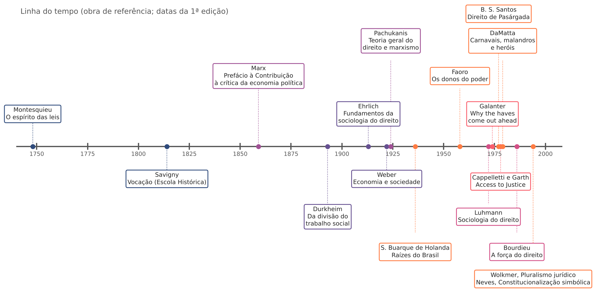
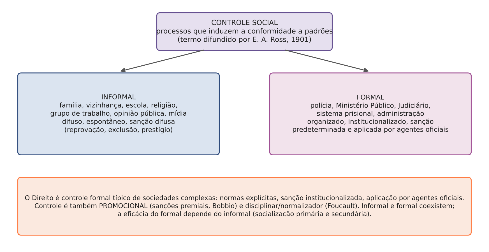
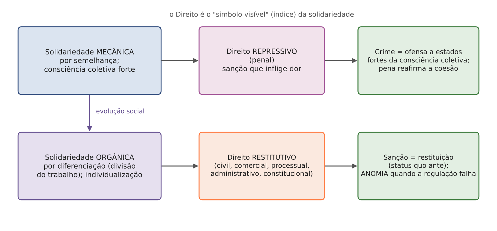
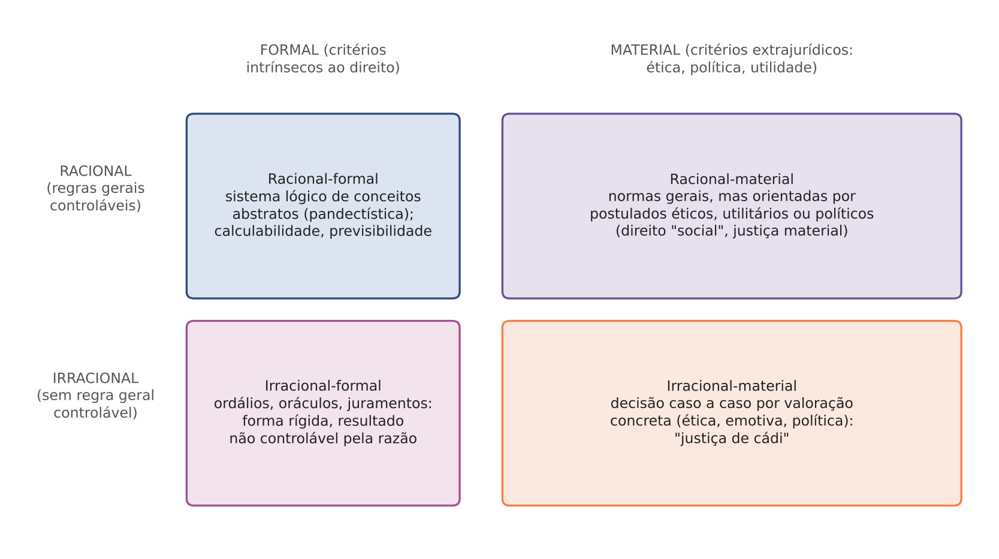
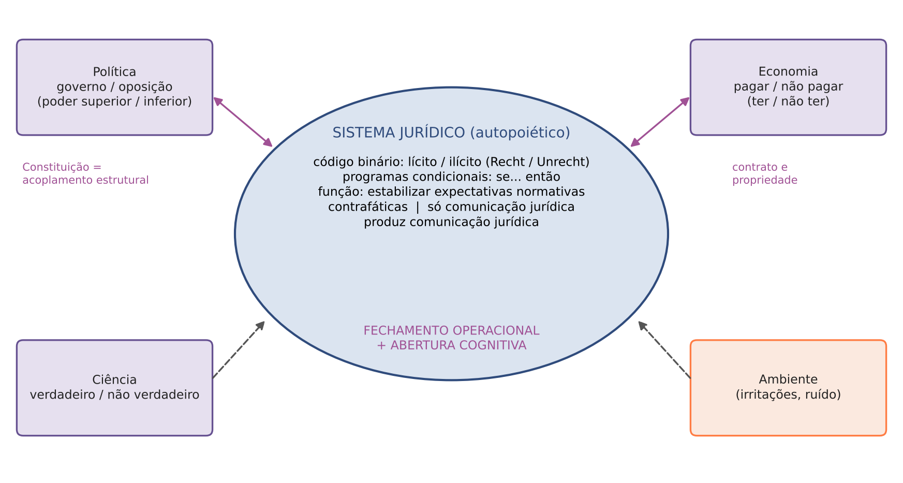
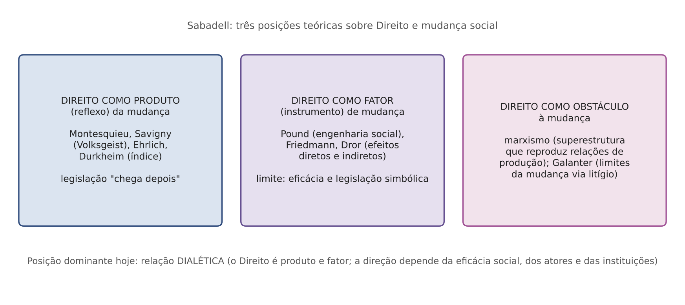
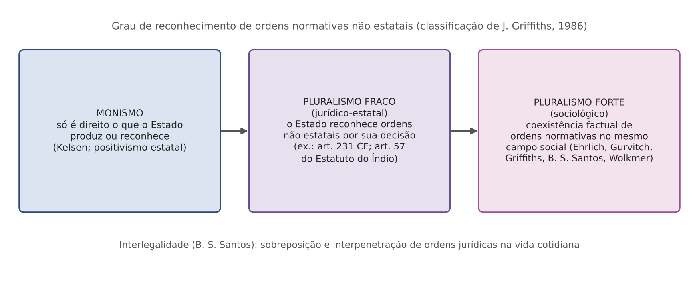
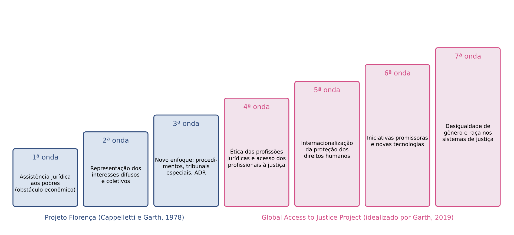

# CAPÍTULO 01 — SOCIOLOGIA DO DIREITO: FENÔMENO SOCIAL, CONTROLE, MUDANÇA, PLURALISMO E ACESSO À JUSTIÇA

:::INCIDENCIA
TRF5 p. A.1, A.2; TJRS p. A.2; TJSC p. B.2. Nível A+. Lote: 12 questões (FGV 9, FCC 3), mais 3 correlatas de outros capítulos (2 do ENAM).
O que mais cai: atribuição correta de conceitos aos clássicos (fato social e anomia em Durkheim; ação social em Weber; base e superestrutura em Marx), controle social formal x informal (a FGV inverte as definições), ondas de Cappelletti e Garth, pensamento social brasileiro (homem cordial) e criminalização como processo social.
:::

| Subtema | FGV | FCC | Padrão de cobrança |
|---|---|---|---|
| Objeto e método da Sociologia do Direito; controle social | 2 (Q3058632, Q4314538) | 0 | troca de definições (zetética x dogmática; formal x informal); atribuição de conceito a autor errado |
| Clássicos (Durkheim, socialização, anomia) | 2 (Q3816761, Q3816747) | 0 | caso concreto para aplicar o conceito com precisão |
| Poder, disciplina e criminalização (Foucault, criminologia crítica) | 1 (Q3870071) | 1 (Q4037486) | literalidade de obra (A verdade e as formas jurídicas); criminalização x criminalidade |
| Cultura, mídia e dominação simbólica | 2 (Q3660539, Q2459948) | 0 | Escola de Frankfurt; concepção hierárquica de cultura |
| Pensamento social brasileiro | 1 (Q4314516) | 0 | homem cordial não é homem pacífico |
| Pluralismo, governança e ordens não estatais | 0 | 1 (Q3531655) | governança como autoridade partilhada, não *top-down* |
| Acesso à justiça | 1 (Q2367601) | 1 (Q3531651) | ordem e conteúdo das ondas; acesso como "método de pensamento" |

## 01.1 A Sociologia do Direito: objeto, método e posição entre os saberes jurídicos

### 01.1.1 Objeto: o Direito como fato, não como norma a aplicar

A Sociologia do Direito estuda o Direito do ponto de vista do ser: as condições sociais de produção das normas, sua efetiva observância, os efeitos que produzem, os atores que as manejam e as instituições que as aplicam. A Dogmática pergunta o que o Direito determina; a Sociologia pergunta por que determina isso, quem o mobiliza, quem dele se beneficia e se a determinação se realiza. A distinção é de PERSPECTIVA, não de objeto material: o mesmo art. 226 do CPP é, para o processualista, regra de procedimento; para o sociólogo, prática institucional cuja observância e cujos efeitos seletivos se medem empiricamente (ver Cap. 9).

A Resolução CNJ 75/2009 incluiu a disciplina na formação humanística com duplo enfoque: o clássico (relações sociais e jurídicas, controle social, transformação social) e o da administração judiciária (Caps. 2 e 3). Este capítulo cuida do primeiro.

Três pares conceituais organizam a disciplina e são o terreno preferido das pegadinhas:

| Par | Polo A | Polo B | Uso na Sociologia do Direito |
|---|---|---|---|
| Ser x dever ser | descrição causal (Sociologia) | imputação normativa (Dogmática; Kelsen) | a Sociologia não diz se a norma é válida, mas se é eficaz e por quê |
| Zetética x dogmática (Tercio Sampaio Ferraz Jr.) | enfoque de PERGUNTAS: problematiza as premissas, inclusive as próprias normas | enfoque de RESPOSTAS: parte de pontos de partida inegáveis (as normas postas) para decidir | a Sociologia do Direito é saber zetético empírico |
| Ponto de vista externo x interno (Hart) | observador que registra regularidades | participante que aceita a regra como padrão de crítica | o sociólogo adota o externo moderado: descreve inclusive a aceitação interna (ver Cap. 18) |

Validade, vigência e eficácia são desenvolvidas no Cap. 18. Aqui basta fixar que a eficácia social (efetividade) é o conceito-ponte: só uma investigação sobre a realidade diz se a norma "pegou". Fenômenos como a inefetividade de normas constitucionais programáticas e a mutação constitucional (alteração do sentido sem alteração do texto, frequentemente induzida por mudança da realidade) são lidos pela Sociologia como sintomas da relação entre texto e prática social (o regime constitucional está na Apostila de Direito Constitucional, Cap. 5).

:::QUESTAO FGV 2024 — ENAM — Exame Nacional da Magistratura 2024.2 (Q3058632)
Cobrado: interação entre Sociologia e Direito, a partir de texto de Kümpel sobre relações sociais como objeto comum. Gabarito oficial: E — a Sociologia aplicada ao Direito permite compreender com maior amplitude a função reguladora das normas, tendo a coerção como instrumento para manter os indivíduos submetidos à ordem, sob pena da intermediação dos aparelhos judiciários.
Armadilhas, uma por alternativa: (A) INVERTE zetética e dogmática (é a zetética que problematiza as normas; a dogmática toma a solução como dada no sistema); (B) INVERTE controle formal e informal (usos, costumes e opinião pública são informais; leis, polícia e sistema de justiça são formais); (C) as lutas por novos direitos e pela igualdade material afastaram a Sociologia Jurídica do normativismo, não a orientaram para ele; (D) fato social, coerção externa e consciência coletiva são de Durkheim, não de Weber (cujo objeto é a ação social).
Fundamento: 01.1.1, 01.3 e 01.4.
:::

### 01.1.2 Método: explicar e compreender

Duas matrizes metodológicas convivem desde a fundação da disciplina, e a FGV as cobra pela via das "matrizes teóricas" das ciências sociais:

| Matriz | Autor de referência | Fenômeno social é... | Método |
|---|---|---|---|
| Positivismo clássico | Comte; Durkheim | fato objetivo, exterior, sujeito a regularidades | observação sistemática; tratar os fatos sociais "como coisas"; explicação causal e funcional |
| Materialismo histórico-dialético | Marx | expressão de contradições de classe historicamente situadas | análise das relações de produção e de suas contradições |
| Sociologia compreensiva | Weber | ação dotada de sentido subjetivo visado pelo agente | compreensão (*Verstehen*) e explicação causal; tipos ideais; neutralidade axiológica |
| Genealogia e análise do discurso | Foucault | efeito de relações de poder e de saber | arqueologia dos saberes; genealogia do poder |
| Culturalismo/historicismo | Escola Histórica; antropologia cultural | manifestação singular dos valores de um povo | interpretação de contextos culturais |

:::QUESTAO FGV 2026 — HU Brasil — Residência Multiprofissional (Q4314538)
Cobrado: o que é o fenômeno social para o positivismo clássico. Gabarito oficial: A — fatos objetivos, sujeitos a regularidades e passíveis de observação sistemática.
Armadilha: as demais alternativas descrevem, uma a uma, as outras matrizes do quadro acima (conflito de classes = Marx; ação dotada de sentido = Weber; construções discursivas e relações de poder = Foucault; manifestações culturais singulares = culturalismo). A técnica de resolução é identificar a matriz pela palavra-chave.
:::

A neutralidade axiológica (*Wertfreiheit*) weberiana não significa que o cientista não tenha valores, e sim que a escolha do tema é orientada por valores (relação a valores), mas a análise deve separar constatação de fatos e juízos de valor. Bourdieu e as teorias críticas contestam essa separação; Boaventura de Sousa Santos defende uma ciência social comprometida com os excluídos. Na prova oral, a resposta madura é: o juiz que se vale de dados sociológicos deve distinguir a evidência empírica (por exemplo, estatística de reincidência ou de seletividade) da valoração jurídica que dela extrai, e explicitar ambas na motivação.

### 01.1.3 Sociologia do Direito e Sociologia Jurídica; nascimento da disciplina

Parte da doutrina distingue a Sociologia do Direito (feita por sociólogos, com o Direito como objeto, perspectiva externa) da Sociologia Jurídica (feita por juristas, a serviço da compreensão e do aperfeiçoamento do Direito). As bancas usam os termos como sinônimos; não vale gastar tempo com a distinção em prova objetiva.

A Sociologia nasce da crise de integração provocada pela dupla revolução (francesa e industrial): urbanização, novas classes, secularização. Comte dá o nome à disciplina; Marx, Durkheim e Weber fixam seus paradigmas. A Sociologia do Direito ganha autonomia no início do século XX, com Ehrlich (1913), Weber (escritos reunidos em Economia e sociedade, 1922) e a jurisprudência sociológica norte-americana de Roscoe Pound. Precursores são Montesquieu (as leis como "relações necessárias que derivam da natureza das coisas", variando conforme clima, religião, comércio e costumes, em O espírito das leis, 1748) e a Escola Histórica de Savigny, para a qual o Direito brota do espírito do povo (*Volksgeist*), como a linguagem, e não do arbítrio do legislador.

## 01.2 O Direito como fenômeno social; relações sociais e relações jurídicas

### 01.2.1 *Ubi societas, ibi ius* e a socialidade do Direito

A máxima *ubi societas, ibi ius* (onde há sociedade, há Direito) e sua recíproca (*ubi ius, ibi societas*) exprimem a tese de que o Direito é produto e condição da vida social: não existe fora de relações entre pessoas e não há sociedade duradoura sem alguma ordem normativa. A Sociologia acrescenta duas qualificações: (i) o Direito é UMA das ordens normativas (ao lado da moral, da religião, dos usos e da etiqueta), diferenciada historicamente de uma "nebulosa" costumeira originária (a imagem é de Miguel Reale, cobrada no ENAM: ver correlata Q3058634, desenvolvida no Cap. 22); (ii) o Direito estatal não esgota o fenômeno jurídico (pluralismo, 01.6).

### 01.2.2 Relação social (Weber) e relação jurídica

Para Weber, relação social é a conduta de vários agentes que, pelo sentido que encerra, se apresenta como reciprocamente referida e orientada por essa reciprocidade. Seu conteúdo pode ser conflito, amizade, troca, piedade; o que a define é a probabilidade de que se aja socialmente de modo indicável pelo sentido. Quando a relação é orientada por uma ordem cuja vigência é garantida pela probabilidade de coação por um quadro de pessoas especialmente incumbido (o *Rechtsstab*), a ordem é jurídica (ver 01.4.4).

A relação jurídica é, nessa perspectiva, relação social qualificada por norma jurídica: o Direito seleciona, entre as inúmeras relações sociais, aquelas que considera relevantes e lhes atribui efeitos (direitos, deveres, poderes, sujeições). Savigny definiu a relação jurídica como relação de pessoa a pessoa determinada por uma regra jurídica; Reale fala em relação social que o Direito "converte" em jurídica ao lhe dar estrutura normativa. A estrutura dogmática (sujeitos, objeto, fato propulsor, vínculo) é do Cap. 21.

O que a Sociologia acrescenta à Dogmática:

- A relação jurídica não cria a relação social; QUALIFICA-A. Há relações sociais intensas juridicamente irrelevantes (amizade) e relações jurídicas socialmente vazias (normas que não pegam).
- A qualificação é SELETIVA: o que o Direito juridiciza e o que deixa fora (por exemplo, o trabalho doméstico não remunerado, por séculos) revela relações de poder (perspectiva de gênero: Cap. 28).
- A juridicização de relações antes regidas por outras ordens (família, escola, vizinhança) é fenômeno sociológico próprio: juridificação (Habermas fala em colonização do mundo da vida pelos sistemas) e, no polo judicial, judicialização das relações sociais (Werneck Vianna, ver 01.7 e Cap. 25).
- A institucionalização do conflito: a relação jurídica permite transformar o conflito social (difuso, total, emocional) em conflito jurídico (delimitado por pedido e causa de pedir, entre partes determinadas, resolvido por terceiro segundo regras). Luhmann chama isso de isolamento do conflito pelo procedimento (01.4.6); Bourdieu, de conversão do conflito direto entre interessados em debate regulado entre profissionais (01.4.7). O preço é a redução: o processo decide a lide, não necessariamente o conflito sociológico subjacente (por isso a ênfase em métodos consensuais e restaurativos, Caps. 5 e 8).

### 01.2.3 Grupos sociais e instituições

| Conceito | Ideia central | Autor e obra |
|---|---|---|
| Comunidade x sociedade (*Gemeinschaft* x *Gesellschaft*) | comunidade: vínculos orgânicos, afetivos, de vontade natural (família, aldeia); sociedade: vínculos contratuais, impessoais, de vontade racional (mercado, grande cidade) | Ferdinand Tönnies, Comunidade e sociedade (1887) |
| Grupo primário x secundário | primário: contato face a face, íntimo (família, vizinhança); secundário: relações impessoais e funcionais | Charles H. Cooley (grupo primário) |
| Instituição | conjunto estável de normas, papéis e práticas que organiza uma esfera da vida social (família, propriedade, contrato, Judiciário) | Hauriou (teoria da instituição, no Direito Público); Santi Romano (instituição = ordenamento, 01.6) |
| Institucionalização | tipificação recíproca de ações habituais por tipos de atores; a instituição se objetiva e passa a ser experimentada como realidade externa, legitimada e transmitida | Peter Berger e Thomas Luckmann, A construção social da realidade (1966) |
| Socialização | primária (família, infância) e secundária (escola, trabalho, instituições); interiorização de normas que torna a maior parte do controle social desnecessária | Durkheim (educação como socialização metódica da geração jovem); Berger e Luckmann |
| Estratificação | divisão hierárquica da sociedade em camadas | Marx (classes pela posição no modo de produção); Weber (classe, estamento e partido) — ver 01.8.1 |

A tese sociológica relevante para o juiz é a de Berger e Luckmann: as instituições são produtos humanos que, uma vez objetivados, aparecem como dados naturais. Daí a tarefa crítica de "desnaturalizar" arranjos institucionais (por exemplo, a divisão sexual do trabalho pressuposta em regras de guarda e alimentos), que os Protocolos de julgamento com perspectiva de gênero e racial incorporam (Cap. 28).

:::QUESTAO FGV 2025 — SEDUC-MT — Professor de Sociologia (Q3816761)
Cobrado: texto sobre o ensino domiciliar (*homeschooling*), que critica argumentar apenas com a liberdade individual dos pais, e pergunta que análise sociológica o debate exige. Gabarito oficial: E — valorizar a escola como espaço público de socialização, encontro de diferenças e construção da convivência democrática.
Armadilha: as alternativas A a D reproduzem o argumento individual-privatista que o próprio texto declara insuficiente. A chave é a função socializadora da escola (socialização secundária; em Durkheim, a educação como socialização metódica da geração jovem pelos adultos).
Para o juiz: a questão dialoga com o julgamento em repercussão geral no qual o STF afastou a existência de direito público subjetivo ao ensino domiciliar enquanto não houver lei que o regule (STF, RE n. 888.815, Tema 822, Relator para o acórdão Ministro Alexandre de Moraes, Plenário, j. 12/9/2018).
:::

## 01.3 Controle social formal e informal

### 01.3.1 Conceito e espécies

Controle social é o conjunto de processos e mecanismos pelos quais a sociedade induz seus membros a se conformarem aos padrões de conduta dominantes e reage aos desvios. O termo foi difundido pelo sociólogo norte-americano Edward A. Ross (Social Control, 1901). Em Durkheim, o controle decorre da coerção exterior do fato social e da consciência coletiva; em Parsons, da interiorização de valores na socialização e das sanções que reequilibram o sistema.

| Critério | Controle informal | Controle formal |
|---|---|---|
| Agentes | família, vizinhança, escola, igreja, grupo de trabalho, opinião pública, mídia | agências estatais: polícia, Ministério Público, Judiciário, administração penitenciária, órgãos de fiscalização |
| Organização | difuso, espontâneo, móvel | organizado, institucionalizado, mediato |
| Sanção | reprovação, ridículo, exclusão, perda de prestígio (ou recompensa social) | sanção predeterminada em norma explícita, aplicada por agentes oficiais segundo procedimento |
| Sede típica | moral, usos, religião | Direito |
| Sociedades | presente em todas; predominante nas pouco diferenciadas | característico das sociedades complexas, nas quais coexiste com o informal |

Três ressalvas que valem ponto:

- Não é verdade que o controle informal desapareça nas sociedades complexas: ele permanece e, em regra, é o MAIS eficaz; o formal intervém subsidiariamente e depende do informal para ser eficaz (a norma interiorizada dispensa a polícia). Por isso a criminologia fala do Direito Penal como controle social de *ultima ratio*.
- O Direito como controle formal tem três notas (Sabadell): normas explícitas, protegidas por sanções e interpretadas e aplicadas por agentes oficiais.
- O controle não é só repressivo. Bobbio (Da estrutura à função) mostrou a função PROMOCIONAL do Direito no Estado contemporâneo, com sanções positivas (premiais) que incentivam condutas desejadas (incentivos fiscais, redução de pena por colaboração, selos e prêmios). O tema estrutural da sanção está no Cap. 21.

:::PEGADINHA Formal x informal
A FGV, no ENAM 2024.2 (Q3058632, 01.1.1), definiu o controle formal como o "decorrente dos usos, costumes, tradição, opinião pública" e o informal como o que "decorre das leis, das polícias e do sistema de justiça". Está INVERTIDO. Memorize pelo agente: se o agente é estatal e a sanção é predeterminada, é formal.
:::

### 01.3.2 Disciplina, vigilância e verdade: Foucault

Michel Foucault não é sociólogo do Direito em sentido estrito, mas suas teses sobre poder são cobradas em Sociologia e Filosofia.

- Vigiar e punir (1975): passagem do suplício (poder soberano que se exibe no corpo do condenado) à prisão e às disciplinas. O poder disciplinar é microfísico (capilar, presente em escolas, fábricas, quartéis, hospitais, prisões), produz corpos "dóceis e úteis", opera por vigilância hierárquica, sanção normalizadora e exame. O panóptico de Bentham é a figura da sociedade disciplinar: quem se sabe visível interioriza a vigilância. A prisão "fracassa" na ressocialização, mas tem êxito em produzir a delinquência como ilegalidade gerível e separada das demais.
- A norma (normalização) não se confunde com a lei: a disciplina classifica em normal e anormal, e o saber (psiquiatria, criminologia, pedagogia) é parte do poder (poder-saber).
- Biopoder e biopolítica: poder que gere a vida das populações (natalidade, saúde, higiene). Deleuze, depois, falará em "sociedade de controle" (modulação contínua, dados, redes), tema retomado nos Caps. 29 e 30.
- A verdade e as formas jurídicas (conferências na PUC-Rio, 1973): as práticas judiciárias são matrizes de formas de verdade. Foucault contrapõe a prova (*épreuve*) do antigo Direito Germânico ao inquérito, que nasce na Baixa Idade Média com a figura do procurador do soberano, a noção de infração (ofensa ao soberano, e não apenas dano à vítima) e o "confisco" do conflito pelo poder central.

:::QUESTAO FCC 2026 — DPE-BA — Defensor Público (Q4037486)
Cobrado: as condições, segundo Foucault em A verdade e as formas jurídicas, para haver ação penal no antigo Direito Germânico. Gabarito oficial: D — (I) dois personagens, nunca três (não há acusador público nem terceiro representando a sociedade: só vítima e ofensor); (II) a liquidação judiciária é uma espécie de CONTINUAÇÃO da luta entre os indivíduos (guerra ritualizada, regulamentada); (III) ao longo das vinganças recíprocas e rituais, a possibilidade de chegar a uma TRANSAÇÃO (acordo, resgate da paz mediante pagamento).
Armadilha: as alternativas combinam "três personagens", "interrupção da luta" e "divergência/desacordo". Basta lembrar que o sistema germânico não conhece o terceiro (Estado), trata o litígio como luta continuada e admite composição pecuniária. É o contrário do inquérito, em que surge o terceiro (procurador) e o conflito é confiscado.
Conexão útil: a ideia do confisco do conflito pelo Estado reaparece em Nils Christie (conflitos como propriedade das partes) e fundamenta a justiça restaurativa (Cap. 5).
:::

### 01.3.3 Criminalização como processo social

A criminologia do *labelling approach* (rotulação ou reação social) deslocou a pergunta "por que alguém delinque?" para "por que e como certas condutas e certas pessoas são definidas como criminosas?". Para Howard Becker (Outsiders, 1963), o desvio não é qualidade do ato, mas consequência da aplicação, por outros, de regras e sanções a um "transgressor"; Edwin Lemert distingue desvio primário e secundário (o rótulo produz a identidade desviante). A criminologia crítica (Alessandro Baratta, Criminologia crítica e crítica do direito penal) incorpora o recorte de classe: o sistema penal seleciona desigualmente bens protegidos e pessoas criminalizadas. Zaffaroni distingue criminalização primária (legislativa) e secundária (agências que aplicam a lei a pessoas concretas), esta altamente seletiva.

:::QUESTAO FGV 2026 — TJ-RJ — Analista Judiciário — Psicólogo (Q3870071)
Cobrado: leitura do sistema prisional brasileiro a partir da colonização, da escravidão e do racismo estrutural. Gabarito oficial: C — a criminalização, e não a criminalidade em si, deve ser compreendida como processo social e histórico, com o crime definido socialmente conforme o momento histórico, e não como fenômeno natural regido por causas biológicas ou individuais.
Armadilhas: (A) eficácia da prisão; (E) periculosidade como patologia do criminoso e defesa social (positivismo criminológico, exatamente o que a questão critica); (B) e (D) misturam boas intenções com hierarquia invertida (deixar para "um segundo momento" a análise crítica institucional).
Fundamento: 01.3.3; racismo estrutural no Cap. 28; seletividade penal e reconhecimento de pessoas no Cap. 9.
:::

### 01.3.4 Mídia, indústria cultural e controle

Os meios de comunicação são agência de controle informal de enorme alcance: definem agendas, rotulam desviantes, produzem pânicos morais. A Escola de Frankfurt (Horkheimer e Adorno, Dialética do esclarecimento, 1947) cunhou a expressão indústria cultural para designar a conversão da cultura em mercadoria e a subordinação da consciência à racionalidade capitalista; Marcuse (O homem unidimensional, 1964) descreveu a integração das necessidades individuais à lógica do consumo. A relação entre Judiciário, mídia e opinião pública é do Cap. 4.

:::QUESTAO FGV 2025 — AgSUS — Analista de Gestão — Comunicação Social (Q3660539)
Cobrado: lacunas de texto de Rüdiger sobre indústria cultural. Gabarito oficial: D — Marcuse; mercadoria; capitalista; consumo; publicidade; mídia; publicidade.
Armadilha: autores próximos mas de outra linhagem (Benjamin, cuja reflexão é sobre a reprodutibilidade técnica da obra de arte; Habermas, da segunda geração de Frankfurt; Castells e Lévy, teóricos da sociedade em rede e da cibercultura). A chave é a tríade conceitual mercadoria, racionalidade capitalista e consumo.
:::

## 01.4 Os clássicos da Sociologia do Direito

### 01.4.1 Precursores: Montesquieu e Comte

Montesquieu (O espírito das leis, 1748) é precursor por relacionar as leis a fatores físicos e sociais (clima, solo, população, religião, comércio, costumes), recusando a ideia de um Direito idêntico para todos os povos; sua teoria da separação de poderes pertence à Ciência Política (Cap. 25). Auguste Comte (Curso de filosofia positiva, 1830–1842) cunhou o termo "sociologia" (antes "física social"), formulou a lei dos três estados (teológico, metafísico, positivo) e concebeu a sociedade como totalidade real a ser estudada pelos métodos das ciências naturais (estática e dinâmica sociais; lema "ordem e progresso"). Comte desconfiava do Direito e dos "direitos" como noções metafísicas; o positivismo sociológico não se confunde com o positivismo jurídico (Cap. 18).

### 01.4.2 Karl Marx (1818–1883): o Direito como superestrutura

Tese central: no Prefácio à Contribuição à crítica da economia política (1859), Marx afirma que, na produção social de sua vida, os homens contraem relações de produção determinadas, que correspondem a uma etapa das forças produtivas; o conjunto dessas relações forma a estrutura econômica (base, infraestrutura), sobre a qual se ergue a superestrutura jurídica e política e à qual correspondem formas de consciência social. "Não é a consciência dos homens que determina o seu ser, mas, ao contrário, é o seu ser social que determina a sua consciência." Quando as forças produtivas entram em contradição com as relações de produção (que se tornam entraves), abre-se uma época de revolução social.

Consequências para o Direito:

- O Direito é superestrutural e ideológico: exprime e reproduz as relações de produção dominantes, apresentando como universais interesses de classe. No Manifesto Comunista (1848, com Engels), o executivo do Estado moderno é "um comitê para gerir os negócios comuns de toda a burguesia".
- Crítica dos direitos do homem (Sobre a questão judaica, 1843): os direitos do homem da Revolução Francesa seriam direitos do homem egoísta, separado da comunidade; a emancipação política (cidadania formal) não é emancipação humana.
- Ilusão da igualdade: na Crítica do Programa de Gotha (1875), o "direito igual" aplicado a pessoas desiguais é, por seu conteúdo, direito da desigualdade; a fórmula da sociedade comunista será "de cada um segundo suas capacidades, a cada um segundo suas necessidades".
- Determinação "em última instância": Engels (carta a Joseph Bloch, 1890) corrigiu leituras mecanicistas: a economia é determinante em última instância, mas os elementos superestruturais (inclusive o Direito) reagem sobre a base. Daí a autonomia relativa do Direito na tradição marxista posterior.

Desenvolvimentos que a banca pode cobrar:

| Autor | Contribuição |
|---|---|
| Evguiéni Pachukanis, Teoria geral do direito e marxismo (1924) | a forma jurídica deriva da forma mercadoria: o sujeito de direito é o portador abstrato de mercadorias que troca equivalentes; o Direito é essencialmente burguês e se extinguirá com a troca mercantil |
| Antonio Gramsci | hegemonia: dominação por consenso, além da coerção; o Direito também educa e produz conformismo |
| Louis Althusser, Ideologia e aparelhos ideológicos de Estado (1970) | aparelhos repressivos (governo, administração, exército, polícia, tribunais, prisões: funcionam predominantemente pela violência) x aparelhos ideológicos (escola, igreja, família, mídia, o jurídico: funcionam predominantemente pela ideologia) |
| E. P. Thompson, Senhores e caçadores (1975) | crítica interna: o *rule of law* não é mera máscara; impõe limites reais aos poderosos e é arena de luta; um "bem humano incondicional" |

Estratificação em Marx: critério QUALITATIVO (posição no modo de produção: proprietários dos meios de produção x proletariado). Ideologia como conceito é do Cap. 26.

### 01.4.3 Émile Durkheim (1858–1917): fato social, solidariedade e anomia

Obras: Da divisão do trabalho social (1893), As regras do método sociológico (1895), O suicídio (1897), As formas elementares da vida religiosa (1912), Educação e sociologia (póstuma).

Fato social: maneira de agir, pensar e sentir EXTERIOR ao indivíduo e dotada de poder de COERÇÃO, GERAL na extensão de uma sociedade, com existência própria independente de suas manifestações individuais. Regra de método: tratar os fatos sociais como coisas (objetivamente, afastando prenoções). O fato social se distingue em normal e patológico conforme sua generalidade na espécie social: o crime é NORMAL (existe em toda sociedade) e até útil (reafirma a consciência coletiva e pode antecipar a moral futura); patológica é sua taxa anormal.

Consciência coletiva: conjunto de crenças e sentimentos comuns à média dos membros de uma sociedade, que forma um sistema com vida própria.

Solidariedade e Direito: o Direito é o "símbolo visível" da solidariedade social, seu índice externo e mensurável; por isso Durkheim classifica as solidariedades pelos tipos de sanção jurídica.

| | Solidariedade mecânica | Solidariedade orgânica |
|---|---|---|
| Base | semelhança; consciência coletiva forte e extensa | diferenciação funcional (divisão do trabalho); individualização |
| Sociedades | segmentárias, pouco diferenciadas | complexas, modernas |
| Direito predominante | repressivo (penal): sanção que inflige sofrimento ao agente | restitutivo (civil, comercial, processual, administrativo, constitucional): sanção que restabelece o estado anterior |
| Crime | ofensa a estados fortes e definidos da consciência coletiva; a pena é reação passional que reafirma a coesão | — |

PEGADINHA frequente em material de cursinho: exemplificar solidariedade orgânica com "órgãos" como INSS ou Defensoria. A orgânica vem da analogia com o organismo (órgãos diferentes e interdependentes), não da existência de órgãos públicos.

Anomia: estado de desregramento em que as normas perdem força reguladora sobre os indivíduos. Em A divisão do trabalho social, a divisão do trabalho anômica é forma patológica em que as funções se diferenciam sem regulação adequada (crises industriais, conflito capital-trabalho). Em O suicídio, o suicídio anômico cresce em fases de desregulação, inclusive de prosperidade súbita, quando os desejos perdem limite (ao lado do egoísta, do altruísta e do fatalista).

Robert K. Merton (Estrutura social e anomia, 1938) reformulou o conceito: anomia é a tensão entre metas culturalmente prescritas (sucesso econômico) e meios institucionalizados desigualmente distribuídos; daí cinco modos de adaptação individual: conformidade, inovação (aceita metas, rejeita meios: base de explicação de crimes patrimoniais), ritualismo, retraimento e rebelião.

:::QUESTAO FGV 2025 — SEDUC-MT — Professor de Sociologia (Q3816747)
Cobrado: professor afirma que o feminicídio é anomia; aluno objeta que decorre da persistência de estrutura patriarcal. Como corrigir? Gabarito oficial: C — esclarecer que a anomia, em Durkheim, é ausência ou enfraquecimento das normas sociais, o que não caracteriza o feminicídio, que decorre da MANUTENÇÃO de normas patriarcais constitutivas da sociedade.
Armadilha: (A) e (B) insistem no erro conceitual (desajuste, falta de punição); (D) e (E) abdicam de esclarecer o conceito. A distinção a fixar: anomia = déficit de regulação; violência de gênero estrutural = excesso de regulação por normas sociais desiguais (patriarcado, Cap. 28).
:::

:::DICA Durkheim no ENAM
A FGV costuma atribuir a Weber o vocabulário de Durkheim (fato social, coerção externa, consciência coletiva) e vice-versa (ação social, sentido, compreensão). Antes de ler as alternativas, associe: Durkheim = fato, coisa, coerção, consciência coletiva, solidariedade, anomia; Weber = ação, sentido, compreensão, tipo ideal, dominação, racionalização; Marx = classe, modo de produção, base e superestrutura, ideologia.
:::

### 01.4.4 Max Weber (1864–1920): ação social, ordem legítima e racionalização do Direito

Obras: A ética protestante e o espírito do capitalismo (1904–1905), A política como vocação (1919), Economia e sociedade (póstuma, 1922), que contém a Sociologia do Direito e a Sociologia da Dominação.

Ação social: conduta humana à qual o agente associa um sentido subjetivo e que, por esse sentido, se orienta pela conduta de outros. A Sociologia é a ciência que pretende COMPREENDER interpretativamente a ação social e assim EXPLICÁ-LA causalmente em seu curso e efeitos. Instrumento metodológico: o tipo ideal, construção conceitual que acentua unilateralmente traços da realidade para servir de padrão de comparação (não é média estatística nem modelo desejável).

| Tipo de ação social | Orientação | Exemplo |
|---|---|---|
| Racional com relação a fins | cálculo de meios adequados a fins, ponderando consequências | empresário que contrata com base em análise de custos |
| Racional com relação a valores | crença consciente no valor próprio da conduta (ético, religioso, estético), independentemente do resultado | objetor de consciência |
| Afetiva | estados emocionais atuais | reação de cólera |
| Tradicional | hábito arraigado | costume familiar seguido "porque sempre foi assim" |

Ordem legítima e conceito sociológico de Direito: uma ordem é convenção quando sua vigência é garantida externamente pela probabilidade de reprovação geral no grupo; é Direito quando garantida externamente pela probabilidade de coação (física ou psíquica) exercida por um quadro de pessoas especialmente incumbido de obter a observância ou punir a violação. O critério sociológico é a existência desse aparato coativo, não a origem estatal: Weber admite Direito extraestatal (de uma Igreja, de uma associação), o que o aproxima do pluralismo.

Weber distingue ainda a validade jurídica no sentido dogmático (o sentido normativo "correto" de uma proposição, objeto do jurista) e a validade empírica (a probabilidade de que os agentes orientem efetivamente sua conduta pela ordem, objeto do sociólogo).

Tipos de Direito segundo a racionalidade da criação e da aplicação:

- Racionalidade formal: decisão por critérios intrínsecos ao sistema jurídico, por subsunção a conceitos abstratos (máximo na pandectística alemã). Garante calculabilidade, condição do capitalismo moderno.
- Racionalidade material: decisão por critérios extrajurídicos gerais (imperativos éticos, utilitários, políticos). Weber percebia, já no início do século XX, a tendência à "materialização" do Direito por demandas sociais, com perda de previsibilidade.
- Irracionalidade formal: meios não controláveis pelo intelecto (ordálios, oráculos), mas com forma rígida.
- Irracionalidade material: decisão caso a caso por valoração concreta sem regra geral ("justiça de cádi").
- O "problema da Inglaterra": capitalismo desenvolvido com um *common law* menos racional-formal que o Direito continental; Weber o explica pela organização corporativa dos advogados e pelos interesses da clientela.

Dominação legítima (probabilidade de encontrar obediência a uma ordem): tradicional (crença na santidade das tradições), carismática (devoção a qualidades extraordinárias de uma pessoa) e racional-legal (crença na legalidade de ordens estatuídas e no direito de mando dos nomeados por essas ordens; seu tipo mais puro é a burocracia: competência fixa, hierarquia, documentos, qualificação profissional, impessoalidade). Para Weber, o Estado é a comunidade humana que, num território, reivindica com êxito o monopólio da violência física legítima. Desenvolvimento de dominação, legitimidade e éticas da convicção e da responsabilidade: Cap. 25 (correlata Q2458598 lá comentada).

Estratificação em Weber: tridimensional (classe = situação de mercado; estamento = honra e estilo de vida; partido = poder), por isso o critério é dito QUANTITATIVO ou multidimensional (renda, educação, profissão, prestígio), em oposição ao qualitativo de Marx (Sabadell).

Racionalização e desencantamento do mundo: a modernidade é processo de racionalização (formal) de todas as esferas; o preço é a "jaula de ferro" da burocracia e a perda de sentido. A burocratização da Justiça (metas, produtividade, gestão) é lida por essa chave nos Caps. 2 e 3.

### 01.4.5 Eugen Ehrlich (1862–1922): o direito vivo

Ehrlich, professor em Czernowitz (Bucovina, região multiétnica do Império Austro-Húngaro), publicou Fundamentos da sociologia do direito (*Grundlegung der Soziologie des Rechts*, 1913), considerado marco fundador da disciplina. Seu prefácio condensa a tese: o centro de gravidade do desenvolvimento do Direito, em nossa época como em todas, não está na legislação, nem na ciência jurídica, nem na jurisprudência, mas na própria sociedade.

Conceitos-chave:

- Direito vivo (*lebendes Recht*): o Direito que domina a vida social, ainda que não fixado em proposições jurídicas; conhece-se pela observação direta da vida e por documentos (contratos, testamentos, estatutos, usos comerciais), não pelos códigos.
- Associações (*Verbände*): família, comunidade, empresa, corporação; produzem ordens internas que regulam a maior parte da conduta, independentemente do Estado.
- Normas de decisão (*Entscheidungsnormen*): normas dirigidas aos tribunais para decidir litígios; são uma parcela pequena do Direito. O Direito estatal (proposições jurídicas) é apenas uma camada, e nem sempre a mais relevante.
- Afinidade com o movimento do Direito livre (*Freirechtsbewegung*), que valorizava a criação judicial diante das lacunas.

Debate com Kelsen: Kelsen criticou a obra (1915) por confundir ser e dever ser e por não oferecer critério para distinguir o jurídico do não jurídico; Ehrlich respondeu, e a polêmica se tornou o paradigma do contraste entre a Teoria Pura (normativismo) e a Sociologia do Direito.

:::PEGADINHA Ehrlich não nega o Direito estatal
Ehrlich não afirma que só existe direito social; afirma que o Direito estatal é parte menor e derivada do fenômeno jurídico, e que o jurista deve conhecer o direito vivo. É autor-matriz do pluralismo jurídico sociológico (01.6).
:::

### 01.4.6 Niklas Luhmann (1927–1998): o Direito como sistema autopoiético

Obras: Legitimação pelo procedimento (1969), Sociologia do direito (*Rechtssoziologie*, 1972), O direito da sociedade (*Das Recht der Gesellschaft*, 1993).

Teoria dos sistemas: a sociedade moderna é funcionalmente diferenciada em sistemas parciais (direito, política, economia, ciência, religião, arte), cada qual operando com código binário próprio. Os sistemas sociais são feitos de COMUNICAÇÕES, não de pessoas (estas pertencem ao ambiente). Luhmann importou de Maturana e Varela o conceito de autopoiese: o sistema produz seus próprios elementos a partir de seus próprios elementos.

- Função do Direito: estabilizar expectativas NORMATIVAS, isto é, expectativas mantidas de modo contrafático mesmo quando frustradas (diferentemente das cognitivas, que se adaptam à decepção: quem é surpreendido pela realidade aprende; quem tem expectativa normativa frustrada mantém a expectativa e reage contra quem a violou). Em Sociologia do direito, Luhmann fala em generalização congruente de expectativas nas dimensões temporal, social e material.
- Redução de complexidade e dupla contingência: diante do excesso de possibilidades e da imprevisibilidade recíproca dos agentes, o Direito seleciona e estabiliza.
- Código binário: lícito/ilícito (*Recht/Unrecht*). Os programas (leis, contratos, precedentes) dizem como atribuir os valores do código; são condicionais (se... então).
- Fechamento operacional e abertura cognitiva: só comunicações jurídicas produzem comunicações jurídicas (a política não decide o que é lícito); mas o sistema é cognitivamente aberto, recebendo "irritações" do ambiente, que ele mesmo processa segundo seu código.
- Acoplamentos estruturais: a Constituição acopla Direito e política; contrato e propriedade acoplam Direito e economia.
- Legitimação pelo procedimento: a legitimidade das decisões não depende de consenso sobre seu conteúdo, mas da disposição generalizada de aceitá-las, produzida por procedimentos (eleitoral, legislativo, judicial) que envolvem os participantes em papéis, absorvem decepções, isolam e especificam o conflito, de modo que o vencido não consiga mobilizar apoio social para contestar. O processo judicial é a forma mais nítida desse mecanismo.

Desdobramentos:

- Gunther Teubner: Direito reflexivo e pluralismo global; em "Bukowina global" (1996), o título homenageia Ehrlich para sustentar que a *lex mercatoria* e ordens transnacionais privadas são o novo direito vivo da sociedade mundial.
- Marcelo Neves (A constitucionalização simbólica, 1994; Entre Têmis e Leviatã): na modernidade periférica, a autopoiese do Direito é bloqueada por injunções diretas da economia, da política e das relações pessoais (alopoiese); a Constituição pode ter função mais simbólica (álibi, confirmação de valores, compromisso dilatório) que normativa, e o resultado é a combinação de "sobrecidadãos" (sobreintegrados, que usam o Direito quando lhes convém) e "subcidadãos" (subintegrados, que sofrem as sanções sem acesso aos direitos). Ver legislação simbólica em 01.5.
- Habermas critica Luhmann por reduzir legitimidade a aceitação fática: em Facticidade e validade (1992), o Direito moderno é legítimo quando produzido em procedimentos discursivos que garantem a cooriginariedade entre autonomia privada e pública (Caps. 18 e 25).

:::ATENCAO Código e programa
Código binário e programa não se confundem. O código (lícito/ilícito) é invariante; a contingência está nos programas, que mudam (lei nova, virada jurisprudencial). Pergunta clássica de prova oral: "o juiz pode decidir com base em considerações econômicas?". Na chave luhmanniana: pode considerar consequências como informação do ambiente (abertura cognitiva), mas a decisão só é jurídica se reconduzida ao código e aos programas do sistema (o que dialoga com o art. 20 da LINDB: Caps. 24 e 35).
:::

### 01.4.7 Pierre Bourdieu (1930–2002): campo jurídico e poder simbólico

Texto de referência: A força do direito: elementos para uma sociologia do campo jurídico (1986), incluído na coletânea O poder simbólico.

- Campo: espaço social relativamente autônomo de posições em disputa por um capital específico, com regras próprias; o campo jurídico é o lugar de concorrência pelo monopólio do direito de dizer o direito, isto é, de fixar a boa distribuição ou a boa ordem.
- Habitus: sistema de disposições duráveis, socialmente adquiridas, que gera práticas e percepções ajustadas a uma posição (o "senso do jogo" do jurista).
- Capitais: econômico, cultural, social e simbólico (prestígio, reconhecimento).
- Poder e violência simbólicos: poder de impor significações como legítimas, dissimulando as relações de força; só se exerce com a cumplicidade dos que a ele se submetem sem reconhecê-lo como tal (em A reprodução, com Passeron, 1970, aplicado à escola).
- Efeitos da linguagem jurídica: neutralização (construções impessoais, passivas, que apresentam a decisão como expressão de uma vontade transcendente) e universalização (uso de normas gerais, referência a valores universais); o resultado é o efeito de apriorização e a eficácia simbólica do Direito.
- Divisão do trabalho jurídico: tensão entre teóricos (doutrina) e práticos (juízes e advogados), que concorrem e cooperam na produção do sentido das normas.
- Fronteira entre profanos e profissionais: a constituição do campo converte o conflito direto entre interessados em debate juridicamente regulado entre profissionais, que falam por procuração; quem não domina o código (o profano) é desapossado do próprio conflito.
- Homologia: a proximidade de origem e de habitus entre os produtores do Direito e os grupos dominantes torna as decisões tendencialmente compatíveis com os interesses destes, sem que haja conspiração.

Cultura legítima: em A distinção (1979), Bourdieu mostra que o gosto é socialmente construído e serve à distinção de classe; as classes dominantes impõem sua cultura como "a" cultura legítima, desvalorizando as práticas populares.

:::QUESTAO FGV 2024 — Câmara de Fortaleza — Consultor Legislativo (Q2459948)
Cobrado: a afirmação corrente de que "funk não é cultura", apesar do reconhecimento estatal da manifestação. Gabarito oficial: C — concepção HIERÁRQUICA de cultura, na qual algumas formas são mais legítimas do que outras.
Armadilha: (A) descreve a concepção antropológica inclusiva (justamente a negada pela afirmação); (D) confunde hierarquia com utilitarismo; (E) inverte o objeto. Fundamento teórico: cultura legítima e distinção em Bourdieu.
:::

### 01.4.8 Quadro comparativo dos clássicos

| Autor | Pergunta central | Conceitos-chave | O Direito é... | Armadilha típica |
|---|---|---|---|---|
| Marx | como as relações de produção estruturam a sociedade? | base/superestrutura, classe, ideologia, mais-valia | superestrutura que reproduz a dominação de classe (com autonomia relativa) | atribuir-lhe "ação social" ou "consciência coletiva" |
| Durkheim | o que mantém a coesão social? | fato social, consciência coletiva, solidariedade mecânica/orgânica, anomia | índice visível da solidariedade (repressivo x restitutivo) | chamar anomia a toda violência; trocar repressivo e restitutivo |
| Weber | como a ação dotada de sentido produz ordens e dominação? | ação social, tipo ideal, dominação, burocracia, racionalização | ordem garantida por quadro coativo; tipos racional/irracional, formal/material | atribuir-lhe fato social; confundir dominação racional-legal com carismática |
| Ehrlich | onde está o Direito que efetivamente rege a vida? | direito vivo, associações, normas de decisão | sobretudo ordem interna das associações sociais | dizer que nega o Direito estatal |
| Luhmann | como o Direito se reproduz numa sociedade complexa? | autopoiese, código lícito/ilícito, expectativas normativas, legitimação pelo procedimento | sistema funcional operacionalmente fechado e cognitivamente aberto | dizer que o sistema é "fechado" a informações do ambiente |
| Bourdieu | como o Direito produz e dissimula dominação? | campo, habitus, capital, poder simbólico | campo de lutas pelo monopólio de dizer o direito | tratar a autonomia do campo como absoluta |

:::PRATIQUE Exercícios elaborados para esta apostila (não são questões de banca)
1. Certo ou errado: para Luhmann, a legitimação pelo procedimento pressupõe que as partes concordem com o conteúdo da decisão. Resolução: ERRADO. O procedimento produz aceitação generalizada independentemente de consenso sobre o conteúdo; absorve decepções e isola o conflito.
2. Certo ou errado: para Weber, só é Direito a ordem garantida por coação estatal. Resolução: ERRADO. O critério é a existência de um quadro de pessoas incumbido da coação; pode haver Direito extraestatal (Igreja, associação).
3. Certo ou errado: para Durkheim, a predominância do direito restitutivo indica sociedade de solidariedade orgânica. Resolução: CERTO. O direito restitutivo (civil, comercial, processual, administrativo) cresce com a divisão do trabalho; o repressivo caracteriza a solidariedade mecânica.
:::

## 01.5 Direito e mudança social

### 01.5.1 As três posições teóricas

A pergunta "o Direito transforma a sociedade ou apenas a reflete?" recebe três respostas clássicas, sistematizadas por Ana Lucia Sabadell (Manual de sociologia jurídica):

| Posição | Tese | Autores | Crítica |
|---|---|---|---|
| Direito como PRODUTO (reflexo) | o Direito acompanha, com atraso, as transformações sociais; é a sociedade que muda o Direito | Montesquieu; Savigny e a Escola Histórica (Direito nasce do *Volksgeist*, como a língua; daí sua oposição à codificação alemã em Da vocação de nosso tempo para a legislação e a jurisprudência, 1814); Ehrlich; Durkheim (Direito como índice da solidariedade) | não explica reformas legislativas que anteciparam a mudança de costumes |
| Direito como FATOR (instrumento) | o Direito pode induzir mudança: engenharia social | Roscoe Pound (*social engineering*); Wolfgang Friedmann (Law in a changing society, 1959); Yehezkel Dror (Law and social change, 1959: efeitos diretos e, sobretudo, indiretos, quando o Direito cria instituições que depois mudam a sociedade) | eficácia limitada quando a norma colide com valores enraizados; risco de legislação simbólica |
| Direito como OBSTÁCULO | o Direito conserva as relações de dominação e bloqueia a transformação | tradição marxista (superestrutura que reproduz as relações de produção) | ignora conquistas obtidas por meio do Direito e das lutas jurídicas (Thompson) |

A posição hoje dominante é DIALÉTICA: o Direito é ao mesmo tempo produto e fator, e sua capacidade transformadora depende de condições sociológicas aferíveis. Dror e a literatura posterior apontam, entre elas: autoridade e prestígio da fonte; compatibilidade com princípios já aceitos; existência de modelos de referência; uso do tempo (transição gradual); agentes de implementação comprometidos; sanções positivas e negativas; proteção efetiva dos beneficiários. Galanter (01.8.3) acrescenta: reformas que alteram apenas regras, sem alterar a organização das partes e os serviços jurídicos, tendem a ser absorvidas pelos litigantes habituais.

Exemplos brasileiros que a banca pode explorar:

- Direito que ACOMPANHOU a mudança: a Lei do Divórcio (1977) após décadas de separações de fato e uniões informais; o reconhecimento das uniões estáveis homoafetivas pelo STF (STF, ADI n. 4.277, Relator Ministro Ayres Britto, Plenário, j. 5/5/2011), seguido da Resolução CNJ 175/2013 (14/5/2013), que vedou às autoridades competentes a recusa de habilitação, de celebração de casamento civil ou de conversão de união estável em casamento entre pessoas do mesmo sexo.
- Direito que PRETENDEU INDUZIR a mudança: o Estatuto da Mulher Casada (1962), o ECA (1990) ao substituir a doutrina da situação irregular pela proteção integral, a Lei Maria da Penha (2006), as ações afirmativas (Cap. 41) e os Protocolos de julgamento com perspectiva de gênero e racial (Cap. 28).
- Direito que FRACASSOU como fator: as normas que "não pegam", estudadas sob o rótulo de legislação simbólica.

### 01.5.2 Legislação simbólica e eficácia

Marcelo Neves, a partir de Harald Kindermann, identifica três funções da legislação simbólica, isto é, da produção de textos cuja referência à realidade é sobretudo político-ideológica, sem pretensão séria de eficácia normativa:

| Tipo | Função | Exemplo típico |
|---|---|---|
| Confirmação de valores sociais | o legislador toma partido em conflito de valores, sinalizando qual grupo "vence", ainda que a norma seja pouco aplicada | criminalizações morais de baixa aplicação |
| Legislação-álibi | dar a aparência de que o Estado reage a um problema, aliviando a pressão política sem enfrentá-lo | aumento de penas após crime de grande repercussão |
| Fórmula de compromisso dilatório | adiar a solução de conflito por meio de texto ambíguo, aceito por todos porque não decide nada | normas programáticas sem prazo nem meios |

A constitucionalização simbólica é a hipertrofia dessa função no plano constitucional: o texto constitucional serve à retórica política, enquanto a realidade constitucional o desmente (ver 01.4.6). A consequência para o juiz é a exigência de atenção à efetividade: a Sociologia mostra que proclamar direitos não basta; importam instituições, recursos e mobilização (ver acesso à justiça, 01.8).

### 01.5.3 Os tribunais como arena da mudança

A transformação social pela via judicial (litígio estratégico, ações coletivas, processos estruturais) é tema de duas literaturas: a da judicialização da política e ativismo (Cap. 25) e a dos litígios estruturais e do estado de coisas inconstitucional (Cap. 5). Na perspectiva sociológica, três advertências: (i) Galanter: quem litiga repetidamente "joga pelas regras" e molda a jurisprudência a seu favor; (ii) a decisão judicial isolada tem eficácia social limitada sem implementação administrativa (daí as técnicas de monitoramento e diálogo institucional); (iii) a mobilização social em torno de um caso costuma ser mais transformadora que a decisão em si (efeitos indiretos de Dror).

:::EXEMPLO Mudança social e motivação da decisão
Situação: em ação de alimentos, a ré sustenta que a autora, divorciada há oito anos e com 45 anos de idade, "sempre se dedicou ao lar por opção" e deve buscar trabalho imediatamente. Como o dado sociológico entra na decisão?
Solução: (1) a dedicação exclusiva ao lar não é mera "opção" individual, mas resultado de arranjo social de divisão sexual do trabalho, frequentemente pactuado no casamento (desnaturalização, 01.2.3); (2) a reinserção no mercado depende de condições concretas (qualificação, idade, cuidado de filhos), que devem ser provadas e não presumidas; (3) o Direito acompanhou essa mudança ao admitir alimentos transitórios entre ex-cônjuges, por prazo suficiente à reinserção (regime no Cap. de alimentos da Apostila de Direito Civil). A Sociologia não decide o caso; ela evita que o estereótipo substitua a prova (Protocolo com perspectiva de gênero, Cap. 28).
:::

## 01.6 Instituições, grupos sociais e pluralismo jurídico

### 01.6.1 Monismo x pluralismo

O monismo jurídico identifica Direito e Estado: só é jurídico o que o Estado produz ou reconhece. Consolidou-se com o Estado moderno, que centralizou a produção normativa contra os particularismos feudais, eclesiásticos e corporativos, e atingiu sua formulação mais rigorosa em Kelsen (identidade entre Estado e ordem jurídica). O pluralismo jurídico sustenta a coexistência, no mesmo espaço social, de mais de uma ordem jurídica, estatal e não estatal.

Matrizes teóricas do pluralismo:

| Autor | Contribuição |
|---|---|
| Ehrlich (1913) | direito vivo das associações (01.4.5) |
| Santi Romano, O ordenamento jurídico (1918) | teoria institucionalista: todo ente social organizado (instituição) é um ordenamento jurídico; há tantos ordenamentos quantas instituições, inclusive ilícitas para o Estado; a relação entre eles é de relevância ou irrelevância recíproca |
| Georges Gurvitch | direito social: direito de integração produzido espontaneamente pelos grupos, distinto do direito individual de coordenação e do direito de subordinação |
| Bronisław Malinowski, Crime e costume na sociedade selvagem (1926) | nas sociedades sem Estado (ilhas Trobriand), há Direito, fundado na reciprocidade e em obrigações mútuas, e não apenas em sanção centralizada |
| John Griffiths, What is legal pluralism? (1986) | distingue pluralismo FRACO (jurídico ou estatal: o Estado reconhece ordens diversas, como o direito costumeiro em ex-colônias) e FORTE (sociológico: coexistência factual de ordens no mesmo campo social, independentemente de reconhecimento estatal) |
| Sally Falk Moore (1973) | campo social semiautônomo: grupo que produz regras internas, mas é permeável a regras externas |
| Boaventura de Sousa Santos | direito de Pasárgada; interlegalidade (01.6.2) |
| Antonio Carlos Wolkmer, Pluralismo jurídico: fundamentos de uma nova cultura no direito (1994) | pluralismo comunitário-participativo: novos sujeitos coletivos (movimentos sociais) como fontes de produção jurídica, com legitimidade fundada na satisfação de necessidades humanas fundamentais; contraposto ao pluralismo conservador do mercado global |
| Teubner (1996) | pluralismo global: ordens transnacionais privadas (01.4.6) |

:::QUESTAO FCC 2025 — DPE-AM — Defensor Público (Q3531655)
Cobrado: o conceito de governança na leitura de Orlando Villas Bôas Filho sobre André-Jean Arnaud (Direito, globalização e governança). Gabarito oficial: C — governança exprime forma de gestão de questões públicas e privadas não emanada da ordem governamental ou de decisões de um ente soberano, por se basear em autoridade PARTILHADA.
Armadilhas: (A) equipara governança a "governamentalidade" (conceito foucaultiano distinto) e a reduz à eficiência de uma autoridade; (B) "lógica *top-down*" (é o oposto: governança é horizontal, reticular, negociada); (D) e (E) a confinam ao mundo corporativo.
Conexão: governança é categoria da sociologia jurídica da globalização (Arnaud): a regulação passa a ser produzida também por atores não estatais (organismos internacionais, empresas, ONGs), em linha com o pluralismo. A governança do Poder Judiciário (Resoluções do CNJ) é do Cap. 3.
:::

### 01.6.2 Boaventura de Sousa Santos: o direito de Pasárgada

Pesquisa de campo realizada no início dos anos 1970 numa favela do Rio de Janeiro, à qual deu o nome fictício de Pasárgada (tese de doutorado na Universidade Yale; artigo The law of the oppressed, 1977; depois O discurso e o poder: ensaio sobre a sociologia da retórica jurídica). Achados:

- A associação de moradores funcionava como instância de prevenção e resolução de conflitos (sobretudo sobre habitações e terrenos, cuja ocupação era ilegal para o direito oficial), registrando negócios e mediando litígios.
- O direito de Pasárgada era um direito paralelo e não oficial, que tomava emprestados símbolos e formas do direito estatal (carimbos, documentos, termos jurídicos), mas operava com baixa institucionalização, retórica ampla (argumentação por *topoi* e senso comum, com pouca linguagem técnica) e reduzido poder de coerção.
- A relação entre as ordens não é de pura oposição: há adaptação seletiva, e o Estado pode tolerar ou reprimir a ordem paralela conforme a conveniência política.
- Conceito posterior: interlegalidade, a sobreposição, articulação e interpenetração de vários espaços jurídicos misturados na vida das pessoas, que transitam entre eles (doméstico, da produção, do mercado, da comunidade, da cidadania, mundial).
- Em obras posteriores (Para uma revolução democrática da justiça, 2007), Boaventura propõe a "ecologia de saberes" e a "sociologia das ausências", com crítica ao monopólio do saber jurídico técnico e defesa da articulação entre justiça oficial e justiças comunitárias.

No Brasil, a linhagem crítica inclui Roberto Lyra Filho (O que é direito, 1982; a Nova Escola Jurídica Brasileira, que concebe o Direito como processo de libertação e não como norma estatal) e o projeto O Direito Achado na Rua (UnB, coordenado por José Geraldo de Sousa Júnior), que reconhece os movimentos sociais como produtores de juridicidade.

### 01.6.3 Pluralismo no Direito brasileiro positivo

O Estado brasileiro é formalmente monista, mas admite pluralismo FRACO por reconhecimento: art. 231 da CF (reconhecimento aos indígenas de sua organização social, costumes, línguas, crenças e tradições); Convenção 169 da OIT, promulgada e hoje consolidada no Decreto 10.088/2019 (art. 8º: consideração dos costumes e do direito consuetudinário dos povos interessados, que podem conservar costumes e instituições próprias não incompatíveis com os direitos fundamentais e os direitos humanos; art. 9º: respeito aos métodos tradicionais de repressão dos delitos cometidos pelos seus membros, na medida em que compatíveis com o sistema jurídico nacional e com os direitos humanos, e dever de autoridades e tribunais de levar em conta os costumes desses povos em questões penais); art. 57 do Estatuto do Índio.

Do art. 57 do Estatuto do Índio (transcrito, com o art. 56 e a Resolução CNJ 287/2019, no Cap. 42), a literalidade cobrável é: a aplicação de sanções pelos grupos "será tolerada" (não "reconhecida"), "contra os seus membros" (não contra não indígenas), com duplo limite (nem caráter cruel nem infamante; vedada sempre a pena de morte). Texto conferido no Planalto em 12/11/2026.

:::JURIS TJRR, Apelação Criminal n. 0090.10.000302-0, Relator Desembargador Mauro Campello, Câmara Única, j. 18/12/2015
Caso Denilson (Comarca de Bonfim, Terra Indígena Manoá-Pium): homicídio praticado por indígena contra outro indígena foi julgado e punido pela própria comunidade, segundo seus usos. O juízo de primeiro grau declarou a ausência do direito de punir do Estado; o TJRR manteve o resultado, com fundamento no *non bis in idem*, invocando o art. 231 da CF, o art. 9º da Convenção 169 da OIT e o art. 57 do Estatuto do Índio.
Por que importa: é o precedente brasileiro mais citado de pluralismo jurídico "por reconhecimento" em matéria penal. Seu alcance é limitado (conflito intracomunitário, sanção compatível com direitos humanos) e não é jurisprudência de tribunal superior. Dados conferidos em fonte secundária (ConJur).
:::

No mesmo sentido, aplicando o pluralismo FRACO por reconhecimento a comunidade quilombola: FCC 2026, DPE-MA, Q4012563 (gabarito C: a Constituição não instituiu Estado plurinacional, mas admite leitura intercultural limitada pelos direitos fundamentais), comentada no Cap. 42 (42.4.1).

:::SENTENCA Consideração de solução comunitária (pluralismo por reconhecimento)
"Consta dos autos, por laudo antropológico e por ata da assembleia comunitária, que o fato foi apreciado pela comunidade segundo seus usos e que lhe foi aplicada sanção de natureza disciplinar, sem caráter cruel ou infamante. O art. 231 da Constituição reconhece a organização social e os costumes indígenas; o art. 9º da Convenção 169 da OIT determina o respeito aos métodos tradicionais de repressão de delitos compatíveis com o sistema jurídico nacional e os direitos humanos; e o art. 57 da Lei 6.001/1973 tolera a aplicação de sanções pelas instituições próprias do grupo contra seus membros. Verificada a compatibilidade da sanção com os direitos fundamentais, inclusive da vítima e de seus familiares, a resposta estatal deve considerar a solução comunitária, sob pena de dupla punição pelo mesmo fato."
Advertência: o modelo pressupõe prova antropológica idônea e conflito intracomunitário; as diretrizes procedimentais (laudo, intérprete, consulta) estão na Resolução CNJ 287/2019 (Cap. 42).
:::

## 01.7 Autores brasileiros: o pensamento social e o Direito

### 01.7.1 Intérpretes do Brasil

| Autor e obra | Tese central | Conceitos cobráveis |
|---|---|---|
| Gilberto Freyre, Casa-grande & senzala (1933) | formação patriarcal da sociedade brasileira a partir da família rural escravocrata; ênfase na miscigenação e no "equilíbrio de antagonismos" | família patriarcal; a leitura da convivência racial como harmoniosa alimentou o mito da democracia racial (expressão difundida posteriormente) |
| Sérgio Buarque de Holanda, Raízes do Brasil (1936) | herança ibérica: personalismo, aversão ao trabalho metódico, primado das relações afetivas sobre as impessoais | homem cordial; patrimonialismo x burocracia; ladrilhador (espanhol) x semeador (português) |
| Victor Nunes Leal, Coronelismo, enxada e voto (1949) | o coronelismo como compromisso entre o poder público fortalecido e o poder privado decadente dos chefes locais, sustentado pela estrutura agrária | voto de cabresto; troca de proveitos |
| Raymundo Faoro, Os donos do poder (1958) | o Estado brasileiro, herdeiro do Estado português, é capturado por um estamento burocrático que se apropria do público | estamento burocrático; patrimonialismo (categoria weberiana) |
| Florestan Fernandes, A integração do negro na sociedade de classes (1964) | a abolição sem integração deixou a população negra à margem da sociedade de classes; crítica do mito da democracia racial | preconceito de cor como herança da ordem escravocrata |
| Roberto DaMatta, Carnavais, malandros e heróis (1979); A casa e a rua (1985) | sociedade relacional: convivem o universo impessoal da lei (indivíduo) e o pessoal das relações (pessoa) | "Você sabe com quem está falando?"; "aos amigos tudo, aos inimigos a lei"; casa x rua; jeitinho |
| José Murilo de Carvalho, Cidadania no Brasil: o longo caminho (2001) | inversão da sequência de T. H. Marshall: no Brasil, direitos sociais vieram antes (Vargas), os políticos de forma intermitente e os civis por último, fragilmente | "estadania" (cidadania concedida pelo Estado) |
| Jessé Souza (A ralé brasileira, 2009; A tolice da inteligência brasileira, 2015) | crítica ao "culturalismo" que explica o atraso pelo patrimonialismo e pelo homem cordial; ênfase na desigualdade de classe e na herança escravista | "ralé" estrutural; crítica a Faoro e Buarque |

O homem cordial, em Buarque, NÃO é o homem bondoso ou pacífico. "Cordial" vem de *cor, cordis* (coração): designa a conduta guiada pela emoção e pela intimidade, avessa às formas impessoais e ritualizadas da civilidade. O próprio autor advertiu que a cordialidade não se confunde com boas maneiras e que a inimizade também pode ser cordial. Seus traços: predomínio dos vínculos afetivos e pessoais sobre as normas impessoais; dificuldade de separar o privado do público (o funcionário "patrimonial" trata o cargo como assunto pessoal); recusa de distâncias hierárquicas formais (uso do diminutivo, do prenome).

:::QUESTAO FGV 2026 — HU Brasil — Residência Multiprofissional (Q4314516)
Cobrado: o que é expressão típica da cordialidade em Sérgio Buarque de Holanda. Gabarito oficial: C — I e III (predomínio dos vínculos afetivos e pessoais sobre normas impessoais; dificuldade de distinguir interesses privados das responsabilidades públicas).
Armadilha: o item II (inclinação à convivência pacífica e harmoniosa, capaz de atenuar conflitos entre grupos) traduz o sentido coloquial de "cordial", que o autor expressamente recusa. Quem marca "I, II e III" cai na armadilha.
:::

:::DICA Uso forense
DaMatta e Buarque ajudam a nomear, em prova oral, fenômenos que o Código de Ética da Magistratura enfrenta: pedidos de "favor" a partir de relações pessoais, a "carteirada", o tratamento desigual conforme a posição social da parte. A imparcialidade e a impessoalidade são, sociologicamente, respostas institucionais ao personalismo (desenvolvimento ético nos Caps. 11 e 12).
:::

### 01.7.2 Sociologia do Direito no Brasil

- A. L. Machado Neto: sistematização pioneira da Sociologia Jurídica no país, em diálogo com o culturalismo e a egologia.
- Roberto Lyra Filho e O Direito Achado na Rua (01.6.2).
- Joaquim Falcão: estudos empíricos sobre conflitos de propriedade em invasões urbanas e sobre o ensino jurídico e o Judiciário.
- Luiz Werneck Vianna e outros, A judicialização da política e das relações sociais no Brasil (1999): o Judiciário como arena de demandas sociais após 1988 (Cap. 25).
- Maria Tereza Sadek: pesquisas empíricas sobre magistratura, Ministério Público e acesso à justiça.
- Kazuo Watanabe: acesso à justiça como acesso à ordem jurídica justa (01.8.4); idealizador dos Juizados de Pequenas Causas e da política de tratamento adequado dos conflitos.
- Marcelo Neves: constitucionalização simbólica e alopoiese (01.4.6 e 01.5.2).
- Ana Lucia Sabadell: manual de referência das bancas para controle social, estratificação e mudança social.

## 01.8 Desigualdades e acesso à justiça

### 01.8.1 Estratificação, cidadania e desigualdade perante o Direito

A igualdade formal perante a lei convive com desigualdades materiais que afetam o modo como cada um aciona o Direito e é por ele tratado. Três chaves:

- Estratificação: fechada (castas, estamentos legalmente protegidos: mobilidade praticamente impossível) x aberta (sociedades de classes: mobilidade social possível). Critério qualitativo (Marx) x quantitativo ou multidimensional (Weber), como visto em 01.4.2 e 01.4.4.
- Cidadania em T. H. Marshall (Cidadania, classe social e status, 1950): sequência inglesa de direitos civis (século XVIII), políticos (XIX) e sociais (XX); a cidadania é status de igualdade que convive em tensão com a desigualdade de classe. A inversão brasileira está em José Murilo de Carvalho (01.7.1).
- Subintegração e sobreintegração (Marcelo Neves): parcela da população sofre os deveres e as sanções do Direito sem acesso efetivo a seus direitos; outra parcela usa o Direito seletivamente e bloqueia sua aplicação contra si.

### 01.8.2 Cappelletti e Garth: obstáculos e ondas renovatórias

O Projeto Florença (Florence Access-to-Justice Project), coordenado por Mauro Cappelletti com Bryant Garth, resultou no relatório geral Access to Justice: the worldwide movement to make rights effective (1978), traduzido no Brasil como Acesso à justiça (por Ellen Gracie Northfleet, 1988). O ponto de partida é que o acesso à justiça é o mais básico dos direitos, porque condiciona a efetividade de todos os outros; e que sua definição deve ser medida pela igualdade de armas entre as partes, um ideal utópico que só pode ser aproximado.

Obstáculos identificados no relatório:

| Obstáculo | Conteúdo |
|---|---|
| Custas judiciais | custos em geral (honorários, sobretudo onde vigora a sucumbência); peso desproporcional nas pequenas causas; o TEMPO, que eleva custos e pressiona os economicamente fracos a abandonar ou aceitar acordos ruins |
| Possibilidades das partes | recursos financeiros; aptidão para reconhecer um direito e propor ação (informação, distância psicológica dos tribunais); litigantes eventuais x habituais (com remissão a Galanter) |
| Problemas especiais dos interesses difusos | ninguém tem direito a corrigir a lesão a interesse coletivo, ou o prêmio para qualquer indivíduo é pequeno demais para induzi-lo à ação |

Em textos posteriores, Cappelletti reagrupou os obstáculos em econômico, organizacional (tutela dos interesses difusos e coletivos) e processual (inadequação dos procedimentos tradicionais); é a classificação cobrada pela FCC na DPE-AM 2025 (Q3531652, desenvolvida na Apostila de Direito Constitucional, Cap. 10).

As três ondas do Projeto Florença:

| Onda | Obstáculo enfrentado | Soluções |
|---|---|---|
| 1ª: assistência judiciária aos pobres | econômico | sistemas *judicare* (advogados particulares pagos pelo Estado), advogados remunerados pelos cofres públicos (escritórios de vizinhança), modelos combinados |
| 2ª: representação dos interesses difusos | organizacional | ação governamental, técnica do "procurador-geral privado", "advogado particular do interesse público", reformas processuais (legitimação, coisa julgada) |
| 3ª: enfoque do acesso à justiça (novo enfoque) | processual | reforma dos procedimentos, tribunais especializados (pequenas causas, vizinhança), meios alternativos (arbitragem, conciliação), simplificação do Direito, mudança nos métodos de prestação de serviços jurídicos (paralegais) |

A terceira onda não abandona as anteriores: é o enfoque mais amplo que as engloba, concentrando a atenção no conjunto de instituições, mecanismos, pessoas e procedimentos usados para processar e prevenir disputas.

Ondas posteriores: o Global Access to Justice Project, idealizado por Bryant Garth (com coordenação que inclui pesquisadores brasileiros), acrescentou: 4ª, ética nas profissões jurídicas e acesso dos profissionais à justiça; 5ª, internacionalização da proteção dos direitos humanos; 6ª, iniciativas promissoras e novas tecnologias para aprimorar o acesso; 7ª, desigualdade de gênero e raça nos sistemas de justiça.

:::QUESTAO FGV 2024 — MPE-GO — Promotor de Justiça Substituto (Q2367601)
Cobrado: V ou F sobre as três ondas do Projeto Florença. Gabarito oficial: A (F, V, F). Só a segunda afirmativa (direitos metaindividuais) é verdadeira.
Armadilha: a FGV deslocou a desigualdade de gênero (que é a 7ª onda do Global Access to Justice Project) para a 1ª onda, e a assistência jurídica aos hipossuficientes (1ª onda) para a 3ª. Para responder, basta a ordem: pobres, coletivos, novo enfoque. Questão também comentada na Apostila de Processo Civil, Cap. 1.
:::

:::QUESTAO FCC 2025 — DPE-AM — Defensor Público (Q3531651)
Cobrado: o "método de pensamento" que confere à ciência jurídica nova dimensão conceitual referente ao acesso à justiça preocupa-se com quê? Gabarito oficial: D — a efetivação adequada dos direitos individuais e coletivos.
Fundamento: Cappelletti propôs o acesso à justiça não apenas como programa de reformas, mas como método de pensamento, que analisa o Direito pela perspectiva do destinatário (consumidor) da justiça, e não do produtor (legislador, juiz), perguntando se os direitos se tornam efetivos. Armadilhas: (A) aceleração da pacificação (eficiência não é efetividade); (B) e (C) declaração ou reconhecimento do direito (o método vai além da declaração); (E) ampliação da adjudicação (o enfoque valoriza também vias não adjudicatórias).
:::

### 01.8.3 Galanter: por que "quem tem" sai na frente

Marc Galanter (Why the "haves" come out ahead: speculations on the limits of legal change, 1974) distingue litigantes habituais (*repeat players*, RP) e eventuais (*one-shotters*, OS). Vantagens estruturais dos RP: conhecimento prévio e capacidade de estruturar a transação (redigem os contratos, guardam provas); especialização e economia de escala; relações informais com os agentes institucionais; credibilidade como negociadores; capacidade de diluir riscos entre muitos casos; possibilidade de "jogar pelas regras", isto é, litigar estrategicamente para obter precedentes favoráveis e fazer acordo nos casos que poderiam gerar precedente adverso, ao passo que o OS busca o resultado imediato.

Consequência: mudanças apenas nas regras substantivas têm alcance limitado; a redistribuição de vantagens exige mudanças na organização das partes (ações coletivas, associações), na oferta de serviços jurídicos (Defensoria) e nas instituições (Juizados, simplificação). No Brasil, a concentração de grande parte do acervo em poucos litigantes (bancos, operadoras de telefonia, o próprio Poder Público) é a versão empírica do diagnóstico.

### 01.8.4 Boaventura e a sociologia da administração da justiça; acesso à ordem jurídica justa

Em Introdução à sociologia da administração da justiça (1986), Boaventura de Sousa Santos sustenta que os obstáculos ao acesso são econômicos, sociais e culturais:

- Econômicos: a justiça é cara para todos, mas proporcionalmente mais cara para os economicamente débeis, que são também os mais frequentemente protagonistas de ações de pequeno valor; a lentidão agrava o custo. Há "dupla vitimização" das classes populares.
- Sociais e culturais: quanto mais baixo o estrato social, menor o conhecimento dos direitos, menor a capacidade de reconhecer um problema como jurídico, maior a desconfiança em relação a advogados e tribunais, maior o receio de represálias, maior a distância geográfica dos serviços.
- Em Para uma revolução democrática da justiça (2007): distinção entre procura efetiva (a que chega aos tribunais), procura potencial e procura SUPRIMIDA (a dos cidadãos que têm consciência de seus direitos mas desistem de reivindicá-los por se sentirem impotentes diante da justiça).

Kazuo Watanabe (Acesso à justiça e sociedade moderna, 1988) formulou a ideia de que acesso à justiça não é mero acesso aos órgãos judiciários, mas acesso à ORDEM JURÍDICA JUSTA, o que inclui informação, orientação, tratamento adequado dos conflitos (inclusive fora do processo) e remoção dos obstáculos; e cunhou a noção de litigiosidade contida (conflitos que não chegam a ser deduzidos e se resolvem pela renúncia ou pela violência), que fundamentou os Juizados de Pequenas Causas (Lei 7.244/1984) e, depois, a Lei 9.099/1995.

### 01.8.5 As ondas no Direito brasileiro e a política judiciária

| Onda | Concretização brasileira |
|---|---|
| 1ª | Lei 1.060/1950; CF, art. 5º, LXXIV (assistência jurídica integral e gratuita); Defensoria Pública (CF, art. 134; ADCT, art. 98, incluído pela EC 80/2014, que fixou prazo de oito anos para haver defensores em todas as unidades jurisdicionais); gratuidade no CPC, arts. 98 a 102 (Apostila de Processo Civil, Cap. 8) |
| 2ª | Lei da Ação Civil Pública (Lei 7.347/1985), CDC (1990), legitimação do Ministério Público, da Defensoria e de associações; processo coletivo e estrutural |
| 3ª | Juizados (CF, art. 98, I; Leis 9.099/1995, 10.259/2001 e 12.153/2009); justiça itinerante (CF, arts. 107, § 2º, 115, § 1º, e 125, § 7º, incluídos pela EC 45/2004); política de tratamento adequado dos conflitos (Resolução CNJ 125/2010; CPC, art. 3º; Lei 13.140/2015: Caps. 5 e 8) |
| 6ª | processo eletrônico, Juízo 100% Digital, Balcão Virtual (Cap. 29); Pontos de Inclusão Digital (Resolução CNJ 508/2023, alterada pela Resolução CNJ 555/2024), para mitigar a exclusão digital |
| 7ª | Protocolos de julgamento com perspectiva de gênero e racial, políticas de paridade e de equidade racial (Cap. 28); Política Nacional Judicial de Atenção a Pessoas em Situação de Rua e suas interseccionalidades (Resolução CNJ 425/2021, alterada pela Resolução CNJ 605/2024; a implementação é medida pelo IPopRuaJud, Portaria da Presidência do CNJ 176/2025, de 4/6/2025, cujo anexo foi refeito pela Portaria 88/2026, de 5/3/2026) |

A correlata Q4147605 (FGV 2026, TJ-SC, desenvolvida no Cap. 28) cobrou exatamente a letra dessas políticas: o atendimento a pessoas em situação de rua não pode ser condicionado a vestimenta ou higiene, e o programa "Transformação" (Resolução CNJ 497/2023) é política afirmativa para mulheres em situação de vulnerabilidade.

Acesso e excesso. O sistema brasileiro convive com o paradoxo identificado pela Sociologia: procura suprimida dos vulneráveis e hiperlitigância de grandes litigantes. A Recomendação CNJ 159/2024 define litigância abusiva como desvio ou manifesto excesso dos limites impostos pela finalidade social, jurídica, política ou econômica do direito de acesso ao Judiciário, inclusive no polo passivo (correlata Q4102418, ENAM 2026.1, Cap. 5; incentivos e demandas frívolas na AED, Cap. 36). O ponto sociológico é que o combate ao abuso não pode reproduzir barreiras às classes populares (Galanter, Boaventura): medidas de cautela devem ser fundamentadas, proporcionais e dirigidas a indícios concretos, preservando o litigante eventual vulnerável (o tratamento processual, inclusive o Tema 1.198 do STJ, está na Apostila de Processo Civil, Cap. 1).

:::EXEMPLO Atendimento a pessoa em situação de rua
Situação: o vigilante do fórum impede a entrada de homem em situação de rua, descalço e sem documento, que pretende pedir informações sobre processo em que é réu. A servidora consulta o juiz diretor do foro.
Solução: (1) a Política Nacional Judicial de Atenção a Pessoas em Situação de Rua (Resolução CNJ 425/2021) assegura acesso às dependências do Judiciário e atendimento prioritário e desburocratizado, sem condicionar o ingresso a vestimenta ou condições de higiene (a FGV cobrou essa vedação na Q4147605); a falta de identificação civil tampouco impede o acesso, e não se exige comprovante de residência de quem procura a Justiça (segundo a divulgação oficial da norma); (2) o juiz determina o ingresso e o atendimento, com orientação sobre a Defensoria Pública; (3) do ponto de vista sociológico, a barreira simbólica (Bourdieu) e a procura suprimida (Boaventura) explicam por que a regra existe: o primeiro contato define se o cidadão volta ou desiste.
:::

A FGV explorou exatamente essa leitura no ENAM 2025.2 (Q3692385: conflito pelo uso da água resolvido em centro comunitário de mediação; erram as alternativas que assumem monismo estrito), questão comentada no Cap. 5 (05.1.4).

## 01.9 Resumo para revisão pré-prova

| Conceito, autor ou instituto | Ideia ou regra | Detalhes e pegadinhas | Fonte |
|---|---|---|---|
| Sociologia do Direito | estudo do Direito como fato (ser): produção, eficácia, efeitos, atores | saber zetético; perspectiva externa | 01.1 |
| Zetética x dogmática | perguntas x respostas | ENAM inverteu as definições | Tercio Sampaio Ferraz Jr. |
| Matrizes teóricas | positivismo (fatos objetivos), Marx (conflito de classes), Weber (ação com sentido), Foucault (poder-saber) | identificar a matriz pela palavra-chave | 01.1.2 |
| Relação jurídica | relação social qualificada por norma | o Direito seleciona e não cria a relação social; institucionaliza o conflito | Weber; Savigny; Reale |
| Instituições | tipificação recíproca de ações habituais que se objetiva | desnaturalizar arranjos institucionais | Berger e Luckmann |
| Controle social | conformidade a padrões e reação ao desvio | termo difundido por E. A. Ross (1901) | 01.3 |
| Controle informal x formal | difuso, espontâneo (família, opinião pública) x organizado, estatal, sanção predeterminada | o informal é o mais eficaz e subsiste nas sociedades complexas | Sabadell |
| Função promocional | sanções premiais | Estado contemporâneo | Bobbio |
| Foucault | disciplina, panóptico, normalização, biopoder | Germânico: dois personagens, continuação da luta, transação; inquérito = confisco do conflito | Vigiar e punir; A verdade e as formas jurídicas |
| Criminalização | processo social e histórico | não confundir com criminalidade; primária x secundária | Becker; Baratta; Zaffaroni |
| Indústria cultural | cultura convertida em mercadoria | Horkheimer, Adorno, Marcuse | Escola de Frankfurt |
| Marx | base e superestrutura; Direito como ideologia | determinação em última instância (Engels); Pachukanis: forma jurídica = forma mercadoria | Prefácio de 1859 |
| Althusser | aparelhos repressivos x ideológicos | o "jurídico" aparece entre os ideológicos; tribunais e prisões entre os repressivos | 1970 |
| Durkheim | fato social: exterior, coercitivo, geral | tratar como coisas; crime é normal | Regras do método (1895) |
| Solidariedades | mecânica (semelhança) → direito repressivo; orgânica (divisão do trabalho) → restitutivo | orgânica não significa "órgãos públicos" | Divisão do trabalho (1893) |
| Anomia | enfraquecimento das normas reguladoras | feminicídio não é anomia; Merton: metas x meios, cinco adaptações | Durkheim; Merton (1938) |
| Weber | ação social (fins, valores, afetiva, tradicional); tipo ideal; neutralidade axiológica | Direito = ordem garantida por quadro coativo (pode ser extraestatal) | Economia e sociedade |
| Tipos de Direito | racional/irracional x formal/material | justiça de cádi = irracional-material; capitalismo pede racional-formal | Weber |
| Dominação | tradicional, carismática, racional-legal | burocracia como tipo puro da racional-legal | Weber (Cap. 25) |
| Ehrlich | direito vivo das associações; normas de decisão como parcela menor | não nega o Direito estatal; polêmica com Kelsen | Fundamentos (1913) |
| Luhmann | sistema autopoiético; código lícito/ilícito; programas condicionais | fechamento operacional + abertura cognitiva; expectativas normativas contrafáticas | Sociologia do direito (1972) |
| Legitimação pelo procedimento | aceitação sem consenso sobre o conteúdo | absorção de decepções, isolamento do conflito | Luhmann (1969) |
| Teubner; Neves | Bukowina global; constitucionalização simbólica, alopoiese, sub e sobreintegração | — | 1996; 1994 |
| Bourdieu | campo jurídico; habitus; poder simbólico | neutralização e universalização; profanos x profissionais; cultura legítima | A força do direito (1986) |
| Direito e mudança | produto (Savigny), fator (Pound, Friedmann, Dror), obstáculo (marxismo) | posição dominante: dialética | Sabadell |
| Legislação simbólica | confirmação de valores, álibi, compromisso dilatório | Kindermann, via Marcelo Neves | 01.5.2 |
| Pluralismo | coexistência de ordens jurídicas | fraco (reconhecimento estatal) x forte (sociológico): Griffiths | 01.6 |
| Santi Romano; Gurvitch; Wolkmer | instituição = ordenamento; direito social; pluralismo comunitário-participativo | — | 01.6.1 |
| Pasárgada | direito paralelo de favela; associação de moradores; retórica e baixa institucionalização | interlegalidade | Boaventura de Sousa Santos |
| Governança | autoridade partilhada, horizontal | não é *top-down* nem só corporativa | Arnaud; Villas Bôas Filho |
| Pluralismo no Brasil | art. 231 da CF; Conv. 169 da OIT, arts. 8º e 9º; Estatuto do Índio, art. 57 | "será tolerada"; nem cruel nem infamante; nunca pena de morte | caso Denilson (TJRR, 2015) |
| Homem cordial | primado do afetivo e pessoal; confusão público/privado | NÃO é pacífico ou bondoso | Raízes do Brasil (1936) |
| Faoro; DaMatta; J. M. de Carvalho | estamento burocrático; "sabe com quem está falando?"; inversão de Marshall | Jessé Souza critica o culturalismo | 01.7.1 |
| Galanter | *repeat players* x *one-shotters* | RP "jogam pelas regras" | 1974 |
| Cappelletti e Garth | obstáculos: custas (e tempo), possibilidades das partes, interesses difusos; depois econômico, organizacional, processual | ondas: pobres, coletivos, novo enfoque | Acesso à justiça (1978) |
| Ondas 4 a 7 | ética profissional; internacionalização dos DH; tecnologia; gênero e raça | gênero NÃO é a 1ª onda | Global Access to Justice Project |
| Acesso como método de pensamento | perspectiva do destinatário; efetivação adequada dos direitos | não é aceleração nem mera declaração | Cappelletti |
| Boaventura (justiça) | obstáculos econômicos, sociais e culturais; procura suprimida | dupla vitimização | 1986; 2007 |
| Watanabe | ordem jurídica justa; litigiosidade contida | origem dos Juizados | 1988 |
| Política judiciária de acesso | Res. CNJ 425/2021 (pessoas em situação de rua); 508/2023 (Pontos de Inclusão Digital); Rec. CNJ 159/2024 (litigância abusiva) | combate ao abuso sem barreira ao vulnerável | 01.8.5 |

## 01.10 Artigos de lei e atos normativos incidentes

- Constituição Federal: arts. 3º, I e III; 5º, XXXV e LXXIV; 98, I; 107, § 2º; 115, § 1º; 125, § 7º; 134; 231. ADCT, art. 98 (EC 80/2014).
- Lei 6.001/1973 (Estatuto do Índio): art. 57.
- Convenção 169 da OIT (Decreto 10.088/2019): arts. 8º e 9º.
- Lei 1.060/1950 (assistência judiciária); CPC, arts. 3º e 98 a 102 (remissão).
- Lei 7.347/1985 (ação civil pública); Lei 7.244/1984 (Juizados de Pequenas Causas, revogada); Lei 9.099/1995; Lei 10.259/2001; Lei 12.153/2009; Lei 13.140/2015 (remissão).
- Resoluções e atos do CNJ: Resolução 75/2009 (conteúdo programático); Resolução 125/2010 (remissão); Resolução 175/2013; Resolução 287/2019 (remissão); Resolução 425/2021, alterada pela Resolução 605/2024; Portaria da Presidência 176/2025 (IPopRuaJud), alterada pela Portaria 88/2026; Resolução 497/2023 (remissão); Resolução 508/2023, alterada pela Resolução 555/2024; Recomendação 159/2024.

## 01.11 Julgados, temas e súmulas do capítulo

- TJRR, Apelação Criminal n. 0090.10.000302-0, Relator Desembargador Mauro Campello, Câmara Única, j. 18/12/2015 (caso Denilson): punição comunitária indígena e *non bis in idem*; pluralismo por reconhecimento.

Remissões a outros capítulos: Cap. 2 (funções sociais do sistema de justiça e administração judiciária); Cap. 4 (mídia e opinião pública); Cap. 5 (conflito, multiportas, litigância abusiva, processos estruturais, justiça restaurativa; Q3692385); Cap. 9 (seletividade e reconhecimento de pessoas); Cap. 18 (validade e eficácia; Hart); Cap. 21 (relação jurídica e sanção); Cap. 22 (costume e fontes; Reale); Cap. 25 (dominação, legitimidade, judicialização); Cap. 26 (ideologia); Cap. 28 (patriarcado, racismo estrutural, Protocolos); Cap. 29 (tecnologia e acesso); Cap. 36 (AED do processo); Cap. 17 (STF, ADI 4.277 e ADPF 132, união homoafetiva); Cap. 42 (povos indígenas e tradicionais; Estatuto do Índio, arts. 56 e 57; Resolução CNJ 287/2019). Apostila de Direito Constitucional, Caps. 10 e 31 (acesso à justiça e Defensoria); Apostila de Processo Civil, Caps. 1, 2 e 8.

:::NOTA Notas de verificação
Conferido: no Planalto (12/11/2026), o art. 57 da Lei 6.001/1973 e os arts. 8º e 9º da Convenção 169 da OIT no Decreto 10.088/2019; no portal do STF, o Tema 822 (RE 888.815; relator originário Ministro Barroso, redator do acórdão Ministro Alexandre de Moraes, j. 12/9/2018, data colhida em repositório de informativos); a Resolução CNJ 175/2013 (14/5/2013) em notícia da época; a Portaria da Presidência do CNJ 176/2025 (IPopRuaJud) e a Portaria 88/2026 em atos.cnj.jus.br; as ondas 4 a 7 do Global Access to Justice Project (Arpen-SP); as Resoluções CNJ 425/2021 (alterada pela 605/2024) e 508/2023 (alterada pela 555/2024), em quadro do TJSP; a Recomendação CNJ 159/2024 e a Resolução CNJ 497/2023 tal como citadas nos enunciados das Q4102418 e Q4147605.
Pendente: o caso Denilson foi conferido só em fonte secundária (ConJur e literatura acadêmica); o acórdão do TJRR não foi localizado no portal do tribunal. A vedação de barrar pessoa em situação de rua por vestimenta, higiene ou falta de identificação foi conferida na divulgação da Resolução 425/2021, não no texto articulado (artigo não identificado). Datas de obras clássicas pela primeira edição, conforme a literatura corrente; a data da polêmica Kelsen x Ehrlich (1915 em diante) e a da tradução brasileira de Cappelletti e Garth (1988) não foram conferidas em fonte primária.
Deduplicação: Q3692385 tem sede no Cap. 5; ADI 4.277 desenvolvida no Cap. 17; transcrição do art. 57 do Estatuto do Índio no Cap. 42. Q4012563: box no Cap. 42 (titular); aqui só "no mesmo sentido".
Fontes do Drive: lido integralmente "Pontos relevantes da Sociologia Jurídica" (2026) e "Sociologia Jurídica — Parte 1"; o arquivo indicado como "Max Weber — Economia e sociedade" contém relatório técnico sem relação com o tema; das Sinopses vol. 59, o conector entregou só até a p. 136. O material de cursinho exemplifica a solidariedade orgânica com "órgãos" públicos, leitura imprecisa corrigida em 01.4.3.
Correção: os números das Q3816747 (anomia e feminicídio) e Q3816761 (ensino domiciliar) estavam trocados nos títulos dos boxes; corrigidos conforme o banco local. A Q3816747 tem também box no Cap. 28 (titular: este capítulo).
Gabaritos: nenhum discutível. Na Q3058632, a alternativa E é correta por exclusão, embora a redação sobre a coerção seja genérica.
Passada final (12/11/2026): Q4012563 reduzida a "no mesmo sentido" em 01.6.3; box titular no Cap. 42 (bank_local).
:::
