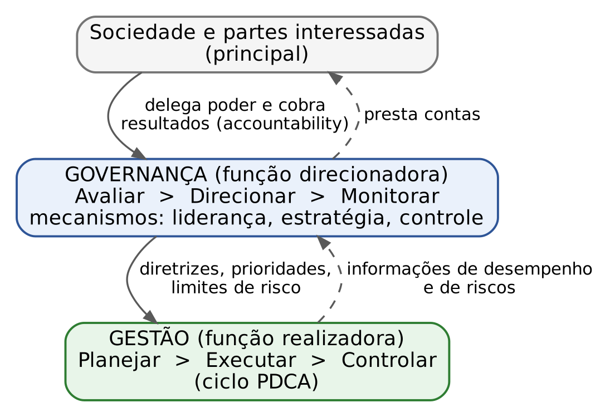
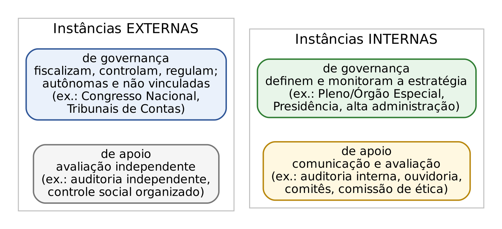
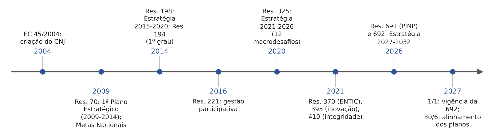
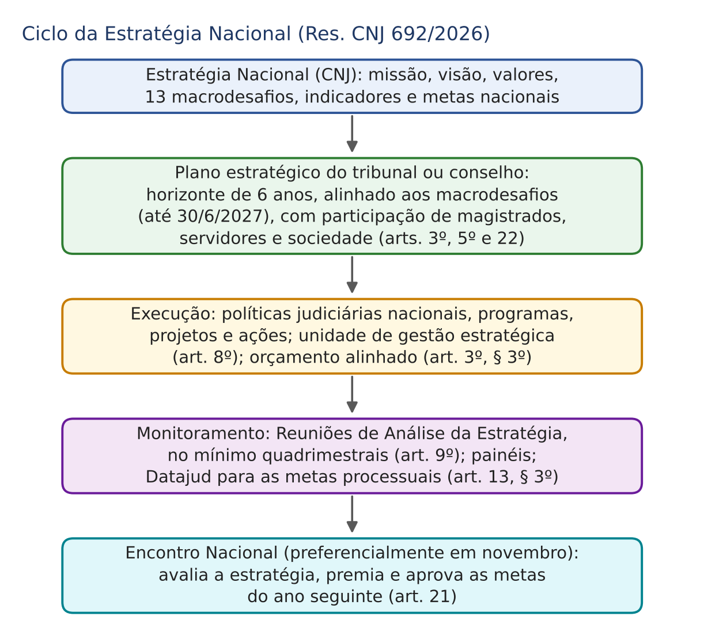
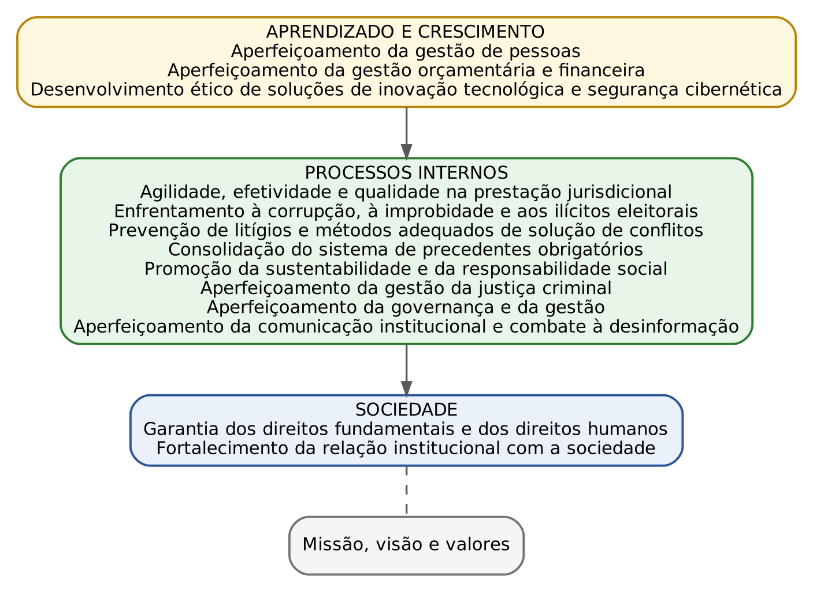
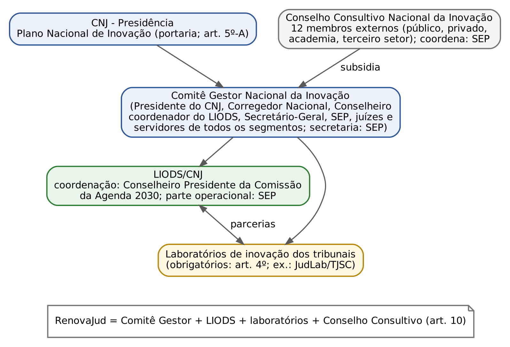

# CAPÍTULO 03 — ADMINISTRAÇÃO JUDICIAL, PLANEJAMENTO ESTRATÉGICO, GOVERNANÇA E INOVAÇÃO

:::INCIDENCIA
Pontos: TRF5 p. A.1 e C.5; TJRS p. C.6; TJSC p. D.9. Nível A.
Lote: 49 questões (FGV 44, FCC 5), quase todas de carreiras de apoio e controle; nas provas de juiz, o ENAM cobra a letra da Res. CNJ 395/2021 (inovação).
Mais cai: governança pública (conceito, princípios e mecanismos do Decreto 9.203/2017 e do Referencial do TCU), *accountability*, planejamento estratégico (missão, visão, valores, objetivos, indicadores, metas) e resoluções do CNJ de gestão.
:::

| Subtema | FGV | FCC | Padrão de cobrança |
|---|---|---|---|
| Governança x gestão; conceito de governança; conflito de agência | 7 | 1 | definição do Decreto 9.203/2017 e do TCU; avaliar-direcionar-monitorar x planejar-executar-controlar |
| Princípios, mecanismos e instâncias de governança | 11 | 1 | distinguir princípio (capacidade de resposta, integridade, confiabilidade, melhoria regulatória, prestação de contas, transparência) de mecanismo (liderança, estratégia, controle) |
| *Accountability* e transparência | 4 | 3 | prestar contas + responsabilização; sigilo como exceção |
| Gestão de riscos e integridade (Res. CNJ 410/2021) | 3 | 0 | definições literais (compliance, integridade, gestão de riscos); controles proporcionais ao risco |
| Planejamento estratégico (teoria) | 8 | 0 | missão x visão x valores; objetivo x indicador x meta; características do nível estratégico |
| Estratégia Nacional do Poder Judiciário | 2 | 0 | macrodesafios (descrições literais); quem coordena os Encontros Nacionais |
| Inovação (Res. CNJ 395/2021) | 2 | 0 | conceito de inovação; princípios (foco no usuário, participação, desburocratização, transparência) |
| Atos setoriais de gestão (segurança institucional, Conaje, TIC, gestão documental) | 7 | 1 | composição de colegiados e listas de princípios e diretrizes |

O capítulo trata do Judiciário como ORGANIZAÇÃO: como se dirige (governança), como se planeja (estratégia), como se controla a si mesmo quanto a riscos e integridade, como presta contas e como inova. A dimensão sociológica da administração judiciária, os indicadores de produtividade, o Justiça em Números, as metas nacionais em espécie e a gestão de pessoas estão no Cap. 2; o controle correcional e disciplinar, o CNJ como órgão e a auditoria interna, no Cap. 14; a transformação digital, no Cap. 29; a Agenda 2030 e a sustentabilidade, no Cap. 27.

## 03.1 Administração judiciária, gestão e governança: conceitos de partida

### 03.1.1 Do autogoverno à administração por resultados

A Constituição de 1988 deu aos tribunais autogoverno (art. 96, I) e autonomia administrativa e financeira (art. 99), mas autogoverno não é sinônimo de boa gestão: até a EC 45/2004 cada tribunal se administrava isoladamente, sem planejamento comum nem estatística padronizada. A EC 45/2004 trouxe a razoável duração do processo (art. 5º, LXXVIII), a proporcionalidade entre juízes, demanda e população (art. 93, XIII) e o CNJ, com controle da atuação administrativa e financeira e relatórios estatísticos (art. 103-B, § 4º, VI e VII). Ao controle somou-se a COORDENAÇÃO do planejamento, fundamento da Estratégia Nacional (o primeiro considerando da Res. CNJ 325/2020 afirma a competência do Conselho "para coordenar o planejamento e a gestão estratégica do Poder Judiciário").

O material de estudo do usuário define administração judiciária como a aplicação de técnicas administrativas na realização das atividades do Judiciário (Pontos relevantes da Sociologia Jurídica, 2026). Convém precisar três níveis, porque a banca e a prova oral os misturam:

| Nível | Objeto | Quem conduz | Instrumentos típicos |
|---|---|---|---|
| Administração (ou gestão) judiciária em sentido estrito | o tribunal como organização: orçamento, pessoas, TI, contratações, estrutura | Presidência, Órgão Especial ou Pleno, alta administração | plano estratégico, plano de contratações, PDTIC, gestão de riscos |
| Gestão de unidades judiciárias | a vara, o juizado, o gabinete | juiz titular, chefe de cartório, assessoria | fluxos de trabalho, triagem, distribuição de tarefas, metas da unidade |
| Gestão processual (*case management*) | o processo concreto | juiz | saneamento, calendário processual (CPC, art. 191), priorização, agrupamento de demandas repetitivas |

O juiz é também gestor por dever jurídico: LOMAN, art. 35, II e III (prazos e providências para que os atos se realizem nos prazos), e Res. CNJ 692/2026, art. 8º (unidade de gestão estratégica obrigatória). O enfoque sociológico da "crise da Justiça" está no Cap. 2.

### 03.1.2 Paradigmas da administração pública: burocracia, gerencialismo e governança

| Paradigma | Marco e autores | Ideia central | Crítica |
|---|---|---|---|
| Administração burocrática | Weber (dominação racional-legal; ver Cap. 1) | impessoalidade, hierarquia, regras escritas, carreira; controle de PROCEDIMENTOS | rigidez, autorreferência, "disfunções da burocracia" (Merton) |
| Nova Gestão Pública (*New Public Management*) | Reino Unido e EUA nos anos 1980; Osborne e Gaebler, *Reinventing Government* (1992); no Brasil, Plano Diretor da Reforma do Aparelho do Estado (1995, Bresser-Pereira) e EC 19/1998 (eficiência no art. 37) | controle de RESULTADOS, cidadão como cliente, metas, contratualização, descentralização | importa a lógica de mercado; trata o cidadão como consumidor; fragmenta o Estado |
| Governança pública (*New Public Governance*) | Stephen Osborne (2006); referenciais da IFAC, da OCDE e do TCU; no Brasil, Decreto 9.203/2017 | redes, coprodução, participação, criação de VALOR PÚBLICO (Mark Moore, *Creating Public Value*, 1995), integridade e *accountability* | conceito elástico; risco de captura por redes de interesse |

A FGV abriu uma questão para analista do TJMT com a frase de que a governança pública é o "paradigma atual" da Administração, em que a coprodução e a colaboração priorizam a criação de valor público (Q3114623). Valor público tem definição normativa: produtos e resultados que representem respostas efetivas e úteis às necessidades ou demandas de interesse público e modifiquem aspectos da sociedade ou de grupos reconhecidos como destinatários legítimos (Decreto 9.203/2017, art. 2º, II).

:::DOUTRINA Mark H. Moore, *Creating Public Value* (1995)
O gestor público deve criar valor para a sociedade, como o privado cria valor para o acionista. O "triângulo estratégico" exige ação (1) valiosa em substância, (2) legítima e politicamente sustentável e (3) operacionalmente viável: no Judiciário, um laboratório ou vara especializada só se justifica com resultado real para o jurisdicionado, respaldo institucional e capacidade de execução.
:::

### 03.1.3 Governança x gestão

Governança pública é o "conjunto de mecanismos de liderança, estratégia e controle postos em prática para avaliar, direcionar e monitorar a gestão, com vistas à condução de políticas públicas e à prestação de serviços de interesse da sociedade" (Decreto 9.203/2017, art. 2º, I). O Referencial Básico de Governança Organizacional do TCU (3ª ed., 2020) adota a mesma fórmula e separa as funções: a governança é DIRECIONADORA (avaliar, direcionar, monitorar); a gestão é REALIZADORA (planejar, executar, controlar). A governança se preocupa com a qualidade do processo decisório, com a efetividade e com o "fazer a coisa certa"; a gestão, com a eficiência na execução e com o "fazer certo a coisa".

| Critério | Governança | Gestão |
|---|---|---|
| Função | direcionadora | realizadora |
| Atividades | avaliar, direcionar, monitorar | planejar, executar, controlar |
| Pergunta | o que fazer, para quem e com que limite de risco? | como fazer, com que recursos e em que prazo? |
| Foco de resultado | efetividade, valor público, legitimidade | eficiência e eficácia operacionais |
| No tribunal | Pleno ou Órgão Especial, Presidência, comitês de governança | diretorias, secretarias, unidades judiciárias |

:::QUESTAO FGV 2026 — TCE-PE — Analista de Gestão (Q4282436)
V ou F sobre o Referencial do TCU. Gabarito D (V – V – F): é verdadeiro que a governança avalia, direciona e monitora e a gestão planeja, executa e controla; é verdadeiro que as práticas se agrupam em liderança, estratégia e controle; é FALSO que governança e gestão sejam sinônimas. Armadilha: a terceira assertiva usa a palavra "execução", que é a marca da GESTÃO.
No mesmo sentido: Q4282434 (TCE-PE 2026; gabarito A), Q4086823 (TCE-SC 2026; gabarito B, a definição completa; erradas: equivalência entre governança e gestão, restrição ao controle interno ou dispensa de partes interessadas), Q3238447 (TRT-24 2025; gabarito C, governança-efetividade e gestão-eficiência) e Q3152890 (Cuiabá 2025; gabarito B: a II descreve gestão, pois "planejar, executar os planos e fazer o controle de indicadores" é função realizadora).
:::

### 03.1.4 Teoria da agência

A governança corporativa nasceu do problema de agência (Jensen e Meckling, 1976): quem detém a propriedade (principal) delega a gestão a quem tem mais informação e interesses próprios (agente), o que gera assimetria de informação, risco moral e custos de monitoramento (a análise econômica desses conceitos está no Cap. 36). No setor público, o TCU transpõe o esquema: a SOCIEDADE é o principal, e os agentes são aqueles a quem ela delegou poder, recursos e autoridade (representantes eleitos, dirigentes, magistrados enquanto administradores). Os mecanismos de governança existem para reduzir a distância entre o interesse do principal e a conduta do agente.

:::QUESTAO FGV 2024 — TJ-AP — Analista Judiciário, Controle Interno (Q2442922)
Na governança pública organizacional, qual papel cabe à sociedade no conflito de agência? Gabarito D: a sociedade é o PRINCIPAL e o representante eleito, o AGENTE. Armadilha da E: inverte a posição do cidadão (o eleitor é principal, nunca agente); A e B atribuem à sociedade o papel de agente.
:::

:::PEGADINHA Governança não é governabilidade
Governabilidade é a condição política de exercer o poder (apoio, legitimidade, sustentação parlamentar); governança é a capacidade técnica e institucional de formular e implementar políticas e de dirigir a organização. Uma alternativa que defina *accountability* ou governança como "manutenção das condições de governabilidade por meio do apoio popular" está errada (Q3290899, alternativa E).
:::

## 03.2 Princípios, diretrizes, mecanismos e instâncias de governança

### 03.2.1 O Decreto 9.203/2017

O Decreto 9.203/2017 (governança da Administração federal direta, autárquica e fundacional) não vincula o Judiciário, mas é o texto-base das bancas. A chave é não confundir as quatro listas.

:::LEI Decreto 9.203/2017, arts. 3º e 5º
Art. 3º São princípios da governança pública: I - capacidade de resposta; II - integridade; III - confiabilidade; IV - melhoria regulatória; V - prestação de contas e responsabilidade; e VI - transparência.
Art. 5º São mecanismos para o exercício da governança pública: I - liderança, que compreende conjunto de práticas de natureza humana ou comportamental exercida nos principais cargos das organizações, para assegurar a existência das condições mínimas para o exercício da boa governança, quais sejam: a) integridade; b) competência; c) responsabilidade; e d) motivação; II - estratégia [...]; e III - controle [...].
:::

| Lista | Conteúdo | Onde |
|---|---|---|
| Princípios (6) | capacidade de resposta, integridade, confiabilidade, melhoria regulatória, prestação de contas e responsabilidade, transparência | art. 3º |
| Diretrizes (11) | entre outras: resultados para a sociedade; simplificação; MONITORAR desempenho e avaliar políticas; controles baseados em risco, privilegiando a PREVENÇÃO antes de processos sancionadores; decisão por evidências; comunicação aberta, voluntária e transparente | art. 4º |
| Mecanismos (3) | liderança, estratégia, controle | art. 5º |
| Condições mínimas da liderança (4) | integridade, competência, responsabilidade, motivação | art. 5º, I |

Sentido dos princípios no Guia da Política de Governança Pública (Casa Civil, 2018):

| Princípio | Sentido |
|---|---|
| Capacidade de resposta | responder de forma eficiente e eficaz às necessidades das partes interessadas, antecipando demandas e superando limitações orçamentárias por meio de práticas inovadoras |
| Integridade | alinhamento consistente e adesão a valores, princípios e normas éticas comuns que sustentam e priorizam o interesse público sobre os interesses privados (mesma fórmula da Res. CNJ 410/2021, art. 5º, I) |
| Confiabilidade | capacidade de minimizar incertezas para os cidadãos; atuação coerente com as diretrizes e previsível |
| Melhoria regulatória | atos normativos com base em evidências, consulta e análise de impacto |
| Transparência | acesso à informação como regra; sigilo como exceção, nos termos da lei |

:::QUESTAO FGV 2026 — NAV Brasil — Analista de Gestão (Q4223217)
Pediu a lista do art. 3º do Decreto 9.203/2017. Gabarito A, a enumeração literal. As demais misturam valores antagônicos à governança (sigilo, pessoalidade, supremacia, indisponibilidade da informação).
No mesmo sentido: Q3363350 (SEFAZ-PR 2025; gabarito A, capacidade de resposta, integridade e transparência), Q2524684 (TCE-GO 2024; gabarito A, integridade, melhoria regulatória e transparência; as outras alternativas inserem competência, liderança ou motivação, que são condições da LIDERANÇA, art. 5º, I) e Q3154694 (SEFAZ-RS 2025; gabarito B, itens I a III; "monitoramento do desempenho" é diretriz, art. 4º, III, e não princípio).
:::

:::QUESTAO FGV 2024 — Prefeitura de Macaé — Analista (Q3047904)
Três afirmações: liderança é princípio; estratégia é mecanismo; integridade é princípio. Gabarito D (II e III). Armadilha: LIDERANÇA é mecanismo, não princípio. A troca entre listas é o padrão FGV.
No mesmo sentido, com outra roupagem: Q3174677 (TCE-RR 2025; gabarito A: *accountability* e transparência são princípios; gestão de risco e código de conduta são práticas ou instrumentos, não princípios).
:::

:::QUESTAO FGV 2024 — TCE-PA — Auditor (Q2566553)
Trecho do Guia da Política de Governança Pública sobre antecipar necessidades da sociedade e superar limitações orçamentárias com práticas inovadoras. Gabarito C: capacidade de resposta. No mesmo sentido: Q3114623 (TJMT 2024; gabarito A, o princípio de responder de maneira clara, eficiente e eficaz às demandas das partes interessadas).
:::

:::QUESTAO FGV 2026 — TCE-PE — Analista de Gestão, reaplicação (Q4282443)
Gabarito C (I e III). I: a capacidade de resposta depende da escuta das partes interessadas, isto é, da participação; III: definição de integridade. A II é falsa porque a transparência não se restringe ao exigido por lei: o art. 4º, XI, do Decreto manda promover comunicação "aberta, voluntária e transparente" (transparência ATIVA).
:::

### 03.2.2 O Referencial do TCU: mecanismos e componentes

A 2ª edição do Referencial (2014) desdobrava cada mecanismo em componentes; a 3ª edição, vigente (Portaria-TCU 170, de 12/11/2020), manteve a tríade, mas a reorganizou em práticas e DESLOCOU a gestão de riscos para a estratégia. As bancas ainda cobram a distribuição de 2014:

| Mecanismo | Componentes (2ª ed., 2014) | Práticas (3ª ed., 2020) |
|---|---|---|
| Liderança | pessoas e competências; princípios e comportamentos; liderança organizacional; sistema de governança | estabelecer o modelo de governança; promover a integridade; promover a capacidade da liderança |
| Estratégia | relacionamento com partes interessadas; estratégia organizacional; alinhamento transorganizacional | GERIR RISCOS; estabelecer a estratégia; promover a gestão estratégica; monitorar resultados organizacionais e o desempenho das funções de gestão |
| Controle | gestão de riscos e controle interno; auditoria interna; *accountability* e transparência | promover a transparência; garantir a *accountability*; avaliar a satisfação das partes interessadas; assegurar a efetividade da auditoria interna |

:::QUESTAO FGV 2024 — TJ-SC — Analista Administrativo (Q2512454)
Componente do mecanismo CONTROLE. Gabarito C: gestão de riscos (classificação da 2ª edição; na 3ª, "gerir riscos" é prática da ESTRATÉGIA, o que torna a questão datada). Armadilhas: alinhamento transorganizacional e relacionamento com partes interessadas são da ESTRATÉGIA; competências e pessoas e princípios e comportamentos são da LIDERANÇA.
:::

:::QUESTAO FGV 2026 — MPE-ES — Agente Técnico (Q4217656)
Caso: uma autarquia (a) cria instâncias de supervisão independentes do corpo executivo, (b) define papéis e responsabilidades, (c) adota prestação de contas à sociedade e aos órgãos de controle e (d) abre canais para que partes interessadas influenciem decisões estratégicas. Gabarito D: liderança, controle, *accountability* e participação e engajamento de partes interessadas.
Resolução em passos: (1) instâncias de supervisão e sistema de governança integram a LIDERANÇA; (2) definição de papéis, segregação e responsabilidades formalizadas são tratadas como CONTROLE; (3) prestar contas é *accountability*; (4) canais de influência são participação de partes interessadas. Ressalva: a banca mistura mecanismos (liderança, controle) com componentes e princípios (*accountability*, participação); a melhor estratégia é eliminar as alternativas que começam por "transparência" ou "estratégia" para a primeira medida.
:::

### 03.2.3 Instâncias de governança

O Referencial classifica as estruturas que exercem ou apoiam a governança. As externas não se vinculam à organização governada; as internas integram a sua estrutura.

Transposto ao Judiciário estadual: o Tribunal Pleno ou Órgão Especial e a Presidência são instâncias internas de governança; auditoria interna (Res. CNJ 308/2020, ver Cap. 14), ouvidoria, comitês (de governança de TIC, de integridade, gestor de contratações) são instâncias internas de apoio; o Tribunal de Contas do Estado e a Assembleia Legislativa são instâncias externas de governança. O CNJ, embora órgão do próprio Poder Judiciário (controle INTERNO do Poder, Cap. 14), é externo a cada tribunal e exerce sobre ele funções de coordenação e controle.

:::QUESTAO FCC 2024 — TRF3 — Técnico Judiciário (Q2564668)
Trecho do Referencial: estruturas responsáveis pela fiscalização, pelo controle e pela regulação, autônomas e independentes, não vinculadas às organizações que governam. Gabarito C: instâncias EXTERNAS de governança. Armadilha: "externas de apoio" fazem avaliação independente (auditoria independente, controle social organizado), não regulação.
:::

## 03.3 *Accountability*, transparência e prestação de contas

### 03.3.1 Conceito

Anna Maria Campos (1990) sustentou que a falta de tradução de *accountability* revelava a ausência da prática numa cultura administrativa patrimonialista. O conceito contemporâneo tem duas dimensões (Andreas Schedler, 1999): *answerability* (obrigação de informar e justificar) e *enforcement* (possibilidade de sanção). Mark Bovens (2007) a define como RELAÇÃO entre um ator e um fórum, na qual o ator tem a obrigação de explicar e justificar sua conduta, o fórum pode questionar e julgar, e o ator pode sofrer consequências. Guillermo O'Donnell (1998) distingue:

| Espécie | Relação | Exemplos no Judiciário |
|---|---|---|
| Vertical (eleitoral e social) | cidadãos e sociedade civil sobre os governantes | inexistente pela via eleitoral para o juiz; social via imprensa, OAB, ouvidorias, controle social |
| Horizontal | entre órgãos estatais com poder de fiscalizar e sancionar | Tribunal de Contas sobre a gestão financeira; CNJ e corregedorias sobre a atuação administrativa e disciplinar |
| Societal (Smulovitz e Peruzzotti) | associações, movimentos e mídia que acionam os controles horizontais | representações ao CNJ, ações civis públicas, imprensa investigativa |

Para o TCU, *accountability* pública é a obrigação de quem recebe recursos ou responsabilidades de assumi-las nas dimensões fiscal, gerencial e programática e de prestar contas a quem as delegou; não se reduz a transparência, a prestação formal de contas ou sanção.

:::QUESTAO FCC 2026 — SEFAZ-CE — Auditor Fiscal (Q4221375)
Conceito contemporâneo de *accountability*. Gabarito A: relação institucional em que um ator deve explicar e justificar sua conduta perante outro, sujeito a consequências (a fórmula de Bovens). Erradas: restrição ao controle legislativo (B); sinonímia com responsabilidade disciplinar (C); rótulo "vertical" para a prestação de contas aos órgãos de controle, que é HORIZONTAL (D); separação entre divulgar informações e prestar contas de resultados (E).
No mesmo sentido: Q3880061 (AL-RO 2026; gabarito B) e Q3593048 (TCE-PE 2025; gabarito E), ambas com a tríade fiscal, gerencial e programática; Q4282437 (TCE-PE 2026; gabarito B); Q3290899 (FCC, Pref. SP 2025; gabarito B) e Q3169946 (FCC, TRT-20 2024; gabarito E), prestação de contas mais responsabilização.
:::

:::QUESTAO FGV 2024 — TJ-SC — Analista Administrativo (Q2512455)
Prática de *accountability* prevista na governança pública brasileira. Gabarito E: garantir acesso a informações e ações às partes interessadas, admitido o sigilo como exceção, nos termos da lei. As demais são práticas de outros componentes: atender ao maior número de partes interessadas (relacionamento com partes interessadas), equilíbrio de poder e segregação de funções críticas (liderança, sistema de governança), direcionar e monitorar a gestão (função de governança), atuação conjunta para políticas (alinhamento transorganizacional).
:::

### 03.3.2 Transparência e prestação de contas no Poder Judiciário

A matriz é constitucional: publicidade (art. 37, *caput*), publicidade dos julgamentos e fundamentação das decisões (art. 93, IX e X, com sessões administrativas públicas e decisões disciplinares por maioria absoluta), dever de prestar contas de quem gerencia dinheiros públicos (art. 70, parágrafo único), julgamento das contas dos administradores pelo Tribunal de Contas (art. 71, II), controle interno integrado (art. 74) e legitimidade de qualquer cidadão, partido, associação ou sindicato para denunciar irregularidades ao Tribunal de Contas (art. 74, § 2º). A Lei 12.527/2011 (LAI) aplica-se ao Judiciário (art. 1º, parágrafo único, I), e o CNJ a regulamentou pela Res. 215/2015.

:::LEI Resolução CNJ 215/2015, art. 3º
Diretrizes: I – observância da publicidade como preceito geral e do sigilo como exceção; II – divulgação de informações de interesse público, independentemente de solicitações; III – utilização de meios de comunicação viabilizados pela tecnologia da informação; IV – fomento ao desenvolvimento da cultura da transparência na administração pública; V – contribuição para o desenvolvimento do controle social da administração pública.
:::

A transparência ATIVA está no art. 6º da Res. 215 (redação da Res. 389/2021): os sítios dos órgãos devem conter finalidades e objetivos institucionais e estratégicos, metas, indicadores e resultados (inciso I), levantamentos estatísticos, atos normativos, audiências públicas e calendário das sessões, além de um campo "Transparência" com execução orçamentária, licitações, contratos e a Tabela de Lotação de Pessoal com identificação nominal. Dois deveres da Estratégia Nacional completam o quadro: publicar o plano estratégico e seus resultados, sempre que possível em painel interativo (Res. 692/2026, art. 10), e divulgar mensalmente o painel das Metas Nacionais (art. 16). A transparência é também macrodesafio ("Fortalecimento da relação institucional do Poder Judiciário com a sociedade", com o Índice de Transparência e o Índice de Atendimento ao Cidadão como indicadores) e eixo do Prêmio CNJ de Qualidade (03.9).

Instrumentos de prestação de contas: contas anuais ao Tribunal de Contas (CF, art. 71, II); relatório anual do CNJ na mensagem do Presidente do STF ao Congresso (art. 103-B, § 4º, VII); relatório estatístico semestral (inciso VI; hoje Justiça em Números e Datajud, Cap. 2); relatório anual das Metas Nacionais pelo DGE até o fim do primeiro semestre seguinte (Res. 692/2026, art. 17); relatório anual da auditoria interna ao colegiado (Res. 308/2020, art. 5º; Cap. 14).

:::ATENCAO Transparência x proteção de dados
A transparência do Judiciário encontra limites no segredo de justiça, nas informações sigilosas e nos dados pessoais (LGPD e Res. CNJ 363/2021, Cap. 33). A própria Res. 395/2021 define transparência "respeitadas as hipóteses de restrição e de sigilo legal e a proteção de dados pessoais" (art. 3º, X). Questão que afirme transparência "plena" que "não deve ceder" ante restrições legais está errada (Q3058635, alternativa D; ver 03.8).
:::

## 03.4 Gestão de riscos, controles internos e integridade

### 03.4.1 Gestão de riscos

Risco é o efeito da incerteza sobre os objetivos (definição da ISO 31000). Por isso a primeira palavra da gestão de riscos é OBJETIVO: sem objetivo definido não há evento que possa favorecer ou prejudicar seu alcance, e a gestão de riscos pressupõe planejamento estratégico. O Decreto 9.203/2017 define gestão de riscos como "processo de natureza permanente, estabelecido, direcionado e monitorado pela alta administração, que contempla as atividades de identificar, avaliar e gerenciar potenciais eventos que possam afetar a organização, destinado a fornecer segurança razoável quanto à realização de seus objetivos" (art. 2º, IV). A Res. CNJ 410/2021 (art. 5º, IV) reproduz a fórmula, trocando "a organização" por "a organização dos órgãos do Poder Judiciário" e "seus objetivos" por "suas atividades".

Elementos que as questões exploram:

- Segurança RAZOÁVEL, não absoluta: a gestão de riscos não elimina a incerteza; trata-a dentro de limites de exposição definidos (apetite e tolerância a risco).
- Proporcionalidade: controles internos devem ser proporcionais aos riscos, considerando causas, fontes, consequências e impactos, "observada a relação custo-benefício" (Decreto 9.203/2017, art. 17, III). Controle mais caro que o risco que mitiga é ineficiente.
- Integração: a gestão de riscos integra o planejamento estratégico e seus desdobramentos (art. 17, II); não é atividade de uma comissão isolada.
- Ciclo: estabelecimento do contexto, identificação, análise (causas, consequências, controles existentes, probabilidade e impacto), avaliação (priorização), tratamento (evitar, mitigar, transferir ou compartilhar, aceitar), monitoramento e comunicação.
- Modelo das três linhas (IIA, 2020, sucessor das "três linhas de defesa"): gestores donos dos riscos; funções de apoio (riscos, conformidade, integridade); auditoria interna independente; o órgão de governança supervisiona.

:::QUESTAO FGV 2025 — SEFAZ-RS — Auditor do Estado (Q3154698)
Quatro afirmativas sobre gestão de riscos. Gabarito D (I, III e IV). I: sem objetivo não há risco; III: a análise identifica causas, consequências e controles existentes; IV: a gestão de riscos busca que as incertezas não desviem a organização de seus objetivos. A II é falsa porque os controles devem ser PROPORCIONAIS ao risco (Decreto 9.203/2017, art. 17, III); a afirmação de que os benefícios sempre compensam os custos e dispensam proporcionalidade inverte a lógica de custo-benefício.
:::

:::QUESTAO FGV 2025 — TCE-PE — Analista de Gestão (Q3593362)
Elemento necessário de uma boa estrutura de gestão de riscos segundo o TCU. Gabarito E: limites de exposição ao risco e critérios de avaliação, mais fluxos de comunicação internos e externos. Erradas: "eliminação de incertezas" (A), centralização em comissões isoladas (B), plano de integridade desvinculado da alta administração e sigilo das exposições (C), ouvidoria sem articulação (D). A palavra "eliminação" é a armadilha recorrente.
:::

No Judiciário, a gestão de riscos aparece em atos setoriais (Res. CNJ 435/2021, art. 4º, VI, e 9º, II, segurança; Res. 370/2021, riscos de TIC; Res. 347/2020, contratações) e no macrodesafio de governança e gestão de 2027-2032. Na Lei 14.133/2021, a alta administração "é responsável pela governança das contratações" e deve implementar processos e estruturas, "inclusive de gestão de riscos e controles internos", para AVALIAR, DIRECIONAR E MONITORAR licitações e contratos e assegurar seu alinhamento ao planejamento estratégico e às leis orçamentárias (art. 11, parágrafo único).

### 03.4.2 Integridade e *compliance*: Resolução CNJ 410/2021

A Res. CNJ 410, de 23/8/2021, dispõe sobre normas gerais e diretrizes para sistemas de integridade no Poder Judiciário. Ponto de partida: o art. 2º diz que os órgãos "PODERÃO contar" com sistemas de integridade; a resolução é norma geral de diretrizes, diferentemente do Decreto 9.203/2017, que no Executivo federal manda instituir programa de integridade (art. 19).

:::LEI Resolução CNJ 410/2021, art. 5º
Para os efeitos do disposto nesta Resolução, considera-se: I – integridade pública: alinhamento consistente e adesão a valores, princípios e normas éticas comuns que sustentam e priorizam o interesse público sobre os interesses privados no setor público; II – compliance: conjunto de mecanismos e procedimentos de controle interno, auditoria, incentivo à denúncia de irregularidades e de aplicação efetiva do código de conduta ética, políticas e diretrizes com objetivo de prevenir, detectar e sanar desvios, fraudes, irregularidades e atos ilícitos praticados por membros ou servidores do Poder Judiciário; III – alta administração: presidentes, vice-presidentes, corregedores, ouvidores e respectivos assessores diretos dos órgãos do Poder Judiciário; e IV – gestão de riscos: [...].
:::

| Elemento da Res. 410/2021 | Conteúdo |
|---|---|
| Objetivos (art. 2º) | disseminar cultura de integridade; prevenir, detectar e punir fraudes e irregularidades; corrigir falhas sistêmicas |
| Eixos (art. 2º, parágrafo único) | comprometimento e apoio explícito da alta administração; órgão gestor em cada tribunal; análise, avaliação e gestão dos riscos; monitoramento permanente, aprimoramento contínuo e capacitação |
| Diretrizes (art. 3º) | engajamento pessoal da Alta Administração; ampla participação de membros e servidores (senso de pertencimento); fluxo simplificado de denúncias, elogios e sugestões; avaliação do risco de integridade em contratações e convênios; correção de falhas sistêmicas |
| LIMITES (art. 3º, parágrafo único) | independência funcional da magistratura; normas de conduta de magistrados e servidores; atribuições das Ouvidorias e Corregedorias; cadeia de custódia, sigilo legal e LGPD |
| Elementos fundamentais (art. 4º, 12 incisos) | entre outros, governança, transparência, *compliance*, meritocracia, inovação, prestação de contas, decoro, renovação das chefias e vedação ao nepotismo |
| CINT (arts. 6º e 7º) | Comitê de Integridade do Poder Judiciário: assessora o Presidente do CNJ; coordenado por Conselheiro; mandato de 2 anos, prorrogável UMA vez |
| Práticas mínimas (art. 8º, § 1º) | eficiência dos controles internos; acompanhamento de resultados; melhoria dos mecanismos; tratamento diferenciado ao ERRO DE BOA-FÉ; desburocratização |

:::QUESTAO FGV 2026 — TJ-BA — Juiz Leigo (Q4102137)
Como compreender *compliance* segundo a Res. CNJ 410/2021. Gabarito D, a definição do art. 5º, II (controle interno, auditoria, incentivo à denúncia e aplicação efetiva do código de conduta). A banca usou as outras definições do mesmo artigo como distratores: a B é a definição de INTEGRIDADE PÚBLICA (inciso I); a E é a de GESTÃO DE RISCOS (inciso IV); a C mistura "segurança razoável" (expressão da gestão de riscos) com proteção de dados.
:::

:::PEGADINHA Três vocábulos, três definições
Integridade = ADESÃO a valores que priorizam o interesse público. *Compliance* = MECANISMOS e procedimentos (controle, auditoria, denúncia, código de conduta). Gestão de riscos = PROCESSO permanente de identificar, avaliar e gerenciar eventos, com segurança razoável. A banca troca as definições entre si.
:::

Os limites do art. 3º, parágrafo único, impedem que o sistema de integridade controle o conteúdo das decisões ou usurpe a competência disciplinar das corregedorias (LOMAN e Res. 135/2011, Cap. 13). Integridade como dever ético do magistrado: Cap. 12; programas de integridade empresariais e eixos do art. 19 do Decreto 9.203/2017: Cap. 38.

:::EXEMPLO Juiz diretor do foro e contratação de serviço de limpeza
Situação: a empresa de limpeza cujo contrato será renovado tem como sócio o cunhado de servidor da direção do foro. Solução: (1) risco de integridade em contratação (Res. 410/2021, art. 3º, IV) e conflito de interesses: o servidor é afastado da instrução; (2) a vedação ao nepotismo é elemento fundamental do sistema (art. 4º, XII; disciplina do CNJ no Cap. 14); (3) o juiz registra o fato e comunica a unidade de integridade ou controle interno, sem instaurar ele próprio procedimento disciplinar fora das vias regulares; (4) corrigir a falha sistêmica (declaração de parentesco nas contratações) é a resposta de integridade, distinta da apuração disciplinar.
:::

### 03.4.3 Governança das contratações

A Res. CNJ 347/2020 institui a Política de Governança das Contratações Públicas no Poder Judiciário (alterada pela Res. 637/2025 para alinhá-la à Lei 14.133/2021). O art. 2º lista mais de vinte princípios, entre eles PLANEJAMENTO e SEGREGAÇÃO DE FUNÇÕES, e manda observar a LINDB; as diretrizes do art. 3º incluem desenvolvimento sustentável alinhado à Agenda 2030, integridade, interação com o mercado e cultura de planejamento das contratações alinhada ao planejamento estratégico e às leis orçamentárias.

Para as contratações de Solução de Tecnologia da Informação e Comunicação (STIC), a Res. CNJ 468/2022 (alterada pelas Res. 480/2022 e 616/2025) impõe três fases: planejamento da contratação, seleção do fornecedor e gestão do contrato (art. 6º). A métrica homem-hora é, em regra, VEDADA para aferição de esforço, salvo justificativa e vinculação à entrega de produtos com prazos e qualidade predefinidos; e a fase de planejamento é exigida inclusive nas contratações por inexigibilidade, dispensa e adesão a ata.

:::QUESTAO FGV 2024 — TJ-RR — Analista Judiciário, Infraestrutura de TI (Q3090011)
Res. CNJ 468/2022. Gabarito A (somente I). I: as três fases (art. 6º). II: falsa, a regra é a VEDAÇÃO da métrica homem-hora. III: falsa, o planejamento não é facultativo na inexigibilidade. Armadilha: as duas assertivas falsas invertem regra e exceção.
:::

## 03.5 Planejamento estratégico: fundamentos

### 03.5.1 Conceito, níveis e escolas

Planejamento estratégico é o processo pelo qual a organização define sua direção de longo prazo, considerando o ambiente externo e as capacidades internas, e a desdobra em objetivos, indicadores, metas e iniciativas. Igor Ansoff sistematizou o planejamento corporativo; Henry Mintzberg (*The Rise and Fall of Strategic Planning*, 1994) criticou o planejamento puramente analítico e distinguiu estratégia DELIBERADA de EMERGENTE (padrão que surge da ação, sem planejamento).

| Nível | Horizonte | Abrangência | Conteúdo | No Judiciário |
|---|---|---|---|---|
| Estratégico | longo prazo (6 anos na Estratégia Nacional) | organização como um todo | genérico, sintético, orientado ao futuro, adaptável a ambiente mutável | Estratégia Nacional; plano estratégico do tribunal |
| Tático | médio prazo | áreas ou departamentos | desdobramento por unidade | planos diretores (PDTIC), planos de gestão de áreas, plano de logística sustentável |
| Operacional | curto prazo | tarefas e atividades | detalhado e analítico | planos de ação da unidade, rotinas, cronogramas de mutirão |

:::QUESTAO FGV 2025 — CPRM — Analista (Q3754755)
Característica do planejamento estratégico. Gabarito D: ser adaptável em ambiente mutável. As erradas descrevem o nível OPERACIONAL (envolver cada tarefa; foco no presente; detalhado e analítico) ou o TÁTICO (abordagem departamental).
No mesmo sentido: Q3349620 (TRT-24 2025; gabarito E: orientado para o futuro, envolve toda a organização, busca consenso e promove aprendizado organizacional; erradas: curto prazo, áreas isoladas, ignorar ambiente externo, exclusividade da alta administração).
:::

### 03.5.2 Identidade organizacional e desdobramento

| Elemento | Definição | Exemplo |
|---|---|---|
| Missão | razão de ser; o que a organização faz, para quem, com que finalidade | "realizar justiça" (Estratégia 2021-2026, material oficial do CNJ) |
| Visão | imagem idealizada do futuro desejado, num horizonte | "Poder Judiciário efetivo e ágil na garantia dos direitos e que contribua para a pacificação social e o desenvolvimento do país" (2021-2026) |
| Valores | princípios e crenças que orientam decisões e comportamentos | 2021-2026: acessibilidade, agilidade, credibilidade, eficiência, ética, imparcialidade, inovação, integridade, segurança jurídica, sustentabilidade, transparência e responsabilização |
| Objetivo estratégico | resultado a ser alcançado (o QUÊ), em linguagem qualitativa | reduzir o tempo de tramitação |
| Indicador | instrumento que MEDE o desempenho do objetivo | taxa de congestionamento líquida; IAD |
| Meta | nível de desempenho desejado do indicador, num prazo (QUANTO e QUANDO) | IAD igual ou superior a 100% no ano |
| Iniciativa (projeto, ação) | o que será feito para atingir a meta (COMO) | mutirão; nova vara; automação |

:::QUESTAO FGV 2024 — TCE-PA — Auditor (Q2566550)
Classificar quatro trechos do planejamento do TCE-PA. Gabarito E: visão ("ser instituição de referência"), valor ("primar pela divulgação clara"), missão ("exercer o controle externo [...] em benefício da sociedade"), valor ("atuar com liberdade, imparcialidade e autonomia"). Método: verbos de identidade futura ("ser referência") indicam visão; a descrição da função ("exercer o controle externo") é missão; modos de agir ("primar", "atuar com") são valores.
No mesmo sentido: Q2349780 (São José dos Campos 2024; gabarito C, visão como imagem idealizada do futuro; a alternativa A descreve missão e a B, valores), Q3615911 (PGM-RJ 2025; gabarito C, valores incorporados à cultura influenciam decisões e macropolíticas; não são *slogans* nem prescindíveis no setor público) e Q3658157 (Niterói 2025; gabarito C, a missão precisa ser articulada em metas concretas para orientar as operações).
:::

:::QUESTAO FGV 2025 — AL-AM — Analista Legislativo (Q3776592)
Objetivos, indicadores e metas. Gabarito B: objetivos são os resultados a alcançar, indicadores medem o desempenho e metas definem o nível desejado. Armadilhas: indicador que "orienta a formulação dos objetivos" (inverte a ordem), meta como "ação de curto prazo" (confunde meta com iniciativa), indicador como "iniciativa".
:::

:::QUESTAO FGV 2025 — CGE-SP — Auditor Estadual (Q3780438)
Característica dos objetivos estratégicos na Administração Pública. Gabarito oficial A: natureza qualitativa, em razão de a Administração não ter finalidade lucrativa. Comentário: é correto que objetivos se enunciam qualitativamente e que a quantificação fica para indicadores e metas; a justificativa ("em razão de" não visar lucro) é discutível, porque objetivos são qualitativos também no setor privado. A alternativa foi aceita por eliminação: B (formulação técnica sofisticada, contrária à exigência de clareza), C (retorno sobre investimento), D (desvinculados dos valores) e E (nível tático) estão claramente erradas.
:::

### 03.5.3 Ferramentas: análise SWOT, BSC, mapa estratégico e PDCA

- Análise SWOT (forças, fraquezas, oportunidades, ameaças): forças e fraquezas são INTERNAS e controláveis; oportunidades e ameaças são EXTERNAS. Uma alteração legislativa que amplia a competência de juizados é fator externo (oportunidade ou ameaça), nunca força.
- *Balanced Scorecard* (Robert Kaplan e David Norton, 1992 e 1996): sistema de gestão que traduz a estratégia em objetivos e indicadores equilibrados em quatro perspectivas (financeira, clientes, processos internos, aprendizado e crescimento), ligados por relações de causa e efeito. No setor público, a perspectiva financeira deixa de ser o topo: no topo fica a sociedade (missão), e o orçamento passa a ser recurso. É exatamente o desenho do mapa estratégico do Judiciário: Sociedade, Processos Internos e Aprendizado e Crescimento.
- Mapa estratégico (Kaplan e Norton, *Strategy Maps*, 2004): uma página com os objetivos e suas relações de causa e efeito. Ciclo PDCA (Shewhart e Deming: *plan, do, check, act*): melhoria contínua, institucionalizada nas Reuniões de Análise da Estratégia e na revisão anual de metas.

Na prova oral, leia o mapa de baixo para cima: pessoas, orçamento e tecnologia (aprendizado e crescimento) viabilizam processos internos ágeis, que entregam valor à sociedade.

:::PASSO Planejamento estratégico de uma unidade judiciária (roteiro para a prova oral)
1. Diagnóstico: acervo, congestionamento, IAD, tempo médio, processos antigos e força de trabalho (Cap. 2).
2. SWOT: forças e fraquezas internas (equipe, fluxos); oportunidades e ameaças externas (precedentes, grandes litigantes, CEJUSC).
3. Objetivos alinhados aos macrodesafios e ao plano do tribunal (Res. 692/2026, art. 3º); indicadores e metas com prazo e responsável.
4. Iniciativas: triagem por complexidade, minutas padronizadas, mutirões; monitoramento periódico e correção de rumo, com participação da equipe e transparência (Res. 221/2016).
:::

## 03.6 A Estratégia Nacional do Poder Judiciário

### 03.6.1 Evolução

Quatro ciclos: Res. CNJ 70, de 18/3/2009 (primeiro plano nacional, 2009-2014, com as primeiras Metas Nacionais); Res. 198/2014 (2015-2020); Res. 325, de 29/6/2020 (2021-2026, revogando a Res. 198, art. 20); e Res. 692, de 2/7/2026 (2027-2032), que entra em vigor em 1/1/2027 e revoga a Res. 325/2020 a partir dessa data (art. 24). Até 31/12/2026 vale a Res. 325/2020, sobre a qual foram formuladas as questões de 2024 a 2026.

A Estratégia 2021-2026 trouxe macrodesafios escolhidos com consulta pública e aprovados no XIII Encontro Nacional (2019), correlação com os ODS (Anexo III; Cap. 27) e governança colaborativa por meio da Rede de Governança Colaborativa do Poder Judiciário (Portaria CNJ 59, de 23/4/2019, que regulamenta seu funcionamento, alterada pelas Portarias 143/2025, 241/2026 e 307/2026) e dos princípios de gestão participativa da Res. 221/2016.

### 03.6.2 Estrutura comum às Resoluções 325/2020 e 692/2026

Ambas as resoluções têm a mesma arquitetura, e as duas valem para os tribunais dos incisos II a VII do art. 92 da CF (STJ, TST, TSE, STM, TRFs, TRTs, TREs, Tribunais Militares e TJs) e para os Conselhos de Justiça. O STF, não incluído no rol, não está obrigado.

| Tema | Res. 325/2020 (2021-2026) | Res. 692/2026 (2027-2032) |
|---|---|---|
| Componentes (art. 1º) | missão, visão, valores, macrodesafios, indicadores de desempenho (CINCO) | os mesmos e METAS NACIONAIS (SEIS) |
| Macrodesafios | 12 | 13 |
| Alinhamento dos planos dos tribunais | horizonte de 6 anos; prazo até 30/6/2021 (art. 18) | horizonte de 6 anos; prazo até 30/6/2027 (art. 22) |
| Correlação com a Agenda 2030 | expressa (art. 3º, § 2º, e Anexo III) | sem anexo de correlação |
| RAE | pelo menos quadrimestrais (art. 9º) | pelo menos quadrimestrais (art. 9º) |
| Monitoramento (art. 11) | indicadores, metas, programas e projetos | os mesmos e resultados e avaliação das POLÍTICAS JUDICIÁRIAS NACIONAIS (inciso IV) |
| Metas 1 e 2 | obrigatórias; só percentuais e períodos da Meta 2 revisados anualmente (art. 13) | obrigatórias, conforme Anexo III, que fixa por segmento a Meta 1 e os prazos da Meta 2; novos períodos e percentuais da Meta 2 podem ser ADICIONADOS (art. 18) |
| Coordenação do planejamento (art. 15 / art. 19) | Presidência do CNJ, com apoio da Comissão Permanente de Gestão Estratégica, Estatística e Orçamento | Presidência do CNJ, com apoio do(a) supervisor(a) da Política Estratégia Nacional |
| Coordenação dos Encontros | Secretaria Especial de Programas, Pesquisas e Gestão Estratégica (SEP), com DGE e DPJ (art. 15, parágrafo único) | Secretaria de Estratégia e Projetos, com apoio do DGE (art. 21, § 2º) |

A mudança acompanha a reforma do Regimento Interno do CNJ em 2026: as Comissões Permanentes deixaram de ser órgãos do Conselho (Res. 690/2026, Cap. 14), e a Res. 691/2026 classificou as Políticas Judiciárias Nacionais Programáticas em cinco eixos, com conselheiros SUPERVISORES de políticas (art. 1º, § 2º). No eixo "Governança, Inovação e Integridade" estão a Estratégia Nacional, a gestão de pessoas, a auditoria interna, a integridade, a comunicação social, a gestão documental, a segurança, a inovação, a sustentabilidade e as contratações; ENTIC-JUD, ENSEC-PJ e Justiça 4.0 integram o eixo de tecnologia; Conaje e priorização do primeiro grau, o de eficiência na prestação jurisdicional.

:::QUESTAO FGV 2024 — TJ-MS — Analista Judiciário, Área Meio (Q2490140)
Quem coordena a preparação e realização dos Encontros Nacionais na Estratégia 2021-2026? Gabarito E: Secretaria Especial de Programas, Pesquisas e Gestão Estratégica (Res. 325/2020, art. 15, parágrafo único). Armadilhas: a Presidência COORDENA o planejamento (art. 15, *caput*); a Comissão Permanente APOIA a Presidência; DGE e DPJ AUXILIAM a Secretaria; os conselheiros coordenam os TRABALHOS durante o evento (art. 17, § 2º).
Atualização: na Res. 692/2026 a resposta passa a ser a Secretaria de Estratégia e Projetos, com apoio do DGE (art. 21, § 2º).
:::

:::LEI Resolução CNJ 692/2026, art. 21
Os Encontros Nacionais do Poder Judiciário são realizados preferencialmente no mês de novembro de cada ano, observando-se os seguintes objetivos, sem prejuízo de outros: I - avaliar a Estratégia Nacional do Judiciário, apresentando os resultados do seu monitoramento; II - debater temas relevantes para a justiça brasileira; III - apresentar políticas judiciárias nacionais; IV - divulgar e reconhecer o desempenho de tribunais em premiações do Conselho Nacional de Justiça; e V - revisar e aprovar Metas Nacionais e as Metas Específicas para o ano subsequente.
:::

Participam dos Encontros presidentes e corregedores dos tribunais e conselhos e a Rede de Governança Colaborativa (art. 21, § 1º).

### 03.6.3 Conceitos normativos

A Res. 692/2026 (art. 2º) define:

- Metas nacionais: mecanismos de monitoramento da Estratégia; compromissos ANUAIS dos órgãos com o aperfeiçoamento da prestação jurisdicional, para aprimorar os indicadores dos macrodesafios, sob monitoramento do CNJ.
- Metas específicas: compromissos anuais para objetivos comuns ao segmento de justiça ou ao Tribunal Superior, que devem monitorá-los e publicar os resultados TRIMESTRALMENTE nos portais (na Res. 325, "comunicá-los ao CNJ").
- Diretriz estratégica: orientações para a execução da Estratégia, de Meta Nacional ou Específica ou de políticas, programas, projetos e ações.
- Política judiciária nacional: instituída pelo CNJ, contínua ou de vigência determinada, que impulsione programas, projetos ou ações para efetivar a Estratégia.

Outras regras de prova: participação na elaboração dos planos de magistrados de todos os graus, servidores, colaboradores e entidades de classe, "garantida a contribuição da sociedade" (art. 5º); execução sob responsabilidade de todos, de ministros a colaboradores (art. 6º); propostas orçamentárias alinhadas aos planos (art. 3º, § 3º); casos omissos resolvidos pelo Presidente do CNJ (art. 23).

:::PEGADINHA "Deverão", "poderão", "facultativo"
Plano estratégico do tribunal: OBRIGATÓRIO. Plano de segmento: FACULTATIVO. Indicadores do Anexo II: os planos "poderão incorporar" (Res. 325, art. 3º, § 1º) ou os órgãos "podem observar" (Res. 692, art. 3º, § 2º), consideradas as realidades institucionais. Portal de Boas Práticas: "poderão utilizar" (Res. 325) e "devem observar, no que couber" (Res. 692). RAE: no mínimo QUADRIMESTRAIS, e não trimestrais. Metas específicas: resultados publicados TRIMESTRALMENTE (Res. 692).
:::

### 03.6.4 Os macrodesafios

| Perspectiva | 2021-2026 (Res. 325/2020) | 2027-2032 (Res. 692/2026) |
|---|---|---|
| Sociedade | Garantia dos direitos fundamentais; Fortalecimento da relação institucional do Poder Judiciário com a sociedade | Garantia dos direitos fundamentais E DOS DIREITOS HUMANOS; Fortalecimento da relação institucional do Poder Judiciário com a sociedade |
| Processos internos | Agilidade e produtividade na prestação jurisdicional; Enfrentamento à corrupção, à improbidade administrativa e aos ilícitos eleitorais; Prevenção de litígios e adoção de soluções consensuais para os conflitos; Consolidação do sistema de precedentes obrigatórios; Promoção da sustentabilidade; Aperfeiçoamento da gestão da justiça criminal; Aperfeiçoamento da gestão administrativa e da governança judiciária | Agilidade, EFETIVIDADE E QUALIDADE na prestação jurisdicional; Enfrentamento à corrupção, à improbidade e aos ilícitos eleitorais; Prevenção de litígios e adoção de MÉTODOS ADEQUADOS para soluções de conflitos; Consolidação do sistema de precedentes obrigatórios; Promoção da sustentabilidade E DA RESPONSABILIDADE SOCIAL; Aperfeiçoamento da gestão da justiça criminal; Aperfeiçoamento da governança e da gestão; NOVO: Aperfeiçoamento da comunicação institucional e combate à desinformação |
| Aprendizado e crescimento | Aperfeiçoamento da gestão de pessoas; Aperfeiçoamento da gestão orçamentária e financeira; Fortalecimento da estratégia nacional de TIC e de proteção de dados | Aperfeiçoamento da gestão de pessoas; Aperfeiçoamento da gestão orçamentária e financeira; Desenvolvimento ÉTICO de soluções de inovação tecnológica e segurança cibernética |

As descrições dos macrodesafios são cobradas literalmente. Pontos de destaque das descrições de 2027-2032:

- Direitos fundamentais e humanos: acesso à Justiça igualitário, perspectivas interseccionais de gênero e raça e tutela de crianças e adolescentes, inclusive em atos infracionais (Caps. 28 e 39).
- Relação com a sociedade: transparência, ouvidorias, participação social e cooperação judiciária; a comunicação institucional, que em 2021-2026 integrava este macrodesafio, ganhou macrodesafio próprio com o combate à desinformação (Cap. 4).
- Prevenção de litígios: negociação, justiça restaurativa, multiportas e combate à LITIGÂNCIA ABUSIVA (Caps. 5 e 8); precedentes: padronização de teses e medidas que inibam ações contrárias a precedentes (Cap. 20).
- Justiça criminal: em 2021-2026, "maior aplicação de penas e medidas alternativas"; em 2027-2032, superlotação carcerária, egressos, reincidência e Programa Pena Justa.
- Governança e gestão: gestão de RISCOS, da INOVAÇÃO, documental e de dados, e SEGURANÇA INSTITUCIONAL; gestão de pessoas: saúde, competências, equidade de gênero e raça e prevenção de assédio (Caps. 2 e 7).

:::QUESTAO FGV 2024 — TJ-RR — Analista Judiciário (Q3087101)
Três descrições do Mapa Estratégico 2021-2026: gestão orçamentária e financeira, gestão da justiça criminal e prevenção de litígios. Gabarito E (todas corretas): as três reproduzem o Anexo I da Res. 325/2020. Para o ciclo 2027-2032, a descrição da justiça criminal mudou (não fala mais em "maior aplicação de penas e medidas alternativas"), e a prevenção de litígios passou a mencionar métodos adequados e litigância abusiva.
:::

O Anexo II da Res. 692/2026 vincula indicadores a cada macrodesafio. Os de prova: Índice de Transparência e Índice de Atendimento ao Cidadão (relação com a sociedade); Taxa de Congestionamento Líquida (com e sem execuções fiscais), Índice de Atendimento à Demanda, IPC-Jus, Índice de Processos com mais de 15 anos e Pesquisa de Satisfação do Usuário (agilidade e qualidade); Índice de Prescrição e Índice de PADs Baixados (corrupção e improbidade); Índice de Conciliação (prevenção de litígios); Índice de Desempenho de Sustentabilidade (sustentabilidade); Taxa de Encarceramento e Índice de Prescrição Criminal (justiça criminal); Índice de Desempenho nos eixos "Dados e Tecnologia" e "Governança" do Prêmio CNJ de Qualidade (governança e gestão); Índice de Participação Institucional Feminina e Índice de Absenteísmo (pessoas); iGovTIC-JUD (inovação tecnológica). O conceito e o cálculo de cada indicador estão no Cap. 2.

### 03.6.5 Metas Nacionais: o que é deste capítulo

O regime das Metas Nacionais em espécie, os glossários e a leitura dos resultados estão no Cap. 2. Aqui interessa a moldura normativa:

- As metas são elaboradas prioritariamente a partir dos indicadores dos macrodesafios; sua formulação é regulamentada por ato do Presidente do CNJ; podem ser processuais ou de gestão administrativa; os dados das metas processuais são extraídos do Datajud (Res. 692/2026, art. 13).
- Meta 1 ("julgar mais processos que os distribuídos": prevenção de estoque) e Meta 2 ("julgar processos mais antigos": razoável duração) são obrigatórias em todo o ciclo (art. 18). No Anexo III, a Meta 1 da Justiça Estadual e da Federal admite, alternativamente, taxa de congestionamento líquida de no máximo 40% no processo de conhecimento; a Meta 2 da Justiça Estadual e da Federal é julgar todos os processos pendentes há pelo menos 10 anos.
- Para o atingimento, os tribunais devem observar as Tabelas Processuais Unificadas e os glossários, acompanhar os processos e elaborar planos de ação (art. 15).

:::ATENCAO Metas 1 e 2 no ciclo 2027-2032
Na Res. 325/2020 a finalidade da Meta 2 era a "redução de passivo processual"; na Res. 692/2026 é a "razoável duração do processo" (art. 18).
:::

### 03.6.6 Gestão participativa e governança colaborativa

A Res. CNJ 221/2016 instituiu princípios de gestão participativa e democrática na elaboração das metas nacionais e das políticas judiciárias do CNJ. Gestão participativa é o "método que enseja a magistrados, servidores e, quando oportuno, jurisdicionados a possibilidade de participar do processo decisório" (art. 1º, parágrafo único).

:::LEI Resolução CNJ 221/2016, arts. 2º e 3º
Art. 2º São princípios de gestão participativa e democrática: I - o desenvolvimento de uma cultura de participação nos tribunais, permeável às opiniões de magistrados de todos os graus de jurisdição e servidores, das respectivas associações de classe e dos jurisdicionados; II - o fortalecimento das estruturas de governança e da atuação em rede, a promover a integração do Poder Judiciário; III - o diálogo institucional como mecanismo de interação e cooperação permanentes entre os órgãos do Poder Judiciário e o Conselho Nacional de Justiça; IV - a aproximação entre o Poder Judiciário e a sociedade.
Art. 3º São condições necessárias à efetiva participação: I - a governança em rede; II - a liderança dos representantes das redes; III - a disponibilidade de formas e meios de participação; e IV - a transparência.
:::

A Rede de Governança Colaborativa do Poder Judiciário, coordenada pelo CNJ e com representação de todos os segmentos, propõe aperfeiçoamentos da Estratégia, auxilia a execução, o monitoramento e a divulgação dos resultados (Res. 692/2026, art. 20), e é ela que coordena a execução "colaborativa e participativa" da Estratégia (art. 6º, parágrafo único). O cumprimento da Res. 221/2016 conta pontos no eixo Governança do Prêmio CNJ de Qualidade.

:::EXEMPLO Juiz convidado a integrar o comitê gestor regional de metas
Situação: juiz convidado a integrar o comitê de gestão participativa que receberá propostas de metas ouve de colega que o juiz "deve julgar, e não administrar". Solução: a participação é desejável (Res. 221/2016, art. 2º, I; Res. 692/2026, art. 5º; LOMAN, art. 35, II e III), desde que não prejudique a jurisdição da unidade (Código de Ética, art. 20; Cap. 12) e não se converta em função remunerada ou cargo vedado (CF, art. 95, parágrafo único, I; Cap. 11).
:::

## 03.7 Modernização da gestão judiciária

### 03.7.1 Eixos da modernização

Modernizar a gestão judiciária é trocar a administração cartorial por gestão orientada a resultados, dados e usuários. Eixos para articular na discursiva e na oral:

| Eixo | Conteúdo | Base normativa ou institucional |
|---|---|---|
| Gestão estratégica | planejamento de longo prazo, indicadores, metas, RAE | Res. 692/2026 (antes Res. 325/2020) |
| Gestão orientada por dados | Datajud, painéis, jurimetria, Justiça em Números | Cap. 2 e Cap. 29 |
| Priorização do primeiro grau | distribuição equitativa de servidores, cargos, funções e orçamento | Res. 194/2014 (Política Nacional de Atenção Prioritária ao Primeiro Grau), Res. 219/2016 e 195/2014 |
| Governança de TIC e transformação digital | estratégia de TIC, segurança cibernética, plataforma digital | Res. 370/2021 (ENTIC-JUD), Justiça 4.0 (Cap. 29); ENSEC-PJ (Cap. 31) |
| Gestão documental | avaliação, temporalidade, preservação, memória | Proname (Res. 324/2020) e MoReq-Jud (Res. 522/2023) |
| Inovação | laboratórios, métodos ágeis, foco no usuário | Res. 395/2021 (03.8) |
| Pessoas, participação e integridade | competências, saúde, redes, transparência, *compliance* | Res. 240/2016 (Cap. 2), 221/2016, 215/2015, 410/2021 |

### 03.7.2 Gestão de unidades e de gabinetes: a experiência catarinense

O PJSC desenvolveu instrumentos de gestão processual que servem de exemplo na prova oral do TJSC. Segundo artigo do próprio usuário (2023, material do Drive), destacam-se a Metodologia de Gestão por Triagem Complexa, as Diretrizes de Gestão de Unidades Judiciais e o Manual de Gestão de Gabinetes no 2º Grau. A triagem complexa insere códigos que indicam se a etapa se resolve com modelo (casos repetitivos) ou exige produção artesanal (casos difíceis), criando fluxo rápido para a maior parte do acervo e liberando força de trabalho para os complexos. O laboratório de inovação do PJSC (JudLab), instituído oficialmente em 12/8/2020 (notícia do TJSC; o artigo indica a Res. GP 23/2020), vincula-se hoje ao Núcleo de Inovação da Assessoria de Planejamento; o mesmo artigo atribui à Res. GP 78/2022 a criação do Núcleo de Inovação (NUI) e do Comitê de Governança de Inovação (CGI).

:::DICA Como responder na oral "o juiz é gestor?"
Três tempos: (1) fundamento do dever de gestão (CF, art. 5º, LXXVIII; LOMAN, art. 35, II e III; Res. 692/2026, art. 6º); (2) instrumentos na unidade (triagem, padronização, gestão de gabinete, metas, dados); (3) limite: a gestão serve à jurisdição, e nenhuma meta autoriza sacrificar contraditório, fundamentação ou independência judicial.
:::

### 03.7.3 Governança de tecnologia da informação

A ENTIC-JUD 2021-2026 (Res. CNJ 370/2021; objetivos e metas no Cap. 29, 29.4.4) obriga todos os órgãos a manter Comitê de Governança de TIC multidisciplinar (art. 7º), que apoia estratégias, indicadores e metas, aprova planos, gere riscos de TIC, orienta investimentos e promove transparência. A maturidade de TIC é medida pelo iGovTIC-JUD (Portaria CNJ 45/2026), indicador do macrodesafio tecnológico de 2027-2032. A sucessora (ENGI-JUD 2027-2032) teve minuta em consulta pública de 20/5 a 12/6/2026 (v. Cap. 29, 29.4.4); a ENSEC-PJ tem sede no Cap. 31.

:::QUESTAO FGV 2024 — TRF1 — Técnico Judiciário, Suporte Técnico (Q3032335)
Atribuição do comitê de governança de TIC previsto na ENTIC-JUD. Gabarito B: apoiar o desenvolvimento e o estabelecimento de estratégias, indicadores e metas institucionais (Res. 370/2021, art. 7º, I). As demais descrevem tarefas de GESTÃO de TIC (monitorar execução orçamentária, estruturar o atendimento de demandas, definir carteira de projetos e portfólio) ou genéricas; a distinção governança x gestão (03.1.3) resolve a questão.
:::

### 03.7.4 Gestão documental e de memória

O Programa Nacional de Gestão Documental e Memória do Poder Judiciário (Proname) tem diretrizes e normas na Res. CNJ 324/2020. A Res. CNJ 522, de 18/9/2023, institui o Modelo de Requisitos para Sistemas Informatizados de Gestão de Processos e Documentos do Poder Judiciário (MoReq-Jud) e torna obrigatória sua utilização no desenvolvimento e na manutenção dos sistemas. A gestão documental integra o macrodesafio de governança e gestão e foi classificada pela Res. 691/2026 no eixo "Governança, Inovação e Integridade".

:::QUESTAO FCC 2026 — MPE-AL — Analista, Arquivologia (Q4107000)
Do que trata a Res. CNJ 522/2023? Gabarito oficial C: política de gestão documental e de memória do Poder Judiciário. Comentário: a ementa da Res. 522/2023 fala em MoReq-Jud (requisitos de sistemas informatizados de gestão de processos e documentos), instrumento da política de gestão documental, cuja norma-base é a Res. 324/2020. O gabarito se sustenta por aproximação temática e por eliminação: a resolução não trata de IA, de contratação de TI, de eliminação de documentos físicos do CNJ após digitalização nem substitui a Res. 324/2020.
:::

### 03.7.5 Segurança institucional

A segurança institucional entrou expressamente no macrodesafio de governança e gestão de 2027-2032. Três resoluções formam o sistema, cobradas em concursos de polícia judicial:

| Ato | Objeto | Pontos de prova |
|---|---|---|
| Res. CNJ 344/2020 (alterada pela Res. 430/2021) | poder de polícia administrativa nos tribunais; agentes e inspetores da polícia judicial | os presidentes respondem pelo poder de polícia, exercido por eles, pelos magistrados que presidem turmas, sessões e audiências e pelos agentes e inspetores (art. 1º); uso desnecessário ou imoderado da força, desproporcionalidade, abusos ou omissões são infração funcional apurada com contraditório, sem prejuízo de sanções civis e penais |
| Res. CNJ 383/2021 | Sistema de Inteligência de Segurança Institucional (SInSIPJ) | órgãos de CÚPULA: CNJ (órgão central e de coordenação), CJF, CSJT, TSE, STM, TJs e TJMs (art. 2º); o STF PODE aderir (§ 1º); os demais órgãos integram o sistema e designam ao menos um servidor da área (§ 2º) |
| Res. CNJ 435/2021 (alterada pela Res. 515/2023) | Política e Sistema Nacional de Segurança do Poder Judiciário (SINASPJ) | princípios (art. 4º): preservação da vida e dos direitos fundamentais; autonomia, independência e imparcialidade; atuação preventiva e proativa; efetividade da prestação jurisdicional; integração e interoperabilidade; gestão de riscos para proteção dos ativos. Diretrizes (art. 5º): fortalecer o CNJ na governança da segurança; buscar qualidade e efetividade; integrar unidades e compartilhar boas práticas; orientar atos normativos. Comitê gestor no CNJ (art. 8º): presidido por conselheiro (Secretário-Geral como substituto); magistrados estaduais designados pelo Presidente do CNJ e dos demais ramos indicados pelos respectivos conselhos e tribunais superiores (CJF, CSJT, STM, TSE); diretor do DSIPJ; servidor indicado pelo Secretário-Geral |

:::QUESTAO FGV 2024 — TRF1 — Técnico Judiciário, Polícia Judicial (Q3029966)
Integrante do comitê gestor do SINASPJ. Gabarito D: o diretor do DSIPJ (art. 8º, IX). Armadilhas: os magistrados ESTADUAIS são designados pelo Presidente do CNJ, não indicados pelo STJ (A); o federal é indicado pelo CJF, não pelo Presidente do CNJ (B); o servidor é indicado pelo Secretário-Geral do CNJ, não pelo CJF (C); quem preside é conselheiro, não o Secretário-Geral, que é substituto (E).
No mesmo sentido, sobre a mesma resolução: Q3029961 (gabarito A: fortalecer a atuação do CNJ na governança da segurança é DIRETRIZ, art. 5º, I; as demais alternativas são PRINCÍPIOS do art. 4º). Princípio x diretriz é a mesma armadilha do Decreto 9.203/2017.
:::

:::QUESTAO FGV 2024 — TRF1 — Técnico Judiciário, Polícia Judicial (Q3029962)
Res. 383/2021. Gabarito A: os TJs integram o SInSIPJ como órgãos de cúpula. Erradas: TRFs não são órgãos centrais (B); o CJF é órgão de cúpula, mas o órgão central e de coordenação é o CNJ (C); o STJ não figura no rol (D); o STF não é órgão central, apenas pode aderir (E).
:::

:::QUESTAO FGV 2024 — TRF1 — Técnico Judiciário, Polícia Judicial (Q3029964)
Res. 344/2020. Gabarito A: uso desnecessário ou imoderado da força, desproporcionalidade, abusos ou omissões constituem infração funcional, apurada com contraditório e ampla defesa, sem prejuízo de sanções civis e penais. Armadilhas: ampliar a segurança a autoridades "em todo o território nacional e no exterior", fé pública "adstrita à unidade federativa", atribuição de "investigações preliminares" e a ideia de que o agente, no flagrante, apenas chama a autoridade policial para dar voz de prisão.
:::

:::ATENCAO Poder de polícia e o magistrado
O juiz que preside audiência ou sessão exerce poder de polícia (Res. 344/2020, art. 1º; CPC, art. 360; CPP, art. 251); o uso desproporcional da força pela polícia judicial gera responsabilidade funcional dos agentes.
:::

### 03.7.6 Juizados Especiais: Conaje e Semana Nacional

A Res. CNJ 359/2020 instituiu o Comitê Nacional dos Juizados Especiais (Conaje), para estimular e supervisionar o aprimoramento do Sistema dos Juizados. Compõem-no (art. 3º) conselheiro do CNJ (coordenador), juízes auxiliares da Presidência e da Corregedoria Nacional, representantes das coordenadorias de juizados, juízes titulares de cada tipo de juizado (inclusive criminal), juízes indicados pelo Fonajef e pelo Fonaje e representante da TNU; mandato de dois anos, ADMITIDA uma recondução; convidado um juiz auxiliar indicado pelo Presidente do STF; reuniões PREFERENCIALMENTE virtuais (art. 4º). A Res. CNJ 533/2023 instituiu a Semana Nacional dos Juizados Especiais (art. 5º), com recomendações de metodologias ativas, gestão da inovação, *visual law* e linguagem simples (sobre a linguagem simples, Cap. 6) e cooperação entre tribunais.

:::QUESTAO FGV 2025 — TJ-SC — Juiz Leigo (Q3592823)
Res. 359/2020. Gabarito A: o Conaje terá juiz titular de Juizado Especial Criminal. Erradas: relatórios semestrais à Presidência (B); juiz auxiliar indicado pelo STJ (C; é pelo STF); reuniões preferencialmente presenciais em Brasília (D; são preferencialmente virtuais); mandato de dois anos vedada a recondução (E; admite-se uma recondução).
No mesmo sentido, sobre a Semana Nacional: Q3592820 (TJ-SC 2025, Juiz Leigo; gabarito E: as três recomendações, metodologias ativas, gestão da inovação com *visual law* e linguagem simples e cooperação entre tribunais, constam da Res. 533/2023).
:::

## 03.8 Inovação no Poder Judiciário: a Resolução CNJ 395/2021

### 03.8.1 Fundamentos

A inovação ingressou na Constituição pela EC 85/2015 (arts. 218 e 219-A); a Lei 10.973/2004 (Lei de Inovação) é citada pela Res. 395/2021 (art. 12, VI). Na literatura de gestão, Clayton Christensen distingue inovação incremental (melhoria do existente) de disruptiva (nova solução que reconfigura o serviço); os laboratórios do setor público trabalham com *design thinking*, prototipagem e experimentação, com o usuário no centro.

### 03.8.2 O texto da Resolução

A Res. CNJ 395, de 7/6/2021 (alterada pelas Res. 521/2023 e 580/2024), instituiu a Política de Gestão da Inovação no Poder Judiciário, "visando ao aprimoramento das atividades dos órgãos judiciários, por meio da difusão da cultura da inovação, com a modernização de métodos e técnicas de desenvolvimento do serviço judiciário, de forma coletiva e em parceria, com ênfase na proteção dos Direitos e Garantias Fundamentais previstos na Constituição Federal" (art. 1º).

:::LEI Resolução CNJ 395/2021, art. 2º
Para fins desta Resolução, considera-se inovação a implementação de ideias que criam uma forma de atuação e geram valor para o Poder Judiciário, seja por meio de novos produtos, serviços, processos de trabalho, ou uma maneira diferente e eficaz de solucionar problemas complexos encontrados no desenvolvimento das atividades que lhe são afetas.
Parágrafo único. Considera-se prototipagem a realização de experimentos e testes para avaliação prévia do impacto da implantação de determinado produto, serviço ou processo de trabalho.
:::

| Princípio (art. 3º) | Conteúdo literal ou essencial |
|---|---|
| I – cultura da inovação | adoção de valores voltados ao estímulo da inovação INCREMENTAL OU DISRUPTIVA, qualificando o acesso à justiça e a excelência do serviço, para melhor atendimento ao usuário |
| II – foco no(a) usuário(a) | construção de soluções a partir da concepção do usuário como EIXO CENTRAL da gestão (red. Res. 521/2023) |
| III – participação | ampla participação de magistrados, SERVIDORES e ATORES EXTERNOS ao Judiciário, sempre buscando a visão MULTIDISCIPLINAR (red. Res. 521/2023) |
| IV – colaboração | trabalho em rede, cocriação, criatividade, experimentação e compartilhamento de boas práticas |
| V – desenvolvimento humano | novas habilidades de magistrados e servidores: solução de problemas complexos, pensamento crítico, flexibilidade cognitiva, orientação a serviços e criatividade |
| VI – acessibilidade | fomento à acessibilidade e à inclusão |
| VII – sustentabilidade socioambiental | promoção da sustentabilidade socioambiental |
| VIII – desenvolvimento sustentável | desenvolvimento econômico-social com preservação ambiental, alinhado aos ODS (Cap. 27) |
| IX – desburocratização | aprimoramento e simplificação de tarefas, procedimentos ou processos, com agilidade, otimização de recursos e eficiência |
| X – transparência | acesso à informação e aos dados produzidos pelo Judiciário, RESPEITADAS as hipóteses de restrição e de sigilo legal e a proteção de dados pessoais |

Estrutura: os órgãos DEVEM instituir laboratórios de inovação ou espaços similares, físicos ou virtuais, no prazo de 60 dias da publicação (art. 4º); a gestão da inovação tem caráter ESTRATÉGICO (art. 5º) e é orientada pelos eixos, dimensões e objetivos do Plano Nacional de Inovação do Poder Judiciário, regulamentado por portaria da Presidência com indicadores e metas (art. 5º-A, incluído pela Res. 580/2024). O laboratório do CNJ é o LIODS/CNJ (arts. 6º a 8º), cuja coordenação e atribuições ligadas à Agenda 2030 estão no Cap. 27. A Rede de Inovação do Poder Judiciário Brasileiro (RenovaJud) tem por finalidade tornar a gestão da inovação processo contínuo e de alto impacto (art. 9º).

| Órgão | Composição e funções |
|---|---|
| Comitê Gestor Nacional da Inovação (arts. 11 e 12) | presidido pelo Presidente do CNJ, com Corregedor Nacional, conselheiro coordenador do LIODS, Secretário-Geral, juízes auxiliares e um juiz e um servidor de cada segmento; fomenta projetos, dissemina a cultura, articula laboratórios e Rede de Governança Colaborativa e propõe normas |
| Conselho Consultivo Nacional da Inovação (arts. 13 e 14) | subsidia o Comitê Gestor; 12 membros de órgãos públicos e privados, academia e terceiro setor |
| Encontro Nacional de Laboratórios (art. 14-A) | anual, preferencialmente em SETEMBRO, sediado por tribunal ou consórcio que manifeste interesse; os tribunais devem incentivar encontros regionais (§ 4º, Res. 580/2024) |
| Prêmio Inovação do Poder Judiciário (art. 14-B) | anual, regulamentado por portaria, preferencialmente no Encontro Nacional de Laboratórios |

Membros do Comitê Gestor, do Conselho Consultivo e colaboradores do LIODS atuam em caráter honorífico (art. 16).

:::QUESTAO FGV 2026 — ENAM 2026.1 (Q4102419)
Três afirmativas sobre os princípios da Res. 395/2021. Gabarito B (somente II).
I – falsa: o princípio é o foco no USUÁRIO, concebido como EIXO CENTRAL; dizer que a concepção dos usuários tem "relevância secundária" inverte o texto.
II – verdadeira: a participação abrange magistrados, servidores e atores externos, com visão multidisciplinar (art. 3º, III).
III – falsa: a desburocratização ESTÁ expressamente listada (art. 3º, IX); a afirmativa a trata como princípio implícito.
Armadilha: a III parece sofisticada (dedução a partir do princípio da eficiência), mas a resposta é de letra.
:::

:::QUESTAO FGV 2024 — ENAM 2024.2 (Q3058635)
Gabarito B: a definição literal de inovação (art. 2º). Erradas: A restringe a participação a MAGISTRADOS; C inverte o desenvolvimento humano (NOVAS habilidades, não as tradicionais); D nega os limites da transparência (sigilo legal e dados pessoais); E reduz a cultura da inovação a soluções disruptivas, quando o texto fala em incremental OU disruptiva.
:::

:::PEGADINHA Lista curta para a prova
Inovação = implementação de ideias que GERAM VALOR (não basta ter ideia). Cultura da inovação = incremental OU disruptiva. Foco no usuário = eixo CENTRAL. Participação = magistrados + servidores + externos, visão multidisciplinar. Desburocratização e transparência = princípios EXPRESSOS. Laboratório = OBRIGATÓRIO, físico ou virtual, prazo de 60 dias. Encontro de laboratórios = setembro; Encontro Nacional do Judiciário = novembro.
:::

:::EXEMPLO Laboratório de inovação e a pauta da vara
Situação: audiências de alimentos fracassam porque as partes chegam sem documentos de renda. Solução pela Res. 395/2021: (1) levar o problema ao laboratório do tribunal (art. 12, V); (2) imersão com usuários (partes, Defensoria, servidores); (3) prototipagem de carta-convite em linguagem simples e checklist enviado com a citação (art. 2º, parágrafo único); (4) medição do resultado e disseminação no Portal de Boas Práticas. A solução atua sobre o SERVIÇO, não sobre o rito nem o conteúdo das decisões.
:::

## 03.9 Prêmios, selos e reconhecimento de boas práticas

### 03.9.1 Prêmio CNJ de Qualidade

O Prêmio CNJ de Qualidade foi lançado pela Portaria CNJ 88/2019 (publicada em 29/5/2019), na esteira do antigo Selo Justiça em Números, centrado no envio de informações estatísticas ao CNJ: segundo o DPJ, "o que era envio de informação passa a ser conteúdo e avaliação do resultado". Hoje é o principal instrumento de indução da governança dos tribunais. O regulamento para 2026 e 2027 é a Portaria CNJ 471, de 18/12/2025 (republicada em fevereiro de 2026).

| Elemento | Portaria CNJ 471/2025 |
|---|---|
| Destinatários | tribunais dos incisos II a VII do art. 92 da CF (art. 1º) |
| Premiações (art. 3º) | Diamante, Ouro e Prata, com logomarca eletrônica exibível até a concessão do prêmio seguinte |
| Eixos (art. 8º) | GOVERNANÇA (controle, planejamento, desenvolvimento institucional, políticas judiciárias); PRODUTIVIDADE (metas, celeridade, redução de acervo, conciliação); TRANSPARÊNCIA (atendimento ao cidadão, transparência ativa); DADOS E TECNOLOGIA (gestão da informação e soluções tecnológicas) |
| Exemplos de requisitos do eixo governança (art. 9º) | cumprir a Política de Priorização do Primeiro Grau e as Res. 219/2016 e 195/2014; atividades de gestão participativa na elaboração das metas (Res. 221/2016); cumprir a Res. 400/2021 e alcançar bons índices de sustentabilidade |
| Classificação (art. 14) | por pontuação relativa e por categoria (porte e segmento); na Justiça Estadual de grande porte, Diamante acima de 85%, ou o tribunal de maior pontuação se nenhum atingir 85%, desde que tenha ao menos 65% |
| Envio de documentos (art. 17) | de 1º a 10 de agosto do ano da premiação; a presidência responde pela fidedignidade; vedada a divulgação de resultados preliminares |

A divulgação e o reconhecimento das premiações é objetivo expresso dos Encontros Nacionais (Res. 692/2026, art. 21, IV), e o desempenho nos eixos "Dados e Tecnologia" e "Governança" do prêmio é indicador do macrodesafio de governança e gestão (Anexo II). Prêmio e Estratégia estão, portanto, acoplados: o prêmio é instrumento de *enforcement* brando (*soft law* por incentivo reputacional) das políticas do CNJ.

Selos e rankings operam como *nudges* institucionais (Cap. 37): não obrigam, mas alteram o custo reputacional de não cumprir; sujeitam-se, porém, às distorções descritas pelas leis de Campbell e de Goodhart (Cap. 2, 02.1.2), daí os indicadores de QUALIDADE e satisfação ao lado dos de produtividade.

### 03.9.2 Outros instrumentos de reconhecimento

- Prêmio Inovação do Poder Judiciário (Res. 395/2021, art. 14-B): anual; o 3º Prêmio (2026) foi regulamentado pela Portaria da Presidência do CNJ 184, de 6/5/2026.
- Portal CNJ de Boas Práticas do Poder Judiciário: repositório que os órgãos devem observar, no que couber (Res. 692/2026, art. 7º, parágrafo único).

:::PRATIQUE Exercícios elaborados para esta apostila (não são questões de banca)
1. Certo ou errado: o Prêmio CNJ de Qualidade 2026 compreende as categorias Excelência, Diamante, Ouro e Prata.
2. Certo ou errado: a Estratégia Nacional 2027-2032 inclui as metas nacionais entre seus componentes e soma treze macrodesafios.
3. Um tribunal deixou de realizar Reuniões de Análise da Estratégia em 2027 e publicou o plano apenas na intranet. Que dispositivos foram descumpridos?
Resolução: 1. Errado: a Portaria 471/2025 prevê somente Diamante, Ouro e Prata (art. 3º). 2. Certo (Res. 692/2026, art. 1º, VI, e Anexo I). 3. Art. 9º (RAE no mínimo quadrimestrais) e art. 10 (publicação do plano e dos resultados nos portais eletrônicos, preferencialmente com painel interativo) da Res. 692/2026; a falha também repercute na pontuação do eixo governança e transparência do Prêmio CNJ de Qualidade.
:::

## 03.10 Resumo para revisão pré-prova

| Conceito ou instituto | Ideia ou regra | Detalhes e pegadinhas | Fonte |
|---|---|---|---|
| Níveis da administração | tribunal (governança e gestão), unidade, processo (*case management*) | juiz tem dever jurídico de gestão | CF, arts. 96, 99, 5º, LXXVIII; LOMAN, art. 35, II e III |
| Paradigmas | burocracia, Nova Gestão Pública, governança pública | valor público (Moore); NPM no Brasil: PDRAE 1995 e EC 19/1998 | Decreto 9.203/2017, art. 2º, II |
| Governança x gestão | avaliar, direcionar, monitorar x planejar, executar, controlar | governança: efetividade; gestão: eficiência; não são sinônimos | Decreto 9.203/2017, art. 2º, I; TCU, Referencial 2020; Q4282436 |
| Agência | sociedade = principal; representante = agente | inverter os papéis é o erro | Q2442922 |
| Princípios (6) | capacidade de resposta, integridade, confiabilidade, melhoria regulatória, prestação de contas e responsabilidade, transparência | liderança é MECANISMO; competência e motivação são condições da liderança; monitoramento é diretriz | Decreto 9.203/2017, art. 3º |
| Mecanismos (3) | liderança, estratégia, controle | gestão de riscos: CONTROLE na 2ª ed. do TCU (2014), ESTRATÉGIA na 3ª (2020); alinhamento transorganizacional, da ESTRATÉGIA | art. 5º; Q2512454 |
| Instâncias | externas (de governança e de apoio) e internas (de governança e de apoio) | externas de governança: fiscalizam, controlam, regulam, autônomas | TCU; Q2564668 |
| *Accountability* | explicar e justificar + consequências; responsabilidades fiscal, gerencial e programática | vertical (cidadãos), horizontal (órgãos), societal; não é só transparência nem só sanção | Bovens, Schedler, O'Donnell; Q4221375 |
| Transparência no Judiciário | publicidade regra, sigilo exceção; transparência ativa nos portais | limites: segredo de justiça, sigilo legal, LGPD | Res. 215/2015, arts. 3º e 6º; LAI |
| Gestão de riscos | processo permanente, dirigido pela alta administração, segurança RAZOÁVEL | controles proporcionais ao risco, custo-benefício; não elimina incerteza | Decreto 9.203/2017, arts. 2º, IV, e 17; Res. 410/2021, art. 5º, IV |
| Integridade e *compliance* | integridade = adesão a valores; *compliance* = mecanismos de controle, auditoria, denúncia, código de conduta | sistemas "poderão" existir; limites: independência funcional, Ouvidorias e Corregedorias, LGPD; CINT: mandato 2 anos, uma prorrogação | Res. 410/2021, arts. 2º a 8º; Q4102137 |
| Contratações | Política de Governança das Contratações; STIC em 3 fases | homem-hora vedado em regra; planejamento também na inexigibilidade | Res. 347/2020; Res. 468/2022; Q3090011 |
| Planejamento estratégico | longo prazo, toda a organização, adaptável | operacional = detalhado e analítico; tático = departamental | Q3754755, Q3349620 |
| Missão, visão, valores | razão de ser; futuro desejado; princípios de conduta | objetivo (o quê), indicador (mede), meta (quanto e quando), iniciativa (como) | Q2566550, Q3776592 |
| BSC e mapa estratégico | Kaplan e Norton; perspectivas com causa e efeito | no setor público, a sociedade no topo | Res. 692/2026, Anexo I |
| Estratégia Nacional 2021-2026 | Res. 325/2020: 5 componentes, 12 macrodesafios, alinhamento até 30/6/2021 | SEP coordenava os Encontros; vigora até 31/12/2026 | Q2490140, Q3087101 |
| Estratégia Nacional 2027-2032 | Res. 692/2026: 6 componentes (inclui metas nacionais), 13 macrodesafios, vigência 1/1/2027, alinhamento até 30/6/2027 | novo macrodesafio de comunicação e desinformação; Secretaria de Estratégia e Projetos; RAE quadrimestrais | Res. 692/2026, arts. 1º, 9º, 19, 21, 22, 24 |
| Metas 1 e 2 | obrigatórias no ciclo | Meta 2: Estadual e Federal, processos com 10 anos ou mais (Anexo III) | Res. 692/2026, art. 18 |
| Gestão participativa | magistrados, servidores e, quando oportuno, jurisdicionados | condições: governança em rede, liderança, meios de participação, transparência | Res. 221/2016 |
| PJNP | cinco eixos; conselheiros supervisores | comissões permanentes deixaram de ser órgãos | Res. 691/2026 |
| ENTIC-JUD | Comitê de Governança de TIC obrigatório | apoia estratégias, indicadores e metas; gere riscos de TIC | Res. 370/2021, art. 7º; Q3032335 |
| Gestão documental | Proname e MoReq-Jud | Res. 522 = requisitos de sistemas | Res. 324/2020; Res. 522/2023; Q4107000 |
| Segurança institucional | SINASPJ, SInSIPJ, polícia judicial | diretriz x princípio; CNJ órgão central; STF pode aderir; diretor do DSIPJ no comitê | Res. 435/2021, 383/2021, 344/2020 |
| Conaje | comitê dos juizados; Semana Nacional | mandato de 2 anos com uma recondução; reuniões preferencialmente virtuais; juiz auxiliar indicado pelo STF | Res. 359/2020 e 533/2023 |
| Inovação | implementação de ideias que geram valor | 10 princípios; foco no usuário como eixo central; desburocratização e transparência expressas; laboratórios obrigatórios em 60 dias | Res. 395/2021; Q4102419, Q3058635 |
| RenovaJud | Comitê Gestor, LIODS, laboratórios, Conselho Consultivo (12 membros) | Encontro de laboratórios em setembro; Prêmio Inovação anual; funções honoríficas | Res. 395/2021, arts. 9º a 16 |
| Prêmio CNJ de Qualidade | Diamante, Ouro, Prata; eixos governança, produtividade, transparência, dados e tecnologia | documentos de 1º a 10 de agosto; vedada divulgação de resultado preliminar | Portaria CNJ 471/2025 |

## 03.11 Artigos de lei e atos normativos incidentes

- Constituição Federal: arts. 5º, LXXVIII; 37, *caput*; 70, parágrafo único; 71, II; 74, § 2º; 92, II a VII; 93, IX, X e XIII; 96, I; 99; 103-B, § 4º, VI e VII; 218 e 219-A (EC 85/2015).
- LOMAN (LC 35/1979): art. 35, II e III.
- Lei 12.527/2011 (LAI): art. 1º, parágrafo único, I.
- Lei 14.133/2021: art. 11, parágrafo único.
- Lei 10.973/2004 (Lei de Inovação).
- Decreto 9.203/2017: arts. 2º a 6º, 17 e 19.
- Resolução CNJ 70/2009 (primeiro planejamento estratégico nacional); Resolução CNJ 198/2014 (Estratégia 2015-2020, revogada).
- Resolução CNJ 325/2020 (Estratégia 2021-2026; alterada pela Res. 463/2022 e pela Portaria 24/2026): arts. 1º a 20 e Anexos I a III; revogada a partir de 1/1/2027.
- Resolução CNJ 692/2026 (Estratégia 2027-2032): arts. 1º a 24 e Anexos I a III.
- Resolução CNJ 691/2026 (Políticas Judiciárias Nacionais Programáticas por eixos; revoga a Res. 296/2019).
- Resolução CNJ 221/2016 (gestão participativa e democrática): arts. 1º a 3º.
- Resolução CNJ 215/2015 (acesso à informação; red. Res. 389/2021): arts. 2º, 3º e 6º.
- Resolução CNJ 410/2021 (sistemas de integridade): arts. 2º a 8º.
- Resolução CNJ 347/2020 (governança das contratações; red. Res. 637/2025): arts. 2º e 3º.
- Resolução CNJ 468/2022 (contratações de STIC; alterada pelas Res. 480/2022 e 616/2025): art. 6º.
- Resolução CNJ 370/2021 (ENTIC-JUD): art. 7º; Portaria CNJ 45/2026 (iGovTIC-JUD).
- Resolução CNJ 324/2020 (Proname) e Resolução CNJ 522/2023 (MoReq-Jud).
- Resolução CNJ 344/2020 (poder de polícia; red. Res. 430/2021): art. 1º e dispositivo sobre uso da força.
- Resolução CNJ 383/2021 (SInSIPJ): art. 2º.
- Resolução CNJ 435/2021 (SINASPJ; alterada pela Res. 515/2023): arts. 4º, 5º, 8º e 9º.
- Resolução CNJ 359/2020 (Conaje; alterada pela Res. 533/2023): arts. 2º a 5º.
- Resolução CNJ 395/2021 (gestão da inovação; alterada pelas Res. 521/2023 e 580/2024): arts. 1º a 17.
- Resoluções CNJ 194/2014, 195/2014 e 219/2016 (priorização do primeiro grau), 240/2016 (gestão de pessoas), 308/2020 (auditoria interna) e 400/2021 (sustentabilidade): por remissão.
- Portaria CNJ 471/2025 (Prêmio CNJ de Qualidade 2026 e 2027): arts. 1º a 9º, 14 e 17.
- Portaria CNJ 59/2019 (Rede de Governança Colaborativa; alterada pelas Portarias 143/2025, 241/2026 e 307/2026).
- Portaria CNJ 88/2019 (lançamento do Prêmio CNJ de Qualidade).
- TJSC: Resolução GP 23/2020 (JudLab) e Resolução GP 78/2022 (NUI e CGI), conforme relatadas em artigo do Drive (texto não conferido na fonte primária).

## 03.12 Julgados, temas e súmulas do capítulo

Não há julgados desenvolvidos neste capítulo; ver remissões.

Remissões a outros capítulos: sociologia da administração judiciária, leis de Campbell e Goodhart, indicadores, Justiça em Números, metas em espécie e gestão de pessoas (Cap. 2); comunicação institucional e desinformação (Cap. 4); sistema multiportas e litigância (Cap. 5); linguagem simples (Cap. 6); assédio e saúde no trabalho (Cap. 7); ética judicial e integridade pessoal (Cap. 12); PAD e responsabilidade (Cap. 13); CNJ, corregedorias, ouvidorias e auditoria interna (Cap. 14); organização judiciária de SC (Cap. 15); Agenda 2030, LIODS e Res. 400/2021 (Cap. 27); transformação digital, ENTIC-JUD, minuta da ENGI-JUD e Justiça 4.0 (Cap. 29); ENSEC-PJ (Cap. 31); IA (Cap. 30); LGPD e Res. 363/2021 (Cap. 33); análise econômica e agência (Cap. 36); *nudges* e vieses (Cap. 37); *compliance* empresarial (Cap. 38).

:::NOTA Notas de verificação
Conferido em fonte primária (atos.cnj.jus.br e Planalto): Res. CNJ 692/2026 (íntegra e Anexos), 325/2020, 691/2026, 395/2021, 410/2021, 435/2021, 383/2021, 344/2020, 359/2020 (com a 533/2023), 468/2022, 370/2021, 215/2015, 221/2016, 347/2020; Res. 522/2023 (18/9/2023, MoReq-Jud, ementa); Portaria CNJ 471/2025; Portaria CNJ 59/2019 compilada (23/4/2019, alterada pelas Portarias 143/2025, 241/2026 e 307/2026); Decreto 9.203/2017; Lei 14.133/2021, art. 11, parágrafo único (Planalto, 12/11/2026). Referencial do TCU: 3ª edição (Portaria-TCU 170, de 12/11/2020) conferida no BTCU, com as práticas por mecanismo e a gestão de riscos na ESTRATÉGIA. Prêmio CNJ de Qualidade: Portaria CNJ 88/2019 (29/5/2019), em notícia da época. Missão, visão e valores 2021-2026: CNJ e TRT11.
Pendente: a Res. 692/2026 lista missão, visão e valores como componentes (art. 1º), mas nem o texto nem o Anexo I os enunciam; o texto do ciclo 2027-2032 não foi localizado. As Res. GP 23/2020 e 78/2022 do TJSC vêm do artigo do usuário no Drive; só a data de instituição do JudLab (12/8/2020) foi vista em notícia oficial do TJSC (o artigo, ademais, cita "Resolução CNJ nº 78/2009" para o primeiro planejamento, quando o número conferido é 70/2009). As "metas de nivelamento" de 2009 não foram conferidas.
Gabaritos discutíveis: Q3780438 (a justificativa "por não ter finalidade lucrativa" é imprópria, pois objetivos são qualitativos também no setor privado; a alternativa vence por eliminação); Q4107000 (a Res. 522/2023 trata do MoReq-Jud, instrumento da gestão documental, e não da política em si, que é a Res. 324/2020; o gabarito se sustenta por aproximação); Q4217656 (mistura mecanismos com práticas e princípios; na 3ª edição do Referencial, *accountability* e transparência são práticas do CONTROLE); Q2512454 segue a 2ª edição do Referencial. Q2490140 e Q3087101 foram formuladas sobre a Res. 325/2020; as respostas mudam no ciclo 2027-2032.
Deduplicação: Q3592820 fica aqui (o Cap. 6 apenas a menciona); ENTIC-JUD e ENGI-JUD remetidas ao Cap. 29, ENSEC-PJ ao Cap. 31, leis de Campbell e Goodhart ao Cap. 2. Passada final (12/11/2026): minuta da ENGI-JUD mencionada em 03.7.3.
Drive: trechos de "Pontos relevantes da Sociologia Jurídica" e o artigo do usuário "Gestão processual, boas práticas e inovação no Poder Judiciário de Santa Catarina" (28/11/2023).
:::
