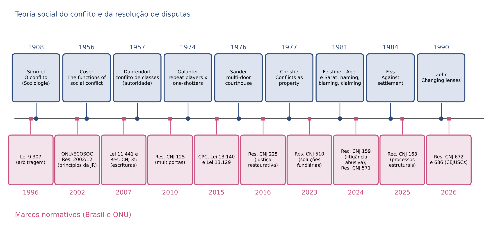
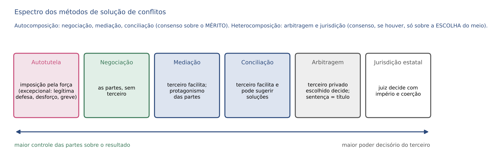
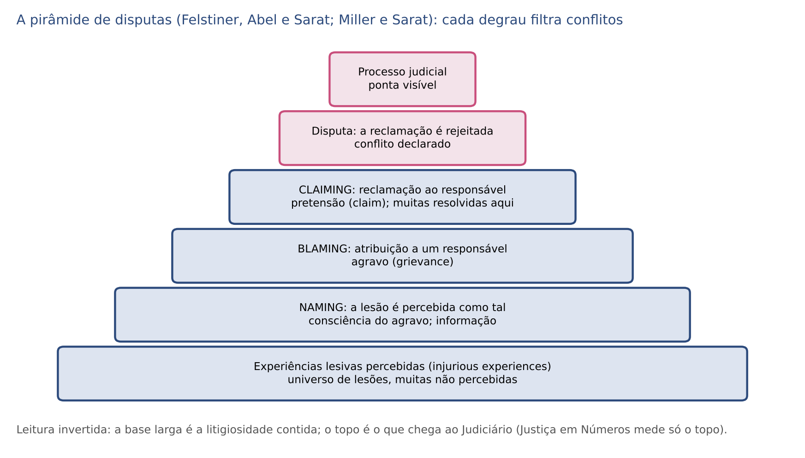
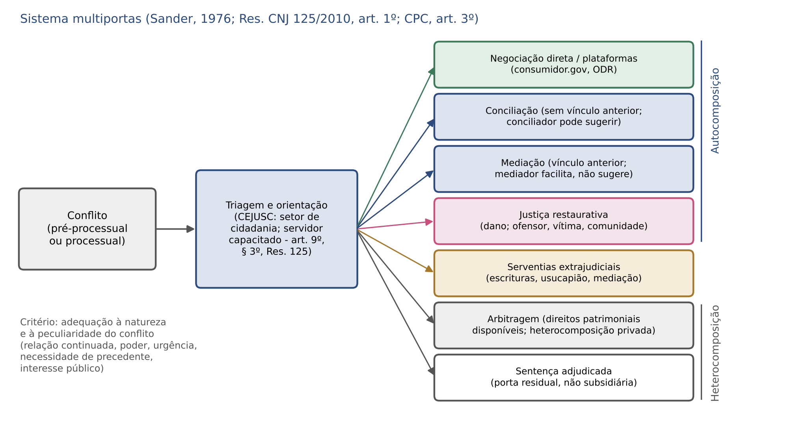
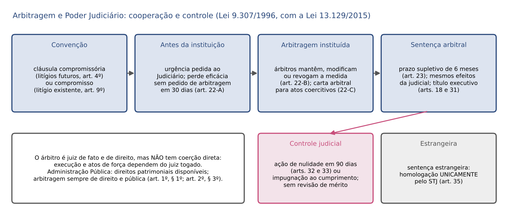
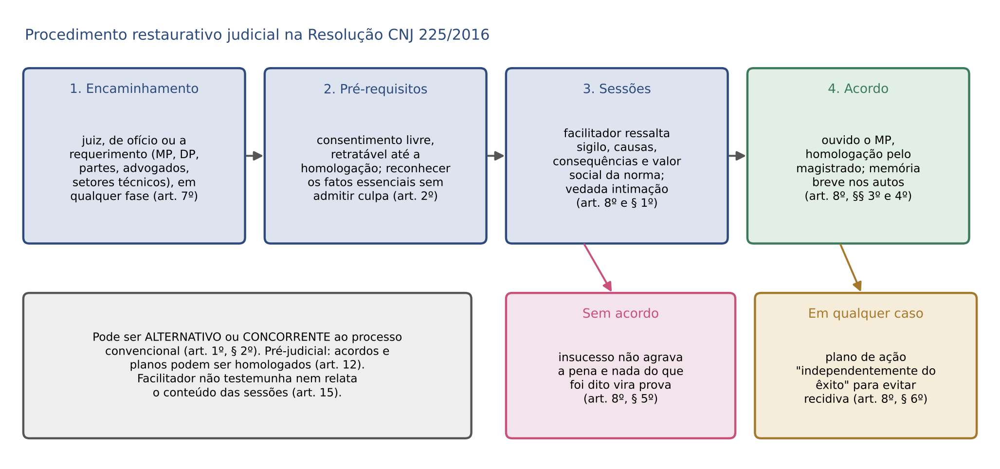
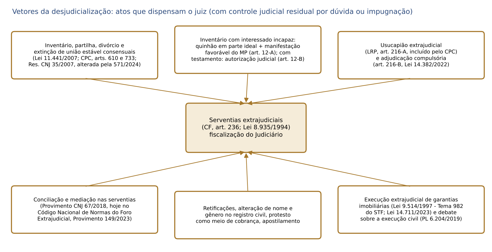
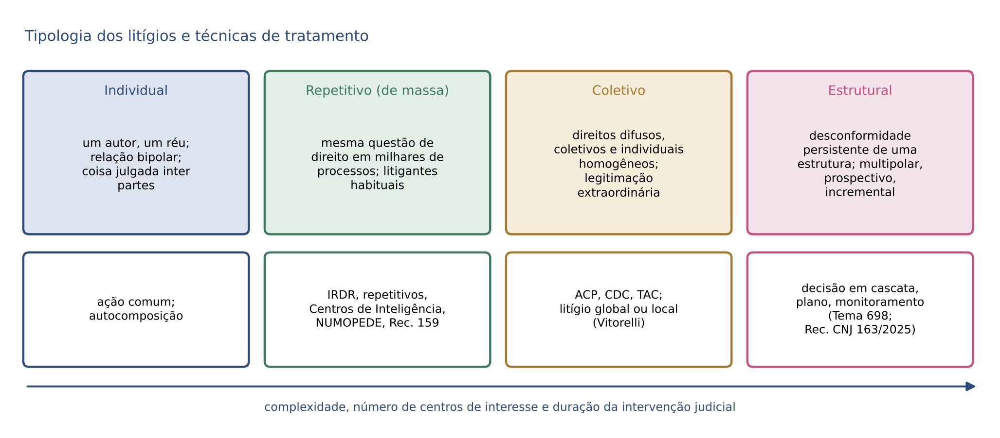

# CAPÍTULO 05 — CONFLITOS SOCIAIS E MECANISMOS DE SOLUÇÃO: LITIGIOSIDADE, MULTIPORTAS, ARBITRAGEM, JUSTIÇA RESTAURATIVA E LITÍGIOS ESTRUTURAIS

:::INCIDENCIA
TRF5 p. A.4; TJRS p. A.4; TJSC p. B.4. Nível A+. Lote: 21 questões (FGV 18, FCC 3), mais correlatas de outros capítulos.
O que mais cai: letra da Resolução CNJ 225/2016 (princípios, encaminhamento de ofício, deveres do facilitador, plano de ação), letra da Resolução CNJ 125/2010 (CEJUSC, NUPEMEC, advogado facultativo), arbitragem (poderes do árbitro sem coerção, prazo de seis meses, convenções), litígio estrutural (Tema 698, Recomendação CNJ 163/2025, Comissões de Soluções Fundiárias), desjudicialização (Resolução CNJ 35/2007 após a 571/2024) e litigância abusiva (Recomendação CNJ 159/2024).
:::

| Subtema | FGV | FCC | Padrão de cobrança |
|---|---|---|---|
| Conflito e sistemas não judiciais na Sociologia do Direito | 1 (Q3692385) | 0 | alternativas que assumem monismo estrito ("só a sentença pacifica") |
| Litigiosidade abusiva e demandas frívolas | 1 (Q4102418) | 0 | identificar o instrumento processual que encarece a demanda de baixa probabilidade |
| Sistema multiportas e Resolução CNJ 125/2010 | 2 (Q2370291, Q4102138) | 1 (Q2400453) | CEJUSC como lugar preferencial; competência normativa do CNJ e advogado facultativo (ADI 6.324) |
| Arbitragem (visão geral) | 2 (Q3058644, Q2507009) | 0 | árbitro sem coerção direta; prazo supletivo de seis meses; inversão cláusula x compromisso; STJ (e não STF) homologa |
| Justiça restaurativa (teoria e Resolução CNJ 225/2016) | 7 (Q2370315, Q3592815, Q2499111, Q4349557, Q2365449, Q3401964, Q3641456) | 0 | letra dos arts. 1º, 2º, 7º e 8º; "formalismo" e "de ofício" como iscas; tripé vítima-ofensor-comunidade; JR em justiça de transição |
| Serventias extrajudiciais e desjudicialização | 2 (Q3087434, Q3673828) | 0 | divórcio com filhos incapazes e alienação de bens do espólio na Resolução CNJ 35/2007 (redação da 571/2024) |
| Litígios coletivos e estruturais | 3 (Q2459867, Q3865797, Q3752787) | 2 (Q4012659, Q4012662) | Tema 698 (fins + plano, sem microgestão); elementos do litígio estrutural segundo o CNJ; Resolução CNJ 510/2023 |

## 05.1 O conflito na teoria social

### 05.1.1 Conflito como patologia ou como forma de sociação

A Sociologia do Direito parte de uma constatação empírica: não há sociedade sem conflito, e o Direito é apenas um dos mecanismos que o processam (ao lado dos costumes, da moral, da religião, do mercado e da política). Felippe Augusto de Miranda Rosa (Sociologia do direito: o fenômeno jurídico como fato social) sublinha que os conflitos são tão naturais quanto as divergências de interesses humanos e que muitos mecanismos sociais atuam simultaneamente para compor, acomodar ou ajustar as situações conflituosas. A questão teórica não é SE há conflito, mas qual o seu SENTIDO para a ordem social. Duas grandes tradições respondem de modo oposto:

| Tradição | Autores | Leitura do conflito | Função atribuída ao Direito |
|---|---|---|---|
| Consenso, integração (funcionalismo) | Durkheim; Talcott Parsons | desvio, disfunção, sintoma de anomia ou de integração insuficiente | restaurar o equilíbrio e a coesão; o Direito é mecanismo de integração (Parsons) |
| Conflito (materialismo, teoria do conflito) | Marx; Dahrendorf; em parte Weber | motor da mudança, inerente à distribuição desigual de poder e recursos | instrumento de dominação (Marx) ou institucionalização e regulação do conflito (Dahrendorf) |
| Conflito como forma de sociação | Simmel; Coser | o conflito também INTEGRA: cria vínculos, define fronteiras de grupo, reforça identidades | canalizar o conflito por formas reguladas, evitando a destruição da relação |

Durkheim e Marx estão desenvolvidos no Cap. 1 (01.4.2 e 01.4.3). Aqui interessam os teóricos que fizeram do conflito o objeto central.

Georg Simmel (1858–1918), no capítulo sobre o conflito (Der Streit) de sua Sociologia (Soziologie, 1908), sustenta que o conflito é uma das formas fundamentais de sociação (*Vergesellschaftung*): quem luta entra em relação com o adversário, e a própria disputa pressupõe regras, reconhecimento recíproco e um terreno comum. A hostilidade pura e a harmonia pura são abstrações; a vida social é mistura de convergência e divergência. Para Simmel, o conflito pode terminar pela vitória, pelo compromisso ou pela conciliação, e sua intensidade aumenta quanto maior a proximidade anterior entre os contendores (os conflitos entre íntimos são os mais acirrados), observação retomada pela mediação de conflitos de relação continuada (Cap. 8).

Lewis Coser (The functions of social conflict, 1956) sistematizou Simmel em proposições. Distinguiu conflitos REALISTAS (meio para obter um resultado específico, que pode ser substituído por alternativas funcionais, como a negociação) e NÃO REALISTAS (descarga de tensão, em que o antagonismo é fim em si e o alvo é intercambiável, como o bode expiatório). Mostrou que o conflito pode ser funcional: une o grupo internamente diante do externo, revela desequilíbrios de poder, estimula a criação de normas e instituições e funciona como "válvula de segurança" (*safety-valve institutions*). O perigo não é o conflito, mas a rigidez institucional que impede sua expressão e o acumula até a ruptura.

Ralf Dahrendorf (Classes e conflito de classes na sociedade industrial, 1957; edição inglesa de 1959) desloca o eixo marxista da propriedade dos meios de produção para a distribuição desigual de AUTORIDADE nas associações imperativamente coordenadas: em toda organização há quem mande e quem obedeça, e daí nascem grupos de interesse latentes e manifestos. O conflito é ubíquo e não desaparece; a sociedade moderna não o elimina, mas o REGULA, e a regulação eficaz exige reconhecimento da legitimidade do conflito, organização dos grupos e regras do jogo aceitas (conciliação, mediação, arbitragem, adjudicação). A institucionalização do conflito industrial (negociação coletiva, Justiça do Trabalho) é o seu exemplo paradigmático.

Max Weber trata a luta (*Kampf*) como relação social em que a ação se orienta pelo propósito de impor a própria vontade contra a resistência do outro; a concorrência é luta pacífica regulada. Para a Sociologia do Direito, isso explica por que a ordem jurídica não suprime a luta, mas a converte em concorrência regulada (o processo como luta ritualizada, com armas iguais).

Vilhelm Aubert (Competition and dissensus: two types of conflict and of conflict resolution, 1963) distinguiu conflitos de INTERESSES (os contendores querem o mesmo bem escasso e concordam sobre os valores: favorecem a barganha e o acordo) e conflitos de VALORES ou dissenso (desacordo sobre o que é verdadeiro ou justo: tendem à adjudicação, pois não se barganha uma convicção). A distinção é útil para a triagem multiportas (05.3): conflitos de interesse são mais aptos à autocomposição; conflitos de valores, à decisão.

Niklas Luhmann (Cap. 1, 01.4.6) não trata o conflito como patologia: o conflito é um sistema social (de contradição comunicada), e o Direito é o sistema que generaliza congruentemente expectativas normativas e as estabiliza contrafaticamente. A tese de Legitimação pelo procedimento (1969) é a que interessa aqui: o procedimento judicial não elimina o conflito, mas o ISOLA e o especifica, absorve a decepção do perdedor (que, tendo participado, perde o apoio social para a revolta) e transforma a disputa difusa em controvérsia decidível. Pierre Bourdieu (Cap. 1, 01.4.7) complementa: a entrada no campo jurídico exige a tradução do conflito vivido em linguagem técnica, com perda de controle das partes em favor dos profissionais.

:::DOUTRINA Lewis Coser, The functions of social conflict (1956)
Ponto de prova: Coser NÃO é funcionalista do consenso. Ele usa o vocabulário funcionalista (funções e disfunções) para demonstrar que o conflito é FUNCIONAL à integração e à mudança, contra a leitura parsoniana do conflito como desvio. Distinção-chave: conflito realista (meio) x não realista (fim em si, descarga de hostilidade). Inspiração declarada: Simmel.
:::

:::PEGADINHA Atribuições trocadas
Simmel = conflito como forma de sociação (1908). Coser = funções do conflito; realista x não realista; válvulas de segurança (1956). Dahrendorf = autoridade (e não propriedade) como base do conflito de classes; regulação do conflito (1957). Aubert = conflito de interesses x de valores (1963). Luhmann = legitimação pelo procedimento (1969). Alternativa que atribui a Dahrendorf a centralidade da propriedade dos meios de produção está descrevendo Marx.
:::

### 05.1.2 Funções do Direito diante do conflito e formas de composição

Miranda Rosa atribui ao Direito duas funções sociais diante do conflito: PREVENIR (disciplinar condutas e reduzir o choque de interesses) e COMPOR (oferecer meios de solução quando o conflito eclode). Na sua tipologia, as formas de composição se ordenam em quatro degraus: (a) negociação direta; (b) mediação e conciliação, quando a negociação fracassa e entra um terceiro que aproxima as partes; (c) arbitramento, quando não há consenso sobre o mérito, mas há sobre a escolha do terceiro que decidirá; (d) composição jurídica estatal, quando as hipóteses anteriores falham. A leitura é histórica e funcional: a autotutela primitiva cedeu à autocomposição, depois à arbitragem e, por fim, ao juiz estatal (o pretor e o magistrado romanos), sem que a heterocomposição estatal tenha eliminado as demais formas, que convivem com ela e hoje são deliberadamente fomentadas.

| Gênero | Espécies | Traço distintivo | Observação de prova |
|---|---|---|---|
| Autotutela | legítima defesa, desforço possessório imediato, direito de retenção, greve, autoexecutoriedade administrativa | imposição unilateral pela força ou por ato próprio | proibida como regra (crime de exercício arbitrário das próprias razões), admitida nas exceções legais; "não admitida em hipótese alguma" é FALSO |
| Autocomposição unilateral | renúncia, desistência, reconhecimento do pedido (submissão) | um dos lados abre mão | não há terceiro |
| Autocomposição bilateral | transação, por negociação direta ou assistida (conciliação, mediação) | concessões recíprocas ou solução construída pelas partes | o terceiro, se houver, NÃO decide |
| Heterocomposição | arbitragem (privada) e jurisdição (estatal) | terceiro imparcial decide | na arbitragem, o consenso está na ESCOLHA do meio (convenção), não no mérito |

A disciplina dogmática (conciliação e mediação no CPC e na Lei 13.140/2015, técnicas do mediador, princípios, audiência do art. 334) está no Cap. 8 e na Apostila de Processo Civil, Cap. 2. Aqui se desenvolve a perspectiva sociológica e institucional.

### 05.1.3 A transformação das disputas: *naming*, *blaming*, *claiming*

O conflito que chega ao juiz é o resultado de um processo social de filtragem. William Felstiner, Richard Abel e Austin Sarat (The emergence and transformation of disputes: naming, blaming, claiming, Law and Society Review, 1980–1981) descrevem três passagens: *naming* (perceber uma experiência como lesiva: muitas lesões nunca são percebidas como tais, por falta de informação ou porque foram naturalizadas); *blaming* (atribuir a lesão a alguém responsável, convertendo-a em agravo, *grievance*); *claiming* (dirigir a reclamação ao responsável). Só quando a reclamação é rejeitada há disputa; e só uma fração das disputas vira processo. A metáfora associada é a da pirâmide de disputas, cuja verificação empírica clássica é o estudo de Richard Miller e Austin Sarat (Grievances, claims, and disputes: assessing the adversary culture, 1980–1981).

Consequências para o juiz e para a política judiciária:

- A litigiosidade registrada (Justiça em Números) mede apenas o topo da pirâmide; a base corresponde à litigiosidade contida de Kazuo Watanabe e à procura suprimida de Boaventura de Sousa Santos (Cap. 1, 01.8.4).
- Os filtros não são neutros: informação, renda, escolaridade, gênero, raça e distância institucional determinam quem nomeia, quem culpa e quem reclama. Os litigantes habituais de Galanter (Cap. 1, 01.8.3) atravessam a pirâmide com facilidade; os eventuais desistem nos primeiros degraus.
- As disputas se TRANSFORMAM ao longo do percurso (são reformuladas, ampliadas ou estreitadas por advogados, servidores e juízes): o que chega ao processo é uma versão jurídica do conflito, muitas vezes distante do conflito vivido. Daí o argumento da mediação de que o processo resolve a lide jurídica e deixa intacta a lide sociológica.

:::DICA Lide processual x lide sociológica
A expressão "lide sociológica" (o conflito real, com interesses, emoções e relações) em contraste com a "lide processual" (o recorte delimitado pelo pedido e pela causa de pedir) é usada na literatura brasileira de mediação para justificar a adequação dos meios consensuais aos conflitos de relação continuada. Em prova oral, convém associá-la à pirâmide de disputas: a sentença decide a ponta, não a base.
:::

### 05.1.4 Sistemas não judiciais de composição: pluralismo e reconhecimento estatal

Os sistemas não judiciais de composição de litígios integram o fenômeno jurídico, e não apenas a "vida social". Três chaves já desenvolvidas no Cap. 1 (01.6) dão o fundamento: o pluralismo jurídico (Ehrlich, Santi Romano, Gurvitch, Griffiths), o direito de Pasárgada de Boaventura (instâncias comunitárias que previnem e resolvem conflitos com baixa institucionalização e retórica ampla) e a terceira onda de Cappelletti e Garth, que incorporou os meios alternativos ao enfoque do acesso à justiça.

A leitura sociológica contemporânea, presente nos materiais de Sociologia Jurídica cobrados em concurso, acrescenta que os sistemas não judiciais crescem com os NOVOS DIREITOS e os NOVOS TIPOS DE CONFLITO (consumo de massa, relações de vizinhança urbana, conflitos ambientais e fundiários, conflitos digitais), que exigem procedimentos mais rápidos, especializados e participativos, com ou sem intervenção estatal. O Estado reage de três modos: tolera (justiças comunitárias informais), reconhece e regula (Lei de Arbitragem, Lei de Mediação, mediação extrajudicial e escrituras públicas) ou incorpora ao próprio Judiciário (CEJUSCs, justiça restaurativa judicial). O sistema multiportas brasileiro combina os três.

:::QUESTAO FGV 2025 — ENAM — Exame Nacional da Magistratura 2025.2 (Q3692385)
Cobrado: duas famílias rurais em conflito pelo uso da água de um riacho evitam o Judiciário e constroem acordo em centro comunitário de mediação; pede-se a leitura sociológica à luz da Lei de Mediação. Gabarito oficial: D — a mediação revela a importância de mecanismos consensuais que integram práticas sociais e jurídicas, permitindo soluções adequadas às especificidades do caso.
Armadilhas: (A) só a decisão judicial pacifica de forma legítima e duradoura (monismo estrito); (B) a escolha demonstraria a ineficácia do Judiciário e soluções "sem qualquer respaldo normativo" (há a Lei 13.140/2015, que regula a mediação extrajudicial); (C) a Sociologia do Direito não reconheceria sistemas não judiciais (é o contrário: pluralismo, 05.1.4); (E) o Direito buscaria "a eliminação total das disputas" (nenhuma teoria do conflito sustenta isso: o Direito regula e canaliza, 05.1.1). Questão também comentada como correlata no Cap. 1.
:::

## 05.2 Judicialização e litigiosidade

### 05.2.1 Conceitos: judicialização, juridificação e explosão de litigiosidade

Três conceitos vizinhos, que a banca troca:

| Conceito | Conteúdo | Referências |
|---|---|---|
| Judicialização das relações sociais | expansão do Judiciário como arena de solução de conflitos cotidianos antes resolvidos por outras instâncias (família, vizinhança, escola, mercado, sindicato), com o juiz convertido em protagonista da vida social | Luiz Werneck Vianna e outros, A judicialização da política e das relações sociais no Brasil (1999) |
| Judicialização da política | transferência de decisões de forte conteúdo político dos Poderes eleitos para o Judiciário e expansão dos métodos judiciais nas demais arenas | C. Neal Tate e Torbjörn Vallinder, The global expansion of judicial power (1995); desenvolvimento e distinção em relação ao ativismo no Cap. 25 |
| Juridificação (*Verrechtlichung*) | expansão do Direito positivo sobre esferas da vida antes reguladas informalmente; para Habermas, colonização do mundo da vida pelo sistema quando a regulação jurídica invade relações comunicativas | Habermas, Teoria da ação comunicativa (1981); Teubner, Juridification (1987) |

A judicialização é fenômeno estrutural, e não opção voluntarista dos juízes. Causas apontadas pela literatura brasileira: (i) a Constituição de 1988, analítica e dirigente, com amplo catálogo de direitos sociais exigíveis e controle de constitucionalidade amplo; (ii) a abertura do acesso (Juizados, Defensoria, gratuidade, processo coletivo, processo eletrônico); (iii) a massificação das relações de consumo, bancárias, de telecomunicações e previdenciárias; (iv) a omissão ou a deficiência de políticas públicas (saúde, educação, previdência); (v) o próprio Estado como grande litigante; (vi) a "cultura da sentença" (Kazuo Watanabe), que associa justiça a decisão adjudicada e desvaloriza o consenso.

Em números (Justiça em Números 2026, ano-base 2025, conforme divulgação do relatório em 26/6/2026): o Judiciário encerrou 2025 com cerca de 75,5 milhões de processos pendentes, recebeu cerca de 40,9 milhões de casos novos (o maior volume da série iniciada em 2009), com taxa de congestionamento de 62,6% e índice de conciliação de 11,2%. A questão Q3058644 (ENAM 2024.2) usou o dado de 84 milhões de processos em tramitação em 2023 para introduzir os meios "paraestatais". O ponto de prova não é o número, mas a leitura: o índice de conciliação baixo, apesar de mais de uma década de política judiciária consensual, revela os limites da oferta de portas sem mudança cultural e sem triagem efetiva.

:::ATENCAO Judicialização não é ativismo
Judicialização é FATO (a demanda chega ao Judiciário, que não pode recusar-se a decidir: CF, art. 5º, XXXV). Ativismo é ATITUDE (modo expansivo de interpretar e decidir). A distinção, popularizada no Brasil por Luís Roberto Barroso, é desenvolvida no Cap. 25. Alternativa que trata judicialização como escolha deliberada do juiz está errada.
:::

### 05.2.2 Hiperlitigância, litigância repetitiva e litigância abusiva

A explosão de litigiosidade brasileira tem dois rostos que convivem (o paradoxo já anotado no Cap. 1, 01.8.5): procura suprimida dos vulneráveis e hiperlitigância de poucos atores. A hiperlitigância concentra-se em litigantes habituais (instituições financeiras, operadoras de telefonia e planos de saúde, concessionárias, INSS e Fazendas Públicas) e, mais recentemente, em demandas artificialmente fabricadas em escala por estruturas de captação de clientes. O CNJ distingue o fenômeno legítimo da litigância repetitiva (muitas pessoas com o mesmo problema real) do fenômeno patológico da litigância abusiva.

A Recomendação CNJ 159, de 23/10/2024, "recomenda medidas para identificação, tratamento e prevenção da litigância abusiva" e contém o conceito cobrado pela FGV (art. 1º): litigância abusiva é "o desvio ou manifesto excesso dos limites impostos pela finalidade social, jurídica, política e/ou econômica do direito de acesso ao Poder Judiciário, inclusive no polo passivo, comprometendo a capacidade de prestação jurisdicional e o acesso à Justiça". Estrutura do ato:

| Dispositivo | Conteúdo |
|---|---|
| Art. 1º, parágrafo único | litigância abusiva é GÊNERO; espécies: condutas ou demandas sem lastro, temerárias, artificiais, procrastinatórias, frívolas, fraudulentas, desnecessariamente fracionadas, configuradoras de assédio processual ou violadoras do dever de mitigação de prejuízos, as quais, conforme extensão e impactos, podem constituir litigância PREDATÓRIA |
| Art. 2º e Anexo A | 20 condutas potencialmente abusivas, inclusive as que parecem lícitas isoladamente, mas indicam desvio quando vistas em conjunto ou ao longo do tempo (gratuidade sem evidência mínima; pedidos padronizados de dispensa de audiência; desistência após indeferimento de liminar ou após a defesa juntar o contrato; ajuizamento em comarca sem vínculo com as partes; iniciais genéricas idênticas; procurações irregulares; concentração de grande volume em poucos profissionais; assédio processual; cessão do direito de demandar) |
| Art. 3º e Anexo B | diante de indícios, o juiz PODE, no poder geral de cautela e de forma FUNDAMENTADA, determinar diligências para evidenciar a legitimidade do acesso (triagem, audiências preliminares, fomento à conciliação inclusive pré-processual com presença das partes, verificação da gratuidade com Infojud e Renajud, ponderação criteriosa da inversão do ônus da prova, julgamento conjunto, reunião no foro do réu no assédio judicial, documentos originais, prova de tentativa administrativa prévia, comunicação à OAB) |
| Art. 4º e Anexo C | medidas institucionais pelos tribunais, especialmente por Centros de Inteligência e Núcleos de Monitoramento do Perfil de Demandas |
| Art. 5º | formação continuada e campanhas em linguagem simples |

No plano jurisprudencial, a Corte Especial do STJ fixou, em recurso repetitivo, que o juiz pode exigir, de modo fundamentado e com observância da razoabilidade, emenda da inicial para demonstração do interesse de agir e da autenticidade da postulação diante de indícios de litigância abusiva (STJ, REsp n. 2.021.665, Relator Ministro Moura Ribeiro, Corte Especial, j. 13/3/2025, Tema 1.198; regime processual na Apostila de Processo Civil, Cap. 16).

O olhar humanístico impõe duas cautelas, cobradas em prova oral: (i) o combate ao abuso não pode reconstruir barreiras de acesso para os litigantes eventuais e vulneráveis (Galanter, Boaventura), de modo que as medidas devem ser motivadas, proporcionais e dirigidas a indícios concretos, e não a categorias de autores; (ii) o abuso também ocorre no POLO PASSIVO (o grande litigante que resiste sistematicamente a pretensões legítimas, aposta na demora e não cumpre precedentes), o que a própria definição do art. 1º reconhece.

:::QUESTAO FGV 2026 — ENAM — Exame Nacional da Magistratura 2026.1 (Q4102418)
Cobrado: a partir do conceito de litigância abusiva da Recomendação CNJ 159/2024 e da noção de demanda frívola (baixa probabilidade de êxito), qual regra processual desincentiva o ajuizamento de demandas frívolas. Gabarito oficial: D — a exigência de depósito prévio para a ação rescisória (CPC, art. 968, II: 5% do valor da causa, revertido ao réu se a ação for, por unanimidade, inadmitida ou improcedente).
Raciocínio: a demanda frívola é desincentivada por regras que elevam o custo esperado de litigar sem chance razoável (depósito que se perde, sucumbência, multas). Armadilhas: denunciação da lide (A) e conexão (C) são técnicas de organização processual, neutras quanto ao incentivo; gratuidade (B) REDUZ o custo de litigar; inversão do ônus da prova (E) favorece o autor consumidor. A lógica do valor esperado e das demandas frívolas é da Análise Econômica do Direito (Cap. 36), onde estão as correlatas Q3898987 (TJ-PR 2026: desincentivo por litigância de má-fé e sucumbência, com contraditório) e Q3996904 (TRF2 2026: Tema 1.184 do STF explicado como demanda de valor esperado negativo).
:::

:::EXEMPLO Demandas em massa com indícios de captação
Situação: a vara recebe, em dois meses, 600 ações declaratórias de inexistência de débito contra o mesmo banco, com iniciais idênticas, procurações com assinatura eletrônica não qualificada, comprovantes de endereço em nome de terceiros e pedidos de gratuidade sem documento algum; o mesmo escritório, sediado em outro Estado, patrocina todas.
Solução fundamentada: (1) identificar os indícios do Anexo A da Recomendação CNJ 159/2024 (itens 1, 5, 7, 11 e 13) e registrar a análise em decisão motivada, sem presumir má-fé da parte; (2) aplicar medidas do Anexo B proporcionais: intimação para emenda com procuração e documentos regulares e prova de tentativa administrativa (Tema 1.198 do STJ), verificação da gratuidade, eventual audiência para ouvir a parte sobre sua ciência da demanda; (3) comunicar ao Centro de Inteligência ou ao núcleo de monitoramento do tribunal e, se houver indício de captação irregular, à OAB; (4) NÃO extinguir em bloco sem exame individual, NÃO criar exigência genérica para todos os consumidores do banco e preservar a prioridade de quem tem pretensão legítima. A conduta preserva o acesso à justiça e a imparcialidade (Código de Ética da Magistratura Nacional, Cap. 12).
:::

### 05.2.3 Cultura da sentença e cultura da pacificação

Kazuo Watanabe contrapôs a "cultura da sentença" (formação jurídica e prática forense que veem na solução adjudicada o único modo legítimo de fazer justiça, com valorização do juiz que sentencia e desconfiança do acordo como "justiça de segunda classe") à "cultura da pacificação" (tratamento adequado do conflito, com preferência pelo consenso quando a natureza da disputa o recomenda). A mesma linha de pensamento sustenta a releitura do acesso à justiça como acesso à ordem jurídica justa (Cap. 1, 01.8.4), expressão que a Resolução CNJ 125/2010 e a Resolução CNJ 225/2016 incorporaram aos seus considerandos ("acesso à ordem jurídica justa e a soluções efetivas").

A política judiciária de tratamento adequado dos conflitos é, assim, tanto um programa de gestão (reduzir acervo) quanto um programa cultural. As bancas cobram a segunda dimensão: o CEJUSC não é instrumento de descongestionamento a qualquer preço, e o acordo obtido por pressão, sem informação ou com desequilíbrio de poder, viola os princípios da decisão informada e da autonomia da vontade (Código de Ética de Conciliadores e Mediadores, Anexo III da Resolução CNJ 125/2010; ver 05.3.4).

## 05.3 Sistemas não judiciais e o sistema multiportas

### 05.3.1 Mapa dos métodos e terminologia

O movimento norte-americano de *Alternative Dispute Resolution* (ADR) nasceu nos anos 1970 da combinação de três vetores: a crise de congestionamento dos tribunais, a crítica comunitária ao formalismo e o interesse empresarial por soluções rápidas e confidenciais. No Brasil, a expressão "meios alternativos" foi substituída, na legislação e nos atos do CNJ, por "meios ADEQUADOS": a sentença deixa de ser o padrão e os demais métodos deixam de ser exceção; cada conflito tem sua porta adequada. A Resolução CNJ 125/2010, na redação da Resolução CNJ 326/2020, fala em "tratamento adequado dos conflitos de interesses" e em "meios adequados à sua natureza e peculiaridade" (art. 1º).

Panorama dos métodos não judiciais ou não adjudicatórios:

| Método | Quem decide | Base normativa | Nota sociológica |
|---|---|---|---|
| Negociação direta | as partes | autonomia privada; transação (CC, arts. 840 a 850) | maior controle, maior risco de assimetria de poder |
| Negociação assistida em plataformas (*online dispute resolution*) | as partes, com interface tecnológica | consumidor.gov.br; plataformas privadas; Enunciado 18 do FONAMEC (05.3.4) | reduz custo de entrada; pode reproduzir assimetrias informacionais |
| Conciliação | as partes, com terceiro que pode sugerir | CPC, art. 165, § 2º; Lei 9.099/1995 | indicada sem vínculo anterior (Cap. 8) |
| Mediação | as partes, com terceiro facilitador | CPC, art. 165, § 3º; Lei 13.140/2015 | indicada com vínculo anterior; foco em interesses e relação (Cap. 8) |
| Justiça restaurativa | os envolvidos e a comunidade, com facilitador | Resolução CNJ 225/2016 | foco no dano e nas necessidades (05.5) |
| Câmaras administrativas de prevenção e resolução de conflitos | consenso entre Administração e particular ou entre órgãos | Lei 13.140/2015, arts. 32 a 40 | consensualidade administrativa (Cap. 8; Q3692374) |
| *Dispute boards* (comitês de prevenção e solução de disputas) | comitê técnico, com recomendação ou decisão conforme o contrato | Lei 14.133/2021, art. 151 (meios alternativos nos contratos administrativos) | prevenção em contratos de longa duração |
| Ouvidorias, Procons, agências reguladoras | órgão administrativo | CDC; leis setoriais | filtros pré-processuais de massa |
| Serventias extrajudiciais | o próprio interessado, com tabelião ou registrador | CF, art. 236; Lei 11.441/2007; Provimento CNJ 149/2023 | desjudicialização de atos consensuais (05.6) |
| Arbitragem | árbitro escolhido | Lei 9.307/1996 | heterocomposição privada (05.4) |

### 05.3.2 Frank Sander e o *multi-door courthouse*

O conceito de tribunal multiportas foi formulado por Frank E. A. Sander, professor de Harvard, na Pound Conference (1976), em conferência intitulada Varieties of dispute processing. A ideia: o tribunal do futuro seria um centro de resolução de disputas, com um setor de triagem (*screening*) que encaminharia cada caso à porta adequada (mediação, arbitragem, *fact-finding*, ombudsman, adjudicação). O nome *multi-door courthouse* foi dado depois, por uma publicação da American Bar Association que ilustrou a ideia com um prédio de várias portas. A seleção da porta deve considerar a natureza do conflito, a relação entre as partes (continuada ou episódica), o valor e a complexidade, o custo e a rapidez e a necessidade de um precedente público. Sander e Stephen Goldberg desenvolveram depois critérios práticos de escolha em Fitting the forum to the fuss (1994).

No Brasil, o sistema multiportas resulta da combinação: CF, art. 5º, XXXV (inafastabilidade da APRECIAÇÃO jurisdicional, que não se confunde com monopólio estatal); CPC, art. 3º, §§ 1º a 3º (arbitragem permitida; Estado promove, sempre que possível, a solução consensual; conciliação e mediação "deverão ser estimulados" por todos os atores, inclusive no curso do processo); Lei 13.140/2015; Lei 9.307/1996; e a Resolução CNJ 125/2010, que deu ao Judiciário o papel de gestor da política.

### 05.3.3 Críticas sociológicas ao movimento consensual

A prova oral costuma pedir a avaliação crítica. As objeções clássicas:

| Crítica | Autor | Conteúdo | Resposta da política judiciária |
|---|---|---|---|
| Contra o acordo | Owen Fiss, Against settlement (1984) | o acordo é o equivalente civil do *plea bargaining*: pressupõe igualdade inexistente entre as partes, é obtido sob pressão de custos e tempo, impede que o tribunal produza normas públicas e dê sentido aos valores constitucionais (função de *adjudication*), e deixa a "paz" no lugar da "justiça" | triagem: casos que exigem precedente, envolvem interesse público ou forte desequilíbrio vão à adjudicação; decisão informada e controle de legalidade na homologação |
| Ideologia da harmonia | Laura Nader (Harmony ideology, 1990) | o discurso da harmonia e do consenso pode funcionar como controle social que silencia reivindicações de direitos de grupos subordinados | consensualidade não é dever da parte; respeito à autonomia e à recusa |
| Vantagem dos litigantes habituais | Galanter (Cap. 1, 01.8.3) | o RP negocia em escala, conhece o "preço" dos casos e oferece acordos que evitam precedentes adversos | Enunciado 15 do FONAMEC: política de não judicialização dirigida aos grandes litigantes; monitoramento de acordos padronizados |
| Informalização da justiça | Boaventura; Richard Abel (The politics of informal justice, 1982) | a justiça informal pode expandir o controle estatal sob aparência comunitária e oferecer justiça de segunda classe aos pobres | CEJUSC com servidores e conciliadores capacitados, código de ética, avaliação do usuário |
| Violência e poder | crítica feminista à mediação em violência doméstica | a mediação pressupõe equilíbrio mínimo de poder e segurança; em contexto de violência, pode reforçar a dominação | cautela; triagem; proteção prioritária; ver Cap. 28 |

:::DOUTRINA Owen Fiss, Against settlement (Yale Law Journal, 1984)
Tese: a adjudicação não serve só para resolver disputas privadas, mas para explicitar e dar força aos valores públicos incorporados em textos de autoridade (Constituição, leis). O acordo "é uma capitulação às condições da sociedade de massa" e não deve ser exaltado. Fiss não nega o acordo em si; nega que deva ser política pública preferencial em todos os casos, sobretudo em litígios de interesse público. Ligação: Fiss é também um dos teóricos da reforma estrutural (The forms of justice, 1979; ver 05.7.3).
:::

### 05.3.4 A Resolução CNJ 125/2010: Política Judiciária Nacional de Tratamento Adequado dos Conflitos

Editada em 29/11/2010 e alterada pelas Emendas 1/2013 e 2/2016 e pelas Resoluções CNJ 290/2019, 326/2020, 390/2021, 672/2026 e 686/2026, a Resolução CNJ 125/2010 institui a política judiciária de tratamento adequado dos conflitos. Pontos de letra:

| Dispositivo | Conteúdo | Pegadinha |
|---|---|---|
| Art. 1º | "Fica instituída a Política Judiciária Nacional de Tratamento Adequado dos Conflitos de Interesses, tendente a assegurar a todos o direito à solução dos conflitos por meios adequados à sua natureza e peculiaridade" (redação da Resolução 326/2020) | "meios alternativos" é a terminologia antiga |
| Art. 1º, parágrafo único | aos órgãos judiciários incumbe, "antes da solução adjudicada mediante sentença", oferecer outros mecanismos, em especial a mediação e a conciliação, e prestar atendimento e orientação ao cidadão | a orientação ao cidadão (cidadania) integra a política |
| Art. 2º | diretrizes: centralização das estruturas judiciárias; adequada formação e treinamento de servidores, conciliadores e mediadores; acompanhamento estatístico específico | — |
| Art. 4º | "Compete ao Conselho Nacional de Justiça organizar programa" de incentivo à autocomposição e à pacificação social | é o CNJ, e não o STF (Q2507009, alternativa D) |
| Art. 7º | os tribunais criam os Núcleos Permanentes de Métodos Consensuais de Solução de Conflitos (NUPEMECs), coordenados por magistrados e compostos por magistrados da ativa ou aposentados e servidores; cabe-lhes, entre outras atribuições, instalar CEJUSCs, promover capacitação, propor convênios, manter cadastro de mediadores e conciliadores e regulamentar a remuneração | o NUPEMEC é órgão de PLANEJAMENTO e gestão da política; quem realiza as sessões é o CEJUSC |
| Art. 7º, § 6º | "Aos mediadores e conciliadores, INCLUSIVE membros das Câmaras Privadas de Conciliação, aplicam-se as regras de impedimento e suspeição" (CPC, art. 148, II) | a Q2507009 trocou "inclusive" por "exceto" e "aplicam-se" por "não se aplicam" |
| Art. 7º, § 7º | impedimento de um ano, contado da última audiência, para assessorar, representar ou patrocinar qualquer das partes (CPC, art. 172) | — |
| Art. 8º, caput | os CEJUSCs são unidades do Judiciário "PREFERENCIALMENTE responsáveis pela realização ou gestão das sessões e audiências de conciliação e mediação" a cargo de conciliadores e mediadores, e pelo atendimento e orientação ao cidadão | base da Q4102138 |
| Art. 8º, § 1º | as sessões PRÉ-PROCESSUAIS "deverão ser realizadas nos Centros"; as judiciais, EXCEPCIONALMENTE, nos próprios juízos, por conciliadores e mediadores cadastrados e supervisionados pelo juiz coordenador | — |
| Art. 8º, § 2º | nos Tribunais de Justiça, CEJUSC obrigatório onde existam DOIS juízos, juizados ou varas com competência para a audiência do art. 334 do CPC | — |
| Art. 8º-A a 8º-D (Resolução 672/2026) | o CEJUSC é unidade judiciária especializada, com competência para realizar e HOMOLOGAR acordos processuais e pré-processuais; o pré-processual é realizado e homologado no CEJUSC pelo juiz coordenador; as sessões processuais podem ser realizadas e homologadas pelo juízo de origem ou pelo CEJUSC, conforme critérios do NUPEMEC; plano de gestão dos CEJUSCs; códigos de movimentação obrigatórios; revisão periódica das metas de conciliação | novidade de 2026, provável alvo de prova |
| Art. 8º, § 8º (Resolução 672/2026) | estatística: os atos homologatórios contam para o CEJUSC (serventia), para o magistrado que efetivamente praticar o ato e, no pré-processual, para o juiz coordenador | — |
| Art. 9º | o CEJUSC tem juiz coordenador (e, se necessário, adjunto), que administra o Centro, homologa acordos e supervisiona conciliadores e mediadores; designação pelo Presidente do Tribunal, "salvo disposição diversa em regramento local", entre os que fizeram o treinamento do Anexo I; ao menos um servidor com dedicação exclusiva, capacitado, para triagem | — |
| Art. 11 | "Nos Centros PODERÃO atuar membros do Ministério Público, defensores públicos, procuradores e/ou advogados" | presença facultativa, declarada constitucional na ADI 6.324 |
| Art. 12 | só atuam conciliadores e mediadores capacitados na forma do Anexo I, com estágio supervisionado, aperfeiçoamento permanente e avaliação do usuário; sujeitos ao Código de Ética do Anexo III | — |
| Arts. 12-C a 12-F | Câmaras Privadas: cadastro obrigatório para sessões INCIDENTES a processo e facultativo para as pré-processuais; percentual de audiências não remuneradas para beneficiários da gratuidade; vedado usar brasão da República e as denominações "Tribunal" e "juiz" | — |
| Anexo III | Código de Ética de Conciliadores e Mediadores Judiciais | ver quadro abaixo |
| Anexo V (Resolução 686/2026) | Enunciados do FONAMEC referendados pelo Plenário, com aplicabilidade restrita à Justiça Estadual | vinculatividade por integração à Resolução (art. 12-A, § 2º) |

Código de Ética de Conciliadores e Mediadores (Anexo III), art. 1º, princípios: confidencialidade, decisão informada, competência, imparcialidade, independência e autonomia, respeito à ordem pública e às leis vigentes, empoderamento e validação. Art. 2º, regras do procedimento: informação, autonomia da vontade, ausência de obrigação de resultado, desvinculação da profissão de origem e compreensão quanto à conciliação e à mediação. As definições (por exemplo: empoderamento é o dever de estimular os interessados a aprenderem a resolver melhor seus conflitos futuros; validação, o de estimulá-los a se perceberem reciprocamente como seres humanos merecedores de atenção e respeito) e as técnicas são desenvolvidas no Cap. 8, onde está a correlata Q2370305 (TJ-RJ 2024: gabarito C, "confidencialidade, competência, empoderamento, respeito à ordem pública e decisão informada"; as demais alternativas incluíam "parcialidade", "dependência" ou "publicidade").

Enunciados do FONAMEC incorporados em 2026 (Anexo V) de maior interesse humanístico: preferência pelo tratamento pré-processual para evitar a judicialização (Enunciado 5); proposta aos grandes litigantes da comarca de política pública de não judicialização (Enunciado 15); acordos homologados no setor pré-processual são títulos executivos JUDICIAIS (Enunciado 16); divulgação de plataformas *online* de resolução consensual (Enunciado 18); só a recusa expressa de AMBAS as partes impede a audiência do art. 334 do CPC (Enunciado 19); prepostos de pessoas jurídicas com conhecimento dos fatos e autonomia para negociar, sob pena da multa do art. 334, § 8º (Enunciado 23); enunciados sobre a fase conciliatória do superendividamento (arts. 104-A e 104-B do CDC), inclusive o respeito ao mínimo existencial (Enunciado 40).

:::JURIS STF, ADI n. 6.324, j. 21/8/2023
Objeto: ação da OAB contra a Resolução CNJ 125/2010 na parte em que torna facultativa a representação por advogado ou defensor público nos CEJUSCs. Resultado: improcedência, por unanimidade (Relator Ministro Luís Roberto Barroso; Informativo 1.104). Fundamentos: (1) a matéria está na competência do CNJ para o controle da atuação administrativa do Judiciário (CF, art. 103-B, § 4º, I), lida de forma ampla; (2) a Resolução não dispensa advogado onde a lei processual o exige: aplica-se às fases pré-processuais e aos procedimentos em que a própria lei dispensa a assistência (Juizados; Lei 13.140/2015, art. 26, quanto à mediação judicial nos casos legais); (3) a indispensabilidade do advogado à administração da Justiça (CF, art. 133) não impõe assistência técnica em todo ato de negociação de direitos por pessoa capaz.
:::

:::QUESTAO FCC 2024 — TRT 11ª Região — Analista Judiciário, Área Judiciária (Q2400453)
Cobrado: competência do CNJ para editar a resolução que regula os CEJUSCs e constitucionalidade da facultatividade da representação por advogado ou defensor público. Gabarito oficial: D — o CNJ tem competência e a previsão de facultatividade é constitucional, tanto para o advogado quanto para o defensor.
Armadilhas: as alternativas combinam "não tem competência" com "inconstitucional" ou distinguem advogado de defensor (B). A ADI 6.324 tratou as duas figuras do mesmo modo. Para o caso FCC na DPE-MA 2026 (Q4012610, Cap. 8: acordo de família pré-processual no CEJUSC, sem advogado, homologado após oitiva do MP; gabarito D, válido, porque a Lei 13.140/2015 faculta a assistência na mediação extrajudicial), a mesma lógica se aplica.
:::

:::QUESTAO FGV 2026 — TJ-BA — Juiz Leigo (Q4102138)
Cobrado: juíza leiga lotada em Juizado Especial Cível de comarca com quatro juizados de mesma competência pergunta onde deve ser feita a conciliação, segundo a Resolução CNJ 125/2010. Gabarito oficial: B — preferencialmente em um CEJUSC.
Fundamento: art. 8º, caput (CEJUSCs "preferencialmente responsáveis" pelas sessões a cargo de conciliadores) e § 1º (sessões judiciais nos próprios juízos e juizados só EXCEPCIONALMENTE, com conciliadores cadastrados e supervisão do juiz coordenador); havendo dois ou mais juizados, o CEJUSC é obrigatório nos Tribunais de Justiça (§ 2º). Armadilhas: (A) inverte a regra; (C) a (E) inventam uma escolha entre JEC, centros descentralizados ou instituições parceiras, conforme opção das partes, do juiz togado ou da Corregedoria. Após a Resolução CNJ 672/2026, a homologação de acordos processuais pode ser feita pelo juízo de origem ou pelo CEJUSC conforme critérios do NUPEMEC (art. 8º-A, § 2º), mas a preferência do art. 8º, caput, permanece.
:::

:::QUESTAO FGV 2024 — TJ-RJ — Mediador Judiciário (Q2370291)
Cobrado: letra da Resolução 12/2022 do Órgão Especial do TJ-RJ, que regulamenta localmente a política da Resolução CNJ 125/2010. Gabarito oficial: B — o NUPEMEC seleciona os magistrados coordenadores dos CEJUSCs entre os inscritos, observados objetivamente a antiguidade na carreira e o requisito de capacitação.
Comentário: ato normativo estadual de outro tribunal, sem interesse direto para TJSC, TJRS e TRF5; serve para fixar dois padrões nacionais que a questão explorou: (i) o NUPEMEC não "realiza" sessões (A erra ao atribuir-lhe a função própria do CEJUSC, art. 8º da Resolução CNJ 125/2010); (ii) a CAPACITAÇÃO é requisito para o juiz coordenador (art. 9º, § 1º, da Resolução CNJ 125/2010), por isso a alternativa E está errada. A designação, segundo a Resolução nacional, é do Presidente do Tribunal "salvo disposição diversa em regramento local", o que explica a escolha diferente do TJ-RJ (C, indicação pelo Corregedor, está errada para o regramento fluminense).
:::

:::EXEMPLO Juiz coordenador de CEJUSC e acordo desequilibrado
Situação: em sessão pré-processual de superendividamento, o credor bancário apresenta proposta que compromete toda a renda do consumidor idoso, que, sem advogado, diz aceitar "para acabar logo com isso". O conciliador leva o termo à homologação.
Solução: (1) a ausência de advogado é válida (ADI 6.324), mas o juiz coordenador deve verificar a decisão informada e o respeito à ordem pública (Anexo III, art. 1º, II e VI), além do mínimo existencial no plano de pagamento (CDC, art. 104-A; Enunciado 40 do FONAMEC, Anexo V); (2) o juiz não homologa acordo ilegal ou inexequível (o conciliador também não tem dever de redigi-lo: Anexo III, art. 1º, V); (3) pode suspender a sessão, orientar sobre a Defensoria Pública e designar nova data com o formulário socioeconômico (Enunciado 46). A conduta concilia a política consensual com a crítica de Fiss: consenso sem igualdade mínima não é justiça.
:::

## 05.4 Arbitragem: visão geral e leitura sociológica

### 05.4.1 Natureza e significado social

A arbitragem é heterocomposição PRIVADA: as partes, capazes, escolhem um terceiro (ou um tribunal arbitral) para decidir litígio sobre direitos patrimoniais disponíveis, e a sentença tem os mesmos efeitos da sentença judicial. Sobre sua natureza, a doutrina se divide entre a corrente contratualista (a arbitragem é negócio privado; a jurisdição seria monopólio estatal), a jurisdicional (Carlos Alberto Carmona; Fredie Didier Jr.: jurisdição exercida por particulares, autorizada por lei e convencionada pelas partes) e a mista. O CPC adota linguagem compatível com a natureza jurisdicional ao dizer que não se excluirá "da apreciação jurisdicional" ameaça ou lesão a direito e que "é permitida a arbitragem, na forma da lei" (art. 3º, caput e § 1º). O STF declarou, por maioria, a constitucionalidade da Lei 9.307/1996, inclusive da execução específica da cláusula compromissória, ao julgar incidente em homologação de sentença estrangeira: a manifestação de vontade na cláusula e a supressão judicial da recusa em firmar o compromisso não ofendem a inafastabilidade (STF, SE n. 5.206 AgR, Relator Ministro Sepúlveda Pertence, Plenário, j. 12/12/2001; Informativo 254; vencido em parte o relator).

A Sociologia do Direito lê a arbitragem por três ângulos:

- Mercado e globalização: a arbitragem comercial internacional é a instância típica da *lex mercatoria* e da governança transnacional privada (Cap. 1, 01.6.1, Teubner). Yves Dezalay e Bryant Garth (Dealing in virtue, 1996) mostraram que a arbitragem internacional se constituiu como mercado de "virtude" e prestígio, disputado por elites jurídicas, com árbitros cuja autoridade deriva de capital simbólico (leitura bourdieusiana).
- Seletividade: é justiça cara e especializada, acessível sobretudo a empresas e a litigantes de alto valor; daí a proteção do aderente (art. 4º, § 2º) e a desconfiança em relações de consumo e de trabalho.
- Desafogo e legitimidade: a arbitragem retira do Judiciário litígios complexos de alto valor, mas depende do juiz estatal para a coerção e se submete a controle de validade; a relação é de cooperação e controle, não de concorrência.

### 05.4.2 Regime essencial (o que a banca cobra fora do Processo Civil)

O regime processual completo (convenção, competência-competência, tutelas de urgência, carta arbitral, sentença parcial, nulidade, arbitragem com a Administração) está na Apostila de Processo Civil, Cap. 2, 02.6 e 02.7. Para a formação humanística, basta o quadro abaixo, conferido na redação vigente da Lei 9.307/1996:

| Tema | Regra | Dispositivo |
|---|---|---|
| Arbitrabilidade | pessoas capazes de contratar; direitos patrimoniais disponíveis; Administração Pública direta e indireta também, para direitos patrimoniais disponíveis, por meio da autoridade competente para acordos ou transações | art. 1º, caput e §§ 1º e 2º |
| De direito ou de equidade | a critério das partes; podem escolher regras de direito (sem violar bons costumes e ordem pública), princípios gerais, usos e costumes e regras internacionais de comércio; com a Administração, SEMPRE de direito e com publicidade | art. 2º e § 3º |
| Convenção de arbitragem | gênero que compreende a cláusula compromissória e o compromisso arbitral | art. 3º |
| Cláusula compromissória | as partes "em um contrato" comprometem-se a submeter à arbitragem os litígios "que possam vir a surgir" relativamente a tal contrato; por escrito; no contrato de adesão, só tem eficácia se o aderente tomar a iniciativa ou concordar expressamente, por escrito em documento anexo ou em negrito, com assinatura ou visto especial | art. 4º e §§ 1º e 2º |
| Compromisso arbitral | as partes submetem "UM LITÍGIO" (já existente) à arbitragem de uma ou mais pessoas; judicial (termo nos autos) ou extrajudicial (escrito particular com duas testemunhas ou instrumento público) | art. 9º e §§ 1º e 2º |
| Árbitro | qualquer pessoa capaz que tenha a confiança das partes; número ímpar; deveres de imparcialidade, independência, competência, diligência e discrição | art. 13 |
| Força da decisão | o árbitro é "juiz de fato e de direito", e a sentença não fica sujeita a recurso nem a homologação judicial | art. 18 |
| Urgência antes da arbitragem | Poder Judiciário; a medida perde eficácia se não requerida a instituição da arbitragem em 30 dias da efetivação | art. 22-A |
| Urgência após a instituição | os árbitros MANTÊM, MODIFICAM ou REVOGAM a medida concedida pelo Judiciário; novos pedidos vão diretamente aos árbitros | art. 22-B |
| Cooperação | carta arbitral ao órgão jurisdicional para que pratique ou determine o cumprimento de ato solicitado pelo árbitro, com segredo de justiça se comprovada a confidencialidade | art. 22-C |
| Prazo da sentença | o estipulado; no silêncio, SEIS MESES da instituição da arbitragem ou da substituição do árbitro; sentenças parciais; prorrogação consensual | art. 23 e §§ 1º e 2º |
| Efeitos | os mesmos da sentença judicial; se condenatória, título executivo (judicial: CPC, art. 515, VII) | art. 31 |
| Controle | nulidade nos casos do art. 32, por ação em até 90 dias ou na impugnação ao cumprimento de sentença; não há revisão do mérito | arts. 32 e 33 |
| Sentença estrangeira | homologação "unicamente" pelo STJ | art. 35 |

:::QUESTAO FGV 2024 — ENAM — Exame Nacional da Magistratura 2024.2 (Q3058644)
Cobrado: diante de 84 milhões de processos em 2023, a arbitragem surge como mecanismo "paraestatal"; qual poder do juiz togado o árbitro NÃO tem. Gabarito oficial: D — usar do poder de coercibilidade direta para impor à parte o cumprimento da decisão arbitral.
Fundamento: o árbitro decide (art. 18), instrui (determina perícias, ouve partes e testemunhas, inclusive de ofício) e pode modificar ou revogar a cautelar concedida pelo Judiciário (art. 22-B), mas não tem império: a execução e os atos de força dependem do juiz estatal, por cumprimento de sentença ou por carta arbitral (art. 22-C). Armadilha: a alternativa C (modificar ou revogar medida concedida pelo Judiciário) parece exorbitante, mas é a letra do art. 22-B.
:::

:::QUESTAO FGV 2024 — ENAM — 1º Exame Nacional da Magistratura, Reaplicação (Q2507009)
Cobrado: assertivas sobre arbitragem, mediação e Resolução CNJ 125/2010. Gabarito oficial: A — no silêncio das partes, a sentença arbitral deve ser proferida em seis meses, contados da instituição da arbitragem ou da substituição do árbitro (art. 23).
Armadilhas, uma por alternativa: (B) INVERTE as definições de cláusula compromissória (litígios futuros de um contrato, art. 4º) e compromisso arbitral (litígio existente, art. 9º); (C) INVERTE a regra do art. 7º, § 6º, da Resolução CNJ 125/2010 (impedimento e suspeição aplicam-se aos mediadores e conciliadores, INCLUSIVE das Câmaras Privadas); (D) troca o CNJ pelo STF (art. 4º da Resolução); (E) troca o STJ pelo STF na homologação de sentença arbitral estrangeira (art. 35 da Lei 9.307/1996, na redação da Lei 13.129/2015; CF, art. 105, I, i).
:::

:::DICA Equidade na arbitragem
A correlata Q3362335 (ENAM 2025.1, desenvolvida no Cap. 18) cobrou a metáfora aristotélica da régua de Lesbos como imagem do julgamento por EQUIDADE, "expressamente positivado" nos Juizados e na arbitragem: art. 2º da Lei 9.307/1996 (arbitragem de direito ou de equidade, a critério das partes) e art. 6º da Lei 9.099/1995 (decisão "mais justa e equânime"). Na arbitragem com a Administração, a equidade é vedada (art. 2º, § 3º).
:::

## 05.5 Justiça restaurativa

### 05.5.1 Fundamentos teóricos

A justiça restaurativa desloca a pergunta central da resposta ao crime. A justiça retributiva pergunta: que lei foi violada, quem a violou e que pena merece? A restaurativa pergunta: quem foi prejudicado, quais são suas necessidades e de quem é a obrigação de repará-las? Seus marcos teóricos:

| Autor e obra | Tese | Conceito-chave |
|---|---|---|
| Nils Christie, Conflicts as property (British Journal of Criminology, 1977) | o Estado e os profissionais "roubaram" o conflito das partes; a vítima perde duas vezes (para o ofensor e para o Estado, que a exclui do processo); os conflitos são propriedade valiosa da comunidade e devem ser devolvidos | conflito como propriedade |
| Howard Zehr, Changing lenses (Trocando as lentes, 1990) | crime é violação de pessoas e de relacionamentos, que cria obrigações de corrigir o mal; a lente retributiva vê o crime como violação do Estado e da lei | lentes retributiva e restaurativa; necessidades, obrigações, engajamento |
| John Braithwaite, Crime, shame and reintegration (1989) | a vergonha estigmatizante exclui e alimenta subculturas desviantes; a vergonha reintegrativa reprova o ATO, mas reafirma o valor da PESSOA e reabre o caminho de volta à comunidade | *reintegrative shaming* |
| Tony Marshall (definição de 1996, adotada amplamente) | processo pelo qual todas as partes com interesse em determinada ofensa se reúnem para resolver coletivamente como lidar com suas consequências e implicações para o futuro | definição processual |
| ONU, ECOSOC, Resoluções 1999/26, 2000/14 e 2002/12 | princípios básicos para programas de justiça restaurativa em matéria criminal (voluntariedade, reconhecimento dos fatos básicos, acordo razoável e proporcional, garantias processuais, não agravamento em caso de insucesso) | citadas nos considerandos da Resolução CNJ 225/2016 |

| Critério | Justiça retributiva | Justiça restaurativa |
|---|---|---|
| Conceito de crime | violação da lei e ofensa ao Estado | violação de pessoas e de relações; dano concreto ou abstrato |
| Foco temporal | passado (fato e culpa) | futuro (reparação, não recidiva, recomposição do tecido social) |
| Protagonistas | Estado e acusado, por profissionais | ofensor, vítima, famílias e comunidade, com facilitador |
| Vítima | testemunha, figurante | participante com necessidades legítimas |
| Responsabilidade | culpa individual, sofrimento proporcional | responsabilização ATIVA: assumir, compreender e reparar |
| Resultado | pena | acordo e plano de ação; reparação material e simbólica |
| Procedimento | formal, adversarial | informal, dialógico, voluntário, confidencial |

Práticas mais conhecidas: mediação vítima-ofensor (VOM), conferências de grupo familiar (origem maori, Nova Zelândia, 1989), círculos de construção de paz (tradições indígenas norte-americanas e canadenses; Kay Pranis), círculos de sentença. No Brasil, os projetos-piloto de 2005 (Porto Alegre, na justiça da infância e juventude; São Caetano do Sul; Brasília, nos Juizados) precederam a normatização nacional. A Lei 12.594/2012 (SINASE) prevê, entre os princípios da execução das medidas socioeducativas, a "excepcionalidade da intervenção judicial e da imposição de medidas, favorecendo-se meios de autocomposição de conflitos" e a "prioridade a práticas ou medidas que sejam restaurativas e, sempre que possível, atendam às necessidades das vítimas" (art. 35, II e III).

Críticas e limites, para a prova oral: risco de *net-widening* (ampliação da rede de controle sobre condutas que antes seriam arquivadas); revitimização se a vítima for pressionada; uso instrumental pelo ofensor para obter benefícios; dificuldade em crimes com grande assimetria de poder, especialmente violência doméstica (a própria Resolução CNJ 225/2016 inseriu na Resolução CNJ 128/2011 a previsão de processos restaurativos nas Coordenadorias da Mulher "quando cabível"; a cautela é desenvolvida no Cap. 28); e a tensão com a obrigatoriedade e a indisponibilidade da ação penal pública, resolvida pelo uso alternativo (nos espaços legais de consenso) ou concorrente (sem substituir o processo).

:::QUESTAO FGV 2024 — PC-SC — Psicólogo Policial Civil (Q2365449)
Cobrado: característica da justiça restaurativa como modelo alternativo. Gabarito oficial: C — olha para o tripé vítima-ofensor-comunidade, visando a superação do trauma pela vítima, a responsabilização do ofensor e a reparação do dano.
Armadilhas: as erradas descrevem a lente RETRIBUTIVA (pena proporcional, A; foco no passado e no direito de punir, B; culpa individual e dogmática, D; polarização com a vítima como figurante, E).
No mesmo sentido: Q3401964 (FGV 2025, DPE-RO, Psicologia: gabarito D, "olhar para a vítima e a comunidade, além do ofensor"; erradas: sistema retributivo, perspectiva comutativa, proposta punitiva, aumento de custos). A dupla mostra o padrão FGV fora das carreiras jurídicas: basta distinguir as duas lentes de Zehr.
:::

:::QUESTAO FGV 2025 — CNU — Bloco 7, Justiça e Defesa (Q3641456)
Cobrado: "justiça restaurativa" no contexto de reparação de violações históricas de direitos humanos (rupturas democráticas, perseguição a minorias), com fixação de reparações pecuniárias por bens que têm valor e não preço. Gabarito oficial: B — busca recompor a esfera jurídica individual, estabilizar o ambiente sociopolítico e efetivar o direito à MEMÓRIA.
Comentário: a questão usa a expressão no sentido amplo da justiça de TRANSIÇÃO (verdade, memória, reparação, reforma institucional), e não no sentido técnico da Resolução CNJ 225/2016. Armadilhas: apagar as marcas do passado (A) e direito ao esquecimento (E) são o oposto da memória; justiça apenas individual (D) ignora a dimensão coletiva; "padrão de justiça social" com solução de carências individuais (C) confunde reparação com política distributiva. No Brasil, os instrumentos de transição incluem a Lei 9.140/1995 (mortos e desaparecidos políticos), a Lei 10.559/2002 (anistiado político e reparação) e a Lei 12.528/2011 (Comissão Nacional da Verdade).
:::

### 05.5.2 A Resolução CNJ 225/2016

Editada em 31/5/2016 (Ministro Ricardo Lewandowski), instituiu a Política Nacional de Justiça Restaurativa no Poder Judiciário. Foi alterada pela Resolução CNJ 300/2019 (planos de implantação e Fórum Nacional, arts. 28-A e 28-B), pela Resolução CNJ 458/2022 (justiça restaurativa no ambiente escolar, art. 29-A) e pela Resolução CNJ 592/2024 (aplicação, no que couber, também às Justiças Federal, do Trabalho, Eleitoral e Militar, art. 29). Letra essencial:

:::LEI Resolução CNJ 225/2016, arts. 1º e 2º
Art. 1º A Justiça Restaurativa constitui-se como um conjunto ordenado e sistêmico de princípios, métodos, técnicas e atividades próprias, que visa à conscientização sobre os fatores relacionais, institucionais e sociais motivadores de conflitos e violência, e por meio do qual os conflitos que geram dano, concreto ou abstrato, são solucionados de modo estruturado na seguinte forma: I – é necessária a participação do ofensor, e, quando houver, da vítima, bem como, das suas famílias e dos demais envolvidos no fato danoso, com a presença dos representantes da comunidade direta ou indiretamente atingida pelo fato e de um ou mais facilitadores restaurativos; [...] III – as práticas restaurativas terão como foco a satisfação das necessidades de todos os envolvidos, a responsabilização ativa daqueles que contribuíram direta ou indiretamente para a ocorrência do fato danoso e o empoderamento da comunidade [...].
§ 2º A aplicação de procedimento restaurativo pode ocorrer de forma alternativa ou concorrente com o processo convencional [...].
Art. 2º São princípios que orientam a Justiça Restaurativa: a corresponsabilidade, a reparação dos danos, o atendimento às necessidades de todos os envolvidos, a informalidade, a voluntariedade, a imparcialidade, a participação, o empoderamento, a consensualidade, a confidencialidade, a celeridade e a urbanidade.
§ 1º Para que o conflito seja trabalhado no âmbito da Justiça Restaurativa, é necessário que as partes reconheçam, ainda que em ambiente confidencial incomunicável com a instrução penal, como verdadeiros os fatos essenciais, sem que isso implique admissão de culpa em eventual retorno do conflito ao processo judicial.
:::

Pontos de letra que as bancas exploram:

- Participação: a do OFENSOR é necessária; a da vítima, "quando houver" (o dano pode ser abstrato, sem vítima determinada).
- Facilitadores: capacitados em técnicas autocompositivas próprias da justiça restaurativa, podendo ser servidor do tribunal, agente público, voluntário ou indicado por entidades parceiras (art. 1º, II).
- Enfoque restaurativo (art. 1º, § 1º, V): participação dos envolvidos, das famílias e das comunidades; atenção às necessidades legítimas da vítima E do ofensor; reparação dos danos; compartilhamento de responsabilidades.
- Princípios (art. 2º): doze. Mnemônico por blocos: três de conteúdo (corresponsabilidade, reparação dos danos, atendimento às necessidades de todos), três de forma (informalidade, celeridade, urbanidade), seis de participação (voluntariedade, imparcialidade, participação, empoderamento, consensualidade, confidencialidade). FORMALISMO, PUBLICIDADE, OBRIGATORIEDADE e INDISPONIBILIDADE nunca estão na lista.
- Consentimento (art. 2º, § 2º): prévio, livre e espontâneo de todos os participantes, assegurada a retratação a qualquer tempo, até a homologação.
- Informação (art. 2º, § 3º): sobre o procedimento, suas consequências e o direito de solicitar orientação jurídica em qualquer estágio.
- Acordo (art. 2º, § 5º): formulado a partir da livre atuação e expressão da vontade de todos, com obrigações razoáveis e proporcionais que respeitem a dignidade de todos.
- Encaminhamento (art. 7º): procedimentos e processos judiciais podem ser encaminhados, em qualquer fase, pelo juiz, DE OFÍCIO ou a requerimento do MP, da Defensoria, das partes, de seus advogados e dos setores técnicos de psicologia e serviço social; a autoridade policial pode SUGERIR o encaminhamento no termo circunstanciado ou no relatório do inquérito (parágrafo único).
- Sessões (art. 8º): voluntárias, com famílias, rede de garantia de direitos e comunidade, "vedada qualquer forma de coação ou a emissão de intimação judicial para as sessões".
- Facilitador deve ressaltar (art. 8º, § 1º): I, o sigilo, a confidencialidade e a voluntariedade da sessão; II, o entendimento das causas que contribuíram para o conflito; III, as consequências que o conflito gerou e ainda poderá gerar; IV, o valor social da norma violada pelo conflito.
- Acordo judicial (art. 8º, § 3º): pode ser assinado ao final, e, ouvido o MP, homologado pelo magistrado responsável; nos autos, apenas breve memória com os presentes e o plano de ação (§ 4º).
- Insucesso (art. 8º, § 5º): vedado usá-lo para majorar sanção penal e vedado usar como PROVA qualquer informação obtida no procedimento.
- Plano de ação (art. 8º, § 6º): "Independentemente do êxito na autocomposição", pode ser proposto plano com orientações, sugestões e encaminhamentos para a não recidiva, com adesão voluntária.
- Pré-judicial (art. 12): acordos e planos podem ser submetidos à homologação pelos magistrados responsáveis pela justiça restaurativa.
- Facilitador (arts. 14 e 15): conduz encontros preliminares e sessões, atua com respeito à dignidade e atenção a hipossuficiências, considera fatores institucionais e sociais; é-lhe VEDADO impor decisão, antecipar decisão do juiz, julgar, aconselhar, diagnosticar ou simpatizar, prestar testemunho sobre o que soube e relatar o conteúdo a autoridades sem motivação legal, sob as penas do art. 154 do CP.
- Atuação dos tribunais (arts. 5º e 6º): órgão de coordenação com magistrados e equipe técnico-científica; espaços físicos adequados e seguros; magistrado responsável; equipe de facilitadores; rotina de supervisão de casos e registro estatístico; fluxos interinstitucionais com a rede.
- Conexões legais citadas nos considerandos: arts. 72, 77 e 89 da Lei 9.099/1995 (composição civil, transação penal e condições da suspensão condicional do processo podem ser construídas sob fundamentos restaurativos) e art. 35, II e III, da Lei 12.594/2012.
- Concursos: o exercício da função de facilitador voluntário deve ser considerado tempo de experiência nos concursos para ingresso na Magistratura (art. 4º, I).

:::QUESTAO FGV 2026 — TJ-PE — Juiz Substituto (Q4349557)
Cobrado: furto do carro de motorista de aplicativo; na audiência de instrução, os réus se arrependem e querem reparar; a vítima se comove; o juiz cogita a justiça restaurativa. Gabarito oficial: D — é possível trabalhar o conflito na justiça restaurativa, e nela pode ser proposto plano de ação para a não recidiva independentemente do êxito na autocomposição.
Resolução em passos: (1) cabimento em matéria penal: sim, a resolução é pensada sobretudo para conflitos penais e infracionais, e a prática pode ser ALTERNATIVA ou CONCORRENTE ao processo convencional (art. 1º, § 2º), o que derruba B e C; (2) iniciativa: o juiz pode encaminhar DE OFÍCIO (art. 7º); a voluntariedade se exige para a PARTICIPAÇÃO, não para o encaminhamento, o que derruba A; (3) requisito de admissibilidade: as partes precisam reconhecer como verdadeiros os fatos essenciais, sem que isso implique admissão de culpa se o caso voltar ao processo (art. 2º, § 1º), o que derruba E, que dispensava o reconhecimento justamente pelo receio de confissão; (4) resultado: plano de ação independentemente do êxito (art. 8º, § 6º), alternativa D.
Observação: em furto sem violência, com reparação, a construção restaurativa dialoga com institutos penais (arrependimento posterior, CP, art. 16; atenuantes) cuja disciplina está na Apostila de Direito Penal.
:::

:::QUESTAO FGV 2025 — TJ-SC — Juiz Leigo (Q3592815)
Cobrado: o que o facilitador deve ressaltar durante os procedimentos restaurativos. Gabarito oficial: E — sigilo, confidencialidade e voluntariedade; causas do conflito; consequências que gerou e ainda poderá gerar; valor social da norma violada.
Armadilha: as alternativas A a D retiram um ou dois dos quatro incisos do art. 8º, § 1º, e afirmam que o facilitador "não deverá tecer comentários" sobre eles. O item mais esquecido é o IV (valor social da norma violada), que mostra que a justiça restaurativa não é relativismo: a norma importa, mas é reafirmada pelo diálogo, e não pela pena.
:::

:::QUESTAO FGV 2024 — TJ-RJ — Mediador Judiciário (Q2370315)
Cobrado: o que NÃO é princípio da justiça restaurativa na Resolução CNJ 225/2016. Gabarito oficial: D — o formalismo.
Armadilha: corresponsabilidade (A), reparação dos danos (B), atendimento às necessidades de todos os envolvidos (C) e urbanidade (E) estão no art. 2º; a INFORMALIDADE é que é princípio. O padrão FGV é inserir o contrário de um princípio verdadeiro.
:::

:::QUESTAO FGV 2024 — TJ-MS — Técnico de Nível Superior, Psicólogo (Q2499111)
Cobrado: identificar, pela paráfrase do art. 1º da Resolução CNJ 225/2016 (conscientização sobre fatores relacionais, institucionais e sociais; participação do ofensor, da vítima, das famílias e da comunidade; facilitadores), o modelo descrito. Gabarito oficial: E — justiça restaurativa.
Armadilhas: justiça itinerante (A) é forma de prestação jurisdicional descentralizada (CF, arts. 107, § 2º, e 125, § 7º); comutativa (B) e distributiva (C) são espécies aristotélicas de justiça particular (Cap. 17); retributiva (D) é a lente oposta.
:::

:::SENTENCA Homologação de acordo restaurativo em processo penal
Trata-se de ação penal por furto simples em que, a requerimento da Defensoria e com a concordância do Ministério Público, o feito foi encaminhado ao Centro de Justiça Restaurativa (Resolução CNJ 225/2016, art. 7º). Consta dos autos apenas a memória da sessão (art. 8º, § 4º), com a presença do ofensor, da vítima e de representante da comunidade, e o acordo voluntariamente firmado: ressarcimento de 3.000 (três mil) reais em seis parcelas e prestação de 40 horas de serviço em entidade indicada pela vítima. As obrigações são razoáveis, proporcionais e respeitam a dignidade dos envolvidos (art. 2º, § 5º); o consentimento foi livre e informado, com orientação jurídica (art. 2º, §§ 2º e 3º); o Ministério Público manifestou-se favoravelmente (art. 8º, § 3º). Homologo o acordo restaurativo, cujo cumprimento será valorado na forma da lei penal aplicável [indicar o instituto: reparação do dano, arrependimento posterior, atenuante, condição de benefício despenalizador]. Registro que nenhuma informação obtida nas sessões será utilizada como prova, e que eventual insucesso não poderá agravar a sanção (art. 8º, § 5º).
:::

:::EXEMPLO Juiz da infância e conflito escolar
Situação: adolescente de 15 anos agride colega na escola; o boletim de ocorrência gera procedimento de apuração de ato infracional. A escola tem programa de círculos de construção de paz em parceria com o tribunal.
Solução: (1) a Lei 12.594/2012 (art. 35, II e III) e a Resolução CNJ 225/2016 privilegiam a autocomposição e as práticas restaurativas, inclusive no ambiente escolar (art. 29-A, incluído pela Resolução CNJ 458/2022, com voluntariedade, foco nas dimensões relacional, institucional e social e metodologias de transformação de conflitos); (2) o juiz pode encaminhar o caso de ofício (art. 7º), sem intimar as partes para as sessões (art. 8º); (3) o consentimento do adolescente e de seus responsáveis, e o da vítima e de sua família, são indispensáveis e retratáveis; (4) a remissão e as medidas socioeducativas ficam como resposta jurídica possível, dialogando com o resultado do círculo (regime na Apostila de Criança e Adolescente). O juiz não participa da sessão nem recebe relato de seu conteúdo (art. 15).
:::

## 05.6 Serventias extrajudiciais e desjudicialização

### 05.6.1 Conceito e fundamentos

Desjudicialização é a transferência, por lei ou ato normativo, de atividades antes privativas do juiz para outros agentes (tabeliães, registradores, Administração, câmaras privadas), sobretudo quando não há litígio, mas apenas necessidade de controle de legalidade e de fé pública. Distingue-se da autocomposição (que pode ocorrer dentro ou fora do processo) e da arbitragem (que é jurisdição privada para litígios). Seus fundamentos: (i) a distinção entre jurisdição contenciosa e voluntária (administração pública de interesses privados), que permite deslocar a segunda; (ii) a eficiência e a duração razoável; (iii) a confiança nas serventias extrajudiciais, exercidas em caráter privado por delegação do Poder Público, com ingresso por concurso e fiscalização pelo Judiciário (CF, art. 236; Lei 8.935/1994); (iv) a autonomia privada de pessoas capazes e concordes.

Leitura sociológica: a desjudicialização reduz custo e tempo para quem pode pagar emolumentos e tem consenso, mas exige salvaguardas para os vulneráveis (gratuidade das escrituras para quem dela necessita; controle do MP quando há incapazes; dúvida ao juiz). É também expressão do pluralismo regulado: o Estado continua presente, mas por outra porta.

Vetores principais:

| Vetor | Base | Observação |
|---|---|---|
| Inventário, partilha, separação e divórcio consensuais por escritura | Lei 11.441/2007; CPC, arts. 610, § 1º, e 733 | facultativo; partes assistidas por advogado ou defensor; Resolução CNJ 35/2007 |
| Inventário com interessado incapaz; inventário com testamento; divórcio com filhos incapazes | Resolução CNJ 35/2007, arts. 12-A, 12-B e 34, § 2º, na redação da Resolução CNJ 571/2024 | ampliação por ato do CNJ (ver 05.6.2) |
| Usucapião extrajudicial | Lei 6.015/1973, art. 216-A, incluído pelo CPC (art. 1.071) | processada no registro de imóveis |
| Adjudicação compulsória extrajudicial | Lei 6.015/1973, art. 216-B, incluído pela Lei 14.382/2022 | SERP; promessa de compra e venda quitada |
| Conciliação e mediação nas serventias | Provimento CNJ 67/2018, incorporado ao Código Nacional de Normas do Foro Extrajudicial (Provimento CNJ 149/2023) | facultativo para as serventias; mediadores e conciliadores capacitados |
| Execução extrajudicial de garantias imobiliárias | Lei 9.514/1997 (alienação fiduciária); Lei 14.711/2023 (Marco Legal das Garantias, que estendeu a via extrajudicial a créditos hipotecários) | constitucionalidade afirmada pelo STF no Tema 982 |
| Desjudicialização da execução civil | PL 6.204/2019 (agente de execução no tabelião de protesto) | projeto; não é direito vigente |

:::JURIS STF, RE n. 860.631, Tema 982, Relator Ministro Luiz Fux, Plenário, j. 26/10/2023
Tese (síntese): é constitucional o procedimento da Lei 9.514/1997 para a execução extrajudicial da cláusula de alienação fiduciária em garantia nos contratos de mútuo imobiliário, por ser compatível com a inafastabilidade da jurisdição, o devido processo legal, o contraditório e a ampla defesa (Informativo 1.114). Leitura humanística: a desjudicialização não ofende o art. 5º, XXXV, porque o acesso ao juiz permanece aberto para controle de legalidade; o que se retira é a obrigatoriedade de passar por ele.
:::

### 05.6.2 A Resolução CNJ 35/2007 após as Resoluções CNJ 571/2024 e 695/2026

A Resolução CNJ 35/2007 disciplina a lavratura de escrituras de inventário, partilha, divórcio, declaração de separação de fato e extinção de união estável consensuais. A Resolução CNJ 571, de 26/8/2024, ampliou significativamente a via extrajudicial; a Resolução CNJ 695, de 26/8/2026, alterou o art. 15 (ITCMD). Pontos de letra:

| Dispositivo | Conteúdo |
|---|---|
| Art. 1º | livre escolha do tabelião de notas, sem aplicação das regras de competência do CPC |
| Art. 2º | é facultada a opção pela via judicial ou extrajudicial; pode-se pedir, a qualquer momento, suspensão por 30 dias ou desistência da via judicial para promover a extrajudicial |
| Art. 3º | as escrituras não dependem de homologação judicial e são títulos hábeis para registros e transferências; certidão por quesitos a pedido das partes |
| Art. 11-A | o inventariante pode ser autorizado, por escritura, a alienar bens do espólio independentemente de autorização judicial, com discriminação das despesas, vinculação do preço ao seu pagamento, ausência de indisponibilidade e garantia real ou fidejussória; prazo para pagar as despesas de até UM ANO da venda (§ 1º); cumprida a obrigação, extingue-se a garantia (§ 2º); o bem alienado entra no acervo para emolumentos, quinhões e ITCMD, mas não é partilhado (§ 3º) |
| Art. 12-A | inventário por escritura mesmo com interessado menor ou incapaz, desde que o quinhão ou a meação seja paga em PARTE IDEAL em cada bem e haja manifestação FAVORÁVEL do MP; vedados atos de disposição sobre os bens do incapaz; impugnação do MP ou de terceiro leva o caso ao juiz |
| Art. 12-B | inventário extrajudicial mesmo havendo testamento, com advogado, autorização do juízo sucessório em ação de abertura e cumprimento de testamento transitada em julgado, interessados capazes e concordes (ou art. 12-A) |
| Art. 15 (Resolução 695/2026) | a escritura de inventário não se condiciona à prova do prévio recolhimento do ITCMD; partes declaram ciência da obrigação tributária; não recolhido, o tabelião informa o fisco em 5 dias |
| Art. 32, § 2º, e art. 46 | o tabelião pode recusar a escritura, fundamentadamente e por escrito, diante de fundados indícios de fraude, simulação, prejuízo a um dos cônjuges ou dúvida sobre a vontade |
| Art. 34, § 2º | havendo filhos comuns menores ou incapazes, permite-se a escritura de divórcio desde que comprovada a PRÉVIA resolução JUDICIAL de todas as questões de guarda, visitação e alimentos, consignada na escritura; na dúvida, o tabelião submete a questão ao juiz prolator (§ 3º) |
| Art. 42 | não há sigilo na escritura de divórcio consensual |
| Arts. 52-A a 52-E | escritura de declaração de separação de fato consensual e de restabelecimento da comunhão plena de vida |

:::QUESTAO FGV 2024 — TJ-RR — Analista Judiciário, Serviço Social (Q3087434)
Cobrado: o que a Resolução CNJ 571/2024 estabeleceu sobre o divórcio extrajudicial com filhos menores ou incapazes. Gabarito oficial: B — permite-se a escritura desde que comprovada a prévia resolução judicial das questões de guarda, visitação e alimentos.
Armadilhas: proibição absoluta (A, era a leitura antiga); oitiva das crianças pelo Conselho Tutelar (C) ou pelo MP (D), consignada na escritura, providências inexistentes; renúncia aos alimentos dos filhos (E), juridicamente inadmissível. Fundamento: art. 34, § 2º, da Resolução CNJ 35/2007.
:::

:::QUESTAO FGV 2025 — ENAC — 2º Exame Nacional dos Cartórios (Q3673828)
Cobrado: alienação de bens do espólio pelo inventariante autorizada por escritura (art. 11-A da Resolução CNJ 35/2007). Gabarito oficial: D — corretas II (cumprida a obrigação, extingue-se a garantia) e III (o bem alienado integra o acervo para emolumentos, quinhões e ITCMD, mas não é partilhado).
Armadilha: a afirmativa I fixava em SEIS MESES o prazo máximo para pagamento das despesas; o § 1º fixa UM ANO, admitido prazo inferior por estipulação das partes. Seis meses é o prazo supletivo da sentença ARBITRAL (art. 23 da Lei 9.307/1996), o que mostra como a banca recicla números entre temas vizinhos.
:::

:::PEGADINHA Inventário extrajudicial com incapaz
Antes de 2024, a presença de interessado incapaz impunha o inventário judicial (CPC, art. 610, caput). Após a Resolução CNJ 571/2024, a escritura é possível com DOIS requisitos cumulativos: pagamento do quinhão do incapaz em parte ideal de cada bem e manifestação favorável do MP. A alternativa que dispensa o MP, ou que permite atribuir bens específicos ao incapaz, está errada. A compatibilidade do ato normativo do CNJ com o art. 610 do CPC é debatida; registre a controvérsia na prova oral e remeta à Apostila de Processo Civil, Cap. 30.
:::

## 05.7 Litígios individuais, repetitivos, coletivos e estruturais

### 05.7.1 Tipologia e técnicas de tratamento

O modelo clássico de processo é bipolar (autor x réu), retrospectivo (julga um fato passado), com decisão única e coisa julgada entre as partes. A sociedade de massa produziu conflitos que não cabem nesse molde. A tipologia corrente:

| Tipo | Traços | Técnicas | Remissão |
|---|---|---|---|
| Individual | bipolar, retrospectivo, interesse próprio | procedimento comum; autocomposição | Apostila de Processo Civil |
| Repetitivo ou de massa | a mesma questão de direito (ou de fato padronizado) em milhares de processos individuais; litigantes habituais de um lado | IRDR e recursos repetitivos (precedentes obrigatórios); Centros de Inteligência; NUMOPEDEs; cooperação judiciária; tratamento pré-processual com grandes litigantes | Apostila de Processo Civil, Cap. 39; Cap. 20 |
| Coletivo | direitos difusos, coletivos e individuais homogêneos; legitimação extraordinária; coisa julgada *erga omnes* ou *ultra partes* | ação civil pública, ação popular, mandado de segurança coletivo, TAC | Apostila de Processo Civil, Caps. 33 e 34 |
| Estrutural | o litígio decorre do MODO DE FUNCIONAMENTO de uma estrutura (pública ou privada) e só se resolve com sua reorganização; multipolar, prospectivo, de implementação gradual | decisão em cascata, plano, monitoramento, participação ampliada, flexibilização procedimental | Apostila de Processo Civil, Cap. 34, 34.8 |

Edilson Vitorelli (O devido processo legal coletivo, 2016) classifica os litígios coletivos pela conflituosidade e pela complexidade em: GLOBAIS (afetam a sociedade de modo difuso e pouco intenso, sem que alguém seja atingido de modo particular: titularidade da sociedade como um todo); LOCAIS (atingem com intensidade uma comunidade determinada, com laços de solidariedade, como uma comunidade indígena ou tradicional); IRRADIADOS (atingem subgrupos diversos com intensidades e interesses distintos, às vezes conflitantes, como a construção de uma usina ou o rompimento de uma barragem). O litígio estrutural é tipicamente irradiado e multipolar.

A lógica da litigância repetitiva é sociológica antes de ser processual: a repetição revela uma causa comum (uma prática empresarial, uma interpretação administrativa, uma falha de política pública) que o tratamento atomizado não alcança. Daí a passagem do "processo como caso" para o "processo como fluxo", com gestão de demandas, monitoramento de perfis (Recomendação CNJ 159/2024, art. 4º, que se refere aos Centros de Inteligência e aos Núcleos de Monitoramento do Perfil de Demandas) e indução de soluções na origem (diálogo com agências reguladoras e com os grandes litigantes). A Meta Nacional do CNJ voltada à prevenção e à desjudicialização ligadas à Agenda 2030 (Cap. 27) segue a mesma lógica.

### 05.7.2 O processo estrutural: matriz teórica

Matriz norte-americana: a reforma estrutural nasceu da implementação de Brown v. Board of Education (1954 e 1955) pelas cortes federais, que passaram a supervisionar por anos a dessegregação de sistemas escolares, prisões e hospitais psiquiátricos. Dois textos teorizaram o fenômeno:

| Autor | Obra | Contribuição |
|---|---|---|
| Abram Chayes | The role of the judge in public law litigation (Harvard Law Review, 1976) | contrapõe o modelo tradicional (bipolar, retrospectivo, direito e remédio interdependentes, decisão única, iniciativa das partes) ao litígio de direito público (partes amorfas e numerosas, prospectivo, remédio negociado e complexo, juiz ativo e gestor, implementação contínua) |
| Owen Fiss | The forms of justice (Harvard Law Review, 1979) | a reforma estrutural (*structural reform*) é a forma de adjudicação em que o juiz, confrontado com uma burocracia estatal que ameaça valores constitucionais, reestrutura a organização para eliminar a ameaça; a função judicial é dar significado aos valores públicos |
| Charles Sabel e William Simon | Destabilization rights (Harvard Law Review, 2004) | modelo experimentalista: em vez de comandos detalhados, normas de desempenho, metas, monitoramento e revisão contínua, com participação dos interessados |
| César Rodríguez Garavito | estudos sobre a Corte Constitucional colombiana (sentença T-025 de 2004, deslocados internos) | ativismo dialógico: ordens abertas, monitoramento público, audiências e indicadores; o impacto simbólico e de desbloqueio institucional pode superar o impacto material direto |

No Brasil, a doutrina (Fredie Didier Jr., Hermes Zaneti Jr. e Rafael Alexandria de Oliveira; Sérgio Cruz Arenhart; Edilson Vitorelli) distingue problema estrutural (estado de desconformidade estruturada), litígio estrutural e processo estrutural, e descreve a decisão estrutural como BIFÁSICA: primeiro fixa o estado ideal a alcançar (decisão-núcleo, de conteúdo aberto), depois se sucedem decisões em cascata sobre os meios, com plano, cronograma, indicadores e monitoramento. O estado de coisas inconstitucional (ADPF 347, sistema prisional) é a versão constitucional do fenômeno (Apostila de Direito Constitucional).

### 05.7.3 Diretrizes do STF e do CNJ

:::JURIS STF, RE n. 684.612, Tema 698, Relator Ministro Ricardo Lewandowski, Redator para o acórdão Ministro Roberto Barroso, Plenário, j. 3/7/2023 (sessão virtual encerrada em 30/6/2023)
Tese (três itens): 1. A intervenção do Poder Judiciário em políticas públicas voltadas à realização de direitos fundamentais, em caso de ausência ou deficiência grave do serviço, não viola o princípio da separação dos Poderes. 2. A decisão judicial, como regra, em lugar de determinar medidas pontuais, deve apontar as finalidades a serem alcançadas e determinar à Administração Pública que apresente um plano e/ou os meios adequados para alcançar o resultado. 3. No caso de serviços de saúde, o déficit de profissionais pode ser suprido por concurso público ou, por exemplo, pelo remanejamento de recursos humanos e pela contratação de organizações sociais e de organizações da sociedade civil de interesse público (Informativo 1.101). É a âncora constitucional do processo estrutural dialógico: o juiz fixa FINS e cobra PLANO; não faz microgestão.
:::

A Recomendação CNJ 163, de 16/6/2025, "estabelece diretrizes para a identificação e condução de processos estruturais". Elementos de caracterização (art. 1º, parágrafo único): multipolaridade; impacto social; prospectividade; natureza incrementada e duradoura das intervenções necessárias; complexidade; situação grave de contínua irregularidade, por ação ou omissão; e intervenção no modo de atuação de instituição pública ou privada. Medidas que o juízo pode adotar (art. 5º): ampliar o contraditório, estimular acordos, audiências participativas com saneamento compartilhado e monitoramento, cooperação judiciária inclusive interinstitucional, centralização ou reunião de processos conexos, plano de atuação estrutural com diagnóstico, metas, indicadores, cronograma e matriz de responsabilidades, especialistas ou comissões técnicas. Prevê ainda órgão interdisciplinar de apoio, métricas próprias de produtividade, publicidade em linguagem simples e assunto próprio nas Tabelas Processuais Unificadas.

:::QUESTAO FCC 2026 — DPE-MA — Defensor Público (Q4012659)
Cobrado: elementos que, segundo o CNJ, permitem identificar o caráter estrutural do litígio. Gabarito oficial: D — a natureza incrementada e duradoura das intervenções necessárias, a prospectividade e a multipolaridade.
Armadilhas: cada alternativa errada mistura elementos verdadeiros com intrusos: "impacto político" e "fato determinado" (A; o elemento é impacto SOCIAL, e a irregularidade é contínua, não ligada a fato determinado); "verticalidade" e "retrospectividade" (B; o processo estrutural é PROSPECTIVO); "impacto global" e "participação popular em todas as decisões" (C); "inexistência de coisa julgada" (E). Fonte: Recomendação CNJ 163/2025, art. 1º, parágrafo único (conteúdo conferido na Apostila de Processo Civil, Cap. 34).
:::

:::QUESTAO FGV 2024 — ENAM — 1º Exame Nacional da Magistratura (Q2459867)
Cobrado: parâmetros do Tema 698 para o controle judicial de políticas públicas. Gabarito oficial: B — a decisão deve, prioritariamente, apontar as finalidades e determinar que a Administração apresente plano ou meios adequados.
Armadilhas: medidas "claras, objetivas e pontuais" como regra (A, inverte o item 2); violação da separação mesmo diante de deficiência grave (C, inverte o item 1); o juiz desenvolve e apresenta o plano (D, o plano é da Administração); vedação de qualquer determinação (E).
:::

:::QUESTAO FGV 2026 — MPE-GO — Promotor de Justiça Substituto (Q3865797)
Cobrado: ACP estrutural sobre população em situação de rua (colapso de abrigos, mortes por frio); os réus invocam separação de Poderes, reserva do possível e contingenciamento genérico; o juízo determina vagas emergenciais e plano estruturante em 60 dias, com metas, indicadores e governança, rejeitando microgestão de rubricas. Gabarito oficial: B — a intervenção é legítima para assegurar o mínimo existencial diante de omissão inconstitucional, exige prova QUALIFICADA da impossibilidade orçamentária e privilegia ordens estruturais dialogadas, que fixam resultados e evitam microgestão de meios.
Armadilhas: reserva do possível como óbice absoluto (A, D); inadequação da ACP (C); exigência de discriminação rubrica por rubrica (E, é exatamente a microgestão que o Tema 698 afasta). Conexão: a Política Nacional Judicial de Atenção a Pessoas em Situação de Rua (Resolução CNJ 425/2021) está no Cap. 1, 01.8.5.
:::

:::QUESTAO FGV 2025 — MPE-ES — Promotor de Justiça Substituto (Q3752787)
Cobrado: na execução de decisão estrutural (leitos de UTI neonatal com metas e indicadores), após astreintes, revisão do plano, comitê de execução e requisição de bens, o MP pede bloqueio finalístico de verba de saúde com governança, transparência e prestação de contas. Gabarito oficial: E — o bloqueio é admissível excepcionalmente, com fundamentação robusta, proporcionalidade, como última *ratio* após medidas menos gravosas, vinculação à finalidade e mecanismos de transparência e controle.
Raciocínio humanístico: a execução estrutural é escalonada (das medidas dialógicas às coercitivas) e a legitimidade da medida mais invasiva depende da demonstração do esgotamento das menos gravosas e do controle público do uso do recurso. Erradas: vedação absoluta (A); dependência de condenação criminal do gestor (B); bloqueio sobre qualquer rubrica (C, rompe a vinculação finalística); dispensa de motivação (D, viola o art. 93, IX, da CF). Regime processual na Apostila de Processo Civil, Cap. 34, 34.8.5.
:::

:::SENTENCA Decisão estrutural de primeira fase (modelo)
Reconheço o estado de desconformidade estrutural no serviço de acolhimento institucional de crianças e adolescentes do Município, demonstrado pelas inspeções e relatórios técnicos, e, à luz do Tema 698 do STF e da Recomendação CNJ 163/2025, fixo como finalidade a ser alcançada a oferta de vagas suficientes, com equipe técnica mínima e padrões de atendimento compatíveis com o ECA. Determino ao Município que apresente, em 90 dias, plano de atuação com diagnóstico, metas, indicadores verificáveis, cronograma e matriz de responsabilidades, ouvidos o Conselho Municipal dos Direitos da Criança e do Adolescente e a Defensoria Pública. Designo audiência participativa para saneamento compartilhado e fixo monitoramento semestral, com publicidade dos relatórios em linguagem simples. Deixo de fixar, por ora, medidas coercitivas, que serão escalonadas conforme o cumprimento.
:::

### 05.7.4 Conflitos fundiários coletivos: ADPF 828 e Comissões de Soluções Fundiárias

Na ADPF 828, o STF suspendeu, durante a crise sanitária, desocupações e despejos de populações vulneráveis e, ao fixar o regime de transição, determinou a criação de comissões de conflitos fundiários nos tribunais, com mediação prévia às desocupações coletivas. O CNJ regulamentou a determinação pela Resolução CNJ 510, de 26/6/2023, que criou a Comissão Nacional de Soluções Fundiárias (no CNJ) e as Comissões Regionais de Soluções Fundiárias (nos tribunais), instituiu diretrizes para visitas técnicas e protocolos para despejos e reintegrações de posse em imóveis de moradia coletiva ou de área produtiva de populações vulneráveis, urbanos ou rurais.

| Ponto | Regra da Resolução CNJ 510/2023 |
|---|---|
| Nível | Comissão Nacional (CNJ, presidida por Conselheiro) e Comissões REGIONAIS nos tribunais, instituídas em 30 dias, com no mínimo um desembargador (presidente) e quatro magistrados (arts. 1º e 2º) |
| Natureza | estrutura de APOIO à solução pacífica das ações possessórias e petitórias COLETIVAS; a Comissão Nacional não é instância revisora das Regionais (art. 1º, § 2º) |
| Atribuições da Regional | diretrizes para o cumprimento de mandados coletivos; busca consensual de soluções; mapeamento dos conflitos; interlocução com Poderes, MP, Defensoria, Incra, movimentos sociais; atuação com CEJUSCs e Centros de Justiça Restaurativa; VISITAS TÉCNICAS com relatório enviado ao juízo de origem para juntada aos autos; reuniões e audiências com ata; notas técnicas (art. 1º, § 4º) |
| Acionamento | decisão do juiz da causa, a pedido do MP, da Defensoria, das partes ou de qualquer interessado, em qualquer fase, inclusive antes do ajuizamento e depois do trânsito em julgado (art. 4º) |
| Princípios | os da mediação e da conciliação: independência, imparcialidade, autonomia da vontade, oralidade, celeridade, informalidade e decisão informada; boas práticas: cadastramento dos ocupantes, perfil socioeconômico, placas informando a existência da ação (art. 5º) |
| Cumprimento | mandado coletivo precedido de audiência pública ou reunião preparatória com plano de ação e cronograma (art. 14); planos considerando vulnerabilidades e políticas habitacionais, com intimação do Município para cadastramento e indicação de local de realocação (art. 15) |

:::QUESTAO FCC 2026 — DPE-MA — Defensor Público (Q4012662)
Cobrado: formato e propósitos das Comissões de Soluções Fundiárias segundo o CNJ. Gabarito oficial: B — entre suas atribuições está realizar visitas técnicas nas áreas de conflitos fundiários coletivos, elaborando relatório para juntada aos autos (art. 1º, § 4º, VI).
Armadilhas: instituição "em nível local, em todas as comarcas" (A; as comissões são REGIONAIS, no âmbito dos tribunais); conflitos "de natureza não rural, individual" (C; são COLETIVOS, urbanos ou rurais); propor e HOMOLOGAR planos individuais de desocupação (D; a comissão apoia e propõe; homologar é ato jurisdicional do juízo da causa); gestão de fundos com dotação própria (E, inexistente).
:::

:::EXEMPLO Reintegração de posse coletiva
Situação: o juiz da vara cível recebe pedido de reintegração de posse contra 200 famílias que ocupam área urbana há dois anos; há crianças, idosos e pessoas com deficiência.
Solução: (1) antes de expedir o mandado, remeter os autos à Comissão Regional de Soluções Fundiárias (Resolução CNJ 510/2023, art. 4º) e, na posse velha, designar a audiência de mediação do art. 565 do CPC com a participação da comissão (art. 4º, § 3º); (2) determinar o cadastramento dos ocupantes e o perfil socioeconômico (art. 5º, parágrafo único) e intimar o Município para indicar alternativa habitacional (art. 15, § 1º); (3) se a desocupação for inevitável, plano de ação e cronograma em audiência pública ou reunião preparatória com MP, Defensoria, assistência social, Conselho Tutelar e o oficial de justiça (art. 14 e art. 15, § 3º). A conduta concretiza a leitura dialógica do conflito coletivo (05.7.2) sem negar o direito do proprietário.
:::

:::PRATIQUE Exercícios elaborados para esta apostila (não são questões de banca)
1. Certo ou errado: segundo Coser, os conflitos não realistas podem ser substituídos por alternativas funcionais, como a negociação, porque são meios para obter um resultado específico. Resolução: ERRADO. Isso descreve o conflito REALISTA; o não realista é descarga de hostilidade, fim em si mesmo, com alvo intercambiável (05.1.1).
2. Certo ou errado: o encaminhamento de processo à justiça restaurativa depende de requerimento das partes, porque a voluntariedade é princípio. Resolução: ERRADO. O juiz pode encaminhar de ofício (Resolução CNJ 225/2016, art. 7º); a voluntariedade rege a participação nas sessões, vedada intimação (art. 8º).
3. Certo ou errado: o processo estrutural caracteriza-se pela retrospectividade, pois julga a omissão passada do Poder Público. Resolução: ERRADO. É PROSPECTIVO: busca a transição para o estado ideal, com intervenções incrementais e duradouras (Recomendação CNJ 163/2025, art. 1º, parágrafo único; Chayes).
:::

## 05.8 Resumo para revisão pré-prova

| Conceito, autor ou instituto | Ideia ou regra | Detalhes e pegadinhas | Fonte |
|---|---|---|---|
| Simmel | conflito como forma de sociação | intensidade maior entre próximos; termina por vitória, compromisso ou conciliação | Soziologie (1908) |
| Coser | funções do conflito | realista (meio) x não realista (fim em si); válvulas de segurança; não é funcionalista do consenso | The functions of social conflict (1956) |
| Dahrendorf | conflito ligado à distribuição de AUTORIDADE | regulação do conflito, não supressão; não é a propriedade de Marx | Classes e conflito de classes (1957) |
| Aubert | conflito de interesses x de valores | interesses favorecem barganha; valores, adjudicação | 1963 |
| Luhmann | legitimação pelo procedimento | isola e especifica o conflito; absorve a decepção | 1969 |
| Miranda Rosa | Direito previne e compõe conflitos | negociação, mediação e conciliação, arbitramento, composição estatal | Sociologia do direito |
| Felstiner, Abel e Sarat | *naming, blaming, claiming* | pirâmide de disputas; só o topo chega ao Judiciário | 1980–1981 |
| Judicialização x juridificação x ativismo | fato x expansão do Direito positivo x atitude | Werneck Vianna (relações sociais); Tate e Vallinder (política); Habermas (colonização) | 05.2.1; Cap. 25 |
| Litigância abusiva | desvio ou manifesto excesso dos limites do direito de acesso, inclusive no polo passivo | gênero; espécies (frívolas, fracionadas, assédio processual...); predatória conforme extensão; medidas fundamentadas | Recomendação CNJ 159/2024; Tema 1.198 do STJ |
| Demanda frívola | baixa probabilidade de êxito | desincentivo por custo esperado: depósito da rescisória (Q4102418) | CPC, art. 968, II; Cap. 36 |
| Cultura da sentença x da pacificação | Kazuo Watanabe | acesso à ordem jurídica justa nos considerandos das Resoluções 125 e 225 | 05.2.3 |
| Multiportas | triagem e porta adequada | Sander, Pound Conference (1976); Fitting the forum to the fuss (1994) | 05.3.2 |
| Críticas ao consenso | Fiss (Against settlement), Nader (harmony ideology), Abel (justiça informal), Galanter | desigualdade, perda da função pública da adjudicação | 05.3.3 |
| Resolução CNJ 125/2010 | política de tratamento adequado | art. 4º: CNJ (não STF); NUPEMEC planeja; CEJUSC realiza e homologa (unidade especializada desde a Resolução 672/2026); pré-processual obrigatoriamente no CEJUSC | arts. 1º, 4º, 7º a 9º, 8º-A |
| Impedimento de mediadores | aplicam-se impedimento e suspeição, INCLUSIVE às Câmaras Privadas; quarentena de 1 ano | Q2507009 inverteu | Resolução 125, art. 7º, §§ 6º e 7º |
| Advogado nos CEJUSCs | facultativo (art. 11) | constitucional; CNJ competente | ADI 6.324 |
| Código de Ética de conciliadores e mediadores | confidencialidade, decisão informada, competência, imparcialidade, independência e autonomia, ordem pública e leis, empoderamento, validação | sem "parcialidade", "dependência" ou "publicidade" | Anexo III; Cap. 8 |
| Arbitragem | heterocomposição privada; direitos patrimoniais disponíveis | árbitro sem coerção; 22-B: modifica ou revoga cautelar judicial; 6 meses; STJ homologa estrangeira; Administração: de direito e pública | Lei 9.307/1996 |
| Cláusula x compromisso | cláusula: litígios futuros de um contrato; compromisso: litígio existente | adesão: iniciativa ou concordância expressa em anexo ou negrito | arts. 4º e 9º |
| Christie, Zehr, Braithwaite | conflito como propriedade; trocar as lentes; vergonha reintegrativa | tripé vítima-ofensor-comunidade | 05.5.1 |
| Resolução CNJ 225/2016: princípios | doze, incluindo informalidade e urbanidade | "formalismo" é isca | art. 2º |
| Resolução CNJ 225/2016: procedimento | encaminhamento de ofício ou a requerimento, em qualquer fase; vedada intimação para sessões | reconhecer fatos essenciais sem admitir culpa; consentimento retratável até a homologação | arts. 2º, 7º e 8º |
| Facilitador | ressalta sigilo, causas, consequências e valor social da norma | não julga, não aconselha, não testemunha, não relata | arts. 8º, § 1º, 14 e 15 |
| Plano de ação | independentemente do êxito | insucesso não agrava pena nem vira prova | art. 8º, §§ 5º e 6º |
| JR alternativa ou concorrente | não substitui necessariamente o processo | aplicável também às Justiças Federal, do Trabalho, Eleitoral e Militar (Resolução 592/2024) | arts. 1º, § 2º, e 29 |
| Justiça de transição | memória, verdade, reparação | Q3641456 usa "restaurativa" em sentido amplo | 05.5.1 |
| Desjudicialização | atos consensuais e não contenciosos às serventias | controle judicial residual | CF, art. 236; Lei 11.441/2007 |
| Resolução CNJ 35/2007 (571/2024) | inventário com incapaz (parte ideal + MP favorável); com testamento (autorização judicial); divórcio com filhos incapazes (prévia resolução judicial de guarda, visitas e alimentos) | alienação de bem do espólio: despesas em até UM ANO | arts. 11-A, 12-A, 12-B, 34, § 2º |
| Resolução CNJ 695/2026 | escritura de inventário sem prévio recolhimento do ITCMD | tabelião comunica o fisco em 5 dias | art. 15 |
| Tema 982 do STF | execução extrajudicial da alienação fiduciária é constitucional | inafastabilidade preservada | RE 860.631 |
| Vitorelli | litígios globais, locais e irradiados | estrutural é irradiado e multipolar | 05.7.1 |
| Chayes, Fiss, Sabel e Simon | litígio de direito público; reforma estrutural; experimentalismo | Brown v. Board; T-025 colombiana (dialógico) | 05.7.2 |
| Tema 698 do STF | intervenção legítima em ausência ou deficiência grave; fins + plano da Administração | sem microgestão; o plano não é do juiz | RE 684.612 |
| Recomendação CNJ 163/2025 | elementos do processo estrutural | multipolaridade, impacto social, prospectividade, intervenções incrementais e duradouras, complexidade, irregularidade contínua, intervenção no modo de atuação | art. 1º, parágrafo único; art. 5º |
| Execução estrutural | escalonada; bloqueio finalístico excepcional | última *ratio*, motivação, transparência | Q3752787 |
| Resolução CNJ 510/2023 | Comissões de Soluções Fundiárias | regionais, nos tribunais; visitas técnicas com relatório aos autos; não homologam; conflitos coletivos urbanos ou rurais | ADPF 828 |

## 05.9 Artigos de lei e atos normativos incidentes

- Constituição Federal: arts. 5º, XXXV, e 93, IX; art. 103-B, § 4º, I; art. 105, I, i; art. 236.
- CPC: art. 3º, §§ 1º a 3º; arts. 165 a 175 (remissão); art. 334 e § 8º; art. 515, VII; art. 565; art. 610, § 1º; art. 733; art. 968, II.
- Lei 9.307/1996 (com a Lei 13.129/2015): arts. 1º, 2º, 3º, 4º, 9º, 13, 18, 22-A, 22-B, 22-C, 23, 31, 32, 33 e 35.
- Lei 13.140/2015: arts. 10, 26 e 32 a 40 (remissão ao Cap. 8).
- Lei 9.099/1995: arts. 6º, 72, 77 e 89 (fundamentos para práticas restaurativas e equidade).
- Lei 12.594/2012 (SINASE): art. 35, II e III.
- Lei 11.441/2007; Lei 6.015/1973, arts. 216-A e 216-B (este incluído pela Lei 14.382/2022); Lei 8.935/1994; Lei 9.514/1997; Lei 14.711/2023.
- Lei 14.133/2021: art. 151 (meios alternativos nos contratos administrativos).
- Código Penal: art. 154 (violação de segredo profissional, referido no art. 15 da Resolução CNJ 225/2016).
- Resolução CNJ 125/2010 (alterada pelas Resoluções 326/2020, 390/2021, 672/2026 e 686/2026): arts. 1º, 2º, 4º, 7º (§§ 6º e 7º), 8º (§§ 1º, 2º e 8º), 8º-A a 8º-D, 9º, 11, 12, 12-C a 12-F; Anexo III (Código de Ética); Anexo V (Enunciados do FONAMEC).
- Resolução CNJ 225/2016 (alterada pelas Resoluções 300/2019, 458/2022 e 592/2024): arts. 1º, 2º, 4º, 7º, 8º, 12, 14, 15, 28-A, 28-B, 29 e 29-A.
- Resolução CNJ 35/2007 (alterada pelas Resoluções 571/2024 e 695/2026): arts. 1º, 2º, 3º, 11-A, 12-A, 12-B, 15, 32, § 2º, 34, §§ 2º e 3º, 42, 46 e 52-A a 52-E.
- Resolução CNJ 510/2023: arts. 1º, 2º, 4º, 5º, 14 e 15.
- Recomendação CNJ 159/2024: arts. 1º a 5º e Anexos A, B e C.
- Recomendação CNJ 163/2025: arts. 1º e 5º.
- Provimento CNJ 149/2023 (Código Nacional de Normas do Foro Extrajudicial), que incorporou o Provimento CNJ 67/2018 (conciliação e mediação nas serventias).

## 05.10 Julgados, temas e súmulas do capítulo

- STF, ADI 6.324 (j. 21/8/2023): é constitucional a facultatividade de advogado ou defensor nos CEJUSCs; CNJ competente para a Resolução 125/2010.
- STF, Tema 698 (RE 684.612, j. 3/7/2023): intervenção judicial em políticas públicas; fins e plano da Administração, sem medidas pontuais.
- STF, Tema 982 (RE 860.631, j. 26/10/2023): constitucionalidade da execução extrajudicial da Lei 9.514/1997.
- STJ, Tema 1.198 (REsp 2.021.665, j. 13/3/2025): exigência fundamentada de emenda da inicial diante de indícios de litigância abusiva.
- STF, ADPF 828: regime de transição das desocupações coletivas e criação das comissões de conflitos fundiários (concretizada pela Resolução CNJ 510/2023).

Remissões a outros capítulos: ADPF 347 e estado de coisas inconstitucional (Apostila de Direito Constitucional); Tema 1.184 do STF e demandas de valor esperado negativo (Cap. 36); técnicas de mediação, Lei 13.140/2015 e câmaras administrativas (Cap. 8); Protocolo de gênero e cautelas em violência doméstica (Cap. 28); equidade e régua de Lesbos (Cap. 18); IRDR e precedentes (Apostila de Processo Civil, Cap. 39); processo estrutural e REsp 1.854.842 (Apostila de Processo Civil, Cap. 34); justiça restaurativa sob o enfoque penal (Apostila de Direito Penal, Cap. 1, 01.8).

:::NOTA Notas de verificação
Conferido em 11/11/2026 em fonte primária: Resolução CNJ 125/2010 (texto compilado em atos.cnj.jus.br, com as alterações das Resoluções 672, de 11/3/2026, e 686, de 26/6/2026, que incluíram os arts. 8º-A a 8º-D, o novo § 8º do art. 8º e o Anexo V); Resolução CNJ 225/2016 (arts. 1º a 29-A, com as Resoluções 300/2019, 458/2022 e 592/2024; a página do CNJ data a Resolução 458 ora de 6/5/2022, ora de 6/6/2022, por isso o texto cita só o ano); Resolução CNJ 35/2007 (Resoluções 571/2024 e 695/2026); Resolução CNJ 510/2023 (data de 26/6/2023); Recomendação CNJ 159/2024; Lei 9.307/1996 no Planalto.
Conferido em fonte secundária: ADI 6.324 (Informativo 1.104, Relator Barroso, j. 21/8/2023); Tema 1.198 do STJ (relator, órgão, paradigma, data e tese em repositório de informativos); números do Justiça em Números 2026 (por notícias de imprensa e blog jurídico, todos coincidentes, não pelo relatório).
Conferido nesta limpeza (12/11/2026): Tema 698 no Informativo 1.101 do STF (relator Lewandowski, redator Barroso, sessão virtual encerrada em 30/6/2023; a data de julgamento registrada no portal de jurisprudência do STF é 3/7/2023, adotada em toda a obra e na Apostila de Direito Constitucional); Tema 982 (Relator Fux; tese aprovada em 26/10/2023, conforme notícia do STF de 27/10/2023 e repositório de teses); SE 5.206 AgR (Informativo 254); Recomendação CNJ 163, de 16/6/2025 (íntegra em atos.cnj.jus.br); Lei 12.594/2012, art. 35; CPC, arts. 968 e 974; Lei 14.133/2021, arts. 151 a 154 (Planalto, via Chrome).
Ainda não conferido: Lei 14.711/2023 (descrita sem número de artigo); PL 6.204/2019 (situação legislativa).
Atribuições doutrinárias de alta segurança, sem consulta às obras: Simmel, Coser, Dahrendorf, Aubert, Felstiner-Abel-Sarat, Miller-Sarat, Sander (e Sander-Goldberg, 1994), Fiss, Nader, Abel, Dezalay-Garth, Christie, Zehr, Braithwaite, Marshall, Chayes, Sabel-Simon, Rodríguez Garavito, Vitorelli. Os dois primeiros arquivos do Drive foram lidos (o primeiro forneceu a tipologia de Miranda Rosa; o segundo não trata do tema); as Sinopses (vol. 59) abriram só até a p. 136, sem alcançar o item sobre conflitos sociais (p. 293).
Gabaritos: todos os 21 oficiais conferem com a letra vigente. Q4102138 continua correta após a Resolução CNJ 672/2026, mas a nova redação do art. 8º-A, § 2º, abre espaço para homologação no juízo de origem conforme o NUPEMEC. Q3641456 usa "justiça restaurativa" no sentido de justiça de transição, e não no da Resolução CNJ 225/2016. Q2370291 versa ato normativo do TJ-RJ, comentado só nos padrões nacionais. Deduplicação: Q3692385 tem box só aqui (o Cap. 1 apenas remete); Tema 698 e Tema 982 têm sede aqui (os Caps. 25 e 36 remetem ou mencionam).
:::
