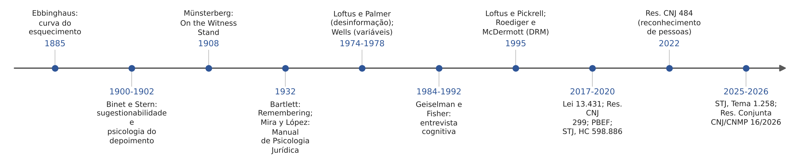
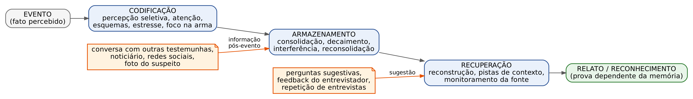
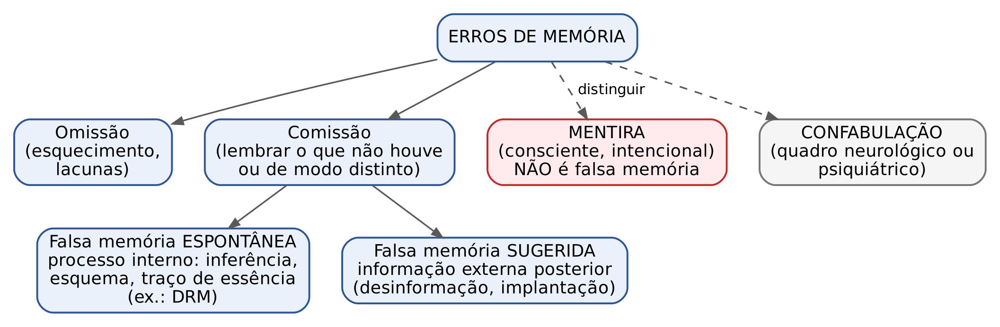
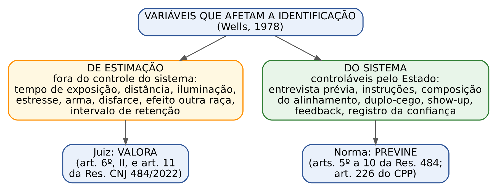
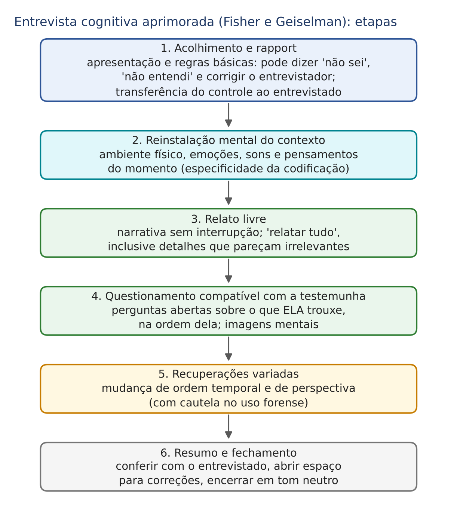
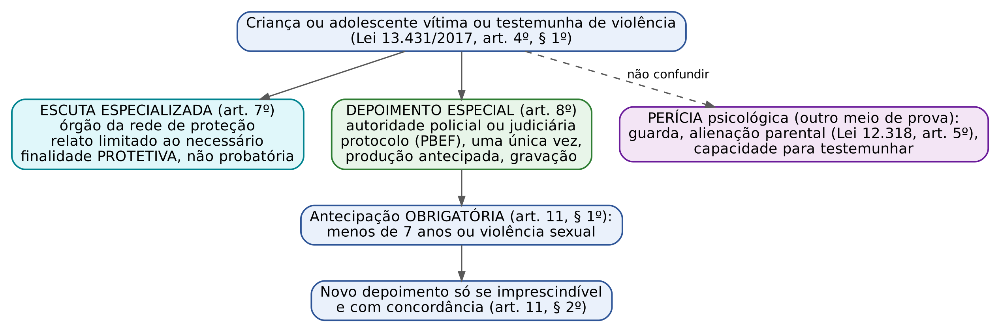
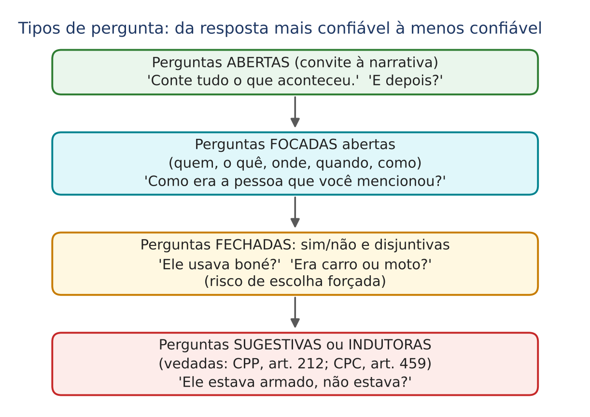
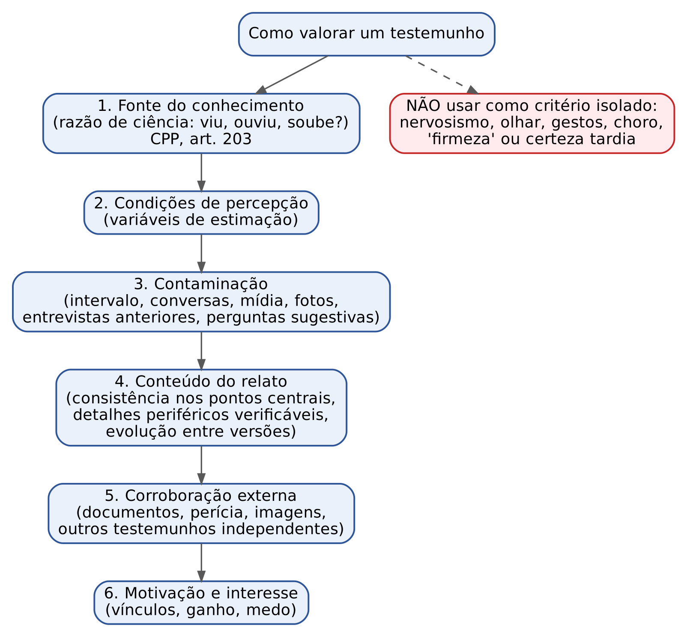

# CAPÍTULO 09 — O PROCESSO PSICOLÓGICO E A OBTENÇÃO DA VERDADE JUDICIAL: TESTEMUNHO, MEMÓRIA, RECONHECIMENTO E CREDIBILIDADE

:::INCIDENCIA
TRF5 p. B.4; TJRS p. B.4; TJSC p. C.4. Nível A+. Lote: 13 questões (FGV 12, FCC 1), uma de prova de juiz (TJ-BA 2026); as demais de Delegado, Defensoria e cargos de psicólogo, que é onde a FGV testa hoje o conteúdo que vai à prova da magistratura.
O que mais cai: natureza reconstrutiva da memória e conceito de falsas memórias (distorção, não mentira; sugestão como fonte; omissão x comissão); etapas e vedações da Resolução CNJ 484/2022 lidas como tradução da ciência da memória (entrevista prévia, *show-up*, irrepetibilidade, confiança nas próprias palavras); escuta especializada x depoimento especial e perícia psicológica em família.
:::

| Subtema | FGV | FCC | Padrão de cobrança |
|---|---|---|---|
| Memória e falsas memórias | 4 | 0 | memória reconstrutiva guiada por esquemas; falsa memória como distorção (não mentira, não patologia); erros de omissão x comissão; emoção não imuniza contra distorção |
| Reconhecimento de pessoas (art. 226 do CPP, Res. CNJ 484/2022, Tema 1.258) | 5 | 0 | entrevista prévia antes do alinhamento; irrepetibilidade como efeito de contaminação da memória; *show-up* e álbum de suspeitos como fontes de sugestão e de estereótipo racial |
| Escuta da criança, depoimento especial e perícia psicológica | 3 | 0 | escuta psicológica x oitiva; perícia com rigor metodológico, sem reduzir a criança a "produtora de prova"; art. 5º e 8º-A da Lei 12.318/2010 |
| Epistemologia da prova (verdade e probabilidade) | 0 | 1 | probabilidade indutiva (Badaró): grau de confirmação de hipótese que resiste a tentativas de falseamento |

Os três editais dizem o mesmo no núcleo ("o processo psicológico e a obtenção da verdade judicial; o comportamento de partes e testemunhas"); o TRF5 explicita o que a FGV efetivamente cobra: psicologia do testemunho, memória, percepção, sugestionabilidade, falsas memórias, reconhecimento de pessoas, credibilidade e entrevistas. Este capítulo trata do enfoque PSICOLÓGICO e EPISTEMOLÓGICO. O regime processual está em outras apostilas: prova testemunhal, declarações do ofendido, reconhecimento (art. 226 do CPP, Res. CNJ 484/2022 em detalhe, Tema 1.258 do STJ) e depoimento especial no processo penal, na Apostila de Processo Penal, Cap. 15 (15.4 a 15.7); sistemas de valoração e *standards* probatórios, no Cap. 14 (14.3 e 14.4) da mesma apostila; Lei 13.431/2017 e Decreto 9.603/2018, na Apostila de Direito da Criança e do Adolescente, Cap. 22; alienação parental, no Cap. 7 dessa apostila. As heurísticas e os vieses do JULGADOR (ancoragem, confirmação, retrospectiva, enquadramento) são do Cap. 37; aqui aparecem apenas na interface com a prova dos fatos (09.9). Comunicação, escuta ativa e linguagem simples são do Cap. 6.

## 09.1 Verdade judicial: o problema epistemológico

### 09.1.1 Da "verdade real" à verdade como correspondência aproximada

O processo é uma máquina de reconstruir o passado com material humano. A tradição falava em "verdade real" (no penal) e "verdade formal" (no cível), dicotomia hoje abandonada pela doutrina de epistemologia judiciária. Duas críticas convergem. A primeira é filosófica: nenhum procedimento alcança certeza absoluta sobre fatos pretéritos; o que o processo produz é conhecimento PROVÁVEL, revisável e obtido sob regras (tempo, contraditório, licitude, preclusão). A segunda é política: o discurso da verdade real serviu historicamente para legitimar a superação de garantias "em nome do resultado" (inquisitorialidade, prova ilícita, iniciativa probatória sem limites). Alexandre Morais da Rosa resume essa crítica dizendo que há sempre um "resto desconhecido" e que acreditar em verdade real como acesso ao que "verdadeiramente" aconteceu é ilusão.

A posição dominante não é cética (não nega que haja fatos), mas CORRESPONDENTISTA e APROXIMATIVA: o enunciado fático é verdadeiro se corresponde ao que ocorreu, e o processo busca essa correspondência sem poder garanti-la. Luigi Ferrajoli (Direito e Razão) fala em verdade processual "aproximativa" e condicionada por regras; Michele Taruffo (La prueba de los hechos; Uma simples verdade) sustenta que a verdade é finalidade legítima e necessária do processo, porque a decisão justa pressupõe fatos corretamente determinados; Jordi Ferrer Beltrán (Prueba y verdad en el derecho; La valoración racional de la prueba) separa "estar provado" de "ser verdadeiro": um enunciado está provado quando os elementos dos autos lhe dão suporte suficiente segundo o *standard* aplicável, e isso pode ocorrer mesmo que seja falso. A distinção explica por que o erro judiciário é estrutural e por que os *standards* distribuem o risco desse erro (Apostila de Processo Penal, Cap. 14, 14.4).

:::DOUTRINA Gustavo Badaró, Epistemologia judiciária e prova penal (2019)
Afastada a certeza racional absoluta, a valoração da prova é juízo de PROBABILIDADE. Entre os modelos possíveis, Badaró adota a probabilidade LÓGICA ou INDUTIVA (tributária de L. Jonathan Cohen, The Probable and the Provable, 1977, e da epistemologia de Ferrer e Taruffo): o juiz mede o grau de suporte que os elementos de prova dão a uma hipótese sobre um fato singular; a inferência se fortalece à medida que a hipótese supera os controles destinados a falseá-la e resiste às hipóteses alternativas. Afasta a probabilidade estatística ou frequencial (pensada para eventos repetíveis, inadequada ao fato único) e a subjetiva (mero grau de crença do julgador, incontrolável).
:::

:::QUESTAO FCC 2026 — DPE-BA — Defensor Público (Q4037441)
Trecho de Badaró sobre a força da inferência que aumenta conforme a hipótese supera controles de falseamento. Gabarito: E (probabilidade indutiva). Armadilhas: "subjetiva" (é o que o autor rejeita, por ser crença incontrolável); "estatística" e "objetiva" (frequências de eventos repetíveis); "dedutiva" (a dedução não gera conhecimento novo sobre fato empírico). O mesmo item está na Apostila de Processo Penal, Cap. 14 (14.3), sob o ângulo dos sistemas de valoração.
:::

### 09.1.2 Por que a psicologia entra aqui

Quase toda prova oral é prova DEPENDENTE DA MEMÓRIA: depoimento de testemunha, declarações do ofendido, interrogatório, depoimento pessoal, reconhecimento de pessoas e coisas. A literatura brasileira de psicologia do testemunho (Lilian Milnitsky Stein, Falsas memórias, 2010; a pesquisa coordenada por ela para o Ministério da Justiça, Avanços científicos em psicologia do testemunho aplicados ao reconhecimento pessoal e aos depoimentos forenses, série Pensando o Direito) insiste numa analogia útil ao juiz: a memória deve ser tratada como VESTÍGIO, isto é, evidência frágil, sujeita a contaminação, que exige cadeia de preservação como a prova material. O que a cadeia de custódia é para o vestígio físico (arts. 158-A a 158-F do CPP), os protocolos de entrevista e de reconhecimento são para o vestígio de memória: uma vez contaminada, a memória não se "descontamina", e um segundo procedimento correto não restaura o traço original. Esse é o fundamento psicológico da irrepetibilidade do reconhecimento (Res. CNJ 484/2022, art. 2º, § 1º; STJ, Tema 1.258, tese 3) e da regra do depoimento especial colhido "uma única vez" (Lei 13.431/2017, art. 11).

Daí a utilidade, para a prova oral, de três perguntas diferentes, que a psicologia do testemunho separa com rigor e o senso comum confunde:

| Pergunta | Conceito | Falha típica |
|---|---|---|
| A testemunha está mentindo? | SINCERIDADE (honestidade subjetiva) | mentira deliberada, interesse, medo |
| O que ela relata corresponde ao que ocorreu? | ACURÁCIA ou fidedignidade (exatidão do relato) | erro honesto: percepção falha, esquecimento, falsa memória |
| Quanto o relato pesa na decisão? | CREDIBILIDADE como juízo do julgador | confundir firmeza, emoção ou certeza com exatidão |

A testemunha honesta pode estar ERRADA, e com total convicção. É esse o centro de gravidade do tema. Na formulação da literatura portuguesa (Poiares e Louro, citados por Sónia Caridade em Alho e Paulino, Psicologia do Testemunho, 2021), a psicologia do testemunho tem três objetos: os erros do testemunho (voluntários e involuntários), a credibilidade e a fiabilidade.

:::ATENCAO Psicologia jurídica, judiciária e do testemunho
Em provas de psicólogo a banca distingue: psicologia jurídica é o gênero (aplicação da psicologia às questões reguladas pelo Direito); psicologia judiciária ou forense é a atuação perante o Judiciário (perícias, assessoramento); psicologia do testemunho é o campo, com raízes na psicologia cognitiva, experimental e social, que estuda a exatidão e as distorções das declarações prestadas à polícia e à Justiça. A Resolução CFP 14, de 22/12/2000, instituiu o título profissional de especialista e delimitou as atividades da psicologia jurídica; segundo o material de estudo do usuário, ela subdivide a especialidade em áreas, entre elas a "psicologia judicial ou do testemunho" (a subdivisão não foi conferida no original).
:::

## 09.2 Psicologia do testemunho: formação do campo

### 09.2.1 Os pioneiros

- Alfred Binet (La suggestibilité, 1900): demonstrou experimentalmente, com crianças em idade escolar, que a forma da pergunta altera a resposta; perguntas que pressupõem um detalhe produzem "lembranças" desse detalhe. É o marco da pesquisa sobre SUGESTIONABILIDADE.
- William Stern (Zur Psychologie der Aussage, 1902): estudou a exatidão de relatos sobre imagens observadas por tempo controlado e mostrou que mesmo relatos dados sob juramento e com segurança contêm erros relevantes; propôs que o testemunho fosse estudado cientificamente (a "psicologia do depoimento", *Psychologie der Aussage*). A literatura atribui a Stern e Binet os primeiros estudos sobre erros voluntários e involuntários do testemunho.
- Hugo Münsterberg (On the Witness Stand, 1908): psicólogo alemão radicado em Harvard, levou ao público jurídico norte-americano a tese de que a percepção e a memória das testemunhas são falíveis, de que confissões podem ser falsas e de que os tribunais deveriam ouvir os psicólogos. A paternidade da disciplina costuma ser atribuída a ele. A reação do jurista John Henry Wigmore (1909, sátira em que Münsterberg é "processado" por difamação dos juristas) marcou décadas de desconfiança do Direito em relação à psicologia.
- Frederic Bartlett (Remembering, 1932): no experimento com a narrativa indígena "A guerra dos fantasmas" (*The War of the Ghosts*), estudantes ingleses, ao recontar a história em reproduções sucessivas, a encurtavam, racionalizavam e adaptavam às próprias expectativas culturais. Concluiu que lembrar é RECONSTRUIR com base em ESQUEMAS (estruturas de conhecimento prévio), e não reproduzir. É a base teórica do caráter reconstrutivo da memória, que a FGV cobra literalmente (09.4).
- Emilio Mira y López (Manual de Psicologia Jurídica, 1932): no Brasil, o clássico mais citado; sistematizou os fatores do testemunho e uma tipologia de perguntas (09.8.3). Enrico Altavilla (Psicologia giudiziaria) é a outra referência clássica em língua latina, com a tese de que a realidade chega ao sujeito "deformada" pelos sentidos e pelos processos psíquicos.

### 09.2.2 A virada experimental e o impacto no sistema de justiça

A partir dos anos 1970, Elizabeth Loftus (efeito da desinformação, 1974; implantação de memórias, 1995) e Gary Wells (variáveis de estimação x do sistema, 1978; protocolos de alinhamento) transformaram a psicologia do testemunho em ciência aplicada com propostas normativas concretas. O impulso decisivo veio das exonerações por DNA: segundo o Innocence Project (EUA), a identificação equivocada por testemunha ocular esteve presente em 69% das 375 exonerações por DNA entre 1989 e 2020, sendo o fator mais frequente. Diretrizes oficiais de reconhecimento nos EUA, o modelo PEACE de entrevista no Reino Unido (1992) e, no Brasil, a Resolução CNJ 484/2022 e a virada do STJ a partir do HC 598.886 (2020) são desdobramentos dessa literatura (Apostila de Processo Penal, Cap. 15, 15.7.3).

:::DICA Prova oral
Pergunta clássica: "o que a psicologia tem a dizer ao juiz sobre a prova testemunhal?". Estruture em quatro tempos: (1) a memória é reconstrutiva (Bartlett) e maleável (Loftus): a testemunha sincera pode errar; (2) o erro decorre de fatores do evento e da testemunha, que o juiz só pode VALORAR, e de fatores do procedimento, que o Estado pode CONTROLAR (Wells); (3) por isso a ordem jurídica protocolou a colheita (art. 212 do CPP, Res. CNJ 484/2022, Lei 13.431/2017); (4) e o juiz valora pela corroboração e pelas condições de produção, não pela postura ou pela certeza do depoente.
:::

## 09.3 Percepção e atenção: o registro do fato

### 09.3.1 Percepção como construção ativa

Sensação é a captação do estímulo pelos órgãos dos sentidos (transdução da energia física em sinal nervoso); PERCEPÇÃO é a organização e a interpretação desse sinal, que integra o estímulo presente com conhecimento, expectativa e emoção. A percepção é, por isso, SELETIVA e INTERPRETATIVA desde a origem: o que chega à memória já é uma versão do fato, não o fato.

- Processamento ascendente (*bottom-up*), guiado pelo estímulo, e descendente (*top-down*), guiado por expectativas e esquemas. Em condições ruins de observação (pouca luz, rapidez, distância), o peso do processamento descendente cresce: a pessoa "completa" o que não viu com o que esperava ver.
- Princípios de organização da Gestalt (proximidade, semelhança, fechamento, continuidade) explicam por que a testemunha relata formas e sequências completas a partir de fragmentos.
- Allport e Postman (The Psychology of Rumor, 1947): mostrada uma cena em que um homem branco segura uma navalha diante de um homem negro, na transmissão sucessiva do relato a navalha "migrou", com frequência, para a mão do homem negro. É o exemplo canônico de ESTEREÓTIPO operando na percepção e na memória, e a raiz psicológica do que a Res. CNJ 484/2022 enfrenta ao exigir registro de raça/cor e vedar a apresentação sugestiva (09.6).

### 09.3.2 Atenção: recurso limitado

A atenção é um filtro de capacidade limitada. Três fenômenos são recorrentes na prova:

- Cegueira por desatenção (*inattentional blindness*): no experimento de Simons e Chabris (1999), cerca de metade dos participantes encarregados de contar passes de bola não notou uma pessoa fantasiada de gorila atravessando a cena. Quem está concentrado numa tarefa (dirigir, fugir, proteger um filho) pode não perceber o que, depois, todos acham "óbvio".
- Cegueira para mudanças (*change blindness*): alterações em cenas ou pessoas passam despercebidas quando ocorrem durante interrupções; a testemunha pode "fundir" duas pessoas numa só.
- Foco na arma (*weapon focus*): a presença de arma atrai a atenção (pela ameaça e pela incongruência), reduzindo a codificação do rosto e de outros detalhes do autor (Loftus, Loftus e Messo, 1987). Rostos são mal lembrados exatamente nos crimes em que o reconhecimento mais pesa.

### 09.3.3 Estresse e emoção

A relação entre ativação emocional e desempenho é classicamente descrita pela lei de Yerkes e Dodson (1908): desempenho cresce com a ativação até um ponto ótimo e cai em níveis elevados (curva em U invertido). Easterbrook (1959) acrescentou que a ativação intensa ESTREITA o foco da atenção: detalhes centrais da ameaça podem ser bem retidos, à custa dos periféricos. Em eventos traumáticos, a memória tende a ser fragmentada, com lacunas e sequência temporal imprecisa; inconsistências periféricas e dificuldade de ordenar cronologicamente o fato NÃO indicam, por si, mentira, e podem ser compatíveis com relato verdadeiro de evento traumático. Por outro lado, emoção não garante exatidão (09.4.3).

### 09.3.4 Fatores do evento e da testemunha

| Fator | Efeito sobre a exatidão | Como aparece no processo |
|---|---|---|
| Tempo de exposição e distância | quanto menor o tempo e maior a distância, pior a codificação do rosto | "vi por alguns segundos" (Q4083765) |
| Iluminação e visibilidade | luz baixa favorece preenchimento por expectativa | crimes noturnos |
| Estresse, violência e arma | estreitamento da atenção; foco na arma | roubo com arma de fogo |
| Disfarce (capuz, boné, máscara) | reduz drasticamente a acurácia | autor encapuzado |
| Efeito outra raça (*cross-race* ou *own-race bias*) | reconhecemos pior rostos de grupo étnico diverso do nosso (meta-análise de Meissner e Brigham, 2001) | vítima e suspeito de grupos raciais distintos |
| Intervalo de retenção | a memória decai e se torna mais vulnerável à informação posterior | reconhecimento meses depois |
| Expectativas e estereótipos | preenchimento com o "provável" | "tinha cara de bandido" |
| Álcool e drogas | prejuízo na codificação | brigas, festas |
| Idade (crianças pequenas e idosos) | maior vulnerabilidade à sugestão em certas condições, não incapacidade | depoimento especial (09.7) |

Esses são, na terminologia de Wells (09.6.1), fatores de ESTIMAÇÃO: o sistema de justiça não os controla, só pode estimar seu impacto e valorá-los. A Res. CNJ 484/2022 obriga a colhê-los na entrevista prévia: dinâmica do fato, distância, tempo de observação, iluminação (art. 6º, II).

:::PRATIQUE Exercício elaborado para esta apostila (não é questão de banca)
Em ação penal por roubo, a vítima declara que o assaltante usava capacete aberto, apontou-lhe revólver durante toda a ação (cerca de 20 segundos), à noite, sob iluminação pública, e que "jamais esquecerá aquele rosto". Indique dois fatores de estimação que reduzem o peso da identificação e diga se a afirmação final da vítima o aumenta.
Resolução: foco na arma e curto tempo de exposição (também luz noturna e capacete, que é disfarce parcial). A convicção declarada não aumenta a exatidão: confiança expressa depois do evento, sobretudo após contatos com a investigação, é pouco diagnóstica (09.6.3); o juiz deve buscar a confiança registrada no momento do primeiro reconhecimento formal e a corroboração independente.
:::

## 09.4 Memória: codificação, armazenamento e recuperação

### 09.4.1 Modelos e sistemas de memória

A memória não é um arquivo único, mas um conjunto de sistemas. Os modelos que a banca menciona:

| Modelo ou conceito | Autor | Ideia central |
|---|---|---|
| Curva do esquecimento | Hermann Ebbinghaus (1885) | o esquecimento é rápido logo após a aprendizagem e depois se desacelera; primeiro estudo experimental da memória |
| Modelo modal (multiarmazenamento) | Atkinson e Shiffrin (1968) | memória sensorial (milissegundos a segundos), memória de curto prazo (capacidade limitada, segundos) e memória de longo prazo; a passagem depende de atenção e repetição |
| Memória de trabalho | Baddeley e Hitch (1974) | o curto prazo é um "espaço de trabalho" com executivo central, alça fonológica e esboço visuoespacial (depois, *buffer* episódico) |
| Memória episódica x semântica | Endel Tulving (1972) | episódica: eventos pessoais situados no tempo e no espaço ("o que vi no dia do crime"); semântica: conhecimento geral ("o que é um revólver") |
| Declarativa x não declarativa | Larry Squire | declarativa (explícita: episódica e semântica) x não declarativa (implícita: procedimentos, condicionamento, *priming*) |
| Especificidade da codificação | Tulving e Thomson (1973) | a recuperação é melhor quando as pistas presentes na evocação coincidem com as do momento da codificação; fundamento da reinstalação do contexto na entrevista cognitiva |
| Reconsolidação | Karim Nader e colaboradores (2000) | ao ser evocada, a memória volta a um estado lábil e é "regravada", podendo incorporar elementos novos |

O testemunho é, essencialmente, memória EPISÓDICA declarativa, a mais vulnerável a distorções. Mas a semântica interfere nela: o que se sabe sobre "como costumam ser os assaltos" preenche lacunas do que se viu (esquemas, *scripts*).

### 09.4.2 As três fases e os pontos de contaminação

- CODIFICAÇÃO: transformação da experiência percebida em traço de memória. Só se codifica o que foi atendido e, mesmo assim, de modo interpretado (09.3). Erro de codificação não se corrige depois: o que não foi registrado não pode ser "recuperado", só inventado.
- ARMAZENAMENTO (e consolidação): manutenção do traço ao longo do tempo. Aqui atuam o decaimento (esquecimento pelo tempo) e a INTERFERÊNCIA: retroativa (informação nova prejudica a antiga, como a foto do suspeito vista na delegacia que se sobrepõe ao rosto do autor) e proativa (informação antiga prejudica a nova). É a fase em que a INFORMAÇÃO PÓS-EVENTO (conversas, noticiário, redes sociais, perguntas) se incorpora ao traço.
- RECUPERAÇÃO: acesso ao traço. Não é leitura, é RECONSTRUÇÃO: a pessoa reúne fragmentos e os completa com inferências, esquemas e informações de outras fontes. Cada recuperação pode modificar a memória (reconsolidação), razão pela qual entrevistas repetidas e sugestivas são especialmente danosas. A recuperação depende de pistas: perguntas abertas e reinstalação do contexto aumentam a informação correta; perguntas fechadas e sugestivas aumentam a informação errada.

:::PEGADINHA Memória não é gravação de vídeo
A alternativa que compara a memória a "um sistema de vídeo que grava os acontecimentos" para revê-los "tal como ocorreram" é sempre errada (Q2365436, alternativa B). A metáfora correta é a de um quebra-cabeça montado a cada evocação, com peças originais, peças emprestadas e lacunas preenchidas por inferência. Igualmente errado afirmar que o "inconsciente registra tudo" e que bastaria acessá-lo (hipnose, "regressão"): técnicas desse tipo aumentam a quantidade de lembranças e a CONFIANÇA, mas não a exatidão, e são fonte conhecida de memórias falsas.
:::

### 09.4.3 Emoção e memória: as "memórias em flash"

Brown e Kulik (1977) chamaram de memórias em flash (*flashbulb memories*) as lembranças vívidas das circunstâncias em que se recebeu notícia de evento marcante (o assassinato de Kennedy), descritas pelos sujeitos como "fotográficas". Neisser e Harsch (1992) testaram estudantes no dia seguinte à explosão do ônibus espacial Challenger (1986) e de novo cerca de dois anos e meio depois: grande parte das narrativas posteriores divergia substancialmente das primeiras, embora os participantes se declarassem muito confiantes, e alguns, confrontados com o próprio relato original, insistiram na versão nova. Conclusão para o juiz: a VIVACIDADE e a CONFIANÇA da lembrança emocional não garantem sua exatidão. A emoção tende a reforçar a retenção do núcleo do evento (o "que" aconteceu), mas não imuniza detalhes, sequência e fonte contra distorção.

:::QUESTAO FGV 2025 — AL-AM — Analista Legislativo, Psicólogo (Q3779580)
Três afirmações sobre falsas memórias: (I) sugestões podem distorcer memórias; (II) a memória é reconstrutiva e qualquer recordação é uma construção; (III) experiências emocionalmente vívidas não podem ser distorcidas. Gabarito: D (I e II). A armadilha é o item III, que reproduz o mito da memória em flash; a pesquisa de Neisser e Harsch mostrou exatamente o contrário.
:::

## 09.5 Falsas memórias e sugestionabilidade

### 09.5.1 Conceito

Falsas memórias são lembranças de eventos que não ocorreram, de situações não presenciadas ou de lugares nunca vistos, ou ainda lembranças DISTORCIDAS de eventos que ocorreram. A pessoa as vive como lembranças genuínas e as relata com sinceridade. Três distinções resolvem a maior parte das questões:

- Falsa memória x MENTIRA: a mentira é ato consciente e intencional de afirmar o que se sabe falso; na falsa memória não há consciência da falsidade. A testemunha que mente sabe; a que tem falsa memória acredita.
- Falsa memória x PATOLOGIA: falsas memórias são fenômeno do funcionamento NORMAL da memória, presente em qualquer pessoa; não decorrem de transtorno neurocognitivo (o que existe nesses quadros é a confabulação, produção de relatos falsos ligada a lesões ou a transtornos, conceito distinto).
- Erro de OMISSÃO x erro de COMISSÃO: omissão é esquecer, deixar de lembrar; comissão é lembrar o que não houve ou lembrar de modo diverso. A pesquisa histórica (Ebbinghaus) concentrou-se no esquecimento; a moderna (Bartlett e, sobretudo, Loftus e o paradigma DRM) deslocou o foco para os erros de comissão, que são os perigosos no processo, porque produzem relato positivo, detalhado e convicto.

### 09.5.2 Espécies: espontâneas e sugeridas

- Falsas memórias ESPONTÂNEAS (ou autossugeridas): resultam de processos internos de distorção, como inferências, interpretações e a ativação de conceitos relacionados. Exemplo experimental: no paradigma DRM (Deese, 1959; retomado por Roediger e McDermott, 1995), o sujeito estuda uma lista de palavras associadas (cama, descanso, cansado, sonho, travesseiro...) e depois "lembra", com alta confiança, de ter visto a palavra crítica não apresentada ("sono"). Exemplo forense: a testemunha "lembra" que o autor fugiu correndo porque é o que normalmente ocorre.
- Falsas memórias SUGERIDAS (implantadas): resultam da incorporação de informação EXTERNA posterior ao evento, compatível com ele, apresentada intencional ou acidentalmente (perguntas, comentários de policiais, conversas entre testemunhas, matérias jornalísticas, fotografias exibidas).

Os paradigmas experimentais que a banca reconhece:

| Paradigma | Estudo | Achado |
|---|---|---|
| Efeito da desinformação (*misinformation effect*) | Loftus e Palmer (1974): vídeo de colisão; a pergunta "a que velocidade os carros iam quando se ESPATIFARAM (*smashed*)?" gerou estimativas maiores do que "quando se TOCARAM (*hit*/*contacted*)?"; uma semana depois, mais participantes do grupo "espatifaram" "lembravam" de vidro quebrado, que não existia | a formulação da pergunta altera a lembrança, não só a resposta |
| Informação pós-evento enganosa | Loftus, Miller e Burns (1978): placa de "pare" x "dê a preferência" sugerida depois | a informação posterior substitui ou se mescla ao detalhe original |
| Implantação de evento inteiro | Loftus e Pickrell (1995), "perdido no shopping" (*lost in the mall*): parte dos adultos passou a "lembrar" de ter se perdido num shopping na infância, episódio inventado e narrado como relatado por familiares | é possível criar memória autobiográfica de evento que nunca ocorreu |
| Inflação pela imaginação | imaginar repetidamente um evento aumenta a convicção de que ele ocorreu | perigo de pedir à testemunha que "tente imaginar" o que pode ter acontecido |
| Conformidade de memória (*memory conformity*) | testemunhas que conversam entre si passam a relatar detalhes vistos só pela outra | fundamento da oitiva separada (CPC, art. 456; CPP, art. 210; Res. 484, art. 6º, § 1º) |

### 09.5.3 Teorias explicativas

- Construtivismo (Bartlett): a memória é um sistema único que reconstrói a experiência a partir de esquemas; a falsa memória é o subproduto normal dessa reconstrução. Base do item que a FGV considera certo: "a recordação é um processo reconstrutivo, guiado por esquemas mentais".
- Paradigma do monitoramento da fonte (*source monitoring*; Johnson, Hashtroudi e Lindsay, 1993): o erro não está no conteúdo, mas na ATRIBUIÇÃO da origem da lembrança. A pessoa lembra de um rosto, mas atribui à cena do crime o que viu, na verdade, na foto da delegacia ou no ônibus (transferência inconsciente). Explica por que a exposição prévia a fotos do suspeito impede o reconhecimento (Res. 484, art. 6º, IV e § 2º).
- Teoria do traço difuso (*fuzzy-trace theory*; Charles Brainerd e Valerie Reyna): codificamos em paralelo traços LITERAIS (*verbatim*: detalhes exatos da experiência) e traços de ESSÊNCIA (*gist*: o significado geral). Os literais se degradam mais depressa; com o tempo, a lembrança passa a apoiar-se na essência, e a pessoa "reconhece" itens coerentes com o sentido geral do evento, ainda que não tenham ocorrido. Explica o paradigma DRM e por que relatos tardios têm mais falsas memórias.

:::DOUTRINA Lilian Milnitsky Stein (org.), Falsas memórias: fundamentos científicos e suas aplicações clínicas e jurídicas (Artmed, 2010)
Obra de referência no Brasil (grupo de pesquisa da PUCRS). Fixa o conceito (lembranças de eventos não ocorridos ou distorcidos, vividas como verdadeiras), a classificação em espontâneas e sugeridas, as três teorias (construtivista, monitoramento da fonte e traço difuso) e a aplicação ao processo: a falsa memória NÃO é mentira, e o depoente que a relata pode ser absolutamente sincero. No processo penal, Cristina di Gesu (Prova penal e falsas memórias) e Aury Lopes Jr. trouxeram o tema à dogmática, associando-o ao art. 226 do CPP, ao tempo entre o fato e a oitiva e à indução por perguntas.
:::

:::QUESTAO FGV 2024 — TJ-MS — Técnico de Nível Superior, Psicólogo (Q2499102)
Sobre falsas memórias no processo penal, especialmente em crimes cometidos no âmbito privado. Gabarito: C (podem ser distorções de uma memória original). Armadilhas: A (equiparar a mentira, ato consciente); B (atribuir a transtornos neurocognitivos; é fenômeno normal); D ("implantadas pela própria pessoa": a autossugestão existe, mas a definição não se restringe a ela, e "implantação" designa a sugestão externa); E ("lembranças de experiências factuais" é a definição de memória verdadeira).
:::

:::QUESTAO FGV 2024 — PC-SC — Psicólogo Policial Civil (Q2365436)
Pergunta sobre o fenômeno mnêmico a partir do histórico das pesquisas de falsas memórias. Gabarito: A (a recordação é processo reconstrutivo, guiado por esquemas mentais que funcionam como organizadores gerais preexistentes: Bartlett). Armadilhas: B (memória como vídeo); C ("Síndrome das Falsas Memórias" não designa falsos testemunhos induzidos por interrogatório policial: a expressão, cunhada nos EUA nos anos 1990 pela False Memory Syndrome Foundation, foi usada para casos de supostas memórias de abuso infantil "recuperadas" em psicoterapia, e não é diagnóstico reconhecido); D (erros "apenas omissivos"); E (distorções "sempre comissivas" e "sempre" externas: há falsas memórias espontâneas, e o esquecimento também é erro).
:::

:::QUESTAO FGV 2024 — Prefeitura de Abreu e Lima (PE) — Psicólogo (Q3008974)
Três afirmações: (I) os estudos começaram centrados nos erros de omissão (esquecimento) e depois se voltaram aos erros de comissão; (II) o conceito de falsa memória não é consensual, porque pesquisas diferentes adotam paradigmas conceituais diversos; (III) é possível a distorção mnêmica pela introdução de informações falsas. Gabarito: E (todas corretas). O item II é o que surpreende o candidato que espera uma definição única: construtivismo, monitoramento da fonte e traço difuso conceituam o fenômeno de modos distintos.
:::

### 09.5.4 Sugestionabilidade

Sugestionabilidade é a tendência a aceitar e incorporar informação externa à própria lembrança ou resposta. A literatura separa:

- Sugestionabilidade de MEMÓRIA (efeito da desinformação): a informação sugerida altera o próprio traço.
- Sugestionabilidade INTERROGATIVA (Gisli Gudjonsson, Escalas de Sugestionabilidade de Gudjonsson, 1984): a tendência de, numa interação fechada de perguntas e respostas, aceitar mensagens comunicadas pelo interrogador. Mede-se pela CEDÊNCIA (*yield*: aceitar perguntas indutoras) e pela MUDANÇA (*shift*: alterar respostas sob pressão ou após *feedback* negativo). Varia com características individuais (ansiedade, baixa autoestima, déficit intelectual, privação de sono, uso de substâncias) e com a situação (autoridade do entrevistador, incerteza, expectativa de que "deve saber").

Crianças não são incapazes de testemunhar, mas, sobretudo as pré-escolares, são mais vulneráveis à sugestão em condições adversas: entrevistas repetidas, perguntas fechadas e indutoras, estereotipagem do suspeito ("ele é mau"), reforço seletivo e pressão social. Stephen Ceci e Maggie Bruck (Jeopardy in the Courtroom, 1995) sistematizaram essa literatura; no estudo "Sam Stone" (Leichtman e Ceci, 1995), crianças a quem se apresentou um visitante como desastrado, e que foram depois entrevistadas com sugestões, passaram a atribuir-lhe danos que ele não causara. Os casos McMartin (EUA, anos 1980) e, no Brasil, Escola Base (São Paulo, 1994), são lembrados como exemplos dos danos produzidos por entrevistas sugestivas e pela exposição midiática de acusações.

:::ATENCAO Sugestionabilidade não autoriza desacreditar a criança
A conclusão que a ciência autoriza é procedimental: entrevistas bem conduzidas (abertas, únicas, gravadas, por profissional treinado, com protocolo) produzem relatos infantis com boa exatidão; o que torna o relato pouco confiável é o PROCEDIMENTO sugestivo. Por isso a Lei 13.431/2017 exige protocolo, livre narrativa, oitiva única e gravação, e a Resolução Conjunta CNJ/CNMP 16/2026 veda submeter a criança à leitura ou escuta de peças processuais que possam "contaminar o relato" (art. 4º, § 9º).
:::

### 09.5.5 Confissões falsas

O interrogatório é a situação de maior pressão sugestiva do processo. A tipologia de Kassin e Wrightsman (1985) distingue confissões falsas VOLUNTÁRIAS (sem pressão externa: busca de notoriedade, proteção de terceiro, culpa difusa), COAGIDAS-SUBMISSAS ou complacentes (o suspeito sabe que é inocente, mas confessa para cessar a pressão ou obter vantagem prometida) e COAGIDAS-INTERNALIZADAS (o suspeito, vulnerável e confrontado com "provas" falsas, passa a acreditar que pode ter cometido o fato). Técnicas acusatórias e confrontacionais, como a técnica Reid, são associadas na literatura a maior risco de confissão falsa; o modelo britânico PEACE (1992) substituiu a busca da confissão pela busca de informação (09.7.2). No Brasil, a confissão é retratável e divisível e deve ser confrontada com as demais provas (CPP, arts. 197 e 200); a retratação em juízo da confissão extrajudicial e o valor desta estão na Apostila de Processo Penal, Cap. 15 (15.3).

## 09.6 Reconhecimento de pessoas: a ciência por trás das regras

O regime processual (art. 226 do CPP, Res. CNJ 484/2022 artigo por artigo, Tema 1.258 do STJ e jurisprudência posterior) está desenvolvido na Apostila de Processo Penal, Cap. 15 (15.7), com as figuras do rito e da valoração. Aqui se explica POR QUE cada regra existe, que é o ângulo que a prova de formação humanística e a prova oral exploram, e se resolvem as questões do lote por esse fundamento.

### 09.6.1 Variáveis de estimação e variáveis do sistema (Wells, 1978)

Gary Wells propôs a distinção que organiza todo o tema. Variáveis de ESTIMAÇÃO são as que afetam a exatidão, mas escapam ao controle do sistema de justiça (09.3.4): o juiz só pode estimar seu efeito. Variáveis do SISTEMA são as que o Estado controla: como a testemunha é entrevistada, quem é colocado no alinhamento, que instruções recebe, se o condutor sabe quem é o suspeito, que *feedback* é dado, como a confiança é registrada. A consequência prática é que a ciência pouco pode fazer para melhorar a percepção de quem já testemunhou, mas pode reduzir muito o erro controlando os procedimentos. A Res. CNJ 484/2022 é, essencialmente, um protocolo de variáveis do sistema; seu art. 6º, II, e seu art. 11 mandam o juiz considerar as de estimação.

### 09.6.2 Cada etapa da Resolução CNJ 484/2022 e seu fundamento psicológico

| Regra (Res. CNJ 484/2022) | Fundamento psicológico |
|---|---|
| Reconhecimento é identificação de pessoa DESCONHECIDA antes do fato (art. 2º); prova irrepetível, realizada uma única vez (§ 1º) | o primeiro procedimento contamina a memória (interferência retroativa e erro de fonte); o segundo reconhece a pessoa vista no primeiro, não o autor. Quem já conhecia o autor não "reconhece", identifica (Tema 1.258, tese 6) |
| Entrevista prévia com relato livre e perguntas abertas, sem induzir (art. 6º, I) | registra a lembrança ANTES de qualquer contaminação e permite comparar a descrição com o suspeito |
| Indagação sobre distância, tempo de observação, iluminação (art. 6º, II) | colhe as variáveis de estimação para a valoração |
| Autodeclaração e heteroidentificação de raça/cor (art. 6º, III; classificação do IBGE, § 3º) | permite controlar o efeito outra raça e o viés racial na composição do alinhamento |
| Pergunta sobre exposição prévia a imagens do suspeito e contatos com policiais, vítimas e testemunhas (art. 6º, IV); havendo exposição ou divergência entre descrição e suspeito, o reconhecimento NÃO se realiza (§ 2º) | exposição prévia gera familiaridade que é confundida com lembrança (monitoramento da fonte); conformidade entre testemunhas |
| Entrevista separada e reservada, sem contato entre vítimas e testemunhas (art. 6º, § 1º) | evita conformidade de memória |
| Advertência de que o autor pode não estar presente e de que se pode não reconhecer ninguém; vedado informar antecedentes (art. 7º) | reduz a pressão para escolher (a testemunha tende a escolher "o mais parecido", juízo relativo); antecedentes induzem a escolha |
| Alinhamento padronizado, simultâneo ou sequencial, com no mínimo outras 4 pessoas compatíveis com a descrição; ninguém se destaca por características, raça/cor, vestimenta ou condução (art. 8º, *caput* e § 3º) | o suspeito que se destaca é escolhido por eliminação; os figurantes (*fillers*) dão a medida do acaso |
| Evitar *show-up* (§ 1º) e apresentação sugestiva com fotos só de suspeitos, álbuns ou redes sociais (§ 2º) | *show-up* comunica "é este"; álbum de suspeitos seleciona pelo estereótipo e pela seletividade policial |
| Grau de convencimento registrado em palavras próprias, LOGO após a resposta, sem revelar se coincide com a expectativa da autoridade (art. 5º, V; art. 9º, parágrafo único) | a confiança INICIAL é diagnóstica; a confiança posterior é inflada pelo *feedback* |
| Gravação integral (art. 5º, § 1º); termo pormenorizado com a fonte das imagens (art. 10) | permite ao juiz verificar sinais de sugestão (gestos, comentários, hesitações) |
| Inclusão no alinhamento só com outros indícios de participação (art. 5º, § 2º) | o alinhamento não é ferramenta de investigação aleatória; reduz a probabilidade prévia de erro |
| Juiz avalia a higidez e a precariedade da prova, em conjunto com as demais (art. 11) | a memória é falível mesmo com procedimento perfeito |

### 09.6.3 Confiança e exatidão; *feedback*; alinhamento sequencial

- Confiança x exatidão: durante décadas afirmou-se que a confiança da testemunha não se correlaciona com a exatidão. A revisão de John Wixted e Gary Wells (Psychological Science in the Public Interest, 2017) refinou a tese: a confiança expressa no PRIMEIRO teste, feito com procedimento imparcial (alinhamento adequado, condutor que não sabe quem é o suspeito, instruções neutras, registro imediato), é razoavelmente diagnóstica (baixa confiança inicial é sinal de alerta). Já a confiança expressa depois, sobretudo em juízo e meses após, é pouco informativa, porque foi inflada por *feedback*, repetição e compromisso com a escolha. É por isso que o "tenho certeza absoluta" dito em audiência não convalida reconhecimento viciado.
- Efeito do *feedback* pós-identificação (Wells e Bradfield, 1998): dizer à testemunha "muito bem, você identificou o suspeito" aumenta retroativamente a confiança declarada e até a lembrança das condições de observação ("vi bem, estava perto"). Daí a vedação de sinalizar acerto (art. 9º, parágrafo único) e a recomendação do procedimento DUPLO-CEGO (condutor que não sabe quem é o suspeito), que a Resolução não exige expressamente, mas que a literatura considera a principal salvaguarda contra a sugestão involuntária.
- Efeito de compromisso: quem escolheu alguém tende a reescolher a mesma pessoa em procedimentos posteriores, ainda que a primeira escolha tenha sido errada. É a base psicológica da irrepetibilidade (tese 3 do Tema 1.258).
- Simultâneo x sequencial: Lindsay e Wells (1985) propuseram o alinhamento SEQUENCIAL (uma pessoa por vez, decisão a cada uma) para reduzir o juízo relativo ("o mais parecido do grupo"); estudos posteriores com curvas ROC (Wixted e Mickes) indicaram que o simultâneo pode ter igual ou maior capacidade de discriminação. A Resolução admite os dois (art. 8º).

### 09.6.4 Seletividade, estereótipo e raça

O reconhecimento por fotografia de "álbuns de suspeitos" e de redes sociais seleciona os candidatos pela visibilidade policial, e não pela descrição. Combinado com o efeito outra raça e com estereótipos sobre "aparência de criminoso", o procedimento produz erro concentrado em jovens negros e pobres, o que levou o CNJ a afirmar, nos considerandos e no art. 6º, III, da Res. 484, o enfrentamento do racismo estrutural na prova. A leitura sociológica da seletividade penal está no Cap. 1; o protocolo de julgamento com perspectiva racial (Res. CNJ 598/2024), no Cap. 28. Na questão abaixo, a FGV cobrou exatamente essa ligação com a criminologia: o estereótipo do "criminoso" é herança do positivismo criminológico (Lombroso, L'uomo delinquente, 1876), e não sua negação.

:::QUESTAO FGV 2026 — PC-PI — Delegado de Polícia (Q3849019)
Três itens sobre o Tema 1.258. Gabarito: E (F – V – F). Item 1 falso: o *show-up* (foto única do suspeito) não aprimora a prova; é o procedimento mais sugestivo e o que mais favorece falsas memórias. Item 2 verdadeiro: catálogos acríticos de fotos favorecem o estereótipo de criminoso construído sobre características raciais e culturais. Item 3 falso: reforçar estigmas é CONVERGENTE com o positivismo criminológico, que buscava traços físicos do "delinquente nato". Comentário processual na Apostila de Processo Penal, Cap. 15 (15.7.4).
:::

:::QUESTAO FGV 2026 — TJ-BA — Juiz Substituto (Q4083765)
Vítima viu o rosto do autor "por alguns segundos"; o delegado fez alinhamento correto com cinco pessoas semelhantes, ela apontou Marcelo e declarou "certeza absoluta", registrada nos autos; a defesa alega supressão de etapa. Resolução em passos: (1) listar as cinco etapas do art. 5º (entrevista prévia, instruções, alinhamento, resposta, grau de convencimento); (2) verificar quais o enunciado narra: alinhamento, resposta e confiança, sim; entrevista prévia e instruções, não descritas; (3) entre as alternativas, a única etapa apontada como suprimida que corresponde ao enunciado é a ENTREVISTA PRÉVIA, em que a vítima descreveria o autor antes de ver o alinhamento (art. 226, I, do CPP; art. 6º da Res. 484). Gabarito: D. Armadilhas: B (a "certeza" final não convalida; ver 09.6.3); C (o grau de convencimento é registrado em palavras próprias, não em escala percentual); A (o alinhamento presencial é o PREFERENCIAL, art. 4º); E (o termo nos autos do inquérito é registro válido). Note que o enunciado também omite as advertências do art. 7º, mas nenhuma alternativa as menciona.
:::

:::QUESTAO FGV 2025 — DPE-PE — Defensor Público (Q3390867)
Alternativa INCORRETA sobre a Res. 484. Gabarito: A (afirmava que o reconhecimento pode ser repetido "uma única vez" se o originário desobedeceu às diretrizes). O fundamento é psicológico antes de ser normativo: o procedimento falho contaminou a memória, e a repetição apenas confirma a imagem vista no primeiro ato. As demais alternativas reproduziam os arts. 4º (preferência pelo presencial), 11 (precariedade, "falibilidade da memória humana"), 10 (termo e gravação) e 2º, § 2º (defensor).
:::

:::QUESTAO FGV 2024 — PC-SC — Delegado de Polícia (Q2360696)
Verdadeiro ou falso: (1) o reconhecimento fotográfico é meio de prova irritual; (2) a confissão é retratável e divisível; (3) o reconhecimento é prova irrepetível. Gabarito: E (F – V – V). Item 3: Res. 484, art. 2º, § 1º, e tese 3 do Tema 1.258. Item 2: art. 200 do CPP. Item 1: o reconhecimento fotográfico, em si, é admitido quando observado o mesmo procedimento do pessoal (art. 4º da Res. 484); irritual é a prova produzida fora do rito, como o *show-up* fotográfico. A distinção é sutil (ver a crítica na Apostila de Processo Penal, Cap. 15, 15.7.5).
:::

:::QUESTAO FGV 2026 — PC-PR — Delegado de Polícia (Q4378264)
Procedimento correto quando a vítima não conhece o autor. Gabarito: C (descrição prévia, alinhamento com pessoas semelhantes e reconhecimento fotográfico admitido se observado o mesmo procedimento do pessoal). Armadilhas: A (álbum de suspeitos, vedado pelo art. 8º, § 2º); B (veda o fotográfico); D (foto única é *show-up*); E (o rito também vale em juízo: Tema 1.258, tese 1).
:::

:::PEGADINHA "A senhora reconhece o acusado aqui presente?"
Perguntar à vítima, em audiência, se o réu sentado no banco dos réus é o autor é, do ponto de vista psicológico, um *show-up* com a máxima carga sugestiva: há uma única pessoa, ela está na posição de acusado e a vítima sabe que a polícia e o Ministério Público a apontam. A resposta afirmativa não tem valor de reconhecimento. Se a vítima já conhecia o réu, trata-se de mera identificação (tese 6); se não conhecia, a prova é o reconhecimento formal anterior, válido ou não.
:::

## 09.7 A entrevista forense: técnicas de colheita do relato

### 09.7.1 Entrevista cognitiva

A entrevista cognitiva foi desenvolvida por Ronald Fisher e Edward Geiselman a partir de 1984 (sistematizada em Memory-Enhancing Techniques for Investigative Interviewing: The Cognitive Interview, 1992) para aumentar a quantidade de informação CORRETA obtida de testemunhas e vítimas colaborativas, sem aumentar proporcionalmente os erros. Baseia-se em dois princípios da psicologia da memória: a especificidade da codificação (09.4.1) e a existência de múltiplas vias de acesso a um mesmo traço.

As quatro técnicas mnemônicas originais:

- Reinstalação mental do contexto: pedir que o entrevistado reconstrua mentalmente o ambiente físico e o estado emocional do momento (onde estava, o que sentia, sons, cheiros).
- Relatar tudo: pedir que conte todos os detalhes, mesmo os que pareçam irrelevantes ou parciais, porque detalhes periféricos ativam outros e permitem verificação.
- Mudança de ordem: narrar em ordem diferente da cronológica (por exemplo, do fim para o começo), para romper a reconstrução guiada pelo esquema.
- Mudança de perspectiva: narrar do ponto de vista de outra pessoa presente.

A ENTREVISTA COGNITIVA APRIMORADA (*enhanced cognitive interview*; Fisher, Geiselman e Amador, 1989) acrescentou componentes de dinâmica social e de comunicação: construção de *rapport*, transferência do controle ao entrevistado (é ele quem detém a informação), perguntas abertas, pausas sem interrupção, questionamento compatível com a testemunha (perguntar sobre o que ela trouxe, na ordem em que ela organiza a lembrança) e uso de imagens mentais. As meta-análises (Köhnken e colaboradores, 1999; Memon e colaboradores, 2010) indicaram aumento expressivo de informação correta, com acréscimo pequeno de erros, de modo que a taxa de exatidão se mantém. Ressalva de uso forense: as técnicas de mudança de perspectiva e de imaginação devem ser usadas com cautela, porque podem induzir inferências (09.5.2, inflação pela imaginação).

### 09.7.2 Outros modelos: PEACE e protocolos para crianças

- Modelo PEACE (Inglaterra e País de Gales, 1992): entrevista investigativa orientada à obtenção de informação, e não à confissão. Sigla das etapas: *Planning and preparation* (planejamento), *Engage and explain* (engajar e explicar), *Account, clarification and challenge* (relato, esclarecimento e confronto com evidências), *Closure* (encerramento) e *Evaluation* (avaliação). Contrapõe-se aos modelos acusatórios e confrontacionais de interrogatório.
- Protocolo do NICHD (National Institute of Child Health and Human Development, EUA; Michael Lamb, Yael Orbach e colaboradores): roteiro estruturado para crianças, com fase introdutória (regras básicas: dizer "não sei", corrigir o entrevistador), *rapport*, treino de memória episódica sobre evento neutro, transição não sugestiva para o tema, convites abertos à narrativa, perguntas focadas e, só ao final e com cautela, perguntas fechadas.
- Protocolo Brasileiro de Entrevista Forense (PBEF), com crianças e adolescentes vítimas ou testemunhas de violência (lançado em 15/7/2020 pelo CNJ, pelo UNICEF e pela Childhood Brasil, a partir de método do National Children's Advocacy Center, testado no TJDFT, no TJPE e no TJRS): adaptação brasileira dessas metodologias, referida expressamente pela Res. CNJ 299/2019 (arts. 8º e 14, §§ 2º e 3º) e pela Res. Conjunta CNJ/CNMP 16/2026 (art. 4º, § 1º). Estrutura-se em etapas de acolhimento e *rapport*, regras básicas, livre narrativa, questionamento e fechamento.

### 09.7.3 Depoimento especial e escuta especializada: a lógica psicológica

A Lei 13.431/2017 transpõe para a lei três achados da psicologia do testemunho infantil: (1) cada entrevista é uma oportunidade de contaminação e de sofrimento (revitimização), logo a oitiva deve ser ÚNICA e antecipada; (2) a livre narrativa produz o relato mais exato, logo as perguntas complementares vêm DEPOIS e filtradas; (3) quem conduz deve dominar um protocolo e adaptar a linguagem, logo o entrevistador é profissional especializado, e não o juiz ou as partes. O regime processual detalhado (competência, produção antecipada, nulidades, crime do art. 24) está na Apostila de Processo Penal, Cap. 15 (15.6), e na Apostila de Direito da Criança e do Adolescente, Cap. 22.

:::LEI Lei 13.431/2017, arts. 7º, 8º, 11 e 12, I, II e IV
"Art. 7º Escuta especializada é o procedimento de entrevista sobre situação de violência com criança ou adolescente perante órgão da rede de proteção, limitado o relato estritamente ao necessário para o cumprimento de sua finalidade.
Art. 8º Depoimento especial é o procedimento de oitiva de criança ou adolescente vítima ou testemunha de violência perante autoridade policial ou judiciária."
"Art. 11. O depoimento especial reger-se-á por protocolos e, sempre que possível, será realizado uma única vez, em sede de produção antecipada de prova judicial, garantida a ampla defesa do investigado. § 1º O depoimento especial seguirá o rito cautelar de antecipação de prova: I - quando a criança ou o adolescente tiver menos de 7 (sete) anos; II - em caso de violência sexual. § 2º Não será admitida a tomada de novo depoimento especial, salvo quando justificada a sua imprescindibilidade pela autoridade competente e houver a concordância da vítima ou da testemunha, ou de seu representante legal."
Art. 12: os profissionais especializados esclarecerão a criança sobre o depoimento, "sendo vedada a leitura da denúncia ou de outras peças processuais" (I); "é assegurada à criança ou ao adolescente a livre narrativa sobre a situação de violência, podendo o profissional especializado intervir quando necessário" (II); findo esse momento, "o juiz, após consultar o Ministério Público, o defensor e os assistentes técnicos, avaliará a pertinência de perguntas complementares, organizadas em bloco" (IV).
:::

Atos do CNJ que operacionalizam essa lógica:

- Resolução CNJ 299/2019 (alterada pelas Resoluções 639/2025 e 682/2026): salas de depoimento especial obrigatórias em todas as comarcas (art. 7º); ambiente conforme o PBEF (art. 8º); capacitação obrigatória de magistrados e profissionais (art. 15), inclusive para que o juiz saiba colher o depoimento pelo PBEF se a criança quiser falar diretamente com ele (art. 14, § 3º, e art. 23); direito ao silêncio e a não depor (art. 19); "protocolo validado cientificamente, assegurando esclarecimentos iniciais, livre narrativa e questões complementares" (art. 20); perguntas das partes concentradas em um só bloco (art. 22); gravação integral, para uso em outros processos mediante autorização judicial, evitando repetição (art. 24; também art. 6º, sobre compartilhamento de provas entre varas criminais, de família e da infância); o depoimento especial é direito da criança, e não "faculdade procedimental" (art. 25).
- Resolução Conjunta CNJ/CNMP 16/2026 (de 1/6/2026): diretrizes para efetivar a produção antecipada de prova por depoimento especial. Pontos de interesse psicológico: condução pelo PBEF e por profissional capacitado, com planejamento (art. 4º, § 1º); acolhida inicial sem perguntas sobre os fatos (§ 5º); vedação de relatório social, psicológico ou situacional decorrente da entrevista (§ 7º), porque o depoimento especial é OITIVA e não perícia; oitiva preferencialmente única e gravada (§ 8º); vedação de leitura ou escuta de peças que causem revitimização ou contaminem o relato (§ 9º); a retratação ou mudança significativa do relato "não podendo ser tomada, isoladamente, como sinônimo de inconsistência, má-fé ou ausência de veracidade" (art. 12), devendo-se examinar as circunstâncias da retratação (§ 1º); a escuta especializada "não tem escopo de produção de provas" e não pode ser requisitada em substituição ao depoimento especial (art. 23).

:::DICA Por que a retratação infantil não é, por si, sinal de mentira
A literatura sobre revelação de abuso descreve um processo, não um ato: negação inicial, revelação parcial, revelação completa, e às vezes retratação, frequentemente associada a pressão familiar, dependência econômica do agressor, culpa ou medo de desagregar a família. A retratação pode ser verdadeira ou não; o que a Res. Conjunta 16/2026 (art. 12) impõe é examinar o contexto em que ocorreu, sem presunção em nenhum sentido.
:::

:::QUESTAO FGV 2024 — Prefeitura de Abreu e Lima (PE) — Psicólogo (Q3008987)
Três afirmações: (I) a violência contra criança e adolescente é fenômeno multicausal, multifatorial e multidimensional, exigindo ações articuladas; (II) a notificação de casos suspeitos ou confirmados é obrigatória para as entidades de saúde do SUS; (III) a escuta psicológica e a oitiva da criança vítima ou testemunha são práticas "conceitualmente idênticas". Gabarito: C (I e II). Item III falso: a escuta psicológica (e a escuta especializada da rede de proteção) tem finalidade de cuidado e proteção, limitada ao necessário; a oitiva em depoimento especial tem finalidade probatória e rito próprio (arts. 7º e 8º). No mesmo sentido, a Res. Conjunta 16/2026, art. 23. Questão também comentada na Apostila de Direito da Criança e do Adolescente, Cap. 22.
:::

### 09.7.4 Perícia psicológica: o que o juiz pode esperar do laudo

A perícia psicológica é meio de prova distinto do depoimento especial: o perito AVALIA (dinâmica familiar, vínculos, desenvolvimento, sinais de sofrimento, capacidade para testemunhar), com método explícito e fundamentação científica; não "extrai a verdade" da criança. Nas ações de família, a escuta da criança tem finalidade de proteção e de conhecimento de sua perspectiva, e não de transformá-la em testemunha do conflito dos pais (o conflito de lealdade é, ele mesmo, fator de risco). Silêncio, ambivalência e oscilação afetiva entre os genitores são DADOS clínicos relevantes, e não ausência de dado. A colaboração do psicólogo segue as normas do Conselho Federal de Psicologia sobre avaliação psicológica e elaboração de documentos (instrumentos validados, explicitação dos procedimentos, conclusões limitadas ao que o método permite afirmar). No processo civil, quando o processo envolver abuso ou alienação parental, "o juiz, ao tomar o depoimento do incapaz, deverá estar acompanhado por especialista" (CPC, art. 699).

:::QUESTAO FGV 2026 — TJ-SC — Psicólogo (Q4153923)
Laudo psicológico pericial em ações de guarda e convivência. Gabarito: D (a perícia deve observar rigor técnico, explicitação metodológica e fundamentação científica, podendo envolver entrevistas individuais, observação lúdica, análise documental, contato com a rede de cuidado e instrumentos validados, sem reduzir a criança ao papel de produtora de prova). Armadilhas: A (o laudo não se limita às narrativas dos genitores, e o uso de testes e contatos com a rede não depende de autorização judicial caso a caso); B (a autonomia técnica não dispensa a explicitação dos procedimentos nem autoriza métodos não validados); C (a escuta da criança em guarda não é "eminentemente probatória" e não pode expô-la ao conflito de lealdade); E (silêncio e ambivalência são relevantes para a avaliação).
:::

:::QUESTAO FGV 2024 — TJ-RJ — Residência, Psicólogo (Q2375187)
Tia cuidadora, na casa do pai, faz campanha de desqualificação da mãe de criança de 5 anos, que desenvolve sintomas físicos; o juiz determina perícia biopsicossocial incidental. Gabarito: A (a equipe deve ter "aptidão comprovada por histórico profissional ou acadêmico para diagnosticar atos de alienação parental": Lei 12.318/2010, art. 5º, § 2º). Armadilhas: B (o laudo tem base em "ampla avaliação", que inclui entrevista com as partes, exame de documentos, histórico do relacionamento, cronologia de incidentes, avaliação da personalidade e da manifestação da criança: § 1º); C (a oitiva da criança em alienação parental segue OBRIGATORIAMENTE a Lei 13.431/2017, sob pena de nulidade: art. 8º-A, incluído pela Lei 14.340/2022, ou seja, o MESMO procedimento); D (na falta de serventuários, o juiz pode nomear perito externo: § 4º); E (o ato pode ser praticado por quem tenha a criança sob autoridade, guarda ou vigilância: art. 2º). Os aspectos de mérito e a controvérsia científica sobre a "síndrome" de alienação parental estão na Apostila de Direito da Criança e do Adolescente, Cap. 7.
:::

## 09.8 Comportamento de partes e testemunhas em juízo

### 09.8.1 A audiência como situação psicológica

A audiência não é um ambiente neutro de registro: é situação de AUTORIDADE, de AVALIAÇÃO e, frequentemente, de AMEAÇA. A figura do juiz desperta respeito, receio ou inibição; a sala, a toga, o vocabulário técnico, a presença do réu ou da parte contrária e a gravação aumentam a ansiedade. Sob ansiedade e pressão de autoridade crescem a sugestionabilidade interrogativa e a tendência a responder o que se supõe esperado, a dar respostas a perguntas que não se compreendeu e a "preencher" o que não se sabe para não parecer incompetente. O juiz é, ele próprio, uma variável do sistema: o modo como pergunta, interrompe, reage e resume altera o relato.

Três diretrizes normativas convergem com essa leitura: a Lei Mariana Ferrer (CPP, art. 400-A; Lei 9.099/1995, art. 81, § 1º-A), que impõe a todos os sujeitos processuais zelar pela integridade física e psicológica da vítima e veda manifestações alheias aos fatos e linguagem ofensiva à vítima ou a testemunhas (regime e ADPF 1.107 na Apostila de Processo Penal, Cap. 3); o CPC, art. 459, § 2º, segundo o qual as testemunhas "devem ser tratadas com urbanidade, não se lhes fazendo perguntas ou considerações impertinentes, capciosas ou vexatórias"; e o dever de cortesia do Código de Ética da Magistratura Nacional (Cap. 12).

### 09.8.2 Fatores do depoimento: o modelo de Mira y López

Mira y López organizou o testemunho como produto de etapas sucessivas, cada uma com suas fontes de erro, e a sistematização é útil como roteiro de valoração. O depoimento depende: do modo como a testemunha PERCEBEU o fato; do modo como sua memória o CONSERVOU; do modo como é capaz de EVOCÁ-LO; do modo como QUER expressá-lo (vontade de dizer a verdade, interesse, afeto, medo, desejo de ajudar ou prejudicar); e do modo como PODE expressá-lo (vocabulário, escolaridade, idioma, condições emocionais). As três primeiras etapas geram erros involuntários (09.3 a 09.5); a quarta, os voluntários (mentira, exagero, omissão deliberada); a quinta, os de comunicação, que o juiz frequentemente confunde com falta de sinceridade.

### 09.8.3 A pergunta como variável: tipologia e vedação legal

A forma da pergunta é a variável mais diretamente controlada pelo juiz. Uma escala útil vai das perguntas que convidam à narrativa às que embutem a resposta:

A tipologia clássica atribuída a Mira y López (reproduzida no material de estudo do usuário) separa perguntas determinantes ("foi o réu quem atirou?"), disjuntivas completas ("ele atirou ou não atirou?"), diferenciais de resposta sim ou não ("ele estava com uma faca?") e quatro formas consideradas indutoras e, por isso, não recomendáveis: afirmativas condicionais ("ele saiu com uma faca, não foi?"), negativas condicionais ("ele não saiu com uma faca, não é?"), disjuntivas parciais (oferecem duas opções e privam a testemunha das demais: "era uma faca ou um revólver?") e afirmações por presunção (antecipam fato que a testemunha não relatou: "e depois ele fugiu numa moto, não foi?").

:::LEI CPP, art. 212; CPC, art. 459; CPP, art. 213
CPP, art. 212: "As perguntas serão formuladas pelas partes diretamente à testemunha, não admitindo o juiz aquelas que puderem induzir a resposta, não tiverem relação com a causa ou importarem na repetição de outra já respondida. Parágrafo único. Sobre os pontos não esclarecidos, o juiz poderá complementar a inquirição."
CPC, art. 459: "As perguntas serão formuladas pelas partes diretamente à testemunha, começando pela que a arrolou, não admitindo o juiz aquelas que puderem induzir a resposta, não tiverem relação com as questões de fato objeto da atividade probatória ou importarem repetição de outra já respondida." No § 3º: "As perguntas que o juiz indeferir serão transcritas no termo, se a parte o requerer."
CPP, art. 213: "O juiz não permitirá que a testemunha manifeste suas apreciações pessoais, salvo quando inseparáveis da narrativa do fato."
:::

A vedação de perguntas que "puderem induzir a resposta" é a positivação da psicologia da sugestão (Binet, Loftus). Note-se a assimetria do sistema de *cross-examination* brasileiro em relação ao norte-americano, em que as *leading questions* são admitidas no contraexame: aqui, a vedação vale para ambas as partes e para o próprio juiz, que, ao complementar a inquirição, também não deve induzir. O art. 213 traduz outra lição: a testemunha deve narrar FATOS, não interpretações (as apreciações pessoais são inferências, terreno das falsas memórias espontâneas).

:::EXEMPLO Condução da inquirição
Em audiência criminal, o assistente de acusação pergunta à testemunha: "o senhor viu quando o acusado puxou a arma da cintura, não viu?". A defesa protesta. Solução: o juiz indefere a pergunta, porque afirma fato não narrado (afirmação por presunção) e sugere a resposta (CPP, art. 212), e convida a parte a reformular de modo aberto ("o que o senhor viu o acusado fazer naquele momento?"); se a parte requerer, consigna a pergunta indeferida no termo (aplicação subsidiária do CPC, art. 459, § 3º, ou registro na gravação). Se a testemunha, ainda assim, já tiver respondido "sim", o juiz não "apaga" a resposta, mas registra a circunstância para a valoração: resposta a pergunta indutora tem peso reduzido.
:::

:::SENTENCA Pergunta indutora e valoração
Onde entra: na análise da prova oral da sentença. Redação-modelo: "A afirmação da testemunha de que viu o acusado sacar a arma surgiu apenas em resposta a pergunta que já a continha (termo de audiência, minuto 14), indeferida na sequência; no relato livre, a testemunha disse ter ouvido o disparo de costas e só depois se voltado. Prevalece, por ser espontânea e anterior a qualquer sugestão, a versão do relato livre, que não individualiza o autor do disparo." Erro que a banca pune: tratar a resposta a pergunta indutora como confirmação independente.
:::

### 09.8.4 Partes, vítimas, réus e testemunhas: diferenças de posição

| Sujeito | Posição psicológica | Cuidados do juiz |
|---|---|---|
| Testemunha sem interesse | baixa motivação, memória frequentemente pobre de detalhes periféricos; risco de "querer ajudar" | perguntas abertas; tolerar o "não sei"; perguntar a razão de ciência (CPP, art. 203) |
| Vítima | envolvimento emocional, possível trauma; memória central do fato pode ser forte e periférica fragmentada; risco de revitimização | linguagem acolhedora; evitar repetição desnecessária; não valorar contra ela lacunas periféricas ou emoção (ou ausência dela); Lei Mariana Ferrer; perspectiva de gênero (Cap. 28) |
| Réu no interrogatório | interesse direto e direito ao silêncio; ansiedade elevada mesmo quando inocente | silêncio não é indício; nervosismo não é confissão; versão é meio de defesa |
| Parte no depoimento pessoal (cível) | interesse; finalidade de obter confissão; cada parte "tem razão" pela própria percepção (viés de autosserviço, Cap. 8, 08.6) | separar fatos de interpretações; não confundir convicção com veracidade |
| Policial | experiência profissional, mas também participação na investigação e risco de viés de confirmação; relatos padronizados | exigir detalhes concretos do caso, não fórmulas; confronto com outras fontes (valoração do testemunho policial na Apostila de Processo Penal, Cap. 15, 15.5.7) |
| Criança e adolescente | linguagem e desenvolvimento próprios, maior vulnerabilidade a sugestão em procedimentos inadequados | depoimento especial; se depuser diretamente ao juiz, protocolo de entrevista forense (Res. CNJ 299/2019, art. 23) |
| Pessoa com deficiência, idosa, estrangeira, indígena | barreiras de comunicação, não de capacidade de testemunhar | adaptação razoável, intérprete, linguagem simples (Caps. 6 e 41; Lei 13.431, art. 5º, XV) |

### 09.8.5 Comportamento estratégico e simulação

Partes e testemunhas também agem estrategicamente: combinam versões, exageram danos, omitem fatos desfavoráveis, simulam incapacidade de lembrar. Combinação prévia gera relatos excessivamente coincidentes nos detalhes periféricos e na própria escolha de palavras (relatos de memória genuína de duas pessoas costumam convergir no núcleo e divergir na periferia). A oitiva separada (CPC, art. 456; CPP, art. 210) e a pergunta sobre fatos secundários, que o "roteiro" combinado não previu, são as defesas clássicas. A acareação (CPP, arts. 229 e 230) tem valor psicológico limitado: confrontar duas pessoas tende a reforçar o compromisso de cada uma com a própria versão, e a que cede pode ser apenas a mais sugestionável ou a mais intimidada.

:::PRATIQUE Exercício elaborado para esta apostila (não é questão de banca)
Duas testemunhas arroladas pelo autor de ação de indenização por acidente de trânsito descrevem a cena com as mesmas expressões ("o carro veio em alta velocidade, cortando a preferencial, sem frear"), a mesma cor de camisa do motorista e a mesma hora exata, mas uma situa-se na calçada oposta e a outra dentro de um ônibus. Qual a leitura psicológica e o que o juiz pode fazer?
Resolução: identidade de vocabulário e de detalhes periféricos entre observadores com pontos de vista distintos é atípica em memória genuína e sugere combinação ou contaminação recíproca (conformidade de memória). O juiz deve ouvi-las separadamente (CPC, art. 456), perguntar a razão de ciência e a posição de cada uma, explorar detalhes periféricos não "roteirizados" e verificar se conversaram entre si ou com a parte antes da audiência, valorando o resultado com cautela e buscando corroboração (boletim, perícia, imagens).
:::

## 09.9 Credibilidade, detecção de mentira e seus mitos

### 09.9.1 O mito do comportamento não verbal

A crença de que o mentiroso "desvia o olhar", "fica nervoso", "mexe as mãos" é praticamente universal: o Global Deception Research Team (2006), em levantamento em dezenas de países, encontrou o desvio do olhar como o sinal de mentira mais citado. A pesquisa empírica desmente a crença:

- A meta-análise de Charles Bond Jr. e Bella DePaulo (2006), com milhares de julgamentos, encontrou acurácia média de cerca de 54% na distinção entre verdade e mentira, pouco acima do acaso (50%). Profissionais (policiais, juízes) não se saem significativamente melhor, mas são mais CONFIANTES.
- Os indicadores não verbais têm associação fraca ou nula com a mentira (DePaulo e colaboradores, 2003). Nervosismo é reação ao contexto de AVALIAÇÃO e afeta igualmente o inocente que teme não ser acreditado (o "erro de Otelo", na expressão de Paul Ekman: tomar o medo de ser desacreditado como sinal de culpa).
- Aldert Vrij (Detecting Lies and Deceit) resume: não existe um "nariz de Pinóquio", sinal comportamental exclusivo da mentira.

A teoria das MICROEXPRESSÕES faciais (Paul Ekman) e programas de treinamento nela baseados não têm validação suficiente para uso forense; o programa de triagem comportamental de passageiros em aeroportos norte-americanos inspirado nessa abordagem foi duramente criticado por falta de base científica.

### 09.9.2 Polígrafo, "soro da verdade" e neurociência

O polígrafo mede ativação fisiológica (frequência cardíaca, pressão arterial, respiração, condutância da pele), não a mentira; a ativação decorre também de medo, indignação e ansiedade, e pode ser treinada para baixo. O relatório do National Research Council dos EUA (2003) concluiu pela base científica fraca do uso do polígrafo na triagem. Técnicas de neuroimagem (ressonância funcional) e potenciais evocados (P300, "teste de informação oculta") seguem experimentais. No Brasil, além da fragilidade científica, qualquer técnica que submeta o acusado a exame destinado a extrair a verdade esbarra no direito ao silêncio e na vedação de autoincriminação (*nemo tenetur se detegere*), e a narcoanálise ou a hipnose atingem a própria autodeterminação do depoente.

### 09.9.3 Abordagens com algum suporte: análise do conteúdo verbal e estratégias de entrevista

- Hipótese de Undeutsch (Udo Undeutsch, 1967): relatos baseados em experiência vivida diferem, em conteúdo e qualidade, de relatos inventados. Dela deriva a Avaliação da Validade da Declaração (SVA, *Statement Validity Assessment*), cujo núcleo é a Análise de Conteúdo Baseada em Critérios (CBCA, *Criteria-Based Content Analysis*; Steller e Köhnken, 1989), com 19 critérios agrupados em características gerais (estrutura lógica, produção não estruturada, quantidade de detalhes), conteúdos específicos (inserção contextual, descrição de interações, reprodução de conversas, complicações inesperadas), peculiaridades do conteúdo (detalhes incomuns e supérfluos, relato de estados mentais), conteúdos relacionados à motivação (correções espontâneas, admissão de falta de memória, autodepreciação) e elementos específicos da ofensa. A SVA combina a CBCA com uma lista de validade (qualidade da entrevista, sugestionabilidade, motivos para falsa alegação). Tem acurácia superior ao acaso em pesquisas, mas é técnica de PERITO, sujeita a limites (sensível à idade e à capacidade verbal, vulnerável a treinamento), e não um roteiro para o juiz atribuir "pontos" ao depoimento.
- Monitoramento da realidade (*Reality Monitoring*; Johnson e Raye, 1981): memórias de eventos vividos têm mais informação sensorial, espacial e temporal; as imaginadas, mais operações cognitivas. Usada como critério de análise verbal, com resultados modestos.
- Abordagem da carga cognitiva (Vrij): mentir exige mais esforço; aumentar a carga (narrar em ordem inversa, manter contato visual, responder perguntas inesperadas) acentua as diferenças entre relatos verdadeiros e falsos.
- Uso estratégico da prova (SUE, *Strategic Use of Evidence*; Granhag e Hartwig): o entrevistador não revela de início as provas que tem e verifica se o relato livre é consistente com elas; o mentiroso tende a evitar ou negar informações que o entrevistador já possui.
- Abordagem da verificabilidade (Galit Nahari): relatos verdadeiros contêm mais detalhes VERIFICÁVEIS (pessoas nomeadas, registros, documentos); quem mente tende a oferecer detalhes não checáveis.

O denominador comum é que a mentira se detecta melhor pelo CONTEÚDO do relato confrontado com a PROVA do que pela observação do comportamento. É o que o juiz pode fazer legitimamente.

| Crença do senso comum | O que a pesquisa indica |
|---|---|
| quem mente desvia o olhar e fica nervoso | sinais não verbais são fracos ou nulos; nervosismo afeta inocentes |
| juízes experientes "sentem" a mentira | acurácia próxima do acaso (cerca de 54%) e excesso de confiança |
| testemunha segura acerta | confiança tardia é pouco diagnóstica; só a inicial, em procedimento imparcial, informa |
| relato com contradições é falso | inconsistências periféricas são normais em memória genuína, sobretudo traumática; relato idêntico em todas as versões pode indicar ensaio |
| lembrança vívida e emocional é exata | memórias em flash também se distorcem |
| criança não mente nem se engana | crianças podem ter falsas memórias induzidas por entrevistas sugestivas; com protocolo adequado, relatam com boa exatidão |
| polígrafo detecta mentira | mede ativação fisiológica, não mentira |
| retratação prova que o relato original era falso | retratação deve ser analisada no contexto (Res. Conj. CNJ/CNMP 16/2026, art. 12) |

### 09.9.4 Como o juiz deve valorar: roteiro

:::PASSO Valoração de prova dependente da memória
1. Fonte: identificar a razão de ciência (CPP, art. 203: a testemunha deve relatar "explicando sempre as razões de sua ciência ou as circunstâncias pelas quais possa avaliar-se de sua credibilidade"). Viu, ouviu, soube por terceiro?
2. Condições de percepção: variáveis de estimação (tempo, distância, luz, estresse, arma, disfarce, outra raça).
3. Contaminação: intervalo de tempo; conversas com outras testemunhas; exposição à mídia e a fotos; número e forma das entrevistas anteriores; perguntas indutoras.
4. Conteúdo: consistência no núcleo do fato; detalhes periféricos verificáveis; evolução das versões (o que surgiu só depois de sugestão?).
5. Corroboração: elementos externos e independentes (documentos, perícias, imagens, dados telemáticos, testemunhos sem contato entre si).
6. Motivação: vínculos, interesse, medo, ganho.
7. Fundamentação: explicitar os critérios na sentença (CF, art. 93, IX; CPP, art. 155; CPC, art. 371), sem apoiar o juízo de credibilidade em impressões de postura.
:::

:::SENTENCA Juízo de credibilidade fundamentado
Onde entra: em qualquer sentença que dependa de prova oral controvertida. Redação-modelo: "Não se extrai a credibilidade do depoimento da postura da depoente, de seu nervosismo ou da firmeza com que afirmou estar certa, critérios sem respaldo científico. Extrai-se do conteúdo: o relato livre colhido no dia do fato, antes de qualquer contato com a investigação, já continha a descrição do veículo e do trajeto, depois confirmados pelas imagens de monitoramento e pelos registros de localização do celular do réu, elementos independentes entre si." Erro que a banca pune: fundamentar credibilidade em "segurança", "olhar firme" ou "choro sincero", ou, inversamente, desacreditar vítima por não demonstrar emoção "esperada" (estereótipo de vítima ideal, ver Cap. 28).
:::

:::EXEMPLO Juiz e a impressão pessoal sobre a testemunha
Em ação de alimentos, o juiz registra em ata que a testemunha da autora "demonstrou nervosismo e hesitação, o que retira a credibilidade de suas declarações". Solução: o registro de impressões de comportamento é legítimo como dado da audiência (gravada), mas a conclusão é inadequada: nervosismo e hesitação são compatíveis com a situação de avaliação e com perfil pessoal, e não indicam mentira. O juízo de credibilidade deve apoiar-se no conteúdo, na coerência com as demais provas e na razão de ciência (CPC, art. 371). Fundamentar o contrário expõe a sentença a nulidade por fundamentação deficiente e revela viés.
:::

### 09.9.5 Vieses na apuração dos fatos: interface com o Cap. 37

As heurísticas e os vieses do julgador são estudados no Cap. 37. Na prova dos fatos, três merecem nota aqui:

- Visão de túnel (*tunnel vision*) e viés de confirmação na investigação (Findley e Scott, 2006): escolhido o suspeito, investigadores e testemunhas passam a buscar, notar e interpretar apenas o que confirma a hipótese; procedimentos sugestivos (*show-up*, álbuns) são frequentemente o produto desse viés.
- Efeito de perseverança e dissonância cognitiva no juiz que conheceu a investigação: os experimentos de Bernd Schünemann com juízes alemães indicaram que julgadores que tinham lido os autos da investigação tendiam a confirmar a hipótese acusatória e a reter seletivamente as informações que a corroboravam (efeito inércia ou perseverança; teoria da dissonância cognitiva de Leon Festinger, 1957). É um dos fundamentos psicológicos invocados para o juiz das garantias (CPP, arts. 3º-B a 3º-F; Apostila de Processo Penal, Cap. 3).
- Viés retrospectivo e "certeza depois do fato": conhecer o desfecho torna o fato parecer previsível e as provas parecerem mais claras do que eram (Cap. 37).

:::PRATIQUE Exercício elaborado para esta apostila (não é questão de banca)
Assinale a alternativa correta. (A) Estudos indicam que juízes experientes identificam mentiras pelo comportamento não verbal com acurácia muito superior à de leigos. (B) A CBCA autoriza o juiz a atribuir pontuação ao depoimento para declarar sua veracidade. (C) A confiança manifestada pela vítima no momento do primeiro reconhecimento formal, feito com procedimento imparcial, é mais informativa do que a manifestada em audiência meses depois. (D) Memórias emocionalmente intensas são imunes a distorção. (E) O polígrafo mede diretamente a mentira.
Resolução: C. A: acurácia próxima do acaso e excesso de confiança (Bond e DePaulo). B: a CBCA é técnica pericial, integrada à SVA, com limites. D: memórias em flash se distorcem (Neisser e Harsch). E: mede ativação fisiológica.
:::

## 09.10 Resumo para revisão pré-prova

| Conceito, autor ou instituto | Ideia ou regra | Detalhes e pegadinhas | Fonte |
|---|---|---|---|
| Verdade judicial | correspondência aproximativa; processo produz conhecimento provável | "provado" não é "verdadeiro" (Ferrer); verdade real como álibi para violar garantias | Ferrajoli, Taruffo, Ferrer |
| Probabilidade indutiva | grau de suporte da hipótese que resiste ao falseamento | não é estatística nem subjetiva | Badaró; Cohen; Q4037441 |
| Sinceridade x acurácia x credibilidade | mentir x errar honestamente x peso atribuído | testemunha sincera pode estar errada e convicta | 09.1.2 |
| Pioneiros | Binet (sugestão, 1900); Stern (1902); Münsterberg (1908); Bartlett (1932); Mira y López (1932) | Bartlett: memória reconstrutiva por esquemas | 09.2 |
| Percepção e atenção | seletivas e interpretativas | gorila invisível; foco na arma; Allport e Postman (estereótipo) | 09.3 |
| Estresse | U invertido (Yerkes-Dodson); estreitamento do foco (Easterbrook) | lacunas periféricas não indicam mentira | 09.3.3 |
| Efeito outra raça | pior reconhecimento de rostos de outro grupo | Res. 484, art. 6º, III (raça/cor) | Meissner e Brigham |
| Modelos de memória | modal (Atkinson e Shiffrin); de trabalho (Baddeley e Hitch); episódica x semântica (Tulving) | testemunho é memória episódica | 09.4.1 |
| Fases | codificação, armazenamento, recuperação | recuperação é reconstrução; reconsolidação | 09.4.2 |
| Especificidade da codificação | pistas do contexto melhoram a evocação | base da reinstalação do contexto | Tulving e Thomson |
| Memórias em flash | vívidas e confiantes, mas distorcíveis | Q3779580, item III falso | Brown e Kulik; Neisser e Harsch |
| Falsas memórias | lembrar o não ocorrido ou distorcido, com sinceridade | não é mentira nem patologia; omissão x comissão | Stein; Q2499102, Q2365436, Q3008974 |
| Espontâneas x sugeridas | processo interno (DRM) x informação externa pós-evento | conceito não consensual entre paradigmas | 09.5.2 |
| Desinformação | Loftus e Palmer (1974): verbo da pergunta altera a lembrança | "espatifaram" x "tocaram"; vidro inexistente | 09.5.2 |
| Implantação | Loftus e Pickrell (1995), perdido no shopping | evento inteiro inventado | 09.5.2 |
| Teorias | construtivismo; monitoramento da fonte; traço difuso (*verbatim* x *gist*) | erro de fonte explica a foto vista na delegacia | 09.5.3 |
| "Síndrome das Falsas Memórias" | rótulo ligado a memórias "recuperadas" em terapia | não designa falso testemunho induzido pela polícia | Q2365436 |
| Sugestionabilidade interrogativa | Gudjonsson: cedência (*yield*) e mudança (*shift*) | ansiedade, autoridade, vulnerabilidade | 09.5.4 |
| Crianças | mais vulneráveis a procedimentos sugestivos, não incapazes | Ceci e Bruck; Sam Stone; McMartin; Escola Base | 09.5.4 |
| Confissões falsas | voluntárias, coagidas-submissas, coagidas-internalizadas | Kassin e Wrightsman (1985); PEACE x Reid | 09.5.5 |
| Variáveis de Wells | estimação (juiz valora) x sistema (Estado controla) | Res. 484 é protocolo de variáveis do sistema | 09.6.1 |
| Res. CNJ 484/2022 | 5 etapas; irrepetível; mínimo de outras 4 pessoas; sem *show-up* e álbuns; confiança em palavras próprias; gravação | exposição prévia a fotos ou descrição divergente impede o ato (art. 6º, § 2º) | Q4083765, Q3390867, Q4378264, Q2360696 |
| Confiança x exatidão | inicial e em procedimento imparcial é diagnóstica; tardia não | "certeza absoluta" em juízo não convalida | Wixted e Wells (2017) |
| *Feedback* pós-identificação | infla confiança e lembrança das condições | duplo-cego; art. 9º, parágrafo único | Wells e Bradfield (1998) |
| Estereótipo e seletividade | álbum de suspeitos reproduz perfilamento racial | estigma converge com o positivismo criminológico | Q3849019; Caps. 1 e 28 |
| Entrevista cognitiva | reinstalação do contexto, relatar tudo, mudança de ordem e de perspectiva; versão aprimorada com *rapport* e controle ao entrevistado | mais informação correta, poucos erros a mais | Fisher e Geiselman |
| PEACE; NICHD; PBEF | entrevista investigativa; protocolos para crianças | PBEF referido nas Res. CNJ 299/2019 e Res. Conj. 16/2026 | 09.7.2 |
| Escuta especializada x depoimento especial | rede de proteção, sem finalidade probatória x oitiva perante autoridade, probatória | escuta psicológica não é oitiva (Q3008987) | Lei 13.431, arts. 7º e 8º |
| Depoimento especial | protocolo; única vez; antecipação obrigatória se menor de 7 anos ou violência sexual; livre narrativa; perguntas em bloco; gravação | novo depoimento só se imprescindível e com concordância | Lei 13.431, arts. 11 e 12 |
| Res. CNJ 299/2019 | salas obrigatórias; capacitação; protocolo validado; perguntas em bloco; não é faculdade | juiz capacitado no PBEF se a criança quiser falar com ele | arts. 7º, 15, 20, 22, 23, 25 |
| Res. Conj. CNJ/CNMP 16/2026 | sem relatório psicológico da entrevista; sem leitura de peças; retratação não é, isoladamente, mentira | escuta especializada não substitui depoimento especial | arts. 4º, 12 e 23 |
| Perícia psicológica | avaliação com método explícito, sem tornar a criança produtora de prova | Lei 12.318, art. 5º (aptidão comprovada; perito externo); art. 8º-A | Q4153923, Q2375187 |
| Perguntas | abertas > focadas > fechadas > sugestivas | indutoras vedadas: CPP, art. 212; CPC, art. 459; apreciações pessoais: CPP, art. 213 | Mira y López |
| Fatores do depoimento | perceber, conservar, evocar, querer e poder expressar | erros involuntários, voluntários e de comunicação | Mira y López |
| Detecção de mentira | acurácia humana de cerca de 54%; sinais não verbais fracos | erro de Otelo; microexpressões e polígrafo sem validação forense | Bond e DePaulo; Vrij; NRC |
| Análise de conteúdo | hipótese de Undeutsch; SVA e CBCA (19 critérios); *reality monitoring*; carga cognitiva; SUE; verificabilidade | técnica pericial, não pontuação judicial | 09.9.3 |
| Vieses na apuração | visão de túnel; perseverança (Schünemann); dissonância (Festinger) | fundamento do juiz das garantias | 09.9.5; Cap. 37 |

## 09.11 Artigos de lei e atos normativos incidentes

- Constituição Federal: art. 93, IX (fundamentação).
- Código de Processo Penal: arts. 155 (livre apreciação e elementos informativos); 197 e 200 (valor e retratabilidade da confissão); 203 (razão de ciência e credibilidade); 204 (depoimento oral); 210 (oitiva separada); 212 (perguntas diretas, vedação de perguntas indutoras); 213 (vedação de apreciações pessoais); 226 a 228 (reconhecimento de pessoas e coisas); 229 e 230 (acareação); 400-A (dignidade da vítima na audiência); 3º-B a 3º-F (juiz das garantias, por remissão).
- Código de Processo Civil: arts. 371 (apreciação da prova e motivação); 456 (oitiva separada); 459, *caput* e §§ 1º a 3º (perguntas diretas, vedação de indução, urbanidade, registro das indeferidas); 699 (depoimento do incapaz com especialista em casos de abuso ou alienação parental).
- Lei 9.099/1995: art. 81, § 1º-A (dignidade da vítima e de testemunhas).
- Lei 13.431/2017: arts. 4º, § 1º; 5º (direitos, incisos VI, VIII e XV); 7º; 8º; 9º; 10; 11; 12; 22.
- Lei 12.318/2010: arts. 2º; 5º, §§ 1º a 4º; 8º-A (incluído pela Lei 14.340/2022).
- Resolução CNJ 484/2022: arts. 2º a 11.
- Resolução CNJ 299/2019 (com as Resoluções CNJ 639/2025 e 682/2026): arts. 6º, 7º, 8º, 14, 15, 19, 20, 22, 23, 24 e 25.
- Resolução Conjunta CNJ/CNMP 16/2026: arts. 3º, 4º, 12 e 23.
- Resolução CNJ 598/2024 (perspectiva racial) e Código de Ética da Magistratura Nacional (cortesia): por remissão aos Caps. 28 e 12.

## 09.12 Julgados, temas e súmulas do capítulo

Não há julgados desenvolvidos neste capítulo; o Tema 1.258 do STJ (Terceira Seção, j. 11/6/2025) e o HC 598.886 (Sexta Turma, j. 27/10/2020) são aqui apenas lidos pelo fundamento psicológico (09.6), com desenvolvimento na Apostila de Processo Penal, Cap. 15 (15.7.3).

Remissões a outros capítulos: Tema 1.258 e HC 598.886 do STJ (Apostila de Processo Penal, Cap. 15); Lei Mariana Ferrer, ADPF 1.107 e Tema 1.451 do STF (Apostila de Processo Penal, Cap. 3); sistemas de valoração e *standards* (Apostila de Processo Penal, Cap. 14); prova testemunhal, declarações do ofendido, depoimento especial e reconhecimento (Apostila de Processo Penal, Cap. 15); Lei 13.431/2017 e Decreto 9.603/2018 (Apostila de Direito da Criança e do Adolescente, Cap. 22); alienação parental (Apostila de Direito da Criança e do Adolescente, Cap. 7; Apostila de Direito Civil, Cap. 38); seletividade penal (Cap. 1); comunicação e escuta ativa (Cap. 6); percepção e emoção no conflito (Cap. 8, 08.6); cortesia e prudência do juiz (Cap. 12); perspectiva de gênero e racial (Cap. 28); heurísticas e vieses do julgador (Cap. 37); adaptação razoável e acesso à justiça da pessoa com deficiência (Cap. 41).

:::NOTA Notas de verificação
Conferido nesta tarefa: Res. CNJ 484/2022, arts. 1º a 13, em atos.cnj.jus.br (situação "vigente", sem alterações registradas); Res. CNJ 299/2019, texto compilado em atos.cnj.jus.br (alterada pelas Res. 639/2025, art. 27, parágrafo único, e 682/2026, art. 25-A); Res. Conjunta CNJ/CNMP 16/2026 (1/6/2026), arts. 3º, 4º, 12 e 23, no PDF do CNMP, em leitura resumida pela ferramenta (as frases entre aspas são trechos literais curtos; o restante é paráfrase, convém conferir a redação integral); no Planalto: Lei 13.431/2017 (arts. 4º, 5º, 7º a 12 e 22), CPP (arts. 155, 203, 204, 212, 213, 226, 228 e 400-A), CPC (arts. 371, 456, 459 e 699) e Lei 12.318/2010 (arts. 5º e 8º-A). Percentual do Innocence Project (69% de 375 exonerações, 1989 a 2020) conferido no sítio da entidade.
Conferidos na limpeza (12/11/2026): CPP, arts. 197, 200, 210, 229 e 230, e Lei 9.099/1995, art. 81, § 1º-A (Planalto); Res. Conjunta CNJ/CNMP 16/2026, de 1/6/2026, art. 4º, caput e §§ 1º, 5º, 7º, 8º e 9º, art. 12 (caput e § 3º) e art. 23 (caput e § 1º), no PDF do CNMP, por trechos literais curtos e paráfrase (a ferramenta não entrega a íntegra); PBEF lançado em 15/7/2020 pelo CNJ, pelo UNICEF e pela Childhood Brasil (notícia do TJDFT). Resolução CFP 14, de 22/12/2000: existência, data e objeto (título de especialista) confirmados em artigo acadêmico; a subdivisão "psicologia judicial ou do testemunho" segue sem conferência no original. Mira y López: a data de 1932 do Manual de Psicologia Jurídica e a tipologia de perguntas vêm do material de estudo do usuário no Drive ("Psicologia Jurídica"); a biografia consultada não lista a obra. Res. CNJ 299/2019 (com as Res. 639/2025 e 682/2026): mantida a conferência da redação compilada descrita acima. Os dados de autores, obras e anos de estudos experimentais (Binet, Stern, Münsterberg, Bartlett, Loftus, Wells, Fisher e Geiselman, Gudjonsson, Kassin e Wrightsman, Bond e DePaulo, Neisser e Harsch, Wixted e Wells, Steller e Köhnken, Schünemann) são de conhecimento consolidado da literatura e não foram reconferidos um a um. Evitou-se citar números de resoluções do CFP sobre avaliação psicológica e documentos (não conferidos).
Drive: lidos "Psicologia Jurídica" (íntegra) e, parcialmente, Trindade, Trindade e Molinari, Psicologia Judiciária para a carreira da magistratura (o conector só entregou até a p. 80 de 203, antes do capítulo sobre verdade judicial) e Alho e Paulino, Psicologia do Testemunho (só os capítulos iniciais). O arquivo "Sinopses ... vol. 59" não foi aberto (limitação conhecida do conector).
Gabaritos: Q2360696, item 1 (fotográfico como prova "irritual" = falso) é discutível em doutrina; Q4083765 omite também as advertências do art. 7º, mas a única alternativa compatível é a D. Q3008987 tem alternativas A e B idênticas no original, sem efeito no gabarito.
:::
