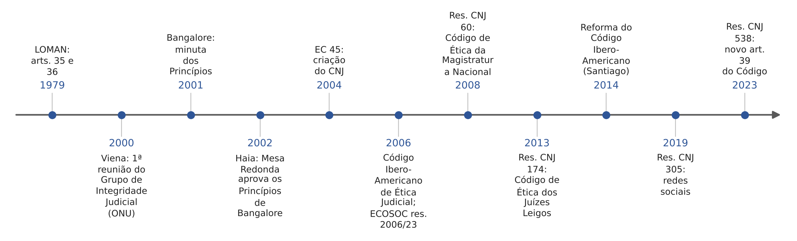
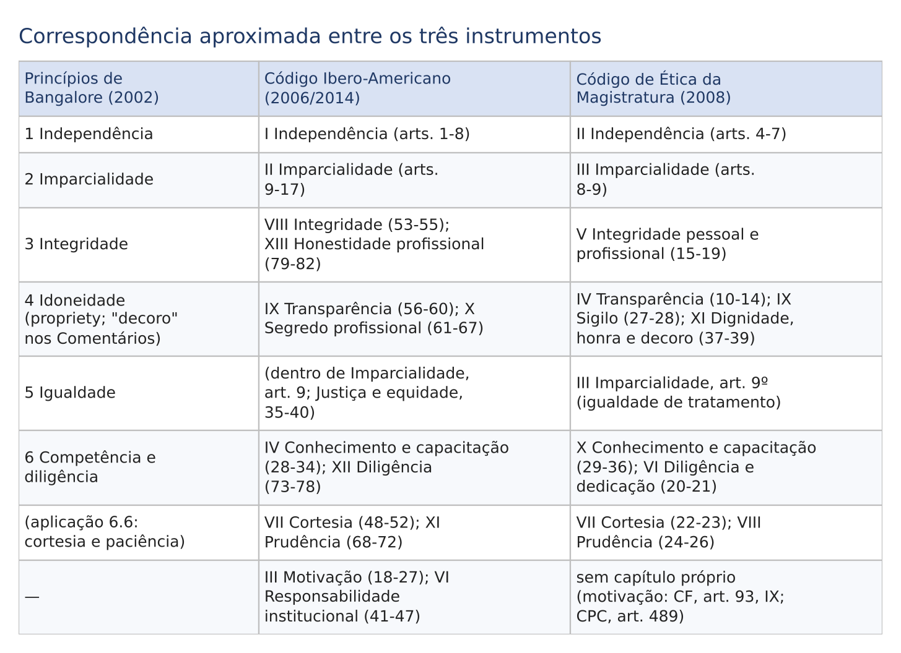
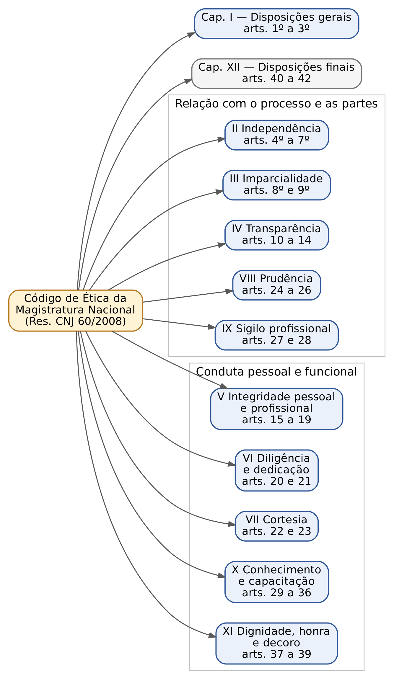
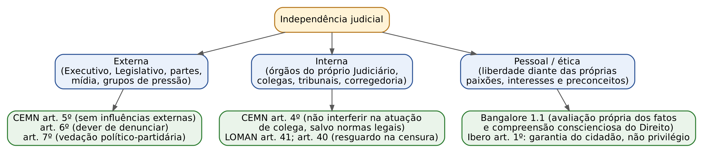
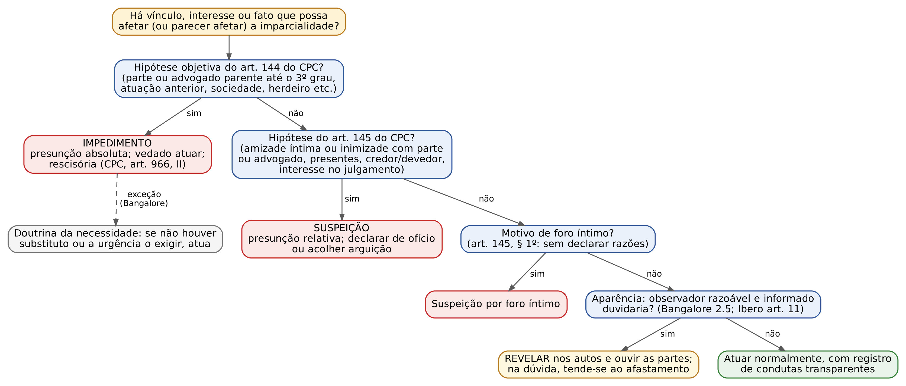
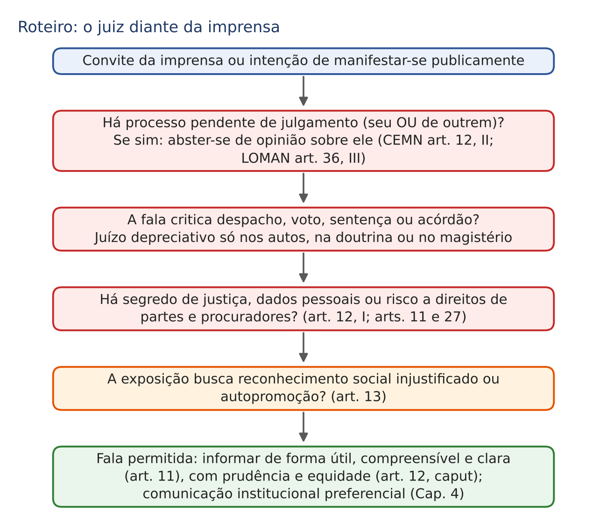
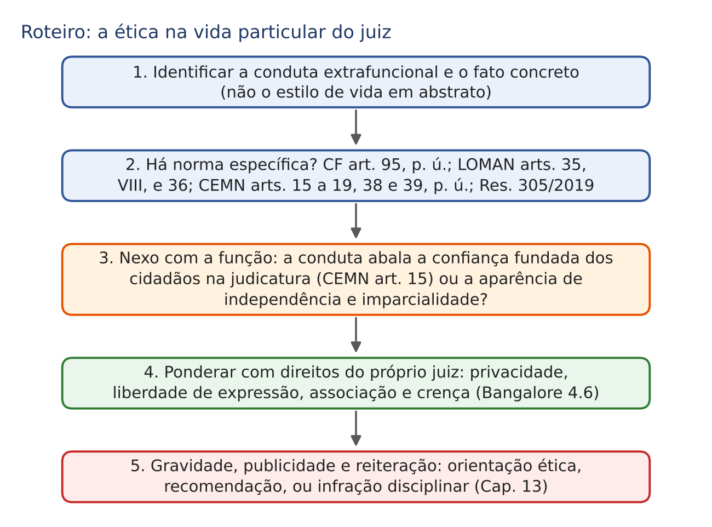
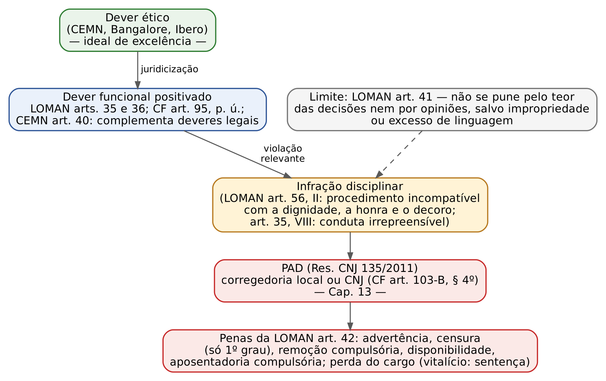

# CAPÍTULO 12 — ÉTICA JUDICIAL E CÓDIGO DE ÉTICA DA MAGISTRATURA NACIONAL

:::INCIDENCIA
TRF5 p. C.3; TJRS p. C.3; TJSC p. D.3, D.4, D.5, D.6. Nível A+.
Lote: 7 questões (FGV 7, FCC 0), das quais 3 do ENAM e 1 de prova de juiz (TJ-PA 2026), 1 de juiz federal (TRF2 2026) e 2 de juiz leigo (TJ-RS 2026).
O que mais cai: LETRA do Código de Ética da Magistratura Nacional (arts. 8º, 10, 12, 13, 18, 38 e 39), alternativas trocando o nome do princípio pela definição de outro, relação com a imprensa, Código Ibero-Americano cobrado sob o rótulo "Bangalore" e impedimento x suspeição.
:::

O capítulo cobre a ética judicial como disciplina (o que é, onde se situa entre a moral e o Direito, por que o juiz tem deveres que o cidadão comum não tem), as três fontes que a prova cobra (Princípios de Bangalore, Código Ibero-Americano de Ética Judicial e Código de Ética da Magistratura Nacional, este com leitura artigo por artigo), os conflitos de interesse e a aparência de imparcialidade, o lugar da ética na vida particular do juiz, o papel da cordialidade e a passagem do ilícito ético ao disciplinar. Ficam fora, com remissão: o estatuto funcional e as garantias (Cap. 10); deveres e vedações da LOMAN em sua feição funcional, magistério, atividade político-partidária, redes sociais (Resolução CNJ 305/2019) e participação em eventos (Cap. 11); PAD, penas e responsabilidade civil e penal (Cap. 13); CNJ e corregedorias (Cap. 14); Estatuto da Magistratura catarinense (Cap. 16); mídia e comunicação institucional (Cap. 4); comunicação com partes e linguagem simples (Cap. 6); assédio e discriminação no trabalho (Cap. 7); protocolos de julgamento com perspectiva de gênero e racial (Cap. 28); vieses cognitivos (Cap. 37). O regime processual do impedimento e da suspeição está na Apostila de Processo Civil, Cap. 10 (10.3); aqui interessa seu fundamento ético e sua relação com a aparência de imparcialidade.

## 12.1 Ética, deontologia e Direito: o lugar da ética na função judicial

### 12.1.1 Conceitos de partida

Ética, em sentido filosófico, é a reflexão sobre os fundamentos e critérios do agir correto e da vida boa; moral é o conjunto de normas de conduta efetivamente vigentes num grupo. Ética PROFISSIONAL (ou deontologia, do grego *deon*, dever) é o conjunto de deveres próprios de quem exerce determinada profissão, derivados do fim social dessa profissão. Na formulação adotada em material de preparação corrente (Filippe Augusto dos Santos Nascimento, Manual de Humanística), ética profissional é o "conjunto de normas morais" que pautam a conduta dos profissionais; a deontologia forense vai além da etiqueta entre profissionais e garante o relacionamento adequado entre os integrantes da comunidade jurídica e a boa prestação do serviço público.

José Renato Nalini (Ética Geral e Profissional) sintetiza o princípio fundamental da deontologia jurídica na máxima AGIR SEGUNDO CIÊNCIA E CONSCIÊNCIA: ciência é o dever de atualização técnica permanente; consciência é a ponderação das consequências do ato e a assunção de seus resultados. Do princípio fundamental Nalini extrai princípios derivados, que aparecem em provas como rol de "princípios da deontologia forense":

| Princípio (Nalini) | Conteúdo |
|---|---|
| Conduta ilibada | expectativa objetiva de que o profissional não se envolva dolosamente em condutas criminosas |
| Dignidade e decoro profissional | evitar atos que levem a sociedade a desprestigiar a profissão |
| Incompatibilidade | carreiras jurídicas, em regra, inacumuláveis com outras atividades remuneradas, salvo exceções como o magistério |
| Correção profissional | atuação urbana e cortês com todos os que frequentam o foro |
| Coleguismo | dever de comunidade entre profissionais; NÃO se confunde com corporativismo (cooperação formal voltada a benefícios mútuos mesquinhos) |
| Diligência | eficiência na aplicação do Direito, sem alheamento do mundo |
| Desinteresse | agir pelo cumprimento do dever, não pelo interesse econômico |
| Confiança | o acesso a informações íntimas impõe sigilo |
| Fidelidade | lealdade a quem tem a vida decidida no processo |
| Independência profissional | autonomia na condução da atividade |
| Reserva | discrição, recusa à autopromoção, cautela |
| Lealdade e verdade | boa-fé, sem intuito malicioso |
| Discricionariedade | liberdade para decisões profissionais segundo conveniência e oportunidade |

:::PEGADINHA
"Coleguismo" é princípio deontológico; "corporativismo" é sua deformação. Alternativa que apresente o coleguismo como dever de proteger o colega faltoso está errada: o próprio Código Ibero-Americano impõe ao juiz o dever de denunciar, perante quem corresponda, os incumprimentos graves de colegas (art. 45), e o Código Nacional manda o juiz colaborar com os órgãos de controle (art. 14).
:::

### 12.1.2 Ética de excelência x ética disciplinar

A distinção mais útil para a prova oral é a que o Código Ibero-Americano faz em seu preâmbulo e que a doutrina de seus redatores (Manuel Atienza e Rodolfo Luis Vigo) desenvolveu: o Direito disciplinar olha para trás, julga *ex post facto* uma falta e aplica sanção; a ética judicial olha para frente, quer modificar o comportamento futuro do juiz e obter sua adesão íntima a um ideal de EXCELÊNCIA. Mais importante do que descobrir faltas, diz o preâmbulo, é obter firme e íntima adesão aos princípios. Daí três consequências:

- A ética judicial não se esgota no mínimo exigível: pede o "melhor juiz", não apenas o juiz não punível. Atienza fala em VIRTUDES JUDICIAIS, retomando a tradição aristotélica de que a virtude é disposição de caráter adquirida pela prática, e não mera conformidade exterior a regras.
- O Código Ibero-Americano é código MODELO, proposto à adesão voluntária dos juízes, e os pareceres da Comissão Ibero-Americana de Ética Judicial não têm força vinculante para os Poderes Judiciais (art. 95).
- A eficácia da ética depende de introjeção, formação e exemplo, não apenas de corregedoria. Por isso os códigos se articulam com a formação inicial e continuada (Cap. X do Código Nacional; 12.12).

No Brasil, a distinção é relativizada: o Código de Ética da Magistratura Nacional foi editado por resolução do CNJ, órgão com competência disciplinar, e seus preceitos "complementam os deveres funcionais" da Constituição e da LOMAN (art. 40). Ele é, ao mesmo tempo, código de excelência (linguagem exortativa: "o magistrado deve", "cumpre ao magistrado") e parâmetro de responsabilização (12.14). A FGV explora essa dupla natureza: alternativa que diga que o Código "não tem qualquer reflexo disciplinar" está errada; alternativa que diga que toda desconformidade com o Código é infração punível também está errada.

:::DOUTRINA Manuel Atienza e Rodolfo Luis Vigo — Código Ibero-Americano de Ética Judicial (2006)
Os dois redatores do Código Ibero-Americano (Atienza, filósofo do Direito espanhol, teórico da argumentação; Vigo, jurista e juiz argentino) sustentam que a ética judicial é ética APLICADA de uma profissão, de caráter não sancionador, orientada a um modelo de "juiz excelente". A ética não é um plus facultativo: integra a legitimidade da função, porque o poder do juiz se justifica pela qualidade das razões e da conduta de quem o exerce. Para a prova oral: (i) ética judicial x responsabilidade disciplinar; (ii) adesão voluntária x positivação; (iii) virtudes x deveres.
:::

### 12.1.3 Por que o juiz tem uma ética própria

Os considerandos do Código Nacional dão as razões oficiais, que a banca transforma em assertivas:

- o Código é "instrumento essencial" para os juízes incrementarem a confiança da sociedade em sua AUTORIDADE MORAL;
- traduz compromisso institucional com a EXCELÊNCIA na prestação do serviço público de distribuir Justiça e, assim, mecanismo para fortalecer a LEGITIMIDADE do Poder Judiciário;
- é fundamental à magistratura cultivar princípios éticos, "pois lhe cabe também função educativa e exemplar de cidadania" em face dos demais grupos sociais;
- a LOMAN já veda procedimento incompatível com a dignidade, a honra e o decoro (art. 56, II) e impõe conduta irrepreensível na vida pública e particular (art. 35, VIII), sendo necessário "minudenciar" esses princípios.

A justificativa de fundo é de legitimidade. O juiz não é eleito; sua autoridade repousa na confiança pública de que decide segundo o Direito, de modo independente e imparcial. O preâmbulo dos Princípios de Bangalore afirma que a confiança pública no sistema judicial e na autoridade moral e integridade do Judiciário é de extrema importância numa sociedade democrática moderna, e que o juiz deve ver o cargo como um encargo público (*public trust*). Nalini acrescenta a dimensão de serviço: o juiz brasileiro é servidor qualificado e diferenciado, recrutado por concurso, mas "prestador de serviço" pago pelo povo, e só o compromisso com a excelência sustenta a legitimidade do Judiciário. A fundamentação e a publicidade das decisões funcionam, nessa leitura, como prestação de contas.

Daí a ideia, positivada no art. 16 do Código Nacional e no art. 55 do Código Ibero-Americano, de que a função impõe ao juiz restrições e exigências pessoais distintas das que recaem sobre os cidadãos em geral. A restrição não é privilégio às avessas nem moralismo: é condição de credibilidade de um poder que decide sobre a vida alheia (12.8).

### 12.1.4 Natureza jurídica e força normativa do Código Nacional

O Código de Ética da Magistratura Nacional foi instituído pela Resolução CNJ 60, de 19/9/2008 (publicada no DJE/CNJ de 30/9/2008), assinada pelo Ministro Gilmar Mendes, com base no art. 103-B, § 4º, I e II, da CF, no art. 60 da LOMAN e no Regimento Interno do CNJ. Tem 42 artigos em 12 capítulos. Sua única alteração foi a da Resolução CNJ 538, de 13/12/2023, que deu nova redação ao art. 39 e lhe acrescentou parágrafo único (12.13).

:::LEI Resolução CNJ 60/2008 (Código de Ética da Magistratura Nacional), arts. 40 e 41
Art. 40. Os preceitos do presente Código complementam os deveres funcionais dos juízes que emanam da Constituição Federal, do Estatuto da Magistratura e das demais disposições legais.
Art. 41. Os Tribunais brasileiros, por ocasião da posse de todo Juiz, entregar-lhe-ão um exemplar do Código de Ética da Magistratura Nacional, para fiel observância durante todo o tempo de exercício da judicatura.
:::

Três pontos de natureza jurídica:

- O Código NÃO cria tipos disciplinares autônomos nem penas: as penas são as da LOMAN (art. 42) e o procedimento é o da Resolução CNJ 135/2011 (Cap. 13). Ele densifica cláusulas abertas da LOMAN (conduta irrepreensível; dignidade, honra e decoro), funcionando como parâmetro interpretativo e de motivação da decisão disciplinar.
- O STF tem mantido sanções do CNJ fundadas na violação conjunta de deveres da LOMAN e de deveres "deontológicos" do Código (12.14), o que confirma sua força normativa.
- A lógica é a de um código de excelência que também é norma: o art. 41 o faz entregar na posse, e o art. 42 atribui ao CNJ promover-lhe ampla divulgação.

### 12.1.5 Ética judicial, neutralidade e valores constitucionais

Os arts. 2º e 3º do Código Nacional afastam a imagem do juiz neutro e indiferente: impõe-se primar pelo respeito à Constituição e às leis, "buscando o fortalecimento das instituições e a plena realização dos valores democráticos" (art. 2º), e a atividade judicial deve "garantir e fomentar a dignidade da pessoa humana", promovendo "a solidariedade e a justiça na relação entre as pessoas" (art. 3º). André Ramos Tavares (Manual do Poder Judiciário Brasileiro) observa que a integridade judicial não fica comprometida pela realização desses valores; compromete-a, ao contrário, a invocação de uma "imaginária neutralidade" que afastaria o juiz das pautas constitucionais de direitos fundamentais.

A distinção decisiva para a prova é entre IMPARCIALIDADE (dever de equidistância das partes e de ausência de predisposição quanto ao resultado) e NEUTRALIDADE (pretensão de ausência de valores, inclusive constitucionais). O juiz deve ser imparcial; não pode ser neutro em relação à Constituição. É essa a premissa dos Protocolos para Julgamento com Perspectiva de Gênero e Racial (Resoluções CNJ 492/2023 e 598/2024, Cap. 28): considerar desigualdades estruturais não viola a imparcialidade; aplicar estereótipos é que a viola. A FGV explorou exatamente essa confusão na alternativa D (errada) da Q3786424 (TJ-MS 2025, Juiz Substituto), segundo a qual considerar gênero, raça e classe violaria a imparcialidade; o comentário completo está no Cap. 28 (v. Cap. 28).

## 12.2 Fontes internacionais: Princípios de Bangalore e Código Ibero-Americano

### 12.2.1 Princípios de Bangalore de Conduta Judicial

Histórico (segundo os Comentários oficiais, versão em português publicada pelo UNODC):

- 15/4/2000, Viena: primeira reunião do Grupo de Integridade Judicial (*Judicial Integrity Group*), formado sob os auspícios da ONU por presidentes de cortes superiores, sobretudo de países de *common law*, presidido pelo Juiz Christopher Weeramantry. A motivação era a perda de confiança pública nos sistemas judiciais em vários continentes, inclusive por corrupção.
- 24 a 26/2/2001, Bangalore (Índia): segunda reunião, que acordou a "Minuta de Bangalore" de código de conduta judicial (o Juiz Michael Kirby atuou como relator).
- 25 e 26/11/2002, Haia: Mesa Redonda de chefes de Judiciários de países de *civil law* revisou a minuta, que passou a chamar-se Princípios de Bangalore de Conduta Judicial. A participação de juízes de tradição romano-germânica deu ao texto vocação universal.
- 29/4/2003: a Comissão de Direitos Humanos da ONU tomou nota dos Princípios (resolução 2003/43).
- Julho de 2006: o ECOSOC, na resolução 2006/23, convidou os Estados a encorajar seus Judiciários a levar os Princípios em consideração.
- 2007: aprovação dos Comentários aos Princípios, preparados sob coordenação de Nihal Jayawickrama (publicação em português pelo UNODC em 2008).

:::PEGADINHA
O texto-base da questão do ENAM 2024 (Q2459876) diz que os Princípios foram "formulados em abril de 2001" em Bangalore. Os Comentários oficiais e o relatório da reunião do Judicial Integrity Group registram a reunião de Bangalore em 24 a 26/2/2001. Se a banca cobrar data, prefira fevereiro de 2001; o que se cobra com mais segurança é a sequência Viena (2000), Bangalore (2001), Haia (2002) e a aprovação final em Haia, não em Bangalore.
:::

Os Princípios se organizam em SEIS VALORES, cada um com um enunciado ("princípio") e aplicações numeradas:

| Valor | Enunciado (síntese) | Aplicações mais cobradas |
|---|---|---|
| 1 Independência | pré-requisito do Estado de Direito e garantia fundamental de julgamento justo; aspectos individual e institucional | 1.1 decidir com base na própria avaliação dos fatos e na compreensão conscienciosa do Direito, livre de influências externas; 1.3 livre de vínculos impróprios com Executivo e Legislativo e assim parecer a um observador razoável; 1.4 independência em relação aos colegas |
| 2 Imparcialidade | essencial ao desempenho do cargo; aplica-se à decisão e ao PROCESSO de decidir | 2.4 não comentar processo pendente de modo a afetar o resultado ou a equidade; 2.5 afastar-se quando não puder decidir imparcialmente ou quando assim PARECER a um observador razoável |
| 3 Integridade | essencial ao desempenho do cargo | 3.1 conduta acima de qualquer reprovação aos olhos de um observador razoável; 3.2 a justiça não só deve ser feita, mas deve ser vista sendo feita |
| 4 Idoneidade (*propriety*) | idoneidade e aparência de idoneidade são essenciais a todas as atividades do juiz | 4.1 evitar impropriedade e aparência de impropriedade; 4.2 aceitar restrições pessoais; 4.6 liberdade de expressão, crença, associação e reunião preservadas, com respeito à dignidade do cargo; 4.14 a 4.16 presentes |
| 5 Igualdade | assegurar igualdade de tratamento a todos perante os tribunais | 5.1 consciência da diversidade; 5.2 a 5.5 não discriminar por motivos irrelevantes, nem permitir que servidores ou advogados o façam |
| 6 Competência e diligência | pré-requisitos do desempenho do cargo | 6.1 deveres judiciais têm precedência sobre todas as demais atividades; 6.3 e 6.4 aperfeiçoamento, inclusive em direito internacional e direitos humanos; 6.5 decisões em tempo razoável; 6.6 ordem, decoro, paciência, dignidade e cortesia |

O valor 4 (*propriety*) é traduzido nos Comentários em português por "Decoro"; a literatura de concurso também usa "Idoneidade". Qualquer dos dois termos pode aparecer; o conteúdo é o mesmo: correção de conduta e de APARÊNCIA em todas as atividades, inclusive privadas.

Elementos dos Princípios que a FGV transforma em assertivas:

- Teste do OBSERVADOR RAZOÁVEL: a independência, a integridade e a imparcialidade são aferidas pelo que perceberia um observador razoável, justo e informado (Comentários, §§ 37, 52 e 81). O critério é OBJETIVO: não se pergunta se o juiz se sente imparcial, mas se há apreensão razoável de parcialidade.
- A máxima de Lord Hewart em *R v Sussex Justices, ex parte McCarthy* (1924), citada nos Comentários (§ 56): a justiça não deve somente ser feita, mas deve manifestamente ser vista como tendo sido feita.
- Hipóteses de desqualificação (2.5): parcialidade efetiva ou conhecimento pessoal de fatos probatórios controvertidos; atuação anterior como advogado ou testemunha relevante no caso; interesse econômico no resultado, do juiz ou de membro de sua família. RESSALVA: não se exige o afastamento se nenhum outro tribunal puder ser constituído ou se, por urgência, a omissão puder causar grave erro judiciário (DOUTRINA DA NECESSIDADE, Comentários, § 100).
- Dever de REVELAR: o juiz deve levar aos autos, para manifestação das partes, a informação relevante sobre possível causa de desqualificação, salvo se óbvia ou notória; na dúvida, a questão ordinariamente se resolve em favor da recusa (Comentários, §§ 80 e 93).
- Toda atividade político-partidária deve cessar com a assunção do cargo (Comentários, § 65).
- "Juízes não vivem em torres de marfim" (Comentários, § 119): o isolamento social não é virtude; o que se exige é critério nas relações, especialmente com advogados que atuam perante o juiz, relação qualificada como perigosa e que requer avaliação (§ 120).
- Família do juiz (Definições): cônjuge, filhos, genros e noras e qualquer outro parente próximo ou pessoa que seja companheira ou empregada do juiz e que viva em sua casa; "cônjuge" inclui o companheiro doméstico ou qualquer pessoa, de qualquer sexo, em relação pessoal íntima com o juiz. "Juiz" é qualquer pessoa que exerça poder judicial, qualquer que seja a designação.
- Implementação: os Judiciários nacionais devem adotar mecanismos efetivos para implementar os Princípios, se ainda não existirem.

A Resolução CNJ 305/2019 (redes sociais) menciona os Princípios de Bangalore em seus considerandos, e o CNJ tem usado o critério da aparência e do observador razoável em decisões disciplinares (Cap. 11 e Cap. 13).

### 12.2.2 Código Ibero-Americano de Ética Judicial

O Código Modelo Ibero-Americano de Ética Judicial foi elaborado por encomenda da Cúpula Judicial Ibero-Americana (que reúne presidentes de cortes supremas e de conselhos da magistratura dos países ibero-americanos), redigido por Manuel Atienza e Rodolfo Luis Vigo e aprovado em 2006, na XIII Cúpula, realizada em Santo Domingo (República Dominicana); foi reformado em 2/4/2014, na XVII Reunião Plenária, em Santiago do Chile. O texto vigente tem duas partes: a Parte I, com 13 capítulos de princípios (arts. 1º a 82), e a Parte II, que cria a Comissão Ibero-Americana de Ética Judicial (arts. 83 a 95).

| Cap. | Princípio | Arts. | Ideia-chave |
|---|---|---|---|
| I | Independência | 1 a 8 | não é privilégio do juiz, mas garantia do cidadão de ser julgado com base no Direito; vedação de atividade político-partidária (art. 4º); dever de denunciar tentativas de perturbação (art. 6º); não interferir na independência de colegas (art. 7º) |
| II | Imparcialidade | 9 a 17 | fundada no direito de ser tratado igualmente; distância equivalente das partes (art. 10); afastamento quando a imparcialidade estiver comprometida ou assim parecer a observador razoável (art. 11); evitar aparência de tratamento preferencial (art. 13); proibição de presentes (art. 14); evitar reuniões com uma parte que a outra considere injustificadas (art. 15); honestidade intelectual e autocrítica (art. 17) |
| III | Motivação | 18 a 27 | decisão sem motivação é, em princípio, arbitrária (art. 20); dever de motivar de intensidade MÁXIMA nas decisões restritivas de direitos ou discricionárias (art. 21); a motivação de direito NÃO pode limitar-se a invocar as normas aplicáveis (art. 24); estilo claro, preciso e conciso (art. 27) |
| IV | Conhecimento e capacitação | 28 a 34 | fundamento no direito a um serviço de qualidade (art. 28); formação contínua abrange matérias jurídicas e outros saberes úteis (art. 30); ênfase em direitos humanos (art. 31) |
| V | Justiça e equidade | 35 a 40 | fim último da atividade judicial é realizar a justiça por meio do Direito (art. 35); equidade para atenuar a generalidade da lei (art. 36); o juiz se vincula não só ao texto das normas, mas às RAZÕES em que se fundamentam (art. 40) |
| VI | Responsabilidade institucional | 41 a 47 | compromisso com o bom funcionamento de todo o sistema; responder voluntariamente por ações e omissões (art. 44); denunciar incumprimentos graves de colegas (art. 45) |
| VII | Cortesia | 48 a 52 | fundamento MORAL dos deveres de cortesia (art. 48); dar explicações pedidas, quando procedentes (art. 50); tolerância a críticas (art. 52) |
| VIII | Integridade | 53 a 55 | integridade fora da atividade jurisdicional fortalece a confiança; exigências que não valem para os demais cidadãos (art. 55) |
| IX | Transparência | 56 a 60 | transparência como garantia da justiça das decisões; documentar atos mesmo sem exigência legal (art. 58); imprensa (art. 59); vedação de busca desmesurada de reconhecimento social (art. 60) |
| X | Segredo profissional | 61 a 67 | fundamento: salvaguardar os DIREITOS DAS PARTES e pessoas próximas contra o uso indevido de informações (art. 61); reserva também no âmbito privado (art. 66) |
| XI | Prudência | 68 a 72 | autocontrole do poder de decisão (art. 68); ponderação de argumentos e contra-argumentos (art. 69); análise das alternativas e consequências (art. 71) |
| XII | Diligência | 73 a 78 | evitar a injustiça da decisão tardia (art. 73); prazo razoável, pontualidade, repressão a atos dilatórios; atitude positiva diante da avaliação de desempenho (art. 78) |
| XIII | Honestidade profissional | 79 a 82 | não receber benefícios além dos legalmente devidos nem usar abusivamente meios do cargo (art. 80); não se aproveitar do trabalho alheio (art. 81); evitar dúvida razoável sobre a legitimidade de rendimentos e patrimônio (art. 82) |

A Comissão Ibero-Americana de Ética Judicial tem nove membros e um secretário executivo, mandato de quatro anos com reeleição, cargos honoríficos; assessora os Judiciários, responde a consultas sobre a conformidade ética de condutas, fomenta a difusão da ética judicial e deve pronunciar-se em 90 dias; seus pronunciamentos não têm força vinculante.

### 12.2.3 Filiação do Código Nacional

O Código Nacional não menciona os textos internacionais em seus considerandos, mas reproduz, muitas vezes literalmente em tradução, dispositivos do Código Ibero-Americano. Correspondências verificáveis: art. 4º (não interferir na atuação de colega) e Ibero 7; art. 6º (denunciar interferência) e Ibero 6; art. 7º (vedação político-partidária) e Ibero 4; art. 8º (imparcial busca a verdade nas provas, distância equivalente) e Ibero 10; art. 10 (documentar mesmo sem previsão legal) e Ibero 58; art. 11 (informar de forma útil, compreensível e clara) e Ibero 57; art. 12 (imprensa) e Ibero 59; art. 13 (reconhecimento social desmesurado) e Ibero 60; art. 14 (colaboração com órgãos de aferição) e Ibero 78; arts. 15 e 16 (integridade fora da jurisdição; restrições distintas) e Ibero 53 e 55; art. 19 (legitimidade de receitas) e Ibero 82; art. 20 (pontualidade e prazo razoável) e Ibero 74 a 76; art. 21 (não assumir encargos incompatíveis) e Ibero 77; art. 24 (juízo justificado racionalmente) e Ibero 69; art. 26 (atitude aberta e paciente) e Ibero 70; arts. 29 a 35 (conhecimento e capacitação) e Ibero 28 a 34.

Ficaram de fora, como capítulos autônomos, a MOTIVAÇÃO, a JUSTIÇA E EQUIDADE, a RESPONSABILIDADE INSTITUCIONAL e a HONESTIDADE PROFISSIONAL (esta absorvida pela integridade, arts. 17 a 19). Em compensação, o Código Nacional criou capítulo de DIGNIDADE, HONRA E DECORO (arts. 37 a 39), que espelha o art. 56, II, da LOMAN.

:::QUESTAO FGV 2024 — ENAM — 1º Exame Nacional da Magistratura (Q2459876)
Cobrado: o que deve observar o juiz recém-ingresso "de acordo com os Princípios de Bangalore". Gabarito: C (a independência implica que o juiz não deve participar, de qualquer modo, de atividade político-partidária).
Armadilha estrutural: embora o enunciado fale em Bangalore, TODAS as alternativas parafraseiam o Código IBERO-AMERICANO (a própria questão lembra que Bangalore subsidiou o Código Ibero-Americano). A correta corresponde ao art. 4º do Ibero (e ao art. 7º do Código Nacional; os Comentários a Bangalore dizem o mesmo no § 65).
- A: inverte o art. 24 do Ibero (a motivação de direito NÃO pode limitar-se a invocar normas) e o art. 21 (há intensidade máxima do dever de motivar em certas decisões).
- B: inverte o art. 40 do Ibero (vinculação também às RAZÕES das normas).
- D: inverte o art. 30 do Ibero e o art. 31 do Código Nacional (formação abrange conhecimentos não jurídicos úteis à função).
- E: inverte o art. 61 do Ibero (o segredo profissional protege especificamente os direitos das partes e pessoas próximas).
Técnica: diante de "Bangalore", "Ibero-Americano" ou "Código de Ética", procure a alternativa que reproduz o texto sem negação ou restrição indevida; as erradas costumam negar um dever ("não deve ostentar intensidade máxima", "restringe-se às matérias jurídicas", "apenas pelo texto").
:::

:::DICA
Memorize as "assinaturas" de cada instrumento. Bangalore: 6 valores, observador razoável, *propriety*, igualdade como valor autônomo, doutrina da necessidade. Ibero-Americano: 13 princípios, motivação, justiça e equidade, responsabilidade institucional, honestidade profissional, Comissão consultiva. Código Nacional: 12 capítulos, 10 capítulos temáticos, dignidade/honra/decoro, art. 39 com assédio e violência contra a mulher, vinculado à LOMAN (art. 40).
:::

## 12.3 O Código de Ética da Magistratura Nacional: estrutura e disposições gerais

O Código tem 12 capítulos: disposições gerais (I), dez capítulos temáticos (II a XI) e disposições finais (XII). A ordem dos capítulos é a pergunta preferida para identificar a qual "princípio" pertence um dispositivo (Q3996907, 12.7): a topografia decide o gabarito.

:::LEI Resolução CNJ 60/2008 (Código de Ética da Magistratura Nacional), arts. 1º a 3º
Art. 1º O exercício da magistratura exige conduta compatível com os preceitos deste Código e do Estatuto da Magistratura, norteando-se pelos princípios da independência, da imparcialidade, do conhecimento e capacitação, da cortesia, da transparência, do segredo profissional, da prudência, da diligência, da integridade profissional e pessoal, da dignidade, da honra e do decoro.
Art. 2º Ao magistrado impõe-se primar pelo respeito à Constituição da República e às leis do País, buscando o fortalecimento das instituições e a plena realização dos valores democráticos.
Art. 3º A atividade judicial deve desenvolver-se de modo a garantir e fomentar a dignidade da pessoa humana, objetivando assegurar e promover a solidariedade e a justiça na relação entre as pessoas.
:::

:::PEGADINHA
Diferenças de nomenclatura que a banca usa para invalidar alternativas:
- O art. 1º fala em "segredo profissional"; o título do Cap. IX é "sigilo profissional". Ambos são do Código.
- O art. 1º fala em "integridade profissional e pessoal"; o Cap. V, em "integridade pessoal e profissional".
- O art. 1º menciona "diligência"; o Cap. VI é "diligência e dedicação".
- NÃO são princípios nominados do Código Nacional: motivação, justiça e equidade, responsabilidade institucional, honestidade profissional (são do Ibero-Americano), igualdade e idoneidade/*propriety* (de Bangalore), "competência" (Bangalore: competência e diligência). Alternativa que atribua ao Código Nacional capítulo de "motivação" está errada.
- O rol do art. 1º não segue a ordem dos capítulos (cortesia aparece antes de transparência no art. 1º, mas é o Cap. VII).
:::

## 12.4 Independência (arts. 4º a 7º)

### 12.4.1 Independência como garantia e como dever ético

A independência tem duas faces. Como GARANTIA institucional e funcional (vitaliciedade, inamovibilidade, irredutibilidade, autonomia administrativa e financeira), é matéria do Cap. 10 e da Apostila de Direito Constitucional, Cap. 29. Como DEVER ÉTICO, é exigência de que o próprio juiz se mantenha livre de influências estranhas ao Direito. O Código Ibero-Americano (art. 1º) fixa a premissa: as instituições que asseguram a independência não se destinam a situar o juiz em posição de privilégio, mas a garantir ao cidadão o direito de ser julgado com parâmetros jurídicos. Independência é direito do jurisdicionado, não do juiz.

:::LEI Resolução CNJ 60/2008, arts. 4º a 7º
Art. 4º Exige-se do magistrado que seja eticamente independente e que não interfira, de qualquer modo, na atuação jurisdicional de outro colega, exceto em respeito às normas legais.
Art. 5º Impõe-se ao magistrado pautar-se no desempenho de suas atividades sem receber indevidas influências externas e estranhas à justa convicção que deve formar para a solução dos casos que lhe sejam submetidos.
Art. 6º É dever do magistrado denunciar qualquer interferência que vise a limitar sua independência.
Art. 7º A independência judicial implica que ao magistrado é vedado participar de atividade político-partidária.
:::

Pontos de prova:

- O art. 4º tem DUAS ordens: ser eticamente independente e NÃO INTERFERIR na atuação jurisdicional de colega. A ressalva "exceto em respeito às normas legais" cobre a revisão por recurso, a correição, a uniformização de jurisprudência e os precedentes vinculantes (CPC, art. 927): seguir precedente obrigatório não ofende a independência, porque decorre de norma legal. Independência INTERNA é também independência em relação a presidentes, corregedores e desembargadores fora das vias processuais (Bangalore 1.4).
- O art. 5º vale para influências de qualquer origem: partes, mídia, opinião pública, outros Poderes, grupos econômicos. O Código Ibero-Americano é explícito: o juiz não deve receber influências de nenhum poder, público ou privado, interno ou externo (art. 3º), e decide sem se deixar influenciar "real ou aparentemente" por fatores alheios ao Direito (art. 2º).
- O art. 6º converte a independência em DEVER ATIVO: não basta resistir à pressão, é preciso DENUNCIÁ-LA (o Ibero, art. 6º, fala em "direito e dever"). Exemplo: telefonema de autoridade pedindo "atenção especial" a um processo deve ser registrado e comunicado à corregedoria ou à presidência, conforme o caso.
- O art. 7º funda na INDEPENDÊNCIA (não na imparcialidade) a vedação de atividade político-partidária, que também está na CF (art. 95, parágrafo único, III) e na LOMAN (art. 26, II, c, como causa de perda do cargo). O alcance da vedação (filiação, apoio público a candidatos, manifestações em redes) e o Provimento da Corregedoria Nacional que a disciplina são objeto do Cap. 11.

:::PEGADINHA
O art. 7º diz que a INDEPENDÊNCIA implica a vedação político-partidária. Alternativa que funde a vedação na "imparcialidade", na "prudência" ou na "integridade", reproduzindo o restante do texto, está errada segundo a letra do Código, embora a vedação proteja também a imparcialidade. Foi exatamente a formulação do gabarito da Q2459876 (12.2.3).
:::

### 12.4.2 Independência e responsabilidade

A independência não exclui responsabilidade nem controle. O art. 14 do Código (colaboração com órgãos de controle e aferição de desempenho) e o art. 23 (atividade correicional exercida com respeito aos correicionados) mostram as duas pontas: o juiz colabora com o controle; o controle respeita o juiz. A LOMAN dá o limite material: salvo impropriedade ou excesso de linguagem, o magistrado não pode ser punido ou prejudicado pelas opiniões que manifestar ou pelo teor das decisões que proferir (art. 41), e a atividade censória é exercida com o resguardo devido à dignidade e à independência do magistrado (art. 40). O erro de julgamento corrige-se por recurso, não por corregedoria; a violação ética está na conduta, não no conteúdo jurídico da decisão (12.14).

:::EXEMPLO Pressão interna e dever de denunciar
Situação: desembargador, em conversa informal, diz ao juiz substituto que "a Câmara não gostaria" de ver liminar concedida em ação contra o município, e que isso "pesaria" no vitaliciamento.
Solução: (1) o desembargador viola o art. 4º (interferência na atuação jurisdicional de colega fora das vias legais) e o art. 5º reflexamente; (2) o juiz deve decidir segundo sua convicção (art. 5º; Bangalore 1.1 e 1.4) e tem o DEVER de denunciar a interferência (art. 6º); (3) o vitaliciamento não pode avaliar o conteúdo das decisões, mas a qualidade e a adequação técnica (Cap. 10); (4) a denúncia deve ser formal e sóbria, sem exposição pública (cortesia e prudência, arts. 22 e 24).
:::

:::PRATIQUE Exercício elaborado para esta apostila (não é questão de banca)
Julgue: (1) A independência judicial é prerrogativa pessoal do juiz, oponível inclusive ao jurisdicionado. (2) Segundo o Código de Ética da Magistratura Nacional, é dever do magistrado denunciar qualquer interferência que vise a limitar sua independência. (3) A observância de precedente vinculante viola o art. 4º do Código, que veda interferência na atuação jurisdicional de colega.
Resolução: (1) ERRADO: a independência é garantia do cidadão (Ibero, art. 1º). (2) CERTO: art. 6º, literal. (3) ERRADO: a ressalva "exceto em respeito às normas legais" abarca o sistema de precedentes (CPC, art. 927).
:::

## 12.5 Imparcialidade e aparência de imparcialidade (arts. 8º e 9º)

### 12.5.1 O conceito no Código

:::LEI Resolução CNJ 60/2008, arts. 8º e 9º
Art. 8º O magistrado imparcial é aquele que busca nas provas a verdade dos fatos, com objetividade e fundamento, mantendo ao longo de todo o processo uma distância equivalente das partes, e evita todo o tipo de comportamento que possa refletir favoritismo, predisposição ou preconceito.
Art. 9º Ao magistrado, no desempenho de sua atividade, cumpre dispensar às partes igualdade de tratamento, vedada qualquer espécie de injustificada discriminação.
Parágrafo único. Não se considera tratamento discriminatório injustificado:
I - a audiência concedida a apenas uma das partes ou seu advogado, contanto que se assegure igual direito à parte contrária, caso seja solicitado;
II - o tratamento diferenciado resultante de lei.
:::

O art. 8º contém quatro elementos que a banca recorta: (i) busca da verdade NAS PROVAS (não fora delas, por conhecimento privado); (ii) objetividade e fundamento; (iii) DISTÂNCIA EQUIVALENTE das partes ao longo de TODO o processo; (iv) evitar comportamento que possa REFLETIR favoritismo, predisposição ou preconceito. O verbo "refletir" incorpora a APARÊNCIA: não basta não ser parcial, é preciso não parecer parcial.

A doutrina distingue dimensão SUBJETIVA (ausência de prevenção pessoal do juiz quanto às partes e ao objeto) e OBJETIVA (garantias suficientes para afastar qualquer dúvida legítima, aferidas pela perspectiva de um observador externo). A segunda é o terreno da aparência, e é a que os Princípios de Bangalore operacionalizam pelo observador razoável e pela máxima de Lord Hewart (12.2.1). O Código Ibero-Americano traduz a mesma ideia: afastar-se quando a imparcialidade estiver comprometida ou quando um observador razoável puder entender que há motivo para pensar assim (art. 11), e evitar toda aparência de tratamento preferencial a advogados e jurisdicionados (art. 13).

A equidistância tem hoje projeção até espacial: o Estatuto da Advocacia, desde a Lei 14.508/2022, determina que, nas audiências de instrução e julgamento, os advogados do autor e do réu permaneçam "no mesmo plano topográfico e em posição equidistante em relação ao magistrado" (Lei 8.906/1994, art. 6º, § 2º).

### 12.5.2 As duas exceções do parágrafo único do art. 9º

- Audiência a apenas uma das partes ou a seu advogado (inciso I): é legítima, CONTANTO QUE se assegure igual direito à parte contrária, CASO SEJA SOLICITADO. O Código não exige convocar a parte contrária nem dar-lhe ciência prévia; exige que lhe seja assegurado igual direito se o pedir. Converge com a prerrogativa do advogado de dirigir-se diretamente aos magistrados nas salas e gabinetes, independentemente de horário previamente marcado, observada a ordem de chegada (Lei 8.906/1994, art. 7º, VIII). O Código Ibero-Americano é mais restritivo na formulação: o juiz deve evitar reuniões com uma das partes ou seus advogados que a contraparte possa razoavelmente considerar injustificadas (art. 15).
- Tratamento diferenciado resultante de LEI (inciso II): prioridade de tramitação, curador especial, inversão do ônus da prova, prazos em dobro, depoimento especial de criança e adolescente, atendimento prioritário, ações afirmativas. Igualdade material não é parcialidade.

:::EXEMPLO Despacho com advogado de uma só parte
Situação: em ação possessória coletiva com liminar pendente, o advogado dos autores pede para "despachar" a petição; dias depois, a Defensoria, que representa os réus, pede o mesmo.
Solução: (1) receber o advogado dos autores é lícito (Código, art. 9º, parágrafo único, I; Lei 8.906/1994, art. 7º, VIII); (2) negado ou dificultado o atendimento à Defensoria, haveria quebra da igualdade de tratamento; (3) boa prática de transparência e aparência: registrar sucintamente nos autos que houve atendimento e seu objeto (art. 10, documentação "mesmo quando não legalmente previsto"), sem antecipar juízo (art. 8º); (4) nunca receber memoriais ou documentos que não sejam juntados aos autos.
:::

### 12.5.3 Imparcialidade cognitiva, vieses e protocolos

A imparcialidade é também problema COGNITIVO: o juiz que formou convicção em fase anterior tende a confirmá-la (viés de confirmação, ancoragem, dissonância cognitiva). Essa preocupação inspirou o juiz das garantias no processo penal (Apostila de Processo Penal) e a literatura sobre vieses na decisão judicial (Cap. 37). O dever ético do art. 8º inclui o esforço reflexivo de identificar e neutralizar predisposições; o Código Ibero-Americano fala em "hábitos rigorosos de honestidade intelectual e de autocrítica" (art. 17).

O preconceito vedado pelo art. 8º abrange estereótipos de gênero, raça, classe, orientação sexual e deficiência; daí os Protocolos de julgamento com perspectiva de gênero e racial (Cap. 28) e a igualdade como valor autônomo em Bangalore (valor 5), que manda o juiz não permitir que servidores e advogados diferenciem pessoas por motivos irrelevantes (5.4 e 5.5).

:::QUESTAO FGV 2025 — ENAM — Exame Nacional da Magistratura 2025.2 (Q3692383)
Cobrado: afirmativa correta sobre o Código de Ética da Magistratura Nacional. Gabarito: A (o magistrado não deve exercer atividade empresarial, exceto como acionista ou cotista, desde que não exerça o controle ou a gerência — art. 38, literal).
Armadilhas, uma por alternativa:
- B: "em qualquer hipótese, é vedado" usar bens públicos para fins privados. O art. 18 veda o uso "SEM AUTORIZAÇÃO"; a vedação não é absoluta.
- C: permite opinião sobre processo pendente "desde que seja parte interessada". Não há exceção: o art. 12, II, veda opinião sobre processo pendente, "seu ou de outrem".
- D: transparência "inclusive nos casos de sigilo". O art. 10 diz o contrário: "EXCETO nos casos de sigilo contemplado em lei".
- E: reproduz LITERALMENTE o art. 8º, mas atribui a definição ao magistrado "PRUDENTE"; o texto define o magistrado IMPARCIAL. A definição de prudente está no art. 24 (juízo justificado racionalmente após meditar argumentos e contra-argumentos).
Lição: a FGV troca uma única palavra (o nome do princípio, um advérbio de exceção, um quantificador). Leia buscando "exceto", "sem autorização", "seu ou de outrem", "desde que".
:::

## 12.6 Conflitos de interesse

### 12.6.1 Conceito e espécies

Não há, para a magistratura, lei geral de conflito de interesses; o conceito legal mais preciso está na Lei 12.813/2013, aplicável ao Poder Executivo federal, mas útil como referência: conflito de interesses é "a situação gerada pelo confronto entre interesses públicos e privados, que possa comprometer o interesse coletivo ou influenciar, de maneira imprópria, o desempenho da função pública" (art. 3º, I). Note-se o "possa": o conflito é situação de RISCO, que existe antes e independentemente de qualquer desvio efetivo. Por isso seu tratamento é preventivo (afastar-se, revelar, recusar) e não apenas repressivo.

Para o juiz, o conflito de interesses se manifesta em espécies que o candidato deve saber classificar:

| Espécie | Exemplos | Instrumentos de prevenção |
|---|---|---|
| Financeiro ou patrimonial | interesse econômico no resultado; participação societária; credor ou devedor de parte | CPC, arts. 144, V e VI, e 145, III e IV; Código, arts. 19 e 38; Bangalore 2.5.3 e 4.7 |
| Relacional (família, amizade, inimizade) | parente como parte ou advogado; amigo íntimo do advogado | CPC, arts. 144, III e IV, 145, I, e 147; Bangalore 4.4 e 4.8 |
| Por benefícios e presentes | presentes, viagens, hospedagens, patrocínios | CF, art. 95, parágrafo único, IV; Código, art. 17; CPC, art. 145, II; Bangalore 4.14 a 4.16; Ibero, art. 14 |
| Por atividades paralelas | magistério, cargos em associações e fundações, atividade empresarial | CF, art. 95, parágrafo único, I; LOMAN, art. 36, I e II; Código, arts. 21 e 38 (Cap. 11) |
| Pós-funcional | advocacia no juízo ou tribunal de que se afastou | CF, art. 95, parágrafo único, V (quarentena de três anos) |
| Institucional na nomeação | nepotismo | Súmula Vinculante 13 e Resolução CNJ 7/2005 |
| Por uso do cargo | usar prestígio do cargo em proveito privado, usar meios públicos | Código, art. 18; Bangalore 4.9; Ibero, art. 80 |

### 12.6.2 Impedimento e suspeição como densificação da imparcialidade

O CPC concretiza a imparcialidade em hipóteses de IMPEDIMENTO (art. 144: objetivas, presunção absoluta de parcialidade, vício que autoriza ação rescisória) e de SUSPEIÇÃO (art. 145: dependem de avaliação de vínculos subjetivos, presunção relativa, sujeitas a preclusão). O regime processual (prazo de arguição, incidente, efeitos) está na Apostila de Processo Civil, Cap. 10 (10.3). O que importa aqui é a lógica ética:

| | Impedimento (CPC, art. 144) | Suspeição (CPC, art. 145) |
|---|---|---|
| Natureza | objetiva, presunção absoluta | subjetiva, vínculo anímico ou interesse |
| Parentesco | cônjuge, companheiro ou parente até o 3º grau, em linha reta ou colateral, como PARTE (IV) ou como advogado, defensor ou membro do MP que POSTULA (III) | não é hipótese de parentesco com a parte ou o advogado (salvo credor ou devedor, III) |
| Relações pessoais | — | AMIGO ÍNTIMO ou INIMIGO de qualquer das partes ou de seus ADVOGADOS (I) |
| Benefícios | herdeiro presuntivo, donatário ou empregador de parte (VI) | receber PRESENTES de interessados, aconselhar parte, subministrar meios para o litígio (II) |
| Foro íntimo | — | pode declarar-se suspeito sem declarar as razões (§ 1º) |
| Consequência extrema | rescisória (art. 966, II) | nulidade se arguida tempestivamente |

Três notas que costumam aparecer:

- O inciso VIII do art. 144 (parte cliente do escritório de advocacia do cônjuge, companheiro ou parente do juiz, ainda que patrocinada por outro escritório) foi declarado inconstitucional pelo STF na ADI 5.953 (STF, ADI n. 5.953, Relator Ministro Edson Fachin, Redator para o acórdão Ministro Gilmar Mendes, Tribunal Pleno, j. 21/8/2023, Informativo 1104), por violar o juiz natural, a razoabilidade e a proporcionalidade: a regra era cláusula aberta e criava presunção absoluta que o juiz não tinha meios de verificar. Permanecem os incisos III (parente que POSTULA no processo) e o § 3º (mandato conferido a escritório que tenha em seus quadros advogado parente, ainda que não intervenha diretamente).
- A SUSPEIÇÃO POR FORO ÍNTIMO dispensa a declaração de razões (art. 145, § 1º). A Resolução CNJ 82/2009, que exigia do juiz a comunicação reservada das razões à corregedoria, teve a revogação aprovada pelo Plenário do CNJ em 2016 (18ª Sessão do Plenário Virtual), em razão do novo CPC, e consta como revogada pela Resolução CNJ 250, de 31/8/2018, preservadas as competências correicionais quanto ao uso abusivo do instituto. Ética e foro íntimo convivem: o juiz não pode usar a suspeição por foro íntimo para fugir de processos difíceis (diligência, art. 20) nem deixar de usá-la quando sabe que não conseguirá julgar com isenção (imparcialidade, art. 8º).
- Os mesmos motivos de impedimento e suspeição se aplicam a auxiliares da justiça, membros do MP, peritos, conciliadores, mediadores (CPC, art. 148; Lei 13.140/2015, art. 5º, com dever de revelar fato que possa suscitar dúvida justificada) e juízes leigos (Resolução CNJ 174/2013, Anexo II, art. 5º; 12.15).

:::QUESTAO FGV 2026 — TJ-PA — Juiz Substituto (Q3951734)
Caso: o juiz Cássio recebe processo movido por seu TIO contra empresa cujo advogado é seu melhor amigo e padrinho de casamento.
Resolução em passos: (1) tio é parente consanguíneo em linha COLATERAL de TERCEIRO grau (conta-se: Cássio ao pai, 1; pai ao avô, 2; avô ao tio, 3), dentro do limite "até o terceiro grau, inclusive"; (2) parente do juiz figurando como PARTE é IMPEDIMENTO (CPC, art. 144, IV); (3) AMIZADE ÍNTIMA com o ADVOGADO de uma das partes é SUSPEIÇÃO (art. 145, I). Gabarito: B (impedimento quanto ao tio; suspeição quanto ao amigo).
Armadilhas: (A) inverte as categorias; (C) e (D) uniformizam; (E) supõe que o tio está fora do grau, erro de contagem comum (quem conta mal os graus colaterais supõe o tio além do limite). Correlata ética: o juiz deve DECLARAR o impedimento de ofício e, quanto ao amigo, a suspeição, sem esperar arguição (Código, art. 8º; Bangalore 2.5).
No mesmo sentido, para o mediador: FGV 2026 — ENAM 2026.1 (Q4102417, classificada no Cap. 8), gabarito E (aplicam-se ao mediador as hipóteses de impedimento e suspeição do juiz, com dever de revelação prévia).
:::

### 12.6.3 Presentes, benefícios e patrocínios

O tema reúne CF, LOMAN, CPC e Código:

- CF, art. 95, parágrafo único, IV: é vedado aos juízes receber, a qualquer título ou pretexto, auxílios ou contribuições de pessoas físicas, entidades públicas ou privadas, ressalvadas as exceções previstas em lei.
- Código, art. 17: é dever do magistrado RECUSAR benefícios ou vantagens de ente público, de empresa privada ou de pessoa física que possam comprometer sua independência funcional. Note-se que o dispositivo está no capítulo da INTEGRIDADE e protege a INDEPENDÊNCIA.
- CPC, art. 145, II: receber presentes de interessados na causa, antes ou depois de iniciado o processo, gera suspeição.
- Bangalore 4.14 a 4.16: nem o juiz nem membros de sua família pedem ou aceitam presente, legado, empréstimo ou favor relacionado ao que o juiz fez, fará ou deixará de fazer; o juiz não permite que servidores o façam; admitem-se presentes, prêmios ou benefícios simbólicos, desde que não possam razoavelmente parecer destinados a influenciar o juiz. Os Comentários lembram que o juiz não deve receber presente de advogado que possa atuar perante ele.
- Ibero, art. 14: proibição de receber presentes ou benefícios de toda índole que resultem injustificados da perspectiva de um observador razoável.

A disciplina dos eventos patrocinados (custeio de despesas de magistrados por entidades privadas em congressos e seminários) é objeto de resolução própria do CNJ, desenvolvida no Cap. 11.

:::EXEMPLO Cesta de fim de ano e convite para palestra
Situação: (a) escritório com causas na vara envia ao juiz cesta de vinhos importados no Natal; (b) federação empresarial convida o juiz para palestra remunerada sobre recuperação judicial, com passagens e hotel, e há recuperação de associada em curso na vara.
Solução: (a) recusar e devolver com cortesia (Código, art. 17; CF, art. 95, parágrafo único, IV; Bangalore 4.14; o valor não é simbólico e o remetente tem interesse em causas); aceitar geraria suspeição (CPC, art. 145, II) e aparência de favorecimento. (b) a palestra em si é compatível com a função (Bangalore 4.11.1; Cap. 11), mas o interesse da entidade em processo em curso torna o convite incompatível com a aparência de imparcialidade; recusar, ou aceitar só após o encerramento do processo e com observância das regras do CNJ sobre eventos. Em ambos, registrar a recusa evita dúvida futura (transparência, art. 10).
:::

## 12.7 Transparência (arts. 10 a 14)

### 12.7.1 Documentação, informação e controle

:::LEI Resolução CNJ 60/2008, arts. 10 a 14
Art. 10. A atuação do magistrado deve ser transparente, documentando-se seus atos, sempre que possível, mesmo quando não legalmente previsto, de modo a favorecer sua publicidade, exceto nos casos de sigilo contemplado em lei.
Art. 11. O magistrado, obedecido o segredo de justiça, tem o dever de informar ou mandar informar aos interessados acerca dos processos sob sua responsabilidade, de forma útil, compreensível e clara.
Art. 12. Cumpre ao magistrado, na sua relação com os meios de comunicação social, comportar-se de forma prudente e eqüitativa, e cuidar especialmente:
I - para que não sejam prejudicados direitos e interesses legítimos de partes e seus procuradores;
II - de abster-se de emitir opinião sobre processo pendente de julgamento, seu ou de outrem, ou juízo depreciativo sobre despachos, votos, sentenças ou acórdãos, de órgãos judiciais, ressalvada a crítica nos autos, doutrinária ou no exercício do magistério.
Art. 13. O magistrado deve evitar comportamentos que impliquem a busca injustificada e desmesurada por reconhecimento social, mormente a autopromoção em publicação de qualquer natureza.
Art. 14. Cumpre ao magistrado ostentar conduta positiva e de colaboração para com os órgãos de controle e de aferição de seu desempenho profissional.
:::

A transparência do Código vai além da publicidade processual (CF, arts. 5º, LX, e 93, IX): é dever ético de DOCUMENTAR (art. 10), de INFORMAR (art. 11), de comportar-se com prudência e equidade diante da mídia (art. 12), de RESERVA quanto à autopromoção (art. 13) e de COLABORAR com o controle (art. 14). O Código Ibero-Americano lhe dá fundamento: a transparência das atuações do juiz é garantia da justiça de suas decisões (art. 56).

Leituras de prova:

- Art. 10: "sempre que possível, mesmo quando não legalmente previsto", "exceto nos casos de sigilo contemplado em lei". A FGV trocou "exceto" por "inclusive" (Q3692383, D).
- Art. 11: o dever de informar é dos processos "sob sua responsabilidade", "obedecido o segredo de justiça", e a informação deve ser "útil, compreensível e clara": conecta-se com a linguagem simples (Cap. 6) e com a cortesia (art. 22, parágrafo único).
- Art. 12: o caput exige comportamento "prudente e eqüitativo" (equitativo no sentido de tratamento igual entre veículos e entre partes), e os incisos protegem partes e procuradores (I) e vedam opinião sobre processo pendente e juízo depreciativo sobre decisões (II).
- Art. 13: veda a busca INJUSTIFICADA e DESMESURADA por reconhecimento social, "mormente a autopromoção em publicação de qualquer natureza". Não veda a exposição pública em si (publicar obras, dar aulas, conceder entrevistas institucionais), mas o personalismo. A Resolução CNJ 305/2019 aplica a mesma ideia às redes sociais (Cap. 11).
- Art. 14: o juiz deve ter conduta POSITIVA e de COLABORAÇÃO com corregedorias, CNJ e sistemas de avaliação de desempenho (metas, estatísticas, inspeções). Resistência sistemática a correições ou omissão de informações estatísticas é falta ética.

### 12.7.2 Comparação com a LOMAN, art. 36, III

| | LOMAN, art. 36, III | Código, art. 12, II |
|---|---|---|
| Natureza | VEDAÇÃO legal | dever ético ("cuidar especialmente de abster-se") |
| Meio | "por qualquer meio de comunicação" | "na sua relação com os meios de comunicação social" |
| Objeto da opinião | processo pendente de julgamento, seu ou de outrem | idem |
| Juízo depreciativo sobre | despachos, votos ou sentenças | despachos, votos, sentenças OU ACÓRDÃOS |
| Ressalvas | crítica nos autos e em OBRAS TÉCNICAS ou no exercício do magistério | crítica nos autos, DOUTRINÁRIA ou no exercício do magistério |

A sobreposição é quase total; as diferenças literais ("acórdãos", "obras técnicas" x "doutrinária") são as que a banca usa. O art. 36 da LOMAN também é objeto do Cap. 11, na feição de vedação funcional; o art. 41 da LOMAN, que impede punição pelo teor das decisões, não autoriza o juiz a comentar fora dos autos as decisões alheias.

:::QUESTAO FGV 2024 — ENAM — 1º Exame Nacional da Magistratura (Q2459872)
Caso: a juíza Joana, recém-vitaliciada, é convidada para entrevista sobre determinado caso e quer saber as cautelas do Código.
Gabarito: B (abster-se de juízo depreciativo sobre despachos, votos, sentenças ou acórdãos de órgãos judiciais, ressalvada a crítica nos autos, doutrinária ou no magistério — art. 12, II, literal).
Armadilhas:
- A: permite opinar sobre processo de OUTRO magistrado. O art. 12, II, veda opinião sobre processo pendente "seu ou de outrem".
- C: cria consequência inexistente (declarar-se "automaticamente" suspeita após a entrevista). O Código veda a manifestação; não a regula como hipótese de suspeição. A manifestação pública antecipando juízo pode, sim, gerar arguição de suspeição por interesse ou prejulgamento, mas não há automatismo no Código.
- D: vincula a possibilidade de entrevista à vitaliciedade. O dado temporal (dois anos no primeiro grau) é verdadeiro, mas o Código não condiciona a manifestação pública à vitaliciedade: os deveres são os mesmos para vitalícios e não vitalícios (ver Cap. 10).
- E: nega o dever do art. 13 (evitar busca desmesurada de reconhecimento social, mormente autopromoção).
:::

:::QUESTAO FGV 2026 — TRF2 — Juiz Federal Substituto (Q3996907)
Cobrado: a vedação de manifestar juízo depreciativo sobre votos ou sentenças de colegas (LOMAN, art. 36, III) visa, "notadamente", a cumprir qual dever do Código. Gabarito: B (transparência).
Fundamento: o dispositivo correspondente do Código (art. 12, II) está no Capítulo IV, TRANSPARÊNCIA, que disciplina a relação do juiz com os meios de comunicação social. A banca resolveu pela topografia.
Armadilhas: cortesia (C) é a resposta intuitiva (não depreciar colegas parece dever de urbanidade) e prudência (D) também atrai, porque o caput do art. 12 manda comportar-se "de forma prudente". Independência (A) seria plausível pela ótica do art. 4º (não interferir na atuação de colega). Gabarito discutível no plano conceitual, mas seguro no plano literal: quando a FGV perguntar "qual dever do Código", localize o artigo e responda com o título do capítulo.
:::

:::EXEMPLO Juiz comentarista
Situação: juiz estadual mantém perfil com muitos seguidores e, em vídeo, comenta decisão de ministro do STF em inquérito ainda em curso, qualificando-a de "absurda e autoritária"; noutro vídeo, explica didaticamente o instituto da prisão preventiva e as hipóteses do art. 312 do CPP.
Solução: (1) o primeiro vídeo viola o art. 12, II (opinião sobre processo pendente de outrem e juízo depreciativo sobre decisão judicial fora dos autos, da doutrina e do magistério), o art. 36, III, da LOMAN e a Resolução CNJ 305/2019 (Cap. 11); (2) o segundo é uso educativo legítimo, desde que sem referência a casos concretos pendentes e sem autopromoção desmesurada (art. 13); (3) a crítica DOUTRINÁRIA a uma tese do STF é permitida em artigo acadêmico ou aula, com linguagem técnica e respeitosa (art. 22, parágrafo único).
:::

## 12.8 Integridade pessoal e profissional; o lugar da ética na vida particular do juiz (arts. 15 a 19)

### 12.8.1 O texto

:::LEI Resolução CNJ 60/2008, arts. 15 a 19
Art. 15. A integridade de conduta do magistrado fora do âmbito estrito da atividade jurisdicional contribui para uma fundada confiança dos cidadãos na judicatura.
Art. 16. O magistrado deve comportar-se na vida privada de modo a dignificar a função, cônscio de que o exercício da atividade jurisdicional impõe restrições e exigências pessoais distintas das acometidas aos cidadãos em geral.
Art. 17. É dever do magistrado recusar benefícios ou vantagens de ente público, de empresa privada ou de pessoa física que possam comprometer sua independência funcional.
Art. 18. Ao magistrado é vedado usar para fins privados, sem autorização, os bens públicos ou os meios disponibilizados para o exercício de suas funções.
Art. 19. Cumpre ao magistrado adotar as medidas necessárias para evitar que possa surgir qualquer dúvida razoável sobre a legitimidade de suas receitas e de sua situação econômico-patrimonial.
:::

O capítulo da integridade é a sede do ponto D.4 do TJSC ("lugar da ética na função judicial e na vida particular do juiz"). A integridade é unidade entre o que o juiz exige dos jurisdicionados e o que ele próprio pratica, dentro e fora do fórum. O art. 15 diz POR QUE a vida extrafuncional importa (confiança FUNDADA dos cidadãos na judicatura); o art. 16 diz COMO (comportar-se de modo a dignificar a função, aceitando restrições distintas das do cidadão comum); os arts. 17 a 19 trazem as aplicações patrimoniais (benefícios, bens públicos, patrimônio).

### 12.8.2 Fundamento e limites da exigência na vida privada

A LOMAN já impunha "conduta irrepreensível na vida pública e particular" (art. 35, VIII); Bangalore fala em conduta "acima de qualquer reprovação" aos olhos de um observador razoável (3.1) e em aceitar restrições pessoais que poderiam ser vistas como fardo pelo cidadão comum, fazendo-o "livremente e de boa vontade" (4.2). A justificativa é a mesma em todos: a autoridade do juiz depende da confiança pública, e a confiança é afetada por condutas privadas que revelem desonestidade, desequilíbrio, preconceito ou desprezo pela lei.

Mas a exigência tem LIMITES, que a prova oral costuma explorar:

- O juiz conserva direitos fundamentais (privacidade, intimidade, liberdade de expressão, crença, associação e reunião): Bangalore 4.6 o afirma expressamente, condicionando seu exercício à preservação da dignidade do cargo e da imparcialidade e independência do Judiciário. Os Comentários dizem que o juiz não renuncia à liberdade de expressão ao assumir o cargo, mas deve exercê-la com parcimônia.
- Não se exige isolamento social: "juízes não vivem em torres de marfim" (Comentários a Bangalore, § 119). O juiz que conhece a comunidade decide melhor.
- O critério não é a moral pessoal de quem julga a conduta, mas o NEXO com a função: a conduta privada interessa à ética judicial quando abala a confiança fundada na judicatura ou a aparência de independência e imparcialidade (art. 15). Escolhas de vida lícitas (orientação sexual, religião, estado civil, forma de família) não são objeto de juízo ético; condutas ilícitas, desonestas, discriminatórias ou escandalosas o são.
- Gradação: o mesmo fato pode merecer orientação, recomendação ou, se grave e com repercussão funcional, processo disciplinar (Cap. 13).

A Resolução CNJ 538/2023 deu um exemplo positivado de conduta privada com repercussão ética: a violência contra a mulher praticada por magistrado é atentatória à dignidade do cargo "ainda que dissociada do exercício profissional" (art. 39, parágrafo único; 12.13).

:::EXEMPLO Condutas extrafuncionais
Situação e solução, uma a uma:
- Juiz é flagrado dirigindo embriagado e, abordado, invoca o cargo para não ser autuado: dupla violação, a infração em si (conduta irrepreensível, LOMAN, art. 35, VIII; Código, art. 16) e o uso do prestígio do cargo em proveito privado (Bangalore 4.9; Código, art. 37). Repercussão disciplinar provável.
- Juíza acumula dívidas pessoais com empresários da comarca que têm processos na vara: risco de suspeição (CPC, art. 145, III) e dúvida sobre a legitimidade da situação econômica (Código, art. 19); deve afastar-se dos processos e regularizar a situação.
- Juiz frequenta, como membro, clube de futebol amador da cidade, do qual também participam advogados locais: conduta lícita, que não exige isolamento (Comentários a Bangalore, § 119); exige critério (não tratar de processos, avaliar amizade íntima para fins de suspeição, § 120).
- Juiz usa o carro oficial e o motorista do tribunal para levar os filhos à escola: uso privado de meios públicos sem autorização (Código, art. 18).
- Juíza publica em perfil pessoal fotos de viagem custeada por empresa que é parte habitual na vara: recebimento de vantagem (art. 17; CF, art. 95, parágrafo único, IV) e grave aparência de impropriedade (Bangalore 4.1).
:::

### 12.8.3 Bens públicos e patrimônio

- Art. 18: a vedação é de uso para fins privados "SEM AUTORIZAÇÃO" de bens públicos ou meios disponibilizados para o exercício das funções (veículos, equipamentos, servidores, sistemas, dados). A ressalva da autorização foi o ponto da alternativa B da Q3692383 (12.5.3). O Código Ibero-Americano é mais rígido: proíbe usar abusivamente ou de modo impróprio os meios confiados ao juiz (art. 80).
- Art. 19: o juiz deve prevenir "qualquer dúvida razoável" sobre a legitimidade de receitas e patrimônio. O dever é PROATIVO (adotar as medidas necessárias), tem padrão OBJETIVO (dúvida razoável) e conecta-se à declaração de bens e rendimentos exigida dos agentes públicos e às regras sobre atividades econômicas (art. 38). Corresponde à honestidade profissional do Código Ibero-Americano (art. 82).

:::PRATIQUE Exercício elaborado para esta apostila (não é questão de banca)
Julgue: (1) Segundo o Código de Ética da Magistratura Nacional, a integridade de conduta do magistrado fora do âmbito estrito da atividade jurisdicional contribui para uma fundada confiança dos cidadãos na judicatura. (2) O Código impõe ao magistrado, na vida privada, as mesmas exigências feitas aos cidadãos em geral, sob pena de violação da isonomia. (3) É dever do magistrado recusar benefícios de pessoa física que possam comprometer sua independência funcional, dever que o Código insere no capítulo da independência.
Resolução: (1) CERTO: art. 15, literal. (2) ERRADO: o art. 16 afirma restrições e exigências DISTINTAS das acometidas aos cidadãos em geral. (3) ERRADO na topografia: o art. 17 protege a independência, mas está no Capítulo V, INTEGRIDADE PESSOAL E PROFISSIONAL.
:::

## 12.9 Diligência e dedicação (arts. 20 e 21)

:::LEI Resolução CNJ 60/2008, arts. 20 e 21
Art. 20. Cumpre ao magistrado velar para que os atos processuais se celebrem com a máxima pontualidade e para que os processos a seu cargo sejam solucionados em um prazo razoável, reprimindo toda e qualquer iniciativa dilatória ou atentatória à boa-fé processual.
Art. 21. O magistrado não deve assumir encargos ou contrair obrigações que perturbem ou impeçam o cumprimento apropriado de suas funções específicas, ressalvadas as acumulações permitidas constitucionalmente.
§ 1º O magistrado que acumular, de conformidade com a Constituição Federal, o exercício da judicatura com o magistério deve sempre priorizar a atividade judicial, dispensando-lhe efetiva disponibilidade e dedicação.
§ 2º O magistrado, no exercício do magistério, deve observar conduta adequada à sua condição de juiz, tendo em vista que, aos olhos de alunos e da sociedade, o magistério e a magistratura são indissociáveis, e faltas éticas na área do ensino refletirão necessariamente no respeito à função judicial.
:::

DILIGÊNCIA é o dever de prestar a jurisdição em tempo razoável e com cuidado; DEDICAÇÃO é a prioridade da judicatura sobre qualquer outra atividade. O Código Ibero-Americano dá o fundamento: a diligência visa evitar a injustiça que decorre de uma decisão tardia (art. 73). Pontos de prova:

- O art. 20 tem três ordens: máxima PONTUALIDADE nos atos (audiências no horário; LOMAN, art. 35, VI), PRAZO RAZOÁVEL (CF, art. 5º, LXXVIII; LOMAN, art. 35, II e III) e REPRESSÃO a iniciativas dilatórias ou atentatórias à boa-fé (CPC, arts. 5º, 77 e 80). O juiz diligente não é só o que decide rápido: é o que conduz o processo e coíbe a chicana.
- O art. 21 adota a precedência da função judicial (Bangalore 6.1: os deveres judiciais têm precedência sobre todas as outras atividades). A ressalva é das "acumulações permitidas constitucionalmente", isto é, um cargo de magistério (CF, art. 95, parágrafo único, I). Mesmo no magistério, prioriza-se a judicatura (§ 1º), e a conduta em sala de aula é conduta de juiz (§ 2º): "aos olhos de alunos e da sociedade, o magistério e a magistratura são indissociáveis".
- Requisitos e limites do magistério (compatibilidade de horários, vedação de funções de direção, atividade de *coaching*), na LOMAN (art. 26, §§ 1º e 2º) e na regulamentação do CNJ, são do Cap. 11.

:::PEGADINHA
O § 2º do art. 21 não proíbe o juiz-professor de manifestar opiniões em aula; o art. 12, II, inclusive ressalva a crítica "no exercício do magistério". O que o § 2º exige é conduta adequada à condição de juiz: faltas éticas no ensino (assédio a alunos, uso de casos sigilosos como exemplo identificável, promessas de favorecimento em concursos) refletem na função judicial.
:::

## 12.10 Cortesia e o papel da cordialidade na prestação jurisdicional (arts. 22 e 23)

### 12.10.1 O texto e os destinatários

:::LEI Resolução CNJ 60/2008, arts. 22 e 23
Art. 22. O magistrado tem o dever de cortesia para com os colegas, os membros do Ministério Público, os advogados, os servidores, as partes, as testemunhas e todos quantos se relacionem com a administração da Justiça.
Parágrafo único. Impõe-se ao magistrado a utilização de linguagem escorreita, polida, respeitosa e compreensível.
Art. 23. A atividade disciplinar, de correição e de fiscalização serão exercidas sem infringência ao devido respeito e consideração pelos correicionados.
:::

O rol do art. 22 é EXEMPLIFICATIVO ("e todos quantos se relacionem com a administração da Justiça"): inclui defensores, peritos, intérpretes, jurados, estagiários, imprensa e o público em geral. A LOMAN fala em URBANIDADE com partes, MP, advogados, testemunhas, funcionários e auxiliares da Justiça, e em atender a qualquer momento os que o procurarem quando se trate de providência que reclame e possibilite solução de urgência (art. 35, IV). O Estatuto da Advocacia estabelece que não há hierarquia nem subordinação entre advogados, magistrados e membros do MP, "devendo todos tratar-se com consideração e respeito recíprocos" (Lei 8.906/1994, art. 6º, *caput*).

O parágrafo único impõe linguagem com quatro atributos: ESCORREITA (correta), POLIDA, RESPEITOSA e COMPREENSÍVEL. O último liga a cortesia à transparência (art. 11) e ao Pacto Nacional do Judiciário pela Linguagem Simples (Cap. 6). Linguagem ofensiva em decisão, além de falta ética, é a hipótese que a LOMAN ressalva da imunidade do art. 41 ("impropriedade ou excesso de linguagem").

O art. 23 volta a cortesia para DENTRO da instituição: corregedores, presidentes e conselheiros devem respeito e consideração aos correicionados. A cortesia não é virtude só de quem está diante do público; é também de quem fiscaliza (LOMAN, art. 40: atividade censória com o resguardo devido à dignidade e à independência do magistrado).

### 12.10.2 Cortesia, urbanidade e cordialidade

O ponto D.5 do TJSC pede "o papel da cordialidade na prestação jurisdicional". Convém distinguir três noções próximas:

| Noção | Conteúdo | Fonte |
|---|---|---|
| Urbanidade | trato civilizado, educado; dever FUNCIONAL mínimo | LOMAN, art. 35, IV |
| Cortesia | exteriorização do RESPEITO devido às pessoas com quem o juiz se relaciona; fundamento MORAL; inclui linguagem e disposição para explicar | Código, arts. 22 e 23; Ibero, arts. 48 a 52; Bangalore 6.6 |
| Cordialidade | atitude de acolhimento, empatia e afabilidade no atendimento, que torna a jurisdição acessível e humana, sem comprometer a equidistância | construção doutrinária e de gestão (humanização do atendimento) |

O Código Ibero-Americano é a melhor base doutrinária: os deveres de cortesia têm fundamento na MORAL (art. 48) e são forma de exteriorizar o respeito e a consideração devidos a colegas, advogados, testemunhas, jurisdicionados e demais (art. 49); o juiz deve dar as explicações e esclarecimentos que lhe forem pedidos, quando procedentes e oportunos (art. 50); deve tratar os servidores sem favoritismo nem arbitrariedade (art. 51) e ter atitude tolerante e respeitosa diante das críticas a suas decisões (art. 52). Bangalore inclui a cortesia em "competência e diligência": o juiz mantém ordem e decoro, é paciente, digno e cortês com litigantes, jurados, testemunhas, advogados e outros, e exige conduta semelhante de advogados e servidores (6.6).

O papel da cordialidade na prestação jurisdicional pode ser articulado em quatro argumentos, úteis para discursiva e oral:

- LEGITIMIDADE PROCEDIMENTAL: as pessoas aceitam melhor decisões, inclusive desfavoráveis, quando se sentem ouvidas e tratadas com respeito. É o núcleo das teorias de justiça procedimental (Cap. 17) e da literatura empírica sobre obediência ao Direito; o modo de decidir integra a justiça da decisão.
- ACESSO À JUSTIÇA: a primeira barreira de quem procura o Judiciário costuma ser a intimidação (linguagem, ritual, hierarquia). Cordialidade e linguagem compreensível reduzem essa barreira, especialmente para vulneráveis (Cap. 6).
- QUALIDADE DA PROVA E DA AUTOCOMPOSIÇÃO: testemunha intimidada depõe pior; parte hostilizada não concilia. Técnicas de *rapport* e escuta ativa são desenvolvidas nos Caps. 8 e 9.
- CLIMA ORGANIZACIONAL: cortesia com servidores e estagiários previne assédio moral (Cap. 7) e melhora a gestão da unidade (Cap. 2).

LIMITES da cordialidade: ela não autoriza intimidade com uma das partes ou advogados (imparcialidade, art. 8º), não suspende a autoridade do juiz na condução do ato (poder de polícia, CPC, art. 360) e não se confunde com complacência diante de condutas desleais (diligência, art. 20).

:::PEGADINHA
"Cordialidade" na prova de juiz NÃO remete ao "homem cordial" de Sérgio Buarque de Holanda (Raízes do Brasil, 1936). Em Buarque, "cordial" vem de *cor, cordis* (coração): designa o brasileiro que age movido pela emoção e pela pessoalidade, que dificulta a separação entre público e privado e alimenta o patrimonialismo; não significa polidez. O homem cordial buarqueano é, por isso, o OPOSTO do juiz ético: o favor pessoal, o "jeitinho" e a intimidade com quem tem poder são exatamente o que a imparcialidade e a integridade vedam. Se a banca usar a referência, a resposta correta tende a ser a de que a cordialidade exigida do juiz é respeito impessoal e acolhedor, não pessoalidade.
:::

:::EXEMPLO Audiência tensa
Situação: em audiência de instrução, o advogado do réu interrompe reiteradamente a testemunha, eleva o tom e acusa o juiz de "parcialidade escancarada".
Solução: (1) manter serenidade (LOMAN, art. 35, I) e linguagem polida (Código, art. 22, parágrafo único); (2) advertir o advogado, registrando em ata, com urbanidade, a advertência e o motivo (poder de polícia, CPC, art. 360; transparência, art. 10); (3) assegurar a palavra pela ordem e consignar o protesto do advogado (Lei 8.906/1994, art. 7º; Ibero, art. 52, tolerância à crítica); (4) não responder a ofensa com ofensa nem fazer juízo sobre o profissional fora dos autos; (5) se houver excesso, oficiar à OAB, sem prejuízo do prosseguimento do ato. A cortesia não impede a firmeza; impede a reciprocidade da descortesia.
:::

:::SENTENCA Registro em ata de incidente, com cortesia e firmeza
"Durante a inquirição da testemunha F. M. (testemunha), o ilustre advogado do réu interrompeu o depoimento por três vezes, apesar de advertido. Consigno, com o respeito devido à advocacia (Lei 8.906/1994, art. 6º), que as perguntas e impugnações serão recebidas ao final de cada resposta, pela ordem, garantido o registro integral dos protestos. Fica a defesa advertida de que nova interrupção ensejará as providências do art. 360 do CPC. Os protestos quanto à condução do ato foram consignados acima, na forma requerida."
:::

:::PRATIQUE Exercício elaborado para esta apostila (não é questão de banca)
Julgue: (1) O dever de cortesia do Código de Ética da Magistratura Nacional restringe-se a colegas, membros do MP e advogados. (2) Segundo o Código, a atividade disciplinar e de correição deve ser exercida com respeito e consideração pelos correicionados. (3) A linguagem exigida do magistrado é escorreita, polida, respeitosa e compreensível.
Resolução: (1) ERRADO: inclui servidores, partes, testemunhas e "todos quantos se relacionem com a administração da Justiça" (art. 22). (2) CERTO: art. 23. (3) CERTO: art. 22, parágrafo único, literal.
:::

## 12.11 Prudência e sigilo profissional (arts. 24 a 28)

### 12.11.1 Prudência

:::LEI Resolução CNJ 60/2008, arts. 24 a 26
Art. 24. O magistrado prudente é o que busca adotar comportamentos e decisões que sejam o resultado de juízo justificado racionalmente, após haver meditado e valorado os argumentos e contra-argumentos disponíveis, à luz do Direito aplicável.
Art. 25. Especialmente ao proferir decisões, incumbe ao magistrado atuar de forma cautelosa, atento às conseqüências que pode provocar.
Art. 26. O magistrado deve manter atitude aberta e paciente para receber argumentos ou críticas lançados de forma cortês e respeitosa, podendo confirmar ou retificar posições anteriormente assumidas nos processos em que atua.
:::

A prudência judicial é herdeira da *phronesis* aristotélica (Ética a Nicômaco, livro VI): virtude intelectual da razão prática, capacidade de deliberar bem sobre o que é bom e conveniente no caso particular. Na tradição romana, deu nome à *iuris prudentia*. O Código a define em termos argumentativos: juízo JUSTIFICADO RACIONALMENTE, depois de MEDITAR e VALORAR argumentos e CONTRA-argumentos, À LUZ DO DIREITO aplicável. Não é timidez nem demora: é deliberação com razões. O Código Ibero-Americano acrescenta que a prudência está orientada ao AUTOCONTROLE do poder de decisão (art. 68), exige analisar as alternativas que o Direito oferece e suas consequências (art. 71) e requer capacidade de compreensão e esforço por objetividade (art. 72).

Três desdobramentos:

- Atenção às CONSEQUÊNCIAS (art. 25): antecipa, no plano ético, o que o art. 20 da LINDB positivou em 2018 para decisões com base em valores jurídicos abstratos (consideração das consequências práticas). O consequencialismo e seus limites são dos Caps. 24 e 35; aqui basta que a prudência não autoriza decidir CONTRA o Direito por conveniência: a cláusula "à luz do Direito aplicável" (art. 24) é o freio.
- ABERTURA À CRÍTICA (art. 26): atitude aberta e paciente para receber argumentos ou críticas "lançados de forma cortês e respeitosa", podendo confirmar OU RETIFICAR posições. A disposição de rever o próprio entendimento é virtude, não fraqueza (Ibero, art. 70). O juízo de retratação no agravo e nos embargos de declaração com efeitos infringentes são suas manifestações processuais.
- PRUDÊNCIA EXTRAPROCESSUAL: o caput do art. 12 manda o juiz comportar-se de forma "prudente" diante da mídia; a Resolução CNJ 305/2019 recomenda prudência nas redes (Cap. 11).

:::PEGADINHA
A FGV troca as definições dos arts. 8º e 24 (Q3692383, E): "busca nas provas a verdade dos fatos", "distância equivalente das partes" e "evita favoritismo, predisposição ou preconceito" definem o IMPARCIAL; "juízo justificado racionalmente", "meditado e valorado os argumentos e contra-argumentos" definem o PRUDENTE. Outro par trocável: "conhece o Direito vigente e desenvolveu as capacidades técnicas e as atitudes éticas" é o magistrado BEM FORMADO (art. 30).
:::

:::SENTENCA Decisão prudente com exame de consequências (art. 25 do Código; art. 20 da LINDB)
"Ponderados os argumentos das partes, registro que a suspensão imediata do serviço, embora juridicamente possível em tese, deixaria sem atendimento cerca de 2.000 (dois mil) usuários sem alternativa equivalente na comarca. Considerando as consequências práticas da decisão (LINDB, art. 20) e a necessidade de adequação da medida, determino a regularização em 60 (sessenta) dias, sob pena de multa diária, prazo compatível com as providências comprovadas nos autos e que preserva a efetividade da tutela."
:::

### 12.11.2 Sigilo profissional

:::LEI Resolução CNJ 60/2008, arts. 27 e 28
Art. 27. O magistrado tem o dever de guardar absoluta reserva, na vida pública e privada, sobre dados ou fatos pessoais de que haja tomado conhecimento no exercício de sua atividade.
Art. 28. Aos juízes integrantes de órgãos colegiados impõe-se preservar o sigilo de votos que ainda não hajam sido proferidos e daqueles de cujo teor tomem conhecimento, eventualmente, antes do julgamento.
:::

Pontos:

- ABSOLUTA reserva, na vida PÚBLICA E PRIVADA (o juiz não comenta em casa, em grupos de mensagens ou em reuniões sociais o que soube no exercício da função), sobre dados ou fatos PESSOAIS.
- O sigilo profissional não se confunde com SEGREDO DE JUSTIÇA (CPC, art. 189; restrição de publicidade de atos processuais por decisão ou lei). O sigilo profissional vale até para processos públicos: o juiz não divulga dados pessoais além do necessário à fundamentação e ao registro. Conexões: proteção de dados no Judiciário (LGPD e Resolução CNJ 363/2021, Cap. 33).
- Fundamento: o Código Ibero-Americano é explícito, o segredo profissional tem como fundamento salvaguardar os DIREITOS DAS PARTES e das pessoas próximas diante do uso indevido de informações obtidas pelo juiz no desempenho de suas funções (art. 61). Por isso estava errada a alternativa E da Q2459876 (12.2.3), que deslocava o fundamento para a "confiança no Judiciário" e o negava quanto aos direitos das partes.
- Colegiados (art. 28): preservar o sigilo de votos ainda não proferidos e daqueles cujo teor se conheça antes do julgamento (minutas circuladas entre gabinetes). O vazamento de voto é falta ética grave e afeta a independência dos demais julgadores. O Código Ibero-Americano manda garantir o segredo das deliberações, equilibrando-o com a transparência (art. 63), e manda zelar para que os servidores cumpram o sigilo (art. 65).
- Bangalore trata o tema na idoneidade: o juiz não usa nem divulga informação confidencial adquirida na função para fins não relacionados a seus deveres judiciais (4.10).

:::PRATIQUE Exercício elaborado para esta apostila (não é questão de banca)
Julgue: (1) O dever de reserva do magistrado sobre dados pessoais conhecidos no exercício da função limita-se à vida pública. (2) O sigilo de votos ainda não proferidos é dever dos integrantes de órgãos colegiados, abrangendo votos de cujo teor tomem conhecimento antes do julgamento. (3) Para o Código Ibero-Americano, o segredo profissional fundamenta-se na salvaguarda dos direitos das partes e de pessoas próximas.
Resolução: (1) ERRADO: "na vida pública e privada" (art. 27). (2) CERTO: art. 28. (3) CERTO: art. 61 do Ibero.
:::

## 12.12 Conhecimento e capacitação (arts. 29 a 36)

O capítulo mais longo do Código é quase tradução do Cap. IV do Código Ibero-Americano. Os dispositivos que caem:

:::LEI Resolução CNJ 60/2008, arts. 29 a 32
Art. 29. A exigência de conhecimento e de capacitação permanente dos magistrados tem como fundamento o direito dos jurisdicionados e da sociedade em geral à obtenção de um serviço de qualidade na administração de Justiça.
Art. 30. O magistrado bem formado é o que conhece o Direito vigente e desenvolveu as capacidades técnicas e as atitudes éticas adequadas para aplicá-lo corretamente.
Art. 31. A obrigação de formação contínua dos magistrados estende-se tanto às matérias especificamente jurídicas quanto no que se refere aos conhecimentos e técnicas que possam favorecer o melhor cumprimento das funções judiciais.
Art. 32. O conhecimento e a capacitação dos magistrados adquirem uma intensidade especial no que se relaciona com as matérias, as técnicas e as atitudes que levem à máxima proteção dos direitos humanos e ao desenvolvimento dos valores constitucionais.
:::

Os arts. 33 a 36 completam o capítulo com deveres de dimensão COLETIVA: facilitar e promover, na medida do possível, a formação dos outros membros do órgão judicial (art. 33); colaborar ativamente com as atividades de formação judicial (art. 34); contribuir com conhecimentos teóricos e práticos para o desenvolvimento do Direito e da administração da Justiça (art. 35); e atuar para que a instituição ofereça os meios de formação permanente (art. 36).

Leituras:

- FUNDAMENTO (art. 29): o DIREITO do jurisdicionado e da sociedade a um serviço de qualidade, não o interesse de carreira do juiz. A capacitação é dever correlato a um direito alheio.
- CONCEITO (art. 30): o magistrado bem formado reúne três elementos: conhecimento do Direito VIGENTE, capacidades TÉCNICAS e atitudes ÉTICAS. Conhecer a lei não basta.
- EXTENSÃO (art. 31): a formação contínua inclui conhecimentos NÃO jurídicos úteis à função (gestão, psicologia, comunicação, tecnologia, economia). Por isso a Resolução CNJ 75/2009 inclui as noções gerais de Direito e formação humanística no concurso (Cap. 10), e por isso estava errada a alternativa D da Q2459876.
- INTENSIDADE ESPECIAL (art. 32): direitos humanos e valores constitucionais. Bangalore 6.4 exige que o juiz se mantenha informado sobre o desenvolvimento do direito internacional, inclusive convenções e outros instrumentos de direitos humanos; o controle de convencionalidade e os protocolos de julgamento (Caps. 28 e 40) são aplicações.
- A formação inicial e continuada é etapa do vitaliciamento e critério de merecimento na promoção (Resolução CNJ 106/2010), matéria do Cap. 10; as escolas nacionais (ENFAM e ENAMAT) regulamentam os cursos oficiais.

:::DICA
Duas palavras distinguem o Código de leituras restritivas: "permanente" (art. 29) e "tanto às matérias especificamente jurídicas quanto" (art. 31). Alternativa com "apenas", "restringe-se" ou "exclusivamente jurídicas" está errada.
:::

## 12.13 Dignidade, honra e decoro (arts. 37 a 39)

:::LEI Resolução CNJ 60/2008, arts. 37 a 39 (art. 39 com redação da Resolução CNJ 538/2023)
Art. 37. Ao magistrado é vedado procedimento incompatível com a dignidade, a honra e o decoro de suas funções.
Art. 38. O magistrado não deve exercer atividade empresarial, exceto na condição de acionista ou cotista e desde que não exerça o controle ou gerência.
Art. 39. É atentatório à dignidade do cargo qualquer ato ou comportamento do(a) magistrado(a), no exercício profissional ou em razão dele, que configure assédio moral, assédio sexual ou implique discriminação injusta ou arbitrária.
Parágrafo único. Enquadra-se na conduta descrita no caput a violência contra a mulher praticada por magistrado, ainda que dissociada do exercício profissional.
:::

O art. 37 reproduz o art. 56, II, da LOMAN, que previa aposentadoria compulsória do magistrado "de procedimento incompatível com a dignidade, a honra e o decoro de suas funções"; desde a AO 2.870 AgR (STF, 2026) e a Resolução CNJ 693/2026, a hipótese leva à disponibilidade com proposta de perda do cargo (Cap. 13). DIGNIDADE refere-se ao respeito devido ao cargo como expressão do poder estatal; HONRA, à reputação moral do juiz; DECORO, à compostura e adequação do comportamento ao cargo (Nalini associa o decoro ao modo como a conduta do profissional afeta a percepção social da profissão). Na prática, o trio funciona como cláusula geral de fechamento.

O art. 38 é o mais cobrado do capítulo (Q3692383, gabarito A). Compare-se com a LOMAN:

| | LOMAN, art. 36, I | Código, art. 38 |
|---|---|---|
| Vedação | exercer o comércio ou participar de sociedade comercial, inclusive de economia mista | exercer atividade empresarial |
| Exceção | como acionista ou quotista | na condição de acionista ou cotista |
| Condição adicional | — | DESDE QUE NÃO EXERÇA O CONTROLE OU GERÊNCIA |

O Código, portanto, é mais restritivo que a LOMAN: além da posição de sócio de capital, exige que o juiz não tenha controle nem gerência. A vedação de cargos de direção em sociedades civis, associações e fundações (salvo associação de classe e sem remuneração, LOMAN, art. 36, II) é tratada no Cap. 11.

O art. 39, na redação da Resolução CNJ 538/2023, ampliou o texto original (que falava apenas em discriminação injusta ou arbitrária "no exercício profissional") em três direções: (i) passou a abranger atos "no exercício profissional OU EM RAZÃO DELE"; (ii) incluiu expressamente ASSÉDIO MORAL e ASSÉDIO SEXUAL; (iii) acrescentou parágrafo único segundo o qual a VIOLÊNCIA CONTRA A MULHER praticada por magistrado enquadra-se na conduta atentatória à dignidade do cargo, AINDA QUE DISSOCIADA DO EXERCÍCIO PROFISSIONAL. Este último ponto é a melhor ilustração positivada do "lugar da ética na vida particular do juiz" (12.8) e foi cobrado no ENAM 2024 (alternativa considerada correta, segundo material de preparação consultado, afirmava exatamente que a violência contra a mulher praticada por magistrado é atentatória à dignidade do cargo ainda que dissociada do exercício profissional). A política de enfrentamento do assédio e da discriminação no Judiciário (Resolução CNJ 351/2020) e os conceitos de assédio são do Cap. 7.

:::PEGADINHA
- Art. 39, *caput*: "no exercício profissional OU EM RAZÃO DELE". Parágrafo único: violência contra a mulher "AINDA QUE DISSOCIADA do exercício profissional". Alternativa que exija nexo funcional para a violência contra a mulher está errada; alternativa que dispense o nexo para o assédio moral em geral contraria a letra do *caput*.
- O parágrafo único fala em violência contra a MULHER, não em violência doméstica apenas, nem em violência contra qualquer pessoa.
- A redação vigente é de 13/12/2023 (Resolução CNJ 538). Material anterior traz o texto original.
:::

## 12.14 Ilícitos éticos e sanções: da ética à disciplina

O ponto D.4 do TJSC pede "ilícitos éticos" e "sanções". Os ilícitos disciplinares em espécie, o PAD (Resolução CNJ 135/2011), o afastamento cautelar, a prescrição e a revisão disciplinar são do Cap. 13. Aqui interessam a RELAÇÃO entre falta ética e infração disciplinar e a forma como a violação do Código é sancionada.

- Nem toda violação ética é infração disciplinar: o Código contém deveres de excelência formulados de modo aberto ("deve esforçar-se", "na medida do possível", arts. 33 e 35) cuja inobservância pontual se corrige por orientação, formação e avaliação de desempenho. É a lógica do preâmbulo do Código Ibero-Americano (12.1.2).
- A violação RELEVANTE converte-se em infração por meio das cláusulas da LOMAN que o próprio Código densifica: descumprimento dos deveres do art. 35 (cumprir com independência, serenidade e exatidão; não exceder prazos; urbanidade; conduta irrepreensível na vida pública e particular), violação das vedações do art. 36 e "procedimento incompatível com a dignidade, a honra e o decoro" (art. 56, II). O art. 40 do Código fornece a ponte: seus preceitos COMPLEMENTAM os deveres funcionais.
- As SANÇÕES têm base na LOMAN (art. 42): advertência, censura, remoção compulsória, disponibilidade com vencimentos proporcionais, aposentadoria compulsória com vencimentos proporcionais e demissão; mas a aposentadoria compulsória deixou de ser aplicável como pena (STF, AO 2.870 AgR, Primeira Turma, j. 26/5/2026), e a Resolução CNJ 693/2026 pôs em seu lugar a "disponibilidade com proposta de perda do cargo"; advertência e censura só se aplicam a juízes de primeira instância (parágrafo único). A perda do cargo do vitalício depende de sentença judicial transitada em julgado (CF, art. 95, I; LOMAN, art. 26). Gradação, procedimento e jurisprudência: Cap. 13.
- LIMITE: a LOMAN protege a independência decisória, pois o magistrado não pode ser punido ou prejudicado pelas opiniões que manifestar ou pelo teor das decisões que proferir, salvo impropriedade ou excesso de linguagem (art. 41). A falta ética está na CONDUTA (parcialidade demonstrada, desídia, linguagem ofensiva, relação imprópria com parte), não no ACERTO jurídico da decisão. Há ação de controle concentrado no STF sobre a interpretação desses dispositivos da LOMAN em relação à responsabilidade civil por excesso de linguagem em atos jurisdicionais (ADPF 774, ajuizada pelo Presidente da República em 2020, com cautelar do Ministro André Mendonça em 2022; v. Cap. 13, 13.7.2).

O STF tem confirmado sanções do CNJ apoiadas expressamente no Código:

:::JURIS STF, AO 2.519, Relatora Ministra Rosa Weber, Primeira Turma, j. 29/8/2022
O STF manteve a aposentadoria compulsória aplicada pelo CNJ a desembargador que, como Corregedor-Geral de Tribunal de Justiça, usou a função pública para levar vantagem em disputa de propriedade rural, por expedientes ilegais e violentos, com auxílio de terceiros. A ementa registra a quebra de deveres funcionais da LOMAN (art. 35) e de "deveres deontológicos" previstos no Código de Ética da Magistratura Nacional, com base em "evidências convincentes e preponderantes", e afasta a alegação de desproporcionalidade da pena. Uso para a prova: o Código tem força normativa e fundamenta a sanção máxima administrativa em conjunto com a LOMAN.
:::

:::JURIS STF, AO 2.819 AgR, Relator Ministro Edson Fachin, Segunda Turma, j. 16/6/2025
O STF manteve a pena de disponibilidade com vencimentos proporcionais por dois anos aplicada pelo CNJ a magistrada, por violação dos arts. 35, I e VIII, da LOMAN e dos arts. 8º, 24 e 37 do Código de Ética (deveres de IMPARCIALIDADE, TRANSPARÊNCIA e PRUDÊNCIA, segundo a ementa), em decisão motivada e apoiada no conjunto probatório do PAD. Uso para a prova: a violação de dispositivos específicos do Código (imparcialidade, prudência, decoro) é causa de sanção disciplinar grave, e o controle judicial da sanção do CNJ é de legalidade e proporcionalidade, sem reexame do mérito administrativo.
:::

:::ESQUEMA Correspondência entre deveres éticos e fundamentos disciplinares
| Dever do Código | Base legal disciplinar | Exemplo de falta |
|---|---|---|
| Independência (arts. 4º a 7º) | CF, art. 95, p. ú., III; LOMAN, arts. 26, II, c, e 35, I | atividade político-partidária; ceder a pressões |
| Imparcialidade (arts. 8º e 9º) | LOMAN, art. 35, I; CPC, arts. 144 e 145 | atuar impedido; favorecer parte |
| Transparência (arts. 10 a 14) | LOMAN, art. 36, III | opinião sobre processo pendente na mídia |
| Integridade (arts. 15 a 19) | LOMAN, art. 35, VIII; CF, art. 95, p. ú., IV | receber vantagens; uso privado de bens públicos |
| Diligência (arts. 20 e 21) | LOMAN, art. 35, II, III e VI; art. 56, I e III | atrasos injustificados; magistério em prejuízo da função |
| Cortesia (arts. 22 e 23) | LOMAN, art. 35, IV; art. 41 (excesso de linguagem) | ofensas a advogados ou servidores |
| Sigilo (arts. 27 e 28) | LOMAN, art. 35, I e VIII | vazamento de voto ou de dados |
| Dignidade, honra e decoro (arts. 37 a 39) | LOMAN, art. 56, II; art. 36, I | assédio; violência contra a mulher; gerência de empresa |
:::

## 12.15 Código de Ética dos Juízes Leigos (Resolução CNJ 174/2013, Anexo II)

A Resolução CNJ 174, de 12/4/2013, dispõe sobre a atividade de juiz leigo no Sistema dos Juizados Especiais dos Estados e do Distrito Federal; seu Anexo II institui o Código de Ética de Juízes Leigos. A FGV o cobrou duas vezes na prova de juiz leigo do TJ-RS 2026, e o tema é útil ao juiz togado, que supervisiona o leigo.

:::LEI Resolução CNJ 174/2013, Anexo II (Código de Ética de Juízes Leigos), arts. 2º, 4º e 5º
Art. 2º No exercício da função de auxiliares da justiça, os juízes leigos têm o dever de buscar a resolução do conflito com qualidade, acessibilidade, transparência e respeito à dignidade das pessoas, priorizando a tentativa de resolução amigável do litígio.
Art. 4º Os juízes leigos têm o dever de fundamentar os projetos de sentença, em linguagem que respeite as exigências técnicas e facilite a compreensão a todos, ainda que não especialistas em Direito.
Art. 5º Os juízes leigos estão sujeitos aos mesmos motivos de impedimento e suspeição dos juízes togados.
:::

O art. 3º lista doze deveres, entre eles: zelar pela dignidade da Justiça; velar por sua honra e reputação e agir com lealdade e boa-fé; abster-se da captação de clientela; respeitar o horário das sessões; informar às partes, no início das sessões e audiências, sua condição de AUXILIAR DA JUSTIÇA SUBORDINADO AO JUIZ TOGADO (V); informar às partes, de forma clara e imparcial, os riscos e consequências da demanda (VI); informar à vítima sobre a possibilidade de intervir no processo penal e obter reparação (VII); tratamento igualitário às partes, independentemente de condição social, cultural, material ou vulnerabilidade, observando o equilíbrio de poder (VIII); ABSTER-SE DE PRÉ-JULGAMENTO (IX); preservar o segredo de justiça (X); absoluta reserva e segredo profissional (XI); e SUBORDINAR-SE às orientações e ao ENTENDIMENTO JURÍDICO do juiz togado (XII). O descumprimento acarreta suspensão ou afastamento, com impedimento de atuar em qualquer outra unidade do Sistema dos Juizados, e qualquer pessoa pode representar contra o juiz leigo perante o juiz togado ou a Coordenação Estadual dos Juizados (art. 6º).

:::QUESTAO FGV 2026 — TJ-RS — Juiz Leigo (Q3978629)
Caso: a juíza leiga Maria atuou com estrita observância do Código de Ética dos Juízes Leigos em ação de dano moral. Gabarito: B (subordinou-se ao entendimento jurídico do juiz togado — art. 3º, XII).
Armadilhas: (A) tratamento privilegiado à parte do sexo feminino contraria o tratamento igualitário (art. 3º, VIII); igualdade material não é privilégio, e o dever é observar o equilíbrio de poder, não favorecer por gênero; (C) externar pré-julgamento para facilitar acordo viola o art. 3º, IX; (D) linguagem compreensível só a especialistas contraria o art. 4º ("ainda que não especialistas"); (E) não há causas de impedimento e suspeição "mais estritas": são as MESMAS dos togados (art. 5º).
:::

:::QUESTAO FGV 2026 — TJ-RS — Juiz Leigo (Q3978628)
Cobrado: quais "pilares" (substitutividade, acessibilidade, priorização da litigiosidade mitigada) constam do Código de Ética dos Juízes Leigos. Gabarito: C (apenas a acessibilidade).
Fundamento: art. 2º — qualidade, acessibilidade, transparência e respeito à dignidade das pessoas, priorizando a tentativa de resolução AMIGÁVEL. "Substitutividade" é característica teórica da jurisdição (Chiovenda), não pilar do Código, e o juiz leigo é auxiliar subordinado, não substituto do togado; "litigiosidade mitigada" é invenção da banca para parecer sinônimo de resolução amigável.
No mesmo sentido, sobre os princípios da conciliação conduzida por juiz leigo: FGV 2025 — TJ-SC — Juiz Leigo (Q3592897, classificada no Cap. 8), gabarito C.
:::

## 12.16 Resumo para revisão pré-prova

| Instituto / fonte | Ideia ou regra | Detalhes e pegadinhas | Fonte |
|---|---|---|---|
| Deontologia (Nalini) | agir segundo ciência e consciência | coleguismo não é corporativismo | Nalini, Ética Geral e Profissional |
| Ética de excelência x disciplina | ética olha para o futuro e busca adesão íntima; disciplina julga *ex post facto* | Código Ibero é modelo de adesão voluntária; Código Nacional é resolução com reflexo disciplinar | preâmbulo do Ibero; CEMN, art. 40 |
| Código Nacional | Res. CNJ 60, de 19/9/2008; 42 artigos, 12 capítulos | única alteração: Res. 538/2023 (art. 39) | CF, art. 103-B, § 4º; LOMAN, art. 60 |
| Neutralidade x imparcialidade | juiz é imparcial, não neutro diante da Constituição | perspectiva de gênero/raça não viola imparcialidade | CEMN, arts. 2º, 3º, 9º, p. ú., II |
| Bangalore | 6 valores: independência, imparcialidade, integridade, idoneidade (*propriety*), igualdade, competência e diligência | Viena 2000, Bangalore 2001, Haia 2002; observador razoável; doutrina da necessidade; dever de revelar | Comentários (UNODC) |
| Código Ibero-Americano | 13 princípios; Comissão de 9 membros, pareceres não vinculantes | motivação (intensidade máxima; não basta invocar normas), justiça e equidade (vinculação às razões), responsabilidade institucional, honestidade profissional | 2006; reforma 2/4/2014 |
| Q2459876 | cobra "Bangalore" com texto do Ibero | gabarito: vedação político-partidária | Ibero, art. 4º; CEMN, art. 7º |
| Independência | eticamente independente; não interferir em colega (salvo normas legais); sem influências externas; DENUNCIAR interferência | vedação político-partidária fundada na INDEPENDÊNCIA | CEMN, arts. 4º a 7º |
| Imparcialidade | verdade nas provas, objetividade, distância equivalente ao longo de todo o processo, evitar o que REFLITA favoritismo | definição é do IMPARCIAL, não do prudente (Q3692383, E) | CEMN, art. 8º |
| Igualdade de tratamento | não é discriminação: audiência a uma parte, assegurado igual direito "caso seja solicitado"; tratamento diferenciado resultante de lei | advogados no mesmo plano topográfico | CEMN, art. 9º; Lei 8.906, arts. 6º, § 2º, e 7º, VIII |
| Conflito de interesses | situação de risco ("possa comprometer") | prevenção: afastar, revelar, recusar | Lei 12.813, art. 3º, I (referência) |
| Impedimento x suspeição | parente até 3º grau como parte = impedimento; amigo íntimo do advogado = suspeição | tio é 3º grau colateral (Q3951734); art. 144, VIII inconstitucional (ADI 5.953); foro íntimo sem razões | CPC, arts. 144 e 145 |
| Transparência | documentar mesmo sem previsão legal, EXCETO sigilo legal; informar de forma útil, compreensível e clara | "inclusive nos casos de sigilo" é falso | CEMN, arts. 10 e 11 |
| Mídia | prudente e equitativo; sem opinião sobre processo pendente, seu ou de outrem; sem juízo depreciativo, salvo autos, doutrina, magistério | Q3996907: dever = TRANSPARÊNCIA (Cap. IV); não depende de vitaliciedade (Q2459872) | CEMN, art. 12; LOMAN, art. 36, III |
| Autopromoção e controle | evitar busca injustificada e desmesurada de reconhecimento social; colaborar com controle | — | CEMN, arts. 13 e 14 |
| Integridade | conduta extrafuncional sustenta confiança fundada; restrições distintas das do cidadão | recusar benefícios (protege independência, mas está na integridade); bens públicos "sem autorização"; patrimônio sem dúvida razoável | CEMN, arts. 15 a 19 |
| Vida privada | conduta irrepreensível na vida pública e particular | limites: direitos do juiz (Bangalore 4.6); "torres de marfim" | LOMAN, art. 35, VIII; CEMN, art. 16 |
| Diligência | pontualidade, prazo razoável, reprimir dilações | judicatura prioriza-se sobre magistério; magistério e magistratura "indissociáveis" | CEMN, arts. 20 e 21 |
| Cortesia | com colegas, MP, advogados, servidores, partes, testemunhas e todos | linguagem escorreita, polida, respeitosa e compreensível; correição com respeito | CEMN, arts. 22 e 23; LOMAN, art. 35, IV |
| Cordialidade | acolhimento e respeito que legitimam a jurisdição e ampliam o acesso | não é o "homem cordial" de Sérgio Buarque (pessoalidade) | Ibero, arts. 48 a 52 |
| Prudência | juízo justificado racionalmente após argumentos e contra-argumentos, à luz do Direito; atento às consequências; aberto a críticas | *phronesis*; não autoriza decidir contra o Direito | CEMN, arts. 24 a 26 |
| Sigilo | absoluta reserva, na vida pública E privada; sigilo de votos em colegiado | fundamento (Ibero): direitos das partes | CEMN, arts. 27 e 28; Ibero, art. 61 |
| Conhecimento e capacitação | fundamento: direito do jurisdicionado a serviço de qualidade; formação inclui saberes não jurídicos; intensidade especial em direitos humanos | "restringe-se ao jurídico" é falso | CEMN, arts. 29 a 36 |
| Dignidade, honra e decoro | atividade empresarial só como acionista ou cotista SEM controle ou gerência | Código mais restritivo que LOMAN, art. 36, I (Q3692383, A) | CEMN, arts. 37 e 38 |
| Art. 39 | assédio moral, sexual ou discriminação, no exercício ou EM RAZÃO dele; violência contra a mulher AINDA QUE DISSOCIADA da função | Res. 538/2023 | CEMN, art. 39 |
| Ética x disciplina | Código complementa deveres legais; sanções da LOMAN; não se pune o teor da decisão | AO 2.519; AO 2.819 AgR | CEMN, art. 40; LOMAN, arts. 41, 42 e 56 |
| Juízes leigos | qualidade, acessibilidade, transparência, dignidade, prioridade à solução amigável; subordinação ao entendimento do togado; mesmos impedimentos e suspeições | sem pré-julgamento; linguagem acessível a não especialistas | Res. CNJ 174/2013, Anexo II |

## 12.17 Artigos de lei e atos normativos incidentes

- Constituição Federal: arts. 5º, LX e LXXVIII; 93, IX; 95, *caput* e parágrafo único, I a V; 103-B, § 4º.
- LOMAN (LC 35/1979): arts. 26 (perda do cargo; magistério); 35 (deveres, especialmente I, II, IV, VI e VIII); 36 (vedações, I a III); 40 e 41 (atividade censória; imunidade pelo teor das decisões); 42 (penas); 56 (aposentadoria por negligência, procedimento incompatível com a dignidade, a honra e o decoro, ou escassa capacidade de trabalho); 60.
- Código de Ética da Magistratura Nacional (Resolução CNJ 60/2008): arts. 1º a 42, em especial 1º, 4º a 13, 15 a 21, 22 e parágrafo único, 24, 27, 28, 29 a 32, 37 a 40; art. 39 com redação da Resolução CNJ 538/2023.
- Resolução CNJ 174/2013, Anexo II (Código de Ética de Juízes Leigos): arts. 2º a 6º.
- Resolução CNJ 82/2009 (suspeição por foro íntimo; revogação aprovada em 2016 e formalizada pela Resolução CNJ 250/2018).
- Resoluções CNJ remetidas: 135/2011 (PAD, Cap. 13); 305/2019 (redes sociais, Cap. 11); 351/2020 (assédio e discriminação, Cap. 7); 492/2023 e 598/2024 (protocolos, Cap. 28); 363/2021 (LGPD no Judiciário, Cap. 33); 106/2010 (promoção, Cap. 10); 75/2009 (concurso, Cap. 10); 7/2005 (nepotismo).
- CPC: arts. 144 (VIII declarado inconstitucional), 145, 147, 148, 189, 360, 927 e 966, II.
- Lei 8.906/1994 (Estatuto da Advocacia): arts. 6º, *caput* e § 2º, e 7º, VIII.
- Lei 12.813/2013 (conflito de interesses no Executivo federal, como referência conceitual): art. 3º, I.
- Lei 13.140/2015 (Mediação): art. 5º.
- LINDB: art. 20 (consequências práticas; Cap. 24).
- Princípios de Bangalore de Conduta Judicial (2002): valores 1 a 6, em especial 1.1, 1.3, 1.4, 2.4, 2.5, 3.1, 3.2, 4.1, 4.2, 4.6, 4.9, 4.10, 4.11, 4.14 a 4.16, 5.4, 6.1, 6.4, 6.6; Definições.
- Código Ibero-Americano de Ética Judicial (2006, reformado em 2014): arts. 1º a 4º, 6º, 7º, 10, 11, 13 a 15, 17, 20, 21, 24, 30, 31, 40, 45, 48 a 52, 55, 56, 58 a 61, 63, 68 a 71, 73, 80, 82, 95.

## 12.18 Julgados, temas e súmulas do capítulo

- STF, AO 2.519 (Primeira Turma, j. 29/8/2022): aposentadoria compulsória mantida com base em deveres da LOMAN e deveres deontológicos do Código de Ética.
- STF, AO 2.819 AgR (Segunda Turma, j. 16/6/2025): disponibilidade mantida por violação de imparcialidade, transparência e prudência (LOMAN, art. 35, I e VIII; Código, arts. 8º, 24 e 37).
- STF, ADI 5.953 (Rel. Min. Edson Fachin, Red. p/ acórdão Min. Gilmar Mendes, Plenário, j. 21/8/2023, Inf. 1104): inconstitucionalidade do art. 144, VIII, do CPC (impedimento por cliente do escritório de parente).

Remissões a outros capítulos: Cap. 2 (gestão de pessoas e clima organizacional); Cap. 4 (mídia, comunicação institucional, exposição pública); Cap. 6 (comunicação, linguagem simples); Cap. 7 (assédio e Resolução CNJ 351/2020); Caps. 8 e 9 (mediação, *rapport*, prova testemunhal); Cap. 10 (garantias, vitaliciamento, formação); Cap. 11 (deveres e vedações da LOMAN, magistério, atividade político-partidária, redes sociais, eventos); Cap. 13 (PAD, penas, AO 2.870 AgR e Res. CNJ 693/2026, responsabilidade, ADPF 774); Cap. 14 (CNJ e corregedorias); Cap. 16 (Estatuto da Magistratura de SC); Cap. 17 (justiça procedimental, Aristóteles); Caps. 24 e 35 (consequências e LINDB); Cap. 28 (protocolos de gênero e raça; Q3786424); Cap. 22 (Resolução CNJ 7/2005 e nepotismo) e Apostila de Direito Administrativo (Súmula Vinculante 13); Cap. 33 (LGPD); Cap. 37 (vieses); Apostila de Direito Constitucional, Cap. 29 (Poder Judiciário, arts. 93 a 95); Apostila de Processo Civil, Cap. 10 (impedimento e suspeição).

:::NOTA Notas de verificação
- Conferidos na fonte: texto integral do Código de Ética da Magistratura Nacional e alteração do art. 39 pela Resolução CNJ 538/2023 (atos.cnj.jus.br, texto compilado, e cópia do Drive atualizada até 4/2/2026); Resolução CNJ 174/2013, Anexo II (atos.cnj.jus.br); LOMAN, arts. 26, 35, 36, 40 a 42 e 56, CPC, arts. 144, 145 e 147, Lei 8.906/1994, arts. 6º e 7º, VIII, e Lei 12.813/2013, art. 3º (Planalto, versões compiladas).
- Bangalore: estrutura, valores, aplicações e Definições conferidos no texto oficial em inglês (2002); histórico, observador razoável, máxima de Lord Hewart, doutrina da necessidade, dever de revelar e "torres de marfim" conferidos na versão portuguesa dos Comentários (Judicial Integrity Group), lida apenas até cerca de dois terços do documento. Os Comentários traduzem *propriety* por "Decoro"; "Idoneidade" é tradução corrente em material de concurso.
- Código Ibero-Americano: estrutura (13 capítulos, arts. 1º a 95) e conteúdo dos artigos citados conferidos no texto reformado de 2014 (em espanhol), por meio de resumo e trechos curtos; a autoria (Atienza e Vigo) foi confirmada em fonte jornalística; a aprovação original na XIII Cúpula Judicial Ibero-Americana, em Santo Domingo, em 2006, foi confirmada na limpeza (12/11/2026) em nota da Corte Suprema da Colômbia sobre os 20 anos do Código (dia e mês não indicados).
- O texto-base da Q2459876 diz que os Princípios foram formulados "em abril de 2001"; os Comentários e o relatório oficial da segunda reunião do Judicial Integrity Group ("Bangalore, February 24-26, 2001") confirmam fevereiro. A imprecisão está no texto-base e não afeta o gabarito C.
- Gabarito discutível: Q3996907 (TRF2 2026) — "transparência" segue a topografia do Código (art. 12 no Cap. IV); conceitualmente, cortesia, prudência ou independência seriam defensáveis.
- ADI 5.953: relator Ministro Edson Fachin e redator Ministro Gilmar Mendes vistos no Dizer o Direito (Inf. 1104); a data diverge entre as fontes secundárias (Trilhante: 21/8/2023; Dizer o Direito: 22/8/2023); manteve-se 21/8/2023. Resolução CNJ 82/2009: a ficha do ato em atos.cnj.jus.br registra "Revogado pela Resolução nº 250, de 31 de agosto de 2018"; a deliberação plenária de 2016 (18ª Sessão do Plenário Virtual) foi vista no Empório do Direito (8/9/2016). ADPF 774: apenas remissão ao Cap. 13.
- Atualização (12/11/2026): a aposentadoria compulsória deixou de ser pena (STF, AO 2.870 AgR, Relator Ministro Flávio Dino, Primeira Turma, j. 26/5/2026, Inf. 1219, visto no repositório Damásio; Res. CNJ 693/2026); os julgados de 12.14 que a mantiveram são anteriores. Q3786424 (Cap. 28, titular) foi reduzida a remissão em 12.1.5.
- Afirmação sobre questão do ENAM 2024 relativa ao art. 39, parágrafo único, extraída de material de preparação do Drive; a questão não está no banco local.
- CF, art. 95, parágrafo único, e CPC, arts. 145 e 146, conferidos no Planalto na limpeza (12/11/2026). Não conferidos e citados por remissão ou com alta segurança: CF, art. 103-B; Súmula Vinculante 13 e Resolução CNJ 7/2005 (confirmação apenas por títulos de resultados de busca); CPC, arts. 360, 927 e 966, II.
- Fontes do Drive lidas: "Ética e Estatuto Jurídico da Magistratura Nacional" (parte de ética e trechos de jurisprudência), "Código de Ética da Magistratura Nacional" (íntegra) e "EBOOK-Revisão-ENAM" (trecho sobre Bangalore e Código de Ética). As Sinopses vol. 59 tratam de Bangalore e do Código de Ética só após a p. 136, parte que o conector não abre.
Passada final (12/11/2026): ADPF 774 remetida ao Cap. 13 (13.7.2), onde foi conferida.
:::
